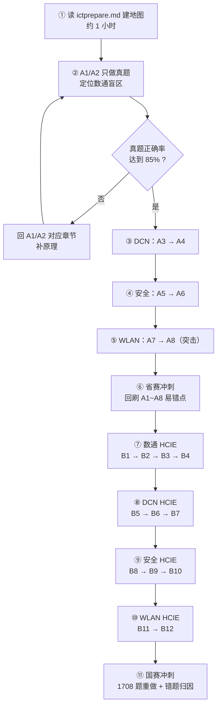

# 华为 ICT 大赛 · 网络赛道资料使用顺序（how2use）

> 这份文档只回答一个问题：**从今天开始，我按什么顺序打开哪些文件、做什么、做到什么程度算过。**
> 总纲看 [ictprepare.md](ictprepare.md)，教学内容在 [分册/](分册/)。

---

## 〇、30 秒速览



**一句话**：先摸清自己缺什么（②），再按 DCN → 安全 → WLAN 补新方向（③④⑤），最后回头用数通 HCIE 打深度（⑦）。

> **已经有数通基础的人，最容易犯的错就是从 A1 第一页硬啃。** A1/A2 一共 227 道真题，直接做题比读 8000 行正文快得多——只在错题处回读原文。

---

## 一、资料长什么样

| 位置 | 内容 | 什么时候用 |
|---|---|---|
| [ictprepare.md](ictprepare.md) | 总纲：赛道解构、方向权重、依赖图、答题方法、必背速查表 | 只在第 ① 步完整读一遍，之后当手册查 |
| [ictprepare-校赛省赛.md](ictprepare-校赛省赛.md) | 校赛/省赛**卷索引**（HCIA 层 8 册 + 全书目录） | 查目录、跳转 |
| [ictprepare-国赛.md](ictprepare-国赛.md) | 国赛**卷索引**（HCIE 层 12 册 + 全书目录） | 查目录、跳转 |
| [分册/](分册/) | **20 个分册，真正装教学内容**，每个 141~628 KB | 你现在要读的就是这些 |
| [assets/](assets/) | 709 张示意图 PNG，已自动插在分册正文里 | 不用单独打开 |

**关键**：不要试图一次读完。**每次只打开当前步骤的那 1 个分册。**

---

## 二、主线顺序（10 步）

### 阶段一：校赛 / 省赛（第 ①~⑥ 步）

| 步 | 打开的文件 | 行数 | 真题 | 建议耗时 | 重点抓什么 |
|---|---|---|---|---|---|
| **①** | [ictprepare.md](ictprepare.md) | — | — | 1 h | 只读第三、四、五节：依赖关系图、时间表、四类题型答题方法 |
| **②** | [A1](分册/A1-数通HCIA上-网络基础与以太网交换.md) → [A2](分册/A2-数通HCIA下-编址路由与网络服务.md) | 3,879 + 4,564 | **103 + 124** | 1~2 天 | **跳过原理精讲，直接做真题**。错题回原文补 |
| **③** | [A3](分册/A3-DCNHCIA上-数据中心架构与设备.md) → [A4](分册/A4-DCNHCIA下-VXLAN与EVPN入门.md) | 2,542 + 1,956 | 77 + 38 | 3 天 | A3：为什么数据中心不用传统三层架构。A4：**VXLAN 报文格式 + EVPN 五种路由类型** |
| **④** | [A5](分册/A5-安全HCIA上-防火墙与NAT认证.md) → [A6](分册/A6-安全HCIA下-VPN内容安全与攻防.md) | 3,406 + 3,142 | 59 + 54 | 4 天 | A5 死穴 = **会话机制 + 安全策略匹配顺序 + NAT 处理流水线**；A6 抓 IPSec 与常见攻击防御 |
| **⑤** | [A7](分册/A7-WLANHCIA上-标准射频与组网架构.md) → [A8](分册/A8-WLANHCIA下-配置漫游安全与排障.md) | 3,224 + 2,265 | 69 + 32 | 3 天 | **集中突击**：802.11 演进表、CAPWAP 双隧道、转发模式、四次握手、AP 不上线排查树 |
| **⑥** | 回刷 A1~A8 的「易错点与排错」章节 | — | 556 | 2 天 | 全省赛真题重做，错题归因到知识点 |

### 阶段二：国赛（第 ⑦~⑪ 步）

| 步 | 打开的文件 | 行数 | 真题 | 建议耗时 | 重点抓什么 |
|---|---|---|---|---|---|
| **⑦** | [B1](分册/B1-数通HCIE上-OSPF高级与ISIS.md) → [B2](分册/B2-数通HCIE中-BGP选路与MPLS-VPN.md) → [B3](分册/B3-数通HCIE下-组播IPv6进阶与QoS.md) → [B4](分册/B4-数通HCIE补-SRv6自动化与割接排障.md) | 7,720 + 4,528 + 4,870 + 3,348 | 166+101+113+73 | 10 天 | **国赛最重的一块**。B2 的 **13 条选路**和 **MPLS 逐跳标签推演**必须能自己算出来 |
| **⑧** | [B5](分册/B5-DCNHCIE上-VXLAN与EVPN深入.md) → [B6](分册/B6-DCNHCIE中-MLAG与Fabric设计DCI.md) → [B7](分册/B7-DCNHCIE下-无损网络与智能运维.md) | 3,794 + 3,194 + 3,310 | 72 + 45 + 64 | 6 天 | B5 分布式网关五场景要能逐跳写出封装变化；B7 的 PFC/ECN/DCQCN 三角协同 |
| **⑨** | [B8](分册/B8-安全HCIE上-防火墙高可用与密码学PKI.md) → [B9](分册/B9-安全HCIE中-IPSec深入与SSL-VPN-DSVPN.md) → [B10](分册/B10-安全HCIE下-入侵防御与安全架构.md) | 2,883 + 4,358 + 4,985 | 59 + 73 + 118 | 6 天 | B8 必须在前（密码学是 B9 的前提）；抓 HRP 主备选举、IKEv1 主模式 6 报文、沙箱闭环 |
| **⑩** | [B11](分册/B11-WLANHCIE上-空口射频与大型组网.md) → [B12](分册/B12-WLANHCIE下-勘测规划与安全运维.md) | 3,900 + 6,261 | 91 + 177 | 5 天 | B11 空口退避、AC 集群、跨 AC 漫游；B12 链路预算算例、SAE、健康度算分 |
| **⑪** | 全书 1,708 道真题重做 + 错题归因 | — | 1,708 | 5 天 | 只看错题和「易错点与排错」，不再通读 |

> **耗时假设**：每天有效学习 3~4 小时。时间紧就按第六节的压缩路径走。
> **合计**：阶段一约 13~14 天，阶段二约 32 天。按 ictprepare.md 的 12 周节奏是留了缓冲的。

---

## 三、每个分册怎么读（三遍法）

同一个分册，分三遍过，不要一遍求全：

| 遍 | 读什么 | 不读什么 | 目的 |
|---|---|---|---|
| **第 1 遍 · 建框架**（占 20% 时间） | 「考点定位」+「关键概念对照表」+「示意图」+ 章末目录 | 跳过「原理精讲」和「华为设备配置」 | 知道这一章有什么、考什么 |
| **第 2 遍 · 啃原理 + 动手**（占 60% 时间） | 「原理精讲」精读；「华为设备配置」在 eNSP 里**敲一遍**；然后做「真题精练」 | — | 把知识变成能力和分数 |
| **第 3 遍 · 只刷错**（占 20% 时间） | 只读「易错点与排错」+ 自己的错题 | 其余全部跳过 | 消灭重复犯错 |

**第 2 遍的铁律**：每条命令配完必须 `display` 验证表项。**只配不看 = 白配**。每配一条命令先问自己一句：*这条命令改的是控制面还是数据面？*

---

## 四、不能颠倒的依赖（踩了就白学）

| 约束 | 原因 |
|---|---|
| **B2（BGP）必须在 B5（EVPN）之前** | EVPN 就是拿 BGP 当控制平面。不懂 RT/RD、扩展团体属性，B5 只能死背命令，题目一变形就废 |
| **B8（密码学/PKI）必须在 B9（IPSec）之前** | 不然 IKE 协商的加密算法、DH、PFS 全是天书 |
| **B1（OSPF/IS-IS）必须在 B2（MPLS）之前** | MPLS 的 LDP 依赖 IGP 提供 Loopback 路由与标签转发路径 |

方向之间也有一条主线：**数通 → DCN → 安全 → WLAN**。DCN 的 EVPN、安全的策略路由都会用到数通的 BGP/OSPF。

---

## 五、进度打卡表

每完成一个分册，勾一格。**真题正确率不达标就回炉，别往下走。**

### 阶段一 · 校赛省赛（HCIA）

| ✔ | 分册 | 真题目标 | 正确率 | 完成日期 |
|---|---|---|---|---|
| ☐ | A1 数通HCIA上-网络基础与以太网交换 | 103 | ____% | ____ |
| ☐ | A2 数通HCIA下-编址路由与网络服务 | 124 | ____% | ____ |
| ☐ | A3 DCNHCIA上-数据中心架构与设备 | 77 | ____% | ____ |
| ☐ | A4 DCNHCIA下-VXLAN与EVPN入门 | 38 | ____% | ____ |
| ☐ | A5 安全HCIA上-防火墙与NAT认证 | 59 | ____% | ____ |
| ☐ | A6 安全HCIA下-VPN内容安全与攻防 | 54 | ____% | ____ |
| ☐ | A7 WLANHCIA上-标准射频与组网架构 | 69 | ____% | ____ |
| ☐ | A8 WLANHCIA下-配置漫游安全与排障 | 32 | ____% | ____ |
| ☐ | **阶段一小计：556 题** | 556 | ____% | ____ |

### 阶段二 · 国赛（HCIE）

| ✔ | 分册 | 真题目标 | 正确率 | 完成日期 |
|---|---|---|---|---|
| ☐ | B1 数通HCIE上-OSPF高级与ISIS | 166 | ____% | ____ |
| ☐ | B2 数通HCIE中-BGP选路与MPLS-VPN | 101 | ____% | ____ |
| ☐ | B3 数通HCIE下-组播IPv6进阶与QoS | 113 | ____% | ____ |
| ☐ | B4 数通HCIE补-SRv6自动化与割接排障 | 73 | ____% | ____ |
| ☐ | B5 DCNHCIE上-VXLAN与EVPN深入 | 72 | ____% | ____ |
| ☐ | B6 DCNHCIE中-MLAG与Fabric设计DCI | 45 | ____% | ____ |
| ☐ | B7 DCNHCIE下-无损网络与智能运维 | 64 | ____% | ____ |
| ☐ | B8 安全HCIE上-防火墙高可用与密码学PKI | 59 | ____% | ____ |
| ☐ | B9 安全HCIE中-IPSec深入与SSL-VPN-DSVPN | 73 | ____% | ____ |
| ☐ | B10 安全HCIE下-入侵防御与安全架构 | 118 | ____% | ____ |
| ☐ | B11 WLANHCIE上-空口射频与大型组网 | 91 | ____% | ____ |
| ☐ | B12 WLANHCIE下-勘测规划与安全运维 | 177 | ____% | ____ |
| ☐ | **阶段二小计：1,152 题** | 1,152 | ____% | ____ |

**过关标准**：校赛 ≥80%，省赛 ≥85%，国赛 ≥90%。

---

## 六、时间不够时的三条压缩路径

### 路径 A：只剩 2 周，只打校赛/省赛
```
① ictprepare.md（1h）
→ ② A1/A2 只做真题 + 错题回读（2 天）
→ ③④⑤ 三册只读「考点定位 + 关键概念对照表 + 真题精练」（各 1 天）
→ ⑥ A1~A8 的「易错点与排错」全刷（1 天）
```
**B 卷 12 册一页都不用打开。**

### 路径 B：只剩 1 个月，冲国赛
```
① → ②（1 天）
→ ⑦ B1→B2（6 天，B3、B4 只扫「考点定位」）
→ ⑧ B5（3 天）、B6/B7（各 1 天扫读）
→ ⑨ B8→B9（4 天）、B10（1 天扫读）
→ ⑩ B11（2 天）、B12（2 天扫读）
→ ⑪ 错题重做（3 天）
```
**优先保住 B1/B2/B5/B8/B9 这 5 册，它们覆盖国赛分值最高的协议与设计题。**

### 路径 C：只有零散时间，每天 1 小时
按「一天一个小节」推进：打开当前分册 → 读 1 个 `##` 知识点（考点定位 + 原理精讲）→ 敲一遍配置 → 做掉该知识点的真题。**不追求速度，追求每天都不断线。**

---

## 七、六个常见的走错路

| 走错路 | 后果 | 正确做法 |
|---|---|---|
| 从 A1 第一页开始通读 | 在有基础的地方浪费两周 | A1/A2 直接做题，错哪补哪 |
| 先看 VXLAN/EVPN，跳过 BGP | RT/RD、扩展团体属性看不懂，只能背命令 | 严格按 B2 → B5 |
| 用 Cisco 的默认行为套华为 | 防火墙、ACL 默认行为上成片丢分 | 记牢：**华为防火墙区域间默认拒绝** |
| 只配命令不看表项 | 实验题没手感，排错题无思路 | 每条命令配完必须 `display` 验证 |
| 跳过 IPv6 和组播 | 国赛必考，直接丢大分 | B3 不能跳 |
| 不做错题归因 | 同类题反复错 | 每道错题标注到具体知识点，回原文重读 |

---

## 八、每次坐下来学习的动作模板

直接照着做，不用想：

1. **打开**：卷索引 → 找到今天这一步对应的分册 → 打开它。
2. **定位**：看目录，挑今天要过的那 1~2 个 `##` 知识点。
3. **读**：按「考点定位 → 原理精讲 → 关键概念对照表 → 示意图」的顺序读。
4. **敲**：把「华为设备配置」在 eNSP 里敲一遍，每敲完一段 `display` 一次。
5. **测**：做该知识点的「真题精练」，对答案，把错题标记出来。
6. **归因**：错题对应哪个原理没搞懂？回「原理精讲」重读那一段。
7. **记录**：在第五节打卡表里更新正确率与日期。
8. **收尾**：读一遍该知识点的「易错点与排错」，再关文件。

---

## 九、配套文件与再生成

| 路径 | 说明 |
|---|---|
| [ictprepare.md](ictprepare.md) | 总纲与备考作战地图 |
| [ictprepare-校赛省赛.md](ictprepare-校赛省赛.md) | 校赛/省赛卷索引（HCIA，8 册） |
| [ictprepare-国赛.md](ictprepare-国赛.md) | 国赛卷索引（HCIE，12 册） |
| [分册/](分册/) | 20 个教学内容文件 |
| [assets/](assets/) | 709 张示意图 PNG |
| [parts/](parts/) | 分册源文件 + 写作规范 `_SPEC.md` |
| [scripts/assemble.mjs](scripts/assemble.mjs) | 改完源文件后重新切分：`node scripts/assemble.mjs` |
| [scripts/render-diagrams.mjs](scripts/render-diagrams.mjs) | 补渲染新图：`node scripts/render-diagrams.mjs` |

---

**最后一句**：这份资料一共 78,000 行、1,708 道真题，没有任何人能"看完"。**它的正确用法是当字典——先按顺序建框架，再按错题回查。**按上面的顺序走，每一步都有明确的"过关标志"，你不会迷路。
