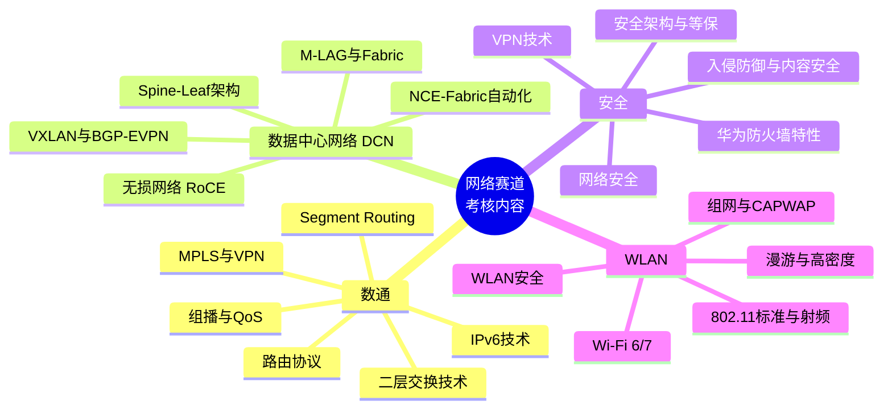
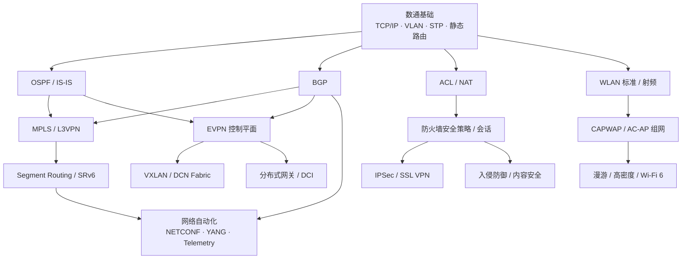
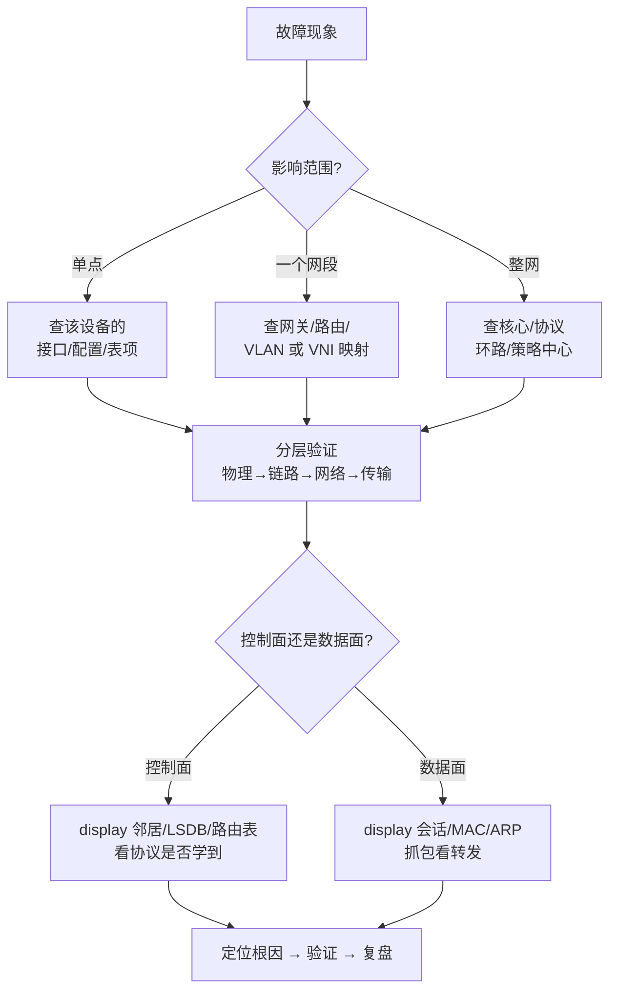

# 华为 ICT 大赛 · 网络赛道备考总纲（ictprepare）

> **🚀 不知道从哪开始？先看 [how2use.md](how2use.md)** —— 那是资料的使用顺序说明书：按什么顺序打开哪些文件、每步做什么、做到什么程度算过关、时间不够怎么压缩，还有可勾选的进度打卡表。
>
> 本文件是**总纲与备考作战地图**。教学内容按"两级组织"：
> - 📘 **[ictprepare-校赛省赛.md](ictprepare-校赛省赛.md)** —— 校赛/省赛**卷索引**（HCIA 层，8 个分册）
> - 📕 **[ictprepare-国赛.md](ictprepare-国赛.md)** —— 国赛**卷索引**（HCIE 层，12 个分册）
> - 📂 **[分册/](分册/)** —— **20 个分册文件，真正装教学内容**，每个 140~630 KB，可单独打开、单独打印
>
> 两份卷索引里各有分册导航表和**全书目录**，点目录即可跳到对应分册的对应章节。
>
> **真题说明**：文档中所有标注为 `【真题·xxx】` 的题目，依据华为 ICT 大赛历年公开赛题方向、华为认证考试真题回忆与官方教材例题整理改写，用于自测训练，每题均附答案与解析；正式参赛请以大赛官方考试大纲与题库为准。

---

## 一、赛道与考核内容解构

### 1.1 网络赛道考什么

网络赛道覆盖 **四个技术方向**，且明确要求跨方向综合能力（国赛尤其如此）：

### 1.2 三级赛事的难度阶梯

| 阶段 | 对标认证 | 考查重心 | 典型题型 | 备考资料 |
|---|---|---|---|---|
| **校赛** | HCIA | 基础概念是否扎实、是否会配、会不会算 | 选择、判断、填空、简单组网实验 | [校赛省赛册](ictprepare-校赛省赛.md) |
| **省赛** | HCIA → HCIP | 原理细节（默认值、报文、状态机）、多协议联动、中等规模排错 | 多选、简答、配置实验、排错 | [校赛省赛册](ictprepare-校赛省赛.md) |
| **国赛** | HCIP → HCIE | 协议深层机制、次优路径成因、方案设计、复杂故障定位、新技术 | 简答、设计题、综合排错、压轴实验 | [国赛册](ictprepare-国赛.md) |

**关键判断**：校赛省赛考的是"**广度 + 准确度**"，国赛考的是"**深度 + 推理链**"。国赛的错误答案往往是"配置对了但选路不对""现象对了但根因判断错"，所以国赛册里大量安排了**成因分析**和**逐跳推演**。

---

## 二、四个方向的权重与取舍策略

| 方向 | 校赛省赛占比感受 | 国赛占比感受 | 性价比判断 | 建议投入 |
|---|---|---|---|---|
| **数通** | 最高（约 40%） | 高（约 35%） | 地基，其他三方向都以它为前提 | ★★★★★ 必通 |
| **DCN** | 中（约 20%） | 高（约 25%） | 与数通高度复用（VXLAN 依赖 BGP/EVPN），提分快 | ★★★★☆ |
| **安全** | 中（约 20%） | 中（约 20%） | 概念题多、好拿分；防火墙会话与 NAT 处理流水线是硬骨头 | ★★★★☆ |
| **WLAN** | 中（约 20%） | 中（约 20%） | 独立性强、术语多、背记量大；CAPWAP 与漫游是重点 | ★★★☆☆ |

> **取舍原则**：如果你的数通 OSPF/BGP 还不稳，先去啃数通册，DCN 的 EVPN 和安全的路由联动都会用到。WLAN 可以集中 3~5 天突击，因为它自成体系。

---

## 三、依赖关系图（决定你的学习顺序）

**按箭头顺序学，不要跳。** 最常见的翻车路径是：直接看 VXLAN → 不懂 EVPN 的 RT/RD → 不懂 BGP 扩展团体属性 → 结果全靠背命令，考试一变形就不会。

---

## 四、建议备考节奏（12 周版，可按剩余时间等比压缩）

### 第 1~4 周：数通地基（对应校赛省赛册 A1 / A2）
- 逐章过 A1（网络基础、VRP、VLAN、STP）与 A2（编址、路由、OSPF、应用服务、ACL/NAT、IPv6）。
- **动手要求**：eNSP 里把 VLAN 间通信、STP 选根、OSPF 多区域、NAT Server 各搭一遍。
- **自测门槛**：A1/A2 的真题正确率 ≥ 85% 才进入下一阶段。

### 第 5~6 周：DCN + 安全 基础（A3~A6）
- DCN 重点：Spine-Leaf 为什么这么设计、VXLAN 报文结构、EVPN 五种路由类型的用途。
- 安全重点：**状态检测会话机制**、**安全策略匹配顺序**、**NAT 与策略的处理流水线**。
- **动手要求**：用 eNSP 模拟器搭一个最小 VXLAN（两台 Leaf 手动隧道）+ 一台 USG 的 NAT Server。

### 第 7 周：WLAN 突击（A7 / A8）
- 一周集中解决：802.11 标准演进表、CAPWAP 双隧道、转发模式对比、四次握手、AP 不上线的排查决策树。
- WLAN 是**记忆型科目**，用表格和口诀压缩。

### 第 8 周：省赛模拟 + 查漏
- 回到 A1~A8 的"易错点与排错"章节重刷。
- 把所有"默认值"汇总成一张速查表（Hello 10s/Dead 40s、STP 三定时器、BGP 选路 13 条……），国赛前反复看。

### 第 9~11 周：国赛深度（B1~B12）
- **数通**：B1 OSPF/IS-IS 高级 → B2 BGP 选路 + MPLS L3VPN 跨域 → B3 组播/IPv6/QoS → B4 SRv6/自动化/割接排错。
- **DCN**：B5 EVPN 深入 + 分布式网关 → B6 M-LAG + Fabric 设计 + DCI → B7 无损网络 + NCE-Fabric。
- **安全**：B8 防火墙高级（双机热备/虚拟系统）→ B9 VPN 深入 → B10 入侵防御 + 安全架构。
- **WLAN**：B11 空口射频 + 大型组网 → B12 勘测规划 + Wi-Fi 6/7。
- **动手要求**：B2 的 BGP 选路、B5 的 EVPN 分布式网关转发推演，**必须能自己在纸上画出每一跳的封装变化**。

### 第 12 周：国赛冲刺
- 主攻三件事：① 设计方案题的答题框架；② 综合排错的结构化方法论；③ 高频默认值与字段的默写。
- 把两份文档的"真题精练"全部重做一遍，错题归因到知识点。

---

## 五、四类题型的答题方法

### 5.1 选择题（校赛省赛主力）
- **默认值题**：靠速查表，不要推理。华为与 Cisco 的默认行为差异（防火墙区域间默认拒绝 vs 默认放行）是经典陷阱。
- **"下列说法正确的是"**：先排除绝对化表述（"必须""一定""只能"），再用原理验证。
- **多选**：华为赛题多选少选均不得分。策略是逐个选项独立判断，不要受"通常有几个答案"的暗示影响。

### 5.2 计算题（省赛/国赛）
- VLSM / 超网聚合 / 通配符掩码 / fat-tree 收敛比 / 组播 MAC 映射 / MTU 计算。
- 模板化：**先写公式，再代数字，最后写结论**。过程分往往比结果分好拿。

### 5.3 简答题（国赛主力）
- 答题结构固定为 **"结论 → 原理 → 影响/场景"** 三段。
- 例："为什么 VXLAN 需要 EVPN 而不是纯泛洪？" → 结论：泛洪不可扩展且无法做 ARP 抑制 → 原理：头端复制产生 O(N²) 复制、组播依赖底层组播能力 → 影响：EVPN 提供控制平面学习 + ARP 抑制 + 多活接入。

### 5.4 排错题（国赛杀伤力最大）
用**结构化方法论**，不要乱猜：

---

## 六、必背速查表清单（自己抄一遍，比看十遍有用）

| 类别 | 必须脱口而出的内容 |
|---|---|
| 路由优先级 | Direct 0 / OSPF 10 / IS-IS 15 / Static 60 / RIP 100 / OSPF ASE 150 / IBGP 255 / EBGP 255 |
| OSPF | Hello 10s(广播,P2P)、Dead 40s、邻居 7 状态、LSA 1~7 的产生者、DR 不可抢占、224.0.0.5 / 224.0.0.6 |
| IS-IS | NET 地址构成、L1/L2/L1-2、DIS 可抢占、宽度量 32bit、PDU 四种 |
| BGP | TCP 179、6 状态机、4 报文、13 条选路、属性四大类、RR 三条规则 |
| MPLS | 标签 20+3+1+8、LDP 646、PHP、RD 8 字节、RT 用于导入导出、Option A/B/C |
| VXLAN | VNI 24bit、UDP 4789、封装开销 50B、BD/VBDIF、EVPN 五类路由 |
| 安全 | ESP 50 / AH 51 / IKE 500、NAT-T 4500、RADIUS 1812/1813、区域间默认拒绝 |
| WLAN | CAPWAP 5246/5247、2.4G 1/6/11、四次握手 PMK/PTK/GTK、DSCP EF 46、802.11 演进表 |
| QoS | DSCP 6bit、802.1p 3bit、EXP 3bit、令牌桶 CIR/CBS/PIR、EF/AF/CS |

---

## 七、实验环境搭建

| 工具 | 用途 | 说明 |
|---|---|---|
| **eNSP** | 数通 / 安全 / WLAN 基础实验 | 免费，支持 AR 路由器、S 交换机、USG6000V 防火墙、AC/AP |
| **CloudEngine 模拟器 / eNSP Pro** | DCN 实验（VXLAN/EVPN） | CloudEngine 系列需要 eNSP Pro 或真机 |
| **WLAN Planner** | 无线勘测与规划 | 华为官方在线工具，输出 AP 点位与覆盖热力图 |
| **Wireshark** | 抓包验证原理 | 抓 OSPF/BGP/VXLAN/IPSec 报文，对照文档里的字段表看 |
| **iMaster NCE-Campus / NCE-Fabric** | 控制器与自动化 | 官方有体验沙箱 |

**做实验的铁律**：每配一条命令前先问自己"这条命令改的是控制面还是数据面"，配完后用 `display` 验证表项是否如预期。**只配不看 = 白配**。

---

## 八、两份分册文档结构速览

### 📘 [ictprepare-校赛省赛.md](ictprepare-校赛省赛.md) —— HCIA 层，8 个分册

| 分册 | 方向 | 章节内容 | 行数 |
|---|---|---|---|
| [A1-数通HCIA上-网络基础与以太网交换](分册/A1-数通HCIA上-网络基础与以太网交换.md) | 数通 | 网络基础与TCP/IP、VRP与设备管理、以太网与VLAN、STP/RSTP/MSTP | 3,765 |
| [A2-数通HCIA下-编址路由与网络服务](分册/A2-数通HCIA下-编址路由与网络服务.md) | 数通 | IP编址与子网划分、路由基础与静态路由、OSPF基础、应用层服务、ACL与NAT、IPv6基础 | 4,483 |
| [A3-DCNHCIA上-数据中心架构与设备](分册/A3-DCNHCIA上-数据中心架构与设备.md) | DCN | 数据中心网络与Spine-Leaf、CloudEngine设备、数据中心二层技术 | 2,467 |
| [A4-DCNHCIA下-VXLAN与EVPN入门](分册/A4-DCNHCIA下-VXLAN与EVPN入门.md) | DCN | VXLAN基础、BGP-EVPN入门、网络虚拟化与Fabric | 1,899 |
| [A5-安全HCIA上-防火墙与NAT认证](分册/A5-安全HCIA上-防火墙与NAT认证.md) | 安全 | 网络安全概述与威胁、防火墙基础与安全策略、NAT技术、用户认证与AAA | 3,286 |
| [A6-安全HCIA下-VPN内容安全与攻防](分册/A6-安全HCIA下-VPN内容安全与攻防.md) | 安全 | VPN技术基础、内容安全与入侵防御、常见攻击与防御、终端与边界安全 | 3,040 |
| [A7-WLANHCIA上-标准射频与组网架构](分册/A7-WLANHCIA上-标准射频与组网架构.md) | WLAN | WLAN概述与802.11标准、射频与天线、组网架构与CAPWAP | 3,137 |
| [A8-WLANHCIA下-配置漫游安全与排障](分册/A8-WLANHCIA下-配置漫游安全与排障.md) | WLAN | WLAN配置与AP上线、漫游、安全、规划部署与故障排查 | 2,196 |

### 📕 [ictprepare-国赛.md](ictprepare-国赛.md) —— HCIE 层，12 个分册

| 分册 | 方向 | 章节内容 | 行数 |
|---|---|---|---|
| [B1-数通HCIE上-OSPF高级与ISIS](分册/B1-数通HCIE上-OSPF高级与ISIS.md) | 数通 | OSPF高级特性与优化、IS-IS与IPv6集成 | 7,510 |
| [B2-数通HCIE中-BGP选路与MPLS-VPN](分册/B2-数通HCIE中-BGP选路与MPLS-VPN.md) | 数通 | BGP高级与选路13条、MPLS与L3VPN/L2VPN/VPLS | 4,444 |
| [B3-数通HCIE下-组播IPv6进阶与QoS](分册/B3-数通HCIE下-组播IPv6进阶与QoS.md) | 数通 | IP组播、IPv6进阶与过渡、QoS | 4,738 |
| [B4-数通HCIE补-SRv6自动化与割接排障](分册/B4-数通HCIE补-SRv6自动化与割接排障.md) | 数通 | Segment Routing与SRv6、网络自动化与可编程、网络割接与综合排错 | 3,258 |
| [B5-DCNHCIE上-VXLAN与EVPN深入](分册/B5-DCNHCIE上-VXLAN与EVPN深入.md) | DCN | VXLAN与BGP-EVPN深入、EVPN分布式网关与跨Fabric互联 | 3,641 |
| [B6-DCNHCIE中-MLAG与Fabric设计DCI](分册/B6-DCNHCIE中-MLAG与Fabric设计DCI.md) | DCN | M-LAG与iStack深度对比、数据中心规划设计与DCI | 3,125 |
| [B7-DCNHCIE下-无损网络与智能运维](分册/B7-DCNHCIE下-无损网络与智能运维.md) | DCN | 无损网络（RoCE/PFC/ECN/DCQCN）、iMaster NCE-Fabric、智能运维 | 3,208 |
| [B8-安全HCIE上-防火墙高可用与密码学PKI](分册/B8-安全HCIE上-防火墙高可用与密码学PKI.md) | 安全 | 防火墙高级与高可靠性、密码学与PKI深入 | 2,790 |
| [B9-安全HCIE中-IPSec深入与SSL-VPN-DSVPN](分册/B9-安全HCIE中-IPSec深入与SSL-VPN-DSVPN.md) | 安全 | IPSec深入与IKEv2、SSL VPN、GRE/L2TP/DSVPN | 4,226 |
| [B10-安全HCIE下-入侵防御与安全架构](分册/B10-安全HCIE下-入侵防御与安全架构.md) | 安全 | 入侵防御与未知威胁、企业安全架构与等保、云安全与虚拟化安全 | 4,852 |
| [B11-WLANHCIE上-空口射频与大型组网](分册/B11-WLANHCIE上-空口射频与大型组网.md) | WLAN | 空口射频与高密度、大型园区组网与高可靠性 | 3,804 |
| [B12-WLANHCIE下-勘测规划与安全运维](分册/B12-WLANHCIE下-勘测规划与安全运维.md) | WLAN | 规划勘测与WLAN Planner、WLAN安全进阶与攻防、Wi-Fi 6/7与智能运维 | 6,123 |

> **为什么拆成 20 个分册文件？** 合订成两份后可达到 1.7 MB / 2.8 MB 以上，编辑器、手机端和网页预览打开都很吃力。拆开后每个文件 140~510 KB，可单独打开、单独打印、单独发给队友。两份卷索引（`ictprepare-校赛省赛.md` / `ictprepare-国赛.md`）里保留**全书目录**，每条目录都直接跳到对应分册的对应章节。

---

## 九、常见备考误区

| 误区 | 后果 | 纠正 |
|---|---|---|
| 只背命令不学原理 | 题目一变形就废 | 每条命令都问"它改的是哪张表" |
| 用 Cisco 的默认行为套华为 | 防火墙、ACL 默认行为上大量丢分 | 记牢：华为防火墙区域间**默认拒绝** |
| 跳过 IPv6 和组播 | 国赛必考，直接丢大分 | IPv6 至少掌握编址、NDP、SLAAC、过渡技术 |
| 忽视 WLAN | 被视为"简单"而放弃 20% 分值 | WLAN 是投入产出比最高的突击科目 |
| 不做实验 | 实验题没手感、排错题无思路 | eNSP 至少搭 15 个完整场景 |
| 不做错题归因 | 同类题反复错 | 错题必须标注到具体知识点，回原文重读 |

---

## 十、文件清单与再生成

| 路径 | 说明 |
|---|---|
| **[how2use.md](how2use.md)** | **使用顺序说明书**：10 步主线顺序、三遍读法、依赖约束、进度打卡表、压缩路径、每次学习的动作模板 |
| `ictprepare.md` | 本文件：总纲、知识地图、备考路线、答题方法 |
| [ictprepare-校赛省赛.md](ictprepare-校赛省赛.md) | 校赛 / 省赛**卷索引**（HCIA 层）：分册导航表 + 全书目录，约 50 KB |
| [ictprepare-国赛.md](ictprepare-国赛.md) | 国赛**卷索引**（HCIE 层）：分册导航表 + 全书目录，约 76 KB |
| [分册/](分册/) | **20 个分册文件，真正装教学内容**，每个 141~628 KB，可单独打开 |
| [assets/](assets/) | 709 张示意图 PNG（由 Mermaid 渲染），分册正文中已自动插图 |
| [parts/](parts/) | 分册源文件 + 统一写作规范 `_SPEC.md` |
| [scripts/assemble.mjs](scripts/assemble.mjs) | 生成分册文件与两份卷索引：`node scripts/assemble.mjs` |
| [scripts/render-diagrams.mjs](scripts/render-diagrams.mjs) | 渲染 Mermaid 示意图并回填图片引用：`node scripts/render-diagrams.mjs` |

**内容规模**：20 个分册 / **78,129 行** / 正文约 6.2 MB / **1,708 道真题（全部带答案与解析）** / **709 张示意图（已渲染为 PNG 并在正文中自动插图）**。

**改内容后如何再生成**：改 `parts/` 里的源分册 → `node scripts/assemble.mjs` 重新切分并生成卷索引 → `node scripts/render-diagrams.mjs` 补渲染新图（已渲染的图会命中缓存，只处理新增部分）。

> **磁盘提示**：`assets/` 占约 81 MB，`node_modules/` 约 450 MB（Mermaid 渲染工具链）。如果不需要再渲染新图，可以删掉 `node_modules/` 释放空间；需要时在目录下执行 `npm install @mermaid-js/mermaid-cli` 重装即可。
>
> **阅读建议**：不要试图一次读完。按第四节的时间表，每次只打开当前阶段对应的 1~2 个分册文件；卷索引只用来查目录和跳转。

---

**最后一句**：华为 ICT 大赛网络赛道的题目，从来不是考"你知不知道"，而是考"你能不能推出下一步"。把文档里每处**"为什么"**看懂，比背下所有命令都有用。
