## 华为 ICT 大赛网络赛道备考资料 · A1 数通 · HCIA（上册）

> 本册真题依据华为 ICT 大赛历年公开赛题方向、华为认证考试真题回忆与官方教材例题整理改写，用于自测训练；正式参赛请以大赛官方考试大纲与题库为准。

## 分册说明（非知识点）

| 项目 | 内容 |
|---|---|
| 分册编号 | A1（数通方向 · HCIA 层 · 上册） |
| 适用阶段 | 校赛 / 省赛重点（打基础 + 上机实验必需） |
| 覆盖章节 | 章节1 网络基础与 TCP/IP 协议栈；章节2 VRP 系统与设备管理；章节3 以太网与 VLAN 技术；章节4 生成树协议 STP/RSTP/MSTP |
| 参考产品 | CloudEngine S5731 / S6730 / S12700（园区交换）、AR6120 / AR651（园区出口）、NE40E（汇聚/骨干）、VRP V200 / V300 / V600、eNSP |
| 学习建议 | 先看「原理精讲」把机制吃透，再照「华为设备配置」在 eNSP 敲一遍，最后用「真题精练」自测；「易错点与排错」建议在实验台上亲手复现一次 |

本册所有命令均为华为 VRP 真实语法，可直接在 eNSP 或真机上运行。命令后的 `//` 为逐行注释。

---

# 数通-HCIA-章节1-网络基础与TCP/IP协议栈

## 1.1 OSI 参考模型、TCP/IP 模型与封装解封装

### 考点定位

网络基础是所有数通题目的地基，校赛省赛常以 2~4 道选择/填空的形式出现，分值不高但**送分题丢不起**。高频考法是：给出一个功能描述让你判断属于哪一层、给出 PDU 名称让你判断属于哪一层、判断"某层头部是否被下一层加密/校验"、以及封装/解封装的顺序。最经典的陷阱是**把 OSI 七层与 TCP/IP 四层的对应关系画错**（如把"会话层"归到传输层）、以及**误认为传输层有 MAC 地址**。

### 原理精讲

**为什么要分层？** 网络通信要同时解决"如何在物理介质上传比特""如何在一个局域网内找到邻居""如何跨越多个网络找到目的地""如何让两个进程可靠对话""如何表示业务数据"五类完全不同的问题。如果不分层，任何一处技术升级（例如从双绞线换成光纤）都要重写全部协议；而分层之后，每层只依赖下层提供的服务、只向上层提供固定接口，**层与层之间解耦**，各层可以独立演进。分层带来的第二个好处是**对等通信（peer-to-peer）语义**：主机 A 的第 N 层逻辑上与主机 B 的第 N 层直接对话，实际数据要向下穿过本机所有层、经物理网络、再向上穿过对端所有层——这就是"逻辑对等、物理垂直"。

**OSI（Open Systems Interconnection，开放系统互联）七层**自下而上：

1. **物理层**：在介质上传输比特流，定义电气特性、机械特性、功能特性、规程特性（电压、接口形状、引脚、速率）。对应设备：集线器、中继器、调制解调器、网线/光纤。
2. **数据链路层**：把不可靠的物理链路变成无差错的逻辑链路，负责成帧、物理寻址（MAC）、差错检测（CRC）、介质访问控制（CSMA/CD）。对应设备：交换机、网桥、网卡。
3. **网络层**：负责跨网络的路由与转发，进行逻辑寻址（IP）、分片与重组、拥塞控制（QoS）。对应设备：路由器、三层交换机。
4. **传输层**：提供端到端（进程到进程）的数据传输，进行端口寻址、分段与重组、连接管理、流量控制、可靠性保障。对应设备：防火墙（做四层过滤）。
5. **会话层**：建立、管理、终止会话，做会话同步与断点续传（如 RPC、SQL 会话）。
6. **表示层**：数据格式转换、加密解密、压缩解压（如 ASCII/JPEG/加密）。
7. **应用层**：面向用户的网络服务接口（HTTP、FTP、DNS、SMTP）。

**TCP/IP 四层模型**是工程实践模型，把 OSI 的高三层合并为**应用层**、低两层合并为**网络接口层**，保留传输层与网际层。教学与国际标准文档中常用**五层模型**（应用层/传输层/网络层/数据链路层/物理层），因为把"物理层"与"数据链路层"合并会让初学者搞不清 MAC 与 CSMA/CD 的归属。

**封装（Encapsulation）**：发送方数据自上而下逐层加头（数据链路层还加尾 FCS）。每一层的头部只解决本层的问题：传输层头解决"哪个进程"，网络层头解决"哪台主机、怎么走"，数据链路层头解决"下一跳是谁"，物理层解决"0/1 怎么变成电信号"。**为什么每层都要自己的地址？** 因为寻址的粒度不同：MAC 标识"这个网段中的哪块网卡"，IP 标识"整个互联网中的哪台主机"，端口标识"这台主机上的哪个进程"。三种地址缺一不可。

**解封装（Decapsulation）**是封装的逆过程：接收方逐层剥头，每剥一层就做一次本层的校验与处理，然后依据头部中的"协议类型/上层协议号"字段决定交给哪个上层模块——这个动作叫**分用（Demultiplexing）**。例如以太网帧的 Type=0x0800 交给 IP 模块，IP 头的 Protocol=6 交给 TCP 模块，TCP 头的目的端口=443 交给 HTTPS 进程。**注意**：中间设备只解封装到它工作到的层。交换机只解到数据链路层（看目的 MAC），路由器解到网络层（看目的 IP），防火墙可能解到传输层甚至应用层。

各类 PDU（Protocol Data Unit，协议数据单元）名称必须记牢：应用层叫**数据/报文（Data/Message）**，传输层叫**报文段（Segment，TCP）/数据报（Datagram，UDP）**，网络层叫**数据包（Packet）**，数据链路层叫**帧（Frame）**，物理层叫**比特（Bit）**。

### 关键概念对照表

| OSI 层次 | TCP/IP 四层 | 五层模型 | PDU 名称 | 典型协议 | 典型设备 |
|---|---|---|---|---|---|
| 应用层 / 表示层 / 会话层 | 应用层 | 应用层 | 数据 Data | HTTP、FTP、DNS、SMTP、SNMP | 服务器、PC |
| 传输层 | 传输层 | 传输层 | 段 Segment / 数据报 Datagram | TCP、UDP | 防火墙（四层） |
| 网络层 | 网际层 | 网络层 | 包 Packet | IP、ICMP、ARP、OSPF、GRE | 路由器、三层交换机 |
| 数据链路层 | 网络接口层 | 数据链路层 | 帧 Frame | Ethernet、PPP、HDLC、802.1Q | 交换机、网卡 |
| 物理层 | 网络接口层 | 物理层 | 比特 Bit | RJ45、光纤、RS-232 | 集线器、中继器 |

| 对比项 | OSI 七层 | TCP/IP 四层 |
|---|---|---|
| 性质 | 法定国际标准（ISO），理论完备 | 事实工业标准（RFC），先有实现后有模型 |
| 层数 | 7 | 4（教学常讲 5） |
| 会话/表示 | 独立成层 | 并入应用层 |
| 物理/链路 | 独立成层 | 合并为网络接口层 |
| 实际使用 | 用于教学与故障定位排错 | 用于实际协议实现 |

| 封装阶段 | 增加的头部/尾部 | 关键字段举例 |
|---|---|---|
| 传输层 | TCP/UDP 头（20B / 8B） | 源端口、目的端口、序号 |
| 网络层 | IP 头（20B 定长 + 可选） | 源 IP、目的 IP、TTL、协议号 |
| 数据链路层 | 帧头 14B + FCS 4B | 目的 MAC、源 MAC、Type |
| 物理层 | 无头部，加前导码与帧间隙 | 前导码 7B + SFD 1B |

### 华为设备配置

```bash
<Huawei> display version                     // 查看设备型号、VRP 版本，判断所属产品线
<Huawei> display interface GigabitEthernet0/0/1   // 查看物理层与数据链路层信息：速率、双工、MAC、MTU
<Huawei> display ip interface GigabitEthernet0/0/1 // 查看三层信息：IP 地址、掩码、MTU、收发统计
<Huawei> display ip interface brief          // 一张表看全部三层接口的 IP 与物理/协议状态
<Huawei> display ip routing-table            // 查看网络层的路由表，验证转发路径
<Huawei> display tcp status                  // 查看本机 TCP 连接（传输层会话）状态
<Huawei> display mac-address                 // 查看数据链路层 MAC 地址表
```

### 示意图

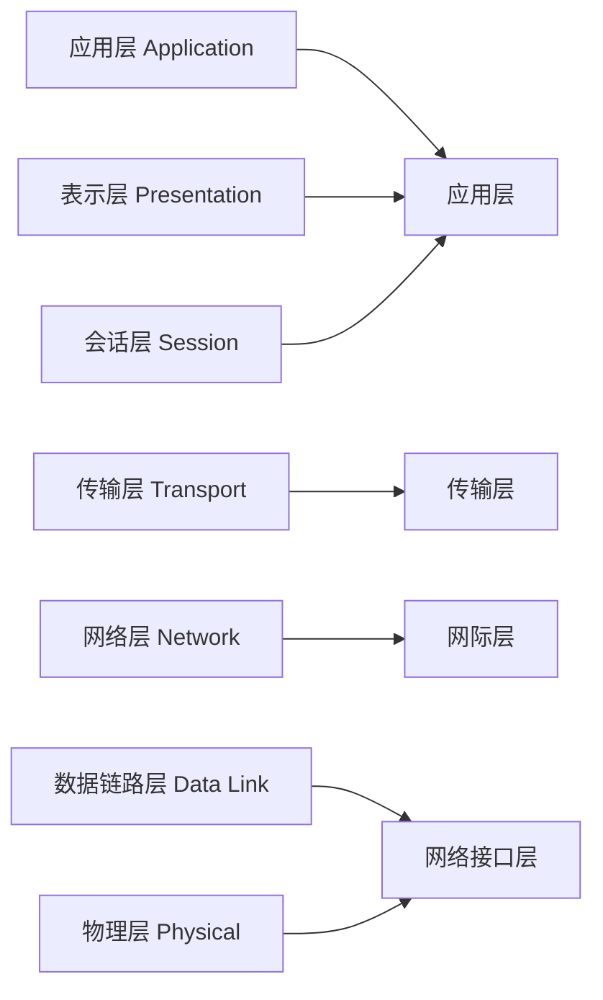

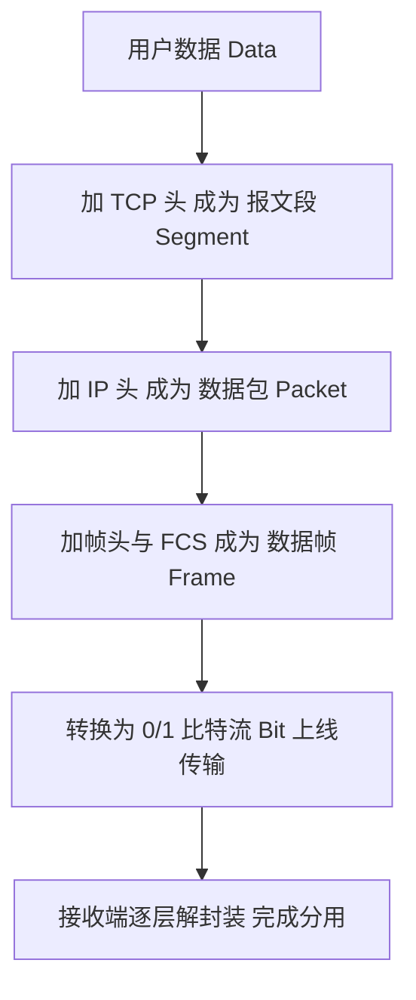

### 真题精练

**Q1.【真题·单选】** 在 OSI 参考模型中，负责端到端可靠传输、提供流量控制与差错重传的是哪一层？

A. 网络层  B. 传输层  C. 会话层  D. 数据链路层

> **答案：B**
> **解析**：传输层通过 TCP 的序号、确认、重传、滑动窗口实现端到端（进程到进程）可靠传输。网络层（A）是点到点的尽力而为转发，不保证可靠；数据链路层（D）的 CRC 只做差错检测不做重传（以太网直接丢帧）；会话层（C）只负责会话建立与同步，不管传输可靠性。

**Q2.【真题·多选】** 关于 OSI 七层模型与 TCP/IP 四层模型的对应关系，下列说法正确的有？（多选）

A. OSI 的会话层、表示层、应用层在 TCP/IP 中合并为应用层
B. OSI 的物理层与数据链路层在 TCP/IP 中合并为网络接口层
C. OSI 的网络层对应 TCP/IP 的网际层
D. TCP/IP 模型有 7 层，OSI 有 4 层

> **答案：ABC**
> **解析**：D 把两者说反了。OSI 是 7 层理论模型，TCP/IP 是 4 层工程模型，二者在传输层与网际层/网络层一一对应，差别只在高层合并与低层合并方式。

**Q3.【真题·填空】** 数据在发送方自上层向下层传递时逐层添加头部，这个过程称为 ________；在数据链路层形成的 PDU 中文名称为 ________。

> **答案：封装（Encapsulation）；帧（Frame）**
> **解析**：封装的对偶过程是解封装（Decapsulation），接收方逐层剥头并依据头部中的协议类型字段把数据交给正确的上层模块，该动作称为分用。

**Q4.【真题·判断】** 交换机在转发数据帧时会解封装到网络层，查看目的 IP 后再决定从哪个端口转发出去。

> **答案：错误**
> **解析**：普通二层交换机只解封装到数据链路层，依据**目的 MAC 地址**查 MAC 地址表转发，不查看 IP 头。只有路由器与三层交换机才解封装到网络层，依据目的 IP 查路由表转发。

**Q5.【真题·简答】** 简述"逻辑对等、物理垂直"的含义，并说明为什么传输层要用端口号而不用 IP 地址标识通信对端。

> **答案**：逻辑对等指发送方第 N 层与接收方第 N 层在语义上是直接对话的（如 TCP 与 TCP 协商窗口）；物理垂直指数据实际必须自上而下穿过本机各层、经物理介质、再自下而上穿过对端各层。IP 地址只能标识到"哪台主机"，而一台主机上同时运行着浏览器、邮件客户端、SSH 等多个进程，必须再用 16 bit 端口号区分进程，端口号 + IP 地址 + 协议号构成的四元组（源 IP、源端口、目的 IP、目的端口）才能唯一标识一条 TCP 连接（socket 五元组还含协议号）。

### 易错点与排错

- **陷阱 1**：把"会话层"归入 TCP/IP 的传输层。正确是**会话层、表示层、应用层合并为应用层**。
- **陷阱 2**：认为物理层也加了"物理层头部"。物理层只在帧前加 7 字节前导码与 1 字节 SFD（帧起始定界符），帧后加帧间隙 IFG，严格说不属于"封装头部"。
- **陷阱 3**：误认为交换机改写源 MAC。普通二层交换机只查表转发、不改写帧内容；路由器转发时**必须**改写源/目的 MAC（逐跳重封装）但**不改**源/目的 IP（除 NAT 场景）。
- **陷阱 4**：把 ICMP、ARP 错归到传输层。二者都是**网络层**协议（ICMP 封装在 IP 之上，ARP 直接在以太网之上，但工作在网际层逻辑范畴）。
- **排错思路**：层次化定位——`display interface` 看物理层/链路层是否 Up，`display ip interface brief` 看三层是否 Up，`display ip routing-table` 看有没有路由，`ping` 看连通性，`display tcp status` 看传输层会话是否建立。**自下而上排查**，先物理后逻辑。

---

## 1.2 以太网帧格式与 MAC 地址

### 考点定位

几乎是校赛必考：帧字段长度、Type 字段取值、最小/最大帧长、MAC 地址结构（OUI、I/G 位、U/L 位）、单播/组播/广播判定。省赛还会结合 VLAN 考 802.1Q 帧与以太网 II 帧的差异（插入 4 字节 Tag，Type 变成 TPID 0x8100）。易错点集中在**长度范围的边界值**（64/1518/1522）与**组播位是"第一字节最低位"而不是最高位**。

### 原理精讲

**两种以太网帧格式并存的历史原因**：DIX Ethernet V2（DEC-Intel-Xerox）与 IEEE 802.3 是同期竞争的两个标准。二者前 12 字节（目的 MAC + 源 MAC）完全相同，**区别在第 13、14 字节**：Ethernet II 用 2 字节 **Type（类型）**字段标明上层协议；802.3 用 2 字节 **Length（长度）**字段标明数据字段长度，并在数据字段开头使用 LLC（Logical Link Control，逻辑链路控制）与 SNAP（SubNetwork Access Protocol，子网接入协议）来标识上层协议。判断技巧：**该字段值 ≥ 0x0600（1536）则一定是 Type，即 Ethernet II 帧；≤ 1500 则是 Length，即 802.3 帧**（1501~1535 为未定义区间）。今天网络中**99% 是以太网 II 帧**，LLC/SNAP 主要残留在 STP BPDU（目的 MAC 01-80-C2-00-00-00）等少数控制帧中。

**字段逐项**：目的 MAC 6 字节、源 MAC 6 字节、Type/Length 2 字节、数据 46~1500 字节、FCS 4 字节。**为什么数据字段最小 46 字节？** 因为以太网使用 CSMA/CD 共享介质，发送方必须在**发送完毕之前**就能检测到冲突，否则会把已经发完的帧误认为发送成功。最坏情况下冲突发生在介质最远端，一来一回的传播时延为 2τ，因此帧的发送时延必须 ≥ 2τ。10 Mbit/s 以太网规定时隙（slot time）为 512 bit 时间 = 51.2 μs，对应 64 字节；减去帧头 14 字节与 FCS 4 字节，数据字段最小就是 46 字节。**这就是最小帧长 64 字节的来源**。数据不足时由网卡填充（Pad）到 46 字节。**为什么要最大 1500 字节？** 早期内存昂贵、共享介质上长帧会长时间占用信道导致其他站等待过久；1500 这个值沿用至今成为以太网 MTU 的代名词。加上 14 字节帧头与 4 字节 FCS，标准以太网帧最大 1518 字节；带一个 802.1Q Tag 后为 1522 字节（部分设备文档称 1518+4）。

**MAC（Media Access Control，介质访问控制）地址**48 bit，写作 12 位十六进制、常见格式 `00E0-FC12-3456`（华为风格）或 `00:E0:FC:12:34:56`。结构上分为**前 24 bit 的 OUI（Organizationally Unique Identifier，组织唯一标识符）**，由 IEEE 分配给厂商（华为常见 OUI 有 00E0-FC、781D-BA、0025-9E、5C7D-5E 等），**后 24 bit 由厂商自行分配**。第一字节（最高字节）的两个低位比特有特殊含义：

- **I/G 位（Individual/Group，第 1 字节的 bit0，即最低位）**：0 表示**单播**，1 表示**组播**（广播是组播的特例）。
- **U/L 位（Universal/Local，第 1 字节的 bit1，即次低位）**：0 表示**全球唯一（烧录地址 BIA）**，1 表示**本地管理地址**（软件配置、用于 VRRP 虚拟 MAC 等）。

因此 `00E0-FC12-3456` 中 `00` = 0000 0000，bit0=0、bit1=0 → 全局单播地址；`01E0-FC12-3456` 中 `01` = 0000 0001，bit0=1 → 组播地址。**注意：很多同学误以为看最高位，这是最常见的错答。**

三类目的 MAC：**单播**（bit0=0，只有对应网卡接收）、**组播**（bit0=1，加入该组的主机接收）、**广播**（全 F，即 FF-FF-FF-FF-FF-FF，本广播域内所有主机接收）。IPv4 组播 MAC 的映射规则：取组播 IP 的低 23 bit 放入 `01-00-5E-00-00-00` 的低 23 bit，因此一个组播 MAC 可能对应 32 个组播 IP（这就是**组播地址重叠**问题，需要在三层用 IGMP Snooping 精确控制）；IPv6 组播 MAC 为 `33-33-` 开头加组播 IP 低 32 bit。特殊 MAC 举例：`FF-FF-FF-FF-FF-FF` 广播、`01-80-C2-00-00-00` STP BPDU、`01-00-5E-00-00-05` VRRP（IPv4）、`01-00-5E-00-00-02` OSPF、`01-00-5E-00-00-12` VRRPv3、`01-00-5E-00-00-16` RIP。

**CRC（Cyclic Redundancy Check，循环冗余校验）与 FCS（Frame Check Sequence，帧检验序列）**：以太网使用 CRC-32，发送方对"目的 MAC + 源 MAC + Type + 数据 + Pad"整体按 32 位生成多项式做模 2 除法，把余数作为 FCS 附在帧尾。接收方同样计算并比对，不一致就**直接丢帧**（不做重传，重传交给上层 TCP）。**CRC 只能检错、不能纠错**，且理论上存在极小概率的漏检（可能被"错误抵消"）。

### 关键概念对照表

| 字段 | 长度 | Ethernet II（DIX v2） | IEEE 802.3 |
|---|---|---|---|
| 目的 MAC | 6 B | 目的 MAC 地址 | 目的 MAC 地址 |
| 源 MAC | 6 B | 源 MAC 地址 | 源 MAC 地址 |
| 第 13~14 字节 | 2 B | Type：上层协议类型 | Length：数据字段长度 |
| 数据 | 46~1500 B | 网络层数据包 | LLC + SNAP + 数据 |
| 尾部 | 4 B | FCS（CRC-32） | FCS（CRC-32） |
| 常见用途 | IPv4/IPv6/ARP 业务流量 | STP BPDU 等控制帧 |

| Type 值 | 对应上层协议 |
|---|---|
| 0x0800 | IPv4 |
| 0x0806 | ARP |
| 0x8035 | RARP |
| 0x8100 | 802.1Q VLAN Tag |
| 0x86DD | IPv6 |
| 0x8847 | MPLS 单播 |
| 0x8863 / 0x8864 | PPPoE 发现 / 会话 |

| 项目 | 数值 | 说明 |
|---|---|---|
| MAC 地址长度 | 48 bit（6 B） | OUI 24 bit + 厂商分配 24 bit |
| 单播 I/G 位 | 第 1 字节 bit0 = 0 | 也可判 U/L：bit1 = 0 为全球唯一 |
| 组播 I/G 位 | 第 1 字节 bit0 = 1 | 广播 FF-FF-FF-FF-FF-FF 是特殊组播 |
| 最小帧长 | 64 B（不含前导码） | 由 CSMA/CD 时隙 512 bit 决定 |
| 最大帧长 | 1518 B（无 Tag）/ 1522 B（带 1 个 Tag） | 对应数据字段 1500 B |
| 数据字段 | 46 ~ 1500 B | 不足 46 由网卡填充 |
| FCS | 32 bit CRC | 只检错不纠错，错帧直接丢弃 |
| Jumbo 帧 | 常见 9216 B | 数据中心内部使用，需端到端一致 |

| 目的 MAC 举例 | 类型 | 用途 |
|---|---|---|
| 00E0-FC12-3456 | 单播 | 具体网卡 |
| FF-FF-FF-FF-FF-FF | 广播 | ARP 请求、DHCP Discover |
| 01-80-C2-00-00-00 | 组播 | STP/RSTP/MSTP BPDU |
| 01-00-5E-00-00-05 | 组播 | VRRP（IPv4） |
| 01-00-5E-00-00-02 | 组播 | OSPF（AllSPFRouters 224.0.0.5） |
| 33-33-00-00-00-01 | 组播 | IPv6 全节点（ff02::1） |

### 华为设备配置

```bash
<Huawei> display interface GigabitEthernet0/0/1        // 输出中 Port Mode / Duplex / Speed / MAC 一目了然
<Huawei> display mac-address                           // 查看动态学习的 MAC 地址表项（含 VLAN、端口、类型）
<Huawei> display mac-address verbose                   // 查看单条 MAC 表项详情，含老化时间
<Huawei> display mac-address statistics                // 查看各类 MAC 表项数量统计
[Huawei] mac-address static 00e0-fc12-3456 GigabitEthernet0/0/1 vlan 10  // 配置静态 MAC，防止仿冒与漂移
[Huawei] mac-address blackhole 00e0-fc12-3456 vlan 10  // 配置黑洞 MAC，源或目的为该 MAC 的报文直接丢弃
[Huawei] mac-address aging-time 300                    // 修改动态 MAC 老化时间（默认 300 秒）
```

### 示意图


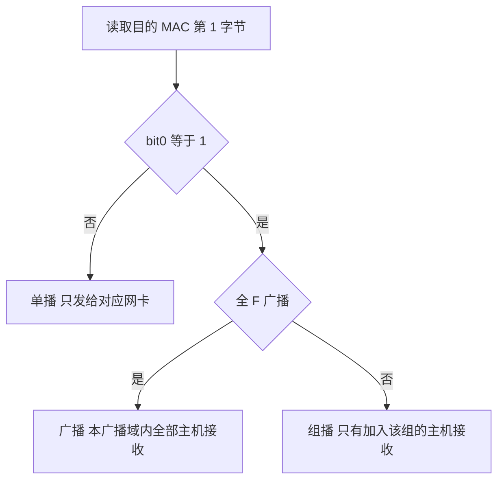

### 真题精练

**Q1.【真题·单选】** 以太网 II 帧中，若第 13、14 字节的值为 0x0806，则该帧承载的上层协议是？

A. IPv4  B. ARP  C. IPv6  D. 802.1Q

> **答案：B**
> **解析**：0x0800 为 IPv4，0x0806 为 ARP，0x86DD 为 IPv6，0x8100 为 802.1Q Tag。记忆技巧：0800 是 IPv4 的"经典值"，0806 与 0800 只差 6，对应 ARP。

**Q2.【真题·单选】** 下列关于以太网最小帧长 64 字节的说法，正确的是？

A. 64 字节包含前导码与 SFD  B. 64 字节由 CSMA/CD 的冲突检测要求决定
C. 数据字段不足 46 字节时直接丢弃  D. 最小帧长是为了提高带宽利用率

> **答案：B**
> **解析**：64 字节 = 目的 MAC 6 + 源 MAC 6 + Type 2 + 数据 46 + FCS 4，**不含 7 字节前导码与 1 字节 SFD**（故 A 错）。数据不足 46 字节时由网卡填充 Pad 到 46 字节（故 C 错）。最小帧长的根本目的是保证发送方在帧发送完成前能检测到最远端冲突，与带宽利用率无关（故 D 错）。

**Q3.【真题·判断】** 某 MAC 地址为 01-00-5E-00-00-05，因为第一字节的高位为 0，所以它是单播地址。

> **答案：错误**
> **解析**：判定单播/组播看的是第一字节的**最低位 I/G 位**。01 = 0000 0001，bit0 = 1，因此是**组播地址**（正是 VRRP 的虚拟 MAC）。这是最容易被"看高位"思维误导的经典陷阱。

**Q4.【真题·填空】** MAC 地址共 ________ bit，其中前 ________ bit 为 OUI，由 ________ 统一分配给设备厂商；802.1Q Tag 插入后以太网帧最大长度由 1518 字节变为 ________ 字节。

> **答案：48；24；IEEE（电气电子工程师学会）；1522**
> **解析**：OUI 24 bit 唯一标识厂商，后 24 bit 由厂商自由分配。插入 4 字节 802.1Q Tag 后帧长上限为 1500 + 14 + 4 + 4 = 1522 字节。

**Q5.【真题·简答】** 说明 Ethernet II 与 IEEE 802.3 帧的判定方法，并解释为什么今天网络中几乎全部使用 Ethernet II 帧。

> **答案**：二者前 12 字节相同，看第 13、14 字节的值：≥ 0x0600（1536）判定为 Type（Ethernet II），≤ 1500 判定为 Length（802.3），1501~1535 未定义。原因是 Ethernet II 用 2 字节 Type 直接标识上层协议，解析开销小、实现简单；而 802.3 需要额外解析 LLC/SNAP 头才能知道上层协议，效率低且被 TCP/IP 体系弃用。LLC/SNAP 仅在 STP BPDU 等少数控制帧中保留。

**Q6.【真题·排错】** 某接入交换机下终端访问服务器时丢包严重，`display interface GigabitEthernet0/0/1` 显示大量 CRC 错误（CRC error）计数增长。请判断故障层次并给出排查方向。

> **答案**：CRC 错误属于**物理层/数据链路层**故障。CRC 计数增长说明帧在校验时失败而被丢弃，常见原因：① 网线质量差、水晶头压接不良、线序错误；② 网线过长（双绞线超过 100 m）或与强电同槽引入干扰；③ 两端速率/双工不匹配（一端自协商、一端强制，易出现大量 CRC 与 Late Collision）；④ 光模块/光纤脏污或衰减超标。排查步骤：先两端核对 `display interface` 的 Duplex 与 Speed 是否一致，强制模式要两端同时强制；再更换跳线与端口，最后查光路。**注意**：CRC 错帧会被直接丢弃，不会触发 TCP 重传之外的任何机制，因此应用层表现为"变慢"而不是"不通"。

### 易错点与排错

- **陷阱 1**：把 1518 当成"含 VLAN Tag 的最大帧长"。标准以太网 II 帧上限 1518 字节，带 Tag 后是 1522 字节。
- **陷阱 2**：误认为 FCS 能被用来纠错。FCS 只能检错，以太网对错帧**直接丢弃**。
- **陷阱 3**：把 OUI 记成 16 bit 或 32 bit。OUI 是 24 bit。
- **陷阱 4**：认为广播帧也会被路由器转发。路由器**默认隔离广播域**，不转发广播帧（除定向广播且开启 ip directed-broadcast 的极特殊场景）。
- **排错命令**：`display interface GigabitEthernet0/0/1` 看 `CRC error`、`Giants`、`Runts`、`Jabbers`、`Collisions`；`display mac-address` 看是否有 MAC 漂移（同 MAC 出现在多个端口）；`display interface | include error`。

---

## 1.3 ARP 工作原理、ARP 表与免费 ARP

### 考点定位

ARP 是"IP 到 MAC"的桥梁，校赛常考 ARP 请求/应答的**发送方式**（广播请求、单播应答）与**目的地址填写规则**（请求帧的目的 MAC 是全 F，目的 IP 是被请求主机 IP）；省赛常考**免费 ARP 的三大作用**、**ARP 代理**、**ARP 表老化时间**、以及跨网段通信时"根本不解析对端 MAC，只解析网关 MAC"这一关键结论。ARP 欺骗与 DAI（动态 ARP 检测）常在安全章节交叉出现。

### 原理精讲

**为什么需要 ARP？** 以太网在数据链路层靠 MAC 寻址，而应用程序只知道对端的 IP。ARP（Address Resolution Protocol，地址解析协议）解决的问题就是：**在同一个广播域内，把已知的 IP 地址解析为对应的 MAC 地址**。ARP 直接封装在以太网帧上（Type = 0x0806），没有 IP 头，因此它不是"IP 之上"的协议。

**ARP 报文格式**：以太网帧头（目的 MAC + 源 MAC + 0x0806）+ ARP 报文（硬件类型 2B、协议类型 2B、硬件地址长度 1B、协议地址长度 1B、操作码 2B、发送方 MAC 6B、发送方 IP 4B、目的 MAC 6B、目的 IP 4B）。操作码 1 = ARP Request，2 = ARP Reply，3 = RARP Request，4 = RARP Reply。

**请求与应答的关键细节**：

- **ARP 请求**：因为发送方还不知道对端 MAC，无法单播，只能**广播**——以太网帧的目的 MAC 填 `FF-FF-FF-FF-FF-FF`，ARP 报文中的目的 MAC 字段填 0（未知），目的 IP 填**被请求主机的 IP**。同一广播域（同 VLAN）内所有主机都会收到该广播帧，但只有 IP 匹配的那台主机才会回应。
- **ARP 应答**：请求方 MAC 已通过请求报文的"发送方 MAC"字段暴露，因此应答**可以直接单播**（目的 MAC = 请求方 MAC）。

**ARP 表（ARP 缓存）**：每台设备维护"IP → MAC"映射表，表项类型有动态（Dynamic，通过 ARP 报文自动学习，默认老化时间 **1200 秒 = 20 分钟**，华为可通过 `arp expire-time` 修改）与静态（Static，手工配置或由 DHCP Snooping/DAI 下发，**永不过期**）。为什么要有 ARP 缓存？如果每发一个包都广播一次 ARP，会把广播域打爆、并引入每包一次的解析时延；缓存之后绝大多数报文可以直接查表转发。**ARP 学习的一个重要机制**：设备收到任何 ARP 报文（请求或应答）都会把其中的"发送方 IP + 发送方 MAC"写入或刷新自己的 ARP 表——这个特性正是 **ARP 欺骗（ARP Spoofing）**的根源：攻击者不断发送伪造的 ARP 应答，抢占网关 IP 对应的 MAC 映射，实现中间人攻击。

**免费 ARP（Gratuitous ARP，华为也写作"无故 ARP"）**：指设备**主动发送**的、请求自己 IP 对应 MAC 的 ARP 请求（发送方 IP = 目的 IP = 自己）。它的三大作用：

1. **IP 地址冲突检测**：接口配置 IP 后（或手工 `arp gratuitous-send` 触发）发送免费 ARP，如果收到应答，说明网络中已有人使用该 IP，设备会打印冲突告警。
2. **通告 MAC 变化 / 刷新邻居缓存**：接口 MAC 变化、VRRP 主备切换、堆叠主备倒换时，新主用设备发送免费 ARP，让同网段其他设备的 ARP 表立即更新到新 MAC，避免流量继续发往旧 MAC 导致断流。
3. **保持映射有效**：周期性发送可防止对端 ARP 表项老化。

严格来说还有 **ARP Announcement**（不请求、纯通告的 ARP），华为通过 `arp gratuitous-send interval` 控制免费 ARP 的发送间隔。

**ARP 代理（ARP Proxy）**：当两台主机被划分到**不同的物理网络/子网**（但配置了同一网段 IP，例如同一网段被两层交换机隔离，或子接口/VLAN 场景）时，主机发出的 ARP 请求无法穿越三层边界到达对端。此时由**网关设备**代为应答：网关在自己的 ARP 表或路由表中查到目标可达，就用**自己的 MAC** 回复请求方。请求方于是把网关 MAC 当作对端 MAC，把数据发给网关，由网关路由转发——这就是"**代理**"的含义。华为相关命令：

- `arp-proxy enable`：**同网段 ARP 代理**（路由式代理），在接口/VLANIF 下开启，适用于同一网段跨越不同物理网络的情况。
- `arp-proxy inter-sub-vlan-proxy enable`：**VLAN 内 ARP 代理**（同一 VLAN 内的端口隔离场景，让隔离端口之间通过网关通信）。
- 注意 `arp-proxy enable` 与 **ARP 代理网关**（`ip address` 配合）不要与"三层交换机默认行为"混淆：三层交换机做 VLAN 间路由时，主机请求的是**自己网关的 MAC**，那不是 ARP 代理，而是正常的同网段 ARP 解析。

**跨网段通信的铁律**：主机 A（10.1.1.1/24）ping 主机 B（10.2.2.2/24）时，A 发现目的 IP 与自己不在同一网段，于是**不会**去解析 B 的 MAC，而是解析**自己网关的 MAC**；数据帧的目的 MAC = 网关 MAC，目的 IP = B 的 IP。因此"跨网段通信时源和目的 MAC 是逐跳变化的，源和目的 IP 是不变的（无 NAT 时）"。

### 关键概念对照表

| ARP 报文类型 | 以太网目的 MAC | ARP 中的目的 MAC | 目的 IP | 发送方式 |
|---|---|---|---|---|
| ARP Request | FF-FF-FF-FF-FF-FF | 0000-0000-0000 | 被请求主机 IP | 广播 |
| ARP Reply | 请求方 MAC | 请求方 MAC | 请求方 IP | 单播 |
| 免费 ARP（请求式） | FF-FF-FF-FF-FF-FF | 0000-0000-0000 | 自己的 IP | 广播 |
| 免费 ARP（通告式） | FF-FF-FF-FF-FF-FF | FF-FF-FF-FF-FF-FF | 自己的 IP | 广播 |

| 项目 | 取值 / 说明 |
|---|---|
| 操作码 | 1 Request、2 Reply、3 RARP Request、4 RARP Reply |
| 以太网 Type | 0x0806 |
| 华为 ARP 表动态老化时间 | 默认 1200 秒（20 分钟），`arp expire-time` 可改 |
| 静态 ARP 表项 | 不老化，`arp static ip mac` |
| 免费 ARP 常见触发点 | 接口配置 IP、VRRP 切换、堆叠主备倒换、手工触发 |
| 免费 ARP 三大作用 | 检测 IP 冲突、通告 MAC 变化、刷新邻居 ARP 表 |
| ARP 代理命令 | `arp-proxy enable`（同网段代理）、`arp-proxy inter-sub-vlan-proxy enable`（VLAN 内代理） |
| 表项类型 | Dynamic（动态学习）、Static（静态配置）、Interface（本机接口） |

### 华为设备配置

```bash
<Huawei> display arp all                        // 查看全部 ARP 表项，含 IP、MAC、过期时间、类型、接口
<Huawei> display arp 10.1.1.2                   // 精确查询某个 IP 的 ARP 映射
<Huawei> display arp statistics all             // 查看动态/静态表项数量与老化统计
<Huawei> reset arp dynamic                      // 清空动态 ARP 表项，排错时强制重新学习（会短暂影响转发）
[Huawei] arp expire-time 600                    // 系统视图下把动态 ARP 老化时间改为 600 秒
[Huawei] arp static 10.1.1.100 00e0-fc12-3456   // 配置静态 ARP，防止仿冒、加快首次转发
[Huawei] interface Vlanif 10                    // 进入 VLANIF 接口视图
[Huawei-Vlanif10] arp-proxy enable              // 开启同网段 ARP 代理，隔离但同网段的终端可互通
[Huawei-Vlanif10] arp-proxy inter-sub-vlan-proxy enable  // 开启 VLAN 内 ARP 代理，配合端口隔离使用
[Huawei-GigabitEthernet0/0/1] arp gratuitous-send interval 60  // 每 60 秒发送一次免费 ARP 刷新邻居表
```

```bash
<Huawei> terminal monitor                       // 打开终端信息显示，否则 debug 信息不输出到屏幕
<Huawei> terminal debugging                     // 打开终端调试信息开关
<Huawei> debugging arp packet                   // 打开 ARP 报文调试（生产环境慎用，CPU 消耗大）
<Huawei> undo debugging all                     // 排错完毕立即关闭全部调试
```

### 示意图

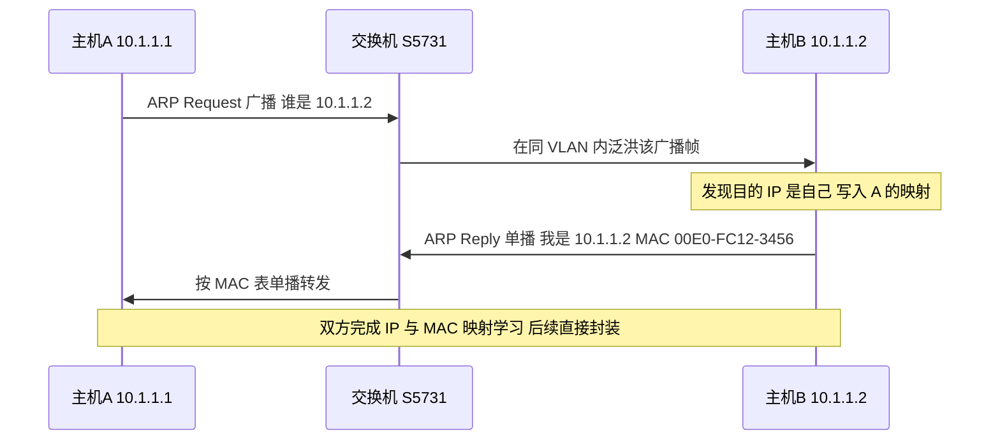

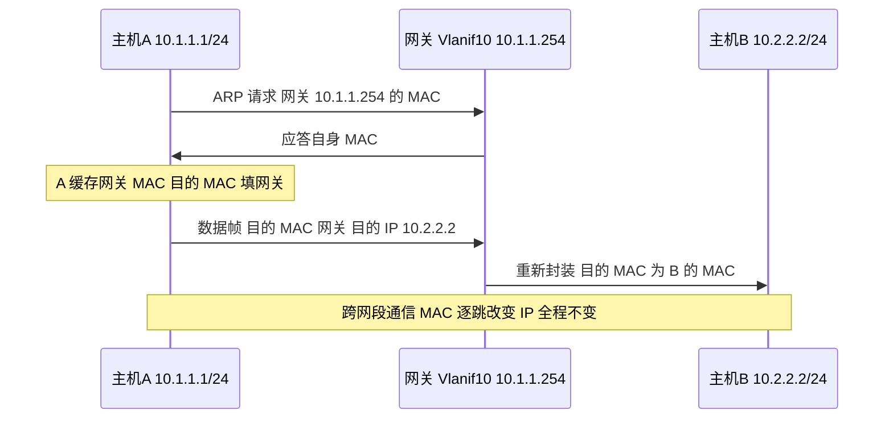

### 真题精练

**Q1.【真题·单选】** 主机 A（10.1.1.1/24）需要访问 10.2.2.2，发出的 ARP 请求中，目的 IP 地址字段应填写？

A. 10.1.1.1  B. 10.1.1.254（网关）  C. 10.2.2.2  D. 255.255.255.255

> **答案：B**
> **解析**：A 判断目的 IP 与自己不在同一网段（10.2.2.2/24 的网段是 10.2.2.0），因此**不解析对端 MAC，而是解析网关 MAC**。ARP 请求的目的 IP 只能是同网段的地址，跨网段必须靠网关转发。D 是"本地广播地址"，不能作为 ARP 请求的目的 IP 使用。

**Q2.【真题·多选】** 免费 ARP（Gratuitous ARP）的典型作用包括？（多选）

A. 检测 IP 地址冲突  B. 通告 MAC 地址变化，刷新邻居 ARP 表
C. 触发 DHCP 重新获取地址  D. 在 VRRP 主备切换后尽快恢复流量

> **答案：ABD**
> **解析**：免费 ARP 请求自己 IP 对应的 MAC，若收到应答即说明 IP 冲突（A 对）；发送方 MAC 字段携带新 MAC，接收方会刷新 ARP 表（B 对）；VRRP 主备倒换后新 Master 发送免费 ARP，让主机与上行设备立刻更新到虚拟 MAC 的真实承载者，避免流量黑洞（D 对）。免费 ARP 与 DHCP 无关（C 错）。

**Q3.【真题·判断】** ARP 应答报文的目的 MAC 必须是广播地址，因为请求方可能不在同一网段。

> **答案：错误**
> **解析**：ARP 只工作在**同一广播域/同一网段**内，请求方一定同网段。请求报文的"发送方 MAC"字段已经把请求方 MAC 告诉了所有接收者，因此应答可以**直接单播**。广播应答会无谓消耗带宽。

**Q4.【真题·填空】** 华为设备动态 ARP 表项的默认老化时间是 ________ 秒；清空所有动态 ARP 表项的命令是 ________。

> **答案：1200；reset arp dynamic**
> **解析**：1200 秒 = 20 分钟。静态 ARP 表项永不老化，需用 `undo arp static` 删除。清空 ARP 表会让后续流量需要重新广播解析，是高危操作，生产环境慎用。

**Q5.【真题·排错】** 网络中出现"部分用户无法上网，PC 上 `arp -a` 看到网关 IP 对应的 MAC 与真实网关 MAC 不一致"的现象。请判断可能的攻击类型、原理与华为设备上的防护手段。

> **答案**：这是典型的 **ARP 欺骗（中间人攻击）**。原理：攻击者持续向受害者发送伪造的 ARP 应答（声称"网关 IP 对应我的 MAC"）或向网关发送伪响应答（声称"受害者的 IP 对应我的 MAC"），由于设备收到 ARP 报文会无条件刷新缓存，双方流量都被引到攻击者主机，攻击者转发即可实现窃听/篡改。华为设备防护手段：① 接入交换机端口配置 **端口安全 + 静态 MAC/Sticky MAC**，限制端口学习 MAC 数量；② 部署 **DHCP Snooping** 生成合法绑定表；③ 开启 **DAI（Dynamic ARP Inspection，动态 ARP 检测）**，结合绑定表丢弃非法 ARP 报文；④ 划分 VLAN 缩小广播域，核心侧配置静态 ARP。排错命令：`display arp all`、`display mac-address`、`display dhcp snooping user-bind all`。

**Q6.【真题·简答】** 解释 ARP 代理（ARP Proxy）的使用场景，并说明它与三层交换机做 VLAN 间路由时的 ARP 行为的区别。

> **答案**：ARP 代理的使用场景是"两台主机配置了同一网段地址，但在物理上被隔离在不同广播域（不同 VLAN/子接口/不同物理网络）"。此时主机发出的 ARP 广播无法到达对端，网关代替对端应答，把自己的 MAC 返回给请求方。它与 VLAN 间路由的区别：VLAN 间路由时主机请求的是**自己网关的 IP 对应的 MAC**，应答内容就是网关自身 MAC，属于正常的同网段 ARP 解析，不涉及"代答"；而 ARP 代理是请求方请求的是**对端主机的 IP**，网关以自身 MAC 冒充应答，两者请求的目标 IP 性质不同。

### 易错点与排错

- **陷阱 1**：误以为跨网段通信时会解析对端主机 MAC。跨网段**只解析网关 MAC**。
- **陷阱 2**：把 ARP 的 Type 记成 0x0800。ARP 是 0x0806。
- **陷阱 3**：觉得 ARP 应答也能从任意主机发出。只有 IP 匹配的主机才会应答，但**任何主机都可以伪造 ARP 应答**（以太网无认证），这是安全章节的考点。
- **陷阱 4**：把 ARP 表与 MAC 地址表搞混。ARP 表是"IP ↔ MAC"（三层概念，存在于主机与三层设备），MAC 地址表是"MAC ↔ 端口/VLAN"（二层概念，存在于交换机）。
- **排错命令**：`display arp all`、`reset arp dynamic`、`display mac-address`（看 MAC 漂移）、`debugging arp packet` + `terminal monitor`（抓 ARP 交互，用完 `undo debugging all` 关闭）。

---

## 1.4 IPv4 报文头部、分片与 ICMP

### 考点定位

IP 头部字段是"送分题中的细节题"：首部长度单位（4 字节）、片偏移单位（8 字节）、TTL 默认值、协议号取值、DF/MF 位含义几乎年年出现。分片计算题（给 MTU 与数据长度求分片数量与偏移）是校赛计算题主力。ICMP 部分常考 Type 值（8/0/3/11/5）、ping 与 tracert 的实现原理与参数。**最高频的错答是"分片在中间路由器重组"**——IP 分片只在目的主机重组。

### 原理精讲

IPv4 报文头部**固定部分 20 字节**，加上可选项最多 60 字节。各字段如下：

- **版本（Version，4 bit）**：IPv4 为 4，IPv6 为 6。接收方靠它决定交给哪个协议栈处理。
- **首部长度（IHL，4 bit）**：**以 4 字节为单位**，最小值 5（即 20 字节）、最大值 15（即 60 字节）。这就是为什么选项字段长度必须是 4 的整数倍，不足用填充字节补齐。
- **服务类型（TOS，8 bit）**：传统上 3 bit 优先级 + 4 bit TOS + 1 bit 保留；现代 DiffServ 划分为 **DSCP（6 bit）+ ECN（2 bit）**。华为在接口/流分类中用 `traffic classifier` + `if-match dscp` 标记，用于 QoS 调度。
- **总长度（Total Length，16 bit）**：**首部 + 数据**的总字节数，单位 1 字节，最大值 65535。用"总长度 − 首部长度 × 4"即得数据长度。注意以太网 MTU 1500 限制的是 IP 报文总长（含 IP 头）。
- **标识（Identification，16 bit）**：同一个原始报文的所有分片**共用同一个标识值**，目的主机靠它把分片归组。
- **标志（Flags，3 bit）**：bit0 保留必须为 0；**bit1 = DF（Don't Fragment，不分片）**，置 1 表示禁止分片，若转发时 MTU 不够则丢弃并回送 ICMP Type 3 Code 4（需要分片但 DF 置位），这正是 **PMTUD（路径 MTU 发现）**的基础；**bit2 = MF（More Fragments，还有分片）**，置 1 表示后面还有分片，最后一个分片的 MF = 0。
- **片偏移（Fragment Offset，13 bit）**：**以 8 字节为单位**，表示本分片数据在原始数据中的位置。**因为片偏移只有 13 bit，若以字节为单位最大只能表示 8191 字节，无法覆盖 65535 字节的数据，所以放大 8 倍**——这是"为什么单位是 8 字节"的官方解释；同时也决定了**除最后一片外，每片数据长度必须是 8 的整数倍**。
- **生存时间（TTL，8 bit）**：每经过一台三层设备减 1，减到 0 就丢弃并回送 ICMP 超时报文。作用是**防止路由环路导致报文永久循环**。各系统默认值不同：Windows 128、Linux/Unix 64、华为路由器 255、部分网络设备 255。**用 ping 的返回 TTL 可以粗略判断对端操作系统与经过的跳数**（如返回 125 说明原始 TTL 128，经过了 3 跳）。
- **协议（Protocol，8 bit）**：指明上层协议，1 = ICMP、2 = IGMP、6 = TCP、17 = UDP、47 = GRE、50 = ESP、51 = AH、89 = OSPF。
- **首部校验和（Header Checksum，16 bit）**：**只校验首部，不校验数据**（数据校验交给上层 TCP/UDP 校验和或以太网 FCS）。因为 TTL 每跳都变，路由器每转发一次都要重算首部校验和，这也解释了为什么它不校验数据——降低转发开销。
- **源/目的 IP 地址（各 32 bit）**：转发过程中**保持不变**（NAT 场景除外）。
- **可选项（Options）**：如记录路由、时间戳，实际网络中几乎不用，因为会走"慢路径"软件转发。

**分片（Fragmentation）与重组（Reassembly）**：当 IP 报文长度超过出接口 MTU 时，若 DF = 0 则分片。分片以**原始报文的数据部分**为对象，每片都复制一份原始 IP 头（并修改总长度、MF、片偏移、校验和），因此分片会带来额外开销。**重组只在目的主机进行，中间路由器不做重组**——原因是各分片可能走不同路径、到达顺序不定，若中间设备重组需要缓存与定时器，代价极高且违背"尽力而为"设计。

**分片计算示例**：MTU = 1500 字节，IP 头 20 字节，则每片最多携带 1480 字节数据；1480 是 8 的整数倍，可用。原始数据 3000 字节：

| 分片序号 | 数据长度 | 片偏移（单位 8 字节） | MF | 总长度 | 备注 |
|---|---|---|---|---|---|
| 第 1 片 | 1480 B | 0 | 1 | 1500 B | 偏移 = 0/8 = 0 |
| 第 2 片 | 1480 B | 185 | 1 | 1500 B | 偏移 = 1480/8 = 185 |
| 第 3 片 | 40 B | 370 | 0 | 60 B | 偏移 = 2960/8 = 370，最后一片不必是 8 的倍数 |

**ICMP（Internet Control Message Protocol，互联网控制报文协议）**是网络层的"差错与管理"协议，直接封装在 IP 中（协议号 1），**不承载用户数据**。它让路由器/主机能把"出问题了"告诉源主机，是 IP"尽力而为"设计的重要补充。常见类型（Type/Code）：

| Type | 名称 | 常见 Code | 用途 |
|---|---|---|---|
| 0 | Echo Reply（回显应答） | 0 | ping 的应答 |
| 3 | Destination Unreachable（目的不可达） | 0 网络不可达 / 1 主机不可达 / 3 端口不可达 / 4 需分片但 DF 置位 | 转发失败通知源 |
| 5 | Redirect（重定向） | 0/1/2/3 | 告知源主机有更优网关 |
| 8 | Echo Request（回显请求） | 0 | ping 的请求 |
| 11 | Time Exceeded（超时） | 0 TTL 超时 / 1 分片重组超时 | tracert 的实现基础 |
| 13/14 | Timestamp Request/Reply | 0 | 时间戳测量（极少用） |

**ping 原理**：源主机发送 ICMP Echo Request（Type 8），目的主机收到后回送 Echo Reply（Type 0）。因为 ICMP 请求由目的主机的 IP 层直接处理，**ping 通只证明三层可达**，不证明应用可用（TCP 80 端口可能被防火墙拦截）。ping 不通的常见原因：路由不可达（回 Type 3 Code 0/1）、被 ACL/防火墙丢弃（无任何回应，超时）、回程路由缺失（请求到了但回不来）、ARP 解析失败（同网段）。

**tracert（traceroute）原理**：源主机先发 TTL = 1 的探测报文，第 1 跳路由器 TTL 减为 0，丢弃报文并回送 ICMP 超时（Type 11），源主机由此获得第 1 跳地址；再发 TTL = 2 的报文获得第 2 跳……直到报文到达目的主机，目的主机回送 ICMP Echo Reply（或目的端口不可达的 Type 3 Code 3，UDP 实现方式）即结束。**tracert 显示的 `*` 通常表示该跳设备不回送 ICMP 超时报文**（很多运营商与安全设备会限速或静默丢弃），**不代表该跳不存在**。华为 tracert 默认使用 ICMP 方式（`tracert -I`？实际上华为 `tracert` 默认 ICMP，`-U` 使用 UDP）。

**常用参数（华为）**：ping 支持 `-a` 指定源 IP、`-c` 指定次数、`-s` 指定报文大小、`-f` 不分片（用于探测路径 MTU）、`-i` 指定出接口、`-t` 超时时间、`-vpn-instance` 指定 VPN 实例、`-tos` 指定 TOS。当需要测试 1500 MTU 时，用 `ping -s 1472 -f`（1472 + 20 IP 头 + 8 ICMP 头 = 1500）。

### 关键概念对照表

| IP 头字段 | 长度 | 单位/取值 | 关键结论 |
|---|---|---|---|
| 版本 | 4 bit | 4 = IPv4 | 决定协议栈 |
| 首部长度 IHL | 4 bit | 4 字节为单位 | 最小 5（20 B），最大 15（60 B） |
| TOS / DSCP+ECN | 8 bit | DSCP 6 bit + ECN 2 bit | QoS 标记 |
| 总长度 | 16 bit | 1 字节 | 最大 65535 |
| 标识 | 16 bit | — | 同一原报文的所有分片相同 |
| 标志 | 3 bit | DF / MF | DF = 1 禁止分片，MF = 1 后面还有分片 |
| 片偏移 | 13 bit | **8 字节** | 除最后一片外数据长度须为 8 的倍数 |
| TTL | 8 bit | 每跳减 1 | Windows 128、Linux 64、华为路由器 255 |
| 协议 | 8 bit | 协议号 | 1 ICMP、6 TCP、17 UDP、47 GRE、50 ESP、51 AH、89 OSPF |
| 首部校验和 | 16 bit | — | 只校验首部，每跳重算 |
| 源/目的地址 | 各 32 bit | — | 转发中不变（NAT 除外） |

| 对比项 | ping | tracert |
|---|---|---|
| 实现协议 | ICMP Echo Request/Reply | ICMP 超时 + Echo Reply（或 UDP + 端口不可达） |
| 核心机制 | 直接收发 Echo 报文 | TTL 从 1 递增，逐跳触发超时报文 |
| 输出内容 | 时延、丢包率、TTL | 每一跳的地址与三次时延 |
| 典型失败表现 | Request time out / Destination unreachable | 某跳显示 `*` |
| 华为常用参数 | `-a` 源地址、`-c` 次数、`-s` 大小、`-f` 不分片 | `-a` 源地址、`-m` 最大跳数、`-w` 超时 |

| 常见 MTU 场景 | 数值 | 说明 |
|---|---|---|
| 以太网默认 MTU | 1500 B | 含 IP 头 |
| 以太网帧最大 | 1518 B | 14 头 + 1500 数据 + 4 FCS |
| PPPoE 环境 MTU | 1492 B | 8 字节 PPPoE 头占用 |
| TCP MSS（MTU 1500） | 1460 B | 1500 − 20 IP − 20 TCP |
| TCP MSS（PPPoE 1492） | 1452 B | 1492 − 20 − 20 |
| ICMP 探测不分片时的 -s | 1472 B | 1472 + 20 + 8 = 1500 |

### 华为设备配置

```bash
<Huawei> ping -a 10.1.1.1 -c 5 10.2.2.2          // 指定源地址发送 5 个 ICMP 探测包
<Huawei> ping -s 1472 -f 10.2.2.2                // 发送 1472 字节且不分片的探测包，验证路径 MTU 是否为 1500
<Huawei> tracert -a 10.1.1.1 -m 10 10.3.3.3      // 从本机 10.1.1.1 出发，最多 10 跳跟踪到目标
[Huawei] interface GigabitEthernet0/0/0          // 进入物理接口视图
[Huawei-GigabitEthernet0/0/0] mtu 1400           // 修改接口 MTU，影响分片行为（两端需一致，否则易出问题）
[Huawei-GigabitEthernet0/0/0] ip address 10.1.1.1 255.255.255.0  // 配置三层地址
[Huawei] ip ttl-expires enable                   // 开启 TTL 超时报文回送（部分版本默认关闭，影响 tracert 显示）
[Huawei] ip unreachables enable                  // 开启目的不可达报文回送，ping 才能看到明确不可达原因
<Huawei> display ip interface GigabitEthernet0/0/0  // 查看接口 MTU、收发字节数与错误统计
<Huawei> display ip routing-table                // 确认去往目的网段是否有路由，ping 不通先查路由
```

### 示意图

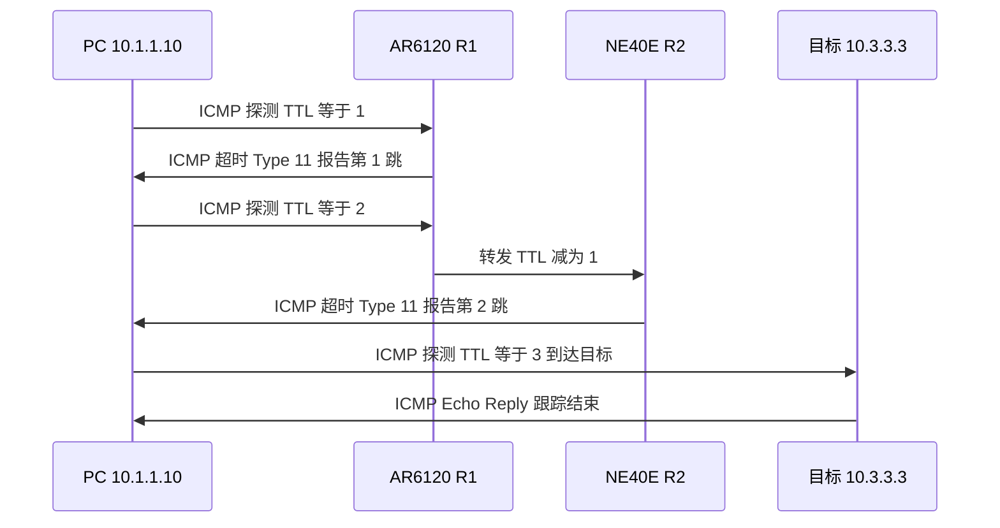

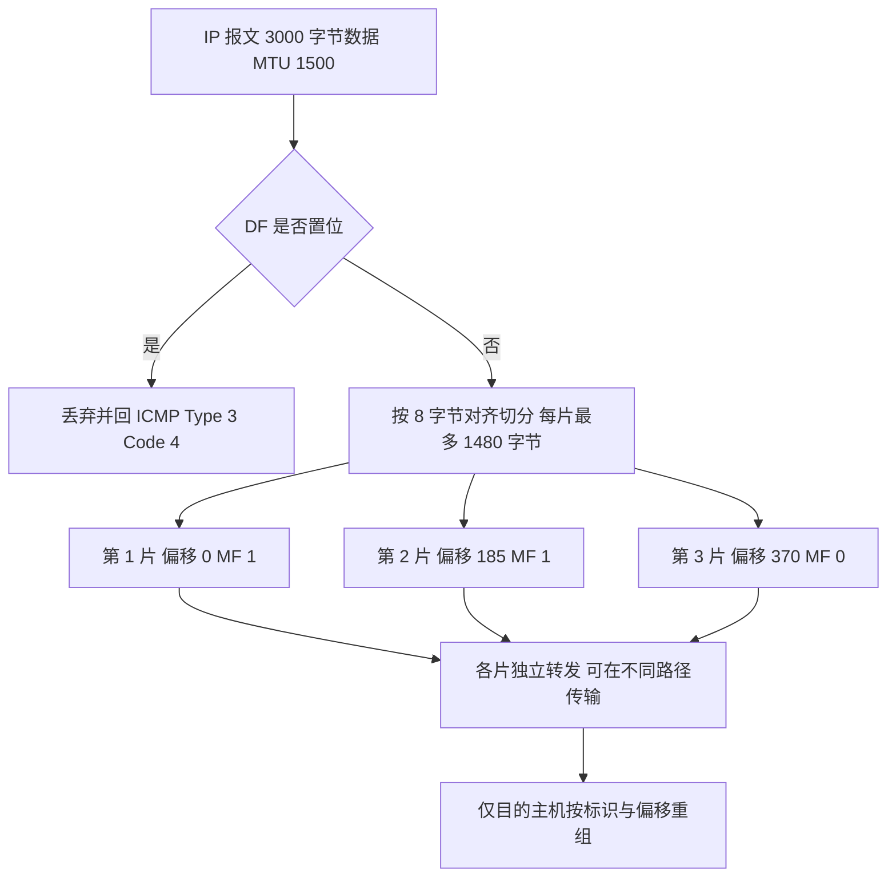

### 真题精练

**Q1.【真题·单选】** IPv4 报文头部中，片偏移字段的单位是？

A. 1 字节  B. 4 字节  C. 8 字节  D. 32 字节

> **答案：C**
> **解析**：片偏移 13 bit，若以字节为单位只能表示 0~8191，无法覆盖最大 65535 字节的数据，因此以 8 字节为单位，可表示到 65528 字节。对比记忆：**首部长度以 4 字节为单位，片偏移以 8 字节为单位**——这是最经典的一对易混点。

**Q2.【真题·单选】** 使用 ping 命令返回的 TTL 值为 125，则对端主机最可能的操作系统是？

A. Linux  B. Windows  C. 华为路由器  D. 无法判断

> **答案：B**
> **解析**：Windows 默认 TTL = 128，经过 3 跳后为 125。Linux 默认 64（经过 3 跳应显示 61），路由器常用 255。注意 TTL 可被修改，因此只是"粗略判断"，严格判断需查其他指纹。

**Q3.【真题·填空】** MTU 为 1500 字节时，携带 3000 字节数据的 IP 报文（DF = 0）会被分成 ________ 片，第 2 片的片偏移字段值为 ________。

> **答案：3；185**
> **解析**：每片最多 1500 − 20 = 1480 字节数据，且须为 8 的倍数，1480 满足。3000 = 1480 + 1480 + 40，共 3 片。第 2 片数据起始于原始数据的第 1480 字节处，偏移 = 1480 ÷ 8 = 185。

**Q4.【真题·多选】** 关于 IP 分片与重组，下列说法正确的有？（多选）

A. 分片只发生在数据部分，每片都复制原始 IP 头并修改部分字段
B. 中间路由器收到分片后进行重组，再继续转发
C. 重组只在目的主机进行
D. DF 位置 1 时若 MTU 不足，路由器丢弃报文并回送 ICMP 类型 3 代码 4

> **答案：ACD**
> **解析**：B 错误。中间路由器**不重组**，因为各分片可走不同路径、到达顺序不定，中间重组需大量缓存与超时定时器，代价过高。重组由目的主机依据"标识 + 片偏移 + MF"完成。

**Q5.【真题·简答】** 解释 tracert 的工作原理，并说明为什么有时某一跳显示为 `*` 却仍能跟踪到后续跳。

> **答案**：tracert 利用 TTL 逐跳递减触发 ICMP 超时报文：先发 TTL = 1 的探测包，第 1 跳路由器把 TTL 减为 0 后丢弃并回送 ICMP Type 11，从而暴露自己的地址；源主机再把 TTL 加 1 重复，直到探测包到达目的主机并收到 Echo Reply（或 UDP 实现方式下收到端口不可达）。某跳显示 `*` 是因为该设备**配置为不回送 ICMP 超时报文或对 ICMP 生成做了限速/抑制**（出于安全与 CPU 保护考虑很常见），但它**仍然正常转发了探测包**，所以后续跳依然能被跟踪到。因此 `*` 不等于链路中断。

**Q6.【真题·排错】** 两台主机在同一网段，`ping` 对端显示 "Request time out"，但 `display arp all` 能看到对端表项。请分析可能原因与排查思路。

> **答案**：ARP 有表项说明二层可达、ARP 解析成功，问题出在三层或上层：① **对端开启了防火墙/ACL 丢弃 ICMP**，此时现象通常是"超时无回应"，可换 `tracert` 或用 TCP 端口探测（如 `telnet 对端 80`）验证；② **对端配置了 `ip unreachables` 关闭导致无差错回报**，现象同样是超时；③ 本机或对端接口 `shutdown`/协议未 Up，但 ARP 表为残留老化表项；④ IP 地址/掩码配置错误导致回程路由不可达（对端把应答发给了错误的网关）。排查顺序：`display ip interface brief` 看接口状态 → `display arp all` 看映射 → 对端 `display acl all` / `display current-configuration | include acl` 检查过滤 → 双方抓包确认 Echo Request 是否到达、Reply 是否发出。

### 易错点与排错

- **陷阱 1**：认为分片在中间路由器重组。**只在目的主机重组**。
- **陷阱 2**：把首部长度与片偏移的单位记反（4 字节 vs 8 字节）。
- **陷阱 3**：以为 TTL 的默认值全网统一。Windows 128、Linux 64、路由器 255 各不相同。
- **陷阱 4**：把 ICMP Type 3（目的不可达）与 Type 11（超时）混淆；ping 失败常看到 Type 3 Code 1（主机不可达）。
- **陷阱 5**：以为 ping 通就代表业务可用。ping 只验证三层，业务端口可能被防火墙拦截。
- **排错命令**：`ping -s 1472 -f`（测 MTU）、`tracert`（定位断点）、`display ip interface`（看 MTU 与错误计数）、`display ip routing-table`（看路由）、`display acl all`（看过滤规则）。

---

## 1.5 TCP 协议：三次握手、四次挥手与状态机

### 考点定位

TCP 是传输层绝对核心，校赛必考，省赛常以多选与简答出现。高频点：三次握手/四次挥手报文序号与标志位、SYN 与 FIN 各消耗一个序号、MSS = MTU − 40、窗口字段 16 bit 与窗口扩大选项、TIME_WAIT 与 2MSL、11 种状态迁移、流量控制与拥塞控制的区别。**最大的错答是把"四次挥手"说成"因为 TCP 不可靠所以要多两次"**——真正原因是 TCP 全双工，一个方向关闭不影响另一个方向继续发数据。

### 原理精讲

**TCP（Transmission Control Protocol，传输控制协议）**通过"面向连接、可靠、有序、面向字节流"四个关键词概括。可靠性由四套机制共同保证：**序号与确认**（每个字节都有序号，接收方累积确认）、**超时重传**（RTO 基于 RTT 动态估算）、**滑动窗口**（流量控制，接收方通告可接收字节数）、**拥塞控制**（慢启动、拥塞避免、快重传、快恢复）。

**TCP 头部（最小 20 字节）**：源端口 16 bit、目的端口 16 bit、**序号（Sequence Number，32 bit）**、**确认号（Acknowledgment Number，32 bit）**、数据偏移 4 bit（以 4 字节为单位，含义同 IP 的 IHL）、保留 6 bit、**标志位 6 bit（URG / ACK / PSH / RST / SYN / FIN）**、**窗口（Window，16 bit）**、校验和 16 bit、紧急指针 16 bit、可选项（MSS、窗口扩大因子、SACK、时间戳）。

**为什么序号与确认号是"字节序号"而不是"报文序号"？** 因为 TCP 是**面向字节流**的：应用层写的 10 次数据可能被合并成一个报文段发送，也可能被拆开，接收方真正关心的是"字节 1000~1999 我收到了"。因此确认号 = 期望收到的**下一个字节的序号**（累积确认，表示"该序号之前的所有字节都收到了"）。

**序号消耗规则（考点）**：**SYN 占 1 个序号，FIN 占 1 个序号，普通数据按字节数消耗，纯 ACK 不占序号**。

**三次握手（Three-way Handshake）**：

1. 客户端发 **SYN = 1、seq = x**（随机初始序号 ISN），进入 SYN_SENT。此时不携带数据（除 TFO 场景）。
2. 服务端回 **SYN = 1、ACK = 1、seq = y、ack = x + 1**（因为 SYN 占 1 个序号），进入 SYN_RCVD。
3. 客户端回 **ACK = 1、seq = x + 1、ack = y + 1**，双方进入 ESTABLISHED。

**为什么是三次而不是两次？** 两次无法让服务端确认"客户端已收到我的 SYN 并确认了我的序号"，也就无法确认**客户端具备接收能力**。若只有两次，一个延迟到达的旧 SYN 会让服务端建立无用连接并浪费资源。第三次 ACK 的作用正是"确认服务端的 SYN 被收到"——这是双向确认的必然要求。同时，握手阶段双方交换 **MSS 选项**协商最大报文段长度，完成窗口大小与选项协商。

**SYN Flood 攻击**：攻击者伪造大量源 IP 发送 SYN，服务端为每个 SYN 分配半连接资源（SYN_RCVD 队列），回 SYN+ACK 后因源 IP 不存在而永远等不到 ACK，队列被占满导致正常用户无法连接。防护手段：**SYN Cookie**（不保存半连接状态，把状态编码进 ISN）、缩短 SYN_RCVD 超时、限制半连接数量、部署 AntiDDoS/防火墙。华为设备上可通过 `display tcp status` 观察异常的大量 SYN_RCVD 状态。

**四次挥手（Four-way Termination）**：

1. 主动关闭方发 **FIN = 1、seq = u**，进入 FIN_WAIT_1，表示"我没数据要发了"。
2. 被动关闭方回 **ACK = 1、ack = u + 1**，进入 CLOSE_WAIT。此时**半关闭**状态：主动方不再发数据，但被动方仍可继续发送数据。
3. 被动方数据发完，发 **FIN = 1、seq = w、ack = u + 1**，进入 LAST_ACK。
4. 主动方回 **ACK = 1、ack = w + 1**，进入 TIME_WAIT；被动方收到后进入 CLOSED。

**为什么是四次？** 因为 TCP 是全双工，收到对方的 FIN 只表示"对方没有数据要发了"，本方向可能还有数据要发，因此 ACK 与自己的 FIN 必须分开发送（第 2、3 步不能合并）。只有被动方也没有数据要发、且不需要等应用层处理完时，才可能把 ACK 与 FIN 合并成一次（称为"延迟确认 + 捎带 FIN"，表现为三次挥手）。

**TIME_WAIT 与 2MSL**：主动关闭方在 TIME_WAIT 状态需等待 **2MSL（Maximum Segment Lifetime，报文最大生存时间）**。两个原因：① **保证最后一个 ACK 能到达对端**——若该 ACK 丢失，对端会重发 FIN，此时主动方仍在 TIME_WAIT 可以重发 ACK，否则会回 RST 导致对端异常；② **让本次连接的迟到报文在网络中消亡**，避免它们被误认为属于新建立的、相同四元组的连接。MSL 常见取值 2 分钟（对应 2MSL = 4 分钟），Linux 实践中 TIME_WAIT 约 60 秒。**大量 TIME_WAIT 会耗尽本地端口**，可通过开启 `net.ipv4.tcp_tw_reuse` 等缓解；**大量 CLOSE_WAIT 说明应用没有调用 close()**，是典型的应用层 Bug。

**11 种状态**：CLOSED、LISTEN、SYN_SENT、SYN_RCVD、ESTABLISHED、FIN_WAIT_1、FIN_WAIT_2、CLOSE_WAIT、CLOSING、LAST_ACK、TIME_WAIT。排错时看状态就能定位问题在哪一端、哪一步。

**MSS 与 MTU 关系**：**MSS（Maximum Segment Size，最大报文段长度）= MTU − IP 头 − TCP 头**。以太网 MTU = 1500 时，MSS = 1500 − 20 − 20 = **1460**（无选项时）；若带 12 字节时间戳选项则为 1448。MSS 在握手时通过选项通告，**双方取较小值**。**为什么需要 MSS？** 如果 TCP 段大于 MTU，IP 层不得不分片，而分片会显著降低性能（任一片丢失就要重传整个报文，且中间设备不重组）。MSS 让 TCP 主动把段长限制在 MTU 之内，从源头避免分片——这是"TCP 层面避免 IP 分片"的设计智慧。

**流量控制 vs 拥塞控制（高频对比）**：流量控制是**接收方**通过窗口字段告知发送方"我还能收多少"，防止接收方被淹；拥塞控制是**发送方**根据网络状况（丢包、RTT）调整发送速率，防止网络被淹。拥塞控制四阶段：慢启动（cwnd 指数增长到 ssthresh）、拥塞避免（线性增长）、快重传（收到 3 个重复 ACK 立即重传丢失段，不等超时）、快恢复（ssthresh 减半后从新 ssthresh 开始拥塞避免）。窗口字段 16 bit 最大 65535，可用**窗口扩大因子（Window Scale，RFC 1323）**放大到 2^30，这是长肥管道（LFN）能达到高吞吐的关键。

### 关键概念对照表

| 标志位 | 全称 | 含义 |
|---|---|---|
| URG | Urgent | 紧急指针有效 |
| ACK | Acknowledgment | 确认号有效（连接建立后恒为 1） |
| PSH | Push | 提示接收方尽快交付应用层 |
| RST | Reset | 复位连接（异常关闭/拒绝连接） |
| SYN | Synchronize | 建立连接，消耗 1 个序号 |
| FIN | Finish | 释放连接，消耗 1 个序号 |

| 报文交互步骤 | 标志位 | 序号 | 确认号 | 状态迁移 |
|---|---|---|---|---|
| 握手 1 | SYN = 1 | seq = x | — | CLOSED → SYN_SENT |
| 握手 2 | SYN = 1，ACK = 1 | seq = y | ack = x + 1 | LISTEN → SYN_RCVD |
| 握手 3 | ACK = 1 | seq = x + 1 | ack = y + 1 | SYN_SENT/SYN_RCVD → ESTABLISHED |
| 挥手 1 | FIN = 1，ACK = 1 | seq = u | ack = 前一确认 | ESTABLISHED → FIN_WAIT_1 |
| 挥手 2 | ACK = 1 | seq = v | ack = u + 1 | → CLOSE_WAIT / FIN_WAIT_2 |
| 挥手 3 | FIN = 1，ACK = 1 | seq = w | ack = u + 1 | CLOSE_WAIT → LAST_ACK |
| 挥手 4 | ACK = 1 | seq = u + 1 | ack = w + 1 | LAST_ACK → CLOSED，主动方 → TIME_WAIT |

| 对比项 | TCP | UDP |
|---|---|---|
| 连接性 | 面向连接（三次握手） | 无连接 |
| 可靠性 | 序号 + 确认 + 重传 + 校验 | 仅校验和，尽力而为 |
| 有序性 | 保证按序交付 | 不保证 |
| 头部长度 | 最小 20 B（最大 60 B） | 固定 8 B |
| 传输方式 | 字节流（可拆可合） | 数据报（保留边界） |
| 流量/拥塞控制 | 有（滑动窗口 + 四阶段拥塞控制） | 无 |
| 典型应用 | HTTP、HTTPS、FTP、SSH、Telnet、SMTP | DNS、TFTP、DHCP、SNMP、RTP |
| 开销 | 大（20 B 头 + 握手 + 确认） | 小（8 B 头） |

| 关键参数 | 取值 | 说明 |
|---|---|---|
| TCP 头部最小长度 | 20 B | 最大 60 B（含选项） |
| 窗口字段 | 16 bit，最大 65535 | 窗口扩大因子可放大到 2^30 |
| MSS（MTU 1500） | 1460 B | 1500 − 20 − 20 |
| MSS（MTU 1500 + 时间戳选项 12 B） | 1448 B | 1500 − 20 − 20 − 12 |
| TIME_WAIT 等待 | 2MSL | 常见 MSL 2 分钟，即 4 分钟 |
| SYN/FIN 序号消耗 | 各 1 个序号 | 纯 ACK 不消耗 |
| RST 触发场景 | 端口未监听、连接异常、拒绝连接 | 上层立刻报错 |

### 华为设备配置

```bash
<Huawei> display tcp status                        // 查看本机所有 TCP 连接的四元组与状态（如 ESTABLISHED）
<Huawei> display tcp statistics                    // 查看 TCP 收发统计，排错时观察重传与复位次数
<Huawei> display tcp status | include SYN_RCVD     // 过滤查看半连接数量，辅助判断 SYN Flood
[Huawei] acl number 3000                           // 创建高级 ACL，用于按端口过滤 TCP 流量
[Huawei-acl-adv-3000] rule 5 permit tcp source 10.1.1.0 0.0.0.255 destination 10.2.2.0 0.0.0.255 destination-port eq 80  // 放通内网到服务器的 HTTP
[Huawei-acl-adv-3000] rule 10 deny tcp destination-port eq 3389   // 禁止外网 RDP，缩小攻击面
[Huawei-acl-adv-3000] quit
[Huawei] interface GigabitEthernet0/0/0            // 进入外网接口视图
[Huawei-GigabitEthernet0/0/0] traffic-filter inbound acl 3000      // 在入方向应用 ACL
<Huawei> display acl 3000                          // 查看 ACL 规则与每条的匹配计数，验证策略是否命中
<Huawei> display nat session all                   // 查看 NAT 会话表，可观察 TCP 会话状态与老化时间
```

### 示意图

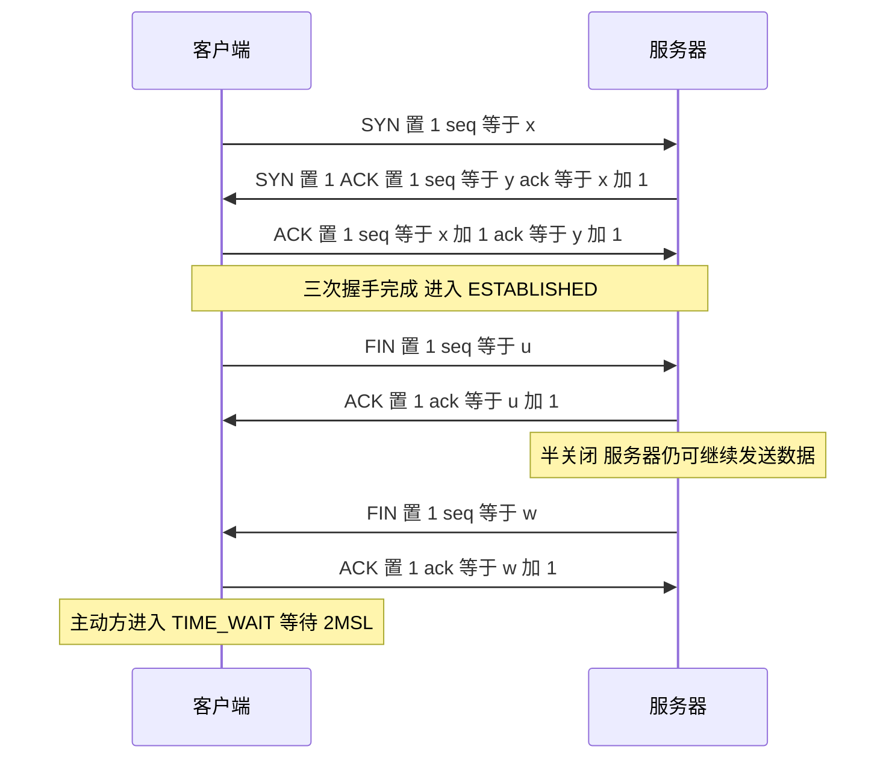

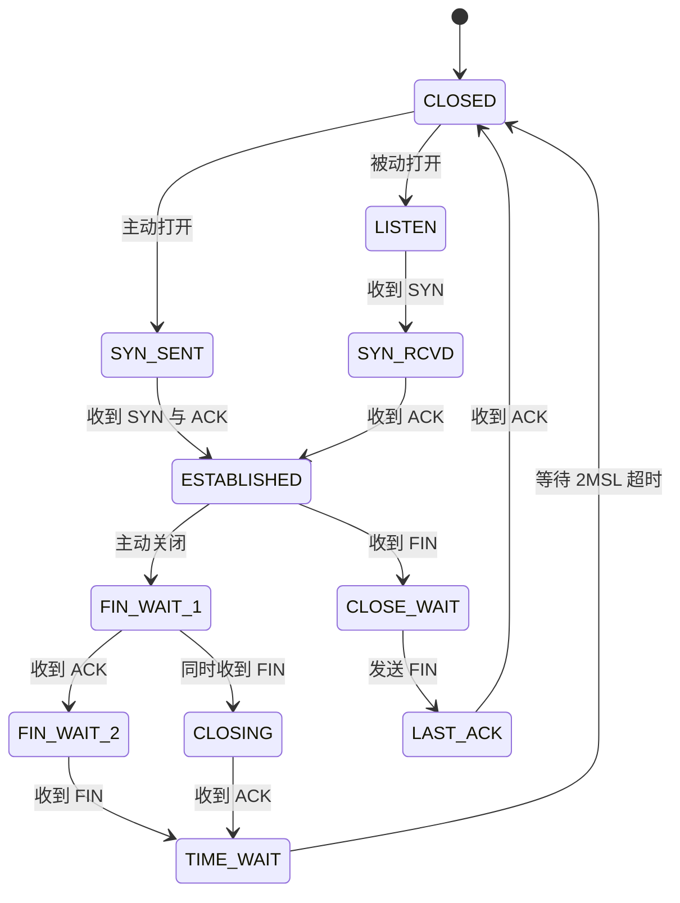

### 真题精练

**Q1.【真题·单选】** TCP 三次握手中，第二次握手报文的确认号（ack）应填写？

A. x  B. x + 1  C. y  D. y + 1

> **答案：B**
> **解析**：确认号 = 期望收到的下一个字节序号。第一次握手的 SYN 占 1 个序号，因此第二次握手的 ack = x + 1。这与"纯 ACK 不消耗序号"共同构成了序号计算题的解题基础。

**Q2.【真题·多选】** 关于 TCP 连接释放，下列说法正确的有？（多选）

A. FIN 报文消耗 1 个序号
B. 主动关闭方进入 TIME_WAIT 状态并等待 2MSL
C. 四次挥手是因为 TCP 是全双工，两个方向需分别关闭
D. 收到 RST 报文后连接正常释放，进入 TIME_WAIT

> **答案：ABC**
> **解析**：D 错误。RST 是**异常复位**，连接被立刻拆除且**不进入 TIME_WAIT**，典型场景是访问未监听端口或连接被中途拒绝。四次挥手（A、C）与 TIME_WAIT/2MSL（B）是标准考点。

**Q3.【真题·填空】** 以太网 MTU 为 1500 字节时，TCP 的 MSS 通常为 ________ 字节；TCP 头部的窗口字段长度为 ________ bit。

> **答案：1460；16**
> **解析**：MSS = MTU − 20（IP 头）− 20（TCP 头）= 1460。若握手时携带 12 字节时间戳选项，MSS 常见为 1448。窗口字段 16 bit 最大表示 65535 字节，需窗口扩大因子才能支持更大窗口。

**Q4.【真题·判断】** 主机上出现大量 CLOSE_WAIT 状态的连接，说明该主机遭遇了 SYN Flood 攻击。

> **答案：错误**
> **解析**：大量 **CLOSE_WAIT** 说明**应用层收到对端 FIN 后没有调用 close() 关闭套接字**，是应用代码 Bug 或应用处理阻塞，与 SYN Flood 无关。SYN Flood 的表现是服务端出现大量 **SYN_RCVD** 半连接。大量 **TIME_WAIT** 则通常是本地主动关闭了大量短连接所致。

**Q5.【真题·简答】** 说明 TCP 流量控制与拥塞控制的区别，并解释为什么需要 MSS。

> **答案**：流量控制关注**接收方**的处理能力：接收方通过 TCP 头中的窗口字段通告自己还能接收多少字节（接收窗口 rwnd），发送方据此调整发送量，避免接收缓冲区溢出。拥塞控制关注**网络**的承载能力：发送方维护拥塞窗口 cwnd，通过慢启动、拥塞避免、快重传、快恢复，依据丢包与 RTT 判断网络拥塞程度并调整速率，实际发送窗口 = min(rwnd, cwnd)。需要 MSS 的原因是：TCP 段若超过链路 MTU，IP 层必须分片，而分片会带来额外头部开销、任一分片丢失都要重传整个报文、且中间设备不重组导致效率下降。握手时双方交换 MSS 选项并取较小值，使 TCP 主动把段长限制在 MTU 之内，从源头避免 IP 分片。

**Q6.【真题·排错】** 某服务器对外提供 Web 服务，用户反映"网页打开慢，偶尔失败"。抓包发现服务端返回大量 IP 分片报文且 TCP 重传频繁。请分析原因与优化方向。

> **答案**：出现 IP 分片说明发送的 TCP 段超过了路径 MTU，通常因为**握手时 MSS 协商值过大**或**中间链路 MTU 小于 1500**（如 PPPoE 环境 1492、隧道封装后 MTU 降低）而 PMTUD 又因 ICMP 被过滤而失效。分片后任一片丢失都要重传整个报文，因此表现为"重传频繁、网页慢"。优化方向：① 在服务器/网关接口下调 MTU（如 1400）；② 开启并放通 ICMP 以实现 PMTUD；③ 服务器侧限制 MSS（华为设备可在接口用 `tcp adjust-mss` 调整经过的 TCP SYN 中通告的 MSS），使 TCP 段不含分片；④ 排查链路是否存在隧道或 PPPoE 封装。验证：`ping -s 1472 -f` 若失败而 `ping -s 1400 -f` 成功，则路径 MTU 小于 1500。

### 易错点与排错

- **陷阱 1**：把三次挥手当成标准。只有"延迟确认且捎带 FIN"时才会合并为三次，标准是四次。
- **陷阱 2**：忘记 SYN 与 FIN 各消耗 1 个序号，导致序号计算题连错。
- **陷阱 3**：把 TIME_WAIT 说成"等待对端重传"。真正目的是保证最后 ACK 可达 + 让旧报文消亡。
- **陷阱 4**：混淆 CLOSE_WAIT（应用没关）与 TIME_WAIT（主动关闭后正常等待），排错方向完全相反。
- **陷阱 5**：把 MSS 当成"MTU 减去 40"的绝对公式。PPPoE、隧道、选项都会改变这个值。
- **排错命令**：`display tcp status`（看连接状态分布）、`display tcp statistics`（看重传与复位）、`display acl 3000`（看端口过滤是否命中）、`ping -s 1472 -f`（验证 MTU）。

---

## 1.6 UDP、端口号与协议号速查、CRC 与 CSMA/CD

### 考点定位

端口号与协议号是纯记忆题，属于"背了就有分"的题型，几乎每套卷都会出现 1~3 道。UDP 头部 8 字节、四大字段、无连接特性常以填空/判断出现。CSMA/CD 与 CRC 属于以太网底层常识，常考"最小帧长 64 字节的由来""CRC 只能检错不能纠错""全双工下 CSMA/CD 失效"这几个结论。建议把本节的四张表当作考前必背清单。

### 原理精讲

**UDP（User Datagram Protocol，用户数据报协议）头部固定 8 字节**，只有 4 个字段：源端口（16 bit）、目的端口（16 bit）、长度（16 bit，UDP 头 + 数据的总长）、校验和（16 bit，覆盖伪首部 + UDP 头 + 数据）。UDP 的"无连接、不可靠、不保证顺序、保留报文边界"是**特性而不是缺陷**：它把可靠性判断交给应用层，换来的是**极低的时延与开销**（无握手、无确认、无重传、无拥塞控制窗口），因此特别适合：

- **一次请求一次应答的短交互**：DNS（UDP 53）绝大多数查询用 UDP，超长响应（>512 字节且不含 EDNS0）才会回 TC 标志让客户端改用 TCP 重试；
- **广播/组播类协议**：DHCP（UDP 67/68）、TFTP（UDP 69）、SNMP 与 Trap（UDP 161/162）无法用 TCP 做广播；
- **实时流媒体**：RTP/RTCP 用 UDP，丢一帧比延迟重传更划算；
- **隧道封装**：VXLAN（UDP 4789）、IPSec NAT-T（UDP 4500）等。

**端口号（Port）**是传输层用于区分进程的 16 bit 标识，范围 0~65535，分三类：**知名端口 0~1023**（IANA 分配固定用途）、**注册端口 1024~49151**、**动态/临时端口 49152~65535**。**一条 TCP 连接由"源 IP + 源端口 + 目的 IP + 目的端口 + 协议号"五元组唯一标识**，因此服务器可以用同一个 80 端口同时服务成千上万个客户端（靠不同的客户端 IP 与端口区分）。**服务器使用知名端口，客户端使用随机动态端口**——这是分析抓包时的基本判断依据。

**必须记忆的端口号表**：

| 协议 | 端口 | 传输层 | 说明 |
|---|---|---|---|
| FTP 数据 | 20 | TCP | 主动模式服务器用 20 端口连客户端 |
| FTP 控制 | 21 | TCP | 命令通道，主动/被动模式共用 |
| SSH | 22 | TCP | 加密远程登录，华为 Stelnet |
| Telnet | 23 | TCP | 明文远程登录 |
| SMTP | 25 | TCP | 邮件发送 |
| DNS | 53 | **TCP + UDP** | 常规查询用 UDP，区域传送与超长响应用 TCP |
| DHCP 服务端/客户端 | 67 / 68 | UDP | 67 为服务器，68 为客户端 |
| TFTP | 69 | UDP | 简单文件传输，用于设备升级 |
| HTTP | 80 | TCP | 明文 Web |
| POP3 | 110 | TCP | 邮件接收 |
| SNMP / Trap | 161 / 162 | UDP | 161 轮询、162 告警上报（SNMPv3 可加认证加密） |
| HTTPS | 443 | TCP | TLS 加密 Web |
| IKE / NAT-T | 500 / 4500 | UDP | IPSec 协商与 NAT 穿越 |
| RADIUS 认证 / 计费 | 1812 / 1813 | UDP | AAA 服务器（老版本 1645/1646 已弃用） |
| RDP | 3389 | TCP | Windows 远程桌面 |
| NTP | 123 | UDP | 时间同步 |
| L2TP | 1701 | UDP | 拨号 VPN |
| BGP | 179 | TCP | 边界网关协议 |

**必须记忆的 IP 协议号表**：

| 协议号 | 协议 | 说明 |
|---|---|---|
| 1 | ICMP | ping、tracert、差错报告 |
| 2 | IGMP | 组播组成员管理 |
| 6 | TCP | 面向连接传输 |
| 17 | UDP | 无连接传输 |
| 47 | GRE | 通用路由封装（GRE 隧道） |
| 50 | ESP | IPSec 封装安全载荷（加密） |
| 51 | AH | IPSec 认证头（不加密，完整性 + 认证） |
| 89 | OSPF | 开放最短路径优先路由协议 |

**CSMA/CD（Carrier Sense Multiple Access with Collision Detection，载波侦听多路访问/冲突检测）**是以太网早期的介质访问控制方法，四句话概括：**先听后发、边听边发、冲突停发、随机重发**。

1. **先听后发**：发送前先侦听信道，空闲才发；
2. **边听边发**：发送过程中持续侦听，检测信号幅度是否超出门限（发生冲突时叠加后幅度异常）；
3. **冲突停发**：一旦检测到冲突立即停止并发送 **Jam（阻塞）信号**（32 位 1），通知所有站点冲突发生；
4. **随机重发**：采用**二进制指数退避（Binary Exponential Backoff）**算法，从 0~2^k−1 个时隙中随机选一个等待，重传次数越多退避范围越大，16 次失败则丢弃并上报。

**CSMA/CD 成立的三个前提**：介质是**共享的**（同一冲突域）、工作在半双工模式、帧长满足最小 64 字节要求（保证发送方能在发完之前检测到最远端冲突）。因此**全双工交换机端口上不存在冲突域，CSMA/CD 实际被禁用**；现代交换网络是"点到点全双工"，冲突只可能出现在**半双工共享网段（如 Hub 组网）或双工不匹配时**——这也解释了为什么双工不匹配会造成严重的性能问题（一端全双工不受限地发，另一端半双工检测到"冲突"，产生 Late Collision 与大量丢包）。

**CRC 与 CSMA/CD 的关系**：CRC 是差错**检测**机制（不能纠错），CSMA/CD 是介质**访问**机制（解决何时能发）。两者都工作在数据链路层但职责完全不同。CRC 的检错能力与生成多项式有关，以太网使用 CRC-32；当出现"错误比特数恰好使余数为 0"时就会漏检（概率极低）。检测到 CRC 错的帧直接被网卡/交换机丢弃，**交由上层协议（TCP）负责重传**，这就是"以太网不可靠、TCP 可靠"的分工。

### 关键概念对照表

| 端口号分类 | 范围 | 特点 |
|---|---|---|
| 知名端口 | 0 ~ 1023 | IANA 固定分配，服务器使用 |
| 注册端口 | 1024 ~ 49151 | 厂商/应用注册使用 |
| 动态/临时端口 | 49152 ~ 65535 | 客户端发起连接时随机分配 |

| 端口 | TCP | UDP | 应用场景 |
|---|---|---|---|
| 53 | 是 | 是 | DNS：常规查询 UDP，区域传送/超长响应 TCP |
| 67/68 | 否 | 是 | DHCP 服务端 67，客户端 68 |
| 69 | 否 | 是 | TFTP，华为设备备份配置文件常用 |
| 161/162 | 否 | 是 | SNMP 轮询 161，Trap 上报 162 |
| 500/4500 | 否 | 是 | IKE 协商 500，NAT-T 4500 |
| 1812/1813 | 否 | 是 | RADIUS 认证 1812，计费 1813 |

| 对比项 | CRC | CSMA/CD |
|---|---|---|
| 解决的问题 | 帧是否在传输中出错 | 何时可以占用共享介质发送 |
| 所在层次 | 数据链路层（FCS 字段） | 数据链路层（MAC 子层） |
| 能否纠错 | 不能，只能检测后丢帧 | 不涉及 |
| 关键参数 | CRC-32 生成多项式 | 时隙 512 bit、最小帧长 64 B、退避次数 16 |
| 全双工下是否生效 | 生效 | 不生效（无冲突域） |

### 华为设备配置

```bash
[Huawei] acl number 3000                                  // 创建高级 ACL，按协议与端口匹配
[Huawei-acl-adv-3000] rule 5 permit udp source-port eq 68 destination-port eq 67  // 放通 DHCP 客户端报文
[Huawei-acl-adv-3000] rule 10 permit udp source 10.1.1.100 0 destination-port eq 69  // 只允许某 TFTP 服务器
[Huawei-acl-adv-3000] rule 15 permit tcp destination-port eq 443   // 放通 HTTPS
[Huawei-acl-adv-3000] rule 20 permit icmp                          // 放通 ICMP，便于排错（生产可细化）
[Huawei-acl-adv-3000] rule 100 deny ip                             // 末尾显式拒绝（华为默认末尾隐含 deny，显式写便于统计）
[Huawei] interface GigabitEthernet0/0/0                   // 进入入方向接口
[Huawei-GigabitEthernet0/0/0] traffic-filter inbound acl 3000       // 应用 ACL
<Huawei> display acl 3000                                 // 查看每条规则的匹配计数
<Huawei> display interface GigabitEthernet0/0/0           // 查看 Collisions、Late Collision、CRC error 计数
<Huawei> display interface GigabitEthernet0/0/0 | include error    // 只看错误统计，快速判断链路质量
```

### 示意图

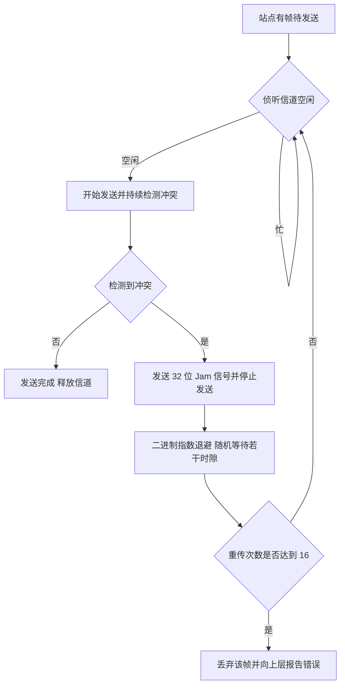

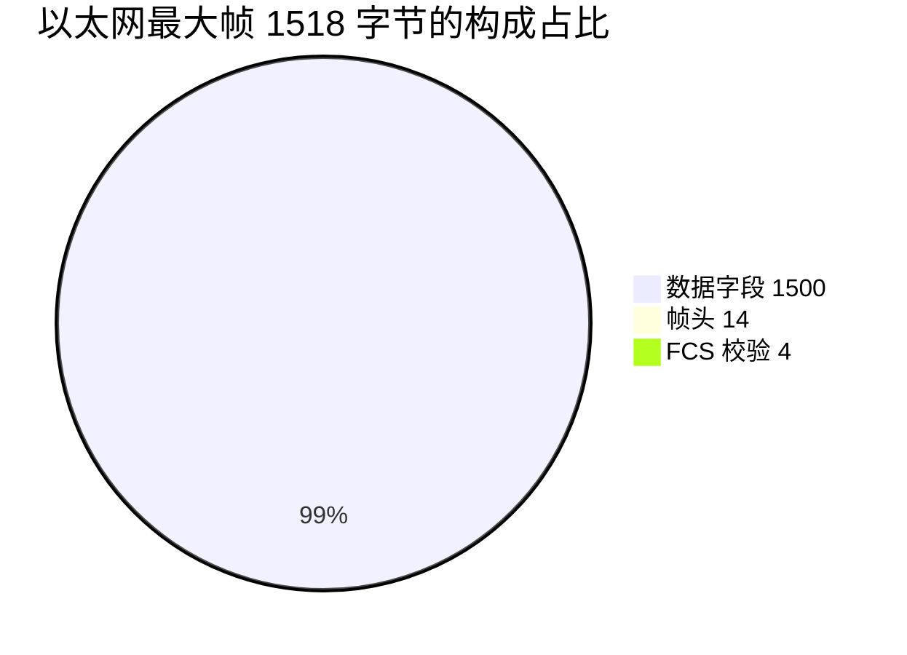

### 真题精练

**Q1.【真题·单选】** 下列协议与端口对应关系错误的是？

A. DNS 使用 UDP 53 与 TCP 53  B. SNMP Trap 使用 UDP 162
C. RADIUS 计费使用 UDP 1813  D. TFTP 使用 TCP 69

> **答案：D**
> **解析**：TFTP 使用 **UDP 69**，因为它是简单文件传输协议，靠应用层自己用确认与重传实现可靠（Stop-and-Wait），不依赖 TCP。这也是华为设备通过 TFTP 备份配置文件时不需要建立连接的原因。

**Q2.【真题·填空】** IP 协议号中，ICMP 为 ________，TCP 为 ________，UDP 为 ________，GRE 为 ________，ESP 为 ________，AH 为 ________，OSPF 为 ________。

> **答案：1、6、17、47、50、51、89**
> **解析**：口诀"1 ICMP、6 TCP、17 UDP"是必背；47/50/51 是隧道与 IPSec 三兄弟（GRE、ESP、AH），89 是 OSPF。这些数值在 ACL、防火墙策略、抓包分析中反复出现。

**Q3.【真题·单选】** 关于 CRC 校验，下列说法正确的是？

A. CRC 能纠正传输中出错的比特  B. CRC 校验失败时交换机会请求重传
C. CRC 用于检测帧是否出错，出错帧被直接丢弃  D. CRC 校验范围包含前导码

> **答案：C**
> **解析**：CRC 只能**检错**不能纠错（A 错）；以太网不做重传，错帧直接丢弃，重传由上层 TCP 负责（B 错）；CRC 计算范围是目的 MAC + 源 MAC + Type/Length + 数据 + Pad，**不含前导码与 SFD**（D 错）。

**Q4.【真题·多选】** 关于 CSMA/CD，下列说法正确的有？（多选）

A. 全双工交换端口上不再使用 CSMA/CD
B. 检测到冲突后发送 Jam 信号通知所有站点
C. 最小帧长 64 字节是为了保证发送方能在发完前检测到冲突
D. 冲突发生后立即无限重传，直到成功

> **答案：ABC**
> **解析**：D 错误。冲突后采用**二进制指数退避**算法随机等待再重传，重传 16 次仍失败则丢弃该帧并向上层报告，不会无限重传。

**Q5.【真题·判断】** UDP 头部长度固定为 8 字节，其校验和字段可以置 0 表示不校验。

> **答案：正确**
> **解析**：UDP 头固定 8 字节（源端口、目的端口、长度、校验和）。在 IPv4 中 UDP 校验和是可选的，发送方计算为 0 时置全 1（0xFFFF）；接收方收到校验和为 0 表示发送方未计算校验和，则跳过校验（IPv6 中 UDP 校验和强制）。这也是 UDP 被称为"尽力而为"的体现。

**Q6.【真题·简答】** 某 PC 访问网页很慢，`display interface` 显示该端口有大量 Late Collision。请分析原因与解决办法。

> **答案**：Late Collision（后冲突）指冲突发生在帧的前 64 字节发送之后，按 CSMA/CD 规则此时本不应再检测到冲突，说明链路上存在**双工不匹配**或**网段过长**。最常见原因是：一端配置为**全双工**（不进行载波侦听、随时可发），另一端为**半双工**（仍在侦听），半双工端检测到"冲突"并丢弃帧，导致大量重传与性能骤降。解决办法：**两端双工模式与速率保持一致**——要么两端都设为自协商，要么两端都手工强制相同值（严禁一端自协商、一端强制）。此外还需排查网线过长（超过 100 m）、网线质量差、Hub 级联层数过多等因素。

### 易错点与排错

- **陷阱 1**：把 DNS 记成"只用 UDP"或"只用 TCP"。**两者都用**，53 端口同时有 TCP 与 UDP 监听。
- **陷阱 2**：把 RADIUS 记成 1645/1646。现行标准是 **1812/1813**（1645/1646 是旧实现）。
- **陷阱 3**：把 ESP(50) 与 AH(51) 记反。**ESP 提供加密，AH 提供认证不加密**。
- **陷阱 4**：以为 CRC 能纠错，或以为以太网会重传错帧。
- **陷阱 5**：认为现代网络中还能看到大量冲突。全双工交换网络中冲突计数应接近 0，一旦增长必须查双工与线缆。
- **排错命令**：`display interface GigabitEthernet0/0/0`（看 Collisions、Late Collision、CRC error）、`display interface | include error`、`display acl all`（看端口/协议过滤是否命中）。

---

# 数通-HCIA-章节2-VRP系统与设备管理

## 2.1 VRP 系统架构、命令行视图与用户分级

### 考点定位

本章是"上机实验的地基"，校赛上机题第一步就是登录设备、改名、保存配置，**视图切换错了后面全错**。考试高频点：VRP 全称与特点、四种基本视图的提示符、用户级别（0~15）与命令级别（0~3）的对应关系、快捷键（尤其是 Ctrl+Z、Ctrl+A、Ctrl+C、Tab）、`sysname` 与 `system-view` 的区别。省赛可能会考多用户级别下的权限验证实验。

### 原理精讲

**VRP（Versatile Routing Platform，通用路由平台）**是华为数据通信产品统一的网络操作系统，运行在路由器（AR、NE 系列）、交换机（S 系列、CloudEngine 系列）、防火墙（USG 系列）等设备上。它与思科的 IOS、Juniper 的 Junos 属于同类产品，核心价值是**统一的命令风格与统一的功能特性集**，使得掌握一套命令即可操作全系列设备。VRP 版本演进：**VRP V5**（S5700 V200 等，命令风格为"传统 VRP"）、**VRP V8**（NE 系列、部分 CloudEngine，命令风格更接近 Junos，使用 `commit` 提交）、**VRP V600**（CloudEngine 系列数据中心交换机）。本册以园区设备常用的 VRP V200/V300 命令风格为主。

VRP 具备四个关键能力：**命令行接口（CLI）**、**文件系统**、**多用户支持与权限分级**、**模块化的协议栈**（各协议以特性模块加载，未加载的协议不占内存）。

**命令行的组织方式：视图（View）体系**。VRP 用"视图"把数量庞大的命令分组，只有进入对应视图才能配置对应功能，避免误操作。核心视图如下：

| 视图 | 提示符示例 | 进入方式 | 可做什么 |
|---|---|---|---|
| 用户视图 | `<Huawei>` | 登录后默认 | 查看类命令、保存配置、重启、进入系统视图 |
| 系统视图 | `[Huawei]` | `system-view` | 全局参数、创建 VLAN/ACL、进入其他视图 |
| 接口视图 | `[Huawei-GigabitEthernet0/0/1]` | `interface GigabitEthernet0/0/1` | 接口 IP、速率双工、链路类型 |
| 协议视图 | `[Huawei-ospf-1]`、`[Huawei-vlan10]` | `ospf 1`、`vlan 10` | 协议参数、VLAN 属性 |
| 用户界面视图 | `[Huawei-ui-vty0-4]` | `user-interface vty 0 4` | 登录认证方式、权限、ACL |

**视图回退规则**：`quit` 退回上一级视图，`return`（或快捷键 **Ctrl+Z**）直接从任意视图退回**用户视图**。`Ctrl+Z` 是实验中最常用的快捷键——配置错了想从头来、或想执行 `save` 时极其高效。

**用户级别与命令级别（必考）**。VRP 把命令划分为 **4 个级别（0~3）**，把用户划分为 **16 个级别（0~15）**，用户级别决定其能执行哪些级别的命令：

| 用户级别 | 名称 | 可执行的命令级别 | 典型可执行命令 |
|---|---|---|---|
| 0 | 参观级（Visit） | 0 | ping、tracert、telnet、display 网络诊断类 |
| 1 | 监控级（Monitor） | 0、1 | display、部分维护命令 |
| 2 | 配置级（Configure） | 0、1、2 | 业务配置命令（不含用户管理与系统级操作） |
| 3~15 | 管理级（Manage） | 0、1、2、3 | 文件系统、用户管理、系统重启动、调试等全部命令 |

**注意两点**：① 级别 3~15 都对应"管理级"，即 4~15 与 3 的权限相同（级别 15 常用于管理员，属习惯写法）；② 用户级别**高于**命令级别即可执行（例如级别 2 的用户不能执行级别 3 的 `reboot`、`save` 之外的系统管理命令）。华为设备的默认用户级别由 `user privilege level` 指定：Console 口默认级别 **15**，VTY（Telnet/SSH）默认级别 **0**——这是"为什么用 Telnet 登录后什么也配置不了"的根本原因，必须显式提升级别。

**命令行的智能辅助与快捷键**：

| 快捷键 | 功能 |
|---|---|
| Tab | 命令/关键字补全（连按两次列出所有以当前字符开头的候选） |
| `?` | 帮助：单独输入 `?` 列出当前视图所有命令；命令后输入 `?` 列出该命令的关键字 |
| Ctrl+Z | 返回用户视图（等同 `return`） |
| Ctrl+A | 光标移到当前行行首 |
| Ctrl+E | 光标移到当前行行尾 |
| Ctrl+C | 中断当前命令的执行/停止信息输出（如 `display current-configuration` 输出过长时） |
| Ctrl+P / 上方向键 | 调出上一条历史命令 |
| Ctrl+N / 下方向键 | 调出下一条历史命令 |
| Ctrl+U | 删除整行 |
| Ctrl+H | 删除光标前一个字符（等同退格） |
| Ctrl+D | 删除光标处字符 |
| Ctrl+W | 删除光标前的一个单词 |

**其他实用技巧**：`screen-length 0 temporary` 关闭分屏显示（否则 `display current-configuration` 会停在 `---- More ----`，需按空格翻页）；`display current-configuration | include vlan` 用管道过滤；`display this` 查看当前视图下的配置。

### 关键概念对照表

| 对比项 | 用户视图 | 系统视图 |
|---|---|---|
| 提示符 | `<Huawei>` | `[Huawei]` |
| 进入命令 | 登录即是 | `system-view` |
| 能执行的典型命令 | `display`、`save`、`reboot`、`reset saved-configuration` | `sysname`、`vlan`、`interface`、`acl` |
| 退出方式 | `quit` 断开登录（Telnet 场景） | `quit` 回用户视图 |

| 用户级别 | 命令级别 | 权限要点 |
|---|---|---|
| 0 | 0 | 只能诊断（ping/tracert），看不到配置 |
| 1 | 0~1 | 可执行 display 查看状态 |
| 2 | 0~2 | 可做业务配置，不能管用户与文件 |
| 3~15 | 0~3 | 全部权限，含 `save`、`reboot`、`local-user` |

| 常用基础命令 | 作用 |
|---|---|
| `system-view` | 进入系统视图 |
| `sysname HW-Core` | 修改设备名，便于识别与远程管理 |
| `clock timezone BJ add 08:00:00` | 设置时区（北京时间） |
| `header login information "..."` | 设置登录标语（合规要求常考） |
| `display current-configuration` | 查看当前生效配置 |
| `display this` | 查看当前视图下的配置 |

### 华为设备配置

```bash
<Huawei> system-view                          // 从用户视图进入系统视图
[Huawei] sysname S5731-Core                   // 修改设备名，实验与排错第一件事
[S5731-Core] clock timezone BJ add 08:00:00   // 设置时区为北京时间东八区，日志时间才准确
[S5731-Core] header login information "Authorized access only!"  // 登录标语，符合安全合规
[S5731-Core] quit                             // 退回用户视图
<S5731-Core> save                             // 保存配置，交互式确认 y
<S5731-Core> screen-length 0 temporary        // 临时关闭分屏，方便一次性查看长输出
<S5731-Core> display current-configuration | include sysname   // 用管道过滤查看关键配置
<S5731-Core> system-view                      // 再次进入系统视图继续配置
[S5731-Core] interface GigabitEthernet0/0/1   // 进入接口视图，提示符变为 [S5731-Core-GigabitEthernet0/0/1]
[S5731-Core-GigabitEthernet0/0/1] description To_AR6120_WAN   // 配置接口描述，便于维护
[S5731-Core-GigabitEthernet0/0/1] return      // 等同 Ctrl+Z，直接回到用户视图
```

### 示意图

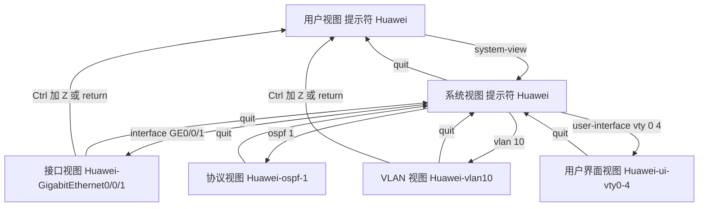

### 真题精练

**Q1.【真题·单选】** VRP 中用户级别 2 的用户最多可以执行哪个级别的命令？

A. 级别 0  B. 级别 0~1  C. 级别 0~2  D. 级别 0~3

> **答案：C**
> **解析**：用户级别 0 对应参观级（命令级别 0）、1 对应监控级（0~1）、2 对应配置级（0~2）、3~15 对应管理级（0~3）。级别 2 的用户不能执行 `local-user`、`reboot`、`patch` 等管理级命令。

**Q2.【真题·多选】** 在任意视图下，下列操作可以实现"直接返回用户视图"的有？（多选）

A. 输入 `quit`  B. 输入 `return`  C. 按 Ctrl+Z  D. 输入 `end`

> **答案：BC**
> **解析**：`quit`（A）只退回上一级视图，在接口视图下会回到系统视图；`end`（D）是思科 IOS 的用法，华为 VRP 不支持。VRP 用 `return` 或 **Ctrl+Z** 从任意视图直接回用户视图。

**Q3.【真题·填空】** 使用 Telnet 方式首次登录华为交换机时，用户默认处于 ________ 视图，默认用户级别为 ________，因此必须先提升级别才能进行配置。

> **答案：用户；0**
> **解析**：Console 口登录的默认用户级别是 15（可立即配置），而 VTY（Telnet/SSH）默认级别为 0（参观级），只能执行 ping 等诊断命令。需要在 `user-interface vty` 视图下用 `user privilege level 15` 提升，或在 AAA 中通过 `local-user xxx privilege level 15` 指定。

**Q4.【真题·判断】** 在 VRP 中，`sysname` 命令的作用是进入系统视图。

> **答案：错误**
> **解析**：进入系统视图的命令是 `system-view`；`sysname` 用于**修改设备名称**。二者极易混淆，是入门阶段的经典错答点。

### 易错点与排错

- **陷阱 1**：把 `system-view` 与 `sysname` 弄混（前者进视图，后者改名）。
- **陷阱 2**：认为 `quit` 能回用户视图。任意视图回用户视图必须用 `return` 或 Ctrl+Z。
- **陷阱 3**：认为用户级别 15 与 3 权限不同。3~15 权限相同（均为管理级）。
- **陷阱 4**：配置完忘记 `save`，设备重启后配置丢失。**用户视图下执行 `save`**，系统会询问 `Are you sure to continue? [Y/N]`。
- **排错命令**：`display users`（看当前登录用户与级别）、`display current-configuration | include user`（看用户配置）、`display clock`（看时间是否准确）。

---

## 2.2 配置文件管理、文件系统与 VRP 升级回退

### 考点定位

上机题必考"保存配置 + 备份配置"，理论题常考三类文件的区别（系统软件 `.cc`、配置文件 `.zip`/`.cfg`、补丁 `.pat`）、`display startup` 各字段含义、配置文件加载顺序。省赛可能考"通过 TFTP 升级 VRP 版本并回退"的完整流程。易错点：**把 `save` 与 `startup saved-configuration` 混为一谈**——前者把运行配置存成文件，后者指定下次启动加载哪个文件。

### 原理精讲

华为设备的存储介质是 **Flash（闪存）**，以文件系统方式组织（`flash:`），常见目录结构包含：系统软件文件（`.cc`，如 `S5731_V200R019C10SPC500.cc`）、配置文件（默认 `vrpcfg.zip`，也可为 `.cfg`）、补丁文件（`.pat`）、日志文件等。查看用 `dir`，路径写法支持 `flash:/xxx.cc`。

**三类文件必须分清**：

1. **系统软件（.cc）**：即 VRP 本体，决定设备支持哪些特性与命令。升级即替换该文件。
2. **配置文件（vrpcfg.zip / .cfg）**：保存用户的业务配置。设备启动时将其解析为运行配置（running-config）。
3. **补丁文件（.pat）**：在不替换系统软件的前提下修复缺陷或增加小特性，加载后需要 **active（激活）** 与 **run（运行）** 两个动作，且**补丁在重启后会失效（需重新加载激活）**，除非在下次启动配置中指定。华为补丁管理命令：`patch load`、`patch active`、`patch run`、`display patch-information`。

**`save` 与启动配置的关系（高频）**：

- `save`：把**当前运行配置**（`display current-configuration` 看到的内容）写入**配置文件**（默认 `vrpcfg.zip`）。命令执行后会提示是否将文件名作为下次启动的配置文件（S 系列会问 `Are you sure to save the configuration to flash:/vrpcfg.zip? [Y/N]`）。
- `startup saved-configuration vrpcfg.zip`：指定**下次启动**加载哪个配置文件。它**不改变当前运行配置**。
- `display startup`：查看三个关键项——**Current startup saved-configuration file**（本次启动使用的配置文件）、**Next startup saved-configuration file**（下次启动将使用的配置文件）、**Current system software / Next main system software**（当前与下次启动的系统软件）。
- `reset saved-configuration`：删除配置文件，**下次启动使用出厂配置**（当前运行配置不变，需重启才生效）。这是清空设备配置的标准做法。
- `display saved-configuration`：查看已保存文件的内容。

**设备启动流程**（理解后即可定位"配置丢失"类问题）：上电 → **BootROM** 自检并进行基本的硬件初始化 → 加载**系统软件（.cc）**（先加载 Next main，失败则加载 Next backup）→ 解析**配置文件**（若下次启动配置文件为空或不存在，则使用出厂默认配置）→ 进入命令行。因此"配置丢了"的常见原因是：`save` 未执行、`startup saved-configuration` 指向了空或错误的文件、或文件被误删。

**VRP 升级与回退的标准流程（上机题）**：

1. 准备：PC 上运行 TFTP/FTP 服务器，目录中放置目标 `.cc` 文件；用网线连接 PC 与设备管理口，配置同网段 IP。
2. 备份：`dir` 查看剩余空间；`tftp 10.1.1.100 put vrpcfg.zip` 备份当前配置文件；必要时备份旧 `.cc`。
3. 上传：`tftp 10.1.1.100 get S5731_V200R019C10SPC500.cc`（或用 FTP，`ftp 10.1.1.100` 后 `get`）。
4. 指定：`startup system-software flash:/S5731_V200R019C10SPC500.cc`。
5. 校验：`display startup` 确认 Next main system software 已指向新文件。
6. 重启：`reboot`（会再次确认，选择保存配置或不保存）。
7. **回退**：若新版本异常，重新把旧 `.cc` 上传（或本来就保留在 Flash 中），用 `startup system-software flash:/旧版本.cc` 指定并 `reboot`；也可通过 BootROM 菜单（设备启动时按 Ctrl+B，密码常见为 `Admin@huawei.com`）在 BootROM 下指定启动文件——这是"设备起不来"时的最后手段。

**FTP/TFTP 相关命令**：`tftp server enable`（设备作为服务器）、`tftp <server-ip> {get | put} <filename>`（设备作为客户端）、`ftp <server-ip>` 后进入 FTP 客户端视图用 `get/put/ls`、`ftp server enable`、`set default ftp-directory flash:`（指定 FTP 用户默认目录，配置 FTP 登录用户时**必须**设置）、`local-user xxx ftp-directory flash:`。U 盘方式：把 U 盘插入 USB 口后用 `dir usb:/` 查看、`copy usb:/xxx.cc flash:/` 复制。

**文件操作命令**：`dir`（列目录）、`cd`、`pwd`、`more`（查看文本文件）、`copy`、`move`、`rename`、`delete`（默认删除到回收站）、`delete /unreserved`（彻底删除，**不可恢复**）、`undelete`（从回收站恢复）、`reset recycle-bin`（清空回收站）。**Flash 空间不足时升级会失败**，所以升级前要先 `delete /unreserved` 清理旧版本。

### 关键概念对照表

| 文件/操作 | 说明 | 关键命令 |
|---|---|---|
| 系统软件 .cc | VRP 本体，决定特性与命令 | `startup system-software flash:/xxx.cc` |
| 配置文件 vrpcfg.zip | 保存业务配置，启动时加载 | `save`、`startup saved-configuration vrpcfg.zip` |
| 补丁 .pat | 热修复，需激活与运行，重启失效 | `patch load`、`patch active`、`patch run` |
| 出厂配置 | 删除配置文件后的默认状态 | `reset saved-configuration` + 重启 |
| 备份配置 | 上传到 FTP/TFTP 服务器 | `tftp 10.1.1.100 put vrpcfg.zip` |

| 命令 | 作用 | 常见误区 |
|---|---|---|
| `save` | 运行配置写入配置文件 | 只保存到 Flash，不改变"下次启动"指向 |
| `startup saved-configuration` | 指定下次启动的配置文件 | 不影响当前运行配置 |
| `reset saved-configuration` | 清空下次启动配置 | 当前配置仍在内存中，需重启才生效 |
| `display startup` | 查看当前/下次启动的文件 | 输出包含系统软件与配置文件两行 |
| `reboot` | 重启设备 | 会询问是否保存配置 |

| 文件系统命令 | 作用 |
|---|---|
| `dir flash:/` | 列出 Flash 根目录文件与剩余空间 |
| `copy flash:/a.cc flash:/backup/` | 复制文件 |
| `delete /unreserved flash:/a.cc` | 彻底删除（不可恢复） |
| `undelete flash:/a.cc` | 从回收站恢复 |
| `reset recycle-bin` | 清空回收站释放空间 |
| `more flash:/vrpcfg.zip` | 查看文本文件内容（对 zip 只能看部分） |

### 华为设备配置

```bash
<S5731-Core> dir                                   // 查看 Flash 文件列表与剩余空间，升级前必看
<S5731-Core> display startup                       // 查看当前/下次启动的系统软件与配置文件
<S5731-Core> tftp 10.1.1.100 put vrpcfg.zip        // 把配置文件备份到 TFTP 服务器（服务器 IP 10.1.1.100）
<S5731-Core> tftp 10.1.1.100 get S5731_V200R019C10SPC500.cc  // 从 TFTP 服务器下载新系统软件
<S5731-Core> startup system-software flash:/S5731_V200R019C10SPC500.cc  // 指定下次启动的系统软件
<S5731-Core> startup saved-configuration vrpcfg.zip // 指定下次启动加载的配置文件
<S5731-Core> display startup                       // 再次确认下次启动文件已正确指向
<S5731-Core> save                                  // 保存当前配置（重启前务必执行）
<S5731-Core> reboot                                // 重启设备，交互确认是否保存
```

```bash
<S5731-Core> system-view                           // 进入系统视图配置 FTP/TFTP 服务
[S5731-Core] ftp server enable                     // 使能 FTP 服务（明文，建议仅内网使用）
[S5731-Core] set default ftp-directory flash:      // 指定 FTP 用户默认工作目录，不配置则登录失败
[S5731-Core] aaa                                   // 进入 AAA 视图创建 FTP 用户
[S5731-Core-aaa] local-user ftpuser password irreversible-cipher Huawei@123  // 创建加密密码用户
[S5731-Core-aaa] local-user ftpuser service-type ftp          // 指定服务类型为 FTP
[S5731-Core-aaa] local-user ftpuser privilege level 15        // 指定用户级别
[S5731-Core-aaa] local-user ftpuser ftp-directory flash:      // 指定该用户可访问目录
[S5731-Core-aaa] quit
[S5731-Core] quit
<S5731-Core> copy flash:/vrpcfg.zip flash:/backup/vrpcfg.zip  // 本地复制备份，双保险
<S5731-Core> delete /unreserved flash:/S5731_V200R018C10.cc   // 彻底删除旧版本释放空间（不可恢复，慎用）
<S5731-Core> display patch-information             // 查看补丁版本与激活状态
```

### 示意图

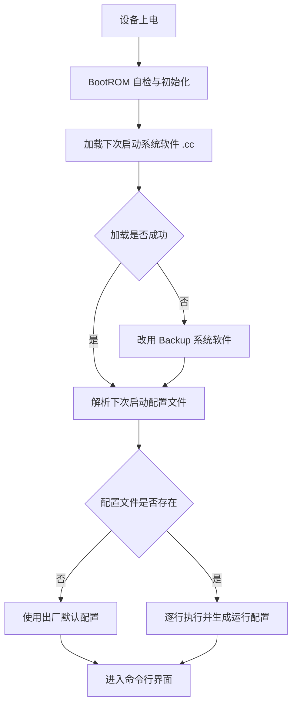

### 真题精练

**Q1.【真题·单选】** 在 VRP 中执行 `save` 命令的作用是？

A. 把配置文件加载到内存成为运行配置  B. 把当前运行配置保存到配置文件
C. 指定下次启动使用的系统软件  D. 删除设备当前的全部配置

> **答案：B**
> **解析**：`save` 把内存中的运行配置写入 Flash 中的配置文件（默认 vrpcfg.zip）。A 是设备启动时的动作；C 是 `startup system-software`；D 是 `reset saved-configuration` + 重启。

**Q2.【真题·多选】** 关于 `reset saved-configuration`，下列说法正确的有？（多选）

A. 会立即清空当前正在运行的配置
B. 下次启动时设备将使用出厂配置
C. 需要重启设备才能看到效果
D. 执行后设备会主动询问是否重启

> **答案：BCD**
> **解析**：A 错误，该命令只删除**下次启动所使用的配置文件**，当前内存中的运行配置不受影响（若此时不保存直接重启，配置才会丢失）。执行后设备会提示是否立即重启（D）。

**Q3.【真题·填空】** 华为设备上，补丁文件加载后需要依次执行 ________ 和 ________ 两个动作才能生效，且补丁在设备重启后 ________（会/不会）自动生效。

> **答案：patch active；patch run；不会**
> **解析**：补丁加载（`patch load`）只是把 .pat 文件读入内存，`patch active` 激活补丁、`patch run` 使补丁正式运行。补丁状态默认不写入下次启动配置，因此重启后失效，需要重新执行。查看用 `display patch-information`。

**Q4.【真题·排错】** 管理员在设备上完成了全部 VRP 配置，执行 `save` 后重启，发现配置全部丢失，设备恢复为出厂状态。请分析可能原因。

> **答案**：① 执行了 `reset saved-configuration` 但未注意其影响，导致下次启动配置文件被清空（最可能）；② `save` 时把配置保存到了非默认文件，而 `startup saved-configuration` 仍指向默认文件或其他文件；③ 设备存在**双主控/堆叠**场景，配置只在主控保存，倒换后从另一块主控启动；④ Flash 损坏导致文件未真正写入。排查：登录后先 `display startup` 对比 Current 与 Next startup saved-configuration file，再 `dir` 确认文件是否存在与大小，`display saved-configuration` 查看文件内容。预防措施：配置完成后必须 `save` 并 `display startup` 双确认，同时用 TFTP 备份配置文件到外部服务器。

### 易错点与排错

- **陷阱 1**：以为 `save` 会同时改变"下次启动指向"。两者独立。
- **陷阱 2**：`delete` 默认把文件放入回收站，空间并未释放；升级空间不足时需用 `delete /unreserved` 再 `reset recycle-bin`。
- **陷阱 3**：`reset saved-configuration` 后不重启就以为配置没了——实际当前配置仍在。
- **陷阱 4**：忘记 `set default ftp-directory flash:`，导致 FTP 用户登录失败（提示无权限或目录不可用）。
- **排错命令**：`dir`、`display startup`、`display saved-configuration`、`display patch-information`、`display version`（确认系统软件版本）。

---

## 2.3 登录方式、用户管理与 AAA/SSH 配置

### 考点定位

安全合规考点，几乎每次比赛都涉及。高频点：六种登录方式的对比（Console/AUX/Telnet/Stelnet/SNMP/Web）、`user-interface vty 0 4` 中 0 4 的含义、`authentication-mode` 三种取值、SSH 必须先生成 RSA 密钥、`service-type` 与用户管理、AAA 三要素（认证 Authentication、授权 Authorization、计费 Accounting）。省赛常考完整的"配置 SSH 远程管理"实验。

### 原理精讲

**设备管理接口与本地登录**：

- **Console 口**：本地串口（RJ45 或 USB），用于首次配置与故障恢复。默认**不需要认证**即可登录，用户级别默认 15。配置命令在 `user-interface console 0` 视图下。
- **AUX（Auxiliary）口**：辅助口，通常用于连接 Modem 做拨号备份管理。命令在 `user-interface aux 0` 视图下。AR 系列路由器保留此口。
- **MiniUSB 口**：部分 AR 路由器提供，作用同 Console。

**远程登录方式**：

| 方式 | 端口 | 加密 | 特点与使用场景 |
|---|---|---|---|
| Telnet | TCP 23 | 无（明文，含密码） | 配置简单，仅限可信内网，不满足等保要求 |
| Stelnet（SSH） | TCP 22 | 有（加密 + 完整性 + 认证） | 推荐方式，需生成 RSA 密钥并开启 stelnet server |
| SFTP | TCP 22 | 有 | 基于 SSH 的安全文件传输 |
| SNMP | UDP 161/162 | v3 支持加密 | 网管平台轮询与告警上报，面向 iMaster NCE 等 |
| Web（HTTP/HTTPS） | TCP 80/443 | HTTPS 加密 | 图形化网管，需加载 Web 组件包 |

**VTY（Virtual Type Terminal，虚拟类型终端）配置**：`user-interface vty 0 4` 表示配置 **5 个虚拟终端**（编号 0 到 4），即**同时允许 5 个远程登录会话**。VTY 通道数量可通过 `user-interface maximum-vty <n>` 调整（AR 系列最大 15，部分设备最大 21）。**注意**：Telnet 与 SSH 共用 VTY 通道，`protocol inbound {all | ssh | telnet}` 决定该通道支持哪种协议。

**三种认证模式（`authentication-mode`）**：

- `none`：不认证，登录即进入（不安全，仅实验用）；
- `password`：只验证 VTY 密码（在 `user-interface` 视图用 `set authentication password cipher xxx` 设置），**无法区分用户、无法分配不同权限**；
- `aaa`：调用 AAA 认证方案，用 `local-user` 定义的用户名/密码 + 权限 + 服务类型登录，**可以区分用户、分配级别、做审计**——生产环境必须使用。

**AAA 三要素**：

- **认证（Authentication）**：验证"你是谁"，方式有本地认证（`local-user`）、RADIUS（UDP 1812）、HWTACACS、AD/LDAP 等；
- **授权（Authorization）**：决定"你能做什么"，本地场景由 `local-user xxx privilege level` 实现；
- **计费（Accounting）**：记录"你做了什么"，RADIUS 计费用 UDP 1813，本地一般不做计费。

华为 AAA 结构：`aaa` 视图下创建 `authentication-scheme`（认证方案）、`authorization-scheme`（授权方案）、`accounting-scheme`（计费方案），再在域（`domain`）中绑定，用户按域名匹配。小规模场景可只用 `local-user` 并让 VTY 的 `authentication-mode aaa` 自动采用本地认证。

**SSH 配置的完整步骤（高频实验，缺一步就连不上）**：

1. 生成 RSA 密钥对：`rsa local-key-pair create`（需指定密钥长度，建议 2048 bit；此步必须执行，SSH 加密依赖主机密钥）。
2. 开启 SSH 服务：`stelnet server enable`。
3. 创建本地用户并指定服务类型：`local-user admin password irreversible-cipher Huawei@123`、`local-user admin service-type ssh`（若同时要 Telnet 则 `service-type telnet ssh`）、`local-user admin privilege level 15`。
4. 配置 VTY：`user-interface vty 0 4`、`authentication-mode aaa`、`protocol inbound ssh`。
5. 指定 SSH 用户的认证方式：`ssh user admin authentication-type password`（或 `rsa`/`password-rsa`/`all`）、`ssh user admin service-type stelnet`。
6. 客户端用 `ssh 10.1.1.1` 或第三方工具（PuTTY、MobaXterm）登录。

**安全加固要点（比赛常考"如何加固"）**：限制 VTY 登录源地址（`acl 2000 inbound` 配合 ACL 放通管理网段）、修改默认端口（部分设备支持）、密码复杂度与定期更换、关闭 Telnet 只用 SSH、配置 `idle-timeout 5` 超时自动断开、配置 `header` 标语、用 SNMPv3 代替 v1/v2c。

### 关键概念对照表

| 登录方式 | 端口 | 加密 | 配置视图 | 适用场景 |
|---|---|---|---|---|
| Console | — | 无 | `user-interface console 0` | 首次配置、故障恢复 |
| AUX | — | 无 | `user-interface aux 0` | 拨号备份管理 |
| Telnet | TCP 23 | 无 | `user-interface vty` | 可信内网临时管理 |
| Stelnet | TCP 22 | 有 | `user-interface vty` | 生产环境推荐 |
| SNMP | UDP 161/162 | v3 有 | `snmp-agent` | 网管平台监控 |
| Web | TCP 443 | HTTPS 有 | `http server enable` | 图形化管理 |

| 认证模式 | 是否需要用户名 | 能否区分用户权限 | 适用场景 |
|---|---|---|---|
| none | 否 | 否 | 仅实验室 |
| password | 否（只需密码） | 否 | 临时、低安全要求 |
| aaa | 是 | 是 | 生产环境必须 |

| 命令片段 | 含义 |
|---|---|
| `user-interface vty 0 4` | 配置 5 个虚拟终端通道 0~4 |
| `authentication-mode aaa` | 使用 AAA（本地用户）认证 |
| `protocol inbound ssh` | 该通道只允许 SSH，禁止 Telnet |
| `ac 2000 inbound` → `acl 2000 inbound` | 只允许 ACL 2000 允许的源地址登录 |
| `user privilege level 15` | VTY 登录用户的默认级别 |
| `idle-timeout 5 0` | 空闲 5 分钟自动断开 |
| `rsa local-key-pair create` | 生成 SSH 主机密钥（SSH 前置条件） |

### 华为设备配置

```bash
[S5731-Core] rsa local-key-pair create             // 生成 RSA 主机密钥，提示输入位数，建议 2048
[S5731-Core] stelnet server enable                 // 开启 SSH 服务端（Stelnet）
[S5731-Core] telnet server enable                  // 如需 Telnet 才开启；安全场景应保持关闭
[S5731-Core] acl number 2000                       // 创建基本 ACL 限制管理源地址
[S5731-Core-acl-basic-2000] rule 5 permit source 10.1.100.0 0.0.0.255   // 只允许管理网段登录
[S5731-Core-acl-basic-2000] quit
[S5731-Core] aaa                                   // 进入 AAA 视图
[S5731-Core-aaa] local-user admin password irreversible-cipher Huawei@123  // 创建管理员，密码加密存储
[S5731-Core-aaa] local-user admin privilege level 15    // 授权：管理级
[S5731-Core-aaa] local-user admin service-type ssh telnet terminal  // 允许的服务类型
[S5731-Core-aaa] local-user admin ftp-directory flash:  // 若允许 FTP，必须指定目录
[S5731-Core-aaa] quit
[S5731-Core] ssh user admin authentication-type password   // 指定 SSH 用户认证方式为密码
[S5731-Core] ssh user admin service-type stelnet           // 指定该用户使用 Stelnet 服务
[S5731-Core] user-interface vty 0 4                // 配置 5 个 VTY 通道
[S5731-Core-ui-vty0-4] authentication-mode aaa     // 认证方式为 AAA
[S5731-Core-ui-vty0-4] protocol inbound ssh        // 只允许 SSH 接入
[S5731-Core-ui-vty0-4] user privilege level 15     // 登录后默认级别（本地用户已有级别时以此为准）
[S5731-Core-ui-vty0-4] idle-timeout 5 0            // 空闲 5 分钟自动断开
[S5731-Core-ui-vty0-4] acl 2000 inbound            // 只允许管理网段登录
[S5731-Core-ui-vty0-4] quit
[S5731-Core] user-interface console 0              // 加固 Console 口
[S5731-Core-ui-console0] authentication-mode aaa   // Console 也改为 AAA 认证
[S5731-Core-ui-console0] idle-timeout 10 0         // Console 空闲 10 分钟断开
```

```bash
<S5731-Core> display users                          // 查看当前登录的所有用户、来源 IP 与级别
<S5731-Core> display ssh server status              // 查看 SSH 服务状态与算法配置
<S5731-Core> display rsa local-key-pair public       // 查看已生成的 RSA 公钥
<S5731-Core> display aaa online-fail-record all     // 查看认证失败记录，排查登录问题
<S5731-Core> ssh 10.1.1.2                           // 本机作为客户端 SSH 登录其他设备
<S5731-Core> telnet 10.1.1.2                        // 本机作为客户端 Telnet 登录（明文，谨慎）
```

### 示意图

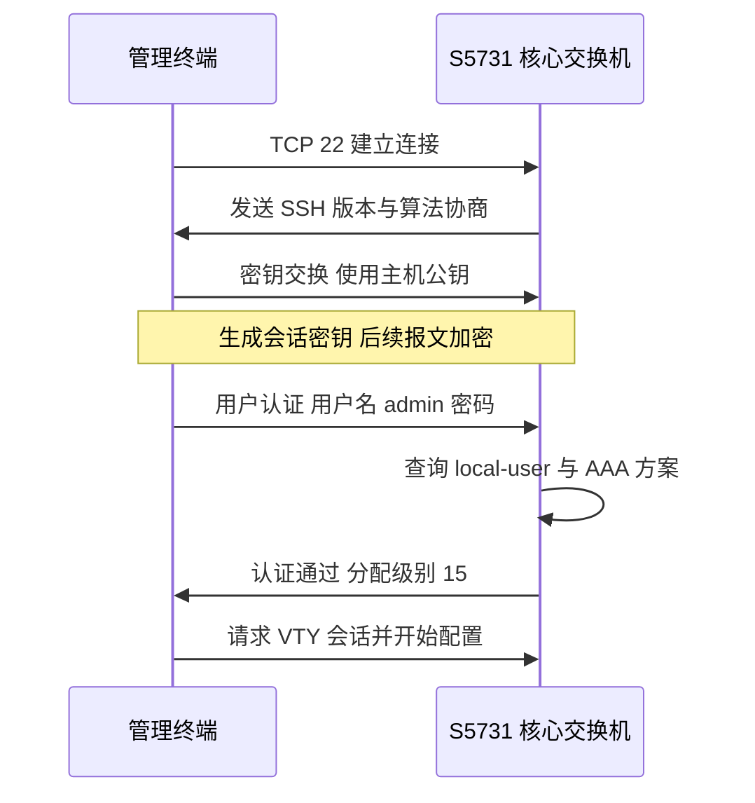

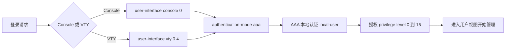

### 真题精练

**Q1.【真题·单选】** 在华为设备上配置 SSH 登录时，下列哪一步是**必须最先完成**的前置条件？

A. `stelnet server enable`  B. `rsa local-key-pair create`
C. `local-user admin service-type ssh`  D. `user-interface vty 0 4`

> **答案：B**
> **解析**：SSH 的密钥交换依赖设备的主机密钥对，必须先执行 `rsa local-key-pair create` 生成密钥，否则 SSH 服务无法正常完成密钥协商（某些版本会提示密钥不存在而失败）。其余三项也都是必要步骤，但密钥生成为先决条件。

**Q2.【真题·多选】** `user-interface vty 0 4` 命令的含义包括？（多选）

A. 配置编号 0 到 4 共 5 个虚拟终端通道
B. 允许同时有 5 个远程登录会话
C. 该配置只对 Telnet 生效，对 SSH 无效
D. 通道编号范围可通过 `user-interface maximum-vty` 调整

> **答案：ABD**
> **解析**：C 错误。Telnet 与 SSH **共用 VTY 通道**，`protocol inbound` 决定通道支持的协议，因此对两者都生效。

**Q3.【真题·填空】** 华为 AAA 中的三个 A 分别代表 ________、________、________；RADIUS 认证使用 UDP 端口 ________，计费使用 UDP 端口 ________。

> **答案：Authentication（认证）、Authorization（授权）、Accounting（计费）；1812；1813**
> **解析**：本地认证通过 `local-user` 实现认证与授权，不做计费。RADIUS 是主流集中式 AAA 方案，1812 认证、1813 计费（旧实现的 1645/1646 已不推荐）。

**Q4.【真题·简答】** 比较 Telnet 与 Stelnet 的差异，并说明生产环境中为什么必须使用 Stelnet。

> **答案**：Telnet 使用 TCP 23 端口，**所有报文（含用户名与密码）以明文传输**，任何能抓包的节点都可直接读取口令，且无法验证服务端身份、无法保证数据完整性，存在被窃听与中间人篡改的风险。Stelnet（SSH）使用 TCP 22 端口，通过密钥交换建立会话密钥，提供**加密（防窃听）、完整性校验（防篡改）、双向认证（防冒充）**，可在不可信网络中安全使用。生产环境出于等保合规与安全审计要求，必须关闭 Telnet、只开放 SSH，并配合 ACL 限制管理源地址、缩短 idle-timeout、使用强密码与集中式 AAA（RADIUS）审计。

**Q5.【真题·排错】** 管理员按标准步骤配置了 SSH，但用客户端连接时提示"Connection refused（连接被拒绝）"。请列出排查要点。

> **答案**：① `stelnet server enable` 未执行或未成功（`display ssh server status` 确认）；② VTY 下 `protocol inbound ssh` 已配置，但**通道被 ACL 拦截**（`acl 2000 inbound` 未放通管理终端网段），现象通常是超时而非拒绝，需区分；③ RSA 密钥未生成，服务无法启动；④ 设备与客户端之间路由不可达或中间防火墙未放通 TCP 22；⑤ 客户端使用了错误的 IP（如连到 VRRP 备用设备）；⑥ 用户 `service-type` 未包含 ssh、或 `ssh user` 的认证方式与客户端不匹配（客户端用公钥而设备配的是 password）。排查命令：`display ssh server status`、`display current-configuration | include ssh`、`display users`、`display aaa online-fail-record all`、两端 `ping` 与 `tracert`。

### 易错点与排错

- **陷阱 1**：以为 Telnet 与 SSH 使用不同的 VTY 配置。**共用 VTY**。
- **陷阱 2**：VTY 默认级别是 0，忘记提升级别导致登录后"什么都干不了"。
- **陷阱 3**：只配 `authentication-mode aaa` 却没创建 `local-user` 或没给 `service-type`，导致登录失败。
- **陷阱 4**：Console 口默认不认证，生产环境必须显式加固（改认证、设超时）。
- **陷阱 5**：以为 SNMP v1/v2c 是安全的。只有 **SNMPv3** 支持认证与加密。
- **排错命令**：`display users`、`display ssh server status`、`display aaa online-fail-record all`、`display current-configuration | include user-interface`。

---

## 2.4 设备时间与 NTP、信息中心与常用 display 命令

### 考点定位

属于"运维必备 + 常考细节"章节。高频点：NTP 的层级（stratum）与工作模式、NTP 使用 UDP 123、`display clock` 与 `clock datetime` 设置时间、信息中心的 8 个输出通道（0~9）与日志级别（0~7，数值越小越严重）、`terminal monitor` 的必要性、常用 display 命令的用途辨析。省赛可能考"配置设备向日志服务器输出日志"的实验。

### 原理精讲

**为什么设备必须时间准确？** 网络故障排查的黄金法则是"**对照多台设备同一时刻的日志**"。如果设备的时钟不一致，日志时间戳无法对齐，故障时间线就拼不出来。此外，SSL 证书有效期校验、Kerberos 认证、日志审计合规都要求时间准确。因此**新设备上线第一件事就是配置时区与 NTP**。

**NTP（Network Time Protocol，网络时间协议）**使用 **UDP 123** 端口，采用分层（stratum）结构：**Stratum 0** 是基准时钟源（原子钟、GPS、北斗）；**Stratum 1** 是直接同步到基准源的服务器；**Stratum 2** 从 Stratum 1 同步，以此类推，**最大 15 层，16 表示不可用**。分层设计的好处是分散负载、避免所有设备都去访问同一台基准服务器，同时通过层级距离过滤掉明显异常的时间源。

NTP 工作模式：

- **单播客户端/服务器模式**：设备作为客户端，向指定 NTP 服务器请求时间。华为命令 `ntp-service unicast-server 10.1.1.100`。这是最常用模式。
- **对等体模式**：`ntp-service unicast-peer`，双方互相同步，适合对等设备间互为备份。
- **广播/组播模式**：`ntp-service broadcast-server` / `multicast-server`，适合大量客户端、服务器主动广播时间的场景。
- **NTP 主时钟（本地参考源）**：设备自身作为时间源，`ntp-service refclock-master 2`（指定 stratum 为 2）。实验环境中常让核心交换机做"假时钟源"。

NTP 只调整"时间"，不调整"日期"？实际上 NTP 同时同步日期与时间，但**NTP 不会大幅度跳变时间**（超过 1000 秒的偏差默认需要手动确认或直接拒绝同步），这是为了防止时间大幅跳变影响协议计时而设计的。**时区必须手工设置**：`clock timezone BJ add 08:00:00`，NTP 同步的是 UTC，显示时按本地区域转换，因此"同步了 NTP 但时间还差 8 小时"的根因就是**没有配置时区**。

**手工设置时间**：`clock datetime 14:30:00 2025-03-01`（注意格式为 HH:MM:SS YYYY-MM-DD），查看用 `display clock`。**手工设置的时间会被 NTP 覆盖**，生产环境应使用 NTP。

**信息中心（Info-center）**是 VRP 的日志管理框架，负责收集各模块产生的日志/告警，并按"**输出通道（Channel）**"分发到不同目的地。**输出通道 0~9 共 10 个**，最常用的：

| 通道号 | 名称 | 输出目的地 | 说明 |
|---|---|---|---|
| 0 | console | 控制台 | 默认开启 |
| 1 | monitor | 远程终端（VTY） | 需 `terminal monitor` 才能看到 |
| 2 | loghost | 日志服务器（Syslog） | UDP 514，需 `info-center loghost` |
| 3 | trapbuffer | 告警缓冲区 | `display trapbuffer` 查看 |
| 4 | logbuffer | 日志缓冲区 | `display logbuffer` 查看 |
| 5 | snmp | SNMP 网管 | Trap 上报 |
| 6 | logfile | 日志文件 | 写入 Flash |
| 7 | channel7 | 保留（部分版本用于 Web） | — |
| 8 | channel8 | 保留 | — |
| 9 | channel9 | 专用通道 | — |

**日志级别（8 级，数值越小越严重）**：0 Emergency（系统不可用）、1 Alert（需要立即处理）、2 Critical（严重）、3 Error（错误）、4 Warning（警告）、5 Notification（正常但重要）、6 Informational（信息）、7 Debugging（调试）。**默认输出级别为 5（Notification）及以上**，因此默认看不到 Informational 与 Debugging 信息——**这是"为什么配了日志服务器却收不到某些日志"的常见原因**，需用 `info-center source default channel 2 log level informational` 调整。

**关键命令辨析**：

- `terminal monitor`：在用户视图执行，**开启当前终端（VTY 会话）的日志/调试信息显示**。Telnet 登录时默认不显示日志，必须执行此命令；Console 口默认就显示。
- `terminal logging`：开启终端日志显示（部分版本与 terminal monitor 配合使用）。
- `terminal debugging`：**打开调试信息输出开关**，`debugging xxx` 产生的信息只有执行此命令后才会输出到终端。**排错完成后必须 `undo debugging all`**，否则大量调试信息会消耗 CPU 甚至导致设备不可用。
- `info-center enable`：**默认开启**，关闭后设备不产生任何日志与告警。
- `info-center loghost 10.1.1.100`：指定 Syslog 服务器地址。
- `display logbuffer` / `display trapbuffer`：查看日志与告警缓冲区。
- `display info-center`：查看信息中心的全局配置与各通道状态。

**常用 display 命令清单（必须形成肌肉记忆）**：

| 命令 | 用途 |
|---|---|
| `display version` | 设备型号、VRP 版本、运行时长、补丁信息 |
| `display current-configuration` | 当前生效配置（排错第一步） |
| `display saved-configuration` | 已保存的配置文件内容 |
| `display startup` | 当前/下次启动的系统软件与配置文件 |
| `display device` | 单板/电源/风扇等硬件状态（框式设备用） |
| `display interface brief` | 所有接口的物理/协议状态、速率汇总 |
| `display ip interface brief` | 所有三层接口的 IP 与状态（最常用） |
| `display ip routing-table` | IPv4 路由表 |
| `display vlan` | VLAN 及成员端口 |
| `display mac-address` | MAC 地址表 |
| `display arp all` | ARP 表 |
| `display eth-trunk 1` | 链路聚合成员与状态 |
| `display stp brief` | 生成树端口角色与状态 |
| `display ospf peer brief` | OSPF 邻居状态 |
| `display cpu-usage` | CPU 占用率（配合 `display cpu-usage history`） |
| `display memory-usage` | 内存占用率 |
| `display logbuffer` | 日志缓冲区 |
| `display users` | 当前在线用户 |
| `display elabel` | 电子标签（序列号、生产日期，资产盘点用） |
| `display power` | 电源状态 |
| `display temperature` | 温度（框式与高性能盒式设备） |

### 关键概念对照表

| 项目 | 取值 | 说明 |
|---|---|---|
| NTP 端口 | UDP 123 | 明文，可加认证（`ntp-service authentication enable`） |
| NTP 最大层数 | Stratum 15 | 16 表示不可用 |
| 华为 NTP 客户端命令 | `ntp-service unicast-server <ip>` | 单播客户端模式 |
| 华为 NTP 主时钟命令 | `ntp-service refclock-master 2` | 本机作为 Stratum 2 时间源 |
| 时区命令 | `clock timezone BJ add 08:00:00` | 不配置则时间相差 8 小时 |
| 手工设时 | `clock datetime HH:MM:SS YYYY-MM-DD` | 会被 NTP 覆盖 |
| 日志默认输出级别 | 5（Notification）及以上 | 需调低才能看到 6/7 级 |

| 日志级别 | 名称 | 含义 |
|---|---|---|
| 0 | Emergency | 系统不可用 |
| 1 | Alert | 需要立即处理 |
| 2 | Critical | 严重错误 |
| 3 | Error | 错误 |
| 4 | Warning | 警告 |
| 5 | Notification | 正常但重要（默认阈值） |
| 6 | Informational | 提示信息 |
| 7 | Debugging | 调试信息 |

| 终端显示命令 | 作用 | 注意 |
|---|---|---|
| `terminal monitor` | 允许日志/调试信息输出到当前 VTY 终端 | Telnet 登录必须执行 |
| `terminal logging` | 开启终端日志显示 | 与 monitor 配合 |
| `terminal debugging` | 开启调试信息输出 | 与 `debugging` 配合 |
| `undo debugging all` | 关闭全部调试 | **排错后必做** |

### 华为设备配置

```bash
<S5731-Core> clock timezone BJ add 08:00:00        // 设置北京时区，NTP 同步前必须配置
<S5731-Core> clock datetime 14:30:00 2025-03-01    // 临时手工设置时间（会被 NTP 校正）
<S5731-Core> system-view                           // 进入系统视图
[S5731-Core] ntp-service enable                    // 使能 NTP 功能（部分版本默认开启）
[S5731-Core] ntp-service unicast-server 10.1.100.10  // 指定上游 NTP 服务器（客户端模式）
[S5731-Core] ntp-service unicast-server 10.1.100.11  // 可配置多个服务器做冗余
[S5731-Core] ntp-service authentication enable     // 开启 NTP 认证，防止伪造时间源
[S5731-Core] ntp-service authentication-keyid 1 authentication-mode md5 cipher Huawei@123  // 配置认证密钥
[S5731-Core] ntp-service reliable authentication-keyid 1  // 声明该密钥可信
[S5731-Core] ntp-service refclock-master 2         // 实验室场景：本机作为 Stratum 2 时间源供下游同步
[S5731-Core] quit
<S5731-Core> display ntp-service status            // 查看同步状态、时钟层级、参考源与偏移
<S5731-Core> display ntp-service sessions          // 查看与各时间源的会话状态
<S5731-Core> display clock                         // 查看当前日期与时间
```

```bash
[S5731-Core] info-center enable                    // 使能信息中心（默认已开启）
[S5731-Core] info-center loghost 10.1.100.20      // 指定日志服务器（Syslog），默认走通道 2，UDP 514
[S5731-Core] info-center loghost 10.1.100.20 channel 2  // 显式指定使用通道 2（可读性更好）
[S5731-Core] info-center source default channel 2 log level informational  // 把通道 2 的日志级别放宽到 6，避免漏日志
[S5731-Core] info-center logbuffer size 1024      // 扩大日志缓冲区条数，便于回溯
[S5731-Core] info-center timestamp date           // 日志采用"日期 时间"格式，便于对时分析
[S5731-Core] quit
<S5731-Core> terminal monitor                      // 让当前远程会话显示日志（Telnet/SSH 必须执行）
<S5731-Core> terminal logging                      // 打开终端日志显示开关
<S5731-Core> display logbuffer                     // 查看日志缓冲区内容
<S5731-Core> display trapbuffer                    // 查看告警缓冲区内容
<S5731-Core> display info-center                   // 查看信息中心全局配置与通道状态
<S5731-Core> display channel 2                     // 查看通道 2 的输出目的地与级别设置
```

```bash
<S5731-Core> terminal monitor                      // 排错前先打开终端显示
<S5731-Core> terminal debugging                    // 打开调试信息输出开关
<S5731-Core> debugging arp packet                  // 打开 ARP 调试（示例，按需替换模块）
<S5731-Core> undo debugging all                    // 排错结束立即关闭全部调试，防止 CPU 飙升
```

### 示意图

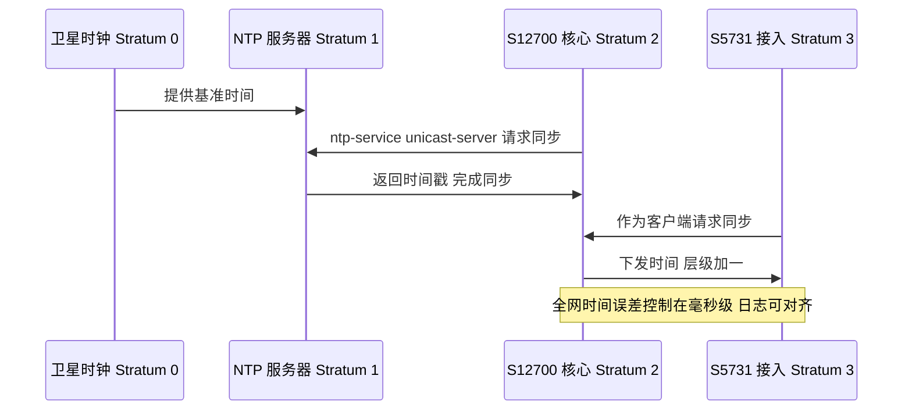

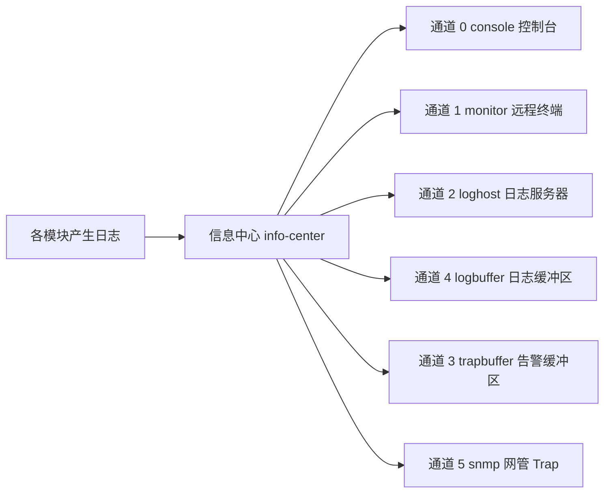

### 真题精练

**Q1.【真题·单选】** 华为设备通过 NTP 同步后，显示时间比实际北京时间晚 8 小时，最可能的原因是？

A. NTP 服务器时间错误  B. 未配置时区
C. NTP 使用 TCP 123 端口被阻断  D. 未开启 info-center

> **答案：B**
> **解析**：NTP 同步的是 **UTC**，设备显示的时间 = UTC + 时区偏移。未配置 `clock timezone BJ add 08:00:00` 时时区为 UTC+0，因此显示比北京时间晚 8 小时。NTP 使用 UDP 123（C 错），与 info-center 无关（D 错）。

**Q2.【真题·多选】** 关于信息中心输出通道与日志级别，下列说法正确的有？（多选）

A. 输出通道 0~9 共 10 个，通道 2 通常用于向日志服务器输出
B. 日志级别数值越小表示越严重
C. 默认输出级别为 Notification（5）及以上，因此调试信息默认不输出
D. `display trapbuffer` 查看的是告警缓冲区

> **答案：ABCD**
> **解析**：四个选项均为正确描述。补充：6 级 Informational 与 7 级 Debugging 默认被过滤，需要显式调整 `info-center source` 的级别才能输出到对应通道。

**Q3.【真题·判断】** 通过 Telnet 登录设备后，设备产生的日志会自动显示在终端上，无需额外配置。

> **答案：错误**
> **解析**：只有 **Console 口**默认显示日志。通过 VTY（Telnet/SSH）登录时必须执行 `terminal monitor` 才能看到日志与调试信息，这是排错时最常被遗忘的一步。

**Q4.【真题·填空】** NTP 使用 ________ 端口；信息中心的输出通道共 ________ 个；日志级别中数值最小的是 ________ 级。

> **答案：UDP 123；10（0~9）；0（Emergency）**
> **解析**：NTP 为 UDP 123；通道编号 0~9；日志级别 0 Emergency 最严重，7 Debugging 最轻微。

**Q5.【真题·简答】** 说明 `terminal monitor`、`terminal debugging` 与 `debugging xxx` 三条命令的关系，并指出使用调试命令的注意事项。

> **答案**：三者是"开关链"关系：`debugging <模块> <选项>`（如 `debugging arp packet`）是**打开指定模块的调试开关**，产生调试信息；`terminal debugging` 是**允许调试信息输出到终端**的开关，不开则调试信息被丢弃；`terminal monitor` 是**允许本终端接收日志与调试信息**的总开关，VTY 会话必须执行。因此顺序通常是先 `terminal monitor`，再 `terminal debugging`，最后 `debugging xxx`。注意事项：调试信息由 CPU 生成，**量大时会显著消耗 CPU 甚至导致设备断管**，因此只能在业务低谷期短时使用，**排错结束必须立即 `undo debugging all`**；生产环境优先用日志、`display` 命令与镜像抓包替代调试。

### 易错点与排错

- **陷阱 1**：只配 NTP 不配时区，导致时间差 8 小时。
- **陷阱 2**：忘记 `terminal monitor`，误以为设备没产生日志。
- **陷阱 3**：调完日志级别后用错了通道号（例如把 loghost 日志配到通道 4），导致服务器收不到日志。
- **陷阱 4**：调试命令用完不关闭，CPU 占用飙升甚至设备失联。
- **陷阱 5**：混淆 `display logbuffer`（日志）与 `display trapbuffer`（告警）。
- **排错命令**：`display clock`、`display ntp-service status`、`display logbuffer`、`display trapbuffer`、`display info-center`、`display channel 2`、`display cpu-usage`。

---

# 数通-HCIA-章节3-以太网与VLAN技术

## 3.1 冲突域与广播域、双工速率自协商

### 考点定位

属于"基础概念 + 现场故障"结合型考点。理论上考"集线器/交换机/路由器分别隔离什么域"、双工模式与自协商规则；实操上考"双工不匹配导致性能下降"的排错。校赛常以单选/判断出现，省赛会结合 `display interface` 输出让考生判断链路是否正常。易错点：**认为自协商一定能协商成功**（实际受介质、强制配置、模块限制影响）、以及**以为交换机的一个端口就是一个广播域**。

### 原理精讲

**冲突域（Collision Domain）**指同一个共享介质上、彼此之间可能发生冲突的节点集合。在 CSMA/CD 时代，**集线器（Hub）的所有端口属于同一个冲突域**（Hub 是物理层设备，只做信号放大与广播转发，任何两个端口同时发送就冲突）。**以太网交换机的每个端口是独立的冲突域**（交换机是数据链路层设备，每个端口有独立的缓存与 MAC，可以在不同端口同时收发）。因此"用交换机替换 Hub"能显著提升可用带宽：一个 24 口 100M Hub 的总带宽是 100M（共享），换成交换机后理论上每口独享 100M。

**广播域（Broadcast Domain）**指一个广播帧（目的 MAC 全 F）能到达的范围。**交换机的所有端口默认属于同一个广播域**（交换机会把广播帧从除入端口外的所有端口泛洪）。要隔离广播域，必须使用**路由器（三层设备）或 VLAN**——VLAN 在逻辑上把一个物理交换机切成多个广播域，这也是 VLAN 技术诞生的重要动因（抑制广播风暴、提高安全性、简化管理）。**注意**：三层交换机划分 VLAN 后，每个 VLAN 是一个独立广播域，VLAN 之间的通信必须经过三层转发（Vlanif 接口）。

| 设备 | 隔离冲突域 | 隔离广播域 |
|---|---|---|
| 集线器 Hub / 中继器 | 否（所有端口同一冲突域） | 否 |
| 网桥 / 二层交换机 | 是（每端口一个冲突域） | 否（默认同一广播域） |
| 路由器 / 三层交换机 | 是 | 是（每个接口/VLAN 一个广播域） |
| VLAN（逻辑划分） | — | 是（每个 VLAN 一个广播域） |

**双工模式（Duplex）**：

- **半双工（Half-Duplex）**：同一时刻只能收或发，需要 CSMA/CD 侦听信道，存在冲突，效率低（理论最大利用率约 50%~60%）。Hub 组网、同轴电缆时代使用。
- **全双工（Full-Duplex）**：收发使用不同的线对，可同时收发，**没有冲突域、不使用 CSMA/CD**，理论可 100% 利用带宽。现代交换网络全部使用全双工。

**自协商（Auto-Negotiation）**：由 IEEE 802.3u 定义，通过**快速链路脉冲（FLP，Fast Link Pulse）**在链路两端交换能力信息（支持的速率与双工模式），双方取**共同支持的最高能力**。协商结果：速率取双方最高公共值，双工模式取双方最高公共值。**为什么会有问题？** 自协商要求两端都**开启**才能正确工作。当一端强制（如强制 100M 全双工）而另一端自协商时，自协商端收不到 FLP，会退化为**并行检测（Parallel Detection）**，只能识别出速率，**双工模式会默认成半双工**——于是出现"**速率一致但双工不匹配**"（一端全双工、一端半双工）的经典故障。后果：全双工端不受限地发送，半双工端检测到"冲突"并丢弃，产生大量 **Late Collision、FCS/CRC 错误、丢包与重传**，表现为速率极低（可能只有正常值的 10%~30%）。**结论：两端要么都自协商，要么都手工强制为相同的速率与双工**。

**为什么光口通常不支持自协商？** 光纤介质无需协商速率（模块本身决定了速率等级），且早期的千兆光口（1000BASE-X）自协商行为不统一，因此华为设备上光口常见配置为 `negotiation auto` 关闭、速率与双工固定。相关命令：`undo negotiation auto`（关闭自协商）、`speed 1000`（强制速率）、`duplex full`（强制全双工）。部分光口不支持 `speed`/`duplex` 配置。

**以太网接口类型与常见规格**：

| 接口类型 | 速率 | 介质 | 华为典型接口名 |
|---|---|---|---|
| 电口（GE 自适应） | 10/100/1000 Mbit/s | 双绞线 Cat5e/Cat6 | GigabitEthernet0/0/1 |
| 万兆光口 | 10 Gbit/s | 光纤/高速铜缆 | XGigabitEthernet0/0/1 |
| 25GE/40GE/100GE | 25/40/100 Gbit/s | 光纤 | 25GE0/0/1、100GE0/0/1 |
| Console/MiniUSB | — | 串口 | console 0 |

**MAC 地址表与转发行为**：交换机收到帧后记录"**源 MAC + 入端口 + VLAN**"到 MAC 地址表（默认老化 **300 秒**），再按目的 MAC 查表：

- 目的 MAC **在表中且出端口 = 入端口**：丢弃（无需转发）；
- 目的 MAC **在表中且出端口 ≠ 入端口**：**单播转发**到该端口；
- 目的 MAC **不在表中**：**泛洪**除入端口外本 VLAN 内的所有端口（未知单播泛洪）；
- 目的 MAC 为**广播/组播**：泛洪（组播在未启用 IGMP Snooping 时也泛洪）。

**MAC 地址漂移**：同一 MAC 地址在短时间内被学习到不同端口，说明存在二层环路或 MAC 欺骗。交换机默认会以最新学习为准（覆盖旧表项），因此环路会造成 MAC 表剧烈震荡并伴随 CPU 升高——这是后面 STP 章节的核心排错线索。

### 关键概念对照表

| 项目 | 默认值/取值 | 说明 |
|---|---|---|
| 电口速率 | 自协商（10/100/1000M） | `negotiation auto` 默认开启 |
| 电口双工 | 自协商（推荐全双工） | 两端必须一致 |
| MAC 地址表老化时间 | 300 秒 | `mac-address aging-time` 可改 |
| 未知单播行为 | 泛洪 | 同一 VLAN 内除入端口外全部转发 |
| 广播帧行为 | 泛洪 | 同一广播域内全部转发 |
| 冲突域隔离 | 交换机每端口一个 | 路由器也隔离 |
| 广播域隔离 | VLAN / 路由器 | 交换机默认不隔离 |

| 双工组合 | 结果 | 现象 |
|---|---|---|
| 两端都自协商 | 正常（最高公共能力，全双工） | 正常 |
| 两端都强制 100M 全双工 | 正常 | 正常 |
| 一端自协商 + 一端强制 | 速率一致、双工默认半双工 | 大量 Late Collision、CRC 错误，速率极低 |
| 两端强制但速率不一致 | 链路 Down | 完全不通 |

### 华为设备配置

```bash
[S5731-Core] interface GigabitEthernet0/0/1        // 进入电口
[S5731-Core-GigabitEthernet0/0/1] negotiation auto // 开启自协商（默认开启，排错时先确认此项）
[S5731-Core-GigabitEthernet0/0/1] description To_Access_S5731  // 配置描述，便于维护
[S5731-Core-GigabitEthernet0/0/1] undo shutdown    // 开启接口（华为物理口默认是 shutdown 状态时需手动开启）
[S5731-Core-GigabitEthernet0/0/1] quit
[S5731-Core] interface GigabitEthernet0/0/24       // 排错：两端都关闭自协商并强制相同参数
[S5731-Core-GigabitEthernet0/0/24] undo negotiation auto  // 关闭自协商
[S5731-Core-GigabitEthernet0/0/24] speed 1000      // 强制速率 1000M
[S5731-Core-GigabitEthernet0/0/24] duplex full     // 强制全双工（必须与对端一致）
[S5731-Core-GigabitEthernet0/0/24] quit
[S5731-Core] mac-address aging-time 300           // 修改动态 MAC 老化时间（默认 300 秒）
```

```bash
<S5731-Core> display interface GigabitEthernet0/0/1        // 查看速率、双工、CRC 错误、冲突计数
<S5731-Core> display interface brief                        // 汇总查看所有接口的物理/协议状态
<S5731-Core> display interface GigabitEthernet0/0/1 | include rate  // 只看速率相关行
<S5731-Core> display mac-address                            // 查看 MAC 地址表，观察是否有漂移
<S5731-Core> display mac-address dynamic                    // 只看动态表项
<S5731-Core> reset counters interface GigabitEthernet0/0/1  // 清空接口计数器，便于观察增量
```

### 示意图

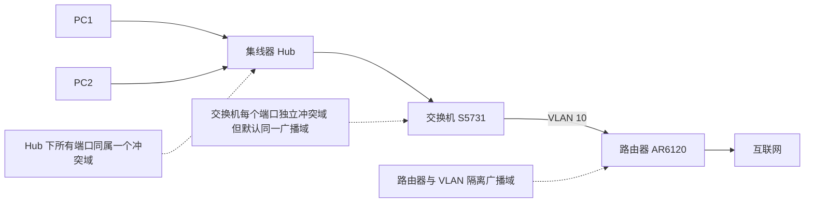

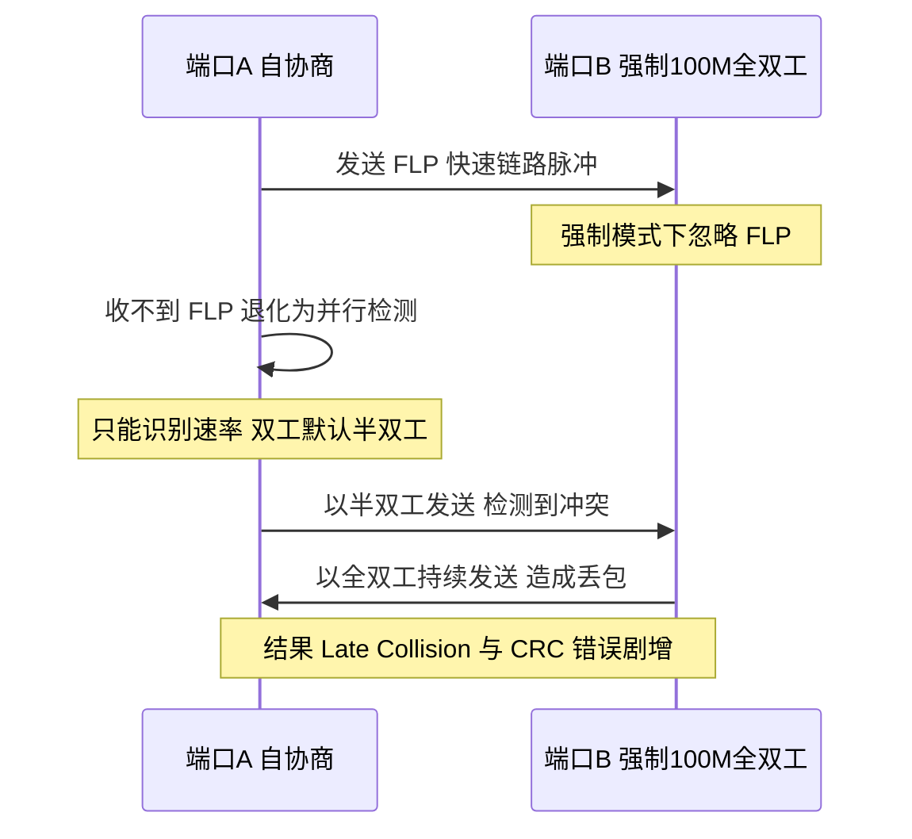

### 真题精练

**Q1.【真题·单选】** 使用二层交换机替换集线器后，网络的哪些方面得到改善？

A. 广播域被隔离  B. 冲突域被隔离为每端口一个
C. 三层路由能力增强  D. 网络层地址冲突减少

> **答案：B**
> **解析**：二层交换机每个端口是一个独立的冲突域，且全双工工作无冲突，因此带宽利用率大幅提升。交换机**不隔离广播域**（A 错，需 VLAN 或路由器），也不具备三层路由能力（C 错）。

**Q2.【真题·单选】** 某端口配置为自协商，对端强制 100M 全双工，最可能出现的现象是？

A. 链路完全 Down  B. 协商为 100M 全双工，正常通信
C. 协商为 100M 半双工，出现大量 Late Collision 与丢包  D. 协商为 10M 全双工

> **答案：C**
> **解析**：自协商端收不到 FLP 会退化为并行检测，只能识别出速率（100M），**双工模式默认退化为半双工**，于是与对端的全双工形成不匹配，产生大量后冲突与 CRC 错误，表现为速率极低或严重丢包。

**Q3.【真题·填空】** 交换机的每个端口是一个独立的 ________ 域，默认所有端口属于同一个 ________ 域；动态 MAC 地址表的默认老化时间是 ________ 秒。

> **答案：冲突；广播；300**
> **解析**：VLAN 是隔离广播域的标准手段。MAC 表老化时间默认 300 秒，可用 `mac-address aging-time` 修改（单位秒）。

**Q4.【真题·判断】** 交换机收到目的 MAC 不在 MAC 地址表中的单播帧时，会直接丢弃。

> **答案：错误**
> **解析**：目的 MAC 未知的**未知单播帧会被泛洪**（除入端口外、同一 VLAN 内所有端口），以保证即使表项老化也能通信，同时通过回复帧学习到正确位置。这也是"未知单播泛洪"可能被用于流量攻击（MAC 泛洪攻击）的原因。

### 易错点与排错

- **陷阱 1**：认为交换机隔离广播域。默认不隔离，需 VLAN。
- **陷阱 2**：一端自协商、一端强制，误以为"能通就没问题"。实际双工不匹配会严重降速。
- **陷阱 3**：把 MAC 表老化时间记成 5 分钟以外的值（标准是 300 秒 = 5 分钟）。
- **陷阱 4**：忽略 `undo shutdown`。华为部分设备接口默认关闭状态，配置完路由不通却查不出原因。
- **排错命令**：`display interface GigabitEthernet0/0/1`（看 Duplex、Speed、CRC error、Late Collision）、`display mac-address`（看漂移）、`reset counters interface`（清零后观察增量）。

---

## 3.2 VLAN 原理、802.1Q 帧与 Access/Trunk/Hybrid 收发规则

### 考点定位

**本章第一重点，校赛省赛必考且分值最高**。必考内容：VLAN ID 12 bit 与取值范围、802.1Q 帧的 TPID/PRI/CFI/VID 四字段位宽、PVID 概念、Access/Trunk/Hybrid 三种接口的**收发处理规则**（尤其是 Hybrid 的 untagged/tagged 列表判断）、以及**用 Hybrid 实现同网段不同 VLAN 互通**这一经典实验。判断题的高频陷阱是"Access 口收到 tagged 帧会怎么处理"（默认丢弃）与"Trunk 口对 PVID 的 VLAN 剥离 tag"。

### 原理精讲

**为什么需要 VLAN？** 传统以太网是**一个广播域**：任何广播帧（ARP 请求、DHCP Discover）都会到达所有主机，规模越大广播越泛滥（广播风暴、CPU 占用、带宽浪费）；同时所有人都能收到别人的流量（安全风险）。VLAN（Virtual LAN，虚拟局域网）在**一台或多台物理交换机上，通过逻辑划分把端口/主机归入不同的二层广播域**，每个 VLAN 内的广播只在组内泛洪。VLAN 的三大价值：

1. **隔离广播域**：抑制广播风暴，缩小故障影响范围；
2. **增强安全**：不同 VLAN 默认二层完全隔离（即使接在同一台交换机上）；
3. **灵活组网**：按部门/功能而非物理位置划分，用户搬迁无需重新布线。

**VLAN ID 与范围（必背）**：802.1Q 帧中 VLAN ID 字段为 **12 bit**，因此理论范围 0~4095，共 4096 个。实际可用范围：

| VLAN 范围 | 说明 |
|---|---|
| 0 | 优先级标签（Priority Tagged）用，表示只带优先级不带 VLAN，普通配置不可用 |
| 1 | **默认 VLAN（Default VLAN）**，所有接口默认属于 VLAN 1，**不可删除** |
| 2 ~ 4094 | 可正常创建与使用的 VLAN |
| 4064 ~ 4094 | 华为设备**保留 VLAN**（部分型号用于 BPDU Tunnel 等特性，默认不可配置） |
| 4095 | **保留**，协议保留值，不可使用 |

**802.1Q 帧格式（必背位宽）**：在以太网的源 MAC 与 Type 之间插入 **4 字节 Tag**：

| 字段 | 位宽 | 含义 |
|---|---|---|
| TPID（Tag Protocol Identifier） | 16 bit | 固定 **0x8100**，标识这是 802.1Q 帧 |
| PRI（Priority） | 3 bit | 优先级 0~7，用于 QoS，值越大越优先（语音常用 5、6） |
| CFI（Canonical Format Indicator） | 1 bit | 规范格式指示，以太网中恒为 0（用于兼容令牌环） |
| VID（VLAN Identifier） | 12 bit | VLAN 编号 0~4095 |

插入 Tag 后，原先的 Type 字段位置被 TPID 0x8100 占据，真正的上层协议类型字段后移 4 字节。因此 VLAN 帧最长为 1522 字节，且**交换机依据 TPID 判断是否为 Tagged 帧**。

**PVID（Port VLAN ID）**：接口的"缺省 VLAN 标识"。**当接口收到一个不带 Tag 的帧时，交换机给它打上的 VLAN 标签就是该接口的 PVID**。华为设备上所有接口的 PVID **默认为 1**。Access 与 Hybrid 口用 `port default vlan` / `port hybrid pvid vlan` 修改，Trunk 口用 `port trunk pvid vlan` 修改（一般不建议改 Trunk 口的 PVID，容易出问题）。

**三种链路类型与收发规则（核心考点）**：

**Access 接口**——用于连接**终端设备**（PC、服务器、打印机、AP）：

- **收**：收到**不带 Tag** 的帧 → 打上本口 PVID 的 Tag，进入对应 VLAN；收到**带 Tag** 的帧 → **直接丢弃**（绝大多数型号行为，因为 Access 口认为对端是普通终端不应发 tagged 帧）。
- **发**：无论 VLAN 是否为 PVID，**一律剥离 Tag 后发送**（终端不认识 Tag）。

**Trunk 接口**——用于连接**交换机与交换机**（或交换机与路由器/AP）：

- **收**：收到**不带 Tag** 的帧 → 打上本口 PVID 的 Tag（但前提是 PVID 在 allow-pass 列表中，否则丢弃）；收到**带 Tag** 的帧 → 若该 VLAN 在 `port trunk allow-pass vlan` 允许列表中则接收，否则**丢弃**。
- **发**：若帧的 VLAN ID **等于本口 PVID**，则**剥离 Tag** 后发送；若 VLAN ID 在允许列表中但**不等于 PVID**，则**带 Tag** 发送；不在允许列表中的 VLAN 不发送。

**Hybrid 接口**——华为特有，**功能最灵活**，可以同时实现 Access 与 Trunk 的能力，通过两个列表精确控制：

- **收**：收到**不带 Tag** 的帧 → 打上本口 PVID 的 Tag；收到**带 Tag** 的帧 → 若该 VLAN 在接口允许的 VLAN 列表中（untagged 或 tagged 列表）则接收，否则丢弃。
- **发**：若帧的 VLAN 在本口的 **`untagged` 列表**中 → **剥离 Tag** 后发送；若在本口的 **`tagged` 列表**中 → **带 Tag** 发送；若不在任何允许列表中 → **不发送**（丢弃）。

**Hybrid 口处理总表（必背）**：

| 方向 | 帧类型 | 处理动作 | 依据 |
|---|---|---|---|
| 收 | untagged | 打上本口 PVID，进入该 VLAN | PVID |
| 收 | tagged | VLAN 在允许列表则接收，否则丢弃 | untagged + tagged 列表 |
| 发 | 属于 untagged 列表 | 剥离 Tag 发送 | `port hybrid untagged vlan` |
| 发 | 属于 tagged 列表 | 带 Tag 发送 | `port hybrid tagged vlan` |
| 发 | 不在任何列表 | 不发送（丢弃） | — |

**经典实例：Hybrid 实现同一网段、不同 VLAN 的两台主机互通**。PC1（10.1.1.1/24）接 GE0/0/1 属于 VLAN 10，PC2（10.1.1.2/24）接 GE0/0/2 属于 VLAN 20。若用 Access 口，两台主机二层被隔离、三层又同网段无法通过网关转发（网关地址也是同网段，一台主机不会把同网段流量交给网关），因此**不通**。用 Hybrid 口配置：两个接口都允许 VLAN 10 与 20 且都设为 **untagged**，则：

- PC1 发出的 untagged 帧进入 GE0/0/1 被打上 PVID 10 的 Tag（VLAN 10）；出 GE0/0/2 时因 VLAN 10 在 GE0/0/2 的 untagged 列表中 → **剥离 Tag** 发出，PC2 收到 plain 帧。
- PC2 反向同理（入打 PVID 20，出 GE0/0/1 时 VLAN 20 在 untagged 列表 → 剥离 Tag）。

结果两台主机彼此收到 untagged 帧，认为对方在同二层网络内，**直接二层互通**，但它们的流量在交换机内部仍然分别打上了 VLAN 10 / VLAN 20 的标签——**既实现了互通，又保留了 VLAN 的流量区分能力**（例如仍可对 VLAN 10 与 20 分别做 QoS 或统计）。这正是 Hybrid 口不可替代的价值。

**GVRP（GARP VLAN Registration Protocol，GARP VLAN 注册协议）**：基于 GARP 的**动态 VLAN 注册**协议，交换机通过它把本地 VLAN 信息向邻居通告，邻居收到后自动创建并放通对应 VLAN，从而免除在每台设备手工 `port trunk allow-pass vlan` 的麻烦。端口注册模式：`normal`（允许动态与静态注册）、`fixed`（只允许静态，不传播动态学习到的 VLAN）、`forbidden`（禁止动态注册）。**现在基本不用**（易造成 VLAN 泛洪、被攻击者利用注册大量 VLAN），了解概念即可，替代方案是 iMaster NCE 等网管统一编排。

**Voice VLAN（语音 VLAN）**：为 IP 电话（IP Phone）设计的特性。IP Phone 通常串联一台 PC（Phone 上有一个 PC 口），要求语音流量与数据流量划分到不同 VLAN 并给予语音更高优先级。Voice VLAN 让交换机**识别来自 IP Phone 的语音报文**（通过源 MAC 的 OUI 或 DHCP 选项）并自动为其打上语音 VLAN 的 Tag，同时提升其 802.1p 优先级。配置要点：系统视图下 `voice-vlan <id> enable`（指定语音 VLAN）、`voice-vlan <id> security enable`（防止 PC 伪造语音报文抢占语音带宽）、`voice-vlan <id> aging <分钟>`、`voice-vlan mac-address <OUI> mask <掩码>`；接口视图下 `voice-vlan <id> enable` 与 `voice-vlan mode auto`（自动模式，通过 LLDP 让 Phone 自动加入）。

### 关键概念对照表

| 链路类型 | 收 untagged | 收 tagged | 发 PVID 帧 | 发非 PVID 帧 | 典型用途 |
|---|---|---|---|---|---|
| Access | 打 PVID，进入该 VLAN | **丢弃** | 剥离 Tag | 不存在 | 连终端 |
| Trunk | 打 PVID（须在 allow-pass 内） | 在 allow-pass 内则收，否则丢弃 | **剥离 Tag** | **带 Tag** | 连交换机 |
| Hybrid | 打 PVID | 在允许列表内则收 | 若在 untagged 列表则剥离 | 按 tagged/untagged 列表决定 | 灵活场景 |

| 802.1Q 字段 | 位宽 | 取值 |
|---|---|---|
| TPID | 16 bit | 0x8100 |
| PRI | 3 bit | 0~7，越大越优先 |
| CFI | 1 bit | 以太网恒为 0 |
| VID | 12 bit | 0~4095（可用 1~4094） |

| VLAN | 说明 |
|---|---|
| VLAN 1 | 默认 VLAN，不可删除 |
| VLAN 2 ~ 4094 | 可用 |
| VLAN 4064 ~ 4094 | 华为保留 |
| VLAN 4095 | 协议保留，不可使用 |

| 命令 | 作用 |
|---|---|
| `vlan batch 10 20 30` | 批量创建 VLAN |
| `port link-type access` | 接口设为 Access |
| `port default vlan 10` | Access 口 PVID = 10 |
| `port link-type trunk` | 接口设为 Trunk |
| `port trunk allow-pass vlan 10 20` | Trunk 允许通过的 VLAN |
| `port trunk pvid vlan 100` | 修改 Trunk 口 PVID（慎用） |
| `port link-type hybrid` | 接口设为 Hybrid |
| `port hybrid pvid vlan 10` | Hybrid 口 PVID |
| `port hybrid untagged vlan 10 20` | 这些 VLAN 出方向剥离 Tag |
| `port hybrid tagged vlan 100` | 该 VLAN 出方向带 Tag |

### 华为设备配置

```bash
[S5731-Acc] vlan batch 10 20 30                    // 批量创建 VLAN 10、20、30
[S5731-Acc] interface GigabitEthernet0/0/1         // 连接 PC1 的接口
[S5731-Acc-GigabitEthernet0/0/1] port link-type access   // 设为 Access 口
[S5731-Acc-GigabitEthernet0/0/1] port default vlan 10    // PVID 改为 10，PC1 归入 VLAN 10
[S5731-Acc-GigabitEthernet0/0/1] quit
[S5731-Acc] interface GigabitEthernet0/0/2         // 连接 PC2 的接口
[S5731-Acc-GigabitEthernet0/0/2] port link-type access   // 设为 Access 口
[S5731-Acc-GigabitEthernet0/0/2] port default vlan 20    // PC2 归入 VLAN 20
[S5731-Acc-GigabitEthernet0/0/2] quit
[S5731-Acc] interface GigabitEthernet0/0/24        // 上行连接核心交换机的接口
[S5731-Acc-GigabitEthernet0/0/24] port link-type trunk   // 设为 Trunk 口
[S5731-Acc-GigabitEthernet0/0/24] port trunk allow-pass vlan 10 20  // 允许 VLAN 10、20 带 Tag 通过
[S5731-Acc-GigabitEthernet0/0/24] description To_S5731-Core_GE0/0/1  // 描述对端，双向一致便于排查
```

```bash
[S5731-Acc] interface GigabitEthernet0/0/3         // Hybrid 经典实例：同网段跨 VLAN 互通
[S5731-Acc-GigabitEthernet0/0/3] port link-type hybrid   // 设为 Hybrid 口
[S5731-Acc-GigabitEthernet0/0/3] port hybrid pvid vlan 10     // 入方向 untagged 帧打 VLAN 10
[S5731-Acc-GigabitEthernet0/0/3] port hybrid untagged vlan 10 20  // VLAN 10 与 20 出方向都剥离 Tag
[S5731-Acc-GigabitEthernet0/0/3] quit
[S5731-Acc] interface GigabitEthernet0/0/4         // 另一台主机（10.1.1.2/24）
[S5731-Acc-GigabitEthernet0/0/4] port link-type hybrid   // 设为 Hybrid 口
[S5731-Acc-GigabitEthernet0/0/4] port hybrid pvid vlan 20     // 入方向 untagged 帧打 VLAN 20
[S5731-Acc-GigabitEthernet0/0/4] port hybrid untagged vlan 10 20  // 关键：也允许 VLAN 10 剥离 Tag 发出
[S5731-Acc-GigabitEthernet0/0/4] quit
```

```bash
[S5731-Acc] gvrp                                   // 系统视图下全局使能 GVRP
[S5731-Acc] interface GigabitEthernet0/0/24        // 在 Trunk 口上使能 GVRP
[S5731-Acc-GigabitEthernet0/0/24] gvrp             // 接口使能 GVRP，动态学习对端 VLAN
[S5731-Acc-GigabitEthernet0/0/24] gvrp registration fixed  // 只允许静态 VLAN，防止动态注册泛洪
[S5731-Acc-GigabitEthernet0/0/24] quit
```

```bash
[S5731-Acc] vlan batch 10 100                       // 创建数据 VLAN 10 与语音 VLAN 100
[S5731-Acc] voice-vlan 100 enable                  // 系统视图：指定 VLAN 100 为语音 VLAN 并使能功能
[S5731-Acc] voice-vlan 100 security enable         // 开启安全模式，防止数据终端伪造语音报文抢占带宽
[S5731-Acc] voice-vlan 100 aging 1440              // 语音 VLAN 老化时间，单位分钟（默认 1440 分钟 = 24 小时）
[S5731-Acc] voice-vlan mac-address 00e0-fc00-0000 mask ffff-ff00-0000  // 指定 IP Phone 的 OUI，用于识别语音流
[S5731-Acc] interface GigabitEthernet0/0/5         // 连接 IP Phone 的接口
[S5731-Acc-GigabitEthernet0/0/5] port link-type hybrid   // 需 Hybrid 口才能同时承载语音与数据
[S5731-Acc-GigabitEthernet0/0/5] port hybrid untagged vlan 10   // 数据流量 VLAN 10 剥离 Tag 给 Phone 的 PC 口
[S5731-Acc-GigabitEthernet0/0/5] port hybrid tagged vlan 100    // 语音流量 VLAN 100 带 Tag 给 Phone
[S5731-Acc-GigabitEthernet0/0/5] voice-vlan 100 enable  // 接口使能语音 VLAN 功能
[S5731-Acc-GigabitEthernet0/0/5] voice-vlan mode auto   // 自动模式：通过 LLDP 把语音 VLAN 信息下发给 IP Phone
```

```bash
<S5731-Acc> display vlan                            // 查看所有 VLAN 及成员端口（是否含 Tagged/Untagged 标记）
<S5731-Acc> display vlan 10                         // 查看指定 VLAN 的详细成员信息
<S5731-Acc> display port vlan                       // **最常用**：查看每个接口的 PVID 与允许的 VLAN 列表
<S5731-Acc> display port vlan active                // 查看接口实际生效的 VLAN 处理规则（含 untagged/tagged 区分）
<S5731-Acc> display gvrp status                     // 查看 GVRP 全局状态
<S5731-Acc> display port vlan | include 100           // 过滤查看与语音 VLAN 100 相关的接口配置
```

### 示意图

```mermaid
flowchart LR
    PC1["PC1 VLAN10"] -->|untagged| P1["GE0/0/1 Access PVID 10"]
    P1 --> SW["S5731 交换芯片"]
    PC2["PC2 VLAN20"] -->|untagged| P2["GE0/0/2 Access PVID 20"]
    P2 --> SW
    SW -->|"VLAN10 与 20 带 Tag"| P24["GE0/0/24 Trunk"]
    P24 -->|trunk| CORE["S12700 核心"]
```

```mermaid
flowchart TD
    F1["Hybrid 口收到帧"] --> F2{"是否带 Tag"}
    F2 -->|不带| F3["打上本口 PVID 进入对应 VLAN"]
    F2 -->|带| F4{"VLAN 是否在允许列表"}
    F4 -->|否| F5["丢弃"]
    F4 -->|是| F6["接收并进入该 VLAN"]
    F3 --> F7["查 MAC 表确定出接口"]
    F6 --> F7
    F7 --> F8{"出接口的 VLAN 列表"}
    F8 -->|untagged 列表| F9["剥离 Tag 后发送"]
    F8 -->|tagged 列表| F10["带 Tag 发送"]
    F8 -->|不在任何列表| F11["不发送 丢弃"]
```

### 真题精练

**Q1.【真题·单选】** 802.1Q 帧中 VLAN ID 字段的长度是？

A. 3 bit  B. 8 bit  C. 12 bit  D. 16 bit

> **答案：C**
> **解析**：802.1Q Tag 共 4 字节，其中 TPID 16 bit、PRI 3 bit、CFI 1 bit、VID 12 bit。12 bit 决定 VLAN 理论范围 0~4095，可用 1~4094。

**Q2.【真题·多选】** 关于 Access 接口的收发行为，下列说法正确的有？（多选）

A. 收到不带 Tag 的帧时打上接口 PVID 的 Tag
B. 收到带 Tag 的帧时直接丢弃
C. 发送时一律剥离 Tag
D. 发送时只有 VLAN ID 等于 PVID 才剥离 Tag

> **答案：ABC**
> **解析**：D 是 **Trunk** 口的行为（Trunk 只对 PVID 的 VLAN 剥离 Tag）。Access 口只有一个可用 VLAN（PVID），无论收发都视为 untagged，因此发送时一律剥离 Tag，收到 tagged 帧则丢弃。

**Q3.【真题·填空】** 华为交换机上所有接口的 PVID 默认为 ________；要查看每个接口的 PVID 与允许通过的 VLAN 列表，应使用命令 ________。

> **答案：1；display port vlan**
> **解析**：PVID 默认为 VLAN 1。`display port vlan` 是最直观的接口 VLAN 视图，`display port vlan active` 还能看到实际生效的 untagged/tagged 归属，是排查 VLAN 故障的首选命令。

**Q4.【真题·简答】** 某交换机上 PC1（10.1.1.1/24）接 GE0/0/1 属 VLAN 10，PC2（10.1.1.2/24）接 GE0/0/2 属 VLAN 20，两台 PC 无法 ping 通。请说明用 Hybrid 口实现互通的配置思路与原理。

> **答案**：失败原因：两台主机二层位于不同 VLAN（广播域隔离，ARP 无法互通），而三层又配置在同一网段，主机不会把同网段流量交给网关，所以既不能二层通也不能三层通。用 Hybrid 解决：两个接口都配置为 Hybrid，`port hybrid pvid vlan 10`（GE0/0/1）与 `port hybrid pvid vlan 20`（GE0/0/2），并且**两个接口都配置 `port hybrid untagged vlan 10 20`**。原理：PC1 发出的 untagged 帧进入 GE0/0/1 后被打上 VLAN 10 的 Tag；出 GE0/0/2 时因 VLAN 10 在 untagged 列表中被剥离 Tag，PC2 收到纯以太网帧；PC2 反向同理（入打 VLAN 20，出 GE0/0/1 时剥离 Tag）。这样两台主机彼此收到 untagged 帧，认为处于同一二层网络从而直接互通，而交换机内部仍以 VLAN 10/20 区分流量，保留了 VLAN 的管理能力。

**Q5.【真题·判断】** Trunk 接口收到不带 Tag 的帧时，会直接丢弃，因为 Trunk 口只接收带 Tag 的帧。

> **答案：错误**
> **解析**：Trunk 口收到 untagged 帧时会**打上本口 PVID 的 Tag**（前提是该 PVID 在 allow-pass 允许列表中，否则丢弃），因为对端可能是不支持 802.1Q 的设备（如某些服务器或管理口）。这个规则与 Access 口的处理一致。

**Q6.【真题·排错】** 两台交换机通过 Trunk 互联，VLAN 10 的用户无法跨交换机通信，但 VLAN 20 正常。请列出排查要点。

> **答案**：① **两端 Trunk 的 allow-pass 列表不一致**：一端放通了 10、20，另一端只放通了 20，最可能的原因，用 `display port vlan` 或 `display current-configuration interface GigabitEthernet0/0/24` 对比两端；② 本端 VLAN 10 未创建（`display vlan` 确认），未创建的 VLAN 无法转发；③ 接入侧接口 `port default vlan` 配错 VLAN ID；④ 两端 Trunk 的 PVID 被误改（若一端把 PVID 改为 10，则 VLAN 10 出方向会被剥离 Tag，对端收到 untagged 帧打进自己的 PVID，导致 VLAN 错位）；⑤ 中间经过其他交换机时，链路上有设备未放通 VLAN 10。排错命令：`display vlan`、`display port vlan`、`display mac-address`（看 VLAN 10 的表项是否学到对端 MAC）、`display interface` 看 Trunk 口是否有丢包。

### 易错点与排错

- **陷阱 1**：把 Trunk 口对 PVID 的处理规则记成"一律带 Tag"。**PVID 的 VLAN 出方向是剥离 Tag 的**。
- **陷阱 2**：认为 Access 口能接收 tagged 帧。默认丢弃。
- **陷阱 3**：Hybrid 口只配了 `tagged` 忘了 `untagged`（或反之），导致某方向不通。
- **陷阱 4**：忘了在中间交换机上创建 VLAN。VLAN 必须逐台创建（或用 GVRP/网管下发）。
- **陷阱 5**：把 VLAN 4095 当成可用 VLAN。它是协议保留值。
- **排错命令**：`display port vlan`、`display port vlan active`、`display vlan`、`display mac-address vlan 10`、`display interface brief`。

---

## 3.3 VLAN 间通信三种方式、MUX VLAN 与端口隔离

### 考点定位

VLAN 间通信是"必考实验 + 必考对比题"。三种方式（**单臂路由 / 三层交换机 Vlanif / 三层交换机 + 路由口**）的实现原理、命令与优劣比较是简答题常客。MUX VLAN 与端口隔离属于"隔离类"考点，常在省赛出现，考"主 VLAN/从 VLAN 关系"与"隔离端口之间如何通信"。易错点：**忘了在单臂路由子接口上配置 `arp broadcast enable`** 导致不通——这是最经典的实验陷阱。

### 原理精讲

**为什么不同 VLAN 之间默认不通？** 因为 VLAN 就是二层广播域，二层转发只在本 VLAN 内进行，跨 VLAN 的帧不会互相泛洪，也不会被二层转发。要让 VLAN 间通信，必须**经过一次三层转发**（查路由表、重写二层头）。因此三种方式的本质都是"提供三层网关"，区别在于网关放在哪里、用什么设备实现。

**方式一：单臂路由（Router-on-a-Stick）**。用**路由器的一个物理接口**划分为多个**子接口（Sub-interface）**，每个子接口对应一个 VLAN 并作为该 VLAN 的网关，物理链路配置为 Trunk 承载所有 VLAN 的 Tag。子接口通过 `dot1q termination vid <vlan-id>` 识别并终结 802.1Q Tag：收到带该 VID 的帧就剥掉 Tag 交给子接口的三层处理，发出时再打上该 VID 的 Tag。

- **优点**：节省物理接口（一个口承载多个 VLAN）、成本低（不需要三层交换机）、实现简单。
- **缺点**：**物理接口成为单点瓶颈**（所有 VLAN 间流量都挤在一个物理链路，带宽受限）；路由器转发靠 CPU/软件（部分低端设备），性能低；配置分散在多台设备上，管理复杂；链路故障影响全部 VLAN。
- **典型应用**：小型网络、临时组网、实验环境。
- **必配的坑**：华为（以及多数厂商）子接口默认**不处理广播/组播报文的转发**，导致 ARP 广播无法通过子接口，主机的网关 ARP 解析失败。因此**必须在子接口下配置 `arp broadcast enable`**，否则 ping 不通——这是实验中最常见的失分点。

**方式二：三层交换机 + Vlanif（VLANIF 接口）**。三层交换机为每个 VLAN 创建一个**逻辑三层接口 Vlanif\<vlan-id\>**（华为命令 `interface Vlanif 10`），在其上配置 IP 地址作为该 VLAN 的网关。三层交换机内部通过 ASIC 硬件完成"VLAN 间路由"（查表 + 改写 MAC 与 Tag），实现**线速转发**。

- **优点**：性能极高（硬件转发）、配置集中在一台设备、无需额外设备、支持 AC/路由一体化。
- **缺点**：三层交换机成本高于二层交换机；管理员需理解 VLANIF 与路由的关系；跨设备 VLAN 仍需在链路上 Trunk 放通。
- **典型应用**：园区网核心/汇聚层，**目前的主流方案**。

**方式三：三层交换机 + 路由口（或 VLAN 聚合）**。在三层交换机的物理接口上直接配置 IP（`undo portswitch` 把二层口转成三层口，或使用 `interface Vlanif` + 三层链路），与路由器互联。这种方式的本质是"三层交换机的某条上行链路作为三层互联链路"，用于**园区网与出口路由器/防火墙之间的互联**，或三层交换机之间用三层链路互联（不依赖 VLAN 打标）。

- **优点**：链路干净（无 Tag 开销）、配置简单、适合设备间互联。
- **缺点**：一条链路只能属于一个网段，浪费端口；不能像 Trunk 那样承载多 VLAN。
- **典型应用**：核心交换机 ↔ 出口路由器（AR6120）、核心 ↔ 防火墙（USG6000E）的三层互联。

| 对比项 | 单臂路由 | 三层交换机 Vlanif | 三层交换机 + 路由口 |
|---|---|---|---|
| 网关位置 | 路由器子接口 | 交换机内部逻辑接口 | 三层交换机物理三层口 |
| 转发性能 | 低（软件转发为主） | 极高（ASIC 硬件转发） | 极高 |
| 带宽瓶颈 | 有（单物理链路） | 无（内部交换矩阵） | 无（但一链一网段） |
| 配置复杂度 | 高（子接口 + 每个 VLAN 一个） | 低（每个 VLAN 一个 Vlanif） | 低 |
| 成本 | 低（利用现有路由器） | 较高（需三层交换机） | 较高 |
| 适用规模 | 小型/实验 | 中大型园区（主流） | 设备互联 |
| 关键配置 | `dot1q termination vid` + **`arp broadcast enable`** | `interface Vlanif` + `ip address` | `undo portswitch` + `ip address` |

**MUX VLAN（Multiplex VLAN，多路复用 VLAN）**：用于**同一网段内细分访问权限**的场景，典型需求是"所有用户都能访问公司服务器，但**部门内部用户互通、部门之间不能互通，且所有用户之间不能互访**"。MUX VLAN 由一个**主 VLAN（Principal VLAN）**和若干**从 VLAN（Subordinate VLAN）**组成：

- **主 VLAN**：主 VLAN 内的端口（`port mux-vlan enable` 且属于主 VLAN）可以**与所有从 VLAN 通信**，通常用于连接**共享服务器/网关**。
- **互通型从 VLAN（Group VLAN）**：同一 Group VLAN 内的用户**可以互相通信**，也可以与主 VLAN 通信，但**不能与其他从 VLAN 通信**——用于同一部门的用户。
- **隔离型从 VLAN（Separate VLAN）**：同一 Separate VLAN 内的用户**互相不能通信**，但都能与主 VLAN 通信——用于访客/公共区域。
- **限制（考点）**：**一个 MUX VLAN 只能有一个隔离型从 VLAN**；主 VLAN 不能是 VLAN 1 或其他业务的 VLAN；一个从 VLAN 只能属于一个主 VLAN。

**端口隔离（Port Isolation）**：比 MUX VLAN 更轻量的方案，在**同一 VLAN 内**把若干端口划分到一个隔离组，**组内端口二层互相隔离，但都可以与上行端口（未加入隔离组的端口）通信**。华为命令 `port-isolate enable group 1`，上行口不配置即默认可以互通。两种模式：

- **二层隔离（默认，`port-isolate mode l2`）**：仅隔离二层流量，隔离端口之间的三层流量可由网关转发（配合 ARP 代理可实现互访限制）；
- **三层隔离（`port-isolate mode all`）**：二层与三层都隔离，隔离端口之间完全不能通信。
- 与 MUX VLAN 的区别：端口隔离在同一 VLAN 内生效、配置更简单；MUX VLAN 需要多个 VLAN 划分，能力更强（可精细控制组间与组内）。

### 关键概念对照表

| 方案 | 网关接口 | 关键命令 | 优劣 |
|---|---|---|---|
| 单臂路由 | 路由器子接口 | `interface GE0/0/0.10` + `dot1q termination vid 10` + `arp broadcast enable` | 省接口但性能低、有带宽瓶颈 |
| 三层交换 Vlanif | Vlanif 逻辑口 | `interface Vlanif 10` + `ip address` | 硬件线速转发，主流方案 |
| 三层交换路由口 | 物理三层口 | `undo portswitch` + `ip address` | 链路简单，但一链一网段 |

| MUX VLAN 角色 | 与本组内通信 | 与主 VLAN | 与其他从 VLAN |
|---|---|---|---|
| 主 VLAN 端口 | 可 | 可 | 可 |
| 互通型从 VLAN（Group） | 可 | 可 | **不可** |
| 隔离型从 VLAN（Separate） | **不可** | 可 | **不可** |

| 端口隔离模式 | 二层 | 三层 | 说明 |
|---|---|---|---|
| `port-isolate mode l2` | 隔离 | 不隔离 | 默认，可由网关转发实现互访 |
| `port-isolate mode all` | 隔离 | 隔离 | 完全隔离 |

### 华为设备配置

```bash
// ===== 方式一：单臂路由（AR6120 上配置）=====
[AR6120] interface GigabitEthernet0/0/0            // 进入连接交换机的物理接口
[AR6120-GigabitEthernet0/0/0] description To_S5731_Trunk   // 该链路对端为 Trunk，承载多 VLAN
[AR6120-GigabitEthernet0/0/0] quit
[AR6120] interface GigabitEthernet0/0/0.10         // 创建子接口，编号习惯与 VLAN 一致
[AR6120-GigabitEthernet0/0/0.10] dot1q termination vid 10  // 终结 VLAN 10 的 Tag
[AR6120-GigabitEthernet0/0/0.10] ip address 192.168.10.1 24   // 作为 VLAN 10 的网关
[AR6120-GigabitEthernet0/0/0.10] arp broadcast enable  // 关键！开启子接口 ARP 广播，否则主机解析不到网关 MAC
[AR6120-GigabitEthernet0/0/0.10] quit
[AR6120] interface GigabitEthernet0/0/0.20         // 第二个 VLAN 的子接口
[AR6120-GigabitEthernet0/0/0.20] dot1q termination vid 20  // 终结 VLAN 20 的 Tag
[AR6120-GigabitEthernet0/0/0.20] ip address 192.168.20.1 24   // 作为 VLAN 20 的网关
[AR6120-GigabitEthernet0/0/0.20] arp broadcast enable  // 同样必须开启
[AR6120-GigabitEthernet0/0/0.20] quit
```

```bash
// ===== 方式二：三层交换机 Vlanif（S5731/S12700 上配置）=====
[S12700] vlan batch 10 20 30                       // 创建业务 VLAN
[S12700] interface Vlanif 10                       // 创建 VLANIF 10 逻辑三层接口
[S12700-Vlanif10] ip address 192.168.10.254 24     // 作为 VLAN 10 的网关（习惯用 .254 或 .1）
[S12700-Vlanif10] quit
[S12700] interface Vlanif 20                       // 创建 VLANIF 20
[S12700-Vlanif20] ip address 192.168.20.254 24     // 作为 VLAN 20 的网关
[S12700-Vlanif20] quit
[S12700] interface GigabitEthernet1/0/1            // 下行接接入交换机的 Trunk 口
[S12700-GigabitEthernet1/0/1] port link-type trunk // 设为 Trunk
[S12700-GigabitEthernet1/0/1] port trunk allow-pass vlan 10 20 30  // 放通业务 VLAN
[S12700-GigabitEthernet1/0/1] quit
```

```bash
// ===== 方式三：三层交换机 + 路由口（与出口路由器互联）=====
[S12700] interface XGigabitEthernet1/0/24          // 上行万兆光口
[S12700-XGigabitEthernet1/0/24] undo portswitch    // 把二层口转为三层口（必须，否则无法配 IP）
[S12700-XGigabitEthernet1/0/24] ip address 10.0.0.2 30   // 与路由器互联的 /30 地址
[S12700-XGigabitEthernet1/0/24] quit
[S12700] ip route-static 0.0.0.0 0.0.0.0 10.0.0.1  // 默认路由指向出口路由器
```

```bash
// ===== MUX VLAN 配置 =====
[S5731] vlan 10                                    // 主 VLAN
[S5731-vlan10] mux-vlan                            // 声明为主 VLAN
[S5731-vlan10] quit
[S5731] vlan 20                                    // 互通型从 VLAN（部门 A）
[S5731-vlan20] subordinate group 10                // 归属主 VLAN 10，类型为 group
[S5731-vlan20] quit
[S5731] vlan 30                                    // 隔离型从 VLAN（访客）
[S5731-vlan30] subordinate separate 10             // 归属主 VLAN 10，类型为 separate（只能有一个）
[S5731-vlan30] quit
[S5731] interface GigabitEthernet0/0/1             // 连接部门 A 用户
[S5731-GigabitEthernet0/0/1] port link-type access // Access 口
[S5731-GigabitEthernet0/0/1] port default vlan 20  // 属于互通型从 VLAN
[S5731-GigabitEthernet0/0/1] port mux-vlan enable  // 使能 MUX VLAN 功能（关键）
[S5731-GigabitEthernet0/0/1] quit
[S5731] interface GigabitEthernet0/0/2             // 连接访客用户
[S5731-GigabitEthernet0/0/2] port link-type access // Access 口
[S5731-GigabitEthernet0/0/2] port default vlan 30  // 属于隔离型从 VLAN
[S5731-GigabitEthernet0/0/2] port mux-vlan enable  // 使能 MUX VLAN
[S5731-GigabitEthernet0/0/2] quit
[S5731] interface GigabitEthernet0/0/24            // 连接共享服务器（在主 VLAN）
[S5731-GigabitEthernet0/0/24] port link-type access // Access 口
[S5731-GigabitEthernet0/0/24] port default vlan 10  // 属于主 VLAN
[S5731-GigabitEthernet0/0/24] port mux-vlan enable  // 使能 MUX VLAN
```

```bash
// ===== 端口隔离配置 =====
[S5731] port-isolate mode l2                       // 设置为二层隔离（默认，可省略）
[S5731] interface GigabitEthernet0/0/1             // 用户端口 1
[S5731-GigabitEthernet0/0/1] port link-type access // Access 口
[S5731-GigabitEthernet0/0/1] port default vlan 10  // 同一 VLAN
[S5731-GigabitEthernet0/0/1] port-isolate enable group 1  // 加入隔离组 1
[S5731-GigabitEthernet0/0/1] quit
[S5731] interface GigabitEthernet0/0/2             // 用户端口 2
[S5731-GigabitEthernet0/0/2] port link-type access // Access 口
[S5731-GigabitEthernet0/0/2] port default vlan 10  // 同一 VLAN
[S5731-GigabitEthernet0/0/2] port-isolate enable group 1  // 加入同一隔离组，与端口 1 二层隔离
[S5731-GigabitEthernet0/0/2] quit
// 上行口 GE0/0/24 不加入隔离组，因此所有隔离端口都能与上行口通信
```

```bash
<S12700> display ip interface brief                // 查看所有 Vlanif 的 IP 与状态（VLAN 内须有 Up 的成员口）
<S12700> display ip routing-table                  // 查看直连路由，确认各 VLAN 网段已生成
<S5731> display mux-vlan                           // 查看 MUX VLAN 的主从关系与端口归属
<S5731> display port-isolate group 1               // 查看隔离组 1 的成员端口
<S5731> display vlan 10                            // 确认 VLAN 成员端口是否正确
```

### 示意图

```mermaid
flowchart LR
    PC1["PC1 VLAN10 192.168.10.10"] -->|access| SW["S5731"]
    PC2["PC2 VLAN20 192.168.20.10"] -->|access| SW
    SW -->|trunk| SUB["AR6120 子接口 GE0/0/0.10 与 0.20"]
    SUB --> R["AR6120 转发引擎"]
    R --> OUT["上行出网"]
    NOTE["单臂路由 同一物理链路承载多 VLAN 网关"] -.-> SUB
```

```mermaid
flowchart TD
    S1["PC1 VLAN10 请求 PC2 VLAN20"] --> S2["PC1 判断目的不同网段 找网关"]
    S2 --> S3["ARP 解析网关 Vlanif10 的 MAC"]
    S3 --> S4["帧发到三层交换机 目的 MAC 为网关"]
    S4 --> S5["三层交换机查路由表 命中 Vlanif20 直连"]
    S5 --> S6["重写二层头 目的 MAC 改为 PC2 源 MAC 改为 Vlanif20"]
    S6 --> S7["按 VLAN20 打 Tag 从对应端口转发"]
    S7 --> S8["PC2 收到帧 完成 VLAN 间通信"]
```

### 真题精练

**Q1.【真题·单选】** 使用单臂路由实现 VLAN 间通信时，在华为路由器子接口上必须额外配置哪条命令，否则主机无法解析网关 MAC？

A. `dot1q termination vid 10`  B. `arp broadcast enable`
C. `ip address 192.168.10.1 24`  D. `undo shutdown`

> **答案：B**
> **解析**：子接口默认不转发广播/组播报文，而 ARP 请求是广播帧，若不开 `arp broadcast enable`，主机的 ARP 请求无法通过子接口上送路由器处理，导致解析不到网关 MAC。这是单臂路由实验最经典的失分点。

**Q2.【真题·多选】** 与单臂路由相比，三层交换机 Vlanif 方案的优点包括？（多选）

A. 转发性能高，通常为硬件线速转发
B. 不存在单物理链路的带宽瓶颈
C. 无需任何额外配置即可实现 VLAN 间互通
D. 配置集中在三层交换机上，便于管理

> **答案：ABD**
> **解析**：C 错误。Vlanif 方案同样需要创建 Vlanif 接口、配置 IP 地址作为网关，并且 VLAN 内必须有 Up 的成员端口，否则 Vlanif 协议状态为 Down，并非"无需配置"。

**Q3.【真题·填空】** MUX VLAN 中，能与所有从 VLAN 通信的是 ________ VLAN；同一 ________ 型从 VLAN 内的用户彼此不能通信；一个 MUX VLAN 中只能有 ________ 个隔离型从 VLAN。

> **答案：主（Principal）；隔离（Separate）；一**
> **解析**：主 VLAN 用于连接共享服务器/网关，可与所有从 VLAN 互通；互通型（Group）从 VLAN 内用户可互访但不跨组；隔离型（Separate）内用户互不通信。一个主 VLAN 下**只能有一个**隔离型从 VLAN，这是硬性限制。

**Q4.【真题·简答】** 某企业要求：所有员工都能访问公司服务器；同一部门员工之间可以互访；不同部门之间不能互访；访客之间互不能访问但都能访问服务器。请设计最合适的二层隔离方案并说明理由。

> **答案**：选用 **MUX VLAN**。设计：创建一个主 VLAN（如 VLAN 100）作为服务器所在 VLAN，服务器接口配置 `port default vlan 100` 并 `port mux-vlan enable`；为每个部门创建一个互通型从 VLAN（`subordinate group 100`），部门内用户接口加入对应从 VLAN，实现部门内互访、部门间隔离；创建一个隔离型从 VLAN（`subordinate separate 100`）承载访客，访客接口加入该 VLAN，实现访客之间完全不互通但都能访问主 VLAN 中的服务器。理由：需求同时包含"组内互通、组间隔离、全部可访问共享资源"三类访问关系，MUX VLAN 通过主 VLAN + group + separate 三种角色正好一一对应；而端口隔离只能实现"全部互相隔离"，无法表达"部门内互通"，因此不满足需求。注意 MUX VLAN 限制：只能有一个隔离型从 VLAN。

**Q5.【真题·排错】** 三层交换机上已创建 Vlanif 10 并配置 IP，但 `display ip interface brief` 显示 Vlanif 10 的协议状态为 Down。请分析原因。

> **答案**：Vlanif 接口的协议状态取决于**该 VLAN 内是否存在物理状态 Up 的成员端口**。Vlanif 协议 Down 的常见原因：① 该 VLAN 下没有任何成员端口（接口未加入 VLAN 10，或 `port default vlan` 配错）；② 成员端口物理 Down（网线未插、光模块未插好、对端未开启、接口被 `shutdown`）；③ 成员端口被 STP 阻塞（DISCARDING 状态下端口不参与 Vlanif 的 Up 判定）；④ 成员端口是 Trunk 口但未 `allow-pass vlan 10`。排查：`display vlan 10` 看成员端口、`display interface brief` 看端口物理状态、`display stp brief` 看是否被阻塞、`display port vlan` 看 VLAN 放通情况。

### 易错点与排错

- **陷阱 1**：单臂路由忘记 `arp broadcast enable`（最高频实验失分点）。
- **陷阱 2**：三层交换机上只配了 Vlanif 却没把接口加入 VLAN，导致 Vlanif Down。
- **陷阱 3**：把 MUX VLAN 的隔离型从 VLAN 配了多个，配置报错。
- **陷阱 4**：认为端口隔离默认隔离三层。默认只隔离二层（`l2`）。
- **陷阱 5**：VLAN 间通信后忘记配置**回程路由**（尤其在单臂路由与外部网络互通时），导致单向通。
- **排错命令**：`display ip interface brief`、`display ip routing-table`、`display vlan`、`display mux-vlan`、`display port-isolate group 1`、`display arp all`。

---

## 3.4 链路聚合 Eth-Trunk 与堆叠 iStack

### 考点定位

链路聚合是园区网"提高带宽 + 提高可靠性"的标准手段，校赛省赛必考。高频点：**手工负载分担模式与 LACP 模式的区别**、成员端口的加入条件（速率/双工/类型一致、不能有配置）、LACP 的**主动端选举**与**活动链路选举**规则、`max active-linknumber` 与 M:N 备份、负载分担算法的粒度（逐流而非逐包）。堆叠 iStack 常考"堆叠后是什么形态""主备选举规则""为什么要配 MAD"。易错点：**把负载分担理解成逐包轮询**（实际是按流哈希）、**忘记在 Eth-Trunk 逻辑口而非物理口上配置 VLAN**。

### 原理精讲

**Eth-Trunk（链路聚合 / 端口捆绑）**把多条物理链路**捆绑成一条逻辑链路**，由聚合组统一管理与转发。三大价值：

1. **增加带宽**：逻辑链路带宽 = 所有活动成员链路带宽之和（如 4 条 GE 捆绑为 4 Gbit/s）；
2. **提高可靠性**：某条成员链路故障时流量自动切换到其他成员，业务不中断（**毫秒级收敛**，远快于 STP 的秒级）；
3. **减少 STP 阻塞链路**：原本被 STP 阻塞的冗余链路，聚合后成为可用的转发链路，避免带宽浪费。

**两种工作模式（核心对比）**：

**① 手工负载分担模式（Manual Load Balance）**：不使用任何协议报文，所有成员端口**全部参与转发**（无主备之分），只要物理端口 Up 且配置一致就加入聚合。优点是**不依赖对端支持 LACP**（与服务器、非华为设备互通性好）、收敛快；缺点是**无法检测链路层错连与对端故障**——例如两端成员口交叉错连（本端 1 口连对端 2 口、本端 2 口连对端 1 口）时聚合仍可能建立，但由于哈希结果不同会造成部分流量丢失；同时无法实现 M:N 备份。

**② LACP 模式（静态 LACP / Link Aggregation Control Protocol）**：基于 **IEEE 802.3ad（现 802.1AX）**，通过 **LACPDU**（LACPDU 承载在目的 MAC 为 `01-80-C2-00-00-02` 的慢协议帧中）协商。LACP 能**检测链路错连、对端设备故障、成员端口配置不一致**，并能实现 **M:N 备份**（M 条活动、N 条备用）。LACP 的选举分两步：

- **第一步：选举主动端（Actor）**。比较两端的**系统优先级**（LACP System Priority，华为默认 **32768**，数值**越小越优先**），优先级相同则比较**系统 MAC 地址**（**小者优先**）。主动端负责决定哪些成员口成为活动链路。
- **第二步：在被动端选举活动链路**。主动端比较各成员端口的**端口优先级**（LACP Port Priority，华为默认 **32768**，小者优先），优先级相同则比较**端口号**（小者优先）。按此顺序选出 M 条活动链路，其余作为备份链路。活动链路数由 `max active-linknumber` 限制（默认等于成员数上限，可通过该命令限制）。

**M:N 备份**：当活动链路故障时，从备份链路中按优先级顺序补足到 M 条；**若配置了 `lacp preempt enable`，链路恢复后原活动链路会抢回位置**（抢占延迟由 `lacp preempt delay` 控制）；未配置抢占时恢复的链路进入备用状态，避免反复切换（防抖）。

**成员端口的加入条件（考点）**：

1. 成员端口的**速率、双工模式必须一致**；
2. 成员的**接口类型必须一致**（不能混用电口与光口，也不能既有二层口又有三层口）；
3. 成员端口必须处于**默认配置状态**（不能已加入其他 Eth-Trunk、不能是已配置了业务的 Access/Trunk 口——需先用 `clear configuration interface` 清空）；
4. **VLAN、IP 地址等业务配置必须配置在 Eth-Trunk 逻辑接口上**，成员端口不单独配置；
5. 成员端口不能是**已启用 STP 的边缘端口**（边缘端口不能加入聚合，需 `undo stp edged-port`）。

**负载分担算法**：Eth-Trunk 把流量按**哈希（Hash）**结果分配到不同成员链路。华为支持多种哈希因子：`src-mac`、`dst-mac`、`src-dst-mac`、`src-ip`、`dst-ip`、`src-dst-ip`、`src-dst-ip-l4port`（含四层端口）等，在 Eth-Trunk 接口视图下用 `load-balance` 命令配置（部分版本在系统视图下配置）。

**关键结论（考点）**：负载分担的粒度是**"逐流"而不是"逐包"**。同一源/目的/端口的报文经哈希后**总是走同一条成员链路**，这样做的目的是**避免报文乱序**（若逐包轮询，TCP 会因乱序触发大量快速重传，性能反而下降）。由此带来一个实际现象：如果一条流很大（大象流）而其他流很小，剩余带宽可能无法被利用，出现"总带宽充足但单条链路拥塞"的失衡——解决办法是**改用含四层端口的哈希因子**（`src-dst-ip-l4port`）把大流拆分成多条流，或使用流分类 + 负载分担策略做精细调度。

**堆叠（iStack，Intelligent Stack）**：把**多台同系列交换机通过专用堆叠线缆连接，在逻辑上虚拟成一台交换机**。堆叠后的逻辑设备拥有一块统一的管理平面与转发表，统一命名、统一管理、统一配置。角色分工：**主交换机（Master）**负责管理整个堆叠、**备交换机（Standby）**作为主备倒换的备份、**从交换机（Slave）**转发业务流量。

**堆叠主备选举规则（考点）**：先比较**堆叠优先级**（范围 1~255，**默认 100，数值越大越优先**）；优先级相同时比较 **MAC 地址**（小者优先）；再相同时比较设备 ID。备交换机从剩余成员中按同样规则选出。

**堆叠的价值**：

- **简化管理**：多台设备一个 IP、一套配置；
- **提高可靠性**：主交换机故障后备交换机自动接管（秒级），业务不中断；支持**跨设备链路聚合**（Eth-Trunk 的两条成员链路分别接在两台堆叠成员上），从而**避免 STP 阻塞、提高带宽利用率**；
- **扩展端口数与端口密度**：按需增加成员即可扩容。

**堆叠的风险与 MAD**：堆叠依赖堆叠线缆，**堆叠线缆故障会导致堆叠分裂（Split），形成两个独立的堆叠系统各自抢占同一 IP 与同一 MAC，造成"双主（Dual-Active）"**，引发 IP 冲突、MAC 冲突与转发混乱。因此必须配置 **MAD（Multi-Active Detection，多主检测）**，可用直连 MAD（额外连线）、Relay MAD（经中间设备）或 MAD IP 检测（以太网方式），一旦检测到双主就关闭其中一台的部分端口，保证网络只有一台设备在转发。

**Eth-Trunk 与堆叠的关系**：没有堆叠/M-LAG 时，跨两台设备的链路聚合无法实现（同一 Eth-Trunk 的成员必须在本设备上）；堆叠或 M-LAG（跨设备链路聚合）后才能实现"跨设备聚合"，这是园区网"无环化设计"（避免 STP）的基础。华为园区方案中还有 **CSS（Cluster Switch System，集群交换机系统）** 用于框式设备（S12700/S16800），概念上与 iStack 类似但实现与规模不同。

### 关键概念对照表

| 对比项 | 手工负载分担模式 | 静态 LACP 模式 |
|---|---|---|
| 协议报文 | 无 | LACPDU（802.3ad） |
| 成员状态 | 全部转发，无主备 | M 条活动、N 条备份（M:N） |
| 能否检测链路错连 | 不能 | 能 |
| 能否检测对端故障 | 部分能（依赖物理 Down） | 能 |
| 对端要求 | 不要求支持 LACP | 要求对端也支持 LACP（模式需一致） |
| 收敛速度 | 快 | 快（毫秒级） |
| 配置命令 | `mode manual load-balance` | `mode lacp-static` |

| 选举对象 | 比较项 | 默认值 | 优先规则 |
|---|---|---|---|
| 主动端（系统级） | LACP 系统优先级 | 32768 | 数值**小**者优先 |
| 主动端（系统级） | 系统 MAC 地址 | 设备 MAC | 数值**小**者优先 |
| 活动链路（端口级） | LACP 端口优先级 | 32768 | 数值**小**者优先 |
| 活动链路（端口级） | 端口号 | — | 数值**小**者优先 |
| 堆叠主备 | 堆叠优先级 | 100 | 数值**大**者优先 |
| 堆叠主备 | MAC 地址 | 设备 MAC | 数值**小**者优先 |

| 负载分担因子 | 说明 | 适用场景 |
|---|---|---|
| `src-dst-mac` | 基于源/目的 MAC | 二层交换为主 |
| `src-dst-ip` | 基于源/目的 IP | 三层转发为主 |
| `src-dst-ip-l4port` | 含四层端口 | 多流均衡、避免大象流失衡 |

| 关键命令 | 作用 |
|---|---|
| `interface Eth-Trunk 1` | 创建/进入聚合接口 |
| `mode lacp-static` | 设为静态 LACP 模式 |
| `trunkport GigabitEthernet0/0/1 to GigabitEthernet0/0/3` | 批量加入成员口 |
| `max active-linknumber 2` | 限制最大活动链路数（实现 M:N 备份） |
| `lacp priority 100` | 修改系统优先级（Eth-Trunk 视图） |
| `lacp preempt enable` | 开启抢占 |
| `least active-linknumber` | 最少活动链路数，低于此值接口 Down |

### 华为设备配置

```bash
// ===== 静态 LACP 模式链路聚合（S5731 接入 ↔ S12700 核心）=====
[S5731-Acc] interface Eth-Trunk 1                  // 创建聚合接口 Eth-Trunk 1
[S5731-Acc-Eth-Trunk1] mode lacp-static            // 设置为静态 LACP 模式（两端必须一致）
[S5731-Acc-Eth-Trunk1] max active-linknumber 2     // 最多 2 条活动链路，其余做备份（M:N）
[S5731-Acc-Eth-Trunk1] least active-linknumber 1   // 至少 1 条活动链路，否则接口转为 Down
[S5731-Acc-Eth-Trunk1] load-balance src-dst-ip     // 按源/目的 IP 哈希负载分担（三层场景更均衡）
[S5731-Acc-Eth-Trunk1] port link-type trunk        // 业务配置在逻辑口上，成员口无需配置
[S5731-Acc-Eth-Trunk1] port trunk allow-pass vlan 10 20  // 放通业务 VLAN
[S5731-Acc-Eth-Trunk1] lacp priority 100           // 修改系统优先级为 100（比默认 32768 更优先，本端做主动端）
[S5731-Acc-Eth-Trunk1] lacp preempt enable         // 开启抢占，故障恢复后原活动链路抢回
[S5731-Acc-Eth-Trunk1] lacp preempt delay 10       // 抢占延迟 10 秒，避免链路抖动频繁切换
[S5731-Acc-Eth-Trunk1] quit
[S5731-Acc] interface GigabitEthernet0/0/23        // 成员口 1
[S5731-Acc-GigabitEthernet0/0/23] eth-trunk 1      // 加入 Eth-Trunk 1（会继承逻辑口的配置）
[S5731-Acc-GigabitEthernet0/0/23] lacp priority 100  // 成员口优先级 100，数值小者优先成为活动链路
[S5731-Acc-GigabitEthernet0/0/23] quit
[S5731-Acc] interface GigabitEthernet0/0/24        // 成员口 2
[S5731-Acc-GigabitEthernet0/0/24] eth-trunk 1      // 加入同一聚合组
[S5731-Acc-GigabitEthernet0/0/24] lacp priority 200  // 优先级较大，作为备份链路
[S5731-Acc-GigabitEthernet0/0/24] quit
```

```bash
// ===== 手工负载分担模式（对接不支持 LACP 的服务器）=====
[S5731-Acc] interface Eth-Trunk 2                  // 创建第二个聚合组
[S5731-Acc-Eth-Trunk2] mode manual load-balance    // 手工模式，无序协议协商
[S5731-Acc-Eth-Trunk2] load-balance src-dst-mac    // 服务器场景常用 MAC 哈希
[S5731-Acc-Eth-Trunk2] port link-type access       // 服务器通常属于单一 VLAN
[S5731-Acc-Eth-Trunk2] port default vlan 30        // 业务 VLAN
[S5731-Acc-Eth-Trunk2] quit
[S5731-Acc] interface GigabitEthernet0/0/21        // 成员口
[S5731-Acc-GigabitEthernet0/0/21] eth-trunk 2      // 加入聚合组
[S5731-Acc-GigabitEthernet0/0/21] quit
[S5731-Acc] interface GigabitEthernet0/0/22        // 成员口
[S5731-Acc-GigabitEthernet0/0/22] eth-trunk 2      // 加入聚合组
[S5731-Acc-GigabitEthernet0/0/22] quit
// 若成员口已有配置无法直接加入，可先清空：clear configuration interface GigabitEthernet0/0/22
```

```bash
// ===== iStack 堆叠配置（两台 S5731）=====
[S5731-1] stack slot 0 priority 150                // 优先级 150（默认 100，大者优先），使其成为主交换机
[S5731-1] interface stack-port 0/1                 // 进入逻辑堆叠端口 0/1
[S5731-1-stack-port0/1] port interface XGigabitEthernet0/0/1 enable  // 绑定物理口为堆叠口
[S5731-1-stack-port0/1] quit
[S5731-1] interface stack-port 0/2                 // 第二个堆叠口，做堆叠链路冗余
[S5731-1-stack-port0/2] port interface XGigabitEthernet0/0/2 enable  // 绑定第二块物理口
[S5731-1-stack-port0/2] quit
[S5731-2] stack slot 0 priority 100                // 第二台保持默认优先级，作为备交换机
[S5731-2] interface stack-port 0/1                 // 同样配置堆叠口
[S5731-2-stack-port0/1] port interface XGigabitEthernet0/0/1 enable  // 与第一台对应连接
[S5731-2-stack-port0/1] quit
// 保存后断电，按要求连接堆叠线缆，先给一台加电，再给另一台加电
```

```bash
<S5731-Acc> display eth-trunk 1                    // 查看聚合组成员、状态、活动/备份、负载分担模式
<S5731-Acc> display eth-trunk 1 verbose            // 查看详细信息，含 LACP 系统优先级与成员优先级
<S5731-Acc> display eth-trunk 1 verbose | include System  // 过滤查看 LACP 系统优先级，确认本端是否为主动端
<S5731-Acc> display interface Eth-Trunk 1          // 查看逻辑接口的带宽、状态、收发统计
<S5731-Acc> display interface Eth-Trunk 1 | include rate  // 查看各成员链路的速率分配是否均衡
<S5731-1> display stack                            // 查看堆叠成员、角色（Master/Standby/Slave）、优先级
<S5731-1> display stack configuration              // 查看堆叠端口绑定关系
<S5731-1> display stack peers                      // 查看堆叠邻居信息
```

### 示意图

```mermaid
flowchart LR
    ACC["S5731 接入"] -->|"Eth-Trunk1 成员1 活动"| CORE1["S12700 核心"]
    ACC -->|"Eth-Trunk1 成员2 活动"| CORE1
    ACC -->|"Eth-Trunk1 成员3 备份"| CORE1
    NOTE["两条活动一条备份 实现 M 比 N 冗余"] -.-> ACC
```

```mermaid
sequenceDiagram
    participant A as S5731 主动端 系统优先级 100
    participant B as S12700 被动端 系统优先级 32768
    A->>B: 发送 LACPDU 携带系统优先级与端口优先级
    B->>A: 回应 LACPDU
    Note over A,B: 系统优先级小者成为主动端 即 A
    A->>A: 在成员口按端口优先级与端口号排序
    A->>B: 通告哪些端口为 Selected 活动链路
    Note over A,B: 其余端口进入 Unselected 备份状态
    Note over A,B: 活动链路故障时备份链路自动补位
```

### 真题精练

**Q1.【真题·单选】** 关于 Eth-Trunk 手工负载分担模式与 LACP 模式的区别，下列说法正确的是？

A. 手工模式下成员端口分为活动与备份两种状态
B. LACP 模式通过 LACPDU 协商，可检测链路错连并支持 M:N 备份
C. 手工模式要求对端也必须支持 LACP
D. LACP 模式的收敛速度比手工模式慢得多

> **答案：B**
> **解析**：A 错误，手工模式下所有成员口都参与转发，无主备概念；C 错误，手工模式恰恰不依赖对端支持 LACP；D 错误，LACP 收敛同样是毫秒级，且能检测更多故障类型。

**Q2.【真题·单选】** LACP 选举主动端时，若两端系统优先级相同，则比较？

A. 系统 MAC 地址，小者优先  B. 系统 MAC 地址，大者优先
C. 端口数量，多者优先  D. 设备型号，新者优先

> **答案：A**
> **解析**：LACP 主动端选举规则：先比系统优先级（小者优先），相同则比系统 MAC 地址（小者优先）。选定主动端后，由主动端按"端口优先级（小者优先）→ 端口号（小者优先）"的顺序选定活动链路。

**Q3.【真题·多选】** 下列哪些端口不能直接加入 Eth-Trunk？（多选）

A. 已配置为 Access 口并加入 VLAN 10 的端口  B. 速率与聚合组内其他成员不一致的端口
C. 已启用 STP 边缘端口的端口  D. 处于默认配置状态的空闲端口

> **答案：ABC**
> **解析**：成员端口必须处于**默认配置状态**（D 可以加入）、速率与双工一致（B 不行）、不能是边缘端口（C 不行，需先 `undo stp edged-port`）、不能已有业务配置（A 不行，需先 `clear configuration interface`）。此外接口类型（电口/光口）也必须一致。

**Q4.【真题·填空】** 华为设备 LACP 系统优先级的默认值为 ________；堆叠优先级的默认值为 ________，且数值 ________（大/小）者成为主交换机。

> **答案：32768；100；大**
> **解析**：注意两者的优先方向相反：**LACP 优先级数值越小越优先**（系统与端口都是），**堆叠优先级数值越大越优先**。这是最容易被记混的一对。

**Q5.【真题·简答】** 说明 Eth-Trunk 负载分担为什么采用"逐流"而非"逐包"方式，并指出由此可能产生的问题与优化方法。

> **答案**：Eth-Trunk 依据报文特征（MAC/IP/端口）做哈希运算，把**同一条流（相同五元组）的报文固定分配到同一条成员链路**，这种"逐流"方式的核心目的是**避免报文乱序**。若采用逐包轮询，同一 TCP 连接的不同报文会经不同链路到达，链路时延差异会造成大量乱序，接收端触发快速重传与拥塞窗口减半，吞吐反而大幅下降。由此产生的问题是**负载不均衡**：若网络中某条流特别大（大象流），其固定占用一条链路，其他链路可能空闲，出现"总带宽充足但单链路拥塞"。优化方法：① 更换哈希因子，如使用 `load-balance src-dst-ip-l4port` 把按 IP 识别的一条流细分为按端口区分的多条流；② 使用流策略/流分类对特定业务单独指定出接口或做策略路由；③ 增加成员链路数量以降低单条链路占比；④ 对超大业务流考虑使用更细粒度的负载分担或专用链路。

### 易错点与排错

- **陷阱 1**：以为 Eth-Trunk 是逐包轮询分担。实际是**逐流哈希**。
- **陷阱 2**：把 LACP 优先级与堆叠优先级的"大小优先"方向记反。
- **陷阱 3**：在成员物理口上配 VLAN/IP，导致加入聚合后配置丢失或行为异常。**配置必须写在 Eth-Trunk 逻辑口**。
- **陷阱 4**：两端模式不一致（一端手工、一端 LACP），聚合无法建立或状态异常。
- **陷阱 5**：堆叠不配 MAD，堆叠分裂后形成双主导致全网 IP/MAC 冲突。
- **排错命令**：`display eth-trunk 1`（看成员状态 Selected/Unselected）、`display eth-trunk 1 verbose`（看 LACP 系统与端口优先级）、`display interface Eth-Trunk 1`（看带宽与流量分布）、`display stack`（看堆叠角色）。

---

## 3.5 端口安全、DHCP Snooping 与 IP Source Guard

### 考点定位

园区接入层安全的"三件套"，省赛上机常以"配置接入安全"的形式出现，理论题常考三者的作用层次与信任端口概念。高频点：`port-security protect-action` 的三种动作与差异、Sticky MAC 的作用、DHCP Snooping 的信任/非信任端口机制与绑定表、IP Source Guard 与绑定表的联动。易错点：**DHCP Snooping 只配了全局没配接口**、**信任端口选错（把用户口设为 trusted）**。

### 原理精讲

**为什么接入层需要安全防护？** 园区网的接入端口面向不可控的终端：员工可能私接路由器/交换机、私自架设 DHCP 服务器、伪造 MAC 或 IP 地址、发起 MAC 泛洪攻击耗尽交换机 MAC 表。这些攻击的共同特点是**发生在二层/接入侧**，必须在接入端口上做防护。

**① 端口安全（Port Security）**：限制接口可学习的 MAC 数量与来源，并定义违规动作。核心机制：

- **绑定 MAC 数量限制**：`port-security max-mac-num <n>`，超过后按 protect-action 处理。**默认值为 1**（一个端口只能有一个 MAC），因此配置端口安全后，若该端口下接了一台交换机或 Hub（多个 MAC），就会立即触发违规。
- **MAC 学习方式**：开启端口安全后，接口学习的 MAC 成为**安全 MAC**（类型为 security/dynamic），不受普通 MAC 老化机制影响（默认不老化，除非配 `port-security aging-time`）。
- **Sticky MAC（粘连 MAC）**：`port-security mac-address sticky`。接口把**动态学习到的 MAC 自动转换为 Sticky MAC 并写入配置文件**，设备重启后仍保留。它兼顾了"免手工配置"与"重启不丢"的优点，是**接入端口防私接的最佳实践**——终端第一次接入即被固定，之后换机器就断网。
- **三种违规动作（protect-action）**：

| 动作 | 行为 | 是否告警 |
|---|---|---|
| `protect` | 丢弃违规报文（源 MAC 超限的报文），接口保持 Up | **不告警** |
| `restrict` | 丢弃违规报文，接口保持 Up | **告警（上报日志/Trap）** |
| `shutdown` | 接口进入 **error-down** 状态（等同于 shutdown） | **告警** |

`shutdown` 是最严格的策略，但需要管理员手工或用 `error-down auto-recovery cause port-security interval 30` 配置自动恢复，否则端口永久关闭。**注意**：`shutdown` 动作虽名为 shutdown，接口状态显示为 `ERROR DOWN(port-security)`，需用 `shutdown` + `undo shutdown` 或 `error-down auto-recovery` 恢复。

**静态 MAC 与黑洞 MAC（配合端口安全使用）**：

- `mac-address static <mac> <interface> vlan <id>`：手工绑定"MAC + 端口 + VLAN"，安全且不占学习名额（受端口安全数量限制约束）。
- `mac-address blackhole <mac> vlan <id>`：把指定 MAC 设为**黑洞表项**，凡源或目的为该 MAC 的报文**直接被丢弃**（不转发、不学习）。用于快速隔离已知攻击源主机，是应急处置的利器。
- 相关查看：`display mac-address`、`display mac-address security`、`display port-security`。

**② DHCP Snooping（DHCP 监听）**：二层安全特性，通过**监听用户与 DHCP 服务器之间的 DHCP 交互报文**，建立并维护"**IP + MAC + VLAN + 端口 + 租期**"的绑定表。它能解决两类问题：

1. **私设 DHCP 服务器（Rogue DHCP Server）**：攻击者架设 DHCP 服务器给用户分配错误的网关/DNS，实现流量劫持。DHCP Snooping 把接口分为**信任端口（Trusted）**与**非信任端口（Untrusted）**：**只有信任端口才能转发 DHCP 服务器的应答报文（DHCP Offer/ACK），非信任端口收到服务端应答直接丢弃**，从而让私设的 DHCP 服务器失效。信任端口通常是**连接合法 DHCP 服务器或上行设备的端口**；所有连接用户的端口保持默认的非信任状态。
2. **DHCP 饿死攻击**：攻击者伪造大量不同源 MAC 的 DHCP 请求耗尽地址池。DHCP Snooping 可配合 `dhcp snooping check dhcp-chaddr enable`（校验 DHCP 报文中的客户端硬件地址与以太网源 MAC 是否一致）与请求速率限制来防御。

**配置要点（易错）**：`dhcp snooping enable` 需要在**系统视图**开启（全局使能），并且还需要在**接口视图或 VLAN 视图**下再次 `dhcp snooping enable`（指定生效范围），最后在**上行接口配置 `dhcp snooping trusted`**。三步缺一不可。

**③ IP Source Guard（IPSG，IP 源地址防护）**：基于 DHCP Snooping 绑定表（或手工静态绑定表）**检查报文的源 IP 与源 MAC 是否与绑定表一致**，不一致直接丢弃。它解决的是**IP 地址欺骗**问题：攻击者把 IP 改成别人的地址（或伪造网关 IP）后，其上行报文会被 IPSG 丢弃，从而防止 IP 冲突与伪造。

- 动态绑定：由 DHCP Snooping 自动生成，适用于使用 DHCP 的终端网段；
- 静态绑定：`user-bind static ip-address 10.1.1.1 mac-address 00e0-fc12-3456 vlan 10 interface GigabitEthernet0/0/1`，适用于使用静态 IP 的服务器；
- 接口使能：`ip source check user-bind enable`；
- **注意**：IPSG 只检查**接入侧上行报文**，因此只需在用户接入端口使能，不要在上行口使能，否则会误丢合法流量。对于静态 IP 终端必须配置静态绑定，否则其报文会被全部丢弃——这是**部署 IPSG 后"部分用户断网"的最常见原因**。

**三者的协同关系**：链路是"**DHCP Snooping 生成绑定表 → IP Source Guard 依据绑定表检查源 IP/MAC → 端口安全限制 MAC 数量与来源**"，再配合 MAC 地址表与黑洞 MAC 做应急处置，构成接入层的完整防护体系。

### 关键概念对照表

| 特性 | 作用层次 | 防护目标 | 关键命令 |
|---|---|---|---|
| 端口安全 | 二层（MAC 学习） | MAC 泛洪、私接设备 | `port-security enable`、`port-security max-mac-num` |
| DHCP Snooping | 二层/三层（DHCP 报文） | 私设 DHCP 服务器、DHCP 饿死 | `dhcp snooping enable`、`dhcp snooping trusted` |
| IP Source Guard | 三层（源 IP/MAC 校验） | IP 地址欺骗、IP 冲突 | `ip source check user-bind enable` |
| 黑洞 MAC | 二层（转发表） | 已知攻击源快速隔离 | `mac-address blackhole` |

| protect-action | 违规报文 | 接口状态 | 告警 |
|---|---|---|---|
| `protect` | 丢弃 | Up | 无 |
| `restrict` | 丢弃 | Up | 有 |
| `shutdown` | 丢弃 | **error-down** | 有 |

| 端口角色 | DHCP Snooping 行为 | 典型端口 |
|---|---|---|
| 信任端口 Trusted | 允许转发 DHCP 服务端应答（Offer/ACK） | 上行口、连接合法 DHCP 服务器的口 |
| 非信任端口 Untrusted（默认） | 丢弃 DHCP 服务端应答，只允许客户端请求上行 | 所有用户接入端口 |

| 常用查看命令 | 作用 |
|---|---|
| `display port-security` | 端口安全全局与接口配置 |
| `display mac-address security` | 查看安全 MAC 表项 |
| `display dhcp snooping binding all` | 查看 DHCP Snooping 绑定表 |
| `display dhcp snooping user-bind all` | 查看用户绑定表（IPSG 使用） |
| `display dhcp snooping configuration` | 查看 DHCP Snooping 配置 |

### 华为设备配置

```bash
// ===== 端口安全（S5731 接入端口）=====
[S5731-Acc] interface GigabitEthernet0/0/1         // 连接终端的接入端口
[S5731-Acc-GigabitEthernet0/0/1] port link-type access  // 设为 Access 口
[S5731-Acc-GigabitEthernet0/0/1] port default vlan 10   // 归入 VLAN 10
[S5731-Acc-GigabitEthernet0/0/1] port-security enable   // 使能端口安全
[S5731-Acc-GigabitEthernet0/0/1] port-security max-mac-num 1  // 最多学习 1 个 MAC（防止私接交换机）
[S5731-Acc-GigabitEthernet0/0/1] port-security protect-action restrict  // 违规丢弃并告警
[S5731-Acc-GigabitEthernet0/0/1] port-security mac-address sticky  // 自动学习为 Sticky MAC 并写入配置
[S5731-Acc-GigabitEthernet0/0/1] port-security aging-time 300   // 安全 MAC 老化时间（秒）
[S5731-Acc-GigabitEthernet0/0/1] quit
[S5731-Acc] error-down auto-recovery cause port-security interval 30  // 因端口安全进入 error-down 后 30 秒自动恢复
```

```bash
// ===== 静态 MAC 与黑洞 MAC =====
[S5731-Acc] mac-address static 00e0-fc12-3456 GigabitEthernet0/0/1 vlan 10  // 静态绑定，防仿冒
[S5731-Acc] mac-address blackhole 00e0-fc99-9999 vlan 10  // 将已知攻击源 MAC 设为黑洞，直接丢弃其报文
[S5731-Acc] mac-address aging-time 300             // 动态 MAC 老化时间（默认 300 秒）
```

```bash
// ===== DHCP Snooping + IP Source Guard（完整联动）=====
[S5731-Acc] dhcp snooping enable                   // 第一步：全局使能 DHCP Snooping
[S5731-Acc] vlan 10                                // 进入业务 VLAN
[S5731-Acc-vlan10] dhcp snooping enable            // 第二步：在 VLAN 内使能（也可在接口下使能）
[S5731-Acc-vlan10] quit
[S5731-Acc] interface GigabitEthernet0/0/24        // 第三步：上行口（连接 DHCP 服务器/核心）
[S5731-Acc-GigabitEthernet0/0/24] dhcp snooping trusted  // 设为信任端口，允许服务端应答通过
[S5731-Acc-GigabitEthernet0/0/24] quit
[S5731-Acc] interface GigabitEthernet0/0/1         // 用户接入端口
[S5731-Acc-GigabitEthernet0/0/1] dhcp snooping enable    // 该端口使能 DHCP Snooping（默认非信任）
[S5731-Acc-GigabitEthernet0/0/1] dhcp snooping check dhcp-chaddr enable  // 校验 CHADDR 与源 MAC 一致，防饿死攻击
[S5731-Acc-GigabitEthernet0/0/1] ip source check user-bind enable         // 使能 IPSG，校验源 IP/MAC
[S5731-Acc-GigabitEthernet0/0/1] quit
[S5731-Acc] user-bind static ip-address 10.1.1.100 mac-address 00e0-fc12-3456 vlan 10 interface GigabitEthernet0/0/1  // 静态 IP 终端必须手工绑定
```

```bash
<S5731-Acc> display port-security                  // 查看端口安全全局与各接口状态
<S5731-Acc> display port-security interface GigabitEthernet0/0/1  // 查看单口详细信息与违规计数
<S5731-Acc> display mac-address security           // 查看安全 MAC 表项
<S5731-Acc> display dhcp snooping binding all      // 查看 DHCP Snooping 动态绑定表
<S5731-Acc> display dhcp snooping user-bind all    // 查看用户绑定表（IPSG 依据）
<S5731-Acc> display dhcp snooping configuration    // 查看 DHCP Snooping 使能范围与信任端口
<S5731-Acc> display interface GigabitEthernet0/0/1 // 查看接口是否处于 ERROR DOWN 状态
```

### 示意图

```mermaid
sequenceDiagram
    participant PC as 用户终端
    participant ACC as S5731 非信任端口
    participant CORE as 上行口 信任端口
    participant DHCP as 合法 DHCP 服务器
    PC->>ACC: DHCP Discover 广播
    ACC->>CORE: 仅允许客户端请求上行
    CORE->>DHCP: 转发 Discover
    DHCP->>CORE: DHCP Offer
    CORE->>ACC: 信任端口允许通过
    ACC->>ACC: 记录绑定表 IP 与 MAC 与端口
    ACC->>PC: 下发 Offer 并继续完成四次交互
    Note over ACC: 非信任端口若收到 Offer 将直接丢弃
```

```mermaid
flowchart TD
    F1["接入端口收到报文"] --> F2{"是否 DHCP 报文"}
    F2 -->|是| F3{"是否服务端应答"}
    F3 -->|是| F4{"端口是否 Trusted"}
    F4 -->|否| F5["丢弃 防止私设 DHCP 服务器"]
    F4 -->|是| F6["正常转发并更新绑定表"]
    F3 -->|否| F6
    F2 -->|否| F7{"IPSG 是否使能"}
    F7 -->|是| F8{"源 IP 与 MAC 是否匹配绑定表"}
    F7 -->|否| F9["正常二层转发"]
    F8 -->|否| F5
    F8 -->|是| F9
```

### 真题精练

**Q1.【真题·单选】** 华为交换机端口安全中，`protect-action` 配置为 `protect` 时，接口检测到违规报文后的行为是？

A. 丢弃报文并使接口进入 error-down  B. 丢弃报文但不产生告警
C. 丢弃报文并产生告警  D. 正常转发并记录日志

> **答案：B**
> **解析**：`protect` 只丢包不告警（静默）；`restrict` 丢包并告警；`shutdown` 使接口进入 error-down 并告警。三者"严格程度"递增，考试常以"哪个动作会关闭接口"反向提问。

**Q2.【真题·多选】** 关于 DHCP Snooping 的信任端口，下列说法正确的有？（多选）

A. 只有信任端口才允许转发 DHCP 服务器的应答报文
B. 用户接入端口应配置为信任端口以加快 DHCP 获取速度
C. 连接上行设备或合法 DHCP 服务器的端口应设为信任端口
D. 端口默认是非信任状态

> **答案：ACD**
> **解析**：B 错误。用户接入端口必须保持**非信任**状态，若设为信任，用户私接的 DHCP 服务器即可正常下发地址，防护形同虚设。

**Q3.【真题·填空】** 端口安全中使能 ________ 后，接口动态学习的 MAC 会自动写入配置文件，设备重启后仍然生效；DHCP Snooping 生成的绑定表可通过 ________ 命令查看。

> **答案：Sticky MAC（`port-security mac-address sticky`）；`display dhcp snooping user-bind all`（或 `display dhcp snooping binding all`）**
> **解析**：Sticky MAC 兼顾了免手工配置与重启不丢失的优点，是接入端口防私接的常用方案。绑定表是 IP Source Guard 工作的数据基础。

**Q4.【真题·排错】** 某接入交换机部署 IP Source Guard 后，使用 DHCP 的终端正常，但几台使用**手工静态 IP** 的服务器全部无法上网。请分析原因与解决办法。

> **答案**：原因：IP Source Guard 依据"用户绑定表"校验报文的源 IP 与源 MAC。使用 DHCP 的终端由 DHCP Snooping 自动生成绑定表，因此正常；而**手工配置静态 IP 的服务器没有对应的绑定表项**，其上行报文因"查不到匹配绑定"被 IPSG 丢弃，表现为完全不通。解决办法：为这些静态 IP 终端配置**静态绑定**，例如 `user-bind static ip-address 10.1.1.100 mac-address 00e0-fc12-3456 vlan 10 interface GigabitEthernet0/0/1`，或在服务器改用 DHCP（配合 DHCP 服务器做静态地址分配）。验证：`display dhcp snooping user-bind all` 查看绑定表是否包含服务器条目。

**Q5.【真题·简答】** 简述一条"接入层安全防护"的完整部署思路，说明各特性的先后依赖关系。

> **答案**：建议按以下顺序部署：① **端口安全 + Sticky MAC** 限制每个接入端口的 MAC 数量为 1 并固化，阻止私接 Hub/交换机与 MAC 泛洪；② **DHCP Snooping**：全局与接口/VLAN 分层使能，上行口设为信任端口，用户口保持非信任，防止私设 DHCP 服务器与地址池耗尽攻击，同时生成"IP-MAC-端口-VLAN"绑定表；③ **IP Source Guard**：在用户接入端口使能 `ip source check user-bind enable`，依据绑定表校验源 IP/MAC，防止 IP 欺骗；④ 静态 IP 终端必须补配静态绑定；⑤ 应急处置用**黑洞 MAC** 快速隔离已确认的攻击源；⑥ 配合 `error-down auto-recovery` 让违规端口自动恢复，降低运维成本。依赖关系是：**DHCP Snooping 是绑定表的生产者，IPSG 是消费者**，因此必须先部署 DHCP Snooping 再部署 IPSG；端口安全相对独立，可单独部署。

### 易错点与排错

- **陷阱 1**：把用户接入口配置成 `dhcp snooping trusted`，导致防护失效。
- **陷阱 2**：只配全局 `dhcp snooping enable`，忘记在接口/VLAN 下使能，导致功能不生效。
- **陷阱 3**：部署 IPSG 后未给静态 IP 终端做静态绑定，造成部分终端断网。
- **陷阱 4**：把端口安全默认 `max-mac-num` 记成 0 或很大值（实际默认 1）。
- **陷阱 5**：`shutdown` 动作用户端口后不会自动恢复，需要配置 `error-down auto-recovery`。
- **排错命令**：`display port-security interface GigabitEthernet0/0/1`、`display mac-address security`、`display dhcp snooping user-bind all`、`display dhcp snooping configuration`、`display interface GigabitEthernet0/0/1`（看 ERROR DOWN）、`display logbuffer`（看违规告警）。

---

# 数通-HCIA-章节4-生成树协议STP-RSTP-MSTP

## 4.1 二层环路危害、STP 三要素与 BPDU 选举

### 考点定位

**本章是最容易出难题的一章**。校赛省赛必考：环路三大危害（广播风暴、MAC 漂移、重复帧）、STP 三个选举要素（根桥、根端口、指定端口）与选举顺序、BPDU 两种类型的区别、BPDU 各字段含义、Bridge ID 与 Port ID 的构成。综合题常给一张拓扑图让考生画"最终阻塞哪个端口"。

### 原理精讲

**二层环路（Layer 2 Loop）是怎么产生的？** 出于可靠性考虑，园区网常在接入与汇聚之间布设冗余链路（双上行），而二层交换机**没有 TTL 机制**（以太网帧头没有跳数限制），一旦形成物理环路且 STP 未生效，同一帧会沿着环路被反复转发、永不消亡。由此引发三大危害：

1. **广播风暴（Broadcast Storm）**：广播帧在环路上被无限复制转发，流量呈指数级增长，链路带宽被占满、交换机 CPU 与内存被打满，整个广播域瘫痪。这是最致命、最先出现的现象（通常几秒内就全网不可用）。
2. **MAC 地址表震荡（MAC Flapping / MAC 漂移）**：同一个源 MAC 的帧从环路上的不同端口到达交换机，交换机会不断更新"MAC ↔ 端口"映射（如 A 端口 → B 端口 → A 端口），导致 MAC 表剧烈震荡并频繁触发日志告警。同时因为"目的 MAC 出端口 = 入端口则丢弃"的判断不断失效，**单播帧也会被重复转发**。
3. **重复帧（Duplicate Frames）**：目的主机收到同一个帧的多份副本，导致上层协议异常（TCP 会因重复包触发不必要的处理，某些应用甚至报错）。

**STP（Spanning Tree Protocol，生成树协议，IEEE 802.1D）**的核心思想：**在保留物理冗余链路的前提下，通过逻辑阻塞某些端口，把有环的物理拓扑修剪成一棵无环的树（Spanning Tree）**。这样既保证了冗余（主链路故障时被阻塞的端口可以重新激活），又消除了环路危害。STP 用"**三要素 + 一个算法**"来实现。

**STP 三要素**：

1. **根桥（Root Bridge）**：整棵生成树的"树根"，**全网唯一**。所有路径开销的累加都以根桥为基准。选举依据是 **Bridge ID（桥 ID）最小者胜**。
2. **根端口（Root Port，RP）**：**非根桥上到根桥路径开销最小的端口**，**每台非根桥有且只有一个根端口**（根桥没有根端口）。它是该交换机去往根桥的最优出口，负责接收根桥方向来的 BPDU。
3. **指定端口（Designated Port，DP）**：**每条链路上负责转发 BPDU 与业务流量的唯一端口**（根桥上的所有端口都是指定端口）。每条链路有且只有一个指定端口，其余端口被阻塞（Alternate/Blocking）。

**Bridge ID 的构成（必背）**：**2 字节桥优先级 + 6 字节 MAC 地址 = 8 字节**。桥优先级的取值范围是 **0~61440，步长 4096**（即只能取 0、4096、8192……61440），**默认 32768**。因此"桥优先级 + MAC"的比较实际就是：先比优先级（小的优），优先级相同才比 MAC（小的优）。**取值范围与步长是绝对考点**：想设 0 或 4096 都合法，但**设 4095 是非法值**。

**Port ID 的构成（必背）**：**4 bit 端口优先级 + 12 bit 端口号 = 16 bit**。端口优先级取值范围 **0~240，步长 16**，**默认 128**。所以一个端口 ID 常写作 `128.1`（优先级 128、端口号 1）。**注意 12 bit 端口号最大 4095，这也是端口编号的隐含上限。**

**路径开销（Path Cost / Cost）**：每条链路有一个开销值，**根路径开销（Root Path Cost）是从根桥到本桥沿途所有"入方向端口"开销的累加**。华为支持三种开销标准（`stp pathcost-standard`）：**dot1t（IEEE 802.1t，默认）**、**dot1d-1998**、**legacy（华为私有）**，三者的取值对照见 4.5 节。**Cost 是在 BPDU 中逐跳累加传递的**：根桥发出的 BPDU 中根路径开销为 0，下游每台交换机把入端口的 Cost 加上后继续传递。

**BPDU（Bridge Protocol Data Unit，网桥协议数据单元）**是 STP 的"协议报文"，承载在**目的 MAC 为 `01-80-C2-00-00-00`** 的二层帧中（因此在交换机看来它是组播控制帧，不会泛洪给终端）。BPDU 分两种：

- **配置 BPDU（Configuration BPDU，类型值 0x00）**：由根桥周期性产生（**每 Hello Time = 2 秒**一次），非根桥从根端口收到后更新其中的"根桥 ID、根路径开销"等字段，再从自己的指定端口转发出去，逐跳向下游传播。**这就是"根桥的信息如何扩散到全网"的机制**。
- **TCN BPDU（Topology Change Notification BPDU，类型值 0x80）**：**只有 4 字节**（协议 ID 2B + 版本 1B + BPDU 类型 1B），**只包含类型字段没有其他内容**。当交换机检测到拓扑变化（端口 Up/Down 或端口进入 Forwarding）时，从**根端口**方向逐跳向根桥发送 TCN BPDU，直到根桥确认。

**STP 端口选举顺序（比较法则，按顺序逐条比较，一旦分出胜负就停止）**：

1. **（选根桥）** 比较 Bridge ID：**最小者成为根桥**。
2. **（选根端口）** 非根桥从多个端口收到不同 BPDU，依次比较：
   - ① **最小根桥 ID**（即谁收到的 BPDU 中 Root ID 最小）；
   - ② **最小根路径开销**（到根桥的总开销最小）；
   - ③ **最小发送者桥 ID**（BPDU 中 Bridge ID 最小）；
   - ④ **最小发送者端口 ID**（Port ID 最小）；
   - ⑤ **最小接收端口 ID**（本地方自身的端口号最小者胜）。前四条完全相同时才用此条（一般出现在本机连接到同一台邻居的同一台设备的两条平行链路上）。
3. **（选指定端口）** 每条链路上按同样的顺序比较，**胜出的一方为指定端口**，败方的端口成为**非指定端口**（在阻塞状态）。

**选举是"由下而上收敛"的**：设备启动时所有端口都认为自己是根桥并发送"以自己为根"的 BPDU；收到更优 BPDU 后就认输，改成转发对方的更优信息（更新 Root ID 与 Cost）。经过几轮（通常几十秒）全网稳定，所有设备的根桥认知一致。

**STP 的局限**：收敛速度慢（30~50 秒），且**所有 VLAN 共用一棵树**（无法做 VLAN 级别的负载分担，必然有链路被完全阻塞浪费）。

### 关键概念对照表

| 要素 | 定义 | 数量 | 选举依据 |
|---|---|---|---|
| 根桥 Root Bridge | 生成树的根，全网唯一 | 1 个/网络 | Bridge ID 最小 |
| 根端口 Root Port | 非根桥到根桥开销最小的端口 | 每台非根桥 1 个 | Root ID → Cost → Sender Bridge ID → Sender Port ID |
| 指定端口 Designated Port | 每条链路上负责转发的端口 | 每条链路 1 个 | 同上（败者为非指定端口） |
| 阻塞端口（Alternate/Blocking） | 被逻辑阻塞、只收 BPDU 不转发业务 | 其余端口 | 选举失败 |

| 字段 | 长度 | 说明 |
|---|---|---|
| 协议 ID | 2 B | 恒为 0x0000 |
| 协议版本 ID | 1 B | STP = 0x00，RSTP = 0x02，MSTP = 0x03 |
| BPDU 类型 | 1 B | 0x00 = 配置 BPDU，0x80 = TCN BPDU |
| 标志 Flags | 1 B | bit0 = TC（拓扑变化），bit7 = TCA（拓扑变化确认） |
| 根桥 ID Root ID | 8 B | 2 B 优先级 + 6 B MAC |
| 根路径开销 Root Path Cost | 4 B | 到根桥的累计开销 |
| 发送者桥 ID Bridge ID | 8 B | 2 B 优先级 + 6 B MAC |
| 发送者端口 ID Port ID | 2 B | 4 bit 优先级 + 12 bit 端口号 |
| 消息老化时间 Message Age | 2 B | 从根桥发出后经过的时间 |
| 最大老化时间 Max Age | 2 B | 默认 20 s |
| Hello 时间 | 2 B | 默认 2 s |
| 转发延迟 Forward Delay | 2 B | 默认 15 s |

| 对比项 | 配置 BPDU | TCN BPDU |
|---|---|---|
| 类型值 | 0x00 | 0x80 |
| 长度 | 35 字节（含以太网头 38 字节） | 4 字节 |
| 发送者 | 根桥周期性发送，非根桥转发并更新 | 检测到拓扑变化的交换机 |
| 发送周期 | 每 2 秒 | 事件触发 |
| 方向 | 从根桥向下游逐跳传播 | 从变化点向根桥逐跳上传 |
| 作用 | 维持生成树与选举 | 通知拓扑变化，加速 MAC 表老化 |

| 参数 | 取值 | 说明 |
|---|---|---|
| 桥优先级范围 | 0 ~ 61440，步长 4096 | 默认 32768；4095 非法 |
| 端口优先级范围 | 0 ~ 240，步长 16 | 默认 128 |
| Bridge ID 长度 | 8 B | 2 B 优先级 + 6 B MAC |
| Port ID 长度 | 2 B | 4 bit 优先级 + 12 bit 端口号 |
| BPDU 目的 MAC | 01-80-C2-00-00-00 | 不被终端处理 |
| Hello Time | 2 s | 根桥发送配置 BPDU 的间隔 |

### 华为设备配置

```bash
[S12700] stp mode mstp                             // 华为交换机默认即为 MSTP，可兼容 STP/RSTP
[S12700] stp enable                                // 全局使能生成树（默认已使能，勿轻易关闭）
[S12700] stp pathcost-standard dot1t               // 指定路径开销标准（默认 dot1t，IEEE 802.1t）
[S12700] stp priority 4096                         // 手工设置桥优先级（必须为 4096 的倍数）
[S12700] stp root primary                          // 更推荐：直接指定本机为主根桥（优先级置 0）
[S12700] stp root secondary                        // 指定为备份根桥（优先级置 4096）
[S12700] stp timer hello 200                       // 修改 Hello 时间，单位厘秒，200 = 2 秒
[S12700] stp timer max-age 2000                    // 修改 Max Age，单位厘秒，2000 = 20 秒
[S12700] stp timer forward-delay 1500               // 修改 Forward Delay，单位厘秒，1500 = 15 秒
[S12700] interface GigabitEthernet1/0/1            // 进入接口
[S12700-GigabitEthernet1/0/1] stp cost 20000       // 手工指定该端口在生成树中的开销
[S12700-GigabitEthernet1/0/1] stp port priority 16 // 修改端口优先级（步长 16），影响 Port ID 比较
[S12700-GigabitEthernet1/0/1] stp edged-port enable  // 配置为边缘端口（连接终端的端口）
[S12700-GigabitEthernet1/0/1] stp disable          // 特殊场景关闭该端口的生成树（慎用，易成环）
```

```bash
<S12700> display stp                               // 查看生成树全局信息与各端口状态
<S12700> display stp brief                         // 一张表看所有端口的角色与状态（最常用）
<S12700> display stp interface GigabitEthernet1/0/1 // 查看指定端口的生成树详细信息
<S12700> display stp region-configuration          // 查看 MSTP 域配置（MSTP 场景）
<S12700> display stp | include CIST Root          // 过滤查看根桥 ID 与本机到根桥的开销
<S12700> reset counters interface GigabitEthernet1/0/1  // 清零该端口计数器，便于观察 BPDU 计数增量
```

### 示意图

```mermaid
flowchart TB
    SW1["S12700 根桥 优先级 4096"] -->|指定端口| SW2["S5731 汇聚A"]
    SW1 -->|指定端口| SW3["S5731 汇聚B"]
    SW2 -->|根端口| SW1
    SW3 -->|根端口| SW1
    SW2 -.->|"Alternate 阻塞"| SW3
    NOTE["SW2 与 SW3 之间的链路被阻塞 消除环路"] -.-> SW2
```

```mermaid
flowchart TD
    S1["所有交换机初始认为自己是根桥"] --> S2["各端口发送以自己为根的配置 BPDU"]
    S2 --> S3["收到更优 BPDU 的一方认输"]
    S3 --> S4["更新 Root ID 与根路径开销 继续转发更优信息"]
    S4 --> S5{"全网 BPDU 是否收敛一致"}
    S5 -->|否| S2
    S5 -->|是| S6["选出唯一根桥"]
    S6 --> S7["每台非根桥选出唯一根端口"]
    S7 --> S8["每条链路选出唯一指定端口"]
    S8 --> S9["其余端口进入阻塞状态 生成树形成"]
```

### 真题精练

**Q1.【真题·单选】** 华为交换机上桥优先级的取值范围与步长分别是？

A. 0~255，步长 1  B. 0~4095，步长 1  C. 0~61440，步长 4096  D. 0~65535，步长 4096

> **答案：C**
> **解析**：STP 桥优先级字段为 2 字节（16 bit），但**低 12 bit 被规定为 0（用于扩展系统 ID，承载 VLAN ID）**，因此有效取值只有 0、4096、8192……61440，共 16 个值，默认 32768。配置 `stp priority 4095` 会报错。

**Q2.【真题·多选】** 二层环路会带来哪些危害？（多选）

A. 广播风暴导致带宽与 CPU 耗尽  B. MAC 地址表震荡（MAC 漂移）
C. 单播帧被重复转发，目的主机收到多份副本  D. 自动进行 IP 地址冲突检测

> **答案：ABC**
> **解析**：D 与环路无关（IP 冲突检测靠免费 ARP）。环路三大危害正是广播风暴、MAC 漂移、重复帧，其中广播风暴最先出现且最致命。

**Q3.【真题·单选】** STP 选举根端口时，若收到多个 BPDU 且根桥 ID 与根路径开销都相同，接下来比较什么？

A. 发送者桥 ID  B. 本机端口号  C. Hello 时间  D. 端口速率

> **答案：A**
> **解析**：完整顺序为"最小根桥 ID → 最小根路径开销 → **最小发送者桥 ID** → 最小发送者端口 ID → 最小接收端口 ID"。B 是最后一条的比较项，只有在前面全部相同时才使用。

**Q4.【真题·填空】** BPDU 中的 Bridge ID 由 ________ 字节桥优先级与 ________ 字节 MAC 地址组成，共 8 字节；Port ID 由 4 bit 端口优先级与 ________ bit 端口号组成。

> **答案：2；6；12**
> **解析**：Bridge ID = 2 B 优先级 + 6 B MAC；Port ID = 4 bit 优先级 + 12 bit 端口号 = 16 bit。BPDU 中发送者桥 ID 与根桥 ID 都是 8 字节。

**Q5.【真题·简答】** 说明 TCN BPDU 与配置 BPDU 的区别，并描述拓扑变化通知的完整流程。

> **答案**：区别：① 类型值不同（配置 BPDU 为 0x00，TCN BPDU 为 0x80）；② 长度不同（配置 BPDU 携带根桥 ID、开销、定时器等完整信息，TCN BPDU 仅 4 字节、无内容）；③ 发送方式不同（配置 BPDU 由根桥每 2 秒周期性发出并逐跳向下游转发，TCN BPDU 由检测到拓扑变化的交换机事件触发、向根桥方向逐跳上传）。拓扑变化通知流程：① 交换机检测到端口状态变化（端口 Down 或转为 Forwarding）；② 从**根端口**方向向上游发送 TCN BPDU；③ 上游交换机收到后回送 **TCA（拓扑变化确认，标志位 bit7 = 1）**的配置 BPDU，并继续把 TCN 向根桥方向传递；④ 根桥收到 TCN 后，在随后一段时间内发送**TC 标志位置 1**的配置 BPDU 泛洪全网；⑤ 所有交换机收到 TC 置位的 BPDU 后，把**动态 MAC 地址表的老化时间由 300 秒缩短为 Forward Delay（15 秒）**，从而快速清除陈旧表项，加快收敛。

### 易错点与排错

- **陷阱 1**：把桥优先级写成任意值（如 100、4095）。**必须是 4096 的倍数**。
- **陷阱 2**：认为根桥也有根端口。**根桥没有根端口**，它的所有端口都是指定端口。
- **陷阱 3**：以为每条链路两端端口都是指定端口。**每条链路只有一个指定端口**，对端若败则是非指定端口（阻塞）。
- **陷阱 4**：把 TCN BPDU 说成"由根桥发出"。**TCN 由检测到变化的交换机发出，方向是朝根桥上传**。
- **陷阱 5**：认为 Cost 是本地链路开销。**根路径开销是沿途累加值**，通过在 BPDU 中传递。
- **排错命令**：`display stp brief`（看端口角色与状态）、`display stp`（看根桥与本桥 ID）、`display stp interface GigabitEthernet1/0/1`（看端口开销与对端信息）、`display mac-address`（看是否漂移）、`display logbuffer`（看拓扑变化告警）。

---

## 4.2 STP 端口状态、定时器与拓扑变化机制

### 考点定位

定时器默认值（**Hello 2s / Forward Delay 15s / Max Age 20s**）是必背送分题，端口五种状态与停留时间（Listening 15s、Learning 15s、总收敛 30~50s）常以填空或简答出现。高频难点是"**为什么监听与学习各需要 Forward Delay**"以及"**端口从 Blocking 到 Forwarding 的完整时间**"。判断题常考"Learning 状态能否转发用户数据"（不能）。

### 原理精讲

**STP 端口五种状态**：

| 状态 | 是否收发 BPDU | 是否学习 MAC | 是否转发用户数据 | 说明 |
|---|---|---|---|---|
| Disabled | 否 | 否 | 否 | 端口未使能 STP 或链路 Down |
| Blocking（阻塞） | **只收不发**（接收并处理 BPDU） | 否 | 否 | 非指定端口/备用端口状态，只监听 BPDU |
| Listening（侦听） | **收发 BPDU** | 否 | 否 | 参与选举，确定端口角色 |
| Learning（学习） | 收发 BPDU | **是** | **否** | 构建 MAC 地址表，但不转发数据 |
| Forwarding（转发） | 收发 BPDU | 是 | **是** | 正常转发数据 |

**为什么需要 Listening 与 Learning 两个"过渡态"？**

- **Listening 的必要性**：端口刚启用时若立即转发，可能在拓扑尚未收敛时造成临时环路。因此在 Listening 状态停留 **Forward Delay（15 秒）**，专门用于**收发 BPDU、完成角色选举**，确保全网对该端口的角色达成一致。
- **Learning 的必要性**：即使角色已确定，若立即转发数据，交换机的 **MAC 地址表还是空的**，会造成大量未知单播泛洪（瞬时泛洪风暴）。因此在 Learning 状态再停留 **Forward Delay（15 秒）**，期间**只学习源 MAC 不转发数据**，把表项预先建好，等进入 Forwarding 时即可精准转发。这就是"**双 Forward Delay**"设计的原因——**每个过渡态 15 秒，总共 30 秒**。

**完整收敛时间**：由于 Max Age 默认为 **20 秒**，一次典型的"链路故障后重新收敛"最长需要 **Max Age（20s）+ Listening（15s）+ Learning（15s）= 50 秒**（华为文档常称 30~50 秒，30 秒是端口主动 Up 的场景，50 秒是依赖 Max Age 超时的场景）。这在大中型网络中是**不可接受的**——一次链路切换导致 50 秒断网，因此才有了 RSTP。

**三个定时器（必背）**：

1. **Hello Time = 2 秒**：**根桥**发送配置 BPDU 的周期。只有根桥的 Hello Time 生效，非根桥的 Hello Time 值会被根桥的 BPDU 覆盖（这也是"为什么改非根桥的 Hello 无效"的原因）。
2. **Forward Delay = 15 秒**：端口在 Listening 与 Learning 各停留的时间（也是拓扑变化时 MAC 表老化时间的缩短值）。
3. **Max Age = 20 秒**：BPDU 的**最大存活时间**。端口在阻塞状态若在 Max Age 内没有收到新的配置 BPDU，就认为链路/上游故障，重新参与选举（这也是收敛慢的根源）。

**定时器必须满足的不等式（进阶考点）**：

```
2 × (Forward Delay − 1) ≥ Max Age
Max Age ≥ 2 × (Hello Time + 1)
```

默认值 2s / 15s / 20s 完全满足：`2×(15−1)=28 ≥ 20` ✓；`20 ≥ 2×(2+1)=6` ✓。**修改定时器必须满足这两个约束**，否则会引发频繁的拓扑震荡与临时环路。

**端口角色（区别于端口状态）**：STP 中端口角色有**根端口、指定端口、Alternate 端口（新的叫法，替代被阻塞的非指定端口）、Backup 端口（备份指定端口）**。注意"**端口状态是端口的动作阶段，端口角色是端口在生成树中的身份**"，两者独立：例如 RSTP 中 Alternate 端口处于 Discarding 状态。**Backup 端口**出现在同一台交换机的两个端口连到**同一段共享介质**（Hub）的场景，其中一个是主用指定端口、另一个作为备份——现代交换网络中极少见。

**拓扑变化（Topology Change）的判定与处理**：STP 认为以下情况属于拓扑变化：

1. 端口从 **Forwarding 变为 Blocking（或 Down）**：说明原来有转发能力的路径消失，可能造成 MAC 表中部分表项失效；
2. 端口从 **Blocking 变为 Forwarding**：说明新增了转发路径，MAC 表可能指向错误端口。

处理流程（详见 4.1 的真题解析）：**变化点 → TCN BPDU 沿根端口逐跳上传 → 中间设备回 TCA → 根桥收到后发 TC=1 的配置 BPDU 泛洪 → 全网把 MAC 表老化时间从 300 秒缩短为 15 秒**。为什么要把老化时间缩短？因为拓扑变了，原来学到的"MAC 在哪个端口"的信息可能已经错误；如果等 300 秒才老化掉错误表项，这段时间内流量会被转发到错误的端口造成黑洞。缩短为 15 秒相当于"快速清空"，让交换机尽快按新拓扑重新学习。**代价是 15 秒内的未知单播泛洪增加**，这是收敛速度与泛洪开销的折衷。

**STP 收敛慢的根因总结（理解后自然理解 RSTP 的改进方向）**：① 状态机需要两次 15 秒的定时等待（**被动等待**而非主动协商）；② 故障检测依赖 Max Age 超时（最长 20 秒）；③ 所有端口只有根桥主动发 BPDU，非根桥被动转发；④ 拓扑变化必须逐跳上传到根桥再由根桥通告，路径长、时延大。

### 关键概念对照表

| 端口状态 | 收 BPDU | 发 BPDU | 学习 MAC | 转发数据 | 停留时间 |
|---|---|---|---|---|---|
| Disabled | 否 | 否 | 否 | 否 | — |
| Blocking | 是 | 否 | 否 | 否 | 最长 Max Age = 20 s |
| Listening | 是 | 是 | 否 | 否 | Forward Delay = 15 s |
| Learning | 是 | 是 | 是 | 否 | Forward Delay = 15 s |
| Forwarding | 是 | 是 | 是 | 是 | 稳定状态 |

| 定时器 | 默认值 | 作用 | 生效者 |
|---|---|---|---|
| Hello Time | 2 s | 根桥发送配置 BPDU 的周期 | 只有根桥的生效 |
| Forward Delay | 15 s | Listening 与 Learning 各停留时间；MAC 表老化缩短值 | 全网 |
| Max Age | 20 s | BPDU 最大存活时间，超时触发重新选举 | 全网 |

| 定时器约束 | 公式 | 默认值验证 |
|---|---|---|
| 约束一 | 2 × (Forward Delay − 1) ≥ Max Age | 28 ≥ 20 ✓ |
| 约束二 | Max Age ≥ 2 × (Hello Time + 1) | 20 ≥ 6 ✓ |

| 场景 | 收敛时间 |
|---|---|
| 端口主动 Up（无需等 Max Age） | 15 + 15 = 30 s |
| 链路故障（依赖 Max Age 超时） | 20 + 15 + 15 = 50 s |

| 端口角色 | 定义 | 常见状态 |
|---|---|---|
| 根端口 | 到根桥开销最小的端口 | Forwarding |
| 指定端口 | 链路上负责转发的端口 | Forwarding |
| Alternate 端口 | 根端口的备份（RSTP 概念，STP 中即被阻塞的非指定端口） | Blocking / Discarding |
| Backup 端口 | 指定端口的备份（共享介质场景） | Blocking / Discarding |

### 华为设备配置

```bash
[S12700] stp timer hello 200                       // 设置 Hello 时间为 200 厘秒 = 2 秒（默认值，演示单位）
[S12700] stp timer forward-delay 1500              // 设置 Forward Delay 为 1500 厘秒 = 15 秒
[S12700] stp timer max-age 2000                    // 设置 Max Age 为 2000 厘秒 = 20 秒
[S12700] interface GigabitEthernet1/0/1            // 进入接口
[S12700-GigabitEthernet1/0/1] stp edged-port enable  // 把连接终端的端口设为边缘端口，避免终端频繁上下线触发拓扑变化
[S12700-GigabitEthernet1/0/1] stp bpdu-filter enable // 过滤 BPDU（仅在确认对端不发 BPDU 时使用，慎用）
[S12700-GigabitEthernet1/0/1] quit
[S12700] stp tc-protection                         // 使能 TC-BPDU 保护，防止伪造 TC 报文导致 MAC 表频繁刷新
[S12700] stp tc-protection threshold 3             // 每个周期最多处理 3 个 TC-BPDU（默认 1，按需放宽）
```

```bash
<S12700> display stp                               // 查看 Config Times 与 Active Times 两行，确认定时器是否生效
<S12700> display stp brief                         // 查看端口角色与状态（ROOT/DESI/ALTE 与 FORWARDING/DISCARDING）
<S12700> display stp interface GigabitEthernet1/0/1 // 查看端口延时的详细信息与收发 BPDU 计数
<S12700> display stp tc-bpdu statistics            // 查看 TC/TCN 报文收发统计，判断是否遭受 TC 攻击
<S12700> display logbuffer | include STP           // 查看生成树相关日志，定位拓扑变化频繁的原因
```

### 示意图

```mermaid
stateDiagram-v2
    [*] --> Disabled
    Disabled --> Blocking: 端口使能 STP 并 Up
    Blocking --> Listening: 20 秒内未收到更优 BPDU
    Listening --> Learning: 停留 15 秒完成角色选举
    Learning --> Forwarding: 停留 15 秒完成 MAC 学习
    Forwarding --> Disabled: 端口 Down
    Blocking --> Disabled: 端口 Down
    Listening --> Blocking: 收到更优 BPDU 变为非指定端口
    Learning --> Blocking: 选举结果变化
    note right of Learning
        只学习 MAC 不转发数据
        防止瞬时泛洪风暴
    end note
```

```mermaid
sequenceDiagram
    participant SW3 as S5731 汇聚B 变化点
    participant SW2 as S5731 汇聚A
    participant ROOT as S12700 根桥
    SW3->>SW2: 发送 TCN BPDU 沿根端口上传
    SW2->>SW3: 回送 TCA 置位的配置 BPDU 确认
    SW2->>ROOT: 继续向上传递 TCN BPDU
    ROOT->>SW2: 回送 TCA 确认
    Note over ROOT: 根桥在随后一段时间发送 TC 置位的配置 BPDU
    ROOT->>SW2: TC 等于 1 的配置 BPDU
    SW2->>SW3: 泛洪 TC 置位报文
    Note over SW2,SW3: 全网把 MAC 表老化时间由 300 秒缩短为 15 秒
```

### 真题精练

**Q1.【真题·单选】** STP 中端口的 Forwarding 延迟由哪两个状态各承担一部分？

A. Disabled 与 Blocking  B. Blocking 与 Listening
C. Listening 与 Learning  D. Learning 与 Forwarding

> **答案：C**
> **解析**：端口在 Listening 状态停留一个 Forward Delay（15 秒）用于完成角色选举，在 Learning 状态再停留一个 Forward Delay（15 秒）用于预先学习 MAC 地址，之后才进入 Forwarding。因此端口主动 Up 的收敛时间是 30 秒。

**Q2.【真题·多选】** 关于 STP 的三个定时器，下列说法正确的有？（多选）

A. Hello Time 默认为 2 秒，只有根桥的 Hello Time 生效
B. Forward Delay 默认为 15 秒，同时也是拓扑变化时 MAC 表老化时间的缩短值
C. Max Age 默认为 20 秒，超时未收到 BPDU 会触发重新选举
D. 三个定时器可以任意修改，不受任何约束

> **答案：ABC**
> **解析**：D 错误。定时器必须满足 `2 × (Forward Delay − 1) ≥ Max Age` 与 `Max Age ≥ 2 × (Hello Time + 1)` 两个约束，否则会导致拓扑震荡与临时环路。

**Q3.【真题·填空】** 链路故障后 STP 重新收敛最长需要 ________ 秒（由 Max Age、Listening、Learning 三部分构成）；其中 Max Age 默认 ________ 秒，Forward Delay 默认 ________ 秒。

> **答案：50；20；15**
> **解析**：20 + 15 + 15 = 50 秒。若端口是主动 Up（如新插网线），无需等待 Max Age 超时，则收敛时间为 30 秒。

**Q4.【真题·判断】** 端口处于 Learning 状态时已经可以转发用户数据，只是不学习 MAC 地址。

> **答案：错误**
> **解析**：说反了。Learning 状态**只学习 MAC 地址、不转发用户数据**；转发用户数据要等到 Forwarding 状态。这样设计是为了避免 MAC 表为空时产生大量未知单播泛洪。

**Q5.【真题·简答】** 某园区网核心与汇聚之间为双上行，链路故障后业务中断约 50 秒才恢复，用户投诉严重。请分析原因并给出改进方案。

> **答案**：原因是网络运行在 **STP（802.1D）** 模式下，其收敛依赖"被动等待"：故障检测需要等 Max Age（20 秒）超时，之后端口还要经过 Listening（15 秒）与 Learning（15 秒）两个过渡态，合计 50 秒。改进方案：① 把生成树模式改为 **RSTP 或 MSTP**（华为默认即为 MSTP，需确认 `stp mode` 配置），RSTP 通过 P/A 机制与主动故障检测把收敛时间缩短到**秒级甚至毫秒级**；② 启用 **BPDU 保护/根保护**避免拓扑被非法 BPDU 扰动；③ 适当时用**链路聚合（Eth-Trunk）**替代纯 STP 冗余——聚合链路故障切换是毫秒级且不会引起 STP 拓扑变化；④ 采用**堆叠/跨设备聚合**的无环化设计，从根本上减少对生成树的依赖；⑤ 检查是否存在频繁的拓扑变化（`display stp` 中 TC 计数）与边缘端口未配置导致的震荡。

### 易错点与排错

- **陷阱 1**：认为 Learning 状态可以转发数据。
- **陷阱 2**：把收敛时间记成 30 秒或 15 秒。**主动 Up 是 30 秒，故障切换最长 50 秒**。
- **陷阱 3**：修改 Hello Time 却改在非根桥上，导致不生效。
- **陷阱 4**：修改定时器不检查约束公式，造成网络震荡。
- **陷阱 5**：终端接入端口未配置边缘端口，终端频繁上下线引发大量 TC，导致全网 MAC 表频繁刷新（表现为间歇性卡顿）。
- **排错命令**：`display stp`（看 Config Times / Active Times 与实际生效值）、`display stp brief`、`display stp tc-bpdu statistics`、`display logbuffer | include STP`。

---

## 4.3 RSTP 快速生成树：P/A 机制与边缘端口

### 考点定位

RSTP 是"STP 为什么能变快"的答案，省赛高频。必考点：**RSTP 只有三种端口状态**（Discarding/Learning/Forwarding）、**四种端口角色**、**P/A（Proposal/Agreement）机制的两步协商**、**边缘端口（Edge Port）**行为、**拓扑变化处理的差异**（不再依赖根桥）。易错点：**把 RSTP 的 Discarding 状态误认为只对应 Blocking**（实际它合并了 Disabled、Blocking、Listening 三种）、**认为 P/A 机制在任何链路上都能生效**（必须点对点链路）。

### 原理精讲

**RSTP（Rapid Spanning Tree Protocol，快速生成树协议，IEEE 802.1w）**的设计目标是在保持与 STP 兼容的前提下，把收敛时间从"秒级（30~50 秒）"压缩到"**亚秒级/秒级**"。它对 STP 做了四处根本性改进。

**改进一：端口状态从 5 种简化为 3 种**。RSTP 认为 STP 的 Disabled、Blocking、Listening 三种状态对数据转发而言**行为完全相同**——都不转发用户数据，只是内部动作不同。因此合并为一个 **Discarding（丢弃）**状态：

| RSTP 状态 | 是否学习 MAC | 是否转发数据 | 合并了 STP 的哪些状态 |
|---|---|---|---|
| Discarding | 否 | 否 | Disabled + Blocking + Listening |
| Learning | 是 | 否 | Learning |
| Forwarding | 是 | 是 | Forwarding |

**改进二：端口角色从 3 种扩展为 4 种（+边缘端口）**：

- **根端口（Root Port）**：同 STP，每台非根桥一个。
- **指定端口（Designated Port）**：同 STP，每条链路一个，负责转发 BPDU 与数据。
- **Alternate 端口**：**根端口的备份**。当交换机从**其他交换机**收到更优的 BPDU 时，本地端口成为 Alternate 端口，处于 Discarding 状态。它的价值在于：**一旦根端口失效，Alternate 端口可以立刻（无需等待 Max Age）成为新的根端口并进入 Forwarding**，这是 RSTP 快速收敛的重要基础。
- **Backup 端口**：**指定端口的备份**。当交换机从**自己**收到更优的 BPDU（即同一台交换机有两个端口连在同一共享网段上）时，其中一个成为 Backup 端口。现代交换网络中几乎不出现。
- **边缘端口（Edge Port）**：不是角色而是**属性**（见下）。

**改进三：P/A（Proposal/Agreement，提议/同意）机制——主动协商取代被动等待**。前提是链路必须是**点对点（Point-to-Point）全双工链路**（`Point-to-point : Config=auto / Active=true`），共享网段不支持。流程：

1. 交换机 A 在某个指定端口上希望快速进入 Forwarding，于是发出 **Proposal（提议）置 1** 的 RSTP BPDU，并**先把自己该端口置为 Discarding**（防止临时环路）；
2. 交换机 B 收到 Proposal 后，执行 **Sync（同步）操作**：把本机上**除收到 Proposal 的端口与边缘端口之外的所有端口**全部置为 Discarding（防止在角色尚未确定时形成环路）；
3. B 完成同步后，从该端口回送 **Agreement（同意）置 1** 的 BPDU；
4. A 收到 Agreement 后**立即**把该端口置为 **Forwarding**，**无需经过 15 秒 × 2 的定时等待**。

整个协商在两三个报文往返内完成（毫秒级）。**这就是 RSTP 快速收敛的核心机制**：用"先协商后转发"的主动握手，替代了 STP"先等两个 Forward Delay 再转发"的被动等待。**注意**：这个握手是**逐跳、逐端口**进行的，因此上游链路先快速进入 Forwarding，再向下游"提议"，逐段推进，整条路径可以在极短时间内全部收敛。

**改进四：拓扑变化处理不再依赖根桥**。

- **STP 的方式**：变化点 → TCN 逐跳上传到根桥 → 根桥发 TC 置位 BPDU 泛洪 → 全网缩短 MAC 老化时间。路径长、时延大。
- **RSTP 的方式**：检测到拓扑变化的交换机**直接向所有非边缘端口（除收到该 BPDU 的端口外）发送 TC 标志位置 1 的 BPDU**，并启动 **TC While Timer（= 2 × Hello Time）**，在此期间持续重发，确保通知可靠送达。**收到 TC 置位 BPDU 的交换机立即删除"除收到该 BPDU 的端口之外"的所有端口上的动态 MAC 表项**（边缘端口不删）。整个过程**不需要根桥参与，也不需要等待定时器**，因此 MAC 表刷新速度是秒级以内。**关键区别：RSTP 是"事件驱动 + 直接泛洪"，STP 是"逐跳上报 + 根桥统一通告"。**

**边缘端口（Edge Port）**：连接**终端设备**（PC、服务器、打印机）的端口。因为终端不会发送 BPDU、也不会造成二层环路，所以这类端口**链路 Up 后立即进入 Forwarding，不参与生成树计算，状态变化也不触发拓扑变化通知**（避免终端频繁上下线引起全网 MAC 表震荡）。配置后如果该端口**收到 BPDU**，说明对端接的是交换机而非终端，端口会**立即失去边缘端口属性并重新参与生成树计算**；若同时配置了 **BPDU 保护（`stp bpdu-protection`）**，端口会直接进入 **error-down** 状态，这是防止用户私接交换机引入环路的标准手段。

**RSTP 与 STP 的兼容**：RSTP 是 STP 的超集，同一个二层的设备按"**取低兼容**"原则工作——RSTP 端口如果收到 STP 的配置 BPDU，会自动**降级为 STP 模式**运行（在 `display stp interface` 中可看到 `Port Protocol Type: Config=auto / Active=dot1s`，`dot1s` 表示运行 STP，`dot1w` 表示运行 RSTP）。**混用会导致部分端口退回慢收敛**，因此应尽量全网统一（华为默认是 MSTP，可兼容两者）。

**华为设备上生成树默认模式是 MSTP**（`stp mode mstp`），MSTP 在单实例场景下等价于 RSTP，因此实际上华为设备默认就具备快速收敛能力；`stp mode stp` 才会退回慢速 STP。

### 关键概念对照表

| 对比项 | STP（802.1D） | RSTP（802.1w） |
|---|---|---|
| 端口状态 | 5 种 | **3 种**（Discarding / Learning / Forwarding） |
| 端口角色 | 根端口、指定端口、Blocking 端口 | 根端口、指定端口、**Alternate、Backup** |
| 收敛速度 | 30 ~ 50 s | 秒级以内（P/A 机制） |
| 收敛方式 | 被动等待定时器 | 主动协商（Proposal/Agreement） |
| 拓扑变化通知 | 逐跳上传根桥，根桥泛洪 | 变化点直接泛洪，不依赖根桥 |
| MAC 表处理 | 老化时间缩短为 15 s（等待老化） | **立即删除**相关表项 |
| BPDU 发送者 | 只有根桥周期发送，其他桥转发 | **每台交换机都周期性发送**自己的 BPDU |
| 边缘端口 | 无此概念 | 有（立即 Forwarding，不触发拓扑变化） |
| 兼容性 | — | 兼容 STP（收到 STP BPDU 则降级运行） |

| RSTP 标志位 | 位置 | 含义 |
|---|---|---|
| TC | bit0 | 拓扑变化 |
| Proposal | bit1 | 提议（希望快速进入 Forwarding） |
| Port Role | bit2~3 | 00 未知、01 Alternate、10 根端口、11 指定端口 |
| Learning | bit4 | 学习位 |
| Forwarding | bit5 | 转发位 |
| Agreement | bit6 | 同意（对方可立即转发） |
| TCA | bit7 | 拓扑变化确认（RSTP 中较少使用） |

### 华为设备配置

```bash
[S5731] stp mode rstp                              // 全局切换为 RSTP 模式（华为默认 MSTP，通常无需改）
[S5731] stp enable                                 // 确保全局使能生成树
[S5731] interface GigabitEthernet0/0/1             // 连接 PC 的接入端口
[S5731-GigabitEthernet0/0/1] stp edged-port enable // 配置为边缘端口；部分版本文本为 stp edged-port，两者等价
[S5731-GigabitEthernet0/0/1] stp bpdu-protection   // 边缘端口收到 BPDU 后关闭端口（防私接交换机）
[S5731-GigabitEthernet0/0/1] quit
[S5731] error-down auto-recovery cause bpdu-protection interval 30  // 因 BPDU 保护关闭的端口 30 秒后自动恢复
[S5731] interface GigabitEthernet0/0/24            // 上行连接汇聚交换机的端口
[S5731-GigabitEthernet0/0/24] stp point-to-point auto  // 点对点属性自动识别（全双工链路自动为 true）
[S5731-GigabitEthernet0/0/24] quit
[S5731] stp edged-port default                     // 系统级把所有端口默认设为边缘端口（仅纯接入设备可用，慎用）
```

```bash
[S5731] display stp                                // 查看全局：模式、本桥 ID、根桥 ID、TC 计数
[S5731] display stp brief                          // 查看端口角色与状态：ROOT/DESI/ALTE/BACK 与 FORWARDING/DISCARDING
[S5731] display stp interface GigabitEthernet0/0/1 // 查看 Point-to-point 是否为 true、Port Edged 是否生效、协议类型是否 dot1w
[S5731] display stp interface GigabitEthernet0/0/1 | include Point-to-point  // 快速确认点对点属性（P/A 生效前提）
```

### 示意图

```mermaid
sequenceDiagram
    participant A as S12700 上游指定端口
    participant B as S5731 下游端口
    A->>B: RSTP BPDU Proposal 置 1 同时 A 端口置 Discarding
    B->>B: Sync 同步 把除来端口与边缘端口外全部置 Discarding
    B->>A: RSTP BPDU Agreement 置 1
    Note over A: A 端口立即进入 Forwarding 无需等待定时器
    B->>B: 自身端口进入 Forwarding 继续向下游发起 Proposal
    Note over A,B: 级联逐跳推进 整条链路秒级收敛
```

```mermaid
flowchart TD
    R1["RSTP 端口收到 BPDU"] --> R2{"对端是 STP 还是 RSTP"}
    R2 -->|RSTP| R3["按 RSTP 快速机制处理 支持 P A 协商"]
    R2 -->|STP dot1s| R4["降级为 STP 模式运行 收敛变慢"]
    R3 --> R5{"端口是否边缘端口"}
    R5 -->|是| R6["收到 BPDU 立即失去边缘属性"]
    R5 -->|否| R7["正常参与生成树计算"]
    R6 --> R8{"是否配置 BPDU 保护"}
    R8 -->|是| R9["端口进入 error-down 需自动恢复"]
    R8 -->|否| R7
```

### 真题精练

**Q1.【真题·单选】** RSTP 中端口共有几种状态？

A. 3 种  B. 4 种  C. 5 种  D. 6 种

> **答案：A**
> **解析**：RSTP 把 STP 的 Disabled、Blocking、Listening 合并为 **Discarding**，因此只剩 Discarding、Learning、Forwarding 三种。注意区分"**端口状态 3 种**"与"**端口角色 4 种**（根端口、指定端口、Alternate、Backup）"。

**Q2.【真题·多选】** 关于 RSTP 的 P/A 机制，下列说法正确的有？（多选）

A. 上游设备发送 Proposal 置位的 BPDU 时，会先把自身端口置为 Discarding
B. 下游设备收到 Proposal 后需要执行 Sync 操作，把相关端口置为 Discarding
C. 上游设备收到 Agreement 后立即把端口置为 Forwarding，无需等待 Forward Delay
D. P/A 机制在共享式网段（半双工 Hub 环境）上同样有效

> **答案：ABC**
> **解析**：D 错误。P/A 机制**只能工作在点对点全双工链路**上（`display stp interface` 中 `Point-to-point` 必须为 `true`），因为共享网段上无法确定对端是唯一邻居，无法安全地"先阻塞再协商"。

**Q3.【真题·判断】** RSTP 与 STP 相比，拓扑变化通知必须逐跳上传到根桥，再由根桥通知全网。

> **答案：错误**
> **解析**：这是 **STP** 的处理方式。RSTP 中，检测到拓扑变化的交换机**直接向所有非边缘端口发送 TC 置位的 BPDU**，收到该报文的交换机**立即删除相应端口的动态 MAC 表项**，整个过程不依赖根桥，也不需要等待定时器。

**Q4.【真题·填空】** RSTP 中根端口的备份角色称为 ________ 端口，指定端口的备份角色称为 ________ 端口；连接终端的端口可配置为 ________ 端口，链路 Up 后立即进入 ________ 状态。

> **答案：Alternate；Backup；边缘（Edge）；Forwarding**
> **解析**：边缘端口不参与生成树计算、不触发拓扑变化，但一旦收到 BPDU 就会失去边缘属性（配置 BPDU 保护时直接 error-down），这是防止用户私接交换机造成环路的关键防线。

**Q5.【真题·排错】** 某交换机已配置 `stp mode rstp`，但接入端口在插上网线后仍需约 30 秒才能转发数据，且 `display stp brief` 中该端口状态长时间停留在 Learning。请分析原因。

> **答案**：说明该端口**没有走快速收敛路径**，而是按 STP 的定时器机制收敛，常见原因：① **未配置边缘端口**（`stp edged-port enable`），连接终端的端口本应配置为边缘端口以实现"链路 Up 立即 Forwarding"；② 该端口**不是点对点链路**（`display stp interface` 显示 `Point-to-point : Active=false`），例如对端是 Hub、或链路工作在半双工，导致 P/A 机制无法使用；③ **对端运行 STP 而非 RSTP**，本端端口降级为 `dot1s` 模式运行，慢收敛是必然结果（需两端统一模式）；④ 对端设备开启了 `stp edged-port` 或 BPDU 过滤等特殊配置。解决办法：接入端口统一配置 `stp edged-port enable`，确认上行链路为全双工点对点且两端模式一致，必要时用 `stp point-to-point force-true` 强制点对点属性（确认物理链路无共享设备时）。

### 易错点与排错

- **陷阱 1**：把 RSTP 的状态数与角色数记混（**状态 3 种、角色 4 种**）。
- **陷阱 2**：认为 P/A 在所有链路上都有效。**必须点对点全双工**。
- **陷阱 3**：接入端口忘配边缘端口，终端上下线反复触发拓扑变化，造成全网间歇性卡顿。
- **陷阱 4**：把边缘端口配到了上行口，导致上行链路的 BPDU 处理异常。边缘端口只能接终端。
- **陷阱 5**：配了 `stp bpdu-protection` 但没配 `error-down auto-recovery`，端口被关闭后无法自动恢复。
- **排错命令**：`display stp interface GigabitEthernet0/0/1`（看 `Port Edged`、`Point-to-point`、`Port Protocol Type`）、`display stp brief`、`display stp tc-bpdu statistics`、`display interface`（看是否 ERROR DOWN）。

---

## 4.4 MSTP 多生成树：Region 四要素与多实例负载分担

### 考点定位

MSTP 是华为设备的**默认生成树模式**，省赛出现频率极高。必考：**Region 四要素**（域名、修订级别、VLAN 映射关系、摘要）与"四要素完全一致才属于同一域"的判定、**IST/CST/CIST/MSTI 四个概念的区别**、多实例负载分担的配置思路。易错点：**以为摘要（Digest）需要手工配置**（它是自动计算出来的）、**以为同一域名就是同一域**（还必须修订级别与映射关系一致）。

### 原理精讲

**为什么需要 MSTP？** STP/RSTP 的根本缺陷是**所有 VLAN 共用一棵生成树**。在典型园区网中（例如 VLAN 10~50 均需要跨核心与汇聚），双上行链路必然有一条被完全阻塞、带宽浪费 50%。而 MSTP（Multiple Spanning Tree Protocol，多生成树协议，IEEE 802.1s，后并入 802.1Q-2005）的核心思想是：**把多个 VLAN 映射到一个"实例（Instance）"，每个实例独立计算一棵生成树**，从而可以做到：

- **不同实例的根桥不同**，使**不同的上行链路分别承载不同 VLAN 的流量**，实现**负载分担**；
- 同时实例数量远小于 VLAN 数量（例如 1000 个 VLAN 只需 2 个实例），**计算开销远低于"每个 VLAN 一棵树"（PVST/PVST+）**，这是 MSTP 相对思科 PVST+ 的关键优势。

**MSTP 的四个核心概念（必考，层层包含）**：

1. **IST（Internal Spanning Tree，内部生成树）**：**每个 MST 域内部的生成树**，对应**实例 0（MSTI 0）**。实例 0 是特殊的——它**必须存在且不能被删除**，所有未显式映射到其他实例的 VLAN 都自动属于实例 0。IST 是域与外部通信的基础。
2. **CST（Common Spanning Tree，公共生成树）**：把**每个 MST 域看作一台虚拟桥**，连接所有 MST 域的生成树就是 CST。它负责域间的无环拓扑。
3. **CIST（Common and Internal Spanning Tree，公共和内部生成树）**：**CST + 各域的 IST = CIST**。CIST 是**整个网络唯一的生成树**（跨越所有 MST 域），负责在域间选出总根桥（CIST Root）并保证全网无环。可以理解为"把整个网络当成一个大域时的生成树"。
4. **MSTI（Multiple Spanning Tree Instance，多生成树实例）**：**实例 1 及以上**的实例，用于承载特定 VLAN 并做负载分担。MSTI 只在**本域内**有意义、域外不可见（域外只看得到 IST/CIST 这一棵虚拟树）。

它们的关系可以用一句话概括：**CIST = CST（域间）+ 各 MST 域的 IST（域内）；MSTI 是本域内部的私有生成树，对外被 IST 屏蔽**。

**Region 四要素（必考，缺一不可）**。MSTP 用"域（Region）"来分组交换机，**只有四要素完全相同的交换机才属于同一个 MST 域**：

| 要素 | 对应命令 | 说明 |
|---|---|---|
| ① 域名 Region Name | `region-name RG-HQ` | 字符串，最长 32 字节 |
| ② 修订级别 Revision Level | `revision-level 1` | 0~65535，默认 0 |
| ③ VLAN 与实例的映射关系 | `instance 1 vlan 10 to 20` | 哪些 VLAN 属于哪个实例 |
| ④ 摘要 Digest | 自动生成（`check region-configuration` 查看） | 由前三个要素经 **HMAC-MD5** 计算出的 16 字节摘要 |

**关键结论**：前三要素**任意一项不同**，第四要素（摘要）就会不同，两台交换机就属于**不同的 MST 域**，它们之间只按 IST/CIST 通信（无论配置的实例如何），**多实例负载分担将失效**——这是配置 MSTP 时最常见的错误：域名相同但映射关系写错（例如一边写 `instance 1 vlan 10 to 20`、另一边写 `instance 1 vlan 10 20`，看似一样，其实华为两种写法都合法但语义必须完全一致；更常见的是 VLAN 范围写错一个数字）。**因此配置完成后必须逐台用 `display stp region-configuration` 对比摘要是否一致**。

**多实例负载分担设计示例**：核心层两台 S12700（SW1、SW2）互为备份，汇聚层双上行。规划：

| 实例 | 承载 VLAN | 根桥 | 备份根桥 |
|---|---|---|---|
| 实例 0（IST） | 管理 VLAN 等 | SW1 | SW2 |
| 实例 1 | VLAN 10 ~ 20（业务 A） | SW1（`stp root primary`） | SW2（`stp root secondary`） |
| 实例 2 | VLAN 30 ~ 40（业务 B） | SW2（`stp root primary`） | SW1（`stp root secondary`） |

这样业务 A 的流量走 SW1 为根的树（SW1 与汇聚之间的链路转发），业务 B 的流量走 SW2 为根的树，**两条上行链路同时被利用**，带宽利用率从 50% 提升到接近 100%。

**MSTP 的域间行为**：不同域的交换机之间只交互 IST（实例 0）的信息，通过比较 CIST 的根桥 ID 选出 **CIST 总根（CIST Root）**。一个域的 **域根（Region Root）** 是该域内到 CIST 总根开销最小的交换机。因此**跨域时多实例的负载分担不再生效**（因为域外只看到一棵树）——这也是为什么规划时应尽量把同一业务的所有交换机放在同一个 MST 域内（通常全网一个大域）。

### 关键概念对照表

| 概念 | 全称 | 范围 | 说明 |
|---|---|---|---|
| MSTI 0 / IST | Internal Spanning Tree | 域内 | 实例 0，必备且不可删除，未映射的 VLAN 自动属于它 |
| MSTI 1~n | Multiple Spanning Tree Instance | 域内 | 承载指定 VLAN，实现负载分担 |
| CST | Common Spanning Tree | 域间 | 把每个域看作一台虚拟桥后的生成树 |
| CIST | Common and Internal Spanning Tree | 全网 | CST + 各域 IST，全网唯一，负责选总根 |

| Region 要素 | 命令 | 是否需要一致 |
|---|---|---|
| 域名 | `region-name xxx` | 是 |
| 修订级别 | `revision-level n` | 是 |
| VLAN 与实例映射 | `instance n vlan ...` | 是 |
| 摘要（Digest） | 自动生成 | 由前三者决定，必然一致或必然不同 |

| 对比项 | STP | RSTP | MSTP |
|---|---|---|---|
| 标准 | 802.1D | 802.1w | 802.1s |
| 生成树数量 | 1（所有 VLAN 共用） | 1 | 每实例 1 棵 |
| 负载分担 | 不支持 | 不支持 | 支持（多实例） |
| 收敛速度 | 30 ~ 50 s | 秒级 | 秒级 |
| 华为默认模式 | 否 | 否 | **是** |
| 命令 | `stp mode stp` | `stp mode rstp` | `stp mode mstp` |

### 华为设备配置

```bash
// ===== SW1（S12700）MSTP 配置 =====
[SW1] stp mode mstp                                // 确保运行 MSTP 模式（华为默认）
[SW1] stp region-configuration                     // 进入 MST 域配置视图
[SW1-mst-region] region-name RG-HQ                 // 要素①：域名
[SW1-mst-region] revision-level 1                  // 要素②：修订级别
[SW1-mst-region] instance 1 vlan 10 to 20          // 要素③：VLAN 10~20 映射到实例 1
[SW1-mst-region] instance 2 vlan 30 to 40          // VLAN 30~40 映射到实例 2
[SW1-mst-region] active region-configuration       // **必须执行**：激活域配置，否则不生效
[SW1-mst-region] quit
[SW1] stp instance 1 root primary                  // 实例 1 中本机为主根桥（业务 A 走 SW1）
[SW1] stp instance 2 root secondary                // 实例 2 中本机为备份根桥（业务 B 备份走 SW1）
[SW1] stp instance 0 root primary                  // 实例 0（IST）也做根桥，保证域内一致
```

```bash
// ===== SW2（S12700）MSTP 配置：四要素必须与 SW1 完全一致 =====
[SW2] stp mode mstp                                // 同模式
[SW2] stp region-configuration                     // 进入域配置
[SW2-mst-region] region-name RG-HQ                 // 域名与 SW1 完全相同
[SW2-mst-region] revision-level 1                  // 修订级别与 SW1 完全相同
[SW2-mst-region] instance 1 vlan 10 to 20          // 映射关系与 SW1 完全相同（否则摘要不同，域不一致）
[SW2-mst-region] instance 2 vlan 30 to 40          // 同上
[SW2-mst-region] active region-configuration       // 激活配置
[SW2-mst-region] quit
[SW2] stp instance 1 root secondary                // 实例 1 中 SW2 是备份根桥
[SW2] stp instance 2 root primary                  // 实例 2 中 SW2 是主根桥（业务 B 走 SW2）
[SW2] stp instance 0 root secondary                // 实例 0 备份根桥
```

```bash
<SW1> display stp region-configuration             // 查看域名、修订级别、映射关系与摘要（Digest）
<SW1> display stp region-configuration | include Digest  // 只对比摘要，快速判断两域是否一致
<SW1> check region-configuration                   // 校验并显示当前生效的域配置摘要
<SW1> display stp instance 1                       // 查看实例 1 的生成树信息（根桥、端口角色）
<SW1> display stp instance 2 brief                 // 查看实例 2 各端口的角色与状态
<SW1> display stp brief                            // 默认显示实例 0 的端口角色；多实例场景需分实例查看
```

### 示意图

```mermaid
flowchart TB
    SW1["SW1 S12700 实例1根桥 实例2备份根"] --- SW2["SW2 S12700 实例2根桥 实例1备份根"]
    SW1 -->|"VLAN10至20 走此链路"| AGG1["S5731 汇聚A"]
    SW2 -->|"VLAN30至40 走此链路"| AGG2["S5731 汇聚B"]
    AGG1 --> ACC["S5731 接入 终端"]
    AGG2 --> ACC
    NOTE["两条上行链路同时转发 实现多实例负载分担"] -.-> AGG1
```

```mermaid
flowchart TD
    D1["交换机A 域名 RG-HQ 修订 1 映射 实例1含VLAN10至20"] --> D3{"前三要素是否完全一致"}
    D2["交换机B 域名 RG-HQ 修订 1 映射 实例1含VLAN10"] --> D3
    D3 -->|是| D4["摘要相同 属于同一 MST 域 多实例生效"]
    D3 -->|否| D5["摘要不同 属于不同 MST 域"]
    D5 --> D6["域间只按 IST 与 CIST 通信 多实例负载分担失效"]
```

### 真题精练

**Q1.【真题·多选】** MSTP 中判断两台交换机是否属于同一 MST 域，需要比较哪些要素？（多选）

A. 域名（Region Name）  B. 修订级别（Revision Level）
C. VLAN 与实例的映射关系  D. 交换机的桥 MAC 地址

> **答案：ABC**
> **解析**：MST 域由域名、修订级别、VLAN 与实例的映射关系三个要素决定，第四个要素"摘要（Digest）"是由这三者通过 HMAC-MD5 计算出来的校验值，用于快速比对，不需要单独配置。桥 MAC 与域划分无关（D 错）。

**Q2.【真题·单选】** MSTP 中，负责整个网络唯一生成树、跨越所有 MST 域的概念是？

A. IST  B. CST  C. CIST  D. MSTI

> **答案：C**
> **解析**：CIST（Common and Internal Spanning Tree）= CST（域间公共生成树）+ 各域 IST（域内生成树），是**全网唯一**的生成树，用于选出 CIST 总根并保证域间无环。IST 是域内生成树（实例 0），MSTI 是实例 1 及以上的域内实例，CST 只是域间部分。

**Q3.【真题·填空】** MSTP 中必须存在且不可删除的实例是实例 ________，它对应 ________（填概念名）；激活 MST 域配置的命令是 ________。

> **答案：0；IST（Internal Spanning Tree，内部生成树）；active region-configuration**
> **解析**：实例 0（IST）是域内通信的基础，所有未显式映射到其他实例的 VLAN 默认属于实例 0。MST 域配置修改后**必须执行 `active region-configuration`** 才生效——这是实验中最容易漏掉的一步。

**Q4.【真题·简答】** 说明 MSTP 如何实现多实例负载分担，并解释为什么"同一域名"并不等于"同一 MST 域"。

> **答案**：MSTP 把 VLAN 按业务分组映射到不同实例（如实例 1 承载 VLAN 10~20、实例 2 承载 VLAN 30~40），**每个实例独立运行生成树计算**，因此可以为不同实例指定不同的根桥（例如实例 1 以 SW1 为根、实例 2 以 SW2 为根）。不同实例的阻塞端口位置不同，两条上行链路分别承载两个实例的流量，从而同时被利用，实现负载分担；同时通过限制实例数量避免"每 VLAN 一棵树"带来的巨大计算开销。"同一域名不等于同一域"的原因：MST 域由**域名、修订级别、VLAN 与实例映射关系**三要素共同决定，域名只是其中之一。若两台交换机域名相同但修订级别不同（如一边 1、一边 0），或映射关系不同（如一边 `instance 1 vlan 10 to 20`、一边 `instance 1 vlan 10`），则计算出的摘要不同，设备会被判定为属于不同的 MST 域，域间只能按 IST/CIST 通信、多实例负载分担失效。因此配置后必须用 `display stp region-configuration` 逐台核对摘要是否一致。

**Q5.【真题·排错】** 管理员按规划配置了两台核心交换机的 MSTP（相同域名与修订级别、相同实例映射），但发现两条上行链路中仍有一条被完全阻塞，负载分担没有生效。请列出排查要点。

> **答案**：① **是否执行了 `active region-configuration`**：MST 域配置修改后不激活则不生效（最高频原因）；② **两台的映射关系是否逐字符一致**：VLAN 范围写法差异会导致摘要不同，用 `display stp region-configuration` 对比 Digest；③ **是否在两个实例中分别指定了不同的根桥**：若两台都把 `stp instance 1 root primary`、`stp instance 2 root primary` 配成同一台，则两个实例的树相同、阻塞端口相同，负载分担自然不成立；④ 是否**混入了不属于该域的交换机**（例如汇聚层设备没配 MSTP 或漏配），导致域被拆分；⑤ 是否**存在其他阻塞原因**（如链路聚合、端口隔离配置影响）；⑥ 实例 0 的根桥规划是否合理（实例 0 虽不承载业务，但影响域根选举）。排查命令：`display stp region-configuration`、`display stp instance 1 brief`、`display stp instance 2 brief`、`display stp`（看各实例根桥）。

### 易错点与排错

- **陷阱 1**：改完 MST 域配置忘记 `active region-configuration`。
- **陷阱 2**：认为摘要需要手工配置。摘要是自动计算的。
- **陷阱 3**：只让实例 1、2 有不同的根桥，却忘了实例 0 的根桥规划，导致 IST 收敛异常。
- **陷阱 4**：认为 MSTI 可以跨域生效。**MSTI 只在域内有效**。
- **陷阱 5**：`display stp brief` 默认显示实例 0，多实例场景误以为没生效。要看具体实例需加 `instance n`。
- **排错命令**：`display stp region-configuration`、`check region-configuration`、`display stp instance 1 brief`、`display stp instance 2 brief`、`display stp`。

---

## 4.5 STP 保护机制、根桥规划与 display stp 解读

### 考点定位

这是本章的"综合实战"知识点，省赛与上机实验必考。必考：**BPDU 保护 / 根保护 / 环路保护三者的配置位置与触发条件**（最常考"哪个功能配在哪个端口上"）、TC-BPDU 攻击原理与防护、三种 Cost 标准的**对照数值**、`display stp` 输出字段解读、根桥规划原则。易错点：**把根保护配在根桥上**（无意义）、**把 BPDU 保护配在非边缘端口上**（BPDU 保护只对边缘端口生效）。

### 原理精讲

**为什么需要这些保护机制？** STP 的选举完全依赖 BPDU，而 **BPDU 是无认证的二层报文——任何人都可以伪造**。攻击者（或配置失误的设备）只要向网络中发送"优先级更优"的 BPDU，就能把生成树"劫持"：把自己变成根桥、迫使全网流量绕行、造成链路拥塞甚至中断。同时，单向链路故障、边缘端口私接交换机等场景也会引发环路。因此华为提供了一整套保护特性。

**① BPDU 保护（BPDU Protection）**：

- **配置位置**：**系统视图** `stp bpdu-protection`（全局生效），作用于**边缘端口（edge port）**。
- **触发条件**：边缘端口**收到了 BPDU**。这通常意味着用户把交换机/路由器私接到了原本只应连接终端的端口上（或攻击者故意注入 BPDU）。
- **动作**：把该端口**关闭为 error-down 状态**，需要人工或用 `error-down auto-recovery cause bpdu-protection interval <秒>` 自动恢复。
- **价值**：**防止用户私接设备引入环路**，是接入层最常用的 STP 防护。

**② 根保护（Root Protection）**：

- **配置位置**：**接口视图** `stp root-protection`，配置在**指定端口（Designated Port）**上——通常是**根桥/核心交换机面向下游的端口**。
- **触发条件**：该端口收到了**优先级更高的 BPDU**（即有人想抢根）。
- **动作**：端口进入 **Discarding 状态**，**不再转发任何数据**，直到不再收到更优 BPDU 才恢复（端口状态进入并保持 Discarding，不会关闭）。
- **价值**：**保护根桥的地位不被下游设备抢占**。**注意**：根保护**只对指定端口生效**，配置在根端口上没有意义（配置会被忽略或提示错误），这是最经典的考点陷阱。
- **为什么是 Discarding 而不是 Down？** 因为要保留端口监听能力，攻击源消失后可自动恢复；若直接 Down 则需人工干预。

**③ 环路保护（Loop Protection）**：

- **配置位置**：**接口视图** `stp loop-protection`，配置在**根端口或 Alternate 端口**上（即那些"期望收到 BPDU"的端口）。
- **触发条件**：端口在**一定时间内没有收到 BPDU**（超时，通常是 Max Age 未收到配置 BPDU）。
- **动作**：端口**不进入 Forwarding 状态，保持 Discarding**，直到重新收到 BPDU 才恢复正常。
- **价值**：防止**单向链路故障**造成的环路。原理举例：根端口所在链路发生"单向通"（只能发不能收）时，本端端口收不到 BPDU，按 STP 机制会认为上游故障并让 Alternate 端口顶上；但由于上行链路实际仍能转发数据，于是形成"本端从 Alternate 端口向上发、上游从原链路向下发"的环路。配置环路保护后，收不到 BPDU 的端口会保持 Discarding，从根本上避免这个环路。**它是 RSTP/MSTP 场景下的重要补充**（RSTP 的主动检测减少了这个窗口，但单向链路问题依然存在）。

**三者对比（必背）**：

| 保护机制 | 配置视图 | 生效端口 | 触发条件 | 动作 | 防护目标 |
|---|---|---|---|---|---|
| BPDU 保护 | 系统视图（全局） | 边缘端口 | 边缘端口收到 BPDU | 端口 **error-down** | 防私接交换机引入环路 |
| 根保护 | 接口视图 | **指定端口** | 收到更优 BPDU | 进入 **Discarding** 不转发 | 防下游抢根 |
| 环路保护 | 接口视图 | **根端口 / Alternate 端口** | 超时未收到 BPDU | 保持 **Discarding** | 防单向链路环路 |

**④ TC-BPDU 攻击防护**：

- **攻击原理**：攻击者（或恶意软件）以极高频率伪造 **TC 置位的 BPDU** 发给交换机。交换机收到后会把动态 MAC 表老化时间缩短为 Forward Delay（15 秒）或立即删除表项，导致交换机频繁泛洪、MAC 表反复重建，**CPU 与带宽被大量消耗**，网络性能骤降（由于 TC 报文很小且频率极高，几秒钟就能造成明显影响）。
- **防护命令**：`stp tc-protection`（全局使能）与 `stp tc-protection threshold <n>`（限制每周期处理的 TC-BPDU 数量，**默认 1**，即每 2 秒内最多处理 1 个 TC-BPDU）。超出阈值的 TC-BPDU 在该周期内**只处理阈值个、其余丢弃或合并处理**，从而把攻击的影响限制在可控范围。同时可以配合 `stp tc-protection interval` 调整周期。
- **注意**：TC 保护**只是限速，不是认证**。与 BPDU 保护配合（防止非法设备接入）效果最好。

**Cost 对照表（三种标准，必背数值）**：

| 链路速率 | IEEE 802.1t（dot1t，**华为默认**） | IEEE 802.1D-1998（dot1d-1998） | 华为私有 legacy |
|---|---|---|---|
| 10 Mbit/s | 2 000 000 | 100 | 200 |
| 100 Mbit/s | 200 000 | 19 | 20 |
| 1 Gbit/s | 20 000 | 4 | 4 |
| 10 Gbit/s | 2 000 | 2 | 2 |
| 20 Gbit/s | 1 000 | 1 | 2 |
| 40 Gbit/s | 500 | 1 | 1 |
| 100 Gbit/s | 200 | 1 | 1 |
| 1 Tbit/s | 20 | 1 | 1 |

**记忆要点**：802.1t 的计算公式是 **20 000 000 ÷ 链路速率（Mbit/s）**；dot1d-1998 是"老标准"，10M=100、100M=19、1G=4；legacy 是华为私有的"改进版老标准"，10M=200、100M=20。**华为设备默认使用 dot1t**（可用 `display stp interface` 中的 `Port Cost(Dot1T )` 确认）。注意：**只有低于 1G 的链路，三种标准差别才明显**；而**大于 10G 的高速链路实际开销都接近 1**，这时 Cost 已无法细致区分链路优劣，需要用 `stp cost` 手工调整来引导选路。

**根桥规划原则（实战必知）**：

1. **根桥应放在网络的核心/汇聚层**（如 S12700 核心），**绝不能放在接入层**——否则流量会绕行到接入层再转发，产生次优路径与拥塞；
2. **必须规划备份根桥**（`stp root secondary`），主根故障时能迅速接管；
3. 建议**用 `stp root primary` / `stp root secondary`** 而不是手工写优先级，避免手误写出非法值；
4. **根桥应靠近流量中心**（通常是核心层或汇聚层，视拓扑而定），并保证根桥到边缘的路径对称；
5. 启用 **根保护** 防止下游抢根，启用 **BPDU 保护** 防止私接设备；
6. 多实例场景下，**不同实例的根桥应错开**（实现负载分担），但每个实例都必须有明确的主根与备根。

**`display stp` 输出逐字段解读（考试常给一段输出让考生判断）**：

```text
[Huawei] display stp
-------[CIST Global Info][Mode MSTP]-------
CIST Bridge         :32768.781d-ba12-3400
Config Times        :Hello 2s MaxAge 20s FwDly 15s MaxHop 20
Active Times        :Hello 2s MaxAge 20s FwDly 15s MaxHop 20
CIST Root/ERPC      :0.0011-2233-4400 / 20000
CIST RegRoot/IRPC   :0.0011-2233-4400 / 0
CIST RootPortId     :128.2
BPDU-Protection     :Disabled
TC or TCN received  :12
TC count per hello  :1
STP Converge Mode   :Normal
Time since last TC  :0 days 0h:5m:12s
Number of TC        :8
----[Port1(GigabitEthernet0/0/1)][FORWARDING]----
 Port Protocol       :Enabled
 Port Role           :Designated Port
 Port Priority       :128
 Port Cost(Dot1T )   :Config=auto / Active=20000
 Designated Bridge/Port   :32768.781d-ba12-3400 / 128.1
 Port Edged          :Config=disabled / Active=disabled
 Point-to-point      :Config=auto / Active=true
 Transit Limit       :147 packets/hello-time
 Protection Type     :None
 Port STP Mode       :MSTP
 Port Protocol Type  :Config=auto / Active=dot1s
 BPDU Sent           :1560
 TC or TCN send      :4
```

| 输出行 | 含义与解读 |
|---|---|
| `[Mode MSTP]` | 当前生成树模式，本机运行 MSTP |
| `CIST Bridge :32768.781d-ba12-3400` | 本桥 ID：优先级 32768、MAC 为 781d-ba12-3400 |
| `Config Times` | **配置的**定时器值（Hello 2s、MaxAge 20s、FwDly 15s、MaxHop 20） |
| `Active Times` | **实际生效的**定时器值（由根桥决定，非根桥以根桥的值为准） |
| `CIST Root/ERPC :0.0011-2233-4400 / 20000` | 根桥 ID（优先级 0）+ **本机到根桥的外部路径开销 ERPC = 20000**（一条 GE 链路） |
| `CIST RegRoot/IRPC` | 域根（Region Root）ID 与本机到域根的内部路径开销 IRPC |
| `CIST RootPortId :128.2` | 本机的根端口：优先级 128、端口号 2 |
| `BPDU-Protection :Disabled` | BPDU 保护未配置 |
| `TC or TCN received :12` | 收到 TC/TCN 报文 12 个（数值持续快速增长要警惕 TC 攻击） |
| `TC count per hello :1` | 每个 Hello 周期处理的 TC 数（受 tc-protection threshold 限制） |
| `Time since last TC` / `Number of TC` | 距上次拓扑变化的时间 / 累计拓扑变化次数 |
| 端口段 `[FORWARDING]` | 该端口当前状态为转发 |
| `Port Role :Designated Port` | 端口角色为指定端口（其他取值：Root Port、Alternate Port、Backup Port） |
| `Port Priority :128` | 端口优先级（默认 128，步长 16） |
| `Port Cost(Dot1T ) :Config=auto / Active=20000` | 端口开销：配置为自动、实际生效 20000（1 Gbit/s 在 dot1t 下的值） |
| `Designated Bridge/Port` | 该端口所在链路的指定桥 ID 与指定端口 ID |
| `Port Edged :Config=disabled / Active=disabled` | 是否为边缘端口正式启用 |
| `Point-to-point :Active=true` | 是否点对点链路（**RSTP P/A 机制的前提**） |
| `Protection Type :None` | 保护类型（Root / Loop / None），未配置任何保护 |
| `Port Protocol Type :Active=dot1s` | 实际运行的协议类型：`dot1s` = STP、`dot1w` = RSTP、`mstp` = MSTP（**此处说明该端口退化为 STP 运行**） |

`display stp brief` 输出（最常用速查）：

```text
[Huawei] display stp brief
 MSTID  Port                        Role  STP State     Protection
   0    GigabitEthernet0/0/1        DESI  FORWARDING      NONE
   0    GigabitEthernet0/0/2        ALTE  DISCARDING      ROOT
   0    GigabitEthernet0/0/24       ROOT  FORWARDING      NONE
```

| 列 | 含义 |
|---|---|
| MSTID | 实例号（0 为 IST；多实例场景需用 `display stp instance n brief` 查看其他实例） |
| Port | 端口名 |
| Role | 角色：ROOT（根端口）、DESI（指定端口）、ALTE（Alternate）、BACK（Backup） |
| STP State | 状态：FORWARDING / LEARNING / DISCARDING |
| Protection | 该端口配置的保护类型：NONE / ROOT / LOOP |

### 关键概念对照表

| 保护机制 | 配置位置 | 生效端口 | 触发条件 | 动作 |
|---|---|---|---|---|
| BPDU 保护 | 系统视图 `stp bpdu-protection` | 边缘端口 | 收到 BPDU | error-down |
| 根保护 | 接口 `stp root-protection` | 指定端口 | 收到更优 BPDU | Discarding |
| 环路保护 | 接口 `stp loop-protection` | 根端口 / Alternate | 超时未收到 BPDU | 保持 Discarding |
| TC 保护 | 系统 `stp tc-protection` | 全局 | TC-BPDU 过多 | 限速（默认每 2 s 处理 1 个） |

| 规划项 | 推荐做法 |
|---|---|
| 根桥位置 | 核心/汇聚层，**不放接入层** |
| 主根命令 | `stp root primary`（优先级置 0） |
| 备根命令 | `stp root secondary`（优先级置 4 096） |
| 多实例 | 不同实例错开根桥，实现负载分担 |
| 接入端口 | `stp edged-port enable` + `stp bpdu-protection` |
| 下行端口 | `stp root-protection` |
| 上行端口 | `stp loop-protection` |

| 命令 | 作用 |
|---|---|
| `stp mode {stp \| rstp \| mstp}` | 设置生成树模式（默认 mstp） |
| `stp pathcost-standard {dot1t \| dot1d-1998 \| legacy}` | 设置路径开销标准（默认 dot1t） |
| `stp root primary` / `stp root secondary` | 指定主根 / 备份根 |
| `stp priority 4096` | 手工设置桥优先级（步长 4096） |
| `stp cost 20000` | 手工设置端口开销 |
| `stp edged-port enable` | 配置边缘端口 |
| `display stp brief` | 速查端口角色与状态 |

### 华为设备配置

```bash
// ===== 核心交换机（S12700）根桥规划与保护 =====
[S12700] stp mode mstp                              // 确认模式为 MSTP
[S12700] stp pathcost-standard dot1t                // 使用 IEEE 802.1t 开销标准（默认）
[S12700] stp instance 0 root primary                // 实例 0 主根
[S12700] stp instance 1 root primary                // 实例 1 主根
[S12700] stp bpdu-protection                        // 全局使能 BPDU 保护（保护所有边缘端口）
[S12700] stp tc-protection                          // 使能 TC-BPDU 保护
[S12700] stp tc-protection threshold 3              // 每周期最多处理 3 个 TC-BPDU（默认 1）
[S12700] error-down auto-recovery cause bpdu-protection interval 30  // 违规端口 30 秒后自动恢复
[S12700] interface GigabitEthernet1/0/1             // 面向下游汇聚的指定端口
[S12700-GigabitEthernet1/0/1] stp root-protection   // 配置根保护：防止下游设备抢根
[S12700-GigabitEthernet1/0/1] quit
[S12700] interface GigabitEthernet1/0/24            // 上行端口（本例为核心上行，配置环路保护）
[S12700-GigabitEthernet1/0/24] stp loop-protection  // 配置环路保护：防单向链路造成环路
[S12700-GigabitEthernet1/0/24] quit
```

```bash
// ===== 接入交换机（S5731）接入端口保护 =====
[S5731] stp mode mstp                               // 与核心保持一致
[S5731] stp bpdu-protection                         // 使能 BPDU 保护
[S5731] error-down auto-recovery cause bpdu-protection interval 30  // 自动恢复被关闭的端口
[S5731] interface GigabitEthernet0/0/1              // 连接终端的端口
[S5731-GigabitEthernet0/0/1] stp edged-port enable  // 边缘端口：链路 Up 立即转发
[S5731-GigabitEthernet0/0/1] quit
[S5731] interface GigabitEthernet0/0/24             // 上行端口
[S5731-GigabitEthernet0/0/24] stp loop-protection   // 环路保护：这个端口期望收到 BPDU
[S5731-GigabitEthernet0/0/24] quit
```

```bash
// ===== 手工调整 Cost 引导选路（高速链路场景）=====
[S5731] interface GigabitEthernet0/0/23             // 主用上行
[S5731-GigabitEthernet0/0/23] stp cost 20           // 手工指定开销，越小越优
[S5731-GigabitEthernet0/0/23] quit
[S5731] interface GigabitEthernet0/0/24             // 备用上行
[S5731-GigabitEthernet0/0/24] stp cost 200          // 开销大于主用链路，作为备份
[S5731-GigabitEthernet0/0/24] quit
```

```bash
<HUAWEI> display stp                                  // 查看全局信息：本桥 ID、根桥 ID、定时器、TC 计数
<HUAWEI> display stp brief                            // 速查各端口角色与状态（含 Protection 列）
<HUAWEI> display stp instance 1 brief                 // 查看实例 1 的端口角色与状态
<HUAWEI> display stp interface GigabitEthernet0/0/1   // 查看端口开销、边缘端口、点对点、保护类型
<HUAWEI> display stp region-configuration             // 查看 MST 域配置与摘要
<HUAWEI> display stp tc-bpdu statistics               // 查看 TC/TCN 报文统计，判断是否遭受 TC 攻击
<HUAWEI> display interface GigabitEthernet0/0/1       // 确认端口是否因 BPDU 保护进入 ERROR DOWN
<HUAWEI> reset counters interface GigabitEthernet0/0/1  // 清零端口计数器，便于观察增量统计
```

### 示意图

```mermaid
flowchart TD
    E1["边缘端口收到 BPDU"] --> E2{"是否配置 bpdu-protection"}
    E2 -->|是| E3["端口进入 error-down 与告警"]
    E2 -->|否| E4["失去边缘端口属性 参与生成树计算"]
    E3 --> E5{"是否配置 error-down 自动恢复"}
    E5 -->|是| E6["超时后自动恢复并重新学习"]
    E5 -->|否| E7["需人工 shutdown 与 undo shutdown"]

    S1["指定端口收到更优 BPDU"] --> S2{"是否配置 root-protection"}
    S2 -->|是| S3["端口进入 Discarding 停止转发 防抢根"]
    S2 -->|否| S4["根桥被抢占 拓扑改变流量绕行"]

    L1["根端口或 Alternate 超时未收到 BPDU"] --> L2{"是否配置 loop-protection"}
    L2 -->|是| L3["保持 Discarding 防止单向链路环路"]
    L2 -->|否| L4["误判上游故障 切换端口可能形成环路"]
```

```mermaid
flowchart LR
    CORE["S12700 核心 主根 primary 优先级 0"] -->|指定端口 配 root-protection| AGG["S5731 汇聚"]
    AGG -->|上行 配 loop-protection| CORE
    AGG -->|边缘端口 配 edged-port| PC["终端 PC"]
    CORE2["S12700 备份根 secondary 优先级 4096"] -.->|备用路径| AGG
    NOTE["主根故障时备根接管 根保护防止汇聚抢根"] -.-> CORE2
```

### 真题精练

**Q1.【真题·单选】** 为了防止下游交换机抢占根桥，应在核心交换机的哪个端口上配置哪条命令？

A. 根端口上配置 `stp root-protection`  B. 指定端口上配置 `stp root-protection`
C. 边缘端口上配置 `stp bpdu-protection`  D. 根端口上配置 `stp loop-protection`

> **答案：B**
> **解析**：根保护必须配置在**指定端口**上（通常是根桥面向下游的端口），收到更优 BPDU 时端口进入 Discarding。配置在根端口上没有意义（根端口本来就期望收到更优的 BPDU）。C 是防止私接设备引入环路的 BPDU 保护，D 是防止单向链路环路的环路保护。

**Q2.【真题·多选】** 关于三种 STP 保护机制的触发条件与动作，下列说法正确的有？（多选）

A. BPDU 保护在边缘端口收到 BPDU 时把端口置为 error-down
B. 根保护在指定端口收到更优 BPDU 时把端口置为 Discarding
C. 环路保护在根端口/Alternate 端口超时未收到 BPDU 时保持端口 Discarding
D. 三种保护机制默认全部开启，无需配置

> **答案：ABC**
> **解析**：D 错误。三种保护机制**默认都未开启**，需要管理员根据端口角色按需配置。默认只有 `stp enable` 是开启的。

**Q3.【真题·填空】** 华为设备 Path Cost 默认采用的标准是 ________，其 1 Gbit/s 链路的开销值为 ________；华为私有 legacy 标准下 100 Mbit/s 链路的开销值为 ________。

> **答案：IEEE 802.1t（dot1t）；20 000；20**
> **解析**：802.1t 的计算公式为 20 000 000 ÷ 速率（Mbit/s），因此 1 Gbit/s = 20 000、100 Mbit/s = 200 000、10 Gbit/s = 2 000。legacy 标准下 10M=200、100M=20、1G=4、10G=2；dot1d-1998 标准下 10M=100、100M=19、1G=4、10G=2。

**Q4.【真题·简答】** 说明 TC-BPDU 攻击的原理与危害，并给出华为设备上的防护方法。

> **答案**：原理：攻击者以极高频率向交换机发送**伪造的 TC（拓扑变化）置位的 BPDU**。交换机收到 TC 报文后会按协议规定**缩短动态 MAC 地址表的老化时间（缩短为 Forward Delay 15 秒）或立即删除相关表项**，并尽快重新学习。危害：① MAC 表被反复清空使大量流量退化为**未知单播泛洪**，带宽被浪费、泛洪风暴风险上升；② 交换机 CPU 因频繁处理 BPDU 与重建表项而占用升高；③ 表现为网络吞吐下降、时延抖动、间歇性丢包，且很难直接定位（因为攻击报文本身很小）。防护方法：① 在系统视图使能 `stp tc-protection`，并用 `stp tc-protection threshold <n>` 限制每周期处理的 TC-BPDU 数量（**默认 1**，即每 2 秒最多处理 1 个），超出部分丢弃或合并处理；② 在接入端口配置 `stp edged-port enable` 与 `stp bpdu-protection`，阻止非法设备注入任何 BPDU；③ 接入端口配合端口安全限制非法设备接入；④ 用 `display stp tc-bpdu statistics` 监控 TC 报文数量与来源端口，定位攻击接入点。

**Q5.【真题·排错】** 某园区的生成树规划如下：核心 S12700 为主根，汇聚 S5731 为备根，接入 S5731 通过双上行连接两台汇聚。运维发现某台接入交换机下用户上网异常缓慢，且核心交换机日志中出现大量拓扑变化记录。请分析可能原因与排查步骤。

> **答案**：核心线索是"**大量拓扑变化**"，说明网络中持续有端口在 Forwarding 与 Discarding 之间反复切换（拓扑震荡）。常见原因：① **接入端口未配置边缘端口**，用户 PC 频繁上下线（休眠、拔插网线）每次都触发拓扑变化，导致全网 MAC 表被反复刷新、流量泛洪（**最常见**）；② **存在用户私接交换机/路由器**，其 BPDU 与合法生成树冲突，造成端口角色反复变化；③ 链路质量差（CRC 错误、光衰过大）导致端口物理状态抖动；④ **两台汇聚交换机的根桥规划冲突**（例如都配了 `stp root primary`），根桥反复易主；⑤ 存在单向链路，触发环路保护或端口状态异常。排查步骤：① `display stp` 看 `Number of TC`、`Time since last TC` 与 `TC or TCN received` 的增长速度；② `display stp brief` 逐台查看端口角色与状态是否有异常震荡（同一端口角色在 ROOT/DESI 间变化）；③ `display logbuffer | include STP` 找到拓扑变化的源设备与端口；④ 检查接入端口是否配置 `stp edged-port enable`，未配置则补齐；⑤ 配置 `stp bpdu-protection` 并检查是否有端口进入 ERROR DOWN（可定位私接设备）；⑥ 检查链路错误计数 `display interface` 排查物理层抖动；⑦ 核对两台汇聚的 `stp root primary/secondary` 规划是否冲突。

### 易错点与排错

- **陷阱 1**：把根保护配在根端口上（无效），或把 BPDU 保护配在非边缘端口上（BPDU 保护只作用于边缘端口）。
- **陷阱 2**：混淆三种保护的动作：**BPDU 保护 → error-down；根保护 → Discarding；环路保护 → 保持 Discarding**。
- **陷阱 3**：忘记配 `error-down auto-recovery`，端口被 BPDU 保护关闭后无法自动恢复，需要人工处理。
- **陷阱 4**：Cost 标准记混。**华为默认 dot1t，1 Gbit/s = 20 000**，这是最常考的数值。
- **陷阱 5**：把根桥规划在接入层，导致流量次优路径。
- **陷阱 6**：只看 `display stp brief` 的实例 0，误判多实例环境下的阻塞端口位置。
- **排错命令**：`display stp`、`display stp brief`、`display stp interface GigabitEthernet0/0/1`、`display stp tc-bpdu statistics`、`display stp region-configuration`、`display interface`（看 ERROR DOWN）、`display logbuffer | include STP`。


