## DCN-HCIA 分册（上）——数据中心网络基础、设备与二层技术

> 本册真题依据华为 ICT 大赛历年公开赛题方向、华为认证考试真题回忆与官方教材例题整理改写，用于自测训练；正式参赛请以大赛官方考试大纲与题库为准。

**适用层级**：华为 ICT 大赛网络赛道 DCN（Data Center Network，数据中心网络）方向 · HCIA 层 · 校赛/省赛重点。
**前置要求**：已掌握 TCP/IP、VLAN、静态路由、OSPF 基础、Eth-Trunk 基本配置、华为 VRP 命令行。
**本册覆盖三章**：

| 章 | 章节名 | 核心命题 |
|---|---|---|
| 1 | 数据中心网络概述与 Spine-Leaf 架构 | 为什么 DC 不用传统三层？Spine-Leaf 怎么算才不阻塞？ |
| 2 | 数据中心设备与 CloudEngine 系列 | CE 型号怎么读？框式交换网板为什么用信元交换？ |
| 3 | 数据中心二层技术 | VLAN 为什么不够用？M-LAG 到底解决什么问题？ |

**贯穿全册的一条主线**：数据中心网络的一切设计，都在回答同一个问题——**如何让海量服务器之间的东西向流量，以可预测、可扩展、可收敛的方式穿过一张物理网络**。所有"为什么"都从这条主线推出。

---

# DCN-HCIA-章节1-数据中心网络概述与Spine-Leaf架构

## 1.1 什么是数据中心与数据中心网络

### 考点定位
校赛/省赛的"开场概念题"，几乎每套卷都有：给一个网络分区图，问哪部分属于 DCN 内部网络、哪部分属于 DCI；或问"数据中心网络与传统园区网络最本质的区别"。分值 1~2 分，属于必须拿满的基础分。**最高频易错点**：把 DCI（数据中心互联）当成 DCN 内部网络的一部分，或把存储网络当成普通业务网络。

### 原理精讲
数据中心（Data Center，DC）是一栋（或一片）集中承载计算、存储、网络资源的建筑级设施，由四个"专业子系统"组成：**机房基础设施**（供配电、UPS、制冷、消防、机柜）、**IT 设备**（服务器/存储/安全设备）、**网络系统**、**运维管理系统**（DCIM、iMaster NCE 等）。ICT 大赛考的是其中的网络系统。

数据中心网络通常按**地理范围**和**业务属性**切成四张网，这一点必须能画出来：

1. **DCN 内部网络（Intra-DC Network）**：同一数据中心机房内部，把成千上万台服务器、存储、防火墙互连起来的网络。这是本分册的主体，也是 Spine-Leaf 架构的用武之地。它的特征是：**流量模型东西向为主、链路带宽极高（25GE/100GE/400GE）、收敛比可规划、对自动化程度要求极高**。
2. **DCI（Data Center Interconnect，数据中心互联）**：把两个（或多个）地理上分离的数据中心连通，实现双活、灾备、虚拟机跨 DC 迁移。DCI 的距离从几公里到上千公里，因此技术上偏向 OTN/DWDM 波分、VXLAN over IP、EVPN 跨域。DCI 的瓶颈是**延迟与带宽成本**，不是端口密度。
3. **园区网络（Campus Network）**：办公区、研发区的接入网，用户是"人"和办公终端，流量模型南北向为主，协议栈是接入-汇聚-核心三层 + VRRP + 无线 AC。它和 DCN 的组网逻辑几乎是"反着来"的，第 1.2 节会详细对比。
4. **存储网络（Storage Network）**：服务器与存储阵列之间的专用网络。历史上是 FC（Fibre Channel，光纤通道）独立组网，今天主流是 **IP SAN（iSCSI）** 和 **NVMe over RoCEv2 / NVMe over TCP**，即"存储流量跑在以太网上"。存储网络对**丢包零容忍、时延抖动极敏感**，所以要求端到端 PFC（Priority Flow Control，基于优先级的流控）+ ECN（Explicit Congestion Notification，显式拥塞通告），这也是无损网络（Lossless Network）的由来。

为什么数据中心网络必须"另起一套"？因为它的业务特征与园区完全不同：
- **规模维度**：园区接入层几百个用户端口就算大，DC 一个 POD 就是 1000+ 个 25GE 服务器端口；
- **流量维度**：园区是"人访问互联网"，上行占优；DC 是"服务器之间互相访问"，横向占绝对多数；
- **变更维度**：园区网络配置靠人敲，一年调几百条；DC 每天可能有虚拟机迁移、租户上线，靠自动化下发成千上万条配置；
- **SLA 维度**：园区断了影响办公，DC 断了一条链路如果导致存储 I/O 超时，就是业务级事故。

所以"数据中心网络"不是"把园区网做大"，而是**一套新的拓扑学、新的寻址方式、新的自动化范式**。

### 关键概念对照表

| 网络分区 | 覆盖范围 | 典型协议 | 流量模型 | 关键指标 | 典型设备 |
|---|---|---|---|---|---|
| DCN 内部网络 | 单机房内 | VXLAN/BGP EVPN/OSPF | 东西向为主 | 收敛比、无阻塞带宽 | CE16800/CE8850/CE6865 |
| DCI 互联 | 跨机房（km~1000km） | OTN/DWDM、VXLAN、EVPN | 双向复制/迁移 | 时延、带宽成本 | NE8000、OTN 设备 |
| 园区网络 | 办公/研发楼 | VLAN/VRRP/OSPF/WLAN | 南北向为主 | 接入密度、漫游 | S5731/S6730/S12700 |
| 存储网络 | 服务器-存储阵列 | FC / iSCSI / NVMe over RoCEv2 | 大块顺序读写 | 丢包率、PFC/ECN | CE6865 + 存储阵列 |

| 对比项 | 园区网络 | 数据中心网络 |
|---|---|---|
| 拓扑 | 核心-汇聚-接入（三层树） | Spine-Leaf（CLOS 两级） |
| 链路利用率 | STP 阻塞后约 50% | ECMP 多路径，接近 100% |
| 主要流量 | 南北向（用户→互联网） | 东西向（服务器→服务器） |
| 二层范围 | 大二层，VLAN 跨楼栋 | 二层压到 Leaf，Overlay 扩展 |
| 配置方式 | 手工 CLI | 模板化 / 控制器 / ZTP |
| 收敛目标 | 秒级 | 毫秒级（<50ms 业务无感） |
| 冗余方式 | STP + VRRP + 堆叠 | M-LAG + ECMP + BGP |

### 华为设备配置
数据中心开局第一步不是敲命令，而是确认"这台设备属于哪张网"。以下是 CE 系列进入机房后的第一组巡检动作：

```bash
<CE6865> display version                      // 查看VRP版本，确认是V200R0xx数据中心版本
<CE6865> display device                       // 查看槽位/单板/电源/风扇状态，确认硬件无告警
<CE6865> display interface brief              // 查看所有物理口UP/DOWN状态与速率协商结果
<CE6865> display interface 25GE1/0/1          // 查看单口详情：速率、双工、光功率、CRC错包
<CE6865> display transceiver interface 25GE1/0/1   // 查看光模块厂商/型号/波长/收发光功率
<CE6865> display transceiver alarm interface 25GE1/0/1  // 光模块告警（LOS/高低温）
<CE6865> display cpu-usage                    // CPU占用，超过70%需排查协议震荡
<CE6865> display memory-usage                 // 内存占用，堆叠/双主控场景重点看
<CE6865> display logbuffer                    // 最近日志，看是否有板卡复位、链路抖动
```
> 记忆要点：`display version` 看"版本"，`display device` 看"硬件"，`display interface brief` 看"链路"，`display transceiver` 看"光"。这四条是 DCN 巡检的最小集合。

### 示意图

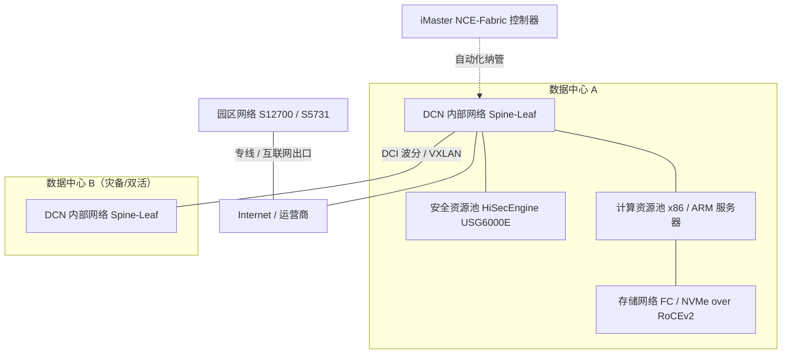

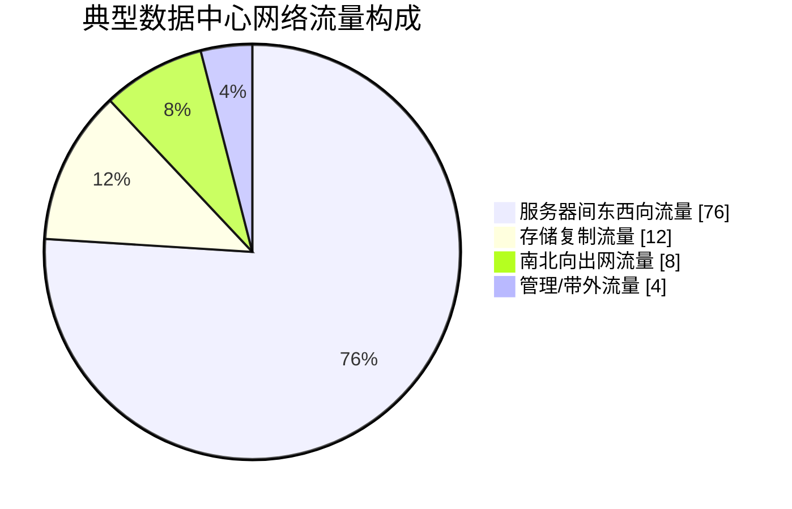

### 真题精练

**Q1.【真题·单选】** 下列哪一项不属于数据中心网络的典型逻辑分区？
A. DCN 内部网络  B. DCI 数据中心互联网络  C. 存储网络  D. 城域承载网

> **答案：D**
> **解析**：数据中心网络按业务与范围通常划分为 DCN 内部网络、DCI 互联、存储网络，以及与 DC 相邻的园区/出口网络。城域承载网（MAN）属于运营商网络范畴，承载的是公众/专线业务，不属于数据中心自身的网络分区。A、B、C 三项都是资料中反复出现的标准分区。

**Q2.【真题·多选】** 与传统园区网络相比，数据中心网络的特征包括：
A. 东西向流量占主导  B. 链路带宽以 25GE/100GE 为主  C. 依赖 STP 阻塞冗余链路保证无环  D. 高度依赖自动化和控制器  E. 对丢包和时延抖动极为敏感

> **答案：A、B、D、E**
> **解析**：C 错在"依赖 STP"。数据中心恰恰是要**摆脱** STP：STP 只能保住一棵树，会阻塞约一半链路，与"高带宽利用率、ECMP 多路径负载分担"的目标直接冲突。DC 的做法是把二层域压到 Leaf 以内，跨 Leaf 用三层路由 + ECMP，M-LAG 提供双活冗余而不引入环路阻塞。丢包敏感（E）是因为存储与 RDMA 流量对丢包零容忍，需要 PFC/ECN 的无损网络。

**Q3.【真题·判断】** 一个数据中心只能有一张网络，服务器、存储、管理流量都跑在同一组交换机上，因此不存在网络分区的概念。

> **答案：错误**
> **解析**：物理上确实可以共用硬件（如存储 NVMe over RoCEv2 就跑在以太网上），但**逻辑上必须分区**：DCN 内部网络、DCI、存储网络、带外管理网络的流量特征、SLA、安全等级完全不同。实训中常见做法是用**不同的 VLAN/VNI + 不同的 QoS 队列 + 不同的 PFC 优先级**在同一物理网络上划分出多个逻辑网络，这叫"物理合一、逻辑分离"。题目说"不存在网络分区概念"是错的。

**Q4.【真题·填空】** 数据中心之间为实现双活与容灾而建设的互联网络，英文缩写为 \_\_\_\_\_\_；服务器与存储阵列之间以 NVMe over \_\_\_\_\_\_ 方式跑在以太网上时，必须配合 PFC 与 ECN 才能做到无损。

> **答案：DCI（Data Center Interconnect）；RoCEv2（RDMA over Converged Ethernet version 2）**
> **解析**：DCI 强调"跨地理位置的 DC 互联"，技术栈偏波分与 VXLAN/EVPN 跨域。RoCEv2 把 RDMA（Remote Direct Memory Access）承载在 UDP/IP 之上（UDP 目的端口 4791），因此可跨三层转发；但 RDMA 假设网络无损，一旦丢包就要重传，性能断崖式下跌，所以必须用 PFC 做逐跳反压、用 ECN 做端到端拥塞标记。

**Q5.【真题·简答】** 请从流量模型、拓扑结构、链路利用率、配置方式四个维度，简述数据中心网络为什么不能直接沿用园区网络的设计。

> **答案要点**：
> 1. **流量模型**：园区是南北向（用户→互联网）为主，DC 是东西向（服务器↔服务器）为主，占比常达 70% 以上。南北向流量在汇聚/核心逐级收敛是合理的；东西向流量若也逐级收敛，就会在汇聚层形成"绕行+拥塞"。
> 2. **拓扑结构**：园区是核心-汇聚-接入的三层树，树的天然属性是"越往上带宽越收敛、路径唯一"；DC 需要任意两台服务器之间的**多条等价路径**，因此采用 Spine-Leaf 的 CLOS 两级（或三级）架构。
> 3. **链路利用率**：园区靠 STP 破环，STP 会阻塞冗余链路，实际可用带宽约为物理带宽的 50%，且拓扑变化时收敛慢（秒级）；DC 用 ECMP 让所有上行链路同时转发，链路利用率接近 100%，收敛目标是毫秒级。
> 4. **配置方式**：园区设备数量有限、变更少，手工 CLI 可行；DC 端口数以万计、租户和虚机频繁上下线，必须依赖模板化配置、ZTP 自动开局与 iMaster NCE-Fabric 控制器自动化下发，人工敲命令在工程上不可行。

**Q6.【真题·单选】** 关于存储网络，下列说法正确的是：
A. 存储网络必须使用 FC 组网，不能跑在以太网上
B. IP SAN 与 NVMe over RoCEv2 都是存储流量承载在以太网/IP 上的实现
C. 存储网络对丢包不敏感，只要带宽足够即可
D. 存储网络与业务网络共用 VLAN 是推荐做法，便于统一管理

> **答案：B**
> **解析**：A 错，FC 只是传统方案，如今 iSCSI（IP SAN）与 NVMe over RoCEv2/TCP 已大规模使用以太网承载存储；C 错，存储 I/O 对丢包和时延抖动极敏感，丢包会触发 TCP 重传或 RDMA 重传，导致 I/O 超时；D 错，存储流量必须与业务流量隔离（独立 VLAN/VNI + 独立 QoS 优先级 + PFC 优先级），否则业务突发流量会挤占存储带宽、破坏无损保证。

**Q7.【真题·实验】** 在 eNSP 或真机 CE6865 上完成一次"新设备入网检查"，要求用命令证明：设备版本、硬件单板状态、所有接口状态、某光口的光功率。

> **答案**：
> ```bash
> <CE6865> display version                                  // 记录VRP版本与补丁号，作为开局基线
> <CE6865> display device                                   // 确认主控、电源、风扇、业务板全部Normal
> <CE6865> display interface brief | include up             // 过滤出已UP的接口，核对与连线规划是否一致
> <CE6865> display transceiver interface 25GE1/0/1 verbose  // 读取Rx/Tx Power与温度，判断光路是否合格
> <CE6865> save                                             // 基线确认后保存，避免重启丢失
> ```
> **判分点**：命令拼写正确；能解释 `verbose` 参数用于输出收发光功率明细；能说出 25GE 光模块 Receive Power 一般应落在模块规格的灵敏度与饱和点之间（例如 25G eSR 多模典型 -10dBm ~ +2.4dBm 量级），过高会饱和、过低会 LOS。

### 易错点与排错
- **易错 1**：把 DCI 归类为"数据中心内部网络"。记法：**Intra-DC = 一栋楼内，Inter-DC = DCI**。
- **易错 2**：认为"用了 100GE 就是数据中心网络"。判据是拓扑与流量模型，不是单口速率。
- **易错 3**：混淆无损网络与"带宽足够"。**无损 = PFC + ECN + 严格优先级队列**，是机制问题而非带宽问题。
- **排错命令**：`display interface brief` 看链路、`display transceiver alarm interface` 看光模块告警、`display logbuffer` 看历史事件、`display device` 看硬件。若接口物理 UP 但业务不通，先看 `display interface` 里的 CRC/错包计数是否增长。

---

## 1.2 传统三层架构在数据中心的问题

### 考点定位
这是全册**最重要的原理题**，校赛省赛都爱考"为什么数据中心不用传统三层架构"，且常要求写出 3 条以上原因。分值 2~4 分，也常作为简答题或案例分析的论证部分。**易错点**：只答"STP 慢"而漏掉"东西向流量绕行""带宽利用率低""收敛比逐级放大"这几条。

### 原理精讲
传统三层架构即 **核心层（Core）—汇聚层（Aggregation）—接入层（Access）** 的树形结构，源自园区网。在数据中心里，它会同时暴露四个结构性缺陷：

**问题一：STP 收敛慢、且以"牺牲带宽"换取无环。**
以太网二层没有 TTL（Time To Live，生存时间）字段，一旦成环，广播帧会无限循环并迅速耗尽带宽与 MAC 表，这就是**广播风暴**。因此二层必须有破环协议，传统方案是 STP/RSTP/MSTP。其代价是：
- 拓扑上只保留**一棵逻辑树**，所有不在树上的冗余链路被置为 Blocking，**物理链路利用率上限约 50%**；
- 拓扑变化时要经历 Listening（15s）→ Learning（15s）→ Forwarding 的状态迁移，即使 RSTP 有了 Proposal/Agreement 快速握手，在大型二层域里收敛仍在**秒级**；
- 根桥（Root Bridge）位置决定了整个流量走向，一旦根桥或根链路故障，全网重新计算，期间大量流量中断。

数据中心要求"链路故障业务无感"，收敛目标常在 **50ms 以内**，STP 的量级差了两个数量级。

**问题二：东西向流量绕行，时延与跳数双重浪费。**
三层树形架构里，接入层交换机是"树的叶子"，**叶子之间没有横向链路**。假设机柜 A 的 Server1 要访问机柜 B 的 Server2：
- Server1 → ToR-A（接入）→ 汇聚 → （可能还要到核心）→ 汇聚 → ToR-B → Server2；
- 而物理上两台 ToR 可能就在同一排机柜，直线距离 10 米。流量却被迫"绕一大圈"。
更严重的是：**同一接入交换机下两台服务器的流量本不该上行**，但若它们被划在不同 VLAN（数据中心常见的按业务/租户划分 VLAN），三层转发依然要上行到网关所在设备再绕回来——这就是典型的 **流量绕行（Traffic Tromboning）**。绕行的直接代价是时延增加（每跳约 3~10μs，绕行多跳后在存储/分布式数据库场景下不可接受）、汇聚与核心链路被无谓占用。

**问题三：逐级收敛比放大，带宽利用率低。**
树形结构的固有规律是"越往上端口越少、带宽越收敛"。接入层 48 个 10GE 下行，上行往往只有 2×10GE 或 4×10GE，收敛比 24:1 甚至 48:1。这在园区网没问题（用户不会同时满速下载），但数据中心的服务器集群是**同步的**：分布式存储重建、MapReduce 类计算、虚机批量迁移时，所有服务器会同时满速发送，收敛点立刻成为丢包点，而丢包又会触发 TCP 全局同步（Global Synchronization）与超时重传，吞吐雪崩。

**问题四：扩展只能靠"升盒子"，无法横向扩展。**
传统架构扩容的方式是换更大的核心交换机（Scale-up），受限于机箱槽位与背板带宽，且每次升级都要停机割接。数据中心服务器的增长是**线性、持续**的，需要 **Scale-out（横向扩展）**：加一组 Spine/Leaf 就能线性增加带宽，并且扩容过程对在网业务零影响。

**总结一句可背的话**：传统三层架构是为"南北向为主、收敛可接受、变更不频繁"的园区场景设计的；数据中心是"东西向为主、要求全带宽无阻塞、变更频繁"，两者的**流量模型与冗余模型不匹配**，因此必须换架构，而不是换设备。

### 关键概念对照表

| 缺陷 | 机理 | 在园区网是否严重 | 在数据中心的后果 |
|---|---|---|---|
| STP 阻塞 | 二层成环会广播风暴，必须逻辑断链 | 不严重（用户带宽需求低） | 半数链路闲置，收敛秒级，带宽浪费 |
| 东西向绕行 | 树形叶子间无横向路径，必须上行再下行 | 不严重（横向访问少） | 时延增加、汇聚/核心链路被挤爆 |
| 逐级收敛 | 上行端口数远少于下行端口数 | 可接受（流量不同步） | 突发同步流量丢包，TCP 吞吐雪崩 |
| 扩展受限 | 核心槽位/背板带宽固定，只能 Scale-up | 不严重（几年一次升级） | 无法线性扩容，割接风险高 |
| 配置人工化 | 设备多、变更频繁 | 可接受 | 运维不可行，配置漂移导致故障 |

| 架构 | 冗余方式 | 链路利用率 | 收敛时间 | 横向扩展 |
|---|---|---|---|---|
| 核心-汇聚-接入 + STP | STP 阻塞冗余链路 | 约 50% | 秒级 | 换更大核心（Scale-up） |
| 核心-汇聚-接入 + 堆叠/CSS | 堆叠后仍依赖 STP/MSTP | 约 50%~100%（受限） | 秒级 | 受限 |
| Spine-Leaf + ECMP | 多路径等价转发 | 接近 100% | 毫秒级（BFD 联动） | 加 Leaf/加 Spine（Scale-out） |

### 华为设备配置
下面这段配置展示"传统思路"在 VRP 上的典型痕迹——你会看到大量 STP 与 MSTP 相关命令。在数据中心 Leaf 上，这些命令通常是要**被关掉或改造**的（原因见第 3 章）：

```bash
<CoreS12700> system-view
[CoreS12700] stp mode rstp                     // 启用RSTP，缩短收敛时间（园区常规选择）
[CoreS12700] stp root primary                  // 指定核心为根桥（传统园区必须显式规划根桥）
[CoreS12700] stp bpdu-protection               // 边缘端口收到BPDU即关闭，防止接入侧私接交换机
[CoreS12700] interface GigabitEthernet1/0/1
[CoreS12700-GigabitEthernet1/0/1] stp edged-port enable   // 接服务器/终端的端口设为边缘端口，不参与生成树
[CoreS12700-GigabitEthernet1/0/1] quit
[CoreS12700] display stp brief                 // 查看各端口STP角色与状态，验证阻塞口是否符合规划
[CoreS12700] display stp root                  // 查看根桥信息，确认根桥落在核心

# ---- 数据中心的替代做法（对比记忆）----
[CE6865] stp disable                           // Leaf下行接服务器口通常直接关闭STP（服务器不做STP）
[CE6865] interface 100GE1/0/1
[CE6865-100GE1/0/1] undo stp enable            // 上行互联口也用ECMP+BFD替代STP破环
[CE6865-100GE1/0/1] quit
[CE6865] bfd                               // 全局使能BFD，配合路由实现毫秒级故障检测
[CE6865] display bfd session all               // 查看BFD会话状态，确认故障检测生效
```

### 示意图

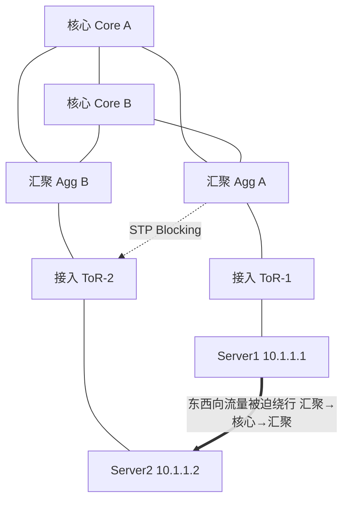

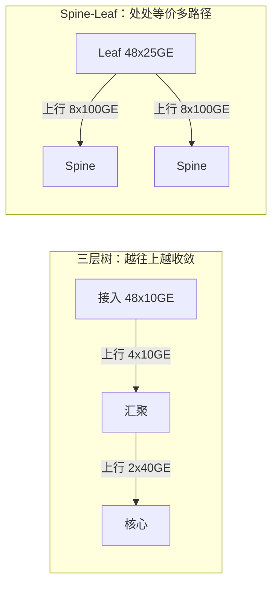

### 真题精练

**Q1.【真题·单选】** 传统三层架构在数据中心最主要的三个问题是：
A. STP 收敛慢、东西向流量绕行、带宽利用率低
B. 不支持 VLAN、不支持 OSPF、不支持 ACL
C. 设备太贵、功耗太高、噪声太大
D. 不支持 IPv6、不支持 QoS、不支持组播

> **答案：A**
> **解析**：B、C、D 都是"技术能力缺失"或"工程条件"层面的陈述，而三层架构的真正问题是**结构性的**：STP 的破环机制牺牲带宽且收敛慢；树形结构导致横向访问必须上行绕行；逐级收敛使得突发同步流量丢包。这三条也被称为"数据中心网络三大痛点"，是标准答案。

**Q2.【真题·多选】** 关于 STP 在数据中心的局限，正确的是：
A. STP 为保证无环会阻塞冗余链路，实际可用带宽远低于物理带宽
B. RSTP 收敛仍在秒级，无法满足数据中心毫秒级收敛要求
C. STP 的根桥位置会影响全网流量走向，根桥切换会引发大面积中断
D. STP 会自动把环路改造成等价多路径负载分担

> **答案：A、B、C**
> **解析**：D 完全错误。STP 的目标是**破环**，做法是逻辑上断开链路（Blocking/Discarding），而不是把它变成转发路径。真正的"等价多路径同时转发"要靠三层 ECMP 或链路聚合（Eth-Trunk/M-LAG）实现。这是考生最容易搞混的一点：**STP 消除环路，ECMP/聚合利用多路径，二者目的相反但都需要"无环"这一前提**。

**Q3.【真题·判断】** 在数据中心里，同一台接入交换机下两台服务器之间的流量，只要它们属于同一个 VLAN，就不会上行到汇聚层。

> **答案：错误**
> **解析**：这句话只在"两台服务器确实在同一 VLAN 且二层直达"时成立。数据中心的现实是：为了隔离业务/租户，同一机柜内的服务器常被划入不同 VLAN，此时必须经过网关做三层转发；如果网关部署在汇聚或核心（传统做法），流量就要上行绕行再回来。即使同 VLAN，若中间被 STP 阻塞或跨了 M-LAG 的 peer-link，路径也可能不是最短。正确结论是：**二层直达才不会上行；跨网段一定会走网关，因此网关位置决定了绕行程度**——这正是三层网关要"下沉到 Leaf"的原因（见第 3 章）。

**Q4.【真题·填空】** 传统树形架构缩短收敛比、提升带宽利用率只能靠更换更大容量的设备，这种方式称为 \_\_\_\_\_\_\_\_；数据中心通过增加 Spine/Leaf 节点线性扩容的方式称为 \_\_\_\_\_\_\_\_。

> **答案：Scale-up（纵向扩展）；Scale-out（横向扩展）**
> **解析**：Scale-up 受单机箱槽位与背板带宽上限约束，且升级往往需要停机割接；Scale-out 依赖 CLOS 拓扑的规则性——加一组 Leaf 只影响本 POD，加一组 Spine 只影响上行端口分配，对已有业务零中断。数据中心选型时优先 Scale-out，这也解释了为什么框式设备的"槽位数量"不是唯一指标，**架构是否可横向扩展**才是。

**Q5.【真题·简答】** 请解释"东西向流量绕行（Tromboning）"产生的根本原因，并给出两种在数据中心中避免它的设计手段。

> **答案要点**：
> **根本原因**：三层树形架构中，接入层交换机之间没有横向直连链路，所有非本机转发流量必须"上行到有路由/网关能力的上层设备，再下行"。当通信双方物理位置很近（同机柜、同排）却分属不同网段时，流量被强制拉长路径，形成 U 形绕行。
> **设计手段一**：**网关下沉 + Leaf 做分布式网关**。把三层网关（VLANIF 或 VXLAN 分布式网关）部署在 Leaf 上，同 Leaf 下的跨网段流量直接在 Leaf 内部三层转发，不出上行口；若采用 VXLAN 分布式网关（如 CE 系列支持的集中式/分布式网关方案），跨 Leaf 的跨网段流量走最优的 Leaf→Spine→Leaf 路径，且各 Leaf 网关 MAC/IP 一致，虚机迁移后网关不变。
> **设计手段二**：**扁平化 Spine-Leaf 拓扑 + 路由直达**。取消汇聚层，Leaf 与 Spine 全互联，任意 Leaf 间只隔一跳 Spine；同时让服务器网关落在 Leaf，路径固定为"Leaf→Spine→Leaf"两跳，不再有"接入→汇聚→核心→汇聚→接入"的五跳绕行。配套要求是服务器网段规划要"按 Leaf/机柜聚合"，使同一业务尽量收敛在少量 Leaf 下，减少跨 Leaf 横向流量。

**Q6.【真题·排错】** 某数据中心沿用三层架构，运维反馈"每天上午 9 点备份任务启动后，跨机柜访问的时延从 0.3ms 飙到 20ms，且伴随丢包。汇聚交换机 CPU 到 80%"。请给出你的判断与排查步骤。

> **答案**：**判断**：这是典型的"逐级收敛 + 东西向同步突发"叠加问题。备份任务同时启动，所有服务器满速发送，东西向流量在汇聚层上行口形成微突发，超出上行走廊带宽后丢包；大量丢包触发大量报文重传与二层 MAC 学习/泛洪，进一步抬升汇聚 CPU。
> **排查步骤**：
> ```bash
> <AggCE> display interface 100GE1/0/1               // 看上行口是否出现丢包计数与速率打满
> <AggCE> display interface 100GE1/0/1 | include drops  // 关注Input/Output drops与微突发
> <AggCE> display cpu-usage                          // 确认CPU高是哪个任务（转发/协议/中断）
> <AggCE> display cpu-defend statistics              // 看是否有大量协议报文上送（ARP/STP风暴迹象）
> <AggCE> display mac-address summary                // MAC表规模是否异常膨胀
> <AggCE> display qos queue statistics interface 100GE1/0/1  // 看各队列丢包，定位拥塞队列
> ```
> **整改建议**：①把汇聚层取消，改为 Spine-Leaf，服务器网关下沉至 Leaf，缩短路径并让流量分散到多条等价上行；②上行改为多条链路并启用基于五元组的 ECMP 哈希，避免哈希极化；③对存储/备份流量用 QoS 严格优先级队列 + PFC，避免与业务突发互相挤占；④引入 BFD 加快故障收敛，减少因震荡导致的泛洪。**这题的高分点在"先定位拥塞队列，再谈架构整改"，而不是直接答'换 Spine-Leaf'。**

### 易错点与排错
- **易错 1**：认为 STP 能"利用"多路径。STP 是**破环**，多路径利用要靠 Eth-Trunk/M-LAG（二层）或 ECMP（三层）。
- **易错 2**：把"三层架构有冗余链路"当成"带宽翻倍"。冗余链路被 STP 阻塞时带宽不增加。
- **易错 3**：忽略"网关位置"对绕行的影响。网关在核心，即使拓扑扁平了，跨网段流量依然会绕到核心。
- **易错 4**：只看平均值不看微突发。数据中心拥塞常是**μs 级微突发**，平均利用率可能只有 30%，但瞬时已溢出，必须看队列丢包与 PFC 统计。
- **排错命令**：`display interface` 的 `Input/Output drops`、`display qos queue statistics interface` 的队列丢弃、`display cpu-defend statistics` 的协议报文上送、`display bfd session all` 的会话抖动。

---

## 1.3 Spine-Leaf（叶脊）架构与 CLOS 网络

### 考点定位
必考核心考点。考法包括：给一张拓扑让你判断是否符合 Spine-Leaf 规则；问"两台 Leaf 之间流量经过几跳"；问"为什么 Leaf 之间不直连"；问 CLOS 的三级结构与无阻塞条件。分值 2~5 分，也常与收敛比计算合并出题（见 1.4）。

### 原理精讲
**CLOS 网络**由 Charles Clos 于 1953 年提出，用于电话交换网，其核心思想是：**用多个小规模交换单元组成多级网络，通过级间全互联（或部分互联）实现大容量交换，并保证任意输入到任意输出存在多条等价路径**。数学上，一个三级 CLOS 网络（m 个输入级交换单元、每单元 n 入 k 出；r 个中间级单元；输出级对称）在满足 **k ≥ 2n − 1** 时是**严格无阻塞（Strictly Non-blocking）**的。Spine-Leaf 就是三级 CLOS 的工程化简化：**Leaf 是输入/输出级，Spine 是中间级**，服务器是"用户线"。

Spine-Leaf 的三条铁律（考点！）：

**铁律一：Leaf 只连服务器和 Spine，Leaf 之间不直连。**
为什么不能直连？如果 Leaf 之间也互连，拓扑就不再是规则的两级 CLOS，而是变成"部分互联的网状"，会导致：① 路径长度不一致（有的 Leaf 间 1 跳、有的 2 跳），使 ECMP 无法形成等价多路径，流量分配失衡；② 二层/三层邻接关系爆炸（N 台 Leaf 两两直连需要 N(N−1)/2 条链路，扩展性 O(N²)）；③ 破坏"每台 Leaf 到任意 Spine 一跳、到任意其它 Leaf 两跳"的**可预测性**。规则性本身就是价值：延迟可计算、容量可计算、故障域可计算。

**铁律二：Spine 之间不直连；Spine 只做转发，不接服务器。**
Spine 不直连的原因同上（避免破坏等价路径与规则性）。Spine 不接服务器是因为：Spine 的数量决定"横向带宽总量"，每台 Spine 的端口全部用于下行到 Leaf；如果接了服务器，就等于把"骨干端口"浪费在"接入"上，同时使 Spine 成为服务器流量的单点（服务器与 Spine 同故障域）。更重要的是：**Spine 不承载网关，也不放业务 VLAN**，它只是转发管道，这让 Spine 的配置可以做到"极简且一致"，批量复制零风险。

**铁律三：Leaf 到每台 Spine 都有一条（或一组）上行链路，且带宽一致。**
这是 ECMP 生效的前提。若 Leaf 到 Spine-1 是 2×100GE、到 Spine-2 是 8×100GE，ECMP 按"等价"计算时仍会把流量平分成两份，导致 Spine-1 侧拥塞而 Spine-2 侧空闲——这叫**哈希极化（Hash Polarization）** 的带宽不对称版本。因此工程上要求：**同一 Leaf 到各 Spine 的上行链路数量与速率必须完全一致**，或者按带宽配置 ECMP 权重（部分平台支持，但会引入复杂度，不推荐）。

**Server 到 Server 的路径等价性**：在标准 Spine-Leaf 中，Server1（挂 Leaf1）到 Server2（挂 Leaf2）存在 **S 条等价路径**（S = Spine 数量），每条路径为"Leaf1 → Spx → Leaf2"，固定 2 跳。同 Leaf 下两台服务器则为 1 跳（Leaf 内部直转）。这种**路径数与设备数解耦**的特性极为重要：把 Spine 从 2 台扩到 4 台，横向带宽翻倍，而服务器侧的路径数量、路由条目、跳数都不变。

**为什么必须三层转发而不是二层？** Leaf 与 Spine 之间一般是三层互联（每台 Leaf 一个 /31 或 /30 互联地址，全 Fabric 跑 OSPF 或 EBGP，通常是 EBGP——因为每条链路是独立 AS 或同一 AS 内的不同邻居，BGP 的路由策略能力强、可压 route reflector/EVPN），核心目的是让 **ECMP 在所有上行链路上同时生效**。如果是二层互联，就又回到 STP 破环或 Eth-Trunk 的老路，失去 O(N) 扩展性。

### 关键概念对照表

| 连接关系 | 是否允许 | 原因 |
|---|---|---|
| Leaf ↔ Server | ✅ 必须 | Leaf 是服务器的接入点，网关与 VLAN/VNI 落在这里 |
| Leaf ↔ Spine | ✅ 必须 | 构成 CLOS 的级间链路，承载全部横向流量 |
| Leaf ↔ Leaf | ❌ 禁止 | 破坏路径等价性与可预测性，扩展性退化为 O(N²) |
| Spine ↔ Spine | ❌ 禁止 | 同上，且会把"横向骨干"变成流量绕行点 |
| Spine ↔ Server | ❌ 禁止 | 浪费骨干端口，形成单点故障域，破坏 Spine 配置一致性 |
| Leaf ↔ Border Leaf | ✅ 允许 | 通过 Border Leaf 出网/接防火墙/DCI，属于对齐 CLOS 的扩展 |

| 参数 | 典型值 | 说明 |
|---|---|---|
| Spine 数量 | 2（小规模）/ 4 / 8 | 决定横向路径数与总带宽；一般与 Leaf 上行端口数对应 |
| 单 POD Leaf 数量 | 8 ~ 32 | 受 Spine 端口数限制：Leaf 数 × 每 Leaf 上行数 ≤ Spine 端口数 |
| Leaf 上行链路 | 4×100GE ~ 8×100GE | 与下行带宽共同决定收敛比 |
| Leaf 下行链路 | 48×25GE / 48×10GE | 接服务器；服务器一般双归到 2 台 Leaf |
| Leaf 到 Leaf 跳数 | 2 | 固定：Leaf→Spine→Leaf |
| 同 Leaf 内跳数 | 1 | Leaf 内部三层直转 |
| 互联路由协议 | EBGP（主流）/ OSPF | EBGP 更易做策略与 EVPN 控制面 |
| 故障检测 | BFD（Bidirectional Forwarding Detection） | 与路由联动，收敛目标 < 200ms，可到 50ms |

### 华为设备配置
标准 Spine-Leaf 的 Leaf/Spine 三层互联配置（EBGP 方案，CE 系列 VRP V200）：

```bash
# ===== Leaf-1：上行两条100GE，分别连Spine-1/Spine-2 =====
<CE6865> system-view
[CE6865] sysname Leaf-1
[Leaf-1] interface 100GE1/0/1
[Leaf-1-100GE1/0/1] description To-Spine-1                 // 接口描述必须写对端，排错第一依据
[Leaf-1-100GE1/0/1] undo portswitch                        // 三层互联必须是三层口（CE默认可为二层口）
[Leaf-1-100GE1/0/1] ip address 10.0.1.1 30                 // 与Spine-1用/30互联地址
[Leaf-1-100GE1/0/1] quit
[Leaf-1] interface 100GE1/0/2
[Leaf-1-100GE1/0/2] description To-Spine-2
[Leaf-1-100GE1/0/2] undo portswitch
[Leaf-1-100GE1/0/2] ip address 10.0.2.1 30
[Leaf-1-100GE1/0/2] quit
[Leaf-1] bfd                                               // 全局开启BFD
[Leaf-1] ospf 1 router-id 1.1.1.1
[Leaf-1-ospf-1] bfd all-interfaces enable                   // 所有OSPF接口启用BFD，实现毫秒级故障感知
[Leaf-1-ospf-1] area 0
[Leaf-1-ospf-1-area-0.0.0.0] network 10.0.1.0 0.0.0.3
[Leaf-1-ospf-1-area-0.0.0.0] network 10.0.2.0 0.0.0.3
[Leaf-1-ospf-1-area-0.0.0.0] quit
[Leaf-1-ospf-1] quit
[Leaf-1] interface Vlanif 100                              // 服务器业务网关下沉到Leaf
[Leaf-1-Vlanif100] ip address 192.168.100.1 24             // 同Leaf下跨网段流量不出上行口
[Leaf-1-Vlanif100] quit

# ===== Spine-1：只做转发，配置极简且与Spine-2保持一致 =====
<CE8850> system-view
[CE8850] sysname Spine-1
[Spine-1] interface 100GE1/0/1
[Spine-1-100GE1/0/1] description To-Leaf-1
[Spine-1-100GE1/0/1] undo portswitch
[Spine-1-100GE1/0/1] ip address 10.0.1.2 30
[Spine-1-100GE1/0/1] quit
[Spine-1] ospf 1 router-id 2.2.2.2
[Spine-1-ospf-1] bfd all-interfaces enable
[Spine-1-ospf-1] area 0
[Spine-1-ospf-1-area-0.0.0.0] network 10.0.1.0 0.0.0.3
[Spine-1-ospf-1-area-0.0.0.0] quit
[Spine-1-ospf-1] quit

# ===== 验证：等价路径是否为Spine数量 =====
[Leaf-1] display ip routing-table 192.168.200.0       // 查看去往对端Leaf网段的路由
[Leaf-1] display ip routing-table 192.168.200.0 verbose  // 关注Flags是否为ECMP、下一跳是否S2两条
[Leaf-1] display ospf peer brief                      // 邻居是否全部Full
[Leaf-1] display bfd session all verbose              // BFD会话是否Up
```

### 示意图

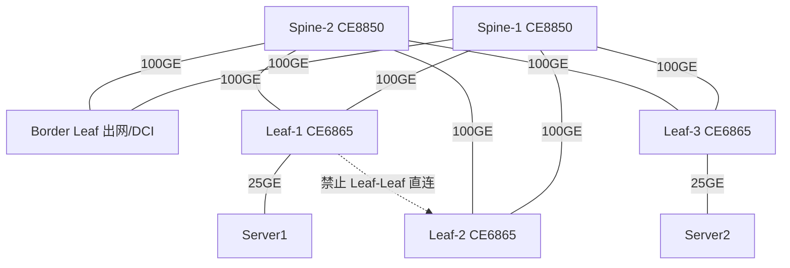

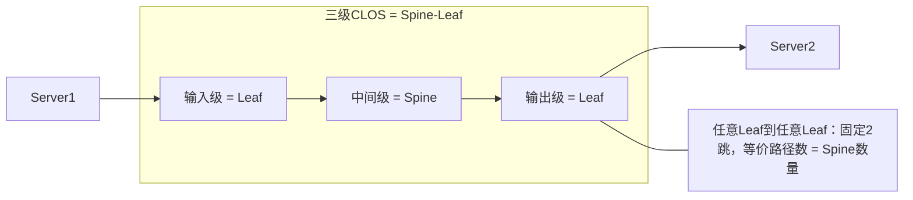

### 真题精练

**Q1.【真题·单选】** 标准 Spine-Leaf 架构中，Leaf-1 下的 Server1 访问 Leaf-3 下的 Server2，经过的交换机跳数为（假设采用标准两级 CLOS）：
A. 1 跳  B. 2 跳  C. 3 跳  D. 取决于 VLAN 数量

> **答案：B**
> **解析**：路径固定为 Leaf-1 → Spine-x → Leaf-3，中间只经过一台 Spine，共 2 跳。同 Leaf 内两台服务器之间是 1 跳（Leaf 内部直转）。这个"跳数固定"是 Spine-Leaf 的关键价值：**扩容 Spine 只增加等价路径条数，不增加跳数**。D 是干扰项，VLAN 数量与跳数无关。

**Q2.【真题·多选】** 关于 Spine-Leaf 架构的设计原则，正确的是：
A. Leaf 之间不应直连，否则破坏路径等价性
B. Spine 不应连接服务器，其端口应全部用于下行到 Leaf
C. Spine 之间可以任意互连以增加带宽
D. Leaf 到各 Spine 的上行链路带宽应保持一致
E. Spine 的数量决定了 Leaf 间等价路径的条数

> **答案：A、B、D、E**
> **解析**：C 错。Spine 之间互连在标准二级 CLOS 中是不允许的：它会引入"某条路径经过 2 台 Spine"的更长路径，破坏"任意 Leaf 间恒为 2 跳"的规则性，ECMP 不再等价；同时 Spine 互连会造成横向流量的额外绕行与收敛问题。如果确实需要更大规模，正确做法是**升级为三级 CLOS**（增加一个 Spine 层，即 Superspine），而不是在同一级里随意加横线。

**Q3.【真题·判断】** Spine-Leaf 架构中，Leaf 与 Spine 之间必须运行 STP 来防止环路。

> **答案：错误**
> **解析**：Leaf 与 Spine 之间通常是**三层互联 + 路由（OSPF 或 EBGP）+ ECMP**。三层路由本身没有二层环路问题（IP 报文有 TTL，逐跳递减，不会被无限循环），因此完全不需要 STP，反而要**主动关闭 STP** 以避免 BPDU 泛洪和不必要的收敛事件。STP 存在的唯一理由是"二层域成环"，而 Spine-Leaf 的设计原则就是把二层域限制在 Leaf 之内（甚至只到服务器网卡），跨越 Leaf 一律走三层。

**Q4.【真题·填空】** CLOS 网络由 Charles Clos 提出，一个三级 CLOS 网络在满足中间级交换单元数 \_\_\_\_\_\_ 时是无阻塞的（设输入级每单元有 n 个输入、k 个输出）；Spine-Leaf 架构中担任"中间级"角色的是 \_\_\_\_\_\_。

> **答案：k ≥ 2n − 1；Spine 交换机**
> **解析**：经典三级 CLOS 的严格无阻塞条件是中间级单元数 m ≥ 2n − 1（这里 k 依教材符号而定，核心含义是"中间级数量必须至少是输入级端口数的两倍减一"）。工程上数据中心并不追求严格无阻塞，而是追求"统计无阻塞 + 成本可控"，因此采用收敛比（如 3:1）来配置。Spine 在 Spine-Leaf 中对应中间级交换单元，负责 Leaf 之间的横向转发。

**Q5.【真题·简答】** 请解释为什么 Spine 交换机的配置可以做到"极简且多台完全一致"，以及这对数据中心运维有什么价值。

> **答案要点**：
> **为什么极简**：Spine 的职责只有一条——把从一台 Leaf 收到的报文转发给另一台 Leaf。它不接服务器，因此不需要配置业务 VLAN、VLANIF 网关、ACL、QoS 业务策略；不直连其他 Spine，因此不需要水平分割或复杂的路由策略。它需要配置的只有：互联物理口（undo portswitch + IP 地址）、路由协议（OSPF 或 EBGP + BFD）。所有 Spine 的路由配置除接口 IP 与 router-id 外完全对称。
> **运维价值**：① **模板化**：把 Spine 配置做成一个模板，加新 Spine 时只替换 IP 与主机名，避免人为差异导致的"配置漂移"；② **故障定位快**：Spine 上没有业务策略，一旦业务不通，问题几乎必然在 Leaf 或服务器侧，缩小了排查范围；③ **升级风险低**：Spine 配置简单、变更少，版本升级的兼容风险最小；④ **可自动化**：极简且一致的配置非常适合 ZTP/控制器批量下发（第 2 章），是 Fabric 自动化的前提。

**Q6.【真题·排错】** 某 Fabric 中 Leaf-1 到 Spine-1 用的是 4×100GE，到 Spine-2 只有 2×100GE。运维发现 Spine-1 下行口长期 80% 利用率，Spine-2 只有 40%，且业务偶发时延抖动。请判断原因并给出整改方案。

> **答案**：**原因**：Leaf-1 到两台 Spine 的上行带宽不对称（400G vs 200G），而路由协议认为两条路径"等价"（都是 OSPF/EBGP 的等价下一跳），ECMP 哈希时按**路径条数**而非**带宽**平均分配流量，导致每台 Spine 各承担约 50%，Spine-1 侧 400G 走廊被打到 80%、Spine-2 侧 200G 走廊只有 40%——**Spine-1 已成瓶颈，Spine-2 尚未跑满**，整体呈现"一台撑死、一台饿着"的极化现象。
> **排查步骤**：
> ```bash
> [Leaf-1] display ip routing-table 192.168.200.0 verbose       // 确认去对端Leaf是否为2条等价下一跳
> [Leaf-1] display interface 100GE1/0/1 | include rate           // 逐口看速率，验证400G与200G走廊利用率
> [Spine-1] display interface 100GE1/0/1 | include rate
> [Leaf-1] display eth-trunk 1 verbose                           // 若上行用了Eth-Trunk，看成员口分布是否均匀
> [Leaf-1] display load-balance hash-mode                        // 查看哈希模式（五元组/源目的MAC）
> ```
> **整改方案**：①**对齐带宽**：把 Spine-2 侧也扩为 4×100GE，恢复真正的路径等价（首选，符合 CLOS 规则）；②若短期无法加线，则在 Leaf 侧用 `load-balance` 调整或对上行做 Eth-Trunk 后按成员口哈希，但根本问题无法通过哈希解决；③核查哈希模式是否过于简单（如仅按源 MAC），改为五元组哈希并开启动态负载分担（`load-balance dynamic`），减少同流固定走一条路带来的局部拥塞。

**Q7.【真题·单选】** 在 Spine-Leaf 架构中增加一台 Spine 交换机，最直接的效果是：
A. Leaf 之间的跳数变为 3 跳  B. Leaf 之间的等价路径数增加，横向带宽提升
C. 需要给所有服务器重新规划网关地址  D. 必须同时启用 STP 重新计算拓扑

> **答案：B**
> **解析**：加 Spine 是 Scale-out 的典型动作：只要每台 Leaf 都有空闲上行端口并新增一条到该 Spine 的链路，ECMP 的等价路径数就从 S 增加到 S+1，横向总带宽线性提升。A 错，路径仍为 2 跳；C 错，服务器网关在 Leaf 上，与 Spine 数量无关；D 错，Leaf-Spine 之间是三层路由，与 STP 无关。

### 易错点与排错
- **易错 1**：认为"Leaf 之间加直连能减少一跳、提升性能"。它会破坏 ECMP 等价性并让扩展性退化为 O(N²)，是设计禁忌。
- **易错 2**：把 Spine 当汇聚用，在 Spine 上放 VLANIF 网关。网关必须在 Leaf（逼近服务器），Spine 必须保持无状态。
- **易错 3**：上行带宽不对称导致 ECMP 极化。**ECMP 按路径条数均分，不按带宽加权**（除非平台支持加权且显式配置）。
- **易错 4**：忘记 `undo portswitch`。CE 系列部分接口默认是二层口，配 IP 地址会报错。
- **排错命令**：`display ip routing-table x.x.x.x verbose`（看 ECMP 下一跳数量）、`display ospf peer brief` / `display bgp peer`（邻居状态）、`display bfd session all`（故障检测）、`display interface | include rate`（利用率）、`display eth-trunk verbose`（成员口分布）。

---

## 1.4 东西向与南北向流量、收敛比与 Fat-Tree 计算

### 考点定位
**计算题主战场**。校赛省赛几乎必出"给出交换机端口数，求最大收敛比/最多能接多少服务器/需要几台 Spine"的题。分值 3~6 分，且容易因单位算错（Gbps/Tbps 混用）或定义搞反（下行:上行）而丢分。**必须把公式背到能秒算**。

### 原理精讲
**南北向流量（North-South Traffic）**：数据中心与外部之间的流量，即"客户端 → DC 入口 → 服务器"或"服务器 → DC 出口 → 互联网"。它必须逐级汇聚到出口，流量方向单一，可预测性强。**东西向流量（East-West Traffic）**：数据中心内部服务器之间、虚机之间、存储之间的流量。它没有固定的"上游"，任意两台服务器都可能成为通信对，流量矩阵呈**网状（Any-to-Any）**。现代数据中心东西向流量普遍占 70%~80%，且在分布式存储（三副本重建）、大数据（Shuffle）、AI 训练（AllReduce）场景下会瞬间打满全网。

为什么东西向占比高会"改变架构选择"？因为：
- 南北向场景下，出口带宽是瓶颈且集中，网络设计只需保证"汇聚到出口这一段不收敛过度"；
- 东西向场景下，**没有集中的瓶颈，瓶颈是"任意两点之间的平均可用带宽"**，这要求网络提供**接近无阻塞的 Any-to-Any 带宽**，而唯一能做到这一点的拓扑就是 CLOS/Fat-Tree，且必须让所有上行链路同时工作（ECMP）。

**收敛比（Oversubscription Ratio）** 的定义与公式：

```
收敛比 = 下行带宽总和 : 上行带宽总和
       = Σ(服务器侧端口速率) : Σ(上行互联端口速率)

等价表述：
收敛比 = 1 : U，其中 U = 下行带宽总和 / 上行带宽总和
1:1  → 无阻塞（Non-blocking），下行带宽 = 上行带宽
3:1  → 下行带宽是上行的 3 倍，即"3 个服务器侧 Gbps 共享 1 个上行 Gbps"
```

**关键约定（考试务必写清）**：华为教材与多数厂商资料采用 **下行:上行** 的写法。`1:1` 表示无阻塞，`3:1` 表示超配 3 倍。若看到 "1:3"，那多半是把上下行写反了或者用了"上行:下行"约定——**答题时一定要在公式里注明方向**，这是阅卷的给分点。

**Fat-Tree（胖树）与 k-ary Fat-Tree**：Fat-Tree 是 CLOS 在数据中心的一种规则化实例，"胖"的含义是**越靠近根，链路带宽越粗**（不像传统树越往上越细），从而保证任意两点间的带宽不收敛。最常用的是 **k-ary Fat-Tree（k 元胖树）**：用 **k 端口交换机**构建三级结构，参数如下：

| 结构 | 组成 | 数量 | 每台连接方式 |
|---|---|---|---|
| Pod（集群） | k 个（每个 Pod 含 k/2 台接入 + k/2 台汇聚） | k | — |
| 接入层（Edge/Access） | 每个 Pod 内 k/2 台 | k²/2 | k/2 口接主机，k/2 口接汇聚 |
| 汇聚层（Aggregation） | 每个 Pod 内 k/2 台 | k²/2 | k/2 口接接入，k/2 口接核心 |
| 核心层（Core） | 第 i 台汇聚连第 i 组核心 | (k/2)² | 每个核心 k 口，各连一个 Pod 的一台汇聚 |

```
主机总数 N = k³ / 4
接入层每台交换机接主机数 = k / 2
核心层交换机数量 = (k/2)²
对称 k-ary Fat-Tree 的收敛比 = 1:1（无阻塞）
```

**算例 1（单台 Leaf 收敛比）**：某 Leaf 使用 CE6865-48S8CQ，48×25GE 下行接服务器，8×100GE 上行接 Spine。
```
下行带宽 = 48 × 25 Gbps = 1200 Gbps
上行带宽 =  8 × 100 Gbps =  800 Gbps
收敛比 = 1200 : 800 = 1.5 : 1
```
即此时下行是上行的 1.5 倍，超配 1.5 倍。若想做到 **3:1**，需要多少下行带宽？
```
设下行总带宽为 D，要求 D / 800 = 3 → D = 2400 Gbps
服务器侧若为 25GE，需要 2400 / 25 = 96 个下行口 → 超过 48 口上限，单台Leaf做不到
结论：在 48×25GE + 8×100GE 的盒式设备上，3:1 收敛比需要两台Leaf共同承载 96 台单归服务器
```
**算例 2（配套 Spine 数量与 Leaf 数量）**：
```
条件：Spine 使用 CE8850-64CQ（64×100GE），每台 Leaf 需要 8 个 100GE 上行口
每台 Spine 可连 Leaf 数 = 64 / 8 = 8 台
若 POD 内有 8 台 Leaf，则仅需 1 台 Spine（但无冗余）→实际需 2 台 Spine（每台用 8 口，共占用 16 口，余 48 口可接 Border Leaf/DCI）
若 POD 内有 16 台 Leaf，则 2 台 Spine 各需 16 口，共 32 口；仍可冗余
若 POD 内有 32 台 Leaf，则 2 台 Spine 各需 32 口，共 64 口，100GE 端口刚好用满，无余量
```
**算例 3（k-ary Fat-Tree，k=8）**：
```
取值：k = 8（每台交换机 8 个端口）
Pod 数 = k = 8 个
每 Pod 接入交换机 = k/2 = 4 台，汇聚交换机 = k/2 = 4 台
核心交换机数 = (k/2)² = 16 台
接入层每台接主机 = k/2 = 4 台
主机总数 N = k³/4 = 512/4 = 128 台
接入交换机总数 = k²/2 = 32 台
每台接入的上行 = k/2 = 4 条，下行到主机 = k/2 = 4 条 → 端口数对称，收敛比 1:1
验证：接入交换机总端口 32×8 = 256；用于主机 128 个口，用于上行 128 个口 → 严格对称 ✔
```
**为什么工程上常用 3:1 而不是 1:1？** 因为"所有服务器同时满速互相通信"的稳态在现实中极少出现；实测数据中心平均链路利用率常在 10%~30%，突发峰值才是问题。3:1 在成本（少一半上行光模块与 Spine 端口）与性能之间取得平衡。但对**存储、RDMA、AI 训练**这类"必须无损、突发极猛"的流量，则要求 1:1 无阻塞或专门组网。

### 关键概念对照表

| 对比项 | 南北向流量 | 东西向流量 |
|---|---|---|
| 通信双方 | 外部客户端 ↔ DC 内服务器 | DC 内服务器/虚机之间 |
| 流量占比（典型） | 20%~30% | 70%~80% |
| 流量矩阵 | 星形汇聚，方向单一 | 网状，Any-to-Any |
| 路径长度 | 长（需出网、经防火墙/NAT） | 短（常为 2 跳） |
| 瓶颈位置 | 出口带宽、安全设备 | 上行链路收敛比、哈希均匀度 |
| 优化手段 | 出口链路聚合、负载均衡、CDN | ECMP、无阻塞 CLOS、PFC/ECN |
| 故障影响 | 影响对外服务 | 影响集群内部（存储重建、计算任务） |

| 收敛比 | 下行:上行 | 含义 | 典型场景 | 成本 |
|---|---|---|---|---|
| 1:1 | 1200G : 1200G | 无阻塞 | 存储、RDMA、AI 训练、金融低时延 | 最高 |
| 1.5:1 | 1200G : 800G | 轻度超配 | 通用计算 POD | 中 |
| 3:1 | 2400G : 800G | 中度超配 | 互联网业务、虚拟机集群 | 较低 |
| 5:1 | 4000G : 800G | 重度超配 | 开发测试、非关键业务 | 最低 |

| k-ary Fat-Tree 公式 | 表达式 | 说明 |
|---|---|---|
| Pod 数 | k | 每个 Pod 是一个独立集群单元 |
| 每 Pod 接入/汇聚交换机 | k/2 台 / k/2 台 | 接入与汇聚对称 |
| 核心交换机数 | (k/2)² | 汇聚与核心全互联 |
| 主机总数 | k³/4 | k 为交换机端口数 |
| 接入层每台接主机 | k/2 | 其余 k/2 口全部上行 |
| 收敛比 | 1:1 | 对称设计，端口数上下行相等 |

### 华为设备配置
收敛比与端口规划在设备上体现为"下行口 + 上行口 + 互联口"的划分，配置时应显式记录到接口描述，便于巡检核对：

```bash
# ===== Leaf：下行接服务器（二层口 + 业务VLAN），上行做三层 =====
[Leaf-1] vlan batch 100 200 300                             // 批量创建业务VLAN（服务器侧）
[Leaf-1] interface 25GE1/0/1
[Leaf-1-25GE1/0/1] description To-Server-Rack1-U01           // 描述写清机柜与U位，巡检效率翻倍
[Leaf-1-25GE1/0/1] port link-type access
[Leaf-1-25GE1/0/1] port default vlan 100
[Leaf-1-25GE1/0/1] quit
[Leaf-1] interface 25GE1/0/2
[Leaf-1-25GE1/0/2] description To-Server-Rack1-U02
[Leaf-1-25GE1/0/2] port link-type access
[Leaf-1-25GE1/0/2] port default vlan 100
[Leaf-1-25GE1/0/2] quit

# ===== 上行口：三层互联 + ECMP =====
[Leaf-1] interface 100GE1/0/1
[Leaf-1-100GE1/0/1] description Uplink-To-Spine1
[Leaf-1-100GE1/0/1] undo portswitch
[Leaf-1-100GE1/0/1] ip address 10.0.1.1 30
[Leaf-1-100GE1/0/1] quit

# ===== 记录端口规划，便于统计收敛比 =====
[Leaf-1] display interface brief                             // 统计UP的25GE口数量（下行）与100GE口数量（上行）
[Leaf-1] display interface counters rate                     // 查看各口实际速率，验证收敛比是否被击穿
[Leaf-1] display interface 100GE1/0/1 | include drops        // 上行口是否出现丢包（收敛比过小的信号）
[Leaf-1] display eth-trunk 1 verbose                         // 若上行聚合，查看成员口与流量分担比例
```

### 示意图

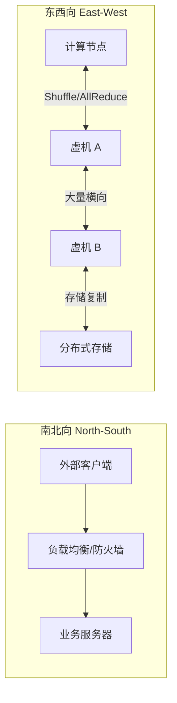

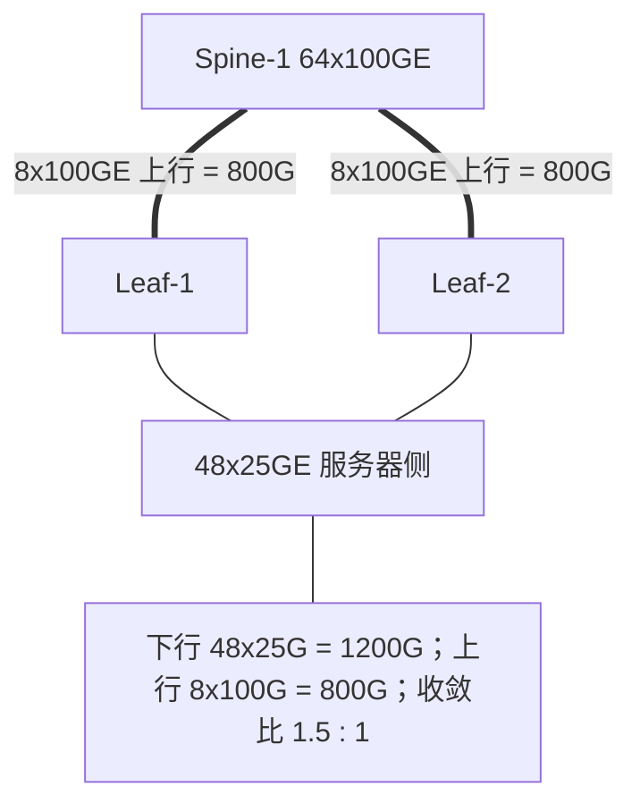

### 真题精练

**Q1.【真题·单选】** 一台 Leaf 交换机有 48 个 25GE 下行端口和 8 个 100GE 上行端口，全部端口配置满带宽，其收敛比为：
A. 1:1  B. 1.5:1  C. 3:1  D. 6:1

> **答案：B**
> **解析**：下行 = 48 × 25 = 1200 Gbps，上行 = 8 × 100 = 800 Gbps，收敛比 = 1200:800 = **1.5:1**（下行:上行）。D 的 6:1 是把"端口个数比"48:8 = 6:1 当成了收敛比——这是最常见的错误，收敛比必须按**带宽**计算而非端口数量。C 的 3:1 属于另一个常见配置（24×25GE 下行 + 2×100GE 上行 ≈ 600:200 = 3:1）。

**Q2.【真题·多选】** 关于 k-ary Fat-Tree（k=8，每台交换机 8 端口），下列说法正确的是：
A. 共有 8 个 Pod
B. 每个 Pod 有 4 台接入交换机和 4 台汇聚交换机
C. 核心交换机共 16 台
D. 网络可接入主机总数为 128 台
E. 该结构下接入层收敛比为 3:1

> **答案：A、B、C、D**
> **解析**：按公式逐项验算——Pod 数 = k = 8（A 对）；每 Pod 接入 = 汇聚 = k/2 = 4 台（B 对）；核心数 = (k/2)² = 4² = 16 台（C 对）；主机总数 = k³/4 = 512/4 = 128 台（D 对）。E 错：k-ary Fat-Tree 是对称设计，每台接入交换机 k/2 口下接主机、k/2 口上行，端口数与带宽均对称，**收敛比为 1:1**，这正是 Fat-Tree 被称为"无阻塞"结构的原因。

**Q3.【真题·判断】** 数据中心东西向流量占比通常低于南北向流量，因此网络设计应以出口带宽为第一优先级。

> **答案：错误**
> **解析**：两处错误。其一，现代数据中心东西向流量占比通常达 70%~80%，**高于**南北向；其二，正因东西向占主导，设计第一优先级是"Any-to-Any 的可用带宽"（即无阻塞能力与 ECMP 均匀度），而不是出口带宽。出口带宽当然要规划，但它不是瓶颈所在——瓶颈是服务器之间那一段。

**Q4.【真题·填空】** 某 Leaf 有 24 个 25GE 下行端口，要求收敛比为 3:1，则其上行总带宽需达到 \_\_\_\_\_ Gbps；若全部使用 100GE 上行口，需要 \_\_\_\_\_ 个端口。

> **答案：200 Gbps；2 个**
> **解析**：下行带宽 = 24 × 25 = 600 Gbps。收敛比 = 下行 / 上行 = 3 → 上行 = 600 / 3 = **200 Gbps**。用 100GE 端口承载则需 200 / 100 = **2 个** 100GE 口。这是数据中心最经典的"3:1 收敛"配置：24×25GE + 2×100GE，也是小规模 POD 的常见起步规格。

**Q5.【真题·简答】** 请写出收敛比的完整计算公式，说明为什么工程上普遍采用 3:1 而不是 1:1，并指出哪些场景必须追求 1:1。

> **答案要点**：
> **公式**：收敛比 = 下行带宽总和 : 上行带宽总和 = Σ(服务器侧端口速率 × 端口数) : Σ(上行互联端口速率 × 端口数)。写作 `1:U` 时，U = 下行带宽总和 ÷ 上行带宽总和，U = 1 即无阻塞。
> **为什么用 3:1**：① 实际业务中所有服务器"同时满速互相发送"的稳态几乎不出现，数据中心实测平均链路利用率常在 10%~30%，超配的代价被平均利用率吸收；② 收敛比从 1:1 降到 3:1，上行端口与 Spine 数量可减少到约 1/3，光模块、机柜空间、功耗、成本同步下降，这是数据中心 TCO（Total Cost of Ownership，总体拥有成本）的大头；③ 突发过载时可通过 QoS 队列与 PFC/ECN 缓解，而不是靠无限带宽硬扛。
> **必须 1:1 的场景**：① 分布式存储与存储复制（三副本同步写，丢包即 I/O 超时）；② RDMA 网络（RoCEv2 / NVMe over RoCEv2，丢包触发重传导致性能断崖）；③ AI 训练集群（AllReduce 全归约通信，任意两卡间都可能满速交换）；④ 金融交易等超低时延业务；⑤ 高性能计算（HPC）与 MPI 通信。这些场景一旦收敛，性能损失远大于设备成本节约。

**Q6.【真题·计算】** 某 POD 采用 Spine-Leaf：Spine 使用 CE8850-64CQ（64 个 100GE 口），POD 内共有 16 台 Leaf（CE6865），每台 Leaf 需要 8 个 100GE 上行口。若要保证任意单台 Spine 故障时网络仍能承载全部东西向流量（即每台 Leaf 到剩余 Spine 的带宽不下降），至少需要几台 Spine？并计算每台 Spine 的端口占用。

> **答案**：
> ① **路径与带宽要求**：每台 Leaf 有 8 个 100GE 上行口，要保证"挂掉一台 Spine 后带宽不下降"，则每台 Leaf 的上行必须**均匀分布到至少 3 台 Spine**（若只分到 2 台，各占 4 口，挂一台就只剩 4 口 = 400G，带宽腰斩）。因此 **Spine 数量 ≥ 3**，工程上通常取 **4 台**（每台 Leaf 每台 Spine 分 2 个口，8 / 4 = 2）。
> ② **端口占用核算**（以 4 台 Spine 为例）：
> ```
> 每台 Spine 需要连接的 Leaf 上行口数 = 16 台 Leaf × 2 口 = 32 个 100GE 口
> CE8850-64CQ 提供 64 个 100GE 口 → 占用 32 口，剩余 32 口
> 剩余端口可用于 Border Leaf / DCI / 防火墙旁挂
> 若取 3 台 Spine：每台需 16 × (8/3) → 无法整除，需改为每 Leaf 每 Spine 分配不等口数
>   → 会导致 ECMP 带宽不对称（哈希极化），因此不推荐
> ```
> ③ **结论**：至少 **3 台**（理论下限，但会产生不整分），工程推荐 **4 台**，每台 Spine 占用 32 个 100GE 口，剩余 32 口留作扩展与 Border Leaf 接入。**给分点**：必须指出"Spine 数量 ≥ 上行端口均匀分配所需的最小值 + 1（冗余）"，并说明 ECMP 带宽对称对哈希均匀性的影响。

**Q7.【真题·排错】** 某 POD 按 3:1 收敛比设计，但运维通过 `display interface counters rate` 发现所有 Leaf 上行口长期在 70%~90%，而 Leaf 下行口平均只有 25%。请分析可能原因。

> **答案**：**现象本质**：下行平均 25%、上行 70%~90%，说明上行成为瓶颈，实际收敛比远小于设计的 3:1。可能原因：
> ① **下行统计口径问题**：`display interface counters rate` 给出的是**平均值**，而数据中心流量是微突发（μs 级），平均值 25% 但瞬时可能超过 100%。应结合 `display qos queue statistics` 看队列丢弃。
> ② **哈希极化**：ECMP 哈希按流分配，若哈希模式过于简单（如仅源/目的 MAC），少数大象流（Elephant Flow，如备份、存储复制）会固定命中同一条上行链路，造成"链路平均不满但某条打满"。用 `display eth-trunk verbose` 或逐口速率对比可验证。
> ③ **流量模型与设计假设不符**：该 POD 承载了存储复制或备份业务，其流量本质是"少数服务器满速发送"，与"多数服务器平均发送"的 3:1 假设不符。这类流量需要独立的 1:1 网络或 QoS 严格优先级调度。
> ④ **网关/路径绕行**：跨 Leaf 网关未下沉，大量本可本地转发的流量被拉到上行，等效于人为降低收敛比。
> **整改**：将哈希模式改为五元组并开启动态负载分担；对存储/备份流用 QoS 队列限速或隔离到专用 VLAN；核查网关是否已下沉到 Leaf；必要时对该 POD 上行扩容（提高收敛比）。**高分点在于区分"平均值 vs 微突发""端口级极化 vs 全网瓶颈"两类不同性质的问题。**

### 易错点与排错
- **易错 1**：用**端口数量**算收敛比。必须用**带宽**（端口数 × 速率）。
- **易错 2**：上下行写反。答"3:1"时要明确写成"下行:上行 = 3:1"。写"1:3"会被判错。
- **易错 3**：k-ary Fat-Tree 误答收敛比为 3:1。对称设计是 **1:1**。
- **易错 4**：把平均利用率低当成"没拥塞"。微突发要走队列统计看。
- **易错 5**：算 Spine 数量时只算"够不够用"，忘了**故障冗余**要求（挂一台后带宽不下降）。
- **排错命令**：`display interface counters rate`（平均速率）、`display qos queue statistics interface`（队列丢弃）、`display eth-trunk verbose`（成员口分担）、`display ip routing-table x.x.x.x verbose`（ECMP 路径数）。

---

## 1.5 Overlay 与 Underlay 分层、Fabric 概念与 ToR 部署

### 考点定位
概念+选择混合考点。必考"哪一层用什么协议"，常出成多选或连线题；ToR/EoR/MoR 的选型常出成单选（给场景选部署方式）。分值 2~4 分。**最高频易错点**：把 VXLAN/VTEP 当成 Underlay 协议；认为 VXLAN 部署后 VLAN 就没用了。

### 原理精讲
**分层思想**：数据中心的网络被抽象成两层，各自职责单一、互不干扰。

**Underlay（底层网络）**：由 Spine 和 Leaf 的物理链路、IP 地址、路由协议组成的"承载网"。它的唯一职责是——**保证任意两台 Leaf（VTEP）之间的 IP 可达**。Underlay 关心的关键词：物理拓扑、物理端口、IP 路由（OSPF/IS-IS/EBGP）、ECMP、BFD、链路聚合（M-LAG/Eth-Trunk）。Underlay 里**看不到任何租户/VLAN 信息**，它对"业务"完全无知——这正是它的优势：业务变化不需要动 Underlay。

**Overlay（叠加网络）**：在 Underlay 之上用隧道技术虚拟出来的逻辑网络。它承载租户的 VLAN、网段、网关、安全策略。**VXLAN（Virtual eXtensible LAN，可扩展虚拟局域网）** 是主流技术：把原始以太网帧封装进 **UDP**（源端口由内层报文哈希得到，目的端口固定 **4789**），外层套上 IP 头在两台 **VTEP（VXLAN Tunnel End Point，VXLAN 隧道端点）** 之间传输。关键标识是 **VNI（VXLAN Network Identifier）**，长度 **24 bit**，可提供约 1600 万个隔离域，远超 VLAN 的 12 bit / 4094 个。

**必须记牢的分层对照**：

| 层次 | 职责 | 承载对象 | 关键协议/概念 |
|---|---|---|---|
| Underlay | IP 可达、多路径转发 | 物理网络 | OSPF / IS-IS / EBGP、ECMP、BFD、Eth-Trunk、M-LAG |
| Overlay 数据面 | 用隧道搬运租户报文 | 逻辑网络 | VXLAN（UDP 4789）、NVE 接口、VNI（24bit）、VTEP |
| Overlay 控制面 | 分发 MAC/IP 可达信息 | 逻辑网络 | BGP EVPN（MP-BGP，EVPN 地址族）、Type-2/Type-3 路由 |
| Overlay 网关 | 跨 VNI/跨网段转发 | 逻辑网络 | 集中式网关 / 分布式网关（Vbdif 接口） |
| 编排/管理 | 自动化下发与可视 | 全栈 | iMaster NCE-Fabric、ZTP、NETCONF/YANG |

**为什么必须分两层？** 因为变化频率不同。物理网络（Underlay）建设慢、变更风险高；业务网络（Overlay）变化快、每天都有租户上线。分层后，**业务变更只影响 Overlay 配置，物理网络纹丝不动**；服务器（虚机）迁移时，只要 VTEP 之间 IP 可达，虚机的 IP/MAC/VLAN 都可以保持不变，由 Overlay 通过 EVPN 把 MAC/IP 可达性重新通告到新位置即可。这就是 VXLAN 被称为"大二层解决方案"的根本原因——**二层可达性由 Overlay 提供，而不是由物理二层域提供**。

**Fabric（网络织物）**：指一个由 Spine-Leaf 组成、统一规划、统一管理、可自动化运维的完整数据中心网络域。Fabric 的角色划分：
- **Spine**：纯转发骨干；
- **Leaf**：服务器接入 + 分布式网关；
- **Border Leaf（边界叶）**：连接出口路由器、防火墙、DCI，负责 Fabric 内外流量进出；
- **（三级 CLOS 时）Superspine / Core Spine**：多个 POD 之间的横向互联层；
- **控制器**：iMaster NCE-Fabric，负责 Fabric 的自动化与策略下发。

**物理网络 vs 逻辑网络**：物理网络 = 设备、端口、光纤、IP 地址、路由协议（可在 `display interface brief`、`display ip routing-table` 中看到）；逻辑网络 = VNI、BD（Bridge Domain）、Vbdif 网关、安全组策略（在 `display vxlan vni`、`display bridge-domain` 中看到）。考试常考"下列哪项属于逻辑网络"——凡带 VNI/BD/Vbdif/租户字样的都是逻辑网络。

**部署方式：ToR / EoR / MoR**

| 方式 | 全称 | 部署位置 | 特点 |
|---|---|---|---|
| ToR | Top of Rack | 每个机柜顶部一台交换机 | 服务器用短铜缆/DAC 直连；走线简单；故障影响单机柜；交换机数量多；主流方案 |
| EoR | End of Rack | 每排机柜末端一台（或一对）交换机 | 交换机数量少、易集中管理；从机柜到交换机的走线长且量大；故障影响整排 |
| MoR | Middle of Rack | 每排机柜中间位置 | EoR 的变体，折中线缆长度（两侧机柜距离均衡）；布线仍较复杂 |

**ToR 为何成为主流？** ① **线缆成本与走线**：服务器到 ToR 只有 1~3 米，可用最便宜的 DAC 高速铜缆；EoR 需要 10~30 米，超过铜缆有效距离就必须用昂贵的光模块+AOC/光缆；② **扩容粒度**：一个机柜一个 ToR，扩容机柜就加一台 ToR，粒度小、风险低；③ **故障域**：ToR 故障只影响本机柜，EoR 故障影响整排；④ **散热与气流**：ToR 与服务器同柜，便于统一风道设计。代价是**交换机数量与光纤跳线数量激增**，因此 ToR 方案必须配合 M-LAG 双归（服务器双上联到两台 ToR）与高密度光模块（MPO/MTP）来保证可靠性、控制布线密度。

**EoR/MoR 的适用**：预算紧、交换机型号统一、机柜数量少、机房有集中配线架（MDA/HDA）的场景；或采用"机柜只有服务器、网络设备统一入网络柜"的机房规范时。

### 关键概念对照表

| 对比项 | Underlay | Overlay |
|---|---|---|
| 组成 | 物理设备、物理链路、IP 路由 | 隧道、VNI、BD、逻辑网关 |
| 协议 | OSPF / IS-IS / EBGP / BFD / M-LAG | VXLAN、BGP EVPN、Vbdif/NVE |
| 隔离标识 | 无（只认 IP） | VNI（24 bit，约 1600 万） |
| 变化频率 | 低（建设期为主） | 高（租户/虚机频繁上下线） |
| 故障影响 | 影响一片物理区域 | 影响某租户/某逻辑网段 |
| 与 VLAN 关系 | 不感知 VLAN | 内层可携带 VLAN，通过映射入 VNI |
| 虚机迁移 | 只需 VTEP 间 IP 可达 | IP/MAC/VLAN 可保持不变 |
| 查看命令 | `display ip routing-table` | `display vxlan vni` / `display bridge-domain` |

| 部署方式 | 每排交换机数 | 线缆类型/长度 | 故障域 | 扩展性 | 适用场景 |
|---|---|---|---|---|---|
| ToR | 每机柜 1~2 台 | DAC 铜缆 1~3m 为主 | 单机柜 | 极好（按柜扩容） | 主流 DC、云计算、大规模 |
| EoR | 每排 1~2 台 | AOC/光缆 10~30m | 整排 | 一般 | 中小 DC、统一网络柜 |
| MoR | 每排 1~2 台 | 光缆 5~20m | 整排（略优） | 一般 | 排长较大的机房折中方案 |

### 华为设备配置
下面给出 Leaf 上 Underlay + Overlay 的分层配置骨架（CE 系列 VRP V200，分布式 VXLAN 网关方案）：

```bash
# ---------- Underlay 部分：只保证 VTEP 间 IP 可达 ----------
[Leaf-1] interface 100GE1/0/1
[Leaf-1-100GE1/0/1] undo portswitch
[Leaf-1-100GE1/0/1] ip address 10.0.1.1 30                 // Leaf(充当VTEP)的Underlay地址
[Leaf-1-100GE1/0/1] quit
[Leaf-1] interface LoopBack 0
[Leaf-1-LoopBack0] ip address 1.1.1.1 32                    // VTEP地址用Loopback，保证多路径下稳定
[Leaf-1-LoopBack0] quit
[Leaf-1] ospf 1 router-id 1.1.1.1
[Leaf-1-ospf-1] bfd all-interfaces enable                   // BFD联动，毫秒级收敛
[Leaf-1-ospf-1] area 0
[Leaf-1-ospf-1-area-0.0.0.0] network 1.1.1.1 0.0.0.0
[Leaf-1-ospf-1-area-0.0.0.0] network 10.0.1.0 0.0.0.3
[Leaf-1-ospf-1-area-0.0.0.0] quit
[Leaf-1-ospf-1] quit

# ---------- Overlay 部分：VXLAN 隧道 + 分布式网关 ----------
[Leaf-1] bridge-domain 100                                  // 创建广播域BD
[Leaf-1-bd100] vxlan vni 5010                               // BD与VNI绑定（VNI 24bit，可远超VLAN 4094）
[Leaf-1-bd100] quit
[Leaf-1] interface Nve 1                                    // NVE = Network Virtualization Edge，VTEP逻辑接口
[Leaf-1-Nve1] source 1.1.1.1                                // 指定VTEP源地址（Loopback）
[Leaf-1-Nve1] vni 5010 head-end peer-list protocol bgp      // 用BGP EVPN动态学习对端VTEP（免手工配peer）
[Leaf-1-Nve1] quit
[Leaf-1] interface Vbdif 100                                // 分布式网关接口（BD对应的三层网关）
[Leaf-1-Vbdif100] ip address 192.168.100.1 24
[Leaf-1-Vbdif100] mac-address 0000-5e00-0101                // 全网统一网关MAC，虚机迁移后网关不变
[Leaf-1-Vbdif100] quit

# ---------- 验证：区分 Underlay 与 Overlay ----------
[Leaf-1] display ip routing-table 2.2.2.2                   // Underlay：能否到达对端VTEP地址
[Leaf-1] display vxlan vni                                  // Overlay：VNI与BD绑定关系
[Leaf-1] display vxlan tunnel                               // Overlay：隧道建立情况（对端VTEP列表）
[Leaf-1] display bridge-domain 100                          // Overlay：BD内MAC学习情况
[Leaf-1] display bgp evpn peer                               // Overlay控制面：EVPN对等体状态
```

### 示意图

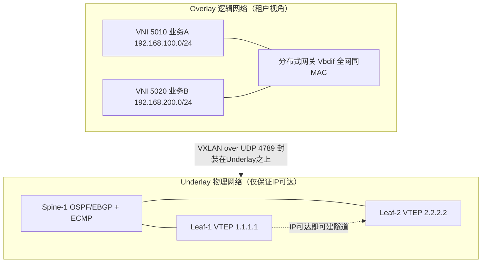

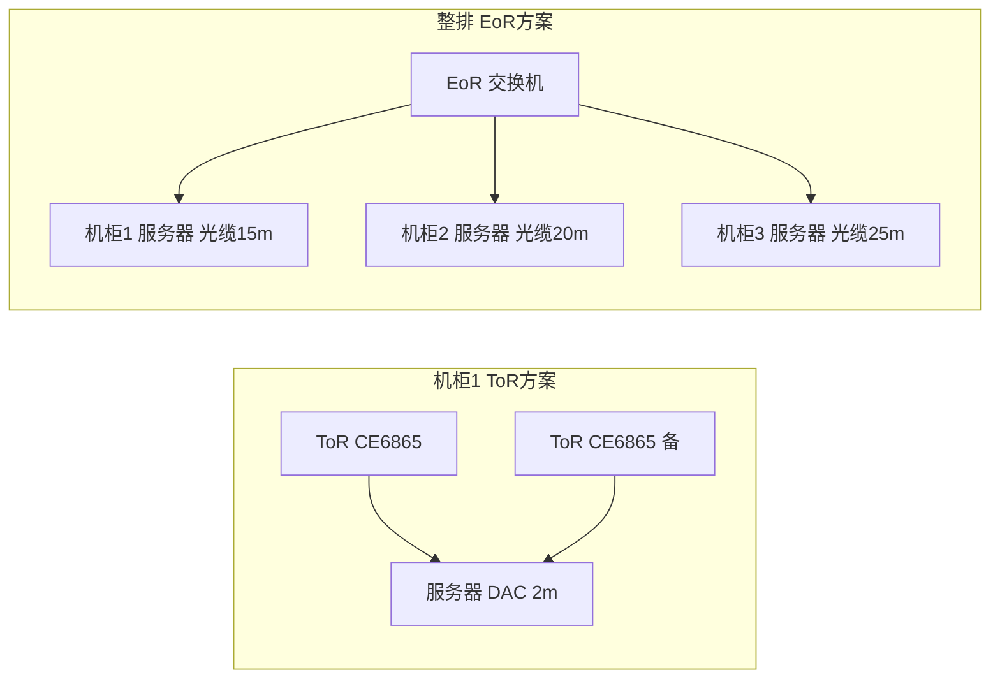

### 真题精练

**Q1.【真题·单选】** 下列协议中工作在 Underlay 层的是：
A. VXLAN  B. BGP EVPN  C. OSPF  D. NVE 接口

> **答案：C**
> **解析**：Underlay 的职责是提供 IP 可达性，使用传统 IP 路由协议（OSPF、IS-IS、EBGP）+ ECMP + BFD。VXLAN（A）是 Overlay 数据面的封装技术；BGP EVPN（B）是 Overlay 的控制面（MP-BGP 的 EVPN 地址族，用于分发 MAC/IP 可达性）；NVE 接口（D）是承载 VXLAN 隧道的逻辑接口，属于 Overlay。记忆口诀：**Underlay 认 IP，Overlay 认 VNI**。

**Q2.【真题·多选】** 关于 VXLAN 与 VLAN 的关系，正确的是：
A. VNI 长度为 24 bit，隔离域数量远大于 VLAN 的 12 bit / 4094 个
B. VXLAN 报文封装在 UDP 之上，目的端口默认 4789
C. 使用 VXLAN 后，服务器接入侧的 VLAN 就完全没有必要了
D. VXLAN 隧道端点是 VTEP，通常使用 Loopback 地址作为源
E. 同一 VNI 内的主机可以跨三层物理网络二层互通

> **答案：A、B、D、E**
> **解析**：C 错误。VXLAN 解决的是"跨 Leaf/跨机房的二层扩展"，而服务器到 Leaf 这一段依然普遍使用 VLAN（或直接接入 BD）。实际配置中通常做 **VLAN ↔ BD ↔ VNI 的映射**：接入侧 VLAN 落进某个 BD，BD 绑定 VNI，VNI 决定它在 Overlay 中的隔离域。VLAN 在小范围内简单高效，VXLAN 解决大规模与跨域，两者是**互补而非替代**关系。E 正确，这正是 VXLAN 的核心价值：二层可达性由 Overlay 提供，不受 Underlay 三层边界限制。

**Q3.【真题·判断】** Fabric 中 Spine 交换机的数量越多，服务器网关的 IP 地址就需要越多，因此 Spine 数量受 IP 规划限制。

> **答案：错误**
> **解析**：服务器网关位于 **Leaf**（VLANIF/Vbdif），与 Spine 数量完全无关。Spine 是纯转发设备，其上不配置任何业务网关。Spine 数量的真正约束是：① 每台 Leaf 到每台 Spine 需要上行端口，Spine 总端口数必须能容纳所有 Leaf 的上行（Leaf 数 × 每 Leaf 每 Spine 上行数 ≤ Spine 端口数）；② 冗余要求与成本。这正是分布式网关的价值——**网关数量 = Leaf 数量，且所有 Leaf 使用同一个网关 MAC/IP，虚机迁移后无需改网关**。

**Q4.【真题·填空】** 数据中心网络中，负责提供 IP 可达性的物理网络层称为 \_\_\_\_\_\_；在其之上通过隧道技术构建的逻辑网络层称为 \_\_\_\_\_\_；VXLAN 隧道的两个端点设备称为 \_\_\_\_\_\_。

> **答案：Underlay（底层网络）；Overlay（叠加网络）；VTEP（VXLAN Tunnel End Point，VXLAN 隧道端点）**
> **解析**：三层概念的经典考法。补充要点：VTEP 通常由 Leaf 担任（也可由 NVE 网关或服务器 vSwitch 担任），其源地址一般用 Loopback 地址以保证多路径下地址稳定；隧道本身是"无状态"的，不需要保活，可视性由 EVPN 控制面和 BFD 提供。

**Q5.【真题·简答】** 某数据中心有 200 个机柜，机房规范要求"网络设备统一布置在同一排的网络柜内"。请说明这种规范对应哪种部署方式（ToR/EoR/MoR），并分析其与 ToR 方案相比的优劣势。

> **答案要点**：
> **对应方式**：网络设备统一入网络柜，说明交换机不与服务器同柜，而是按排（或按区域）集中部署，这是典型的 **EoR（End of Rack）**（若网络柜位于该排中部则为 **MoR**）。
> **优势**：① **交换机数量少**：一台 EoR 可服务整排机柜的服务器，设备采购、许可、管理成本下降；② **运维集中**：所有网络设备在同一位置，便于日常巡检、插拔模块、加电与接地，也便于集中制冷与供电；③ **机房规范统一**：服务器机柜可以做到"只有服务器"，走线美观、承重与散热设计更简单。
> **劣势**：① **线缆成本与施工复杂度高**：服务器到 EoR 的距离通常 10~30 米，超过 DAC 铜缆有效距离（一般 3~5 米）后必须用光模块 + AOC/光缆，成本与光纤跳线数量大幅上升；② **故障域大**：EoR 交换机故障会影响整排机柜的所有服务器，可靠性压力大，必须做双机冗余（VRRP/M-LAG/CSS）；③ **扩容粒度粗**：新增一个机柜就要从该机柜拉线到网络柜，配线与穿线槽压力大；④ **散热与空间**：网络柜承担整排流量，端口密度高、发热集中，对风道要求高。
> **结论建议**：200 个机柜的中大规模数据中心，推荐 **ToR 为主**（每柜一对 ToR + M-LAG 双归），可显著降低线缆成本（DAC 铜缆）并缩小故障域；若机房确有"网络设备集中布置"的运维规范或配线架体系（MDA/HDA），则可对非关键区域采用 EoR，但对存储与核心业务区仍建议 ToR。

**Q6.【真题·单选】** 关于 iMaster NCE-Fabric 在数据中心中的定位，正确的是：
A. 它是运行在交换机上的一个进程，用于生成 STP 树
B. 它是 Fabric 的控制器，负责网络自动化编排与策略下发
C. 它替代了 Underlay 的路由协议，让交换机不需要配置 IP
D. 它是光模块的监控软件，用于采集光功率

> **答案：B**
> **解析**：iMaster NCE-Fabric 是华为数据中心网络控制器（NCE = Network Cloud Engine），定位于 Fabric 的**自动化编排与运维管理**：设备纳管、ZTP 开局、VXLAN/EVPN 业务批量下发、租户与策略管理、可视化与故障定位。它**不替代** Underlay 的路由协议（C 错），也不运行在交换机上（A 错），更不是光模块监控工具（D 错）。考试中"控制器 vs 设备职责"的边界是高频考点：**控制器负责意图与编排，设备负责转发与协议**。

**Q7.【真题·排错】** 某 Fabric 中虚机从 Leaf-1 迁移到 Leaf-2 后，同网段其他虚机 Ping 不通该虚机，但该虚机自己 Ping 网关正常。Underlay 路由正常、VXLAN 隧道也已建立。请分析原因与排查命令。

> **答案**：**分析**：虚机自己能通网关，说明接入侧 VLAN/BD 映射与网关配置正确；其他虚机不通，说明**该虚机的 MAC/IP 可达性没有被更新到其它 Leaf（或旧位置的表项未被撤销）**，属于 **Overlay 控制面/表项同步问题**。常见原因：① BGP EVPN 邻居中断或 EVPN 路由未重新通告（旧 Leaf 未撤销 Type-2 路由，新 Leaf 未发布）；② 迁移后新 Leaf 上 BD/VNI 绑定缺失，导致 MAC 学不到；③ 其他 Leaf 上仍保留指向旧 VTEP 的 MAC 表项（老化未到）；④ 若使用"集中式网关"，跨 Leaf 同网段流量需经网关，网关侧表项未更新。
> **排查命令**：
> ```bash
> [Leaf-2] display bgp evpn peer                          // EVPN邻居是否Established
> [Leaf-2] display bgp evpn all routing-table             // 是否收到/发布该虚机的Type-2 MAC/IP路由
> [Leaf-2] display bridge-domain 100                      // 新位置是否已学习到该虚机MAC
> [Leaf-2] display vxlan tunnel                          // 隧道是否指向所有相关VTEP
> [Leaf-1] display bridge-domain 100                      // 旧位置MAC是否已老化/撤销
> [Leaf-1] display mac-address vlan 100                   // 逐台核对MAC表项位置
> ```
> **处置**：修复 EVPN 邻居或补配 BD/VNI 绑定；若有残留表项，可等待老化或通过重置 BGP EVPN 邻居触发重新收敛（生产操作需评估影响）。**关键判据：能通网关 = 本地正常；不能跨 Leaf = 控制面通告问题。** 这一"二分法"是排错题的核心得分逻辑。

### 易错点与排错
- **易错 1**：把 VXLAN、NVE、EVPN 归入 Underlay。**Underlay 只有 IP 路由，其余都是 Overlay**。
- **易错 2**：认为 VTEP 地址应该配在物理口上。物理口地址会因链路/ECMP 变化而不稳定，应使用 **Loopback** 作为 VTEP 源。
- **易错 3**：以为 VXLAN 部署后 VLAN 就废弃。实际是 VLAN→BD→VNI 的映射关系。
- **易错 4**：把 Spine 当作 VXLAN 网关。网关在 Leaf（Vbdif），Spine 只做 IP 转发。
- **易错 5**：ToR/EoR 选型只看成本，忽略线缆长度限制（DAC 一般 ≤3~5m，超过必须光模块）。
- **排错命令**：Underlay 侧 `display ip routing-table <VTEP地址>`；Overlay 侧 `display vxlan vni`、`display vxlan tunnel`、`display bridge-domain`、`display bgp evpn peer`/`routing-table`；接入侧 `display mac-address vlan`。

---

# DCN-HCIA-章节2-数据中心设备与CloudEngine系列

## 2.1 华为数据中心交换机产品族与命名规则

### 考点定位
校赛省赛的"送分题"+ 选型题。常见考法：给型号问端口构成（如 CE6865-48S8CQ 有几个 25GE、几个 100GE）；给场景选型号（Spine 选什么、Leaf 选什么）；问后缀 -EI/-HI 的含义。分值 1~3 分。**易错点**：把 48S 的 S 当成"10GE"，把 8CQ 的 CQ 当成"4×100GE"。

### 原理精讲
华为数据中心交换机统一使用 **CloudEngine（CE）** 品牌，按"框式/盒式"与"容量层级"分为若干系列。型号命名遵循"**系列 + 规格 + 端口描述 + 特性后缀**"的结构，读懂它就能不查手册判断设备能力。

**第一部分：系列数字（定位层次）**

| 系列 | 形态 | 定位 | 典型角色 |
|---|---|---|---|
| CE16800 | 框式 | 旗舰核心，支持 100GE/400GE，大容量 CLOS 背板 | DCI 核心、大型 POD 的 Spine |
| CE12800 | 框式 | 上一代数据中心核心/Spine，40GE/100GE 线卡 | 大中型 POD 的 Spine |
| CE8850 | 盒式固定 | 高密度 100GE 盒式，64×100GE | 中型 Spine、Border Leaf |
| CE6865 / CE6863 | 盒式固定 | 25GE 接入，48×25GE + 8×100GE | Leaf（服务器接入） |
| CE6855 / CE6857 | 盒式固定 | 10GE/25GE 接入，48×10GE/25GE + 上行 40GE/100GE | Leaf（10GE 服务器） |
| CE5885 / CE9860 等 | 盒式 | 特定速率与场景 | 视规格而定 |

**第二部分：端口描述字段（最高频考点）** 规则是"**数字 + 字母**"成对出现，数字表示端口个数，字母表示端口速率/介质类型：

| 字母 | 含义 | 介质/接头 |
|---|---|---|
| S | 10GE 光口 | SFP+ |
| S28 | 25GE 光口（部分型号写作 S，需结合型号） | SFP28 |
| Q | 40GE 光口 | QSFP+ |
| CQ | 100GE 光口 | QSFP28 |
| C | 100GE 光口（部分型号简写） | QSFP28 |
| DQ / DD | 200GE / 400GE 光口 | QSFP-DD |
| T / P | 电口（10GE 电口 / 1000M 电口） | RJ45 |
| X | 支持多种速率/可拆分 | 视配置 |

**实例拆解（务必背下）**：
- `CE6865-48S8CQ`：**48 个 25GE 光口（SFP28）+ 8 个 100GE 光口（QSFP28）**。这是数据中心最经典的 Leaf 机型，"48 下 8 上"的结构天然适合做 1.5:1 收敛。
- `CE6863-48S6CQ`：48 个 25GE + 6 个 100GE，25GE 接入的另一种常见规格。
- `CE6855-48S6Q-HI`：48 个 10GE 光口 + 6 个 40GE 上行，适合 10GE 服务器接入；`-HI` 为增强特性版本。
- `CE8850-64CQ-EI`：64 个 100GE 口，无固定"下行/上行"之分，全部端口可用于上行到 Spine 或接 Leaf，适合做 Spine 或 Border Leaf。
- `CE16808`：框式，**8 个业务槽位**（末尾数字表示业务板槽位数，如 CE16804/16808/16816）；CE12804/12808/12816 同理。

**第三部分：特性后缀**

| 后缀 | 含义 | 影响 |
|---|---|---|
| -EI | Enhanced Image，增强版 | 支持更完整的路由/MPLS/VXLAN 特性集 |
| -HI | High-performance Image，高性能增强版 | 更大表项、更强缓存与特性，价格更高 |
| -F / -B | 特定形态（如 F 表示前后风道方向） | 影响机房风道与部署方向 |
| -A / -T | 特定版本（端口组合或温度等级） | 影响端口与使用环境 |

**选型方法论（考试爱考"给场景选设备"）**：
1. **先定角色**：Spine 要"高密度高速率上行、配置极简"，选 **CE8850-64CQ（盒式）** 或 **CE12800/16800（框式，大 POD）**；Leaf 要"高密度 25GE 下行 + 100GE 上行"，选 **CE6865-48S8CQ**；出网/接防火墙的 Border Leaf 需要路由策略能力，选 CE8850 或 CE12800。
2. **再定端口数**：端口数必须能容纳"下行服务器数 × 每台服务器链路数"与"上行链路数"。例如 48 台服务器双归 → 需要 96 个下行端口 → 至少 2 台 48 口 Leaf。
3. **再定形态**：盒式（固定端口、1U、便宜、适合 Leaf 与小型 Spine）vs 框式（模块化、槽位多、支持更高背板容量与更多冗余、适合大型 Spine/Core）。
4. **最后看特性**：是否需 VXLAN 分布式网关、EVPN、MPLS、大表项（-HI）。
5. **冗余与风道**：确认电源/风扇冗余、风道方向（前后/后前）与机房冷热通道一致。

### 关键概念对照表

| 型号 | 形态 | 端口构成 | 定位角色 | 典型场景 |
|---|---|---|---|---|
| CE16808 | 框式（8 业务槽） | 依赖线卡，支持 100GE/400GE | 大型 Spine / DCI 核心 | 超大规模云 DC |
| CE12808 | 框式（8 业务槽） | 40GE/100GE 线卡 | Spine / Core | 大中型 DC |
| CE8850-64CQ | 盒式 1U/2U | 64×100GE | Spine、Border Leaf | 中型 POD Spine |
| CE6865-48S8CQ | 盒式 1U | 48×25GE + 8×100GE | Leaf | 25GE 服务器接入（主流） |
| CE6863-48S6CQ | 盒式 1U | 48×25GE + 6×100GE | Leaf | 25GE 接入（成本敏感） |
| CE6855-48S6Q-HI | 盒式 1U | 48×10GE + 6×40GE | Leaf | 10GE 服务器接入 |
| CE6857-48S6CQ | 盒式 1U | 48×25GE + 6×100GE | Leaf | 25GE 接入 |

| 对比项 | 盒式交换机（Box） | 框式交换机（Chassis） |
|---|---|---|
| 端口 | 固定，不可换 | 通过线卡扩展，可换 |
| 槽位 | 无 | 主控槽 + 业务槽 + 交换网板槽 |
| 冗余 | 电源/风扇冗余 | 主控 1+1、交换网板 N+M、电源 N+1、风扇冗余 |
| 背板容量 | 固定（如 1.6T/3.2T） | 可达数十 T，随交换网板扩容 |
| 体积/功耗 | 1U~2U，低功耗 | 数 U~十几 U，高功耗 |
| 单价 | 低 | 高 |
| 扩容方式 | 加设备（Scale-out） | 加线卡（Scale-up）或加设备 |
| 适用 | Leaf、小型 Spine | 大型 Spine/Core、DCI |

### 华为设备配置
选型确认后，第一件事是用 `display` 命令**核对实际硬件与型号**是否与采购/设计一致：

```bash
<CE6865> display version                                  // 显示设备型号、VRP版本、补丁、启动时间
<CE6865> display device                                   // 逐槽位显示单板型号、状态、在线/离线
<CE6865> display device manufacture-info                  // 查看序列号与制造信息（资产管理用）
<CE6865> display elabel                                   // 电子标签：整机/单板/电源/风扇/光模块的详细规格
<CE6865> display interface brief                          // 核对实际可用端口数与类型是否与型号描述相符
<CE6865> display power                                    // 查看电源模块数量、功率、冗余状态
<CE6865> display fan                                     // 查看风扇数量与转速，确认冗余
<CE6865> display temperature                             // 查看各温感温度，确认风道方向与机房环境匹配
```

### 示意图

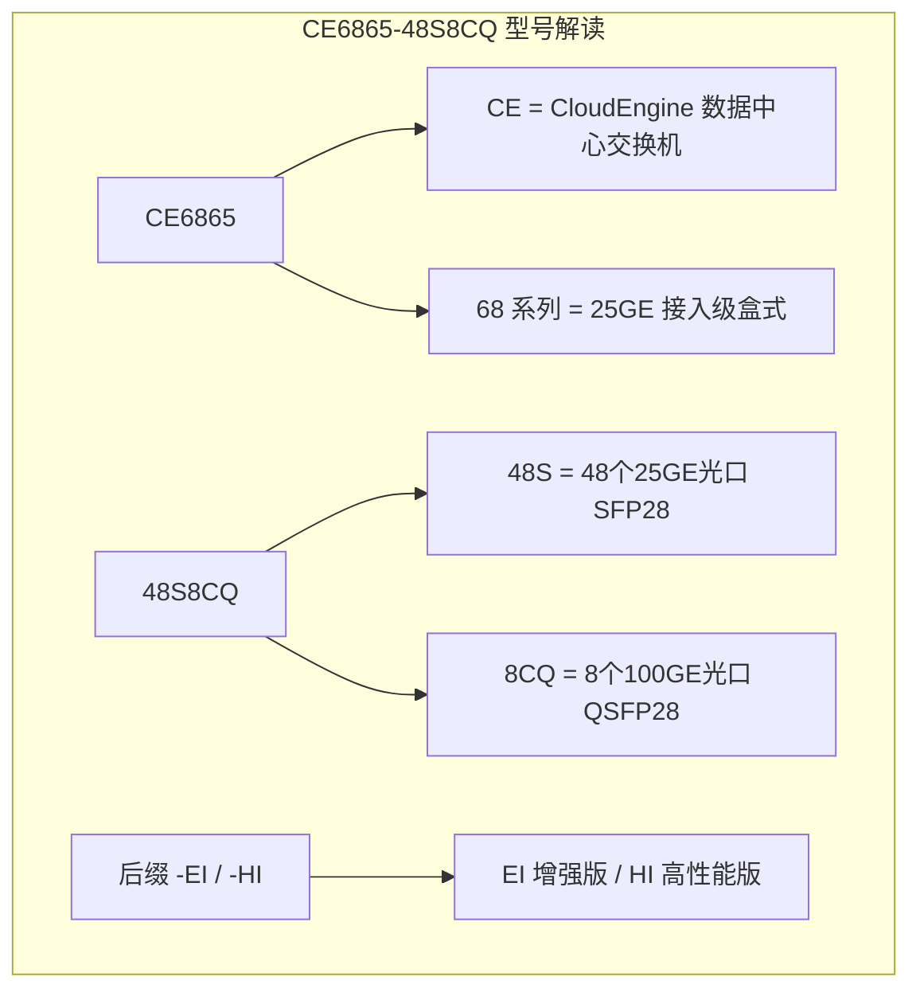

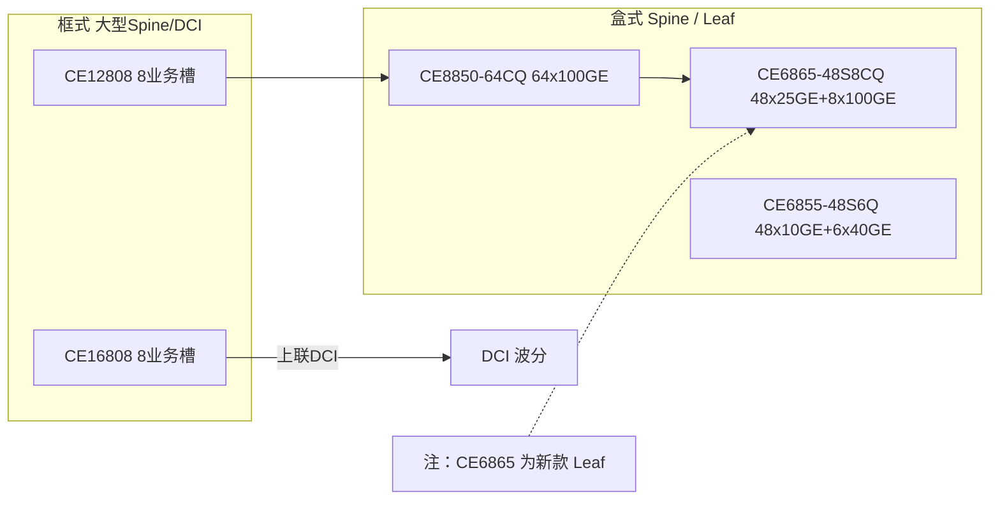

### 真题精练

**Q1.【真题·单选】** 型号 CE6865-48S8CQ 中，"48S8CQ"表示该交换机提供的端口为：
A. 48 个 10GE 光口 + 8 个 40GE 光口
B. 48 个 25GE 光口 + 8 个 100GE 光口
C. 48 个 10GE 电口 + 8 个 100GE 光口
D. 48 个 25GE 电口 + 8 个 40GE 光口

> **答案：B**
> **解析**：命名规则为"数字 + 速率字母"成对：`S` 表示 10GE 级光口封装（SFP/SFP28 系列），在 CE6865 这一 25GE 接入机型上即 25GE 光口；`CQ` 表示 100GE 光口（QSFP28）。因此 48S = 48 个 25GE，8CQ = 8 个 100GE。A 的 40GE 对应字母是 `Q`（QSFP+），C、D 的"电口"对应字母通常是 `T`/`P`，均可排除。

**Q2.【真题·多选】** 关于盒式与框式数据中心交换机，说法正确的是：
A. 框式交换机通过线卡扩展端口，主控与交换网板可做冗余
B. 盒式交换机端口固定，扩容主要靠增加设备（Scale-out）
C. 框式交换机的背板容量固定，无法通过更换交换网板提升
D. 大型数据中心 Spine 常采用框式设备，Leaf 常采用盒式设备
E. 盒式设备没有电源冗余

> **答案：A、B、D**
> **解析**：C 错，框式设备的背板容量由**交换网板**决定，更换/增加更高容量交换网板（或增加交换网板数量）即可提升整机交换容量，这正是框式的可扩展性所在。E 错，盒式设备同样普遍支持 **1+1 电源冗余**与风扇冗余（如 CE6865 支持双电源），只是不支持主控与交换网板的冗余（因为它没有这些模块）。

**Q3.【真题·判断】** 数据中心 Leaf 交换机选型时，端口数量越多越好，因此应优先选择 64×100GE 的 CE8850 作为 Leaf。

> **答案：错误**
> **解析**：Leaf 的核心需求是"**高密度服务器接入**"，服务器侧接口通常是 25GE（或 10GE），端口数量指的是**低速下行端口数**。CE8850-64CQ 提供的是 64 个 100GE 口，用它接 25GE 服务器需要大量 breakout（拆分）或速率适配，端口密度与成本都不划算。正确选型是 **CE6865-48S8CQ**（48×25GE 下行 + 8×100GE 上行）。CE8850 更适合作为 **Spine**（需要高密度 100GE 上行汇聚）或 Border Leaf。

**Q4.【真题·填空】** 华为数据中心交换机型号中，`-EI` 后缀表示 \_\_\_\_\_\_，`-HI` 后缀表示 \_\_\_\_\_\_；型号末尾数字（如 CE16808 的 8、CE12816 的 16）通常表示 \_\_\_\_\_\_。

> **答案：Enhanced Image 增强特性版本；High-performance Image 高性能增强版本；业务板槽位数量**
> **解析**：后缀决定**特性集与表项规格**，不只是软件许可：-HI 通常提供更大的 MAC/ARP/路由表项、更大报文缓存与更完整的特性支持，价格更高；选型时要按业务规模（表项需求）而不仅是端口来定。末尾数字表示框式的**业务槽位数**（CE12804 = 4 槽、CE12808 = 8 槽、CE12816 = 16 槽），槽位越多可插线卡越多、整机容量越大。

**Q5.【真题·简答】** 请给出数据中心 Spine 与 Leaf 的选型原则，并各举一个真实华为型号说明理由。

> **答案要点**：
> **Spine 选型原则**：① **端口速率高、密度大**——Spine 的端口几乎全部用于与 Leaf 互联，需要尽可能多的 100GE/400GE 口以支撑更大的 POD；② **转发时延低、表项简单**——Spine 只做 IP 转发，不需要复杂业务特性，但需要高吞吐与低时延；③ **高可靠**——冗余电源/风扇/主控，支持 BFD/ECMP；④ **配置极简一致**——便于模板化运维。**推荐型号**：中型 POD 用 **CE8850-64CQ**（64×100GE，盒式，端口密度高、时延低）；大型 POD/DCI 核心用 **CE16800 系列框式**（模块化、可插 100GE/400GE 线卡、支持大背板容量与多级 CLOS 内部交换）。
> **Leaf 选型原则**：① **下行端口密度优先**——需要大量 25GE（或 10GE）口接服务器；② **上行速率匹配**——至少 100GE 上行以支撑合理收敛比；③ **支持 M-LAG、VXLAN 分布式网关、EVPN**——这是数据中心 Leaf 的必备能力；④ **风道与电源冗余符合机房规范**。**推荐型号**：**CE6865-48S8CQ**（48×25GE + 8×100GE），"48 下 8 上"天然匹配 1.5:1 收敛比，是最经典的 Leaf 机型；成本敏感场景可选 **CE6863-48S6CQ**；10GE 服务器场景选 **CE6855-48S6Q**。

**Q6.【真题·单选】** 某数据中心需要一台设备作为 Spine，要求提供 64 个 100GE 端口且为盒式部署。下列型号最合适的是：
A. CE6865-48S8CQ  B. CE8850-64CQ  C. CE6855-48S6Q  D. CE16808

> **答案：B**
> **解析**：CE8850-64CQ 提供 64 个 100GE 端口，盒式部署，是典型的中型 Spine/Border Leaf 机型。A、C 都是 25GE/10GE 接入型 Leaf 设备，100GE 端口数量远不足（8 个 / 0 个）；D 是框式设备，与"盒式"要求不符。

### 易错点与排错
- **易错 1**：把 `S` 一律理解成 10GE。`S` 是指"光口封装族"，具体速率要结合**型号系列**（CE6865 上为 25GE，CE6855 上为 10GE）。
- **易错 2**：把 `CQ`（100GE，QSFP28）与 `Q`（40GE，QSFP+）混淆。
- **易错 3**：认为 64×100GE 的盒式设备适合做 Leaf。它的高速端口不适合直接接 25GE 服务器。
- **易错 4**：忽略风道方向（前后风道/后前风道）与机房冷热通道的匹配，导致设备过温告警。
- **排错命令**：`display device`（单板状态与型号）、`display elabel`（电子标签规格）、`display power` / `display fan` / `display temperature`（冗余与散热）、`display interface brief`（实际端口）。

---

## 2.2 框式设备硬件架构、交换网板与冗余

### 考点定位
偏原理的考点，校赛省赛多以单选/判断出现，问"信元交换的作用""哪块板卡负责转发决策""哪个模块提供 1+1 冗余"。分值 1~3 分。**易错点**：把主控板（MPU）当成转发引擎；认为盒式设备也有交换网板。

### 原理精讲
框式交换机（如 CE12800/CE16800）由五类模块组成，理解分工是理解"为什么框式更可靠"的关键：

**1. 主控板 MPU（Main Processing Unit）**：负责**控制面**——运行 VRP 操作系统、维护路由协议、生成转发表、管理设备与配置。它**不负责数据转发**（转发由线卡+交换网板完成）。框式设备支持 **1+1 主备冗余**：主用主控故障时，备用主控在秒级内接管控制面，数据转发（由线卡完成）不中断，因此业务影响极小。这是框式相对盒式的核心可靠性优势之一。

**2. 业务线卡 LPU（Line Processing Unit）**：提供物理端口，并执行**数据面的转发**——查表、ACL、QoS、隧道封装/解封装。线卡通常自带本地表项缓存（如 FIB、MAC 表），因此即使主控切换、控制面短暂中断，**已在线的转发路径依然可用**（"控制面与数据面分离"的经典体现）。

**3. 交换网板 SFU（Switch Fabric Unit）**：框式的核心，负责**线卡之间的数据交换**。关键机制是 **信元交换（Cell-based Switching）**：

- **为什么用信元？** 以太网报文是**变长**的（64B~9KB）。如果按完整报文交换，会出现两个问题：① **头阻塞（Head-of-Line Blocking）**——一个长报文占用交换通道时，后面排队的目的地不同的短报文无法越过它，造成不必要的时延与阻塞；② **负载不均**——长报文只能走一条通道，无法把一条大流拆分到多条内部通道，导致内部并行通道利用率低。
- **怎么做？** 线卡在入口把变长报文**切分成定长信元（通常 64 字节左右）**，给每个信元打上**目的线卡/端口标签**，然后分发到**多个并行交换网板**上同时转发；出口线卡再把信元**重组**为原始报文。
- **好处**：① 天生消除头阻塞（信元可以交织传输）；② 天然支持多平面并行与负载均衡（一条大流可拆到多个网板）；③ 内部调度更简单、时延更可预测；④ 单块交换网板故障时，其余网板继续承载，业务带宽按比例下降而不中断。

**4. 交换网板的冗余（N+M / N+1）**：框式设备通常配置多块交换网板（如 3 块、4 块、6 块），实际工作方式为**多平面并行承载**。华为框式设备普遍支持交换网板的**冗余备份**（部分平台为 N+M，即 M 块作为备份；部分平台为全平面负载分担 + 冗余平面）。通信术语上常称"交换网板冗余"，考试答"**提高可靠性，单板故障不影响业务**"即可。

**5. 电源与风扇**：电源支持 **N+1 或 N+N 冗余**（一路电源故障，其余电源仍能满载供电），风扇支持冗余（单风扇故障，其余风扇提速补足风量，设备不告警宕机）；风扇通常支持**智能调速**（按温度调节转速以降低噪声与功耗）。此外还有**风道方向**选项（前后风道 / 后前风道），必须与机房冷热通道一致。

**框式整机容量的计算逻辑**：整机交换容量 ≈ 单块交换网板容量 × 网板数量（或受背板带宽上限约束）；而**线卡容量**必须与网板容量匹配——如果线卡总带宽大于交换网板总带宽，就会出现"线卡插满但转不动"的超配。这是框式设备规划中最容易踩的坑：**不仅看槽位数量，还要核算线卡总带宽与交换网板总容量的匹配关系。**

### 关键概念对照表

| 模块 | 英文 | 职责 | 冗余方式 | 故障影响 |
|---|---|---|---|---|
| 主控板 | MPU | 控制面：协议、转发表、管理 | 1+1 主备 | 秒级切换，转发不中断 |
| 业务线卡 | LPU | 数据面：端口、查表、封装 | 多块分担，可冗余 | 影响本线卡端口 |
| 交换网板 | SFU | 线卡间信元交换 | 多平面并行 + 冗余 | 带宽按比例下降，业务不断 |
| 电源 | Power | 供电 | N+1 / N+N | 冗余时无影响 |
| 风扇 | Fan | 散热 | 冗余 + 智能调速 | 冗余时无影响，可能降频告警 |

| 概念 | 含义 | 为什么这样设计 |
|---|---|---|
| 信元交换 | 变长报文切分为定长信元后交换 | 消除头阻塞、支持多平面并行、调度简单 |
| 控制面/数据面分离 | 主控管协议，线卡管转发 | 主控切换不影响已建立转发路径 |
| 多平面交换网 | 多块网板并行承载流量 | 提升容量 + 天然冗余 |
| 背板带宽 | 线卡与网板间的互联容量 | 决定整机容量上限，须与线卡总带宽匹配 |

### 华为设备配置
框式设备的巡检重点是"每块板卡、每个电源、每个风扇"的状态：

```bash
<CE12808> display device                                  // 显示所有槽位：MPU/LPU/SFU 型号与状态
<CE12808> display device 3                                // 只看3号槽位（如某块线卡）的详细信息
<CE12808> display switchover state                        // 查看主备主控状态与是否具备倒换条件
<CE12808> display slave                                  // 查看备用主控信息（主备是否同步）
<CE12808> display power                                  // 电源模块：数量、功率、在位、告警
<CE12808> display fan                                    // 风扇模块：数量、转速、状态
<CE12808> display temperature                            // 各温感温度（板卡/进风/出风）
<CE12808> display backplane                              // 背板信息（部分平台可用）
<CE12808> display interface brief                        // 汇总所有线卡端口状态
<CE12808> display elabel                                 // 电子标签：逐板卡/电源/风扇序列号与规格
<CE12808> display alarm all                              // 查看当前所有告警，含单板/电源/风扇/温度
```

### 示意图

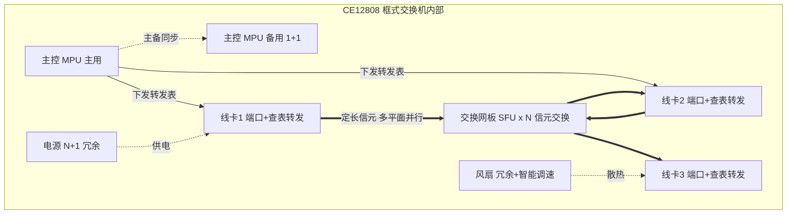

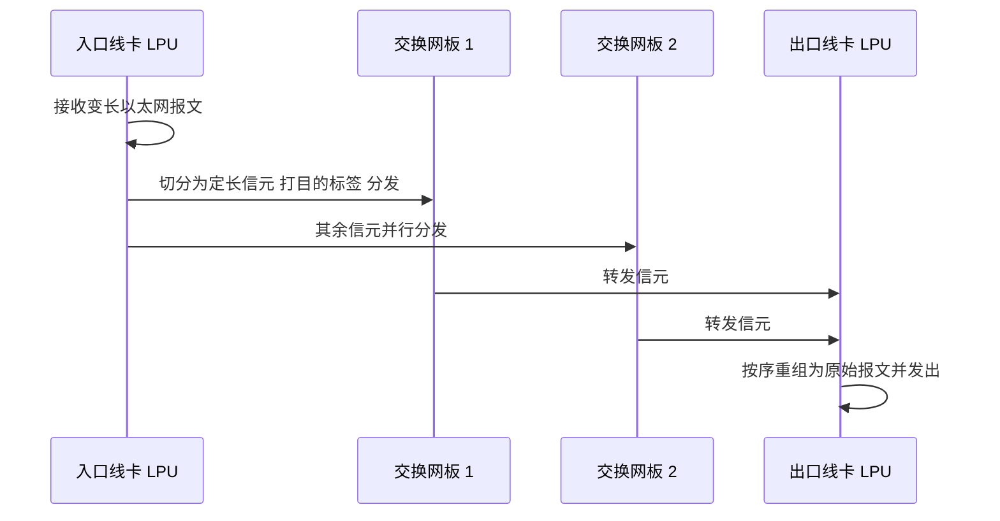

### 真题精练

**Q1.【真题·单选】** 框式数据中心交换机中，负责在业务线卡之间完成数据交换的模块是：
A. 主控板 MPU  B. 交换网板 SFU  C. 电源模块  D. 风扇模块

> **答案：B**
> **解析**：SFU（Switch Fabric Unit，交换网板）是框式设备的交换核心，负责线卡之间的高速数据交换，采用信元交换机制。A 的主控板负责控制面（协议、转发表、管理），不做数据转发；C、D 分别是供电与散热模块。这道题考的是"控制面与数据面的分工"，是理解框式架构的关键。

**Q2.【真题·多选】** 框式交换机采用信元交换（Cell-based Switching）的优点包括：
A. 消除交换过程中的头阻塞（Head-of-Line Blocking）
B. 便于把一条大流拆分到多块交换网板并行转发
C. 使内部调度更简单、时延更可预测
D. 使交换网板故障时业务完全中断以便快速定位

> **答案：A、B、C**
> **解析**：D 明显错误，交换网板冗余设计的目标恰恰是"故障时业务**不中断**"。信元交换的三条核心优势就是 A、B、C：变长报文切成定长信元后可交织传输（消除头阻塞）、可分布到多个并行平面（负载均衡与更高容量）、调度粒度固定（时延可预测）。这也是框式设备能支撑数十 T 背板容量的基础。

**Q3.【真题·判断】** 框式交换机的主控板同时承担控制面与数据面转发功能，因此主控板故障会导致所有报文转发中断。

> **答案：错误**
> **解析**：框式设备是**控制面与数据面分离**的架构：主控板 MPU 负责控制面（VRP 系统、路由协议、转发表生成、设备管理），数据面的查表与转发由**业务线卡 LPU** 完成，线卡之间由**交换网板 SFU** 互联。主控故障时，1+1 备用主控接管控制面，而线卡上已有的转发表项继续生效，**转发不中断**（可能丢失少量正在上送 CPU 的协议报文）。这正是框式设备高可靠性的来源，也是盒式设备（无主控冗余）的差距所在。

**Q4.【真题·填空】** 框式设备中，主控板通常采用 \_\_\_\_\_ 冗余方式，电源通常采用 \_\_\_\_\_ 冗余方式；线卡与交换网板之间的互联容量上限称为 \_\_\_\_\_。

> **答案：1+1（主备）；N+1 或 N+N；背板带宽**
> **解析**：完整记忆：主控 **1+1 主备**、交换网板**多平面并行 + 冗余**、电源 **N+1/N+N**、风扇**冗余 + 智能调速**。背板带宽决定整机交换容量上限，规划时必须核算"所有线卡总带宽 ≤ 交换网板总容量 ≤ 背板带宽"，否则会出现线卡插满但转发能力不足的超配问题。

**Q5.【真题·简答】** 请解释"控制面与数据面分离"的含义，并说明它在框式数据中心交换机上的两个具体体现。

> **答案要点**：
> **含义**：把网络设备的功能划分为两个平面——**控制面（Control Plane）**负责"决定怎么转发"（运行路由协议、计算最优路径、生成 FIB/MAC 转发表、处理管理与配置），**数据面（Forwarding/Data Plane）**负责"实际转发报文"（查表、改写、封装、排队调度）。两者由不同的硬件/软件模块承担，控制面故障或切换不必然导致数据面中断。
> **体现一（硬件分工）**：框式中主控板 MPU 只做控制面，业务线卡 LPU 做数据面转发，交换网板 SFU 做线卡间互联。因此主控故障时，1+1 主备倒换只影响控制面，线卡上已下发的转发表项继续生效，报文继续转发。
> **体现二（故障影响）**：控制面协议（如 OSPF/BGP）震荡或重启时，只要 FIB 表项尚未被撤销，已建立的数据流转发路径不受影响；这也解释了为什么 `display ip routing-table` 中稳定的表项能让业务在协议短暂抖动时"感觉不到"。运维上的意义是：**排查"业务不通"时要区分是控制面学不到路由，还是数据面转发被 ACL/QoS/表项耗尽阻断**——`display ip routing-table` 正常但业务不通，就要往数据面（ACL、QoS、MAC 表、VXLAN 隧道）查。

**Q6.【真题·排错】** 某 CE12800 报出"交换网板某块故障"告警，但业务仍可访问。运维担心需要立即停机维修。请给出判断与操作建议。

> **答案**：**判断**：交换网板采用多平面并行 + 冗余设计，单块网板故障时，其余网板继续承担交换任务，整机**交换容量按比例下降**（例如 4 块网板掉 1 块，可用容量降至 75%），但业务通常**不中断**。因此不必立即停机，但必须尽快处理，因为此时**已无冗余**，再坏一块就可能影响业务。
> **操作建议**：
> ```bash
> [CE12800] display device                            // 确认故障槽位与单板状态（Fault/Offline）
> [CE12800] display alarm all                         // 查看完整告警与级别
> [CE12800] display logbuffer | include FABRIC        // 追溯网板故障前后的日志线索
> [CE12800] display interface brief                   // 核对业务端口状态是否正常
> [CE12800] display cpu-usage                         // 观察主控CPU是否因故障处理而升高
> ```
> ① **评估容量余量**：核算剩余网板容量是否仍能满足当前流量与收敛比要求（可对照 `display interface counters rate` 的实际利用率），若余量不足需尽快安排窗口；② **热插拔更换**：框式线卡与网板支持热插拔，在业务低峰期更换故障网板即可，无需整机断电；③ **记录与追溯**：保存日志与告警快照，判断是硬件老化、光模块/电源异常还是温度问题导致的网板故障；④ **更换后验证**：更换完成后确认 `display device` 中该槽位状态恢复 Normal，`display alarm all` 中告警清除，并复核接口流量分担已恢复均衡。

### 易错点与排错
- **易错 1**：认为主控板负责转发报文。主控只管控制面，转发在线卡。
- **易错 2**：把信元交换与"报文分片"混为一谈。信元切分是**设备内部行为**，出口会重组，对外部网络完全透明，不会改变 MTU 或报文格式。
- **易错 3**：认为"有冗余就可以慢慢修"。冗余被消耗后系统处于**单点状态**，必须按故障处理。
- **易错 4**：规划框式只数槽位，不算带宽。线卡总带宽必须与交换网板总容量匹配。
- **排错命令**：`display device`、`display alarm all`、`display switchover state`（主备倒换条件）、`display power` / `display fan` / `display temperature`、`display logbuffer`。

---

## 2.3 数据中心接口、光模块与布线

### 考点定位
高频记忆型考点，几乎每套卷都有"某速率对应哪种光模块/接口""多模光纤能传多远""DAC 能传多长"这类题。分值 2~4 分。**易错点**：把 SFP28 与 SFP+ 混淆；把 QSFP28 与 QSFP+ 混淆；记错多模/单模的传输距离。

### 原理精讲
**"接口"与"光模块"是两个概念**：交换机面板上的"端口"（port）提供的是**电气接口与机械 cage（笼子）**，真正决定速率、波长、传输距离的是插入其中的**光模块**或**线缆**。因此同一个物理端口可以插不同速率/类型的光模块（受端口能力与软件许可约束）。这是考试常考的"陷阱点"：问"100GE 端口用什么模块"答 QSFP28，问"25GE 端口"答 SFP28。

**四代主流速率与封装对照**：

| 速率 | 模块封装 | 电口标准 | 常见光口标准 | 接头 | 典型场景 |
|---|---|---|---|---|---|
| 10GE | SFP+ | 10GBASE-T（RJ45） | 10GBASE-SR/LR/ER | LC | 服务器接入、园区上行 |
| 25GE | SFP28 | 25GBASE-T（较少） | 25GBASE-SR/LR/ER | LC | DC 服务器接入主流 |
| 40GE | QSFP+ | — | 40GBASE-SR4/LR4 | MPO/LC | 上一代上行 |
| 100GE | QSFP28 | — | 100GBASE-SR4/LR4/ER4 | MPO/LC | Leaf 上行、Spine |
| 200GE | QSFP56 | — | 200GBASE-SR4/DR4/FR4 | MPO/LC | 高端上行 |
| 400GE | QSFP-DD / OSFP | — | 400GBASE-SR8/DR4/FR4 | MPO/LC | 新一代 Spine/Core |

**命名规律（背下来就能推）**：`速率` + `BASE` + `介质/距离代码` + `通道数`
- **SR** = Short Reach，多模光纤短距；
- **LR** = Long Reach，单模光纤 10km；
- **ER** = Extended Reach，单模超长距 30~40km；
- **DR** = 500m 单模（数据中心内）；
- **FR** = 2km 单模；
- **4/8** 后缀表示并行通道数（如 SR4 = 4 通道，SR8 = 8 通道）。

**光纤类型与距离**：
- **多模光纤 MMF**：OM3（Aqua 水蓝，10G 约 300m）、OM4（Violet 紫，10G 约 400m、100G SR4 约 150m）、OM5（宽带多模，支持 SWDM 波分复用，距离更远）。多模使用 **850nm VCSEL** 光源，成本低、距离短，适合机房内（<150m）互联。
- **单模光纤 SMF**：OS2（黄色），使用 **1310nm/1550nm** 激光，LR 可传 10km、ER 可传 30~40km，适合跨楼栋、DCI。

**DAC 与 AOC**：
- **DAC（Direct Attach Cable，高速直连铜缆）**：两端焊死光模块形态的铜缆，**无光电转换**，因此**时延最低、成本最低、功耗几乎为零**。分**无源 DAC（Passive，通常 ≤3m，部分可到 5m）**与**有源 DAC（Active，可到 7~10m）**。机柜内服务器到 ToR 首选。
- **AOC（Active Optical Cable，有源光缆）**：两端是光模块，中间是光纤，**有光电转换**，距离可到 100m 以上，成本高于 DAC 但低于"光模块+光缆"组合，适合 ToR 到 EoR、机柜间互联。
- **选择逻辑**：**同机柜 ≤3m 用无源 DAC；3~10m 用有源 DAC/AOC；>10m 用光模块 + 光纤**。这是"线缆选型"题的标准判据。

**MPO/MTP 高密度光纤**：MPO（Multi-fiber Push On）是多芯推拉式连接器，常见 **8 芯/12 芯/16 芯/24 芯**一束；MTP 是 MPO 的一种高性能品牌化说法（US Conec 的 MTP 兼容 MPO）。100GE SR4 用 **12 芯 MPO**（其中 8 芯用于收发的 4 个通道），400GE SR8 用 **16 芯 MPO**。使用 MPO 的主因是**布线密度**：一根 MPO 干线可替代 4~8 根 LC 双工跳线，在 ToR 到 Spine 的大量并行链路上，能把配线架与桥架的压力降低数倍。代价是需要 MPO 配线箱/模块盒做"MPO↔LC 分支"，且极性（Polarity）规划复杂，接错会整组链路不通。

**布线基础要点**：
1. **ToR 布线**：服务器双归到同机柜（或相邻机柜）的两台 ToR，用 DAC 铜缆；ToR 上行到 Spine 用 AOC/光模块 + MPO 干线。走线遵循"**冷通道侧进线、避免遮挡风道**"。
2. **双归但不同柜**：M-LAG 场景要求两台 ToR 通常处于相邻机柜，跨柜线缆尽量短且路径分离（避免同一桥架被压断导致双归同时失效）。
3. **标签与文档**：每条链路两端都要有唯一标识（如 `A01-ToR1-25GE1/0/1 ↔ A01-U12-NIC1`），这是"排错实操"题中体现工程素养的加分项。
4. **冗余路径物理分离**：主备链路必须走不同桥架/不同路由，否则一次施工挖断同时断两条，冗余形同虚设。

### 关键概念对照表

| 模块类型 | 速率 | 封装 | 多模最远 | 单模最远 | 典型用途 |
|---|---|---|---|---|---|
| SFP+ SR | 10GE | SFP+ | OM3 300m / OM4 400m | — | 服务器 10GE 接入 |
| SFP+ LR | 10GE | SFP+ | — | 10km | 跨楼栋 |
| SFP28 SR | 25GE | SFP28 | OM4 约 100m | — | 服务器 25GE 接入 |
| SFP28 LR | 25GE | SFP28 | — | 10km | 跨楼栋 |
| QSFP+ SR4 | 40GE | QSFP+ | OM3 100m / OM4 150m | — | 上一代上行 |
| QSFP28 SR4 | 100GE | QSFP28 | OM4 约 100m | — | Leaf 上行（短距） |
| QSFP28 LR4 | 100GE | QSFP28 | — | 10km | Spine 上行/跨机房 |
| QSFP56 | 200GE | QSFP56 | 视具体型号 | 视具体型号 | 高端 Spine 上行 |
| QSFP-DD | 400GE | QSFP-DD | 视具体型号 | 视具体型号 | 新一代 Spine/Core |

| 线缆类型 | 距离范围 | 时延 | 成本 | 功耗 | 适用位置 |
|---|---|---|---|---|---|
| 无源 DAC | ≤3m（部分 5m） | 最低 | 最低 | 近零 | 服务器 ↔ ToR |
| 有源 DAC | 3~10m | 低 | 低 | 低 | 机柜内跨柜 |
| AOC | 1~100m | 中 | 中 | 中 | ToR ↔ EoR、机柜间 |
| 光模块 + 光纤 | 100m~40km | 中高 | 高 | 高 | ToR ↔ Spine、DCI |

| 光纤类型 | 型号 | 颜色 | 光源 | 典型应用 |
|---|---|---|---|---|
| 多模 | OM3 | 水蓝 | 850nm VCSEL | 机房内短距（10G 300m） |
| 多模 | OM4 | 紫 | 850nm VCSEL | 机房内（10G 400m / 100G 150m） |
| 多模 | OM5 | 青绿 | 850nm SWDM | 高密度波分复用场景 |
| 单模 | OS2 | 黄 | 1310/1550nm 激光 | 跨楼栋、DCI（10km~40km） |

### 华为设备配置
光模块健康度是数据中心运维的核心，华为 CE 通过 `display transceiver` 系列命令读取：

```bash
<CE6865> display transceiver interface 25GE1/0/1          // 查看该口所插模块：厂商、型号、序列号、波长
<CE6865> display transceiver interface 25GE1/0/1 verbose  // 关键：读取Rx Power/Tx Power/温度/电压/偏置电流
<CE6865> display transceiver alarm interface 25GE1/0/1     // 是否有LOS（收无光）/高低温/电压异常告警
<CE6865> display transceiver manuinfo interface 25GE1/0/1  // 模块制造信息（用于验证是否为华为认证模块）
<CE6865> display interface 25GE1/0/1 | include CRC          // 观察CRC错包，判断光路质量（误码）
<CE6865> display interface 100GE1/0/1 | include rate         // 结合速率观察链路是否被跑满
<CE6865> display interface brief | include down             // 快速定位DOWN的口，逐一排查光模块/跳线
```

### 示意图

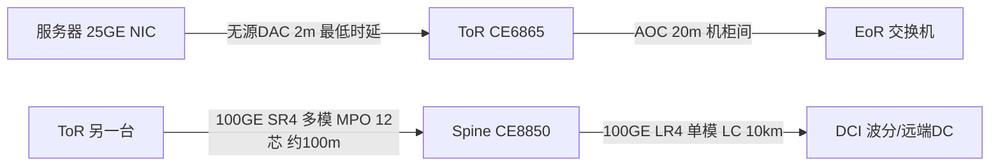

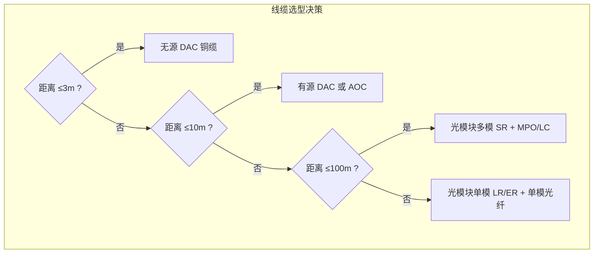

### 真题精练

**Q1.【真题·单选】** 25GE 接口使用的光模块封装类型是：
A. SFP+  B. SFP28  C. QSFP+  D. QSFP28

> **答案：B**
> **解析**：封装与速率的对应关系是硬记忆点——10GE 用 **SFP+**，25GE 用 **SFP28**，40GE 用 **QSFP+**，100GE 用 **QSFP28**，200GE 用 QSFP56，400GE 用 QSFP-DD/OSFP。SFP28 与 SFP+ 的 cage 尺寸兼容（同为 1 通道），但电气速率不同；QSFP 系列为 4 通道（QSFP-DD 为 8 通道电气）。

**Q2.【真题·多选】** 关于 DAC 与 AOC，说法正确的是：
A. 无源 DAC 内部没有光电转换，时延最低、功耗近零
B. 无源 DAC 距离一般不超过 3m（部分可达 5m）
C. AOC 两端为光模块、中间为光纤，距离可远于 DAC
D. AOC 的时延一定低于 DAC

> **答案：A、B、C**
> **解析**：D 错。AOC 两端有光电转换（电→光→电），会引入额外的转发与串行化时延，因此 **AOC 时延高于 DAC**，只是远低于"光模块 + 长光纤 + 中间跳接"的组合。选型逻辑是：**同机柜短距用 DAC（省成本省时延），跨机柜用 AOC，跨排/跨楼用光模块 + 光纤**。

**Q3.【真题·判断】** 100GBASE-LR4 模块使用多模光纤，最大传输距离约 100m。

> **答案：错误**
> **解析**：命名规则中 **SR = Short Reach 多模短距**，**LR = Long Reach 单模长距（10km）**。"100GBASE-LR4" 明确是**单模**模块，使用 4 个 25GE 通道（4×25G=100G），采用 1310nm 波段，最大距离约 **10km**。若题目写的是 100GBASE-SR4，则是多模、OM4 约 100m。搞混 SR/LR 是这类题最常见的失分点。

**Q4.【真题·填空】** 100GBASE-SR4 光模块通常使用 \_\_\_\_\_ 芯的 MPO 连接器（其中 8 芯用于 4 个通道的收发），而 400GBASE-SR8 通常使用 \_\_\_\_\_ 芯 MPO。

> **答案：12；16**
> **解析**：MPO 常见规格有 8/12/16/24 芯。100G SR4 使用 4 个通道，每通道需 1 收 1 发共 8 芯，工程上普遍采用 **12 芯 MPO**（保留 4 芯冗余/对齐）；400G SR8 使用 8 个通道，需要 16 芯，因此用 **16 芯 MPO**。高密度布线的核心收益是"一根干线替代多根 LC 双工跳线"，所以 ToR→Spine 这种成组并行链路必然用 MPO。

**Q5.【真题·简答】** 某数据中心机柜内服务器到 ToR 的距离为 2.5m，相邻机柜 ToR 之间距离 8m，ToR 到本排 EoR 距离 22m，另有跨机房 Spine 互联 1.5km。请为这四段链路分别选择线缆/模块类型并说明理由。

> **答案要点**：
> ① **服务器 → ToR，2.5m**：选 **无源 DAC 铜缆**（≤3m）。理由：无光电转换、时延最低（对存储/RDMA 有益）、成本最低、功耗近零，且插拔方便。
> ② **相邻机柜 ToR ↔ ToR，8m**：选 **有源 DAC（3~10m 档）或 AOC**。理由：超出无源 DAC 的可靠距离，但仍在低速光/铜的成本优势区间；若该链路需承载 100GE 高带宽，优先 AOC 以保证信号质量。
> ③ **ToR → EoR，22m**：选 **AOC 或"多模光模块 SR + OM4 光纤"**。理由：超出铜缆与有源 DAC 的可靠范围，>10m 必须走光纤；22m 属于多模光纤的舒适区（OM4 在 100G SR4 下约 100m），无需单模。
> ④ **跨机房 Spine 互联，1.5km**：选 **单模光模块（100GBASE-LR4 或对应速率的 FR/LR）+ OS2 单模光纤**，并由 DCI 波分设备承载长距。理由：多模光纤距离上限远小于 1.5km；单模 LR 支持 10km、FR 支持 2km，满足需求且有裕量。
> **加分点**：应补充说明"**冗余链路必须物理路径分离**"——双归的两条链路不能走同一桥架，否则一次施工事故同时中断两条，冗余失效；以及每条链路需打**唯一标签**（两端设备名 + 端口号）便于排错。

**Q6.【真题·排错】** 某 Leaf 的 100GE 上行口物理状态 UP，但业务时延抖动大、偶发丢包。`display interface 100GE1/0/1` 显示 CRC 错包计数持续增长。请给出排查思路与命令。

> **答案**：**判断**：物理 UP 但 CRC 错误持续增长，说明**光路质量或光模块/跳线存在问题**，而不是协议配置问题。CRC 错误意味着接收到的帧校验失败，通常由光功率异常、光纤脏污/弯折、模块不匹配或 MPO 极性错误导致。
> **排查命令与步骤**：
> ```bash
> <CE6865> display transceiver interface 100GE1/0/1 verbose     // 读Rx/Tx Power：是否低于灵敏度或高于饱和点
> <CE6865> display transceiver alarm interface 100GE1/0/1       // 是否有LOS、高低温、电压告警
> <CE6865> display interface 100GE1/0/1                         // 关注CRC/Align错误计数与增长速率
> <CE6865> display interface 100GE1/0/1 | include CRC
> <CE6865> display transceiver manuinfo interface 100GE1/0/1     // 核查两端模块是否为华为认证模块
> <CE6865> display logbuffer | include 100GE1/0/1                // 查看链路up/down历史与告警
> ```
> **处置顺序**：① **先看光功率**：若 Rx Power 过低（接近或低于模块灵敏度），检查跳线是否插紧、端面是否脏污（用专用清洁笔清洁）、光纤是否弯折超标；若 Rx 过高（超过饱和点），需加衰减器；② **核对两端模块一致性**：速率、波长、封装必须匹配（如一端 SR4 多模、另一端 LR4 单模必然异常）；③ **MPO 极性检查**：MPO 干线接错极性会导致整组通道误码，需按极性方案（A/B/C）核对配线箱跳接；④ **替换法**：更换跳线或光模块定位故障件；⑤ **临时缓解**：若业务紧急，可先切走该链路的流量（ECMP 会自动收敛到其它 Spine），再离线处理。**判分要点：先量光功率，再查模块匹配与极性，最后替换定位——不要一上来就怀疑配置。**

### 易错点与排错
- **易错 1**：速率与封装混记。**10G→SFP+、25G→SFP28、40G→QSFP+、100G→QSFP28、400G→QSFP-DD**。
- **易错 2**：SR 当单模、LR 当多模。**SR = 多模短距，LR/ER/FR/DR = 单模**。
- **易错 3**：认为 DAC 可以随便拉长。无源 DAC 一般 ≤3m，超距必须换 AOC 或光模块。
- **易错 4**：双归链路走同一桥架，冗余形同虚设。
- **易错 5**：只看接口 UP/DOWN，不看光功率与 CRC。物理 UP 不代表链路健康。
- **排错命令**：`display transceiver interface <口> verbose`、`display transceiver alarm interface <口>`、`display interface <口>` 中的 CRC/错包、`display transceiver manuinfo interface <口>`。

---

## 2.4 CloudEngine VRP V200 版本、巡检命令与 ZTP 自动开局

### 考点定位
校赛省赛偏"实操与运维"的考点，常考"数据中心交换机跑的是哪一代 VRP""ZTP 依赖哪个协议""自动开局流程顺序"。分值 1~3 分。**易错点**：把园区与数据中心的 VRP 版本搞混；认为 ZTP 需要手工敲配置。

### 原理精讲
**VRP 平台版本的三条线**：

| 平台线 | 主要设备 | 典型版本号 | 特点 |
|---|---|---|---|
| **VRP V200** | 数据中心交换机 CloudEngine 12800/16800/8800/6800/6865 等 | V200R019 / V200R021 / V200R022 等 | 面向 DC：强 VXLAN/BGP EVPN、M-LAG、无损网络（PFC/ECN）、Telemetry、大表项 |
| **VRP V300** | 园区交换机 CloudEngine S 系列（S5731/S6730/S12700 等） | V300R019 / V300R021 等 | 面向园区：iStack 堆叠、SVF、WLAN AC 一体化、VRRP、丰富接入特性 |
| **VRP V600** | 部分高端/新型号平台 | V600R0xx | 新一代统一平台（视具体产品） |

**核心差异不要背条款，要抓"面向场景"**：V200 的 DNA 是"**大二层叠加 + 无损 + 自动化**"，因此它的命令重心在 `bridge-domain`、`vxlan`、`nve`、`m-lag`、`dfs-group`、`priority-flow-control`、`telemetry`；V300 的 DNA 是"**接入 + 堆叠 + 无线**"，命令重心在 `stack`、`svf`、`wlan`、`vrrp`、`mac-vlan`。考试问"数据中心设备用 V200 还是 V300"，标准答案是 **数据中心用 VRP V200（DC 版本），园区用 VRP V300**。另一个常见差异题：**堆叠**在园区（V300）是 `stack`/iStack、**CSS** 在高端框式是集群，而数据中心双活则用 **M-LAG**（V200），不要混淆。

**CE 设备常用 display 与巡检命令**（数据中心运维的"体检清单"）：

| 维度 | 命令 | 看什么 |
|---|---|---|
| 版本/硬件 | `display version`、`display device`、`display elabel` | 版本、单板、序列号 |
| 链路 | `display interface brief`、`display interface <口>` | UP/DOWN、速率、错包 |
| 光模块 | `display transceiver interface <口> verbose` | 收发光功率、温度 |
| 协议 | `display ospf peer brief`、`display bgp peer`、`display bfd session all` | 邻居状态、BFD |
| 表项 | `display mac-address`、`display ip routing-table`、`display arp` | MAC/路由/ARP 表规模 |
| 资源 | `display cpu-usage`、`display memory-usage` | CPU/内存 |
| 告警日志 | `display alarm all`、`display logbuffer` | 硬件告警与事件 |
| Overlay | `display vxlan vni`、`display vxlan tunnel`、`display bridge-domain` | VNI/隧道/BD |
| 可靠性 | `display dfs-group 1 m-lag`、`display eth-trunk 1 verbose` | M-LAG 与聚合状态 |
| 队列 | `display qos queue statistics interface <口>` | 拥塞与丢包队列 |

**ZTP（Zero Touch Provisioning，零接触部署）自动开局**：新设备上电后**无需人工登录敲配置**，自动获取版本文件与配置文件并完成开局。流程如下：

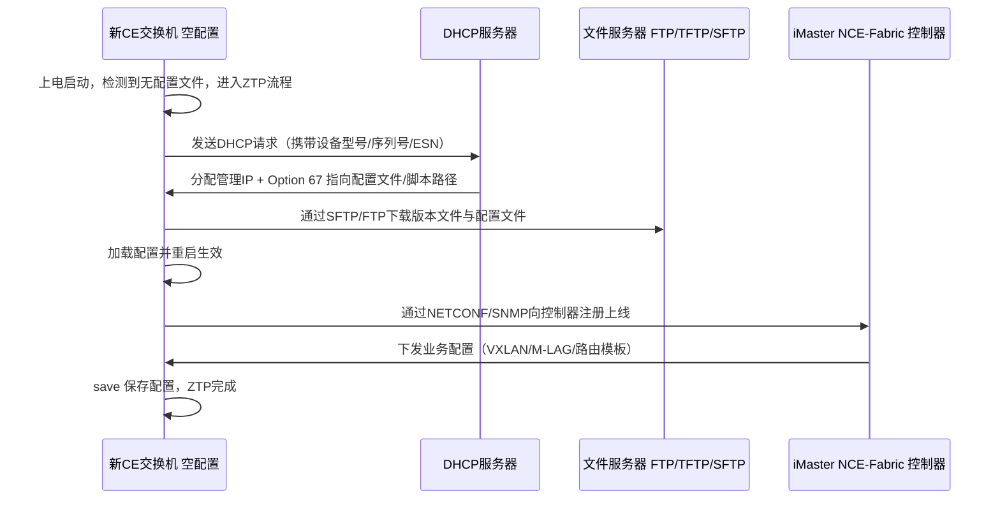

**关键技术点（考点）**：
1. **DHCP 是关键前置**：设备必须能通过 DHCP 获得**管理 IP** 与**文件服务器地址**。华为 ZTP 通常通过 **Option 67（Bootfile Name）** 指定配置文件/脚本路径，也可用 Option 66 指定 TFTP 服务器名。
2. **文件传输协议**：支持 FTP/TFTP/SFTP，生产环境推荐 **SFTP**（加密）。
3. **触发条件**：设备**无配置文件**或配置文件中显式启用 ZTP（`ztp enable` / `ztp run`）时才启动。
4. **与控制器配合**：ZTP 常与 iMaster NCE-Fabric 结合——ZTP 负责"让设备上线到管理网络"，控制器负责"按角色下发业务配置模板"（Spine 模板 / Leaf 模板 / Border Leaf 模板）。
5. **前提条件**：网络必须已有"**开局管理网**"（带外管理或临时管理 VLAN），且 DHCP 与文件服务器可达。这是 ZTP 工程实施的第一个门槛。

### 关键概念对照表

| 对比项 | VRP V200（数据中心 CE） | VRP V300（园区 CE S 系列） |
|---|---|---|
| 面向场景 | 数据中心 Fabric | 园区接入/汇聚/核心 |
| 核心特性 | VXLAN、BGP EVPN、M-LAG、PFC/ECN、Telemetry | iStack 堆叠、SVF、WLAN AC、VRRP |
| 二层扩展 | BD + VNI（Overlay） | VLAN + 堆叠 |
| 双活方案 | M-LAG | iStack/CSS + VRRP |
| 自动化 | ZTP + NCE-Fabric + NETCONF | ZTP + NCE-Campus |
| 无损网络 | 支持 PFC/ECN（数据中心必备） | 一般不支持（园区无需） |

| ZTP 要素 | 作用 | 常见取值/协议 |
|---|---|---|
| DHCP | 分配管理 IP、指定文件路径 | Option 67（Bootfile）/ Option 66 |
| 文件服务器 | 存放版本与配置文件 | SFTP（推荐）/ FTP / TFTP |
| 中间文件 | 描述要加载的版本与配置 | 如 `ztp.ini` 之类的索引文件 |
| 控制器 | 按角色下发业务模板 | iMaster NCE-Fabric（NETCONF/SNMP） |
| 触发条件 | 空配置或显式启用 | `ztp enable` / 无配置文件启动 |

### 华为设备配置
ZTP 相关配置与巡检命令示例：

```bash
# ===== 方式一：设备侧启用ZTP，由DHCP与文件服务器驱动 =====
<CE6865> system-view
[CE6865] ztp enable                                    // 使能ZTP功能（空配置设备上电后自动进入ZTP）
[CE6865] quit
<CE6865> ztp run                                       // 手动触发一次ZTP流程（调试时使用）
<CE6865> display ztp status                            // 查看ZTP状态：进行中/成功/失败原因
<CE6865> display ztp log                               // 查看ZTP日志，定位DHCP/文件下载失败点

# ===== 方式二：通过DHCP服务器下发（服务器侧配置示例，示意） =====
# DHCP地址池中配置：
#   next-server 10.10.10.100                             // 文件服务器地址（TFTP/FTP/SFTP）
#   option 67 "ztp.ini"                                  // 指定ZTP中间文件（Bootfile）

# ===== 设备侧配置管理网与文件服务器（若不用DHCP，可手工指向） =====
[CE6865] interface Vlanif 10
[CE6865-Vlanif10] ip address 10.10.10.11 24             // 管理VLAN网关，供ZTP后持续运维
[CE6865-Vlanif10] quit
[CE6865] ip route-static 0.0.0.0 0.0.0.0 10.10.10.1     // 指向管理网关，保证能到DHCP/文件服务器

# ===== 开局后完整巡检（运维标准动作） =====
<CE6865> display version                               // 1. 版本是否与规划一致
<CE6865> display device                                // 2. 硬件是否全部Normal
<CE6865> display interface brief                       // 3. 端口UP数量是否与设计一致
<CE6865> display transceiver alarm interface all       // 4. 光模块是否全部无告警
<CE6865> display ospf peer brief                       // 5. Underlay邻居是否Full
<CE6865> display bfd session all                       // 6. BFD是否Up
<CE6865> display dfs-group 1 m-lag                     // 7. M-LAG是否正常（Leaf双归必备）
<CE6865> display vxlan tunnel                          // 8. Overlay隧道是否建立
<CE6865> display alarm all                             // 9. 是否遗留告警
<CE6865> save                                          // 10. 巡检通过后保存基线配置
```

### 示意图

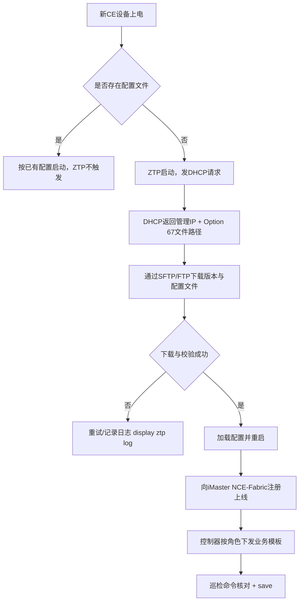

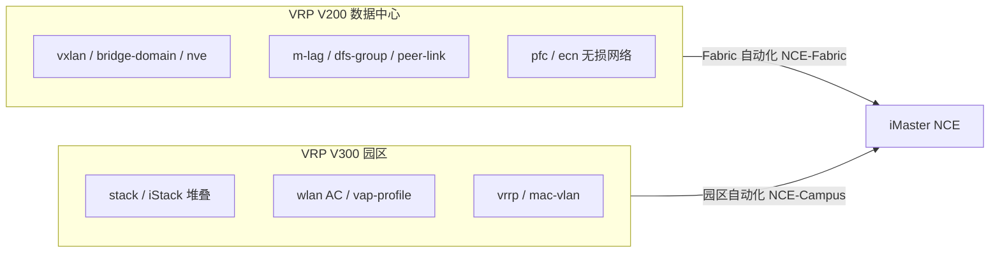

### 真题精练

**Q1.【真题·单选】** 华为数据中心交换机 CloudEngine 68/88/128 系列通常运行的 VRP 平台版本是：
A. VRP V200  B. VRP V300  C. VRP V500  D. VRP V600

> **答案：A**
> **解析**：数据中心 CloudEngine 系列（CE12800/16800/8800/6800/6865 等）运行 **VRP V200** 数据中心版本，其特性重心是 VXLAN、BGP EVPN、M-LAG、PFC/ECN 无损网络与 Telemetry；园区 S 系列（S5731/S6730/S12700）运行 **VRP V300**，特性重心是 iStack 堆叠、SVF、无线 AC 一体化。考试中"版本与场景对应"是固定考点，V500 并非该体系中的实际版本号。

**Q2.【真题·多选】** 关于 ZTP（Zero Touch Provisioning）零接触部署，说法正确的是：
A. 设备在无配置文件启动时可自动进入 ZTP 流程
B. ZTP 依赖 DHCP 获取管理 IP 与配置文件路径
C. ZTP 的版本与配置文件可通过 SFTP/FTP/TFTP 下载
D. ZTP 完成后必须由人工逐条录入业务配置才能使用
E. ZTP 常与 iMaster NCE-Fabric 配合，由控制器按角色下发模板

> **答案：A、B、C、E**
> **解析**：D 错。ZTP 的价值正是**免除人工逐条录入**：设备自动下载配置文件完成基础配置，随后由控制器按设备角色（Spine/Leaf/Border Leaf）下发业务模板，实现"上电即上线"。ZTP 的三个必要前提要记住：① 有可达的 DHCP 服务器；② 有可达的文件服务器（生产推荐 SFTP）；③ 有开局管理网（带外管理或临时管理 VLAN）。

**Q3.【真题·判断】** ZTP 是一种只在设备首次上电时才能使用的技术，设备已有配置文件后无法再通过 ZTP 更新配置。

> **答案：错误**
> **解析**：ZTP 的触发条件是"**设备无配置文件启动**"或"**配置中显式启用 ZTP**"。设备已运行后，仍可通过 `ztp enable` 使能并配合 DHCP/文件服务器更新配置（例如版本升级或配置重建场景，需谨慎评估影响）。此外，生产上更常见的是"ZTP 完成基础开局 + 控制器持续下发业务配置"的组合——**开局只是一次性的，自动化运维是长期的**。

**Q4.【真题·填空】** 华为 ZTP 流程中，设备通过 \_\_\_\_\_ 协议获取管理 IP 地址与配置文件路径（常用 Option 67 指定文件）；下载配置文件时生产环境推荐使用 \_\_\_\_\_ 协议以保证传输安全。

> **答案：DHCP；SFTP（SSH File Transfer Protocol）**
> **解析**：DHCP 不仅分配 IP，还可通过 Option 66/67 传递文件服务器与启动文件名信息，是 ZTP 的"指路牌"。FTP/TFTP 均为明文传输（TFTP 还基于 UDP、无认证），在生产网络中可能泄露配置（配置里常含密码、密钥），因此推荐 **SFTP**（基于 SSH，加密且有认证）。这也是安全类考点常与 ZTP 联合出题的地方。

**Q5.【真题·简答】** 请列出一台新建 CE Leaf 交换机上线后的巡检清单（至少 8 项），并说明每一项对应的验收标准。

> **答案要点**：
> | 序号 | 巡检项 | 命令 | 验收标准 |
> |---|---|---|---|
> | 1 | 版本一致性 | `display version` | 版本/补丁与全网基线一致 |
> | 2 | 硬件状态 | `display device` | 单板、电源、风扇全部 Normal，无 Fault |
> | 3 | 端口状态 | `display interface brief` | UP 端口数与设计一致，无意外 DOWN |
> | 4 | 光模块健康 | `display transceiver interface <口> verbose` | Rx/Tx 功率在模块规格范围内，无 LOS |
> | 5 | Underlay 邻居 | `display ospf peer brief` / `display bgp peer` | 全部 Full / Established |
> | 6 | 故障检测 | `display bfd session all` | 所有 BFD 会话 Up |
> | 7 | 冗余状态 | `display dfs-group 1 m-lag`、`display eth-trunk verbose` | M-LAG 建立成功，peer-link 正常，成员口均匀 |
> | 8 | Overlay 状态 | `display vxlan tunnel`、`display bridge-domain` | 隧道全部建立，BD 内 MAC 正常学习 |
> | 9 | 资源水位 | `display cpu-usage`、`display memory-usage` | CPU/内存空闲率合理（如 CPU < 50%） |
> | 10 | 告警与日志 | `display alarm all`、`display logbuffer` | 无未处理告警，无反复 up/down |
> | 11 | 配置基线 | `display current-configuration` 与规划比对 | 无多余配置、无配置漂移 |
> | 12 | 保存配置 | `save` | 配置已写入启动文件 |
> **加分点**：应指出"巡检必须**留下基线快照**（导出配置文件与命令回显），后续故障时才有对照物"；并强调巡检顺序是"**先硬件后软件、先物理后协议、先 Underlay 后 Overlay**"，因为上层问题往往源于底层。

**Q6.【真题·排错】** 一批新 CE 交换机执行 ZTP 时全部失败，`display ztp status` 显示停留在 DHCP 阶段。请分析可能原因并给出排查方向。

> **答案**：**判断**：ZTP 卡在 DHCP 阶段，说明设备**没有拿到管理 IP 或文件路径**，问题不在设备业务配置，而在**开局管理网的可达性与 DHCP 服务**。
> **可能原因与排查方向**：
> ① **物理链路未通**：管理口/管理 VLAN 所在端口未 UP。查 `display interface brief` 与管理口的连线，确认接入的是管理交换机且 VLAN 正确。
> ② **DHCP 中继缺失**：DHCP 服务器与设备不在同一广播域，而未配置 DHCP Relay（中继）。需在网关设备上配置中继指向 DHCP 服务器。
> ③ **DHCP 地址池耗尽或未含该设备**：地址池已分配完、或未按设备型号/序列号（ESN）做匹配策略，导致分配失败。
> ④ **VLAN/端口配置错误**：管理 VLAN 未在中间交换机上放通，或端口 link-type 与 VLAN 不匹配，导致 DHCP 广播无法到达。
> ⑤ **Option 67/66 未配置或路径错误**：即使拿到 IP，若 Option 未指定文件路径，ZTP 也无法继续（不同设备的失败阶段可能都表现为"未完成"）。
> ⑥ **管理网路由/ACL 阻断**：中间设备 ACL 拦截了 UDP 67/68 或到文件服务器的流量。
> **排查命令**：
> ```bash
> <CE6865> display ztp status                       // 确认卡在哪个阶段
> <CE6865> display ztp log                          // 看具体错误码（DHCP超时/文件下载失败）
> <CE6865> display interface brief                  // 管理口是否UP
> <CE6865> display vlan                             // 管理VLAN是否存在并放通
> <CE6865> display ip interface brief               // 是否已分配到IP
> # 在DHCP服务器/中继设备上：display ip pool / display dhcp relay 相关状态
> ```
> **处置思路**：先在设备侧的**临时管理网**上手工配一个管理 IP，验证到 DHCP 与文件服务器的连通性（ping/端口探测），确认网络可达后再逐项修复中继或地址池；ZTP 调试期间保持 `display ztp log` 打开观察。

### 易错点与排错
- **易错 1**：把数据中心设备说成跑 VRP V300。**DC 用 V200，园区用 V300**。
- **易错 2**：认为 ZTP 不需要任何前置条件。必须有 DHCP + 文件服务器 + 管理网三条腿。
- **易错 3**：ZTP 用的 TFTP/FTP 当成安全方案。生产推荐 SFTP。
- **易错 4**：巡检只敲一两条命令就"验收通过"。巡检必须有清单、有标准、有基线快照。
- **易错 5**：把 M-LAG（DC 双活）与 iStack/CSS（堆叠/集群）混为一谈，二者版本线与适用场景都不同（详见第 3 章）。
- **排错命令**：`display ztp status`、`display ztp log`、`display interface brief`、`display ip interface brief`、`display cpu-usage`、`display alarm all`。

---

# DCN-HCIA-章节3-数据中心二层技术

## 3.1 数据中心二层需求、VLAN 局限与 QinQ

### 考点定位
原理+计算混合考点。常考"VLAN ID 为什么只有 4094 个""VLAN Pool 解决什么问题""QinQ 的报文结构与外层 TPID"。分值 2~4 分。**易错点**：把"4096"与"4094"搞混；认为 QinQ 可以直接解决租户隔离数量问题而不用 VXLAN。

### 原理精讲
**数据中心的二层需求到底是什么？** 归纳为四条：
1. **隔离**：不同租户、不同业务、不同安全等级必须互相隔离（一个租户的广播不能打扰另一个）；
2. **规模**：隔离域数量要满足多租户云环境，动辄成百上千个；
3. **灵活**：虚机迁移、业务上线要能快速调整网络归属，不能每次都改物理布线；
4. **可靠**：二层必须无环但又要用满所有链路（不能靠 STP 阻塞）。

**VLAN 的结构性局限**：
- **数量**：VLAN ID 在 802.1Q 标签中占 **12 bit**，可表示 2¹² = **4096** 个值。其中 **0 与 4095 为保留值**（0 表示优先级标签，4095 为保留），因此**可用 VLAN 仅 1~4094，共 4094 个**。在多租户云中，每个租户可能需要多个 VLAN（业务网、管理网、存储网、心跳网），4094 很快耗尽。
- **泛洪域**：VLAN 是一个**广播域**，一个 VLAN 内的未知单播、广播、组播必须泛洪到所有端口。VLAN 跨的设备越多，泛洪范围越大；大型二层域中，ARP 广播与未知单播会消耗大量带宽与 CPU，一旦出现环路更会引发广播风暴。
- **STP 依赖**：要在大二层里避免环路，只能靠 STP，于是回到"利用率 50% + 秒级收敛"的老问题。**VLAN 数量越多、二层域越大，STP 实例越多、收敛越慢、风险越高。**
- **跨机房困难**：要让同一 VLAN 跨两个机房，就必须把二层域延伸过去，这会引入跨机房的 STP 域与泛洪域，是运维灾难。

**VLAN Pool（VLAN 池）**：把多个连续 VLAN 组成一个"池"（如 VLAN 100~199），用户/终端接入时由设备从池中**动态分配**一个 VLAN。它解决的问题是**同一接入端口/WLAN 下大量用户均匀分布到多个 VLAN**，避免单个 VLAN 内用户数过多导致广播域过大（例如无线场景下一个 SSID 对应数万终端）。注意：VLAN Pool **不增加可用 VLAN 总数上限**（上限仍是 4094），它只是"分配策略"，改善的是**广播域的负载均衡**。这是极易混淆的考点。

**QinQ（802.1ad，Stacked VLAN / VLAN 堆叠）**：在原来的 VLAN 标签（内层 tag，Customer VLAN / C-tag）之外，再打一层外层标签（Service VLAN / S-tag），形成"**双层标签**"的报文。

```
普通 802.1Q 帧：[ 目的MAC | 源MAC | 0x8100 | VLAN ID | 类型 | 数据 | FCS ]
QinQ 帧结构：    [ 目的MAC | 源MAC | 0x88A8(外层TPID) | S-VLAN | 0x8100 | C-VLAN | 类型 | 数据 | FCS ]
```

关键点：
- **外层 TPID = 0x88A8**（802.1ad 标准；部分厂商/端口可配为 0x8100），内层保持 **0x8100**；
- 外层 S-VLAN 用于**标识"哪个客户/哪条业务"**，内层 C-VLAN 由客户自己规划，两者**相互独立**——这正是它能扩展隔离域的原因：**S-VLAN × C-VLAN 的组合可以把隔离能力成倍放大**（理论 4094 × 4094）；
- 典型应用：运营商以太网专线、数据中心"**一个租户一个 S-VLAN，租户内部自由规划 C-VLAN**"的接入方式；
- **局限**：QinQ 依然是**二层泛洪 + 依赖 STP** 的技术，扩展的是"标签组合数"，不是"转发模型"。跨数据中心的规模化二层仍然需要 **VXLAN + EVPN**（VNI 24 bit，隔离域约 1600 万，且基于三层 Underlay，无泛洪域问题）。因此考试的正确结论是：**QinQ 是"二层标签扩展"，VXLAN 是"Overlay 架构"，前者治标，后者治本。**

### 关键概念对照表

| 技术 | 标识长度 | 可用数量 | 转发模型 | 是否依赖 STP | 典型场景 |
|---|---|---|---|---|---|
| VLAN（802.1Q） | 12 bit | 4094（1~4094） | 二层泛洪 | 是 | 单 Leaf / 单机柜内隔离 |
| VLAN Pool | — | 不增加总数 | 动态分配 VLAN | 是 | 接入侧用户均分广播域 |
| QinQ（802.1ad） | 外层 12 bit + 内层 12 bit | 组合可成倍放大 | 二层泛洪 | 是 | 租户接入、运营商专线 |
| VXLAN | VNI 24 bit | 约 1600 万 | Overlay 隧道（三层承载） | 否 | 数据中心大二层与多租户 |

| 字段 | 普通 802.1Q | QinQ（802.1ad） |
|---|---|---|
| 外层 TPID | 0x8100 | 0x88A8 |
| 外层 VLAN | 即业务 VLAN | S-VLAN（业务/租户标识） |
| 内层 TPID | — | 0x8100 |
| 内层 VLAN | — | C-VLAN（用户自定义） |
| 报文长度 | +4 字节 | +8 字节（需注意 MTU 裕量） |
| 隔离能力 | 4094 | 内外层组合，理论上万级 |

### 华为设备配置
VLAN、VLAN Pool 与 QinQ 的 CE 系列配置：

```bash
# ---------- 基础 VLAN 与端口 ----------
[Leaf-1] vlan batch 100 200 300                          // 批量创建业务VLAN（数据中心通常按业务/租户规划）
[Leaf-1] interface 25GE1/0/1
[Leaf-1-25GE1/0/1] port link-type access                 // 服务器直连口用access
[Leaf-1-25GE1/0/1] port default vlan 100                 // 划入VLAN 100
[Leaf-1-25GE1/0/1] quit

# ---------- VLAN Pool：由设备动态分配VLAN（常见于接入场景） ----------
[Leaf-1] vlan pool pool-business                         // 创建VLAN Pool
[Leaf-1-vlan-pool-pool-business] vlan 100 to 199         // 池内VLAN范围100~199（注意不突破4094上限）
[Leaf-1-vlan-pool-pool-business] assignment-mode hash    // 分配算法：hash（按MAC哈希，用户分布更均匀）
[Leaf-1-vlan-pool-pool-business] quit

# ---------- QinQ：外层S-VLAN标识租户，内层C-VLAN由用户自定义 ----------
[Leaf-1] interface 100GE1/0/10
[Leaf-1-100GE1/0/10] port link-type dot1q-tunnel           // 配置为QinQ隧道口
[Leaf-1-100GE1/0/10] port default vlan 1000                // 打上外层S-VLAN 1000（标识该租户/业务）
[Leaf-1-100GE1/0/10] qinq protocol 0x8100                  // 外层TPID设置为0x8100（默认标准为0x88A8）
[Leaf-1-100GE1/0/10] quit

# ---------- 验证 ----------
[Leaf-1] display vlan                                      // 查看VLAN列表与成员端口
[Leaf-1] display vlan 1000                                 // 查看S-VLAN 1000下挂的QinQ隧道口
[Leaf-1] display vlan pool pool-business                   // 查看VLAN Pool配置与分配模式
[Leaf-1] display port vlan                                 // 查看各端口PVID与VLAN类型（核对access/trunk/dot1q-tunnel）
```

### 示意图

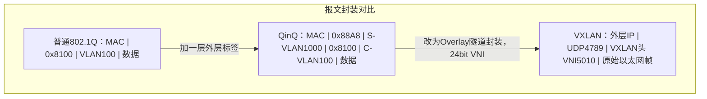

```mermaid
flowchart LR
    subgraph Limit["VLAN 4094 上限的应对"]
        P1["VLAN Pool：池内动态分配，均衡广播域，不增加总数"]
        P2["QinQ：内外层组合放大隔离数，仍依赖STP"]
        P3["VXLAN：VNI 24bit 约1600万，基于三层无泛洪域"]
    end
    P1 --> P2 --> P3
    NOTE["结论：治标 QinQ，治本 VXLAN"]
    P3 --- NOTE
```

### 真题精练

**Q1.【真题·单选】** 802.1Q 标签中 VLAN ID 字段长度为 12 bit，实际可用的 VLAN 数量为：
A. 4096  B. 4095  C. 4094  D. 1024

> **答案：C**
> **解析**：12 bit 可表示 2¹² = 4096 个值（0~4095），其中 **VLAN 0 用于表示优先级（Priority Tagged，仅携带优先级不带 VLAN ID）**，**VLAN 4095 为保留值**，因此可用范围是 **1~4094，共 4094 个**。这个"4096 减 2"是固定记忆点，考试中经常把 4096 作为干扰项。

**Q2.【真题·多选】** 关于 VLAN 在数据中心的局限，正确的是：
A. VLAN ID 只有 12 bit，可用 4094 个，多租户场景下数量不足
B. VLAN 是广播域，大型二层域中泛洪会消耗带宽与设备 CPU
C. VLAN 解决环路问题无需 STP，可自动形成等价多路径
D. 跨机房的同一 VLAN 需要延伸大二层，会引入跨机房的 STP 与泛洪域风险
E. VLAN Pool 可以将可用 VLAN 总数提升到 4094 以上

> **答案：A、B、D**
> **解析**：C 错，VLAN 不解决环路，反而使二层域变大后更依赖 STP（或 MSTP），且 STP 是破环而非多路径利用。E 错，这是最关键的干扰项——**VLAN Pool 只是"从已有 VLAN 里动态分配"的策略，不改变 12 bit 的物理上限**，它的价值是均衡广播域负载，不是扩容。真正突破数量限制的是 **VXLAN 的 24 bit VNI** 或 QinQ 的标签组合。

**Q3.【真题·判断】** QinQ 通过增加外层 VLAN 标签，使隔离域数量大幅增加，因此可以完全替代 VXLAN 解决数据中心大规模多租户二层问题。

> **答案：错误**
> **解析**：QinQ 确实通过"外层 S-VLAN + 内层 C-VLAN"的组合放大了隔离数量，但它**没有改变转发模型**——依然是**二层泛洪 + 依赖 STP**。当租户规模扩大、跨机房需求出现时，QinQ 方案会面临巨大的泛洪域与 STP 收敛风险，且需要物理二层连通。VXLAN 的根本不同在于：① VNI 24 bit 提供约 1600 万隔离域；② 隧道基于三层 Underlay 承载，任意两台 VTEP 只要 IP 可达即可打通，**不受物理二层边界限制**；③ 配合 BGP EVPN 控制面，可以做到"按需通告、不泛洪"。因此标准结论是：**QinQ 治标（扩展标签），VXLAN 治本（重构转发模型）**。

**Q4.【真题·填空】** QinQ 报文中，外层标签的 TPID 标准取值为 \_\_\_\_\_，内层标签的 TPID 为 \_\_\_\_\_；外层 VLAN 通常称为 \_\_\_\_\_，内层 VLAN 称为 \_\_\_\_\_。

> **答案：0x88A8；0x8100；S-VLAN（Service VLAN）；C-VLAN（Customer VLAN）**
> **解析**：802.1ad（俗称 QinQ 或 Stacked VLAN）规定外层 TPID 为 **0x88A8**，内层保持 802.1Q 的 **0x8100**；工程上部分设备/端口允许把外层 TPID 也配为 0x8100 以兼容不支持 0x88A8 的老设备（华为命令为 `qinq protocol 0x8100`）。另外要注意 **MTU 裕量**：QinQ 使报文多出 4 字节（共 8 字节标签），若链路上存在 MTU 1500 的严格限制，需相应调整 MTU，否则大包会被丢弃——这是实操题的隐藏得分点。

**Q5.【真题·简答】** 请说明 VLAN Pool 与 QinQ 分别解决数据中心的什么问题，并各举一个典型应用场景。

> **答案要点**：
> **VLAN Pool**：解决的是"**同一接入点下大量用户集中在少数 VLAN 导致广播域过大**"的问题。做法是把一段连续 VLAN（如 100~199）组成池，设备在用户接入时按指定算法（hash 按 MAC 哈希、或 even 顺序分配）动态分配一个 VLAN。典型场景：**大型无线园区/园区接入**——一个 SSID 下有上万个终端，若全部划入同一 VLAN，ARP 表与广播会压垮网关；用 VLAN Pool 把终端均匀分散到 100 个 VLAN，每个 VLAN 只有百余台终端，广播域与网关负载都被摊薄。**注意它不增加 4094 的总量上限**，只是分配策略。
> **QinQ**：解决的是"**在二层接入侧用标签层次区分租户与租户内部网络**"的问题。做法是在用户报文外再加一层 S-VLAN，S-VLAN 由网络侧统一规划（一租户一个），C-VLAN 由租户自由使用。典型场景：**多租户专线接入 / 数据中心租户接入**——运营商或 DC 运营商给每个租户分配一个 S-VLAN，租户内部无论怎么划分 VLAN 都不会冲突，网络侧只需按 S-VLAN 转发，简化了运营商的配置与管理。
> **两者关系与局限**：二者都是**二层技术**，都依赖 STP 破环、都存在泛洪域，因此在大规模数据中心里通常作为**过渡方案或接入侧方案**；面向 Fabric 的规模化隔离仍以 **VXLAN（VNI 24 bit）+ BGP EVPN** 为主。

**Q6.【真题·排错】** 某 Leaf 上配置了 QinQ 隧道口，但接入的租户报文在核心侧看不到外层 S-VLAN，且部分大包丢失。请分析原因。

> **答案**：**可能原因与排查**：
> ① **端口类型或外层 VLAN 未生效**：`port link-type dot1q-tunnel` 或 `port default vlan <S-VLAN>` 未正确配置/未提交。
> ```bash
> [Leaf-1] display port vlan                          // 确认该口是否为dot1q-tunnel及PVID
> [Leaf-1] display vlan 1000                          // 确认S-VLAN存在且包含该隧道口
> [Leaf-1] display current-configuration interface 100GE1/0/10  // 比对实际配置与规划
> ```
> ② **对端未识别外层 TPID**：本端外层 TPID 配为 0x88A8，而对端设备只识别 0x8100（或反之），导致外层标签被丢弃或剥离。
> ```bash
> [Leaf-1] display current-configuration | include qinq   // 核对qinq protocol取值
> ```
> ③ **中间设备剥离标签**：中间链路的端口被配成 access 或 trunk 且未放通 S-VLAN，报文经过时外层标签被去掉。
> ```bash
> [Core] display port vlan                             // 逐跳核对VLAN放通情况
> [Core] display vlan 1000
> ```
> ④ **大包丢失**：QinQ 增加 4 字节（共 8 字节标签），若链路 MTU 被限制为 1500，则超过的报文被丢弃，表现为"ping 小包通、大包不通"或传输大文件异常。需在相关接口调整 MTU（如 `mtu 1504` 或按规划放大），并确认端到端 MTU 一致。
> ```bash
> [Leaf-1] display interface 100GE1/0/10 | include MTU    // 核对接口MTU
> ```
> **处置顺序**：先确认本端端口类型与 S-VLAN（`display port vlan`），再核对两端 TPID 一致性（`qinq protocol`），再逐跳检查 VLAN 放通，最后核查 MTU。**"大包不通"是 MTU 问题的典型特征，"完全不通"则多半是标签或 VLAN 放通问题。**

### 易错点与排错
- **易错 1**：把可用 VLAN 数答成 4096。正确是 **4094**（0 与 4095 保留）。
- **易错 2**：认为 VLAN Pool 能突破 4094 上限。它只做分配均衡。
- **易错 3**：认为 QinQ 可替代 VXLAN。QinQ 仍依赖 STP 与二层泛洪。
- **易错 4**：忽略 QinQ 的额外 4 字节对 MTU 的影响，导致大包丢失。
- **易错 5**：外层 TPID 两端不一致（0x88A8 vs 0x8100）导致标签被丢弃。
- **排错命令**：`display vlan`、`display port vlan`、`display current-configuration interface`、`display interface | include MTU`。

---

## 3.2 M-LAG 入门：原理、三要素与故障切换

### 考点定位
**本章最重要考点，也是校赛省赛 DCN 方向的高频出题点。**常考"M-LAG 与堆叠的区别""M-LAG 三要素是什么""peer-link 和 Keepalive 各走什么流量""M-LAG 与 STP/VRRP 怎么配合"。分值 3~6 分，简答与实践题都可能出现。

### 原理精讲
**M-LAG（Multi-Chassis Link Aggregation Group，跨设备链路聚合组）** 的本质：**两台独立的物理交换机，通过跨设备链路聚合成一个逻辑聚合组，使下游设备（服务器或交换机）可以同时双归到两台设备，并且两条链路同时转发流量。**

**要解决的问题**：传统双归接入只有两条路——要么用 STP（一条转发一条阻塞，浪费一半带宽），要么用堆叠/CSS（两台设备合并成一台，但控制面合一、升级风险大、故障域合并）。M-LAG 提供了第三条路：**两条链路同时转发（带宽翻倍），两台设备控制面独立（故障域隔离），且无需 STP 阻塞**。

**M-LAG 三要素（必背）**：

1. **peer-link（对等链路）**：两台 M-LAG 成员设备之间的**直连链路**（通常是多条高速链路聚合成的 Eth-Trunk，如 2×100GE）。它承载：
   - **协议报文**（M-LAG 协商、DFS 同步的控制信息）；
   - **跨设备转发流量**：当某台成员设备收到需要从对端成员设备的端口发出的流量时（例如单归服务器的流量、或双归服务器哈希到对端口的流量），必须经 peer-link 送到对端再发出；
   - **部分未知单播/广播/组播的同步**（保证表项一致）。
   **peer-link 是 M-LAG 的生命线**：它断了，两台设备会认为对端失效，触发双主（Dual-Active）风险，因此 peer-link 必须用**多条高速链路聚合**，且建议物理路径分离。

2. **DFS Group（Dynamic Fabric Service Group，动态 Fabric 服务组）**：M-LAG 的"配置与状态同步框架"。**两台设备上必须配置相同的 DFS Group 编号，且把 peer-link 绑定进该组**。DFS 负责：
   - 同步 M-LAG 相关的配置与状态（哪些 Eth-Trunk 是 M-LAG、成员口状态等）；
   - 一致性检查：两端 M-LAG 配置必须一致（如 M-LAG ID、成员口数量、VLAN 放通等），不一致时 M-LAG 无法建立或会告警。
   一句话：**DFS Group 是 M-LAG 的"大脑与同步通道管理器"**。

3. **Keepalive（心跳链路）**：两台设备之间的**三层可达心跳**，通常走**带外管理网或独立的互联 VLAN**。它的作用是：
   - **双主检测（Dual-Active Detection）**：当 peer-link 故障但两台设备都还活着时，双方会误以为对端已死，同时把自己当作唯一主设备，导致 MAC/ARP 表项冲突、流量黑洞或环路。Keepalive 用于**确认对端是否真的存活**；
   - 一旦检测到"peer-link 断但对端仍存活"，设备会进入 **Dual-Active 状态**，按策略处理：**通常将其中一台（如原主设备/优先级低者）的 M-LAG 成员口置为 Error-Down（或关闭），只保留一台转发**，避免环路与表项冲突。
   **关键区别**：**peer-link 走业务/协议流量且必须直连高速；Keepalive 是纯心跳，可走管理网、三层可达即可**。这两者绝不能混为一谈，是考试最爱出的辨析点。

**M-LAG 双归接入与故障切换过程**：

| 故障场景 | 现象 | 切换行为 |
|---|---|---|
| 服务器一条上联链路断 | 服务器侧聚合带宽减半 | 流量自动切到另一条，聚合组仍 Up，业务不中断 |
| 一台 M-LAG 成员设备故障（如 Leaf-2 断电） | Leaf-2 所有端口 Down | 服务器双归聚合只剩 Leaf-1 一条链路，聚合组保持 Up（M-LAG 特性），流量全走 Leaf-1，业务基本无感 |
| peer-link 故障（Keepalive 正常） | 两台设备都存活但无法同步 | 进入 **Dual-Active**，按策略一台的成员口 Error-Down，避免环路；业务由保留的那台承载 |
| Keepalive 故障 | 心跳丢失 | 通常告警；若 peer-link 同时故障则无法判定对端存活，必须按最坏情况（防环）处理 |
| 上行链路故障 | Leaf 到 Spine 断一条 | 由 Underlay 的 ECMP/BFD 收敛，与 M-LAG 无关 |

**为什么 M-LAG 比堆叠更适合数据中心接入侧？**

| 对比项 | M-LAG | iStack/CSS 堆叠/集群 |
|---|---|---|
| 控制平面 | **两台设备各自独立**，控制面分离 | 合并为一台，**单一控制面** |
| 软件升级 | 可**逐台升级（ISSU）**，业务不中断 | 需整体升级，中断风险大 |
| 故障域 | 一台故障不影响另一台的控制面 | 主设备故障可能导致整组震荡 |
| 双活能力 | 天然双活，两条链路同时转发 | 堆叠后仍可能出现主备角色与转发限制 |
| 配置一致性 | 需保证两端配置一致（DFS 检查） | 天然一致（同一份配置） |
| 适用场景 | **数据中心 Leaf 双归接入（主流）** | 园区接入/汇聚堆叠 |

**M-LAG 与 STP 的关系**：M-LAG 建立后，服务器双归的两条链路被聚合成**一个逻辑链路**，从二层拓扑看**不存在环路**，因此：
- M-LAG 成员口上**不需要也不应该依赖 STP**，通常建议在 M-LAG 端口上**关闭 STP**（或让 M-LAG 端口处于转发态）；
- 这样做的好处是彻底摆脱 STP 的阻塞与收敛开销，同时利用两条链路带宽；
- 但要注意：**peer-link 与 M-LAG 端口之间的环路仍需防护**，这由 DFS/Dual-Active 机制保证，而不是 STP。

**M-LAG 与 VRRP 的配合**：数据中心 Leaf 做服务器网关时，两台 M-LAG 设备需要提供**统一的网关虚拟 MAC/IP**。做法通常是 **M-LAG + VRRP（或 VRRP 主备）**：
- 两台 Leaf 上为业务 VLAN 配置 VLANIF 与 VRRP 虚拟 IP，形成**主备网关**：主设备转发，备设备待命；
- 由于 M-LAG 已提供双归链路与跨设备转发能力，服务器侧只需看到一个网关 IP/MAC，无需关心主备切换细节；
- 更先进的做法是 **VXLAN 分布式网关**（Vbdif + 全网统一网关 MAC），此时不再需要 VRRP 主备，网关在任何 Leaf 上都可转发，虚机迁移后网关不变。
- **注意方向性**：VRRP 的虚拟 MAC 决定了**上行报文（服务器→外部）走主设备**，但**下行报文（外部→服务器）可能从备设备到达**（因为外部路由 ECMP 到两台 Leaf 都可能），此时备设备需经 peer-link 转发给主设备再下送服务器。这就是 **peer-link 承载跨设备流量**的典型场景，也是 peer-link 带宽必须足够的原因。

### 关键概念对照表

| 要素 | 作用 | 承载流量 | 部署要求 | 故障后果 |
|---|---|---|---|---|
| peer-link | 协议同步 + 跨设备转发 | M-LAG 协议报文 + 跨设备业务流量 | 直连、多条高速链路聚合（如 2×100GE）、路径分离 | Dual-Active 风险，必须靠 Keepalive 兜底 |
| DFS Group | 配置与状态同步、一致性检查 | 同步信息 | 两端编号必须一致，绑定 peer-link | M-LAG 无法建立或告警 |
| Keepalive | 双主检测心跳 | 纯心跳（三层可达） | 走管理网/独立 VLAN，三层可达即可 | 无法判定对端存活，双主风险 |

| 部署形态 | 服务器链路 | 带宽利用 | 是否依赖 STP | 控制面 | 升级影响 |
|---|---|---|---|---|---|
| 单归（一台 Leaf） | 1 条 | 1× | 依赖（若有多链路） | 单设备 | 单点 |
| STP 双归 | 2 条，1 转发 1 阻塞 | 约 1×（浪费一半） | 强依赖 | 两台独立 | 收敛慢 |
| **M-LAG 双归** | 2 条，**同时转发** | **2×** | 不依赖（M-LAG 口免 STP） | 两台独立 | 可逐台升级 |
| 堆叠/CSS 双归 | 2 条 | 2× | 通常仍需 STP 或依赖堆叠机制 | 合二为一 | 整体升级 |

### 华为设备配置
两台 CE6865 做 M-LAG，服务器双归。完整配置（两端分别配置，注意一致性）：

```bash
# ================= Leaf-1 =================
<CE6865> system-view
[CE6865] sysname Leaf-1
[Leaf-1] vlan batch 100 200 999                        // 业务VLAN 100/200 + Keepalive互联VLAN 999

# --- ① Keepalive：三层心跳，走独立VLAN/管理网 ---
[Leaf-1] interface Vlanif 999
[Leaf-1-Vlanif999] ip address 10.99.99.1 24            // Keepalive地址，与对端三层可达
[Leaf-1-Vlanif999] quit

# --- ② peer-link：用Eth-Trunk承载，两条100GE ---
[Leaf-1] interface Eth-Trunk 100
[Leaf-1-Eth-Trunk100] description Peer-Link-To-Leaf2
[Leaf-1-Eth-Trunk100] mode lacp-static                 // 建议静态LACP，便于LACP报文交互
[Leaf-1-Eth-Trunk100] quit
[Leaf-1] interface 100GE1/0/49
[Leaf-1-100GE1/0/49] eth-trunk 100                     // 加入peer-link聚合组
[Leaf-1-100GE1/0/49] quit
[Leaf-1] interface 100GE1/0/50
[Leaf-1-100GE1/0/50] eth-trunk 100
[Leaf-1-100GE1/0/50] quit

# --- ③ DFS Group：绑定peer-link并配置Keepalive ---
[Leaf-1] dfs-group 1                                   // DFS组编号1，两端必须一致
[Leaf-1-dfs-group-1] priority 150                      // 优先级高者为主（默认100，值大优先）
[Leaf-1-dfs-group-1] source ip address 10.99.99.1      // Keepalive源地址
[Leaf-1-dfs-group-1] peer ip address 10.99.99.2        // Keepalive对端地址
[Leaf-1-dfs-group-1] quit
[Leaf-1] interface Eth-Trunk 100
[Leaf-1-Eth-Trunk100] dfs-group 1 m-lag 1              // 把peer-link绑定到DFS组，M-LAG ID=1
[Leaf-1-Eth-Trunk100] quit

# --- ④ 服务器双归口：做成M-LAG成员口 ---
[Leaf-1] interface Eth-Trunk 10                        // 面向服务器的跨设备聚合组
[Leaf-1-Eth-Trunk10] mode lacp-static
[Leaf-1-Eth-Trunk10] stp disable                       // M-LAG口不参与STP，避免阻塞与收敛
[Leaf-1-Eth-Trunk10] port link-type trunk
[Leaf-1-Eth-Trunk10] port trunk allow-pass vlan 100 200
[Leaf-1-Eth-Trunk10] dfs-group 1 m-lag 10              // 绑定DFS组，M-LAG ID=10（两端必须一致）
[Leaf-1-Eth-Trunk10] quit
[Leaf-1] interface 25GE1/0/1
[Leaf-1-25GE1/0/1] eth-trunk 10                        // 物理口加入M-LAG聚合组
[Leaf-1-25GE1/0/1] quit

# --- ⑤ 网关：M-LAG + VRRP 提供统一虚拟网关 ---
[Leaf-1] interface Vlanif 100
[Leaf-1-Vlanif100] ip address 192.168.100.2 24         // 本机实地址
[Leaf-1-Vlanif100] vrrp vrid 1 virtual-ip 192.168.100.1  // 虚拟网关IP，服务器以此为网关
[Leaf-1-Vlanif100] vrrp vrid 1 priority 120            // 主网关（优先级高）
[Leaf-1-Vlanif100] vrrp vrid 1 preempt-mode timer delay 20  // 抢占延时，避免震荡
[Leaf-1-Vlanif100] quit

# ================= Leaf-2（对应部分，注意一致性与主备相反） =================
[Leaf-2] interface Eth-Trunk 100
[Leaf-2-Eth-Trunk100] mode lacp-static
[Leaf-2-Eth-Trunk100] quit
[Leaf-2] interface 100GE1/0/49
[Leaf-2-100GE1/0/49] eth-trunk 100
[Leaf-2-100GE1/0/49] quit
[Leaf-2] dfs-group 1
[Leaf-2-dfs-group-1] priority 120                      // 低于Leaf-1，作为备用
[Leaf-2-dfs-group-1] source ip address 10.99.99.2
[Leaf-2-dfs-group-1] peer ip address 10.99.99.1
[Leaf-2-dfs-group-1] quit
[Leaf-2] interface Eth-Trunk 100
[Leaf-2-Eth-Trunk100] dfs-group 1 m-lag 1              // peer-link的M-LAG ID必须与Leaf-1相同
[Leaf-2-Eth-Trunk100] quit
[Leaf-2] interface Eth-Trunk 10
[Leaf-2-Eth-Trunk10] mode lacp-static
[Leaf-2-Eth-Trunk10] stp disable
[Leaf-2-Eth-Trunk10] port link-type trunk
[Leaf-2-Eth-Trunk10] port trunk allow-pass vlan 100 200
[Leaf-2-Eth-Trunk10] dfs-group 1 m-lag 10              // 与Leaf-1保持相同的M-LAG ID
[Leaf-2-Eth-Trunk10] quit
[Leaf-2] interface Vlanif 100
[Leaf-2-Vlanif100] ip address 192.168.100.3 24
[Leaf-2-Vlanif100] vrrp vrid 1 virtual-ip 192.168.100.1
[Leaf-2-Vlanif100] vrrp vrid 1 priority 100            // 备网关
[Leaf-2-Vlanif100] quit

# ================= 验证命令（最重要） =================
[Leaf-1] display dfs-group 1 m-lag                     // 看DFS组、peer-link状态、M-LAG成员口是否Up
[Leaf-1] display dfs-group 1 m-lag brief               // 简表：M-LAG ID、状态（Active/Inactive）
[Leaf-1] display dfs-group 1 node                      // 查看M-LAG节点角色（主/备）与Keepalive状态
[Leaf-1] display eth-trunk 10 verbose                  // 服务器侧聚合组成员口与LACP状态
[Leaf-1] display eth-trunk 100 verbose                 // peer-link聚合组状态
[Leaf-1] display vrrp                                  // VRRP主备状态（Master/Backup）
[Leaf-1] display dfs-group 1 m-lag consistency-check   // 两端配置一致性检查（排错关键）
```

### 示意图

```mermaid
flowchart TB
    subgraph MLAG["M-LAG 双归接入"]
        L1["Leaf-1 主 优先级150"]
        L2["Leaf-2 备 优先级120"]
        SRV["服务器 双网卡绑定 LACP"]
        L1 ===|"peer-link Eth-Trunk100 2x100GE 协议+跨设备流量"| L2
        L1 -.-|"Keepalive 10.99.99.1/24 三层心跳 双主检测"| L2
        SRV ===|"Eth-Trunk10 25GE M-LAG ID=10 两条同时转发"| L1
        SRV ===|"Eth-Trunk10 25GE M-LAG ID=10 两条同时转发"| L2
        VIP["VRRP 虚拟网关 192.168.100.1 主在Leaf-1"]
        L1 --- VIP
    end
```

```mermaid
sequenceDiagram
    participant SRV as 服务器
    participant L1 as Leaf-1 主
    participant L2 as Leaf-2 备
    Note over L1,L2: 正常状态：peer-link正常 双归链路同时转发
    SRV->>L1: 上行流量 哈希到Leaf-1
    SRV->>L2: 上行流量 哈希到Leaf-2
    L2->>L1: 若目的网关在Leaf-1 经peer-link转发
    Note over L1,L2: 故障：peer-link中断 但Keepalive正常
    L1->>L2: Keepalive探测 确认对端仍存活
    L1->>L1: 进入Dual-Active处理
    L2->>L2: 按策略将M-LAG成员口置Error-Down 防环
    Note over SRV: 业务由保留的一台继续承载
```

### 真题精练

**Q1.【真题·单选】** M-LAG 的三要素是：
A. peer-link、DFS Group、Keepalive
B. peer-link、STP、VRRP
C. Eth-Trunk、VLAN、OSPF
D. DFS Group、VXLAN、BGP

> **答案：A**
> **解析**：M-LAG 的三个必需组件是 **peer-link（对等链路）**、**DFS Group（动态 Fabric 服务组，负责配置与状态同步）**、**Keepalive（三层心跳，用于双主检测）**。B 中的 STP 与 VRRP 是"M-LAG 如何配合"的问题，不是 M-LAG 的组成要素；C、D 完全不相干。

**Q2.【真题·多选】** 关于 peer-link 与 Keepalive 的区别，正确的是：
A. peer-link 通常由多条高速链路聚合而成，且必须直连
B. Keepalive 是三层心跳，可走管理网或独立互联 VLAN
C. peer-link 承载 M-LAG 协议报文与跨设备转发流量
D. Keepalive 用于双主检测，peer-link 故障时判断对端是否存活
E. Keepalive 断开后 M-LAG 会立即全部中断

> **答案：A、B、C、D**
> **解析**：E 错。Keepalive 断开通常只产生**告警**并降低双主检测能力，M-LAG 本身基于 peer-link 与 DFS 运行，不会"立即全部中断"。真正的危险场景是 **peer-link 与 Keepalive 同时中断**——此时无法判断对端状态，必须按最坏情况处理（防环优先）。这个辨析是高频考点，要能说清"谁承载业务、谁只做检测"。

**Q3.【真题·判断】** M-LAG 建立后，服务器双归的两条链路会像 STP 环境一样一条转发一条阻塞，从而避免环路。

> **答案：错误**
> **解析**：恰恰相反，**M-LAG 的核心价值就是让两条链路同时转发**，实现带宽翻倍。M-LAG 把两台设备的两条链路聚合成**一个逻辑聚合组**，从二层拓扑看这只相当于"一条链路"，因此**不存在环路**，也就不需要 STP 阻塞。这也是为什么 M-LAG 成员口上通常直接 `stp disable`：既不需要 STP，还要避免 STP 的收敛开销与误阻塞。

**Q4.【真题·填空】** M-LAG 中用于配置与状态同步的组件是 \_\_\_\_\_，两台设备必须配置相同的 \_\_\_\_\_；用于双主检测的三层心跳链路称为 \_\_\_\_\_。

> **答案：DFS Group（Dynamic Fabric Service Group，动态 Fabric 服务组）；DFS Group 编号（以及相同的 M-LAG ID）；Keepalive**
> **解析**：注意两个"必须一致"：**DFS Group 编号**必须相同，且同一聚合组在两端的 **M-LAG ID** 也必须相同——这是 M-LAG 能建立的前提条件。若不一致，`display dfs-group 1 m-lag consistency-check` 会报出不一致项，M-LAG 无法正常建立。排错时这条命令是第一选择。

**Q5.【真题·简答】** 请从控制平面、升级方式、故障域三个角度，说明数据中心 Leaf 双归接入为什么优先选择 M-LAG 而不是 iStack/CSS 堆叠。

> **答案要点**：
> ① **控制平面**：M-LAG 的两台设备**各自保留独立的控制平面**（独立 CPU、独立转发表、独立协议栈），仅通过 DFS 同步 M-LAG 相关状态；而 iStack/CSS 把多台设备合并为**一个逻辑设备**，由主设备统一控制。独立控制面的好处是：一台设备的管理面/协议异常不会传染到另一台，故障域天然隔离。
> ② **升级方式**：M-LAG 支持**逐台升级**——先升级 Leaf-2（此时业务全部由 Leaf-1 承载），完成并验证后再升级 Leaf-1，全过程业务不中断（配合双归链路的冗余能力），这是数据中心"7×24 业务永续"的关键；而堆叠/CSS 是单一控制面，升级通常需要整组重启或主备倒换，中断风险与窗口压力都更大。
> ③ **故障域**：M-LAG 中一台设备故障，另一台照常工作，服务器双归链路自动切换（聚合组因 M-LAG 特性保持 Up），业务基本无感；堆叠/CSS 中主设备故障会触发主备倒换或整组震荡，虽然也有冗余设计，但**控制面合并本身就把两台设备的可靠性绑定在了一起**（例如软件 Bug 会同时影响两台）。
> **补充**：M-LAG 的代价是需要保证两端**配置一致性**（靠 DFS 一致性检查）、需要额外规划 peer-link（高速直连）与 Keepalive（管理网），且排错复杂度高于单机；堆叠的优势是配置天然一致、管理简单。因此"园区接入用堆叠、数据中心 Leaf 双归用 M-LAG"是工程上的一般结论。

**Q6.【真题·排错】** 某 Leaf 双机 M-LAG 配置完成后，`display dfs-group 1 m-lag` 显示 M-LAG 未建立，服务器侧聚合组只有一个成员口 Up。请给出排查思路与命令。

> **答案**：**排查思路（按依赖顺序自下而上）**：
> ① **peer-link 是否正常**（M-LAG 建立的第一前提）：
> ```bash
> [Leaf-1] display eth-trunk 100 verbose              // peer-link聚合组是否Up，成员口是否全Up
> [Leaf-1] display interface Eth-Trunk 100            // 是否有错包、是否协商成功
> ```
> ② **DFS Group 配置是否为两端一致**（编号、M-LAG ID、优先级）：
> ```bash
> [Leaf-1] display dfs-group 1 m-lag brief
> [Leaf-1] display current-configuration | include dfs-group
> [Leaf-2] display current-configuration | include dfs-group   // 两端逐条比对
> ```
> ③ **Keepalive 是否可达**（三层连通、源/对端地址正确）：
> ```bash
> [Leaf-1] display dfs-group 1 node                   // 查看Keepalive状态与对端节点信息
> [Leaf-1] ping 10.99.99.2                            // 直接验证三层可达性
> [Leaf-1] display ip interface brief | include 999   // Vlanif 999是否Up且地址正确
> ```
> ④ **M-LAG 成员口配置是否一致**（端口数、VLAN 放通、绑定 ID）：
> ```bash
> [Leaf-1] display dfs-group 1 m-lag consistency-check   // 关键：直接输出两端不一致项
> [Leaf-1] display eth-trunk 10 verbose
> [Leaf-1] display port vlan                            // 核对trunk放通的VLAN
> ```
> ⑤ **软件版本/单板能力**：确认两台设备型号与 VRP 版本一致（M-LAG 要求两端型号与版本匹配）。
> **常见根因排序**：**peer-link 未 Up 或未绑定 DFS 组 > DFS Group 编号/M-LAG ID 不一致 > Keepalive 不可达 > 成员口配置（VLAN/端口数）不一致**。**得分关键：能说出"M-LAG 建立有严格的前置依赖顺序：peer-link → DFS → Keepalive → 成员口"，并按此顺序排查。**

### 易错点与排错
- **易错 1**：把 peer-link 当成心跳。**peer-link 承载协议与跨设备业务流量，Keepalive 才是心跳**。
- **易错 2**：认为 M-LAG 需要 STP 防环。M-LAG 把双链路合成逻辑一条，**无环**，成员口通常 `stp disable`。
- **易错 3**：两端 M-LAG ID 不一致却不察觉。必须用 `display dfs-group 1 m-lag consistency-check` 核对。
- **易错 4**：peer-link 只用一条链路。它断了就进 Dual-Active，必须多链路聚合 + 物理路径分离。
- **易错 5**：以为 M-LAG 后不需要 VRRP。除非使用 VXLAN 分布式网关（统一网关 MAC），否则**业务网关仍需 VRRP 提供主备虚拟网关**。
- **排错命令**：`display dfs-group 1 m-lag`、`display dfs-group 1 m-lag brief`、`display dfs-group 1 node`、`display dfs-group 1 m-lag consistency-check`、`display eth-trunk <n> verbose`、`display vrrp`。

---

## 3.3 M-LAG 与 Eth-Trunk 对比、VRRP 配合、BPDU 处理与 VLAN 规划

### 考点定位
综合实践考点，校赛省赛多以"对比表 + 场景判断题 + 配置实操"形式出现。常考"跨设备聚合与普通聚合的区别""网关应该放哪一层""BPDU 在 Leaf 上怎么处理""管理/业务/互联/心跳 VLAN 怎么划分"。分值 3~5 分。

### 原理精讲
**Eth-Trunk 与 M-LAG 的本质区别**：两者都是链路聚合（Link Aggregation），区别在于**链路两端的设备数量**。
- **普通 Eth-Trunk**：**同一台设备**上的多个物理口聚合成一个逻辑口。作用：增加带宽、提供链路级冗余、避免 STP 阻塞。**故障域仍是这一台设备**——设备断电，聚合组全断。
- **M-LAG（跨设备链路聚合）**：**两台设备**上的端口跨设备聚合成一个逻辑口，对端设备（服务器或交换机）看到的是"一条链路"。作用：在普通聚合的基础上，**把设备级故障也纳入冗余范围**。这是它最根本的增值。

| 对比维度 | 普通 Eth-Trunk | M-LAG（跨设备 Eth-Trunk） |
|---|---|---|
| 聚合端设备数 | 1 台 | 2 台 |
| 冗余层级 | 链路级 | 链路级 **+ 设备级** |
| 是否需要 peer-link | 否 | **是**（必须） |
| 是否需要 DFS/Keepalive | 否 | **是** |
| 配置复杂度 | 低 | 高（需保证两端一致） |
| 带宽利用 | 多成员口同时转发 | 多成员口 + 两台设备同时转发 |
| 故障切换 | 成员口切换，设备故障则全断 | 成员口切换 + 设备故障时由对端承载 |
| 典型应用 | Leaf 上行到 Spine 的链路聚合、单设备内多链路 | 服务器/交换机双归到两台 Leaf |

**M-LAG 与 VRRP 的配合（网关高可用）**：
- 数据中心 Leaf 作为服务器网关时，两台 M-LAG 设备通过 **VRRP（Virtual Router Redundancy Protocol，虚拟路由冗余协议）** 提供统一的虚拟网关 IP 与虚拟 MAC；
- **上行方向（服务器 → 网关）**：服务器 ARP 得到的是 VRRP 虚拟 MAC，报文送到 VRRP Master（如 Leaf-1）；
- **下行方向（外部 → 服务器）**：外部路由的 ECMP 可能把报文送到 Leaf-2（Backup），Leaf-2 收到后**必须经 peer-link 转发给 Leaf-1**（因为虚拟 MAC 属于 Master），再由 Leaf-1 下送服务器。这解释了为什么 **peer-link 会承载大量业务流量**，规划时必须给足带宽。
- **另一个方向的问题**：一台 Leaf 故障时，VRRP 需要在剩余设备上重新选举 Master。为保证快速切换，可：① 配置 VRRP 与 BFD 联动（`vrrp vrid 1 track bfd-session`）实现毫秒级切换；② 或直接采用 **VXLAN 分布式网关**，取消 VRRP 主备模型，任意 Leaf 都可转发，从根上消除"绕 peer-link"的问题。

**BPDU 在数据中心的处理策略**：BPDU（Bridge Protocol Data Unit，桥协议数据单元）是 STP 的报文（目的 MAC `01-80-C2-00-00-00`，默认每 2 秒发送）。数据中心的处理原则是"**该关的关、该防的防**"：
1. **面向服务器的端口**：服务器不支持也不应参与 STP。应当**关闭 STP** 或配置为**边缘端口（edged-port）**，并启用 **BPDU 保护（BPDU Protection）**——一旦收到 BPDU 就把端口置为 Error-Down。目的：防止有人私接交换机形成环路（这是数据中心最常见的环路事故来源）。
2. **M-LAG 端口 / Eth-Trunk 成员口**：这些端口是"聚合后的逻辑链路"，聚合组内部没有环路，建议**关闭 STP**（`stp disable`），避免 STP 收敛带来的不必要中断与误阻塞。
3. **Leaf 与 Spine 之间**：三层互联，**不存在二层环路**，关闭 STP，避免 BPDU 泛洪到整个 Fabric 浪费带宽与 CPU。
4. **确实需要 STP 的场景**：如果 Fabric 中仍保留二层接入（如某些老设备、某些特殊服务器集群），则在对应 VLAN 上启用 STP/MSTP，并做好根桥规划；但应把 STP 域**尽量局部化**，绝不能横跨 Spine。
5. **Loop-free 二层设计原则（四条）**：
   - **原则一**：能不二层就不二层——跨 Leaf 一律走三层，把二层域压到最小（最好只到 Leaf 下行口）。
   - **原则二**：需要多链路时优先用**聚合**（Eth-Trunk/M-LAG）而非"多条独立链路 + STP"，因为聚合是"无环的多路径"，STP 是"有环的单路径"。
   - **原则三**：需要冗余设备时优先用 **M-LAG** 而非"堆叠 + STP"。
   - **原则四**：服务器侧必须配 BPDU 保护 + 边缘端口，杜绝"用户私接交换机"造成的环路。

**数据中心 VLAN 规划实践**：把 VLAN 按"用途"分成四类，规划时**必须成段预留**，不能东一个西一个：

| VLAN 类别 | 用途 | 典型编号规划 | 关键要求 |
|---|---|---|---|
| 管理 VLAN | 设备带内管理、NTP/Syslog/SNMP、控制器通信 | 如 10~19（或统一 100~109） | 与业务隔离，配 ACL 限制访问源；是 ZTP 与 NCE 纳管的基础 |
| 业务 VLAN | 服务器业务网段 | 如 100~999（按业务/租户分段） | 数量最多；与 VNI/BD 映射（Overlay 场景）；配 QoS 策略 |
| 互联 VLAN | 设备间三层互联、Leaf-Spine 互联 | 如 1000~1099（也可用 /30-/31 三层直连口免 VLAN） | 尽量使用三层直连口（undo portswitch），仅在必须共享二层时用互联 VLAN |
| 心跳 VLAN | M-LAG Keepalive、VRRP 心跳、集群心跳 | 如 1100~1109（或走带外管理网） | **必须与业务流量隔离**，优先级要高、禁止承载业务流量，避免心跳丢弃导致误判双主 |

**二层网关与三层网关的位置选择**：
- **二层网关**：即 VLAN 的二层边界（Access/Trunk 口或 BD 映射）。位置应**尽量靠近服务器**（Leaf 下行口），使二层域被限制在单台 Leaf（或 M-LAG 双机）之内，避免跨 Leaf 的二层延伸。
- **三层网关**：即服务器的默认网关。**首选下沉到 Leaf**（VLANIF 或 VXLAN 分布式网关 Vbdif）。原因：① 同 Leaf 内跨网段流量不出上行口，消除绕行；② 网关数量随 Leaf 数量线性扩展，无单点；③ 配合 ECMP，跨 Leaf 流量走最优的 Leaf→Spine→Leaf 两跳。
- **不推荐把网关放 Spine**：Spine 必须保持"无状态纯转发"，放网关会让 Spine 变成有状态设备，破坏配置一致性与极简性，且成为性能与故障焦点。
- **集中式网关 vs 分布式网关**：

| 对比项 | 集中式网关 | 分布式网关 |
|---|---|---|
| 网关位置 | 集中在一对设备（如 Border Leaf/专用网关设备） | 每个 Leaf 上都有（Vbdif + 统一网关 MAC） |
| 跨网段流量路径 | 必须绕到网关设备，易绕行 | 走最优 Leaf→Spine→Leaf 路径 |
| ARP/MAC 表规模 | 集中，压力大 | 分散到各 Leaf，压力小 |
| 虚机迁移 | 网关不变，但流量路径可能不优 | 网关不变（同一 MAC/IP），路径最优 |
| 配置复杂度 | 相对简单（网关集中） | 复杂（需 EVPN 同步 + 统一 MAC） |
| 适用 | 小规模、网关功能要求集中 | **大规模 Fabric 主流** |

### 关键概念对照表

| VLAN 类别 | 用途 | 是否允许泛洪 | 是否承载业务 | 隔离要求 |
|---|---|---|---|---|
| 管理 VLAN | 设备管理、NTP/Syslog/NCE 纳管 | 是（范围小） | 否 | 高（ACL 限制源） |
| 业务 VLAN | 服务器业务通信 | 是（限制在 Leaf 内） | 是 | 按租户/业务隔离 |
| 互联 VLAN | 设备间三层互联 | 是（点对点） | 否 | 尽量用三层直连口替代 |
| 心跳 VLAN | M-LAG Keepalive、VRRP、集群心跳 | 是（极小） | 否 | **最高（严禁与业务混用）** |

| BPDU 处理场景 | 推荐策略 | 命令 | 目的 |
|---|---|---|---|
| 服务器接入口 | 边缘端口 + BPDU 保护 | `stp edged-port enable` + `stp bpdu-protection` | 防私接交换机成环 |
| M-LAG / Eth-Trunk 成员口 | 关闭 STP | `stp disable` | 聚合即无环，免 STP 开销 |
| Leaf ↔ Spine 三层口 | 关闭 STP | `undo stp enable` | 无二层环路，避免 BPDU 泛洪 |
| 保留的二层接入 VLAN | 启用 MSTP 并规划根桥 | `stp mode mstp` + `stp root primary` | 局部化 STP，控制收敛范围 |

### 华为设备配置
综合配置：M-LAG + VRRP + BPDU 保护 + VLAN 规划：

```bash
# ---------- ① VLAN 规划：四类VLAN分段预留 ----------
[Leaf-1] vlan batch 10 to 19                            // 管理VLAN段（10~19）
[Leaf-1] vlan batch 100 to 199                          // 业务VLAN段（100~199）
[Leaf-1] vlan batch 1000 to 1099                        // 互联VLAN段（1000~1099）
[Leaf-1] vlan batch 1100 to 1109                        // 心跳VLAN段（1100~1109）

# ---------- ② 管理VLAN与心跳VLAN：三层接口 ----------
[Leaf-1] interface Vlanif 10
[Leaf-1-Vlanif10] ip address 10.10.10.1 24              // 带内管理地址，供NCE纳管/SSH
[Leaf-1-Vlanif10] quit
[Leaf-1] interface Vlanif 1100
[Leaf-1-Vlanif1100] ip address 10.99.99.1 24            // M-LAG Keepalive专用VLAN，严禁承载业务
[Leaf-1-Vlanif1100] quit

# ---------- ③ 服务器接入口：边缘端口 + BPDU 保护 ----------
[Leaf-1] stp bpdu-protection                            // 全局BPDU保护：边缘口收到BPDU即Error-Down
[Leaf-1] interface 25GE1/0/1
[Leaf-1-25GE1/0/1] stp edged-port enable                // 声明为边缘端口（接服务器，不参与STP）
[Leaf-1-25GE1/0/1] description To-Server-A01-U01        // 端口描述规范化，便于排错
[Leaf-1-25GE1/0/1] quit

# ---------- ④ M-LAG成员口：聚合 + 关闭STP ----------
[Leaf-1] interface Eth-Trunk 10
[Leaf-1-Eth-Trunk10] mode lacp-static                   // 静态LACP，支持成员口状态协商
[Leaf-1-Eth-Trunk10] stp disable                        // 聚合组内部无环，关闭STP免收敛开销
[Leaf-1-Eth-Trunk10] port link-type trunk
[Leaf-1-Eth-Trunk10] port trunk allow-pass vlan 100 to 199   // 只放通业务VLAN，最小放通原则
[Leaf-1-Eth-Trunk10] dfs-group 1 m-lag 10               // 绑定DFS组形成跨设备聚合
[Leaf-1-Eth-Trunk10] quit

# ---------- ⑤ 上行三层口：关闭STP，启用ECMP ----------
[Leaf-1] interface 100GE1/0/1
[Leaf-1-100GE1/0/1] undo portswitch                     // 转三层口，避免二层环路与STP
[Leaf-1-100GE1/0/1] undo stp enable                     // 明确关闭STP
[Leaf-1-100GE1/0/1] ip address 10.0.1.1 30
[Leaf-1-100GE1/0/1] quit

# ---------- ⑥ 网关：M-LAG + VRRP + BFD 联动 ----------
[Leaf-1] interface Vlanif 100
[Leaf-1-Vlanif100] ip address 192.168.100.2 24
[Leaf-1-Vlanif100] vrrp vrid 1 virtual-ip 192.168.100.1
[Leaf-1-Vlanif100] vrrp vrid 1 priority 120
[Leaf-1-Vlanif100] vrrp vrid 1 track bfd-session 1 reduced 30   // BFD故障时优先级降30，快速切换
[Leaf-1-Vlanif100] quit

# ---------- ⑦ 验证：逐项核对 ----------
[Leaf-1] display vlan                                   // VLAN规划是否与设计一致
[Leaf-1] display port vlan                              // 各口VLAN类型与放通范围
[Leaf-1] display eth-trunk 10 verbose                   // M-LAG成员口状态
[Leaf-1] display dfs-group 1 m-lag                      // M-LAG是否建立
[Leaf-1] display vrrp                                   // VRRP主备状态
[Leaf-1] display stp brief                              // STP是否已按规划关闭/边缘化
[Leaf-1] display stp bpdu-protection                    // BPDU保护是否生效（查看被关闭的端口）
```

### 示意图

```mermaid
flowchart TB
    subgraph GW["网关位置选择"]
        TODO["推荐：网关下沉到Leaf"]
        BAD["不推荐：网关放Spine（破坏无状态）"]
        CENT["集中式网关：跨网段绕行"]
        DIST["分布式网关：Leaf→Spine→Leaf 最优"]
        TODO --> DIST
        BAD --> CENT
    end
    SRV1["Server A 192.168.100.10/24"] --> L1["Leaf-1 Vlanif100 = 网关"]
    SRV2["Server B 192.168.200.10/24"] --> L2["Leaf-2 Vlanif200 = 网关"]
    L1 -->|"跨网段 两跳"| SP["Spine"]
    SP --> L2
```

```mermaid
flowchart TD
    START["端口收到BPDU或需要防环"] --> Q1{"端口类型"}
    Q1 -->|"服务器接入口"| A1["stp edged-port enable + stp bpdu-protection 收到BPDU即Error-Down"]
    Q1 -->|"M-LAG/Eth-Trunk成员口"| A2["stp disable 聚合即无环"]
    Q1 -->|"Leaf-Spine三层口"| A3["undo stp enable 避免BPDU泛洪"]
    Q1 -->|"保留二层接入VLAN"| A4["启用MSTP 规划根桥 局部化STP域"]
    A1 --> END["目标：Loop-free 且不牺牲带宽"]
    A2 --> END
    A3 --> END
    A4 --> END
```

### 真题精练

**Q1.【真题·单选】** 普通 Eth-Trunk 与 M-LAG 最本质的区别是：
A. 普通 Eth-Trunk 不支持 LACP，M-LAG 支持
B. 普通 Eth-Trunk 聚合同一台设备的端口，M-LAG 跨两台设备聚合
C. 普通 Eth-Trunk 不需要配置，M-LAG 需要
D. 普通 Eth-Trunk 只能用于二层，M-LAG 只能用于三层

> **答案：B**
> **解析**：两者都是链路聚合，都可用 LACP，都可以工作在二层或三层。**唯一本质区别是聚合端口的设备数量**：普通 Eth-Trunk 聚合同一台设备的多个物理口，故障域仍是单台设备；M-LAG 把两台设备的端口跨设备聚合成一个逻辑口，因此**多了一层"设备级冗余"**。A、C、D 都是错误陈述（普通 Eth-Trunk 同样可配 LACP、同样需要配置、二层三层都支持）。

**Q2.【真题·多选】** 关于数据中心 Leaf 的 BPDU 与 STP 处理策略，正确的是：
A. 服务器接入口应配置为边缘端口并启用 BPDU 保护
B. M-LAG 成员口可关闭 STP，因为聚合后不存在二层环路
C. Leaf 与 Spine 之间的三层接口应关闭 STP，避免 BPDU 泛洪
D. 为了保险，应在所有端口保留 STP 开启状态
E. BPDU 保护的作用是防止用户私接交换机造成环路

> **答案：A、B、C、E**
> **解析**：D 错，而且方向相反。在数据中心，"所有端口都开 STP"会带来三个问题：① 二层无环处根本不需要 STP，白白引入收敛事件；② BPDU 会在 Fabric 内泛洪，浪费带宽与 CPU；③ STP 可能在 M-LAG/Eth-Trunk 口上产生误阻塞，破坏"多链路同时转发"的设计目标。正确做法是**按端口类型区分策略**（口诀：服务器口防、聚合口关、三层口关、真二层口才开）。

**Q3.【真题·判断】** 数据中心服务器的三层网关应尽量上移到 Spine，以集中管理、减少网关数量。

> **答案：错误**
> **解析**：网关应当**下沉到 Leaf**，而不是上移到 Spine。理由：① **消除绕行**：网关在 Leaf 时，同 Leaf 内跨网段流量本地三层转发，不出上行口；网关在 Spine 时，所有跨网段流量都必须绕到 Spine，浪费宝贵的横向带宽并增加时延；② **保持 Spine 无状态**：Spine 必须保持"纯转发、配置极简一致"，一旦承载网关就变成有状态设备，破坏了 Fabric 的可复制性与可扩展性；③ **避免单点与规模瓶颈**：网关集中在少数设备上会造成 ARP/MAC 表项集中、性能瓶颈与故障焦点。E 与之相反的说法（"减少网关数量"）也不是目标——**网关数量随 Leaf 线性增长恰恰是分布式设计的优点**。

**Q4.【真题·填空】** 数据中心 VLAN 规划通常划分为管理 VLAN、\_\_\_\_\_、\_\_\_\_\_ 与心跳 VLAN 四类；其中 \_\_\_\_\_ VLAN 必须与业务流量严格隔离，否则可能因心跳丢失导致 M-LAG 误判双主。

> **答案：业务 VLAN；互联 VLAN；心跳 VLAN**
> **解析**：四类 VLAN 的职责与要求各不相同：管理 VLAN（设备管理、NCE 纳管，需 ACL 限制源）、业务 VLAN（服务器通信，数量最多，可与 VNI 映射）、互联 VLAN（设备间三层互联，能用三层直连口则不用 VLAN）、心跳 VLAN（M-LAG Keepalive/VRRP 心跳，**严禁承载业务、优先级要高**）。心跳被业务流量挤占而丢弃，会导致双主检测失效，这是生产事故的经典成因。

**Q5.【真题·简答】** 请说明 M-LAG 与 VRRP 配合时，为什么 peer-link 上会承载业务流量，以及如何减少这种跨设备流量。

> **答案要点**：
> **为什么 peer-link 承载业务流量**：VRRP 虚拟网关由 Master 设备（如 Leaf-1）持有虚拟 MAC。服务器上行报文的目的 MAC 是虚拟 MAC，因此送到 Leaf-1，正常。但**下行方向**（外部/其它网段 → 服务器）由 Underlay 的 ECMP 决定，可能落在 Leaf-2（Backup）上；Leaf-2 发现目的 MAC 是 VRRP 虚拟 MAC（不属于本机），必须**经 peer-link 送给 Leaf-1** 再下送服务器。此外，单归服务器的流量、双归服务器哈希到"非本机端口"的流量，也都要经 peer-link 跨设备转发。因此 **peer-link 不只是控制通道，更是重要的业务通道**，规划时必须给足带宽（如 2×100GE）并物理路径分离。
> **如何减少跨设备流量**：① **改用 VXLAN 分布式网关**（Vbdif + 全网统一网关 MAC）：所有 Leaf 都能作为网关转发，不再存在"虚拟 MAC 只属于 Master"的限制，下行流量可本地转发，从根上消除绕 peer-link 的流量；② **优化 ECMP 与哈希**：让上下行流量尽量一致地落在同一台 Leaf（例如使用一致的哈希算法与动态负载分担），减少"上行 Leaf-1、下行 Leaf-2"的不对称；③ **服务器双归保持对称**：确保服务器两条上联的带宽、哈希与参数一致，避免流量失衡；④ **合理规划服务器接入位置**：让同一业务的服务器尽量挂在同一对 M-LAG Leaf 下，减少跨对流量；⑤ **给 peer-link 足够带宽与 QoS 保障**，避免它成为新的瓶颈。

**Q6.【真题·实验】** 请写出在两台 CE6865 上部署 M-LAG 双归接入的完整配置步骤（含 VLAN 规划、peer-link、DFS、Keepalive、业务聚合口、VRRP 网关、BPDU 保护），并列出验证命令。

> **答案**：
> **步骤 1：VLAN 规划**——预留管理/业务/互联/心跳四段 VLAN，避免编号混用。
> ```bash
> [Leaf-1] vlan batch 10 to 19 100 to 199 1000 to 1099 1100 to 1109
> [Leaf-1] interface Vlanif 1100
> [Leaf-1-Vlanif1100] ip address 10.99.99.1 24            // Keepalive专用VLAN
> ```
> **步骤 2：peer-link**——两条 100GE 聚合成 Eth-Trunk 100，物理路径分离。
> ```bash
> [Leaf-1] interface Eth-Trunk 100
> [Leaf-1-Eth-Trunk100] mode lacp-static
> [Leaf-1] interface 100GE1/0/49
> [Leaf-1-100GE1/0/49] eth-trunk 100
> [Leaf-1] interface 100GE1/0/50
> [Leaf-1-100GE1/0/50] eth-trunk 100
> ```
> **步骤 3：DFS Group + Keepalive**——编号两端一致，绑定 peer-link。
> ```bash
> [Leaf-1] dfs-group 1
> [Leaf-1-dfs-group-1] priority 150                        // 主设备
> [Leaf-1-dfs-group-1] source ip address 10.99.99.1
> [Leaf-1-dfs-group-1] peer ip address 10.99.99.2
> [Leaf-1] interface Eth-Trunk 100
> [Leaf-1-Eth-Trunk100] dfs-group 1 m-lag 1                // peer-link绑定，M-LAG ID=1
> ```
> **步骤 4：业务 M-LAG 聚合口**——两台设备使用相同 M-LAG ID，关闭 STP。
> ```bash
> [Leaf-1] interface Eth-Trunk 10
> [Leaf-1-Eth-Trunk10] mode lacp-static
> [Leaf-1-Eth-Trunk10] stp disable
> [Leaf-1-Eth-Trunk10] port link-type trunk
> [Leaf-1-Eth-Trunk10] port trunk allow-pass vlan 100 to 199
> [Leaf-1-Eth-Trunk10] dfs-group 1 m-lag 10                // 业务M-LAG ID=10，两端必须一致
> ```
> **步骤 5：VRRP 网关 + BFD 联动**——提供统一虚拟网关并快速切换。
> ```bash
> [Leaf-1] interface Vlanif 100
> [Leaf-1-Vlanif100] ip address 192.168.100.2 24
> [Leaf-1-Vlanif100] vrrp vrid 1 virtual-ip 192.168.100.1
> [Leaf-1-Vlanif100] vrrp vrid 1 priority 120
> ```
> **步骤 6：BPDU 保护**——服务器口边缘化，防私接成环。
> ```bash
> [Leaf-1] stp bpdu-protection
> [Leaf-1] interface 25GE1/0/1
> [Leaf-1-25GE1/0/1] stp edged-port enable
> ```
> **验证命令**：
> ```bash
> [Leaf-1] display dfs-group 1 m-lag                          // M-LAG是否建立、peer-link是否正常
> [Leaf-1] display dfs-group 1 m-lag consistency-check        // 两端配置一致性
> [Leaf-1] display dfs-group 1 node                           // 节点角色与Keepalive状态
> [Leaf-1] display eth-trunk 10 verbose                       // 业务聚合组成员口状态
> [Leaf-1] display vrrp                                       // 主备网关状态
> [Leaf-1] display stp bpdu-protection                        // BPDU保护生效情况
> [Leaf-1] display port vlan                                  // VLAN放通范围核对
> ```
> **判分要点**：① 两端 DFS Group 编号与 M-LAG ID 必须一致；② Keepalive 必须三层可达（`ping` 验证）；③ M-LAG 成员口与三层口必须关闭 STP；④ 服务器口必须配 BPDU 保护；⑤ 必须给出 `consistency-check` 这一步（体现对"配置一致性"的重视）。

**Q7.【真题·排错】** 某 Leaf 上配置了 `stp bpdu-protection` 后，接服务器的端口突然 Error-Down，业务中断。请分析原因与处置方法。

> **答案**：**原因分析**：`stp bpdu-protection` 的作用是——**当被声明为边缘端口（edged-port）的端口收到 BPDU 时，立即将端口置为 Error-Down**。端口 Error-Down 说明该端口**收到过 BPDU 报文**，可能的原因：
> ① **用户/施工人员私接了一台交换机**（最常见的环路事故根源），该交换机发出 BPDU；
> ② **服务器网卡或虚拟化平台（如 ESXi/Hyper-V 的虚拟交换机）在桥接模式下转发了 BPDU**，或服务器上运行了桥接软件；
> ③ **对端设备并非服务器而是交换机**，但被误配成边缘端口（端口角色规划错误）；
> ④ **服务器网卡开启了某些特性**（如某些网卡的 LLDP/STP 透传）导致 BPDU 被上送。
> **处置方法**：
> ```bash
> [Leaf-1] display stp bpdu-protection            // 查看被BPDU保护关闭的端口列表与时间
> [Leaf-1] display interface 25GE1/0/1            // 确认端口当前状态（ERROR DOWN）
> [Leaf-1] display logbuffer | include BPDU       // 从日志中定位BPDU来源与时间点
> [Leaf-1] display stp brief                      // 查看STP端口角色，核对规划
> [Leaf-1] display mac-address interface 25GE1/0/1 // 若已恢复，观察该口学到了多少MAC（异常多说明接了交换机）
> ```
> ① **先恢复业务**：确认现场没有环路风险后，`shutdown` + `undo shutdown`（或使用 `error-down auto-recovery` 配置自动恢复）恢复端口；
> ② **定位根因**：查清 BPDU 来源——若是私接交换机，需物理排查并整改（这是管理问题）；若是服务器/虚拟化平台透传 BPDU，则对该端口改用 `stp edged-port enable` 但不启用全局 BPDU 保护，或按厂商建议配置过滤；
> ③ **完善设计**：对确知不会接入交换机的端口保留 BPDU 保护；对虚拟化主机端口，与服务器团队确认虚拟交换机配置（是否桥接、是否透传 BPDU）后再决定策略；
> ④ **加自动恢复**：生产上常配置 `error-down auto-recovery cause bpdu-protection interval 300`，使端口在 300 秒后自动尝试恢复，避免长期中断。
> **得分关键**：能说清"BPDU 保护是**主动防护机制**，Error-Down 说明**真的收到了 BPDU**，因此根本问题是'这个口到底接了什么'"，而不是简单地"把保护关掉"。

### 易错点与排错
- **易错 1**：把 M-LAG 与普通 Eth-Trunk 混为一谈。**跨设备**才是 M-LAG。
- **易错 2**：认为 VRRP 后 peer-link 只跑控制流量。VRRP Backup 收到的下行业务流量必须经 peer-link 转发。
- **易错 3**：在所有端口都开 STP"图保险"。数据中心应按端口类型区分：服务器口防、聚合口与三层口关。
- **易错 4**：把网关放 Spine。Spine 必须无状态，网关下沉到 Leaf。
- **易错 5**：心跳 VLAN 与业务 VLAN 混用，导致双主误判。
- **易错 6**：BPDU 保护导致端口 Error-Down 后只想着关保护，不查"为什么收到 BPDU"。
- **排错命令**：`display eth-trunk <n> verbose`、`display dfs-group 1 m-lag`、`display dfs-group 1 node`、`display vrrp`、`display stp brief`、`display stp bpdu-protection`、`display port vlan`、`display logbuffer`。

---

**附：本册核心速记卡**（跨章汇总，建议打印随身背）

| 主题 | 必背结论 |
|---|---|
| 架构选择 | 传统三层架构的三大问题：STP 收敛慢且浪费带宽 / 东西向流量绕行 / 逐级收敛比放大 |
| Spine-Leaf | Leaf-Spine 全互联；Leaf 之间、Spine 之间、Spine 与服务器之间**都不许连** |
| 跳数 | 同 Leaf 内 1 跳；跨 Leaf 恒为 2 跳；等价路径数 = Spine 数量 |
| 收敛比 | 收敛比 = 下行带宽总和 : 上行带宽总和；**用带宽算，不用端口数算** |
| 经典算例 | 48×25GE 下行 + 8×100GE 上行 = 1200:800 = **1.5:1** |
| k-ary Fat-Tree | Pod 数 = k；核心 = (k/2)²；主机总数 = **k³/4**；对称设计收敛比 **1:1** |
| 分层 | Underlay = IP 路由（OSPF/EBGP + ECMP + BFD）；Overlay = VXLAN（UDP **4789**）+ BGP EVPN |
| 标识长度 | VLAN 12 bit / **4094 个**；VNI **24 bit** / 约 1600 万 |
| 产品 | Spine：CE8850-64CQ / CE12800 / CE16800；Leaf：**CE6865-48S8CQ**（48×25GE + 8×100GE） |
| 封装对应 | 10GE→SFP+，25GE→**SFP28**，40GE→QSFP+，100GE→**QSFP28**，400GE→QSFP-DD |
| 线缆 | ≤3m 无源 DAC；3~10m 有源 DAC/AOC；>10m 光模块 + 光纤 |
| 版本 | 数据中心 **VRP V200**；园区 VRP V300 |
| M-LAG 三要素 | **peer-link**（协议 + 跨设备业务流量，高速直连）+ **DFS Group**（同步与一致性）+ **Keepalive**（三层心跳，双主检测） |
| M-LAG vs 堆叠 | M-LAG 控制面独立、可逐台升级、故障域隔离；堆叠控制面合一 |
| M-LAG 与 STP | M-LAG 双链路合成逻辑一条，**无环**，成员口 `stp disable` |
| 网关位置 | **网关下沉到 Leaf**（VLANIF / Vbdif），Spine 保持无状态纯转发 |
| VLAN 规划 | 管理 / 业务 / 互联 / 心跳四类；**心跳 VLAN 严禁承载业务** |
| BPDU 策略 | 服务器口 = 边缘端口 + BPDU 保护；聚合口与三层口 = 关闭 STP；真二层口才开 STP |

> **备考提示**：本册是 DCN 方向的"地基册"。第 1 章的收敛比与 Fat-Tree 公式、第 2 章的型号与光模块对照、第 3 章的 M-LAG 三要素，是校赛省赛的三个高频"必得分点"，建议按"公式默写 → 型号默写 → 命令默写"的顺序反复自测。
