> 本册真题依据华为 ICT 大赛历年公开赛题方向、华为认证考试真题回忆与官方教材例题整理改写，用于自测训练；正式参赛请以大赛官方考试大纲与题库为准。

## 分册说明

- **面向对象**：已具备数通基础（VLAN、静态路由、OSPF、BGP 基础）的华为 ICT 大赛网络赛道参赛选手。
- **覆盖方向**：DCN（Data Center Network，数据中心网络）· HCIA 层 · 校赛/省赛重点。
- **本册章节**：
  - `DCN-HCIA-章节4-VXLAN基础`
  - `DCN-HCIA-章节5-BGP-EVPN入门`
  - `DCN-HCIA-章节6-网络虚拟化与Fabric基础`
- **主要设备型号**：CloudEngine 6865 / 6863 / 16800 / 8850、CE12800；控制器 iMaster NCE-Fabric；VRP V200/V300 版本。
- **学习建议**：第 4 章解决"数据平面怎么封装"，第 5 章解决"控制平面怎么建隧道和学习 MAC"，第 6 章解决"整网怎么组织和自动化"。三章是"点—线—面"的关系，务必按顺序吃透。国赛高频集中在 **VXLAN 报文格式逐字段** 与 **EVPN 五种路由类型**，这两处要能默画、默写字段。

---

# DCN-HCIA-章节4-VXLAN基础

## 4.1 VXLAN 的产生背景与基本概念

### 考点定位
省赛/校赛必考的"概念题 + 计算题"来源。常见考法：为什么需要 VXLAN、VLAN 数量上限（12 bit = 4094 个可用）、VXLAN 属于"MAC in UDP"哪一层封装、VNI 位宽（24 bit）。易错点是把 VXLAN 说成"二层协议扩展"或把 VNI 记成 12 bit/16 bit。

### 原理精讲
数据中心虚拟化带来两个硬性矛盾。

**矛盾一：VLAN 数量不足。** VLAN ID 在 802.1Q 标签中占 **12 bit**，理论上限 4096 个，去掉 0 与 4095 两个保留值，**可用只有 4094 个**。在云数据中心，一个租户往往需要多个 VLAN（Web 层、App 层、DB 层、管理、存储…），几千个租户就会把 VLAN 空间耗尽。而运营商/大型企业园区常按"一个租户一个 VLAN"规划，4094 条 VLAN 是硬瓶颈。

**矛盾二：大二层跨地域需求。** 虚拟机迁移（VMotion/Live Migration）要求迁移前后虚拟机的 IP 地址不变，即**迁移的源和目的必须在同一个二层广播域内**；但数据中心常有多机房、多楼层、多 POD，甚至跨城双活。传统方案是"把 VLAN 拉过去"，这需要二层链路跨越三层网络——要么大量铺设光纤，要么用 EoMPLS/VPLS 等 MPLS 二层 VPN，配置复杂且依赖 MPLS 域，扩展性差。

VXLAN（Virtual eXtensible Local Area Network，虚拟可扩展局域网）用"**把二层帧装进三层 UDP 包里传输**"的办法同时解决这两个问题：

1. **标识空间扩大**：VXLAN 用 24 bit 的 VNI（VXLAN Network Identifier，VXLAN 网络标识）标识二层网段，可提供 **2^24 ≈ 1677 万个**隔离域，租户规模几乎不受限。
2. **二层跨越三层**：封装后外层是标准 IP 报文，只要三层 IP 可达就能建立隧道，中间网络只当普通 IP 包转发，不感知内层 MAC 与 VLAN，从而在任意 IP 网络上构建"大二层"。
3. **对中间网络透明**：中间设备不需要支持 VXLAN，只做普通 IP 转发；VXLAN 边缘设备（VTEP）负责封装与解封装。

VXLAN 的封装方式是 **MAC in UDP**：内层原始的以太帧被完整保留，外面依次加上 VXLAN 头（8 字节）、UDP 头（目的端口 **4789**）、外层 IP 头、外层以太头。因此它**不改变原帧内容**，只做"套娃"。这也是它能承载任意二层协议（ARP、STP BPDU 等）的原因，但工程上通常会在 VXLAN 内关闭 STP。

### 关键概念对照表

| 对比项 | VLAN（802.1Q） | VXLAN |
|---|---|---|
| 标识字段 | VLAN ID | VNI |
| 位宽 | 12 bit | 24 bit |
| 可用数量 | 4094 | 约 1677 万 |
| 封装位置 | 二层标签（4 字节） | UDP 载荷（8 字节头） |
| 传输范围 | 同一二层域 | 任意三层 IP 可达范围 |
| 中间设备要求 | 需支持 802.1Q/Trunk | 只需 IP 转发，不感知 VXLAN |
| 泛洪方式 | 二层泛洪 + STP 破环 | 头端复制/组播/EVPN Ingress Replication |
| 网关 | VLANIF 接口 | VBDIF 接口（三层网关） |
| 环路控制 | STP/RSTP/MSTP | 无 STP，靠 Underlay 三层路由等价多路径 |

| 术语 | 英文全称 | 含义 | 关键点 |
|---|---|---|---|
| VNI | VXLAN Network Identifier | VXLAN 网络标识 | 24 bit，1~16777215 可用 |
| VTEP | VXLAN Tunnel End Point | VXLAN 隧道端点 | 封装/解封装发生地，用 NVE 接口实现 |
| NVE | Network Virtualization Edge | 网络虚拟化边缘接口 | 华为设备上配置 VXLAN 的逻辑接口 |
| BD | Bridge Domain | 桥域（广播域） | 华为用 BD 承载 VNI，BD 与 VNI 建议 1:1 |
| VBDIF | Virtual Bridge Domain Interface | 桥域虚拟接口 | BD 的三层网关接口 |
| VAP | Virtual Access Point | 虚拟接入点 | 标识报文从哪个 BD/隧道进入 NVE |

### 华为设备配置

```bash
system-view                                    // 进入系统视图
vlan batch 10 20                               // 批量创建业务 VLAN 10、20，用于接入侧
bridge-domain 10                               // 创建二层广播域 BD 10
 vxlan vni 10000                               // 将 BD 10 与 VNI 10000 绑定，源 VNI 决定转发域
 quit
interface nve 1                                // 创建 NVE 接口（编号 1），即本设备的 VTEP 逻辑口
 source 2.2.2.2                                // 指定 VTEP 源地址，须为本机 Loopback0 地址
 quit
interface Loopback0                            // 配置 VTEP 源地址所在环回口
 ip address 2.2.2.2 32                         // VTEP 地址建议用 32 位掩码，避免被聚合影响
 quit
```

### 示意图

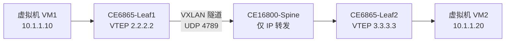

### 真题精练

**Q1.【真题·单选】** VXLAN 中使用 VNI 标识二层网络，VNI 的位宽是多少？
A. 12 bit  B. 16 bit  C. 24 bit  D. 32 bit

> **答案：C**
> **解析**：VXLAN Header 中 VNI 字段固定 24 bit，可提供 2^24≈1677 万个隔离网络。A 是 802.1Q 的 VLAN ID；B 是传统 VPLS 中部分实现的标签位宽，不是 VXLAN；D 是 IPv4 地址位宽。记忆口诀："**VLAN 十二，VNI 二十四**"。

**Q2.【真题·判断】** VXLAN 封装后，中间转发设备必须支持 VXLAN 才能转发报文。

> **答案：错误**
> **解析**：VXLAN 是 MAC in UDP 封装，封装后外层是标准 IP/UDP 报文，中间设备只按外层 IP 目的地址做普通路由转发，**完全不需要感知 VXLAN**。只有隧道两端的 VTEP 需要支持 VXLAN 的封装与解封装。这正是 VXLAN 相比 MPLS L2VPN 的最大工程优势。

**Q3.【真题·简答】** 已知物理链路 MTU 为 1500 字节，内层原始以太帧最大为 1500 字节。为使 VXLAN 报文不被分片，请计算 VXLAN 封装带来的额外开销，并给出物理口 MTU 应设置为多少。

> **答案：额外开销 50 字节；物理口 MTU 建议设置为 1550 及以上（或内层 MTU 设为 1450）。**
> **解析**：开销构成——外层以太头 14 字节 + 外层 IPv4 头 20 字节 + UDP 头 8 字节 + VXLAN 头 8 字节 = **50 字节**（若外层为 IPv6，则为 14+40+8+8 = 70 字节）。若物理口 MTU 仍为 1500，则内层帧只能到 1450 字节，超过即分片或被丢弃。工程上有两种做法：把物理口与 Underlay 的 MTU 调到 **1550/1600**（推荐，华为 CloudEngine 支持 `mtu 1600`），或把业务口 MTU 降到 1450。国赛常考"50 字节"这个数字。

### 易错点与排错

1. **混淆 VNI 与 VLAN**：VNI 是 VXLAN 的隔离标识，位于 UDP 载荷内，中间设备看不到；VLAN 是 802.1Q 标签，位于二层层。接入侧 VLAN 与 VNI 的映射关系由 BD 决定。
2. **误以为 VNI 越大越好**：VNI 1~16777215 可用，但部分设备对 VNI 范围有限制，规划时应与 BD 统一编号便于运维（常见做法 VNI = BD 编号 + 10000）。
3. **MTU 未调整导致大包丢包**：现象是 ping 小包通、大包不通，VM 迁移或 iSCSI 存储流量异常。排查用 `display interface 100GE1/0/1` 看 MTU 与错包计数。
4. **VTEP 源地址用了物理口地址**：物理口或链路聚合口会因故障/Down 导致隧道中断，必须用 Loopback 接口且为 32 位掩码。
5. **常用排错命令**：`display vxlan vni`、`display nve`、`display bridge-domain`、`display interface nve 1`、`display fwm`（查看转发表项）。

---

## 4.2 VXLAN 报文格式逐字段讲解

### 考点定位
**国赛/省赛最高频考点之一**，几乎每年以"填图 + 字段填空"形式出现。必须能默写"外层以太 → 外层 IP → UDP 4789 → VXLAN 头 8 字节 → 内层原始帧"的五段结构，并准确说出 VXLAN 头 8 字节中 Flags、VNI(24bit)、Reserved 的位置与作用。易错点：把 VXLAN 头记成 4 字节、把目的地端口记成 4790 或 8472。

### 原理精讲
VXLAN 报文本质是"原始二层帧 + 四层封装外壳"，从外到内共五段。

**第一段：外层以太头（Outer Ethernet Header，14 字节）**——由 VTEP 所在设备重新生成。源 MAC 是本设备 NVE 所在接口/出接口的 MAC，目的 MAC 是**到对端 VTEP 下一跳的三层网关 MAC**（不是对端 VTEP 的 MAC）。EtherType 为 0x0800（IPv4）或 0x86DD（IPv6）。注意：由于外层目的 MAC 是逐跳变化的，它不承载任何 VXLAN 语义。

**第二段：外层 IP 头（Outer IP Header，IPv4 20 字节）**——源 IP 为**本端 VTEP 地址**，目的 IP 为**对端 VTEP 地址**。这两个地址是 VXLAN 隧道的关键标识，Underlay 网依靠它们做路由转发。协议号 17（UDP）。外层 IP 的 TTL 由设备设定，默认通常为 64 或 255，华为实现中为避免隧道内环路引发 TTL 过期问题，多采用较大初值。IPv4 头中的 DF 位建议置 1，配合路径 MTU 发现避免分片。

**第三段：UDP 头（8 字节）**——源端口为**内层帧的哈希值**，用于 Underlay 网络的**负载分担**（ECMP）；目的端口固定为 **4789**（IANA 正式分配的 VXLAN 端口，早期草案用 8472）。源端口取哈希是 VXLAN 设计的精妙之处：让同一对 VTEP 之间不同流量的五元组不同，从而让 Underlay 的 ECMP 能把不同租户/不同主机的流量分摊到多条等价链路上。

**第四段：VXLAN 头（8 字节）**——核心结构：
- **Flags（8 bit）**：最高位为 **I 位（bit 3，即 0x08）**，表示"VNI 字段有效"，合法 VXLAN 报文中该位**必须置 1**。其余位保留，发送时置 0。RFC 7348 规定接收端若发现该位为 0 应丢弃报文；华为设备实现上通常不严格校验，但考试以 RFC 为准。
- **Reserved（24 bit + 8 bit）**：即 VNI 前 24 bit 与 VNI 后 8 bit，共 32 bit 保留字段，发送置 0，接收忽略。
- **VNI（24 bit）**：虚拟网络标识，标识该帧属于哪个 VXLAN 段。接收端 VTEP 依据 VNI 找到对应的 BD，从而还原出正确的广播域。
- **Reserved（8 bit）**：VXLAN 头最后一字节，保留置 0。

**第五段：内层原始帧（Inner Original Frame）**——原来的完整以太帧，包含内层目的 MAC、内层源 MAC、可选的内层 802.1Q 标签（VXLAN 支持内层带 Tag）、EtherType 与载荷。这一段**不被任何中间设备修改**，直到对端 VTEP 解封装后交给对应 BD。

| 层次 | 字段 | 长度 | 取值/作用 | 考试要点 |
|---|---|---|---|---|
| 外层以太头 | 目的 MAC | 6 B | 到对端 VTEP 下一跳的 MAC | 逐跳变化，不含隧道语义 |
| 外层以太头 | 源 MAC | 6 B | 本端出接口 MAC | 逐跳变化 |
| 外层以太头 | EtherType | 2 B | 0x0800（IPv4）/0x86DD（IPv6） | 决定外层 IP 版本 |
| 外层 IP 头 | 源 IP | 4 B | **本端 VTEP 地址** | 隧道源，通常为 Loopback |
| 外层 IP 头 | 目的 IP | 4 B | **对端 VTEP 地址** | 隧道目的，Underlay 据此转发 |
| 外层 IP 头 | 协议号 | 1 B | **17（UDP）** | 不是 6、不是 47 |
| 外层 IP 头 | TTL | 1 B | 默认较大值 | 防止隧道内环路 |
| UDP 头 | 源端口 | 2 B | 内层帧哈希值 | 供 Underlay ECMP 负载分担 |
| UDP 头 | 目的端口 | 2 B | **4789** | 高频填空点；早期 8472 |
| UDP 头 | 长度 | 2 B | UDP 头 + VXLAN 头 + 内层帧 | 校验用 |
| VXLAN 头 | Flags | 1 B | I 位（0x08）置 1 表示 VNI 有效 | RFC 要求置 1 |
| VXLAN 头 | Reserved | 3 B | 置 0 | 与 VNI 高位组成 4 字节 |
| VXLAN 头 | **VNI** | **3 B（24 bit）** | 标识 VXLAN 段 | 最高频考点 |
| VXLAN 头 | Reserved | 1 B | 置 0 | 8 字节头收尾 |
| 内层 | 原始以太帧 | 可变 | 含内层 MAC、可选 VLAN Tag | 端到端保持不变 |

**开销汇总**：外层以太 14 + 外层 IPv4 20 + UDP 8 + VXLAN 8 = **50 字节**；外层 IPv6 时为 **70 字节**。

### 关键概念对照表

| 名称 | 长度 | 是否参与哈希 | 是否可被中间设备修改 | 说明 |
|---|---|---|---|---|
| 外层以太头 | 14 B | 部分（MAC） | 是，逐跳重写 | 由出接口重新封装 |
| 外层 IP 头 | 20/40 B | 是（IP 五元组） | TTL 逐跳减 1 | 承载 VTEP 地址 |
| UDP 头 | 8 B | 是（端口） | 否 | 目的端口固定 4789 |
| VXLAN 头 | 8 B | 否 | 否 | 仅隧道端点可读写 |
| 内层原始帧 | 可变 | 是（内层 MAC/IP） | 否 | 端到端透明传输 |

### 示意图

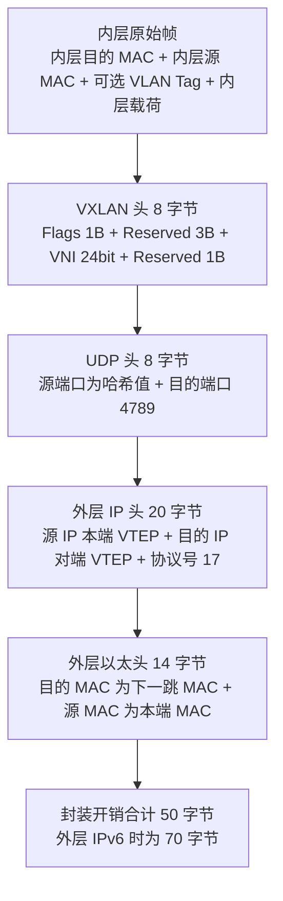

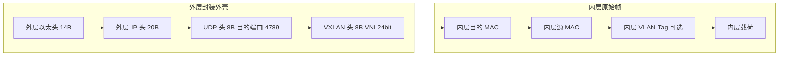

### 真题精练

**Q4.【真题·填空】** VXLAN 报文的标准 UDP 目的端口号是 ______；VXLAN 头总长度为 ______ 字节；其中 VNI 字段占 ______ 位。

> **答案：4789；8；24**
> **解析**：4789 是 IANA 正式分配给 VXLAN 的端口，早期草案使用 8472（部分厂商设备仍可配置兼容）。VXLAN 头固定 8 字节 = Flags(1) + Reserved(3) + VNI(3) + Reserved(1)。VNI 为 24 bit。此题三个空是国赛"报文细节题"最经典的组合。

**Q5.【真题·多选】** 关于 VXLAN 报文封装，下列说法正确的有？
A. 外层 IP 的源地址是本端 VTEP 地址，目的地址是对端 VTEP 地址
B. 外层以太头的目的 MAC 是对端 VTEP 的 MAC 地址，全程不变
C. 外层 UDP 源端口取内层帧哈希值，用于 Underlay 负载分担
D. VXLAN 头中 I 位置 1 表示 VNI 字段有效
E. 内层原始帧的 MAC 地址会被中间设备改写

> **答案：ACD**
> **解析**：A 正确，VTEP 地址是隧道的两端标识。B 错误，外层以太头逐跳重写，目的 MAC 是**下一跳三层网关的 MAC**，不是对端 VTEP 的 MAC，也不是全程不变。C 正确，源端口哈希是 VXLAN 支持 ECMP 的关键设计。D 正确，RFC 7348 规定 I 位（0x08）置 1 表示 VNI 有效。E 错误，内层帧端到端透明，只有隧道端点能封装/解封装，中间设备不感知内层内容。

**Q6.【真题·简答】** 请画出 VXLAN 报文的五段结构，并说明 VXLAN 头中每个字段的作用。

> **答案：**
> 五段结构（由外到内）：**外层以太头（14B）→ 外层 IP 头（20B）→ UDP 头（8B，目的端口 4789）→ VXLAN 头（8B）→ 内层原始以太帧**。
> VXLAN 头 8 字节字段作用：
> 1. **Flags（1 字节）**：I 位（bit 3，0x08）置 1 表示 VNI 有效，合法报文必须置 1；其余位保留置 0。
> 2. **Reserved（3 字节）+ VNI（3 字节）** 组成 4 字节：Reserved 全部置 0，接收端忽略。
> 3. **VNI（24 bit）**：虚拟网络标识，接收端 VTEP 依据 VNI 定位对应 BD，从而还原广播域并决定后续转发。
> 4. **Reserved（1 字节）**：保留字段，置 0。
> **解析**：答题时务必标出"Flags 1 字节 / Reserved 3 字节 / VNI 3 字节 / Reserved 1 字节"这个 1+3+3+1 的划分，这是阅卷核心得分点。

### 易错点与排错

1. **把 VXLAN 头当作 4 字节**：完整 VXLAN 头是 **8 字节**，其中 VNI 只占 3 字节，另有 1 字节 Flags 与 4 字节 Reserved。
2. **端口号记混**：标准为 4789，8472 是早期草案（Linux 内核 VXLAN 曾默认使用），考试以 4789 为准。
3. **误认为外层目的 MAC 是对端 VTEP 的 MAC**：实际是**下一跳**的 MAC，在跨多跳的三层 Underlay 中每一跳都会变化。
4. **抓包排错方法**：在 VTEP 的物理口或 NVE 口做流镜像，用 Wireshark 过滤 `udp.port == 4789`，确认 VNI、外层 VTEP 地址是否正确；若抓不到包，先确认 `display nve` 中隧道是否 Up。
5. **MTU 与分片问题**：抓包看到 DF 位置 1 且被丢弃，说明 Path MTU 不足，需调大 Underlay MTU 或调小内层 MTU。

---

## 4.3 VTEP 与 NVE 接口

### 考点定位
概念 + 配置结合题。考法：VTEP 的作用、NVE 接口的角色、VTEP 源地址为什么用 Loopback、一个 NVE 接口能有几个源地址。易错点：认为 NVE 是物理接口，或认为 VTEP 必须配置在业务网关上。

### 原理精讲
VTEP（VXLAN Tunnel End Point，VXLAN 隧道端点）是 VXLAN 网络的**边缘设备角色**，负责三件事：
1. **封装**：把来自本地接入侧（VLAN/BD）的二层帧加上 VXLAN/UDP/IP/以太封装，发往对端 VTEP。
2. **解封装**：收到 VXLAN 报文后剥掉外壳，依据 VNI 找到本地 BD，还原成二层帧转发。
3. **二层查表与泛洪**：在 BD 内做 MAC 地址学习；未知单播、广播、组播按泛洪策略复制发送。

VTEP 在设备上通过 **NVE（Network Virtualization Edge，网络虚拟化边缘）接口**实现。NVE 是一个**逻辑接口**，不是物理接口，因此不能被 shutdown 掉链路的物理状态影响；它只有一个"源地址"属性（`source`），必须是一个本地已配置且路由可达的三层地址。

**为什么源地址必须用 Loopback 接口地址？**
- 物理接口会因链路故障、板卡复位、单板倒换而 Down，导致 VTEP 源地址不可用，隧道瞬间中断，VXLAN 全部业务受损。
- Loopback 接口是逻辑接口，**只要设备有到该地址的路由就永远 Up**，与具体物理链路无关，可以配合 Underlay 的 OSPF/IS-IS/BGP 实现多路径冗余与快速收敛。
- 通常使用 **32 位掩码**的 Loopback 地址作为 VTEP 地址，避免被路由聚合影响，也避免隧道对端选到错误的源地址。

**NVE 与 BD、VNI 的关系**：NVE 是"隧道端口的集合"，本设备所有 VXLAN 隧道都挂在同一个 NVE 接口下（华为设备 NVE 接口编号固定为 1 的用法最常见）。BD 与 VNI 一一绑定后，NVE 通过 VNI 决定报文属于哪条隧道/哪个 BD。报文从哪个方向进入 NVE，用 **VAP（Virtual Access Point，虚拟接入点）**标识：接入侧进入的 VAP 与隧道侧进入的 VAP 不同，VAP 的引入让"VXLAN 转发等价于二层桥接"这一模型得以清晰表述。

**VTEP 的部署位置**：VTEP 通常部署在接入层的 Leaf 交换机上（如 CloudEngine 6865/6863）；也有部署在服务器虚拟化层（vSwitch，软件 VTEP）或网关上（集中式网关场景）。硬件 VTEP 性能高，软件 VTEP 灵活但受服务器 CPU 限制。国赛常考"硬件 VTEP 与软件 VTEP 的区别"。

### 关键概念对照表

| 概念 | 类型 | 作用 | 关键约束 |
|---|---|---|---|
| VTEP | 角色/功能实体 | 封装解封装 VXLAN 报文 | 每台 VTEP 至少一个唯一源地址 |
| NVE 接口 | 逻辑接口 | 承载 VXLAN 隧道 | 只能有一个 source 地址 |
| VAP | 逻辑接入点 | 标识报文从接入侧还是隧道侧进入 | 决定转发方向与 BD 归属 |
| BD | 二层广播域 | 承载二层转发表与泛洪域 | 与 VNI 建议 1:1 绑定 |
| Loopback | 逻辑接口 | 提供稳定的 VTEP 源地址 | 建议 32 位掩码，Underlay 需可达 |

| 对比项 | 硬件 VTEP | 软件 VTEP |
|---|---|---|
| 实现位置 | 交换机 ASIC（如 CloudEngine 6865） | 服务器 vSwitch |
| 性能 | 线速转发，Tbps 级 | 受 CPU 限制，Gbps 级 |
| 典型协议 | VXLAN + BGP EVPN | VXLAN + OVS/EVPN |
| 运维 | 统一由 iMaster NCE-Fabric 纳管 | 需与虚拟化平台联动 |
| 适用场景 | 生产核心业务 | 测试环境或小规模 |

### 华为设备配置

```bash
system-view
interface Loopback0                          // 创建环回口作为 VTEP 源地址载体
 ip address 2.2.2.2 32                       // 32 位掩码，保证地址稳定且不被聚合
 quit
interface nve 1                              // 创建 NVE 接口，编号 1（设备上通常只用 1 个）
 source 2.2.2.2                              // 指定 VTEP 源地址，必须与本机 Loopback 一致
 mac-address 0000-5e00-0101                   // 可指定 NVE 接口 MAC，保证同一 BD 内网关 MAC 一致
 quit
display nve                                  // 查看 NVE 接口状态、源地址、关联 VNI 与隧道数
display interface nve 1                      // 查看 NVE 接口的收发包统计，判断隧道是否活跃
```

### 示意图

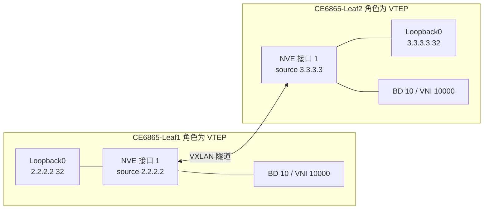

### 真题精练

**Q7.【真题·单选】** 在华为 CloudEngine 交换机上配置 VXLAN 时，NVE 接口的 source 地址推荐使用下列哪种接口的地址？
A. 业务口 VLANIF 接口  B. Loopback 接口  C. 管理口 MEth 接口  D. NVE 接口自身的地址

> **答案：B**
> **解析**：NVE 接口的 source 是 VTEP 地址，必须**永远可达**。Loopback 接口是逻辑接口，不受物理链路状态影响，只要路由可达就保持 Up，能够配合 Underlay 多路径实现冗余。A 会随链路/VLAN 状态抖动；C 管理口通常不参与业务转发且带宽低；D 概念错误，NVE 是从接口，自身不配置 IP 地址，只能引用其他接口的地址。

**Q8.【真题·简答】** 简述 VTEP 的三大功能，并说明为什么 VXLAN 网络中不需要在 Overlay 内运行 STP。

> **答案：**
> VTEP 三大功能：① **封装**——把本地 BD/VLAN 的二层帧封装为 VXLAN 报文；② **解封装**——剥离外层封装，按 VNI 还原到对应 BD；③ **二层转发**——在 BD 内进行 MAC 学习，对未知单播/广播/组播执行泛洪复制。
> 不需要 STP 的原因：VXLAN Overlay 的二层转发域由 VNI 界定，隧道建立在三层 IP 网络之上。**三层 Underlay 本身依靠路由协议（OSPF/IS-IS/BGP）天然无环**，而不像传统二层网络依赖冗余链路形成环路。VXLAN 通过"头端复制/Ingress Replication + 三层等价多路径"实现冗余与负载分担，不需要在 Overlay 内破环。同时，Overlay 中运行 STP 会让泛洪报文被大量复制，且 STP 收敛速度远慢于三层路由收敛，反而降低可靠性。
> **解析**：本考点常与"Underlay 用路由、Overlay 用 VXLAN"的 Fabric 分层思想一并考察，答出"三层无环 + BGP/IGP 收敛更快"即得满分要点。

### 易错点与排错

1. **NVE 接口配了 IP 地址**：NVE 是从接口，华为设备上不支持直接在其下配置 IP，必须通过 `source` 引用其他接口地址。
2. **源地址用了非 32 位掩码**：可能被 Underlay 路由聚合，导致对端选错源或隧道建立失败。
3. **多个 NVE 接口**：设备上通常只保留一个 NVE 接口（编号 1），创建多个会造成隧道归属混乱。
4. **排错命令**：`display nve`（看源地址与 VNI 列表）、`display interface nve 1`（看隧道收发统计）、`display vxlan tunnel`（看隧道状态与对端地址）、`display ip routing-table 3.3.3.3`（确认到对端 VTEP 路由可达）。

---

## 4.4 VXLAN 隧道建立方式：手工静态 VXLAN 与 BGP EVPN 动态建立

### 考点定位
对比题高频。考法：两种方式的区别、静态 VXLAN 的适用规模、BGP EVPN 相比静态的优势、静态 VXLAN 的泛洪机制。易错点：认为静态 VXLAN 也能自动学习远端 MAC，或认为 BGP EVPN 需要额外的数据平面协议。

### 原理精讲
**手工静态 VXLAN（Static VXLAN）**：管理员在每台 VTEP 上手工配置"本端 VNI 对应的对端 VTEP 地址列表"。VTEP 之间不需要任何控制协议，隧道通过数据平面触发建立（首次有流量时建立转发面表项）。其特点是：
- **配置简单直观**：三五行命令即可跑通，适合实验与小规模（几台设备）环境。
- **无控制平面**：VTEP 之间不交互信息，MAC 地址依然是"数据平面学习 + 泛洪"（头端复制）方式。
- **扩展性极差**：N 台 VTEP 需要 N×(N−1) 条对端配置，属于 O(N²) 复杂度；新增一台 VTEP 必须在全网每台设备上手工添加，运维成本高、易漏配。
- **无自动故障感知**：对端 VTEP 失效只能靠流量超时感知，收敛慢；也无法自动做隧道级的负载分担。
- **泛洪方式受限**：只能使用头端复制（把广播复制成 N−1 份单播）或组播。

**基于 BGP EVPN 动态建立**：把 BGP 作为 VXLAN 的**控制平面**，利用 MP-BGP 新增的 **L2VPN EVPN 地址族**在 VTEP 之间交互信息。VTEP 通过 EVPN 的 **Type-3 路由（Inclusive Multicast Ethernet Tag Route，包含性组播以太网标签路由）**自动通告自己的 VTEP IP 与 VNI，对端收到后自动建立隧道；通过 **Type-2 路由（MAC/IP Advertisement Route，MAC/IP 通告路由）**把本地学到的 MAC/IP 通告给其他 VTEP，其他 VTEP 直接写入本地 MAC 表，**数据平面不再需要泛洪学习**。其特点是：
- **自动发现与自动建隧道**：新增 VTEP 只需与 RR（Route Reflector，路由反射器）建立 BGP 邻居，无需逐台配置。
- **MAC 路由化**：远端 MAC 通过控制平面学习，避免泛洪，支持基于 BGP 的快速收敛与 BGP 的等价多路径（ECMP）。
- **支持 ARP 抑制**：Type-2 路由携带主机 IP，远端 VTEP 可代答 ARP，大幅减少广播。
- **大规模可扩展**：借助 RR，BGP 会话数从 O(N²) 降到 O(N)。

一句话总结：**静态 VXLAN = 只有数据平面；BGP EVPN = 数据平面 + 控制平面**。

### 关键概念对照表

| 对比项 | 手工静态 VXLAN | BGP EVPN 动态建立 |
|---|---|---|
| 控制平面 | 无 | MP-BGP（L2VPN EVPN 地址族） |
| 隧道建立 | 手工配置对端 VTEP 列表 | Type-3 路由自动通告/自动建立 |
| MAC 学习 | 数据平面泛洪学习 | 控制平面 Type-2 通告学习 |
| 泛洪机制 | 头端复制或组播 | Ingress Replication（基于 Type-3 的复制列表） |
| 配置复杂度 | 每台设备手工配置对端，O(N²) | 只与 RR 建邻居，O(N) |
| 扩展性 | 差，适合小规模/实验 | 好，适合大规模云数据中心 |
| 故障收敛 | 慢，依赖流量超时 | 快，BGP 感知路由撤销 |
| 负载分担 | 依赖 UDP 源端口哈希 | 支持 BGP ECMP + 源端口哈希 |
| ARP 抑制 | 不支持 | 支持（Type-2 携带 IP 可代答） |
| 适用场景 | eNSP 实验、小规模验证 | 生产环境（CloudFabric 标准方案） |

### 华为设备配置

```bash
# ========== 方式一：手工静态 VXLAN（CE6865-Leaf1）==========
system-view
bridge-domain 10                             // 创建 BD 10
 vxlan vni 10000                             // BD 10 绑定 VNI 10000
 quit
interface nve 1
 source 2.2.2.2                              // 本端 VTEP 源地址
 vni 10000 head-end peer-list 3.3.3.3        // VNI 10000 的对端 VTEP 列表，多个地址分行配置
 vni 10000 head-end peer-list 4.4.4.4        // 新增对端必须逐台手工追加，扩展性差
 quit
```

```bash
# ========== 方式二：BGP EVPN 动态建立（CE6865-Leaf1）==========
system-view
evpn                                        // 进入 EVPN 全局视图
 vni 10000                                   // 指定本端 VNI
  route-distinguisher 1:10000                // 该 VNI 的 RD，用于区分不同实例的同前缀路由
  vpn-target 1:10000 export-extcommunity     // 导出 RT，本端 Type-2/Type-3 路由携带此属性
  vpn-target 1:10000 import-extcommunity     // 导入 RT，接收携带该属性的远端路由
 quit
 quit
bgp 100                                     // 进入 BGP 视图，AS 100
 router-id 2.2.2.2                           // 建议与 VTEP 地址一致，便于排错
 peer 10.0.0.1 as-number 100                 // 与 RR 建立 iBGP 邻居（Underlay 地址）
 peer 10.0.0.1 connect-interface Loopback0   // 用 Loopback 建邻居，保证稳定性
 ipv4-family unicast                         // IPv4 单播地址族，承载 Underlay 与 Loopback 路由
  peer 10.0.0.1 enable                       // 使能邻居
  peer 10.0.0.1 next-hop-local               // 下一跳本地化，避免下一跳不可达
 quit
 l2vpn-family evpn                           // 进入 L2VPN EVPN 地址族，EVPN 路由在此承载
  peer 10.0.0.1 enable                       // 在该地址族下使能邻居
  peer 10.0.0.1 advertise irb                // 通告 IRB 类型路由，支持分布式网关三层转发
 quit
 quit
```

### 示意图

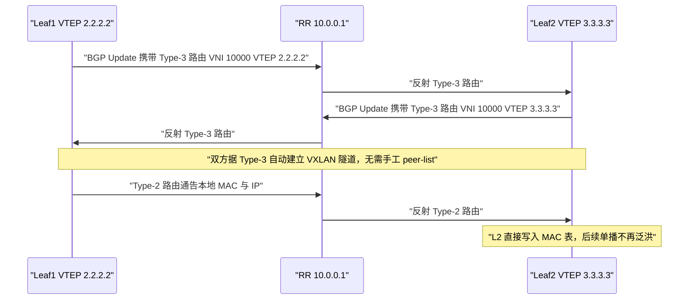

### 真题精练

**Q9.【真题·多选】** 与手工静态 VXLAN 相比，基于 BGP EVPN 建立 VXLAN 隧道的优势包括？
A. 新增 VTEP 无需逐台配置对端，扩展性好
B. 通过 Type-3 路由自动发现 VTEP 并建立隧道
C. 通过 Type-2 路由实现 MAC 地址的控制平面学习，减少泛洪
D. 完全不需要 Underlay 网络的 IP 可达性
E. 支持 ARP 抑制，减少广播报文

> **答案：ABCE**
> **解析**：A、B、C、E 均为 BGP EVPN 的标准优势。D 错误——**无论静态还是动态，VXLAN 都必须依赖 Underlay 的三层 IP 可达性**，VTEP 之间要能路由互通（BGP 邻居也建立在 Underlay 之上）。EVPN 只是把"隧道发现与 MAC 学习"从数据平面搬到控制平面，并未替代 Underlay。

**Q10.【真题·单选】** 手工静态 VXLAN 中，VTEP 之间通过什么方式建立隧道转发面？
A. 由 BGP 通告自动建立  B. 首次有流量经过时通过数据平面触发建立  C. 由 DHCP 自动分配  D. 必须手工配置隧道接口才能转发

> **答案：B**
> **解析**：静态 VXLAN 没有控制平面，`vni head-end peer-list` 只是配置了"候选对端列表"，真正的转发面表项在**首个报文需要经该隧道发送时由数据平面触发建立**。A 是 BGP EVPN 的机制；C、D 均无此机制（华为 NVE 是逻辑接口，不需要逐个创建隧道接口）。

### 易错点与排错

1. **静态 VXLAN 漏配对端**：新增 VTEP 后忘了在老设备上追加 `head-end peer-list`，表现为"部分主机互通、部分不通"，用 `display vxlan tunnel` 核对隧道数量。
2. **BGP EVPN 建了邻居但隧道不通**：检查是否在 `l2vpn-family evpn` 地址族下使能了邻居（只在 `ipv4-family unicast` 下 enable 是不够的）。
3. **RT 不匹配导致路由收不到**：`display bgp evpn all routing-table` 查看是否有路由；确认两端 `vpn-target` 的导出/导入方向正确。
4. **常见排错命令**：`display bgp evpn peer`、`display bgp evpn all routing-table`、`display vxlan tunnel`、`display nve`、`display bgp evpn all routing-table type3`（专看 Type-3，验证隧道发现是否成功）。

---

## 4.5 VXLAN 网关的三种类型：二层网关、集中式三层网关、分布式三层网关

### 考点定位
**省赛/国赛重点，几乎必考对比题**。考法：三种网关的区别、集中式网关的缺点、分布式网关的转发路径、VBDIF 的作用、分布式网关中"网关 MAC 全局一致"的意义。易错点：认为集中式网关性能瓶颈在带宽，实际瓶颈在**表项规格与转发路径次优**。

### 原理精讲
VXLAN 网关解决"VXLAN 网络内部及与外部网络互通"的问题。按是否终结 VXLAN、以及网关部署位置，分为三类。

**（1）二层网关（L2 Gateway）**
只做**二层桥接**：一侧是 VXLAN 封装（BD/VNI），另一侧是传统 VLAN，网关在两侧之间做"VLAN ↔ VXLAN"的标签转换与二层转发。它**不终结 VXLAN 做三层转发**，不同 VNI 之间不能互通（跨租户需依赖外部三层设备）。
- 优点：实现简单，表项少，转发性能高；适合"VXLAN 网络与外部传统二层网络对接"的场景。
- 缺点：不具备三层网关能力，无法实现租户内跨网段互通；跨 VNI 通信需外挂设备，扩展性受限。

**（2）集中式三层网关（Centralized L3 Gateway）**
在一台（或一对）**核心/汇聚设备**上为所有 BD 创建 VBDIF 接口并配置网关 IP，所有 VXLAN 的三层转发都集中到这台设备完成。
- 转发路径：VM1（Leaf1 下）→ Leaf1 查 MAC 表得网关 MAC → 封装 VXLAN 送到核心网关 → 网关解封装、查 VBDIF 路由 → 重新封装 VXLAN 送给 Leaf2 → VM2。
- 优点：**配置集中、管理简单**；网关设备只需一台/一对，运维成本低；接入 Leaf 无需保存主机路由，设备规格要求低。
- 缺点：① **转发路径次优**——同 Leaf 下或跨 Leaf 的东西向流量都要绕到核心，产生"发卡弯"（Trombone）路径，增加时延、消耗核心带宽；② **网关成为单点/瓶颈**——所有三层流量都压在一台设备上，其**主机路由表项与 ARP 表项规格**成为硬瓶颈，且故障影响面大（虽然可用 VRRP/M-LAG 双活，但收敛仍有影响）；③ 横向扩展能力弱，难以支撑大规模 POD。

**（3）分布式三层网关（Distributed L3 Gateway）**
把三层网关能力**下沉到每一台 Leaf** 上：每台 Leaf 都为本 POD 内的所有 BD 创建 VBDIF 并配置相同的网关 IP 和**相同的网关 MAC**，同时通过 BGP EVPN 的 Type-2 路由（携带主机 MAC/IP）把本地主机路由通告给其他 Leaf。
- 转发路径：VM1 → Leaf1（在本地即完成 VXLAN 终结、三层查表）→ 直接封装 VXLAN 送往 Leaf2 → Leaf2（终结后送 VM2）。**全程一跳 Leaf 到 Leaf，无绕行**。
- 关键要求：**同一 BD 内所有 Leaf 的 VBDIF 网关 MAC 必须完全一致**，这样 VM 的 ARP 表里网关 MAC 不变，VM 迁移到任意 Leaf 下都无需重新 ARP，实现"网关随主机移动"。
- 优点：**转发路径最优**（东西向流量不绕行）、**网关能力随 Leaf 横向扩展**（每台 Leaf 都是网关，无集中瓶颈）、主机路由分散到各 Leaf、单台 Leaf 故障只影响其下挂主机。
- 缺点：**每台 Leaf 都要保存全网主机路由（/32 ARP + MAC 表项）**，对设备**表项规格与内存**要求高；配置复杂度高，必须依赖 BGP EVPN 与自动化控制器（iMaster NCE-Fabric）；对 Underlay 的稳定性要求更高。

| 对比项 | 二层网关 | 集中式三层网关 | 分布式三层网关 |
|---|---|---|---|
| 是否终结 VXLAN | 否（仅二层桥接） | 是 | 是 |
| 网关部署位置 | 任意边界设备 | 核心/汇聚（少数设备） | 每台 Leaf 都部署 |
| 三层转发能力 | 无 | 有（集中在核心） | 有（分散在各 Leaf） |
| 转发路径 | 二层直达 | 绕行核心，路径次优 | Leaf 间直达，路径最优 |
| 东西向时延 | 低（同 BD） | 高（发卡弯） | 低 |
| 表项压力 | 小 | 集中在核心，**易成瓶颈** | 分散到各 Leaf，规格要求高 |
| 网关 IP/MAC | 无 | 全局唯一配置在核心 | 各 Leaf 配置**相同** IP 与 MAC |
| 主机路由传播 | 不需要 | 不需要（核心有 ARP） | 需要（依赖 BGP EVPN Type-2） |
| 扩展性 | 差（跨 VNI 需外挂） | 中，受核心规格限制 | 好，随风向 Leaf 扩展 |
| 依赖控制器 | 否 | 否 | 强烈依赖（NCE-Fabric 自动化） |
| 典型场景 | 小规模对接传统网络 | 中小规模、早期 VXLAN 方案 | 大型云数据中心标准方案 |

### 关键概念对照表

| 概念 | 含义 | 易错点 |
|---|---|---|
| BD（Bridge Domain） | 二层广播域，承载 MAC 表与泛洪域 | 与 VNI 建议 1:1，避免多个 BD 共用 VNI |
| VBDIF | BD 对应的三层网关接口，配 IP 作为网关 | 名字类似 VLANIF，但作用在 BD 上 |
| 网关 MAC | VBDIF 的 MAC 地址 | 分布式网关中**必须全网一致** |
| IRB | Integrated Routing and Bridging，集成路由桥接 | 分布式网关跨子网转发即 IRB 的一种形式 |
| 对称 IRB / 非对称 IRB | 是否两端都做三层查表 | 华为 CloudFabric 常用对称 IRB（两端均终结 VXLAN） |

### 华为设备配置

```bash
# ========== 分布式网关配置（CE6865-Leaf1，每台 Leaf 配置相同）==========
system-view
bridge-domain 10                              // 创建 BD 10 作为业务广播域
 vxlan vni 10000                              // 绑定 VNI 10000
 quit
interface vbdif 10                            // 为 BD 10 创建三层网关接口
 ip address 10.1.1.1 24                       // 网关 IP，各 Leaf 配置相同以实现网关冗余
 mac-address 0000-5e00-0101                    // 网关 MAC 全网每台 Leaf 必须一致，保证 VM 迁移感知不到变化
 quit
interface nve 1
 source 2.2.2.2
 vni 10000 head-end peer-list 3.3.3.3
 quit
# ========== 关键：BGP EVPN 必须能通告主机路由，分布式网关才生效 ==========
bgp 100
 l2vpn-family evpn
  peer 10.0.0.1 enable
  peer 10.0.0.1 advertise irb                 // 通告 IRB 路由，远端 Leaf 才能学到本端主机 /32 路由
 quit
 quit
```

### 示意图

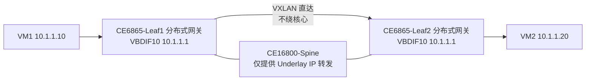

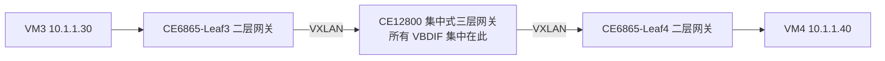

### 真题精练

**Q11.【真题·单选】** 采用集中式三层网关组网时，最主要的缺点是？
A. 不支持 VXLAN 封装  B. 东西向流量需绕行网关，转发路径次优且核心设备表项压力大
C. 无法实现跨租户隔离  D. 每台 Leaf 都必须保存全网主机路由

> **答案：B**
> **解析**：集中式网关的核心问题是**转发路径次优（Trombone 发卡弯）**与**核心设备表项规格瓶颈**：所有 VXLAN 三层流量都要到核心解封装再重新封装，且核心需维护全网主机的 ARP/主机路由。A 错误，集中式网关本身就要终结 VXLAN。C 错误，隔离由 VNI/BD 保证，与网关类型无关。D 恰是**分布式网关**的特点而非集中式网关的缺点。

**Q12.【真题·多选】** 关于分布式 VXLAN 网关，下列说法正确的有？
A. 每台 Leaf 都要配置 VBDIF 接口作为网关
B. 同一 BD 内各 Leaf 的网关 MAC 必须保持一致
C. 主机路由通过 BGP EVPN 的 Type-2 路由在各 Leaf 间传播
D. Leaf 之间转发东西向流量时必须经过 Spine 做三层转发并重新封装
E. 相比集中式网关，分布式网关对 Leaf 的表项规格要求更高

> **答案：ABCE**
> **解析**：A 正确，网关下沉到每台 Leaf。B 正确，网关 MAC 一致才能保证 VM 迁移后无需重新 ARP、网关角色可随主机移动。C 正确，Type-2 路由携带 MAC/IP 实现主机路由分发。D 错误，分布式网关下 Leaf 在**本地**完成 VXLAN 终结与三层查表，随后直接封装送往对端 Leaf，不存在"到 Spine 解封装再重新封装"的绕行；Spine 只做 Underlay 的 IP 转发。E 正确，各 Leaf 需保存全网主机 /32 表项，规格压力分散但总量变大。

### 易错点与排错

1. **分布式网关忘记配 `advertise irb`**：结果是本端主机路由不通告，其他 Leaf 学不到 /32 路由，跨 Leaf 三层不通。
2. **各 Leaf 网关 MAC 不一致**：VM 迁移到新 Leaf 后网关 MAC 变化，导致短暂断流或 ARP 表项错误，排错看 `display interface vbdif 10` 的 MAC。
3. **误判集中式网关的性能瓶颈**：瓶颈首先是**表项规格（ARP/主机路由/ MAC）**与**转发路径长度**，而非单纯的端口带宽。
4. **排错命令**：`display interface vbdif 10`、`display bridge-domain 10`、`display mac-address bridge-domain 10`、`display bgp evpn all routing-table type2`、`display ip routing-table vpn-instance`（如使用了 VPN 实例）。

---

## 4.6 BD、VBDIF 与 VXLAN 泛洪机制

### 考点定位
概念细节题 + 机制题。考法：BD 与 VNI 的关系、VBDIF 的作用、三种泛洪机制的对比与选择。易错点：把"头端复制"与"组播"记混，或认为 BGP EVPN 场景下仍然使用头端复制。

### 原理精讲
**BD（Bridge Domain，桥域）与 VNI 的关系**：BD 是设备内部用于承载一个二层广播域的逻辑实体，VNI 是 VXLAN 网络中的标识。二者本质是"本地实体"与"网络标识"的映射关系：
- **BD 与 VNI 通常 1:1 绑定**，一个 BD 绑定一个 VNI。若多个 BD 绑定同一 VNI，会造成广播域混杂、MAC 表混乱，是不可取的配置。
- 接入侧的不同 VLAN 可以通过二层子接口映射到**同一个 BD**，从而实现"VLAN 到 VXLAN"的归一化。这是 VXLAN 承载多租户的关键：租户在本地看到的是 VLAN，跨网络传输的是 VNI。
- BD 内部维护独立的 MAC 地址表、泛洪域与广播域，等价于传统二层交换机上的一个 VLAN。

**VBDIF（Virtual Bridge Domain Interface）**：BD 对应的三层逻辑接口，作用等同于传统网络中的 VLANIF。为 VBDIF 配置 IP 地址后，该 BD 内的主机就可以把 VBDIF 的 IP 作为网关，实现：
1. **BD 内三层转发**（同网段跨主机、跨 Leaf）；
2. **跨 BD 三层转发**（不同 VNI/子网之间，即分布式网关的 IRB）；
3. **VXLAN 与外部网络互通**（VBDIF 与物理三层口/路由域交互）。

VBDIF 的编号通常与 BD 编号一致。分布式网关场景中，**同一 BD 的 VBDIF 在所有 Leaf 上必须配置相同的 IP 和相同的 MAC**。

**VXLAN 的泛洪机制**：VXLAN 没有二层环路，因此不能用 STP 泛洪。当 VTEP 收到**未知单播、广播、组播**报文时，必须把报文送达同一 VNI/BD 内的所有其他 VTEP，共有三种实现方式。

**（1）头端复制（Head-End Replication）**：入口 VTEP 把一份报文**复制成多份单播**，分别封装发往本 VNI 的所有对端 VTEP。
- 实现：静态 VXLAN 中由 `vni X head-end peer-list` 定义对端列表；BGP EVPN 中由 Type-3 路由构成的复制列表驱动（此时称为 Ingress Replication，入口复制）。
- 优点：不依赖 Underlay 支持组播，部署简单，是当前主流。
- 缺点：**复制在入口完成**，入口设备要承担 N 份复制的带宽与 CPU 开销；对端数量多时（大规模 POD）入口压力大。

**（2）组播（Multicast）**：为每个 VNI 分配一个组播组地址，VTEP 加入该组播组，泛洪报文以组播方式一次性发送，由 Underlay 的组播（PIM-SM）完成复制。
- 优点：入口设备只发一份，复制由网络完成，入口开销小。
- 缺点：**需要 Underlay 部署并维护组播**（PIM、RP、组播路由表），运维复杂，且组播在数据中心并不普及。因此实际工程中较少使用。

**（3）EVPN 的 Ingress Replication**：严格说它是头端复制在 EVPN 控制平面下的实现形式——VTEP 通过 Type-3 路由自动获知同一 VNI 内的所有对端 VTEP，形成**复制列表（Replication List）**，入口 VTEP 按列表逐份复制单播发送。优势在于"对端列表自动生成、自动更新"，无需手工维护。

**ARP 与广播的处理演进**：静态 VXLAN 中 ARP 请求要在 BD 内泛洪；BGP EVPN 中由于 Type-2 路由携带主机 IP，VTEP 可以本地代答 ARP（**ARP 抑制**），甚至把 ARP 广播转为单播直接送目的 VTEP，这是 EVPN 相比静态方案在抑制广播风暴上的核心价值。

### 关键概念对照表

| 泛洪方式 | 复制位置 | 是否依赖组播 | 对端列表来源 | 入口开销 | 适用场景 |
|---|---|---|---|---|---|
| 头端复制 | 入口 VTEP | 否 | 手工 `head-end peer-list` | 大（N 份） | 静态 VXLAN、小规模 |
| 组播 | Underlay 网络 | **是（PIM-SM）** | 组播组 | 小 | 有组播网络的场景 |
| Ingress Replication（EVPN） | 入口 VTEP | 否 | **BGP EVPN Type-3 自动生成** | 中 | 大规模云数据中心（主流） |

### 华为设备配置

```bash
system-view
bridge-domain 10                              // 创建 BD 10
 vxlan vni 10000                              // BD 与 VNI 1:1 绑定
 quit
interface vbdif 10                            // 创建 BD 10 的三层网关接口
 ip address 10.1.1.1 24
 mac-address 0000-5e00-0101
 quit
interface 100GE1/0/1                          // 接入侧物理口
 port link-type trunk                         // 配置为 Trunk
 port trunk allow-pass vlan 10                // 放通业务 VLAN 10
 quit
interface 100GE1/0/1.10 mode l2               // 创建二层子接口，用于 VLAN 到 BD 的映射
 encapsulation dot1q vid 10                   // 流封装方式 dot1q，识别 VLAN 10
 bridge-domain 10                             // 把该子接口的报文映射进 BD 10，等价于 VNI 10000
 quit
display bridge-domain 10                      // 查看 BD 的 VNI 绑定、成员接口与状态
display mac-address bridge-domain 10          // 查看 BD 内 MAC 表，验证学习是否正常
display vxlan vni                             // 查看 VNI 状态、BD 绑定关系与隧道成员
```

### 示意图

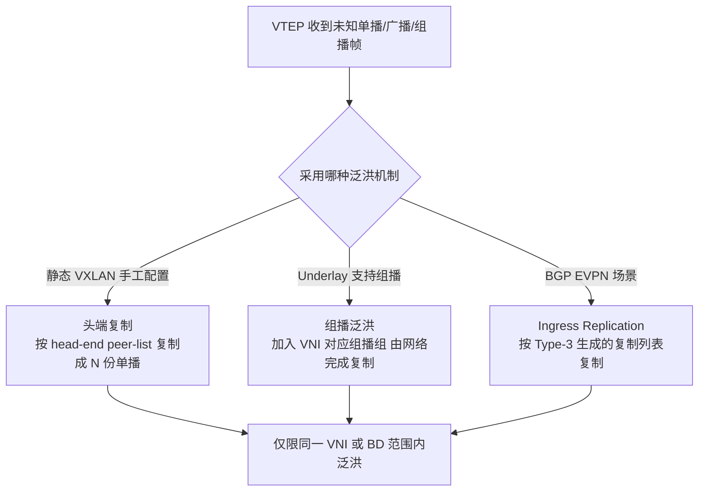

### 真题精练

**Q13.【真题·判断】** 在 BGP EVPN 场景下，VXLAN 的泛洪仍然依赖管理员手工配置 `head-end peer-list`。

> **答案：错误**
> **解析**：BGP EVPN 场景下，VTEP 的对端列表由 **Type-3（Inclusive Multicast Ethernet Tag）路由自动生成并动态维护**，称为 Ingress Replication。管理员无需（也不应）手工配置 `head-end peer-list`。手工配置只用于静态 VXLAN，且与 EVPN 同时配置可能造成复制列表冲突。

**Q14.【真题·填空】** BD 与 VNI 的绑定命令是 `bridge-domain 10` 视图下的 ______；BD 的三层网关接口称为 ______，其配置 IP 的命令与 VLANIF 一致，使用 ______ 命令进入。

> **答案：`vxlan vni 10000`；VBDIF（Virtual Bridge Domain Interface）；`interface vbdif 10`**
> **解析**：BD 视图下用 `vxlan vni <vni-id>` 完成 BD 与 VNI 的 1:1 绑定。VBDIF 是 BD 的三层接口，用 `interface vbdif <bd-id>` 进入并配置 `ip address`，作用与传统网络的 VLANIF 完全对应，是 VXLAN 三层网关与外部路由域互通的出口。

### 易错点与排错

1. **多个 BD 绑定同一 VNI**：造成广播域混淆，是严重配置错误，用 `display vxlan vni` 核对 VNI 与 BD 的对应关系。
2. **VBDIF 只配 IP 不配 MAC（分布式网关场景）**：网关 MAC 由设备自动生成会不一致，必须显式配置统一的 `mac-address`。
3. **泛洪方式选错**：Underlay 未部署组播却配置组播泛洪，会导致广播丢失；应优先使用头端复制或 EVPN Ingress Replication。
4. **排错命令**：`display vxlan vni`、`display bridge-domain 10`、`display nve`、`display mac-address bridge-domain 10`、`display interface vbdif 10`。

---

# DCN-HCIA-章节5-BGP-EVPN入门

## 5.1 EVPN 的概念与 MP-BGP EVPN 地址族

### 考点定位
概念题 + 协议框架题。考法：EVPN 的定义、它在 VXLAN 中承担的角色、EVPN 使用的 BGP 地址族名称。易错点：把 EVPN 当成一种独立的动态路由协议（它**是 BGP 的一个地址族**，不是新协议），或把地址族名写成 `evpn` 而非 `l2vpn-family evpn`。

### 原理精讲
**EVPN（Ethernet VPN，以太网虚拟专用网络）**最早由 RFC 7432 定义，初衷是用 BGP 在 MPLS 网络上承载二层 VPN（替代 VPLS）。它的核心思想是：**把二层信息（MAC 地址、广播域、ES 成员关系）当作"路由"来传播**。这一思想被 VXLAN 借用后，成为 VXLAN 的控制平面标准方案，即 **VXLAN + BGP EVPN**。

**为什么 VXLAN 需要 EVPN？** 静态 VXLAN 有两个先天不足：① 隧道对端靠手工配置，扩展性差；② MAC 学习靠数据平面泛洪，产生大量广播且收敛慢。EVPN 用 BGP 解决这两点：
- 用 **Type-3 路由**通告"我是 VNI X 的 VTEP，地址是 A"，实现 **VTEP 自动发现与隧道自动建立**（替代手工 peer-list）。
- 用 **Type-2 路由**通告"MAC M / IP P 在我这里，属于 VNI X"，实现 **MAC 与 ARP 信息的控制平面学习**（替代数据平面泛洪）。
- 进一步：Type-2 携带主机 IP，使 VTEP 可**代答 ARP（ARP 抑制）**，并可把"ARP 广播"转为"单播送到目标 VTEP"，极大抑制广播风暴。

**MP-BGP 与 L2VPN EVPN 地址族**：EVPN 信息承载在 **MP-BGP（Multiprotocol BGP，多协议 BGP）**中。MP-BGP 通过 **MP_REACH_NLRI / MP_UNREACH_NLRI** 两个可选传递属性携带任意地址族的 NLRI（Network Layer Reachability Information，网络层可达信息）。EVPN 使用的地址族标识为 **AFI = 25（L2VPN）**，**SAFI = 70（EVPN）**，在华为设备上的配置入口是：

```bash
bgp 100
 l2vpn-family evpn        // 进入 L2VPN EVPN 地址族视图
```

**关键点**：EVPN 路由的**下一跳**默认遵循 BGP 的规则。在 iBGP 场景中，为了让隧道对端 VTEP 地址保持原始值而不被改成 RR 或中间设备的地址，需要配置 `peer <ip> next-hop-unchanged`（或按厂商实现使用相应命令），否则会出现"学到的 Type-2/Type-3 路由下一跳错误、隧道建立失败"的典型故障。

**EVPN 在 VXLAN 中的角色定位**：
- **控制平面**：BGP EVPN（负责隧道发现、MAC/IP 通告、ARP 抑制）。
- **数据平面**：VXLAN 封装（负责实际报文转发与封装）。
- **底层网络（Underlay）**：OSPF/IS-IS/BGP + ECMP（负责 VTEP 之间 IP 可达）。

三者是"分层的、解耦的"，这是 Fabric 架构的核心设计思想。

### 关键概念对照表

| 概念 | 说明 | 关键数值/名称 |
|---|---|---|
| EVPN | 以太网 VPN，用 BGP 承载二层信息 | RFC 7432 |
| MP-BGP | 多协议 BGP，通过 MP_REACH_NLRI 携带多地址族 | 拓展了 BGP-4 |
| EVPN 地址族 | 华为配置中的地址族名称 | `l2vpn-family evpn` |
| AFI / SAFI | 地址族标识符 / 子地址族标识符 | AFI=25（L2VPN），SAFI=70（EVPN） |
| NLRI | 网络层可达信息，即 EVPN 路由本体 | 分 Type-1~Type-5 |
| 控制平面 | 建立隧道、通告 MAC/IP | BGP EVPN |
| 数据平面 | 报文封装与转发 | VXLAN（UDP 4789） |
| Underlay | VTEP 间 IP 可达性 | OSPF/IS-IS/BGP + ECMP |

| 对比项 | 静态 VXLAN | VXLAN + BGP EVPN |
|---|---|---|
| 控制协议 | 无 | MP-BGP（L2VPN EVPN） |
| 隧道发现 | 手工配置 peer-list | Type-3 路由自动通告 |
| MAC 学习 | 数据平面泛洪学习 | Type-2 路由控制平面学习 |
| ARP 处理 | BD 内广播泛洪 | ARP 抑制 + 广播转单播 |
| 广播规模 | 大 | 显著减少 |

### 示意图

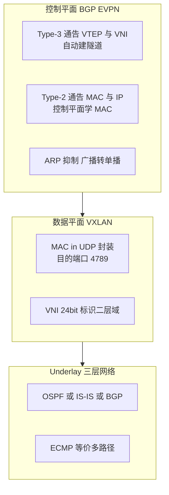

### 真题精练

**Q15.【真题·单选】** 在华为 CloudEngine 交换机上配置 BGP EVPN 时，进入 EVPN 地址族视图的命令是？
A. `ipv4-family vpnv4`  B. `l2vpn-family evpn`  C. `evpn-family l2vpn`  D. `ipv4-family evpn`

> **答案：B**
> **解析**：华为 VRP 中 EVPN 的地址族入口为 `bgp` 视图下的 `l2vpn-family evpn`。A 是承载 L3VPN（VPNv4）路由的地址族，用于传统的 MPLS L3VPN；C 命令不存在（顺序错误）；D 不存在。注意与全局 `evpn` 视图（用于配置 VNI 的 RD/RT）区分：**全局 `evpn` 视图配 RD/RT，BGP 下 `l2vpn-family evpn` 配邻居与路由**。

**Q16.【真题·简答】** 简述 EVPN 在 VXLAN 网络中的作用，并说明为什么说它是"用 BGP 替代泛洪与数据平面学习"。

> **答案：**
> EVPN 在 VXLAN 中承担**控制平面**角色，主要作用有三：
> ① **隧道自动发现与建立**：VTEP 通过 Type-3 路由通告自身 VTEP 地址、VNI 与出方向 RT，对端 VTEP 据此自动建立 VXLAN 隧道，无需手工配置 `head-end peer-list`。
> ② **MAC/IP 的控制平面学习**：VTEP 学到本地主机的 MAC 后，用 Type-2 路由（携带 MAC、IP、VNI、RT）通告给其他 VTEP，其他 VTEP 直接写入本地 MAC 表，**普通单播转发不再需要泛洪**。
> ③ **ARP 抑制与广播转单播**：由于 Type-2 携带主机 IP，VTEP 建立"IP → MAC"的 EVPN 表项，收到同子网 ARP 请求时可代为应答；无法代答时也可将 ARP 广播转为发往目标 VTEP 的单播。
> 因此，传统二层网络"未知单播泛洪 + 广播泛洪 + 源 MAC 自学习"的三套机制，被"BGP 路由通告 + 本地表项查找"完全取代，广播域规模可控、收敛速度取决于 BGP 而非泛洪超时，这就是"用 BGP 替代泛洪与数据平面学习"的含义。
> **解析**：答出"Type-3 建隧道、Type-2 学 MAC、ARP 抑制"三点是核心得分点。

### 易错点与排错

1. **混淆全局 `evpn` 视图与 BGP 的 `l2vpn-family evpn`**：前者配置 VNI 的 RD/RT，后者配置 BGP 邻居与路由通告，二者缺一不可。
2. **只在 `ipv4-family unicast` 下使能邻居**：这样 EVPN 路由不会交互，必须在该地址族下也 `peer x.x.x.x enable`。
3. **下一跳问题**：iBGP 场景下必须关注下一跳是否被改写，必要时使用 `peer x.x.x.x next-hop-unchanged`。
4. **排错命令**：`display bgp evpn peer`（看邻居状态）、`display bgp evpn all routing-table`（看收到的 EVPN 路由）、`display evpn vpn-instance`。

---

## 5.2 EVPN 五种路由类型（国赛高频重点）

### 考点定位
**国赛绝对高频，建议按"默写 + 场景匹配"两个维度准备**。考法：给出场景问用哪种 Type、给出 Type 问作用/字段、比较 Type-2 与 Type-3 的区别。易错点：把 Type-1（A-D 路由）当成本地 MAC 通告；把 Type-4 用于普通双归主机；把 Type-5 当成 VXLAN 内部主机路由。

### 原理精讲
EVPN 用不同的路由类型（Route Type）承载不同类型的以太网信息。每种类型有独立的 NLRI 编码格式，通过 **Route Type 字段（1 字节）**区分。HCIA 层必须掌握 **Type-1 ~ Type-5** 五种。

**Type-1：Ethernet Auto-Discovery Route（以太自动发现路由，A-D 路由）**
- **作用**：① **快速收敛（Fast Convergence）**——当 PE 与 CE 之间的以太网段（ES）故障时，PE 可立即撤销该 ES 下所有 A-D 路由，远端 PE 迅速切换到备用路径，无需等待逐条 MAC 撤销；② **别名（Alias）**——用于多归（Multi-homing）场景下实现"同一 CE 通过多条链路接入同一 PE 时的负载分担"，让远端 PE 知道存在多条等价路径；③ 与 Type-4 配合完成 **DF（Designated Forwarder，指定转发者）选举**。
- **关键字段**：Route Distinguisher（RD）、Ethernet Segment Identifier（ESI，10 字节，标识一个以太网段，单归时为全 0）、Ethernet Tag ID（通常为 0）、MPLS Label（VXLAN 场景下用于标识转发信息）。
- **使用场景**：CE 双归/多归接入两台或多台 PE 的场景（VXLAN 中的多活网关、服务器双归接入），是 EVPN 多归能力的基础。

**Type-2：MAC/IP Advertisement Route（MAC/IP 通告路由）**
- **作用**：EVPN 的**核心路由**，用于通告"某 MAC 地址（可选携带 IP）位于本 PE 之后，属于某 VNI/BD"。它实现了：① **MAC 地址控制平面学习**，替代泛洪；② **ARP 抑制**（因携带 IP）；③ **主机路由（/32）通告**，支撑分布式网关的跨 Leaf 三层转发。
- **关键字段**：RD、**ESI**（单归为 0）、**Ethernet Tag ID**（VLAN/BD 标识）、**MAC Address Length + MAC Address**（MAC 地址长度与值）、**IP Address Length + IP Address**（可选，IPv4/IPv6 主机地址）、**MPLS Label1（L2 VNI）**、**MPLS Label2（L3 VNI，可选）**。
- **标志位**：部分实现中携带 MAC Mobility 扩展团体属性，用于**MAC 迁移检测**（虚拟机迁移后避免 MAC 表项震荡）。
- **使用场景**：所有 VXLAN 场景（无论二层还是三层网关）；分布式网关场景尤为关键，因为远端 Leaf 靠它学到主机 /32 路由。

**Type-3：Inclusive Multicast Ethernet Tag Route（包含性组播以太网标签路由，IMET 路由）**
- **作用**：用于**通告 VTEP 成员关系**，实现：① **VTEP 自动发现与隧道自动建立**；② **构造 BUM（Broadcast, Unknown-unicast, Multicast）流量的复制列表**，即 Ingress Replication 的对端清单；③ 宣告本端支持某 VNI 的广播/组播/未知单播流量。
- **关键字段**：RD、**Ethernet Tag ID**（BD/VNI 标识）、**IP Address Length + Originating Router's IP Address**（**本端 VTEP 地址，最关键字段**）、PMSI（Provider Multicast Service Interface）属性——在 Ingress Replication 模式下，PMSI Tunnel 属性中携带 **"Ingress Replication" 标志 + 本端 VTEP IP**，明确告诉对端"泛洪报文请以单播形式发给我"。
- **使用场景**：每一个 VNI 都会产生 Type-3 路由，是 EVPN 建隧道的第一步。**没有 Type-3 就没有隧道**。

**Type-4：Ethernet Segment Route（以太网段路由）**
- **作用**：用于**多归场景下的 DF（Designated Forwarder，指定转发者）选举**。当一台 CE（服务器）通过多条链路双归接入多台 PE 时，为避免 BUM 流量被重复送到 CE，需要在这些 PE 中选出一台作为 DF 负责向该 ES 转发 BUM 流量。
- **关键字段**：RD、**ESI**（与 Type-1 中一致）、**IP Address Length + Originating Router's IP Address**（本端 PE 地址）。
- **使用场景**：仅用于**多归（Multi-homing）**场景，包括服务器双归、多活网关（M-LAG 与 EVPN 结合）。单归场景**不会**产生 Type-4 路由。

**Type-5：IP Prefix Route（IP 前缀路由）**
- **作用**：通告 **IP 前缀**（而非主机 MAC）的可达性，用于：① **L3VPN over VXLAN**——把外部网络或非 VXLAN 网段的路由引入 EVPN 域；② **VXLAN 域与外部网络互通**（如 DC 与园区、DC 与 DCI 对接）；③ 支持 **对称 IRB 模型的优化**——只在有实际 IP 前缀需要通告时使用，减少 Type-2 主机路由的数量。
- **关键字段**：RD、**ESI**、**Ethernet Tag ID**、**IP Prefix Length + IP Prefix**（IPv4/IPv6 前缀）、**GW IP Address**（网关地址，可选）、**MPLS Label（L3 VNI）**。
- **使用场景**：Type-5 让 EVPN 不仅能承载二层，还能承载三层路由，是 EVPN 从"二层 VPN"演进为"统一控制平面"的关键，RFC 9136 定义。

| Route Type | 名称（中文/英文） | 核心作用 | 关键字段 | 典型使用场景 | 是否有 ESI |
|---|---|---|---|---|---|
| **Type-1** | 以太自动发现路由 / Ethernet A-D | 快速收敛、别名、配合 DF 选举 | RD、ESI、Ethernet Tag ID、MPLS Label | 多归接入、快速收敛 | 是（非 0） |
| **Type-2** | MAC/IP 通告路由 / MAC-IP Advertisement | 通告 MAC（可选 IP），控制平面学 MAC、ARP 抑制、主机路由 | RD、ESI、Ethernet Tag ID、MAC、IP、L2 VNI、L3 VNI | 所有 VXLAN 场景，**最核心** | 单归为 0 |
| **Type-3** | 包含性组播以太网标签路由 / Inclusive Multicast Ethernet Tag | 通告 VTEP 成员、自动建隧道、构造 BUM 复制列表 | RD、Ethernet Tag ID、**Originator IP（VTEP）**、PMSI | 每个 VNI 都有，**建隧道必需** | 无 |
| **Type-4** | 以太网段路由 / Ethernet Segment | **DF 选举** | RD、ESI、Originator IP | 仅多归场景 | 是（非 0） |
| **Type-5** | IP 前缀路由 / IP Prefix | 通告 IP 前缀，承载 L3VPN、对外互通 | RD、ESI、Ethernet Tag ID、IP Prefix、GW IP、L3 VNI | 外部路由引入、DCI、L3VPN over VXLAN | 可选 |

**记忆口诀**：**1 发现（A-D）、2 学 MAC、3 建隧道、4 选 DF、5 通外部**。

**EVPN 扩展类型补充**（了解即可，HCIA 层不深考）：Type-6（SMET，选择性组播以太标签路由）、Type-7（IGMP 加入同步）、Type-8（I-PMSI，含性提供商组播服务接口）、Type-9（P2MP I-PMSI）、Type-11（IPv4/IPv6 以太网段路由）。

### 关键概念对照表

| 对比项 | Type-2 | Type-3 |
|---|---|---|
| 通告内容 | 主机 MAC（可选 IP） | VTEP 地址与 VNI 成员关系 |
| 主要目的 | MAC 学习、ARP 抑制、主机路由 | 隧道发现、BUM 复制列表 |
| 数量级 | 每台主机一条，数量大 | 每个 VNI 每台 VTEP 一条，数量小 |
| 是否携带 ESI | 是（单归为 0） | 否 |
| 是否携带 PMSI | 否 | 是 |
| 缺失后果 | 远端学不到 MAC，需泛洪 | **隧道无法建立**，业务完全不通 |

### 示意图

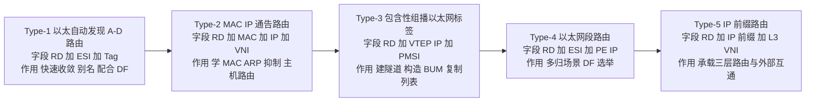

### 真题精练

**Q17.【真题·单选】** EVPN 中用于通告 VTEP 地址、实现 VXLAN 隧道自动发现的是哪种路由类型？
A. Type-1（Ethernet A-D）  B. Type-2（MAC/IP Advertisement）  C. Type-3（Inclusive Multicast Ethernet Tag）  D. Type-5（IP Prefix）

> **答案：C**
> **解析**：Type-3 路由的 NLRI 中携带 **Originating Router's IP Address（即本端 VTEP 地址）** 与 Ethernet Tag ID（BD/VNI），并含 PMSI 属性（Ingress Replication 标志 + VTEP IP）。对端 VTEP 收到 Type-3 后即知"该 VNI 内存在这些 VTEP"，从而自动建立隧道并构造 BUM 复制列表。A 用于快速收敛与别名；B 用于 MAC/IP 通告；D 用于 IP 前缀（三层）通告。

**Q18.【真题·多选】** 关于 EVPN Type-2 路由（MAC/IP Advertisement Route），下列说法正确的有？
A. 其 NLRI 中携带 MAC 地址，可选携带 IP 地址
B. 它使远端 VTEP 可以在控制平面学习 MAC，减少数据平面泛洪
C. 由于携带主机 IP，可用于实现 ARP 抑制
D. 它只在多归场景中使用，单归场景不产生
E. 在分布式网关中，它使各 Leaf 能学到远端主机的 /32 主机路由

> **答案：ABCE**
> **解析**：A、B、C、E 均为 Type-2 的标准特征。D 错误——Type-2 是 EVPN **最核心、最常用**的路由类型，**所有 VXLAN 场景都会产生**；单归场景下其 ESI 字段为 0。使用 ESI（非 0）的是 Type-1 与 Type-4，它们才与多归强相关。

**Q19.【真题·填空】** EVPN 五种基本路由类型中：用于 DF（指定转发者）选举的是 Type-______；用于通告 IP 前缀、承载 L3VPN over VXLAN 的是 Type-______；用于快速收敛与别名的是 Type-______。

> **答案：Type-4；Type-5；Type-1**
> **解析**：Type-4（Ethernet Segment Route）的 NLRI 只含 RD、ESI、Originator IP，作用单一明确，就是 DF 选举。Type-5（IP Prefix Route，RFC 9136）通告 IP 前缀，把 EVPN 扩展到三层路由承载。Type-1（Ethernet A-D Route）在 ES 故障时批量撤销，实现快速收敛，其"别名"能力支持多归负载分担。口诀："1 发现、2 学 MAC、3 建隧道、4 选 DF、5 通外部"。

**Q20.【真题·简答】** 某数据中心 Leaf1 下有一台虚拟机 VM-A，IP 10.1.1.10、MAC 为 AAAA-AAAA-AAAA。请说明该信息如何通过 EVPN 被 Leaf2 学到，并说明 Leaf2 收到发往 10.1.1.10 的 ARP 请求时会如何处理。

> **答案：**
> **（1）MAC/IP 信息的传播过程（Type-2）**
> ① Leaf1 从接入侧学到 VM-A 的 MAC AAAA-AAAA-AAAA，并学习到其 IP 10.1.1.10（通过 ARP 或 DHCP Snooping 等方式）。
> ② Leaf1 生成 **Type-2 路由（MAC/IP Advertisement Route）**，NLRI 中包含：RD（区分实例）、ESI（单归为 0）、Ethernet Tag ID（BD/VNI）、MAC 地址 AAAA-AAAA-AAAA、IP 地址 10.1.1.10、L2 VNI（如 10000）。
> ③ Leaf1 通过 MP-BGP 的 L2VPN EVPN 地址族把该路由发给 RR，RR 反射给包括 Leaf2 在内的其他 VTEP。
> ④ Leaf2 收到后检查 **RT（Route Target）**是否与本端 VNI 的导入 RT 匹配：匹配则接受，写入本地 EVPN 表与 MAC 表，并生成到 10.1.1.10 的 **/32 主机路由**，下一跳为 Leaf1 的 VTEP 地址。
> 
> **（2）ARP 请求的处理**
> Leaf2 收到 VM-B 发出的"谁是 10.1.1.10"的 ARP 请求后，**先查本地 EVPN/ARP 抑制表**，发现已有 10.1.1.10 对应的 MAC 表项（来自 Type-2 路由），于是**由 Leaf2 直接代答 ARP 响应**，把 MAC 返回给 VM-B。整个过程 ARP 请求**不会泛洪到 Leaf1**，这就是"ARP 抑制（ARP Suppression）"。
> 若 Leaf2 本地没有对应表项，则退化为"**ARP 广播转单播**"：依据 Type-2/Type-3 信息把 ARP 请求封装成单播 VXLAN 报文定向发送给 Leaf1（或按复制列表泛洪），而不是在整个 BD 内广播。
> **解析**：本考点是国赛"EVPN 端到端流程"的标准答题模板，务必写出 **RD/RT、NLRI 字段、RT 匹配校验、写入 MAC 表、生成 /32 路由、ARP 代答**这几个关键动作。

### 易错点与排错

1. **把 Type-1 与 Type-2 混淆**：Type-1 是"路由级"的批量撤销机制（面向 ES），Type-2 是"主机级"的 MAC 通告。Type-1 不携带 MAC 地址。
2. **认为 Type-4 在任何场景都产生**：只有**多归**场景才有 Type-4；单归设备上看不到 Type-4 路由是正常的。
3. **把 Type-5 用于 VXLAN 内部主机互通**：VXLAN 内部主机互通靠 Type-2；Type-5 面向**IP 前缀与外部网络**。
4. **排错命令**：`display bgp evpn all routing-table type1`（Type-1）、`... type2`、`... type3`（验证建隧道）、`... type4`（验证多归）、`... type5`；华为设备上用 `display bgp evpn all routing-table` 汇总查看。

---

## 5.3 RD 与 RT 的作用与区别

### 考点定位
概念辨析题，常与 MPLS L3VPN 的 RD/RT 合并考察。考法：RD 与 RT 的长度格式、作用、方向性。易错点：认为 RT 决定"路由属于哪个 VPN 实例"（实际是 RD + RT 配合），或认为 RD 有方向性。

### 原理精讲
**RD（Route Distinguisher，路由区分符）**
- **长度与格式**：8 字节。华为支持三种格式：`ASN:nn`（2 字节 AS + 4 字节编号，最常用，如 `100:10000`）、`IP-address:nn`（4 字节 IP + 2 字节编号，如 `2.2.2.2:1`）、`ASN:nn` 的 4 字节 AS 形式（如 `65536:100`）。
- **核心作用**：**区分同一前缀的不同实例**。BGP 的 VPN 路由中，不同 VPN 实例可能有完全相同的 IPv4 前缀（例如两个租户都使用 10.1.1.0/24），如果没有 RD，"10.1.1.0/24" 就无法区分。RD 与 IPv4 前缀组合成 **VPNv4 前缀（12 字节 = 8 字节 RD + 4 字节 IPv4）**，使其在 BGP 中全局唯一。
- **关键特性**：RD **没有方向性**，不参与路由的导入导出决策；只要求**同一台设备上不同 VNI/VRF 的 RD 不同**（不同设备之间 RD 相同也无妨，但工程上习惯全局统一规划）。EVPN 场景下，每个 VNI 都需要一个 RD。

**RT（Route Target，路由目标）**
- **长度与格式**：8 字节，格式为 `ASN:nn` 或 `IP-address:nn`，语法与 RD 相同但**语义完全不同**。
- **核心作用**：**控制路由的导入与导出**，实现 VPN 成员关系的自动发现。每个 VPN 实例/租户配置一对 RT：
  - **Export RT（导出 RT）**：本端产生的路由在发布时携带该 RT 扩展团体属性。
  - **Import RT（导入 RT）**：本端收到路由时，比对其携带的 RT 是否与本端配置的 Import RT 匹配，匹配则接受并装入对应实例的路由表，不匹配则丢弃。
- **关键特性**：RT **有方向性**（区分 export/import），支持**一对多 / 多对多**，因此可以实现丰富的 VPN 拓扑：Hub-Spoke（中心 RT 被所有 Spoke 导入）、**Any-to-Any（全互通，RT 值相同）**、Extranet（跨 VPN 访问）。
- **EVPN 中的 RT**：EVPN 每个 VNI 也要配置 Export/Import RT；通常 **Export RT 与 Import RT 取相同值**，形成 Any-to-Any 全互通（同一租户不同 VNI 之间互通，可通过配置把 L2 VNI 与 L3 VNI 的 RT 交叉导入实现）。

| 对比项 | RD（Route Distinguisher） | RT（Route Target） |
|---|---|---|
| 全称 | 路由区分符 | 路由目标（BGP 扩展团体属性） |
| 长度 | 8 字节 | 8 字节 |
| 格式 | `ASN:nn` / `IP:nn` / 4 字节 ASN:nn | 同 RD |
| 作用 | **区分同一前缀的不同实例**，使前缀全局唯一 | **控制路由导入导出**，定义 VPN 成员关系 |
| 是否有方向性 | **无** | **有**（export / import） |
| 在报文中的位置 | 作为 NLRI 的一部分（前缀前缀） | 作为 BGP 路径属性（扩展团体） |
| 是否影响路由选择 | 不影响 | 决定是否被接受（不匹配即丢弃） |
| 是否需要全网统一 | 不要求（本机唯一即可） | **必须两端匹配**才能互通 |
| 配置命令 | `route-distinguisher 1:10000` | `vpn-target 1:10000 export-extcommunity` / `import-extcommunity` |
| 常见错误 | — | Import/Export 配置反了导致收不到路由 |

**一句话记忆**：**RD 管"唯一"（区分实例），RT 管"进出"（控制导表）。**

### 关键概念对照表

| 场景 | RD 配置 | RT 配置 | 效果 |
|---|---|---|---|
| Any-to-Any 全互通 | 各 VNI 不同 | Export=Import=1:10000 | 同租户全网互通 |
| Hub-Spoke | 各 VNI 不同 | Hub Export=X，Spoke Import=X；Spoke Export=Y，Hub Import=Y | Spoke 之间不直通，必经 Hub |
| 跨 VNI 三层互通 | 各 VNI 不同 | L2 VNI 与 L3 VNI 的 RT 交叉导入 | 不同子网经 L3 VNI 互通 |
| 租户隔离 | 各租户 RD 不同 | 不同租户 RT 不同 | 路由不互相导入，完全隔离 |

### 华为设备配置

```bash
system-view
evpn
 vni 10000                                    // 进入 VNI 10000 配置视图
  route-distinguisher 1:10000                 // 配置 RD，8 字节，本机唯一即可
  vpn-target 1:10000 export-extcommunity      // 导出 RT：本端 Type-2/Type-3 路由携带此属性
  vpn-target 1:10000 import-extcommunity      // 导入 RT：接收携带该属性的远端路由
 quit
 quit
# ========== L3 VNI（集中式/分布式网关三层转发用）==========
vpn-instance vpn1                             // 创建 VPN 实例（VRF）
 route-distinguisher 1:1                      // 该实例的 RD
 vpn-target 1:1 export-extcommunity           // 导出 RT
 vpn-target 1:1 import-extcommunity           // 导入 RT
 quit
interface Vbdif10
 ip binding vpn-instance vpn1                  // 把 VBDIF 绑定到 VPN 实例，实现路由隔离
 quit
```

### 示意图

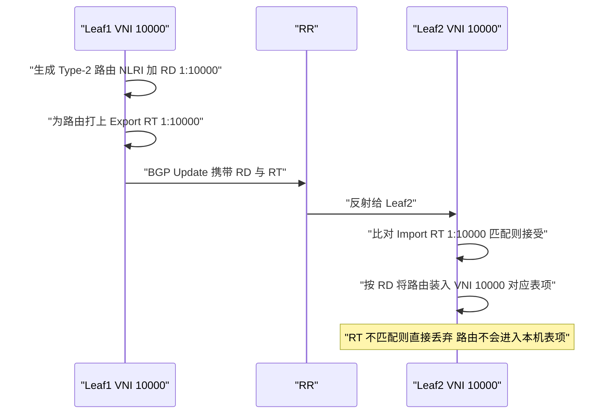

### 真题精练

**Q21.【真题·单选】** 在 BGP EVPN 中，RD（Route Distinguisher）的主要作用是？
A. 控制路由的导入导出方向  B. 区分同一前缀的不同实例，使前缀在 BGP 中全局唯一
C. 标识 VXLAN 的二层广播域  D. 决定 VXLAN 隧道的建立

> **答案：B**
> **解析**：RD 的唯一作用是**与 IP 前缀/MAC 组合形成唯一标识**，解决不同 VPN 实例使用相同地址空间时的冲突（如两个租户都用 10.1.1.0/24）。RD 无方向性、不控制导表。A 是 RT 的作用；C 是 VNI/BD 的作用；D 由 Type-3 路由完成。

**Q22.【真题·多选】** 关于 RT（Route Target），下列说法正确的有？
A. RT 是 BGP 的扩展团体属性，长度为 8 字节
B. Export RT 由本端产生路由时携带，Import RT 用于比对接收到的路由
C. RT 有方向性，两侧配置不匹配会导致路由无法导入
D. RT 的作用是区分不同 VPN 实例中的相同前缀
E. 同一 EVPN 域内可以把多个 VNI 的 RT 交叉导入，实现跨 VNI 三层互通

> **答案：ABCE**
> **解析**：A 正确，RT 作为 BGP Extended Communities 属性携带，编码长度 8 字节。B、C 正确，这正是 RT 的方向性与导表机制，实践中"Export/Import 配反"是最常见的 EVPN 不通原因。D 错误，"区分相同前缀"是 **RD** 的作用，RT 决定的是"哪些路由可以进入本实例"。E 正确，跨 VNI/跨子网互通正是通过 RT 的交叉导入（配合 L3 VNI）实现的。

### 易错点与排错

1. **Export RT 与 Import RT 配反**：本端 Export 必须等于对端 Import，反之亦然。排错时用 `display bgp evpn all routing-table` 看路由是否收到，再用 `display bgp evpn all routing-table verbose` 看 RT 属性值。
2. **误以为 RD 必须两端一致**：RD 只在本机区分实例，两端可以不同（虽然统一规划更易运维）。
3. **VNI 忘记配 RD/RT**：`evpn` 视图下 VNI 没有 RD/RT 时，路由无法生成，隧道建立失败。
4. **排错命令**：`display bgp evpn all routing-table`、`display bgp evpn all routing-table verbose`、`display evpn vpn-instance vpn1`、`display ip vpn-instance`。

---

## 5.4 EVPN 建立 VXLAN 隧道与 MAC 学习流程

### 考点定位
流程题、时序题高频。考法：给拓扑问"隧道如何建立"、问"MAC 学习顺序"、问"ARP 抑制的原理"。易错点：顺序记反（先 Type-3 建隧道再 Type-2 学 MAC），或漏掉"RT 匹配校验"这一步。

### 原理精讲
**第一阶段：隧道建立（依赖 Type-3）**
1. 每台 VTEP 完成基础配置：BD 与 VNI 绑定、`interface nve` 指定源地址、`evpn` 视图下 VNI 配置 RD/RT、BGP 邻居建立。
2. VTEP 为**每个 VNI**生成一条 **Type-3 路由**，NLRI 含 RD、Ethernet Tag ID（BD 标识）、Originating Router's IP（**本端 VTEP 地址**），PMSI 属性标明使用 Ingress Replication 并携带 VTEP IP。
3. Type-3 路由经 MP-BGP（通常经 RR 反射）发送到其他 VTEP。
4. 对端 VTEP 校验 RT 匹配后接受，**记录该 VNI 的对端 VTEP 列表**，据此建立 VXLAN 隧道并在转发表中生成隧道表项。同时把该 VTEP 加入**BUM 流量的复制列表**。
5. 此时 VXLAN 隧道**自动建立完成**，BUM 流量可以在 BD 内正常泛洪（按复制列表逐份单播）。

**第二阶段：MAC 学习与通告（依赖 Type-2）**
1. **本地学习**：Leaf1 从接入侧收到 VM-A 的报文，学习到源 MAC AAAA-AAAA-AAAA 与入接口，写入本地 MAC 表；同时通过 ARP/DHCP 等获知 VM-A 的 IP。
2. **本地生成 Type-2**：Leaf1 生成 Type-2 路由，NLRI 含 RD、ESI（单归为 0）、Ethernet Tag ID、MAC AAAA-AAAA-AAAA、IP 10.1.1.10、L2 VNI（必要时含 L3 VNI）。
3. **通告**：Type-2 路由经 MP-BGP 发给 RR，RR 反射给其他 VTEP。
4. **远端接受与写入**：Leaf2 校验 RT 匹配后接受，把"MAC AAAA-AAAA-AAAA → 下一跳 Leaf1 的 VTEP 地址"写入本地 MAC 表（VXLAN 场景下是"MAC + VTEP"表项，而非"MAC + 物理口"），并生成 EVPN 的 IP-MAC 表项。
5. **单播直转**：后续 Leaf2 下挂的主机访问 VM-A 时，Leaf2 直接查 MAC 表得到对端 VTEP 地址，封装单播 VXLAN 报文发出，**无需泛洪**。
6. **动态更新**：若 VM-A 迁移到 Leaf3 下，Leaf3 会通告同一 MAC 的 Type-2 路由。为处理这种情况，EVPN 使用 **MAC Mobility（MAC 迁移）扩展团体属性**携带序列号，序列号更大的路由胜出，避免表项震荡。

**第三阶段：ARP 抑制与广播转单播**
- **ARP 抑制（ARP Suppression）**：VTEP 从 Type-2 路由中获得"IP → MAC"映射并存入本地 EVPN 表。当本端主机发出同子网的 ARP 请求时，VTEP 若在本地表中查到目标 IP 对应的 MAC，则**直接代答 ARP Reply**，不转发该 ARP 请求，从而消除广播。
- **ARP 广播转单播**：若本地表项缺失，VTEP 也可依据 Type-2/Type-3 信息把 ARP 请求定向单播到特定 VTEP（或按复制列表发送），而不是在整个 BD 内广播。
- 效果：一个 BD 内即使有数千台主机，ARP 泛洪规模也被压缩到可控范围，这是 EVPN 相对静态 VXLAN 最直观的收益。

**关键顺序总结**：**Type-3 先建隧道 → Type-2 后学 MAC → 再谈 ARP 抑制**。没有 Type-3，隧道不通，Type-2 也无从生效。

### 关键概念对照表

| 阶段 | 依赖路由类型 | 关键动作 | 校验点 | 失败现象 |
|---|---|---|---|---|
| 隧道建立 | Type-3 | 通告 VTEP IP 与 VNI，建立隧道与复制列表 | RT 匹配、下一跳可达 | `display vxlan tunnel` 无隧道，全不通 |
| MAC 学习 | Type-2 | 通告 MAC/IP，远端写入 MAC 表 | RT 匹配、MAC Mobility | 远端无 MAC 表项，退化为泛洪 |
| ARP 抑制 | Type-2（含 IP） | 本地代答 ARP、广播转单播 | 本地 EVPN 表命中 | ARP 仍泛洪，广播量大 |
| 快速收敛 | Type-1 | ES 故障时批量撤销 | ESI 一致 | 收敛慢，逐条 MAC 撤销 |
| DF 选举 | Type-4 | 多归场景选出指定转发者 | ESI 一致 | BUM 流量重复送达 CE |

### 示意图

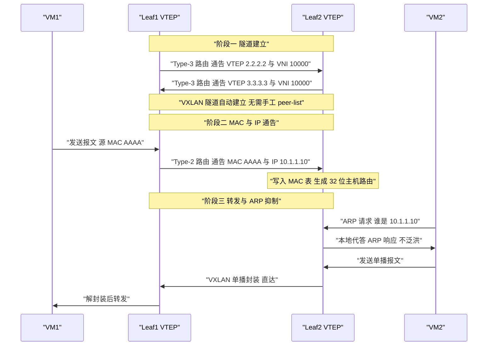

### 真题精练

**Q23.【真题·填空】** 请将 EVPN 建立 VXLAN 隧道与学习 MAC 的过程排序：
① 远端 VTEP 校验 RT 后写入 MAC 表 ② VTEP 生成 Type-2 路由通告本地 MAC
③ VTEP 生成 Type-3 路由通告自身 VTEP IP ④ 本地从接入侧学习到主机 MAC
⑤ 对端 VTEP 收到 Type-3 后建立 VXLAN 隧道与 BUM 复制列表

> **答案：③ → ⑤ → ④ → ② → ①**
> **解析**：必须先有控制平面的 **Type-3 通告（③）**，对端才能**建立隧道与复制列表（⑤）**；隧道通了以后，数据平面才开始**本地学习 MAC（④）**，进而**生成并通告 Type-2（②）**，对端校验 RT 后**写入 MAC 表（①）**。答题关键是记住"**隧道先于 MAC**"。

**Q24.【真题·简答】** 说明 EVPN 中 ARP 抑制的实现原理，并说明它与"ARP 广播转单播"的区别。

> **答案：**
> **ARP 抑制原理**：EVPN 的 Type-2 路由不仅携带 MAC 地址，还携带**主机 IP 地址**。VTEP 收到远端 Type-2 路由后，在本地建立"**IP ↔ MAC**"的 EVPN 主机表项。当本端主机发出同子网 ARP 请求（"谁是 X.X.X.X"）时，VTEP **先查询本地 EVPN 表**：若命中，则由 VTEP **直接以被请求主机的 MAC 代答 ARP Reply**，ARP 请求报文根本不进入 VXLAN 隧道，从而彻底消除该 ARP 广播。
> **与"ARP 广播转单播"的区别**：
> - **ARP 抑制**：本地表项**命中**，直接**代答**，ARP 请求被"消灭"（不转发）。属于"末端终止"。
> - **ARP 广播转单播**：本地表项**未命中**，无法代答，于是把 ARP 请求从"BD 内广播"改为"**定向单播发往特定 VTEP**"（依据 Type-2/Type-3 信息确定的复制列表或目标 VTEP）。属于"缩小范围但仍转发"。
> 二者是**互补关系**：抑制是首选，转单播是兜底。共同效果是把传统二层网络中"泛洪到所有端口"的 ARP 报文限制在最小范围，显著降低广播风暴与带宽浪费。
> **解析**：答题要突出"Type-2 携带 IP"是前提，并明确区分"代答（不转发）"与"转单播（转发但定向）"两种处理。

### 易错点与排错

1. **顺序颠倒**：Type-2 在隧道建立前无法生效，答题时切勿写成"先学 MAC 再建隧道"。
2. **忘记 RT 校验步骤**：EVPN 路由的接受必须经过 Import RT 匹配，这是流程题的关键得分点。
3. **MAC 迁移未处理**：VM 迁移后新 Leaf 通告同一 MAC，需要 MAC Mobility 序列号机制判定胜出，否则出现 MAC 表项震荡。
4. **排错命令**：`display bgp evpn all routing-table type3`、`display bgp evpn all routing-table type2`、`display vxlan tunnel`、`display mac-address bridge-domain 10`、`display evpn vpn-instance vpn1 arp`（查看 EVPN ARP 表项，验证抑制是否生效）。

---

## 5.5 BGP EVPN 配置框架与路由反射器

### 考点定位
配置题 + 架构题。考法：EVPN 配置的完整步骤顺序、为什么需要 RR、RR 在 EVPN 中的特殊要求（下一跳不变）。易错点：漏配 `advertise irb`、RR 未配置 `next-hop-unchanged`。

### 原理精讲
**BGP EVPN 的配置框架（五步法）**：

**第一步：配置 Underlay**——先保证 VTEP 之间三层可达。可用 OSPF/IS-IS，也可用 BGP。这是所有 Overlay 的基础，没有 Underlay 就没有 VXLAN。

**第二步：配置 EVPN 与 VNI（控制平面参数）**——在全局 `evpn` 视图下为每个 VNI 配置 **RD 与 RT**。RD 保证前缀唯一，RT 控制导表。此步骤也可以改用 `vpn-instance` + `vni` 的方式组织（三层网关场景）。

**第三步：配置 BGP 邻居与地址族**——`bgp <as>` 下配置 `router-id`、`peer ... as-number`、`peer ... connect-interface Loopback0`；分别在 `ipv4-family unicast`（承载 Underlay/Loopback 路由）和 **`l2vpn-family evpn`**（承载 EVPN 路由）下 `peer ... enable`。三层网关需额外 `advertise irb`。

**第四步：配置 VXLAN 数据平面**——创建 BD、绑定 VNI、配置 `interface nve` 与 `source`，配置二层子接口做 VLAN 到 BD 的映射；三层网关再配置 `interface vbdif`。

**第五步：验证**——`display bgp evpn peer` 看邻居、`display bgp evpn all routing-table` 看路由、`display vxlan tunnel` 看隧道、`display mac-address bridge-domain` 看 MAC 表。

**为什么 EVPN 中路由反射器（RR，Route Reflector）是必需的？**
- EVPN 的 VTEP 之间需要建立 **iBGP 全互联**（Full Mesh）才能交互 EVPN 路由。N 台 VTEP 需要 **N×(N−1)/2** 条会话，设备数增多时 BGP 会话数与配置量呈平方级增长，不可维护。
- 引入 RR 后，每台 VTEP 只与 RR（通常是一对 RR 做冗余）建立会话，**会话数从 O(N²) 降到 O(N)**，新增 VTEP 只需配置到 RR 的邻居。
- RR 的另一个作用是**集中承载路由**，配合 `peer ... reflect-client` 实现路由反射，无需 EVPN 域内全网状互联。

**EVPN 在 RR 场景下的关键要求——下一跳不变（Next-Hop Unchanged）**
- 在普通 BGP 中，RR 反射路由时会**改写下一跳**为自身地址（或按配置处理），这在 VPNv4 场景中通常没问题。
- 但在 EVPN 中，**Type-2/Type-3 的下一跳必须是原始 VTEP 地址**，因为隧道的建立依赖这个地址。如果 RR 或中间设备把下一跳改写成了自己的地址，接收方会尝试与 RR 建立 VXLAN 隧道，导致隧道建立失败。
- 因此需要在 RR 上对 EVPN 邻居配置 **`peer <ip> next-hop-unchanged`**（保持下一跳不变），或在客户端侧相应配置。这是 EVPN + RR 组网的**经典故障点与高频考点**。

**关于 iBGP / eBGP 的选择**：数据中心内通常使用**同一 AS 的 iBGP + RR**；跨 POD、跨 Fabric 或 DCI 场景可能使用 eBGP。eBGP 场景下一跳默认会被改写为对端地址，也需要关注 EVPN 路由的下一跳处理。

### 关键概念对照表

| 配置步骤 | 关键命令 | 作用 | 常见错误 |
|---|---|---|---|
| 1. Underlay | `ospf 1` / `isis 1`，`network` | VTEP 间 IP 可达 | 漏宣告 Loopback，隧道不通 |
| 2. EVPN 参数 | `evpn` → `vni X` → `route-distinguisher` / `vpn-target` | 定义 RD/RT | 漏配 RD/RT，路由不生成 |
| 3. BGP 邻居 | `bgp`→`peer`；`l2vpn-family evpn`→`peer enable` | 交互 EVPN 路由 | 只在 unicast 下 enable |
| 3b. IRB 通告 | `peer x advertise irb` | 分布式网关主机路由 | 漏配导致跨 Leaf 三层不通 |
| 4. VXLAN 平面 | `bridge-domain`、`vxlan vni`、`interface nve`、`source` | 数据平面封装 | NVE 源地址用物理口 |
| 5. 验证 | `display bgp evpn ...`、`display vxlan tunnel` | 确认结果 | 只看邻居 Up 不查路由 |

| 对比项 | 无 RR（iBGP 全互联） | 有 RR |
|---|---|---|
| 会话数 | N×(N−1)/2 | N（每台只连 RR） |
| 配置量 | 每台配所有对端 | 每台只配 RR |
| 扩展性 | 差 | 好 |
| 下一跳 | 不涉及反射改写 | **需 `next-hop-unchanged`** |
| 冗余 | 天然多路径 | 需部署一对 RR |

### 华为设备配置

```bash
# ========== RR（CE16800-Spine 兼作 RR）==========
system-view
bgp 100
 router-id 10.0.0.1                            // RR 的 Router ID
 peer 2.2.2.2 as-number 100                     // 与 Leaf1 建立 iBGP
 peer 2.2.2.2 connect-interface Loopback0        // 用 Loopback 建会话
 peer 3.3.3.3 as-number 100                     // 与 Leaf2 建立 iBGP
 peer 3.3.3.3 connect-interface Loopback0
 ipv4-family unicast
  peer 2.2.2.2 enable
  peer 3.3.3.3 enable
 quit
 l2vpn-family evpn                              // EVPN 地址族
  peer 2.2.2.2 enable                            // 使能 EVPN 邻居
  peer 2.2.2.2 reflect-client                    // 指定 Leaf1 为反射客户端
  peer 2.2.2.2 next-hop-unchanged                // 关键：保持下一跳为原始 VTEP 地址
  peer 3.3.3.3 enable
  peer 3.3.3.3 reflect-client
  peer 3.3.3.3 next-hop-unchanged
 quit
 quit
```

```bash
# ========== Leaf（CE6865）客户端侧 ==========
system-view
bgp 100
 router-id 2.2.2.2
 peer 10.0.0.1 as-number 100
 peer 10.0.0.1 connect-interface Loopback0
 l2vpn-family evpn
  peer 10.0.0.1 enable
  peer 10.0.0.1 advertise irb                   // 分布式网关必须：通告 IRB 主机路由
 quit
 quit
display bgp evpn peer                           // 查看 EVPN 邻居状态，State 应为 Established
display bgp evpn all routing-table              // 查看 EVPN 路由总表
display bgp evpn all routing-table type3        // 检查是否收到 Type-3，验证隧道发现
display bgp evpn all routing-table type2        // 检查是否收到 Type-2，验证 MAC 学习
```

### 示意图

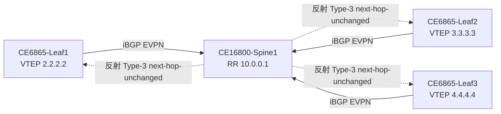

### 真题精练

**Q25.【真题·单选】** 在 BGP EVPN 组网中，RR（路由反射器）上通常需要为 EVPN 邻居配置下列哪条命令，否则可能导致 VXLAN 隧道无法建立？
A. `peer x.x.x.x next-hop-local`  B. `peer x.x.x.x next-hop-unchanged`
C. `peer x.x.x.x route-reflector-client`  D. `peer x.x.x.x preferred-value`

> **答案：B**
> **解析**：EVPN 的 Type-2/Type-3 路由下一跳承载**对端 VTEP 地址**，隧道建立依赖该地址。RR 反射时若改写了下一跳，接收方会误把 RR 当作 VTEP，导致隧道建立失败或指向错误的对端。因此需要 `next-hop-unchanged` 保持下一跳不变。A 是 IPv4 单播/VPN 场景中"下一跳本地化"的常用命令，方向相反；C 是配置反射客户端（还需要，但不是防止隧道失败的关键）；D 是 BGP 选路属性，与隧道建立无关。

**Q26.【真题·实验】** 现有一对 CloudEngine 6865 作为 Leaf（VTEP 分别为 2.2.2.2、3.3.3.3），一台 CloudEngine 16800 作为 RR（10.0.0.1），AS 100，要求实现租户 VNI 10000 的 VXLAN 二层互通并支持 ARP 抑制。请写出 Leaf1 上的完整关键配置，并说明验证命令。

> **答案（Leaf1 关键配置）：**
> ```bash
> system-view
> bridge-domain 10                                  // 创建 BD 10
>  vxlan vni 10000                                  // BD 绑定 VNI 10000
>  quit
> interface nve 1                                   // 创建 NVE 接口
>  source 2.2.2.2                                    // 本端 VTEP 源地址
>  quit
> interface Loopback0
>  ip address 2.2.2.2 32
>  quit
> interface 100GE1/0/1.10 mode l2                   // 接入侧二层子接口
>  encapsulation dot1q vid 10                        // 识别 VLAN 10
>  bridge-domain 10                                  // 映射到 BD 10
>  quit
> evpn                                              // EVPN 全局视图
>  vni 10000
>   route-distinguisher 1:10000                      // RD
>   vpn-target 1:10000 export-extcommunity           // 导出 RT
>   vpn-target 1:10000 import-extcommunity           // 导入 RT
>   quit
>  quit
> bgp 100
>  router-id 2.2.2.2
>  peer 10.0.0.1 as-number 100
>  peer 10.0.0.1 connect-interface Loopback0
>  ipv4-family unicast
>   peer 10.0.0.1 enable
>   quit
>  l2vpn-family evpn
>   peer 10.0.0.1 enable                             // EVPN 地址族下必须使能
>   quit
>  quit
> ```
> **验证命令**：`display bgp evpn peer`（邻居 Established）、`display bgp evpn all routing-table type3`（确认收到对端 Type-3，隧道可建）、`display bgp evpn all routing-table type2`（确认 MAC 已学习，ARP 抑制具备前提）、`display vxlan tunnel`（隧道 Up）、`display mac-address bridge-domain 10`（MAC 表项下一跳为对端 VTEP）。
> **解析**：评分点：BD/VNI 绑定、NVE source、evpn 视图下 RD/RT、`l2vpn-family evpn` 下 `peer enable`、Underlay 邻居。若为分布式网关还需 vbdif 与 `advertise irb`。

### 易错点与排错

1. **`display bgp evpn peer` 显示 Idle/Active**：检查 Underlay 到 RR 的 Loopback 路由是否可达、`connect-interface` 是否配对。
2. **邻居 Up 但无 EVPN 路由**：检查 `l2vpn-family evpn` 下是否 `peer enable`、`evpn` 视图下 VNI 是否配了 RD/RT。
3. **RR 未配 `next-hop-unchanged`**：隧道建到 RR 上，`display vxlan tunnel` 中的对端地址会是 RR 的地址，这是典型误配特征。
4. **`display bgp evpn all routing-table` 为空**：确认两端 RT 匹配、AS 号一致（iBGP 需同 AS）。
5. **排错命令汇总**：`display bgp evpn peer`、`display bgp evpn all routing-table [type1|type2|type3|type4|type5]`、`display vxlan tunnel`、`display nve`、`display evpn vpn-instance`、`reset bgp evpn all`（谨慎使用，重置会话触发重建）。

---

# DCN-HCIA-章节6-网络虚拟化与Fabric基础

## 6.1 网络虚拟化的层次与 VPN 实例（VRF）原理

### 考点定位
概念题 + 配置题。考法：网络虚拟化的四个层次分别对应什么技术、VRF 的作用与 RD/RT 在其中的角色、`ip binding vpn-instance` 的作用。易错点：认为 VRF 只能隔离路由不能复用地址空间。

### 原理精讲
**网络虚拟化的四个层次**（由底向上）：

**（1）设备虚拟化（Device Virtualization）**——把多台物理设备"虚拟成一台"或把一台设备"虚拟成多台"。
- **堆叠（iStack，intelligent Stack）**：把多台同系列交换机通过堆叠线缆/端口组成一个逻辑设备，统一管理、统一转发，支持跨设备链路聚合。适合接入层。
- **CSS（Cluster Switch System，集群交换机系统）**：华为高端交换机（如 CE12800、CE16800）的虚拟化技术，把两台框式设备虚拟成一台，控制平面主备、转发平面双活，常用于核心/汇聚层。
- **M-LAG（Multi-Chassis Link Aggregation Group，跨设备链路聚合）**：两台设备通过 Peer-Link 互联，对下游设备呈现为一个逻辑聚合口，实现**双活转发**。相比 CSS，M-LAG 的控制平面**相互独立**（两台设备各自独立运行协议），可靠性更高（一台故障不影响另一台的独立运行），是当前数据中心服务器双归接入的主流方案。
- **一虚多**：如华为的 VS（Virtual System）技术，把一台物理设备划分为多个逻辑设备，各自独立配置与转发，用于多租户场景。

**（2）链路虚拟化（Link Virtualization）**——把多条物理链路虚拟成一条逻辑链路，提高带宽与可靠性：Eth-Trunk（链路聚合）、跨设备链路聚合（M-LAG）、以及支持 MPLS TE 的隧道技术。

**（3）网络虚拟化（Network Virtualization）**——在物理网络之上构建**逻辑网络（Overlay）**，使逻辑网络拓扑与物理拓扑解耦：**VXLAN + BGP EVPN** 是数据中心的代表技术，MPLS L3VPN 是广域网的代表技术。

**（4）VPN 实例（VRF，Virtual Routing and Forwarding，虚拟路由转发）**——在**单台设备内部**虚拟出多张独立的路由表与转发表，实现路由隔离与地址空间复用。它是"网络虚拟化"在单机上的具体落地形式，也是 VXLAN 多租户隔离的基础。

**VRF 原理深入**：
- **为什么需要 VRF？** 传统网络中，一台设备只有**一张全局路由表**。如果两个租户都使用 10.1.1.0/24 网段，同一台设备上无法同时保存两条"10.1.1.0/24"的路由——会冲突。VRF 为每个租户创建一张独立的路由表、ARP 表、转发表，使同一地址空间可以被多个租户**同时复用而不冲突**。
- **路由隔离与地址空间复用**：每个 VRF 实例拥有独立的 `display ip routing-table vpn-instance <name>` 输出；不同 VRF 之间的路由**默认互不可见**，必须通过显式的路由泄露（Route Leak）或跨 VRF 转发（如 IP 互访、VPN 实例间绑定）才能互通。
- **RD/RT 在 VRF 中的作用**：VRF 本身是"本地实例"，当 VRF 的路由需要在 BGP 中传给远端 PE 时，必须借助 **RD**（使 VPNv4 前缀全局唯一）与 **RT**（控制远端路由能否导入本 VRF）。因此 **RD/RT 是"本地 VRF"与"BGP 控制平面"之间的桥梁**。没有 RD/RT，VRF 路由无法在 BGP 中正确传播与隔离。
- **VRF 与 VXLAN 的结合**：三层网关场景中，把 VBDIF 绑定到 VPN 实例（`ip binding vpn-instance vpn1`），即可让不同 VNI 的三层流量进入各自的路由表，实现租户级三层隔离。VXLAN 的 L3 VNI 正是为"VRF + VXLAN"提供三层转发通道。

| 虚拟化层次 | 代表技术 | 虚拟化对象 | 解决的问题 | 典型产品 |
|---|---|---|---|---|
| 设备虚拟化 | iStack / CSS / M-LAG / VS | 物理设备 → 逻辑设备 | 冗余、简化管理、双活 | CE6865（iStack）、CE16800（CSS） |
| 链路虚拟化 | Eth-Trunk / M-LAG | 物理链路 → 逻辑链路 | 带宽叠加、链路冗余 | 全系列 CloudEngine |
| 网络虚拟化 | VXLAN + BGP EVPN / MPLS L3VPN | 物理网络 → 逻辑网络 | 大二层、多租户、跨地域 | CE6865/CE16800 + NCE-Fabric |
| VPN 实例 | VRF / VPN Instance | 路由表 → 多张独立路由表 | 路由隔离、地址复用 | 全系列 CloudEngine |

### 关键概念对照表

| 对比项 | VRF（VPN 实例） | 全局路由表 |
|---|---|---|
| 路由表数量 | 每个实例一张 | 仅一张 |
| 地址空间 | 各实例可复用同一网段 | 全局唯一 |
| 接口绑定 | `ip binding vpn-instance <name>` | 无需绑定 |
| BGP 传播 | 需 RD/RT | 直接传播 |
| 查看命令 | `display ip routing-table vpn-instance <name>` | `display ip routing-table` |
| 典型用途 | 多租户、业务隔离、管理面隔离 | 物理 Underlay 网络 |

| 技术 | 隔离维度 | 隔离强度 | 地址复用 | 可扩展租户数 |
|---|---|---|---|---|
| VLAN 隔离 | 二层广播域 | 弱（同设备三层仍可通，需 ACL） | 仅二层 | 4094 |
| VRF 隔离 | 三层路由表 | 强（路由表级隔离） | 支持 | 受设备 VRF 规格限制 |
| VXLAN + VNI 隔离 | 二层 + 三层（BD/VNI） | 强（端到端隔离） | 支持 | 约 1677 万 |

### 华为设备配置

```bash
system-view
ip vpn-instance VPN_A                        // 创建 VPN 实例（VRF），名称可自定义
 ipv4-family                                  // 进入该实例的 IPv4 地址族
  route-distinguisher 100:1                   // 配置 RD，使该实例的路由在 BGP 中唯一
  vpn-target 100:1 export-extcommunity         // 导出 RT：本实例路由携带此属性发布
  vpn-target 100:1 import-extcommunity         // 导入 RT：只接收携带此属性的路由
  quit
 quit
interface Vbdif10                             // 进入三层业务接口（也可为物理口/VLANIF）
 ip binding vpn-instance VPN_A                // 把接口绑定到 VPN 实例，其路由进入该实例路由表
 ip address 10.1.1.1 24                        // 网关地址，只在 VPN_A 实例内生效
 quit
display ip vpn-instance                       // 查看所有 VPN 实例及其 RD/RT
display ip routing-table vpn-instance VPN_A   // 查看 VPN_A 的路由表，验证隔离效果
display ip vpn-instance verbose VPN_A         // 查看实例详细信息与绑定的接口列表
interface 100GE1/0/2
 ip binding vpn-instance VPN_A                 // 物理口同样可以绑定 VPN 实例
 quit
```

### 示意图

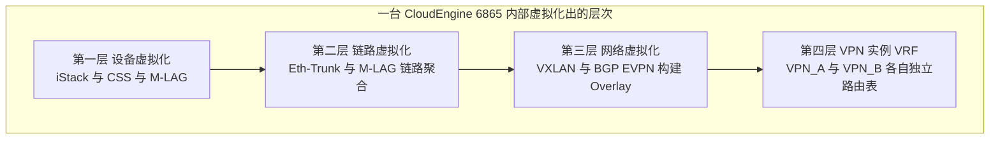

### 真题精练

**Q27.【真题·单选】** 在一台华为 CloudEngine 交换机上，要让两个租户同时使用 10.1.1.0/24 网段而不冲突，应采用下列哪种技术？
A. 划分不同的 VLAN  B. 配置 VPN 实例（VRF）  C. 配置不同的 VNI 但不配 BD  D. 使用 ACL 过滤

> **答案：B**
> **解析**：题目关键词是"**同时使用相同的三层网段**"。VLAN 只能隔离二层广播域，同一设备的**全局路由表**中仍只能存在一条 10.1.1.0/24，三层会冲突。只有 **VPN 实例（VRF）** 为每个租户创建独立路由表，才能实现地址空间复用。C 概念错误，VNI 必须与 BD 配合使用，且单靠 VNI 不解决本机路由表冲突；D 是流量的过滤手段，无法解决路由表项冲突。

**Q28.【真题·多选】** 关于 VPN 实例（VRF）与 RD/RT 的关系，下列说法正确的有？
A. VPN 实例在本机提供独立的路由表与转发表
B. RD 使不同 VPN 实例中的相同前缀在 BGP 中得以区分
C. RT 决定远端路由能否被导入本 VPN 实例
D. VPN 实例之间的路由默认即可互相访问，无需额外配置
E. `ip binding vpn-instance` 用于把接口关联到某个 VPN 实例

> **答案：ABCE**
> **解析**：A、B、C、E 均为标准描述。D 错误——不同 VPN 实例的路由表**默认完全隔离**，互不可见；若要互通必须显式配置路由泄露（如 `import-route` 到另一实例、配置静态路由指向对端实例、或使用跨 VRF 转发特性），这也是 VRF 实现安全隔离的基础。

### 易错点与排错

1. **接口忘记绑定 VPN 实例**：接口仍属于全局路由表，导致"配了 VRF 但地址不生效"或路由出现在错误的表中。
2. **RD 冲突**：同一设备上不同 VPN 实例使用相同 RD，会导致路由混淆，必须保证本机唯一。
3. **跨 VRF 访问未配置**：两台主机在不同 VRF 中默认不通，需显式配置。
4. **排错命令**：`display ip vpn-instance`、`display ip vpn-instance verbose`、`display ip routing-table vpn-instance VPN_A`、`display bgp vpnv4 vpn-instance VPN_A routing-table`、`ping -vpn-instance VPN_A 10.1.1.2`（指定实例发起 ping）。

---

## 6.2 多租户网络隔离实现方式对比

### 考点定位
对比题与应用题。考法：给出需求场景选择隔离方案；比较 VLAN/VRF/VXLAN 的隔离能力与规模。易错点：认为 VLAN 隔离能提供跨设备跨网段的安全隔离。

### 原理精讲
数据中心承载多租户（Multi-tenancy）业务，必须保证"**租户之间流量完全隔离、租户内部自由互通**"。三种主流方案的原理与适用面各不相同。

**（1）VLAN 隔离**
- **原理**：用 802.1Q 标签区分广播域，不同 VLAN 之间二层天然隔离；若需三层互通，则在 VLANIF 上配置网关并依赖路由，跨 VLAN 访问再靠 ACL 控制。
- **优点**：技术成熟、所有交换机都支持、配置极简、转发性能无损耗。
- **缺点**：
  - **规模受限**：仅 4094 个可用 VLAN ID，租户数量稍大即耗尽。
  - **隔离强度弱**：不同 VLAN 只要三层路由打通即可互访，隔离靠 ACL 维护，易出错。
  - **二层范围受限**：VLAN 只能在二层可达范围内延伸，跨机房/跨 POD 部署困难。
  - **运维复杂**：大规模环境下 VLAN 规划与 Trunk 放通易错。

**（2）VRF 隔离**
- **原理**：在设备内部为每个租户建立独立路由表（VPN 实例），接口通过 `ip binding vpn-instance` 绑定实例。不同实例之间路由天然不互通。
- **优点**：
  - **隔离强度高**：路由表级隔离，一台设备内租户之间的三层流量完全不可见。
  - **地址空间可复用**：不同租户可使用完全相同的 IP 网段。
  - **与 MPLS L3VPN 天然衔接**：适合跨广域网的 VPN 互联。
- **缺点**：
  - **仅解决三层隔离**：二层仍需 VLAN 或 VXLAN 配合。
  - **规格受设备限制**：每台设备支持的 VPN 实例数量有限（一般为数百到数千），超大租户规模时仍是瓶颈。
  - **配置量大**：每个实例需配置 RD/RT、绑定接口、维护路由，管理成本高。
  - **跨设备需控制平面支持**：需要 BGP VPNv4/EVPN 才能实现跨设备的 VRF 互联。

**（3）VXLAN + VNI 隔离**
- **原理**：用 24 bit 的 VNI 标识租户/网段，二层隔离由 BD/VNI 保证，三层隔离由"VNI + VPN 实例（L3 VNI）"共同保证；VXLAN 报文封装后在 IP 网络上传输，使隔离域可跨越任意三层可达范围。
- **优点**：
  - **规模巨大**：约 1677 万个 VNI，可支撑海量租户。
  - **隔离强度高且端到端**：BD 内二层隔离 + VRF 内三层隔离，跨 Leaf、跨 POD 均有效。
  - **与物理位置解耦**：租户可跨机房、跨 POD 灵活部署，支持虚拟机无限制迁移。
  - **自动化友好**：配合 iMaster NCE-Fabric，租户网络可一键创建与下发。
- **缺点**：
  - **配置复杂度最高**：需要 BD/VNI/NVE/VBDIF/EVPN 一整套配置，手工配置易错。
  - **依赖控制器**：大规模场景离不开 NCE-Fabric 等自动化工具。
  - **性能与规格开销**：封装带来 50 字节额外开销，需要调整 MTU；Leaf 需维护大量主机表项。
  - **对 Underlay 依赖强**：Underlay 故障会直接放大到 Overlay。

| 对比项 | VLAN 隔离 | VRF 隔离 | VXLAN + VNI 隔离 |
|---|---|---|---|
| 隔离层次 | 二层广播域 | 三层路由表 | 二层 + 三层 |
| 标识字段与位宽 | VLAN ID，12 bit | VPN 实例名（本机） | VNI，24 bit |
| 最大隔离域数量 | 4094 | 受设备规格限制（数十~数千） | 约 1677 万 |
| 地址空间复用 | 仅二层 | 支持 | 支持 |
| 是否支持跨三层网络延伸 | 否（需二层打通） | 依赖 BGP VPNv4/EVPN | **是（核心优势）** |
| 隔离强度 | 弱（依赖 ACL） | 强 | 强 |
| 配置复杂度 | 低 | 中 | 高 |
| 是否依赖控制器 | 否 | 否（小规模） | 大规模强依赖 |
| 虚拟化支持 | 一般 | 好 | 最好（VM 自由迁移） |
| 典型场景 | 小型园区/单 POD 内业务分区 | 企业多部门隔离、MPLS L3VPN | 云数据中心多租户 |

### 关键概念对照表

| 需求场景 | 推荐方案 | 理由 |
|---|---|---|
| 单台设备内隔离两个部门、网段冲突 | VRF | 路由表隔离，地址可复用 |
| 同一 POD 内少量租户、不跨设备 | VLAN + VRF | 简单够用，运维成本低 |
| 多租户云 DC、租户跨 POD | VXLAN + VNI + EVPN | 规模大、可跨三层延伸 |
| 租户需要跨数据中心 | VXLAN + EVPN（DCI） | 隔离域端到端延伸 |
| 传统企业总部-分支 VPN | MPLS L3VPN（VRF + MP-BGP） | 成熟、运营商网络支撑好 |

### 示意图

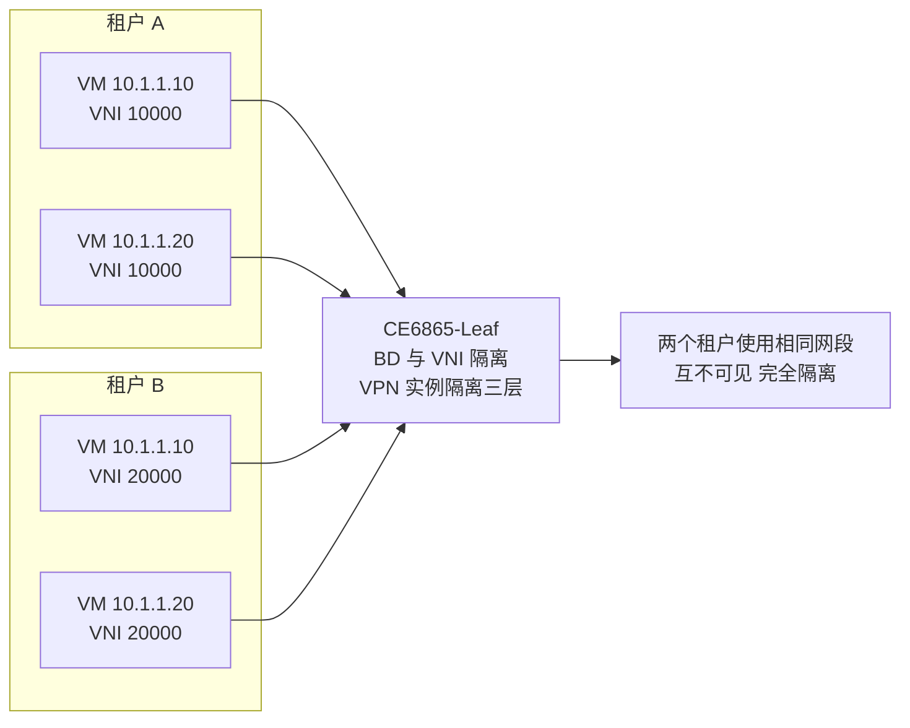

### 真题精练

**Q29.【真题·单选】** 某云数据中心需要支持上万个租户，且各租户可自由使用相同 IP 网段并需跨 POD 部署，最合适的隔离方案是？
A. 为每个租户划分独立 VLAN  B. 为每个租户配置独立 VRF，不使用 VXLAN
C. VXLAN + VNI 隔离，配合 VPN 实例实现三层隔离  D. 使用 ACL 在核心交换机上做流量过滤

> **答案：C**
> **解析**：题目有三个约束——**上万租户**（VLAN 仅 4094 个，A 不满足）、**相同 IP 网段复用**（VLAN 无法解决三层冲突）、**跨 POD 部署**（VLAN 无法跨三层延伸）。VXLAN 的 24 bit VNI 提供约 1677 万个隔离域，配合 VPN 实例实现三层隔离与地址复用，且封装在 IP 之上可跨 POD 延伸，故 C 正确。B 虽然能隔离三层，但 VRF 数量受设备规格限制，且不解决二层隔离与跨 POD 延伸；D 仅做流量过滤，不是隔离架构。

**Q30.【真题·简答】** 请从"隔离层次、可扩展性、复杂度"三个维度比较 VLAN 隔离、VRF 隔离与 VXLAN+VNI 隔离，并说明为什么云数据中心最终选择 VXLAN。

> **答案：**
> **（1）隔离层次**：VLAN 只隔离二层广播域，三层仍靠 ACL 管理；VRF 隔离三层路由表，但二层仍需 VLAN 配合；VXLAN+VNI 同时提供二层（BD/VNI）与三层（L3 VNI + VPN 实例）隔离，是端到端的完整隔离。
> **（2）可扩展性**：VLAN 受 12 bit 限制，最多 4094 个；VRF 受设备实例规格限制，通常数十到数千；VXLAN 的 VNI 为 24 bit，可提供约 1677 万个隔离域，且可跨 Leaf、跨 POD、跨数据中心延伸。
> **（3）复杂度**：VLAN 最简单，VRF 中等，VXLAN 最复杂（需 BD/VNI/NVE/VBDIF/EVPN/RR，还需调整 MTU），大规模部署必须依赖 iMaster NCE-Fabric 自动化。
> **为什么选 VXLAN**：云数据中心的核心诉求是"**租户数量巨大 + 地址自由规划 + 虚拟机可跨机房迁移 + 网络与物理位置解耦**"。VLAN 数量不够且不能跨三层延伸；VRF 只解决三层且规格有限。只有 VXLAN 能在标准 IP 网络上构建隔离域，把"大二层"和"多租户隔离"同时做到位，并由 EVPN 提供可扩展的控制平面，因此成为云数据中心的事实标准。
> **解析**：答题时要紧扣"规模 + 跨三层延伸 + 隔离层次"三个关键词，这是阅卷要点。

### 易错点与排错

1. **认为"不同 VLAN 就安全隔离"**：只要三层路由打通（例如都挂在同一台三层交换机上），不同 VLAN 之间即可互访，必须用 ACL 或 VRF 才能真正隔离。
2. **VRF 用于二层隔离**：VRF 不隔离二层广播域，服务器双归接入仍需靠 VLAN 或 VXLAN。
3. **租户 VNI 规划冲突**：跨 POD 部署时 VNI 必须全局规划统一，否则同一 VNI 代表不同租户会造成串包。
4. **排错命令**：`display ip vpn-instance`、`display vxlan vni`、`display bridge-domain`、`display mac-address bridge-domain 10`（确认 MAC 是否贝串到错误的 BD）。

---

## 6.3 Fabric 概念模型与华为 CloudFabric 解决方案

### 考点定位
概念架构题。考法：Fabric 的三层模型（Underlay/Overlay/控制器）各自职责、CloudFabric 的组成、NCE-Fabric 的作用与管理的对象。易错点：把 Spine-Leaf 拓扑与 Fabric 混为一谈（拓扑是物理形态，Fabric 是"架构 + 自动化"的整体）。

### 原理精讲
**Fabric（网络架构/网络织物）**是数据中心网络的整体架构概念，其核心是**把物理网络与逻辑网络分层解耦**，并用控制器实现自动化管理。三层模型如下。

**（1）Underlay（底层物理网络）**
- **职责**：提供 **VTEP 之间稳定的三层 IP 可达性**，是 Overlay 的承载基础。
- **技术**：Spine-Leaf 两层 CLOS 拓扑 + 路由协议（OSPF/IS-IS/BGP）+ **ECMP（Equal-Cost Multi-Path，等价多路径）**。Spine 与 Leaf 之间通常使用 eBGP 建邻（便于大规模扩展与策略控制），也有使用 OSPF/IS-IS 的方案。
- **要求**：无环（三层天然无环）、多路径负载分担、快速收敛、MTU 需调大（推荐 1550+，为 VXLAN 的 50 字节开销预留空间）。
- **特点**：**只做 IP 转发，不感知租户与 VXLAN**；扩展靠增加 Spine/Leaf 实现"横向扩展（Scale-Out）"。

**（2）Overlay（逻辑网络）**
- **职责**：承载租户的二层/三层业务网络，实现多租户隔离与虚拟机自由迁移。
- **技术**：**VXLAN（数据平面）+ BGP EVPN（控制平面）**。
- **特点**：与物理拓扑解耦——逻辑网络可任意规划，虚拟机迁移不受物理位置限制；租户隔离由 VNI + VPN 实例保证。

**（3）控制器 / 管理层（Controller & Management）**
- **职责**：**自动化配置下发、业务编排、可视化运维、故障定位**。
- **技术**：**iMaster NCE-Fabric**（华为数据中心网络自动驾驶网络控制器）。
- **核心价值**：把"逐台设备登录敲命令"变成"声明式下发业务意图"。管理员在控制器上定义"租户 A 需要一个包含 3 个子网的 VPC"，控制器自动计算并下发 Underlay 路由配置、BD/VNI、VBDIF、EVPN 邻居、RT 等全部配置，几分钟完成过去数小时的工作，并保证全网配置一致性。

**华为 CloudFabric 解决方案组成**：
1. **iMaster NCE-Fabric（控制器）**——方案的大脑。提供 Fabric 管理、租户/VPC 管理、Overlay 自动化部署、网络健康度分析、路径探测、故障定位、Underlay 自动化等功能；支持与 vCenter/FusionCompute 等虚拟化平台联动，实现"虚拟机上线自动纳管、下线自动清理"。
2. **CloudEngine 数据中心交换机（转发设备）**——方案的身体。典型组合：**CE16800/CE12800 作为 Spine 或核心**，**CE6865/CE6863/CE8850 作为 Leaf**（CE6865 是 25GE/100GE 高密接入，CE8850 面向 100GE 汇聚，CE6863 为 25GE 接入）。设备均支持 VXLAN、BGP EVPN、Telemetry、NETCONF。
3. **Fabric 网络（Underlay + Overlay 的落地形态）**——由 Spine-Leaf 物理组网与 VXLAN/EVPN 逻辑组网共同构成，是租户业务真正运行的载体。

**CloudFabric 的关键能力**：Fabric 自动化部署（Underlay 自动配置、Overlay 自动下发）、租户与 VPC 自动发放、网络虚拟化（VXLAN/EVPN）、网络流量分析与可视化（Telemetry + iMaster NCE 分析组件）、智能运维（iMaster NCE-FabricInsight 做网络分析）、开放 API 与第三方平台集成。

| 层次 | 英文 | 职责 | 关键技术 | 华为产品/组件 |
|---|---|---|---|---|
| 管理层 | Controller / Management | 自动化下发、编排、可视运维 | NETCONF/YANG、Telemetry、Open API | iMaster NCE-Fabric、NCE-FabricInsight |
| 逻辑层 | Overlay | 租户网络、隔离、VM 迁移 | VXLAN、BGP EVPN、VRF | CloudEngine 6865/16800 |
| 物理层 | Underlay | VTEP 间 IP 可达、无环、多路径 | Spine-Leaf、OSPF/IS-IS/BGP、ECMP | CE16800（Spine）、CE6865（Leaf） |

### 关键概念对照表

| 概念 | 说明 | 易混淆点 |
|---|---|---|
| Spine-Leaf | 两层 CLOS 架构，任意 Leaf 间等距（2 跳） | 只是**物理拓扑**，不等于 Fabric |
| Fabric | 架构 + 自动化 + 运维的完整体系 | 包含 Underlay、Overlay、控制器三部分 |
| Underlay | 物理承载网络，只做 IP 转发 | 不感知租户与 VXLAN |
| Overlay | 逻辑租户网络 | 依赖 Underlay 的 IP 可达性 |
| NCE-Fabric | 数据中心网络控制器 | 负责自动化与运维，不参与数据转发 |
| VPC | Virtual Private Cloud，虚拟私有云 | 租户内的逻辑网络单元，由控制器编排 |

### 示意图

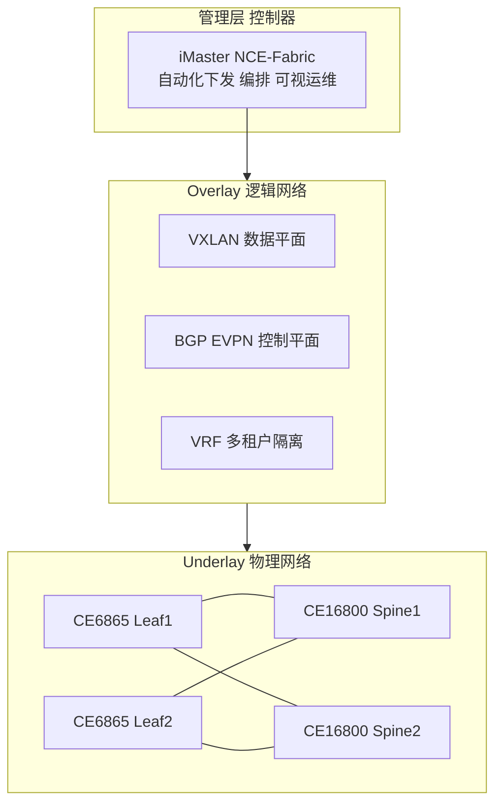

### 真题精练

**Q31.【真题·单选】** 在华为 CloudFabric 数据中心网络解决方案中，iMaster NCE-Fabric 的主要作用是？
A. 承担 Spine 的三层转发功能
B. 提供 Fabric 的自动化部署、业务编排与可视化运维能力
C. 替代 BGP EVPN 作为 VXLAN 的控制平面
D. 为 VTEP 提供物理链路聚合

> **答案：B**
> **解析**：iMaster NCE-Fabric 是**管理/控制层**产品，职责是自动化配置下发、租户与 VPC 编排、网络健康度分析与故障定位。A 错误，转发仍由 CloudEngine 交换机完成，控制器不参与数据面转发。C 错误，VXLAN 的控制平面仍是 **BGP EVPN**，控制器只是"生成并下发 EVPN 相关配置"，不替代协议本身。D 错误，链路聚合由 Eth-Trunk/M-LAG 实现。

**Q32.【真题·简答】** 请画出 Fabric 的三层模型，说明每层的职责与关键技术，并解释"Underlay 与 Overlay 解耦"的意义。

> **答案：**
> **三层模型与职责：**
> | 层次 | 职责 | 关键技术 |
> |---|---|---|
> | 控制器/管理层 | 自动化配置下发、业务编排、可视化运维 | iMaster NCE-Fabric、NETCONF/YANG、Telemetry |
> | Overlay（逻辑层） | 承载租户业务网络、实现隔离与 VM 自由迁移 | VXLAN、BGP EVPN、VRF |
> | Underlay（物理层） | 提供 VTEP 之间的三层 IP 可达性 | Spine-Leaf、OSPF/IS-IS/BGP、ECMP |
> **"解耦"的意义：**
> ① **逻辑网络不再受物理拓扑约束**——租户子网可以跨越任意 Leaf/POD/机房，虚拟机可以迁移到任何位置而保持 IP 与网关不变，这是云数据中心弹性调度的前提。
> ② **故障域与变更域分离**——Underlay 的链路/设备维护只影响可达性，逻辑网络配置无需随之改变；反之租户的增删也不影响物理网络配置。
> ③ **各自独立演进**——物理网络可平滑扩容（加 Leaf/Spine），逻辑网络可独立规划 VNI/VRF 与策略。
> ④ **自动化成为可能**——因为逻辑网络是"声明式"的，控制器才能根据意图自动计算并下发配置。
> **解析**：答题时应明确"Underlay 只做 IP 转发、不感知 VXLAN；Overlay 依赖 Underlay 提供的 IP 可达性"这一依赖关系，这是理解 Fabric 的关键。

### 易错点与排错

1. **把 Spine-Leaf 等同于 Fabric**：Spine-Leaf 只是物理拓扑；Fabric 是"物理 + 逻辑 + 控制器"的完整架构。
2. **认为控制器参与转发**：NCE-Fabric 只做控制与管理，数据转发始终由交换机 ASIC 完成，控制器故障不影响已建立的转发。
3. **Underlay 与 Overlay 使用同一套隔离标识**：Underlay 用 VLAN 承载物理互联与路由，Overlay 用 VNI 承载租户，二者应清晰分离避免混淆。
4. **核查命令**：`display vxlan tunnel`（Overlay 隧道）、`display bgp peer`（Underlay 邻居）、`display ospf peer`、`display interface brief`（物理链路状态）。

---

## 6.4 Fabric 部署形态与 DC 内互联、DCI 概述

### 考点定位
组网形态题。考法：单 POD/多 POD/多 Fabric 的区别与适用规模、POD 间互联方式、DCI 的基本概念与方案。易错点：认为多 POD 就是把 Spine 直接互连（实际通常经过 Border/DCI 设备）。

### 原理精讲
**（1）单 POD（Single POD）**
一个 POD 由一对或多对 Spine 与若干 Leaf 组成，是 Fabric 的最小完整单元。特点：
- 每台 Leaf 上行到所有 Spine，**Leaf 之间恒为 2 跳**（Leaf→Spine→Leaf），时延可预测且一致。
- 扩展方式：**横向 Scale-Out**——增加 Leaf 只影响该 Leaf 的接入容量；增加 Spine 需 Leaf 侧同步增加上行链路。
- 适用规模：中小型数据中心，一般支持数百到数千台服务器。
- **限制**：Spine 的端口数与 ECMP 组数决定 POD 上限；当服务器数量超过单 POD 能力时，必须引入多 POD。

**（2）多 POD（Multi-POD）**
当单 POD 无法容纳全部服务器时，构建多个 POD，POD 之间通过 **Border Leaf（边界 Leaf）** 或 **DCI 设备**互联。特点：
- 每个 POD 内部保持标准的 Spine-Leaf 架构，**POD 内 Leaf 之间仍为 2 跳**。
- POD 之间通过 Border 设备建立 **POD 间 VXLAN 隧道**（Overlay 延伸）或通过三层路由互联。
- 关键要求：**VNI 必须全局统一规划**，同一租户跨 POD 使用相同 VNI，才能实现跨 POD 的二层延伸。
- 优点：扩展性好、故障域被限制在单个 POD 内（POD 故障不影响其他 POD）、可按业务分 POD 部署。
- 缺点：POD 间流量路径变长（可能 4 跳及以上），需要额外的 Border 设备与跨 POD 的 EVPN 会话规划。

**（3）多 Fabric（Multi-Fabric）**
一个数据中心内部划分多个独立的 Fabric（例如生产区、测试区、办公区各自成 Fabric），每个 Fabric 有自己的控制器域、独立的 Underlay 与 RR。Fabric 之间通过 **DCI 网关或 Border 设备**互联。特点：
- **故障隔离最彻底**：单个 Fabric 的控制器故障、配置错误、路由震荡都被限制在本 Fabric 内。
- **管理与权限可分离**：不同团队管理不同 Fabric，适合大型企业或集团。
- 缺点：管理对象变多，跨 Fabric 的租户网络需要额外的互联规划与地址协调。

**（4）DC 内互联与 DCI 概述**
- **DC 内互联**：指数据中心内部各 POD、各 Fabric 之间的互联，常用手段是 **Border Leaf + VXLAN/EVPN** 或 **核心路由器/交换机三层互联**。目标是让同一租户的 VXLAN 网络能够跨 POD 延伸。
- **DCI（Data Center Interconnect，数据中心互联）**：指**不同数据中心之间**的网络互联，服务于双活/多活数据中心、灾备、跨地域业务扩展。主要方案：
  - **VXLAN over DCI（EVPN 跨 DC 延伸）**——两个 DC 的 VTEP 之间建立 VXLAN 隧道，需保证 MTU、VNI 规划、RT 策略一致，是当前主流。
  - **MPLS L3VPN / L2VPN over DCI**——运营商网络常用，通过 MPLS 骨干承载 DC 间流量，成熟稳定但需要 MPLS 域支撑。
  - **DWDM/OTN 裸纤直连**——提供大带宽低时延的物理通道，再由上层协议完成逻辑互联。
  - **SD-WAN / 分段路由（SRv6）** 等新型方案——面向云网融合的演进方向。
- **DCI 关键挑战**：VNI/RT 的跨域规划（避免冲突与泄露）、MTU 一致性（跨域链路往往 MTU 较小）、故障域控制（避免一个 DC 的路由震荡影响另一个）、时延与带宽保障。

| 部署形态 | 规模 | 互联方式 | 故障域 | 优点 | 缺点 |
|---|---|---|---|---|---|
| 单 POD | 小~中（数百~数千服务器） | Leaf 上行到 Spine 即可 | 整个 POD | 架构简单、时延一致（2 跳） | 受 Spine 规格限制 |
| 多 POD | 大（数千~数万） | Border Leaf 或 DCI 设备互联 | 单个 POD | 扩展性好、故障域小 | POD 间路径变长，VNI 需全局规划 |
| 多 Fabric | 超大/多业务域 | DCI 网关互联 | 单个 Fabric | 隔离彻底、管理可分离 | 管理复杂、跨 Fabric 规划成本高 |

### 关键概念对照表

| 术语 | 全称 | 含义 | 关键点 |
|---|---|---|---|
| POD | Point of Delivery | 一个 Spine-Leaf 单元 | Fabric 的最小部署单元 |
| Spine | — | 骨干层交换机 | 只连 Leaf，不接服务器 |
| Leaf | — | 接入层交换机 | 接服务器，VTEP 通常部署于此 |
| Border Leaf | — | 边界 Leaf | 负责 POD 间/对外互联 |
| DCI | Data Center Interconnect | 数据中心互联 | 跨 DC 的双活、灾备 |
| VNI 全局规划 | — | 跨 POD 统一 VNI 编号 | 同一租户跨 POD 必须同 VNI |

### 示意图

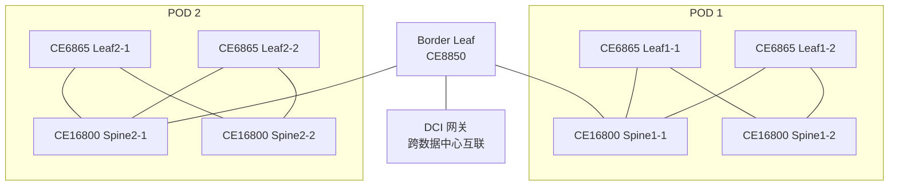

### 真题精练

**Q33.【真题·单选】** 在多 POD 的 Fabric 组网中，实现同一租户跨 POD 二层互通的关键前提是？
A. 各 POD 使用不同的 VNI  B. 各 POD 中该租户使用相同的 VNI，并通过 Border 设备建立跨 POD 的 VXLAN 隧道
C. 关闭所有 POD 的 BGP EVPN  D. 把各 POD 的 Spine 合并为一台设备

> **答案：B**
> **解析**：VNI 是租户二层网络的标识，跨 POD 延伸必须**使用相同的 VNI 并保证 RT 可匹配**，再由 Border Leaf/DCI 设备建立跨 POD 的 VXLAN 隧道承载。A 会导致同一租户在两个 POD 成为不同广播域，无法互通；C 会使隧道无法自动建立；D 既不可行也无必要（POD 的价值就在于模块化扩展）。

**Q34.【真题·简答】** 请比较单 POD、多 POD、多 Fabric 三种部署形态的适用场景与优缺点。

> **答案：**
> **单 POD**：由一个 Spine-Leaf 单元组成，Leaf 之间恒为 2 跳，时延一致。优点是架构简单、运维成本低、转发路径短；缺点是规模受 Spine 端口数与 ECMP 能力限制，故障域覆盖整个 POD。适用于中小型数据中心。
> **多 POD**：多个 Spine-Leaf 单元通过 Border Leaf/DCI 设备互联。优点是扩展性好（可支撑数万台服务器）、故障域被限制在单个 POD、可按业务划分 POD；缺点是 POD 间流量路径变长、需要全局统一的 VNI 规划与跨 POD 的 EVPN 会话设计、运维复杂度上升。适用于大型云数据中心。
> **多 Fabric**：一个 DC 内划分多个独立 Fabric（各有独立控制器域与 RR），通过 DCI 网关互联。优点是隔离最彻底（控制器故障、配置错误、路由震荡都被限制在本 Fabric）、管理权限可分离；缺点是管理对象多、跨 Fabric 的租户网络与地址规划复杂。适用于大型集团、多业务域或对隔离要求极高的场景。
> **解析**：答题要围绕"**规模 / 故障域 / 运维复杂度**"三条主线对比，并说明"POD 内 2 跳、跨 POD 需 Border"这一关键组网特征。

### 易错点与排错

1. **跨 POD 使用不同 VNI**：导致同一租户被割裂成两个广播域，跨 POD 不通。
2. **POD 间直接互连 Spine**：一般应通过 Border Leaf 或专用 DCI 设备互联，避免 POD 内部架构被破坏、故障域扩大。
3. **忽略 MTU 一致性**：跨 POD/跨 DC 链路 MTU 不一致会导致大包丢弃，需统一规划 MTU ≥ 1550。
4. **排错命令**：`display vxlan tunnel`（看跨 POD 隧道）、`display bgp evpn peer`（看跨 POD EVPN 邻居）、`tracert`（确认跨 POD 路径跳数）、`ping -s 1472 -vpn-instance VPN_A`（验证 MTU 是否足够）。

---

## 6.5 网络自动化运维入门：NETCONF/YANG 与 Telemetry

### 考点定位
入门级概念题，省赛偶考、国赛有出现趋势。考法：NETCONF 的传输层协议与端口、YANG 的作用、Telemetry 与传统 SNMP 的对比。易错点：把 NETCONF 的端口记成 22（正确是 **830**，SSH 才是 22）、把 Telemetry 说成"轮询"。

### 原理精讲
**为什么需要自动化运维？** 传统运维模式是"工程师登录每台设备敲命令"，在拥有数百台 Leaf 的大型 Fabric 中存在三大问题：① **效率低**——一个租户的 VXLAN 配置要在多台设备上重复下发；② **易出错**——手工配置容易漏配、配错，故障定位困难；③ **不可编排**——无法与云平台、虚拟化平台联动实现业务的端到端自动开通。自动化运维的目标是**把"配置命令"变成"业务意图"**，让控制器依据意图自动生成并下发配置。

**（1）NETCONF（Network Configuration Protocol，网络配置协议）**
- **定位**：IETF 标准（RFC 6241）的网络配置管理协议，用于**对设备进行配置的读取与下发**，是 SDN/自动化控制器的标准南向接口。
- **传输层**：使用 **SSH** 作为传输承载（也可用 TLS），标准端口 **830**（使用 SSH 时若复用 22 端口亦可，但标准端口是 830）。
- **报文格式**：**XML** 编码，采用 RPC（Remote Procedure Call，远程过程调用）模型。
- **核心操作**：`<get>`（查询配置与状态）、`<get-config>`（查询配置）、`<edit-config>`（下发配置）、`<copy-config>`、`<delete-config>`、`<lock>`/`<unlock>`（加锁避免并发冲突）、`<commit>`（提交候选配置）。
- **配置库（Datastore）**：`running`（运行配置）、`candidate`（候选配置，可先改后提交）、`startup`（启动配置）。
- **优势**：支持**事务（Transaction）**与**回滚（Rollback）**——配置下发失败可整体回滚，避免"配了一半"的中间状态；支持能力协商（Capabilities Exchange），控制器可先查询设备支持哪些模型。

**（2）YANG（Yet Another Next Generation）**
- **定位**：IETF 定义的数据建模语言（RFC 6020/7950），用于**描述设备的配置数据与状态数据模型**，是 NETCONF 的"数据字典"。
- **作用**：把设备的功能抽象成**树形结构化数据**（如接口、VLAN、VXLAN、BGP 都有对应的 YANG 模型），控制器依据模型生成配置报文，无需关心具体命令行的写法。
- **关系**：**NETCONF 是"传输与操作协议"，YANG 是"数据模型语言"**，二者配合构成"模型驱动（Model-Driven）"的自动化体系。华为在其 CloudEngine 上提供开放的 YANG 模型，NCE-Fabric 通过 NETCONF/YANG 下发配置。

**（3）Telemetry（遥测）**
- **定位**：一种**高速、高精度、推模式（Push）**的数据采集技术，用于实时采集设备的接口流量、时延、丢包、队列深度、CPU/内存等数据。
- **与传统 SNMP 的对比**：

| 对比项 | SNMP（传统方案） | Telemetry（遥测） |
|---|---|---|
| 采集模式 | **轮询 Pull**（网管主动查询） | **推送 Push**（设备主动上报） |
| 采集精度 | 秒级~分钟级 | **毫秒级**（可配置，如 100ms） |
| 协议 | SNMP v2c/v3（UDP 161/162） | gRPC / gNMI / TCP（如 57400） |
| 数据格式 | MIB（OID 编码，可读性差） | 结构化（JSON/GPB/Protobuf） |
| 对设备压力 | 轮询频繁时 CPU 负载高 | 一次订阅，持续上报，压力可控 |
| 适用场景 | 基础监控与告警 | **流量可视化、时延探测、微突发分析、AI 运维** |
| 华为实现 | 全系列支持 | CloudEngine 支持，配合 NCE-FabricInsight |

- **工作方式**：控制器/采集器向设备**订阅（Subscribe）**指定的数据源、采样周期与上报目标，设备按周期**主动推送**数据。支持 **gRPC（Google Remote Procedure Call）** 与 **gNMI（gRPC Network Management Interface）** 等协议，常与 **GPB（Google Protocol Buffers）** 编码配合以提升效率。
- **价值**：毫秒级数据是"**网络可视化与智能运维**"的基础。只有拿到高精度数据，NCE-FabricInsight 才能做时延地图、丢包定位、拥塞分析与故障预测，这也是华为"自动驾驶网络（ADN）"的实现基础。

### 关键概念对照表

| 技术 | 层次 | 作用 | 关键端口/协议 | 华为落地 |
|---|---|---|---|---|
| NETCONF | 配置管理协议 | 结构化下发/读取配置，支持事务与回滚 | SSH，830，XML/RPC | NCE-Fabric 南向接口 |
| YANG | 数据建模语言 | 定义设备的配置与状态数据模型 | 无（模型文件） | CloudEngine 开放模型 |
| Telemetry | 数据采集技术 | 毫秒级推送性能数据 | gRPC/gNMI，JSON/GPB | NCE-FabricInsight |
| SNMP | 监控协议 | 轮询采集与告警 | UDP 161/162 | 传统网管 |
| Open API / RESTful | 接口 | 与第三方平台集成 | HTTPS | NCE 北向接口 |

### 华为设备配置

```bash
# ========== 云化管理（CloudEngine 6865 侧）==========
system-view
netconf                                     // 进入 NETCONF 配置视图
 netconf enable                              // 使能 NETCONF 功能，供 NCE-Fabric 下发配置
 quit
snetconf                                    // 进入 SNETCONF（SSH 承载的 NETCONF）视图
 snetconf server enable                      // 使能 SSH 承载的 NETCONF 服务端，默认端口 830
 quit
aaa
 local-user netadmin password irreversible-cipher Huawei@123   // 创建控制器使用的账号
 local-user netadmin service-type ssh                          // 该账号用于 SSH 登录
 local-user netadmin user-group manage-ug                      // 赋予管理权限组
 quit
ssh server port 22                          // SNETCONF 可复用 SSH 端口，标准端口为 830
stelnet server enable                        // 使能 STelnet，供控制器安全登录
```

```bash
# ========== Telemetry 静态订阅（推送性能数据到采集器）==========
system-view
telemetry                                   // 进入 Telemetry 视图
 sensor-group SENSOR1                        // 定义传感器组，指定要采集的数据源
  sensor-path huawei-ifm:ifm/interfaces/interface/if-statistics   // 采集接口统计信息
  sensor-path huawei-devm:devm/cpuInfos/cpuInfo                   // 采集 CPU 信息
  quit
 destination-group DEST1                     // 定义上报目标（采集器）
  ipv4-address 10.10.10.100 port 57400     // 采集器地址与端口，常用 57400
   protocol grpc                            // 使用 gRPC 协议推送
   quit
  quit
 subscription SUB1                           // 定义订阅，把传感器与目标关联
  sensor-group SENSOR1 sample-interval 1000  // 采样周期 1000 毫秒（毫秒级精度是 Telemetry 的核心优势）
  destination-group DEST1
  quit
 quit
display telemetry subscription               // 查看订阅状态与采集项
```

### 示意图

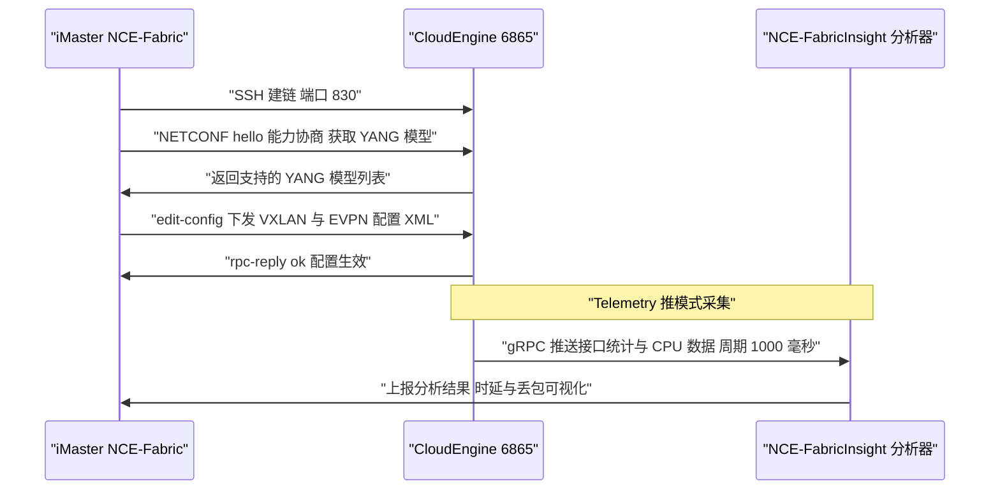

### 真题精练

**Q35.【真题·单选】** NETCONF 协议的标准传输层端口号是？
A. 22  B. 161  C. 830  D. 4789

> **答案：C**
> **解析**：NETCONF 使用 SSH 作为传输承载，标准端口为 **830**（RFC 6241）。A（22）是 SSH 自身的默认端口，NETCONF 也可通过配置复用但标准端口是 830；B（161）是 SNMP 的端口；D（4789）是 **VXLAN 的 UDP 目的端口**。这三个数字常被放在同一道多选题或填空题中对比考察。

**Q36.【真题·多选】** 下列关于 Telemetry 与 SNMP 的说法，正确的有？
A. SNMP 采用轮询（Pull）方式，Telemetry 采用推送（Push）方式
B. Telemetry 的采集精度可达毫秒级，SNMP 一般为秒级到分钟级
C. Telemetry 常用 gRPC/gNMI 协议，数据格式可为 JSON 或 GPB
D. Telemetry 必须依赖 SNMP 才能工作
E. Telemetry 的高精度数据是网络可视化与智能运维的基础

> **答案：ABCE**
> **解析**：A、B、C、E 均为 Telemetry 的标准特征。D 错误——Telemetry 是完全独立的采集技术，与 SNMP 无依赖关系，两者可以并存（SNMP 用于基础告警，Telemetry 用于高精度分析）。这也是华为 NCE-FabricInsight 实现"网络可视化与智能运维"的技术前提。

### 易错点与排错

1. **端口记混**：NETCONF = **830**、SSH = 22、SNMP = 161/162、VXLAN = 4789、gRPC/Telemetry 常用 57400。这几个数字是高频考点。
2. **把 NETCONF 与 YANG 混为一谈**：NETCONF 是**协议**，YANG 是**建模语言**，二者是"操作"与"模型"的关系。
3. **把 Telemetry 说成轮询**：Telemetry 的核心特征就是**推模式（Push）+ 高精度 + 结构化数据**，轮询是 SNMP 的特征。
4. **NETCONF 下发失败排查**：确认设备已使能 `netconf enable` 与 SNETCONF 服务、账号权限足够（需 `manage-ug` 级）、控制器与设备路由可达（管理网互通）。
5. **核查命令**：`display netconf status`、`display telemetry subscription`、`display current-configuration | include telemetry`。

---

## 6.6 章节综合真题精练（第 4~6 章交叉）

### 考点定位
跨章综合题，国赛的压轴题型形态：给出一个完整数据中心场景，要求判断技术选型、指出配置错误、分析故障原因。本节的题目融合第 4 章（VXLAN 报文与网关）、第 5 章（EVPN 路由与 RD/RT）、第 6 章（VRF 与 Fabric）三章内容。

### 原理精讲
综合题的解题框架分四步：**① 先看 Underlay 是否通**（VTEP 地址是否可达、BGP 邻居是否 Established）→ **② 再看控制平面**（Type-3 是否收到、隧道是否建立、Type-2 是否学到 MAC）→ **③ 再看数据平面**（VNI/BD/网关、VBDIF、MAC 表下一跳）→ **④ 最后看策略与参数**（RT 是否匹配、MTU 是否足够、网关 MAC 是否一致）。这个"**自底向上 + 分层排查**"的顺序是综合题得分的核心方法论。

### 关键概念对照表

| 故障现象 | 最可能原因 | 首要排查命令 |
|---|---|---|
| 隧道完全不通 | Underlay 不可达 / Type-3 未收到 / RT 不匹配 | `display vxlan tunnel`、`display bgp evpn all routing-table type3` |
| 隧道建到 RR 上 | RR 未配 `next-hop-unchanged` | `display vxlan tunnel`（看对端地址） |
| 小包通、大包不通 | MTU 不足（VXLAN 开销 50 字节） | `display interface`、`ping -s` |
| 跨 Leaf 三层不通 | 未配 `advertise irb` / 无 VBDIF / 网关 MAC 不一致 | `display bgp evpn all routing-table type2`、`display interface vbdif` |
| 两租户互相能通 | RT 配置错误（相同）或 VNI 规划冲突 | `display evpn vpn-instance`、`display ip vpn-instance` |
| ARP 大量泛洪 | Type-2 未收到或未携带 IP，ARP 抑制未生效 | `display bgp evpn all routing-table type2`、`display evpn vpn-instance arp` |
| 邻居 Idle | Underlay 路由缺失 / `connect-interface` 配错 | `display bgp evpn peer`、`display ip routing-table` |

### 示意图

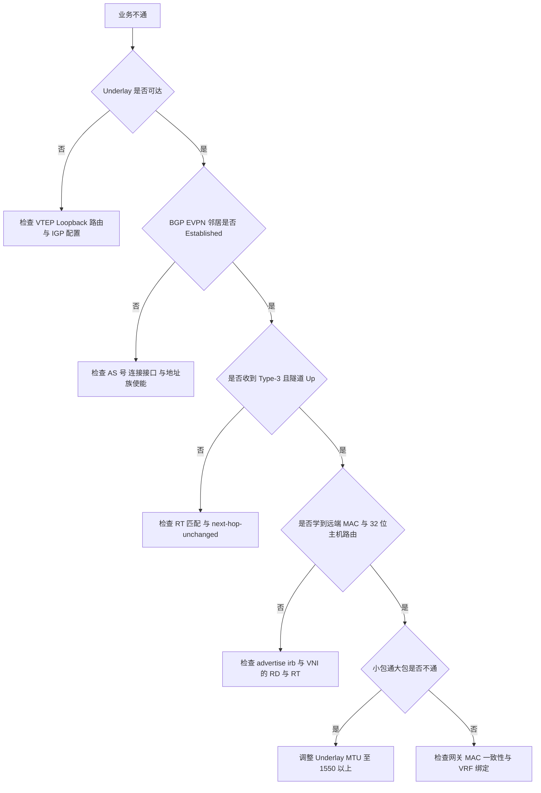

### 真题精练

**Q37.【真题·排错】** 某数据中心采用 VXLAN + BGP EVPN 分布式网关组网。现反馈：Leaf1 与 Leaf2 下的主机在同一 BD（VNI 10000）内可互通，但跨网段访问时不通。请列出可能原因（至少 4 条）及对应排查命令。

> **答案：**
> ① **Leaf 上未配置 `peer x advertise irb`**：导致 /32 主机路由不通告，对端 Leaf 学不到三层主机路由。排查：`display bgp evpn all routing-table type2`（确认远端 Type-2 是否带 IRB 信息）、检查 BGP EVPN 视图配置。
> ② **VBDIF 接口未创建或未配 IP**：网关不存在。排查：`display interface vbdif 10`、`display current-configuration interface Vbdif10`。
> ③ **各 Leaf 网关 MAC 不一致**：主机 ARP 表中的网关 MAC 与实际响应者不一致，导致三层转发中断或闪断。排查：`display interface vbdif 10`（逐台对比 MAC），确认配置了统一的 `mac-address`。
> ④ **三层流量未绑定 VPN 实例**：若使用 VPN 实例承载三层，`ip binding vpn-instance` 漏配会导致路由进入错误的表。排查：`display ip vpn-instance verbose`、`display ip routing-table vpn-instance VPN_A`。
> ⑤ **跨网段路由未正确引入或 RT 不匹配**：L3 VNI 的 RT 与 L2 VNI 未交叉导入。排查：`display bgp evpn all routing-table type5`、`display evpn vpn-instance`（核对 RD/RT）。
> ⑥ **MTU 不足**：跨网段大包（如 1500 字节）被丢弃，表现为 ping 小包通、大包不通。排查：`ping -s 1472`、`display interface 100GE1/0/1` 看 MTU 与丢包计数。
> **解析**：答题顺序应遵循"VBDIF 存在性 → 主机路由通告 → 网关 MAC 一致性 → VRF/RT 绑定 → MTU"。跨网段不通而**二层互通**，说明 Underlay、隧道、Type-3 都是正常的，问题一定出在**三层网关相关配置**上——这个推断方向本身就是得分点。

**Q38.【真题·排错】** 某 Fabric 中，Leaf1（VTEP 2.2.2.2）与 Leaf2（VTEP 3.3.3.3）之间通过 RR（10.0.0.1）交换 EVPN 路由。执行 `display vxlan tunnel` 后发现隧道对端地址显示为 10.0.0.1 而不是 3.3.3.3，业务不通。请分析原因并给出解决措施。

> **答案：**
> **原因分析**：VXLAN 隧道的对端地址来源于 EVPN **Type-3 路由的下一跳**（即 Originating Router's IP）。正常情况下该下一跳应为原始 VTEP 地址 3.3.3.3。当前显示为 10.0.0.1（RR 的地址），说明 **RR 在反射 EVPN 路由时改写了下一跳**，接收方误把 RR 当作隧道对端。这是 EVPN + RR 组网的经典故障：**RR 未配置下一跳保持不变**。
> **解决措施**：在 RR 的 EVPN 地址族下为每个客户端邻居配置 `peer <ip> next-hop-unchanged`（保持下一跳不变）：
> ```bash
> bgp 100
>  l2vpn-family evpn
>   peer 2.2.2.2 enable
>   peer 2.2.2.2 reflect-client
>   peer 2.2.2.2 next-hop-unchanged      // 关键：RR 反射时保持原始 VTEP 下一跳
>   peer 3.3.3.3 enable
>   peer 3.3.3.3 reflect-client
>   peer 3.3.3.3 next-hop-unchanged
>   quit
>  quit
> ```
> 配置后使用 `reset bgp evpn all`（或等待路由更新）触发路由重新通告，再用 `display vxlan tunnel` 确认对端地址已变为 3.3.3.3、`display bgp evpn all routing-table type3` 确认下一跳正确。
> **解析**：本题的关键推理链是"隧道对端地址 = Type-3 下一跳"，只要记住这一点，看到"隧道指向 RR 地址"就能立刻定位到下一跳改写问题。

### 易错点与排错

1. **排查顺序颠倒**：不要在 Underlay 不通的情况下去查 RT 配置，应按"Underlay → 控制平面 → 数据平面 → 策略参数"逐层排查。
2. **只看邻居 Up 就认为正常**：BGP 邻居 Established 只说明 TCP 与会话正常，不代表 EVPN 路由已交互（地址族未使能时邻居仍会 Up）。
3. **忽略 MTU**：跨 POD/跨 DC 组网时 MTU 是最隐蔽的故障点，务必主动验证。
4. **排查工具链**：`display vxlan tunnel`、`display bgp evpn all routing-table [type1..type5]`、`display mac-address bridge-domain`、`display interface vbdif`、`display ip routing-table vpn-instance`、`ping -s 1472`、`tracert`、报文镜像 + Wireshark 过滤 `udp.port == 4789`。
