> 本册真题依据华为 ICT 大赛历年公开赛题方向、华为认证考试真题回忆与官方教材例题整理改写，用于自测训练；正式参赛请以大赛官方考试大纲与题库为准。

**分册定位**：安全方向 · HCIA 层 · 校赛省赛重点（上册），共 4 章：网络安全概述与威胁分析、防火墙基础与安全策略、NAT 技术详解、用户认证与 AAA。

**适配真实产品**：HiSecEngine USG6000E（USG6510E / USG6520E）、USG12000 系列、NIP 入侵防御、AntiDDoS8000、HiSec Insight 态势感知、HiSec Endpoint（EDR）、CloudEngine S5731/S6730、AR6120、VRP V200/V300/V600、eNSP。

**使用建议**：先看每节 `考点定位` 判断轻重，再用 `原理精讲 + 关键概念对照表` 打通机制，最后用 `真题精练` 自测；上机时直接抄 `华为设备配置` 并在 eNSP 或真机上验证。

**本册目录**

1. 安全-HCIA-章节1-网络安全概述与威胁分析（CIA、攻击分类、攻击流程、纵深防御、等保 2.0、安全产品）
2. 安全-HCIA-章节2-防火墙基础与安全策略（状态检测、会话表、安全区域、安全策略、ASPF、部署模式）
3. 安全-HCIA-章节3-NAT技术详解（源 NAT 四方式、nat-policy、NAT Server、ALG、处理流水线、排错）
4. 安全-HCIA-章节4-用户认证与AAA（AAA、RADIUS、HWTACACS、Portal、802.1X、MAC 认证）

---

# 安全-HCIA-章节1-网络安全概述与威胁分析

本章是安全方向的"世界观"章节：**考原理与分类，几乎不考配置，但选择题、判断题命中率极高**。校赛省赛常以"某攻击属于哪一类""某需求对应 CIA 哪一要素""某场景应部署哪款产品"的形式出题。

## 1.1 信息安全三要素 CIA 与对应安全技术

### 考点定位
必考基础题。考法三种：给出场景判断破坏的是 CIA 中哪一要素；给出 CIA 要素反问应使用什么技术；把 CIA 与"可控性、不可否认性"等扩展属性混在一起做多选干扰。

### 原理精讲
信息安全的三大核心目标通常称为 CIA 三元组（CIA Triad）。

**机密性（Confidentiality）**：确保信息只被授权者获取，不被未授权者读取。它的敌人是"**被动攻击**"——窃听、流量分析、嗅探等，攻击者只"看"不改。实现机密性的核心手段是**密码学**：对称加密（AES、SM4、3DES）用于大数据量加密；非对称加密（RSA、ECC、SM2）用于密钥交换与数字签名；以及在此之上的安全协议，如 HTTPS（TLS）、IPSec（ESP 加密载荷）、SSH、SNMPv3。**为什么对称+非对称要混合使用？**因为非对称加密运算慢（同强度下比对称慢 2~3 个数量级），无法加密业务大流量；而对称加密的痛点是如何安全分发密钥。所以工程上的通用范式是"IKE/握手阶段用非对称协商出会话密钥 → 数据阶段用对称加密高速传输"，IPSec、TLS、SSH 全部遵循这一范式。

**完整性（Integrity）**：确保信息在存储与传输过程中未被篡改（包括被篡改后能被发现）。核心技术是**散列/杂凑函数**（Hash，如 SHA-256、SM3）与**消息认证码**（HMAC，把密钥与散列结合，防伪造也防篡改），以及**数字签名**（对摘要用私钥签名，兼具完整性与不可否认性）。**注意一个高频坑**：MD5、SHA-1 已不具备抗碰撞能力，只用于兼容性场景，安全场景必须用 SHA-256 以上；单纯的 Hash 只能"防意外损坏"，只有 HMAC 或签名才能"防人为篡改"，因为攻击者可以在改数据的同时重算 Hash。

**可用性（Availability）**：确保授权用户在需要时能正常访问资源。它的敌人是**拒绝服务类主动攻击**（DDoS、CC、流量洪泛）以及设备单点故障、断电、误删等。实现手段不是密码学，而是**架构与运维**：设备/链路冗余（堆叠、Eth-Trunk、双机热备 HRP、VRRP）、负载均衡、流量清洗（AntiDDoS 引流清洗）、数据备份与容灾、限速与连接数限制。

除 CIA 外，安全教材常补充三个扩展属性：**可控性**（对信息传播与内容可管控，对应上网行为管理、内容过滤）、**不可否认性/抗抵赖**（数字签名 + 日志审计，对应等保的审计要求）、**真实性**（身份认证，对应 AAA）。**为什么需要扩展？**因为 CIA 只描述"数据本身"的属性，而真实业务还需要回答"谁做的、能否追责、内容是否合规"——这也是等保 2.0 把"安全审计""个人信息保护"写入要求的根本原因。

CIA 之间存在**相互制约**关系：加密强度越高、认证越严，通常性能与便利性越差（可用性下降）；为了可用性放开权限，机密性又受威胁。安全设计本质是"在风险可接受的前提下做权衡"，而不是追求某一要素的绝对最优。

### 关键概念对照表

| 安全要素 | 要防的行为 | 核心技术 | 典型协议/产品能力 | 典型攻击 |
|---|---|---|---|---|
| 机密性 Confidentiality | 非授权读取 | 对称加密、非对称加密、密钥管理 | AES/SM4、RSA/SM2、IPSec ESP、HTTPS、SSH | 窃听、嗅探、流量分析、明文传输泄露 |
| 完整性 Integrity | 非授权篡改 | 散列、HMAC、数字签名 | SHA-256/SM3、HMAC-SHA256、PKI 签名 | 篡改、重放、中间人改包 |
| 可用性 Availability | 服务不可用 | 冗余、清洗、限速、备份 | HRP 双机热备、Eth-Trunk、AntiDDoS、负载均衡 | DDoS/CC、洪泛、断电、单点故障 |
| 不可否认性 | 事后抵赖 | 数字签名 + 审计日志 | PKI、Syslog、HiSec Insight 日志留存 | 越权操作后否认、篡改日志 |
| 可控性 | 违规内容/行为 | 应用识别、内容过滤、审计 | USG 内容过滤、上网行为管理 | 违规外联、敏感信息外泄 |

| 加密类型 | 密钥特点 | 性能 | 主要用途 | 算法举例 |
|---|---|---|---|---|
| 对称加密 | 加解密同一密钥 | 高 | 数据加密、隧道加密 | AES、SM4、3DES |
| 非对称加密 | 公私钥成对 | 低 | 密钥交换、签名、证书 | RSA、ECC、SM2 |
| 散列/摘要 | 无密钥（单向不可逆） | 高 | 完整性校验 | MD5、SHA-256、SM3 |
| HMAC | 散列 + 共享密钥 | 高 | 防篡改 + 防伪造 | HMAC-SHA256 |

### 华为设备配置
CIA 本身不通过单条命令实现，但在 USG6000E 上有对应的落地配置，考试实验题常要求"开启某能力"。

```bash
system-view
# 1) 机密性：管理面使用加密协议，关闭明文 Telnet
undo telnet server enable                     // 关闭 Telnet 明文远程登录
stelnet server enable                         // 开启 SSH 加密远程登录，保障管理通道机密性
ssh user admin authentication-type password   // 管理员使用密码认证登录 SSH
# 2) 完整性：开启日志/配置的校验与备份能力（配合 eNSP 或实训平台）
info-center enable                            // 开启信息中心，为审计（不可否认性）提供日志
info-center loghost 10.1.1.200                // 日志外发到日志服务器，满足审计留存要求
# 3) 可用性：接口级冗余与攻击防范
firewall defend syn-flood enable              // 开启 SYN Flood 防范，保护会话资源（可用性）
firewall defend udp-flood enable              // 开启 UDP Flood 防范
firewall defend icmp-flood enable             // 开启 ICMP Flood 防范
```

```bash
# 查看自身版本与特征库状态，确认安全能力有效（考试常考"如何确认特征库版本"）
display version                               // 查看 VRP 版本与已加载的特征库信息
display info-center                           // 查看日志输出配置
display firewall session table                // 查看会话表，判断是否存在异常洪泛会话
```

### 示意图

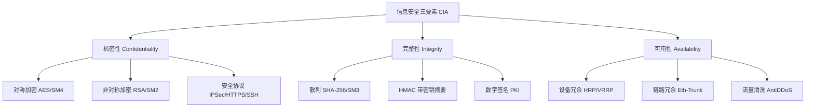

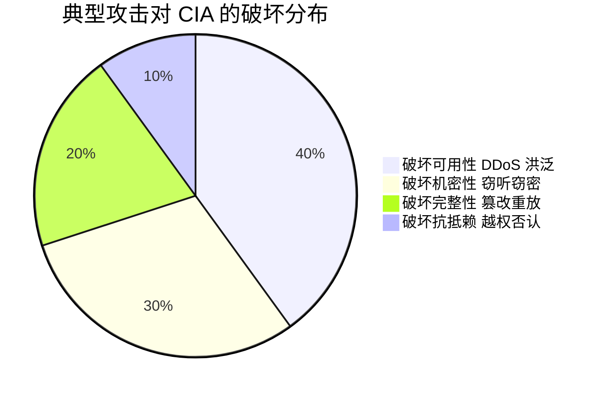

### 真题精练

**Q1.【真题·单选】** 某企业出口链路经常被大流量 UDP 报文占满，导致员工无法访问互联网。该攻击主要破坏信息安全的哪个要素？
A. 机密性  B. 完整性  C. 可用性  D. 不可否认性

> **答案：C**
> **解析**：流量洪泛（UDP Flood）的目标是耗尽带宽与设备会话资源，使合法用户无法获得服务，直接破坏可用性（Availability）。干扰项 A 对应的是被窃听/被读取（机密性）；B 对应数据被篡改且能被发现（完整性）；D 对应事后抵赖，与洪泛无关。可用性的防护手段是冗余、限速与流量清洗（如 AntiDDoS 牵引清洗）。

**Q2.【真题·多选】** 下列技术中，主要用于保障数据完整性的是（　　）。
A. HMAC-SHA256  B. AES-256  C. SM3 散列  D. 数字签名  E. Eth-Trunk 链路聚合

> **答案：A、C、D**
> **解析**：完整性依赖"摘要 + 密钥/私钥"机制：HMAC 用共享密钥保护摘要，SM3/SHA-256 提供摘要算法，数字签名对摘要签名从而同时提供完整性与不可否认性，故 A、C、D 正确。B 是加密算法，保障机密性；E 是链路冗余技术，保障可用性。**易错点**：只写 Hash 而不带密钥时，攻击者可改数据后重算摘要，单独使用不足以对抗人为篡改，这也是 HMAC 存在的理由。

**Q3.【真题·判断】** 对称加密算法运算速度快，因此 IPSec 数据阶段的载荷加密通常采用对称加密，而密钥通过 IKE 使用非对称技术协商。

> **答案：正确**
> **解析**：非对称运算慢，无法承载业务大流量加密；对称加密快但存在密钥分发难题。IPSec 采用混合密码体制：IKE 阶段基于 DH 交换与非对称签名/加密完成身份认证并协商出密钥，ESP 阶段用对称算法（如 AES-CBC/GCM、SM4）加密业务报文。TLS、SSH 同理。

### 易错点与排错

- **把"可用性"当"机密性"**：一切"服务中断/访问不了"类描述都指向可用性；"数据被看到/泄露"才是机密性。
- **MD5/SHA-1 仍能"做完整性"**：能算摘要不代表安全，抗碰撞能力已破，安全场景应使用 SHA-256/SM3。
- **认为加密就能防篡改**：加密保护的是"看不懂"，若攻击者能改密文（如 CBC 比特翻转），完整性仍需 HMAC/签名保证。
- **排查思路**：怀疑洪泛时用 `display firewall session table` 观察会话数与源地址分布，用 `display firewall statistics system` 观察丢包统计，再结合 `firewall defend` 系列开关定位。

## 1.2 网络安全威胁分类与常见攻击原理

### 考点定位
高频选择题区。核心考法：给定攻击行为判断属于**被动攻击**还是**主动攻击**；给定现象判断是哪一种攻击（ARP 欺骗、端口扫描、SQL 注入、XSS、暴力破解等）；结合防御手段反问"应部署什么"。

### 原理精讲
按"是否改变数据/影响系统状态"，威胁分为两大类。

**被动攻击（Passive Attack）**：攻击者只截获、观察，不修改数据流，因此**难以被检测，但易于预防**（加密即可）。包含：
- **窃听/嗅探（Sniffing）**：在共享介质或镜像口抓包，获取明文账号、口令。防：加密（HTTPS/SSH/IPSec）、交换网络抑制泛洪、端口安全。
- **流量分析（Traffic Analysis）**：即使报文已加密，攻击者仍可通过包长、频率、通信对端关系推断业务性质（如"某 IP 与境外服务器每 5 分钟通信 2 KB"）。防：流量填充、代理、混淆。

**主动攻击（Active Attack）**：攻击者修改数据、伪造身份或影响服务，**难以预防但易于检测**（完整性校验、审计、IDS/IPS 可发现）。包含：
- **篡改（Modification）**：改报文内容或文件。
- **重放（Replay）**：抓取合法报文后原样重发（如重放认证报文）。防：时间戳、随机数 Nonce、序列号（IPSec 抗重放窗口）。
- **伪造（Spoofing/Masquerading）**：伪造源 IP、MAC、身份、网站（钓鱼站）。
- **拒绝服务（DoS/DDoS）**：耗尽带宽、连接数或 CPU。

常见攻击类型的原理要点：

**DDoS 与 CC**：DDoS（Distributed DoS）通过控制大量分布主机同时发起请求。网络层有 SYN Flood（半开连接占满会话表）、UDP/ICMP Flood（耗带宽）、ACK Flood、以及**反射放大**（伪造受害者源 IP 向 DNS/NTP/memcached 查询，把放大后的应答打向受害者，DNS 约 50 倍、NTP 约 500 倍、memcached 可达数万倍）。应用层有 **CC（Challenge Collapsar）攻击**，用大量看似合法的 HTTP 请求打满 Web 线程/数据库连接，其特点是"单包流量小、QPS 高、隐蔽性强"，所以必须靠应用层行为分析而不是单纯看带宽。防：流量清洗（AntiDDoS）、SYN Cookie/首包丢弃、连接数限制、WAF。

**ARP 欺骗与中间人（MITM）**：ARP 无认证机制，攻击者持续发送伪造 ARP 应答，把网关 IP 映射到自己的 MAC，使内网流量经过攻击者再转发，形成中间人，可窃听甚至篡改。防：静态 ARP 绑定、DHCP Snooping + DAI（动态 ARP 检测）、ARP 限速、网关双发免费 ARP。

**IP 欺骗**：伪造源 IP。它本身不能收到回包，因此主要用于（1）反射放大攻击，（2）绕过基于 IP 地址的信任关系，（3）隐藏真实攻击源。防：入方向 uRPF（单播反向路径转发）、出口过滤（BCP38）。

**端口扫描**：用于探测开放端口与服务版本。TCP SYN 半开扫描（只收 SYN/ACK 不回 ACK，不建立完整连接，隐蔽且快）、TCP Connect 全连接扫描、FIN/XMAS/NULL 隐蔽扫描、UDP 扫描（慢，无应答不代表关闭）。结果分为 open / closed / filtered。防：关闭无用端口、防火墙静默丢弃、IPS 端口扫描检测。

**暴力破解**：对 SSH/RDP/Web 登录反复试口令，或"撞库"（用泄露库批量尝试）。防：强口令策略、登录失败锁定、验证码、MFA、限制源 IP。

**SQL 注入**：把 SQL 语句通过输入框拼进后端查询（如 `' or '1'='1`），实现绕过认证、拖库。根因是**字符串拼接而非参数化查询**。防：预编译/参数化、最小权限数据库账号、输入校验、WAF。

**XSS（跨站脚本）**：把恶意 JS 注入页面，在他人浏览器执行，窃取 Cookie/会话。分存储型（持久入库，危害最大）、反射型（随链接一次性触发）、DOM 型（前端 JS 处理不当）。防：输出编码、输入过滤、CSP、Cookie 加 HttpOnly。

**缓冲区溢出**：程序向固定长度缓冲区写入超长数据，覆盖相邻内存（如栈上返回地址），劫持控制流执行 shellcode。防：安全编码（边界检查）、编译器保护（栈 Canary）、DEP/NX、ASLR。

**恶意代码家族**：**病毒**需寄生宿主且需用户触发（不具独立传播能力）；**蠕虫**是独立程序，可自动扫描并自我复制传播（如冲击波、WannaCry 的传播模块）；**木马**伪装正常软件，以窃取/远控为目的，不自我复制；**僵尸网络（Botnet）**是被控主机（Bot/肉鸡）的集合，通过 C&C（Command and Control）服务器下发指令，是 DDoS 与垃圾邮件的"弹药库"。防：终端 EDR/杀毒、流量检测 C&C 域名、隔离网段。

**APT（Advanced Persistent Threat，高级持续性威胁）**：由国家或专业团伙发起，具有强针对性（定向攻击特定单位）、长期潜伏（数月到数年）、多阶段组合（0day + 社工 + 免杀木马 + 横向移动）、明确数据窃取目标等特征。**关键区分点**：APT 不是"一种病毒"，而是一套持续攻击活动；对抗 APT 靠"检测 + 响应 + 威胁情报"（如 HiSec Insight 态势感知、沙箱、EDR），单靠边界防火墙无法解决。

**社会工程学与钓鱼**：利用人的心理弱点而非技术漏洞。常见形式：**鱼叉式钓鱼**（针对特定人定制邮件）、**水坑攻击**（污染目标常访问的网站）、**伪装客服/领导诈骗**、**U 盘摆渡**。防：安全意识培训 + 邮件网关过滤 + 双因素认证 + 最小权限。

**为什么"被动难检测、主动难预防"？**因为被动攻击不产生异常流量特征，无法用特征检测发现，只能在数据层加密使其"拿到也没用"；主动攻击必然产生可观测的异常（畸形包、异常频率、校验失败），因此可检测，但它可以伪造来源、绕过静态规则，所以很难在入口完全阻断。

### 关键概念对照表

| 攻击类别 | 是否修改数据 | 可检测性 | 可预防性 | 典型手段 | 主要防护 |
|---|---|---|---|---|---|
| 被动攻击 | 否 | 难 | 易 | 窃听、流量分析 | 加密、隔离、代理 |
| 主动攻击 | 是 | 易 | 难 | 篡改、重放、伪造、DoS | 完整性校验、认证、IPS、清洗 |

| 攻击类型 | 原理关键词 | 攻击目标 | 典型防护 |
|---|---|---|---|
| SYN Flood | 半开连接占满会话表 | 可用性 | SYN Cookie、首包丢弃、AntiDDoS |
| CC 攻击 | 高频合法 HTTP 请求 | 应用可用性 | WAF、行为分析、限速 |
| ARP 欺骗 | 伪造 ARP 应答、无认证 | 机密性/完整性 | DHCP Snooping + DAI、静态绑定 |
| IP 欺骗 | 伪造源 IP | 绕过信任/反射 | uRPF、出口过滤 |
| 端口扫描 | SYN 半开探测 | 信息收集 | 关闭端口、静默丢弃、IPS |
| 暴力破解 | 反复试口令/撞库 | 机密性 | 锁定、MFA、源限制 |
| SQL 注入 | 拼接 SQL 语句 | 机密性/完整性 | 参数化查询、WAF |
| XSS | 注入 JS 到页面 | 机密性 | 输出编码、CSP、HttpOnly |
| 缓冲区溢出 | 覆盖返回地址 | 完整性/可用性 | 边界检查、DEP、ASLR |

| 恶意代码 | 是否需宿主 | 能否自我复制 | 传播方式 | 主要危害 |
|---|---|---|---|---|
| 病毒 Virus | 需要 | 否（靠宿主传播） | 文件/引导区 | 破坏文件、感染 |
| 蠕虫 Worm | 不需要 | 是 | 网络自动扫描 | 大范围瘫痪 |
| 木马 Trojan | 不需要 | 否 | 伪装诱骗 | 窃密、远控 |
| 僵尸网络 Botnet | 不需要 | 部分 | 漏洞/木马植入 | DDoS、垃圾邮件 |

### 华为设备配置
以 S5731 与 USG6000E 为例，配置内网防 ARP 欺骗与攻击防范。

```bash
# ---- CloudEngine S5731：DHCP Snooping + DAI 防 ARP 欺骗 ----
system-view
dhcp enable                                   // 全局开启 DHCP 功能，Snooping 依赖其表项
dhcp snooping enable                          // 全局开启 DHCP Snooping，建立"IP-MAC-端口"绑定表
vlan 10
 dhcp snooping enable                         // 在业务 VLAN 内开启 Snooping
interface GigabitEthernet0/0/24
 dhcp snooping trusted                        // 上联/网关口设为信任口，防止伪造 DHCP Server
interface GigabitEthernet0/0/1
 dhcp snooping enable                         // 用户接入口开启，表项由此学习
 arp anti-attack check user-bind enable       // 开启 ARP 报文绑定表检查（即 DAI），丢弃伪造 ARP
 arp anti-attack rate-limit enable            // 对 ARP 报文限速，抑制 ARP 洪泛
 arp anti-attack rate-limit 50 5              // 5 秒内超过 50 个 ARP 报文则丢弃
```

```bash
# ---- HiSecEngine USG6000E：出口攻击防范与异常流量抑制 ----
system-view
firewall defend syn-flood enable              // 开启 SYN Flood 防范（保护会话表资源）
firewall defend udp-flood enable              // 开启 UDP Flood 防范（保护带宽）
firewall defend icmp-flood enable             // 开启 ICMP Flood 防范
firewall defend port-scan enable              // 开启端口扫描检测，识别扫描行为
firewall defend ip-sweep enable               // 开启 IP 地址扫描检测
# 查看攻击防范统计与会话情况，用于定位是否被洪泛
display firewall statistics system            // 查看系统转发/丢弃统计
display firewall session table                // 查看当前会话，识别异常源
```

### 示意图

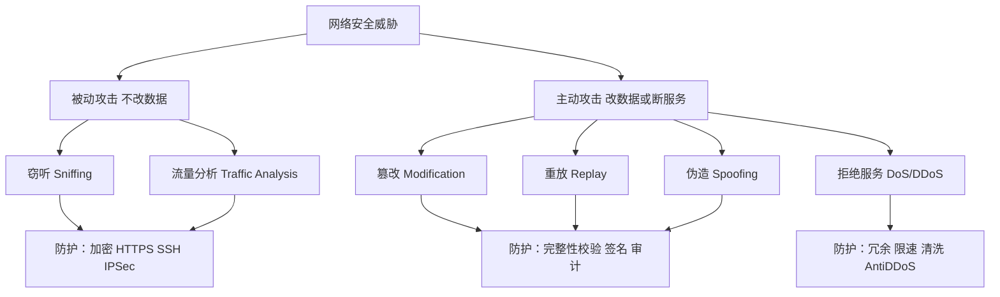

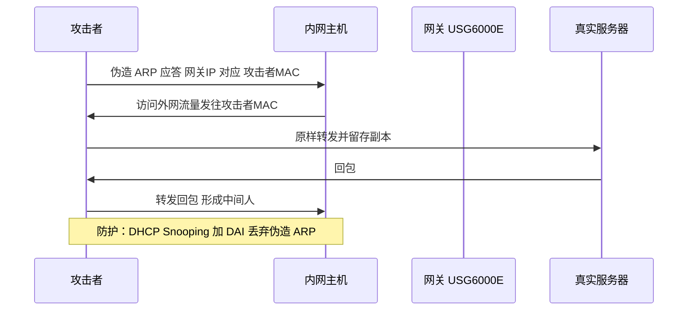

### 真题精练

**Q4.【真题·单选】** 下列攻击行为中，属于被动攻击的是（　　）。
A. 重放攻击  B. 流量分析  C. IP 欺骗  D. SYN Flood

> **答案：B**
> **解析**：被动攻击只观察不改变数据流，包含窃听与流量分析，故选 B。重放、IP 欺骗、SYN Flood 都会向网络注入报文或改变状态，属于主动攻击。**记忆口诀**：被动难检测易预防（加密），主动易检测难预防（校验 + 检测）。

**Q5.【真题·多选】** 关于 XSS 与 SQL 注入，下列说法正确的是（　　）。
A. XSS 的最终执行环境是受害者的浏览器
B. SQL 注入的根因之一是使用字符串拼接构造 SQL 语句
C. 存储型 XSS 的危害通常大于反射型 XSS
D. 两者都可以通过给 Cookie 增加 HttpOnly 属性完全防御

> **答案：A、B、C**
> **解析**：XSS 注入的是脚本，在受害者浏览器执行，A 对；SQL 注入源于拼接 SQL 且未做参数化，B 对；存储型 XSS 入库后对所有访问者生效，影响面更大，C 对。D 错：HttpOnly 只能阻止 JS 读取 Cookie，可缓解 XSS 窃取会话，但对 SQL 注入完全无效，也不能阻止 XSS 本身的执行（如篡改页面、发起请求）。

**Q6.【真题·判断】** 缓冲溢出攻击必须依靠植入病毒文件才能实现，单纯发送超长参数不会造成溢出。

> **答案：错误**
> **解析**：缓冲区溢出本质是程序未做边界检查，向固定长度缓冲区写入超出长度的数据（如超长 HTTP 参数、超长用户名）即可覆盖相邻内存（典型为栈上返回地址），劫持程序控制流执行攻击代码，无需额外病毒文件。防护重点是安全编码、栈保护、DEP/NX 与 ASLR。

**Q7.【真题·简答】** 简述僵尸网络（Botnet）的组成与主要危害，并说明企业侧可行的检测手段。

> **答案要点**：
> （1）**组成**：① 被控主机（Bot/肉鸡），通常由漏洞利用或木马植入获得；② C&C（Command and Control，命令与控制）服务器/信道，用于下发指令与回收结果；③ 控制者（Botmaster）。
> （2）**危害**：发起 DDoS 与 CC 攻击、发送垃圾邮件与钓鱼、作为代理跳板隐藏攻击源、窃取数据、挖矿。
> （3）**检测手段**：出口流量中识别周期性、小流量、固定目的域名的 C&C 心跳特征（DNS 请求异常、DGA 域名）；用 NIP/IPS 特征与信誉库匹配；用 HiSec Insight 态势感知做关联分析与情报碰撞；终端侧用 EDR/HiSec Endpoint 检测异常进程与外联行为。
> **解析**：答题必须点出"C&C 信道"与"周期性外联"这两个技术特征，只答"中毒了"不得分。

### 易错点与排错

- **把重放攻击当作被动攻击**：重放会向网络注入报文，破坏认证有效性，属主动攻击。
- **把 CC 当成带宽型 DDoS**：CC 攻击单连接流量很小，观察带宽可能毫无异常，应看 QPS、并发连接数与服务器 CPU。
- **误认为"加密就能防篡改"**：加密保机密性，完整性要靠 HMAC/签名。
- **排查命令**：`display firewall session table`（看异常会话与源 IP 分布）、`display firewall statistics system`、`display arp anti-attack statistics`（交换机侧查看 DAI 丢弃计数）。

## 1.3 黑客攻击一般流程与杀伤链

### 考点定位
常考排序题与简答题："请按顺序排列攻击步骤""某阶段在做什么"。也会结合 APT 考"哪个阶段对应长期潜伏"。

### 原理精讲
一次完整入侵通常按以下阶段推进（教材常称"攻击六步"或映射到洛克希德·马丁杀伤链 Kill Chain）：

**① 信息收集（Reconnaissance）**：分被动与主动。被动收集不接触目标（搜索引擎、whois、DNS 记录、招聘信息、GitHub 泄露、社交平台），隐蔽性极高；主动收集会与目标交互（DNS 域传送尝试、ICMP 探测、Whois 反查）。产出是"资产清单 + 人员信息 + 技术栈指纹"。

**② 扫描与探测（Scanning）**：在确定存活主机后，做端口扫描、服务/版本识别、操作系统指纹、漏洞扫描（如 445、3389 是否开放，Web 是否用某版本中间件）。这一步噪声最大，最容易被 IPS/态势感知发现。

**③ 获取访问权限（Gaining Access）**：利用漏洞（Web 注入、命令执行、弱口令、钓鱼附件）拿到第一个立足点，通常是一个低权限 shell 或普通域账号。

**④ 权限提升与横向移动（Privilege Escalation & Lateral Movement）**：本地提权到 root/SYSTEM，窃取凭据（HASH、票据），在内网横向扩展（PsExec、WMI、SMB 共享、远程桌面）。

**⑤ 植入后门与持久化（Maintaining Access / Persistence）**：上传远控木马、创建隐藏账号、注册计划任务/服务、修改启动项，确保重启后仍可控（APT 常用多个后门互为备份）。

**⑥ 清除痕迹（Covering Tracks）**：删除或篡改日志、清理临时文件、时间戳伪装（Timestomp）、使用加密隧道回传数据（如 DNS 隧道、HTTPS 隧道），达成长期潜伏与数据外泄。

**为什么流程是这样的？**因为它遵循"信息优势 → 最小代价进入 → 扩大战果 → 保住通道 → 不留证据"的成本最优逻辑。防守方（蓝队）的对应思路是"打断链条任一环即可"：信息收集阶段做资产梳理与信息最小化；扫描阶段用 IPS 与蜜罐发现；获取权限阶段靠补丁与强口令；提权横向阶段靠微隔离与最小权限；持久化阶段靠完整性校验与 EDR；清痕阶段靠**日志外发**（把日志实时送到独立日志服务器，攻击者删本地日志也无用）。

**APT 与普通入侵的差异**就在时间尺度与目标：普通黑客追求"快、广、变现"，APT 追求"定向、长期、窃密"，所以在流程上表现为"信息收集更久（甚至社工潜伏数月）、权限提升更谨慎、持久化多后门、痕迹清理更彻底"，并大量使用 0day 与免杀技术。

### 关键概念对照表

| 阶段 | 主要动作 | 常见技术/工具 | 防守抓手 |
|---|---|---|---|
| 信息收集 | 收集资产与人员信息 | 搜索引擎、whois、DNS 查询、社工 | 资产梳理、信息最小化、敏感信息外发管控 |
| 扫描探测 | 发现开放端口与漏洞 | 端口扫描、漏洞扫描、指纹识别 | NIP/IPS、AntiDDoS、蜜罐 |
| 获取权限 | 打第一个立足点 | Web 漏洞、弱口令、钓鱼 | 补丁管理、强认证、邮件安全、WAF |
| 权限提升与横向 | 提升权限并扩散 | 提权 EXP、凭据窃取、PsExec/WMI | 最小权限、微隔离、域安全加固 |
| 植入后门 | 持久化控制 | 木马、隐藏账号、计划任务 | EDR、进程白名单、外联检测 |
| 清除痕迹 | 躲避追踪 | 删日志、时间戳伪装、加密隧道 | 日志外发留存、流量审计、态势感知 |

### 华为设备配置
以"日志外发 + 会话审计"为例，体现防守方在"清痕阶段"的对抗手段。

```bash
# ---- USG6000E：把日志实时外发，攻击者删本地日志也无法抹除证据 ----
system-view
info-center enable                                   // 开启信息中心
info-center loghost 10.1.1.200 port 514              // 指定日志服务器（Syslog，UDP 514）
info-center source default channel loghost log level informational  // 设置外发日志级别
# 会话表日志：对关键业务开启会话日志，为事后溯源保留连接记录（V600R007 中通过会话日志特性实现）
firewall log session enable                          // 开启会话日志（部分版本需内容安全/日志特性支持）
```

```bash
# 通用可验证的审计类命令
display logbuffer                                    // 查看本地日志缓冲区（含攻击告警）
display info-center                                  // 确认日志通道与服务器
display firewall session table verbose               // 查看会话明细，用于还原攻击路径
display current-configuration                        // 核对安全配置是否被篡改（完整性核对）
```

### 示意图

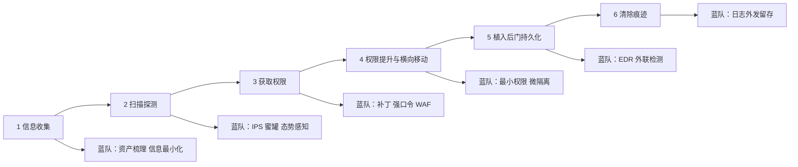

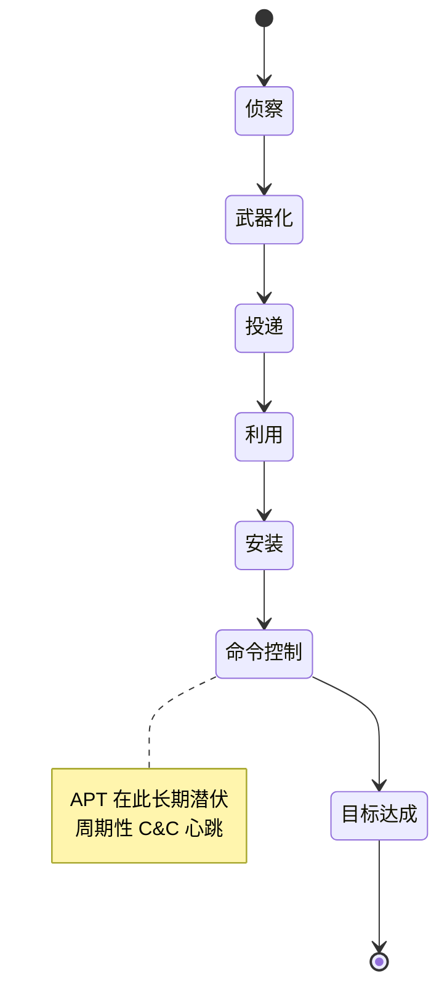

### 真题精练

**Q8.【真题·单选】** 攻击者通过公开的招聘网站了解到某公司使用了特定版本的 OA 系统，这一行为属于攻击流程的（　　）阶段。
A. 扫描探测  B. 信息收集  C. 权限提升  D. 清除痕迹

> **答案：B**
> **解析**：通过公开渠道获取资产与技术栈信息，不与目标系统直接交互，属于被动信息收集阶段。扫描探测必须与目标交互（发包探测），两者可据此区分。

**Q9.【真题·简答】** 为什么说"日志外发到独立日志服务器"是对抗攻击者清除痕迹的关键措施？

> **答案要点**：
> （1）攻击者提权后通常优先删除/篡改本地日志以延长潜伏时间；
> （2）Syslog 实时外发使日志在本地被删前已落到独立服务器，且可设置只写权限、异地留存；
> （3）留存日志才能支撑事后溯源（还原攻击路径、时间线、失陷范围）与等保合规审计要求；
> （4）配合态势感知（HiSec Insight）做关联分析，可将单点告警升级为攻击链还原。
> **解析**：核心逻辑是"证据与受攻击系统分离"，只答"备份日志"不够，要体现实时外发与权限隔离。

### 易错点与排错

- **把"信息收集"局限于技术手段**：社工、招聘信息、代码仓库泄露都是信息收集。
- **流程顺序颠倒**：一定是"收集→扫描→进入→提权/横向→持久化→清痕"，横向移动在获取权限之后而不是之前。
- **排错命令**：`display logbuffer`、`display info-center`、`display firewall session table verbose`。

## 1.4 安全防御体系与纵深防御

### 考点定位
简答题与架构题。常考"画出纵深防御的层次""某层应部署什么设备""安全域如何划分"。

### 原理精讲
**纵深防御（Defense in Depth，DiD）**的核心思想是：**不假设任何单一防线可靠**，在攻击者可能经过的每一个环节都设置独立控制，使攻击者必须连续突破多层才能得手，同时让每层的失效被其他层发现与补偿。它与"边界防护"最大的区别在于：边界防护只防"外面进来的"，一旦被钓鱼或 U 盘绕过边界就全线失守；纵深防御覆盖网络、主机、应用、数据、人员、管理六个维度。

典型分层（外到内）：

1. **物理层**：机房门禁、监控、防雷防火、链路冗余。
2. **边界层（网络边界）**：防火墙（USG6000E）做访问控制与 NAT，IPS（NIP）做入侵检测/阻断，AntiDDoS 做流量清洗，VPN 做加密接入，邮件/上网行为管理做内容管控。
3. **网络层（内网）**：VLAN 划分与 ACL、微隔离、DHCP Snooping + DAI、uRPF、路由协议认证（OSPF MD5/HMAC）。
4. **主机/终端层**：补丁管理、最小化服务、主机防火墙、EDR（HiSec Endpoint）检测勒索与横向移动、外设管控。
5. **应用层**：WAF、身份认证（AAA/Portal/802.1X）、输入校验、会话安全、上传管控。
6. **数据层**：分级分类、加密存储、备份容灾、DLP 防泄漏、数据库审计。
7. **管理与人员层**：安全策略与制度、分权分域（最小权限）、日志审计与态势感知、安全意识培训与应急演练。

**安全域划分**是纵深防御落地的基础手段。**划分原则**：按"业务重要性 + 安全需求等级 + 访问关系"分组，把同等级、同访问策略的对象放在同一安全域/同一 VLAN/同一 Zone；域间必须穿越控制点（防火墙），域内默认可信但也要限流与抑制广播。**为什么不能全内网一个域？**因为一旦某台终端被控，攻击者可在同域内自由横向移动（东西向流量无控制），这正是勒索病毒"一台中招、全楼加密"的根因。

企业典型安全域：**Trust（办公内网）、DMZ（对外服务器区，Internet 可直接访问但被严格限制）、Untrust（Internet）、Local（设备自身）、管理域（网管/VPN 接入）、服务器域（核心数据库，仅允许指定应用访问）**。DMZ 的设计要点是：对外发布的服务只放到 DMZ，绝不允许 Internet 直接访问内网数据库；DMZ 到内网只能按需放通"客户端→服务器"方向的具体端口，且需做应用层检测。

**边界安全的四件事**：① 访问控制（谁可以访问谁，靠安全策略）；② 内容检测（流量里有没有攻击，靠 IPS/AV/URL 过滤）；③ 身份认证（进来的到底是谁，靠 Portal/802.1X/VPN+AAA）；④ 行为审计（做了什么，靠日志与态势感知）。四者缺一不可，只做 ACL 属"裸奔式边界"。

### 关键概念对照表

| 层次 | 防护目标 | 典型设备/技术 | 华为产品 |
|---|---|---|---|
| 物理层 | 环境与设备安全 | 门禁、监控、双路供电 | 机房配套 |
| 边界层 | 阻止外部入侵与滥用 | 防火墙、IPS、AntiDDoS、VPN | USG6000E、NIP、AntiDDoS8000 |
| 网络层 | 限域、防内网欺骗 | VLAN、ACL、DAI、uRPF | CloudEngine S5731/S6730 |
| 主机/终端层 | 防恶意代码与提权 | EDR、补丁、外设管控 | HiSec Endpoint（EDR） |
| 应用层 | 防 Web 与应用攻击 | WAF、认证、输入校验 | USG 内容安全、AAA |
| 数据层 | 防泄露与丢失 | 加密、备份、DLP、审计 | 存储/备份/数据库审计 |
| 管理层 | 可管可控可追溯 | 制度、审计、态势感知 | HiSec Insight、iMaster NCE |

| 安全域 | 可信级别 | 典型对象 | 默认访问策略建议 |
|---|---|---|---|
| Trust | 较高 | 办公终端、内网用户 | 允许出访 Internet，限制入访 |
| DMZ | 中 | 对外 Web/邮件/堡垒机 | 允许 Internet 访问特定端口，禁止直连内网 |
| Untrust | 最低 | Internet | 仅允许回流与已发布服务 |
| Local | 高（设备本身） | USG 管理面 | 仅允许管理网段访问管理协议 |
| 管理域 | 高 | 网管、堡垒机、日志服务器 | 仅运维人员可达，强制审计 |

### 华为设备配置
以 USG6000E 为例，落实"边界访问控制 + 应用层检测 + 管理面收敛"。

```bash
# ---- USG6000E：边界安全第一部分——安全区域与接口 ----
system-view
firewall zone trust
 add interface GigabitEthernet1/0/1                 // 内网接口加入 Trust 区域
firewall zone untrust
 add interface GigabitEthernet1/0/2                 // 外网接口加入 Untrust 区域
firewall zone dmz
 add interface GigabitEthernet1/0/3                 // 服务器区接口加入 DMZ 区域
# ---- 第二部分：安全策略 + 内容安全（IPS 配置文件）----
profile type ips name ips_web                        // 创建 IPS 配置文件（需内容安全 License）
security-policy
 rule name trust_to_untrust_web
  source-zone trust
  destination-zone untrust
  source-address 10.1.1.0 24                         // 仅允许办公网段出访
  service http https dns                             // 限定服务，最小放通
  action permit
 rule name untrust_to_dmz_web
  source-zone untrust
  destination-zone dmz
  destination-address 200.1.1.100 32                 // 只发布这一台公网映射服务器
  service http https
  action permit
  profile ips ips_web                                // 对入站访问做入侵防御检测
# ---- 第三部分：管理面收敛（Local 区域）----
interface GigabitEthernet1/0/0
 service-manage enable                               // 开启接口管理功能（默认关闭，重点）
 service-manage ping permit                          // 仅放通 Ping，便于连通性测试
 service-manage https permit                         // 放通 HTTPS 管理，禁用明文 HTTP
 undo service-manage http enable                     // 关闭 HTTP 明文管理
```

```bash
display security-policy rule all                     // 查看全部安全策略规则及匹配顺序
display firewall zone                                // 查看安全区域与接口成员
display firewall session table verbose               // 查看会话明细，验证策略生效
```

### 示意图

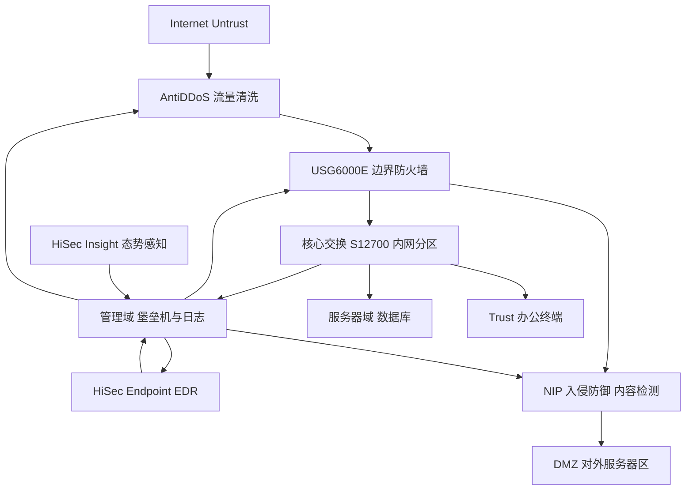


### 真题精练

**Q10.【真题·单选】** 关于 DMZ 区的部署原则，下列说法错误的是（　　）。
A. 对外提供服务的服务器应放置在 DMZ
B. Internet 用户可访问 DMZ 中服务器的发布端口
C. 为便于运维，应允许 DMZ 服务器直接访问内网数据库的所有端口
D. DMZ 到内网的访问应按需放通并做应用层检测

> **答案：C**
> **解析**：DMZ 的定位是"可被外部访问的缓冲区"，其核心价值在于把被攻陷的损失隔离在缓冲区。允许 DMZ 直连内网数据库全部端口，等于把 DMZ 变成跳板，一旦 Web 被拿下即可拖库，违反最小权限与纵深防御原则。正确做法是仅放通"Web 服务器 → 数据库特定端口"的单向、按需策略，并做内容检测与审计。

**Q11.【真题·简答】** 简述"纵深防御"的核心思想，并说明它与"只做边界防火墙"的差别。

> **答案要点**：
> （1）核心思想：不假设任何单一防线可靠，在网络、主机、应用、数据、人员、管理等多个层面设置相互独立、可互补的控制点，使攻击者需连续突破多层，且任一层失效可被其他层发现与补偿；
> （2）差别：只做边界防火墙时，一旦通过钓鱼、U 盘、VPN 弱口令或 0day 绕过边界，内网即无控制（东西向流量自由横向），勒索与 APT 可快速扩散；纵深防御在内网还有微隔离、EDR、数据加密、审计与态势感知，可"发现—阻断—溯源"；
> （3）落地方法：安全域划分 + 域间策略 + 身份认证 + 内容检测 + 日志审计 + 应急响应闭环。
> **解析**：答题要突出"多层独立""互补""内网东西向控制"三个关键词。

### 易错点与排错

- **安全域划分粒度误区**：不是"越细越好"，应按业务与访问关系划分；过度细分会导致策略数量爆炸、运维困难。
- **DMZ 与内网服务器域混用**：对外服务必须在 DMZ，内网数据库不得直接暴露。
- **只做 ACL 不做内容检测**：ACL 只控制"谁能通"，管不了"通的内容是否含攻击"，需 IPS/AV/URL 过滤。
- **排错命令**：`display firewall zone`、`display security-policy rule all`、`display interface brief`。

## 1.5 等保 2.0 与常见安全产品职责划分

### 考点定位
校赛省赛常考"等保 2.0 的级别划分、一个中心三重防护、标准号""给定需求选择产品"。属于记忆型送分题，但产品与功能的对应关系易混。

### 原理精讲
**等级保护 2.0** 的核心标准是 **GB/T 22239-2019《信息安全技术 网络安全等级保护基本要求》**，2019 年 5 月 10 日发布、**2019 年 12 月 1 日实施**，替代 GB/T 22239-2008。它把保护对象从传统的"信息系统"扩展到"**网络基础设施、云计算平台、移动互联、物联网、工业控制系统、大数据**"等，并在技术要求中形成"**一个中心、三重防护**"的体系结构：

- **一个中心**：**安全管理中心**（集中管控：系统管理、审计管理、安全管理、集中管控）。
- **三重防护**：**安全通信网络**（网络架构、通信传输、可信验证）、**安全区域边界**（边界防护、访问控制、入侵防范、恶意代码防范、安全审计、可信验证）、**安全计算环境**（身份鉴别、访问控制、安全审计、入侵防范、恶意代码防范、可信验证、数据完整性/保密性/备份恢复、剩余信息保护、个人信息保护）。

同时还有**管理要求**五方面：安全管理制度、安全管理机构、安全管理人员、安全建设管理、安全运维管理。等级分为**五级**（一级用户自主保护级、二级系统审计保护级、三级安全标记保护级、四级结构化保护级、五级访问验证保护级），一至五级要求逐级增强；**二级及以上需测评与备案**，三级系统要求最严（强制访问控制、集中审计、冗余、入侵防范等）。等保 2.0 还新增**扩展要求**：云计算、移动互联、物联网、工业控制、大数据。

**为什么等保强调"一个中心"？**因为分散的设备各自为政时，攻击者只需绕过单点即可；集中管控让审计数据、策略、账号统一管理，攻击者很难同时清除所有证据，从而实现"可管、可控、可追溯"，这也是态势感知（HiSec Insight）成为合规标配的原因。

**常见安全产品与职责**（华为产品线）：

| 产品 | 定位 | 核心职责 |
|---|---|---|
| HiSecEngine USG6000E / USG12000 | 下一代防火墙 NGFW | 安全区域隔离、安全策略访问控制、NAT、VPN、内容安全（IPS/AV/URL/应用识别）——边界第一道闸门 |
| NIP（Network Intelligent Protection） | 入侵防御系统 IPS | 基于特征与行为的攻击检测与阻断（漏洞利用、扫描、木马通信），旁路检测或串联阻断 |
| AntiDDoS8000 / AntiDDoS 清洗中心 | 抗 DDoS | 流量牵引与清洗，抵御 SYN Flood、UDP Flood、反射放大、CC |
| 上网行为管理（ASG 系列 / USG 内容过滤与应用识别） | 行为管控与审计 | 应用识别与限流、URL 分类过滤、带宽管理、上网日志审计，满足"可控性" |
| HiSec Insight | 安全态势感知平台 | 多源数据（日志/流量/终端/情报）关联分析、威胁可视化、攻击链还原、联动处置 |
| HiSec Endpoint（EDR） | 终端检测与响应 | 终端病毒查杀、勒索防护、进程行为监控、横向移动检测、隔离与取证 |
| CloudEngine S5731/S6730 | 接入/汇聚交换机 | VLAN 隔离、DHCP Snooping + DAI、端口安全、ACL |
| iMaster NCE-Campus | 园区网络管理 | 有线无线统一纳管、策略下发、准入协同 |

**职责划分的记忆逻辑**：**"边界看策略、流量看内容、攻击看特征、洪泛看清洗、终端看行为、全局看态势"**。考试中若问"抵御大流量 DDoS"，答案必是 AntiDDoS 而不是 USG（USG 抗小规模攻击防范，不做大流量清洗）；问"检测并阻断漏洞利用攻击"，答案是 NIP/IPS；问"终端勒索防护与响应"，答案是 EDR。

### 关键概念对照表

| 对比项 | 等保 1.0（GB/T 22239-2008） | 等保 2.0（GB/T 22239-2019） |
|---|---|---|
| 保护对象 | 信息系统为主 | 扩展至云计算、移动互联、物联网、工控、大数据 |
| 技术要求结构 | 物理/网络/主机/应用/数据 + 管理 | 一个中心、三重防护 + 管理要求 |
| 管理中心 | 无明确集中管控要求 | 明确安全管理中心与集中管控 |
| 测评要求 | 二级以上测评 | 二级以上测评，三级要求更严（含入侵防范、集中审计） |
| 发布/实施时间 | 2008 年 | 2019-05-10 发布，2019-12-01 实施 |

| 需求场景 | 应选产品 | 理由 |
|---|---|---|
| 内外网访问控制与 NAT | USG6000E | NGFW 做区域隔离与地址转换 |
| 抵御 TB 级流量洪泛 | AntiDDoS8000 | 专业流量清洗，防火墙不做大流量清洗 |
| 检测并阻断漏洞利用 | NIP（IPS） | 特征 + 行为检测，可串联阻断 |
| 员工上网行为与 URL 过滤 | 上网行为管理 / USG 内容过滤 | 应用识别 + 分类过滤 + 审计 |
| 全局威胁可视化与联动 | HiSec Insight | 多源关联、态势呈现、联动处置 |
| 终端勒索检测与隔离 | HiSec Endpoint（EDR） | 终端行为监控与响应 |

### 华为设备配置
等保落地常用"集中日志审计 + 账号分权 + 管理协议收敛"，以下为 USG6000E 可验证命令。

```bash
# ---- 1) 管理面加固：强密码策略与管理员分权（等保"安全计算环境/集中管控"）----
system-view
aaa
 manager-user sec_admin                          // 创建管理员账号
  password cipher Huawei@12345                   // 设置加密存储的口令（禁止明文）
  service-type web ssh                           // 仅允许 Web 与 SSH 管理，关闭 Telnet
  level 15                                       // 授予最高级别，其他运维账号按需降级
  quit
```

```bash
# ---- 账号创建与级别配置的标准写法（低权限运维账号）----
system-view
aaa
 manager-user sec_admin
  password cipher Huawei@12345
  service-type web ssh
  level 15
  quit
 manager-user op_view
  password cipher View@12345
  service-type web
  level 3                                        // 低权限只读/受限账号，体现最小权限
  quit
 quit
# ---- 2) 日志外发，满足等保集中审计与留存 ----
info-center enable
info-center loghost 10.1.1.200                  // 外发到日志服务器
# ---- 3) 关闭不必要的服务，减小攻击面 ----
undo ftp server enable                          // 关闭 FTP 服务
undo telnet server enable                       // 关闭明文 Telnet
```

```bash
display manager-user                            // 查看管理员账号与权限级别
display info-center                             // 查看日志输出配置
display security-policy rule all                // 核对边界策略是否符合最小放通
```

### 示意图

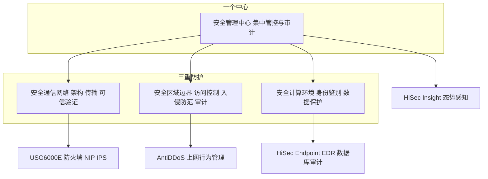

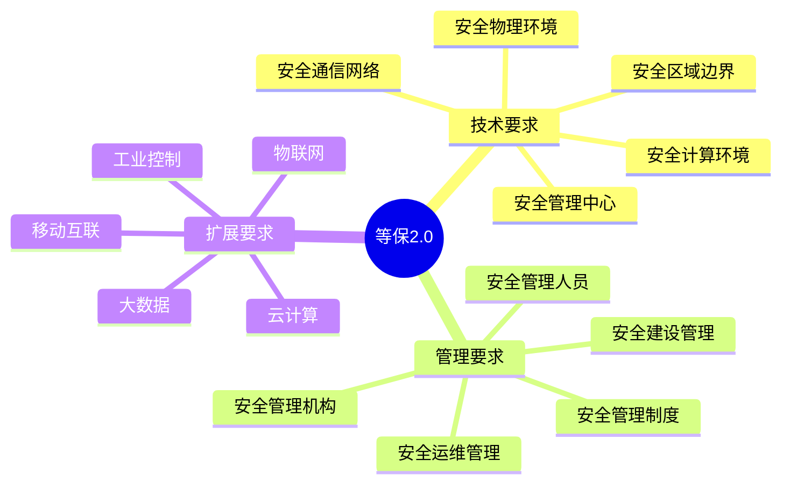

### 真题精练

**Q12.【真题·单选】** 等级保护 2.0 的技术要求体系可概括为（　　）。
A. 两个中心、三重防护  B. 一个中心、三重防护  C. 一个中心、四重防护  D. 三重防护、四级管理

> **答案：B**
> **解析**：等保 2.0 技术要求为"一个中心（安全管理中心）、三重防护（安全通信网络、安全区域边界、安全计算环境）"，管理要求另有五方面（制度、机构、人员、建设、运维）。C 多算了一层，A 多了一个中心，D 属于混淆项。

**Q13.【真题·填空】** 等级保护 2.0 的核心标准是 GB/T 22239-______，于 ______ 年 12 月 1 日正式实施。

> **答案：2019；2019**
> **解析**：GB/T 22239-2019《信息安全技术 网络安全等级保护基本要求》于 2019 年 5 月 10 日发布、2019 年 12 月 1 日实施，替代 GB/T 22239-2008，标志着等保进入 2.0 时代。

**Q14.【真题·多选】** 某园区出口遭受持续大流量 SYN Flood，同时需要检测内网主机是否已被植入远控木马外联 C&C 服务器。下列产品组合最合理的是（　　）。
A. AntiDDoS 做流量清洗  B. NIP 做木马通信与攻击检测  C. HiSec Insight 做多源关联与态势呈现  D. USG6000E 独立承担全部大流量清洗与终端查杀

> **答案：A、B、C**
> **解析**：大流量洪泛必须由专业 AntiDDoS 牵引清洗（A 对）；木马外联与攻击特征检测属 IPS 能力域（B 对）；全局关联与可视化由态势感知完成（C 对）。D 错：防火墙具备攻击防范能力但不对抗大流量 DDoS，也不做终端病毒查杀（那是 EDR 的职责），产品职责必须分清。

### 易错点与排错

- **等保标准号写错**：技术基本要求是 GB/T 22239-2019；测评要求是 GB/T 28448-2019，不要混。
- **时间记错**：发布 2019-05-10，实施 2019-12-01。
- **产品职责混淆**：IPS（NIP）≠ 防火墙；EDR ≠ 网络侧 IPS；AntiDDoS ≠ USG 攻击防范。
- **"一个中心"漏答**：只写三重防护会丢分。
- **排错/核查命令**：`display manager-user`、`display info-center`、`display version`（确认特征库与版本）。

---

# 安全-HCIA-章节2-防火墙基础与安全策略

本章是安全方向**分值最高**的一章：状态检测机制、安全区域默认行为、安全策略匹配顺序是每年必考三件套。实验题几乎必考"配置安全策略放通内网访问 Internet 并禁止反向访问"。

## 2.1 防火墙技术演进与三代技术

### 考点定位
常考技术代际归属与能力对比：包过滤属几代、状态检测的核心判据、应用层网关（代理）的优缺点。也会问"华为 USG6000E 属于哪一代"。

### 原理精讲
防火墙（Firewall）是部署在不同信任级别网络之间的**访问控制设备**，其本质作用是"**依据策略对穿越的流量做放行或阻断，并留下审计记录**"。它的技术演进分三代：

**第一代：包过滤防火墙（Packet Filtering）**。工作在**网络层与传输层**，逐包检查五元组：源 IP、目的 IP、源端口、目的端口、协议号，与 ACL 规则比对后放行或丢弃。优点是实现简单、性能高、对应用透明；缺陷非常致命：**无连接状态**（无法区分一个 TCP 包是"主动发起连接"还是"回包"），因此要放通内网访问外网，就必须放通高位端口入方向，等于给攻击者开了门；同时**无法识别应用层内容**（HTTP 与藏在 80 端口的木马无差别），规则数量的增长还带来性能与维护问题。

**第二代：状态检测防火墙（Stateful Inspection）**，华为称**状态检测/ASPF**机制。它记录每条连接的状态（会话表 session table），只在**首包**做策略检查，后续包直接查会话表转发；并且自动识别**返回流量**：内网访问 Internet 时首包建立会话，Internet 回包因命中原会话的"反向表项"而被放行，**无需显式配置反向规则**。这既解决了"高位端口回包"问题，又大幅提升性能。**核心判据是"五元组 + 连接状态"**，同时它能处理 FTP 等动态端口协议（靠 ASPF 的 Server-map 预先打开数据通道）。判断设备是否为状态检测防火墙的关键特征就是：**有会话表、能自动放通返回流量**。

**第三代：应用层网关/代理防火墙（Application Layer Gateway / Proxy）**。工作在**应用层**，为每种协议实现独立代理，用户与服务器之间的报文由防火墙"拆开再重组"，可做深度内容检查（如 URL 过滤、邮件附件检查、SQL 注入检测）。优点是安全性最高、可隐藏内部结构（NAT 到防火墙自身）；缺点是**性能开销大、需为每种协议开发代理、对加密流量无能为力、可扩展性差**。

**现代 NGFW（Next-Generation Firewall，下一代防火墙）**：USG6000E 属于这一类，它把"状态检测 + 应用识别 + 用户识别 + 内容安全（IPS/AV/URL/文件沙箱）+ 威胁情报"融合在一条策略里，不再以端口区分应用（能识别"80 端口上的 P2P"或"443 端口上的恶意软件流量"），并能与态势感知平台联动。**为什么 NGFW 要引入应用与用户维度？**因为仅靠 IP + 端口已无法描述真实访问意图："允许 10.1.1.0/24 访问外网 80 端口"可能同时放通了网页浏览、Web 上传木马、SQL 注入探测；引入应用与用户后，策略变成"允许**市场部员工**使用**企业微信**和**浏览网页**，禁止**上传源码**"，这才是可审计、可运维的粒度。

### 关键概念对照表

| 代际 | 工作层次 | 检查依据 | 返回流量处理 | 性能 | 主要缺陷 |
|---|---|---|---|---|---|
| 包过滤 | 网络层/传输层 | 五元组（无状态） | 需显式放通高位端口 | 高 | 无状态、不识别应用、规则膨胀 |
| 状态检测 | 传输层 + 会话状态 | 五元组 + 会话表状态 | 自动放通（查会话表） | 高 | 不深入应用层内容 |
| 应用层网关/代理 | 应用层 | 协议内容（拆包重组） | 代理自身处理 | 低 | 性能差、协议支持受限 |
| NGFW（USG6000E） | L2–L7 | 区域 + 应用 + 用户 + 内容 | 自动放通（会话 + Server-map） | 中高 | 需 License，配置复杂 |

| 对比项 | 包过滤 | 状态检测 |
|---|---|---|
| 是否需要会话表 | 不需要 | 需要 |
| 首包与后续包处理 | 每包都查 ACL | 首包查策略，后续包查会话表 |
| 反向流量 | 必须显式配置 | 自动放通 |
| FTP 等动态端口协议 | 无法支持 | 由 ASPF/Server-map 支持 |

### 华为设备配置
USG6000E 上"状态检测"的体现：不需要为回包配置策略，只需配置 Trust → Untrust 单方向策略。

```bash
system-view
# 1) 接口地址与安全区域
interface GigabitEthernet1/0/1
 ip address 10.1.1.1 24                            // 内网网关地址
firewall zone trust
 add interface GigabitEthernet1/0/1                  // 内网接口加入 Trust
interface GigabitEthernet1/0/2
 ip address 200.1.1.1 24                            // 公网接口地址
firewall zone untrust
 add interface GigabitEthernet1/0/2                  // 外网接口加入 Untrust
# 2) 只配置单向安全策略：状态检测会自动放通回程流量
security-policy
 rule name trust_to_untrust
  source-zone trust
  destination-zone untrust
  source-address 10.1.1.0 24
  service http https dns
  action permit                                     // 只放通外出，回包由会话表自动放通
# 3) 开启 ASPF（如 FTP 等动态端口协议需要）
firewall detect ftp                                 // 开启 FTP 的 ASPF 检测，生成 Server-map
```

```bash
display firewall session table                      // 查看会话表，验证"首包建会话"
display firewall server-map                         // 查看 ASPF 生成的 Server-map 表项
display security-policy rule all                    // 查看策略规则
```

### 示意图

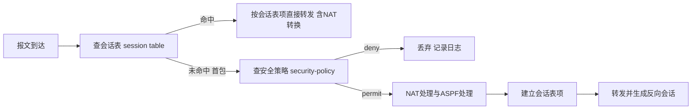

### 真题精练

**Q15.【真题·单选】** 状态检测防火墙与包过滤防火墙最本质的区别是（　　）。
A. 支持 NAT  B. 维护会话表并据此判断连接状态  C. 支持 VPN  D. 可以配置 ACL

> **答案：B**
> **解析**：状态检测的核心是建立并维护会话表，首包检查策略、后续包查会话表，并据此自动放通返回流量；包过滤无状态，必须显式放通反向流量。NAT、VPN 都可以在包过滤设备上附加实现，不是本质区别。

**Q16.【真题·判断】** 状态检测防火墙必须为出方向与入方向各配置一条安全策略，才能保证内网访问 Internet 后顺利收到回包。

> **答案：错误**
> **解析**：状态检测防火墙在内网首包创建会话时，会在会话表中记录正向与反向表项，Internet 回包命中反向表项后直接转发，无需配置入方向策略。反而若强行配置过宽的入方向策略，会显著扩大攻击面。

### 易错点与排错

- **误以为"配置了策略就有会话"**：会话在首包匹配策略 permit 后才建立，deny 不建会话。
- **把 NGFW 当纯包过滤用**：只写 region+IP+服务，不用 application/user，浪费能力也易被绕过（如 80 端口隧道）。
- **排错命令**：`display firewall session table`（会话是否为 0 说明首包未通过策略）、`display security-policy rule all`、`display firewall statistic system`。

## 2.2 状态检测机制核心：会话表与会话老化

### 考点定位
最高频考点之一。会话表字段、老化时间默认值、首包建会话的完整流程、TCP 状态与 FIN/RST 处理、UDP/ICMP 伪会话，都是选择题与填空题素材。

### 原理精讲
**会话（Session）**是状态检测防火墙记录的一条"连接状态信息"，由**五元组（源 IP、源端口、目的 IP、目的端口、协议号）**唯一标识（若启用多实例/虚拟系统，还需加上 VPN 实例等）。会话表项典型字段：

| 字段 | 含义 | 考试要点 |
|---|---|---|
| 源 IP / 源端口 | 发起方地址与端口 | 源 NAT 后记录转换后地址，出方向显示双地址 |
| 目的 IP / 目的端口 | 被访问方地址与端口 | 目的 NAT（NAT Server）会显示转换关系 |
| 协议 | TCP/UDP/ICMP/GRE 等 | 协议号决定老化时间与状态机 |
| 安全区域 | 入区域/出区域 | 体现流方向，如 Trust → Untrust |
| 应用协议 | HTTP/FTP/DNS 等 | 应用识别结果，NGFW 特有 |
| 会话状态 | TCP 状态（如 ESTABLISHED）、标志位 | 含 SYN/FIN/RST 标志位与是否建链 |
| 剩余老化时间 | 该会话多久后被删除 | 长连接问题排查关键 |
| Server-map / ASPF 标志 | 是否由 ASPF 生成临时通道 | FTP/PAT 场景常见 |
| 所属实例/VPN | 多实例或 VPN 场景 | 多实例防火墙排查要点 |

**处理流程（必须背）**：
1. 报文从入接口到达，**先查会话表**（快速转发路径）。
2. **命中**：直接按会话表记录的转换关系与出接口转发，**不再查安全策略、不再查 NAT 策略**（NAT 结果已固化在会话中）。
3. **未命中（首包）**：按顺序做 **安全策略检查**（源/目的区域、地址、用户、应用、服务、时间）→ 若 permit，再做 **NAT 策略处理**（源 NAT/目的 NAT）与 **ASPF/ALG 处理** → **建立会话表项**（记录正向与反向）→ 转发。
4. **反向回包**：命中会话表反向表项，直接回送，无需策略。

**为什么"首包查策略、后续包查会话"？**因为逐包做策略匹配（尤其是含应用识别、用户识别）代价极高；一条连接一旦被批准，其后所有报文合法性与转换关系都已确定，查一次哈希表即可命中，性能提升几个量级。这也是"改策略后老会话不生效"的原因——**需要 `reset firewall session table` 清会话或等老化**，这是实验与排错的高频坑。

**会话老化（Aging）**：会话表是有限资源，必须有超时回收机制。默认老化时间（USG6000E V600R007 常用值）：

| 协议/状态 | 默认老化时间 | 说明 |
|---|---|---|
| TCP（ESTABLISHED） | 1800 秒（30 分钟） | 建链成功后按此老化 |
| TCP（SYN/FIN 等中间状态） | 30 秒 | 半开或正在拆除的连接快速回收，防 SYN Flood 占表 |
| UDP | 120 秒 | 无连接协议按伪会话老化 |
| ICMP | 20 秒 | 短生命周期 |
| DNS（UDP 53） | 视版本 30 秒级 | 短查询快速回收 |

**TCP 会话状态与报文处理**：防火墙跟踪 TCP 三次握手，只有看到 **SYN → SYN+ACK → ACK** 完整握手后才将会话标记为 ESTABLISHED；这对安全有实际意义——**只有真正建链的连接才放行数据**，能有效过滤"不发 SYN 直接打 ACK"的 ACK Flood。拆除时，**首个 FIN 到达即开始老化计时**（或将会话置为 FIN 状态），**RST 到达则立即删除会话**，这样断连后资源立刻释放，避免"连接已断但会话表还占着"。若长时间无 FIN/RST（如主机异常断电），则靠老化时间回收。

**UDP/ICMP 伪会话（Pseudo-session）**：UDP 无连接状态，无法通过握手判断；ICMP 是请求/应答型。防火墙的处理方式是**"以首包创建伪会话，给你一个较短的存活期"**：第一个 UDP 报文建立会话，在其老化时间内（默认 120 秒）同源同目的的报文都视为同一连接，回包按反向表项放行。**为什么叫"伪"？**因为它不反映真实的连接状态，只是"地址对 + 时间窗"的近似，所以 UDP 场景会看到"同一业务被拆成多条会话"或"会话反复重建"的现象，UDP 业务不通时优先怀疑老化时间过短。

**长连接（Long Link）问题**：有些业务（数据库长事务、SSH 空闲、SIP 保持、心跳型应用）长时间无数据交互，若老化时间小于业务空闲间隔，会话会被删除，导致业务中断（现象：空闲一段时间后必须重连）。解决方案有两类：**调大/调小老化时间**（`firewall session aging-time`）或使用**长连接特性**（对指定应用/策略关闭会话老化或保持会话）。考试常考"某业务空闲 40 分钟断连，为什么？如何解决？"——答"TCP 默认老化 1800 秒 = 30 分钟，空闲超过老化时间会话被删除，需延长老化时间 `firewall session aging-time tcp 3600`"。

### 关键概念对照表

| 处理阶段 | 查什么表 | 是否做 NAT | 是否查策略 |
|---|---|---|---|
| 首包（未命中会话） | 先会话表（未命中） | 是（按 NAT 策略） | 是 |
| 后续同向包（命中会话） | 只查会话表 | 按会话表项转换 | 否 |
| 反向回包（命中反向会话） | 只查会话表 | 按会话表项反向转换 | 否 |
| 会话老化后 | 重新回到首包流程 | 是 | 是 |

| 定时器/默认值 | 数值 | 备注 |
|---|---|---|
| TCP 已建立会话老化 | 1800 s | 空闲超时即删 |
| TCP 半开/中间态老化 | 30 s | 抗 SYN Flood 占表 |
| UDP 伪会话老化 | 120 s | UDP 业务不通优先查这里 |
| ICMP 会话老化 | 20 s | 短 |
| TCP FIN 处理 | 首 FIN 即开始老化 | 半关闭快速回收 |
| TCP RST 处理 | 立即删除会话 | 断连即刻释放资源 |

### 华为设备配置
会话相关配置与查看（USG6000E VRP V600R007）。

```bash
system-view
# 1) 调整会话老化时间（长连接业务必需）
firewall session aging-time tcp 3600                // TCP 老化延长至 3600 秒，适应长连接
firewall session aging-time udp 300                 // UDP 老化延长，避免心跳型业务被中断
# 说明：华为部分版本中 TCP 老化时间默认 1800s、UDP 120s、ICMP 20s；
#      对数据库等超长空闲业务，除延长老化外还可使用长连接/会话保持特性。
# 2) 会话日志与资源保护
firewall log session enable                         // 开启会话日志，便于审计与攻击溯源
```

```bash
# 以下为通用可验证命令
display firewall session table                      // 查看全部会话
display firewall session table verbose              // 查看会话详细字段（含状态、老化时间）
display firewall session table source 10.1.1.100    // 只看某源地址的会话（排错首选）
display firewall session table destination 200.1.1.100  // 只看某目的地址的会话
display firewall session statistics                 // 查看会话数量统计
reset firewall session table                        // 清空会话表（改策略后立即生效）
```

```bash
# 会话表输出解读（典型字段示例）
# <T> 表示 TCP，10.1.1.100:52341 -> 200.1.1.100:80，状态 ESTABLISHED，剩余老化 1750s
```

### 示意图

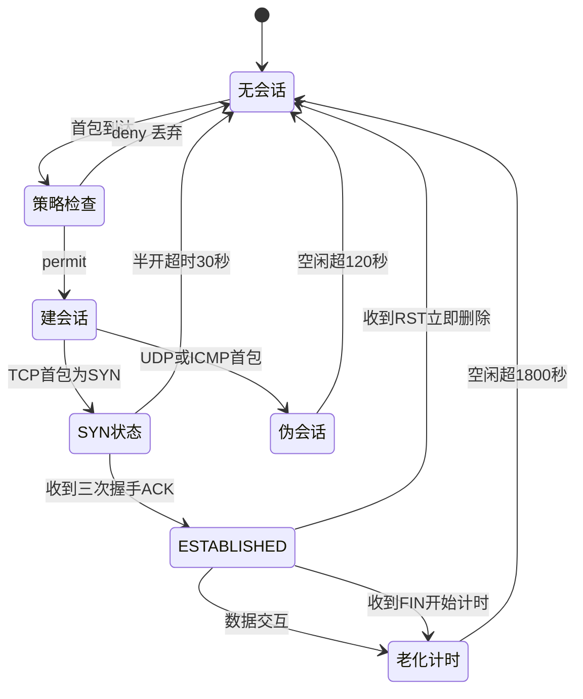

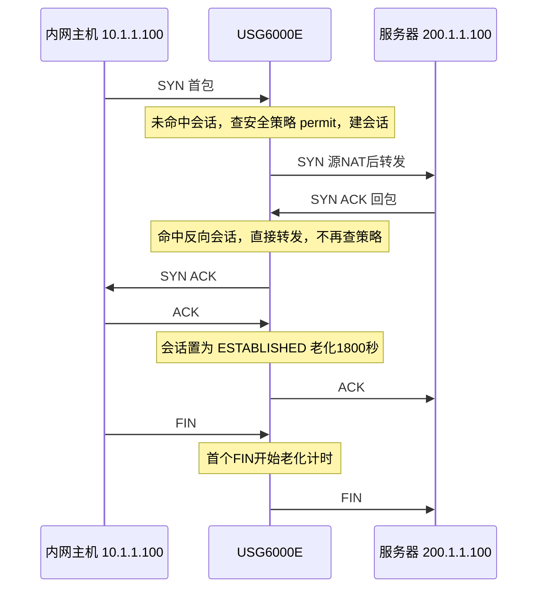

### 真题精练

**Q17.【真题·单选】** 华为 USG6000E 防火墙中，TCP 会话在 ESTABLISHED 状态下的默认老化时间约为（　　）。
A. 20 秒  B. 120 秒  C. 1800 秒  D. 86400 秒

> **答案：C**
> **解析**：TCP 已建立会话默认老化 1800 秒（30 分钟），UDP 伪会话 120 秒，ICMP 20 秒。长连接业务空闲超过 1800 秒会导致会话被删除而断连，需延长老化时间或使用长连接特性。

**Q18.【真题·多选】** 关于会话表处理流程，下列说法正确的是（　　）。
A. 首包未命中会话表时需要查安全策略
B. 命中会话表的后续报文不再查安全策略与 NAT 策略
C. 反向回包命中会话表反向表项后直接转发
D. 修改安全策略后，已建立的会话会立即按新策略处理

> **答案：A、B、C**
> **解析**：D 错。会话一旦建立，报文只查会话表，策略变更对老会话不生效；需 `reset firewall session table` 清除会话（或在会话老化后）新策略才起作用。这是实验与排错中最常见的"改了策略怎么还通"的原因。

**Q19.【真题·排错】** 现象：内网用户通过防火墙访问外部某数据库，业务正常；但空闲约 40 分钟后必须重新连接才能继续使用。请分析原因并给出解决命令。

> **答案**：
> （1）**原因**：防火墙对有状态会话做超时回收，TCP 已建立会话默认老化时间 1800 秒（30 分钟）。业务空闲 40 分钟远大于老化时间，会话被删除；再次通信时首包需重新走策略检查并建立新会话（或直接被中间设备拒绝），表现为"必须重连"。
> （2）**解决**：
> ```bash
> system-view
> firewall session aging-time tcp 7200      // 将 TCP 老化时间延长到 2 小时，覆盖业务空闲间隔
> display firewall session table verbose    // 验证会话剩余老化时间是否符合预期
> ```
> 若业务极长空闲，可进一步使用长连接/会话保持特性，或对特定应用单独设置更长的老化策略。
> **解析**：答"老化时间"是得分核心；只答"网络不稳定"不得分。排错时用 `display firewall session table source x.x.x.x` 观察会话是否消失。

### 易错点与排错

- **改策略不生效**：老会话仍在表中，需 `reset firewall session table`。
- **UDP 业务闪断**：先查 UDP 老化是否过短（默认 120 秒）。
- **把 FIN 与 RST 处理搞混**：FIN 是"开始老化计时"，RST 是"立即删除"。
- **误认为 UDP 有连接状态**：UDP 是伪会话，只有时间窗，没有握手。
- **排错命令**：`display firewall session table [verbose|source X|destination X]`、`display firewall session statistics`、`reset firewall session table`。

## 2.3 安全区域 Zone 与默认行为（与 Cisco 的关键差异）

### 考点定位
**每年必考**。安全区域优先级数值、Local 区域含义、区域内与区域间流量的默认行为、华为与 Cisco ASA 默认行为差异，是判断与选择题的固定得分点。

### 原理精讲
**安全区域（Security Zone）**是防火墙上的逻辑概念，用于给接口"打上信任标签"。接口必须加入某个区域才能参与安全策略匹配（未加入任何区域的接口，其流量默认无法通过策略处理）。USG6000E 默认可用的预定义区域及**默认优先级**：

| 区域 | 默认优先级 | 含义 | 典型接口 |
|---|---|---|---|
| Local | 100 | **设备本身**（防火墙自己的接口地址、管理面、设备发起的流量） | 不是物理接口，代表 USG 自身 |
| Trust | 85 | 高信任：内网办公终端 | 内网网关接口 |
| DMZ | 50 | 中等信任：对外服务器区 | 服务器区接口 |
| Untrust | 5 | 低信任：Internet | 公网接口 |
| 自定义区域（name） | 需手动指定 1–100 | 按业务自定义，如 `zone_guest` | 访客/生产分区 |

**关键概念 1：优先级数值的作用**。数值越大越"可信"，主要用于两点：① 决定流量方向描述（高→低为"出方向"、低→高为"入方向"）；② 在**没有明确安全策略时的默认行为**判断。优先级可以在自定义区域中配置（`set priority 60`），预定义区域优先级也可修改，但考试以默认值 100/85/50/5 为准。

**关键概念 2：Local 区域代表设备本身**。凡是"目的地址是防火墙自身接口地址"或"源是防火墙自己发起"的流量（如管理员 SSH 登录防火墙、防火墙 ping 外网、防火墙做 DNS 代理、IPSec 本端），其区域是 Local。因此**管理访问也受安全策略控制**：要允许管理网段 SSH 登录 USG，需要放通 `source-zone manage_zone → destination-zone local` 且服务为 SSH 的策略；这一点在实验题里经常被漏配，导致"策略都配了却登不上防火墙"。

**关键概念 3：区域内 vs 区域间的默认行为（华为与 Cisco 的核心区别）**：

| 流量类型 | 华为 USG 默认行为 | Cisco ASA 默认行为 |
|---|---|---|
| 不同安全区域之间（inter-zone） | **全部拒绝**（deny），必须显式配置安全策略放通 | 高→低（如 inside→outside）默认**允许**；低→高默认拒绝 |
| 同一安全区域内部（intra-zone） | 默认**允许**（同一区域视为同一信任级别，可直接互通） | 默认允许（同安全级别） |
| 到 Local 区域（设备自身） | 受安全策略控制，默认拒绝（各方向都需显式放通） | 受管理访问规则控制 |

**为什么华为选择"区域间全部拒绝"？**这是"默认安全（Secure by Default）"的设计哲学：设备开箱即用时不产生任何非预期的连通性，管理员必须显式声明"谁可以访问谁"，配置过程即为一次策略评审；而 Cisco ASA 的"高到低默认放通"虽然方便，但容易造成"以为没配策略就是安全的"的错觉。考试中一旦出现"华为防火墙默认不同区域之间可以互通吗"，答案永远是**不可以，默认拒绝**；出现"同一区域内流量"答案是**默认允许**（但推荐配策略或用 `firewall packet-filter` 收紧）。

**接口加入区域的配置思路**：物理接口必须先用 `firewall zone <zone>` 视图下的 `add interface` 加入区域，之后接口才具备"属于该信任级别"的属性。同一区域可加入多个接口（如同一部门多个接口都放 `trust`），实现"区域=信任级别的集合"的抽象。

### 关键概念对照表

| 区域 | 优先级默认值 | 可修改 | 是否代表设备 | 典型放通方向 |
|---|---|---|---|---|
| Local | 100 | 可 | 是 | 管理流量（可信网段 → local） |
| Trust | 85 | 可 | 否 | Trust → Untrust/DMZ |
| DMZ | 50 | 可 | 否 | Untrust → DMZ（仅发布端口）、DMZ → Trust（按需） |
| Untrust | 5 | 可 | 否 | 一般不允许主动入访 |
| 自定义 name | 手工指定 | 是 | 否 | 按业务自定义 |

| 场景 | 华为 USG 默认 | 需要配置的策略 |
|---|---|---|
| Trust → Untrust 上网 | 拒绝 | 需显式 permit |
| Untrust → Trust 主动访问 | 拒绝 | 需显式 permit（极少） |
| Trust → Trust（同区域两台主机互访） | 允许 | 若要限制需额外配置 |
| 管理员 → Local（SSH） | 拒绝 | 需 permit 到 local 的策略 |
| DMZ → Untrust | 拒绝 | 按业务 permit |

### 华为设备配置
区域、优先级与接口归属的完整配置。

```bash
system-view
# 1) 内网接口加入 Trust
interface GigabitEthernet1/0/1
 ip address 10.1.1.1 24
firewall zone trust
 add interface GigabitEthernet1/0/1
# 2) 公网接口加入 Untrust
interface GigabitEthernet1/0/2
 ip address 200.1.1.1 24
firewall zone untrust
 add interface GigabitEthernet1/0/2
# 3) 服务器区接口加入 DMZ
interface GigabitEthernet1/0/3
 ip address 10.1.3.1 24
firewall zone dmz
 add interface GigabitEthernet1/0/3
# 4) 自定义区域（访客区）并设置优先级
firewall zone name guest_zone id 20                 // 创建自定义区域，id 为区域编号
 set priority 40                                    // 优先级 40，低于 Trust 高于 Untrust
 add interface GigabitEthernet1/0/4
# 5) 放通管理流量到 Local（否则无法远程管理，高频漏配）
security-policy
 rule name permit_mgmt_to_local
  source-zone trust
  destination-zone local
  source-address 10.1.1.0 24
  service https ssh                                 // 仅放通加密管理与 SSH
  action permit
```

```bash
display firewall zone                                // 查看区域、优先级与接口成员
display firewall zone verbose                        // 查看区域详细信息（含区域内接口与统计）
```

```bash
# 通用命令
display firewall zone                                // 区域与成员接口
display security-policy rule all                     // 策略与顺序
display interface brief                              // 确认接口状态与是否已加入区域
```

### 示意图

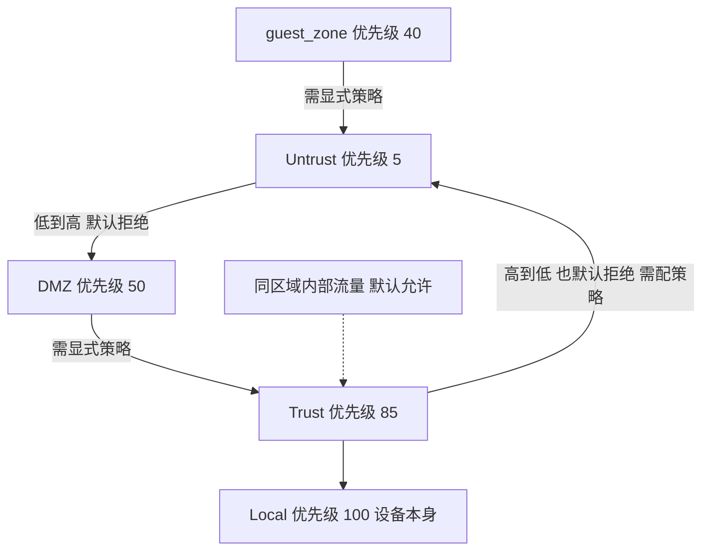

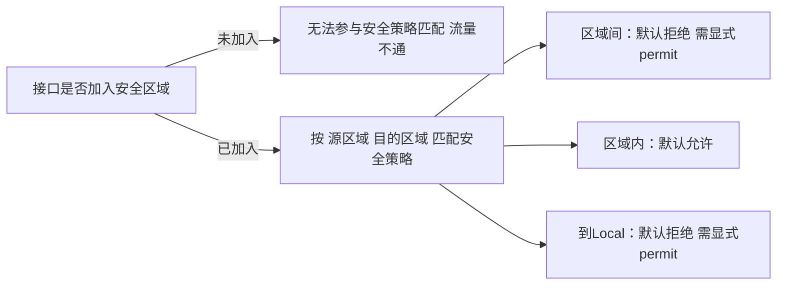

### 真题精练

**Q20.【真题·单选】** 华为 USG6000E 防火墙默认情况下，不同安全区域之间的流量以及同一安全区域内部的流量分别如何处理？
A. 全部拒绝；全部允许  B. 全部允许；全部拒绝  C. 全部拒绝；默认允许  D. 高到低允许；低到高拒绝

> **答案：C**
> **解析**：华为防火墙遵循"区域间默认拒绝、区域内默认允许"的默认安全原则。区域间必须显式配置安全策略；同一区域内流量默认互通。D 是 Cisco ASA 的默认行为（高安全级别到低安全级别默认放通），是本题最强的干扰项，务必区分。

**Q21.【真题·多选】** 关于 USG6000E 的 Local 区域，下列说法正确的是（　　）。
A. Local 区域代表防火墙设备本身
B. 管理员通过 SSH 登录防火墙的流量目的区域为 Local
C. 防火墙自身发起的 ping 报文源区域为 Local
D. Local 区域可以像物理接口一样用 `add interface` 把 GE1/0/1 加入

> **答案：A、B、C**
> **解析**：Local 是代表设备自身的特殊区域，优先级 100，不作为物理接口的归属区域（`add interface` 不适用于 Local），因此 D 错。凡目的为设备接口地址的流量、或设备自身发起的流量，都归属 Local，因此管理访问必须配置到 Local 的安全策略，否则登录不上。

**Q22.【真题·填空】** USG6000E 预定义安全区域的默认优先级为：Local ______、Trust ______、DMZ ______、Untrust ______。

> **答案：100；85；50；5**
> **解析**：这是一组必背默认值。自定义区域优先级由 `set priority` 手工指定（1–100）。优先级用于描述信任级别与流量方向，华为设备上不改变"区域间默认拒绝"的结论。

### 易错点与排错

- **把 Cisco 默认行为套到华为**：华为区域间一律默认拒绝。
- **忘配到 Local 的策略**：表现为"策略配好了但 SSH/HTTPS 登不上防火墙"。
- **接口未加入区域**：`display firewall zone` 看不到接口，任何策略都不匹配。
- **同名区域重复创建**：自定义区域需用不同 id 与名称。
- **排错命令**：`display firewall zone`、`display security-policy rule all`、`display interface brief`。

## 2.4 安全策略的匹配要素与匹配顺序

### 考点定位
实验题核心，也是选择题高频。考匹配要素（区域、地址、用户、应用、服务、时间、动作）、匹配顺序（自上而下、命中即停、默认拒绝）、以及"策略不生效"的排错判断。

### 原理精讲
USG6000E V600R007 的**安全策略（Security Policy）**是统一的访问控制框架，其规则匹配要素如下：

| 匹配要素 | 说明 | 备注 |
|---|---|---|
| 源/目的安全区域 | 流量入接口/出接口所属区域 | 必配，方向决定策略含义 |
| 源/目的地址 | IP 地址、地址段、地址组 | 支持地址集（address-set） |
| 用户/用户组 | 认证后的用户身份 | 需配合 AAA 认证，实现"按人控" |
| 应用 | 应用识别结果（如 HTTP、企业微信、P2P） | NGFW 特色，可识别非标端口应用 |
| 服务 | 协议 + 端口（如 tcp 80、http） | 与"应用"可同时使用 |
| 时间段 | time-range，按时段生效 | 常用于"仅工作时间禁止娱乐" |
| 动作 | permit / deny | 也可引用内容安全配置文件 |
| 安全配置文件（profile） | IPS/AV/URL/文件过滤配置 | 需 License |

**匹配顺序三条铁律**：
1. **自上而下（按规则 ID 顺序）**：规则按 `rule name` 创建顺序（ID 递增）依次匹配，ID 小的先匹配。
2. **命中即停（First Match）**：一旦某条规则所有条件都匹配成功，立即执行其动作，**不再继续向下匹配**。因此策略的**位置比数量更重要**：把一条 deny 放在 permit 之后毫无意义。
3. **默认拒绝（Default Deny）**：所有规则都不匹配时，执行**默认规则（default rule）动作 deny**，并记录日志。这意味着"没有策略 = 不通"，任何放通都必须显式声明。

**动作细节**：`permit` 表示允许通过并按引用的内容安全配置文件检测；`deny` 表示丢弃（可选记录日志/会话）。**注意 deny 不建立会话**（会话表看不到被拒绝的流），所以"会话表为空"既可能是没流量，也可能是被策略拒绝，需要用 `display security-policy statistics` 或日志确认。

**策略设计的三条实践原则**：① **精确优先**：越精确的规则放越前面（先 deny 恶意 IP，再 permit 大段）；② **最小放通**：只放业务必需的服务/应用，不用 `any`；③ **对称考虑**：状态检测只需配单向，但若涉及 Server-map 未覆盖的协议或双向主动连接（如 SIP、部分视频会议），需评估双向策略。

**为什么用安全策略取代 ACL？**路由器的 ACL（Access Control List）只能匹配五元组且**无状态**（每包独立判断、需双向配置）、无应用与用户维度、与 NAT/QoS 逻辑分离；防火墙的安全策略**有状态**（只写单向）、能匹配区域/用户/应用/时间、可绑定内容检测、且天生默认拒绝。因此"防火墙放着 ACL 不用"是正常的——**安全策略是 ACL 的超集**，这是华为防火墙与路由器最本质的功能差异之一。

**策略与认证的配合**：当策略中引用了用户/用户组时，未认证用户会被引导到认证页面（Portal），认证成功后防火墙把"用户"与"IP"绑定（用户表），后续匹配策略时用绑定关系识别身份。这是"基于身份的访问控制"落地方式。

### 关键概念对照表

| 匹配要素 | 是否必配 | 常见错误 | 影响 |
|---|---|---|---|
| 源区域/目的区域 | 是 | 方向写反 | 策略永不命中 |
| 源/目的地址 | 建议 | 子网掩码写错/漏写掩码 | 匹配范围错误 |
| 服务/应用 | 建议 | 只写端口漏写协议 | 该放通的没放通 |
| 时间段 | 否 | 设备时间未同步 | 策略在预期时段不生效 |
| 动作 | 是 | 只配 permit 不配 deny 顺序 | 该拦的没拦住 |

| 行为 | 华为安全策略 | 路由器 ACL |
|---|---|---|
| 状态 | 有状态（会话表） | 无状态 |
| 方向配置 | 只配单向（回程自动） | 通常需双向 |
| 匹配维度 | 区域/地址/用户/应用/服务/时间 | 五元组/部分高级 ACL |
| 默认行为 | 默认拒绝 | 默认允许（末尾隐含 permit） |
| 内容检测 | 可引用 IPS/AV/URL 配置 | 不支持 |

### 华为设备配置
一条完整的生产级策略示例：内网按部门、按应用上网，禁止非工作时间访问娱乐站点，对外只发布 Web。

```bash
system-view
# 1) 地址与服务对象定义（便于策略引用与维护）
ip address-set office_dept type object               // 定义办公网段地址集
 address 0 10.1.1.0 mask 24
ip address-set guest_dept type object
 address 0 10.1.2.0 mask 24
# 2) 时间段定义
time-range work_time 08:00 to 18:00 working-day      // 工作日 8:00-18:00
# 3) 内容安全配置文件（可选，需 License）
profile type ips name ips_default                    // 创建 IPS 配置文件
profile type url-filter name url_office              // 创建 URL 过滤配置文件
# 4) 安全策略：自上而下、命中即停
security-policy
 rule name deny_guest_full_access
  source-zone guest_zone
  destination-zone untrust
  source-address address-set guest_dept
  action deny                                        // 访客默认禁止上网（放在最前，精确优先）
 rule name office_web_worktime
  source-zone trust
  destination-zone untrust
  source-address address-set office_dept
  application http https dns                         // 按应用放通，比端口更精确
  time-range work_time
  action permit
  profile ips ips_default                            // 引用 IPS，检测攻击流量
 rule name publish_web_server
  source-zone untrust
  destination-zone dmz
  destination-address 200.1.1.100 32
  service http https
  action permit
 rule name permit_mgmt_to_local
  source-zone trust
  destination-zone local
  source-address 10.1.1.0 24
  service https ssh
  action permit
```

```bash
display security-policy rule all                     // 查看全部规则（含顺序与默认规则）
display security-policy statistics rule all          // 查看各规则命中计数，验证是否命中
display firewall session table verbose               // 验证放通后是否建立会话
display time-range all                               // 查看时间段状态是否 active
```

### 示意图

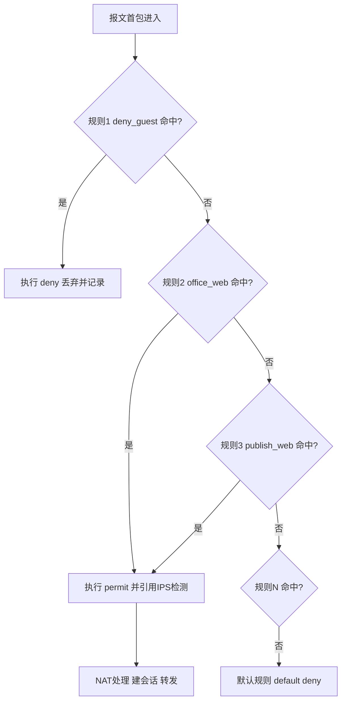

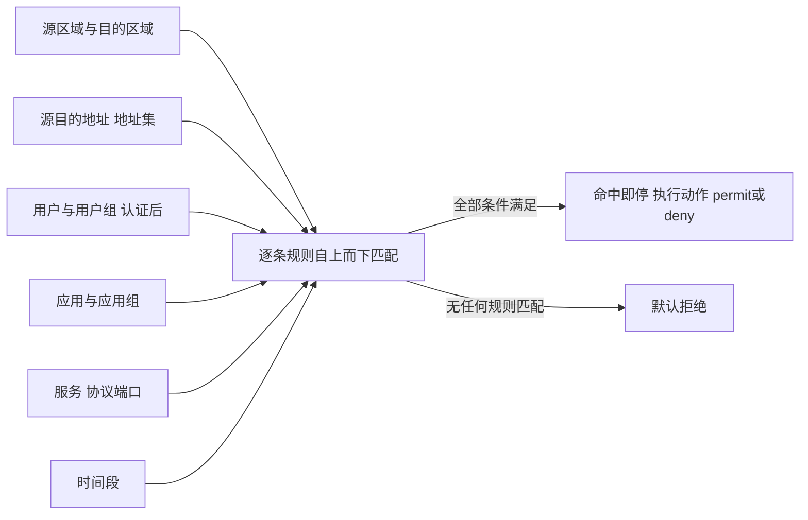

### 真题精练

**Q23.【真题·单选】** 华为 USG6000E 安全策略的匹配方式是（　　）。
A. 自下而上，最长匹配  B. 自上而下，命中即停  C. 按优先级数值大小选择最优规则  D. 全部规则都匹配后取最严格动作

> **答案：B**
> **解析**：安全策略按规则 ID 顺序自上而下依次匹配，命中第一条完全匹配的规则即执行其动作并停止，剩余规则不再评估；全部不匹配时执行默认规则（deny）。C、D 是路由器策略路由或其他厂商机制的混淆项。

**Q24.【真题·排错】** 网络管理员配置了 `rule name allow_web`（permit，允许 10.1.1.0/24 访问外网 HTTP/HTTPS），此前还有一条 `rule name deny_all_temp`（deny，source trust → destination untrust，源地址 any）。测试发现用户仍无法上网，会话表中无相关会话。请分析原因并给出修正方法。

> **答案**：
> （1）**原因**：安全策略"自上而下、命中即停"。`deny_all_temp` 位于前面且源地址为 any，用户流量会先命中这条 deny 规则而被丢弃，后面的 permit 规则永远不会被评估，因此会话表为空。
> （2）**修正**：核心是让精确的 permit 规则先于过宽的 deny 规则生效。常用做法有两种：
> ① 删除或收窄临时 deny 规则：
> ```bash
> system-view
> security-policy
>  rule name deny_all_temp
>   source-address 10.1.9.0 24        // 把 any 收窄为真正需要拒绝的网段
>   quit
> ```
> ② 让原 deny 规则失效（`undo rule name deny_all_temp`），只保留按业务最小放通的 permit 规则；
> 随后执行 `reset firewall session table` 清除可能残留的会话，使新策略立即生效。
> （3）**验证**：
> ```bash
> display security-policy rule all               // 确认规则顺序与条件
> display security-policy statistics rule all    // 观察哪条规则命中计数在增长
> display firewall session table                 // 命中 permit 后应出现新会话
> ```
> **解析**：本题得分点是"命中即停"与"顺序比数量重要"；排错必须用 `display security-policy statistics` 确认到底命中哪条规则。

**Q25.【真题·多选】** 下列属于 USG6000E 安全策略可匹配要素的是（　　）。
A. 源/目的安全区域  B. 用户与用户组  C. 应用（如 HTTP、P2P）  D. 时间段  E. 交换机的 VLAN ID

> **答案：A、B、C、D**
> **解析**：安全策略支持区域、地址、用户、应用、服务、时间段、动作及内容安全配置文件。E 错：VLAN ID 属于二层标识，不是防火墙安全策略的匹配要素（透明模式下按接口/区域识别，而不是按 VLAN ID 匹配策略）。

### 易错点与排错

- **规则顺序颠倒**：宽的 deny 在前会"吞掉"后面所有 permit。
- **只配 permit 不验证命中**：用 `display security-policy statistics rule all` 看命中计数。
- **时间段不生效**：设备时间未同步（`display clock`），time-range 状态不是 active。
- **遗漏到 Local 的放通**：管理流量被默认拒绝。
- **排错命令**：`display security-policy rule all`、`display security-policy statistics rule all`、`display firewall session table`、`display time-range all`。

## 2.5 ASPF 与 Server-map 表

### 考点定位
常考"FTP 主动/被动模式为什么需要 ASPF""Server-map 的作用与查看命令""ASPF 与 ALG 的关系"。属于状态检测的进阶必考点。

### 原理精讲
**ASPF（Application Specific Packet Filter，应用层特定报文过滤）**是华为对"应用层状态检测"的实现：它不仅看五元组，还会**解析应用层协议的控制报文，从中提取后续动态连接的端口信息，并预先生成一条临时放行表项（Server-map）**，从而让原本会被策略/会话机制阻断的"动态端口连接"能够通过。

**为什么需要它？以 FTP 为例**（RFC 959）：

FTP 使用两条连接：**控制连接（TCP 21，全程保持）**与**数据连接（端口动态）**。

- **主动模式（PORT，Active）**：客户端从控制连接发出 `PORT h1,h2,h3,h4,p1,p2`，告诉服务器"请用 TCP 主动连接我的 `p1*256+p2` 端口"。此时**服务器会主动向客户端发起数据连接（服务器 20 端口 → 客户端高位端口）**。这在 NAT/防火墙环境下最麻烦：① 客户端在私网，服务器根本无法直接连到私网地址，需要 **NAT ALG 改写 PORT 命令中的地址与端口**；② 该数据连接是"由外向内主动发起"的，若没有额外放通，华为防火墙默认拒绝区域间流量，连接建立不起来。
- **被动模式（PASV，Passive）**：客户端发 `PASV`，服务器回 `227 Entering Passive Mode (h1,h2,h3,h4,p1,p2)` 告知自己开放的随机高位端口，**由客户端主动连服务器**。该连接方向是"内→外"，方向友好，但**端口随机**——若策略只放通 21 端口，数据连接仍会被拒绝。

**ASPF 的解决方式**：防火墙解析控制连接的报文内容，提取出即将使用的地址/端口，生成 **Server-map 表项**（含三元组/五元组的临时通道），并为该通道放行，同时启动一段较短的老化时间（典型几十秒到几分钟）。数据连接建立后转化为普通会话表项。**一句话总结：ASPF 负责"看应用层、开临时门"，Server-map 是"这扇临时门"的表项，NAT ALG 负责改写报文中的地址端口（两者常同时生效）。**

**Server-map 的两种来源**：
1. **ASPF 动态生成**（FTP 数据通道、SIP 媒体流等），有老化时间，用完即删。
2. **配置生成**（如 NAT Server、NAT 中的 no-pat 场景会生成静态 Server-map 表项，用于反向查找），通常是静态的、长期存在。

**Server-map 与安全策略的关系**：Server-map 表项在会话建立之前就"预放行"特定流量，因此它**优先级高于普通策略匹配顺序**（命中 Server-map 可直接建立会话）。这也解释了考试常见结论：`display firewall server-map` 能看到 FTP/SIP 等多通道协议的临时通道；若 FTP 能登录（21 端口通）但**列目录卡死**（数据连接不通），首选排查 ASPF 是否开启。

**命令说明**：华为 VRP 中开启 ASPF 用 `firewall detect ftp`（V500/V600 系列命令风格），部分新版本在安全策略中通过应用识别 + ALG 自动处理。考试答题时写 `firewall detect ftp` 即可。

### 关键概念对照表

| 对比项 | ASPF | Server-map | NAT ALG |
|---|---|---|---|
| 本质 | 应用层状态检测机制 | 预放行/转换查找表项 | 应用层载荷地址端口改写 |
| 解决什么 | 动态多通道协议被阻断 | 提供临时通道与反向查找 | 私网地址出现在应用载荷中无法通信 |
| 是否有老化 | 由生成它的会话驱动 | 动态表项有老化，静态表项长期 | 随会话存在 |
| 查看命令 | `display firewall server-map`（结果体现） | `display firewall server-map` | `display firewall session table` |
| 典型协议 | FTP、SIP、RTSP、H.323 | 同上 + NAT Server/No-PAT | FTP、PPTP、SIP、DNS |

| FTP 模式 | 数据连接发起方 | 端口特点 | 主要问题 | 需要的机制 |
|---|---|---|---|---|
| 主动 PORT | 服务器 → 客户端 | 服务器 20 → 客户端高位 | 私网地址不可达 + 由外向内被拒绝 | NAT ALG 改写 + ASPF 开通道 |
| 被动 PASV | 客户端 → 服务器 | 服务器随机高位端口 | 端口随机，策略难放通 | ASPF/ALG 动态放通 |

### 华为设备配置
开启 ASPF 并验证 Server-map。

```bash
system-view
# 1) 开启 FTP 的 ASPF 检测（解析 PORT/PASV 并生成 Server-map）
firewall detect ftp
# 2) 若还有 SIP、RTSP 等多媒体协议
firewall detect sip                                  // 开启 SIP 的 ASPF，处理 SDP 中的媒体地址
firewall detect rtsp                                 // 开启 RTSP 的 ASPF
# 3) 保证应用层检测所需的会话（策略放通控制连接即可）
security-policy
 rule name trust_to_untrust_ftp
  source-zone trust
  destination-zone untrust
  source-address 10.1.1.0 24
  service ftp
  action permit                                      // 只放通 21 端口，数据通道靠 ASPF 自动打开
```

```bash
display firewall server-map                           // 查看 ASPF/静态生成的 Server-map 表项
display firewall server-map verbose                   // 查看表项详细（地址、端口、老化时间）
display firewall session table verbose                // 查看控制与数据会话是否都已建立
display firewall session table destination 200.1.1.100  // 针对特定 FTP 服务器排查
```

```bash
# Server-map 典型表项含义
# Type: ASPF  表示由应用层检测动态生成，用于 FTP 数据连接等临时通道
# Type: Static 或 nat server 相关 表示由配置生成，用于反向查找
```

### 示意图

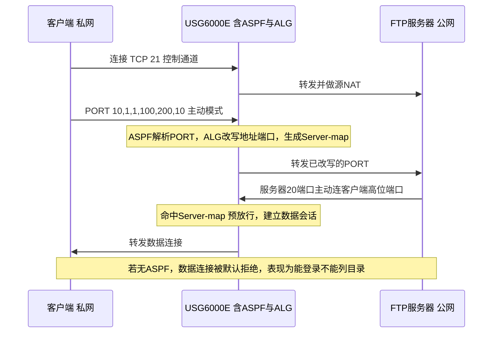

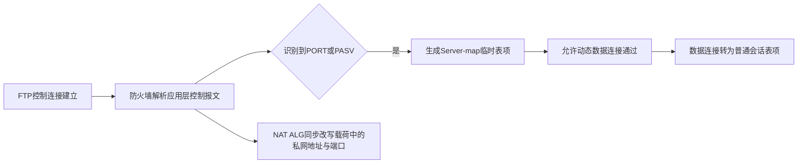

### 真题精练

**Q26.【真题·单选】** 在华为防火墙环境下，FTP 客户端能够成功登录（21 端口连通）但无法列目录、传文件，最可能的原因是（　　）。
A. 未配置 NAT Server  B. 未开启 FTP 的 ASPF/ALG，数据连接被拒绝  C. FTP 服务器未开启被动模式  D. 未配置默认路由

> **答案：B**
> **解析**：控制连接（21）通、数据连接不通是 ASPF/ALG 未生效的典型症状。FTP 数据连接使用动态端口且主动模式下由服务器主动发起，若不解析控制报文生成 Server-map 并改写载荷地址，数据连接会被防火墙按"区域间默认拒绝"丢弃或无法路由。A 与公网发布相关，与此现象无关；C 只影响模式选择，不是根因；D 若缺默认路由连 21 都不会通。

**Q27.【真题·判断】** Server-map 表项在会话建立之前就能对特定流量预先放行，因此其作用优先于普通安全策略的顺序匹配。

> **答案：正确**
> **解析**：Server-map 是"预放行通道"，命中后可直接建立会话并转发，不必逐条匹配安全策略；这也是多通道协议（FTP/SIP）在只放通控制端口的情况下仍能建立数据连接的原因。表项可用 `display firewall server-map` 查看，动态表项随会话老化而消失。

### 易错点与排错

- **只放通 21 端口就以为 FTP 可用**：还需 ASPF/ALG 处理数据连接。
- **混淆 ASPF 与 ALG**：ASPF 侧重"检测并开临时门"，ALG 侧重"改写应用载荷中的地址端口"，实际场景常同时需要。
- **Server-map 表项为空就去查策略**：先确认是否真的产生了多通道协议流量，再看 ASPF 是否开启。
- **排错命令**：`display firewall server-map`、`display firewall session table verbose`、`display current-configuration | include detect`（核对 ASPF 开关）。

## 2.6 接口模式、部署模式与双机热备入门（含与路由器的区别）

### 考点定位
常考"三种部署模式的区别与适用场景""透明模式的特点""USG 与路由器的区别""双机热备的作用与基本概念"。属于概念性送分题 + 实验题前提知识。

### 原理精讲
**接口工作模式**：
- **路由模式（三层模式）**：接口配置 IP 地址，作为网关参与路由转发，可做 NAT、可运行 OSPF/BGP 等动态路由协议。**最常用**，适用于出口网关、区域间隔离。
- **透明模式（二层模式）**：接口不配 IP，像交换机一样基于 MAC 转发，USG 对现网"隐身"，**部署时无需改动现有网络地址规划**，适用于内网分区隔离、串接在不改 IP 的链路上。缺点：不能做 NAT（无三层地址）、不能跑路由协议、部分功能受限（可配管理 IP 用于管理）。
- **旁路模式（监听模式）**：仅镜像流量做检测审计，不串联在转发路径上，**不阻断流量**（只能告警），常用作 IDS/审计；若要阻断必须改为串联。

**部署模式**（按在网络中的位置）：
- **网关模式（出口部署）**：USG 充当 Internet 出口网关，做 NAT、安全策略、VPN，是校赛实验最常见的拓扑。
- **透明串接**：区域间隔离，不改地址。
- **旁路检测**：只审计不阻断。
- **双机热备部署**：两台 USG 做冗余（见下）。

**双机热备（HRP，Huawei Redundancy Protocol）**：两台 USG 组成主备（Active/Standby）或负载分担（需 License），通过**心跳链路**同步会话表、Server-map、NAT 表项、配置、License 等状态。当主设备故障时，备设备凭借已同步的会话表**无缝接管**，已建立的连接不中断（这是"热"备的关键：会话表同步）。核心概念：
- **心跳接口/心跳链路**：专用直连链路或经交换机互联，用于状态同步（HRP 报文）。
- **主备状态**：Active/Standby，通过优先级/抢占决定。
- **监控（track）**：`hrp track interface` 监控上行接口，接口故障触发切换。
- **配置同步**：一般由主设备向备设备自动同步（命令 `hrp auto-sync`），因此**只需在主设备上配置**。

**华为防火墙与路由器的区别（高频考点）**：

| 对比项 | 路由器（AR/NE） | 防火墙（USG6000E） |
|---|---|---|
| 核心功能 | 路由转发、广域网互联 | 安全隔离、访问控制、内容检测 |
| 访问控制手段 | ACL（无状态，默认允许） | 安全策略（有状态，默认拒绝） |
| 默认连通性 | 接口 up 且有路由即可通 | 接口 up + 路由 + 策略放通才通 |
| 流量识别维度 | 五元组为主 | 区域/用户/应用/内容（L2-L7） |
| NAT | 支持（nat-policy/接口 NAT） | 支持且与安全策略配合 |
| 状态检测 | 一般无会话表概念（部分支持） | 核心机制，会话表 + Server-map |
| 内容安全 | 不支持 IPS/AV/URL | 支持（需 License） |
| 双机 | VRRP/路由冗余 | HRP 会话同步 + VRRP 联动 |

**一句话记忆**：路由器是"**让流量通**"的设备，防火墙是"**决定流量该不该通**"的设备。所以在实验里最典型的坑是："路由都通了、接口也 up，为什么 ping 不通？"——因为防火墙默认拒绝，需要安全策略。

### 关键概念对照表

| 工作模式 | 是否有 IP | 能否 NAT | 对现网影响 | 典型场景 |
|---|---|---|---|---|
| 路由模式 | 有 | 能 | 需改地址规划 | 出口网关、区域隔离 |
| 透明模式 | 无（可配管理 IP） | 不能 | 无需改地址 | 内网分区、串接隔离 |
| 旁路模式 | 有（仅管理） | 不能 | 无（不阻断） | 审计、检测、IDS |

| HRP 概念 | 说明 | 关键命令 |
|---|---|---|
| HRP | 华为冗余协议，主备状态同步 | `hrp enable` |
| 心跳接口 | 同步会话/配置的通道 | `hrp interface ... remote ...` |
| 监控接口 | 接口故障触发切换 | `hrp track interface ...` |
| 自动同步 | 主设备配置同步到备机 | `hrp auto-sync ...` |
| 状态查看 | 确认主备与同步状态 | `display hrp state` |

### 华为设备配置
三种模式的关键配置与 HRP 基础配置。

```bash
# ---- 1) 路由模式（三层接口）----
system-view
interface GigabitEthernet1/0/1
 undo portswitch                                      // 确保接口工作在三层（默认即三层）
 ip address 10.1.1.1 24
 service-manage enable
 service-manage ping permit
firewall zone trust
 add interface GigabitEthernet1/0/1
```

```bash
# ---- 2) 透明模式（二层接口，部分型号/版本支持）----
system-view
interface GigabitEthernet1/0/3
 portswitch                                           // 切换为二层交换接口
 vlan-type dot1q 10                                   // 允许 VLAN 10 的报文通过（按需）
firewall zone dmz
 add interface GigabitEthernet1/0/3                    // 二层接口同样需加入区域
# 透明模式下只需要管理地址，通常放在独立的带外管理接口上
interface GigabitEthernet1/0/0
 ip address 10.1.100.1 24                             // 管理地址，用于登录与监控
 service-manage enable
 service-manage https permit
```

```bash
# 说明：透明模式（二层接口）仅转发不路由，因此不能做 NAT、不能跑动态路由协议；
#      管理面通过独立的管理接口或管理 VLAN 承载
```

```bash
# ---- 3) 双机热备 HRP 基础配置（主设备）----
system-view
hrp enable                                            // 开启 HRP 双机热备
hrp interface GigabitEthernet1/0/6 remote 10.1.10.2   // 指定心跳接口与对端地址
hrp track interface GigabitEthernet1/0/1              // 监控上行接口，故障时触发主备切换
hrp auto-sync config                                  // 自动同步配置到备机（以版本实际命令为准）
```

```bash
display hrp state                                     // 查看 HRP 主备状态与同步结果
display hrp interface                                 // 查看心跳接口状态
display firewall session table                        // 切换后确认会话是否延续（热备验证点）
```

### 示意图

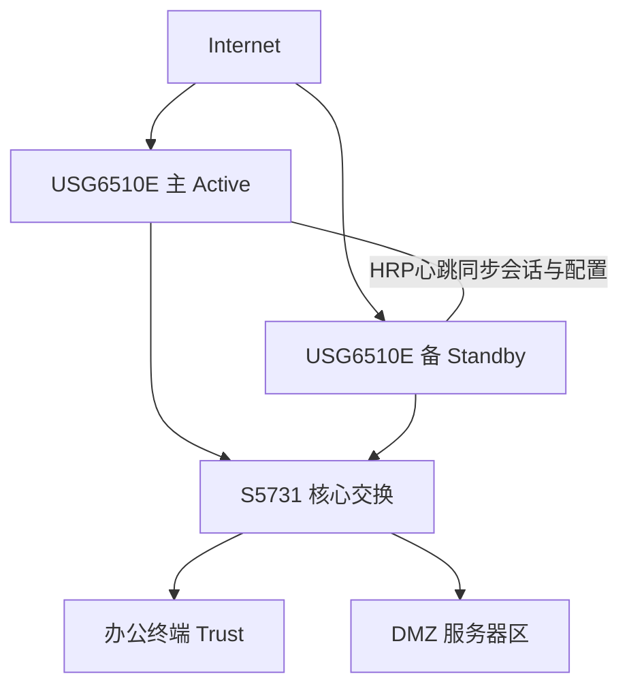

```mermaid
flowchart LR
    A["流量到达防火墙"] --> B{"接口工作模式"}
    B -->|"路由模式"| C["三层转发 可NAT 可跑路由协议"]
    B -->|"透明模式"| D["二层转发 不改地址 不可NAT"]
    B -->|"旁路模式"| E["镜像流量 只检测不阻断"]
    C --> F["安全策略控制"]
    D --> F
```

### 真题精练

**Q28.【真题·单选】** 企业希望在不改变现有 IP 地址规划的前提下，对两个内网部门之间做访问控制，最合适的部署方式是（　　）。
A. 路由模式出口部署  B. 透明模式串接  C. 旁路镜像部署  D. 双机热备部署

> **答案：B**
> **解析**：透明模式下防火墙不配置三层业务地址、基于二层转发，串接后无需修改现网地址规划即可实施区域隔离与策略控制。A 会改变地址规划（需引入新网段）；C 只检测不阻断，无法实现"控制"；D 是可靠性方案，不解决"不改地址"的需求。

**Q29.【真题·多选】** 关于华为防火墙与路由器的区别，下列说法正确的是（　　）。
A. 华为防火墙区域间流量默认拒绝，路由器 ACL 默认允许
B. 防火墙安全策略有状态，路由器 ACL 无状态
C. 路由器可实现 IPS/AV 等内容安全检测，防火墙不具备
D. 防火墙可基于用户与应用维度做访问控制，路由器 ACL 一般不能

> **答案：A、B、D**
> **解析**：C 完全说反了：内容安全（IPS/AV/URL）是防火墙/NGFW 的能力（USG6000E 需 License），普通路由器不具备。A、B、D 正确，其中"默认拒绝 + 有状态"是华为防火墙与路由器最本质的两条差异。

**Q30.【真题·简答】** 简述防火墙双机热备（HRP）中"同步会话表"的意义，以及为什么只配置主设备即可。

> **答案要点**：
> （1）**同步会话表的意义**：主设备故障切换到备设备时，备设备已持有相同的会话表项（含 NAT 转换关系、Server-map、TCP 状态），已建立的连接可继续转发，用户无感知，实现"热"切换；若不支持会话同步（冷备），切换后所有连接需重建，长连接业务会中断。
> （2）**只配主设备的原因**：HRP 具备配置自动同步机制，主设备配置会实时同步到备设备（含策略、区域、NAT、接口等），因此在主设备配置后无需在备设备重复配置，也避免了双机配置不一致导致的切换异常。
> （3）**验证**：`display hrp state` 查看主备与同步状态，切换后 `display firewall session table` 确认会话延续。
> **解析**：答题要同时点出"会话同步保证业务不中断"与"配置自动同步保证一致性"。

### 易错点与排错

- **透明模式却想配 NAT**：透明（二层）无三层地址，不能做 NAT。
- **旁路模式以为能阻断**：旁路只镜像检测，无法拦截流量。
- **HRP 心跳未直连或跨三层不通**：`display hrp state` 显示异常，切换失败。
- **忘记 service-manage**：USG 接口默认关闭管理功能，Ping/HTTPS 管理都需 `service-manage` 显式放通。
- **排错命令**：`display hrp state`、`display interface brief`、`display firewall zone`、`display security-policy rule all`。

---

# 安全-HCIA-章节3-NAT技术详解

NAT 是安全方向实验题的"必答题"：**内网访问互联网 + 对外发布服务器**是校赛省赛最经典的组合拓扑。本章重点是三个"必须讲清"：源 NAT 四种方式的区别、华为防火墙 `nat-policy` 配置体系、**NAT 与安全策略的处理流水线顺序**。

## 3.1 NAT 的作用与源 NAT 四种方式对比

### 考点定位
高频选择题与配置题。考点集中在：NAT 解决什么问题、源 NAT 四种方式的差异（是否转换端口、是否一对一）、地址池耗尽后的行为、Easy-IP 与 Smart NAT 的区别。

### 原理精讲
**NAT（Network Address Translation，网络地址转换）**的核心作用是**在报文穿越设备时改写 IP 报头（必要时还改写传输层端口与应用层载荷）**，从而解决三类问题：

1. **地址节约**：私网地址（RFC 1918：10.0.0.0/8、172.16.0.0/12、192.168.0.0/16）不能出现在公网，通过 NAT 让大量内网主机共享少量公网地址上网。
2. **隐藏内网结构**：外网只能看到转换后的公网地址，无法直接定位内网主机，间接提升机密性（这也是 NAT 常被当作"安全手段"的原因，但**NAT 不是访问控制设备，不要把它当防火墙**）。
3. **对外发布服务**：通过目的 NAT 把公网地址端口映射到内网服务器。

**源 NAT（Source NAT，SNAT）**转换的是**报文的源地址（及端口）**，用于"内网主动访问外网"。华为防火墙上常见四种实现：

**① NAT No-PAT（No Port Address Translation）**：只转换 IP 地址，**不转换端口**，因此必须是**一对一**占用——一个私网地址对应一个公网地址，会话数受限于地址池大小。**特点**：转换后外网看到的是"某台主机"而非"某端口"，适合需要保留源端口或被对端做源端口校验的场景（如某些做 IP 白名单的第三方系统）。地址池用完后，新连接**无法转换而失败**（不是丢弃已有连接）。

**② NAPT（Network Address Port Translation）**：同时转换 IP 与端口，实现**多对一**，是最常用的"PAT（Port Address Translation）"模式，即 `mode pat`。一台公网地址理论上可支持约 6 万个端口并发（受端口范围与保留端口限制）。**为什么能多对一？**因为会话表记录"私网 IP:端口 ↔ 公网 IP:端口"的映射关系，回包时按公网端口反查回私网地址，所以多台主机可共享同一公网地址而无歧义。

**③ Easy-IP**：NAPT 的特例——**直接使用出接口的 IP 地址做转换**，不消耗独立公网地址池，配置最简单，广泛用于小型网络出口。缺点：出接口地址变化（如拨号）时依赖会话重建；所有内网主机共享接口地址，审计粒度粗。

**④ Smart NAT（智能 NAT）**：**地址池 + Easy-IP 的组合**。先用地址池中的地址做 NAPT，地址池用完后再自动使用出接口地址继续转换，从而兼顾"优先使用独立公网地址（便于溯源/第三方白名单）"与"地址不足时仍能上网（可用性）"。它解决的是"地址池太小导致部分用户上不了网"的问题。

此外还有 **NAT Server / 目的 NAT**（对外发布，3.3 节）、**双向 NAT**（会话双方都被转换）、**两次 NAT**（域内/域间转换）等形态。

**为什么源 NAT 必须与"会话表"绑定？**因为转换是有状态的：回包必须按会话表项做**反向转换**（把目的公网地址+端口还原成私网地址+端口），否则内网主机收不到回包。因此源 NAT 的转换关系全部落在会话表里，`display firewall session table verbose` 能看到形如"`10.1.1.100:52341[200.1.1.10:1025] -> 8.8.8.8:53`"的双地址显示。

### 关键概念对照表

| 源 NAT 方式 | 是否转换端口 | 地址映射关系 | 是否需要地址池 | 地址池耗尽行为 | 典型场景 |
|---|---|---|---|---|---|
| NAT No-PAT | 否 | 一对一 | 需要 | 新连接转换失败 | 需保留源端口/IP 白名单场景 |
| NAPT（PAT） | 是 | 多对一 | 需要 | 端口耗尽后新连接失败 | 企业出口主流 |
| Easy-IP | 是 | 多对一 | 不需要（用出接口地址） | 端口耗尽 | 小型出口、拨号链路 |
| Smart NAT | 是 | 多对一 | 需要 + 出接口地址兜底 | 自动切换到出接口地址 | 地址池不足仍需上网 |

| 对比项 | 源 NAT | 目的 NAT |
|---|---|---|
| 转换对象 | 源 IP/端口（私网 → 公网） | 目的 IP/端口（公网 → 私网） |
| 触发方向 | 内网主动出访 | 外网主动访问内网服务器 |
| 配置位置 | `nat-policy` 的 source-nat 动作 | `nat server` 或 `nat-policy` 的 destination-nat 动作 |
| 是否需要安全策略 | 需要（放通出方向） | 需要（放通入方向到 DMZ/服务器区） |
| 与会话关系 | 转换关系写会话表 | 转换关系写会话表 + Server-map |

### 华为设备配置
四种源 NAT 的配置对照（USG6000E V600R007）。

```bash
system-view
# ---- 1) NAT No-PAT：只转地址不转端口（地址组 mode no-pat）----
nat address-group pool_nopat
 mode no-pat                                        // 不转换端口，一对一占用
 section 0 200.1.1.10 200.1.1.20                     // 地址池范围
# ---- 2) NAPT：转地址 + 转端口（mode pat）----
nat address-group pool_pat
 mode pat                                           // 端口转换，多对一（默认推荐）
 section 0 200.1.1.30 200.1.1.40
# ---- 3) Easy-IP：直接使用出接口地址，无需地址池 ----
# 只需在 NAT 策略中引用 easy-ip 动作，见 3.2 节
# ---- 4) Smart NAT：地址池 + 出接口地址兜底（以版本支持的命令为准）----
nat address-group pool_smart
 mode pat
 section 0 200.1.1.50 200.1.1.55
```

```bash
display nat address-group                              // 查看所有 NAT 地址池及模式
display nat-policy rule all                            // 查看 NAT 策略规则与动作
display firewall session table verbose                 // 查看会话中的地址转换关系（双地址显示）
```

### 示意图

```mermaid
flowchart LR
    PC["内网主机 10.1.1.100"] --> FW["USG6000E 出口"]
    FW -->|"No-PAT 一对一 不改端口"| A1["200.1.1.10 独占"]
    FW -->|"NAPT 多对一 改端口"| A2["200.1.1.30 端口复用"]
    FW -->|"Easy-IP 用出接口地址"| A3["200.1.1.1 接口地址"]
    FW -->|"Smart NAT 池优先 接口兜底"| A4["200.1.1.50 或 接口地址"]
    A1 --> INET["Internet"]
    A2 --> INET
    A3 --> INET
    A4 --> INET
```

```mermaid
sequenceDiagram
    participant C as "内网主机 10.1.1.100:52341"
    participant FW as USG6000E
    participant S as "服务器 8.8.8.8:53"
    C->>FW: 源 10.1.1.100:52341 目的 8.8.8.8:53
    Note over FW: 首包：安全策略 permit 后做源NAT 转成 200.1.1.30:1025 并建会话
    FW->>S: 源 200.1.1.30:1025 目的 8.8.8.8:53
    S->>FW: 回包 目的 200.1.1.30:1025
    Note over FW: 命中会话表 反向转换为 10.1.1.100:52341
    FW->>C: 源 8.8.8.8:53
```

### 真题精练

**Q1.【真题·单选】** 华为防火墙上配置源 NAT 时，若希望多台内网主机共用一个公网地址上网且转换源端口，应使用（　　）。
A. NAT No-PAT  B. NAPT（mode pat）  C. 目的 NAT  D. NAT Server

> **答案：B**
> **解析**：NAPT 同时转换 IP 与端口，实现多对一复用，是出口上网的默认方式（`nat address-group` 下 `mode pat`）。A 只转地址不转端口，必须一对一占用；C、D 都是转换目的地址，用于对外发布服务器，方向不对。

**Q2.【真题·多选】** 关于 Easy-IP 与 Smart NAT，下列说法正确的是（　　）。
A. Easy-IP 使用出接口地址做转换，不需单独的公网地址池
B. Smart NAT 会先用地址池、用尽后使用出接口地址继续转换
C. Easy-IP 只能一对一，不能实现多对一
D. Smart NAT 的价值在于兼顾地址溯源需求与地址不足时的可用性

> **答案：A、B、D**
> **解析**：C 错。Easy-IP 是 NAPT 的特例，同样转换端口，是多对一（所有内网主机共享出接口地址的不同端口）。A、B、D 正确：Smart NAT = 地址池 + Easy-IP 兜底，先保证"部分流量用独立公网地址便于溯源/白名单"，再用接口地址保证所有人能上网。

**Q3.【真题·填空】** NAT No-PAT 模式只转换报文的 ______ 地址而不转换 ______，因此私网与公网地址之间是 ______ 关系。

> **答案：源 IP；端口；一对一**
> **解析**：No-PAT 意为"不做端口转换"，地址池中的每个公网地址只能分配给一个私网主机，地址池耗尽后新建连接无法转换成功。若需要多对一必须使用 pat（NAPT）模式。

### 易错点与排错

- **把 NAT 当安全手段**：NAT 隐藏内网不等于访问控制，必须配合安全策略。
- **地址池太小用 No-PAT**：用户间歇性上不了网，改成 `mode pat` 或换 Smart NAT。
- **Easy-IP 用在需要第三方 IP 白名单的场景**：对端只认固定 IP，接口地址变化或共享会导致认证失败。
- **排错命令**：`display nat address-group`、`display nat-policy rule all`、`display firewall session table verbose`（看转换后地址是否符合预期）。

## 3.2 华为防火墙 nat-policy 配置体系

### 考点定位
实验必配。考"nat-policy 与安全策略的关系""rule 匹配要素""no-nat 怎么排除地址""exclude 与 no-nat 的版本差异"，以及"为什么地址池配了却没生效"。

### 原理精讲
华为防火墙的源 NAT 在 **V600R007 上统一由 `nat-policy`（NAT 策略）** 描述，其结构是"**地址池（nat address-group） + 策略规则（nat-policy rule）**"两层：

- **`nat address-group`**：定义可用的公网地址资源与转换模式（`mode pat` / `mode no-pat`），用 `section` 指定地址段（`section 0 起始IP 结束IP`）。一个地址组可含多段。
- **`nat-policy` + `rule`**：定义"**哪些流量做哪种转换**"。匹配要素与安全策略类似：源/目的安全区域、源/目的地址、服务/应用、时间段等；动作为 `source-nat address-group <name>`（引用地址池）、`source-nat easy-ip`（用出接口地址）或 `no-nat`（**不做转换**）。

**版本差异（考点）**：

| 版本/形态 | 源 NAT 配置风格 | 排除特定流量 |
|---|---|---|
| USG6000E V600R007（现代） | `nat-policy` → `rule name X` → `action source-nat ...` | 规则动作用 `no-nat` |
| USG6000 V500R005（早期） | `nat-policy` → `policy source ... destination ...` → `action source-nat ...` | 规则动作用 `no-nat` |
| AR 路由器 | ACL + `interface` 下 `nat outbound <acl> [address-group N] [no-pat]` | ACL 中写 `rule deny` |

**`no-nat` 的用途**：企业访问某些合作方/分支机构的地址时，双方内网地址可能重叠或对方要求"看到真实源地址"，此时用优先级更高的 rule 匹配该目的地址并设置 `action no-nat`，让这些流量**不经过转换直接转发**。**注意顺序**：nat-policy 规则同样**自上而下、命中即停**，所以 `no-nat` 规则必须放在通用 `source-nat` 规则**前面**，否则永远不会命中。

**为什么要单独设计一套 nat-policy，而不像路由器那样用 ACL 绑定 NAT？**因为路由器的 `nat outbound <acl>` 把"匹配条件"和"转换动作"耦合在一个 ACL 里，只能匹配五元组，无法表达"市场部员工访问 Internet 用地址池 A、访客区用接口地址、访问分支机构不做转换"这类多维度需求。华为防火墙把"**谁（区域/地址/用户/应用）**"与"**怎么转换（地址池/接口地址/不转换）**"拆成可组合的规则，既便于按业务编排，也便于用命中计数做排错。**地址池模式的选择原则**：需要被第三方按源 IP 白名单校验时用 `mode no-pat`（一对一），通用上网场景用 `mode pat`（多对一），公网地址紧张时用 `easy-ip` 或 `Smart NAT`。**转换失败的处理**：要提前评估并发会话峰值，`mode pat` 下同一公网地址的可用端口有限（受保留端口与四元组唯一性约束），高并发场景要保证地址池容量足够，否则高峰期会出现"部分用户上不了网"的间歇性故障，这种故障最容易被误判为链路问题。

**nat-policy 与安全策略的先后**：这是本章最核心的机制（详见 3.5）。一句话：**首包先匹配安全策略，再做 NAT 转换**。因此：
- 内网出访的源 NAT 场景，安全策略里的**源地址要写转换前的私网地址**（写公网地址无效）；
- 对外发布的目的 NAT 场景，安全策略里的**目的地址要写转换前的公网地址**（写私网地址无效）。
这两条是实验题最容易配错的地方。

### 关键概念对照表

| 配置对象 | 作用 | 关键参数 | 查看命令 |
|---|---|---|---|
| `nat address-group` | 定义公网地址资源 | `mode pat/no-pat`、`section` | `display nat address-group` |
| `nat-policy rule` | 定义转换匹配与动作 | 区域、地址、服务、动作 | `display nat-policy rule all` |
| `source-nat address-group` | 用地址池做源 NAT | 引用地址组名 | `display nat-policy statistics` |
| `source-nat easy-ip` | 用出接口地址做源 NAT | 无 | 同上 |
| `no-nat` | 排除，不转换 | 需放在前面 | 同上 |

### 华为设备配置
一份完整的出口源 NAT 配置（含排除规则与统计查看）。

```bash
system-view
# 1) 定义公网地址池（PAT 模式）
nat address-group pool_out
 mode pat                                             // 端口转换模式，多对一
 section 0 200.1.1.10 200.1.1.20                      // 可用的公网地址段
# 2) 定义 NAT 策略：先排除，后转换（自上而下、命中即停）
nat-policy
 rule name no_nat_to_branch
  source-zone trust
  destination-zone untrust
  source-address 10.1.1.0 24
  destination-address 201.1.1.0 24                    // 访问分支机构的流量
  action no-nat                                        // 不做地址转换，保留真实源地址
 rule name snat_to_internet
  source-zone trust
  destination-zone untrust
  source-address 10.1.1.0 24
  destination-address any
  action source-nat address-group pool_out             // 其余上网流量做源 NAT
 rule name snat_easyip_backup
  source-zone guest_zone
  destination-zone untrust
  action source-nat easy-ip                            // 访客区直接用出接口地址，节省公网地址
```

```bash
display nat-policy rule all                            // 查看 NAT 策略顺序与动作
display nat address-group                              // 查看地址池与模式
display nat-policy statistics rule all                 // 查看各 NAT 规则命中计数（排错关键）
display firewall session table verbose                 // 查看会话中的转换前后地址
```

```bash
# ---- 附：AR6120 路由器上的源 NAT（对比记忆，考试也会考）----
system-view
acl number 2000
 rule 5 permit source 10.1.1.0 0.0.0.255              // 用 ACL 匹配需要转换的私网网段
 quit
nat address-group 1
 mode pat
 section 0 200.1.1.10 200.1.1.20
 quit
interface GigabitEthernet0/0/1
 nat outbound 2000 address-group 1                    // 接口下调用 ACL + 地址池做源 NAT
 nat alg ftp enable                                   // 路由器上开启 FTP ALG（默认可能关闭）
```

### 示意图

```mermaid
flowchart TD
    A["内网首包到达"] --> B{"安全策略是否 permit"}
    B -->|"deny"| C["丢弃 不建会话 不做NAT"]
    B -->|"permit"| D{"nat-policy 规则自上而下匹配"}
    D -->|"命中 no-nat"| E["不转换 直接转发"]
    D -->|"命中 source-nat 地址池"| F["按地址池做PAT转换"]
    D -->|"命中 easy-ip"| G["用出接口地址做PAT转换"]
    D -->|"无规则命中"| H["不做NAT 直接转发"]
    E --> I["建立会话并转发"]
    F --> I
    G --> I
    H --> I
```

### 真题精练

**Q4.【真题·排错】** 管理员配置如下：安全策略中 `allow_out` 规则源地址写的是地址池地址 `200.1.1.10/32`，服务 any，动作 permit；NAT 策略中 `snat_to_internet` 源地址写 `10.1.1.0/24`，动作 `source-nat address-group pool_out`。内网用户无法上网，会话表为空。请分析原因。

> **答案**：
> （1）**原因**：首包处理顺序是"**先匹配安全策略，再做 NAT 转换**"。安全策略匹配的是**转换前的私网源地址 10.1.1.0/24**，而管理员写成了转换后的地址池地址 200.1.1.10，导致没有任何流量命中 permit 规则，全部落到默认拒绝，既不建立会话也不会执行 NAT，表现为完全上不了网。
> （2）**修正**：
> ```bash
> system-view
> security-policy
>  rule name allow_out
>   source-zone trust
>   destination-zone untrust
>   source-address 10.1.1.0 24            // 必须写转换前的私网地址
>   service any
>   action permit
> ```
> （3）**验证**：
> ```bash
> reset firewall session table             // 清老会话，使新策略立即生效
> display nat-policy statistics rule all   // 观察 NAT 规则命中计数是否增长
> display firewall session table verbose   // 应看到 10.1.1.100:xxxx[200.1.1.10:yyyy] 形式的转换
> ```
> **解析**：记住口诀"**策略看原址、NAT 看转换**"。源 NAT 场景策略写私网、目的 NAT 场景策略写公网。

**Q5.【真题·多选】** 关于 `action no-nat` 的使用，正确的有（　　）。
A. 用于让指定流量不做地址转换
B. 应配置在通用 source-nat 规则之前，否则不会命中
C. 配置后该流量不需要安全策略即可通过
D. 常用于访问地址重叠或要求看到真实源地址的对端网络

> **答案：A、B、D**
> **解析**：C 错。`no-nat` 只是"不转换地址"，**放通与否仍由安全策略决定**，两个策略体系相互独立又协同工作。A、B、D 正确，尤其 B：NAT 策略同样命中即停，排除规则必须在前。

### 易错点与排错

- **策略写转换后地址**：源 NAT 写私网、目的 NAT 写公网，记住"策略看原址"。
- **no-nat 规则排在后面**：永不命中，等于没配。
- **地址池未 `section` 或写反起止地址**：`display nat address-group` 查看，规则格式为 `section 0 起始 结束`。
- **NAT 规则命中数为 0**：用 `display nat-policy statistics rule all` 定位，常见原因是源/目的区域写反。
- **排错命令**：`display nat-policy rule all`、`display nat-policy statistics rule all`、`display firewall session table verbose`。

## 3.3 目的 NAT、NAT Server 与双向 NAT

### 考点定位
实验必考"对外发布 Web 服务器"。考点：`nat server` 命令参数含义、与安全策略的配合、双向/域内 NAT 的必要性、以及"外网访问不通"的排错顺序。

### 原理精讲
**目的 NAT（Destination NAT，DNAT）**转换报文的**目的地址（及端口）**，典型用途是让 Internet 用户通过一个公网地址访问内网/DMZ 服务器。华为防火墙上两种实现：

**① NAT Server（接口视图，最常用、考题最标准）**：
```
nat server <名称> protocol tcp global <公网地址> <公网端口> inside <私网地址> <私网端口>
```
例如 `nat server web_srv protocol tcp global 200.1.1.100 8080 inside 10.1.3.10 80` 表示：外网访问 `200.1.1.100:8080` 时，防火墙把目的地址改成 `10.1.3.10:80` 送往 DMZ。关键点：
- `global` 可用 `current-interface` 表示"使用该接口当前地址"，适合地址由 DHCP/PPPoE 动态获取的场景；
- 省略端口时为"整机映射"（如 `nat server server1 protocol icmp global 200.1.1.101 inside 10.1.3.30`）；
- 配置后会在 **Server-map 表**生成静态表项（正向转换 + 反向查找），可用 `display firewall server-map` 查看。

**② 目的 NAT（nat-policy 中的 destination-nat 动作，V600R007 风格）**：用 `nat-policy rule` 匹配目的区域/地址/服务，动作为 `action destination-nat ...`，适合需要按用户/时间段/应用精细控制发布策略的场景，也可与源 NAT 在同一策略体系中统一编排。

**安全策略必须显式放通**：这是最重要的考点。目的 NAT 只解决"地址往哪转"，**不解决"允不允许访问"**。V600R007 上必须在安全策略中放通 `source-zone untrust → destination-zone dmz`（或服务器所在区域），且**目的地址写转换前的公网地址**、服务写公网端口。只配 `nat server` 不配安全策略，现象就是"外网访问超时、会话表无会话"。

**为什么需要双向 NAT？**两类典型场景：
1. **内网用户用公网地址访问内网服务器（域内访问/回流，Hairpin）**：内网主机访问 `200.1.1.100:8080`，若只做目的 NAT，服务器收到报文的源地址是内网地址（可直达），回包会**直接走内网而不经过防火墙**，导致"请求经防火墙转换、回包不经防火墙"的**路径不对称**，会话表状态与真实流量不一致而断连。解决办法是**同时做源 NAT**（把内网源地址也转换成公网地址），使回包必须回到防火墙再做反向转换，路径对称。
2. **双向转换需求**：外网访问 DMZ 服务器，服务器需要把请求转发到内网（如反向代理/堡垒机场景），或要求隐藏真实客户端来源，需要源与目的同时转换。

**两次 NAT（域内 NAT / 域间 NAT）**：指一条流在防火墙上被转换两次（先目的 NAT 再源 NAT，或不同接口上各转一次），典型落地就是上述"域内访问 + 源 NAT 兜底"。考试中遇到"内网用户访问内网服务器的公网映射地址不通"就答"需要域内 NAT/双向 NAT，同时做源与目的转换"。

### 关键概念对照表

| 参数/概念 | 含义 | 示例 |
|---|---|---|
| `protocol tcp` | 指定协议（可 tcp/udp/icmp） | `protocol tcp` |
| `global` | 公网（转换前）地址与端口 | `global 200.1.1.100 8080` |
| `current-interface` | 用接口当前地址（动态地址场景） | `global current-interface 80` |
| `inside` | 私网（真实服务器）地址与端口 | `inside 10.1.3.10 80` |
| 省略端口 | 整机映射（所有端口） | `nat server s1 protocol icmp global 200.1.1.101 inside 10.1.3.30` |
| 安全策略目的地址 | 必须写**转换前的公网地址** | `destination-address 200.1.1.100 32` |

| 场景 | 需要目的 NAT | 需要源 NAT | 原因 |
|---|---|---|---|
| 外网访问内网服务器 | 是 | 否 | 单向转换即可 |
| 内网访问内网服务器的公网地址 | 是 | 是（双向 NAT） | 保证回包路径对称 |
| DMZ 服务器访问 Internet | 否 | 是 | 隐藏内网地址 |
| 发布服务器且需隐藏客户端来源 | 是 | 是 | 双向转换 |

### 华为设备配置
对外发布服务器 + 域内访问（双向 NAT）的完整配置。

```bash
system-view
# 1) 接口视图配置 NAT Server（把公网 200.1.1.100:8080 映射到 DMZ 10.1.3.10:80）
interface GigabitEthernet1/0/2
 nat server web_srv protocol tcp global 200.1.1.100 8080 inside 10.1.3.10 80
 nat server mail_srv protocol tcp global current-interface 25 inside 10.1.3.20 25   // 用接口当前地址发布邮件
# 2) 安全策略：放通外网到 DMZ 的访问（目的地址写转换前的公网地址）
security-policy
 rule name untrust_to_dmz_web
  source-zone untrust
  destination-zone dmz
  destination-address 200.1.1.100 32
  service http                                        // 服务按公网侧端口/协议匹配
  action permit
# 3) 域内访问（双向 NAT）：内网用户用公网地址访问内网服务器
security-policy
 rule name trust_intra_access
  source-zone trust
  destination-zone dmz
  destination-address 200.1.1.100 32
  action permit
nat address-group pool_intra
 mode pat
 section 0 200.1.1.60 200.1.1.60                       // 域内访问时把源地址也转为公网地址，保证路径对称
nat-policy
 rule name intra_hairpin_snat
  source-zone trust
  destination-zone dmz
  source-address 10.1.1.0 24
  destination-address 10.1.3.10 32                     // 转换后的服务器地址
  action source-nat address-group pool_intra
```

```bash
display firewall server-map                            // 查看 NAT Server 生成的正向/反向表项
display firewall server-map verbose                    // 查看表项详情（公网到私网的转换关系）
display nat server                                     // 查看已配置的 NAT Server 映射
display firewall session table verbose                 // 验证双向转换（内外地址同时出现）
```

### 示意图

```mermaid
sequenceDiagram
    participant U as 外网用户
    participant FW as USG6000E
    participant S as "DMZ服务器 10.1.3.10:80"
    U->>FW: 访问 200.1.1.100:8080
    Note over FW: 未命中会话 先查安全策略 untrust到dmz permit
    Note over FW: 再做目的NAT 转换为 10.1.3.10:80 建会话
    FW->>S: 目的 10.1.3.10:80
    S->>FW: 回包 源 10.1.3.10:80
    Note over FW: 命中会话 反向转换为 200.1.1.100:8080
    FW->>U: 回包 源 200.1.1.100:8080
    Note over U,S: 若未配安全策略 则首包被默认拒绝 会话表为空
```

```mermaid
flowchart TD
    A["内网用户访问公网映射地址 200.1.1.100"] --> B["目的NAT 转为 10.1.3.10"]
    B --> C{"是否同时做源NAT"}
    C -->|"未做"| D["服务器回包直接走内网 不回防火墙 路径不对称 会话失效"]
    C -->|"已做 双向NAT"| E["源地址转为公网地址 回包必然经防火墙"]
    E --> F["反向转换后会话正常 访问成功"]
```

### 真题精练

**Q6.【真题·单选】** 在 USG6000E 上执行 `nat server web protocol tcp global 200.1.1.100 8080 inside 10.1.3.10 80`，则外网用户访问该服务的正确方式是（　　）。
A. 访问 10.1.3.10:80  B. 访问 200.1.1.100:8080  C. 访问 200.1.1.100:80  D. 访问 10.1.3.10:8080

> **答案：B**
> **解析**：命令语义为"公网地址端口 → 私网地址端口"。`global 200.1.1.100 8080` 是对外暴露的入口，`inside 10.1.3.10 80` 是真实服务器，因此外网访问 `200.1.1.100:8080`，防火墙转换后以 `10.1.3.10:80` 送达。C 是端口未做转换时的常见误答。

**Q7.【真题·排错】** 管理员配置了 `nat server` 映射 Web 服务器，并用 `display nat server` 确认配置存在，但外网用户仍无法访问，`display firewall session table` 中也没有相关会话。请给出最可能的原因与排查/解决步骤。

> **答案**：
> （1）**最可能原因**：**未配置放通 untrust → dmz 的安全策略**（或策略中目的地址写成了私网地址 10.1.3.10，导致不匹配）。NAT Server 只做地址转换，是否放通由安全策略决定；若被默认拒绝，则不建立会话。
> （2）**排查步骤**：
> ```bash
> display security-policy rule all              // 检查是否存在 untrust到dmz 的 permit 规则
> display security-policy statistics rule all   // 看是否命中 deny（默认规则计数增长）
> display firewall server-map                   // 确认 server-map 表项已生成（配置生效）
> display firewall session table destination 10.1.3.10   // 查看目的地址侧会话
> ```
> （3）**解决**：
> ```bash
> system-view
> security-policy
>  rule name untrust_to_dmz_web
>   source-zone untrust
>   destination-zone dmz
>   destination-address 200.1.1.100 32    // 必须写转换前的公网地址
>   service http
>   action permit
> ```
> 同时检查接口是否已加入正确区域、DMZ 到服务器的路由是否存在。
> **解析**：答题必须点出"目的地址写公网"和"NAT 不负责放通"两点，这是本题的两个得分点。

**Q8.【真题·简答】** 为什么内网用户直接用公网映射地址访问内网服务器时，需要配置源 NAT 与目的 NAT（双向 NAT）？

> **答案要点**：
> （1）只做目的 NAT 时，服务器看到的源地址仍是内网地址，其回包会**直接从内网路由回客户端而不经过防火墙**；
> （2）而防火墙上的会话表是按"请求经防火墙转换"建立的，回包不经防火墙就无法完成反向转换与状态维护，出现**路径不对称**，表现为连接建立后立即中断或时通时不通；
> （3）同时做源 NAT 把内网源地址转换为公网地址后，服务器回包只能回到防火墙，由防火墙反向转换并转发，路径对称、会话正常；
> （4）这就是"域内 NAT/双向 NAT/Hairpin"的由来，配置上是在 `nat-policy` 中同时命中目的与源的转换动作（或两条相互配合的规则）。
> **解析**：关键词是"路径不对称""会话反向转换"，答题缺这两个词基本不得分。

### 易错点与排错

- **只配 NAT Server 不配安全策略**：外网访问不通的头号原因。
- **策略目的地址写私网地址**：DNAT 场景必须写转换前的公网地址。
- **公网端口与私网端口搞混**：`global` 是公网侧端口（策略里按此匹配），`inside` 是私网侧端口。
- **内网访问公网映射地址不通**：需要双向 NAT/域内 NAT。
- **排错命令**：`display nat server`、`display firewall server-map`、`display security-policy statistics rule all`、`display firewall session table verbose`。

## 3.4 NAT ALG 与 Server-map 表

### 考点定位
常考"为什么 FTP 需要 ALG""ALG 与 ASPF 的区别""哪些协议需要 ALG"。属于机制型选择题与简答题。

### 原理精讲
NAT 只改写 **IP 报头**与**传输层头部**（源/目的端口），但很多应用协议会把**地址与端口信息写在应用层载荷里**。一旦这些载荷中的私网地址不被打包改写，通信就会失败——这就是 **NAT ALG（Application Level Gateway，应用层网关）** 存在的原因。

**以 FTP 为例（必须能讲清）**：

FTP 有控制连接（TCP 21）与数据连接（动态端口），而数据连接的地址端口**由应用层命令协商**：
- **主动模式 PORT**：客户端在控制连接上发送 `PORT h1,h2,h3,h4,p1,p2`，把"我的 IP + 端口"写进了**载荷**。如果客户端在私网而 NAT 只改了 IP 报头，服务器解析载荷后拿到的是 `10.1.1.100` 这样的**私网地址**，它既路由不到，也会去连接一个不存在的公网主机 → **数据连接必然失败**。ALG 的作用是**识别 PORT 命令并同步改写载荷中的地址与端口**，使其变成 NAT 后的公网地址与端口。
- **被动模式 PASV**：服务器回 `227 Entering Passive Mode (...)`，其中含服务器开放的**随机高位端口**。若客户端在私网，通常服务器地址无需改写；但若服务器也在私网（如内网 FTP 服务器通过 NAT Server 发布），ALG 需把载荷中的私网地址改写为公网映射地址，否则客户端会去连一个不可达的私网地址。

因此 FTP 需要 **ALG（改写载荷）+ ASPF（解析控制报文并生成 Server-map 临时放行数据连接）** 两者配合：**ALG 保证"地址对"，ASPF/Server-map 保证"能通过"**。缺任一都会出现"能登录、不能列目录/传文件"的现象。

**其他需要 ALG 的协议**：
- **PPTP**：GRE 隧道（协议号 47）与 TCP 1723 控制连接配合，GRE 报文中包含呼叫 ID，NAT 环境需 ALG 处理（且需放通 GRE 协议，很多防火墙默认不放通非 TCP/UDP 协议）。
- **SIP**：SDP 报文中携带媒体流地址与端口，ALG 负责改写。
- **DNS**：应答报文中含 A 记录地址，NAT 场景（尤其内网 DNS 服务器向公网解析、或 A 记录指向私网地址）需要 ALG 处理。
- **RTSP/H.323**：媒体通道协商在载荷中，同样需要 ALG。
- **ICMP**：ICMP 差错报文（如 Destination Unreachable）会携带原始 IP 头，NAT 设备需据此反查会话做转换，属于 NAT 的基础能力。

**Server-map 与 ALG/ASPF 的关系**（承接 2.5 节）：
- **ASPF 生成的 Server-map（Type: ASPF）**：动态表项，用于多通道协议的临时通道放行，有老化时间；
- **NAT Server 生成的 Server-map（Type: Static/nat server）**：静态表项，用于公网→私网的目的转换与反向查找；
- **No-PAT 等源 NAT 场景**也能生成 Server-map，用于反向地址查找（保证外网可以主动访问该映射地址）。

**一句话总结关系**：**ASPF 是"机制"（看应用层、开临时门），ALG 是"动作"（改写载荷地址端口），Server-map 是"结果表项"（临时的放行/转换记录）**。

### 关键概念对照表

| 协议 | 载荷中携带地址端口 | 需要 ALG | 需要 ASPF | 不通时的典型现象 |
|---|---|---|---|---|
| FTP | PORT/PASV 命令与 227 应答 | 是 | 是 | 能登录不能列目录/传输 |
| SIP | SDP 中的媒体地址端口 | 是 | 是 | 能注册无声音/单通 |
| PPTP | GRE 呼叫 ID | 是 | 部分 | 能连隧道不能传数据 |
| DNS | A 记录地址 | 视场景 | 部分 | 解析结果不可达 |
| RTSP | 媒体描述中的地址 | 是 | 是 | 能点播无画面 |
| HTTP | 一般无（除部分重定向） | 否 | 否 | 无此类问题 |

| 概念 | 归属 | 作用 | 生命周期 | 查看命令 |
|---|---|---|---|---|
| ALG | NAT 功能 | 改写应用层载荷中的 IP/端口 | 随报文处理即时 | 无独立命令，看会话 |
| ASPF | 状态检测功能 | 解析控制报文，开动态通道 | 由会话驱动 | `display firewall server-map` |
| Server-map（动态） | ASPF 生成 | 临时放行多通道连接 | 有老化时间 | `display firewall server-map` |
| Server-map（静态） | NAT Server 生成 | 公网到私网转换与反向查找 | 长期（随配置） | `display firewall server-map` |

### 华为设备配置
开启 ALG/ASPF 并验证。

```bash
# ---- USG6000E：开启多通道协议的 ASPF/ALG ----
system-view
firewall detect ftp                                  // 开启 FTP ASPF，解析PORT/PASV并生成Server-map
firewall detect sip                                  // 开启 SIP ASPF，处理SDP中的媒体地址
firewall detect rtsp                                 // 开启 RTSP ASPF
firewall detect dns                                  // 开启 DNS ASPF，处理应答报文中的地址信息
# 说明：不同版本可检测的协议集合略有差异，部分协议通过安全策略中的应用识别自动触发 ALG；
#      以设备实际支持的命令为准，可用 display current-configuration | include detect 核对
```

```bash
# ---- 放通 FTP 的策略（只需放通控制连接，数据连接由 ASPF 打开）----
security-policy
 rule name trust_to_untrust_ftp
  source-zone trust
  destination-zone untrust
  source-address 10.1.1.0 24
  service ftp
  action permit
# ---- 发布内网 FTP 服务器：NAT Server + ALG 共同保证数据连接可用 ----
interface GigabitEthernet1/0/2
 nat server ftp_pub protocol tcp global 200.1.1.120 21 inside 10.1.3.20 21
```

```bash
display firewall server-map                            // 查看 ASPF 动态表项与静态映射表项
display firewall server-map verbose                    // 查看表项的地址端口与老化时间
display firewall session table verbose                 // 观察控制连接与数据连接是否都建立
display nat server                                     // 核对 NAT Server 映射
```

### 示意图

```mermaid
sequenceDiagram
    participant C as FTP客户端 私网 10.1.1.100
    participant FW as USG6000E ALG加ASPF
    participant S as FTP服务器 公网
    C->>FW: TCP21 登录 控制连接
    FW->>S: 源NAT后转发
    C->>FW: PORT 10,1,1,100,200,10
    Note over FW: ALG改写载荷为公网地址与端口
    Note over FW: ASPF生成Server-map临时通道
    FW->>S: 改写后的PORT命令
    S->>FW: 服务器20端口主动连客户端高位端口
    Note over FW: 命中Server-map 放行并建数据会话
    FW->>C: 数据连接建立 列目录成功
```

### 真题精练

**Q9.【真题·简答】** 请解释为什么在 NAT 环境下使用 FTP 主动模式必须部署 NAT ALG，并说明 ALG 与 ASPF 的配合关系。

> **答案要点**：
> （1）FTP 主动模式下，客户端通过控制连接发送 `PORT` 命令，把"自己的 IP 与端口"写在**应用层载荷**中；
> （2）NAT 默认只改写 IP 报头与传输层头部，**不会改应用层载荷**，因此服务器解析载荷后得到的是私网地址（如 10.1.1.100），既无法路由，也无法建立数据连接，表现为"能登录、不能列目录/传文件"；
> （3）**ALG** 负责识别 PORT/PASV 等命令并**同步改写载荷中的地址与端口**，使协商结果在公网侧有效；**ASPF** 负责解析控制报文并**生成 Server-map 临时表项**，放行由外向内发起的数据连接；两者配合才能完成传输；
> （4）被动模式同样可能因服务器地址为私网而需要 ALG 改写 227 应答。
> **解析**：得分点是"载荷改写（ALG）"与"动态通道放行（ASPF/Server-map）"两个维度，只说"开 ALG 就行"不完整。

**Q10.【真题·多选】** 关于 Server-map 表，下列说法正确的是（　　）。
A. 可以由 ASPF 动态生成，用于 FTP 等协议的数据通道
B. 可以由 NAT Server 静态生成，用于公网到私网的目的转换
C. 表项可以用 `display firewall server-map` 查看
D. Server-map 表项的存在意味着对应流量一定能通过，无需安全策略

> **答案：A、B、C**
> **解析**：D 错。Server-map 提供的是**地址转换关系与临时通道**，而"是否允许访问"仍由安全策略决定（NAT Server 场景必须显式放通 untrust → dmz）。A、B、C 均正确，其中动态表项有老化时间、静态表项随配置长期存在。

### 易错点与排错

- **以为 NAT 会改应用层载荷**：只有 ALG 才会，这是 FTP/SIP 问题的根因。
- **只开 ASPF 不开 ALG（或反之）**：地址不对或通道不放行，两者需配合。
- **忘放通非 TCP/UDP 协议**：PPTP 的 GRE（协议号 47）必须单独放通。
- **排错顺序**：先 `display firewall server-map` 看是否生成表项，再 `display firewall session table verbose` 看数据会话是否建立，最后核对策略与 ALG 开关。

## 3.5 NAT 与安全策略的处理流水线、综合配置与排错

### 考点定位
**本章最高频的机制考点**。选择题必考"先查会话还是先查策略""先 NAT 还是先查策略""回包是否查策略"。实验题则要求把"内网上网 + 服务器发布"一次配通。

### 原理精讲
把前面分散的机制串成一条**完整流水线**（USG6000E V600R007）：

**首包（未命中会话表）**：
1. **入接口接收报文**，确定入方向区域；
2. 查**会话表**：命中则直接按会话表项转发（含 NAT 转换），**流程结束**（不查策略、不查 NAT 策略）；
3. 未命中 → **查安全策略**：按源区域/目的区域/源地址/目的地址/用户/应用/服务/时间匹配，命中 `permit` 才继续，`deny` 则丢弃（记录日志、不建会话）；
4. **查 NAT 策略**（`nat-policy`）：按规则做**目的 NAT**（若有）与**源 NAT**（若有），改写报头（ALG 可同时改写载荷）；
5. **路由查找与转发**，并**创建会话表项**（记录正向/反向转换关系、状态、老化时间）。

**后续包**：只查会话表，按表项做转换与转发。

**回程包**：命中会话表的反向表项，按表项做**反向 NAT 转换**后转发，**不查安全策略**。

**三条必须背熟的结论**：

| 问题 | 结论 | 原因 |
|---|---|---|
| 收到报文先查会话还是先查策略？ | **先查会话表** | 快速转发路径，避免逐包做昂贵的策略与内容匹配 |
| 首包先查策略还是先做 NAT？ | **先查安全策略，再做 NAT** | 因此策略匹配的是**转换前**的地址与区域 |
| 回包是否再查策略？ | **不再查** | 反向会话表项已记录转换与放行关系 |

**由流水线推出的四条实战规则**：
1. **源 NAT 场景**：安全策略源地址写**私网地址**；NAT 策略源地址写**私网地址**。
2. **目的 NAT 场景**：安全策略目的地址写**公网地址**（转换前）、区域写**入接口所在区域（如 untrust）**；`nat server` 里 `global` 是公网侧。
3. **改了策略要清会话**：`reset firewall session table`，否则老会话仍按旧逻辑转发（这是"改了策略没生效"的唯一原因）。
4. **NAT 与策略是两套独立的匹配体系**：都放通才通，缺一不可（NAT 管"地址怎么变"，策略管"允不允许"）。

**综合实验场景**（校赛经典拓扑）：内网 `10.1.1.0/24` 通过 USG6000E 访问 Internet（NAPT），DMZ 内 `10.1.3.10` 的 Web 服务用 `200.1.1.100:8080` 对外发布，同时内网用户也能用该公网地址访问，管理网段 `10.1.1.0/24` 允许 SSH 管理防火墙。

### 关键概念对照表

| 报文类型 | 查会话表 | 查安全策略 | 做 NAT | 备注 |
|---|---|---|---|---|
| 首包（正向） | 未命中 | 是 | 是 | 按策略 → NAT 顺序 |
| 后续同向包 | 命中 | 否 | 按会话表 | 性能路径 |
| 回程包 | 命中反向 | 否 | 按会话表反向转换 | 不需要反向策略 |
| 被拒绝的首包 | 未命中 | 是（deny） | 否 | 不建会话，会话表无记录 |
| 会话老化后的包 | 回到首包流程 | 是 | 是 | 空闲超时后需重新建会话 |

| 排错命令 | 用途 |
|---|---|
| `display firewall session table verbose` | 看会话是否有、NAT 转换关系、状态与老化 |
| `display firewall session table source X` | 定位某台内网主机的会话 |
| `display security-policy rule all` | 核对策略条件与顺序 |
| `display security-policy statistics rule all` | 定位命中哪条策略（是否落到默认拒绝） |
| `display nat-policy rule all` / `display nat-policy statistics rule all` | 核对 NAT 规则与命中计数 |
| `display nat address-group` | 核对地址池与模式 |
| `display firewall server-map` | 核对 NAT Server/ASPF 表项 |
| `display ip routing-table` | 确认路由是否存在（有策略无路由照样不通） |

### 华为设备配置
校赛经典综合配置（内网上网 + 服务器发布 + 管理放通）。

```bash
system-view
# ================= 1) 接口与安全区域 =================
interface GigabitEthernet1/0/1
 ip address 10.1.1.1 24                                  // 内网网关
firewall zone trust
 add interface GigabitEthernet1/0/1
interface GigabitEthernet1/0/2
 ip address 200.1.1.1 24                                 // 公网接口
firewall zone untrust
 add interface GigabitEthernet1/0/2
interface GigabitEthernet1/0/3
 ip address 10.1.3.1 24                                  // DMZ 网关
firewall zone dmz
 add interface GigabitEthernet1/0/3
# ================= 2) 路由 =================
ip route-static 0.0.0.0 0.0.0.0 200.1.1.254               // 默认路由指向运营商
# ================= 3) 源 NAT：内网访问 Internet =================
nat address-group pool_internet
 mode pat
 section 0 200.1.1.10 200.1.1.20
nat-policy
 rule name snat_internet
  source-zone trust
  destination-zone untrust
  source-address 10.1.1.0 24
  action source-nat address-group pool_internet
 rule name snat_dmz_out
  source-zone dmz
  destination-zone untrust
  action source-nat easy-ip                            // DMZ 服务器出访用接口地址
# ================= 4) 目的 NAT：对外发布 Web =================
interface GigabitEthernet1/0/2
 nat server web_pub protocol tcp global 200.1.1.100 8080 inside 10.1.3.10 80
# ================= 5) 安全策略：自上而下、命中即停 =================
security-policy
 rule name untrust_to_dmz_web
  source-zone untrust
  destination-zone dmz
  destination-address 200.1.1.100 32                   // 写转换前的公网地址
  service http
  action permit
 rule name trust_to_untrust_any
  source-zone trust
  destination-zone untrust
  source-address 10.1.1.0 24
  service any
  action permit
 rule name trust_to_dmz_web
  source-zone trust
  destination-zone dmz
  destination-address 200.1.1.100 32                   // 域内访问公网映射地址
  action permit
 rule name permit_mgmt_local
  source-zone trust
  destination-zone local
  source-address 10.1.1.0 24
  service ssh https
  action permit
# ================= 6) 域内访问双向 NAT（保证回包路径对称）=================
nat address-group pool_intra
 mode pat
 section 0 200.1.1.60 200.1.1.60
nat-policy
 rule name intra_snat
  source-zone trust
  destination-zone dmz
  source-address 10.1.1.0 24
  destination-address 10.1.3.10 32                      // 目的 NAT 后的服务器地址
  action source-nat address-group pool_intra
```

```bash
# ================= 7) 验证与排错 =================
display nat-policy rule all                             // 查看 NAT 规则顺序
display nat-policy statistics rule all                  // 查看各规则命中计数
display firewall server-map                             // 确认 NAT Server 生成的表项
display firewall session table verbose                   // 应看到双地址转换关系
display security-policy statistics rule all              // 确认流量命中的是哪条策略
display ip routing-table                                 // 确认路由正确
reset firewall session table                             // 策略变更后清会话使其立即生效
```

```bash
# 会话表输出示例解读（源NAT：内网访问互联网）
# TCP  10.1.1.100:52341[200.1.1.10:1025] -> 114.114.114.114:53  state: ESTABLISHED
#      ^^^^^^^^转换前私网地址与端口    ^^^^^^^^^^^转换后公网地址与端口
# 目的NAT（外网访问DMZ）：200.1.1.100:8080 -> 10.1.3.10:80
```

### 示意图

```mermaid
flowchart TD
    A["报文从入接口到达"] --> B{"查会话表是否命中"}
    B -->|"命中"| C["按会话表项做NAT转换并转发 结束"]
    B -->|"未命中 首包"| D{"安全策略是否permit"}
    D -->|"deny"| E["丢弃 记录日志 不建会话"]
    D -->|"permit"| F["查NAT策略 目的NAT"]
    F --> G["源NAT 含ALG载荷改写"]
    G --> H["路由查找与转发"]
    H --> I["创建会话表项 含正向与反向"]
    I --> J["回程包命中反向表项 反向转换转发 不再查策略"]
```

```mermaid
flowchart LR
    subgraph NT["内网 Trust 10.1.1.0/24"]
        PC["员工PC"]
    end
    subgraph DM["DMZ 10.1.3.0/24"]
        WEB["Web服务器 10.1.3.10:80"]
    end
    FW["USG6000E 出口 200.1.1.1"]
    INET["Internet"]
    PC -->|"源NAT 200.1.1.10"| FW
    FW -->|"默认路由"| INET
    INET -->|"访问 200.1.1.100:8080"| FW
    FW -->|"目的NAT 到 10.1.3.10:80"| WEB
    PC -->|"域内访问 双向NAT"| FW
```

### 真题精练

**Q11.【真题·单选】** 华为 USG6000E 收到一个报文时，处理顺序正确的是（　　）。
A. 先查安全策略，再查会话表，最后做 NAT
B. 先查会话表，未命中再查安全策略，然后做 NAT 并建立会话
C. 先做 NAT，再查会话表，最后查安全策略
D. 同时查会话表与安全策略，取两者中最严格的动作

> **答案：B**
> **解析**：状态检测防火墙的快速路径是"先查会话表"，命中即转发（含 NAT）且不再查策略；未命中的首包才按"安全策略 → NAT 策略 → 建会话 → 转发"的顺序处理。D 完全错误，不存在"取最严格动作"的机制。

**Q12.【真题·判断】** 配置了源 NAT 后，安全策略中的源地址应写转换后的公网地址，否则策略无法命中。

> **答案：错误**
> **解析**：首包处理是"先查安全策略、后做 NAT"，因此策略匹配的是**转换前的地址**：源 NAT 场景写私网地址，目的 NAT 场景写公网地址。写成转换后地址会导致策略永不命中，全部落到默认拒绝，表现为完全不通且会话表为空。

**Q13.【真题·排错】** 现象：内网 PC 能 ping 通 200.1.1.1（防火墙内网口）与 10.1.3.10（DMZ 服务器），但 ping 不通 114.114.114.114；`display nat-policy statistics rule all` 显示 `snat_internet` 命中计数持续增长，`display firewall session table` 中却没有任何到 114.114.114.114 的会话。请给出排查思路。

> **答案**：
> （1）**NAT 规则命中计数增长说明流量已进入 NAT 处理**，但会话未建立，说明更可能在**安全策略或路由**环节被拦。注意：部分版本的计数在策略检查后统计，因此仍需按序核查。
> （2）**排查步骤**：
> ```bash
> display security-policy rule all              // 是否存在 trust到untrust 的 permit 规则
> display security-policy statistics rule all   // 观察默认规则 deny 计数是否增长（说明被默认拒绝）
> display ip routing-table                      // 是否存在默认路由指向 200.1.1.254
> display firewall session table source 10.1.1.100   // 该主机的会话是否存在
> display nat address-group                     // 地址池是否正确、是否 mode pat
> ```
> （3）**常见根因与修正**：
> ① 安全策略缺少 trust → untrust 的 permit（补策略）；② 策略中源地址写成了公网地址（改回私网 10.1.1.0/24）；③ 缺少默认路由或下一跳不可达（补 `ip route-static 0.0.0.0 0.0.0.0 200.1.1.254`）；④ 地址池未配置或模式为 no-pat 且地址耗尽（改 `mode pat` 或扩池）。
> （4）**变更后务必清会话**：`reset firewall session table`。
> **解析**：排错必须"按流水线顺序逐段验证"：会话 → 策略 → NAT → 路由，并用统计命令定位被拒位置，不能靠猜。

### 易错点与排错

- **顺序记反**：一定是"会话 → 策略 → NAT → 建会话"。
- **策略地址写错方向**：源 NAT 写私网、目的 NAT 写公网。
- **改策略不清会话**：表现为"明明改对了还是不通"或"改完还是通"。
- **只配 NAT 不配策略 / 只配策略不配 NAT**：一个导致不通，一个导致地址未转换（外网看不到、对端不可达）。
- **有策略有 NAT 但无路由**：`display ip routing-table` 确认，缺路由一样不通。

---

# 安全-HCIA-章节4-用户认证与AAA

认证是"从管流量到管人"的分水岭。本章考点密集且容易混淆：**AAA 三要素、RADIUS 端口与报文类型、HWTACACS 与 RADIUS 的差异、Portal 认证流程、802.1X 与 EAP 封装方式**。802.1X 与 Portal 的时序图必须能默画。

## 4.1 AAA 概念、认证方式与认证域

### 考点定位
基础必考。考 AAA 三个 A 的含义、本地认证与服务器认证的差异、认证域（domain）的作用、以及"为什么要引入认证域"。

### 原理精讲
**AAA（Authentication, Authorization, Accounting）**是网络访问控制的三个环节：

- **认证（Authentication）**：**你是谁？** 校验用户身份（口令、证书、令牌、MAC 地址、短信验证码）。认证结果只有两种：通过 / 不通过。
- **授权（Authorization）**：**你能做什么？** 认证通过后，决定该用户可访问的资源与权限——包括业务侧（可访问哪些网段/带宽/应用、是否允许上网）与管理侧（登录设备后能执行哪些命令，命令级授权）。
- **计费（Accounting）**：**你做了什么/用了多少？** 记录会话的开始、结束、时长、流量、上下线原因等，既用于收费，也用于审计与溯源（等保要求的行为审计）。

**三个 A 之间的关系**：认证是前提，授权是目的，计费是追溯。工程上常见"只做认证不做授权"（认证通过即全网可通），这属于**授权缺失**，是安全弱点：正确做法是认证后由 AAA 服务器下发授权属性（如用户组、ACL、VLAN、带宽），实现"同一张网不同权限"。

**本地认证 vs 服务器认证**：

| 对比项 | 本地认证 | 服务器认证（RADIUS/HWTACACS） |
|---|---|---|
| 账号存放 | 设备本地（`local-user`/`manager-user`） | 外部服务器（iMaster NCE、第三方 AAA） |
| 容量 | 小（受设备资源限制） | 大（集中数据库） |
| 集中管理 | 差（每台设备单独配置） | 好（一套账号全网生效） |
| 可靠性 | 不依赖网络 | 依赖网络与服务器，通常配置"服务器认证失败后转本地" |
| 计费/审计 | 弱 | 强（详细计费与日志） |
| 适用 | 小型网络、应急管理账号 | 企业/园区/校园主流 |

**认证域（Domain）**：是"**一组认证/授权/计费方案与用户集合的绑定关系**"。用户名通常带域名后缀，形如 `user1@isp_huawei`，设备据 `@` 后的域名选择对应的 domain，从而决定：用哪种认证方式（本地/Radius/HWTACACS）、哪台服务器、放通什么权限。USG6000E 与交换机均预置 `default`（普通接入用户）和 `default_admin`（管理员）两个域。

**为什么需要认证域？**因为不同用户群需要不同策略：员工用公司 RADIUS 服务器、访客用短信/Portal 认证、管理员用本地账号 + 强口令、外协人员可用单独域限制权限。若没有域的概念，就只能全设备一套认证方式，无法差异化。**考试常考"用户名 `test@isp1` 登录时会用哪个域"——答 `isp1`；若域不存在则使用 `default`（管理员用 `default_admin`）**。

### 关键概念对照表

| 环节 | 解决的问题 | 常用手段 | 缺失后果 |
|---|---|---|---|
| 认证 Authentication | 身份真实 | 口令、证书、MAC、短信、令牌 | 任意人可接入 |
| 授权 Authorization | 权限范围 | 用户组、ACL、VLAN、带宽、命令级授权 | 认证通过即全网通（越权） |
| 计费 Accounting | 行为可追溯与计量 | 时长、流量、会话记录、上线下线原因 | 无法审计与计费 |

| 认证方式 | 是否需要客户端 | 用户体验 | 典型场景 | 部署位置 |
|---|---|---|---|---|
| 本地认证 | 否 | 一般 | 设备管理、小型网络 | 设备自身 |
| RADIUS 认证 | 视场景（Portal 免客户端） | 好 | 园区上网、VPN 接入 | USG/交换机 + 服务器 |
| HWTACACS 认证 | 否 | 一般 | 设备管理命令级授权 | 设备 + 服务器 |
| Portal 认证 | 免客户端（浏览器） | 好 | 访客、无线接入 | USG/AC + Portal 服务器 |
| 802.1X 认证 | 需要（系统自带客户端） | 好、无感知 | 办公有线/无线接入 | 交换机/AC + RADIUS |
| MAC 认证 | 免客户端 | 无感知 | 打印机、摄像头、哑终端 | 交换机/AC + RADIUS |
| SSO 单点登录 | 否 | 最佳 | 域内 PC 免认证上网 | 与 AD 联动 |

### 华为设备配置
USG6000E 上配置本地认证域与本地用户（管理员 + 上网用户）。

```bash
system-view
# ================= 1) 本地管理员（管理面认证）=================
aaa
 manager-user admin_sec                                // 创建管理员账号
  password cipher Huawei@12345                         // 密文保存口令
  service-type web ssh                                 // 允许的接入方式：Web 与 SSH
  level 15                                             // 管理员级别
  quit
# ================= 2) 本地上网用户（业务面认证）=================
 local-user net_user password irreversible-cipher User@12345   // 创建不可逆加密口令的上网用户
 local-user net_user privilege level 1                 // 设置用户级别（权限最小化）
# ================= 3) 认证方案与域（把方案与用户集合绑定）=================
 authentication-scheme sch_local                       // 定义认证方案
  authentication-mode local                            // 认证方式：本地认证
  quit
 authorization-scheme authz_local                      // 定义授权方案
  authorization-mode local                             // 授权方式：本地授权
  quit
 accounting-scheme acct_local                          // 定义计费方案
  accounting-mode none                                 // 本地场景通常不计费
  quit
 domain isp_local                                      // 创建认证域 isp_local
  authentication-scheme sch_local                      // 绑定认证方案
  authorization-scheme authz_local                     // 绑定授权方案
  accounting-scheme acct_local                         // 绑定计费方案
  quit
```

```bash
display aaa configuration                              // 查看 AAA 全局配置与方案绑定关系
display domain                                         // 查看所有认证域及其方案
display local-user                                     // 查看本地用户（上网用户）
display manager-user                                   // 查看管理员账号
```

### 示意图

```mermaid
flowchart LR
    U["用户发起接入"] --> D{"用户名是否带域名"}
    D -->|"带 user@isp1"| D1["按域名 isp1 选择认证方案"]
    D -->|"不带域名"| D2["使用 default 或 default_admin 域"]
    D1 --> A["认证 Authentication 校验身份"]
    D2 --> A
    A -->|"失败"| R["拒绝 Access-Reject 或本地拒绝"]
    A -->|"成功"| Z["授权 Authorization 下发权限 用户组 ACL 带宽"]
    Z --> C["计费 Accounting 记录会话 时长 流量"]
    C --> END["用户正常访问业务 行为可审计"]
```

### 真题精练

**Q1.【真题·单选】** AAA 中的"授权"环节解决的核心问题是（　　）。
A. 确认用户身份是否真实  B. 决定认证通过的用户可以访问哪些资源与拥有哪些权限  C. 记录用户使用网络的时间与流量  D. 加密用户口令

> **答案：B**
> **解析**：认证解决"你是谁"（A），授权解决"你能做什么"（B），计费解决"你用了什么、用了多少"（C）。D 是加密机制，与 AAA 环节定义无关。

**Q2.【真题·多选】** 相比本地认证，采用 RADIUS 服务器认证的优势包括（　　）。
A. 账号集中管理，一套账号可覆盖多台设备
B. 支持详细的计费与审计信息
C. 不依赖网络，服务器故障也不影响认证
D. 用户容量大，便于与人事/域账号体系对接

> **答案：A、B、D**
> **解析**：C 说反了：服务器认证**依赖网络与服务器可用性**，因此工程上常配置"**先 RADIUS、失败后转本地**"（`authentication-mode radius local`）作为兜底。A、B、D 都是集中认证的优势。

**Q3.【真题·填空】** 用户名 `test@isp1` 在华为设备上登录时，设备将使用名为 ______ 的认证域；若该域不存在，则普通接入用户会使用 ______ 域。

> **答案：isp1；default**
> **解析**：华为设备按 `@` 后的域名选择认证域，域名不存在时回退到默认域（普通接入用户为 `default`，管理员为 `default_admin`）。这是"认证域"考点最直接的考法。

### 易错点与排错

- **认证与授权混为一谈**：只配认证不配授权会导致"能上网但权限不明"，命令级授权属于 HWTACACS 的强项。
- **忘记域名后缀**：本地用户创建时若带域名，登录也要带域名，否则匹配不到域。
- **服务器不可达导致无法登录**：配置 `authentication-mode radius local` 实现服务器优先、本地兜底。
- **排错命令**：`display domain`、`display aaa configuration`、`display local-user`、`display radius-server configuration`。

## 4.2 RADIUS 协议详解

### 考点定位
**必考协议题**。端口号（1812/1813、旧 1645/1646）、报文类型与 Code 值、属性字段（User-Name=1、User-Password=2、EAP-Message=79、Message-Authenticator=80）、共享密钥与认证器机制都是高频填空/选择题。

### 原理精讲
**RADIUS（Remote Authentication Dial-In User Service，远程认证拨号用户服务）**是 IETF 标准的 AAA 协议（RFC 2865 认证、RFC 2866 计费），采用 **客户端/服务器模型**：NAS（Network Access Server，网络接入服务器，即交换机/USG/AC）作为 **RADIUS 客户端**，AAA 服务器作为服务端。

**传输与端口**：
- 基于 **UDP**（无连接、开销小、适合"请求-应答"短交互），超时重传由客户端负责。
- **认证：UDP 1812**，**计费：UDP 1813**；早期标准使用 1645/1646，现多被 1812/1813 取代（部分设备同时监听两者）。

**报文结构（20 字节包头 + 属性列表）**：

| 字段 | 长度 | 说明 |
|---|---|---|
| Code | 1 字节 | 报文类型 |
| Identifier | 1 字节 | 请求与应答配对标识（用于匹配请求与响应） |
| Length | 2 字节 | 整包长度（含属性） |
| Authenticator | 16 字节 | 认证器：请求中为随机数；应答中为 MD5(Code+ID+Length+请求认证器+属性+共享密钥) |
| Attributes | 变长 | 属性列表（Type + Length + Value） |

**Code 报文类型**：

| 值 | 名称 | 方向 | 含义 |
|---|---|---|---|
| 1 | Access-Request | NAS → 服务器 | 请求认证（含用户名、口令等） |
| 2 | Access-Accept | 服务器 → NAS | 认证通过并携带授权属性 |
| 3 | Access-Reject | 服务器 → NAS | 认证失败，拒绝接入 |
| 4 | Accounting-Request | NAS → 服务器 | 计费请求（开始/结束/更新） |
| 5 | Accounting-Response | 服务器 → NAS | 计费应答 |
| 11 | Access-Challenge | 服务器 → NAS | 挑战应答（要求提供更多信息，如动态口令） |
| 12 | Status-Server | NAS → 服务器 | 服务器状态探测（实验性） |

**常见属性（Attribute）**：

| Type | 名称 | 作用 |
|---|---|---|
| 1 | User-Name | 用户名（可含域名） |
| 2 | User-Password | 口令（**唯一被加密的属性**） |
| 3 | CHAP-Password | CHAP 认证时的挑战响应 |
| 4 | NAS-IP-Address | NAS 的 IP 地址（服务器据此识别设备） |
| 8 | Framed-IP-Address | 分配给用户的地址（授权） |
| 24 | State | 挑战应答过程的状态信息 |
| 26 | Vendor-Specific | 厂商私有属性（华为用其下发用户组、ACL 等） |
| 27 | Session-Timeout | 会话超时时间（授权） |
| 30/31 | Called-Station-Id / Calling-Station-Id | 被叫/主叫标识（接入位置、用户 MAC） |
| 40 | Acct-Status-Type | 计费类型：Start/Stop/Interim-Update |
| 44 | Acct-Session-Id | 计费会话标识 |
| 79 | EAP-Message | 封装 EAP 报文（802.1X 中继时使用） |
| 80 | Message-Authenticator | 报文完整性校验（EAP 场景必需） |

**共享密钥（Shared Key/Secret）与安全性**：NAS 与服务器必须配置**相同的共享密钥**，用于：
1. **User-Password 属性加密**：密文 = `MD5(共享密钥 + Request Authenticator)` 与口令异或（RFC 2865 方式），因此**明文口令不在网络中传输**；
2. **应答认证**：Response Authenticator 用共享密钥参与 MD5 计算，客户端据此验证应答确实来自合法服务器；
3. **完整性保护**：EAP 场景用 `Message-Authenticator`（HMAC-MD5）防篡改。
**重要考点**：RADIUS **只加密 User-Password 属性**，其余属性（包括用户名、地址、授权信息）**明文传输**，这是 RADIUS 与 HWTACACS 的关键差异之一，也是它需要放在可信网络或配合 IPsec/TLS 使用的原因。

**典型认证流程**：NAS 收到用户请求 → 构造 Access-Request（Identifier + User-Name + 加密口令 + NAS-IP-Address）→ 服务器校验 → 返回 Access-Accept（含授权属性）或 Access-Reject；若需二次验证则返回 Access-Challenge，NAS 向用户索取信息后再发 Access-Request（携带 State）。认证成功后 NAS 按授权属性放通业务并（可选）发 Accounting-Request（Acct-Status-Type=Start），会话结束时发 Stop。

**RADIUS 代理、漫游与可靠性设计**：RADIUS 支持**代理（Proxy）**角色——NAS 把请求发给本地代理，代理再转发给归属服务器，实现跨域漫游与统一出口（校园网多校区、运营商全国漫游都靠它）。可靠性方面，由于基于 UDP，工程上必须配置**重传次数与超时时间**（如 `retransmit 3`、`timeout 5`），并部署**多台服务器做主备**；同时建议在 AAA 方案中配置"**RADIUS 优先、本地兜底**"（`authentication-mode radius local`），避免服务器或网络故障导致管理员与用户全部无法登录。

**计费报文的三个关键状态**：`Acct-Status-Type` 决定计费记录的语义——**Start（会话开始，用户上线）**、**Interim-Update（会话中期更新，用于长会话的流量与时长快照，防止异常断网导致记录丢失）**、**Stop（会话结束，含时长、上下行流量、下线原因）**。运营商与校园网按流量/时长计费、以及等保要求的"用户行为可追溯"，都依赖这三种记录的完整性与时间同步（因此设备的 NTP 与服务器时钟必须一致，否则审计时间线会出现矛盾）。

**华为设备配置要素**：`radius-server template`（服务器地址、端口、共享密钥、重传次数、超时）→ `aaa` 下 `authentication-scheme/authorization-scheme/accounting-scheme` → `domain` 绑定模板与方案。

### 关键概念对照表

| 项目 | RADIUS 认证 | RADIUS 计费 |
|---|---|---|
| 传输层 | UDP | UDP |
| 端口 | 1812（旧 1645） | 1813（旧 1646） |
| 请求报文 | Access-Request(1) | Accounting-Request(4) |
| 成功应答 | Access-Accept(2) | Accounting-Response(5) |
| 失败应答 | Access-Reject(3) | 无（无应答则重传） |
| 关键属性 | User-Name(1)、User-Password(2) | Acct-Status-Type(40)、Acct-Session-Id(44) |

| 安全机制 | 保护对象 | 算法 | 说明 |
|---|---|---|---|
| User-Password 加密 | 口令字段 | MD5(Secret + Request Authenticator) 异或 | 唯一加密的属性 |
| Request Authenticator | 请求随机性 | 16 字节随机数 | 防重放与口令复用 |
| Response Authenticator | 应答真实性 | MD5(Code+ID+Length+ReqAuth+Attrs+Secret) | 客户端验证服务器 |
| Message-Authenticator(80) | 报文完整性 | HMAC-MD5 | EAP/802.1X 场景必须 |

### 华为设备配置
USG6000E 上配置 RADIUS 服务器模板、AAA 方案与认证域。

```bash
system-view
# ================= 1) RADIUS 服务器模板 =================
radius-server template rd_corp                        // 创建 RADIUS 模板
 radius-server shared-key cipher Huawei@123           // 共享密钥（必须与服务器一致）
 radius-server authentication 10.1.1.100 1812         // 认证服务器地址与端口
 radius-server accounting 10.1.1.100 1813             // 计费服务器地址与端口
 radius-server retransmit 3                           // 认证请求重传次数
 radius-server timeout 5                              // 单次等待应答超时时间（秒）
# ================= 2) AAA 方案：服务器优先、本地兜底 =================
aaa
 authentication-scheme sch_radius
  authentication-mode radius local                    // 先RADIUS，失败（含服务器不可达）转本地
  quit
 authorization-scheme authz_radius
  authorization-mode radius local                     // 授权信息由服务器下发，失败用本地
  quit
 accounting-scheme acct_radius
  accounting-mode radius                              // 计费由RADIUS服务器完成
  accounting start-fail online                        // 计费开始失败仍允许在线（可用性优先，按需）
  quit
 domain isp_corp                                      // 创建域并绑定
  authentication-scheme sch_radius
  authorization-scheme authz_radius
  accounting-scheme acct_radius
  radius-server rd_corp                               // 域内引用 RADIUS 模板
  quit
```

```bash
display radius-server configuration template rd_corp   // 查看RADIUS模板（地址、端口、密钥状态）
display radius-server statistics                        // 查看RADIUS认证请求与应答统计（排错关键）
```

```bash
# 通用可验证命令
display radius-server configuration                     // 查看所有RADIUS模板配置
display aaa configuration                               // 查看AAA方案与域绑定
display domain                                          // 查看认证域
display access-user                                     // 查看在线接入用户（认证结果验证）
```

### 示意图

```mermaid
sequenceDiagram
    participant U as 用户终端
    participant NAS as 交换机或USG6000E NAS
    participant R as RADIUS服务器
    U->>NAS: 发起认证请求 用户名与口令
    NAS->>R: Access-Request Code1 ID随机 User-Name1 User-Password2 NAS-IP-Address4
    Note over NAS,R: 口令用 MD5(共享密钥加请求认证器) 加密
    alt 认证成功
        R->>NAS: Access-Accept Code2 含授权属性 用户组 ACL 超时
        NAS->>U: 认证通过 放通业务
        NAS->>R: Accounting-Request Code4 Acct-Status-Type等于Start
        R->>NAS: Accounting-Response Code5
    else 认证失败
        R->>NAS: Access-Reject Code3
        NAS->>U: 拒绝接入
    else 需要二次验证
        R->>NAS: Access-Challenge Code11 带State24
        NAS->>U: 索取动态口令等附加信息
        U->>NAS: 提交附加信息
        NAS->>R: 再次 Access-Request 携带 State
    end
```

```mermaid
flowchart TD
    A["NAS收到用户认证请求"] --> B["构造Access-Request 加密User-Password"]
    B --> C["UDP 1812 发送到RADIUS服务器"]
    C --> D{"超时未收到应答"}
    D -->|"是"| E["按retransmit重传 超过次数则转本地认证"]
    D -->|"否"| F{"验证Response Authenticator"}
    F -->|"失败"| G["丢弃 视为非法应答"]
    F -->|"通过"| H{"Code类型"}
    H -->|"Accept"| I["按授权属性下发权限 可发计费Start"]
    H -->|"Reject"| J["拒绝接入"]
    H -->|"Challenge"| K["向用户索取附加信息后重发请求"]
```

### 真题精练

**Q4.【真题·单选】** RADIUS 协议默认使用的认证与计费端口分别是（　　）。
A. TCP 1812 / 1813  B. UDP 1812 / 1813  C. UDP 1645 / 1646  D. TCP 49 / 1813

> **答案：B**
> **解析**：RADIUS 基于 UDP，认证端口 1812、计费端口 1813（早期标准为 1645/1646，现多被取代）。D 中的 TCP 49 是 HWTACACS 端口，属最强干扰项，务必区分"RADIUS = UDP，HWTACACS = TCP 49"。

**Q5.【真题·多选】** 下列关于 RADIUS 报文与属性的说法，正确的是（　　）。
A. Access-Request 的 Code 值为 1，Access-Accept 为 2，Access-Reject 为 3
B. User-Password 属性在传输时被加密，而其他属性一般为明文
C. 802.1X 采用 EAP 中继时，EAP 报文通过 EAP-Message 属性（Type 79）承载
D. 服务器返回的 Access-Accept 只表示认证通过，不携带任何授权信息

> **答案：A、B、C**
> **解析**：D 错。RADIUS 的特点是**认证与授权合一**：Access-Accept 报文中同时携带授权属性（如 Session-Timeout、Framed-IP-Address、厂商私有属性下发的用户组/ACL），NAS 据此下发权限。A、B（只加密口令）、C（EAP-Message=79，通常还需 Message-Authenticator=80）均正确。

**Q6.【真题·判断】** RADIUS 客户端与服务器之间通过共享密钥保护所有属性内容的机密性，因此 RADIUS 报文可以安全地穿越不可信网络。

> **答案：错误**
> **解析**：RADIUS 只加密 **User-Password** 属性，其余属性（用户名、地址、授权信息）均为明文；共享密钥主要用于口令加密与应答真实性校验（Response Authenticator），并不提供全报文加密。因此 RADIUS 报文不应直接穿越不可信网络，需要部署在可信管理网或配合 IPsec/TLS（如 RadSec）使用。

### 易错点与排错

- **端口记错**：认证 1812、计费 1813（UDP）；TCP 49 是 HWTACACS。
- **共享密钥不一致**：现象是"认证始终失败"或服务器侧无日志，必须两端一致（含大小写）。
- **NAS-IP-Address 未正确指定**：服务器按 NAS 地址匹配策略，多出口场景要显式指定源地址。
- **计费端口不通只影响计费**：认证能过但无计费记录，别误判为认证故障。
- **排错命令**：`display radius-server configuration`、`display aaa configuration`、`display access-user`；设备侧可用 `debugging radius` 系列（生产慎用）。

## 4.3 HWTACACS 与 RADIUS 的对比

### 考点定位
高频对比题。核心考"传输层与端口""加密范围""认证授权是否分离""适用场景（接入认证 vs 设备管理命令级授权）"。

### 原理精讲
**HWTACACS（Huawei Terminal Access Controller Access-Control System）**是华为在 TACACS+ 基础上扩展的 AAA 协议，定位与 RADIUS 不同：**RADIUS 面向"网络接入认证"（用户上网、VPN 接入），HWTACACS 面向"设备管理认证与命令级授权"**（管理员登录交换机/防火墙，能执行哪些命令）。

**关键差异**：

1. **传输层与端口**：HWTACACS 基于 **TCP 49**（面向连接、可靠、可自行处理分片，适合长报文如授权属性），RADIUS 基于 **UDP 1812/1813**。
2. **加密范围**：HWTACACS **加密除标准头部以外的整个报文正文**（用共享密钥 + 伪随机数做 MD5 运算），安全性更高；RADIUS **只加密 User-Password**。
3. **认证与授权是否分离**：RADIUS 认证授权**合一**（Access-Accept 同时含授权属性）；HWTACACS **认证、授权、计费三个过程相互独立**，可以"只认证不授权"或"认证后单独发起授权请求"，并能**按命令逐条授权**（例如允许 `display` 系列，禁止 `reboot`）。
4. **协议性质**：RADIUS 是 IETF 标准（RFC 2865/2866），多厂商互通性好；HWTACACS 是华为私有扩展（基于 Cisco TACACS+ 思路），主要在华为设备生态内使用。
5. **典型用途**：RADIUS → 802.1X/Portal/VPN 用户上网认证与计费；HWTACACS → 设备管理员登录认证 + 命令级授权 + 操作审计（等保"集中管控"常用）。

**为什么设备管理用 HWTACACS 而不是 RADIUS？**因为设备管理最需要的是**细粒度授权与完整审计**：同一个"管理员"角色，网络运维只能执行查看类命令、系统管理员才能改配置，这种"命令级授权"只有认证授权分离、支持逐命令授权的 HWTACACS（或 TACACS+）才能实现；同时它加密整个报文，管理口令与命令记录不易泄露。相反，用户上网认证需要高并发、短事务、结果导向（能上就行），UDP + 认证授权合一的 RADIUS 更轻量高效。

**配置要素**：`hwtacacs-server template`（服务器地址、共享密钥、认证/授权/计费端口，默认 TCP 49）→ AAA 方案中指定 `hwtacacs` 模式 → 域内引用模板；若需命令级授权，还要配置命令授权方案（`command-privilege` 或服务器的命令集）。

### 关键概念对照表

| 对比项 | RADIUS | HWTACACS |
|---|---|---|
| 传输层 | UDP | TCP |
| 端口 | 1812（认证）/1813（计费），旧 1645/1646 | TCP 49（认证/授权/计费可同端口） |
| 加密范围 | 仅 User-Password 属性 | 除头部外整个报文正文 |
| 认证与授权 | 合一（Access-Accept 带授权属性） | 分离，可独立授权 |
| 命令级授权 | 不支持（或很弱） | 支持（逐命令） |
| 标准性 | IETF 标准，多厂商互通 | 华为私有（基于 TACACS+） |
| 典型场景 | 用户上网接入认证、计费 | 设备管理登录与命令级授权、审计 |
| 可靠性 | UDP 需重传机制 | TCP 面向连接、可靠 |

### 华为设备配置
USG6000E 上配置 HWTACACS 模板用于管理员认证与命令授权。

```bash
system-view
# ================= 1) HWTACACS 服务器模板 =================
hwtacacs-server template hwtacacs_corp                // 创建HWTACACS模板
 hwtacacs-server shared-key cipher Huawei@123         // 共享密钥（与服务器一致）
 hwtacacs-server authentication 10.1.1.110 49         // 认证服务器（TCP 49）
 hwtacacs-server authorization 10.1.1.110 49          // 授权服务器（独立发起授权）
 hwtacacs-server accounting 10.1.1.110 49             // 计费服务器
 hwtacacs-server timeout 5                            // 超时时间
# ================= 2) AAA 方案：管理员认证走 HWTACACS，本地兜底 =================
aaa
 authentication-scheme sch_admin
  authentication-mode hwtacacs local                  // 先HWTACACS，失败转本地管理员
  quit
 authorization-scheme authz_admin
  authorization-mode hwtacacs local                   // 授权由HWTACACS下发（支持命令集）
  quit
 accounting-scheme acct_admin
  accounting-mode hwtacacs                            // 记录管理员操作（审计）
  quit
 domain default_admin                                 // 管理员默认域
  authentication-scheme sch_admin
  authorization-scheme authz_admin
  accounting-scheme acct_admin
  hwtacacs-server hwtacacs_corp                       // 域内引用模板
  quit
```

```bash
display hwtacacs-server configuration template hwtacacs_corp   // 查看HWTACACS模板
display aaa configuration                                      // 查看方案与域绑定
display domain default_admin                                   // 查看管理员域配置
```

```bash
# 通用命令
display access-user                                     // 查看在线用户（含管理登录用户）
display users                                           // 查看当前登录设备的用户会话
```

### 示意图

```mermaid
flowchart LR
    A["管理员登录设备"] --> B["AAA认证 认证请求走HWTACACS TCP49"]
    B --> C{"认证结果"}
    C -->|"失败"| D["拒绝登录 或转本地管理员账号"]
    C -->|"成功"| E["独立发起授权请求"]
    E --> F["服务器下发命令集 允许display 禁止reboot"]
    F --> G["管理员按授权范围操作设备"]
    G --> H["计费与操作审计 记录到服务器"]
```

```mermaid
flowchart TB
    subgraph RA["RADIUS 定位"]
        R1["用户上网接入 802.1X Portal VPN"]
        R2["UDP 1812 1813 认证授权合一"]
        R3["只加密口令字段"]
    end
    subgraph HW["HWTACACS 定位"]
        H1["设备管理登录与命令级授权"]
        H2["TCP 49 认证授权分离"]
        H3["加密整个报文正文"]
    end
    R1 --> R2 --> R3
    H1 --> H2 --> H3
```

### 真题精练

**Q7.【真题·单选】** 企业要求网络管理员登录防火墙时按"逐条命令"授权（例如允许查看配置、禁止修改配置），应采用的 AAA 协议是（　　）。
A. RADIUS  B. HWTACACS  C. TACACS（原始版）  D. LDAP

> **答案：B**
> **解析**：HWTACACS 的核心优势正是认证与授权分离，支持命令级授权，适合设备管理场景（TCP 49、加密整个报文）。RADIUS 认证授权合一、不支持逐命令授权；TACACS 是早期的 UDP 实现且不加密；LDAP 是目录服务，不是完整的 AAA 计费协议。

**Q8.【真题·填空】** RADIUS 基于 ______ 传输，认证端口 ______；HWTACACS 基于 ______ 传输，端口 ______。

> **答案：UDP；1812；TCP；49**
> **解析**：这是本章必背的四个数值。补充记忆：RADIUS 计费端口 1813，早期为 1645/1646；HWTACACS 的认证、授权、计费使用同一端口 TCP 49。

### 易错点与排错

- **把 HWTACACS 的端口写成 UDP 49**：是 **TCP 49**。
- **认为 RADIUS 也加密全报文**：只加密口令。
- **设备管理场景误用 RADIUS 做命令授权**：功能上不支持。
- **排错命令**：`display hwtacacs-server configuration`、`display aaa configuration`、`display users`。

## 4.4 Portal 认证原理与流程

### 考点定位
必考时序流程题。考"Portal 是否需要客户端""Portal 服务器与 NAS 的角色""重定向过程""认证前放行什么流量""Portal 协议端口"，以及 Portal 与 RADIUS 的分工。

### 原理精讲
**Portal 认证（Web 认证）**是一种**免客户端**的接入认证方式：用户未认证时，其所有 HTTP 访问被 NAS 重定向到 Portal 服务器提供的认证页面，用户在该页面输入用户名/口令，由 NAS 向 RADIUS 服务器发起认证，通过后 NAS 打开网络权限并推送"认证成功"页面。

**角色**：
- **Portal 服务器**：提供认证页面、接收用户提交的凭证、与 NAS 交互（华为 Portal 协议：UDP **2000** 为 Portal 服务器端口，UDP **50100** 为 NAS 侧端口）。
- **NAS（接入设备）**：交换机/AC/USG，负责流量重定向、与 Portal 服务器交互、向 RADIUS 发起认证、认证后放通权限。
- **RADIUS 服务器**：真正校验账号并下发授权（Portal 只做"界面与交互"，认证决策仍在 RADIUS/本地 AAA）。

**认证流程（必须掌握）**：
1. 用户终端未认证，发起 HTTP 访问（如 `http://www.example.com`）。
2. NAS 检测到未认证流量 → **重定向**到 Portal 服务器认证页面（HTTP 302 或直接返回页面）。
3. 用户在 Portal 页面提交用户名与口令。
4. Portal 服务器与 NAS 通过 **Portal 协议**交互，把凭证（或挑战信息）传给 NAS；NAS 作为 RADIUS 客户端向 RADIUS 服务器发起 **Access-Request**。
5. RADIUS 返回 **Access-Accept**（含授权属性）或 **Access-Reject**。
6. NAS 将结果通知 Portal 服务器，Portal 服务器向用户推送认证成功/失败页面。
7. 认证成功后 **NAS 打开用户网络权限**（把用户 IP 加入放通列表/建立免认证会话），并开始计费（Accounting-Request Start）；同时（可选）定期发送心跳/计费更新（Interim-Update）。

**关键配置要点（易考）**：
- **认证前必须放行的流量**：Portal 服务器地址（否则用户打不开认证页面）、DNS（否则域名解析不了）、以及 DHCP（获取地址）。这叫 **free-rule / 免认证规则**。
- **HTTPS 场景**：未认证时用户访问 HTTPS 站点会因证书问题或直接超时，通常重定向依赖 HTTP（80 端口）触发。
- **Portal 的两种模式**：**主动认证**（用户主动打开页面）与 **强制认证**（用户首次上网被强制重定向）；还有**二次地址分配**（认证前分配受限地址）与**一次地址分配**（认证前后同地址）的差异。

### 关键概念对照表

| 角色 | 职责 | 华为实现 |
|---|---|---|
| Portal 服务器 | 提供认证页面、收集凭证、与 NAS 交互、推送结果页 | iMaster NCE-Campus / 第三方 Portal |
| NAS | 流量重定向、Portal 协议交互、向 RADIUS 认证、放通权限 | USG6000E、S5731、AC6805 |
| RADIUS 服务器 | 校验账号、下发授权、计费 | 华为 iMaster NCE / 第三方 AAA |
| Supplicant | 浏览器（无需专用客户端） | 任意浏览器 |

| Portal 相关端口/规则 | 值 | 说明 |
|---|---|---|
| Portal 协议端口 | UDP 2000 | Portal 服务器侧 |
| NAS 侧 Portal 端口 | UDP 50100 | NAS 与 Portal 服务器通信 |
| RADIUS 认证/计费 | UDP 1812 / 1813 | NAS 与 RADIUS 服务器 |
| 认证前放行 | Portal 服务器 IP、DNS、DHCP | 免认证规则（free-rule） |

### 华为设备配置
Portal 认证在 USG6000E 上的配置要素（模板、免认证规则、绑定认证策略）。

```bash
system-view
# ================= 1) RADIUS 模板（Portal 的认证决策仍由 RADIUS 完成）=================
radius-server template rd_portal
 radius-server shared-key cipher Huawei@123
 radius-server authentication 10.1.1.100 1812
 radius-server accounting 10.1.1.100 1813
# ================= 2) AAA 认证域 =================
aaa
 authentication-scheme sch_portal
  authentication-mode radius                          // Portal 用户走 RADIUS 认证
  quit
 accounting-scheme acct_portal
  accounting-mode radius
  quit
 domain portal_users
  authentication-scheme sch_portal
  accounting-scheme acct_portal
  radius-server rd_portal
  quit
# ================= 3) 认证前免认证放行规则（保证能打开认证页面）=================
# 免认证规则用于放通 Portal 服务器、DNS 等关键流量，否则用户无法完成认证
```

```bash
# ---- Portal/认证策略的绑定（V600R007 中由认证策略 auth-policy 与认证方案配合实现）----
# 配置思路（以设备实际版本支持的命令为准）：
# 1) 定义 Portal 服务器地址与共享密钥；
# 2) 在认证策略中匹配需要认证的流量（如 source-zone trust，destination-zone untrust）；
# 3) 指定认证方式为 Portal，并引用上面的认证域与 RADIUS 模板；
# 4) 配置免认证规则放通 Portal 服务器 IP 与 DNS。
display auth-policy                                     // 查看认证策略（认证方式与引用的方案/域）
```

```bash
# 通用可验证的查看命令
display radius-server configuration                     // 确认RADIUS模板
display domain                                          // 确认Portal认证域
display access-user                                     // 查看在线Portal用户（认证是否成功）
display firewall session table                          // 观察认证前后放通策略的会话变化
```

### 示意图

```mermaid
sequenceDiagram
    participant U as 用户浏览器 未认证
    participant NAS as USG6000E NAS
    participant P as Portal服务器
    participant R as RADIUS服务器
    U->>NAS: 访问 http://www.example.com
    Note over NAS: 检测未认证 重定向到Portal页面
    NAS->>U: HTTP重定向 Portal认证页面
    U->>P: 提交用户名与口令
    P->>NAS: Portal协议交互 传递凭证 UDP2000
    NAS->>R: Access-Request 用户名 加密口令
    R->>NAS: Access-Accept 含授权属性
    NAS->>P: 通知认证成功
    P->>U: 推送认证成功页面
    Note over NAS: 打开用户网络权限并开始计费Accounting Start
    U->>NAS: 正常访问互联网
```

```mermaid
flowchart TD
    A["用户流量到达NAS"] --> B{"是否为免认证流量"}
    B -->|"Portal服务器 DNS DHCP"| C["直接放行"]
    B -->|"其他未认证流量"| D["重定向到Portal页面"]
    D --> E["用户提交凭证"]
    E --> F["NAS向RADIUS发起认证"]
    F -->|"Reject"| G["提示失败 保持受限"]
    F -->|"Accept"| H["放通业务权限 建立免认证表项"]
    H --> I["计费Start 定期Interim-Update 下线时Stop"]
```

### 真题精练

**Q9.【真题·简答】** 请按顺序描述 Portal 认证的完整流程，并说明Portal 服务器与 RADIUS 服务器各自承担什么职责。

> **答案要点**：
> （1）**流程**：① 未认证用户发起 HTTP 访问；② NAS 把请求重定向到 Portal 服务器的认证页面；③ 用户在页面输入用户名和口令；④ Portal 服务器通过 Portal 协议（UDP 2000/50100）与 NAS 交互，把凭证交给 NAS；⑤ NAS 作为 RADIUS 客户端向 RADIUS 服务器发送 Access-Request；⑥ RADIUS 返回 Access-Accept/Reject；⑦ NAS 通知 Portal 服务器结果，Portal 推送成功/失败页面；⑧ NAS 打开网络权限并启动计费（Accounting Start），下线时发 Stop。
> （2）**职责**：Portal 服务器负责"**页面与交互**"（提供认证界面、收集凭证、展示结果），不做认证决策；**RADIUS 服务器负责"认证与授权决策"**（校验账号、下发权限属性）；**NAS 负责"流量重定向、协议交互、权限放通与计费上报"**。
> （3）**关键前提**：必须配置免认证规则放通 Portal 服务器 IP、DNS（必要时 DHCP），否则用户打不开认证页面。
> **解析**：答题要体现"Portal 管界面、RADIUS 管决策、NAS 管执行"的三方分工。

**Q10.【真题·单选】** Portal 认证中，用户认证前必须放通的关键流量不包括（　　）。
A. Portal 服务器地址  B. DNS 服务器地址  C. 任意网站的 HTTP 流量  D. DHCP 服务器地址（若使用动态地址）

> **答案：C**
> **解析**：认证前只放通完成认证所必需的流量：Portal 服务器（打开认证页面）、DNS（域名解析，保证能访问 Portal 域名）、DHCP（获取地址）。若放通任意网站的 HTTP 流量，等于未认证即可上网，认证形同虚设。这就是免认证规则（free-rule）要精确配置的原因。

### 易错点与排错

- **免认证规则漏配 DNS**：用户能用 IP 打开认证页面，但用域名打不开（现象很典型）。
- **认为 Portal 服务器自己做认证**：决策在 RADIUS/本地 AAA，Portal 只负责界面与交互。
- **用户访问 HTTPS 站点无法触发重定向**：重定向依赖 HTTP 触发，需评估兼容性。
- **在线用户表无记录**：检查 Portal 服务器与 NAS 的共享密钥/端口、RADIUS 模板与域绑定。
- **排错命令**：`display access-user`、`display radius-server configuration`、`display domain`、`display firewall session table`。

## 4.5 802.1X 认证原理与 EAP 封装

### 考点定位
**必考重点**。考认证三要素、EAPoL 与 EAP over RADIUS 的封装关系、EAP 终结（termination）与 EAP 中继（relay）的区别、PEAP/EAP-TLS 必须中继、受控/非受控端口概念。

### 原理精讲
**802.1X** 是基于端口的网络接入控制协议（Port-Based Network Access Control），在用户接入网络的**物理端口**上实施认证：认证未通过前，端口只允许认证协议报文通过，业务报文一律被阻断。

**认证三要素**：
1. **Supplicant（客户端）**：运行 802.1X 客户端的终端（Windows/macOS 自带，或华为客户端）。
2. **Authenticator（认证者）**：接入设备（交换机 S5731、AC、USG6000E），负责在端口上发起认证、转发 EAP 报文。
3. **Authentication Server（认证服务器）**：通常是 RADIUS 服务器，真正做认证决策。

**协议与封装关系（核心考点）**：
- 客户端与设备之间：**EAPoL（EAP over LAN）**，二层协议，**EtherType = 0x888E**。
- 设备与 RADIUS 服务器之间：**EAP over RADIUS**，即把 EAP 报文装进 RADIUS 的 **EAP-Message 属性（Type 79）**，并携带 **Message-Authenticator（Type 80）** 校验完整性。

**EAPoL 报文类型**：EAP-Packet（0，承载 EAP 报文）、EAPOL-Start（1，客户端发起认证）、EAPOL-Logoff（2，客户端主动下线）、EAPOL-Key（3，密钥交换，无线场景）、EAPOL-Encapsulated-ASF-Alert（4）。

**EAP 报文**：Code 为 Request(1) / Response(2) / Success(3) / Failure(4)。常见 EAP 类型（Type）：MD5-Challenge(4)、OTP(5)、GTC(6)、**EAP-TLS(13)**、**EAP-TTLS(21)**、**PEAP(25)**。

**两种设备处理方式（必考区别）**：

| 方式 | 设备行为 | 支持的方法 | 特点 |
|---|---|---|---|
| **EAP 终结（Termination）** | 设备终结 EAP 交互，把 EAP 报文转换为 PAP/CHAP 再与 RADIUS 通信 | EAP-MD5 等简单方法 | 设备需理解 EAP 内容；**无法支持需要端到端 TLS 隧道的方法** |
| **EAP 中继（Relay）** | 设备把 EAP 报文原样封装进 RADIUS 的 EAP-Message 属性转发 | **EAP-TLS、PEAP、EAP-TTLS 必须用中继** | 认证逻辑完全在服务器，安全性更高 |

**为什么 PEAP/EAP-TLS 必须用 EAP 中继？**因为这两种方法在客户端与**认证服务器**之间建立 **TLS 隧道**，服务器证书、隧道内的凭证交换都是端到端的；接入设备若"终结"EAP 就等于要解开 TLS 隧道，既无服务器私钥也破坏了端到端信任模型，因此设备只能做"透明中继"，把 EAP 报文封进 RADIUS 转给服务器。

**受控端口与非受控端口**：802.1X 把物理端口逻辑上分为**受控端口（Controlled Port）**与**非受控端口（Uncontrolled Port）**。认证前，非受控端口只放行 EAPoL 报文（业务报文从受控端口进不来）；认证通过后受控端口才开放。有的实现还会在认证前放行 DHCP/DNS 等必要流量（可配置）。

**配置要点**：全局 `dot1x enable`；接口 `dot1x enable`；认证方法 `dot1x authentication-method eap`（中继，用于 PEAP/EAP-TLS）或 `chap`/`pap`（终结）；AAA 侧配置 RADIUS 模板与域。

### 关键概念对照表

| 对比项 | EAPoL | EAP over RADIUS |
|---|---|---|
| 承载位置 | 客户端 ↔ 接入设备 | 接入设备 ↔ RADIUS 服务器 |
| 封装形式 | 二层帧，EtherType 0x888E | RADIUS 属性 EAP-Message(79) |
| 完整性 | 依赖二层 | Message-Authenticator(80) |
| 报文类型 | EAP-Packet/EAPOL-Start/Logoff/Key | Access-Request/Accept/Reject/Challenge |

| EAP 方法 | Type 值 | 是否需服务器证书 | 设备处理方式 | 说明 |
|---|---|---|---|---|
| EAP-MD5 | 4 | 否 | 可终结 | 仅单向认证，安全性低 |
| EAP-TLS | 13 | 是（双向证书） | 必须中继 | 安全性最高，部署复杂 |
| EAP-TTLS | 21 | 服务器证书 | 必须中继 | 隧道内可用多种内层认证 |
| PEAP | 25 | 服务器证书 | 必须中继 | 最常用，隧道内常用 MSCHAPv2 |

| 端口类型 | 认证前 | 认证后 |
|---|---|---|
| 非受控端口 | 放行 EAPoL（可含 DHCP/DNS） | 继续放行 |
| 受控端口 | 阻断业务报文 | 放行业务报文 |

### 华为设备配置
交换机 S5731（NAS）上的 802.1X 认证配置。

```bash
# ---- CloudEngine S5731：802.1X 认证（EAP 中继）----
system-view
# ================= 1) RADIUS 模板 =================
radius-server template rd_dot1x
 radius-server shared-key cipher Huawei@123
 radius-server authentication 10.1.1.100 1812
 radius-server accounting 10.1.1.100 1813
# ================= 2) AAA 方案与域 =================
aaa
 authentication-scheme sch_dot1x
  authentication-mode radius                          // 认证交给RADIUS服务器
  quit
 accounting-scheme acct_dot1x
  accounting-mode radius
  quit
 domain dot1x_domain
  authentication-scheme sch_dot1x
  accounting-scheme acct_dot1x
  radius-server rd_dot1x
  quit
# ================= 3) 全局与接口开启 802.1X =================
dot1x enable                                          // 全局开启802.1X
interface GigabitEthernet0/0/1
 dot1x enable                                         // 接口开启802.1X，受控端口生效
 dot1x authentication-method eap                      // 采用EAP中继，支持PEAP/EAP-TLS
 dot1x reauthenticate enable                          // 开启周期性重认证，定期核验终端身份（安全加固）
```

```bash
# 修正说明：如需周期性重认证（安全加固）使用以下命令
system-view
dot1x reauthenticate                                  // 开启周期性重认证（部分版本在接口或全局视图）
display dot1x                                         // 查看802.1X全局与接口状态
display dot1x interface GigabitEthernet0/0/1          // 查看指定接口的认证状态与控制类型
display access-user                                   // 查看在线用户（认证结果验证）
```

### 示意图

```mermaid
sequenceDiagram
    participant S as Supplicant 客户端
    participant A as Authenticator 交换机S5731
    participant R as Authentication Server RADIUS
    S->>A: EAPOL-Start 请求认证
    A->>S: EAP-Request Identity
    S->>A: EAP-Response Identity 用户名
    A->>R: Access-Request 含EAP-Message79 与Message-Authenticator80
    R->>A: Access-Challenge 含EAP-Request 方法协商
    A->>S: EAP-Request 转发给客户端
    Note over S,R: PEAP或EAP-TLS 时 客户端与服务器建立TLS隧道 设备仅做中继
    S->>A: EAP-Response 凭证
    A->>R: Access-Request 继续中继
    R->>A: Access-Accept 授权属性
    A->>S: EAP-Success
    Note over A: 受控端口开放 业务流量放通
```

```mermaid
flowchart TD
    A["端口收到报文"] --> B{"是否为EAPoL报文"}
    B -->|"是"| C["走非受控端口 交给802.1X处理"]
    B -->|"否"| D{"该端口用户是否已认证通过"}
    D -->|"否"| E["受控端口阻断 仅可访问免认证资源"]
    D -->|"是"| F["受控端口开放 正常转发业务流量"]
    C --> G{"EAP处理方式"}
    G -->|"EAP终结"| H["设备终结EAP 转PAP或CHAP与RADIUS通信"]
    G -->|"EAP中继"| I["EAP报文封装进EAP-Message79 交给服务器"]
```

### 真题精练

**Q11.【真题·单选】** 802.1X 认证中，客户端与接入设备之间、接入设备与认证服务器之间承载 EAP 报文的方式分别是（　　）。
A. EAPoL；EAP over RADIUS 的 EAP-Message 属性
B. EAP over RADIUS；EAPoL
C. 均为 EAPoL
D. 均为 RADIUS 属性

> **答案：A**
> **解析**：客户端到设备用 EAPoL（EtherType 0x888E）；设备到 RADIUS 服务器用 EAP over RADIUS，即把 EAP 报文放进 EAP-Message 属性（Type 79）并携带 Message-Authenticator（Type 80）。B 是方向颠倒的典型干扰项。

**Q12.【真题·多选】** 关于 EAP 终结与 EAP 中继，下列说法正确的是（　　）。
A. EAP 终结由接入设备终结 EAP 交互，通常转换为 PAP/CHAP 与 RADIUS 通信
B. EAP 中继时设备把 EAP 报文封装在 RADIUS 属性中转发
C. PEAP、EAP-TLS、EAP-TTLS 必须使用 EAP 中继
D. EAP 终结比 EAP 中继更安全，因为设备可以解密并检查隧道内容

> **答案：A、B、C**
> **解析**：D 错。PEAP/EAP-TLS 的 TLS 隧道是客户端与认证服务器端到端的，设备若终结 EAP 就必须解开隧道，既无服务器私钥也破坏端到端信任模型，且"设备能解密"本身不是安全优势而是攻击面。因此这类方法**必须中继**；EAP-MD5 等简单方法可用终结方式。

**Q13.【真题·简答】** 简述 802.1X 的认证三要素及"受控端口/非受控端口"的作用。

> **答案要点**：
> （1）**三要素**：Supplicant（客户端，运行 802.1X 客户端软件）、Authenticator（认证者，即接入设备如 S5731/AC/USG，负责转发 EAP 与控制端口）、Authentication Server（认证服务器，通常为 RADIUS 服务器，做认证与授权决策）。
> （2）**受控端口与非受控端口**：物理端口在逻辑上被划分为两部分。**非受控端口**始终放行认证协议报文（EAPoL，部分实现放行 DHCP/DNS 等必要流量），保证认证过程能进行；**受控端口**在认证通过前阻断所有业务报文，认证通过后才开放，从而保证"未认证不入网"。
> （3）**意义**：把访问控制下沉到端口，避免未认证主机通过 DHCP 获取地址后直接访问内网，是园区有线/无线接入的主流准入方式。
> **解析**：答题必须点出"逻辑端口划分"与"认证前阻断业务流量"。

### 易错点与排错

- **EAP 方法与处理方式不匹配**：用 PEAP 却配置了终结方式，认证必失败（应为 `dot1x authentication-method eap`）。
- **RADIUS 与设备共享密钥/端口不一致**：认证无响应或直接失败。
- **客户端未启用 802.1X**：Windows 需在"本地连接 → 身份验证"中启用并选择正确方法（PEAP/EAP-MSCHAPv2）。
- **DHCP 在认证前被阻断**：终端拿不到地址，需配置认证前放行 DHCP 或使用受限地址。
- **排错命令**：`display dot1x`、`display dot1x interface GigabitEthernet0/0/1`、`display access-user`、`display radius-server configuration`。

## 4.6 MAC 认证、混合认证与单点登录（SSO）

### 考点定位
常考"哑终端如何接入""混合认证的优先级""什么是无感知认证/SSO"。属于场景应用题，也常与 Portal/802.1X 一起做多选。

### 原理精讲
**MAC 认证（MAC Address Authentication）**：以终端的 **MAC 地址作为用户名**（口令可与 MAC 相同或统一下发），由接入设备自动向 RADIUS 服务器发起认证。特点是**免客户端、无感知**（用户不需要任何操作），非常适合**哑终端**：打印机、IP 摄像头、门禁、POS 机、老式工控设备——它们无法安装 802.1X 客户端，也不便做 Portal 登录。

**MAC 认证的局限（必须知道）**：MAC 地址**可被伪造**（改注册表或驱动即可），因此安全性弱于 802.1X/PEAP；工程上常把它作为"**便利性优先**"的补充手段，而不是唯一防线，可配合端口安全（限制同一端口学习的 MAC 数量）、ARP/DAI 等加固。

**混合认证（Hybrid Authentication）**：在同一端口上配置多种认证方式，按优先级自动选择，实现"该无感的无感、该认证的认证"。华为设备常见组合与优先级：
1. **MAC 认证优先 + 802.1X**：先尝试 MAC 认证（哑终端直接过），失败再发起 802.1X（PC 走客户端认证）。
2. **MAC 认证优先 + Portal**：先试 MAC（哑终端过），失败把 PC 引导到 Portal 页面（无需装客户端）。
3. **802.1X + Portal**：有客户端的走 802.1X，无客户端的走 Portal。
配置上通常通过 `authentication-profile`（认证模板）把多种方式与认证域绑定，再在接口下应用模板。

**单点登录（SSO，Single Sign-On）**：用户**一次认证**后即可访问多个系统，无需重复输入凭证。园区网络中的两种典型实现：
- **与 AD 域联动（无感知认证）**：终端登录 Windows 域（`domain` 登录）后，接入设备/控制器通过与 AD 服务器联动（读取登录事件或使用代理），自动完成网络准入认证，用户"开机即上网"，无任何额外操作。
- **Portal/SSO 门户**：在 Portal 门户登录一次，通过令牌或会话共享访问其他已集成系统（常配合 iMaster NCE-Campus 的准入与门户能力）。
**价值**：既提升体验（减少重复登录），又保留审计（账号与终端、时间、位置可关联）。**风险**同样存在：一次认证后可横向访问多个系统，凭证一旦泄露影响面更大，因此需要会话超时、异地检测、二次认证（MFA）等补偿控制。

### 关键概念对照表

| 认证方式 | 需要客户端 | 用户体验 | 安全性 | 典型对象 |
|---|---|---|---|---|
| 802.1X | 需要（系统自带） | 无感知 | 高（可证书） | PC、笔记本、手机 |
| Portal | 不需要（浏览器） | 需手动登录 | 中 | 访客、BYOD |
| MAC 认证 | 不需要 | 无感知 | 低（MAC 可伪造） | 打印机、摄像头、哑终端 |
| 混合认证 | 视具体方式 | 好 | 中高 | 混合接入场景 |
| SSO | 不需要 | 最佳 | 取决于主认证强度 | 域内 PC 员工 |

| 混合认证组合 | 优先级 | 适用场景 |
|---|---|---|
| MAC 认证 + 802.1X | 先 MAC 后 802.1X | 办公区同时接 PC 与打印机 |
| MAC 认证 + Portal | 先 MAC 后 Portal | 无需装客户端的园区/无线 |
| 802.1X + Portal | 先 802.1X 后 Portal | 有客户端优先，访客兜底 |

### 华为设备配置
S5731 上的 MAC 认证与混合认证（认证模板方式）。

```bash
# ---- CloudEngine S5731：MAC 认证 + 802.1X 混合 ----
system-view
radius-server template rd_hybrid
 radius-server shared-key cipher Huawei@123
 radius-server authentication 10.1.1.100 1812
aaa
 authentication-scheme sch_hybrid
  authentication-mode radius
  quit
 domain hybrid_domain
  authentication-scheme sch_hybrid
  radius-server rd_hybrid
  quit
# 接口下直接开启 MAC 认证（哑终端接入）
interface GigabitEthernet0/0/1
 mac-authen enable                                    // 开启MAC认证，终端MAC作为用户名
 mac-authen username-format with-hyphen               // MAC作为用户名时带连字符，需与服务器账号格式一致
```

```bash
# 认证模板方式绑定多种认证方式（混合认证的标准做法）
authentication-profile name campus_access
 mac-authen                                           // 先尝试MAC认证（哑终端无感知接入）
 dot1x enable                                         // MAC失败后尝试802.1X（PC客户端认证）
 free-rule 0 destination ip 10.1.1.100 mask 32        // 认证前放通认证服务器地址
interface GigabitEthernet0/0/1
 authentication-profile campus_access                 // 接口应用认证模板，实现混合认证
```

```bash
display authentication-profile configuration           // 查看认证模板与绑定的认证方式
display mac-authen                                     // 查看MAC认证配置与用户
display access-user                                    // 查看在线用户与接入方式
display dot1x                                          // 查看802.1X状态
```

### 示意图

```mermaid
flowchart TD
    A["终端接入端口"] --> B{"认证方式优先级判断"}
    B -->|"先尝试MAC认证"| C{"RADIUS是否存在该MAC账号"}
    C -->|"存在 哑终端"| D["认证通过 无感知接入"]
    C -->|"不存在"| E{"是否支持802.1X"}
    E -->|"支持 PC客户端"| F["发起802.1X认证"]
    E -->|"不支持 访客"| G["重定向Portal认证页面"]
    F --> H["认证通过 受控端口开放"]
    G --> I["用户输入凭证 认证通过后放通"]
    D --> J["计费与审计记录 绑定账号与终端"]
    H --> J
    I --> J
```

```mermaid
sequenceDiagram
    participant PC as 域内PC 已登录AD域
    participant NAS as 接入设备 NCE-Campus
    participant AD as AD域控
    participant RAD as RADIUS
    PC->>AD: 用户登录Windows域
    Note over NAS,AD: 与AD联动感知登录事件 实现无感知准入
    NAS->>RAD: 自动发起认证或授权请求
    RAD->>NAS: 返回授权属性
    NAS->>PC: 直接放通网络 用户无需再次输入账号
    Note over PC,NAS: 一次域登录 即可访问网络与多个集成系统 SSO
```

### 真题精练

**Q14.【真题·单选】** 园区需让打印机、IP 摄像头等无法安装认证客户端的哑终端自动接入网络，最合适的认证方式是（　　）。
A. 802.1X + EAP-TLS  B. MAC 地址认证  C. Portal 认证  D. HWTACACS 命令级授权

> **答案：B**
> **解析**：MAC 认证以免客户端、无感知的方式完成准入，最适合哑终端。A 需要终端支持 802.1X 客户端与证书；C 需要人工打开浏览器登录，不适合无人值守设备；D 是设备管理命令授权，与终端准入无关。

**Q15.【真题·多选】** 关于混合认证，下列说法正确的是（　　）。
A. 在同一端口配置多种认证方式，设备按优先级自动选择
B. "MAC 认证 + 802.1X"可实现哑终端无感知、PC 走客户端认证
C. MAC 地址可被伪造，因此 MAC 认证安全性弱于基于证书的 802.1X
D. 混合认证开启后，认证前无需放通任何服务器地址

> **答案：A、B、C**
> **解析**：D 错。无论哪种认证方式，认证前都必须通过免认证规则（free-rule）放通认证服务器、DNS 等必要流量，否则终端无法完成认证交互。A、B、C 均正确。

**Q16.【真题·简答】** 什么是单点登录（SSO）？园区网络中如何实现"员工开机即上网"的无感知准入，其安全风险是什么？

> **答案要点**：
> （1）**SSO 定义**：用户在一次认证后即可访问多个相互信任的系统，无需重复输入凭证，通常通过令牌/会话共享/域身份实现。
> （2）**园区无感知准入实现**：终端登录 Windows AD 域后，接入设备或控制器（如 iMaster NCE-Campus）与 AD 域控联动，感知用户的域登录事件，自动以该域账号发起（或完成）网络准入认证与授权，员工无需再输入账号即获得网络权限，同时账号、终端 MAC、接入位置、时间被记录用于审计。
> （3）**安全风险**：一次认证后横向访问面变大，凭证泄露或终端失陷会导致更大范围的越权；应对措施包括会话超时与重认证、最小权限授权、异常登录检测、关键系统二次认证（MFA）、终端合规检查（补丁/杀毒状态）后再放行。
> **解析**：答题要体现"与 AD 联动/无感知"的实现机制，以及"便利性与风险并存"的辩证结论。

### 易错点与排错

- **MAC 用户名格式与服务器账号不一致**：带不带连字符、大小写都会导致认证失败。
- **混合认证只配了方式未配认证域**：认证无法进行，检查 `display authentication-profile configuration`。
- **免认证规则缺失**：认证页面打不开、服务器不可达。
- **误认为 MAC 认证是强认证**：MAC 可伪造，需配合端口安全与行为审计。
- **排错命令**：`display authentication-profile configuration`、`display mac-authen`、`display access-user`、`display dot1x`。
