**分册说明（安全方向 · HCIA 层 · 下册）**

> 本册真题依据华为 ICT 大赛历年公开赛题方向、华为认证考试真题回忆与官方教材例题整理改写，用于自测训练；正式参赛请以大赛官方考试大纲与题库为准。

- **适用读者**：已具备数通基础（TCP/IP、VLAN、静态路由/OSPF 基本配置）的参赛选手。
- **覆盖范围**：第 5 章 VPN 技术基础（校赛/省赛重点）、第 6 章 内容安全与入侵防御、第 7 章 常见网络攻击与防御技术、第 8 章 终端与边界安全。
- **参考产品平台**：HiSecEngine USG6000E（USG6510E/USG6520E）、USG12000、NIP 系列 IPS、AntiDDoS、HiSec Insight、HiSec Endpoint；交换机 CloudEngine S5731/S6730/S12700；路由器 AR6120；软件版本 VRP V200/V300/V600、eNSP。
- **使用建议**：先看「考点定位」判断该考点在比赛中的分量 → 读懂「原理精讲」里的"为什么这么设计" → 背下「关键概念对照表」的数值与默认值 → 在 eNSP/USG6000E 上把「华为设备配置」敲一遍 → 最后用「真题精练」自测，对着解析找漏洞。
- **阅读约定**：命令块中 `//` 后的中文为注释，实际输入时不要带注释；`<USG6520E>` 表示用户视图提示符，`[USG6520E]` 表示系统视图提示符。

---

# 安全-HCIA-章节5-VPN技术基础

## 5.1 VPN 的定义与分类

### 考点定位

本考点在校赛/省赛中以**概念辨别题**出现（单选/多选/填空），分值 1~2 分，属于"送分题但极易丢分"的类型。高频考法有三种：①给一串技术名，问哪个属于二层 VPN；②问 IPSec/SSL VPN 分别工作在哪一层；③问 Hub-Spoke 拓扑下分支互通需要经过几个跳。易错点是**把 L2TP 当成加密协议**（L2TP 本身不加密）、**把 SSL VPN 归为二层**（它基于 TLS，属会话层/应用层）。

### 原理精讲

VPN（Virtual Private Network，虚拟专用网络）是指**利用公共网络（典型是 Internet）作为传输载体，通过隧道封装、加密、身份认证、完整性校验等技术，在公共网络上构建出逻辑专用网络**的技术。它同时要解决三组矛盾，理解这三组矛盾就理解了整章：

1. **私密性（Confidentiality）**：数据在公网传输不能被窃听，由**对称加密算法**（AES/DES）解决；
2. **完整性与来源可信（Integrity & Authentication）**：数据不能被篡改、对端必须是真对端，由**哈希/HMAC/数字签名/数字证书**解决；
3. **连通性与地址自由**：两端私网地址可以重叠、可以任意规划，由**隧道封装**解决。

为什么必须"封装"？RFC 1918 定义的私有地址（10.0.0.0/8、172.16.0.0/12、192.168.0.0/16）在 Internet 上不可路由，运营商会直接丢弃；而企业内网又必须用私有地址。隧道技术的做法是：**把整个原始 IP 报文当成载荷，前面再加一个公网可路由的新 IP 头**，出口设备收到后剥掉外层头、按内层头继续转发。这条"逻辑通道"就是隧道（Tunnel）。所以 VPN 的本质公式是：**VPN = 隧道封装 + 加密 + 认证**，三者分别对应"通"、"密"、"信"。

分类的三个维度（比赛最爱考）：

- **按协议层次**：**二层 VPN**（L2VPN）承载以太网帧或 PPP 帧，把二层广播域延伸到对端，代表技术有 L2TP、PPTP、VPLS、QinQ/VLL；**三层 VPN**（L3VPN）承载 IP 报文，代表技术有 IPSec、GRE、MPLS L3VPN、DSVPN。SSL VPN 基于 TLS（TCP 443），工作在会话层/应用层，严格说既不是二层也不是三层。
- **按拓扑**：**点到点**（一条隧道两端）；**星型/Hub-Spoke**（所有分支只与 Hub 建隧道，分支互访必须经 Hub 中转，N 个分支只需 N 条隧道，扩展性最好但 Hub 是单点）；**全网状 Full-Mesh**（任意两点直连，N 个节点需 N×(N-1)/2 条隧道，时延最优但配置量 O(N²)）；**部分网状 Partial Mesh**（核心全互联、边缘星型）。
- **按实现技术**：IPSec（加密+认证最完整，三层）、GRE（只封装不加密，三层，可承载组播/路由协议）、L2TP（只做隧道，二层，常叠加 IPSec）、SSL VPN（免客户端或轻客户端，远程接入首选）、MPLS VPN（运营商承载，BGP 扩展团体属性区分 VPN 实例）。
- **按使用场景**：**Site-to-Site（站点到站点）**网关到网关，两端至少一端有固定公网地址；**Remote Access（远程接入）**移动用户到网关，常见问题是客户端在 NAT 后面，需 NAT-T 或直接用 SSL VPN。

### 关键概念对照表

| 分类维度 | 类别 | 代表技术 | 承载对象/层次 |
|---|---|---|---|
| 协议层次 | 二层 VPN | L2TP、PPTP、VPLS、QinQ | 以太网帧 / PPP 帧 |
| 协议层次 | 三层 VPN | IPSec、GRE、MPLS L3VPN、DSVPN | IP 报文 |
| 协议层次 | 会话/应用层 | SSL VPN（TLS over TCP 443） | TCP 之上的应用流量 |
| 拓扑 | 点到点 | IPSec 直连隧道 | 隧道数 = 1 |
| 拓扑 | 星型 Hub-Spoke | IPSec + GRE、DSVPN | 隧道数 = N |
| 拓扑 | 全网状 Full-Mesh | IPSec 全互联 | 隧道数 = N×(N-1)/2 |
| 实现 | IPSec / GRE / L2TP / SSL / MPLS | — | 加密能力：IPSec > SSL > L2TP=GRE |

| 对比项 | Site-to-Site VPN | Remote Access VPN |
|---|---|---|
| 端点 | 网关（USG/AR）到网关 | 移动终端到网关 |
| 地址条件 | 至少一端固定公网 IP | 客户端通常无公网 IP，在 NAT 后 |
| 典型技术 | IPSec、GRE over IPSec、DSVPN | SSL VPN、IPSec + NAT-T |
| 客户端要求 | 无（网关透传） | SSL VPN 免装客户端；IPSec 需装客户端 |
| 典型延时敏感度 | 低 | 高（视频会议/远程办公） |

### 华为设备配置

```bash
<USG6520E> display ike sa                       // 查看 IKE SA 是否建立（VPN 通不通的第一条命令）
<USG6520E> display ipsec sa brief               // 只列出"接口-策略-ACL 序号"与 SA 数量，快速定位缺少哪段
<USG6520E> display ipsec policy                 // 查看本机所有 IPSec 策略及其引用的 ACL/IKE 对等体
<USG6520E> display acl 3000                     // 查看感兴趣流 ACL 是否按预期匹配（VPN 不通的高频原因）
<USG6520E> display ip routing-table 192.168.2.0 // 查看去往对端私网的路由是否存在（必须有路由才谈得上加密）
<USG6520E> display interface GigabitEthernet1/0/1   // 确认 IPsec 策略被应用的物理口 up 且 IP 正确
```

### 示意图

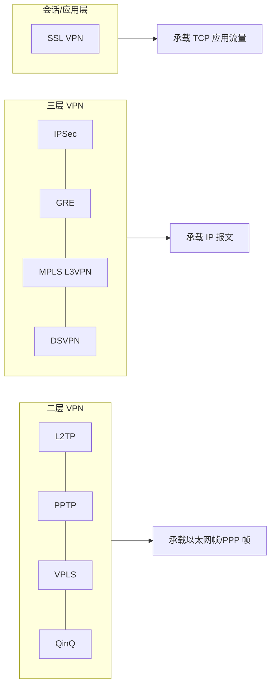

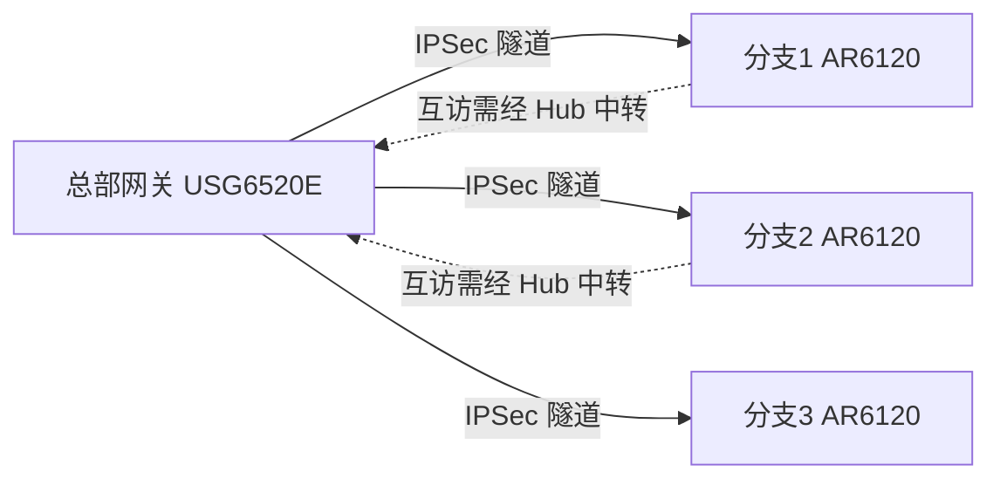

### 真题精练

**Q1.【真题·单选】** 下列技术中，属于二层 VPN 的是（ ）。
A. IPSec VPN  B. GRE VPN  C. L2TP VPN  D. MPLS L3VPN

> **答案：C**
> **解析**：L2TP（Layer 2 Tunneling Protocol，二层隧道协议）在 PPP 层之上建立隧道，承载的是 PPP 帧，属于二层 VPN。IPSec、GRE、MPLS L3VPN 承载的都是三层 IP 报文。干扰项 A 是典型的"加密最强所以选它"陷阱——IPSec 是三层 VPN 的代表。

**Q2.【真题·多选】** 关于 Hub-Spoke 拓扑的 VPN 组网，下列说法正确的是（ ）。
A. 分支之间的流量必须经过 Hub 转发
B. N 个分支只需 N 条隧道，扩展性优于 Full-Mesh
C. Hub 设备出现故障会影响所有分支之间的互访
D. 分支之间互访的时延一定小于 Full-Mesh

> **答案：ABC**
> **解析**：Hub-Spoke 的设计目的就是"用扩展性换路径最优"，分支互访必然绕行 Hub，因此 D 错——Full-Mesh 分支直连时延更小。A、B、C 都是 Hub-Spoke 的固有特性，也是考试中"Hub 单点故障"的考点来源。

### 易错点与排错

1. **把 L2TP 当加密协议**：L2TP 只提供隧道与身份验证（PPP 层），不含数据加密，必须与 IPSec 组合成 L2TP over IPSec 才安全。
2. **把 SSL VPN 归为二层**：SSL/TLS 位于 TCP 之上，属会话层/应用层 VPN。
3. **误认为任意一端都能无公网地址**：Site-to-Site IPSec 至少一端必须是固定公网 IP；两端都在 NAT 后需要 DSVPN 或 RR 辅助。
4. 排错顺序固定：`display ip routing-table`（有无路由）→ `display acl`（感兴趣流是否匹配）→ `display ike sa`（IKE 是否通）→ `display ipsec sa`（IPSec SA 是否建立）→ `display firewall session table`（是否被策略丢包）。

## 5.2 密码学基础：从对称加密到 PKI 体系

### 考点定位

密码学是 VPN 的"地基"，校赛/省赛常以**填空/单选**考算法分类与密钥长度（如"AES 分组长度是多少""SHA-256 输出多少位""DH 的作用是什么"），并在 IPSec 配置题中考查"哪些算法能配在 proposal 里"。高频易错点：**把 DH 当成加密算法**（它只做密钥协商）、**认为数字签名能加密数据**（签名只保完整性+不可否认）、**混淆 MD5 与 HMAC**。

### 原理精讲

密码学在 VPN 中提供四个安全服务，每类算法各司其职，考试要求"每个都要说清解决什么问题"：

**（1）对称加密算法——解决"机密性、性能"**
加解密用同一把密钥。特点是速度快（硬件 AES 可达 Gbps 级），适合加密大数据流；缺点是密钥分发困难（n 个用户两两通信需要 n(n-1)/2 把密钥），且无法实现不可否认。
- **DES**（Data Encryption Standard）：64 bit 分组，有效密钥仅 **56 bit**（8 bit 校验位），已可被暴力破解，禁用；
- **3DES**：用两/三把 56 bit 密钥做三次 DES 运算，密钥长度 112 bit 或 168 bit，强度够但速度慢，属过渡算法；
- **AES**（Advanced Encryption Standard）：**分组固定 128 bit**，密钥长度 128/192/256 bit，是当前 IPSec ESP 加密的首选；国产对应算法为 SM4。
- IPSec 中协商的 `esp encryption-algorithm aes-256` 指的就是它。

**（2）非对称加密算法——解决"密钥分发、不可否认"**
公钥公开、私钥自留，公钥加密只能私钥解，私钥签名只能公钥验。
- **RSA**：既能加密也能签名，密钥长度 1024/2048/3072 bit，现阶段至少 2048 bit；
- **DH**（Diffie-Hellman）：**只做密钥协商，不加密业务数据**。双方在不可信信道上各自计算出相同的共享密钥，第三方即使截获全部交互报文也算不出该密钥（离散对数难题）。IPSec IKE 阶段一用它生成后续加密用的密钥材料，PFS（完美前向保密）就是每次快速模式重新跑一次 DH。
- 非对称算法运算慢（比对称慢 2~3 个数量级），所以**实际做法是"用非对称算法协商/分发对称密钥，用对称算法加密数据"**——这正是 IKE 的思想。

**（3）哈希与 HMAC——解决"完整性、来源认证"**
哈希（Hash，散列）把任意长度输入压成固定长度摘要，单向不可逆、抗碰撞：**MD5 输出 128 bit**、**SHA-1 输出 160 bit**、**SHA-256 输出 256 bit**（SHA-2 家族，SHA-256 分组 512 bit）。仅用哈希只能校验"数据没被改坏"，不能防"攻击者改完数据再重算摘要"，因为算法公开、无秘密。
**HMAC**（Hash-based Message Authentication Code）把哈希与一把**双方共享的密钥（IPSec 中来自 IKE 派生的密钥材料）**结合，只有持密钥的一方能算出正确摘要，因此同时提供完整性 + 数据源认证。IPSec 中的 `esp authentication-algorithm sha2-256` 实际使用的就是 HMAC-SHA2-256。

**（4）数字签名与数字证书/PKI——解决"公钥属于谁"**
- **数字签名**：先对报文算哈希得摘要，再用**自己私钥**加密摘要在报文后附带（加密摘要也称签名值）；对端用**对方公钥**解密得摘要并与自己重算的摘要比对，一致即证明"报文来自私钥持有者且未被篡改"，提供**身份认证 + 完整性 + 不可否认**。注意签名**不提供机密性**。
- **PKI（Public Key Infrastructure，公钥基础设施）**要解决的问题是：DH 交换本身**不能抵抗中间人攻击**（攻击者与双方各建一条 DH 通道），必须有一个可信第三方证明"这把公钥确实属于对方"。
  - **CA**（Certificate Authority，认证机构）：签发并管理证书，用自己的私钥对证书签名；
  - **RA**（Registration Authority，注册机构）：受理证书申请、审核身份，再转交 CA 签发，起"前台"作用；
  - **数字证书**：符合 X.509 格式，关键字段包括版本、序列号、签名算法、颁发者、有效期、主体、**主体公钥**、扩展项（Key Usage）、CA 签名；
  - **证书链**：根 CA 自签证书 → 下级 CA 证书 → 终端设备证书，验证时自下而上逐级验签直到信任的根；
  - **吊销**：CRL（证书吊销列表，定期下载）或 OCSP（在线证书状态协议，实时查询）。
- IPSec IKE 阶段一可用**预共享密钥（Pre-Shared Key）**或**数字证书（RSA-Signature）**认证对端。预共享密钥简单但扩展性差（全网需统一密钥、易泄露）；证书方案在大型组网中更安全、更易扩展。

### 关键概念对照表

| 算法类型 | 代表算法 | 密钥/输出长度 | 解决的问题 | IPSec 中的位置 |
|---|---|---|---|---|
| 对称加密 | DES / 3DES | 56 bit / 112、168 bit | 机密性（快） | ESP 加密 |
| 对称加密 | AES | 密钥 128/192/256 bit，分组 128 bit | 机密性（首选） | `esp encryption-algorithm aes-256` |
| 非对称加密 | RSA | 1024/2048/3072 bit | 密钥分发、签名、不可否认 | IKE 证书认证 |
| 密钥协商 | DH | group1 768 / group2 1024 / group5 1536 / group14 2048 bit | 安全生成共享密钥 | IKE 阶段一、PFS |
| 哈希 | MD5 / SHA-1 / SHA-256 | 128 / 160 / 256 bit | 完整性（无密钥） | 摘要计算 |
| HMAC | HMAC-MD5 / HMAC-SHA2-256 | 同哈希输出长度 | 完整性 + 数据源认证 | IKE/ESP 认证算法 |
| 签名 | RSA/ECDSA 签名 | 随密钥长度 | 身份认证 + 不可否认 | IKE 阶段一证书认证 |
| PKI 实体 | CA / RA / 证书 / CRL / OCSP | X.509 | 公钥归属信任 | IKE 证书部署 |

| 安全服务 | 威胁 | 用什么算法解决 |
|---|---|---|
| 机密性 | 窃听 | AES/3DES/SM4（对称） |
| 完整性 | 篡改 | SHA-256/HMAC |
| 身份认证 | 假冒 | 预共享密钥、RSA 签名、证书 |
| 不可否认 | 抵赖 | 数字签名 |
| 抗中间人 | 公钥替换 | PKI/CA 证书链 |
| 前向保密 | 长期密钥泄露 | DH（PFS） |

### 华为设备配置

```bash
[USG6520E] pki realm huawei-ca                      // 创建 PKI 域，用于存放 CA 与本端证书
[USG6520E-pki-realm-huawei-ca] ca id ca-server ip 10.1.1.100   // 指定 CA 服务器地址
[USG6520E-pki-realm-huawei-ca] quit
[USG6520E] pki import-certificate ca realm huawei-ca filename flash:/ca.cer   // 导入 CA 根证书
[USG6520E] pki request-certificate realm huawei-ca   // 向 CA 申请本端设备证书
[USG6520E] display pki certificate ca realm huawei-ca   // 查看已导入的 CA 证书
[USG6520E] display pki certificate local realm huawei-ca // 查看本端证书是否申请成功
[USG6520E] ike proposal 10                           // 进入 IKE 提议视图（阶段一算法集合）
[USG6520E-ike-proposal-10] encryption-algorithm aes-256      // 对称加密算法：AES-256
[USG6520E-ike-proposal-10] authentication-algorithm sha2-256 // 完整性算法：HMAC-SHA2-256
[USG6520E-ike-proposal-10] dh group14                        // DH 组：2048 bit，安全强度与性能折中
[USG6520E-ike-proposal-10] authentication-method rsa-signature  // 用证书（RSA 签名）认证对端
[USG6520E-ike-proposal-10] quit
```

### 示意图

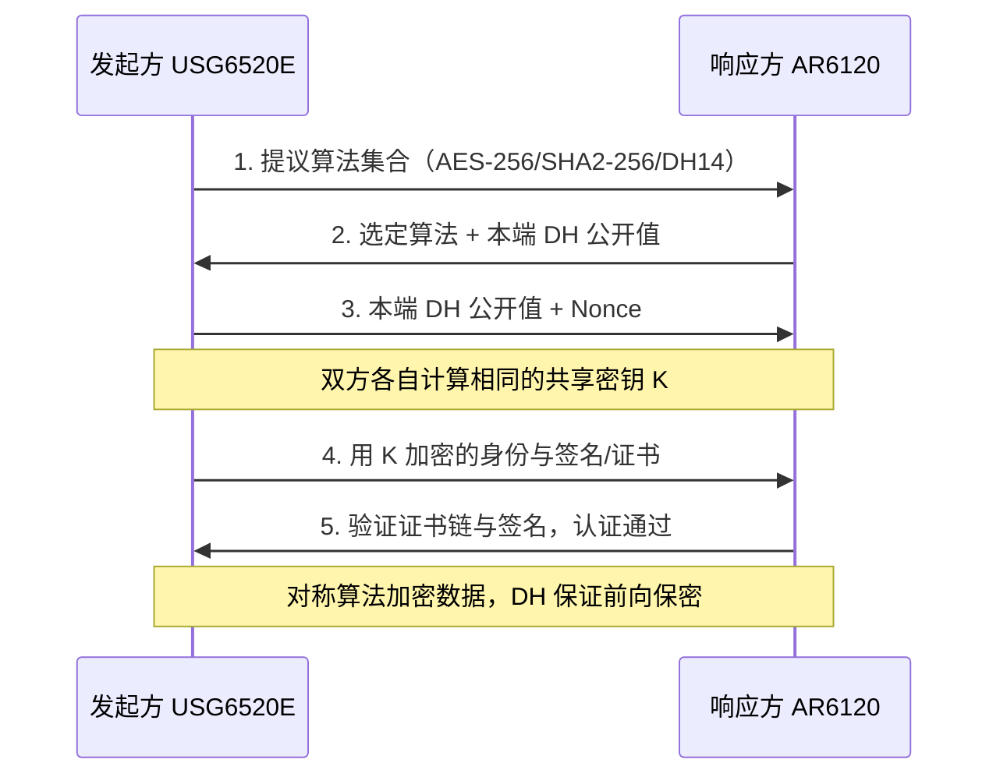

### 真题精练

**Q3.【真题·单选】** 在 IPSec 中，DH（Diffie-Hellman）算法的主要作用是（ ）。
A. 加密用户数据  B. 安全地协商出双方共享的密钥  C. 计算报文摘要  D. 对报文进行数字签名

> **答案：B**
> **解析**：DH 是一种密钥交换算法，本身不加密也不签名，它让双方在不安全信道上各自算出相同的共享密钥，用于派生后续的加密/认证密钥。干扰项 A 是最大的误区——真正加密数据的是 AES/3DES。

**Q4.【真题·填空】** AES 的分组长度固定为______bit，SHA-256 的输出摘要长度为______bit；IPSec PFS 的作用是每次快速模式重新执行______算法。

> **答案：128；256；DH（Diffie-Hellman）**
> **解析**：AES 是分组密码，分组长度恒为 128 bit，可变的是密钥长度（128/192/256）。SHA-256 属 SHA-2 家族，输出 256 bit。PFS（Perfect Forward Secrecy，完美前向保密）的含义是：即使某一时刻的会话密钥泄露，也无法反推出之前的会话密钥，实现方式就是在快速模式中再次执行一次 DH 交换。

**Q5.【真题·判断】** 数字签名既能保证报文的完整性，又能对报文内容提供机密性保护。

> **答案：错误**
> **解析**：数字签名的处理对象是"摘要"（对摘要用私钥加密），原报文仍是明文，因此不提供机密性。要同时获得签名与机密性，必须先签名再加密（或使用 ESP 的加密+认证组合）。这是 PKI 部分最常见的判断题陷阱。

### 易错点与排错

1. **DH 是密钥协商而非加密算法**，不能写在 `esp encryption-algorithm` 后面。
2. **HMAC ≠ 哈希**：普通哈希无密钥，只能查"是否损坏"；HMAC 需要共享密钥，可做源认证。
3. 证书认证失败先查时间：**设备时间与 CA 证书有效期不匹配**会导致证书校验失败，先 `clock datetime` 或配 NTP。
4. IKE 提议中 `encryption-algorithm`、`authentication-algorithm`、`dh group`、`authentication-method` 四项**必须与对端完全一致**（或落在对端提议范围内），否则阶段一失败，用 `display ike proposal` 核对。
5. 用 `display ike sa` 看不到 SA 时，先 `display ike error`（部分版本 `display ike offline-attribute`）与 `debugging ike all` 抓错误码，比盲改配置高效。

## 5.3 IPSec 协议族：AH、ESP 与两种封装模式

### 考点定位

IPSec 是安全方向校赛/省赛的**绝对核心**，分值常在 5 分以上。必考三件事：**AH（协议号 51）与 ESP（协议号 50）的能力差异**、**传输模式与隧道模式的封装结构**、**IKE 的作用（UDP 500/4500）**。易错点：认为 AH 也能加密、认为传输模式能用于网关到网关、把 IKE 协议号写成 50/51。

### 原理精讲

IPSec（IP Security）是一组**在三层为 IP 报文提供安全服务的协议族**，由三大组件构成，缺一不可：

1. **安全协议**：AH 与 ESP，负责"怎么保护报文"；
2. **密钥管理协议**：IKE（Internet Key Exchange），负责"怎么安全地协商密钥与参数"；
3. **安全联盟 SA**（Security Association）：AH/ESP 的参数集合，是"保护的合同"，单向、由三元组（SPI，安全参数索引 + 目的 IP + 安全协议号）唯一标识。

**为什么需要两套安全协议？** 因为安全与兼容性要权衡：
- **AH**（Authentication Header，认证头）：只做**完整性校验与数据源认证**，保护范围包括**整个 IP 报文（含外层 IP 头）**，因此**不能穿越 NAT**（NAT 会改 IP 头地址，AH 校验必然失败）；不提供加密。协议号 **51**。
- **ESP**（Encapsulating Security Payload，封装安全载荷）：既**加密**又做完整性校验，但保护范围**不含外层新 IP 头**，因此**可以穿越 NAT**（这也是 NAT-T 的前提）。协议号 **50**。ESP 尾部有 Padding、Pad Length、Next Header 与 ICV 字段。

**两种封装模式，解决两种场景：**
- **传输模式（Transport Mode）**：在**原 IP 头之后、传输层之前**插入 AH/ESP 头，原 IP 头保留。适用于**端到端保护**（主机到主机），如两台服务器之间，或 GRE/L2TP 隧道被 IPSec 保护时。
- **隧道模式（Tunnel Mode）**：**整个原始 IP 报文被加密**，外面再封装一个新的 IP 头（源/目的为两端网关公网地址）。适用于**网关到网关**（Site-to-Site），因为它隐藏了内网地址结构，且两端私网地址可以重叠。**IPSec VPN 默认、也是必须用隧道模式**。

**为什么需要 IKE？** 手工配置 SA（手工指定 SPI、密钥、算法）在多点组网下无法维护（密钥静态、不能定期更换、不支持 PFS）。IKE 基于 UDP **500**（NAT-T 检测成功后改为 UDP **4500**）自动协商 SA：
- 阶段一（IKE SA / ISAKMP SA）：建立一条安全的**管理通道**，协商加密/哈希/DH/认证方式，认证对端身份，双向 SA；
- 阶段二（IPSec SA）：在管理通道保护下，为具体数据流协商**单向**的 IPSec SA（入方向 + 出方向各一条），生成 SPI 与密钥。因此一条 IKE SA 下可以有**多对** IPSec SA，且快速模式报文是加密的。

**SA 的字段与设计原因**：SPI 是 32 bit 标识，由接收方生成并在报文中携带（发起方发出的报文用对端给的 SPI 作为目的 SPI），这样每个方向可以有不同算法与密钥，避免"双向共用一把密钥"带来的风险。

### 关键概念对照表

| 对比项 | AH | ESP |
|---|---|---|
| 协议号 | **51** | **50** |
| 是否加密 | 否 | 是 |
| 完整性/认证范围 | 整个 IP 报文（含外层 IP 头） | 传输层及以后（不含外层新 IP 头） |
| 是否提供机密性 | 否 | 是 |
| NAT 穿越能力 | **不能**（校验 IP 头，NAT 后必然失败） | **能**（配合 NAT-T） |
| 与传输模式/隧道模式 | 两者均支持 | 两者均支持 |
| 现场使用建议 | 极少单独使用 | IPSec VPN 的事实标准 |

| 对比项 | 传输模式 | 隧道模式 |
|---|---|---|
| 封装位置 | 原 IP 头之后 | 新 IP 头在外层，原报文整体作为载荷 |
| 保护对象 | 载荷（+AH 时含原 IP 头） | 整个原 IP 报文 |
| 适用场景 | 主机到主机、保护 GRE/L2TP | 网关到网关 Site-to-Site（默认） |
| 是否隐藏内网地址 | 否 | 是 |
| 地址重叠支持 | 不支持 | 支持 |

| 封装结构 | 字段顺序（左→右，外层开始） |
|---|---|
| 传输模式 ESP | 原 IP 头 \| ESP 头 \| TCP/UDP 头 + 数据 \| ESP 尾 + ICV |
| 隧道模式 ESP | 新 IP 头 \| ESP 头 \| **原 IP 头 \| 数据** \| ESP 尾 + ICV |
| 隧道模式 AH | 新 IP 头 \| AH 头 \| 原 IP 头 \| 数据 |
| IKE 报文 | 新 IP 头（UDP 500 或 4500） \| UDP 头 \| ISAKMP 载荷 |

### 华为设备配置

```bash
[USG6520E] ipsec proposal tran1                       // 创建 IPSec 提议（阶段二算法集合）
[USG6520E-ipsec-proposal-tran1] transform esp         // 安全协议选择 ESP（推荐，可穿 NAT）
[USG6520E-ipsec-proposal-tran1] encapsulation-mode tunnel   // 封装模式：隧道模式（网关到网关必选）
[USG6520E-ipsec-proposal-tran1] esp encryption-algorithm aes-256   // ESP 加密算法
[USG6520E-ipsec-proposal-tran1] esp authentication-algorithm sha2-256 // ESP 完整性算法（HMAC-SHA2-256）
[USG6520E-ipsec-proposal-tran1] quit
[USG6520E] display ipsec proposal                     // 查看提议内容，核对与对端是否一致
[USG6520E] display ipsec sa                           // 查看 IPSec SA 的 SPI、算法、模式、入/出方向
[USG6520E] display ipsec sa peer 202.1.1.2            // 只看某对等体的 IPSec SA 详情（排错常用）
[USG6520E] reset ipsec sa                             // 清空 IPSec SA，强制重新协商（改完配置后必做）
```

### 示意图

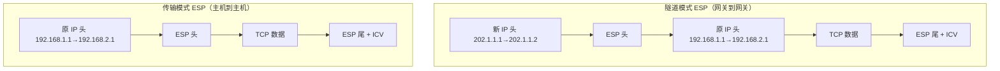

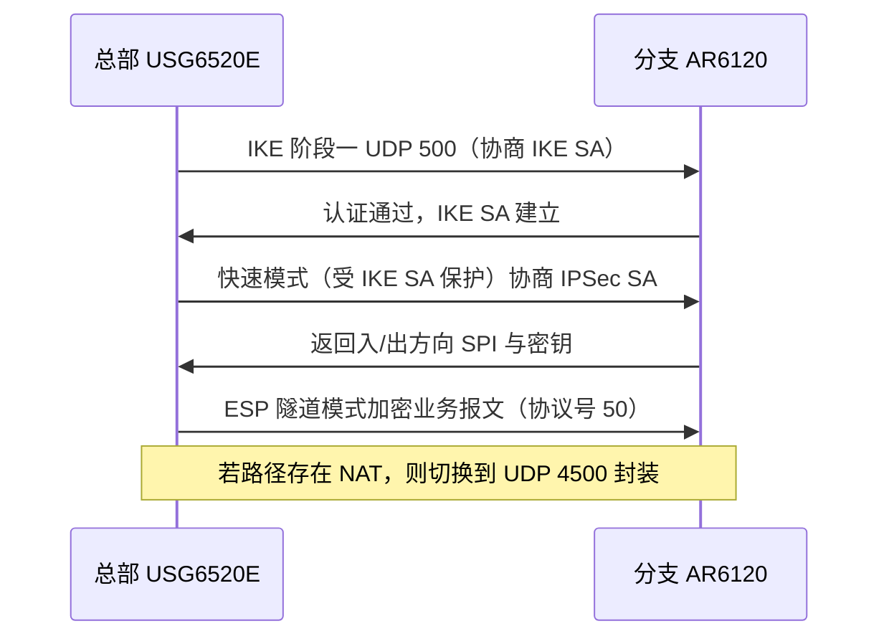

### 真题精练

**Q6.【真题·单选】** 下列关于 AH 与 ESP 的说法，正确的是（ ）。
A. AH 既能加密又能做完整性校验
B. ESP 的协议号是 51
C. AH 不能穿越 NAT，因为它的校验范围包含 IP 头
D. 传输模式下 AH 会新加一个 IP 头

> **答案：C**
> **解析**：AH 只做认证/完整性不加密（A 错）；AH 协议号 51、ESP 协议号 50（B 错）；AH 校验范围覆盖整个 IP 报文含外层 IP 头，NAT 修改地址后校验必然失败，故不能穿 NAT（C 对）；传输模式不新增 IP 头，只有隧道模式才新增（D 错）。

**Q7.【真题·多选】** 关于 IPSec 的两种封装模式，下列说法正确的是（ ）。
A. 隧道模式会新增一个外层 IP 头
B. 传输模式常用于网关到网关的 Site-to-Site 组网
C. 隧道模式可以支持两端私网地址重叠
D. 用 IPSec 保护 GRE 隧道时通常使用传输模式

> **答案：ACD**
> **解析**：B 错——Site-to-Site 场景必须用隧道模式，因为要隐藏内网地址并支持地址重叠。用 IPSec 保护 GRE 时，GRE 已经提供了隧道，IPSec 只需保护 GRE 报文，因此常用传输模式减少一层封装开销，这也是 GRE over IPSec 的标准做法。

### 易错点与排错

1. **协议号混淆**：ESP=50、AH=51、IKE=UDP 500（NAT-T 为 UDP 4500）、GRE=47、L2TP=UDP 1701。这些数字是填空题高频答案。
2. **传输模式不能用于网关到网关**：两端私网地址若重叠，传输模式无法区分，必须隧道模式。
3. **AH 与 NAT 天然冲突**：现场若必须用 AH（极少），要保证路径无 NAT。
4. 改完 proposta 后**必须 `reset ipsec sa` 或 `reset ike sa`**，否则旧 SA 仍按原参数转发，现象是"配置改了没生效"。
5. 一条 IKE SA 可以承载多条 IPSec SA；`display ipsec sa` 里同一 peer 出现多个 SPI 是正常现象，不要误判为冲突。

## 5.4 IKEv1 两阶段协商与 IKEv2 改进

### 考点定位

本考点在省赛及以上权重明显提升，常考"**主模式几条报文、野蛮模式几条报文**""野蛮模式为什么快、牺牲了什么""快速模式建立几条 SA""IKEv2 相比 v1 的改进"。易错点：记错报文条数（主模式 6 条、野蛮模式 3 条、快速模式 3 条）、误以为野蛮模式也提供身份保护。

### 原理精讲

**IKEv1 阶段一：建立 IKE SA（管理通道）**，有两种交换模式：

- **主模式（Main Mode）：6 条报文，分三组交换。**
  1) 第 1、2 条：协商**安全提议**（加密算法、哈希算法、DH 组、认证方法），明文传输；
  2) 第 3、4 条：交换 **DH 公开值与 Nonce**（随机数），双方各自计算出共享密钥 SKEYID，从此报文开始加密；
  3) 第 5、6 条：交换**身份信息与认证数据**（预共享密钥场景下为 HASH_I/HASH_R，证书场景下携带证书与签名），**身份被加密保护**。
- **野蛮模式（Aggressive Mode）：3 条报文。**
  1) 第 1 条：发起方一次性发送提议、DH 公开值、Nonce 与**身份 ID**；
  2) 第 2 条：响应方回复选定的提议、DH 公开值、Nonce、身份 ID 与认证数据；
  3) 第 3 条：发起方回复认证数据，完成认证。
  野蛮模式**报文少、建立快**，代价是**身份信息在明文报文中暴露**，且**不支持证书认证**（只支持预共享密钥），因此安全性弱于主模式。

**适用场景怎么选？** 这是"为什么这么设计"的关键：
- 两端都有**固定公网 IP** → 用**主模式**，身份受保护，安全；
- 发起方是**动态获取地址（拨号/私网 NAT 后的设备）**，且对端需要"根据 ID 来选择用哪套预共享密钥"→ 用**野蛮模式**，因为主模式第 5、6 条才传 ID，响应方无法在协商初期判断该用哪把密钥；野蛮模式第 1 条就带 ID，可以按 ID 匹配 `ike peer` 的 `exchange-mode aggressive` + `local-id-type`。
- 多分支穿透 NAT 场景通常写成：分支用野蛮模式 + 预共享密钥，总部用 `ipsec policy-template` 动态接受。

**阶段二：快速模式（Quick Mode），3 条报文**，在 IKE SA 保护下协商 IPSec SA：前两条交换提议、Nonce、身份（可选）、密钥材料并各自生成 SPI；第三条用于确认（同时可用于 DPD/删除通知）。快速模式**生成两个单向 SA**（入方向、出方向），若配置了 PFS，则重新执行一次 DH 交换以获得独立性。

**IKEv2 的改进（对比记忆）**：
1. **报文数减少**：初始交换 4 条报文（IKE_SA_INIT 2 条 + IKE_AUTH 2 条）即完成 IKE SA 与第一条 IPSec SA 的建立，v1 需要 6+3=9 条（主模式）；
2. **原生支持 NAT 穿越**：v1 靠 NAT-T 补丁；v2 集成在标准中；
3. **原生支持 EAP 认证**，便于与 AAA/Radius 集成；
4. **更健壮的存活检测**：内置 DPD 与重传机制；
5. **支持 IKE SA 与 IPSec SA 的独立保活**，支持 MOBIKE（移动性，终端换 IP 不中断）；
6. **加密算法更现代**：默认不以 DES/MD5 为基线，支持 AES-GCM、SHA-2；
7. **多 SA 协商优化**：一次 IKE_AUTH 可创建多条子 SA（Child SA），v1 需多次快速模式。

### 关键概念对照表

| 对比项 | 主模式 Main Mode | 野蛮模式 Aggressive Mode |
|---|---|---|
| 报文数 | **6** | **3** |
| 身份保护 | 有（第 5、6 条加密传 ID） | 无（第 1 条明文传 ID） |
| 证书认证支持 | 支持 | 不支持（仅预共享密钥） |
| 协商速度 | 慢 | 快 |
| 对端需按 ID 匹配策略时 | 不适用 | 适用（`local-id-type`） |
| 典型场景 | 两端固定公网 IP | 一端动态地址 / NAT 后发起 |

| 对比项 | IKEv1 | IKEv2 |
|---|---|---|
| 建立 IKE SA + 首条 IPSec SA | 主模式 6 条 + 快速模式 3 条 | IKE_SA_INIT 2 条 + IKE_AUTH 2 条（共 4 条） |
| NAT 穿越 | 依赖 NAT-T 扩展 | 标准内置 |
| EAP 认证 | 不支持 | 原生支持 |
| MOBIKE 移动性 | 不支持 | 支持 |
| 默认算法基线 | 含 DES/MD5 等旧算法 | AES/SHA-2 为基线 |

| 阶段 | 交换 | 报文数 | 方向性 | 产物 |
|---|---|---|---|---|
| 阶段一 | 主模式 | 6 | 双向 IKE SA | 管理通道密钥与算法 |
| 阶段一 | 野蛮模式 | 3 | 双向 IKE SA | 同上（身份不保密） |
| 阶段二 | 快速模式 | 3 | 两条单向 IPSec SA | SPI、加密/认证密钥 |

### 华为设备配置

```bash
[USG6520E] ike peer branch1 v1                        // 创建 IKEv1 对等体（v2 则写 ike peer branch1 v2）
[USG6520E-ike-peer-branch1] exchange-mode aggressive   // 指定野蛮模式（默认 main；对端动态地址时使用）
[USG6520E-ike-peer-branch1] local-id-type name         // 野蛮模式下用名字型 ID 匹配对端，便于按 ID 选密钥
[USG6520E-ike-peer-branch1] local-id name HQ           // 本端 ID 取值
[USG6520E-ike-peer-branch1] remote-id name BRANCH1     // 期望的对端 ID，用于校验
[USG6520E-ike-peer-branch1] pre-shared-key cipher Huawei@123   // 预共享密钥（cipher 表示密文存储）
[USG6520E-ike-peer-branch1] ike-proposal 10            // 引用 IKE 提议
[USG6520E-ike-peer-branch1] remote-address 202.1.1.2   // 对端公网地址（野蛮模式+模板时可省略）
[USG6520E-ike-peer-branch1] dpd type periodic idle-time 30   // 开启 DPD 周期检测，30 秒无响应判定对端失效
[USG6520E-ike-peer-branch1] quit
[USG6520E] ipsec policy-template temp1 10              // 用策略模板动态接受多分支（无需为每个分支写一条策略）
[USG6520E-ipsec-policy-template-temp1-10] ike-peer branch1   // 模板引用的 IKE 对等体
[USG6520E-ipsec-policy-template-temp1-10] proposal tran1     // 模板引用的 IPSec 提议
[USG6520E-ipsec-policy-template-temp1-10] quit
[USG6520E] ipsec policy map1 100 isakmp template temp1 // 策略引用模板，序号 100（序号小者优先匹配）
[USG6520E] display ike sa verbose                      // 查看 IKE SA 详细参数：算法、DH 组、剩余生存时间、Flag
[USG6520E] display ike peer                            // 核对对等体的模式、ID、密钥与提议引用
```

### 示意图

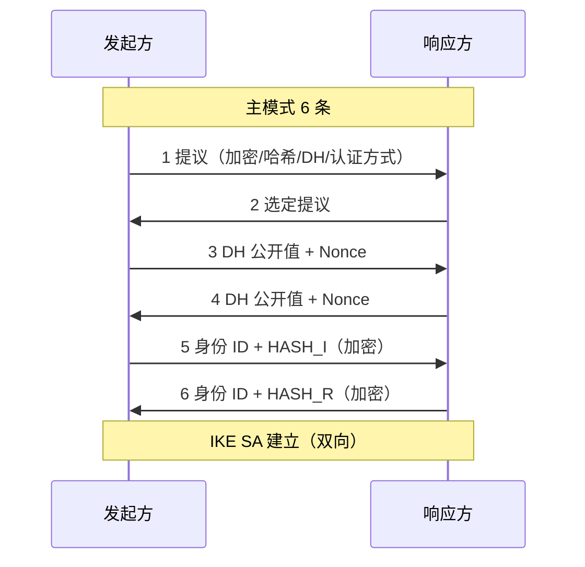

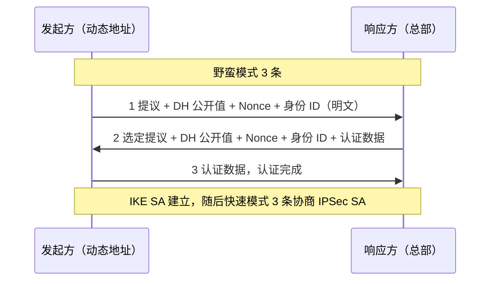

### 真题精练

**Q8.【真题·单选】** IKEv1 阶段一采用主模式时，交互的报文条数为（ ）。
A. 3  B. 4  C. 6  D. 9

> **答案：C**
> **解析**：主模式分三组交换共 6 条报文（提议、DH、身份认证）。3 条是野蛮模式，9 条是"主模式 6 + 快速模式 3"的总数，4 条是 IKEv2 的 IKE_SA_INIT + IKE_AUTH 条数，这几个数字常被交叉设错。

**Q9.【真题·简答】** 请说明野蛮模式相比主模式的优势与代价，并给出一个必须使用野蛮模式的组网场景。

> **答案**：（1）优势：只需 3 条报文即可完成阶段一，协商速度快、报文开销小；第 1 条报文就携带身份 ID，响应方可以据此选择对应的预共享密钥与策略，适合发起方使用动态地址（IP 不固定、无法预知）的场景。（2）代价：身份信息在明文报文中传输，无身份保护；不支持数字证书认证，只能用预共享密钥；因此安全性弱于主模式。（3）典型场景：分支机构通过拨号或位于 NAT 之后、公网地址不固定的设备向总部发起 IPSec 连接，总部用 `ipsec policy-template` + `ike peer ... exchange-mode aggressive` + `local-id-type` 动态接受。
> **解析**：答题要点是"快 + 能按 ID 选策略"换"身份不保密 + 不支持证书"。若答成"野蛮模式比主模式安全"则完全反向。

**Q10.【真题·多选】** 关于 IKEv2 相比 IKEv1 的改进，下列说法正确的是（ ）。
A. 建立 IKE SA 与首条 IPSec SA 只需 4 条报文
B. 原生支持 NAT 穿越，不依赖 NAT-T 补丁
C. 原生支持 EAP 认证方式
D. 不再支持预共享密钥认证

> **答案：ABC**
> **解析**：IKEv2 的 IKE_SA_INIT（2 条）+ IKE_AUTH（2 条）即可同时完成 IKE SA 与第一条 Child SA；NAT 穿越、EAP、MOBIKE、DPD 都是标准内置能力。D 错——IKEv2 仍支持预共享密钥认证，只是基线算法更现代。

### 易错点与排错

1. **报文条数死记**：主模式 6、野蛮模式 3、快速模式 3、IKEv2 初始交换 4。
2. **野蛮模式不支持证书认证**，若对端配了 `authentication-method rsa-signature` 而本端用 aggressive，阶段一必然失败。
3. **DH 组不匹配**是最常见的阶段一失败原因，用 `display ike sa` 无表项 + `debugging ike all` 查看"NO PROPOSAL CHOSEN"类错误。
4. **快速模式失败但阶段一成功**：多半是 IPSec 提议不匹配或感兴趣流 ACL 反向不对称（两端 ACL 必须互为镜像）。
5. 动态对端场景建议用 `ipsec policy-template`，不要为每个分支硬编码策略；否则分支增加时维护量线性增长。
6. 用 `display ike sa` 的 Phase 列判断进度：`v1:1` 表示阶段一完成，`v1:2` 表示阶段二完成。

## 5.5 IPSec 关键参数：SA、PFS、生存周期与感兴趣流

### 考点定位

本考点属于"配置型考点"，校赛/省赛中常结合实验题出现：给出两段私网与两端公网地址，要求补全 ACL、IKE 提议、IPSec 提议、策略并应用到接口。选择题则考**PFS 的作用、SA 生存周期的默认值与刷新方式、感兴趣流的定义与镜像要求**。易错点：ACL 写反、`sa duration` 单位搞错（秒/KB）、忘记在接口下引用策略。

### 原理精讲

**（1）安全联盟 SA（Security Association）**
SA 是 AH/ESP 保护参数的"合同"，内容包括：安全协议（AH/ESP）、加密算法与密钥、认证算法与密钥、封装模式、SPI、生存周期、PFS 组。SA 是**单向**的——保护"从 A 到 B"这条流与"从 B 到 A"这条流是两个独立 SA，因此一次成功的 IPSec 协商会生成 **2 条 IPSec SA**（这也是 `display ipsec sa` 里看到成对 SPI 的原因）。
SA 由三元组唯一标识：**SPI + 目的 IP 地址 + 安全协议号（AH/ESP）**。SPI（Security Parameter Index，安全参数索引）是 **32 bit** 数值，由**接收方**分配并告知发送方，发送方在报文中携带，接收方用它在本机 SAD（Security Association Database）中查表找到对应的密钥与算法。为什么由接收方分配？因为接收方才是"解密/校验的执行者"，由它保证 SPI 在本机唯一，避免冲突。

**（2）PFS（Perfect Forward Secrecy，完美前向保密）**
不开 PFS 时，IPSec SA 的密钥由 IKE SA 的密钥材料派生，一旦 IKE SA 的密钥泄露，**历史与未来的所有 IPSec SA 密钥都可能被推导出来**。开启 PFS 后，每次快速模式都重新执行一次 DH 交换，IPSec SA 的密钥与 IKE SA 密钥**没有派生关系**，即使某一次会话密钥泄露也无法反推其它会话。配置写法为在 `ipsec policy` 视图下 `pfs dh-group14`，且**两端必须一致**（属 IPSec 提议的实际协商参数）。

**（3）生存周期（Lifetime）**
SA 不能永久存在，否则长期密钥暴露风险累积、且无法感知对端状态变化。生存周期分两类：
- **基于时间的生存周期**：默认 **3600 秒**（1 小时），到时重新协商，业务通常无感知；
- **基于流量的生存周期**：默认 **1843200 KB**（约 1.8 GB），防止密钥被用于加密过量数据而被分析；
- **IKE SA 生存周期**通常更长（默认 86400 秒级别，按版本不同），因为 IKE SA 用于保护快速模式协商。
- 华为还支持**空闲超时删除**（idle time），长时间无流量时删除 SA 节省资源。
谁先到期谁触发重协商。若两端配置的生存周期不同，以**较短者**为准。

**（4）感兴趣流（Interesting Traffic / Encrypt ACL）**
感兴趣流用 ACL（高级 ACL，编号 3000~3999）定义"哪些流量需要被加密"，其"源/目的"写的是**本端私网段 → 对端私网段**。要点：
- **两端 ACL 必须镜像对称**：本端 `source 192.168.1.0/24 destination 192.168.2.0/24`，对端必须 `source 192.168.2.0/24 destination 192.168.1.0/24`；**反之会导致一端能通、另一端不通**（因为各方向的 SA 由各自 ACL 触发）；
- ACL 中**不能包含 IKE/ESP 自身的公网流量**，否则死循环；
- 与安全策略的关系：流量先匹配 `security-policy`（放行/阻断），命中 IPSec 策略的流量再进入加密处理；实际转发顺序为：**入接口 → 会话/安全策略检查 → 路由查找 → 命中 ACL 的流量交给 IPSec 加密 → 出接口发出**。这也是"VPN 不通时既要查 IPSec 也要查安全策略"的原因。
- 若 ACL 未命中（比如写了错误的掩码），报文会**明文发出**或直接被丢，这是安全事件级的事故，必须用 `display ipsec sa` 与 `display acl` 双重核对。

### 关键概念对照表

| 参数 | 默认值 | 说明 |
|---|---|---|
| IKE SA 加密算法 | 随版本不同，建议 aes-256 | 阶段一保护管理通道 |
| IPSec SA 生存周期（时间） | 3600 秒 | `sa duration time-based` |
| IPSec SA 生存周期（流量） | 1843200 KB | `sa duration traffic-based` |
| DPD 检测周期 | 按配置，常用 idle-time 30 s | 探测对端存活，触发重建 |
| IKE 端口 | UDP 500 | NAT-T 时自动切 UDP 4500 |
| SPI 长度 | 32 bit | 由接收方分配 |
| 一条 IPSec 隧道生成的 SA 数 | 2 条（入/出各一条） | 单向性导致 |
| 感兴趣流 ACL 编号 | 3000~3999（高级 ACL） | 两端必须镜像 |

| 对比项 | 开启 PFS | 不开启 PFS |
|---|---|---|
| 快速模式是否重新 DH | 是 | 否 |
| 密钥是否独立于 IKE SA | 独立 | 由 IKE SA 派生 |
| 历史会话安全性 | 泄露单次不影响其它 | 可能被批量反推 |
| 性能开销 | 略高（多一次 DH 运算） | 略低 |
| 两端一致性要求 | 必须一致 | — |

### 华为设备配置

```bash
[USG6520E] acl number 3000                                    // 高级 ACL 定义感兴趣流
[USG6520E-acl-adv-3000] rule 5 permit ip source 192.168.1.0 0.0.0.255 destination 192.168.2.0 0.0.0.255  // 本端私网→对端私网
[USG6520E-acl-adv-3000] quit
[USG6520E] ipsec policy map1 10 isakmp                        // 自动协商型（isakmp）IPSec 策略，序号 10
[USG6520E-ipsec-policy-isakmp-map1-10] security acl 3000      // 绑定感兴趣流 ACL
[USG6520E-ipsec-policy-isakmp-map1-10] ike-peer branch1       // 引用 IKE 对等体
[USG6520E-ipsec-policy-isakmp-map1-10] proposal tran1         // 引用 IPSec 提议
[USG6520E-ipsec-policy-isakmp-map1-10] pfs dh-group14         // 开启 PFS 并指定 DH 组（两端必须一致）
[USG6520E-ipsec-policy-isakmp-map1-10] sa duration time-based 3600     // 时间型生存周期 3600 秒
[USG6520E-ipsec-policy-isakmp-map1-10] sa duration traffic-based 1843200 // 流量型生存周期 1843200 KB
[USG6520E-ipsec-policy-isakmp-map1-10] quit
[USG6520E] interface GigabitEthernet1/0/1                     // 进入连接公网的物理接口
[USG6520E-GigabitEthernet1/0/1] ip address 202.1.1.1 30      // 配置公网地址
[USG6520E-GigabitEthernet1/0/1] ipsec policy map1            // 在出接口应用 IPSec 策略（关键一步）
[USG6520E-GigabitEthernet1/0/1] quit
[USG6520E] display ipsec sa                                   // 查看入/出方向 SA 的 SPI、算法、剩余生存时间
[USG6520E] display ipsec statistics                           // 查看加解密封装/解封装计数，判断是否有流量命中
```

### 示意图

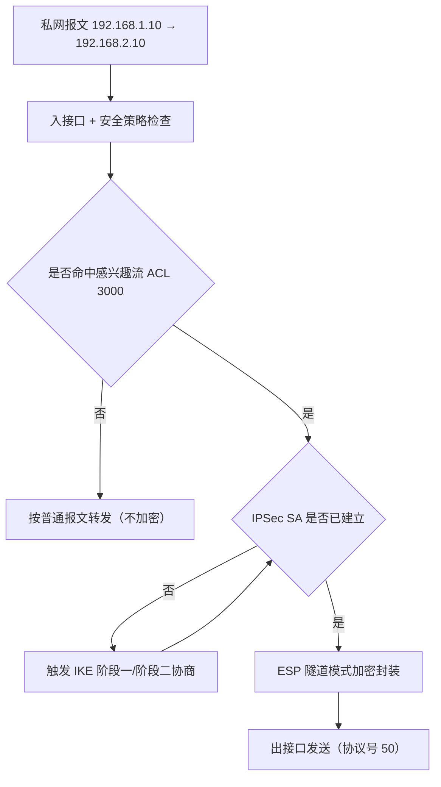

### 真题精练

**Q11.【真题·单选】** 关于 IPSec SA 的描述，正确的是（ ）。
A. 一条 IPSec SA 同时保护两个方向的流量
B. SA 由三元组 SPI、目的 IP 地址、安全协议号唯一标识
C. SPI 由发起方分配
D. SA 一旦建立就永久有效

> **答案：B**
> **解析**：SA 是单向的，一次协商生成入/出两条（A 错）；SPI 由**接收方**分配，发送方携带（C 错）；SA 有生存周期，到期需重新协商（D 错）。只有 B 是标准定义。

**Q12.【真题·简答】** 某 IPSec VPN 出现"总部能 ping 通分支，分支 ping 不通总部"的现象，请分析最可能的原因及排查命令。

> **答案**：最可能的原因是**两端的感兴趣流 ACL 不镜像**（或其中一端 ACL 漏配/掩码写错），导致只有一个方向能触发 IPSec SA。排查步骤：（1）在本端 `display acl 3000` 查看 ACL 命中统计，确认本端发出的流量是否命中；（2）`display ipsec sa` 查看是否只有单向 SA 或只有一条 SPI；（3）用 `display ipsec statistics` 看封装计数是否增长；（4）必要时 `debugging ipsec all`（生产环境慎用）观察协商失败原因。此外还需排除：路由单向缺失、安全策略只放行了一个方向、对端 PFS/提议不一致。
> **解析**：IPSec 的两个方向由各自的 ACL 独立触发，任何一端 ACL 写反都会造成"单向通"。这是实验排错题的经典模型。

### 易错点与排错

1. **`sa duration` 单位**：时间型单位是**秒**，流量型单位是 **KB**，写错会造成频繁重协商或长期不换密钥。
2. **PFS 与提议的关系**：PFS 配在 `ipsec policy` 视图下，不是配在 `ipsec proposal` 视图下，两端必须一致，否则快速模式失败。
3. **ACL 必须镜像**，且源/目的为私网段，不要写成公网地址。
4. 应用位置错误：`ipsec policy` 必须应用在**出口接口**（或 Tunnel 接口），应用在入接口一侧无效。
5. 排错顺序：路由 → ACL → 安全策略 → IKE SA → IPSec SA → 报文计数（`display ipsec statistics`）。

## 5.6 NAT 穿越、GRE、L2TP、SSL VPN 与配置框架

### 考点定位

本考点是"综合应用型"考点：省赛常把 **NAT 与 IPSec 的冲突、GRE over IPSec 与 IPSec over GRE 的选择、L2TP over IPSec 的端口号**放在同一道多选题里。填空题高频数值：**GRE 协议号 47、L2TP UDP 1701、NAT-T UDP 4500、SSL VPN TCP 443**。易错点：忘记在 NAT 设备上为 IPSec 流量做例外（NAT 策略排除 ESP/AH/IKE）。

### 原理精讲

**（1）NAT 与 IPSec 的天然冲突**
- **AH 与 NAT 绝对冲突**：AH 的 ICV 覆盖外层 IP 头，NAT 改地址后校验必失败；
- **ESP 与 NAT 冲突在"传输层校验和"**：隧道模式下 ESP 加密了内层 TCP/UDP 头，但 NAT 若要改端口就必须改内层头，而内层头被加密无法修改；更常见的问题是**端口复用 PAT** 无法为多个 IPSec 会话区分端口。
- **NAT 检测**：IKE 阶段一的主模式第 3、4 条报文中携带 **NAT-D（NAT Discovery）载荷**，双方各自计算"IP 地址 + 端口"的哈希并互发比对；若发现哈希不一致，说明路径上存在 NAT。
- **NAT-T（NAT Traversal）**：检测到 NAT 后，双方改用 **UDP 4500** 封装：在 ESP 报文外层再加一个 UDP 头（源/目的端口 4500），这样 NAT 设备就能像处理普通 UDP 一样做地址端口转换，ESP 也能顺利穿过 NAT。ESP 尾部的 Keepalive 报文同样用 4500 端口发送，用于保持 NAT 会话表不老化。

**（2）NAT 设备上必须做的 IPSec 例外**
若 USG 同时承担 NAT 与 IPSec（或 IPSec 流量穿过一台 NAT 设备），NAT 策略中**必须将 IPSec 流量排除**（deny 掉 ESP/AH/IKE 的公网到公网流量），否则会出现"ESP 报文被 NAT 转换后 ICV 校验失败""内层被 NAT 破坏"的问题。

**（3）GRE**：通用路由封装（Generic Routing Encapsulation），协议号 **47**，封装结构为"新 IP 头 | GRE 头 | 内层协议报文"。GRE 本身**不加密、不认证**，但有三大价值：①可承载**组播与广播**（因此能跑 OSPF/RIP 等组播路由协议，IPSec 单独使用时无法天然承载组播）；②可承载**非 IP 协议**（如 IPX）；③配置简单、开销小。
- **GRE over IPSec**（推荐）：先建 GRE 隧道，再用 IPSec 保护 GRE 隧道接口之间的流量（传输模式或隧道模式均可）。好处是**一条 IPSec SA 保护整个隧道**，隧道内可跑 OSPF、支持组播、支持动态路由，配置量小。缺点是多一层封装（总开销约 24 + 20~50 字节）。
- **IPSec over GRE**：先由 IPSec 保护私网流量，再由 GRE 封装 IPsec 报文。实际很少这么用，因为 IPSec SA 需要为每条感兴趣流单独协商，且组播仍无法被 IPSec 保护。
- **选择结论**：需要**动态路由协议/组播**穿隧 → **GRE over IPSec**；只需**点对点静态私网互访** → 直接 IPSec。

**（4）L2TP**：二层隧道协议，控制报文与数据报文都用 **UDP 1701**。两个角色：**LAC**（L2TP Access Concentrator，接入集中器，靠近用户侧，负责把用户 PPP 帧放进隧道）与 **LNS**（L2TP Network Server，网络服务器，靠近企业侧，负责终结隧道并分配地址）。L2TP 本身**不加密**，必须搭配 IPSec 成 **L2TP over IPSec**，且此时 IPSec 通常用**传输模式**保护 L2TP 的 UDP 报文。
- 谁先发起？用户拨号到 LAC，LAC 与 LNS 之间建立 L2TP 隧道，LNS 通过 PPP 协商给用户分配企业内网地址。

**（5）SSL VPN**：基于 TLS（TCP **443**），分三类接入方式：
- **Web 代理（无客户端）**：浏览器访问，反向代理内网 Web 应用；
- **网络扩展（Network Extension）**：安装轻量客户端，建立虚拟网卡，可访问内网任意 IP 资源（需配置路由与虚拟网关）；
- **端口转发**：把内网 TCP 端口映射到本地，适合 C/S 应用。
优势：**免装重客户端、天然穿越 NAT 与防火墙（443 端口一般开放）**、可按用户/用户组做细粒度授权、易于与 AD/LDAP 集成。

**（6）华为设备 IPSec 配置框架（背下来）**
四步链条：**① ACL 定义感兴趣流 → ② `ike proposal` + `ike peer` 定义阶段一 → ③ `ipsec proposal` + `ipsec policy` 定义阶段二与策略 → ④ 接口下 `ipsec policy` 应用**。多分支用 `ipsec policy-template`。安全策略还要放行 IPSec 相关报文（`local` 区域与 `untrust` 之间放行 ESP/AH/IKE）。

### 关键概念对照表

| 协议 | 协议号/端口 | 是否加密 | 是否支持组播 | 典型用途 |
|---|---|---|---|---|
| IPSec ESP | IP 协议号 **50** | 是 | 否 | 三层加密隧道 |
| IPSec AH | IP 协议号 **51** | 否 | 否 | 完整性（少用） |
| IKE | UDP **500** / NAT-T UDP **4500** | — | — | 密钥协商 |
| GRE | IP 协议号 **47** | 否 | **是** | 承载组播/动态路由 |
| L2TP | UDP **1701** | 否 | — | 二层远程接入 |
| SSL VPN | TCP **443** | 是（TLS） | 否 | 移动办公免客户端接入 |

| 对比项 | GRE over IPSec | IPSec over GRE |
|---|---|---|
| 封装顺序 | 先 GRE 后 IPSec | 先 IPSec 后 GRE |
| 能否跑 OSPF/组播 | 能 | 不能（组播不被加密） |
| IPSec 感兴趣流 | 隧道端点之间一条 ACL 即可 | 每条业务流都要 ACL |
| 配置复杂度 | 低，扩展性好 | 高 |
| 现场推荐度 | **推荐** | 极少使用 |

### 华为设备配置

```bash
// ---- 场景一：USG6520E 同时做 NAT 与 IPSec，NAT 策略必须为 IPSec 流量做例外 ----
[USG6520E] acl number 3001                                   // 定义需要做 NAT 的上网流量
[USG6520E-acl-adv-3001] rule 5 permit ip source 192.168.1.0 0.0.0.255   // 内网用户访问 Internet
[USG6520E-acl-adv-3001] quit
[USG6520E] nat-policy                                          // 进入 NAT 策略视图
[USG6520E-policy-nat] rule name no_nat_ipsec                   // 例外规则：IPSec 流量不做 NAT
[USG6520E-policy-nat-rule-no_nat_ipsec] source-zone local      // 源区域 local（设备自身发起的 IKE/ESP）
[USG6520E-policy-nat-rule-no_nat_ipsec] destination-zone untrust
[USG6520E-policy-nat-rule-no_nat_ipsec] source-address 202.1.1.1 32   // 本端公网地址
[USG6520E-policy-nat-rule-no_nat_ipsec] action no-nat          // 不做地址转换，保证 ESP 校验通过
[USG6520E-policy-nat-rule-no_nat_ipsec] quit
[USG6520E-policy-nat] rule name nat_internet                   // 普通上网流量做 Easy-IP
[USG6520E-policy-nat-rule-nat_internet] source-zone trust
[USG6520E-policy-nat-rule-nat_internet] destination-zone untrust
[USG6520E-policy-nat-rule-nat_internet] source-address 192.168.1.0 24
[USG6520E-policy-nat-rule-nat_internet] action source-nat easy-ip     // 用出接口地址做 PAT
[USG6520E-policy-nat-rule-nat_internet] quit
[USG6520E-policy-nat] quit

// ---- 场景二：NAT-T 相关配置（USG6000E 上 NAT 穿越默认开启，可显式确认） ----
[USG6520E] ike peer branch1 v1
[USG6520E-ike-peer-branch1] nat traversal                      // 开启 NAT 穿越能力（检测到 NAT 后使用 UDP 4500）
[USG6520E-ike-peer-branch1] quit
[USG6520E] display ike sa                                      // 观察 SA 是否以 UDP 4500 建立（详见下一节的输出解读）

// ---- 场景三：AR6120 上配置 GRE over IPSec（隧道承载 OSPF） ----
[AR6120] interface Tunnel0/0/0                                 // 创建 GRE 隧道接口
[AR6120-Tunnel0/0/0] tunnel-protocol gre                       // 隧道协议 GRE（协议号 47）
[AR6120-Tunnel0/0/0] ip address 10.10.10.1 255.255.255.252     // 隧道接口地址（用于跑 OSPF）
[AR6120-Tunnel0/0/0] source GigabitEthernet0/0/0               // 隧道源接口（本端公网口）
[AR6120-Tunnel0/0/0] destination 202.1.1.2                     // 隧道目的（对端公网 IP）
[AR6120-Tunnel0/0/0] ospf enable 1 area 0                      // 在隧道接口上启用 OSPF，实现动态路由
[AR6120-Tunnel0/0/0] quit
[AR6120] acl number 3100                                       // GRE 隧道的感兴趣流：只保护隧道端点之间
[AR6120-acl-adv-3100] rule 5 permit gre source 202.1.1.1 0 destination 202.1.1.2 0
[AR6120-acl-adv-3100] quit
[AR6120] display interface Tunnel0/0/0                         // 查看隧道接口状态（up 且收发计数增长）
[AR6120] display ospf peer brief                               // 验证隧道内 OSPF 邻居是否 Full
```

### 示意图

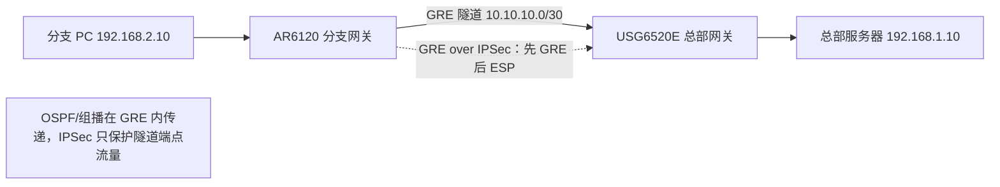

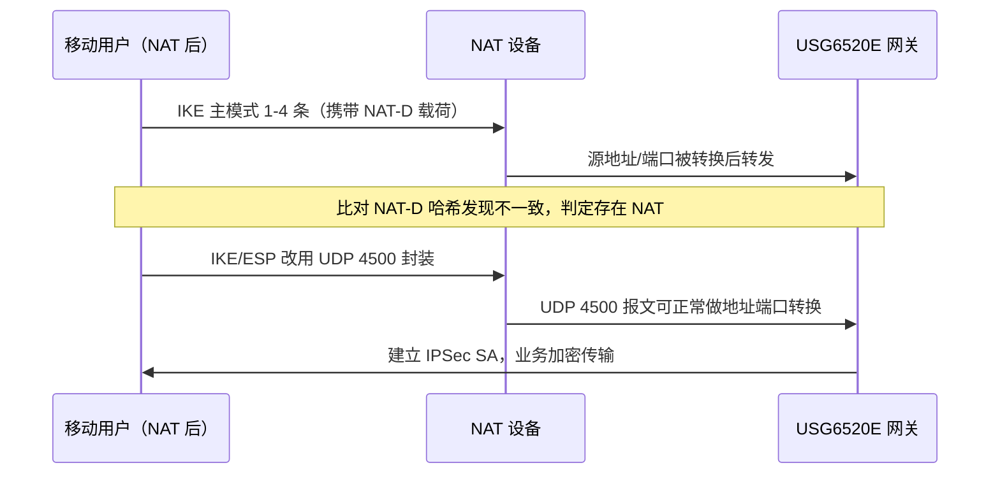

### 真题精练

**Q13.【真题·单选】** GRE 协议号与 L2TP 使用的端口号分别是（ ）。
A. 47、UDP 1701  B. 50、UDP 500  C. 51、TCP 1701  D. 47、TCP 4500

> **答案：A**
> **解析**：GRE 直接用 IP 协议号 47（没有端口概念）；L2TP 控制与数据报文均使用 UDP 1701；IPSec ESP/AH 为 50/51；IKE 为 UDP 500，NAT-T 为 UDP 4500。这组数字是填空题的必考项。

**Q14.【真题·多选】** 关于 GRE over IPSec 与 IPSec over GRE，下列说法正确的是（ ）。
A. GRE over IPSec 的封装顺序是先 GRE 后 IPSec
B. GRE over IPSec 能承载 OSPF 等组播路由协议
C. IPSec over GRE 更利于扩展，是现场推荐方案
D. GRE over IPSec 只需一条保护隧道端点流量的 ACL 即可

> **答案：ABD**
> **解析**：C 说反了，现场推荐 GRE over IPSec：一条 IPSec SA 保护整个 GRE 隧道，隧道内可以跑 OSPF/组播，新增私网段时只需在隧道内加路由，无需修改 IPSec ACL。IPSec over GRE 中 IPSec 先加密，组播不会被加密（无法与组播地址建 SA），因此无法承载动态路由协议。

**Q15.【真题·填空】** 当 IKE 检测到路径上存在 NAT 时，IPSec 报文将改用 UDP 端口______进行封装，这一机制称为______；而 AH 协议因校验范围包含 IP 头，______（能/不能）穿越 NAT。

> **答案：4500；NAT-T（NAT Traversal，NAT 穿越）；不能**
> **解析**：NAT-T 通过在 ESP 外再套一层 UDP 4500 头，让 NAT 设备按普通 UDP 会话处理，ESP 得以穿过 NAT。AH 的 ICV 覆盖 IP 头，NAT 修改地址后校验必然失败，所以 AH 不能穿 NAT。

### 易错点与排错

1. **NAT 与 IPSec 共存时必须配 no-nat 例外**，否则现象是"IKE 协商成功但业务不通"或"ESP 校验失败"。
2. **GRE 不加密**：不要以为配了 GRE 就安全；GRE 必须叠加 IPSec。
3. **L2TP 不加密**：L2TP 单独使用只相当于二层隧道，账号密码可能被嗅探，必须叠加 IPSec。
4. 安全策略别忘放行：`local` 与对端区域之间需允许 **ESP/AH/IKE** 报文（或在策略中放行 `service ipsec` 相关端口），否则 `display ike sa` 永远为空。
5. SSL VPN 的虚拟网关地址池不能与内网现有网段冲突，否则客户端的路由会打乱内网访问。
6. 排错命令组合：`display ike sa` → `display ipsec sa` → `display ipsec statistics` → `display firewall session table verbose` → `display nat-policy rule all`。

## 5.7 `display ike sa` 与 `display ipsec sa` 输出解读

### 考点定位

这是**实验题与排错题的采分点**：省赛常给出 `display` 输出的截图或文本，要求判断"阶段一到哪一步""SA 是否建立成功""有没有走 NAT-T"。选择题喜欢问某个字段的含义（如 SPI、Flag、Phase、PFS）。易错点：把 `Phase v1:1` 当成阶段二完成、把 Flag 列当算法列。

### 原理精讲

**`display ike sa` 回答的问题是"管理通道通了吗"**，关键列有四组：
- **Conn-ID**：本机 IKE SA 的连接编号，从 1 递增，用于 `reset ike sa connection-id` 精确定位重置；
- **Peer**：对端 IKE 地址（公网地址），多分支场景看这一列区分不同分支；
- **Flag(s)**：本端在该 SA 中的角色与附加属性，`I` 表示本端为发起方（Initiator），`R` 表示本端为响应方（Responder），`D` 表示该 SA 启用了 DPD 保活检测；其余标志位随版本略有差异，以产品文档为准；
- **Phase**：协商阶段，`v1:1` / `v2:1` 表示**阶段一（IKE SA）已建立**，`v1:2` / `v2:2` 表示**阶段二（IPSec SA）也已建立**。看到 `v1:1` 说明 IKE 通了但快速模式还没成功——此时要查 IPSec 提议、PFS、ACL；
- **RemoteType / RemoteID**：对端身份类型（IP/NAME）与取值，用于证书或 ID 认证场景核对。

**`display ipsec sa` 回答的问题是"数据通道通了吗、参数是什么"**。它按"接口 → 策略名 → 序号 → ACL → 连接"的层次展开，重点字段：
- **Encapsulation mode**：`Tunnel` / `Transport`，与 `ipsec proposal` 中配置一致；
- **Tunnel local / Tunnel remote**：本端与对端隧道端点地址与端口（端口为 **500** 说明未走 NAT-T，为 **4500** 说明走了 NAT-T）；
- **Flow source / Flow destination**：实际生效的感兴趣流，必须与自己预期的私网段一致，这是验证 ACL 是否写错的最直接证据；
- **Perfect forward secrecy**：显示协商出的 DH 组（如 `dh-group14`），若显示 `NONE` 说明未启用 PFS；
- **Inbound ESP SAs / Outbound ESP SAs**：入方向与出方向各一条，**SPI 不同**属正常现象（SA 单向）；SPI 用十进制与十六进制同时显示；
- **Proposal**：协商结果（如 `ESP-ENCRYPT-AES-256, ESP-AUTH-SHA2-256`），可用于核对两端算法是否按预期匹配；
- **SA remaining key duration**：剩余生存时间/流量额度，归零即触发重协商。

**读输出定故障的固定套路**：
`display ike sa` 无表项 → IKE 阶段一失败（查路由可达性、UDP 500 放行、提议、预共享密钥）→ 有 `v1:1` 无 `v1:2` → 阶段二失败（查 IPSec 提议、PFS、ACL 镜像）→ 有 `v1:2` 但业务不通 → 数据面问题（查安全策略、路由、ACL 命中计数、`display ipsec statistics` 加解密报文数）。

### 关键概念对照表

| 命令 | 看什么 | 结论 |
|---|---|---|
| `display ike sa` | Phase=`v1:1`/`v2:1` | 阶段一成功，阶段二未成功 |
| `display ike sa` | Phase=`v1:2`/`v2:2` | 阶段一、二均成功 |
| `display ike sa` | 无任何表项 | 阶段一失败（路由/策略/提议/密钥） |
| `display ike sa` | Flag 含 `I` / `R` | 本端为发起方 / 响应方 |
| `display ipsec sa` | Tunnel local/remote 端口 4500 | 走了 NAT-T |
| `display ipsec sa` | Perfect forward secrecy = NONE | 未启用 PFS（两端都应为对应 DH 组） |
| `display ipsec sa` | Flow source/destination | 实际感兴趣流，核对 ACL 是否写错 |
| `display ipsec statistics` | 封装/解封装计数不增长 | 流量未命中 IPSec（多为路由或 ACL 问题） |

### 华为设备配置

```bash
<USG6520E> display ike sa                       // ① 管理通道：看 Phase 与 Flag
<USG6520E> display ike sa verbose               // ① 详情：算法、DH 组、剩余时间、对端 ID
<USG6520E> display ipsec sa                     // ② 数据通道：看 SPI、模式、PFS、感兴趣流
<USG6520E> display ipsec sa peer 202.1.1.2      // ② 只看某对等体，多分支时避免刷屏
<USG6520E> display ipsec statistics             // ③ 看加解密封装计数是否随业务增长
<USG6520E> reset ike sa connection-id 1         // ④ 精确定位并重置某条 IKE SA（会连带删除其下 IPSec SA）
<USG6520E> reset ipsec sa policy map1 10        // ④ 只重置指定策略的 IPSec SA，影响面最小
```

```text
<USG6520E> display ike sa
---------------------------------------------------------------------------
IKE SA number: 1
    Conn-ID   Peer            VPN   Flag(s)   Phase   RemoteType  RemoteID
---------------------------------------------------------------------------
    1         202.1.1.2       0     RD|ST     v1:2    IP          202.1.1.2
---------------------------------------------------------------------------
  // 解读：本端为响应方(R)且启用 DPD(D)，Phase v1:2 表示 IKE SA 与 IPSec SA 均已建立

<USG6520E> display ipsec sa
===============================
Interface: GigabitEthernet1/0/1
---------------------------------
  IPSec policy name: "map1"
  Sequence number  : 10
  Acl group        : 3000
  Acl rule         : 5
  Mode             : ISAKMP
---------------------------------
  Encapsulation mode : Tunnel
  Tunnel local       : 202.1.1.1:500
  Tunnel remote      : 202.1.1.2:500
  Flow source        : 192.168.1.0/255.255.255.0 0/0
  Flow destination   : 192.168.2.0/255.255.255.0 0/0
  Perfect forward secrecy : dh-group14
  [Outbound ESP SAs]
    SPI: 3861465063 (0xe62b5e87)
    Proposal: ESP-ENCRYPT-AES-256, ESP-AUTH-SHA2-256
    SA remaining key duration (kilobytes): 1843200
  [Inbound ESP SAs]
    SPI: 2515193318 (0x95e3c1a6)
    Proposal: ESP-ENCRYPT-AES-256, ESP-AUTH-SHA2-256
  // 解读：端口为 500 说明未检测到 NAT；入/出 SPI 不同是 SA 单向性的正常体现
```

### 示意图

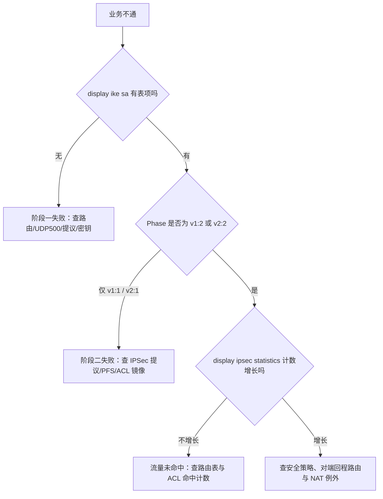

### 真题精练

**Q16.【真题·单选】** 在 USG6000E 上执行 `display ike sa`，某表项的 Phase 列显示 `v1:1`，说明（ ）。
A. 阶段一协商失败
B. 阶段一已成功，阶段二尚未成功
C. 阶段一、阶段二均已成功
D. 该 SA 是 IKEv2 建立的

> **答案：B**
> **解析**：Phase 列 `v1:1` 表示 IKEv1 的阶段一（IKE SA）已建立，`v1:2` 表示阶段二（IPSec SA）也已建立。看到 `v1:1` 时排错重点在 IPSec 提议、PFS 与感兴趣流 ACL，而不是 IKE 提议与预共享密钥。

**Q17.【真题·排错】** 某工程师配置完 IPSec VPN 后执行 `display ipsec sa`，发现输出的 `Perfect forward secrecy` 字段为 `NONE`，而对端要求使用 DH group14。请说明问题原因及修复方法。

> **答案**：原因：本端 `ipsec policy` 视图下未配置 `pfs dh-group14`（PFS 关默认不启用 DH 重协商），而对端已开启 PFS，两端协商参数不一致时会协商失败或协商出不符合安全要求的 SA。（2）修复：在本端策略视图下执行 `pfs dh-group14`，然后 `reset ike sa` 与 `reset ipsec sa` 强制重新协商，再次 `display ipsec sa` 确认该字段显示 `dh-group14`。
> **解析**：PFS 是**两端必须一致**的参数。任何提议类参数（IKE 提议四项、IPSec 提议的加密/认证算法与封装模式、PFS 的 DH 组）改完后都必须重置 SA，否则旧 SA 仍在生效，现象是"配置改了没反应"。

### 易错点与排错

1. `Phase v1:1` ≠ 阶段二成功，这是最常见的读表错误。
2. 入方向与出方向 SPI 不同是正确的，不要以为配置冲突。
3. `Tunnel local/remote` 端口为 4500 表示走了 NAT-T；若对端本无 NAT 却显示 4500，通常是中间设备做了地址转换或 NAT 检测误判。
4. 只重置而不改配置无效：`reset` 只强制重协商，参数不一致仍会失败。
5. `Flow source/destination` 是"实际生效的感兴趣流"，与 ACL 配置不一致时优先怀疑 ACL 序号/掩码/顺序（ACL 自上而下匹配，先命中的规则生效）。

---

# 安全-HCIA-章节6-内容安全与入侵防御

> 本章内容安全相关命令以 HiSecEngine USG6000E（V600R007）为基准；不同小版本命令字可能略有差异，实际输入时以设备上的 `?` 补全提示为准。

## 6.1 内容安全总览与 IPS 工作原理

### 考点定位

校赛/省赛必考"三大件是哪三件""IPS 与 IDS 的区别""检测技术分类"三个基础问题，通常 2~3 分。省赛喜欢结合场景问"哪一层部署 IPS 更合适"。易错点：把 IDS 当成能自动阻断的设备、把"基于异常"与"基于特征"的优缺点说反。

### 原理精讲

**内容安全（Content Security）**指在防火墙完成"放行/阻断"之后，对**放行的流量内容**再做深度检测，解决"端口和地址都对，但内容有害"的问题。华为 USG 上的内容安全三大件是：

1. **IPS**（Intrusion Prevention System，入侵防御系统）：检测并阻断漏洞利用、扫描、暴力破解、Web 攻击（SQL 注入、XSS、命令注入）等；
2. **AV**（Anti-Virus，反病毒）：对 HTTP/FTP/SMTP/POP3/IMAP/SMB 等协议传输的文件做病毒检测；
3. **URL 过滤**（URL Filtering）：按分类库或黑白名单控制 Web 访问。

此外现代 NGFW 普遍还包括**应用识别（Application Identification）**、**文件阻断（File Blocking）**、**DDoS 防护**与**沙箱联动**。三件套的共同前提是**应用识别**——只有先知道流量是什么应用、什么文件，才能谈深度检测。

**为什么需要 IPS？** 防火墙（含状态检测）只能看五元组与状态，无法判断"这条 80 端口流量是正常的网页请求还是 SQL 注入"。IPS 补充了**内容维度的判断力**，把安全边界从"能不能连"推进到"内容是否恶意"。

**IPS 的三种检测技术（必背对比）：**

- **基于特征（Signature-based，签名检测）**：把已知攻击的报文模式（正则、字节序列、偏移、长度、协议字段异常）编译成签名库，逐条匹配。优点：**准确率高、误报低、可解释（能报出 CVE/签名名）**；缺点：**只能防已知攻击，特征库必须持续更新，对 0day 与变形（混淆/编码/分片）攻击效果差**。这是当前 IPS 的主力技术。
- **基于异常（Anomaly-based，异常检测）**：先建立正常流量基线（流量大小、连接速率、协议分布、载荷熵值），偏离基线超过阈值即告警/阻断。优点：**理论上能发现未知攻击**；缺点：**误报率高（正常业务变化也会触发）、基线难维护、难以定性**，通常只作为辅助。
- **基于协议分析（Protocol Analysis）**：按协议 RFC 规范逐字段解析（如 HTTP 请求行、头域、Body 长度；DNS 查询类型；SMB 字段），发现"违反协议规范"的字段取值（超长 Host、畸形 Content-Length、异常编码）。优点是能识破编码混淆与变形攻击，是"基于特征"的重要补充，现代 IPS 引擎通常把两者结合（协议解码 + 特征匹配）。

**签名库、方向与动作**：签名库（Signature Set/Database）按**严重级别**（high/medium/low/info）与**类别**（如 Web 攻击、暴力破解、扫描、协议异常）组织；IPS 可配置**动作**（alert 告警、block 阻断、allow）与**例外**（对特定服务器或应用放行，减少误阻断）；可指定**检测方向**（客户端到服务器、服务器到客户端，多数 Web 攻击签名只对入方向生效）。

**华为产品定位**：**NIP** 系列是独立的专业 IPS 设备（旁路/串接均可），**USG6000E/USG12000** 通过内嵌 IPS 引擎（内容安全处理板/硬件加速）提供一体化防护；在大型组网中常用"USG 做边界 + NIP 做纵深检测 + AntiDDoS 做流量清洗 + HiSec Insight 做态势分析"的组合。

### 关键概念对照表

| 检测技术 | 原理 | 优点 | 缺点 |
|---|---|---|---|
| 基于特征/签名 | 匹配已知攻击模式 | 准确、低误报、可解释 | 只能防已知，怕变形与 0day |
| 基于异常 | 偏离正常基线 | 可能发现未知攻击 | 误报高、基线难维护 |
| 基于协议分析 | 按协议规范逐字段解码 | 识破编码混淆与畸形报文 | 依赖解码器完备性，开销大 |

| 对比项 | IPS | IDS |
|---|---|---|
| 部署方式 | **串接（在线，in-line）** | **旁路（镜像口，out-of-band）** |
| 对业务影响 | 可能引入时延与丢包 | 不影响业务转发 |
| 能否阻断 | **能**（丢弃/阻断会话） | 不能，只能告警 |
| 典型产品 | 华为 NIP、USG 内嵌 IPS | 华为 NIP（旁路模式）、第三方 IDS |
| 适用位置 | 边界串联、数据中心核心 | 需要审计但不敢串接的链路 |

| 内容安全组件 | 检测对象 | 阻断能力 |
|---|---|---|
| IPS | 攻击行为/漏洞利用报文 | 阻断会话 |
| AV | 文件内容（病毒特征、文件信誉） | 阻断文件下载 |
| URL 过滤 | 访问的 URL/分类 | 阻断访问 |
| 应用识别 | 应用协议（不依赖端口） | 为其它组件提供识别基础 |

### 华为设备配置

```bash
[USG6520E] profile type ips name ips_profile                 // 创建 IPS 内容安全配置文件（profile）
[USG6520E-profile-ips-ips_profile] signature-set name default // 引用默认签名集（含全部已加载签名）
[USG6520E-profile-ips-ips_profile-sigset-default] severity high medium  // 配置 high/medium 级别签名的动作与阈值
[USG6520E-profile-ips-ips_profile-sigset-default] quit
[USG6520E-profile-ips-ips_profile] exit
[USG6520E] display ips signature-set                        // 查看签名集与签名总数（版本命令字以设备 ? 为准）
[USG6520E] display update version                           // 查看特征库版本，确认签名库是否可用
```

### 示意图

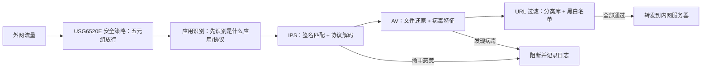

### 真题精练

**Q18.【真题·单选】** 关于 IPS 与 IDS 的区别，下列说法正确的是（ ）。
A. IDS 串接在链路中可以主动阻断攻击
B. IPS 通常旁路部署，只做告警
C. IPS 串接在链路中，可直接丢弃恶意报文实现阻断
D. IPS 不需要特征库，靠行为基线检测即可

> **答案：C**
> **解析**：IDS（Intrusion Detection System）是**检测**系统，旁路镜像部署，只能告警不能阻断；IPS 是**防御**系统，串接在转发路径上，可以对命中的恶意流量直接丢弃或阻断会话。D 错——基于特征（签名库）正是 IPS 的主力技术，异常检测只作辅助。

**Q19.【真题·多选】** 关于基于特征的 IPS 检测技术，下列说法正确的是（ ）。
A. 检测准确率较高，误报相对较少
B. 能检测到所有 0day 漏洞利用
C. 必须持续更新特征库才能保持防护能力
D. 对经过编码、分片等变形的攻击，效果可能下降

> **答案：ACD**
> **解析**：B 错——基于特征只能识别"库里有记录"的攻击，对未知 0day 无效，这正是需要异常检测与沙箱联动补充的原因。C、D 是特征检测的两个固有短板：时效性与抗变形能力。

### 易错点与排错

1. **IDS 不能阻断**，这是最经典的送分/丢分点。
2. IPS 常见误阻断（把正常业务拦了）时，先用 `alert` 动作观察一段时间，再用**签名例外**或**应用例外**放行，而不是直接关掉 IPS。
3. 内容安全依赖**应用识别**：如果流量被识别为 `Unknown`，IPS/AV 大多不会生效。
4. 排错三板斧：`display update version`（库版本）→ `display security-policy rule all`（策略里引用了 profile 吗）→ `display logbuffer reverse`（看有没有命中与动作）。

## 6.2 IPS 的部署方式与 USG 内容安全配置框架

### 考点定位

本考点直接对应实验题：**内容安全 profile 必须被安全策略引用才生效**（这是最高频的失分点），以及"串接 vs 旁路"的选择理由。省赛常考"USG 上配置 IPS 的先后顺序"。易错点：以为建了 profile 就自动生效、忘记放行 `local` 到管理区的流量导致特征库升级失败。

### 原理精讲

**部署方式的选择逻辑（为什么）**：
- **串接（In-line）**：设备在转发路径上，具备阻断能力，但引入故障点与时延，需要**Bypass 机制**（设备断电/故障时光口直通或电口旁路）保证业务连续性。适合边界出口、数据中心南北向流量入口。
- **旁路（Out-of-band）**：通过交换机镜像口接收流量副本，只检测不阻断，零业务风险，但对攻击只能事后处置，且镜像口可能丢包导致漏检。适合"不敢影响业务"的链路、内网东西向审计。
- **混合/串联旁路（TAP + Bypass 交换机）**：兼顾，由外部交换机实现 byPass，成本较高。
- USG6000E 一体化设备本身是**串接**在网络中（它就是网关），IPS 作为其内容安全能力之一随策略生效，不需要单独部署。

**内容安全配置框架（背下这条链）**：
`创建 profile（ips/av/url-filter）→ 在 security-policy 的 rule 中用 profile 引用 → 流量命中该规则时执行内容检测 → 命中动作后记录日志/阻断`。
为什么这么设计？因为内容安全是**策略的"附加动作"**而非独立功能：安全策略决定"这条流允不允许通过"（粗粒度、高性能），profile 决定"通过之后内容怎么处理"（细粒度、开销大）。分离设计让管理员可以对不同流量做不同强度的检测（如对互联网访问做全量检测，对内部互访只做 IPS 不做 AV），兼顾性能与安全。

**配置要点与顺序**：
1. 划分安全区域并配置接口地址与路由（保证流量可达）；
2. 配置应用识别与特征库（确认 `display update version` 有版本、有授权 License）；**注意：内容安全功能需要相应 License，License 未加载时 profile 无法生效**，这是排错必查项；
3. 创建 profile 并配置动作与例外；
4. 在安全策略规则中 `profile ips/av/url-filter` 引用；
5. 放行管理流量与升级流量（`local` 区域到 `untrust` 或指定升级服务器）；
6. 验证：`display firewall session table verbose` 查看会话上是否打上了内容安全标记，`display logbuffer` 看是否有命中日志。

**NIP 产品定位**：NIP 系列（如 NIP2000 系列）是华为独立 IPS 设备，支持串接阻断与旁路检测两种模式，特征库与 USG 的 IPS 引擎同源（华为安全特征库统一升级），在等保三级场景中常作为"入侵防范"要求的补充设备与 USG 形成纵深。

### 关键概念对照表

| 对比项 | 串接部署 | 旁路部署 |
|---|---|---|
| 位置 | 转发路径中 | 镜像口/分流器 |
| 阻断能力 | 有 | 无（仅告警） |
| 业务影响 | 有时延、需 Bypass | 无 |
| 漏检风险 | 低（全流量经过） | 镜像口拥塞时丢包漏检 |
| 典型场景 | 边界出口、DC 入口 | 内网审计、敏感链路 |

| 配置对象 | 作用 | 是否自动生效 |
|---|---|---|
| `profile type ips name x` | 定义 IPS 检测内容与动作 | 否，必须被策略引用 |
| `security-policy` 中的 rule | 定义放行范围 + 引用 profile | 是（策略本身即生效） |
| License | 授权内容安全功能 | 未加载则 profile 无效 |
| 特征库 | 提供签名/病毒/URL 分类 | 需升级保持最新 |

### 华为设备配置

```bash
// ---- 前置：区域、接口与路由 ----
[USG6520E] firewall zone trust                               // 进入 trust 区域视图
[USG6520E-zone-trust] add interface GigabitEthernet1/0/0     // 把内网接口加入 trust 区域
[USG6520E-zone-trust] quit
[USG6520E] firewall zone untrust
[USG6520E-zone-untrust] add interface GigabitEthernet1/0/1   // 把外网接口加入 untrust 区域
[USG6520E-zone-untrust] quit
[USG6520E] ip route-static 0.0.0.0 0.0.0.0 202.1.1.2         // 默认路由指向 ISP

// ---- 步骤 1：创建 IPS profile 并配置动作与例外 ----
[USG6520E] profile type ips name ips_profile
[USG6520E-profile-ips-ips_profile] signature-set name default
[USG6520E-profile-ips-ips_profile-sigset-default] severity high medium
[USG6520E-profile-ips-ips_profile-sigset-default] action block   // high/medium 命中即阻断（先用 alert 观察期更稳）
[USG6520E-profile-ips-ips_profile-sigset-default] quit
[USG6520E-profile-ips-ips_profile] exception application ?        // 用 ? 查看可加例外的应用（如对特定服务器放行）
[USG6520E-profile-ips-ips_profile] exit

// ---- 步骤 2：在安全策略中引用 profile（关键一步，不引用则完全不生效） ----
[USG6520E] security-policy
[USG6520E-policy-security] rule name trust_to_untrust
[USG6520E-policy-security-rule-trust_to_untrust] source-zone trust
[USG6520E-policy-security-rule-trust_to_untrust] destination-zone untrust
[USG6520E-policy-security-rule-trust_to_untrust] source-address 192.168.1.0 mask 255.255.255.0
[USG6520E-policy-security-rule-trust_to_untrust] action permit
[USG6520E-policy-security-rule-trust_to_untrust] profile ips ips_profile   // 引用 IPS 配置文件
[USG6520E-policy-security-rule-trust_to_untrust] quit
[USG6520E-policy-security] quit

// ---- 步骤 3：验证与排错 ----
[USG6520E] display security-policy rule name trust_to_untrust   // 确认规则里的 profile 引用已生效
[USG6520E] display firewall session table verbose                // 查看会话详情，确认内容安全处理是否打标
[USG6520E] display logbuffer reverse | include IPS               // 查看 IPS 命中日志（含签名名与动作）
[USG6520E] display license                                       // 确认内容安全相关 License 是否已激活
```

### 示意图

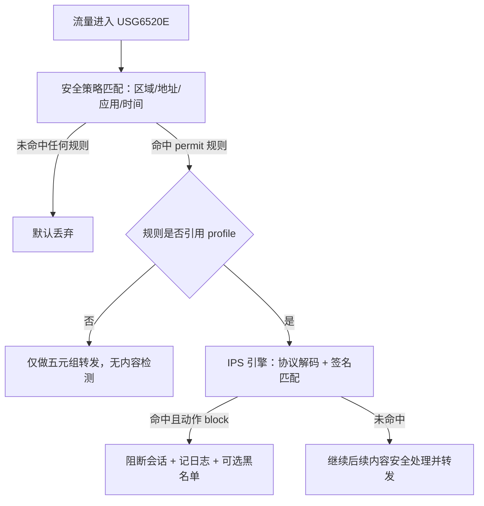

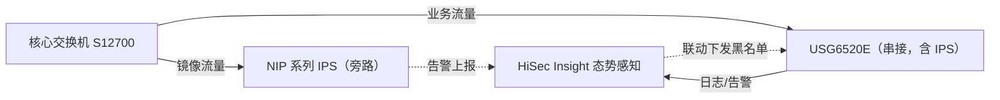

### 真题精练

**Q20.【真题·单选】** 在 USG6000E 上创建了 IPS 配置文件 `ips_profile` 并配置了动作，但发现流量完全没有被检测。最可能的原因是（ ）。
A. 没有配置 IPS 的签名集
B. 没有在安全策略规则中引用该 profile
C. 没有配置 NAT
D. 没有开启 DPD

> **答案：B**
> **解析**：内容安全 profile 是"资源"，必须通过安全策略规则中的 `profile ips ips_profile` 引用后才对匹配该规则的流量生效。这是实验与排错题中出现频率最高的失分点。签名集虽是必要内容，但默认模板已存在，题干已说明配置了动作，因此 B 最直接。

**Q21.【真题·多选】** 关于 IPS 的串接与旁路部署，下列说法正确的是（ ）。
A. 串接部署具备实时阻断能力
B. 旁路部署需要交换机镜像口或分流器
C. 串接部署必须考虑设备故障时的业务 Bypass
D. 旁路部署对 0day 攻击的检测能力一定弱于串接

> **答案：ABC**
> **解析**：D 错——检测能力的差异主要来自流量覆盖度与镜像丢包，0day 检测能力取决于算法（异常/沙箱），与串接或旁路无必然关系。A、B、C 分别对应串接阻断能力、旁路部署条件、串接的可用性风险。

### 易错点与排错

1. **profile 不被策略引用 = 没有内容安全**，这是第一排查项。
2. **License 未激活**时 profile 不生效，用 `display license` 确认。
3. 串接设备务必规划 Bypass，避免单点故障导致全网断网（等保与运维硬性要求）。
4. 升级特征库要求防火墙能访问升级服务器，`local` 区域到 `untrust` 的流量要在安全策略中放行。
5. 先用 `alert` 观察、再切 `block`，可分阶段降低误阻断风险。

## 6.3 反病毒（AV）、文件信誉与沙箱联动

### 考点定位

考法集中在"扫描方向""流扫描与文件扫描的区别""文件信誉与沙箱的作用"。校赛多为单选/填空，省赛可能结合"如何应对未知恶意文件"出简答。易错点：认为 AV 只扫下载（漏掉上传方向）、把沙箱当成"本地特征库的一部分"（沙箱是云端/旁路分析环境）。

### 原理精讲

**反病毒要解决的问题**：在文件传输通道中识别并阻断携带恶意代码的文件。它依赖三项能力：**协议识别与文件还原**（从 HTTP/FTP/SMTP/POP3/IMAP/SMB 流量中把被切分成多个 TCP 报文的文件完整还原出来）、**病毒特征匹配**（对文件内容做特征串/哈希/启发式匹配）、**动作执行**（告警/阻断/删除附件/加黑名单）。

**扫描方向（先明确两个方向）**：
- **上传方向（客户端→服务器 / 内网→外网）**：防止内网主机把带毒文件或敏感文件外发，也防止内网主机向服务器投毒；
- **下载方向（服务器→客户端 / 外网→内网）**：防止用户下载被投毒的软件、恶意文档。华为 AV profile 中通常以 `direction`（或 profile 内对应用的选择）区分；**两个方向都要开**，只开下载是常见配置缺陷。

**流扫描（Stream Scan）与文件扫描（File Scan）**：
- **流扫描**：边接收边扫描，报文到达即检测，**时延低、占用内存少**，适合大文件与高带宽场景；缺点是文件跨多个报文时匹配上下文可能不全，检测深度略弱；
- **文件扫描（文件还原后扫描）**：先把整个文件缓存还原（有大小上限，超出上限的文件通常跳过并记录），再整体查毒，**检测更彻底**，但时延高、内存消耗大。现场通常对流媒体与超大文件用流扫描、对常见文档与可执行文件用文件扫描。
- **协议/文件类型控制**：可指定只扫描指定协议与文件类型（如 exe、dll、doc、pdf、zip），减少性能开销；也可对压缩包做**嵌套解压扫描**（有层数限制，防止解压炸弹）；对大文件设置上限，超出直接阻断或放行。

**文件信誉（File Reputation）**：把文件哈希（MD5/SHA-256）送到云端信誉库查询，返回"恶意/可疑/安全/未知"。优点：**对已知恶意文件零误报、开销极小**（哈希查询而不是整文件上传）。这是华为"云端+本地"协同防御的第一层。

**沙箱（Sandbox）联动**：对"未知文件"（信誉库查不到、本地特征也未命中）在**隔离的虚拟环境中动态执行**，观察其行为（注册表修改、进程注入、外连 C&C 域名、加密文件等），判定是否为未知恶意软件（0day/APT）。工作流程：
1. 流量经过 USG，文件信誉查询返回"未知"；
2. USG 把文件（或其哈希）送沙箱（华为方案为 FireHunter 沙箱 / 云端沙箱服务）分析；
3. 沙箱返回判定结果与行为报告；
4. USG 按策略对**后续**相同文件做阻断，并把 IOC（恶意域名/IP/哈希）加入动态黑名单，实现全网快速免疫。
为什么必须"联动"？因为沙箱分析需要时间（数十秒到分钟级），无法在线同步阻断**当前**这一次下载，只能做到"事后阻断 + 全网免疫"。因此沙箱是**检测未知威胁的补充层**，不是替代本地 AV 的。

### 关键概念对照表

| 对比项 | 流扫描 | 文件扫描 |
|---|---|---|
| 处理方式 | 边收边扫 | 完整还原后整文件扫 |
| 时延 | 低 | 高 |
| 内存占用 | 小 | 大（受文件大小上限约束） |
| 检测深度 | 略弱 | 更彻底 |
| 适用 | 大文件、高带宽、流媒体 | 文档、可执行文件 |

| 能力 | 数据来源 | 对已知恶意 | 对未知恶意 | 是否在线阻断 |
|---|---|---|---|---|
| 本地病毒特征库 | 设备内置特征 | 可阻断 | 无效 | 是 |
| 文件信誉（云端） | 云端哈希信誉库 | 可阻断 | 返回"未知" | 是（查询很快） |
| 沙箱联动 | 隔离环境动态执行 | 可阻断 | **可判定** | 当前文件阻断滞后，后续可阻断 |

| 扫描方向 | 典型风险 | 建议 |
|---|---|---|
| 下载（外→内） | 恶意软件、勒索病毒下载 | 开启阻断 |
| 上传（内→外） | 数据外泄、内网投毒 | 开启阻断 |

### 华为设备配置

```bash
[USG6520E] profile type av name av_profile                    // 创建反病毒配置文件
[USG6520E-profile-av-av_profile] scan-mode stream              // 设置扫描模式：stream 流扫描（file 为文件扫描）
[USG6520E-profile-av-av_profile] file-type exe dll doc pdf zip // 只扫描关注的文件类型，降低性能开销
[USG6520E-profile-av-av_profile] file-reputation enable        // 开启文件信誉查询（未知文件交给下一步）
[USG6520E-profile-av-av_profile] sandbox enable                // 开启沙箱联动，未知文件送沙箱动态分析
[USG6520E-profile-av-av_profile] exception application ?        // 对指定应用加例外，减少误阻断
[USG6520E-profile-av-av_profile] exit
[USG6520E] profile type file-block name fb_profile              // 文件阻断 profile：对确知风险的文件类型直接拦
[USG6520E-profile-file-block-fb_profile] file-type exe bat scr  // 阻断可执行与脚本类文件（按需）
[USG6520E-profile-file-block-fb_profile] exit
[USG6520E] security-policy
[USG6520E-policy-security] rule name trust_to_untrust
[USG6520E-policy-security-rule-trust_to_untrust] source-zone trust
[USG6520E-policy-security-rule-trust_to_untrust] destination-zone untrust
[USG6520E-policy-security-rule-trust_to_untrust] action permit
[USG6520E-policy-security-rule-trust_to_untrust] profile av av_profile       // 策略引用 AV profile
[USG6520E-policy-security-rule-trust_to_untrust] profile file-block fb_profile // 策略引用文件阻断 profile
[USG6520E-policy-security-rule-trust_to_untrust] quit
[USG6520E-policy-security] quit
[USG6520E] display av statistics ?                              // 查看 AV 检测统计（版本命令字以 ? 为准）
[USG6520E] display logbuffer reverse | include virus            // 查看病毒命中日志
```

### 示意图

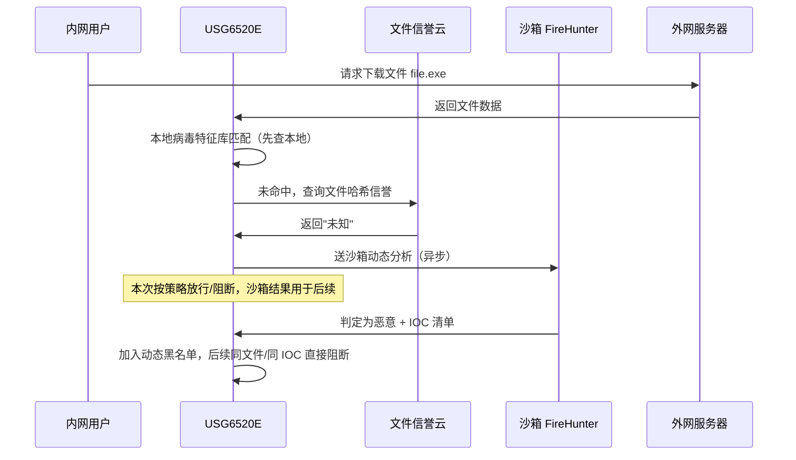

### 真题精练

**Q22.【真题·单选】** 关于反病毒中的流扫描（stream）与文件扫描（file），下列说法正确的是（ ）。
A. 流扫描需要先完整缓存文件再检测，时延更高
B. 文件扫描时延低、内存占用小
C. 流扫描时延低、内存占用小，但检测深度可能略弱
D. 两者完全等价，只是命令名不同

> **答案：C**
> **解析**：流扫描是"边接收边检测"，时延与内存开销都小；文件扫描需要完整还原文件后再检测，更彻底但更耗资源。A、B 把两者的特性完全说反了。

**Q23.【真题·简答】** 华为 USG 上反病毒与文件信誉、沙箱是如何协同工作的？为什么沙箱不能直接阻断当前这次文件下载？

> **答案**：（1）协同流程：本地病毒特征库先做快速精确匹配，命中即按动作阻断；未命中则查询文件信誉（云端哈希信誉库），已知恶意直接阻断，安全则放行；对于"未知"文件，按策略送沙箱做动态行为分析。（2）沙箱不能同步阻断当前下载的原因：沙箱需要在隔离环境中运行文件、观察行为（数十秒甚至分钟级），而文件下载与用户操作是实时的，无法等待分析结果。因此沙箱的价值在于"事后发现 + 全网免疫"：分析结果会生成 IOC（恶意哈希、域名、IP），USG 将其加入动态黑名单与动态签名，对后续同样文件的下载与同 IOC 的通信实现阻断与告警。（3）结论：沙箱是未知威胁检测的补充层，不能替代本地特征库与信誉库的在线阻断能力。
> **解析**：答题务必体现"时效性"这一核心矛盾：在线阻断要求毫秒级，动态分析要求分钟级，两者只能异步协同。

### 易错点与排错

1. **只开下载方向检测**是常见缺陷，上传方向同样要检测（防内网投毒与数据外泄）。
2. 大文件、加密压缩包（带密码）无法检测，属能力边界而非故障；可对大文件设置"阻断/放行"策略。
3. HTTPS 流量不做解密时，AV/IPS/URL 过滤都失效（只能看到加密载荷）——需要证书解密才能深度检测。
4. 沙箱需要 License 与网络可达性，`display license` 与升级通道要一起确认。
5. 命中日志用 `display logbuffer reverse | include virus` 或 `include AV` 精确过滤，避免日志刷屏。

## 6.4 URL 过滤

### 考点定位

校赛常考"URL 过滤依赖什么""HTTPS 网站能不能过滤"；省赛会考"预定义分类与自定义黑白名单的优先级"。易错点：认为不改解密也能过滤 HTTPS 站点、把黑名单与白名单的优先生效顺序记反（**白名单优先于黑名单**）。

### 原理精讲

**URL 过滤要解决的问题**：控制用户能访问哪些网站，用于合规（禁止访问违法/色情/赌博/游戏/网盘/挖矿类站点）、降低带宽消耗、减少钓鱼与恶意下载风险。

**三种实现维度**：
1. **预定义分类库（Pre-defined Category）**：华为维护的 URL 分类库（如赌博、色情、恶意软件、钓鱼、社交网络、流媒体、游戏、代理规避等），设备定期升级分类库，管理员对分类选择 `allow`（放行）/`alert`（告警）/`block`（阻断）/`redirect`（重定向到提示页）。优点：覆盖面广、维护成本低；缺点：分类库存在更新滞后与误分类。
2. **自定义黑名单（Blacklist）**：把具体 URL/域名/IP 加入黑名单并阻断，适合已知风险站点。
3. **自定义白名单（Whitelist）**：把必须放行的 URL 加入白名单。**白名单优先级最高**——即使该 URL 属于被阻断的分类，也会被放行；这是设计上的"业务可用性优先"原则，也常用于解决分类库误判导致的业务中断。

**URL 匹配与局限**：
- 匹配方式包括**精确匹配、前缀匹配、关键字匹配、正则匹配**；匹配对象支持域名（`www.example.com`）、路径（`www.example.com/bad`）与 IP。
- URL 过滤对 **HTTP** 流量的 URL 可见（请求行与 Host 头明文）；对 **HTTPS** 流量，设备只能看到 SNI（TLS 握手中的服务器名）与 IP，**无法看到完整 URL 与路径**。因此：
  - 只做基于**域名/SNI**的过滤时，部分版本的 URL 过滤可以对 HTTPS **部分生效**（能封域名，不能封路径）；
  - 要做**完整的 URL 与关键字过滤**，必须配置 **SSL 解密（证书代理）**，由防火墙作为中间人解密流量，代价是性能开销与证书信任部署复杂度。
- **绕过风险**：加密代理、VPN、DoH（DNS over HTTPS）、加密 DNS 以及直连 IP 都能绕过 URL 过滤，因此 URL 过滤通常需与应用识别、DNS 过滤、代理管控组合使用。

### 关键概念对照表

| 维度 | 生效范围 | 优先级 | 典型用途 |
|---|---|---|---|
| 白名单 | 指定 URL | **最高** | 放行被误分类的业务系统 |
| 黑名单 | 指定 URL | 高 | 封堵已知恶意/违规站点 |
| 预定义分类 | 分类库内整类站点 | 低 | 批量管控（游戏/流媒体/赌博等） |

| 流量类型 | 设备可见信息 | 能否过滤路径/关键字 |
|---|---|---|
| HTTP（80） | URL、Host、路径、关键字 | 能 |
| HTTPS（443）未解密 | SNI、目的 IP | 仅能按域名/IP 粗粒度 |
| HTTPS 且开启 SSL 解密 | 完整 URL | 能（需部署证书信任与性能预算） |

### 华为设备配置

```bash
[USG6520E] profile type url-filter name url_profile               // 创建 URL 过滤配置文件
[USG6520E-profile-url-filter-url_profile] category pre-defined gambling block   // 赌博类：阻断
[USG6520E-profile-url-filter-url_profile] category pre-defined game block       // 游戏类：阻断
[USG6520E-profile-url-filter-url_profile] category pre-defined phishing alert   // 钓鱼类：先告警观察
[USG6520E-profile-url-filter-url_profile] blacklist url www.badsite.example     // 自定义黑名单：直接阻断
[USG6520E-profile-url-filter-url_profile] whitelist url oa.example.com          // 自定义白名单：优先放行（业务系统）
[USG6520E-profile-url-filter-url_profile] exit
[USG6520E] security-policy
[USG6520E-policy-security] rule name trust_to_untrust
[USG6520E-policy-security-rule-trust_to_untrust] action permit
[USG6520E-policy-security-rule-trust_to_untrust] profile url-filter url_profile  // 策略引用 URL 过滤 profile
[USG6520E-policy-security-rule-trust_to_untrust] quit
[USG6520E-policy-security] quit
[USG6520E] display url-filter category ?                         // 查看已加载的分类库（命令字以 ? 为准）
[USG6520E] display logbuffer reverse | include URL               // 查看 URL 过滤命中日志
```

### 示意图

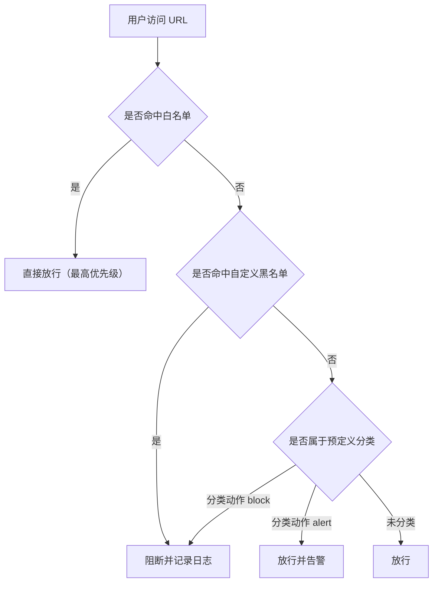

### 真题精练

**Q24.【真题·单选】** 关于 URL 过滤对 HTTPS 流量的处理，下列说法正确的是（ ）。
A. 未做 SSL 解密时，设备可以看到完整 URL 并做路径匹配
B. 未做 SSL 解密时，设备通常只能基于 SNI/域名做粗粒度过滤
C. HTTPS 流量无法做任何形式的访问控制
D. URL 过滤天然对 HTTPS 完全生效，无需额外配置

> **答案：B**
> **解析**：HTTPS 的 URL 与路径位于 TLS 加密载荷中，不解密时设备只能从 ClientHello 的 SNI 与目的 IP 得到域名级信息（部分版本支持基于 SNI 的过滤），无法做路径/关键字匹配。要做完整过滤必须配置 SSL 解密（证书代理）。C 错——至少可按域名/IP 过滤。

### 易错点与排错

1. **白名单优先级最高**，业务系统被误拦时优先加白名单而不是关掉整个分类阻断。
2. HTTPS 站点"封不住"多数是没做解密，属正常能力边界。
3. 分类库需定期升级，否则新出现的违规站点无法识别。
4. 日志里 URL 过滤的命中动作（allow/block/alert）与策略名要一起看，便于定位是哪条 rule 生效。
5. 用 `redirect` 动作给用户返回提示页，比直接丢包体验更好，也便于运维确认策略生效。

## 6.5 应用识别（SA 特征库）与内容安全升级、排错

### 考点定位

应用识别是"内容安全的地基"，校赛常考"**与端口无关的识别能力**"这一核心结论；省赛会考特征库升级方式（在线/离线）与升级失败排查。易错点：认为"改端口就能绕过应用识别"、忘记升级需要 License 与策略放行。

### 原理精讲

**为什么要应用识别？** 传统防火墙按端口判断应用（80=HTTP、443=HTTPS）已完全失效：木马可以用 80 端口，企业应用可以跑在任意端口（如把 Web 服务改成 8080、把数据库改成 1521 之外的端口），P2P/代理可以伪装端口。因此需要**基于报文内容与行为特征**识别应用，这就是 **SA**（Service Awareness，业务感知/应用识别）能力与 **SA 特征库**的作用。

**识别技术（三类，逐层递进）**：
1. **端口与协议基础识别**：先按 IP 协议号与端口做初判（快但不准）；
2. **载荷特征识别（Signature）**：解析报文内容中的**协议指纹**——HTTP 的请求行与头域、TLS 的 SNI 与证书字段、SSH 的版本串、DNS 查询名、P2P 的握手特征等；这一层能做到"**与端口无关**"：把 HTTP 服务改到 9999 端口，仍能被识别为 HTTP；
3. **行为特征识别（Behavioral）**：对加密或私有协议，通过连接数、上下行字节比、包长分布、连接时长、交互节奏等统计特征推断应用类别（如"疑似 P2P 下载""疑似加密隧道"），并可通过**机器学习**提升准确率。
此外还有 **FD（First-packet Detection）首包识别** 与 **关联识别**（对已识别的会话，其关联子流继承识别结果），用于提升性能与准确性。

**与端口无关的识别能力意味着什么？** 意味着安全策略可以写成"**允许 HTTP 但禁止 P2P**""允许办公应用但阻断代理规避工具"，无论这些应用跑在哪个端口；也意味着**基于应用的策略比基于端口的策略更贴近业务意图**。

**SA 特征库与内容安全特征库都要升级**：
- **在线升级**：设备直连华为升级服务器（`update server domain sec.huawei.com`），按计划自动下载。要求：DNS 能解析升级域名、到升级服务器的路由与安全策略放行、License 有效；
- **离线升级**：在无外网的环境中，从华为官网下载特征库离线包（.zip/.bin），通过管理口导入或从 U 盘/内网服务器导入（新版支持从内网 HTTP 服务器或 iMaster NCE 统一分发）。
- 升级内容包含：IPS 签名库、AV 病毒库、URL 分类库、应用识别（SA）库、地理位置库等，`display update version` 可查看各库版本与最后更新时间。
- **升级失败的常见原因**：License 过期、DNS 未配置、`local`→`untrust` 策略未放行、代理环境未配置、设备时间错误导致证书校验失败。

**内容安全排错与日志**：
- `display firewall session table verbose` 看会话的应用识别结果与内容安全处理标记；
- `display logbuffer reverse` / 外发 syslog 到日志服务器（`info-center loghost`）做集中审计；安全合规通常要求日志留存 **6 个月**以上；
- 无法识别为具体应用时，流量常显示为 `Unknown`，此时内容安全大多不生效——要么升级 SA 库，要么用自定义应用/自定义签名补充识别。

### 关键概念对照表

| 识别层次 | 依据 | 能否与端口无关 | 典型能力 |
|---|---|---|---|
| 端口/协议基础 | 五元组 | 否 | 快速初判 |
| 载荷特征 | 协议指纹、关键字 | **能** | 识别 HTTP/TLS-SNI/SSH 等 |
| 行为特征 | 统计与交互模式 | 能 | 识别加密 P2P、代理、挖矿 |
| 首包识别/关联识别 | 首包特征 + 会话关联 | 能 | 提升性能与一致性 |

| 升级方式 | 前提条件 | 适用环境 |
|---|---|---|
| 在线升级 | 可达升级服务器、DNS 正常、License 有效 | 设备可访问 Internet |
| 离线升级 | 官网下载离线包 + 本地导入通道 | 内网隔离环境 |

| 现象 | 可能原因 | 处置 |
|---|---|---|
| 升级失败 | License 过期 / DNS 未配 / 策略未放行 / 时间错误 | 逐项 `display license`、`display dns server`、`display security-policy rule all`、`display clock` |
| 应用识别为 Unknown | SA 库过旧 / 私有协议 | 升级 SA 库、自定义应用或签名 |
| 命中与否都放行 | profile 未被策略引用 / 动作为 alert | 检查 `display security-policy rule name` 与 profile 动作 |

### 华为设备配置

```bash
[USG6520E] dns resolve                                          // 开启 DNS 解析（升级域名解析的前提）
[USG6520E] dns server 114.114.114.114                           // 配置 DNS 服务器
[USG6520E] update server domain sec.huawei.com                  // 指定特征库在线升级服务器
[USG6520E] update schedule ips daily 02:00                      // IPS 特征库每天 02:00 自动升级
[USG6520E] update schedule av daily 02:10                       // 病毒库每天 02:10 自动升级
[USG6520E] update schedule sa daily 02:20                       // 应用识别（SA）库每天 02:20 自动升级
[USG6520E] update now                                           // 立即执行一次在线升级（手工触发）
[USG6520E] display update version                               // 查看各类特征库版本与最后升级结果
[USG6520E] info-center enable                                   // 开启信息中心（日志功能前提）
[USG6520E] info-center loghost 192.168.1.200                    // 日志外发到日志服务器，满足留存审计要求
[USG6520E] display firewall session table verbose               // 查看会话的应用识别结果与安全处理标记
[USG6520E] display logbuffer reverse                            // 查看最近日志（含内容安全命中）
```

### 示意图

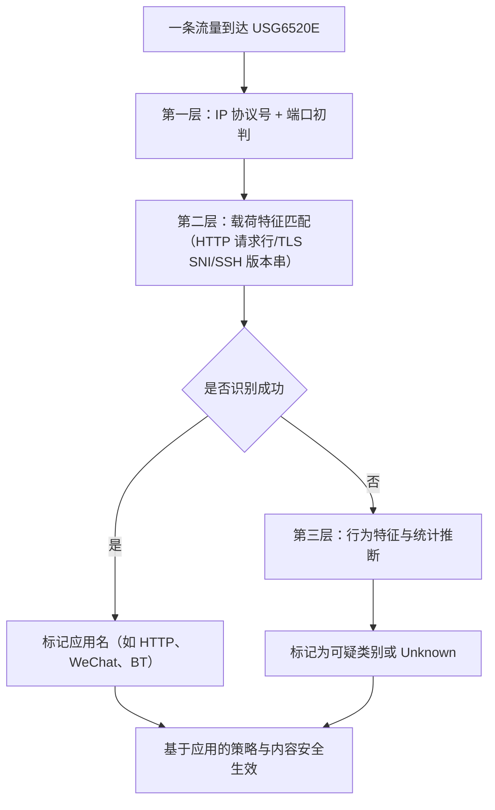

### 真题精练

**Q25.【真题·多选】** 关于华为防火墙的应用识别（SA）能力，下列说法正确的是（ ）。
A. 基于端口无法识别的应用，可通过载荷特征识别
B. 把 Web 服务改到非 80 端口后，应用识别仍可能识别为 HTTP
C. 应用识别只能识别明文协议，对加密流量完全无能为力
D. 应用识别结果可用于配置基于应用的访问控制策略

> **答案：ABD**
> **解析**：C 错——对加密流量可用行为特征（连接数、上下行比、包长分布）与 TLS SNI、证书字段等做识别，虽然准确率不如明文协议，但并非无能为力。A、B 体现了"与端口无关的识别能力"这一核心结论，D 是应用识别的直接价值。

**Q26.【真题·排错】** 某隔离内网的 USG6000E 无法在线升级特征库，管理员怀疑是网络问题。请给出排查思路与替代方案。

> **答案**：（1）排查思路：① `display license` 确认内容安全与特征库升级相关 License 是否有效（过期则无法升级）；② `display dns server` 与 `ping sec.huawei.com` 检查 DNS 与升级服务器可达性；③ `display security-policy rule all` 确认 `local` 到 `untrust`（或到升级服务器所在区域）的策略已放行，`display ip routing-table` 确认有默认路由；④ `display clock` 检查设备时间，时间错误会导致 HTTPS 证书校验失败；⑤ 若出口有代理，确认已在设备上配置代理与认证信息；⑥ `display update version` 查看升级错误码与最后更新时间。（2）替代方案：采用离线升级——在可上外网的主机从华为官网下载对应版本的特征库离线包，通过内网服务器或 U 盘导入设备（或通过 iMaster NCE 统一分发），完成后再次 `display update version` 验证版本已更新。
> **解析**：答题要覆盖"授权-域名解析-路由与策略-时间-代理"这条完整链路，并给出隔离环境的标准替代路径（离线包导入）。

### 易错点与排错

1. **"改端口就能绕过"是错误认知**：载荷特征与行为特征正是为破解端口伪装而设计。
2. 升级失败先查 **License 与设备时间**，再看 DNS、路由、策略、代理。
3. 应用识别为 `Unknown` 时，AV/IPS 大多不生效，应优先升级 SA 特征库。
4. 日志留存要满足合规要求（网络安全法要求网络日志留存不少于 **6 个月**），务必配置 `info-center loghost` 外发。
5. 用 `display firewall session table verbose` 能看到会话上的应用名与 profile 处理结果，是内容安全排错最有效的单条命令。

---

# 安全-HCIA-章节7-常见网络攻击与防御技术

> 本章防火墙命令以 HiSecEngine USG6000E（V600R007）为准，交换机命令以 CloudEngine S5731（VRP V200）为准；个别命令字在小版本间存在差异，实际输入以设备 `?` 提示为准。

## 7.1 单包攻击原理与 `firewall defend` 防御

### 考点定位

单包攻击（Single-Packet Attack）是校赛/省赛的**高频填空与选择题来源**，考法有三类：①描述攻击特征问攻击名称（如"源目地址相同"→LAND）；②问哪种攻击利用了 ICMP 广播放大（→Smurf）；③给出 `firewall defend xxx enable` 判断防的是哪种攻击。易错点：混淆 Smurf 与 Fraggle（ICMP vs UDP）、混淆 Teardrop 与 Ping of Death（分片偏移重叠 vs 超长 ICMP）。

### 原理精讲

单包攻击的共同特点是：**用极少的报文（常常 1 个）就能造成目标 CPU 过载、协议栈异常或资源耗尽**，因此防护手段是在设备入口做**报文合法性检查（Sanity Check）**，不合法直接丢弃。为什么不靠"流量大小"判断？因为单包攻击流量极小（几十字节），靠限速根本防不住，只能靠**协议规范校验**。

**（1）IP 层欺骗与畸形攻击**
- **IP 欺骗（IP Spoofing）**：伪造源 IP。危害有二：隐藏攻击者身份、让反射放大攻击把响应打向受害者。防御：入方向 **uRPF**（见 7.8）、出口方向限制私网源地址外发（`firewall defend ip-spoofing`）。
- **LAND 攻击**：源 IP 与目的 IP 相同、源端口与目的端口相同，报文在协议栈内部形成"自己回给自己"的死循环，耗尽 CPU。防御：`firewall defend land enable`。
- **Smurf 攻击**：攻击者伪造**受害者源地址**向广播地址发送 **ICMP Echo Request**，网段内所有主机向受害者回 Echo Reply，形成放大。防御：`firewall defend smurf enable`（丢弃目的为广播/组播地址的 ICMP 请求）。
- **Fraggle 攻击**：Smurf 的 UDP 版本，用 UDP 7（echo）、19（chargen）等端口向广播地址发包放大。防御：`firewall defend fraggle enable`。
- **Ping of Death**：发送**超大 ICMP 报文**（历史上 >65535 字节，通过分片拼装），使目标重组时缓冲区溢出。防御：`firewall defend ping-of-death enable`（丢弃超大 ICMP）与 `firewall defend large-icmp enable`（限制 ICMP 报文长度）。
- **Teardrop 攻击**：构造**分片偏移量重叠或异常**的 IP 分片，使目标重组出错、内存越界。防御：`firewall defend teardrop enable`、`firewall defend ip-fragment enable`（丢弃异常分片）。
- **IP 分片攻击**：用大量小分片绕过检测（很多安全设备只检测首片，后续分片"看不见"）。防御策略是**丢弃分片或做分片重组后再检测**；`firewall defend ip-fragment enable` 直接丢弃分片报文。
- **路由记录/源路由/时间戳选项攻击**：IP 选项字段（Record Route、Source Route、Timestamp）可被用于探测路径或强制报文走特定路径绕过安全设备。防御：`firewall defend route-record enable`、`firewall defend source-route enable`、`firewall defend timestamp enable`。
- **ICMP 重定向/不可达攻击**：伪造 ICMP Redirect 修改主机路由表，或伪造 ICMP Unreachable 切断通信（"ICMP 不可达攻击"常用于 DoS 与链路欺骗）。防御：`firewall defend icmp-redirect enable`、`firewall defend icmp-unreachable enable`。
- **WinNuke**：向 Windows 主机的 NetBIOS 端口（139）发送带 **URG 标志**的 TCP 报文，触发旧系统蓝屏。防御：`firewall defend winnuke enable`、`firewall defend tcp-flag enable`（丢弃非法 TCP 标志组合，如 SYN+FIN 同时置位）。
- **ARP 泛洪/ARP Miss**：大量 ARP 报文或大量无法解析的流量触发 ARP Miss 消息上送 CPU。防御：`firewall defend arp-flood enable`、`firewall defend arp-miss enable`。

**设计哲学**：这些开关默认多数**关闭**（避免误伤正常业务，如某些场景确实需要 ICMP 重定向），现场需要按网络实际情况逐项开启并观察日志。这也是考点——不是"全开就最安全"。

### 关键概念对照表

| 攻击名称 | 关键特征 | 协议/字段 | 防御命令 |
|---|---|---|---|
| LAND | 源目 IP、源目端口完全相同 | IP/TCP | `firewall defend land enable` |
| Smurf | 伪造源地址向广播发 ICMP 请求 | ICMP | `firewall defend smurf enable` |
| Fraggle | 伪造源地址向广播发 UDP 请求 | UDP 7/19 | `firewall defend fraggle enable` |
| Ping of Death | 超大 ICMP 报文（分片拼装） | ICMP | `firewall defend ping-of-death enable` |
| Teardrop | 分片偏移重叠/异常 | IP 分片 | `firewall defend teardrop enable` |
| IP 分片攻击 | 大量小分片绕过检测 | IP 分片 | `firewall defend ip-fragment enable` |
| WinNuke | 带 URG 标志打到 139 端口 | TCP | `firewall defend winnuke enable` |
| 非法 TCP 标志 | SYN+FIN、无标志等 | TCP | `firewall defend tcp-flag enable` |
| ICMP 重定向 | 伪造 Redirect 改路由 | ICMP | `firewall defend icmp-redirect enable` |
| ICMP 不可达 | 伪造 Unreachable 断链 | ICMP | `firewall defend icmp-unreachable enable` |
| 源路由/路由记录 | IP 选项字段被滥用 | IP Option | `firewall defend source-route/route-record enable` |
| ARP 泛洪 | 大量 ARP 上送 CPU | ARP | `firewall defend arp-flood enable` |

| 对比项 | Smurf | Fraggle |
|---|---|---|
| 承载协议 | ICMP Echo Request | UDP（7/19 等） |
| 放大目标 | 网段全体主机回 ICMP Reply | 网段主机回 UDP 响应 |
| 放大倍数来源 | 广播域主机数量 | 广播域主机数量 × 服务响应大小 |

### 华为设备配置

```bash
[USG6520E] firewall defend land enable                    // 防 LAND：源目地址/端口相同的畸形报文
[USG6520E] firewall defend smurf enable                   // 防 Smurf：目的为广播/组播的 ICMP 请求
[USG6520E] firewall defend fraggle enable                 // 防 Fraggle：目的为广播/组播的 UDP 请求
[USG6520E] firewall defend ping-of-death enable           // 防 Ping of Death：超大 ICMP 报文
[USG6520E] firewall defend large-icmp enable              // 限制 ICMP 报文最大长度
[USG6520E] firewall defend teardrop enable                // 防 Teardrop：分片偏移重叠的畸形分片
[USG6520E] firewall defend ip-fragment enable             // 直接丢弃 IP 分片（按业务情况谨慎开启）
[USG6520E] firewall defend tcp-flag enable                // 丢弃非法 TCP 标志组合（SYN+FIN 等）
[USG6520E] firewall defend winnuke enable                 // 防 WinNuke：URG 标志打到 139 端口
[USG6520E] firewall defend icmp-redirect enable           // 防伪造 ICMP 重定向（部分版本默认已启用）
[USG6520E] firewall defend icmp-unreachable enable        // 防伪造 ICMP 不可达切断通信
[USG6520E] firewall defend source-route enable            // 丢弃带源路由选项的报文
[USG6520E] firewall defend route-record enable            // 丢弃带路由记录选项的报文
[USG6520E] firewall defend timestamp enable               // 丢弃带时间戳选项的报文
[USG6520E] firewall defend ip-spoofing enable             // 丢弃源地址为非法的报文（防 IP 欺骗）
[USG6520E] firewall defend arp-flood enable               // 限制 ARP 报文上送 CPU 的速率
[USG6520E] firewall defend arp-miss enable                // 限制 ARP Miss 消息上送 CPU 的速率
[USG6520E] display firewall defend ?                      // 查看所有可用的攻击防范开关
[USG6520E] display firewall statistic system ?            // 查看各攻击防范的丢弃统计（命令字以 ? 为准）
```

### 示意图

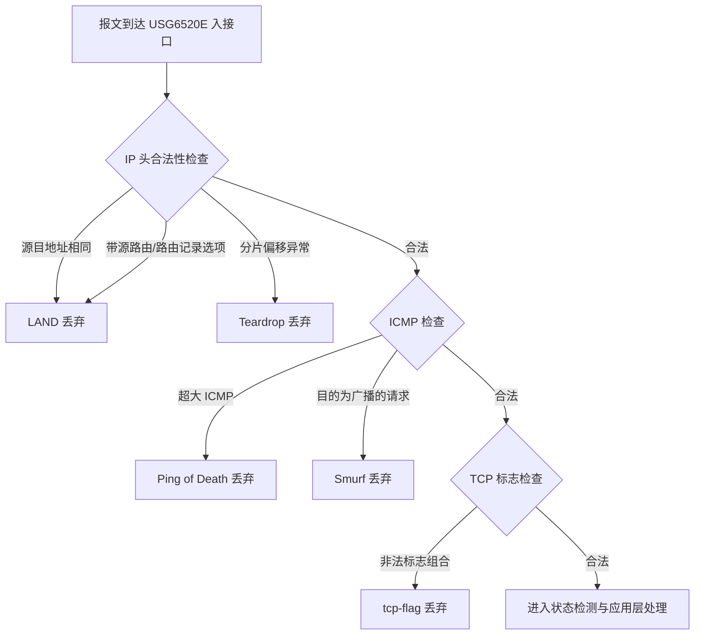

### 真题精练

**Q27.【真题·单选】** 某攻击报文的源 IP 与目的 IP 相同、源端口与目的端口相同，会导致目标主机协议栈循环处理自身报文而耗尽 CPU。该攻击是（ ）。
A. Smurf  B. LAND  C. Teardrop  D. WinNuke

> **答案：B**
> **解析**：源目地址与端口完全一致正是 LAND 攻击的判定特征，华为设备用 `firewall defend land enable` 防御。Smurf 是广播 ICMP 放大，Teardrop 是分片偏移异常，WinNuke 是 URG 标志打到 139 端口。

**Q28.【真题·多选】** 下列关于单包攻击与防御的说法，正确的是（ ）。
A. Smurf 攻击利用 ICMP 广播请求实现流量放大
B. Fraggle 是 Smurf 的 UDP 版本
C. `firewall defend ip-fragment enable` 会丢弃所有 IP 分片报文，可能影响正常分片业务
D. 单包攻击流量很大，只能通过流量清洗设备防御

> **答案：ABC**
> **解析**：D 错——单包攻击的本质是"用极少报文触发协议栈或 CPU 异常"，流量很小，靠限速/清洗无效，必须靠协议合法性检查（`firewall defend` 系列）在入口丢弃。C 是重要的现场经验：丢弃全部分片会影响大包传输与某些隧道业务，需评估后再开。

### 易错点与排错

1. **Smurf 是 ICMP、Fraggle 是 UDP**，这是最容易记反的一对。
2. 攻击防范开关**不是全开最好**：`ip-fragment` 会丢分片、`icmp-redirect` 在某些网络中属正常行为，需结合实际。
3. 开启后用 `display firewall statistic system` 或日志确认丢弃计数，避免"开了但没生效"（可能报文被前置设备拦了）。
4. 单包攻击防范在**入方向**生效，不要在出方向接口上找统计。
5. 结合 uRPF/IP Source Guard 使用才能根治 IP 欺骗类攻击。

## 7.2 扫描攻击与防御

### 考点定位

考法为"给出扫描行为特征选攻击类型""用什么命令防端口扫描"。校赛以单选/填空为主，省赛可能考"地址扫描的阈值配置"。易错点：把地址扫描（扫主机）与端口扫描（扫端口）搞混、认为扫描只是探测无需防御（扫描往往是攻击的前奏）。

### 原理精讲

**扫描（Scanning）是攻击链的"踩点"阶段**，攻击者通过扫描确定存活主机、开放端口、服务版本与操作系统，再选择漏洞进行利用。防御扫描的价值在于**在攻击尚未成功时就暴露攻击者**，属于"提前预警"。

**两类扫描**：
- **地址扫描（Address Sweep / IP Sweep）**：短时间内对同一目的网段的大量不同 IP 发送探测报文（ICMP Echo、TCP SYN 到 80/445 等），目的是找出**哪些主机存活**。特征：单位时间内**目的 IP 变化数**超过阈值。
- **端口扫描（Port Scan）**：对**同一目的 IP** 的大量不同端口发起连接（TCP SYN 扫描、FIN 扫描、NULL/XMAS 扫描、ACK 扫描、UDP 扫描），目的是找出**哪些端口开放**。特征：单位时间内**目的端口变化数**超过阈值。
- 变体：**ICMP 地址扫描**（大量 ICMP Echo 到不同地址）、**慢速扫描**（降低速率规避阈值检测，需结合行为基线与长期日志分析，属于高级威胁检测范畴）。

**防御机制的设计逻辑（为什么用"阈值+统计"）**：扫描是不可否认的"量大且分散"行为，无法用单包特征识别，只能用**滑动时间窗口内的计数**：
- 统计"同一源 IP 在 T 秒内访问的不同目的地址/端口数量"，超过阈值即判定为扫描；
- 判定后的动作分层：**告警（记录日志）→ 加入黑名单（动态黑名单，阻断该源一段时间）→ 上报态势感知**；
- 阈值必须可调，否则正常业务（如监控系统轮询大量 IP、漏洞扫描器合规扫描）会被误判——**把合法扫描器 IP 加入白名单**是标准做法。

**与 IPS 的关系**：`firewall defend` 提供的扫描防范是**轻量级、基于阈值**的；IPS 的扫描类签名（如"Nmap 扫描特征""SSH 暴力破解"）是**基于特征与行为**的深度检测，两者互补，现场通常都开。

### 关键概念对照表

| 攻击类型 | 变化维度 | 典型报文 | 防御命令 |
|---|---|---|---|
| 地址扫描 | 目的 IP 大量变化 | ICMP Echo、TCP SYN | `firewall defend ip-sweep enable` |
| 端口扫描 | 目的端口大量变化 | TCP SYN/FIN/NULL | `firewall defend port-scan enable` |
| ICMP 地址扫描 | 目的 IP 大量变化 + ICMP | ICMP Echo | `firewall defend icmp-address-sweep enable` |
| 慢速扫描 | 速率低于阈值 | 分散的长周期探测 | IPS 行为签名 + 长期日志分析 |

| 阈值要素 | 说明 | 调优建议 |
|---|---|---|
| 统计周期 | 滑动时间窗口 | 太短易误判，通常几十秒级 |
| 地址/端口变化数 | 触发阈值 | 结合业务规模与合法扫描器白名单 |
| 动作 | alert / blacklist | 先告警观察，稳定后开自动黑名单 |

### 华为设备配置

```bash
[USG6520E] firewall defend ip-sweep enable                   // 开启地址扫描防范
[USG6520E] firewall defend ip-sweep threshold 4000           // 调整阈值（单位时间内的目的地址变化数，按现网调优）
[USG6520E] firewall defend port-scan enable                  // 开启端口扫描防范
[USG6520E] firewall defend port-scan threshold 4000          // 端口扫描阈值
[USG6520E] firewall defend icmp-address-sweep enable         // 开启 ICMP 地址扫描防范
[USG6520E] firewall blacklist enable                         // 开启动态黑名单：扫描源自动入黑名单一段时间
[USG6520E] display firewall blacklist                        // 查看被自动/手工拉黑的源地址
[USG6520E] display logbuffer reverse | include scan          // 查看扫描告警日志，确认阈值是否合理
```

### 示意图

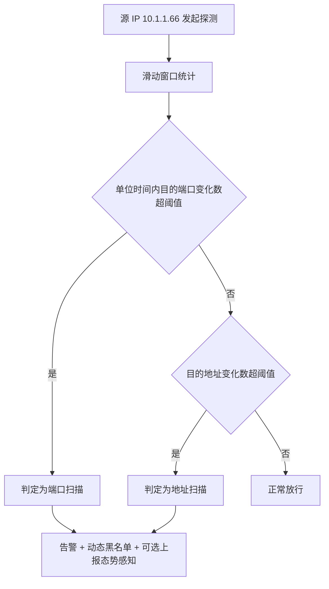

### 真题精练

**Q29.【真题·单选】** 攻击者在 10 秒内对同一台服务器从 1 到 65535 逐个尝试 TCP 连接，这种攻击行为属于（ ）。
A. 地址扫描  B. 端口扫描  C. 流量型 DDoS  D. 应用层 CC 攻击

> **答案：B**
> **解析**：目的 IP 固定、目的端口大量变化是端口扫描的典型特征，对应 `firewall defend port-scan enable`。地址扫描是目的 IP 大量变化；CC 攻击是针对应用层的正常请求洪泛，不表现为端口遍历。

### 易错点与排错

1. **地址扫描看"IP 变化"，端口扫描看"端口变化"**，判断口诀"变地址=地址扫描，变端口=端口扫描"。
2. 阈值过小会把监控轮询、漏洞扫描、备份软件误判 → 必须把合法扫描源加入白名单或调整阈值。
3. 动态黑名单有超时时间，攻击者可能换源 IP 继续扫，需与态势感知/IPS 联动做更长时间维度的分析。
4. 扫描防范统计在**入方向**，且需要流量经过设备才能统计，旁路设备无法用此能力阻断。

## 7.3 DDoS 攻击分类与防御体系

### 考点定位

DDoS 是省赛/国赛**必考的重点**，题型覆盖单选、多选、简答。高频考法：①给出攻击现象判断属于哪一类（流量型/应用层/反射放大）；②问 SYN Cookie 的原理与作用；③问 RTBH（黑洞路由）与流量清洗的区别与适用场景；④问反射放大攻击为什么"源地址伪造"是关键。易错点：把 CC 攻击归为流量型、把 RTBH 当成清洗手段（黑洞是丢弃不是清洗）。

### 原理精讲

**DDoS（Distributed Denial of Service，分布式拒绝服务）**的本质是**用分布式的大量"合法形式"请求耗光目标某一维度的资源**。防御的核心思路是"**区分正常用户与攻击流量，并让攻击流量在到达目标前被消化**"。按攻击目标维度分三类：

**（1）流量型攻击（Volume-based）——耗带宽/包转发能力**
- **SYN Flood**：只发 SYN 不回 ACK，占满服务器半连接队列（`netstat` 中的 SYN_RECV）与连接表。防御：**SYN Cookie**（服务器不为半连接分配资源，把状态编码进 SYN-ACK 的序列号，收到客户端 ACK 时再校验还原）、**SYN 代理**（中间设备代替服务器完成三次握手，验证源真实后再放行）、缩短 SYN 超时、增大半连接队列（治标）。
- **UDP Flood**：大量 UDP 报文打到随机端口，触发目标回 ICMP 端口不可达，双重消耗。防御：限速、按目的端口过滤、丢弃无用 UDP 服务端口的流量。
- **ICMP Flood**：大量 ICMP Echo 消耗带宽与 CPU。防御：限速 + 关闭 ICMP 响应（按业务需要）。
- 特点：**流量巨大（Gbps~Tbps 级），单靠目标侧设备无法抵御**，必须依赖运营商清洗中心。

**（2）应用层攻击（Application-layer）——耗连接数/CPU/业务逻辑**
- **CC（Challenge Collapsar）攻击**：针对 Web 应用的"看起来完全合法的 HTTP 请求"洪泛，如高频请求**动态页面、搜索接口、登录接口**（这类请求要查数据库、做复杂计算，单个请求代价远大于静态页面）。特点是**流量不大（几 Mbps）但目标 CPU 100%**，因此流量型防护设备对它无效。
- **HTTP Flood / 慢速攻击（Slowloris、Slow POST）**：用极慢的请求/连接长期占用 Web 连接池与工作线程。防御：限制单 IP 并发连接数与请求速率、设置连接超时、识别"请求头不全"的慢连接。
- **DNS Query Flood**：大量随机子域名查询打垮权威 DNS。
- 防御核心是**人机识别与行为分析**：验证码、JS 挑战、源 IP 信誉、访问频率模型、Cookie/Session 校验、WAF 规则。

**（3）反射放大攻击（Reflection & Amplification）——用第三方做"放大器"**
原理三步：①攻击者**伪造受害者源 IP** 向大量开放服务（DNS、NTP、SSDP、Memcached、SNMP、Chargen）发送**小请求**；②服务把**大响应**发回"受害者"；③受害者被巨量响应淹没。放大倍数取决于协议的"响应/请求"比（DNS ~50 倍、NTP monlist ~500 倍、Memcached 可达数万倍）。
- 关键前提是 **IP 源地址伪造**，因此防御的两端是：**源端做 uRPF/出口过滤防止伪造源**（治本，需要运营商配合）、**服务端关闭不必要的放大类服务并做响应限速**（如关闭 NTP monlist、限制 DNS 递归、关闭 SSDP/mDNS 对外暴露）。
- 为什么"反射"让溯源变得极难？因为攻击流量来自**无辜的第三方服务器**，受害者看到的是全球各地正常服务器的响应。

**防御体系与流程（必背四层）**：
1. **本地防护（目标侧）**：USG 的 `firewall defend syn-flood/udp-flood/icmp-flood`、SYN Cookie、连接数/速率限制、动态黑名单；服务器侧内核参数调优（SYN 队列、连接回收）。
2. **旁路清洗（运营商/云清洗中心）**：AntiDDoS 设备 + 引流：通过 **BGP 通告**把目标 IP 的流量牵引到清洗中心，清洗后通过 **GRE/MPLS 回注**（clean pipe）送到目标，正常流量不受影响。
3. **RTBH（Remotely Triggered Black Hole，远端触发黑洞）**：由运营商在被攻击 IP 的上游**把流量指向 NULL0 丢弃**。优点是秒级生效、保护整网；缺点是**该 IP 完全不可用**（连正常用户也访问不了），属于"弃车保帅"的最后手段，只适合丢弃非关键 IP。配置命令就是一条指 NULL0 的静态路由。
4. **协同与自动化**：HiSec Insight/AntiDDoS Manager 检测 → 自动触发清洗或黑洞 → 攻击结束后自动撤销，把响应时间从小时级降到分钟级。
**流量清洗的标准流程**：检测（NetFlow/镜像分析/异常监测）→ 判定与通告（BGP 引流或 RTBH）→ 清洗（特征过滤、限速、源认证、人机识别）→ 回注（干净流量回送目标）→ 记录与复盘（保留 pcap 与日志作为溯源依据）。

### 关键概念对照表

| 攻击类别 | 代表攻击 | 消耗的资源 | 典型防御 |
|---|---|---|---|
| 流量型 | SYN Flood / UDP Flood / ICMP Flood | 带宽、包转发、连接表 | SYN Cookie、限速、清洗中心 |
| 应用层 | CC、HTTP Flood、慢速攻击、DNS Query Flood | 服务器 CPU、连接池、数据库 | WAF、频率限制、人机识别 |
| 反射放大 | DNS/NTP/SSDP/Memcached 放大 | 带宽（放大后） | 源地址过滤（uRPF）、关闭放大服务、响应限速 |

| 对比项 | 流量清洗（Scrubbing） | RTBH（黑洞路由） |
|---|---|---|
| 原理 | 引流到清洗设备，过滤后回注 | 上游把目的 IP 指向 NULL0 丢弃 |
| 正常用户是否可用 | **可用**（精细过滤） | **不可用**（全丢） |
| 生效速度 | 分钟级（需引流与回注） | 秒级 |
| 适用对象 | 关键业务 IP | 非关键 IP、需保护整网时 |
| 典型触发 | 自动检测 + BGP 引流 | 极端洪泛时"弃车保帅" |

| 机制 | 解决的问题 | 局限 |
|---|---|---|
| SYN Cookie | 不为半连接分配资源 | 需客户端正常回 ACK |
| SYN 代理 | 中间设备代替握手，验证源 | 占用中间设备资源 |
| 限速/连接数限制 | 抑制单源过量请求 | 分布式小流量攻击效果有限 |
| 人机识别 | 区分人与脚本（CC 攻击） | 影响体验，可能误伤 |

### 华为设备配置

```bash
// ---- 场景一：USG6520E 侧的洪泛防护 ----
[USG6520E] firewall defend syn-flood enable                  // 开启 SYN Flood 防范（源验证 + SYN Cookie 机制）
[USG6520E] firewall defend syn-flood max-rate 5000           // 限制每秒新建 SYN 速率（按业务承载能力调整）
[USG6520E] firewall defend udp-flood enable                  // 开启 UDP Flood 防范
[USG6520E] firewall defend icmp-flood enable                 // 开启 ICMP Flood 防范
[USG6520E] firewall defend icmp-flood max-rate 1000          // ICMP 速率限制
[USG6520E] firewall blacklist enable                         // 动态黑名单：攻击源自动入黑名单并设置老化时间
[USG6520E] firewall session link-state check                 // 会话状态严格检查，丢弃不符合状态机的报文
[USG6520E] display firewall session table | include 192.168.1.10   // 查看目标 IP 的会话数量，判断是否连接耗尽

// ---- 场景二：S5731 交换机侧保护 CPU（防止协议报文泛洪打垮管理面） ----
[SW1] cpu-defend policy anti_ddos                            // 创建 CPU 防护策略
[SW1-cpu-defend-policy-anti_ddos] car packet-type tcp cir 2000      // 限制上送 CPU 的 TCP 报文速率（kbit/s）
[SW1-cpu-defend-policy-anti_ddos] car packet-type arp cir 500       // 限制 ARP 上送速率
[SW1-cpu-defend-policy-anti_ddos] car packet-type icmp cir 500      // 限制 ICMP 上送速率
[SW1-cpu-defend-policy-anti_ddos] quit
[SW1] cpu-defend-policy anti_ddos global                      // 全局应用该 CPU 防护策略
[SW1] display cpu-defend statistics                           // 查看各类报文上送 CPU 与丢弃统计

// ---- 场景三：RTBH 黑洞路由（在被攻击 IP 的上游设备上配置） ----
[SW1] ip route-static 203.0.113.66 255.255.255.255 NULL0     // 把被攻击 IP 指向 NULL0，秒级丢弃全部流量
[SW1] display ip routing-table 203.0.113.66                   // 确认黑洞路由已生效（下一跳为 NULL0）
[SW1] undo ip route-static 203.0.113.66 255.255.255.255 NULL0 // 攻击结束后立即撤销，恢复业务
```

### 示意图

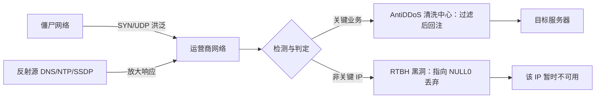

```mermaid
sequenceDiagram
  participant C as 客户端
  participant F as USG6520E（SYN Cookie）
  participant S as 服务器
  C->>F: SYN（源地址可能伪造）
  F->>C: SYN-ACK（seq = 编码状态的 Cookie，不占半连接队列）
  Note over F: 不为半连接分配资源
  C->>F: ACK（携带 Cookie+1 的确认号）
  F->>F: 校验 Cookie，合法才建连
  F->>S: 转交已建立的合法连接
```

### 真题精练

**Q30.【真题·单选】** SYN Cookie 技术能够防御 SYN Flood 攻击的根本原因是（ ）。
A. 增加服务器半连接队列长度
B. 收到 SYN 时不为半连接分配资源，把连接状态编码在序列号中
C. 直接丢弃所有 SYN 报文
D. 用 UDP 替代 TCP 传输

> **答案：B**
> **解析**：传统防御思路是"扩大半连接队列"，属治标（资源总是有限）；SYN Cookie 把连接状态通过哈希编码进 SYN-ACK 的序列号，服务器在收到合法 ACK 前不分配任何资源，从根本上消除了队列耗尽问题。A 是干扰项，C 会导致业务不可用。

**Q31.【真题·多选】** 关于反射放大攻击，下列说法正确的是（ ）。
A. 攻击者必须伪造受害者源 IP 地址
B. DNS、NTP、SSDP 等开放服务可被用作反射源
C. 放大倍数取决于响应报文与请求报文的大小比
D. 目标侧部署 IPS 即可完全消除反射放大攻击

> **答案：ABC**
> **解析**：D 错——反射放大攻击的流量可达数百 Gbps，远超单台设备处理能力，必须在运营商侧清洗，并配合源端 uRPF/出口过滤（防止源地址伪造）与关闭放大服务；目标侧 IPS 只能缓解小规模攻击。

**Q32.【真题·简答】** 请比较流量清洗与 RTBH 黑洞路由的适用场景，并说明为何 RTBH 被称为"弃车保帅"。

> **答案**：（1）流量清洗：通过 BGP 把被攻击 IP 的流量牵引到 AntiDDoS 清洗中心，按特征、速率、源认证、人机识别等手段过滤攻击流量，再把干净流量回注目标。正常用户仍可访问，适合**关键业务 IP**，缺点是生效需引流与回注，速度相对较慢（分钟级）。（2）RTBH：由上游设备把被攻击的目的 IP 指向 NULL0，所有流量被丢弃，**秒级生效且能保护网络其余部分**，但该 IP 在攻击期间对**所有人**都不可访问。（3）之所以称"弃车保帅"：RTBH 以牺牲单个（通常非关键）IP 的可用性为代价，换取骨干网与其它业务不被攻击流量冲击，是极端洪泛场景下的最后手段，攻击结束后必须立即撤销黑洞路由。
> **解析**：得分点在于"可用性差异（精细过滤 vs 全丢）""生效速度（分钟级 vs 秒级）""适用对象（关键 vs 非关键）"三个维度。

### 易错点与排错

1. **CC 攻击属应用层**，流量小但打 CPU，流量型防护无效，必须靠 WAF/频率限制/人机识别。
2. **RTBH 不洗流量，它是丢弃**，不要写成"清洗手段"。
3. SYN Flood 防护开启后若仍被打满，检查是否被攻击的是**带宽**而非连接表（此时需要上游清洗）。
4. 反射放大攻击的溯源要查"反射源"而不是受害者看到的源地址（那是伪造的）。
5. 清洗前后务必保存 **pcap 与 NetFlow 记录**，否则无法溯源与举证。

## 7.4 ARP 攻击与防御

### 考点定位

ARP 是园区网安全的**必考项**，校赛/省赛常考"ARP 欺骗的危害""DAI 依赖什么表项工作""DHCP Snooping 与 DAI、IPSG 的联动关系"。易错点：认为 DAI 可以独立工作（它**必须依赖 DHCP Snooping 产生的绑定表**或静态绑定表）、把 ARP 泛洪与 MAC 泛洪混为一谈。

### 原理精讲

**ARP 协议的先天缺陷（为什么容易被攻击）**：ARP（Address Resolution Protocol）**无认证、无状态**，主机收到 ARP 应答（甚至未经请求的应答，即 Gratuitous ARP）就无条件更新本地 ARP 缓存。攻击者只要发一条伪造的 ARP 应答，就能让受害者把网关 IP 映射到攻击者的 MAC 上，实现**中间人（MITM）**。

**两类 ARP 攻击**：
- **ARP 欺骗（ARP Spoofing/Poisoning）**：伪造"网关 IP ↔ 攻击者 MAC"的应答，使内网主机流量先经攻击者转发，从而**窃听、篡改、重定向**；也可伪造"某主机 IP ↔ 攻击者 MAC"实现会话劫持。危害最大的是欺骗网关，导致**全网断网或大范围泄密**。
- **ARP 泛洪（ARP Flood）**：高速发送大量 ARP 报文（尤其是源 MAC 不断变化的伪造 ARP），使交换机 **ARP 表/MAC 表溢出**并让大量 ARP 上送 CPU，造成三层转发失效与设备 CPU 高负载。这是典型的资源耗尽型攻击。

**四层防御手段（从源头到边界，考试要求会组合）**：
1. **DHCP Snooping**：交换机监听 DHCP 交互过程，把"客户端 MAC + 分配到的 IP + 接入端口 + VLAN"记录为**动态绑定表**（`dhcp snooping bind-table`）。同时把连接合法 DHCP 服务器的端口设为 **trusted**，其它端口为 untrusted，untuned 端口上收到的 DHCP Offer/ACK 等**服务器侧报文一律丢弃**，从而防住"仿冒 DHCP 服务器"与"DHCP 饿死"。**它是动态绑定数据的来源**，是 DAI/IPSG 的基础。
2. **DAI（Dynamic ARP Inspection，动态 ARP 检测）**：华为 VRPC 命令为 `arp anti-attack check user-bind enable`。交换机对 untrusted 端口上收到的 ARP 报文做**绑定表校验**：ARP 报文的"源 IP + 源 MAC"必须与绑定表（DHCP Snooping 动态表项或 `user-bind static` 静态表项）一致，否则丢弃。这样攻击者就无法伪造网关或他人的 ARP。**前提：绑定表必须存在**（要么开 DHCP Snooping 动态学习，要么手工静态绑定）；对于**静态 IP 主机**必须手工 `user-bind static`，否则会被误丢。
3. **ARP 报文限速**：对接口的 ARP 上送速率做限制（如 `arp-limit maximum` 类命令，见配置），防止 ARP 泛洪打垮 CPU；同时可配置 ARP 表项学习限制。
4. **静态 ARP 绑定与主机侧防护**：对关键设备（网关、服务器）在交换机上配静态 ARP（`arp static`）、在主机上配静态 ARP；终端安装 ARP 防火墙。缺点是维护量大，只在关键节点使用。

**为什么 DAI 必须"untrusted 口才检查"？** 因为交换机互联口（级联口）上可能存在大量合法主机的 ARP，逐条校验开销大；且级联口通常是可信的。因此把用户接入口设为 untrusted、级联口与服务器口设为 trusted 是标准设计。

### 关键概念对照表

| 防御手段 | 依据的数据 | 防什么 | 前提条件 |
|---|---|---|---|
| DHCP Snooping | DHCP 交互过程 | 仿冒 DHCP 服务器、DHCP 饿死 | 划分 trusted/untrusted 口 |
| DAI（`arp anti-attack check user-bind`） | 绑定表（动态/静态） | ARP 欺骗（伪造网关/主机） | 必须有绑定表 |
| ARP 限速/表项限制 | 速率阈值 | ARP 泛洪打 CPU | 按接口调优 |
| 静态 ARP 绑定 | 手工配置 | 关键节点被欺骗 | 维护成本高 |
| IP Source Guard | 绑定表 | IP/MAC 源地址欺骗 | 同 DAI，依赖绑定表 |

| 对比项 | ARP 欺骗 | ARP 泛洪 |
|---|---|---|
| 目的 | 中间人窃听/篡改/断网 | 耗尽 ARP 表与 CPU |
| 报文特征 | 少量伪造 ARP 应答 | 高速大量 ARP 报文 |
| 主要防御 | DAI、静态绑定 | ARP 限速、CPU 防护 |
| 检测手段 | `display arp` 看 MAC 是否异常 | `display cpu-usage`、接口 ARP 速率 |

### 华为设备配置

```bash
// ---- S5731 交换机：DHCP Snooping + DAI + IPSG + ARP 限速 联动配置 ----
[SW1] dhcp snooping enable                                    // 全局开启 DHCP Snooping（生成动态绑定表的来源）
[SW1] vlan 10
[SW1-vlan10] dhcp snooping enable                             // 在业务 VLAN 内开启 DHCP Snooping
[SW1-vlan10] quit
[SW1] interface GigabitEthernet0/0/24                         // 连接合法 DHCP 服务器/上级设备的端口
[SW1-GigabitEthernet0/0/24] dhcp snooping trusted             // 设为信任口：仅此口允许服务器侧 DHCP 报文
[SW1-GigabitEthernet0/0/24] quit
[SW1] interface GigabitEthernet0/0/1                          // 用户接入口（不可信）
[SW1-GigabitEthernet0/0/1] dhcp snooping enable               // 该口参与 DHCP Snooping 监听
[SW1-GigabitEthernet0/0/1] arp anti-attack check user-bind enable  // 开启 DAI：ARP 源 IP/MAC 必须与绑定表一致
[SW1-GigabitEthernet0/0/1] ip source check user-bind enable   // 开启 IP Source Guard：校验源 IP/MAC 合法性
[SW1-GigabitEthernet0/0/1] arp-limit maximum 20               // 限制接口 ARP 学习/上送速率，防 ARP 泛洪
[SW1-GigabitEthernet0/0/1] quit
[SW1] user-bind static ip-address 192.168.10.5 mac-address 00e0-fc12-3456 vlan 10 interface GigabitEthernet0/0/1
                                                              // 为静态 IP 主机手工建绑定表，否则 DAI 会误丢其 ARP
[SW1] arp static 192.168.10.254 00e0-fc00-0001                // 网关/服务器做静态 ARP 绑定（关键节点加固）
[SW1] display dhcp snooping bind-table all                    // 查看动态绑定表是否正常生成（DAI 生效的前提）
[SW1] display arp | include 192.168.10.1                      // 核对网关 IP 对应的 MAC 是否为真实网关 MAC
[SW1] display arp anti-attack check user-bind ?                // 查看 DAI 的丢弃统计（命令字以 ? 为准）
```

### 示意图

```mermaid
sequenceDiagram
  participant PC as 用户 PC
  participant SW as S5731（DHCP Snooping + DAI）
  participant DS as 合法 DHCP 服务器
  participant ATK as 攻击者
  PC->>SW: DHCP Discover
  SW->>DS: 转发到 trusted 口
  DS->>SW: DHCP Offer/ACK
  SW->>SW: 生成绑定表：MAC + IP + 端口 + VLAN
  SW->>PC: 下发地址
  ATK->>SW: 伪造 ARP 应答（网关 IP 映射到攻击者 MAC）
  SW->>SW: DAI 校验源 IP/MAC 与绑定表
  SW-->>ATK: 不一致，直接丢弃
```

### 真题精练

**Q33.【真题·单选】** 华为交换机上配置 DAI（动态 ARP 检测）时，其校验所依据的绑定表通常来自（ ）。
A. 路由表  B. DHCP Snooping 动态绑定表或静态 user-bind 表项  C. MAC 地址表  D. 会话表

> **答案：B**
> **解析**：DAI 的判定逻辑是"ARP 报文的源 IP + 源 MAC 是否与绑定表一致"，绑定表来源只有两条：DHCP Snooping 动态学习（动态 IP 用户）与 `user-bind static` 手工配置（静态 IP 用户）。若只开 DAI 不开 DHCP Snooping 且没有静态绑定，绑定表为空，所有 ARP 都会被丢弃，导致网络中断——这是实验中最常见的"配完断网"事故。

**Q34.【真题·多选】** 关于 ARP 攻击与防御，下列说法正确的是（ ）。
A. ARP 协议无认证机制，因此容易被伪造应答欺骗
B. DHCP Snooping 的 trusted 口应配置在连接合法 DHCP 服务器的端口上
C. DAI 可以防止攻击者伪造网关的 ARP
D. ARP 泛洪的主要危害是窃听用户密码

> **答案：ABC**
> **解析**：D 错——ARP 泛洪的主要危害是耗尽交换机 ARP 表与 CPU 资源导致转发异常，窃听属于 ARP 欺骗（中间人）的危害。A 指出了 ARP 攻击的根因，B、C 是 DHCP Snooping 与 DAI 的标准用法。

### 易错点与排错

1. **DAI 依赖绑定表**：只开 DAI 不开 DHCP Snooping、又未为静态 IP 主机建表，会导致这些主机完全无法通信。
2. **trusted 口只给 DHCP 服务器方向**；若把用户口设为 trusted，DAI 与反仿冒全部失效。
3. 交换机互联口一般**不启用 DAI**（减少开销、避免误丢），只在下联用户口启用。
4. 排错：`display dhcp snooping bind-table all` 看表项 → `display arp` 看是否有异常 MAC 抢占了网关 IP → 查 DAI 丢弃统计。
5. ARP 限速阈值过高等于没限，过低会误伤（部分终端高频 ARP 探测），要结合现网观察调整。

## 7.5 DHCP 攻击与 DHCP Snooping 防御

### 考点定位

考法集中在"三种 DHCP 攻击的识别"与"DHCP Snooping 的两种防御作用"。校赛多选/填空高频，省赛可能结合"仿冒 DHCP 服务器导致用户上不了网"的排错。易错点：把"DHCP 饿死"理解为"服务器没地址了"（本质是地址池被恶意耗尽）、把 DHCP Snooping 当成"只防仿冒服务器"（它还提供绑定表与可选限速）。

### 原理精讲

DHCP（Dynamic Host Configuration Protocol）交互分四步：**Discover（广播）→ Offer → Request（广播）→ ACK**。协议本身**无认证**：任何设备都能响应 Discover 并充当服务器，任何客户端都能无限次申请地址。由此产生三类攻击：

**（1）DHCP 饿死攻击（DHCP Starvation）**
攻击者不断伪造**不同 MAC 地址**（MAC 泛洪）发送 DHCP Discover/Request，把 DHCP 服务器的地址池**全部占满**，导致正常用户拿不到地址——本质是"**耗尽地址池资源**"的 DoS。由于 DHCP 服务器按 MAC 分配租约，攻击者只需不停变换源 MAC。危害：新用户无法上网，续租失败时老用户也会断网。
**防御**：① 交换机端口级限制——单端口的 DHCP 用户（绑定表）数量上限、源 MAC 学习限制（`mac-address limit`/端口安全）；② DHCP Snooping 的绑定表与告警；③ 收紧 DHCP 租约时间并配合监控。

**（2）仿冒 DHCP 服务器攻击（Rogue DHCP Server）**
攻击者在内网架设 DHCP 服务器，比合法服务器更快响应，给用户下发**错误的网关与 DNS**（网关指向攻击者），从而实施**中间人窃听**或引流到钓鱼页面。
**防御（DHCP Snooping 的核心能力）**：把交换机连接**合法 DHCP 服务器/上级 DHCP 中继**的端口配置为 `trusted`，其它端口全部为 untrusted。规则是：**untrusted 端口上收到的 DHCP 应答类报文（Offer/ACK/NAK）一律丢弃**，只有 trusted 端口允许服务器侧报文通过。注意：**客户端请求报文（Discover/Request）在所有端口都允许**（否则用户没法申请地址）。

**（3）DHCP 报文泛洪（DHCP Flood）**
大量 DHCP 报文上送交换机 CPU 或冲击 DHCP 服务器（含 DHCP 中继/服务器进程），造成设备 CPU 飙升甚至协议栈不可用。**防御**：对 DHCP 报文上送 CPU 的速率做限制（`cpu-defend` 的 CAR）、接口级 DHCP 报文限速、DHCP Snooping 的口令与告警。

**DHCP Snooping 的三大产出（考试重点）**：
1. **建立绑定表**（MAC+IP+端口+VLAN+租约）→ 供 **DAI**（防 ARP 欺骗）与 **IPSG**（防 IP/MAC 欺骗）使用，形成"三位一体"的接入安全体系；
2. **过滤服务器侧报文**（trusted/untrusted 机制）→ 防仿冒 DHCP 服务器；
3. **可选限速与告警** → 缓解 DHCP 泛洪与饿死。
注意：DHCP Snooping 只监听**经过本交换机的 DHCP 报文**，对"同一 VLAN 内不经过该交换机"的流量无能为力；此外**静态 IP 主机不会在绑定表中**，需要手工 `user-bind static` 补全。

### 关键概念对照表

| 攻击 | 原理 | 主要危害 | 防御手段 |
|---|---|---|---|
| DHCP 饿死 | 伪造大量 MAC 耗尽地址池 | 正常用户无法获取地址 | 端口绑定表/MAC 数量限制、端口安全 |
| 仿冒 DHCP 服务器 | 抢先下发错误网关/DNS | 中间人窃听、引流钓鱼 | DHCP Snooping trusted/untrusted 过滤 |
| DHCP 报文泛洪 | 大量 DHCP 报文 | 交换机 CPU 高、服务器不可用 | CPU CAR 限速、接口限速 |

| 报文方向 | 报文类型 | untrusted 口 | trusted 口 |
|---|---|---|---|
| 客户端→服务器 | Discover/Request/Release | 允许 | 允许 |
| 服务器→客户端 | Offer/ACK/NAK | **丢弃** | 允许 |
| 中继 | Relay 报文 | 按设计（通常来自 trusted 侧） | 允许 |

### 华为设备配置

```bash
// ---- S5731 交换机：DHCP Snooping 防仿冒服务器 + 防饿死 ----
[SW1] dhcp snooping enable                                    // 全局开启 DHCP Snooping
[SW1] vlan batch 10 20                                        // 批量创建业务 VLAN
[SW1] vlan 10
[SW1-vlan10] dhcp snooping enable                             // 业务 VLAN 内开启（只在该 VLAN 内监听）
[SW1-vlan10] quit
[SW1] interface GigabitEthernet0/0/24                         // 上行口（连合法 DHCP 服务器/核心）
[SW1-GigabitEthernet0/0/24] dhcp snooping trusted             // 设为信任口：唯一允许服务器应答报文的端口
[SW1-GigabitEthernet0/0/24] quit
[SW1] interface GigabitEthernet0/0/1                          // 用户接入口
[SW1-GigabitEthernet0/0/1] dhcp snooping enable               // 该口监听 DHCP 交互，生成绑定表
[SW1-GigabitEthernet0/0/1] dhcp snooping user-bind check      // 启用基于绑定表的源地址检查（配合 IPSG）
[SW1-GigabitEthernet0/0/1] port-security enable               // 端口安全：限制该口可学习的 MAC 数量
[SW1-GigabitEthernet0/0/1] port-security max-mac-num 3        // 单口最多 3 个 MAC，抑制 MAC 泛洪式饿死攻击
[SW1-GigabitEthernet0/0/1] port-security protect-action restrict  // 超限动作：丢弃并告警（不关闭端口，减少影响）
[SW1-GigabitEthernet0/0/1] quit
[SW1] display dhcp snooping bind-table all                    // 查看动态绑定表（含 IP/MAC/VLAN/端口/租约）
[SW1] display dhcp snooping configuration                     // 查看 DHCP Snooping 全局与接口配置
[SW1] display dhcp snooping packet statistics                 // 查看被丢弃的服务器侧报文统计（定位仿冒服务器）
```

### 示意图

```mermaid
flowchart TD
  A["接到用户口 GE0/0/1 的 DHCP 报文"] --> B{"报文类型"}
  B -->|"Discover/Request（客户端请求）"| C["允许通过，并记录绑定表"]
  B -->|"Offer/ACK/NAK（服务器应答）"| D{"端口是否为 trusted"}
  D -->|是| E["允许通过（合法服务器）"]
  D -->|否| F["丢弃：判定为仿冒 DHCP 服务器"]
  C --> G["生成绑定表：MAC+IP+端口+VLAN"]
  G --> H["供 DAI（防 ARP 欺骗）与 IPSG 使用"]
```

### 真题精练

**Q35.【真题·单选】** 攻击者通过不断变换源 MAC 地址发送大量 DHCP Discover，导致公司 DHCP 地址池被占满、员工无法获取 IP。该攻击属于（ ）。
A. 仿冒 DHCP 服务器攻击  B. DHCP 饿死攻击  C. ARP 欺骗  D. DHCP 报文泛洪

> **答案：B**
> **解析**：DHCP 饿死（Starvation）攻击的本质是耗尽 DHCP 服务器的地址池资源，特征是"变换 MAC + 大量请求"。DHCP 泛洪攻击的目标是设备 CPU/协议栈可用性而非地址池；仿冒服务器则是下发错误网关实施中间人。

**Q36.【真题·多选】** 关于 DHCP Snooping 的作用，下列说法正确的是（ ）。
A. 通过 trusted/untrusted 端口机制防止仿冒 DHCP 服务器
B. 生成 IP-MAC-端口-VLAN 绑定表，供 DAI 与 IPSG 使用
C. 可以自动为静态 IP 主机生成绑定表项
D. 可以限制 DHCP 报文的处理速率，缓解泛洪攻击

> **答案：ABD**
> **解析**：C 错——静态 IP 主机不经过 DHCP 交互，Snooping 无法获知其信息，必须手工 `user-bind static` 配置，否则启用 DAI/IPSG 后静态用户会被误丢包，这是实验中最常见的故障点。

### 易错点与排错

1. **trusted 口必须且只应在服务器/中继方向**，配错就失去防仿冒能力。
2. 静态 IP 主机必须手工建绑定表，否则开 DAI/IPSG 后直接断网。
3. DHCP Snooping 与 DHCP Relay 同时存在时，relay 所在设备/端口要按设计设为 trusted。
4. 排错：用户拿不到地址先看 `display dhcp snooping packet statistics`（是否有大量丢弃）→ 再看 `display dhcp snooping bind-table all`（表项是否生成）→ 最后确认地址池与中继配置。
5. 端口安全（`port-security`）与 MAC 限速是防饿死的关键补充，只靠 Snooping 无法限制"每个 MAC 只申请一次"的洪泛。

## 7.6 MAC 泛洪、MAC 欺骗与 VLAN 跳转攻击

### 考点定位

本考点属于**二层安全**，校赛常考"MAC 泛洪为什么会导致交换机像集线器一样工作""双重标签（QinQ）VLAN 跳转的原理"。省赛可能要求给出端口安全与 VLAN 加固配置。易错点：把 MAC 泛洪的后果说成"MAC 表被加密"、忘记 native VLAN 不一致是 VLAN 跳转的经典条件。

### 原理精讲

**（1）MAC 泛洪攻击（MAC Flooding）**
交换机依靠 **MAC 地址表**做二层转发：表中有目的 MAC 就从对应端口单播，没有就**泛洪到同 VLAN 的所有端口**。攻击者用工具（如 macof）以极高速度发送**源 MAC 各不相同的报文**，把 MAC 表填满；表满后交换机对合法流量也只能泛洪，于是**交换机退化为集线器**，攻击者接在任一端口就能捕获同 VLAN 内的大量流量，为后续中间人攻击与嗅探创造条件。此外 MAC 表溢出还会导致 CPU 负载升高。
**防御**：① 接口级 **MAC 学习数量限制**（`mac-address limit maximum n`）；② **端口安全**（`port-security enable` + `port-security max-mac-num n` + 违规动作 `protect/restrict/shutdown`）；③ 关闭未使用的端口并划入隔离 VLAN；④ 端口隔离（`port-isolate enable group`）限制用户间二层互通；⑤ 针对"源 MAC 变化"的告警。

**（2）MAC 欺骗攻击（MAC Spoofing）**
攻击者把自己的 MAC 改成合法主机的 MAC（例如网关或服务器），交换机 MAC 表项随即被"迁移"到攻击者端口，后续发往该 MAC 的流量被送到攻击者，实现会话劫持。若同时结合 ARP 欺骗，危害更大。
**防御**：端口安全 + **Sticky MAC**（粘滞 MAC，把首次学到的 MAC 固化）、静态 MAC 绑定（`mac-address static`）、`mac-address learning disable`（关闭动态学习只允许已配置的静态表项）、结合 DAI/IPSG 做三层校验。

**（3）VLAN 跳转攻击（VLAN Hopping）**
目的是**从一个 VLAN 越权进入另一个 VLAN**，两种实现：
- **双重标签（Double Tagging / QinQ 攻击）**：攻击者发送带**两个 802.1Q 标签**的帧：外层标签是自己的 native VLAN（如 VLAN 10），内层标签是目标 VLAN（如 VLAN 20）。接入交换机剥掉外层标签（因为它是 native VLAN）后，把帧带着内层标签转发到干道（trunk）上；对端交换机会把内层标签当作合法标签转发到 VLAN 20，从而实现跨 VLAN 注入。**攻击条件是攻击者所在端口的 native VLAN 与目标 VLAN 都在 trunk 的允许列表中**，且攻击者能发送双标签帧。
- **交换机伪造（Switch Spoofing）**：攻击者用软件把自己伪装成交换机，与真交换机协商 **DTP（Dynamic Trunking Protocol）** 或直接发送 802.1Q 标签帧，使接入端口变成 trunk，从而访问所有允许的 VLAN。
**防御**：① **用户接入口一律配置为 access 口并显式关闭协商**（不使用 `switchport mode dynamic`；华为设备把端口设为 `port link-type access` 并 `undo negotiation auto`/禁用 DTP 类协议）；② **native VLAN 改为未使用的黑洞 VLAN**（两端 trunk 的 PVID 必须一致且不承载业务）；③ **trunk 上只允许必要的 VLAN**（`port trunk allow-pass vlan` 白名单，不要图省事放行全部）；④ 关闭未使用端口、启用 **BPDU Guard**（见 7.7，防伪造交换机）；⑤ 接入端口禁用 QinQ（不要对用户口配 `dot1q-tunnel`）。

**为什么 native VLAN 是 VLAN 跳转的"钥匙"？** 因为 802.1Q 规定 native VLAN 的帧**不打标签**，交换机必须靠端口 PVID 推断它属于哪个 VLAN。攻击者正是利用"外层打上 native VLAN 标签后被剥离、内层标签被保留"这一不对称，手法与 QinQ 技术原理相同——**攻击手法就是合法技术的滥用**，这是本考点最值得理解的地方。

### 关键概念对照表

| 攻击 | 原理 | 后果 | 防御 |
|---|---|---|---|
| MAC 泛洪 | 大量伪造源 MAC 填满 MAC 表 | 交换机退化为集线器，流量被嗅探 | MAC 数量限制、端口安全、端口隔离 |
| MAC 欺骗 | 冒充合法 MAC（如网关） | 会话劫持、流量被劫持 | Sticky MAC、静态 MAC、关闭动态学习 |
| 双重标签 | 外层 native + 内层目标 VLAN | 跨 VLAN 注入 | native VLAN 用黑洞 VLAN、trunk 白名单 |
| 交换机伪造 | DTP/伪造 trunk | 访问所有 VLAN | 接入端口固定为 access、禁用协商、BPDU Guard |

| 加固项 | 配置要点 | 目的 |
|---|---|---|
| 未使用端口 | `shutdown` + 划入隔离 VLAN | 减少攻击面 |
| native VLAN | 改为未使用的黑洞 VLAN，如 VLAN 999 | 防双重标签跳转 |
| trunk 白名单 | `port trunk allow-pass vlan` 仅必要 VLAN | 限制跳转可达范围 |
| 端口隔离 | `port-isolate enable group 1` | 用户间二层隔离 |
| 端口安全 | `port-security` + Sticky MAC | 防 MAC 泛洪与欺骗 |

### 华为设备配置

```bash
// ---- S5731 接入端口二层加固 ----
[SW1] vlan batch 10 999                                        // VLAN 10 承载业务，999 作为黑洞 native VLAN
[SW1] interface GigabitEthernet0/0/1                           // 用户接入口
[SW1-GigabitEthernet0/0/1] port link-type access               // 固定为 access 口，避免被协商成 trunk
[SW1-GigabitEthernet0/0/1] port default vlan 10                // 用户属于 VLAN 10
[SW1-GigabitEthernet0/0/1] mac-address limit maximum 5         // 限制该口可学习的 MAC 数量，防 MAC 泛洪
[SW1-GigabitEthernet0/0/1] port-security enable                // 开启端口安全
[SW1-GigabitEthernet0/0/1] port-security max-mac-num 3         // 端口安全允许的最大 MAC 数
[SW1-GigabitEthernet0/0/1] port-security protect-action shutdown  // 违规动作：关闭端口（也可用 restrict 只丢弃+告警）
[SW1-GigabitEthernet0/0/1] port-security mac-address sticky    // 粘滞 MAC：把首次学到的 MAC 固化为安全 MAC
[SW1-GigabitEthernet0/0/1] port-isolate enable group 1         // 端口隔离：同组用户二层互不可见
[SW1-GigabitEthernet0/0/1] quit
[SW1] interface GigabitEthernet0/0/2                           // 未使用端口
[SW1-GigabitEthernet0/0/2] shutdown                            // 关闭空闲端口，减少攻击面
[SW1-GigabitEthernet0/0/2] quit
[SW1] interface GigabitEthernet0/0/23                          // 上行 trunk 口
[SW1-GigabitEthernet0/0/23] port link-type trunk
[SW1-GigabitEthernet0/0/23] port trunk pvid vlan 999           // native VLAN 改为黑洞 VLAN，防双重标签跳转
[SW1-GigabitEthernet0/0/23] port trunk allow-pass vlan 10 20   // 只放行必要 VLAN，禁止 allow-pass all
[SW1-GigabitEthernet0/0/23] undo port trunk allow-pass vlan 1  // 禁用 VLAN 1（默认 VLAN 是跳转重灾区）
[SW1-GigabitEthernet0/0/23] quit
[SW1] mac-address static 00e0-fc00-0001 GigabitEthernet0/0/23 vlan 10  // 服务器/网关 MAC 静态绑定
[SW1] display mac-address vlan 10                              // 查看 MAC 表，发现端口频繁迁移即可疑
[SW1] display port-security                                    // 查看端口安全配置与违规统计
```

### 示意图

```mermaid
flowchart LR
  ATK["攻击者 PC（VLAN 10）"] -->|"双层标签：native 10 + 内层 20"| SW1["接入交换机 S5731"]
  SW1 -->|"剥掉外层标签 10"| TR["Trunk 链路"]
  TR --> SW2["核心交换机"]
  SW2 -->|"按内层标签 20 转发"| TGT["VLAN 20 目标主机"]
  NOTE["防御：native VLAN 改为黑洞 VLAN 999，trunk 只放行必要 VLAN"]
```

### 真题精练

**Q37.【真题·单选】** MAC 泛洪攻击成功后，交换机出现的最典型现象是（ ）。
A. 所有端口被关闭
B. MAC 地址表被填满，未知单播帧被泛洪，交换机行为类似集线器
C. 路由表被清空
D. VLAN 配置被自动修改

> **答案：B**
> **解析**：MAC 表满后，交换机无法为合法目的 MAC 找到出端口，只能按未知单播帧处理——向同 VLAN 所有端口泛洪，攻击者因此能嗅探大量流量。防御手段是限制接口 MAC 学习数量并启用端口安全。

**Q38.【真题·简答】** 请说明双重标签（QinQ）VLAN 跳转攻击的原理，并给出三条有效防御措施。

> **答案**：（1）原理：攻击者发送携带两个 802.1Q 标签的帧，外层标签为其所在端口的 native VLAN（例如 VLAN 10）。接入交换机收到后剥掉外层标签（因为 native VLAN 的帧按规范不带标签，交换机据此剥离），帧中仍保留内层标签（目标 VLAN 20）；该帧沿 trunk 转发到对端交换机后，对端把内层标签当作合法标签，将帧转发进 VLAN 20，从而完成跨 VLAN 注入。成立条件是攻击者端口的 native VLAN 与目标 VLAN 都在 trunk 的允许列表中。（2）防御：① 把用户接入口固定为 access 口，禁用 DTP/端口协商，避免被伪装成交换机；② 把 trunk 的 native VLAN（PVID）改为不承载业务的**黑洞 VLAN** 并保证两端一致，使攻击者无法借 native VLAN 作为"外层"；③ trunk 上通过 `port trunk allow-pass vlan` 只放行必需 VLAN（白名单），并禁用 VLAN 1；④ 关闭未使用端口、对用户口禁用 QinQ（`dot1q-tunnel`）；⑤ 启用 BPDU Guard 防止伪造交换机参与生成树。（答出任意三条即可）
> **解析**：本条的关键得分点是说明"外层标签被剥离、内层标签被保留"这一不对称机制，以及 native VLAN 是攻击成立的钥匙。

### 易错点与排错

1. **native VLAN 必须两端一致且不承载业务**，否则既触发 VLAN 跳转风险又会产生 STP 告警与流量泄漏。
2. **不要用 `port trunk allow-pass vlan all`**，会把跳转可达范围放到最大。
3. 端口安全动作选 `shutdown` 会导致端口被关闭（需人工恢复），生产网常用 `restrict`（丢弃并告警）+ `protect`（静默丢弃）。
4. Sticky MAC 保存后更换网卡需要人工清理，注意运维流程。
5. 排错：`display mac-address vlan x` 看端口频繁迁移、`display port-security` 看违规计数、`display interface brief` 看是否有端口被安全机制关闭。

## 7.7 STP 攻击与 BPDU Guard / Root Guard 防御

### 考点定位

校赛/省赛必考"伪造根桥攻击的后果""BPDU Guard 与 Root Guard 的区别与部署位置"。易错点：把两个特性的作用搞反（**BPDU Guard 保护的是接入端口**，收到 BPDU 就关闭端口；**Root Guard 保护的是根桥地位**，在指定端口上阻止更优 BPDU）、误以为 TC-BPDU 泛洪只影响 STP（它会让交换机 MAC 表被反复刷新，引起全网泛洪）。

### 原理精讲

STP（Spanning Tree Protocol）通过 BPDU（Bridge Protocol Data Unit，默认每 **2 秒**发送一次）选举根桥、计算无环拓扑。它的信任模型是"**谁发出的 BPDU 更优就听谁的**"，因此没有认证机制，衍生出两类攻击：

**（1）伪造根桥攻击（Rogue Root Bridge / Root Hijacking）**
攻击者接入网络后运行 STP 并宣告**极优的桥 ID**（优先级为 0 且 MAC 很小），成为新的根桥。由于所有交换机的拓扑计算都以根桥为中心，攻击者就变成**流量的必经节点**，可实现大规模**中间人窃听与流量重定向**；同时拓扑震荡会造成短暂中断。
为什么攻击者能轻易做到？因为 STP 优先级是可配置的（`stp priority 0`），且 BPDU 无认证，只要攻击者声称比自己更优就必然被采纳。
**防御（Root Guard）**：在**面向下游（非根方向）的端口**上启用 `stp root-protection`。启用后该端口如果收到**优于当前根桥的 BPDU**，端口进入 **Discarding/Root-Inconsistent 状态**（不转发流量），从而阻止下游设备成为根桥。注意：**根桥的端口与其上联端口不能启用 Root Guard**，否则会阻断合法路径。正确的加固方式还有：**在网络设计上明确指定根桥**（核心交换机配 `stp root primary`，备份配 `stp root secondary`），减少选举的随意性。

**（2）TC-BPDU 泛洪攻击（TCN Flood）**
攻击者持续发送 **TCN BPDU**（拓扑变更通知），使交换机不断刷新 MAC 地址表并把 MAC 表老化时间临时缩短为 **Forward Delay（15 秒）**，导致大量单播流量因找不到表项而被泛洪，造成性能下降与信息泄露。
**防御（TC 保护）**：华为设备上 `stp tc-protection` 使交换机在收到 TC BPDU 后**每个 Hello 时间内只执行一次表项刷新**（默认每 2 秒最多一次），并将多余 TC 报文丢弃或计数（`stp tc-protection threshold n` 可调整单位时间内的处理次数上限）。

**（3）BPDU 泛洪与假冒交换机**
大量 BPDU 打向交换机 CPU，或攻击者伪装成交换机把接入端口变成 trunk。**防御（BPDU Guard）**：接入端口启用 **BPDU 保护**后，一旦收到 BPDU 就**直接关闭端口**（或进入错误关闭状态），因为正常的用户终端根本不会发送 BPDU。BPDU Guard 同时是"防伪造交换机（switch spoofing）"的关键手段。
**配套特性**：
- **边缘端口（edged-port）**：接终端/服务器的端口配置为边缘端口，接入后立刻转发（省去 30 秒 listening/learning 时延），配置边缘端口后**必须同时启用 BPDU Guard**，否则环路风险极大；
- **环路保护（loop-protection）**：在根端口/备份端口上启用，防止因 BPDU 丢失而误认为自己是根桥导致环路；
- **根桥规划**：核心层 `stp root primary`、汇聚层 `stp root secondary`、接入层保持默认并调大优先级（数值越大越不可能成为根）。

**为什么这些防御必须"组合使用"？** 因为每种机制只覆盖一个信任边界：BPDU Guard 管"入口不该来 BPDU"，Root Guard 管"下游不能抢根"，TC 保护管"TC 报文不能滥用"，边缘端口管"终端接入速度"，环路保护管"BPDU 丢包"。缺一个就留一个攻击面，这是设计者"纵深防御"思想在二层安全中的体现。

### 关键概念对照表

| 特性 | 部署位置 | 触发条件 | 动作 | 防什么 |
|---|---|---|---|---|
| BPDU Guard（`stp bpdu-protection`） | 接入边缘端口 | 收到任意 BPDU | 关闭端口 | 伪造交换机、非法接交换机 |
| Root Guard（`stp root-protection`） | 下联端口（非根方向） | 收到优于当前根的 BPDU | 端口进入 Root-Inconsistent | 伪造根桥、抢根 |
| Loop Protection（`stp loop-protection`） | 根端口/备份端口 | 该口收不到 BPDU | 端口进入 Discarding | BPDU 丢失引起的环 |
| TC 保护（`stp tc-protection`） | 全局 | 收到 TC BPDU | 限制单位时间内的表项刷新次数 | TC-BPDU 泛洪 |
| 边缘端口（`stp edged-port enable`） | 接终端端口 | 端口 up | 立即转发 | 缩短收敛（须配合 BPDU Guard） |

| STP 定时器 | 默认值 | 说明 |
|---|---|---|
| Hello Time | 2 秒 | BPDU 发送间隔 |
| Forward Delay | 15 秒 | 状态迁移延时，TC 后 MAC 老化时间临时缩短为此值 |
| Max Age | 20 秒 | BPDU 超时时间 |
| 总收敛时间 | 约 30~50 秒 | Listening 15s + Learning 15s（802.1D） |

### 华为设备配置

```bash
// ---- S5731 生成树安全加固 ----
[SW1] stp mode rstp                                            // 选用 RSTP 缩短收敛时间（MSTP 亦常用，视组网而定）
[SW1] stp root primary                                         // 核心/本设备指定为主根桥（优先级自动置 0）
[SW2] stp root secondary                                       // 另一台核心指定为备份根桥
[SW1] stp tc-protection                                        // 开启 TC 保护：限制单位时间内 MAC 表刷新次数
[SW1] stp tc-protection threshold 5                            // 每个 Hello 周期最多处理 5 次 TC（按现网调整）
[SW1] stp bpdu-protection                                      // 全局开启 BPDU 保护：边缘口收到 BPDU 即关闭端口
[SW1] interface GigabitEthernet0/0/1                           // 用户接入口
[SW1-GigabitEthernet0/0/1] stp edged-port enable               // 配置为边缘端口，跳过监听学习状态
[SW1-GigabitEthernet0/0/1] stp bpdu-protection                 // 该口开启 BPDU 保护（边缘口必须配套）
[SW1-GigabitEthernet0/0/1] quit
[SW1] interface GigabitEthernet0/0/23                          // 面向下游交换机的端口（非根方向）
[SW1-GigabitEthernet0/0/23] stp root-protection                // 开启根保护：下游不能抢根，收到更优 BPDU 则阻塞
[SW1-GigabitEthernet0/0/23] quit
[SW1] interface GigabitEthernet0/0/24                          // 上联根方向端口
[SW1-GigabitEthernet0/0/24] stp loop-protection                // 环路保护：防止收不到 BPDU 时误判拓扑
[SW1-GigabitEthernet0/0/24] quit
[SW1] display stp brief                                        // 查看各端口角色、状态与保护特性是否生效
[SW1] display stp root                                         // 查看根桥信息，确认根桥是否为本端指定设备
[SW1] display stp bpdu-protection ?                            // 查看 BPDU 保护关闭端口的记录（命令字以 ? 为准）
```

### 示意图

```mermaid
flowchart TD
  ROOT["核心 SW1（stp root primary）"] -->|"指定端口 + stp root-protection"| SW2["汇聚/接入 SW2"]
  ROOT -->|"边缘端口 + BPDU Guard"| PC["用户终端（不发送 BPDU）"]
  ATK["攻击者（伪造根桥，优先级 0）"] -->|"发送更优 BPDU"| SW2
  SW2 -->|"Root Guard 生效"| BLOCK["端口进入 Root-Inconsistent，攻击者流量被阻断"]
  ATK2["攻击者（冒充交换机）"] -->|"向边缘端口发 BPDU"| ROOT
  ROOT -->|"BPDU Guard 生效"| DOWN["端口被关闭"]
```

### 真题精练

**Q39.【真题·单选】** 为防止接入端口被非法接入的交换机参与生成树计算，应在用户接入端口配置（ ）。
A. `stp root-protection`  B. `stp bpdu-protection`  C. `stp loop-protection`  D. `stp tc-protection`

> **答案：B**
> **解析**：`stp bpdu-protection`（BPDU 保护）在边缘端口收到 BPDU 时直接关闭端口，专治"用户口非法接交换机"。`stp root-protection`（根保护）用于下游端口防止抢根；`stp loop-protection` 防 BPDU 丢失导致的环路；`stp tc-protection` 防 TC-BPDU 泛洪。

**Q40.【真题·多选】** 关于 TC-BPDU 泛洪攻击，下列说法正确的是（ ）。
A. 攻击者持续发送 TCN BPDU 触发拓扑变更
B. 交换机收到 TC 后会刷新 MAC 地址表，并把老化时间临时缩短为 Forward Delay
C. 后果之一是大量单播帧被泛洪，造成性能下降与信息泄露
D. 开启 `stp tc-protection` 可以限制单位时间内的表项刷新次数

> **答案：ABCD**
> **解析**：四项都是 TC-BPDU 泛洪的原理与防御要点。TC 保护的核心思想是"限流"：每个 Hello 时间（默认 2 秒）内只处理有限次 TC，超出部分丢弃或计数，从而避免 MAC 表被反复刷洗。

### 易错点与排错

1. **Root Guard 与 BPDU Guard 别配反**：前者防"下游抢根"（配在下联端口），后者防"接入端口收 BPDU"（配在边缘端口并关闭端口）。
2. **边缘端口必须配 BPDU Guard**，否则一旦误接到交换机就可能成环。
3. 根桥要**人为规划**（`stp root primary/secondary`），不要依赖默认选举（默认优先级 32768）。
4. 配了 Root Guard 的端口若被阻塞，`display stp brief` 会显示 Root-Inconsistent，需检查下游是否真有更优 BPDU。
5. TC 保护阈值过小会淹没合法 TC（如终端频繁插拔），过大则防护效果差，需结合现网调整。

## 7.8 IP 源地址欺骗防御与网络层安全加固 Checklist

### 考点定位

本考点是"综合加固题"的落点：省赛常给一张园区网拓扑，要求写出"接入层、汇聚层、出口各做什么加固"。uRPF 与 IPSG 的区别是必考细节。易错点：把 uRPF 说成"防 ARP 欺骗"（它防的是**源 IP 伪造**）、分不清 strict 与 loose 模式。

### 原理精讲

**IP 源地址欺骗（IP Spoofing）为什么要重点防？** 因为它是**所有反射放大攻击（Smurf、DNS/NTP/SSDP 放大）与 DDoS 溯源困难的前提**。如果全网都能保证"源地址真实"，那么绝大多数反射放大攻击将无法实施，攻击溯源也会容易得多。因此源地址真实性校验（BCP 38 的工程实践）是网络层安全的基石。三类技术分别部署在不同位置：

**（1）uRPF（Unicast Reverse Path Forwarding，单播反向路径转发）** —— 部署在路由器/防火墙的**入接口**，是**网络侧**的源地址校验。
原理：收到报文后，取**源 IP** 查路由表，判断"去往该源 IP 的出接口"是否就是**收到该报文的入接口**（或是否在同一接口/同一路径上）：
- **严格模式（strict）**：要求完全匹配（出接口 = 入接口），否则丢弃。强度高，但在**非对称路由**（去包走 A 路径、回包走 B 路径）环境下会误丢大量合法流量。
- **松散模式（loose）**：只要求"路由表中存在去往该源 IP 的路由"即可（不校验接口），可容忍非对称路由，但防伪造能力弱于严格模式（对"路由表里存在的地址段被伪造"无效）。
- **可选参数**：可配合 ACL 做例外（allow-default-route 允许默认路由匹配等）。部署位置：**ISP 对客户侧接口、企业出口对 Internet 接口、内网汇聚对上联接口**。
为什么它是"防伪造的第一道防线"？因为它只依赖路由表、几乎零性能开销、可以线速执行。

**（2）IP Source Guard（IPSG，IP 源地址防护）** —— 部署在交换机的**用户接入端口**，是**接入侧**的源地址校验（华为命令 `ip source check user-bind enable`）。
原理：对进入端口的 IP 报文做"源 IP + 源 MAC"与**绑定表**（DHCP Snooping 动态表项或 `user-bind static` 静态表项）的比对，不一致即丢弃。它直接阻断"私设 IP""盗用他人 IP"的行为，并且**只允许绑定表中登记的地址通过**。前提同 DAI：必须有绑定表，静态用户要手工建表。

**（3）出口源地址过滤（Bogon/Egress Filtering）** —— 在边界设备的**出方向**拒绝"源地址不属于本网段"的报文（含私有地址、保留地址、本网段外的地址），防止内网主机对外发起伪造源的攻击。做法是用 ACL 匹配允许的源网段，其余丢弃。

**网络层安全加固 Checklist（背下来，考试直接按层级写）**：
- **接入层**：端口安全/Sticky MAC、端口隔离、DHCP Snooping、DAI、IPSG、BPDU Guard + 边缘端口、未用端口 shutdown、VLAN 划分最小化；
- **汇聚/核心层**：STP 根桥规划 + Root Guard + TC 保护、trunk native VLAN 改黑洞 VLAN + allow-pass 白名单、uRPF（对上联）、CPU 防护（`cpu-defend` CAR）、管理面 ACL（只允许网管段访问）、关闭多余服务（如 HTTP/Telnet 改用 SSH）、AAA 与权限分级；
- **出口/边界**：安全策略默认拒绝、NAT 与 IPSec 例外、`firewall defend` 全套攻击防范、内容安全三件套、AntiDDoS 联动清洗、日志外发（留存 ≥ 6 个月）、时间同步（NTP，保证日志与证书可信）；
- **运维面**：口令复杂度与定期更换、双因素认证、集中日志与审计、配置备份与变更管理、定期漏洞扫描与基线核查。

### 关键概念对照表

| 技术 | 部署位置 | 校验依据 | 防什么 | 典型命令 |
|---|---|---|---|---|
| uRPF | 路由器/防火墙入接口 | 路由表（源 IP 的回程路径） | IP 源地址伪造（网络侧） | `ip urpf strict` |
| IPSG | 交换机用户接入端口 | 绑定表（IP+MAC） | 私设 IP、盗用 IP（接入侧） | `ip source check user-bind enable` |
| 出口过滤 | 边界设备出方向 | ACL 允许的源网段 | 内网伪造源对外攻击 | `traffic-filter outbound acl` |
| DAI | 交换机用户接入端口 | 绑定表（ARP 校验） | ARP 欺骗 | `arp anti-attack check user-bind enable` |

| uRPF 模式 | 校验强度 | 非对称路由适应性 | 适用场景 |
|---|---|---|---|
| strict | 高（出接口须等于入接口） | 差（易误丢） | 对称路由的单宿主网络、ISP 客户侧 |
| loose | 低（路由存在即可） | 好 | 多出口、非对称路由环境 |

### 华为设备配置

```bash
// ---- 出口路由器 AR6120：uRPF 严格模式 + 出口源地址过滤 ----
[AR6120] acl number 2000                                        // 基本 ACL：定义本网允许的源网段
[AR6120-acl-basic-2000] rule 5 permit source 192.168.0.0 0.0.255.255  // 仅允许本网段源地址
[AR6120-acl-basic-2000] quit
[AR6120] interface GigabitEthernet0/0/0                         // 上联 ISP 的接口
[AR6120-GigabitEthernet0/0/0] ip urpf strict                    // 严格 uRPF：源 IP 的回程出接口必须是本口
[AR6120-GigabitEthernet0/0/0] traffic-filter outbound acl 2000  // 出方向只允许本网段源地址（防伪造源外发）
[AR6120-GigabitEthernet0/0/0] quit
[AR6120] display ip interface GigabitEthernet0/0/0 | include uRPF  // 确认 uRPF 已启用
[AR6120] display acl 2000                                       // 查看接口 ACL 命中统计

// ---- 汇聚交换机 S5731：内网侧 uRPF + 管理面加固 ----
[SW1] acl number 2001                                           // 网管段白名单
[SW1-acl-basic-2001] rule 5 permit source 192.168.100.0 0.0.0.255  // 仅允许网管网段
[SW1-acl-basic-2001] quit
[SW1] interface Vlanif10                                        // 业务网关（三层接口）
[SW1-Vlanif10] ip urpf strict                                   // 业务网关入方向严格 uRPF，防私设源地址
[SW1-Vlanif10] quit
[SW1] stelnet server enable                                     // 启用 SSH 替代 Telnet（加密管理通道）
[SW1] undo telnet server enable                                 // 关闭不安全的 Telnet（若版本支持）
[SW1] user-interface vty 0 4
[SW1-ui-vty0-4] protocol inbound ssh                            // VTY 只允许 SSH 接入
[SW1-ui-vty0-4] acl 2001 inbound                                // 只允许网管网段登录
[SW1-ui-vty0-4] quit
[SW1] aaa
[SW1-aaa] local-user admin password irreversible-cipher Huawei@123  // 创建管理员（不可逆加密存储）
[SW1-aaa] local-user admin privilege level 15                   // 权限级别 15（最高）
[SW1-aaa] local-user admin service-type ssh                     // 仅允许 SSH 服务类型
[SW1-aaa] quit
[SW1] display users                                             // 查看当前登录用户，核对是否有异常登录
[SW1] display urpf ?                                            // 查看 uRPF 丢弃统计（命令字以 ? 为准）
```

### 示意图

```mermaid
flowchart LR
  A["接入交换机：IPSG + DAI + 端口安全"] --> B["汇聚/核心：uRPF + STP 防护 + CPU CAR"]
  B --> C["出口 AR6120/USG6520E：出方向源地址过滤 + 攻击防范"]
  C --> D["ISP / Internet"]
  E["伪造源 IP 的报文"] -->|"入接口 uRPF 校验失败"| X["直接丢弃"]
  F["私设 IP 的终端"] -->|"绑定表校验失败"| Y["接入端口丢弃"]
```

### 真题精练

**Q41.【真题·单选】** 关于 uRPF 严格模式（strict）的判定逻辑，正确的是（ ）。
A. 只要路由表中有去往源 IP 的路由就转发
B. 要求去往源 IP 的出接口与收到该报文的入接口一致
C. 校验报文的源 MAC 是否与绑定表一致
D. 只检查报文的目的 IP 是否可达

> **答案：B**
> **解析**：严格模式下，报文的源 IP 查路由表得到的出接口必须与入接口相同，否则丢弃；A 描述的是松散模式（loose）；C 是 IPSG/DAI 的逻辑；D 与 uRPF 无关。非对称路由环境中严格模式容易误丢，应改用松散模式。

**Q42.【真题·简答】** 某园区网要求"杜绝内网主机私设 IP 与 IP 源地址伪造"，请分别说明接入层与出口层应部署什么技术，并指出各自的前提条件。

> **答案**：（1）接入层：部署 **IP Source Guard（IPSG）**，在用户端口执行 `ip source check user-bind enable`，对进入端口的报文按"源 IP + 源 MAC"与绑定表比对，不一致直接丢弃，可杜绝私设 IP 与盗用他人 IP；配套部署 **DHCP Snooping**（动态绑定源）与 **`user-bind static`**（静态 IP 主机），否则绑定表为空会导致合法用户被误丢包；同时部署 **DAI**（`arp anti-attack check user-bind enable`）防 ARP 欺骗。（2）出口层：在边界设备入接口部署 **uRPF**（对称路由用 strict，非对称用 loose），校验源 IP 回程路径；在出方向配置**源地址过滤 ACL**，只允许本网段源地址外发，防止内网主机伪造源地址对外发起攻击。（3）前提条件：IPSG/DAI 依赖绑定表（DHCP Snooping 或静态表项），且需在用户接入端口启用、级联口谨慎启用；uRPF 依赖路由表完整与正确（路由缺失会误丢合法流量），非对称路由环境须使用 loose 模式。
> **解析**：得分点是"接入用 IPSG、网络侧用 uRPF、出方向做源过滤"三件套，以及"绑定表"与"路由表"两个前提。

### 易错点与排错

1. **uRPF 防的是源 IP 伪造，不是 ARP 欺骗**（后者是 DAI 的职责）。
2. 非对称路由环境用 strict 会大面积误丢流量，现象是"部分用户间歇性不通"，需改 loose 或加 ACL 例外。
3. **路由缺失会导致 uRPF 误丢**：默认路由与明细路由的覆盖关系要先规划好。
4. IPSG 开启后必须确认绑定表已生成（`display dhcp snooping bind-table all`），否则静态 IP 用户直接断网。
5. 加固 Checklist 要按"接入—汇聚—出口—运维"四层作答，避免只答技术点而漏掉管理面（口令、SSH、日志留存 6 个月、NTP 时间同步）。

---

# 安全-HCIA-章节8-终端与边界安全

> 本章涉及的管理类命令以 HiSecEngine USG6000E（V600R007）与 CloudEngine S5731（VRP V200）为准；终端与态势感知侧以 HiSec Endpoint、HiSec Insight 的能力描述为主，具体配置在管理平台上完成。

## 8.1 终端安全威胁与 EDR / HiSec Endpoint

### 考点定位

本考点是"新概念型"考点，校赛以单选/多选考"EDR 与 EPP/传统杀毒的区别""终端安全体系由哪些组件构成"；省赛可能结合"勒索病毒应急"出简答。易错点：把 EDR 当成"装了特征库的杀毒软件"（EDR 的核心是**检测与响应能力 + 遥测数据**）、忽略"终端—网络—平台"三方联动。

### 原理精讲

**终端面临的主要威胁**：勒索软件（加密文件勒索）、木马与后门（远程控制）、无文件攻击（利用 PowerShell/WMI 内存执行，不落地文件，传统杀毒看不见）、钓鱼附件与宏病毒、漏洞利用（浏览器/Office/系统 0day）、挖矿木马、供应链投毒、U 盘摆渡、横向移动（利用凭据与共享）。终端之所以成为主战场，是因为**边界防护无法覆盖"终端自己被诱导执行恶意代码"这一场景**：用户主动双击、合法进程加载恶意模块、加密流量承载 C2 通信，都会绕过边界设备。

**三代终端防护技术的演进（用"为什么"串起来）**：
1. **传统杀毒（AV，基于特征）**：查文件哈希与特征串。只防已知病毒，面对加壳、混淆、无文件攻击基本失效。
2. **EPP（Endpoint Protection Platform，终端防护平台）**：在杀毒基础上增加行为监控、漏洞防护（Exploit Protection）、设备控制（外设管控）、防火墙等，形成"防护为主"的体系，但**检测到威胁后缺乏上下文与响应能力**。
3. **EDR（Endpoint Detection and Response，终端检测与响应）**：把终端上的**持续遥测数据**（进程树、命令行、文件操作、注册表、网络连接、账户与凭据使用）采集并关联分析，实现"**看见完整攻击链 → 定位根因 → 一键隔离/阻断/取证**"。核心差异是三点：**数据（持续采集而非单点扫描）、时间（回溯历史攻击链而非只看当下）、响应（可远程处置而非只弹窗）**。

**华为终端防护体系（HiSec Endpoint）的组成与联动**：
- **终端 Agent（HiSec Endpoint Agent）**：安装在 PC/服务器上，负责病毒查杀、行为监控、漏洞与补丁检测、外设管控、微隔离策略执行、遥测数据上报、以及响应动作（隔离主机、终止进程、删除文件、下发 IOC）。
- **管理平台（HiSec Endpoint 管理端）**：集中策略下发、资产管理、威胁事件告警、取证与响应编排、报表。
- **沙箱（FireHunter 等）联动**：终端发现的未知文件送沙箱动态分析，判定结果形成 IOC 并回灌终端与网络设备。
- **与 HiSec Insight 态势感知联动**：终端事件与网络侧（USG/IPS）事件在同一平台上做关联分析，形成"**端—网—云**"协同：网络侧发现 C2 通信 → 定位内网主机 → 通知终端 Agent 隔离该主机并清除恶意文件，实现闭环处置。
- 典型能力还包括**勒索软件防护**（对文档目录做保护，拦截批量加密行为）、**微隔离**（终端之间按业务关系最小化互通，抑制横向移动）。

**为什么"联动"是关键？** 因为单一视角永远有盲区：网络设备看不见终端内存中的无文件攻击，终端 Agent 在主机失陷后可能被攻击者卸载或禁用，只有把两端数据在平台上关联，才能既发现（网络侧看到异常外连）又根除（终端侧清除落地物）。这也是"纵深防御"在终端的体现。

### 关键概念对照表

| 对比项 | 传统杀毒 AV | EPP | EDR |
|---|---|---|---|
| 核心能力 | 特征查杀 | 防护 + 部分行为监控 | 持续检测 + 响应 + 溯源 |
| 数据 | 文件特征 | 事件告警 | 完整遥测（进程/网络/账户） |
| 对未知威胁 | 基本无效 | 有限 | 行为分析 + 沙箱联动 |
| 响应能力 | 弹窗/删除文件 | 拦截为主 | 隔离主机、终止进程、全网 IOC 下发 |
| 时间维度 | 当下 | 当下 | 可回溯历史攻击链 |

| 威胁类型 | 特点 | 主要防御点 |
|---|---|---|
| 勒索软件 | 批量加密文件、索要赎金 | 终端行为拦截 + 离线备份 + 网络侧 IOC 封禁 |
| 无文件攻击 | 不落地、驻留内存 | EDR 遥测 + 脚本/进程行为规则 |
| 钓鱼与宏病毒 | 诱导用户执行 | 邮件安全 + 终端宏拦截 + 用户意识 |
| 横向移动 | 利用凭据/共享扩散 | 微隔离 + 最小权限 + 凭据保护 |
| 挖矿木马 | 持续外连矿池 | 网络侧域名/IP 封禁 + CPU 异常监控 |

### 华为设备配置

```bash
// ---- 终端防护体系中的网络侧配合：封禁恶意 IOC 与联动处置 ----
[USG6520E] firewall blacklist enable                       // 开启动态黑名单（可由态势感知/沙箱联动下发 IOC）
[USG6520E] firewall blacklist ip 203.0.113.66 timeout 86400  // 手工封禁 C2 地址 24 小时（也可由平台自动下发）
[USG6520E] display firewall blacklist                      // 查看黑名单表项与超时时间
[USG6520E] info-center enable                              // 开启信息中心，用于上报威胁日志给态势感知
[USG6520E] info-center loghost 10.1.1.200                  // 日志/威胁事件外发到 HiSec Insight 日志采集器
[USG6520E] display logbuffer reverse | include Virus       // 查看病毒事件日志，定位感染主机
[USG6520E] display firewall session table verbose          // 查看可疑外连会话（源内网主机 → 外网 C2 地址）

// ---- 交换机侧辅助定位：找到失陷主机接在哪个端口 ----
[SW1] display mac-address | include 00e0-fc12-3456         // 用终端 MAC 定位接入端口
[SW1] display arp | include 192.168.10.66                  // 用 IP 查 MAC 与接口，快速定位物理位置
```

### 示意图

```mermaid
flowchart LR
  PC["终端 PC（HiSec Endpoint Agent）"] -->|"遥测数据 + 告警"| PLAT["HiSec Endpoint 管理平台"]
  USG["USG6520E 边界（IPS/AV/URL）"] -->|"威胁日志"| INS["HiSec Insight 态势感知"]
  PLAT --> INS
  INS -->|"关联分析：端 + 网 同一事件"| PLAY["响应编排"]
  PLAY -->|"隔离主机 / 终止进程"| PC
  PLAY -->|"下发 IOC 黑名单"| USG
  SB["沙箱 FireHunter"] -->|"未知文件判定结果 + IOC"| INS
```

### 真题精练

**Q43.【真题·单选】** EDR 与传统杀毒软件相比，最本质的区别是（ ）。
A. EDR 的特征库更大
B. EDR 持续采集终端遥测数据，具备检测、溯源与响应闭环能力
C. EDR 只能部署在服务器上
D. EDR 不需要联网即可防御所有威胁

> **答案：B**
> **解析**：EDR 的核心不是"更大的病毒库"，而是**数据（持续遥测）+ 时间（回溯攻击链）+ 响应（远程隔离、终止进程、下发 IOC）**三位一体。A 是传统思路的延续，C、D 与实际不符。

**Q44.【真题·多选】** 关于华为 HiSec Endpoint 终端防护体系与联动，下列说法正确的是（ ）。
A. 终端 Agent 可执行隔离主机、终止进程等响应动作
B. 未知文件可送沙箱做动态分析，结果形成 IOC 回灌
C. 态势感知平台可以把网络侧与终端侧事件做关联分析
D. 终端防护部署后即可不再需要网络侧安全设备

> **答案：ABC**
> **解析**：D 错——终端与网络是互补视角：网络设备看不到终端内存中的攻击，终端在失陷后可能被卸载 Agent，只有"端网联动 + 纵深防御"才能既发现又根除。

### 易错点与排错

1. **EDR 依赖 Agent 在线**：Agent 被卸载或失联的终端等于"盲区"，要监控 Agent 在线率。
2. 无文件攻击（PowerShell/WMI 执行）必须靠行为与遥测发现，纯文件扫描无效。
3. 终端事件的**时间同步**很重要（NTP），否则与网络侧日志无法关联到同一次攻击。
4. 处置顺序：先**隔离**（断网但不关机，保留内存证据）再**取证**，最后**根除**。
5. 网络侧 IOC 封禁要与态势感知联动，手工维护黑名单在大规模环境下不可持续。

## 8.2 边界安全设备的角色分工

### 考点定位

常考"设备与职责的对应关系"：给场景选设备（如"防 DDoS 用哪个""Web 应用防护用哪个""运维审计用哪个"）。校赛以匹配题/单选为主，省赛可能要求设计边界防护方案。易错点：把 WAF 与 IPS 混为一谈、把堡垒机当成防火墙、以为 AntiDDoS 部署在服务器侧。

### 原理精讲

边界安全不是"一台设备搞定"，而是按**防护对象与层次**分工的体系，这样设计的原因是：**不同威胁的流量特征与处置位置不同**——洪泛流量必须在最靠近带宽入口的地方清洗（否则链路已被打满），Web 应用层攻击必须在应用协议层解析（通用 IPS 精度不够），运维行为必须在"必经之路"上审计（否则可绕过）。各设备角色如下：

**（1）NGFW（Next-Generation Firewall，下一代防火墙，如 USG6000E/USG12000）**
定位：**边界访问控制与会话安全的核心**，把传统防火墙（五元组 + 状态检测 + NAT/VPN）与**应用识别 + 内容安全（IPS/AV/URL）+ 用户认证**深度融合。它是策略执行中心：所有进出流量先过它的安全策略，再由 profile 做内容检测。选它的理由是"减少串联设备数量、降低时延与故障点、策略统一"。

**（2）IPS（如华为 NIP 系列、USG 内嵌 IPS）**
定位：**深度入侵检测与阻断**，专注攻击特征与异常行为，精度高于通用防火墙的内容检测（签名更全、可做协议解码与虚拟补丁）。部署：串接在关键路径做阻断，或旁路做检测与审计。

**（3）AntiDDoS（如华为 AntiDDoS8000 系列 + 清洗中心方案）**
定位：**流量型攻击的清洗**，部署在**运营商侧或企业出口最外层**（越靠近攻击源越有效），具备 T 级清洗能力，通过 BGP 引流 + 回注工作。它解决的是"防火墙还没机会处理、链路已经被打满"的问题。

**（4）WAF（Web Application Firewall，Web 应用防火墙）**
定位：**HTTP/HTTPS 应用层攻击防护**，专项防 SQL 注入、XSS、命令注入、文件包含、CC 攻击、爬虫与 API 滥用。与 IPS 的差别：IPS 是**通用**协议 + 攻击特征，覆盖广但针对 Web 的语义理解浅；WAF 是**专精** HTTP 语义（能理解参数、Cookie、JSON/XML 结构、业务逻辑），支持 CC 防护与虚拟补丁，精度更高。部署：串接在 Web 服务器前（反向代理模式）或旁路学习。

**（5）上网行为管理（如华为 ASG 系列）**
定位：**内部用户的互联网行为管控与审计**：URL 分类过滤、应用管控（P2P/游戏/炒股）、带宽管理（QoS）、上网日志留存（满足合规留痕要求）。与 NGFW 的 URL 过滤相比，它更侧重**用户/用户组维度**的精细管控与行为审计报表。

**（6）堡垒机 / 跳板机（运维审计系统，如华为 HiSec 运维审计或第三方堡垒机）**
定位：**运维操作的统一入口、集中认证与行为审计**。所有管理员对网络设备的登录必须经过堡垒机（设备侧用 ACL 只允许堡垒机地址访问），实现：账号集中管理、**双因素认证**、权限最小化与命令级授权、操作全程录屏与命令审计、事后可追溯。它解决的是"**内部人员违规操作与误操作**"这一最难防的风险（内部威胁）。

**（7）SOC/态势感知平台（如 HiSec Insight）**：把上面各设备与终端、服务器的日志统一采集、关联分析与可视化，并支持联动阻断（见 8.3）。

**设备如何协同？** 以一个"Web 服务器被攻击"的场景为例：AntiDDoS 先清洗流量型洪泛 → NGFW 按策略与应用识别放行 80/443 → WAF 拦 SQL 注入与 CC 攻击 → IPS 拦通用漏洞利用与扫描 → 服务器前的主机防护/EDR 兜底 → 所有设备的日志汇聚到 HiSec Insight 做关联分析与联动封禁。这就是"**分层过滤、逐级收窄**"的纵深防御设计。

### 关键概念对照表

| 设备 | 防护对象 | 部署位置 | 与其他设备的分工 |
|---|---|---|---|
| NGFW（USG6000E） | 边界访问控制、会话、NAT/VPN、内容安全 | 网络出口/区域间 | 策略执行中心，集成 IPS/AV/URL |
| IPS（NIP） | 攻击特征、异常行为 | 关键路径串接或旁路 | 比 NGFW 内嵌 IPS 签名更全/更专 |
| AntiDDoS | 流量型 DDoS | 运营商侧/出口最外层 | 清洗超出链路能力的洪泛 |
| WAF | Web 应用层攻击、CC | Web 服务器前 | HTTP 语义级防护，精度高于通用 IPS |
| 上网行为管理（ASG） | 内部用户行为与带宽、审计 | 出口内侧 | 用户维度管控与日志留痕 |
| 堡垒机 | 运维操作风险 | 运维路径唯一入口 | 集中认证、双因素、操作录屏审计 |
| 态势感知（HiSec Insight） | 全局威胁可视化与联动 | 管理中心 | 采集全网日志、关联分析、联动阻断 |

| 对比项 | WAF | IPS |
|---|---|---|
| 解析深度 | HTTP/HTTPS 语义（参数、Cookie、JSON） | 通用协议 + 攻击特征 |
| 专长 | SQL 注入、XSS、CC、爬虫、API 滥用 | 漏洞利用、扫描、暴力破解 |
| 虚拟补丁 | 支持（针对具体业务快速加规则） | 有限 |
| 误报控制 | 可按站点/URL 精细调优 | 全局规则，调优粒度较粗 |

### 华为设备配置

```bash
// ---- S5731：把设备管理面收敛到堡垒机（只允许堡垒机地址登录） ----
[SW1] acl number 2002                                        // 定义运维来源白名单
[SW1-acl-basic-2002] rule 5 permit source 192.168.100.10 0   // 仅允许堡垒机（跳板机）地址
[SW1-acl-basic-2002] quit
[SW1] stelnet server enable                                  // 启用 SSH 服务
[SW1] user-interface vty 0 4
[SW1-ui-vty0-4] protocol inbound ssh                         // 只允许 SSH（禁用 Telnet 明文登录）
[SW1-ui-vty0-4] acl 2002 inbound                             // 只允许堡垒机地址登录，其他地址直接拒绝
[SW1-ui-vty0-4] idle-timeout 10 0                            // 空闲 10 分钟自动断开，降低会话被冒用风险
[SW1-ui-vty0-4] quit

// ---- USG6520E：管理员账号分级与登录来源限制 ----
[USG6520E] aaa
[USG6520E-aaa] manager-user ops                              // 创建运维级管理员（V600 使用 manager-user）
[USG6520E-aaa-manager-user-ops] password irreversible-cipher Ops@Huawei123  // 口令不可逆加密存储
[USG6520E-aaa-manager-user-ops] service-type web ssh         // 服务类型限定 Web 与 SSH
[USG6520E-aaa-manager-user-ops] level 3                      // 权限级别 3：只读/受限操作（最小权限原则）
[USG6520E-aaa-manager-user-ops] quit
[USG6520E-aaa] quit
[USG6520E] display manager-user                               // 查看管理员账号、级别与服务类型
[USG6520E] display users                                      // 查看当前在线会话来源 IP，发现异常来源立即处理

// ---- USG6520E：边界策略默认拒绝 + 仅放行业务（最小开放原则） ----
[USG6520E] security-policy
[USG6520E-policy-security] default action deny                // 未命中任何规则的流量默认丢弃（等保要求）
[USG6520E-policy-security] rule name web_to_dmz
[USG6520E-policy-security-rule-web_to_dmz] source-zone untrust
[USG6520E-policy-security-rule-web_to_dmz] destination-zone dmz
[USG6520E-policy-security-rule-web_to_dmz] destination-address 10.10.10.10 mask 255.255.255.255
[USG6520E-policy-security-rule-web_to_dmz] service http https
[USG6520E-policy-security-rule-web_to_dmz] action permit
[USG6520E-policy-security-rule-web_to_dmz] profile ips ips_profile     // 对 Web 访问启用 IPS 检测
[USG6520E-policy-security-rule-web_to_dmz] quit
[USG6520E-policy-security] quit
```

### 示意图

```mermaid
flowchart LR
  NET["Internet"] --> ADD["AntiDDoS：流量清洗"]
  ADD --> FW["USG6000E NGFW：策略 + 应用识别"]
  FW --> IPS["NIP IPS：攻击检测阻断"]
  IPS --> WAF["WAF：Web 应用层防护"]
  WAF --> WEB["Web 服务器"]
  FW --> ASG["ASG 上网行为管理：用户行为管控"]
  ASG --> USR["内网用户"]
  BAST["堡垒机：运维唯一入口"] --> DEV["网络设备管理面"]
  ALL["各设备日志"] --> INS["HiSec Insight 态势感知"]
```

### 真题精练

**Q45.【真题·单选】** 针对 Web 服务器的 SQL 注入与 CC 攻击，最合适的防护设备是（ ）。
A. AntiDDoS  B. WAF  C. 上网行为管理  D. 堡垒机

> **答案：B**
> **解析**：SQL 注入属 HTTP 应用层语义攻击、CC 是针对 Web 业务的请求洪泛，都需要能理解 HTTP 语义的 WAF。AntiDDoS 只处理流量型洪泛，上网行为管理面向内部用户管控，堡垒机面向运维审计。

**Q46.【真题·多选】** 关于堡垒机（运维审计系统）的作用，下列说法正确的是（ ）。
A. 所有管理员登录网络设备必须经过堡垒机，实现统一入口
B. 支持双因素认证与命令级授权，落实最小权限
C. 对运维操作进行录屏与命令审计，事后可追溯
D. 可以替代防火墙执行边界访问控制

> **答案：ABC**
> **解析**：D 错——堡垒机是运维审计设备，不承担边界访问控制职能；它与防火墙是互补关系：防火墙管"网络流量能不能通"，堡垒机管"人能对设备做什么"。

### 易错点与排错

1. **WAF ≠ IPS**：WAF 专精 HTTP 语义，IPS 覆盖通用协议与漏洞利用，二者互补不可替代。
2. **AntiDDoS 越靠近攻击源越有效**，部署在服务器侧基本无效（链路已被打满）。
3. 设备管理面必须收敛：`acl 2002 inbound` 只允许堡垒机地址，否则内部人员可绕过审计。
4. **默认拒绝**是等保与最佳实践要求：`default action deny`，白名单式放行业务。
5. 多设备串联要注意**故障点与性能叠加**：串联设备越多，时延越大、单点故障风险越高，需评估 Bypass 方案。

## 8.3 安全运营中心（SOC）与 HiSec Insight 态势感知

### 考点定位

考法以"能力匹配"为主：问 SOC 的四大能力、态势感知的价值、联动阻断的流程。校赛多选/填空，省赛可能结合"如何把设备告警变成可运营的安全能力"出简答。易错点：把态势感知当成"升级版的日志服务器"（核心是**关联分析 + 可视化 + 联动处置**）、忽略日志采集的前提（时间同步、日志源覆盖）。

### 原理精讲

**为什么需要 SOC 与态势感知？** 因为单个设备只能看到局部：防火墙不知道内网主机在做什么，终端不知道网络侧有 C2 外连，IPS 不知道这条攻击是谁在打、打到了什么资产。安全运营的核心矛盾是"**告警太多、信息太少**"——每天成千上万条告警里真正的高危事件没几条，需要平台做**降噪与关联**才能运营。SOC（Security Operations Center，安全运营中心）就是"人 + 流程 + 技术平台"的组合，负责持续监控、检测、响应与改进。

**华为 HiSec Insight 态势感知的核心能力（四条主线）**：
1. **日志采集与归一化**：通过 Syslog/NetFlow/sFlow/API 等采集防火墙（USG）、IPS（NIP）、AntiDDoS、交换机、终端（HiSec Endpoint）、服务器、WAF 的日志与流量元数据，统一字段与时间基准（因此 **NTP 时间同步是前提**）。
2. **关联分析与威胁检测**：把多源事件按"资产—攻击者—攻击手法—时间窗"关联（如"外网扫描 → 内网主机外连 C2 域名 → 该主机大量横向连接"三件事串成一条攻击链），并结合威胁情报（IOC 库：恶意 IP/域名/文件哈希）做匹配，把孤立的低危告警聚合成一个高危事件。
3. **威胁可视化与态势呈现**：全网攻击地图、资产风险评分、TOP 受害者/攻击源、攻击类型分布、资产暴露面分析、合规与趋势报表，让管理者"一眼看到哪里最危险"。
4. **联动阻断与响应编排**：确认威胁后自动下发处置——向 USG 下发黑名单（IOC 封禁）、通知交换机隔离端口、通知终端 Agent 隔离主机；支持剧本（Playbook）编排，把"发现—确认—处置—复盘"标准化，缩短 MTTR（平均响应时间）。

**SOC 的运营闭环（PDCA 思路）**：**采集 → 检测 → 分析 → 响应 → 复盘加固 → 再检测**。其中"复盘加固"最容易被忽略但最重要：每一次事件都应产出"规则优化/资产加固/流程改进"三项输出，否则同类事件必然复发。

**平台与设备的分工**：设备负责**执行**（放行、阻断、丢包）与**产生数据**；平台负责**分析、关联、编排、呈现**。因此**平台不能替代设备**，设备缺日志平台就是"瞎的"，平台缺设备联动就是"只看不能动"。

### 关键概念对照表

| 能力 | 输入 | 输出 | 价值 |
|---|---|---|---|
| 日志采集与归一化 | 各设备 Syslog/Flow/API | 统一格式的安全数据 | 打破数据孤岛 |
| 关联分析 | 多源事件 + 威胁情报 | 攻击链视角的高危事件 | 大幅降噪、提升准确率 |
| 威胁可视化 | 分析结果 | 态势大屏、风险评分、报表 | 支撑决策与合规汇报 |
| 联动阻断 | 确认的威胁事件 | 黑名单下发、端口隔离、终端隔离 | 缩短 MTTR、闭环处置 |

| 对比项 | 传统日志服务器 | 态势感知平台 |
|---|---|---|
| 主要功能 | 存储与检索 | 关联分析 + 可视化 + 联动 |
| 是否降噪 | 否 | 是（聚合为攻击链） |
| 是否可控设备 | 否 | 是（联动下发策略） |
| 前提 | 日志外发 | 日志外发 + 时间同步 + 资产测绘 + 情报更新 |

### 华为设备配置

```bash
// ---- USG6520E：日志外发与时间同步（态势感知的数据前提） ----
[USG6520E] ntp-service enable                                // 开启 NTP 客户端
[USG6520E] ntp-service unicast-server 10.1.1.1               // 指定内网 NTP 服务器，保证全网时间一致
[USG6520E] display ntp-service status                        // 确认时钟已同步（Clock status: synchronized）
[USG6520E] info-center enable                                // 开启信息中心
[USG6520E] info-center loghost 10.1.1.200                    // 日志/威胁事件外发到 HiSec Insight 采集器
[USG6520E] info-center logbuffer size 1024                   // 加大本地日志缓冲区，便于断链期间暂存
[USG6520E] info-center source default channel loghost level informational  // 指定外发日志级别
[USG6520E] display logbuffer                                 // 本地查看日志（排错与应急取证）
[USG6520E] display info-center                               // 查看信息中心与日志主机配置是否生效

// ---- S5731：交换机日志与时间同步（同样纳入态势感知） ----
[SW1] ntp-service unicast-server 10.1.1.1                    // 交换机同步 NTP
[SW1] info-center enable
[SW1] info-center loghost 10.1.1.200
[SW1] display clock                                          // 确认设备时间正确（日志关联的前提）
```

### 示意图

```mermaid
flowchart TD
  SRC["日志源：USG6520E / NIP / AntiDDoS / S5731 / HiSec Endpoint / 服务器"] --> COL["HiSec Insight 日志采集与归一化"]
  NTP["NTP 服务器：统一时间基准"] --> SRC
  COL --> COR["关联分析 + 威胁情报匹配"]
  COR --> VIS["态势可视化：攻击链 / 资产风险 / TOP 排行"]
  COR --> PLAY["响应编排 Playbook"]
  PLAY --> ACT1["下发黑名单到 USG6520E"]
  PLAY --> ACT2["隔离交换机端口 / 终端主机"]
  ACT1 --> FB["复盘加固：规则优化 + 资产整改"]
  ACT2 --> FB
  FB --> COR
```

### 真题精练

**Q47.【真题·多选】** 华为 HiSec Insight 态势感知平台的核心能力包括（ ）。
A. 多源日志采集与归一化
B. 跨设备关联分析，把孤立告警聚合成攻击链
C. 威胁可视化与风险评分
D. 与安全设备联动下发阻断策略

> **答案：ABCD**
> **解析**：四项正是态势感知的四条能力主线：采集 → 关联 → 可视化 → 联动。若只做日志存储与检索，那只是日志服务器，不构成态势感知。

**Q48.【真题·简答】** 某企业已部署 USG 防火墙、NIP 与 HiSec Insight，但运维人员反馈"平台上看不到有效告警、也无法自动阻断"。请分析可能原因。

> **答案**：可能原因分四类：（1）**数据源问题**：设备未配置日志外发（`info-center loghost` 未配或 loghost 不可达），或外发日志级别过高（只发 error，丢掉了告警类信息），或采集器端口/协议与设备不匹配；资产未做测绘，平台无法把 IP 映射到业务资产。（2）**时间问题**：设备与平台时间不同步（未配 NTP），导致跨设备事件无法落到同一时间窗，关联分析失效。（3）**配置与授权问题**：未导入/更新威胁情报库，关联规则未启用；设备与平台的联动接口未配置（联动账号、API 密钥、证书），导致"能看不能动"。（4）**规则与阈值问题**：关联规则的阈值过严或过松，导致要么无告警要么告警淹没。处置：先用 `display info-center`、`display ntp-service status`、`display logbuffer` 逐项确认数据链路，再检查联动配置与规则库版本，最后做一次模拟攻击（如从测试机发起扫描）验证"采集—告警—联动"全链路。
> **解析**：答题要按"数据（日志/资产）—时间（NTP）—情报与规则—联动通道"四层排查，最后给出验证方法（模拟攻击闭环测试）。

### 易错点与排错

1. **NTP 时间同步是关联分析的前提**，时间不一致时平台形同虚设。
2. 日志级别配置过高会丢失告警信息，安全日志应至少包含告警与通知级别。
3. 联动不是"配了就行"：要验证设备侧的接收账号权限与平台侧的下发通道。
4. 资产测绘不全时，平台无法评估影响面（"这个 IP 是什么业务"决定了事件优先级）。
5. 平台的价值在于**闭环**：只采集不处置、只告警不复盘，都不能降低真实风险。

## 8.4 安全运维规范与合规要求

### 考点定位

管理类考点，校赛/省赛以记忆型题目为主：**日志留存时间、双因素认证的要素、最小权限原则、账号与口令要求、变更与备份规范**。高频填空：**网络日志留存不少于 6 个月**；高频多选：安全运维规范包含哪些内容。易错点：把"最小权限"理解为"所有人都给最低权限"（正确含义是**按岗位与职责授予完成工作所必需的最小权限**）、把双因素认证的两个因素都答成"密码 + 密码"。

### 原理精讲

**为什么技术手段必须配管理规范？** 因为绝大多数真实安全事件都包含"人的因素"：弱口令、权限滥用、内部人员违规、配置错误、补丁未打、日志无人看。技术设备只能降低"外部攻击成功率"，而**规范决定"人是否会成为最短的那块木板"**。安全运维规范的本质是**把安全要求变成可执行、可审计、可追责的流程**。

**（1）最小权限原则（Least Privilege）**
任何账号只拥有完成其职责所必需的**最小权限**与**最短有效期**。落实方式：账号分级（`local-user ... privilege level`）、按角色分权（网络管理员/安全管理员/审计员三权分立）、临时权限到期自动收回、禁止多业务共用一个 admin 账号（否则无法追责）。**三权分立**是等保的核心要求：系统管理员（配设备）、安全管理员（配策略）、审计管理员（看日志），三者相互制约。

**（2）双因素认证（2FA/MFA）**
认证因素分三类：**你知道的**（口令）、**你拥有的**（令牌、短信/OTP、UKey、证书）、**你是什么**（指纹、人脸）。双因素 = 两个**不同类别**的因素组合（如口令 + 动态令牌）。若两个因素都是口令（如"密码 + 密保问题"），不构成双因素。应用场景：设备管理登录、堡垒机登录、VPN 远程接入、核心业务系统。

**（3）口令与账号管理**
口令复杂度（长度 ≥ 8，含大小写字母、数字、特殊字符）、定期更换、禁止复用历史口令、失败锁定、**禁止使用出厂口令**、口令**加密存储**（华为设备用 `irreversible-cipher` 不可逆加密）、离岗人员账号立即注销、特权账号与普通账号分离。

**（4）日志与审计（合规硬指标）**
《中华人民共和国网络安全法》第二十一条要求：**采取监测、记录网络运行状态与网络安全事件的技术措施，并按照规定留存相关的网络日志不少于六个月。** 落地要求：日志集中采集（防止本地日志被清除）、时间同步（NTP）、访问控制（审计日志只读、审计员独立）、异地备份、定期审计分析（而非只存不看）。**只存不审等于没做**，这是考试与评审的双重考点。

**（5）补丁与漏洞管理**：建立资产清单、定期漏洞扫描、补丁与特征库升级（IPS/AV/URL/SA 库）、高危漏洞虚拟补丁（WAF/IPS）、无法修补时的补偿性控制（隔离、访问限制）。

**（6）变更管理与配置备份**：变更需审批与回滚方案、变更前后配置备份（`save`、`display current-configuration`、集中网管备份）、**关键设备配置定期备份到独立服务器**（设备损坏或误删后可快速恢复）。

**（7）应急与演练**：应急预案、责任人清单、定期演练、事件上报流程（重大事件按法规上报）。

**（8）人员与意识**：背景审查、保密协议、定期安全培训与钓鱼演练、离岗流程（回收账号与资产）。

### 关键概念对照表

| 规范项 | 具体要求 | 落地手段 |
|---|---|---|
| 最小权限 | 按岗位授予必需权限 | 账号分级、三权分立、临时权限到期收回 |
| 双因素认证 | 两个不同类别的因素 | 口令 + 动态令牌/UKey/证书 |
| 口令管理 | 复杂度、定期更换、加密存储 | `irreversible-cipher`、失败锁定策略 |
| 日志留存 | **不少于 6 个月** | `info-center loghost` 集中采集 + 异地备份 |
| 补丁与特征库 | 定期升级、高危优先 | 在线/离线升级、虚拟补丁 |
| 配置备份 | 定期 + 变更前后 | 网管集中备份、本地 `save` |
| 应急响应 | 预案 + 演练 + 上报 | Playbook、责任人清单 |
| 账号生命周期 | 入职开通、离岗注销 | 定期账号审计（`display users`/`display manager-user`） |

| 认证因素类别 | 示例 | 说明 |
|---|---|---|
| 你知道的（知识） | 口令、PIN | 易泄露、易复用 |
| 你拥有的（持有） | 动态令牌、短信 OTP、UKey、数字证书 | 双因素中常用作第二因素 |
| 你是什么（生物） | 指纹、人脸、虹膜 | 不可更改，泄露不可撤销 |

### 华为设备配置

```bash
// ---- S5731：账号与登录安全加固（最小权限 + 审计） ----
[SW1] aaa
[SW1-aaa] local-user netadmin password irreversible-cipher Net@Huawei2024   // 网络管理员：口令不可逆加密
[SW1-aaa] local-user netadmin privilege level 15                            // 权限 15：可配置
[SW1-aaa] local-user netadmin service-type ssh                              // 仅允许 SSH 登录
[SW1-aaa] local-user auditor password irreversible-cipher Aud@Huawei2024    // 审计员账号（三权分立）
[SW1-aaa] local-user auditor privilege level 1                              // 权限 1：只读，用于查看配置与日志
[SW1-aaa] local-user auditor service-type ssh
[SW1-aaa] quit
[SW1] user-interface vty 0 4
[SW1-ui-vty0-4] protocol inbound ssh                                        // 仅 SSH，禁用明文 Telnet
[SW1-ui-vty0-4] acl 2002 inbound                                             // 仅允许堡垒机/网管段登录
[SW1-ui-vty0-4] idle-timeout 10 0                                            // 空闲 10 分钟断开会话
[SW1-ui-vty0-4] quit
[SW1] display users                                                          // 审计在线会话来源与登录时间
[SW1] display local-user                                                      // 审计本地账号、权限级别与服务类型
[SW1] display startup                                                          // 查看当前启动配置与下次启动配置
[SW1] save                                                                     // 保存配置（变更后必做，避免重启丢配置）
[SW1] display current-configuration | include aaa                              // 核查 AAA 相关配置是否完整

// ---- USG6520E：日志集中留存（满足不少于 6 个月的合规要求） ----
[USG6520E] info-center enable
[USG6520E] info-center loghost 10.1.1.200                                     // 外发到日志服务器（集中存储、防篡改）
[USG6520E] info-center loghost 10.1.1.201                                     // 配置第二台日志服务器，避免单点
[USG6520E] display info-center                                                 // 验证日志主机配置
[USG6520E] display logbuffer                                                   // 本地缓冲区查看（缓冲区有限，不能替代集中留存）
```

### 示意图

```mermaid
flowchart TD
  A["账号开通：按岗位定权限"] --> B["登录：SSH/HTTPS + 双因素认证"]
  B --> C["操作：最小权限 + 命令级授权"]
  C --> D["审计：操作录屏 + 命令日志"]
  D --> E["日志集中留存 ≥ 6 个月 + 异地备份"]
  E --> F["定期审计分析：发现异常行为"]
  F --> G["改进：权限调整 / 规则优化 / 培训"]
  G --> A
  H["离岗/变更"] --> I["账号注销 + 权限回收"]
  I --> A
```

### 真题精练

**Q49.【真题·填空】** 依据《中华人民共和国网络安全法》的要求，网络运营者应当采取监测、记录网络运行状态与网络安全事件的技术措施，并按照规定留存相关的网络日志不少于______个月。

> **答案：6**
> **解析**：这是合规类题目的必考数字。落地时需注意"集中采集 + 时间同步 + 防篡改 + 定期审计"，只把日志存在设备本地缓冲区（`display logbuffer`）不算满足留存要求，缓冲区会滚动覆盖。

**Q50.【真题·多选】** 下列做法中符合安全运维最小权限原则的有（ ）。
A. 按岗位角色为账号分配完成工作所必需的最小权限
B. 实行系统管理员、安全管理员、审计管理员三权分立
C. 为方便排障，所有运维人员共用同一个超级管理员账号
D. 临时权限设置有效期，任务结束后自动收回

> **答案：ABD**
> **解析**：C 严重违反最小权限与可追责原则——共用账号无法定位责任主体，也无法按人授权。A 是最小权限的定义，B 是等保要求的分权制约机制，D 体现"权限时效性"。

### 易错点与排错

1. **6 个月**是法规硬指标，出现在填空与多选题中。
2. **双因素必须是两个不同类别的因素**，"密码 + 密保问题"不是双因素。
3. 日志只存不审等于没做；审计员账号应只读，不能自己改配置（否则可掩盖痕迹）。
4. 设备配置变更后必须 `save`，并同步到备份服务器（`display startup` 可确认）。
5. 出厂默认口令、明文 Telnet、无 ACL 限制的 VTY 都是评审必扣项。

## 8.5 等级保护 2.0："一个中心、三重防护"体系

### 考点定位

等保 2.0 是省赛/国赛**必考的结构性考点**，常考：①"一个中心、三重防护"具体指哪四项；②给要求选对应层面（如"入侵防范"属安全区域边界、"身份鉴别"属安全计算环境）；③等保 2.0 与 1.0 的区别（新增云计算/移动互联/物联网/工控扩展要求、定级备案流程、测评周期）。易错点：把"安全管理中心"漏掉（只答三重防护）、把管理类要求（制度/机构/人员/建设/运维）与技术类要求混淆。

### 原理精讲

**等级保护 2.0** 的核心标准是 **GB/T 22239-2019《信息安全技术 网络安全等级保护基本要求》**，2019 年 5 月发布、12 月实施。它把保护对象从"信息系统"扩展为"**网络安全等级保护对象**"（含云平台、移动互联、物联网、工业控制系统、大数据），并把安全要求分为**技术部分**与**管理部分**：

- **技术部分**（"一个中心、三重防护"）：**安全管理中心 + 安全通信网络 + 安全区域边界 + 安全计算环境**；
- **管理部分**：安全管理制度、安全管理机构、安全管理人员、安全建设管理、安全运维管理。

**为什么是"一个中心、三重防护"？这是等保 2.0 最核心的设计思想**：
- **三重防护**是"纵深防御"的落地——把网络与系统拆成三层分别提要求：**通信网络**（传输的链路与网络架构）、**区域边界**（进出区域的关口）、**计算环境**（服务器/终端/应用/数据本身）。攻击者要突破必须连续闯过三道关口，"一层被突破不等于全盘失守"。
- **一个中心**是"统一管控"的落地——如果三层各自为政，策略冲突、日志分散、无法审计。安全管理中心通过**系统管理、审计管理、安全管理、集中管控**四个能力，把三重防护"管起来"，形成闭环。
- 因此"一个中心"不是第四重防护，而是**统领三重防护的管理与审计中枢**——这个区别是考试高频陷阱。

**安全管理中心的四项能力（必背）**：
1. **系统管理**：对网络、设备、安全组件的集中配置管理与状态监控（如 iMaster NCE、eSight/网管平台）；
2. **审计管理**：集中收集与分析各层审计日志，**审计员独立**，日志防篡改与留存（≥6 个月）；
3. **安全管理**：安全策略的集中制定与下发（防火墙策略、IPS 签名、终端策略），安全检查与漏洞管理；
4. **集中管控**：对分散的安全组件做统一监控、告警与联动处置（对应 HiSec Insight 态势感知的联动能力）。

**等保 2.0 与 1.0 的主要差异（考试喜欢考）**：
1. 名称从"信息系统安全等级保护"改为"**网络安全等级保护**"，保护对象范围扩大；
2. 结构从"1.0 的十个层面"调整为"**一个中心、三重防护**"的技术架构 + 管理要求；
3. **新增扩展要求**：云计算、移动互联、物联网、工业控制、大数据；
4. 强化**个人信息保护**与**关键信息基础设施（CII）**保护（《关键信息基础设施安全保护条例》）；
5. 测评更严格：定级、备案、建设整改、等级测评、监督检查五个环节，**三级及以上系统一般每年至少测评一次**，二级建议两年一次（按主管部门要求）。

**等级划分与义务**：一到五级，级别越高要求越严；**三级**是多数政企系统的常见等级，要求包括：强制访问控制/标记、入侵防范与恶意代码防范、集中管控、**日志留存 6 个月**、数据备份与恢复、剩余信息保护、个人信息保护、安全审计、可信验证等。

### 关键概念对照表

| 技术层面 | 主要要求（三级为例） | 对应产品与技术措施 |
|---|---|---|
| 安全管理中心 | 系统管理、审计管理、安全管理、集中管控；审计员独立 | iMaster NCE/网管、HiSec Insight、堡垒机、日志服务器 |
| 安全通信网络 | 网络架构分区隔离、带宽与冗余、通信传输完整性与保密性 | 防火墙区域划分、IPSec VPN、链路冗余、VLAN 隔离 |
| 安全区域边界 | 边界防护、访问控制、入侵防范、恶意代码防范、安全审计 | USG6000E 安全策略、NIP IPS、AntiDDoS、WAF |
| 安全计算环境 | 身份鉴别、访问控制、安全审计、入侵防范、恶意代码防范、数据完整性与保密性、备份恢复、剩余信息保护、个人信息保护 | AAA/双因素、终端 EDR（HiSec Endpoint）、数据库审计、备份系统 |
| 安全管理（管理类） | 制度、机构、人员、建设、运维五个方面 | 安全制度文件、三权分立、培训与考核、变更与应急流程 |

| 对比项 | 等保 1.0 | 等保 2.0 |
|---|---|---|
| 保护对象 | 信息系统 | 网络安全等级保护对象（含云/移动/物联网/工控/大数据） |
| 技术结构 | 十个层面并列 | **一个中心、三重防护** |
| 扩展要求 | 无 | 云计算、移动互联、物联网、工业控制、大数据 |
| 合规联动 | 相对独立 | 与《网络安全法》《数据安全法》《个人信息保护法》衔接 |

### 华为设备配置

```bash
// ---- 安全管理中心的数据支撑：集中日志 + 集中管控联动 ----
[USG6520E] ntp-service enable                                  // 时间同步：审计日志可关联的前提
[USG6520E] ntp-service unicast-server 10.1.1.1
[USG6520E] info-center enable
[USG6520E] info-center loghost 10.1.1.200                      // 审计日志集中留存（≥6 个月，异地备份）
[USG6520E] firewall blacklist enable                           // 开启动态黑名单，供集中管控平台联动下发
[USG6520E] display logbuffer                                   // 本地核查；集中留存由日志服务器负责
[USG6520E] display security-policy rule all                    // 审计边界访问控制策略是否"默认拒绝 + 按需放行"

// ---- 安全区域边界与计算环境的落地要点 ----
[USG6520E] security-policy
[USG6520E-policy-security] default action deny                 // 边界默认拒绝（边界防护与访问控制要求）
[USG6520E-policy-security] rule name dmz_web_inbound
[USG6520E-policy-security-rule-dmz_web_inbound] source-zone untrust
[USG6520E-policy-security-rule-dmz_web_inbound] destination-zone dmz
[USG6520E-policy-security-rule-dmz_web_inbound] service http https
[USG6520E-policy-security-rule-dmz_web_inbound] action permit
[USG6520E-policy-security-rule-dmz_web_inbound] profile ips ips_profile   // 入侵防范要求：IPS 检测
[USG6520E-policy-security-rule-dmz_web_inbound] profile av av_profile     // 恶意代码防范要求：AV 检测
[USG6520E-policy-security-rule-dmz_web_inbound] quit
[USG6520E-policy-security] rule name mgmt_deny_all
[USG6520E-policy-security-rule-mgmt_deny_all] source-zone untrust
[USG6520E-policy-security-rule-mgmt_deny_all] destination-zone local      // 管理面不对公网开放
[USG6520E-policy-security-rule-mgmt_deny_all] action deny
[USG6520E-policy-security-rule-mgmt_deny_all] quit
[USG6520E-policy-security] quit
```

### 示意图

```mermaid
flowchart TB
  MC["安全管理中心：系统管理 / 审计管理 / 安全管理 / 集中管控"] --> CN["安全通信网络：架构分区、传输加密、冗余"]
  MC --> BD["安全区域边界：访问控制、入侵防范、恶意代码防范、审计"]
  MC --> CE["安全计算环境：身份鉴别、访问控制、审计、数据保护、备份"]
  CN --> BD
  BD --> CE
  AUD["审计员独立 + 日志留存不少于 6 个月"] --> MC
```

```mermaid
flowchart LR
  U["外部用户"] -->|"边界防护"| B1["安全区域边界：USG6000E + NIP + AntiDDoS"]
  B1 -->|"传输加密"| N1["安全通信网络：VLAN 隔离 + IPSec VPN"]
  N1 --> C1["安全计算环境：服务器 + HiSec Endpoint 终端防护"]
  C1 --> D1["数据：备份 + 完整性 + 保密性"]
  M["安全管理中心：日志/策略/联动/审计"] -.-> B1
  M -.-> N1
  M -.-> C1
```

### 真题精练

**Q51.【真题·填空】** 等级保护 2.0 的技术要求体系概括为"一个中心、三重防护"，其中"一个中心"指______，"三重防护"指______、______、______。

> **答案：安全管理中心；安全通信网络；安全区域边界；安全计算环境**
> **解析**：这是等保 2.0 的结构性必考题。注意安全管理中心包含系统管理、审计管理、安全管理、集中管控四方面能力，它不是第四重防护，而是统领三重防护的管控与审计中枢。

**Q52.【真题·多选】** 下列要求中，属于等保 2.0"安全区域边界"层面的有（ ）。
A. 边界防护与访问控制
B. 入侵防范与恶意代码防范
C. 身份鉴别与访问控制
D. 安全审计

> **答案：ABD**
> **解析**：C 中的"身份鉴别"属安全计算环境要求（对用户/系统身份的真实性验证）；安全区域边界关注"进出区域的流量与行为"，包括边界防护、访问控制、入侵防范、恶意代码防范与安全审计。注意"访问控制"与"安全审计"在多个层面都出现，判断时要看**被保护对象**：边界的访问控制针对跨区域流量，计算环境的访问控制针对系统资源与数据。

### 易错点与排错

1. **不要漏掉"一个中心"**，只答三重防护是典型失分。
2. **安全管理中心 ≠ 第四重防护**，它是管理与审计中枢（系统管理、审计管理、安全管理、集中管控）。
3. 管理类五项（制度、机构、人员、建设、运维）别与技术四层混淆。
4. 三级系统要求**日志留存 6 个月**、**审计员独立**、**默认拒绝的访问控制**，这三条是评审高频点。
5. 等保 2.0 新增**扩展要求**（云、移动互联、物联网、工控、大数据），遇到"云平台"场景要往扩展要求上想。

## 8.6 安全应急响应流程（PDCERF）

### 考点定位

省赛/国赛的**简答题常客**：给出一次安全事件（如勒索病毒爆发、网页被篡改、数据泄露），要求按阶段写出处置流程与关键动作。校赛以"阶段排序/阶段名称填空"出现。易错点：把阶段顺序记错（**抑制在根除之前**）、漏掉"跟踪/复盘"、在抑制阶段就急着删病毒（破坏证据且未阻断扩散）。

### 原理精讲

**应急响应（Incident Response）**的目标是：**在最短时间内把损失与影响控制住，同时保留证据、找到根因、防止复发**。国际通用的 **PDCERF** 六阶段模型是标准答法：

**（1）准备（Preparation）**
事前工作：制定应急预案与响应流程、明确角色与联系人（技术、法务、公关、管理层）、准备工具与资源（取证工具、备用设备、离线备份、隔离网段、应急账号）、**定期演练**、建立日志与监控基线（没有平时日志，事后无法溯源）。
**为什么准备最重要？** 因为攻击发生时"边想边做"必然出错；准备的充分程度直接决定后续阶段的效率。

**（2）检测（Detection）**
发现与确认事件：告警来源（IPS/AV/态势感知/终端 Agent/用户报告/第三方通报）、初步判断（事件类型、影响范围、是否仍在持续）、**证据保全**（第一时间保存日志、内存镜像、磁盘镜像，遵循"先取证后处置"原则，避免破坏现场）、确定事件等级并启动相应流程。
关键动作：**不要立即重启或格式化失陷主机**（内存证据会丢失）；隔离网络连接（拔网线/禁用端口）而不是关机。

**（3）抑制（Containment）**
**止血**：阻止事件扩散并限制影响范围。手段：断开失陷主机网络（交换机端口 `shutdown` 或划入隔离 VLAN）、封禁恶意 IP/域名（防火墙黑名单、DNS 黑洞）、禁用被盗账号、切断攻击者的 C2 通道、对受影响但未失陷的系统加强监控。
**为什么抑制优先于根除？** 因为攻击者可能还在横向移动，先把"出血点"堵住，才有时间从容分析；反之先删病毒会让攻击者察觉并加速扩散。抑制分短期（临时断网）与长期（调整架构与策略）。

**（4）根除（Eradication）**
找到并消除根本原因：清除恶意文件与后门、修补被利用的漏洞、修补系统与特征库、重置所有可能泄露的凭据（口令、密钥、Token）、重装被深度感染的主机（不要试图清理被 rootkit 控制的主机）、修正错误配置（弱口令、暴露端口）。
要点：**根因分析要回答"攻击者怎么进来的"**（入口）、"怎么扩散的"（横向）、"为什么没被及时发现"（检测盲区）。

**（5）恢复（Recovery）**
在确认安全的前提下恢复业务：从**干净的备份**恢复数据（恢复前先校验备份未被感染与污染）、分批恢复并持续监控、加强监测（观察是否有复发迹象，攻击者可能留有备用后门）、对外沟通与公告（如涉及用户数据泄露，按法规履行告知与上报义务）。

**（6）跟踪（Follow-up / 复盘）**
事后总结：形成事件报告（时间线、影响、根因、处置过程、损失评估）、**改进措施**（加固技术措施、优化检测规则、修订应急预案）、责任与培训、必要时配合监管部门与司法取证、把本次事件的 IOC 与检测规则沉淀为常态化防护能力。
**为什么跟踪不能省？** 因为没有复盘的应急只是"救火"，同类事件必然复发；这也是 SOC 运营闭环的最后一环。

**常见事件的处置要点（考试场景）**：
- **勒索病毒**：立即断网隔离（防加密扩散）→ 保留现场与样本 → 排查入口（钓鱼邮件/RDP 弱口令/漏洞）→ 从离线备份恢复 → 修复漏洞与弱口令 → 加固与演练。**不要支付赎金**。
- **网页被篡改**：先取证（页面截图、Web 日志、系统日志）→ 下线或切静态页止血 → 查入口（Web 漏洞/弱口令/上传点）→ 修复并重新上线 → 加固 WAF 与权限。
- **数据泄露**：确认泄露范围与数据类型 → 封堵外泄通道 → 修改凭据 → 按法规上报与告知 → 内部追责与整改。

### 关键概念对照表

| 阶段 | 核心目标 | 关键动作 | 常见错误 |
|---|---|---|---|
| 准备 Preparation | 有能力响应 | 预案、角色、工具、演练、日志基线 | 平时无日志、无预案 |
| 检测 Detection | 确认事件 | 告警核实、证据保全、定级 | 立刻重启/格式化，证据丢失 |
| 抑制 Containment | 止血防扩散 | 隔离主机、封禁 IOC、禁用账号 | 未抑制先删病毒，攻击者加速扩散 |
| 根除 Eradication | 消除根因 | 清恶意、补漏洞、改凭据、重装 | 只删文件不查入口，很快复发 |
| 恢复 Recovery | 安全恢复业务 | 干净备份恢复、分批上线、加强监控 | 用被污染的备份恢复 |
| 跟踪 Follow-up | 防复发 | 复盘报告、规则优化、培训、上报 | 不做复盘，同类事件反复发生 |

| 技术动作 | 华为设备上的实现 |
|---|---|
| 隔离失陷主机 | 交换机 `shutdown` 端口 / 划入隔离 VLAN / 终端 Agent 隔离 |
| 封禁恶意 IP/域名 | USG `firewall blacklist ip`、态势感知联动下发 |
| 保存证据 | `display logbuffer`、日志服务器留存、端口镜像抓包、内存/磁盘镜像 |
| 排查横向移动 | `display firewall session table verbose`、交换机 `display mac-address`/`display arp` |
| 加固与修复 | 升级特征库、修补漏洞、口令重置、策略默认拒绝 |

### 华为设备配置

```bash
// ---- 应急响应中的关键设备操作 ----

// 1) 隔离失陷主机：在接入交换机上关闭端口（比关机更利于保留证据）
[SW1] interface GigabitEthernet0/0/1
[SW1-GigabitEthernet0/0/1] description ISOLATED_2024-06-01_incident   // 标注隔离原因与时间，便于后续复盘
[SW1-GigabitEthernet0/0/1] shutdown                                    // 关闭端口，阻断扩散（主机保持开机保留内存证据）
[SW1-GigabitEthernet0/0/1] quit

// 2) 封禁恶意 IOC：在边界防火墙上加黑名单
[USG6520E] firewall blacklist enable                                   // 确保动态黑名单功能已开启
[USG6520E] firewall blacklist ip 203.0.113.66 timeout 604800           // 封禁 C2 地址 7 天（秒为单位）
[USG6520E] display firewall blacklist                                  // 确认封禁生效

// 3) 证据保全：先看日志与在线会话，再考虑清除
<USG6520E> display logbuffer reverse | include 192.168.10.66           // 定位失陷主机相关日志
<USG6520E> display firewall session table verbose | include 192.168.10.66  // 查看该主机的可疑外连会话
<USG6520E> display ike sa                                              // 排查是否有异常 VPN 隧道（攻击者建立通道）
<SW1> display mac-address | include 00e0-fc12-3456                     // 定位主机所在物理端口
<SW1> display arp | include 192.168.10.66                              // 核对 IP-MAC 是否被篡改

// 4) 日志导出取证：把设备日志传送到取证服务器
<USG6520E> dir flash:/logfile                                          // 查看本地日志文件
<USG6520E> tftp 10.1.1.210 put flash:/logfile/log.log                  // 用 TFTP 导出日志文件（取证与审计）
```

### 示意图

```mermaid
flowchart TD
  P["准备：预案/角色/工具/演练/日志基线"] --> D["检测：告警核实 + 证据保全 + 事件定级"]
  D --> C["抑制：隔离主机 + 封禁 IOC + 禁用账号"]
  C --> E["根除：清恶意 + 补漏洞 + 改凭据 + 重装"]
  E --> R["恢复：干净备份恢复 + 分批上线 + 加强监控"]
  R --> F["跟踪：复盘报告 + 规则优化 + 培训 + 上报"]
  F -.->|持续改进| P
```

```mermaid
sequenceDiagram
  participant U as 用户/监控告警
  participant SOC as 安全运营（HiSec Insight）
  participant SW as 接入交换机 S5731
  participant FW as 边界 USG6520E
  participant T as 失陷主机
  U->>SOC: 报告终端异常（文件被加密）
  SOC->>SOC: 核实事件、定级、启动应急预案
  SOC->>T: 保留现场（不重启、不格式化）
  SOC->>FW: 封禁 C2 地址/域名（blacklist）
  SOC->>SW: 关闭失陷主机端口，阻断扩散
  SOC->>T: 取证后清除恶意文件、修补漏洞、重置凭据
  SOC->>SOC: 从干净备份恢复业务并持续监控
  SOC->>SOC: 复盘：优化策略与检测规则，输出事件报告
```

### 真题精练

**Q53.【真题·简答】** 某企业内网多台终端同时出现文件被批量加密、桌面出现勒索提示，请按 PDCERF 模型说明处置流程与关键动作。

> **答案**：（1）**准备**：立即启动勒索病毒应急预案，明确指挥人与各角色分工，准备取证工具、离线备份与隔离网段（若平时无预案与离线备份，此时只能被动应对）。（2）**检测**：确认受影响主机清单与文件类型，采集样本、截图与日志，**询问用户最近的可疑操作**（钓鱼邮件、U 盘、下载），判断是否仍在加密（可通过文件修改速率与进程行为判断），并**保留现场证据（不重启、不格式化）**。（3）**抑制**：第一时间把失陷主机断网隔离——交换机上 `shutdown` 端口或划入隔离 VLAN，终端侧由 Agent 隔离；在边界防火墙与 DNS 上封禁勒索通信的 IOC；禁用可能被盗用的账号（尤其域管理员与 RDP 账号）；阻止横向传播（关闭不必要的共享与 RDP）。（4）**根除**：查清入口（钓鱼邮件附件/宏、RDP 弱口令爆破、暴露的漏洞），清除恶意文件与持久化机制（计划任务、服务、启动项），修补漏洞、强制修改全部相关口令、对被深度控制的主机**重装系统**而不是清理。（5）**恢复**：从**确认未被感染的离线备份**恢复数据，恢复前校验备份完整性；分批恢复业务并加强监控（观察是否存在二次加密或备用后门）。（6）**跟踪**：形成事件报告（时间线、影响、根因、损失、处置），优化检测规则与备份策略，开展全员反钓鱼培训与演练，按要求向主管部门报告。**关键原则**：不支付赎金、先取证后处置、先抑制后根除、恢复必须用干净备份。
> **解析**：得分点在阶段顺序（抑制先于根除）、证据保全、根因（入口）分析、干净备份恢复四项，缺一项即扣分。

**Q54.【真题·单选】** 在应急响应流程中，下列做法错误的是（ ）。
A. 检测阶段第一时间保存日志与内存镜像
B. 抑制阶段先隔离失陷主机，防止攻击者横向移动
C. 发现病毒后立即重启并格式化失陷主机以彻底清除
D. 恢复阶段从确认干净的备份中恢复数据

> **答案：C**
> **解析**：立即重启/格式化会**破坏内存与磁盘证据**，导致无法溯源、无法确认根因与影响范围，属于典型错误操作。正确顺序是"取证 → 抑制 → 根除（必要时重装）→ 恢复"。

### 易错点与排错

1. **阶段顺序**：准备 → 检测 → **抑制** → **根除** → 恢复 → 跟踪；抑制必须在根除之前。
2. **先取证后处置**：隔离优先用"断网（关端口）"而不是"关机/重启"。
3. 恢复必须用**确认干净的备份**，被污染的备份会带来二次感染。
4. 不能只删病毒不查入口，否则数天内复发（入口通常是弱口令、钓鱼或未修补漏洞）。
5. 涉及数据泄露时要履行**上报与告知**义务（网络安全法、数据安全法、个人信息保护法要求），这属于跟踪阶段的重要内容。
6. 排错常用命令不要忘：`display logbuffer`、`display firewall session table verbose`、`display mac-address`、`display arp`、`display users`，配合日志服务器的集中留存做时间线还原。
