> 本册真题依据华为 ICT 大赛历年公开赛题方向、华为认证考试真题回忆与官方教材例题整理改写，用于自测训练；正式参赛请以大赛官方考试大纲与题库为准。

**华为 ICT 大赛网络赛道 · WLAN 方向 HCIA 层分册（上册）· 分册说明**

- **适用对象**：已具备 TCP/IP、VLAN、静态路由/OSPF 基础的参赛选手，目标是**校赛选拔**与**省赛初赛**的 WLAN 方向客观题（选择/判断/填空）与基础配置/排错题。
- **本册覆盖 3 章**：
  1. `WLAN-HCIA-章节1-WLAN概述与802.11标准`
  2. `WLAN-HCIA-章节2-射频与天线基础`
  3. `WLAN-HCIA-章节3-WLAN组网架构与CAPWAP协议`
- **设备基线**：AC 使用 **AC6805**、**AirEngine 9700S**（VRP V200R019 及以上版本）；AP 使用 **AirEngine 5761**、**AirEngine 6761**、**AirEngine 8760**；网规工具使用 **WLAN Planner**，云管理平台使用 **iMaster NCE-Campus**。
- **命题规律速记**：WLAN 方向的客观题"送分在表格、丢分在数值"。凡是标准代际、信道号、dB 换算、定时器、UDP 端口、帧地址映射这类**可背即得分**的内容，必须做到零失误；凡是流程类题目（接入五阶段、CAPWAP 状态机、转发模式数据路径）必须能自己画出图来讲。
- **数值口径说明**：本册中的功率限值、噪声底、门限值为**教材与华为网规常用参考值**，各国无线电管理的具体限值以当地现行法规为准；华为 VRP 命令的少量子命令随版本略有差异，上机时以 `?` 补全为准。

---

# WLAN-HCIA-章节1-WLAN概述与802.11标准

## 1.1 WLAN 的定义、优势与有线网络对比

### 考点定位

本考点是 WLAN 方向的"开场题"，几乎每套卷子都会出现 1 道选择或判断题，分值约 2~4 分，考查形式为"以下哪项不是 WLAN 的优势"、"WLAN 使用的传输介质/频段"、"WLAN 与有线网络在安全性/带宽/时延上的差异"。易错点集中在两处：把"WLAN 速率高"当成绝对优势（实际是共享介质、空口速率远低于理论值）；把电磁波当成"有线媒介的替代品"而忽略**半双工共享信道**这一根本差异。

### 原理精讲

WLAN（Wireless Local Area Network，无线局域网）是指以**无线电波（射频）**作为传输介质、在局部范围内（通常几十米到几百米）提供局域网接入的技术体系。我们平时说的"Wi-Fi"是 WLAN 的一种实现，WLAN 是技术范畴，Wi-Fi 是**基于 IEEE 802.11 标准并通过 Wi-Fi Alliance 一致性认证**的商标品牌。二者不能画等号：符合 802.11 但不做 WFA 认证的设备属于 WLAN 设备，却不能合法打 Wi-Fi 标志。

WLAN 的结构性优势有三条。第一是**部署灵活**：不需要为每个终端布放信息点，对古建筑、医院、仓库、临时场馆这类"不便施工"的场景是唯一可行方案。第二是**终端移动性**：终端在 AP（Access Point，接入点）之间漫游时保持 IP 不变，实现"移动办公"，有线网络做不到。第三是**成本与周期**：新增用户只需连接到已有覆盖，无需重新布线，一次性投入后可无限次"软扩容"。

但必须理解 WLAN 的三个**固有代价**，这恰恰是命题人爱考的地方。其一，**共享半双工介质**：一个 AP 下的所有终端竞争同一个信道（CSMA/CA，载波侦听多路访问/冲突避免），任何时刻只能有一个终端发送，因此"AP 标称 1.2Gbps"并不意味着每个用户都能得到 1.2Gbps，实测单用户吞吐通常只有空口速率的 50%~60%，多用户场景下人均带宽进一步下降（约等于空口速率 ÷ 用户数 × 效率）。其二，**开放的传播介质**：信号在空间中可被任意接收，必须在 802.11 层（WPA2/WPA3）和上层（802.1X、Portal、IPSec）做加密与准入，安全性默认低于有线。其三，**易受干扰与衰减**：2.4GHz 频段还要与微波炉、蓝牙、无线摄像头、ZigBee 共享频谱，且穿墙衰减大，覆盖具有强烈的时变性和不确定性——所以 WLAN 一定会配套**网规（WLAN Planner）与现场勘测**，而有线网络的设计可以纯靠逻辑。

从协议栈角度，802.11 工作在 TCP/IP 模型的**数据链路层与物理层**（对应 OSI 的 L1/L2），对上层 IP 完全透明：终端从 AP 拿到的就是普通以太网帧的封装环境，IP 地址、网关、DNS 的获取方式与有线完全一致（DHCP）。这一点决定了"无线排错"的思路——先判断是**接入层（关联/认证）**问题、**空口层（信号/干扰）**问题，还是**上层（DHCP/路由/认证服务器）**问题。

### 关键概念对照表

| 对比维度 | 有线以太网 | WLAN（802.11） |
|---|---|---|
| 传输介质 | 双绞线/光纤（受控介质） | 无线电波（开放介质） |
| 信道访问方式 | CSMA/CD（全双工交换后不再冲突） | CSMA/CA，半双工共享 |
| 双工方式 | 交换式全双工 | 半双工（同一时刻单向发送） |
| 带宽性质 | 独享（每端口） | 共享（每 AP/每信道） |
| 典型单用户吞吐 | 接近线速（1G/10G） | 空口速率的 50%~60% |
| 安全性 | 物理隔离 + 端口/MAC 准入 | 必须 WPA2/WPA3 加密 + 802.1X/Portal |
| 移动性 | 无（换端口即换接入） | 支持漫游，IP 保持不变 |
| 干扰来源 | 基本无 | 同频/邻频/非 Wi-Fi 干扰、多径 |
| 覆盖规划 | 逻辑设计即可 | 必须网规 + 现场勘测 |
| 部署周期 | 需布线施工 | 通电即覆盖 |
| 标准组织 | IEEE 802.3 | IEEE 802.11 |

### 华为设备配置

WLAN 侧没有"开启 WLAN"这种开关，最小可用配置由**射频域 + SSID + 安全 + VAP**四个模板拼装而成，下面是 AC6805 上的最小放装型配置：

```bash
system-view                                  # 进入系统视图
sysname AC6805                               # 修改设备名，便于实验识别
vlan batch 10 100                            # 批量创建业务 VLAN 10 与 AP 管理 VLAN 100
interface GigabitEthernet0/0/1               # AP 接入的物理口
 port link-type trunk                        # 上行口配 Trunk，透传管理 VLAN 与业务 VLAN
 port trunk allow-pass vlan 100              # 放通 AP 管理 VLAN（AP 获取 IP 用）
interface Vlanif100                          # AP 管理网关接口
 ip address 10.10.100.1 255.255.255.0        # AP 管理网段网关
dhcp enable                                  # 全局使能 DHCP
ip pool ap-pool                              # 创建 AP 管理地址池
 network 10.10.100.0 mask 255.255.255.0      # 地址池网段
 gateway-list 10.10.100.1                     # 下发网关
 option 43 sub-option 1 ip-address 10.10.100.1   # 通过 Option 43 告知 AP 的 AC 地址
interface Vlanif100
 dhcp select global                           # 接口采用全局地址池分配地址
wlan                                         # 进入 WLAN 视图
 regulatory-domain-profile name cn-domain     # 创建射频域模板（决定可用信道与功率上限）
  country-code cn                             # 国家码 cn，按中国法规限制信道与 EIRP
 ssid-profile name office-ssid                # 创建 SSID 模板
  ssid HUAWEI-Office                          # 对外广播的 SSID 名称
 security-profile name office-sec             # 创建安全模板
  security wpa2 psk pass-phrase Huawei@123 aes   # WPA2-PSK 认证 + AES 加密
 vap-profile name office-vap                  # 创建 VAP 模板（把 SSID、安全、VLAN、转发模式捆在一起）
  service-vlan vlan-id 10                     # 业务报文所属 VLAN 10
  ssid-profile office-ssid                    # 引用 SSID 模板
  security-profile office-sec                 # 引用安全模板
  forward-mode tunnel                         # 隧道转发（集中转发）
 ap-group name office-group                   # 创建 AP 组
  regulatory-domain-profile cn-domain         # AP 组绑定射频域
  vap-profile office-vap wlan 1 radio all     # 把 VAP 绑定到 WLAN 1 的所有射频
quit
save                                         # 保存配置
```

### 示意图

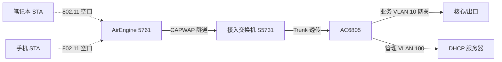

### 真题精练

**Q1.【真题·单选】** 下列关于 WLAN 与有线以太网的描述，正确的是：
A. WLAN 采用 CSMA/CD 机制避免冲突  B. WLAN 中一个 AP 下的所有终端独享空口带宽  C. WLAN 工作在数据链路层与物理层，对上层 IP 透明  D. WLAN 的传输介质是受控介质，安全性天然高于有线

> **答案：C**
> **解析**：A 错，无线使用 CSMA/CA（Collision Avoidance，冲突避免），因为无线无法像有线那样边发边听来检测冲突（隐藏节点、自身信号淹没有效信号）。B 错，空口是共享半双工介质，同一时刻只能一个终端发送。C 对，802.11 属于 L1/L2 技术，终端接入后与有线终端在 IP 层完全等价。D 错，电磁波是开放介质，安全性天然更低，必须依靠 WPA2/WPA3 加密封装。

**Q2.【真题·多选】** 相比有线网络，WLAN 部署的主要优势包括：
A. 部署灵活，免布线施工  B. 支持终端移动与漫游  C. 单用户时延一定低于有线  D. 扩容只需增加覆盖，不必重新布线

> **答案：ABD**
> **解析**：C 错。无线空口存在竞争退避、重传、加密开销与干扰，时延抖动明显大于交换式有线网络，对时延敏感的工业控制场景通常仍用有线或需要专门的 WLAN 优化。A、B、D 均为 WLAN 的固有优势。

### 易错点与排错

1. **"WLAN = Wi-Fi"**：WLAN 是技术范畴，Wi-Fi 是 WFA 认证商标，二者不是同义词。
2. **"无线比有线快"**：对比口径不同，1.2Gbps 是空口理论值。工程上限速参考：单用户实测约 50%~60% 空口速率。
3. **忽略管理 VLAN 与业务 VLAN 的分离**：AP 管理地址与用户业务地址通常不同网段，VLAN 规划题高频。
4. 排错入口命令：`display wlan ap all`（AP 是否在线）、`display station all`（终端是否上线）、`display ip pool name ap-pool used`（AP 是否拿到地址）。

---

## 1.2 WLAN 标准组织、标准体系与频率法规

### 考点定位

考点以"标准归谁管、频段谁划分"为主，属于必背客观题：IEEE 与 WFA 的分工、国家码对信道/功率的限制、中国 2.4G 与 5G 可用频段。分值 2~4 分。易错点是**把 WFA 当成标准制定者**，以及**记错国家码不对时的现象**（信道数变化、5G 信道不可用、功率被限制）。

### 原理精讲

WLAN 涉及三个角色，分工必须分清。**IEEE（Institute of Electrical and Electronics Engineers，电气电子工程师学会）**的 802 委员会负责制定 802.11 系列**技术标准**，规定物理层调制、MAC 层帧格式、信道与速率等硬性技术细节，但 IEEE 标准**不保证互通**——它允许厂商在实现细节上有差异。**Wi-Fi Alliance（WFA，Wi-Fi 联盟）**是产业联盟，负责**认证与商标**：制定 Wi-Fi CERTIFIED 测试套件，对通过测试的设备授予 Wi-Fi 标志，并推出了 WPA/WPA2/WPA3 安全认证项目和 Wi-Fi 4/5/6/7 的**代际命名**。**ITU/各国无线电管理机构**负责**频谱划分与功率限制**：在中国是工业和信息化部（工信部）依据《中华人民共和国无线电管理条例》发布微功率短距离无线电发射设备目录，规定可用的频率范围、EIRP 上限以及室内外使用限制。三者关系可以概括为：**IEEE 定技术，WFA 定互通与商标，政府定频段与功率**。

频率法规对设备的影响通过**国家码（country code / regulatory domain）**落地。AC 上配置 `country-code cn` 后，设备会加载中国对应的信道集合与功率上限表：2.4GHz 开放 2400~2483.5MHz（信道 1~13），5GHz 主要开放 5150~5350MHz（限室内）与 5725~5850MHz。若误配为其他国家码（例如 us），可能出现"5G 某些信道消失"或"发射功率被压到很低"的现象——这也是排错题常见考点：**AP 射频不可用、信道列表异常，先查 `regulatory-domain-profile` 的 country-code 是否与设备实际型号/区域匹配**。需要注意的是，国家码配置错误时，设备可能因无法匹配有效射频参数而导致射频不工作，这是**合规设计**（不允许以未授权频段/功率发射），而不是故障。

法规限值的记法要区分"发射功率"和"EIRP"。法规约束的是 **EIRP（Equivalent Isotropically Radiated Power，等效全向辐射功率）**，即把天线增益和馈线损耗都折算进去之后的等效辐射功率，而不是 AP 口上的发射功率。因此"能不能用高增益天线"取决于 EIRP 上限与发射功率的差额——这是第 2 章链路预算的法规依据。

### 关键概念对照表

| 组织/机构 | 职责 | 产出物 | 与考试的关系 |
|---|---|---|---|
| IEEE 802.11 工作组 | 制定 WLAN 技术标准 | 802.11a/b/g/n/ac/ax/be 等 | 考代际参数、帧结构 |
| Wi-Fi Alliance（WFA） | 认证与商标、安全项目 | Wi-Fi CERTIFIED、WPA2/WPA3、Wi-Fi 4/5/6/7 命名 | 考代际命名对应关系 |
| 工信部（中国） | 频谱划分、功率限制 | 微功率短距离设备目录与技术要求的公告 | 考可用频段、EIRP 上限 |
| IETF | CAPWAP 等协议标准化 | RFC 5415、RFC 5416 | 考 UDP 5246/5247 |
| 3GPP | 蜂窝网标准（非 WLAN） | LTE/5G NR | 常作为干扰项出现 |

| 频段 | 中国可用范围 | 信道 | 参考 EIRP 上限 | 使用限制 |
|---|---|---|---|---|
| 2.4GHz | 2400~2483.5MHz | 1~13（1/6/11 不重叠） | 100mW（20dBm） | 室内外均可 |
| 5GHz 低段 | 5150~5350MHz | 36/40/44/48、52/56/60/64 | 200mW（23dBm） | 限室内使用，5250~5350 需 DFS/TPC |
| 5GHz 高段 | 5725~5850MHz | 149/153/157/161/165 | 500mW（27dBm） | 可室外使用 |
| 5GHz 中段（UNII-2C） | 5470~5725MHz | 100~144 | 国内未开放给民用 WLAN | 国外需 DFS |
| 6GHz | 5925~7125MHz | 1~233 | 各国差异大 | Wi-Fi 6E/Wi-Fi 7 使用 |

### 华为设备配置

```bash
system-view
wlan
 regulatory-domain-profile name cn-domain     # 创建射频域模板
  country-code cn                             # 国家码：决定可用信道集合与最大发射功率
  # 说明：国家码必须与设备销售区域一致，配错会导致射频无法正常工作或信道缺失
 ap-group name office-group
  regulatory-domain-profile cn-domain         # 把射频域模板下发给该组所有 AP 的射频
quit
display regulatory-domain-profile name cn-domain   # 查看该射频域下各频段支持的信道与功率上限
display ap config-info ap-id 1                     # 查看指定 AP 实际生效的射频参数
```

### 示意图

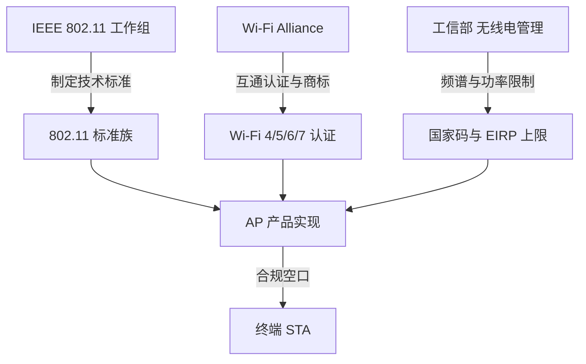

### 真题精练

**Q3.【真题·单选】** 关于 IEEE 与 Wi-Fi Alliance 在 WLAN 中的分工，正确的是：
A. IEEE 负责 WLAN 设备的互通认证，WFA 负责制定 802.11 标准  B. IEEE 制定 802.11 技术标准，WFA 负责一致性认证与商标授权  C. 二者共同制定 802.11 标准并共同颁发 Wi-Fi 标志  D. IEEE 既制定标准也负责频谱划分

> **答案：B**
> **解析**：IEEE 只出技术标准，不强制互通；WFA 通过测试套件保证不同厂商设备可互通并授权 Wi-Fi 商标；频谱划分属于各国无线电管理机构（中国为工信部）。D 错在"频谱划分"这一职责。

**Q4.【真题·判断】** 在中国，2.4GHz 频段可用的不重叠信道有 3 个，5GHz 的 5150~5350MHz 频段按规定限室内使用。

> **答案：正确**
> **解析**：中国 2.4GHz 开放信道 1~13，其中 1/6/11 完全互不重叠（1/5/9/13 也可作为四信道方案但兼容性略差）；5150~5350MHz 的 EIRP 上限约 200mW 且限定室内使用，其中 5250~5350MHz 属于需 DFS（动态频率选择）与 TPC 的子频段，避免干扰雷达。

### 易错点与排错

1. **把 WFA 当标准制定者**：WFA 不写 802.11 技术标准，只做认证与安全项目（WPA/WPA3）。
2. **国家码配错的现象**：射频不可用、5G 信道缺失、功率异常低——先查 `regulatory-domain-profile` 与 AP 实际区域。
3. **法规限制的是 EIRP 而不是发射功率**：高增益天线必须降发射功率才能合规。
4. 排错命令：`display regulatory-domain-profile name cn-domain`、`display ap config-info ap-id 1`、`display ap all`（观察射频是否 down）。

---

## 1.3 802.11 标准演进、代际命名与关键技术

### 考点定位

这是 WLAN 客观题的**最大分值集中区**：每年必考 2~4 道，涉及标准年份、频段、最大速率、调制方式、MIMO 阶数、关键技术（MIMO/OFDMA/1024QAM/MLO）。记忆量决定得分率。易错点：混淆 802.11n 与 802.11ac 的频段（ac 只有 5GHz）、把 802.11ax 的 OFDMA 记成 ac（ac 只有 OFDM 与 MU-MIMO）、Wi-Fi 6E 与 Wi-Fi 7 的频段差异。

### 原理精讲

802.11 的演进主线是**"提高单位时间传送的比特数"**，逐层叠加了四类技术。

第一类是**调制与编码升级**：从 DSSS（Direct Sequence Spread Spectrum，直接序列扩频）/CCK（Complementary Code Keying）到 OFDM（Orthogonal Frequency Division Multiplexing，正交频分复用），再到更高阶的 QAM。阶数越高，每个符号携带的比特越多（64QAM 每符号 6bit、256QAM 8bit、1024QAM 10bit、4096QAM 12bit），但**对信噪比的要求也越高**——1024QAM 需要 SNR 约 30dB 以上才能稳定工作。这就是"为什么 5GHz 更容易跑出高速率"：5GHz 干扰少、底噪低，更容易满足高阶调制的 SNR 条件。

第二类是**带宽扩展**：802.11n 引入 40MHz，802.11ac 引入 80MHz/160MHz，802.11be 引入 320MHz。带宽翻倍速率翻倍，但**噪声底也抬高 3dB**（热噪声与带宽成正比），同时占用的连续频谱更多，2.4GHz 因频谱太窄而无法承载 40MHz 以上的绑定（整个 2.4GHz 只有约 83.5MHz 可用带宽）。

第三类是**空间维度：MIMO**。802.11n 引入 MIMO（Multiple-Input Multiple-Output，多入多出），把"多条空间流同时发送不同数据"（空间复用）叠加到速率上，理论速率 = 空间流数 × 单流速率。802.11ac 支持最多 8 条流（Wave 2 引入 DL MU-MIMO，最多同时服务 4 个用户）；802.11ax 把 MU-MIMO 扩展到上下行；802.11be 提升到 16 条流。

第四类是**多用户与调度效率**：这是 11ax 与之前标准的**代际分水岭**。802.11ac 及以前，一个 AP 在同一时刻只能服务一个用户（SU 传输），多用户靠"轮流"实现；802.11ax 引入 **OFDMA（Orthogonal Frequency Division Multiple Access，正交频分多址）**，把一个信道划分为多个 RU（Resource Unit，资源单元，如 26/52/106/242/484/996 个子载波），**同一时刻把不同 RU 分配给不同用户**，从而在大量小包并发（高密办公、物联网）场景显著降低时延与开销。11ax 还引入 **BSS Coloring（BSS 着色）**：给每个 BSS 打上 6bit 颜色标识，终端收到同频但不同颜色的帧时可以"更早"判定为空闲（提高 CCA 门限），实质上提升了**空间复用率**，这是高密度部署的关键机制。**TWT（Target Wake Time，目标唤醒时间）**则让终端与 AP 协商唤醒周期，大幅降低 IoT 终端功耗。

从"市场命名"看，WFA 为了让消费者好记，把代际映射为 Wi-Fi 4/5/6/7：**Wi-Fi 4 = 802.11n，Wi-Fi 5 = 802.11ac，Wi-Fi 6 = 802.11ax，Wi-Fi 6E = 802.11ax 的 6GHz 版本，Wi-Fi 7 = 802.11be**（Wi-Fi 7 的核心卖点是 **MLO 多链路聚合**，让终端同时使用 2.4G+5G+6G 多条链路）。要注意 802.11ax 的标准正式发布晚于 Wi-Fi 6 认证（认证 2019 年 9 月启动），题目若问"标准发布年份"与"认证年份"要分清。

### 关键概念对照表

| 标准 | 年份 | 频段 | 最大理论速率 | 信道带宽 | 调制/MCS | 空间流 | 关键技术 |
|---|---|---|---|---|---|---|---|
| 802.11-1997 | 1997 | 2.4GHz | 2Mbps | — | DSSS/FHSS | 1 | 首个 WLAN 标准 |
| 802.11b | 1999 | 2.4GHz | 11Mbps | 22MHz | DSSS/CCK | 1 | 速率 1/2/5.5/11Mbps |
| 802.11a | 1999 | 5GHz | 54Mbps | 20MHz | OFDM、BPSK~64QAM | 1 | 首个 OFDM 商用标准 |
| 802.11g | 2003 | 2.4GHz | 54Mbps | 20MHz | ERP-OFDM | 1 | 与 11b 后向兼容 |
| 802.11n（Wi-Fi 4） | 2009 | 2.4/5GHz | 600Mbps | 20/40MHz | 64QAM、MCS0~7 | 4×4（4 流） | MIMO、帧聚合 A-MPDU、短 GI |
| 802.11ac（Wi-Fi 5） | 2013 | 5GHz | 6.93Gbps | 20/40/80/160MHz | 256QAM、MCS0~9 | 8×8（8 流） | VHT、DL MU-MIMO（≤4 用户）、波束赋形 |
| 802.11ax（Wi-Fi 6） | 2019 认证 / 2021 标准 | 2.4/5GHz（6GHz 为 6E） | 9.6Gbps | 20/40/80/160MHz | 1024QAM、MCS0~11 | 8×8 | OFDMA、BSS Coloring、TWT、MU-MIMO 上下行 |
| 802.11be（Wi-Fi 7） | 2024 | 2.4/5/6GHz | 46Gbps | 20~320MHz | 4096QAM、MCS0~13 | 16 流 | MLO 多链路、320MHz、MRU、4096QAM |

| 市场命名 | 对应标准 | 核心识别特征 | 单流典型速率参考 |
|---|---|---|---|
| Wi-Fi 4 | 802.11n | 引入 MIMO 与 40MHz | 20MHz 72Mbps / 40MHz 150Mbps |
| Wi-Fi 5 | 802.11ac | 仅 5GHz，256QAM，80/160MHz | 80MHz 433Mbps / 160MHz 866.7Mbps |
| Wi-Fi 6 | 802.11ax | OFDMA、BSS Coloring、1024QAM | 80MHz 600.4Mbps / 160MHz 1201Mbps |
| Wi-Fi 6E | 802.11ax 6GHz 频段 | 可用 6GHz 干净频谱 | 同 Wi-Fi 6 |
| Wi-Fi 7 | 802.11be | MLO、320MHz、4096QAM | 320MHz 单流可达约 2.9Gbps |

### 华为设备配置

```bash
system-view
wlan
 radio-2g-profile name radio2g                # 创建 2.4G 射频模板
  channel 20mhz                               # 2.4G 固定 20MHz，避免 40MHz 抢占邻频
  dot11n guard-interval short                 # 使能短保护间隔 GI，提升约 11% 速率
  dot11n mcs 7                                # 限制最高 MCS（可选，用于降速稳定覆盖）
 radio-5g-profile name radio5g                # 创建 5G 射频模板
  channel 80mhz                               # 5G 使用 80MHz 带宽（高密场景可降为 40/20MHz）
  dot11ac mcs 9                               # 5G 最高 256QAM MCS9
  dot11ax enable                              # 使能 802.11ax（Wi-Fi 6）能力
 ap-group name office-group
  radio-2g-profile radio2g                    # 绑定 2.4G 射频模板
  radio-5g-profile radio5g                    # 绑定 5G 射频模板
quit
display ap radio-info ap-id 1                 # 查看 AP 各射频当前的带宽、信道、协议能力
```

### 示意图

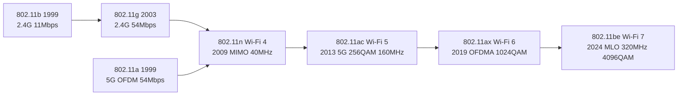

### 真题精练

**Q5.【真题·单选】** 802.11ac 与 802.11ax 的关键技术差异，描述正确的是：
A. 802.11ac 支持 OFDMA，802.11ax 支持 OFDM  B. 802.11ax 引入 OFDMA、BSS Coloring 与 TWT，802.11ac 仅支持 OFDM 与 DL MU-MIMO  C. 802.11ac 支持 2.4GHz 与 5GHz 双频，802.11ax 仅支持 5GHz  D. 802.11ax 最高调制方式为 256QAM，802.11ac 为 1024QAM

> **答案：B**
> **解析**：OFDMA 是 11ax 的核心新特性（子载波级多用户调度）；BSS Coloring 与 TWT 同样是 11ax 独有。A 把两者说反。C 错：11ac 仅 5GHz，11ax 是 2.4/5GHz 双频（6GHz 为 6E）。D 错：11ax 是 1024QAM，11ac 是 256QAM。

**Q6.【真题·填空】** 802.11n 的市场上被称为 Wi-Fi ______；802.11be 被称为 Wi-Fi ______，其最标志性的新技术是 ______（多链路聚合）。

> **答案：4；7；MLO（Multi-Link Operation，多链路操作/聚合）**
> **解析**：WFA 代际命名：11n→Wi-Fi 4、11ac→Wi-Fi 5、11ax→Wi-Fi 6（6GHz 为 6E）、11be→Wi-Fi 7。Wi-Fi 7 的三大标志是 320MHz 带宽、4096QAM 与 MLO，其中 MLO 允许终端在 2.4G/5G/6G 多条链路上同时收发，兼具速率与可靠性提升（一条链路受扰可由另一条补偿）。

**Q7.【真题·判断】** 802.11ac 必须工作在 5GHz 频段，因此支持 160MHz 信道绑定；而 2.4GHz 频段由于频谱总宽度有限，无法承载 40MHz 以上的信道绑定。

> **答案：正确**
> **解析**：11ac 只定义 5GHz。2.4GHz 可用总带宽约 83.5MHz（2400~2483.5MHz），且需与蓝牙/微波炉等共存，工程上 2.4G 一律建议 20MHz；5GHz 频谱充裕，可做 40/80/160MHz 绑定，但带宽翻倍会抬高噪声底约 3dB，并减少可用信道数，高密场景常主动降到 20/40MHz。

### 易错点与排错

1. **11ac 的频率**：只有 5GHz，没有 2.4GHz，这是最高频的陷阱。
2. **速率与带宽的乘算关系**：带宽翻倍 = 速率翻倍 = 噪声底 +3dB = 可用信道数减半。
3. **1024QAM 需要高 SNR**：信号弱的角落不要盲目开 160MHz 与高 MCS，反而会引发重传。
4. 排错命令：`display ap radio-info ap-id 1`、`display wlan config`（查看生效的射频与 VAP 配置）。

---

## 1.4 802.11 帧结构与 To DS/From DS 地址映射

### 考点定位

帧结构是 WLAN 方向"最像通信原理"的考点，几乎每卷必考 1~2 道，常见命题为"帧控制字段包含哪些位"、"某方向数据帧的 Address3 是哪个地址"、"FCS 使用什么校验算法"。分值 3~6 分。易错点：**To DS/From DS 四种组合的地址含义**、**Sequence Control 的两段含义**（序列号 + 分片号）、以及把 802.11 帧与以太网帧长度搞混（802.11 帧体最大 2304 字节，以太网 MTU 1500 字节）。

### 原理精讲

802.11 MAC 帧由四段构成：**Frame Control（帧控制，2 字节）+ 若干地址/控制字段 + Frame Body（帧体，0~2304 字节）+ FCS（帧校验序列，4 字节）**。总长度上限为 2346 字节（含 30 字节最大帧头与 4 字节 FCS），这个 2346 也是标准中 RTS 门限默认值 2347（即"比最大帧还大一字节"，等价于**关闭 RTS/CTS**）的由来。

**Frame Control 的 16 个比特是命题重点**，按顺序为：Protocol Version（2bit，恒为 0）、Type（2bit，00 管理帧 / 01 控制帧 / 10 数据帧 / 11 扩展帧）、Subtype（4bit，与 Type 组合确定具体帧名）、To DS（1bit）、From DS（1bit）、More Fragments（1bit）、Retry（1bit）、Power Management（1bit）、More Data（1bit）、Protected Frame（1bit）、Order（1bit）。

其中 **To DS 与 From DS 的组合决定了地址字段的含义**，这是理解 802.11 与以太网桥接的关键。设计原因是：802.11 帧需要在同一个字段位置同时承载"发送者/接收者"与"源/目的"的信息，因为无线链路上存在三种角色——STA、AP、DS（Distribution System，分发系统，即 AP 背后的有线骨干）。所以标准用两个比特来区分四种场景：

- **To DS=0, From DS=0**：BSS 内部或 IBSS 内部的帧（管理帧、以及同一 AP 下 STA 之间的数据帧）。Address1=目的（DA/RA），Address2=源（SA/TA），Address3=BSSID。
- **To DS=1, From DS=0**：STA → AP → DS 的上行数据帧。Address1=AP 的 BSSID（RA），Address2=STA 的 SA，Address3=目的地址 DA。
- **To DS=0, From DS=1**：DS → AP → STA 的下行数据帧。Address1=目的 STA 的 DA，Address2=AP 的 BSSID（TA），Address3=源地址 SA。
- **To DS=1, From DS=1**：无线桥接/WDS（Wireless Distribution System）场景，帧在 DS 之间传输，需要**四个地址**：Address1=RA（接收 AP）、Address2=TA（发送 AP）、Address3=DA、Address4=SA（因为源和目的都不是本链路的两个端点）。

**Duration/ID（2 字节）**：非省电场景下用于承载 NAV（Network Allocation Vector，网络分配矢量）值，即"本次交互还要占用信道多少微秒"，其他终端据此延迟发送（虚拟载波侦听）；在 PS-Poll 帧中则承载 AID（关联标识）。

**Sequence Control（2 字节）**：高 12bit 是序列号（同一 MSDU 的帧序列号相同，用于识别重复帧），低 4bit 是分片号（同一 MSDU 的分片递增编号）。重传时序列号不变、Retry 位置 1，接收端据此丢弃重复帧——这是"为什么 802.11 能容忍 ACK 丢失"的机制基础。

**可选字段**：QoS Control（2 字节，仅 QoS 数据帧，含 TID 优先级）、HT Control（4 字节，11n 及以后，承载链路自适应与波束赋形信息），因此 11ac/11ax 数据帧头最长 36 字节。

**FCS（4 字节）**：对整帧做 **CRC-32** 计算，接收端校验失败即静默丢弃（不产生 NAK），由上层重传超时或 MAC 重传机制处理。

### 关键概念对照表

| 字段 | 长度 | 作用 | 考试要点 |
|---|---|---|---|
| Frame Control | 2 字节 | 帧类型与标志位 | 16bit 组成顺序，To DS/From DS |
| Duration/ID | 2 字节 | NAV 定时器 / AID | 虚拟载波侦听 |
| Address1 | 6 字节 | 接收地址 RA | 恒为接收方 |
| Address2 | 6 字节 | 发送地址 TA | 恒为发送方 |
| Address3 | 6 字节 | BSSID/DA/SA | 由 To/From DS 决定 |
| Sequence Control | 2 字节 | 序列号 12bit + 分片号 4bit | 重复帧识别 |
| Address4 | 6 字节 | WDS 场景源地址 | 仅 To DS=1 且 From DS=1 时存在 |
| QoS Control | 2 字节 | TID 与优先级 | 仅 QoS 数据帧 |
| HT Control | 4 字节 | 链路自适应 | 11n 及以后 |
| Frame Body | 0~2304 字节 | 载荷 | 上限 2304 |
| FCS | 4 字节 | CRC-32 校验 | 失败静默丢弃 |

| To DS | From DS | 场景 | Address1 | Address2 | Address3 | Address4 |
|---|---|---|---|---|---|---|
| 0 | 0 | BSS/IBSS 内部帧 | DA（目的） | SA（源） | BSSID | 无 |
| 1 | 0 | STA→AP→DS（上行） | BSSID（AP） | SA（STA） | DA（目的） | 无 |
| 0 | 1 | DS→AP→STA（下行） | DA（STA） | BSSID（AP） | SA（源） | 无 |
| 1 | 1 | WDS 无线桥接 | RA | TA | DA | SA |

### 华为设备配置

帧结构本身不可配置，但与之强相关的**门限、重传、分片**参数在射频模板中可调：

```bash
system-view
wlan
 rrm-profile name rrm1                        # 创建 RRM 射频调优模板
  rts-cts-mode rts-cts                        # RTS/CTS 交互方式（也可配 cts-to-self）
  rts-cts-threshold 1400                      # 帧长超过 1400 字节才启用 RTS/CTS（华为默认值）
  # 标准中该门限默认为 2347，即"大于最大帧长"，等价于禁用 RTS/CTS
  fragment-threshold 1500                     # 分片门限，超过则分片，误码率高的环境可调小
  dot11n a-mpdu enable                        # 使能 A-MPDU 聚合，减少帧头开销提升吞吐
  dot11n a-msdu enable                        # 使能 A-MSDU 聚合
 ap-group name office-group
  rrm-profile rrm1                            # AP 组绑定 RRM 模板
quit
display ap radio-info ap-id 1                  # 查看射频当前门限与聚合相关参数
```

### 示意图

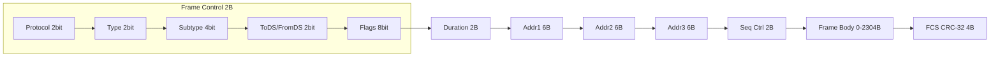

### 真题精练

**Q8.【真题·单选】** 一台 STA 向同 BSS 内另一台 STA 发送数据帧（不经过 DS），该帧的 Address3 字段内容是：
A. 源 STA 的 MAC  B. 目的 STA 的 MAC  C. AP 的 BSSID  D. 全 F 广播地址

> **答案：C**
> **解析**：同 BSS 内 STA 互访属于 To DS=0、From DS=0，此时 Addr1=目的 STA（DA）、Addr2=源 STA（SA）、Addr3=BSSID。注意实际转发仍要经过 AP 中继（无线终端不能直接互发），但帧的 DS 标志位为 0，Addr3 填 BSSID。

**Q9.【真题·多选】** 关于 802.11 MAC 帧，下列说法正确的有：
A. FCS 为 4 字节，使用 CRC-32 校验  B. Frame Body 最大 2304 字节  C. Sequence Control 由 12bit 序列号与 4bit 分片号组成  D. 只有当 To DS 与 From DS 同时为 1 时才存在 Address4

> **答案：ABCD**
> **解析**：四项均正确。D 是 WDS/无线桥接场景，此时帧需要同时标识链路两端的 RA/TA 与端到端的 DA/SA，共 4 个地址；其余三种组合只有 3 个地址。

**Q10.【真题·判断】** 802.11 规定接收端校验 FCS 失败时，应回送一个 NAK 帧通知发送端重传。

> **答案：错误**
> **解析**：802.11 没有 NAK 机制。FCS 校验失败的帧被**静默丢弃**，发送端通过"未收到 ACK"来判断失败，并按 CW（竞争窗口）翻倍退避后重传；重传帧的 Retry 位置 1、序列号不变，接收端据此识别并丢弃重复帧。

### 易错点与排错

1. **To DS/From DS 反着记**：站在"帧的去向"记——发往 DS 就是 To DS=1（上行）。
2. **Address 顺序**：Addr1 永远是接收方，Addr2 永远是发送方，不能按"源在前"记忆。
3. **Duration 的作用**：它是 NAV，用于虚拟载波侦听，不是"帧的生存时间"。设置 NAV 的帧包括 RTS/CTS 与数据帧。
4. 排错思路：抓包时看 Retry/More Fragments 位判断是否存在大量重传与分片（`display ap performance` 可看空口质量）。

---

## 1.5 三种帧类型：管理帧、控制帧、数据帧

### 考点定位

本考点以"帧归类"和"帧的作用"命题，常见题型是"下列哪个属于管理帧/控制帧"、"Beacon 帧的作用与发送周期"、"Block ACK 解决了什么问题"。分值 3~5 分。易错点：把 **ACK 当成管理帧**（它是控制帧）、把 **Block ACK 当成数据帧**、把 **Deauthentication 与 Disassociation 混为一谈**。

### 原理精讲

802.11 把帧分成三大类，分工非常清晰：**管理帧负责"建立/维护/拆除连接"，控制帧负责"协调信道占用与确认"，数据帧负责"搬运载荷"**。理解这个分工，绝大多数归类题都能推出来。

**管理帧（Type=00）**的核心成员及作用：

- **Beacon（信标帧，Subtype 8）**：AP 周期性广播（默认 Beacon Interval = 100 TU = 102.4ms，TU=1024μs），携带 SSID、支持的速率集、信道、能力信息、RSN/WPA 安全参数等。它的两个作用是：让终端**被动发现**网络，以及让已关联终端**同步时间戳与保持连接**。Beacon 频率升高可加快发现速度，但会增加空口开销（管理帧本身也是共享信道上的流量）。
- **Probe Request/Response（探测请求/响应）**：终端主动扫描时发出 Probe Request（可以带通配 SSID 探测所有网络），AP 收到后回 Probe Response，内容与 Beacon 基本一致。**主动扫描比被动扫描快**，因为不必等 Beacon 周期。
- **Authentication（认证帧）**：注意，这是 802.11 层的**链路认证**（开放式/共享密钥），与 WPA2 的 802.1X 用户认证是**两回事**，考试极爱在这里设陷阱。
- **Association Request/Response（关联请求/响应）**：关联是"加入 BSS 并建立服务关系"，Response 中会携带状态码与 AID（Association ID，关联标识，1~2007）。关联成功后 STA 才能收发数据帧。**Reassociation Request** 用于漫游时更换 AP，帧内携带当前 AP 的地址，让新 AP 向旧 AP 索取缓存的帧。
- **Deauthentication / Disassociation（去认证/去关联）**：前者终止认证关系（"踢出网络"，需要重新认证+关联），后者仅终止关联（保留认证关系，可快速重新关联）。AP 主动发 Deauthentication 是常见的"终端被踢"现象来源（如白名单限制、负载均衡、WIDS 反制）。

**控制帧（Type=01）**的核心成员：

- **RTS（Request To Send，20 字节）/ CTS（Clear To Send，14 字节）**：用于解决隐藏节点问题，通过 NAV 让邻居静默。CTS 由 AP 用最大功率发送，因此能覆盖到隐藏节点。
- **ACK（14 字节）**：对单播数据帧的确认，SIFS 后立即回复（SIFS 优先于 DIFS，保证 ACK 不会被竞争抢走）。**组播/广播帧不需要 ACK**。
- **Block ACK（块确认）**：802.11n 引入，一次 ACK 确认**多个**数据帧（配合 A-MPDU 聚合），把原来"每帧一次 ACK 交互"的开销降到 1/N，是 11n 吞吐大幅提升的关键之一；通过 ADDBA Request/Response 建立块确认会话。
- **PS-Poll（省电轮询）**：终端从省电模式唤醒后向 AP 索取缓存的帧，其 Duration/ID 字段承载 AID。

**数据帧（Type=10）**：包括普通 Data、Null（无载荷，仅用于通知 AP 电源管理状态变化）、QoS Data（携带 TID 优先级）、QoS Null 等。数据帧携带上层载荷，是唯一会出现 MSDU 分片与聚合的帧类。

### 关键概念对照表

| 帧类 | Type 值 | 代表帧 | 主要作用 | 是否需 ACK |
|---|---|---|---|---|
| 管理帧 | 00 | Beacon | 周期广播网络信息、同步 | 否（广播） |
| 管理帧 | 00 | Probe Request/Response | 主动扫描发现网络 | 否（广播）/ 是（单播响应） |
| 管理帧 | 00 | Authentication | 802.11 链路认证 | 是 |
| 管理帧 | 00 | Association Req/Resp | 关联，分配 AID | 是 |
| 管理帧 | 00 | Reassociation Req/Resp | 漫游切换 AP | 是 |
| 管理帧 | 00 | Deauthentication / Disassociation | 去认证 / 去关联 | 否（多为广播单播无保障） |
| 控制帧 | 01 | RTS / CTS | 预约信道、解决隐藏节点 | 否 |
| 控制帧 | 01 | ACK | 单播确认 | 否 |
| 控制帧 | 01 | Block ACK Req / Block ACK | 批量确认，配合 A-MPDU | 否 |
| 控制帧 | 01 | PS-Poll | 省电终端取回缓存帧 | 是（数据帧回复） |
| 数据帧 | 10 | Data / QoS Data | 承载上层载荷 | 单播需 ACK |

| 常考定时器/默认值 | 数值 | 说明 |
|---|---|---|
| Beacon Interval | 100 TU = 102.4ms | AP 默认信标周期 |
| DTIM Period | 默认 2（华为默认 2 个 Beacon 一次 DTIM） | 广播/组播缓存的唤醒周期 |
| AID 范围 | 1~2007 | 关联标识 |
| 单播数据帧 ACK 等待 | SIFS | 2.4G DSSS 10μs / 5G OFDM 16μs |

### 华为设备配置

```bash
system-view
wlan
 ssid-profile name office-ssid
  beacon-interval 100                         # 修改 Beacon 周期（单位 TU，默认 100）
  dtim-period 2                               # DTIM 周期，影响终端省电与组播唤醒时延
 vap-profile name office-vap
  service-vlan vlan-id 10
  ssid-profile office-ssid
  security-profile office-sec
  forward-mode tunnel
  # 关联数量与负载控制（影响 Association 响应是否被拒绝）
  max-sta-number 64                           # 单 VAP 最大关联用户数
  assoc-timeout 5                             # 关联超时（分钟），超时无流量则拆除关联
 ap-group name office-group
  vap-profile office-vap wlan 1 radio all
quit
display station all                            # 查看终端关联状态与 AID、速率、信号
display wlan client mac-address 0024-d7aa-bb01 verbose   # 查看单终端详细关联/认证信息
```

### 示意图

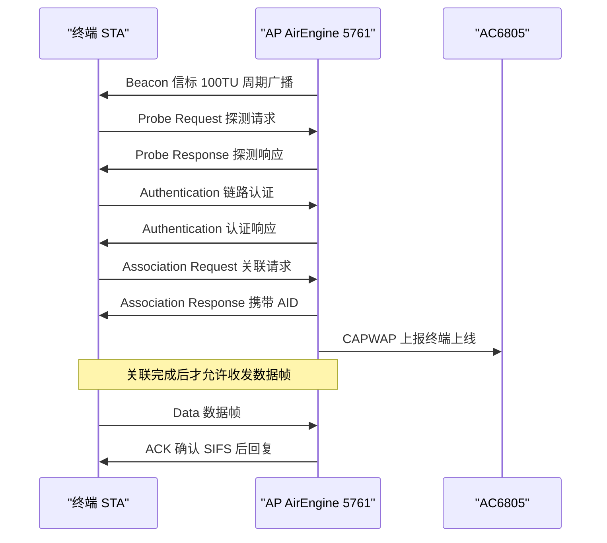

### 真题精练

**Q11.【真题·单选】** 下列帧中，全部属于控制帧的一组是：
A. Beacon、Probe Response、ACK  B. RTS、CTS、Block ACK、PS-Poll  C. Association Request、Authentication、Data  D. Deauthentication、QoS Data、RTS

> **答案：B**
> **解析**：RTS/CTS/Block ACK/PS-Poll 均为控制帧。A 中 Beacon 与 Probe Response 是管理帧；C 中 Association Request、Authentication 是管理帧，Data 是数据帧；D 中 Deauthentication 是管理帧、QoS Data 是数据帧。

**Q12.【真题·简答】** 简述 802.11 层"认证"与 WPA2-Enterprise 的"用户认证"的区别，并说明完整安全接入经过哪些步骤。

> **答案与解析**：
> ① 802.11 认证（Authentication 帧）是**链路层准入**，只有开放式（Open System）与共享密钥（Shared Key）两种，作用是确认"这是一个合法的 802.11 设备"；开放式认证实际上不校验任何凭证，必然成功。
> ② WPA2-Enterprise 的用户认证基于 **802.1X + EAP**，由 AC（或 AP）作为认证者，把终端凭证转发给 RADIUS 服务器（如 iMaster NCE-Campus 或第三方 AAA）校验，成功后由 AC 下发 **PMK**，再通过 **四次握手（4-Way Handshake）**协商 PTK/GTK 密钥，随后数据帧才以加密方式传输。
> ③ 完整顺序为：扫描 → 802.11 认证 → 关联 → 802.1X/EAP 认证与密钥协商 → DHCP 获取 IP → 访问网络。若使用 WPA2-PSK，则第 4 步换成"用 PSK 派生 PMK 并做四次握手"，无需 RADIUS。

### 易错点与排错

1. **ACK 是控制帧，不是管理帧**；Beacon 是管理帧，不是控制帧。
2. **Authentication 帧 ≠ 用户认证**：前者是 802.11 链路认证，后者是 802.1X/WPA 密钥协商。
3. **Deauthentication 与 Disassociation**：前者连认证关系一起断（要重新走全流程），后者只断关联。
4. **Block ACK 的意义**：聚合帧的批量确认，考试常问"哪个机制提升了 11n 的 MAC 效率"。
5. 排错命令：`display station all`（看关联与认证状态）、`display wlan client ... verbose`（看密钥协商是否完成）、`debugging wlan packet all`（抓空口报文定位是哪个阶段失败）。

---

## 1.6 WLAN 接入过程五阶段与主/被动扫描

### 考点定位

这是**简答题与流程题的必考区**：要求写出终端接入 WLAN 的完整阶段顺序，并说明每个阶段的报文交互。分值 5~10 分。易错点：把"认证"与"关联"顺序颠倒、漏掉 802.1X、把 DHCP 说成"认证之后立即拿地址但不需要网关"、把主动扫描与被动扫描的报文搞反。

### 原理精讲

终端接入 WLAN 的完整过程可归纳为**五阶段**（考试必须能按顺序写出）：

**第一阶段：扫描（Scanning）**。终端要发现网络，有两条路：**被动扫描**是终端在每个信道上静默监听 Beacon 帧（默认 100TU 一次，每个信道至少要停留 100ms 以上才能保证收到），因此**耗时长**（扫 13 个信道需 1.3s 以上），但**不占用上行发射**、省电；**主动扫描**是终端在每个信道上广播 Probe Request，AP 立即回 Probe Response，因此**速度快**（每信道只需等几十毫秒），代价是终端要多发送探测帧、增加空口开销。工程上终端默认"先主动扫描，未发现目标网络再被动扫描"。

**第二阶段：认证（Authentication）**。终端选定 BSS 后发送 Authentication 请求，采用开放式或共享密钥方式。现代 WPA2/WPA3 网络一般使用**开放式认证**——因为安全性由后面的密钥协商保证，802.11 共享密钥认证（WEP 时代的挑战-响应）已被证明不安全（容易被抓取明文挑战值破解）。

**第三阶段：关联（Association）**。终端发送 Association Request（携带支持的速率、能力信息、RSN IE），AP 检查资源（最大关联数、VAP 是否允许、ACL/白名单）后回 Association Response 并分配 **AID**。只有关联成功，终端才能收发数据帧。**漫游时使用 Reassociation Request**，由新 AP 向原 AP 转发缓存的帧，实现"无感切换"。

**第四阶段（可选）：用户认证与密钥协商**。若 SSID 使用 WPA2-PSK，则执行**四次握手**（EAPOL-Key 交互）协商 PTK/GTK；若使用 WPA2-Enterprise / WPA3-Enterprise，则执行 802.1X 的 EAP 认证（EAPOL 起始 → EAP-Response/Identity → RADIUS Access-Request → 挑战响应 → Access-Accept → 密钥下发），再执行四次握手。此阶段是"为什么企业网比家用的 PSK 更安全"的关键：每个用户独立凭证、可审计、可按用户下发 VLAN/ACL/QoS 策略（授权结果下发）。

**第五阶段：获取 IP 地址（DHCP）与首包转发**。终端通过 DHCP 获取 IP、掩码、网关、DNS。注意 DHCP 报文同样要经空口传输，若 AC/网络侧未放通业务 VLAN 或 DHCP 中继，就会出现"能关联但拿不到地址"的典型故障。此后 AC 建立 STA 表项（`display station all` 可见），数据帧按转发模式（隧道/本地）送到网关。

整个流程的**时序要点**：管理帧交互基本在 802.11 层完成，无需 IP；DHCP 与业务访问才需要 IP。排错时可以按阶段二分：**AP 上能否看到终端关联** → 判断是空口/认证问题还是上层问题。

### 关键概念对照表

| 阶段 | 关键报文 | 失败典型现象 | 排错命令 |
|---|---|---|---|
| 扫描 | Beacon / Probe Req / Probe Resp | 搜不到 SSID | 查 SSID 是否隐藏、射频是否 up |
| 认证 | Authentication | "无法连接"/认证失败 | 查认证方式、安全模板 |
| 关联 | Association Req/Resp | 关联被拒（状态码 17 等） | 查最大用户数、ACL、负载均衡 |
| 用户认证 | EAPOL / 802.1X / 四次握手 | 反复"正在验证身份"/密码错 | 查 RADIUS、PSK、密钥协商 |
| 获取地址 | DHCP Discover/Offer/Request/ACK | 已连接但无 IP / 169.254 自分配 | 查业务 VLAN、DHCP 中继、地址池 |

| 对比项 | 主动扫描 | 被动扫描 |
|---|---|---|
| 终端发送 | 广播 Probe Request | 不发送，只监听 Beacon |
| 发现速度 | 快（每信道几十 ms） | 慢（每信道需等 ≥100ms） |
| 空口开销 | 较大（探测帧占用信道） | 无额外开销 |
| 耗电 | 较高 | 较低 |
| 可靠性 | 隐藏 SSID 需指定 SSID 探测 | 隐藏 SSID 收不到 Beacon，难以发现 |
| 常见场景 | 终端默认行为、快速漫游 | 省电终端、隐藏 SSID 环境 |

### 华为设备配置

```bash
system-view
wlan
 # 隐藏 SSID：终端被动扫描收不到 Beacon 中的 SSID，必须手工输入
 ssid-profile name hidden-ssid
  ssid HUAWEI-Hidden
  ssid-hide enable                            # 隐藏 SSID（安全增益有限，只防"看见"）
  # 关闭隐藏后终端可被动发现
 vap-profile name hidden-vap
  service-vlan vlan-id 10
  ssid-profile hidden-ssid
  security-profile office-sec
  forward-mode tunnel
 # 802.1X 认证模板（配合 iMaster NCE-Campus / 第三方 RADIUS）
 radius-server template radius1
  radius-server shared-key cipher Huawei@123  # 与 RADIUS 服务器共享密钥
  radius-server authentication 10.10.200.10 1812   # 认证端口 1812
  radius-server accounting 10.10.200.10 1813       # 计费端口 1813
quit
display station all                             # 查看终端接入阶段结果
display station ssid office-ssid                # 查看某 SSID 下的在线用户
```

### 示意图

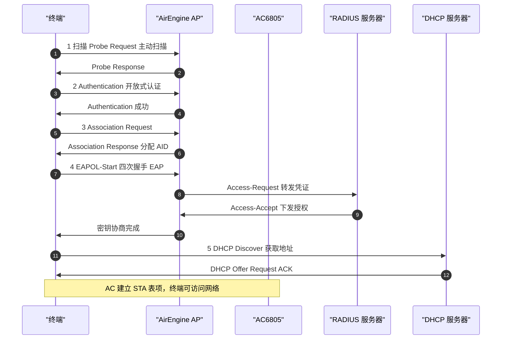

### 真题精练

**Q13.【真题·单选】** 终端接入 WLAN 的正确顺序是：
A. 认证 → 扫描 → 关联 → DHCP  B. 扫描 → 关联 → 认证 → DHCP  C. 扫描 → 认证 → 关联 → 802.1X → DHCP  D. 扫描 → 认证 → 802.1X → 关联 → DHCP

> **答案：C**
> **解析**：802.11 层必须先认证后关联（关联响应的前提是认证已完成），DHCP 在最后。B 把认证与关联颠倒；D 把 802.1X 提前到关联之前（802.1X 的 EAPOL 交互发生在关联之后，因为需要先建立链路层连接才能承载 EAPOL）。

**Q14.【真题·多选】** 关于主动扫描与被动扫描，正确的是：
A. 主动扫描由终端发送 Probe Request，AP 回 Probe Response  B. 被动扫描耗时更长，因为要等待 Beacon 周期  C. 隐藏 SSID 的网络无法通过被动扫描发现  D. 被动扫描会给空口带来探测帧开销

> **答案：ABC**
> **解析**：D 错，被动扫描终端不发探测帧，没有额外空口开销；主动扫描才有。C 对：隐藏 SSID 时 Beacon/Probe Response 中不含 SSID 字段，终端必须主动指定 SSID 探测才能关联。

**Q15.【真题·排错】** 用户反馈"手机显示已连接 HUAWEI-Office，但无法上网，IP 是 169.254.x.x"。请给出排查思路。

> **答案与解析**：
> ① `169.254.x.x` 是 **APIPA 自动私有地址**，说明 DHCP 失败，属于**第五阶段（获取地址）故障**，空口关联与认证是成功的。② 在 AC 上 `display station all` 确认终端已关联，再看终端所在 VLAN 是否正确（`vap-profile` 的 `service-vlan` 是否误配）。③ 检查业务 VLAN 是否在三层网关/核心上创建并配置了 `dhcp select global`（或中继 `dhcp select relay` + `dhcp-server`），以及 DHCP 地址池是否耗尽（`display ip pool name sta-pool used`）。④ 若为隧道转发，确认 CAPWAP 数据隧道正常（`display capwap configuration`）；若为本地转发，确认 AP 有线口已放通业务 VLAN。⑤ 检查是否被安全策略/ACL 拦截了 UDP 67/68。

### 易错点与排错

1. **认证必在关联之前**：这是最高频的顺序陷阱。
2. **802.1X 在关联之后**：EAPOL 需要链路层承载。
3. **"能连接≠能上网"**：把故障定位到"第几阶段"再查对应表项，比盲目重启 AP 高效得多。
4. 排错入口：`display station all`、`display ip pool name sta-pool used`、`display capwap configuration`。

---

## 1.7 无线拓扑概念：BSS/IBSS/ESS/DS 与 SSID/BSSID/ESSID

### 考点定位

以概念辨析题为主，常见"SSID 与 BSSID 的区别"、"ESS 由哪些元素组成"、"IBSS 与 BSS 的差异"。分值 2~4 分。易错点：**BSSID 通常是 AP 射频口的 MAC 地址**（一个 AP 的双频通常有两个 BSSID）、**ESSID 与 SSID 在实际网络中数值相同**、IBSS 无 AP（Ad-hoc）。

### 原理精讲

802.11 用一组术语描述无线网络的"拓扑与身份"，必须成体系记忆。

**STA（Station，站点）**：任何带 802.11 接口的终端设备（手机、笔记本、摄像头、AGV 小车等）。**AP（Access Point，接入点）**：提供无线到有线的桥接设备，同时是 BSS 的"协调者"（所有帧都要经它中继）。

**BSS（Basic Service Set，基本服务集）**：一个 AP 及其关联的所有 STA 构成的**最小无线网络单元**。BSS 的标识符就是 **BSSID（Basic Service Set Identifier）**，通常等于该 AP 射频口的 MAC 地址（48bit）。因此一台双频 AP 会提供两个 BSSID（2.4G 射频一个、5G 射频一个）；若同一射频上承载多个 VAP（多个 SSID），则每个 VAP 使用独立的 BSSID（华为 AP 的 BSSID 由射频 MAC 派生）。这就是"为什么同一个 AP 上开了 4 个 SSID 会看到 4 个不同的 BSSID"。

**SSID（Service Set Identifier，服务集标识）**：网络名字，最长 32 字节（区分大小写），用于让用户识别要接入的网络。**ESSID（Extended Service Set Identifier，扩展服务集标识）**：在 ESS 中使用的 SSID；工程上 ESSID 与 SSID 的取值一致，考试中常问"二者的关系"——**ESSID 是概念上属于 ESS 的 SSID，实际配置中就是一个 SSID 值**。

**IBSS（Independent BSS，独立基本服务集）**：即 Ad-hoc（自组网），**没有 AP**，终端之间直接通信，无法与有线网络互通，无漫游，实际使用很少（部分物联网/应急通信场景）。它的 BSSID 是随机生成的。

**DS（Distribution System，分发系统）**：AP 背后的有线骨干网络（交换机/AC/路由器组成的系统），负责把帧从一个 BSS 转发到另一个 BSS 或外部网络。DS 是"漫游成为可能"的基础。

**ESS（Extended Service Set，扩展服务集）**：把多个 BSS 通过 DS 连接起来，使用**同一个 SSID**，让终端可以在不同 AP 之间自由漫游。一个 ESS 的典型结构是：多台 AP → 接入交换机 → DS → 网关。ESS 中的三个关键角色是 STA、AP、DS。**漫游发生在 ESS 内部**：终端在两台 AP 的覆盖重叠区从一个 BSS 切到另一个 BSS，IP 保持不变。

另外要记住 **VAP（Virtual Access Point，虚拟接入点）**：在同一个物理射频上通过软件划分出多个逻辑 AP，每个 VAP 可独立指定 SSID、VLAN、安全策略、转发模式。VAP 是华为 WLAN 配置的核心抽象——`vap-profile` 就是把 SSID + 安全 + 业务 VLAN + 转发模式打包的一份"逻辑 AP 配置"。

### 关键概念对照表

| 概念 | 全称 | 含义 | 典型取值/说明 |
|---|---|---|---|
| STA | Station | 无线终端 | 手机、笔记本、IoT |
| AP | Access Point | 接入点 | AirEngine 5761/6761/8760 |
| BSS | Basic Service Set | 一个 AP 及其关联终端 | 最小无线单元 |
| BSSID | BSS Identifier | BSS 的标识 | 通常为 AP 射频口 MAC |
| SSID | Service Set Identifier | 无线网络名 | ≤32 字节，区分大小写 |
| ESSID | Extended SSID | ESS 中使用的 SSID | 工程上等于 SSID |
| IBSS | Independent BSS | Ad-hoc 自组网 | 无 AP，无 DS |
| DS | Distribution System | 分发系统（有线骨干） | 交换机+AC+网关 |
| ESS | Extended Service Set | 多个 BSS 经 DS 互联 | 同一 SSID，支持漫游 |
| VAP | Virtual AP | 射频上的逻辑 AP | 每 VAP 一套 SSID/VLAN/安全 |

### 华为设备配置

```bash
system-view
wlan
 # 同一射频上划分两个 VAP：员工 SSID 与访客 SSID
 ssid-profile name emp-ssid
  ssid HUAWEI-Office
 security-profile name emp-sec
  security wpa2 psk pass-phrase Huawei@123 aes
 vap-profile name emp-vap
  service-vlan vlan-id 10                      # 员工走 VLAN 10
  ssid-profile emp-ssid
  security-profile emp-sec
  forward-mode tunnel
 ssid-profile name guest-ssid
  ssid HUAWEI-Guest
 vap-profile name guest-vap
  service-vlan vlan-id 20                      # 访客走 VLAN 20，与员工隔离
  ssid-profile guest-ssid
  security-profile guest-sec
  forward-mode tunnel
 ap-group name office-group
  vap-profile emp-vap wlan 1 radio all         # 一个射频上同时承载两个 VAP
  vap-profile guest-vap wlan 2 radio all
quit
display vap ssid HUAWEI-Office                  # 查看该 SSID 对应的 VAP 与 BSSID
display station all                             # 查看终端所在 BSSID 与 SSID
```

### 示意图

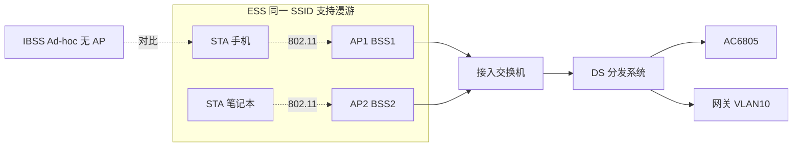

### 真题精练

**Q16.【真题·单选】** 下列关于 BSSID 的说法，正确的是：
A. BSSID 就是 SSID 的十六进制表示  B. BSSID 通常是 AP 射频口的 MAC 地址，双频 AP 通常有两个 BSSID  C. 一个 ESS 内所有 AP 的 BSSID 必须相同  D. BSSID 长度固定为 32 字节

> **答案：B**
> **解析**：BSSID 是 48bit 的 MAC 形式标识，通常等于 AP 射频口 MAC，双频 AP 有两个射频即两个 BSSID（同一射频上的多个 VAP 各自还有独立 BSSID）。A 错，二者毫无换算关系；C 错，ESS 内不同 AP 的 BSSID 必须不同，相同的是 SSID；D 错，32 字节是 SSID 的长度上限。

**Q17.【真题·判断】** IBSS 又称 Ad-hoc 网络，没有 AP，因此终端之间可以直接通信，也可以正常通过 DS 访问有线网络。

> **答案：错误**
> **解析**：IBSS 确实无 AP、终端可直连，但它**不接入 DS**，无法访问有线网络与互联网，也没有漫游能力。需要访问外部网络必须使用 Infrastructure 模式（BSS/ESS）。

### 易错点与排错

1. **SSID 是"名字"，BSSID 是"地址"**，不要混用。
2. **一个 AP ≠ 一个 BSSID**：双频、多 VAP 都会产生多个 BSSID。
3. **ESSID 与 SSID 数值相同**是工程惯例，考"关系"时答"ESSID 是 ESS 范围内统一使用的 SSID"。
4. 排错命令：`display vap ssid HUAWEI-Office`（确认 VAP 与 BSSID）、`display station all`（确认终端所在 BSSID）。

---

## 1.8 CSMA/CA、RTS/CTS 与隐藏节点问题

### 考点定位

本考点是 WLAN 与原理论述题的结合点，常考"CSMA/CA 与 CSMA/CD 的区别"、"为什么无线不能做冲突检测"、"RTS/CTS 的作用与门限"、"隐藏节点与暴露节点"。分值 3~6 分。易错点：**说不清"为什么无线必须避免而不是检测"**、把 RTS/CTS 说成加密机制、忽略 NAV 虚拟载波侦听。

### 原理精讲

**先回答"为什么无线用 CA 而不是 CD"**。CSMA/CD（Collision Detection，冲突检测）要求终端在发送的同时监听介质，一旦发现信号与自己发出的不同就判定冲突并停止。无线做不到三点：其一，终端自身发射的信号功率远大于远端信号，**自己的信号会把别人的信号淹没**，无法分辨冲突；其二，**隐藏节点**的存在导致冲突发生在接收端而不是发送端，发送方永远"听不到"；其三，无线是全双工受限的半双工介质，无法边发边收。因此 802.11 只能**尽量避免冲突（Collision Avoidance）**，并在冲突后通过确认与退避来恢复。

**CSMA/CA 的完整交互（DCF，分布式协调功能）**：

1. **物理载波侦听（CCA，空闲信道评估）**：终端在发送前监听信道，判断能量是否超过门限、是否能识别到合法的 802.11 前导。
2. **虚拟载波侦听（NAV）**：终端解析收到的帧的 Duration 字段，设定 NAV 定时器，在 NAV 到期前即使信道"听上去空闲"也不发送。NAV 是**用时间预约来避免冲突**，比物理侦听更保守也更可靠。
3. **等待 IFS（帧间隔）**：不同优先级的帧等待不同的间隔。**SIFS（Short IFS）**最短，用于 ACK、CTS 等需要"抢在别人前面"的响应帧；**DIFS（DCF IFS）**用于普通数据帧；EDCA 还有 AIFS 区分四个接入类别。
4. **随机退避（Backoff）**：信道从忙变闲且等待 DIFS 后，终端在 [0, CW] 中随机取一个时隙数倒计时，倒计时归零才发送。**CW（Contention Window，竞争窗口）初始为 CWmin，冲突后翻倍直至 CWmax**，冲突越多退避越久，这是"让冲突自然收敛"的自稳定机制。
5. **确认与重传**：单播帧必须收到 SIFS 后的 ACK；超时未收到则判定失败，CW 翻倍重传，超过重传次数上限（短帧 7 次 / 长帧 4 次）则丢弃并上报上层。

**关键定时器数值（必背）**：

| 参数 | 802.11b（DSSS 2.4G） | 802.11g（OFDM 2.4G） | 802.11a/n/ac/ax（5G OFDM） |
|---|---|---|---|
| Slot Time（时隙） | 20μs | 9μs | 9μs |
| SIFS | 10μs | 10μs | 16μs |
| DIFS | 50μs | 28μs | 34μs |
| CWmin / CWmax | 31 / 1023 | 15 / 1023 | 15 / 1023 |

EDCA 四类接入（802.11e QoS）的差异：AC_VO（语音）CWmin 3 / CWmax 7，AIFSN 2；AC_VI（视频）7 / 15，AIFSN 3；AC_BE（尽力而为）15 / 1023，AIFSN 7；AC_BK（背景）15 / 1023，AIFSN 7。优先级越高，等待间隔越短、退避窗口越小，因此语音帧天然比下载流量更"抢得到"信道。

**隐藏节点问题**：STA1 与 STA2 都能与 AP 通信，但彼此相距太远（或中间有墙体遮挡）而**互相听不到**。当 STA1 发送时，STA2 的物理侦听判定信道空闲，于是同时发送，**冲突发生在 AP 处**，两者却都以为发送成功（收不到 ACK 才知道失败），导致大量重传、吞吐骤降。解决办法是 **RTS/CTS 握手**：STA1 先发 RTS（含预约时长），AP 用**最大功率**回 CTS，由于 CTS 覆盖范围更大，隐藏节点 STA2 能收到 CTS 并按其 Duration 设置 NAV 静默，从而避免冲突。因此 **RTS/CTS 解决的是"隐藏节点"，代价是额外的帧开销（RTS 20 字节 + CTS 14 字节）**，所以只在长帧（帧长超过 RTS 门限，华为默认 1400 字节）时启用。**CTS-to-self** 是优化版：AP 直接广播一个发给自己的 CTS 来预定信道，省掉了 RTS，但保护范围与可靠性略差。

**暴露节点问题**：STA2 能听到 STA1 的发送，于是主动退让，但 STA2 与 STA1 的目标接收端其实互不干扰，造成"本可以并行却白白等待"的容量浪费。BSS Coloring 与空间复用（Spatial Reuse）正是为了缓解这类过度退让。

### 关键概念对照表

| 机制 | 解决的问题 | 代价 | 触发条件 |
|---|---|---|---|
| 物理载波侦听 CCA | 检测信道是否被占用 | 无法发现隐藏节点 | 每次发送前 |
| 虚拟载波侦听 NAV | 用 Duration 预约信道 | 需要解析帧头 | 收到含 Duration 的帧 |
| 随机退避 + CW 翻倍 | 冲突后收敛 | 增加接入时延 | 信道由忙变闲/重传 |
| ACK 确认 | 感知失败并重传 | 额外空口开销 | 单播数据帧 |
| RTS/CTS | 隐藏节点 | 每次交互多两个帧 | 帧长 > 门限（华为默认 1400B） |
| CTS-to-self | 隐藏节点（低成本） | 保护范围略差 | 可配置替代 RTS/CTS |
| Block ACK | 聚合帧批量确认 | 会话管理复杂度 | A-MPDU 聚合 |

### 华为设备配置

```bash
system-view
wlan
 rrm-profile name rrm1
  rts-cts-mode rts-cts                        # 使用标准 RTS/CTS；可选 cts-to-self
  rts-cts-threshold 1400                      # 门限（字节）：大于该值的帧才发起 RTS/CTS
  # 大范围室外覆盖/存在隐藏节点时，可调小门限到 500 甚至更低，用开销换稳定
  # 高密小范围场景可调大（如 2347）以减少握手开销
  fragment-threshold 1500                     # 分片门限：误码率高（干扰重）的环境调小可提升成功率
  dot11n a-mpdu enable                        # 聚合帧减少交互次数
 ap-group name office-group
  rrm-profile rrm1
quit
display ap radio-info ap-id 1                  # 查看当前生效的 RTS 门限与分片门限
display ap performance ap-id 1                 # 查看空口质量：重传率、丢包、信道利用率
```

### 示意图

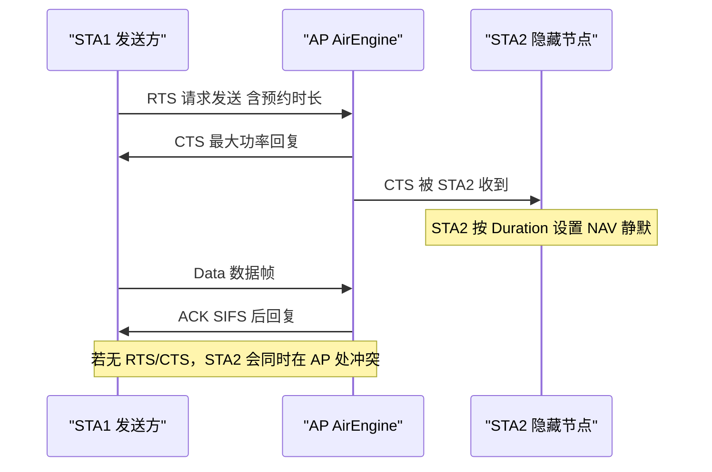

### 真题精练

**Q18.【真题·单选】** 802.11 采用 CSMA/CA 而非 CSMA/CD 的根本原因是：
A. 无线的速率较低  B. 无线终端无法在发送的同时可靠检测冲突，且存在隐藏节点  C. 无线帧没有校验字段  D. CSMA/CD 是 IEEE 802.3 的专利技术

> **答案：B**
> **解析**：自身发射信号淹没有效信号、隐藏节点导致冲突发生在接收端，这两点使冲突检测在无线环境中不可行，所以只能"避免"并用 ACK 确认来事后感知失败。A、C、D 均不成立：无线帧有 FCS；速率与机制选择无关；802.3/802.11 均为 IEEE 标准无专利障碍。

**Q19.【真题·填空】** 802.11 中用于设置虚拟载波侦听定时器的字段是 ______；华为设备上控制是否发起 RTS/CTS 的参数是 ______，其默认值为 ______ 字节。

> **答案：Duration/ID（Duration 字段）；rts-cts-threshold；1400**
> **解析**：收到帧的终端读取 Duration 值设置 NAV，在 NAV 归零前不发帧。华为 `rts-cts-threshold` 默认 1400 字节，即长帧才握手；802.11 标准中该门限默认值为 2347（大于最大帧长 2346），等价于禁用。

**Q20.【真题·简答】** 说明隐藏节点问题的产生原因，以及 RTS/CTS 如何解决它。

> **答案与解析**：① 原因：两个 STA 同处一个 BSS，但彼此因距离或遮挡无法听到对方的发送，各自的物理载波侦听都判断信道空闲，于是同时向 AP 发送，冲突发生在 AP 侧，双方只能通过 ACK 超时才发现失败，造成大量重传与吞吐下降。② 解决：发送方先发 RTS，AP 收到后以最大功率广播 CTS；由于 CTS 的覆盖范围大于数据帧的有效解调范围，隐藏节点能够收到 CTS，并从中读取 Duration 设置 NAV，在预约时长内保持静默，从而消除冲突。③ 代价：每次交互多出 RTS（20B）+ CTS（14B）的开销，所以通过 `rts-cts-threshold` 只在长帧时启用；CTS-to-self 是省掉 RTS 的简化替代。

### 易错点与排错

1. **SIFS < DIFS**：ACK/CTS 用 SIFS 抢占，不会被新竞争打断。
2. **RTS/CTS 门限调小=更多握手=更稳但更慢**，考题常问"隐藏节点严重时应调大还是调小"——答案是**调小**（更容易触发握手）。
3. **重传率高不一定是干扰**：可能是隐藏节点、AP 过载、终端功率过低，需结合 `display ap performance` 与频谱分析判断。
4. 排错命令：`display ap radio-info ap-id 1`、`display ap performance ap-id 1`、`display wlan rrm-status`。

---

## 1.9 工作信道与信道重叠（2.4G 1/6/11 与 5G UNII 划分）

### 考点定位

**高频送分题 + 易错数值题**：2.4GHz 20MHz 信道的中心频率计算、1/6/11 不重叠的原因、5GHz 各 UNII 子频段的信道号与 DFS 要求。分值 3~6 分。易错点：把"信道间隔 5MHz"当成"信道带宽 5MHz"、记错 5G 信道号公式、忽略 5250~5350MHz 的 DFS/TPC 要求。

### 原理精讲

**2.4GHz 频段**：可用 2400~2483.5MHz，共约 83.5MHz。802.11 把这一段划分为 14 个信道（中国开放 1~13，信道 14 仅日本可用），**信道中心频率 = 2407 + 5 × n（MHz）**，即信道间隔 5MHz：信道 1 = 2412MHz，信道 6 = 2437MHz，信道 11 = 2462MHz，信道 13 = 2472MHz。但每个信道的**实际占用带宽是 20~22MHz**（802.11b 的 DSSS 占用 22MHz，11g/n/ax 的 OFDM 占用 20MHz 主瓣加旁瓣）。于是相邻信道必然重叠：信道 1 占用约 2401~2423MHz，信道 5 占用约 2421~2443MHz，**二者仍有约 2MHz 重叠**；只有**信道 1、6、11（间隔 25MHz）之间完全不重叠**，这就是"2.4G 只有三个不重叠信道"的由来。

因为 2.4G 只有 3 个"干净"信道，多 AP 部署时必须做**蜂窝式信道复用**：把 1/6/11 按正三角形布局分配给相邻 AP，同一信道在空间上尽量隔开（一般要求同频 AP 之间至少隔一层楼或 2 个 AP 间距）。中国还可用 1/5/9/13 的**四信道方案**（相邻间隔 20MHz），在多 AP 场景可减少同频复用距离，但与"1/6/11 三信道"方案混用时反而会引入邻频干扰，实际部署应在全网统一选定一种方案。

**5GHz 频段**：信道中心频率 = **5000 + 5 × n（MHz）**，信道号与带宽都更充裕。美国 FCC 把 5GHz 划分为四段 UNII（Unlicensed National Information Infrastructure，免许可国家信息基础设施）：

- **UNII-1（5150~5250MHz）**：信道 36/40/44/48，通常限制室内使用，功率限值较松。
- **UNII-2A（5250~5350MHz）**：信道 52/56/60/64，**必须支持 DFS（Dynamic Frequency Selection，动态频率选择）与 TPC（Transmit Power Control，发射功率控制）**，因为该段与气象雷达/军用雷达共用，检测到雷达信号必须立即**静默并切换信道（信道让路）**。
- **UNII-2C（5470~5725MHz）**：信道 100~144，同样需要 DFS/TPC；国内未开放给民用 WLAN。
- **UNII-3 / ISM（5725~5850MHz）**：信道 149/153/157/161/165，通常不需 DFS，功率限值较高，可室外使用。

中国目前主要开放 **5150~5350MHz（限室内，其中 5250~5350 需 DFS/TPC）** 与 **5725~5850MHz**。因此国内 5G 可用信道集合约为 36/40/44/48、52/56/60/64、149/153/157/161/165；做 80MHz 绑定时可选 36~48（一个 80MHz 组）、52~64（一个 80MHz 组）、149~161（一个 80MHz 组）。**这解释了为什么 5G 有 13 个以上信道，但 80MHz 只能做 3~5 个"不重叠的宽信道"** —— 带宽越宽，可用信道组越少，这正是高密场景要主动降带宽的原因。

**6GHz（5925~7125MHz）** 是 Wi-Fi 6E/7 的新战场，提供 59 个 20MHz 信道、7 个 160MHz 信道，且无微波炉/蓝牙干扰、不需 DFS（部分子频段仍有限制），是未来高密场馆的首选频段。

### 关键概念对照表

| 频段 | 信道号 | 中心频率公式 | 不重叠方案 | 关键限制 |
|---|---|---|---|---|
| 2.4GHz | 1~13 | 2407 + 5n | 1/6/11（三信道）或 1/5/9/13（四信道） | 只有 3 个真正不重叠信道 |
| 5GHz UNII-1 | 36/40/44/48 | 5000 + 5n | 可组 1 个 80MHz | 多为室内 |
| 5GHz UNII-2A | 52/56/60/64 | 5000 + 5n | 可组 1 个 80MHz | 强制 DFS/TPC |
| 5GHz UNII-2C | 100~144 | 5000 + 5n | 可组 3 个 80MHz | 强制 DFS/TPC；国内未开放 |
| 5GHz UNII-3 | 149/153/157/161/165 | 5000 + 5n | 可组 1 个 80MHz | 一般可室外，功率较松 |
| 6GHz | 1~233 | 5950 + 5n | 7 个 160MHz | Wi-Fi 6E/7 使用 |

| 信道 | 中心频率(MHz) | 20MHz 占用范围(MHz) | 与 1/6/11 的关系 |
|---|---|---|---|
| 1 | 2412 | 2402~2422 | 基准（不重叠） |
| 2 | 2417 | 2407~2427 | 与信道 1 重叠 |
| 3 | 2422 | 2412~2432 | 与信道 1 重叠 |
| 4 | 2427 | 2417~2437 | 与信道 1 重叠 |
| 5 | 2432 | 2422~2442 | 与信道 1 边缘重叠约 2MHz |
| 6 | 2437 | 2427~2447 | 基准（不重叠） |
| 7~10 | 2442~2457 | 逐次 +5MHz | 与 6 或 11 重叠 |
| 11 | 2462 | 2452~2472 | 基准（不重叠） |
| 12~13 | 2467~2472 | 2457~2482 | 与信道 11 重叠，且 13 接近频段边缘 |

### 华为设备配置

```bash
system-view
wlan
 radio-2g-profile name radio2g
  channel 20mhz                               # 2.4G 固定 20MHz
  channel 1                                   # 固定信道 1；生产环境建议用自动选信道
  # 也可：channel { 1 | 6 | 11 } 或自动模式由 AC 的 RRM 计算
 radio-5g-profile name radio5g
  channel 80mhz                               # 5G 使用 80MHz
  channel 36                                  # 固定 36；实际部署用自动信道避免雷达冲突
  # DFS 相关：雷达检测到后 AC 会自动把射频切换到新信道并记录日志
 ap-group name office-group
  radio-2g-profile radio2g
  radio-5g-profile radio5g
 # 自动信道/功率调优（RRM），高密场景建议关闭自动功率避免震荡
 rrm-profile name rrm-auto
  calibrate auto-channel-mode auto             # 自动选信道
  calibrate auto-txpower-mode auto             # 自动调功率
  calibrate start-time 03:00:00                # 调优在凌晨低峰执行
quit
display ap radio-info ap-id 1                  # 查看各射频当前信道、带宽、发射功率
display ap all                                 # 批量查看 AP 射频信道分布，检查同频相邻
```

### 示意图

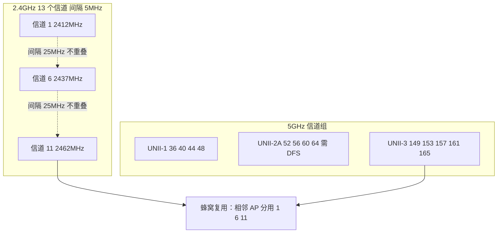

ASCII 信道重叠示意（2.4GHz，20MHz 信道，间隔 5MHz）：

```text
频率(MHz) 2402   2412   2422   2432   2442   2452   2462   2472
信道 1     [========== 20MHz ==========]
信道 2          [========== 20MHz ==========]
信道 3               [========== 20MHz ==========]
信道 5                    [==重叠2MHz== 20MHz ==========]
信道 6                         [========== 20MHz ==========]
信道 11                                          [========== 20MHz ==========]
结论：只有 1 / 6 / 11 三个信道之间完全没有频谱重叠
```

### 真题精练

**Q21.【真题·单选】** 中国 2.4GHz 频段中，完全互不重叠的 20MHz 信道组合是：
A. 1、5、9、13  B. 1、6、11  C. 1、4、8、12  D. 2、7、12

> **答案：B**
> **解析**：20MHz 信道带宽加旁瓣约 22MHz，而信道间隔仅 5MHz，要完全不重叠需间隔至少 25MHz，因此只有 1/6/11（2412/2437/2462）成立。1/5/9/13 间隔 20MHz，主瓣勉强不重叠但旁瓣仍有交叠，通常作为"四信道方案"提及但并非严格不重叠。

**Q22.【真题·填空】** 5GHz 频段的信道中心频率计算公式为 ______ MHz；信道 36 的中心频率是 ______ MHz，信道 149 的中心频率是 ______ MHz。

> **答案：5000 + 5n（n 为信道号）；5180；5745**
> **解析**：信道 36 → 5000+180=5180MHz；信道 149 → 5000+745=5745MHz。2.4GHz 用 2407+5n（信道 1=2412）。这两个公式是纯记忆题，务必区分。

**Q23.【真题·多选】** 关于 5GHz 的 UNII 频段与 DFS，正确的是：
A. UNII-2A（5250~5350MHz）与 UNII-2C 通常要求支持 DFS/TPC  B. 检测到雷达信号后，AP 必须停止在该信道发射并切换到其他信道  C. UNII-3（5725~5850MHz）一般不需要 DFS  D. UNII-1（5150~5250MHz）在中国可自由用于室外大功率覆盖

> **答案：ABC**
> **解析**：D 错。5150~5350MHz 在中国规定限室内使用且 EIRP 约 200mW，不能用于室外大功率覆盖；室外高功率场景应使用 5725~5850MHz。DFS 的作用是避免干扰雷达，检测到雷达后需要静默并让路（quiet + channel switch）。

### 易错点与排错

1. **信道间隔 5MHz ≠ 信道带宽 20MHz**，这是 1/6/11 结论的唯一依据。
2. **两个公式要分清**：2.4G 用 2407+5n，5G 用 5000+5n。
3. **DFS 信道会导致突发掉线**：`display ap radio-info` 若发现信道被切换，多为雷达避让而非设备故障。
4. **80MHz 与不重叠信道数的矛盾**：带宽越宽，不重叠信道组越少，高密场景应降带宽增加复用。
5. 排错命令：`display ap radio-info ap-id 1`、`display ap all`（检查相邻 AP 是否同频同信道）。

---

# WLAN-HCIA-章节2-射频与天线基础

## 2.1 电磁波基础与射频传播特性

### 考点定位

本章是所有"数值计算题"的地基，第一章的引言部分常考：波长与频率的换算、幅相的含义、多径与衰落的成因。分值 2~5 分。易错点：**波长公式与单位换算**（GHz 要转 Hz，cm 与 m 要统一）、把"振幅"与"频率"的物理意义互换、把多径效应简单等同于"信号弱"。

### 原理精讲

WLAN 使用的信号是**电磁波**，在自由空间中近似以光速传播（c ≈ 3×10⁸ m/s）。描述一个射频信号只需四个基本量：

**频率（f）**：单位时间内的周期数，单位 Hz。频率决定"信号在哪个信道"，也决定传播特性——频率越高，波长越短，绕射能力越弱、穿透损耗越大，但可用频谱越宽、干扰越少。**波长（λ）**：一个完整波形的空间长度，λ = c / f。2.4GHz 的波长 λ = 3×10⁸ / 2.4×10⁹ = 0.125m = **12.5cm**；5.8GHz 的 λ ≈ 5.2cm。波长直接决定天线尺寸：天线最佳长度通常是波长的 1/2 或 1/4（2.4GHz 的 1/4 波长约 3.1cm），也决定绕射与穿透能力——**障碍物尺寸与波长的比值越小，绕射能力越强**，所以 2.4GHz 比 5GHz 更容易绕过墙角、穿墙能力更强。

**振幅（Amplitude）**：波形偏离中心的最大幅度，直接对应**信号功率/强度**（工程上用 dBm 表示）。**相位（Phase）**：波形在周期中的位置，是**调制与多天线技术的核心变量**——QAM 调制靠幅度与相位的组合来承载比特（16QAM 有 4 种幅度 × 4 种相位 = 16 个星座点），MIMO 与波束赋形则靠调整多天线上信号的相位差来实现"同相叠加"或"定向增强"。

电磁波在真实环境中不是直线传播，而是经历五种基本现象：**反射**（遇金属/水面/玻璃等大尺寸光滑面反弹，产生多径）、**折射**（穿过介质时方向改变，如穿玻璃）、**衍射/绕射**（遇障碍边缘时"拐弯"传播，是低频段能覆盖遮挡区的原因）、**散射**（遇尺寸与波长相当的粗糙物体或雨滴时向各方向散开）、**吸收**（被水、人体、混凝土、金属吸收衰减，因此**人体和金属柜是室内覆盖最大的敌人**）。

**多径效应（Multipath）**是无线特有的核心概念：同一个信号经多条路径（直射 + 多次反射）到达接收端，各路径的**幅度与相位不同**，叠加后可能**相长（信号增强）或相消（信号急剧衰减，即多径衰落/快衰落）**。多径带来的两个后果是：① **时延扩展（Delay Spread）**导致符号间干扰（ISI），需要用 OFDM 的循环前缀（CP/GI）来化解——这就是"为什么 11a/g 起要用 OFDM 而不是单载波"的根本原因；② 接收信号强度随终端位置微移（几厘米）而剧烈波动（瑞利衰落），因此实测时"移动一步信号差 10dB"是正常现象，**不能只测一个点就下覆盖结论**。

此外三个工程概念必须知道：**损耗（Attenuation）**随距离与障碍增加；**菲涅尔区（Fresnel Zone）**是收发之间需要保持"无遮挡"的椭球区域，第一菲涅尔区半径 r₁ ≈ 17.32 × √(d₁·d₂ / (f·D))（r₁ 单位 m，d₁/d₂ 单位 km，f 单位 GHz，D 为总距离 km），室外桥接时**至少要保证第一菲涅尔区 60% 无遮挡**，否则信号会明显劣化——这是"为什么点对点桥接要架高天线"的量化依据；**多普勒频移**在高速移动（高铁、AGV 高速行驶）场景会造成频偏，需要设备支持相应补偿。

### 关键概念对照表

| 概念 | 符号/公式 | 物理意义 | WLAN 中的影响 |
|---|---|---|---|
| 频率 | f = c / λ | 每秒周期数 | 决定信道与频段特性 |
| 波长 | λ = c / f | 一个周期长度 | 决定天线尺寸、绕射能力 |
| 振幅 | A | 信号强度 | 对应 dBm 功率电平 |
| 相位 | φ | 波形位置 | QAM 调制、MIMO、波束赋形 |
| 反射 | — | 大光滑面反弹 | 产生多径，室内主要传播方式 |
| 折射 | — | 穿介质方向改变 | 隔玻璃覆盖仍可用 |
| 绕射 | — | 障碍边缘拐弯 | 2.4G 覆盖遮挡区能力强 |
| 散射 | — | 粗糙面/小颗粒 | 雨衰、复杂回波 |
| 吸收 | — | 介质吸收能量 | 人体/金属/混凝土衰减大 |
| 多径衰落 | — | 多路径相位叠加 | 需 OFDM+GI；RSSI 波动大 |

| 频段 | 波长 λ | 1/4 波长 | 绕射/穿透特性 |
|---|---|---|---|
| 2.4GHz | 12.5cm | 3.1cm | 绕射强、穿透较好、干扰多 |
| 5.2GHz | 5.8cm | 1.4cm | 绕射一般、干扰少 |
| 5.8GHz | 5.2cm | 1.3cm | 绕射弱、穿透差、干扰少 |
| 6GHz | 4.4cm | 1.1cm | 绕射最弱、频谱最干净 |

### 华为设备配置

射频传播特性不可直接配置，但**与波长/干扰强相关的补偿参数**可调：

```bash
system-view
wlan
 rrm-profile name rrm1
  calibrate auto-txpower-mode auto            # 自动功率：补偿不同距离与穿墙导致的衰减差异
  # 覆盖弱区可手工提升功率，但不得超过国家码允许的 EIRP 上限
 radio-2g-profile name radio2g
  channel 20mhz                               # 2.4G 用窄带提高抗多径/抗干扰与覆盖稳定性
  dot11n guard-interval short                 # 短 GI 提升速率，但多径严重时应改回 long 以减少 ISI
 radio-5g-profile name radio5g
  channel 40mhz                               # 多径严重（金属密集仓库）时 5G 用 40MHz 更稳
 ap-group name office-group
  radio-2g-profile radio2g
  radio-5g-profile radio5g
quit
display ap performance ap-id 1                 # 查看该 AP 空口质量与干扰程度，辅助判断多径/干扰
```

### 示意图

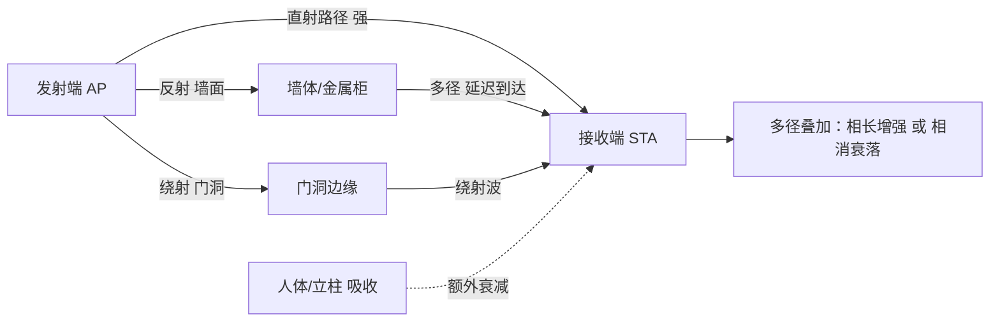

### 真题精练

**Q24.【真题·单选】** 2.4GHz 信号在自由空间中的波长约为：
A. 1.25cm  B. 12.5cm  C. 125cm  D. 2.4cm

> **答案：B**
> **解析**：λ = c / f = 3×10⁸ ÷ 2.4×10⁹ = 0.125m = 12.5cm。注意单位换算：2.4GHz 是 2.4×10⁹ Hz。5.8GHz 约为 5.2cm，6GHz 约 4.4cm。

**Q25.【真题·多选】** 关于多径效应，说法正确的是：
A. 多径导致接收信号随位置微移而剧烈波动（快衰落）  B. 多径产生的时延扩展会引起符号间干扰  C. OFDM 通过插入循环前缀（保护间隔）来抵抗时延扩展  D. 多径效应只会让信号变弱，不会让信号变强

> **答案：ABC**
> **解析**：D 错。多径叠加是同相相加则增强、反相相加则抵消，因此会出现"增强点"和"深衰落点"。A/B/C 正确；OFDM 的 GI 长度设计为大于信道时延扩展，从而消除 ISI，这是 11a/g 之后全面采用 OFDM 的原因。

### 易错点与排错

1. **波长单位**：题干给 GHz 一定要换算成 ×10⁹ Hz，答案常用 cm 表述。
2. **"信号弱"与"多径"要分开**：多径导致的是波动和 ISI，不是单纯的功率小。
3. **实测要采多点**：单点 RSSI 不能代表覆盖质量，需网格采样或用 WLAN Planner 仿真。
4. 排错命令：`display ap performance ap-id 1`（重传率/空口质量）、现场使用 WLAN Planner 或测速工具做多点采样。

---

## 2.2 射频单位与换算（dBm/mW/dBi/dBd）

### 考点定位

**计算题必考**：dBm 与 mW 互算、EIRP 计算、dBi 与 dBd 换算、SNR 计算。分值 4~8 分，且常与"法规功率限制"复合命题。易错点：把 dBm 与 mW 线性相加（应先把 dBm 转 mW 或把倍数转 dB）、混淆 dBi 与 dBd（差 2.15dB）、把 dB 当成绝对功率单位。

### 原理精讲

射频工程用**对数**表达功率，原因是无线链路的功率变化跨好几个数量级（从 100mW 到 10⁻¹⁰mW），用 dB 可以"加法代替乘法"。

**dBm 是绝对功率单位**，以 1mW 为基准：**P(dBm) = 10 × lg[P(mW) / 1mW]**，反算 **P(mW) = 10^(P(dBm)/10)**。记住几个锚点：0dBm = 1mW，10dBm = 10mW，20dBm = 100mW，30dBm = 1W = 1000mW；负值表示小于 1mW：-30dBm = 0.001mW = 1μW，-70dBm = 10⁻⁷mW（终端接收到的典型弱信号）。

**dB 是相对单位**，表示两个功率的比值：**dB = 10 × lg(P1 / P2)**。核心口诀：**+3dB = 功率 ×2，-3dB = 功率 ÷2，+10dB = ×10，-10dB = ÷10**。这两个换算在"功率调整"题里几乎每卷必用（例如"发射功率从 20dBm 降到 17dBm，功率变为原来的多少"→ 50mW）。

**dBi 与 dBd 是天线增益单位**：dBi 以**各向同性（点源）天线**为参考，dBd 以**半波偶极子天线**为参考。半波偶极子本身有 2.15dBi 的增益，因此 **dBd = dBi - 2.15**；即 15dBi 的天线等于 12.85dBd。题目里若把 dBi 和 dBd 混用会直接错 2.15dB。

**EIRP（等效全向辐射功率）**是最重要的复合量：**EIRP(dBm) = 发射功率(dBm) + 天线增益(dBi) - 馈线损耗(dB)**。法规限制的是 EIRP（因为辐射到空间中的能量才是干扰源），所以"高增益天线必须降低发射功率"才能合规。**链路预算**的完整形式为：接收功率 = EIRP - 自由空间路径损耗 - 障碍物衰减 + 接收天线增益，即 RSSI = P_tx + G_tx - L_cable - FSPL - L_obstacle + G_rx。

**SNR（Signal to Noise Ratio，信噪比）**：SNR(dB) = 信号功率(dBm) - 噪声功率(dBm)。因为都是 dBm，**直接相减**即可（对应线性域的相除）。例如信号 -70dBm、噪声 -95dBm，则 SNR = 25dB。SNR 决定"能跑多高的 MCS"：SNR 越高，越能用高阶调制与更宽带宽。

### 关键概念对照表

| 单位 | 类型 | 参考基准 | 公式 | 典型值 |
|---|---|---|---|---|
| mW | 绝对功率 | — | — | 100mW（20dBm） |
| dBm | 绝对功率（对数） | 1mW | 10lg(P/1mW) | 20dBm = 100mW |
| W | 绝对功率 | — | 1W = 1000mW = 30dBm | 1W |
| dB | 相对比值 | 比值本身 | 10lg(P1/P2) | 3dB = 2 倍 |
| dBi | 天线增益（相对点源） | 各向同性天线 | — | 8dBi |
| dBd | 天线增益（相对偶极子） | 半波偶极子 | dBd = dBi - 2.15 | 5.85dBd = 8dBi |
| dBc | 相对载波 | 载波功率 | — | 杂散抑制 |
| EIRP | 等效辐射功率（dBm） | 点源 | P_tx + G - L | 27dBm = 500mW |

| dBm | mW | dBm | mW |
|---|---|---|---|
| 0 | 1.0 | -1 | 0.79 |
| 1 | 1.26 | -3 | 0.50 |
| 2 | 1.58 | -10 | 0.10 |
| 3 | 2.0 | -30 | 0.001（1μW） |
| 4 | 2.5 | -50 | 10⁻⁵ |
| 5 | 3.2 | -60 | 10⁻⁶ |
| 6 | 4.0 | -65 | 3.2×10⁻⁷ |
| 7 | 5.0 | -70 | 10⁻⁷ |
| 9 | 8.0 | -75 | 3.2×10⁻⁸ |
| 10 | 10 | -80 | 10⁻⁸ |
| 13 | 20 | -85 | 3.2×10⁻⁹ |
| 16 | 40 | -90 | 10⁻⁹ |
| 17 | 50 | -95 | 3.2×10⁻¹⁰ |
| 20 | 100 | -100 | 10⁻¹⁰ |
| 23 | 200 | — | — |
| 26 | 400 | — | — |
| 27 | 500 | — | — |
| 30 | 1000（1W） | — | — |

**换算例题（务必手算一遍）**

| 编号 | 题目 | 解析 | 答案 |
|---|---|---|---|
| 例1 | 50mW 等于多少 dBm？ | 10lg50 = 10×(1.699) | 约 17dBm |
| 例2 | 发射功率 100mW、天线增益 8dBi、馈线损耗 1dB，EIRP 为多少？ | 100mW = 20dBm；20+8-1 = 27dBm | 27dBm = 500mW |
| 例3 | 天线增益 15dBi 折合多少 dBd？ | dBd = dBi - 2.15 | 12.85dBd |
| 例4 | 信号 -68dBm、噪声底 -95dBm，SNR 为多少？ | SNR = (-68) - (-95) | 27dB |
| 例5 | EIRP 限值 23dBm、天线 10dBi、损耗 1dB，最大发射功率？ | 23-10+1 = 14dBm | 14dBm ≈ 25mW |
| 例6 | 发射功率由 20dBm 调整为 17dBm，功率变为原来的？ | 差值 3dB | 变为一半（100mW→50mW） |
| 例7 | 将 20dBm 的 AP 加装 12dBi 定向天线（损耗 2dB），EIRP 是多少 mW？ | 20+12-2 = 30dBm | 1000mW = 1W |

### 华为设备配置

```bash
system-view
wlan
 radio-2g-profile name radio2g
  eirp 20                                     # 直接以 EIRP 方式限值（单位 dBm），便于合规控制
  # 华为设备支持 eirp / txpower 两种口径：
  #   txpower 指射频口发射功率，实际辐射 = txpower + 天线增益 - 馈线损耗
  #   eirp 直接约束最终辐射功率，等效于已把天线增益算入
  txpower 17                                  # 发射功率 17dBm（约 50mW）
 ap-group name office-group
  radio-2g-profile radio2g
quit
display ap radio-info ap-id 1                  # 查看当前发射功率（dBm）与 EIRP
display regulatory-domain-profile name cn-domain   # 查看该国家码下各信道允许的功率上限
```

### 示意图


### 真题精练

**Q26.【真题·单选】** 某 AP 发射功率为 20dBm，连接增益 10dBi 的天线，馈线损耗 2dB，其 EIRP 为：
A. 28dBm = 630mW  B. 28dBm = 400mW  C. 32dBm = 1585mW  D. 12dBm = 16mW

> **答案：A**
> **解析**：EIRP = 20 + 10 - 2 = 28dBm。28dBm = 10^2.8 mW ≈ 631mW。C 是漏算损耗或误把损耗相加的结果；D 是把公式方向搞反。

**Q27.【真题·填空】** 0dBm 对应 ______ mW，30dBm 对应 ______ W；天线增益 8dBi 折合 ______ dBd。

> **答案：1；1；5.85**
> **解析**：0dBm = 1mW（基准点）；30dBm = 10³ = 1000mW = 1W。dBi 与 dBd 差 2.15dB：8 - 2.15 = 5.85dBd。

**Q28.【真题·单选】** 终端测量到信号强度 -70dBm，同频噪声底为 -92dBm，若要将调制方式升级到 1024QAM（通常需 SNR ≥ 33dB），当前条件：
A. 满足，可开 1024QAM  B. 不满足，SNR 仅 22dB，需提升信号或降低干扰  C. 无法判断  D. 满足，因为 SNR 只与发射功率有关

> **答案：B**
> **解析**：SNR = -70 - (-92) = 22dB，低于 1024QAM 的典型需求（约 33~36dB），强行开启会导致 MCS 频繁回退与重传。解法是提升信号（靠近 AP/加 AP）或降低干扰（换信道、降带宽、清干扰源）。D 错：SNR 由信号与噪声共同决定，降噪同样有效。

### 易错点与排错

1. **dBm 不能直接相加**："20dBm + 20dBm ≠ 40dBm"，正确做法是转 mW 相加（100+100=200mW=23dBm）再转回。
2. **dBd 与 dBi 差 2.15dB**，不是 2dB，也不是 3dB。
3. **EIRP 公式中的符号**：天线增益加、馈线损耗减，切勿记反。
4. **SNR 用减法**（dBm 减 dBm 得 dB），不要把两个 dBm 相加。
5. 排错命令：`display ap radio-info ap-id 1`（看实际功率与 EIRP）、`display ap performance ap-id 1`（看 SNR/重传是否与计算一致）。

---

## 2.3 2.4GHz 与 5GHz 频段特性对比

### 考点定位

以对比选择题为主："哪个频段穿墙更好"、"哪个频段信道更多"、"双频 AP 应该优先引导终端到哪个频段"。分值 2~4 分。易错点是**把"5G 覆盖小"当成缺点写进方案**，以及在方案题中不做频段引导（Band Steering），导致 2.4G 拥塞。

### 原理精讲

两个频段的差异来自**物理规律 + 频谱规划**两方面。

**物理层面**：频率越高，波长越短，穿透与绕射能力越弱，自由空间损耗越大（同距离下 5GHz 比 2.4GHz 多约 6~8dB 损耗）。实测穿墙衰减参考值：普通砖墙 2.4GHz 约 6~10dB、5GHz 约 10~15dB；混凝土承重墙 2.4GHz 约 15~25dB、5GHz 约 20~30dB；金属门/防火门可造成 25dB 以上衰减且几乎全反射。因此**2.4GHz 覆盖半径更大（室内放装型 AP 约 15~25m），5GHz 更小（约 8~15m）**。

**频谱层面**：2.4GHz 只有约 83.5MHz 带宽、13 个信道、**仅 3 个不重叠信道**，且需与应用极广的蓝牙、ZigBee、无线鼠标、微波炉、无绳电话共享，因此**同频干扰与邻频干扰严重**；5GHz 在中国开放约 325MHz（5150~5350 + 5725~5850），信道数 13 个以上，**80MHz 绑定也能找到 3 个以上不重叠信道组**，且几乎没有非 Wi-Fi 干扰源（除雷达需 DFS 避让），因此**底噪低、SNR 高、可跑高阶调制与宽带宽**。

这决定了工程上的双频策略：**"2.4G 保覆盖与兼容，5G 保容量与速率"**。具体做法包括：① 双频 AP 同时开启两个射频，但**把终端优先引导到 5GHz**（Band Steering / 频段引导），使 2.4GHz 只服务远距离与老终端；② 2.4GHz **限制接入速率（如禁用 1/2/5.5/11Mbps 低速率）**，防止远端低速终端长时间占用信道（低速终端占用的空口时间更长，是吞吐杀手）；③ 高密场景 2.4GHz 可只留 1~2 个 SSID 并降低发射功率，把容量压力交给 5GHz；④ 5GHz 遇 DFS 信道雷达避让时，需要保留非 DFS 信道（如 149~165、36~48）作为备份。

另外要记住三类**干扰的区分**：**同频干扰（Co-channel Interference）**是不同 BSS 使用相同信道相互竞争（2.4G 复用不可避免，靠空间隔离 + 功率控制缓解）；**邻频干扰（Adjacent Channel Interference）**是相邻信道频谱旁瓣交叠导致的能量泄漏（如 2.4G 的 1 与 2、3 信道），危害常被低估；**非 Wi-Fi 干扰**来自非 802.11 设备（微波炉在 2.45GHz 附近泄漏可达数十毫瓦）。

### 关键概念对照表

| 对比项 | 2.4GHz | 5GHz |
|---|---|---|
| 频率范围（中国） | 2400~2483.5MHz（83.5MHz） | 5150~5350 + 5725~5850MHz |
| 信道数 / 不重叠信道 | 13 个 / 3 个（1/6/11） | 13+ 个 / 80MHz 可组 3 组以上 |
| 穿透与绕射 | 强（室内覆盖半径 15~25m） | 弱（8~15m） |
| 同距离额外损耗 | 基准 | 比 2.4G 多约 6~8dB |
| 可用带宽 | 窄，仅支持 20MHz（工程不建议 40MHz） | 宽，支持 40/80/160MHz |
| 非 Wi-Fi 干扰 | 多（微波炉、蓝牙、无绳电话、摄像头） | 少（雷达需 DFS 避让） |
| 底噪 | 较高（典型 -90~-92dBm） | 较低（典型 -95dBm 左右） |
| 可跑调制 | 多为 64/256QAM | 可达 1024QAM（11ax） |
| 定位 | 保覆盖、兼容老终端 | 保容量、保速率 |
| 部署建议 | 限低速、降功率、少 SSID | 优先承载、开 80MHz、做频段引导 |

| 障碍物 | 2.4GHz 衰减参考 | 5GHz 衰减参考 |
|---|---|---|
| 普通砖墙（12cm） | 6~10dB | 10~15dB |
| 混凝土承重墙（20cm） | 15~25dB | 20~30dB |
| 玻璃隔断（普通） | 2~4dB | 4~8dB |
| 金属门/防火门 | >25dB（几乎全反射） | >30dB |
| 人体 | 3~6dB | 5~10dB |
| 金属货架/密集金属 | 严重多径 + 强衰减 | 更严重 |

### 华为设备配置

```bash
system-view
wlan
 rrm-profile name rrm1
  band-steer enable                           # 频段引导：把双频终端优先引导到 5G
  band-steer 5g-load-threshold 60             # 5G 负载门限（%）：超过后不再强制引导，避免 5G 拥塞
  band-steer 2g-probe-response-suppress enable # 抑制对 2.4G 探测的响应，推动终端上 5G
 radio-2g-profile name radio2g
  channel 20mhz                               # 2.4G 只用 20MHz
  dot11bg disable-rate 1 2 5.5 11             # 禁用低速率，避免低速终端占用过多空口时间
  txpower 14                                  # 2.4G 降功率，减少跨楼层的同频干扰
 radio-5g-profile name radio5g
  channel 80mhz                               # 5G 用 80MHz 提升容量
  dot11ax enable
 ap-group name office-group
  rrm-profile rrm1
  radio-2g-profile radio2g
  radio-5g-profile radio5g
quit
display ap radio-info ap-id 1                  # 逐射频查看信道、带宽、功率、速率集
display station all                            # 观察终端实际落在哪个频段
```

### 示意图

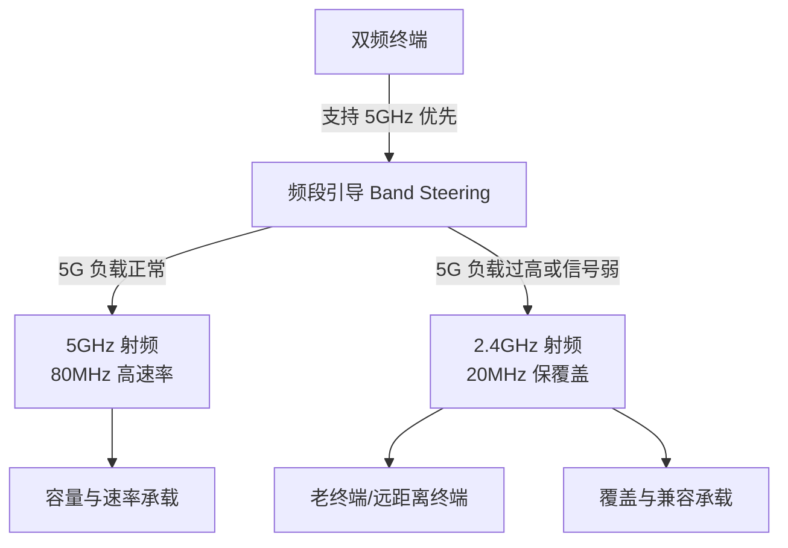

### 真题精练

**Q29.【真题·单选】** 关于 2.4GHz 与 5GHz 频段，说法正确的是：
A. 5GHz 穿透力更强，适合穿墙覆盖  B. 2.4GHz 非重叠信道有 3 个，5GHz 频谱更宽、干扰更少  C. 5GHz 因为频率高所以信道更少  D. 2.4GHz 可以稳定使用 40MHz 绑定以获得高速率

> **答案：B**
> **解析**：A 反了；C 错，5GHz 可用带宽更大、信道更多；D 错，2.4GHz 总带宽仅 83.5MHz，使用 40MHz 会占用大部分频谱并与邻频严重重叠，工程上固定 20MHz。

**Q30.【真题·简答】** 某会议室终端较多，用户反馈"能连上但网速很慢"。从频段特性角度给出优化建议。

> **答案与解析**：
> ① 先确认终端落在哪个频段：`display station all`（2.4G 拥塞是高密会议室网速慢的首因）。② 开启**频段引导**（`band-steer enable`），使双频终端优先使用 5GHz。③ 2.4GHz 固定 **20MHz** 并**禁用低速率**（1/2/5.5/11Mbps），避免低速终端长时间占用空口。④ 5GHz 使用 80MHz 提升容量，但 AP 数量多时改为 40MHz 以提高信道复用率。⑤ 检查 2.4GHz 相邻 AP 是否同频同信道（应分布 1/6/11），必要时降低 2.4GHz 发射功率。⑥ 高密场景增加 AP 密度、降低单 AP 覆盖半径，用"多而小"的蜂窝替代"少而大"的覆盖。

### 易错点与排错

1. **5GHz 衰减大**是覆盖题的正确表述（不是"信号质量差"）。
2. **不重叠信道数**：2.4G 是 3 个（1/6/11），5G 依带宽而定。
3. **"能连上但慢"**：优先查频段占用、低速终端、同频干扰、AP 关联用户数。
4. 排错命令：`display station all`（频段分布）、`display ap performance ap-id 1`（信道利用率）、`display ap all`（相邻 AP 信道）。

---

## 2.4 自由空间路径损耗与链路预算

### 考点定位

计算题常客：套公式算 FSPL、判断"距离翻倍/频率翻倍损耗增加多少"。分值 3~6 分。易错点：**公式中距离单位是 km、频率单位是 MHz（或 GHz 用另一常数）**、把 6dB 规律记成 3dB。

### 原理精讲

**自由空间路径损耗（FSPL，Free Space Path Loss）**描述理想无遮挡环境下信号随距离扩散造成的衰减，是链路预算的起点。两个等价公式：

- **FSPL(dB) = 32.44 + 20lg f(MHz) + 20lg d(km)**
- **FSPL(dB) = 92.45 + 20lg f(GHz) + 20lg d(km)**

两个常数差异来自单位换算（92.45 对应 GHz，32.44 对应 MHz）。也可以写成只含频率与距离的通用形式 FSPL = 20lg(4πd/λ)，即损耗随"距离/波长"的比值增长。

由公式可以推出两条**工程速记规律**，这是命题的重点：

1. **距离翻倍，损耗 +6dB**（因为 20lg2 = 6.02）。反过来说，要让覆盖距离翻倍，需要增加 6dB 的发射功率或天线增益——这也是"为什么功率提升 3dB 只带来约 1.41 倍的覆盖距离"。
2. **频率翻倍，损耗 +6dB**。2.4GHz→5GHz 频率约翻倍，因此同距离下 5GHz 额外损耗约 6dB（2.4G 到 5.8G 约 7.6dB），这就是 5GHz 覆盖半径更小的定量原因。

常用数值必须背下来：**2.4GHz、1m 处 FSPL ≈ 40dB**（32.44 + 20lg2400 + 20lg0.001 = 32.44 + 67.6 - 60 ≈ 40.0dB）；**2.4GHz、10m ≈ 60dB**；**2.4GHz、100m ≈ 80dB**；**5GHz、1m ≈ 46.7dB**；**5GHz、10m ≈ 66.7dB**。距离每乘 10，损耗加 20dB。

**完整链路预算（Link Budget）**要把所有增减项算清：

**RSSI(dBm) = P_tx(dBm) + G_tx(dBi) - L_cable(dB) - FSPL(dB) - L_obstacle(dB) + G_rx(dBi)**

注意：终端的天线增益通常为 0dBi 左右（内置天线），且终端发射功率一般低于 AP。工程上常用**反向链路验证**：AP 的接收电平 = 终端发射功率 - FSPL - 障碍衰减 + AP 天线增益，若 AP 收不到终端（上行差），表现为"能搜到网络但连不上/频繁掉线"，即使下行信号看起来很好。这就是**上下行不对称**问题，也是排错题的高频考点。

**接收灵敏度（Receiver Sensitivity）**是另一侧的约束：AP/终端能正确解调的最低电平，典型参考值为 802.11b 1Mbps −95dBm、11Mbps −87dBm、802.11g 54Mbps −73dBm、802.11n 20MHz MCS7 −71dBm、802.11ac 80MHz MCS9 −59dBm、802.11ax 80MHz MCS11 约 −56dBm。**速率越高，所需信号越强**——这解释了"信号差时网速自动掉到 5Mbps"的现象（速率回退，Rate Adaptation）。

**噪声底（Noise Floor）**也要会算：热噪声 = -174dBm/Hz + 10lg(带宽) + 噪声系数(NF)。20MHz 带宽：-174 + 73 = -101dBm，加 NF 5~7dB，实际底噪约 **-95dBm**；带宽每翻倍底噪抬高 3dB（40MHz ≈ -92dBm、80MHz ≈ -89dBm、160MHz ≈ -86dBm），因此**开大带宽会牺牲灵敏度**，覆盖边缘终端反而应使用窄带宽。

### 关键概念对照表

| 参数 | 公式/数值 | 说明 |
|---|---|---|
| FSPL（MHz+km） | 32.44 + 20lg f(MHz) + 20lg d(km) | 距离以 km 计 |
| FSPL（GHz+km） | 92.45 + 20lg f(GHz) + 20lg d(km) | 距离以 km 计 |
| 2.4GHz 1m | 约 40dB | 必背锚点 |
| 2.4GHz 10m / 100m | 约 60dB / 80dB | 每 ×10 距离 +20dB |
| 5GHz 1m | 约 46.7dB | 比 2.4G 高约 6.7dB |
| 距离翻倍 | +6dB | 覆盖翻倍需 +6dB 预算 |
| 频率翻倍 | +6dB | 2.4G→5G 额外损耗来源 |
| 噪声底 20MHz | ≈ -95dBm | -174 + 73 + NF 5~7 |
| 带宽翻倍 | 底噪 +3dB | 160MHz 最简单调 |
| 接收灵敏度 | 速率越高要求越高 | 11ac 80M MCS9 ≈ -59dBm |

| 链路预算项 | 符号 | 典型值 | 方向 |
|---|---|---|---|
| 发射功率 | P_tx | 17~20dBm（室内 AP） | + |
| 发射天线增益 | G_tx | 2~8dBi（内置） | + |
| 馈线损耗 | L_cable | 0.5~3dB | - |
| 自由空间损耗 | FSPL | 40dB(1m)/60dB(10m) | - |
| 障碍物衰减 | L_obstacle | 砖墙 6~10dB | - |
| 接收天线增益 | G_rx | 0~2dBi（终端） | + |
| 接收灵敏度门限 | Sensitivity | -65dBm（工程目标） | 比较基准 |

### 华为设备配置

```bash
system-view
wlan
 # 通过限制最低接入速率来强制终端"信号不好就不接入"，避免远端低速终端占用信道
 radio-2g-profile name radio2g
  dot11bg disable-rate 1 2 5.5 11             # 禁用 11Mbps 以下速率
  dot11g disable-rate 6 9                     # 进一步禁用 6/9Mbps（边缘覆盖场景慎用）
 radio-5g-profile name radio5g
  dot11a disable-rate 6 9 12 18               # 5G 禁用低速率，抬高接入门限
 # 无线侧还可以限制终端最低 RSSI（部分版本支持）
 ap-group name office-group
  radio-2g-profile radio2g
  radio-5g-profile radio5g
quit
display station all                             # 查看终端实际协商速率与 RSSI，验证链路预算
display ap performance ap-id 1                  # 查看空口重传率，反推链路是否满足预算
```

### 示意图

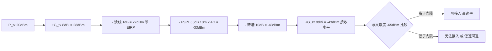

### 真题精练

**Q31.【真题·填空】** 2.4GHz 信号在 10m 处的自由空间路径损耗约为 ______ dB；若距离增加到 20m，损耗约为 ______ dB。

> **答案：60；66**
> **解析**：FSPL = 32.44 + 20lg2400 + 20lg0.01 = 32.44 + 67.6 - 40 ≈ 60dB。距离翻倍按"每翻倍 +6dB"规律，20m 约 66dB。也可直接代入：32.44+67.6+20lg0.02 = 32.44+67.6-34 = 66dB。

**Q32.【真题·单选】** 某场景中 AP 发射功率与天线增益合计 EIRP 为 27dBm，终端处测得 RSSI 为 -70dBm，则总路径损耗（含空间损耗与障碍衰减）约为：
A. 70dB  B. 97dB  C. 43dB  D. 27dB

> **答案：B**
> **解析**：链路预算的简化形式：RSSI = EIRP - 总损耗 + G_rx，终端增益近似 0dBi，因此总损耗 = 27 - (-70) = 97dB。这 97dB 包含自由空间损耗与穿墙/人体等障碍衰减之和。

**Q33.【真题·判断】** 在 5GHz 频段把信道带宽从 80MHz 改为 20MHz，会同时降低峰值速率和提高接收灵敏度。

> **答案：正确**
> **解析**：带宽变窄后噪声底下降约 6dB（80→40→20 两次翻倍），相同信号强度下 SNR 提升，因此可以支持更低的接收电平（灵敏度改善）；代价是峰值速率下降到约 1/4。这正是覆盖边缘或高干扰场景建议"降带宽换稳定性"的原理。

### 易错点与排错

1. **公式单位**：距离用 km，不是 m（10m = 0.01km）。
2. **6dB 规律**：距离翻倍 +6dB；频率翻倍 +6dB；带宽翻倍底噪 +3dB（不要混）。
3. **上下行不对称**：下行好不代表上行好，终端功率小、天线增益低，排错要看双向。
4. **灵敏度与速率绑定**：不能只问"能不能收到"，要问"在什么速率下能收到"。
5. 排错命令：`display station all`（RSSI/协商速率）、`display ap performance ap-id 1`（重传与丢包）。

---

## 2.5 天线原理、参数与选型

### 考点定位

以参数概念与选型题为主：增益与波瓣宽度的关系、前后比、极化、VSWR、各类天线适用场景。分值 3~6 分，且常在方案题中出现（"室外桥接应选哪种天线"）。易错点：**认为增益越高越好**（增益换的是角度，不是能量）、混淆极化方式、忽略 VSWR 与回波损耗的对应。

### 原理精讲

**天线是被动器件，不放大功率，只重新分配能量**。天线增益（Gain）表示"在最大辐射方向上相比于参考天线集中了多少能量"，因此**增益越高，波瓣越窄、覆盖角度越小**——这是最重要的因果链：增益是"把能量集中到某个方向"的结果，能量总量并未增加，所以高增益天线必然带来窄覆盖与更严格的指向要求。

**方向图（Radiation Pattern）**描述天线在各方向上的辐射强度分布。**波瓣宽度（Beamwidth）**通常指 **HPBW（Half Power Beamwidth，半功率波瓣宽度）**，即增益下降到最大值一半（-3dB）时两点之间的夹角，分为水平面与垂直面两个值。板状定向天线典型值为水平 60°~90°、垂直 30°~60°；全向天线水平 360°、垂直 15°~40°（垂直波瓣越窄，增益越高，顶楼/楼下的覆盖越差，因此全向吸顶天线通常垂直波瓣较宽）。

**前后比（Front-to-Back Ratio）**：主瓣最大增益与后瓣（180° 方向）增益之差，单位 dB。前后比越高，天线"向后"的泄漏越小，适合安装在墙面、走廊末端（减少对身后的干扰）。优质板状天线前后比可达 25~30dB，一般来说 **≥ 20dB 属于良好**。

**极化方式（Polarization）**：电磁波电场矢量的方向。分为**线极化（垂直/水平）**与**圆极化（左旋/右旋）**。发射与接收天线的极化必须匹配，**正交极化会产生约 20dB 甚至更大的极化失配损耗**。工程上通过"双极化（±45° 交叉）"设计来提升 MIMO 性能并降低失配概率——华为 AirEngine 系列内置**双极化智能天线**（如 AirEngine 8760-X1-PRO 支持 12 条空间流），既提高增益又利用极化分集。

**驻波比（VSWR，Voltage Standing Wave Ratio）**：衡量天线与馈线阻抗匹配程度的指标，理想值 1:1（无反射）。VSWR = (1 + |Γ|)/(1 - |Γ|)，其中 Γ 为反射系数。工程要求：**VSWR ≤ 1.5 为好**（对应回波损耗 ≥ 14dB、反射功率 < 4%、附加损耗约 0.18dB）；≤ 2.0 一般可接受（回波损耗约 9.5dB、反射功率约 11%、附加损耗约 0.5dB）；超过 2.5 说明存在明显失配，需要检查接头、馈线破损或进水。**VSWR 高会同时降低发射效率与接收灵敏度**，是室外天线进水/接头氧化后的典型故障现象（表现为"AP 正常但覆盖突然缩小"）。

**常见天线类型与适用场景**：

| 类型 | 增益范围 | 水平波瓣 | 典型场景 |
|---|---|---|---|
| 全向天线（Omni） | 2~8dBi | 360° | 走廊中段、室内均匀覆盖、室外杆顶覆盖 |
| 吸顶/放装内置天线 | 3~6dBi | 近似全向（半球） | 办公室吊顶、会议室 |
| 板状定向天线（Panel） | 8~20dBi | 60°~90° | 走廊末端、室外扇区覆盖、仓库过道 |
| 八木天线（Yagi） | 10~16dBi | 30°~60° | 中距离点对点桥接 |
| 抛物面栅格天线 | 20~30dBi | 5°~15° | 远距离点对点桥接、塔间链路 |
| 赋形/智能天线 | 内置 | 动态可调 | 高密场馆、AirEngine 内置智能天线 |

**天线选型原则（五条）**：① **按覆盖形状选**：需要水平均匀覆盖选全向/吸顶，需要纵深覆盖选定向板状；② **按距离选增益**：近距离用低增益（避免覆盖过冲与远端干扰），远距离桥接用高增益 + 精确对准；③ **按安装条件选**：无法精确对准的场景不要用窄波瓣（如抛物面）；④ **按合规选**：天线增益提高后必须**下调发射功率**以维持 EIRP 在国家码限值内；⑤ **按分集/MIMO 选**：需要 MIMO 多流时使用双极化或多天线间距足够的阵列（间距一般要求 ≥ λ/2，2.4G 约 6cm）。

### 关键概念对照表

| 参数 | 定义 | 典型值/要求 | 影响 |
|---|---|---|---|
| 增益 | 最大方向相对参考天线的集中度 | 全向 2~8dBi、板状 8~20dBi | 增益高 → 波瓣窄 |
| 水平波瓣宽度 | 水平面 -3dB 夹角 | 全向 360°、板状 60°~90° | 决定覆盖形状 |
| 垂直波瓣宽度 | 垂直面 -3dB 夹角 | 全向 15°~40° | 决定越层覆盖能力 |
| 前后比 | 主瓣与后瓣增益差 | ≥20dB 为良好 | 减少背后干扰 |
| 极化 | 电场方向 | 线极化/圆极化/双极化 | 失配损耗可达 20dB |
| VSWR | 驻波比 | ≤1.5 优、≤2.0 可接受 | 高则效率与灵敏度下降 |
| 回波损耗 | 反射损耗 | 与 VSWR 对应（1.5→14dB） | 衡量匹配 |
| 隔离度 | 双极化端口间隔离 | 通常 ≥25dB | 影响 MIMO 性能 |

| VSWR | 反射系数 | 回波损耗 | 反射功率占比 | 附加损耗 |
|---|---|---|---|---|
| 1.0 | 0 | ∞ | 0% | 0dB |
| 1.2 | 0.091 | 20.8dB | 0.8% | 0.04dB |
| 1.5 | 0.200 | 14.0dB | 4.0% | 0.18dB |
| 2.0 | 0.333 | 9.5dB | 11.1% | 0.51dB |
| 3.0 | 0.500 | 6.0dB | 25.0% | 1.25dB |

### 华为设备配置

```bash
system-view
wlan
 # 外接天线的场景：AP 型号需支持外置天线口（如 AirEngine 6761 系列室外型）
 antenna-profile name panel-90                 # 创建天线模板（部分版本在 AP 视图下配置）
  # 天线增益需与实际安装的天线一致，否则 EIRP 计算与合规校验会出错
 ap-group name outdoor-group
  antenna-profile panel-90
  # 使用外接天线时必须同步下调发射功率以满足国家码 EIRP 限制
 radio-5g-profile name radio5g-out
  eirp 27                                      # 以 EIRP 口径约束，避免"高增益天线 + 高功率"违规
quit
display ap radio-info ap-id 1                   # 查看实际生效功率与 EIRP
display ap all                                  # 批量确认室外 AP 的射频状态
```

### 示意图

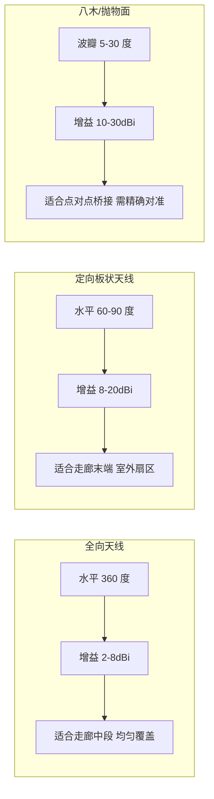

### 真题精练

**Q34.【真题·单选】** 关于天线增益，正确的理解是：
A. 增益越高，覆盖范围一定越大  B. 天线是有源器件，可以放大信号功率  C. 增益提高是以波瓣变窄为代价的能量重新分配，方向外覆盖反而可能变差  D. 增益只影响接收不影响发射

> **答案：C**
> **解析**：天线是无源器件，不放大能量，只改变方向分布。增益越高，主瓣方向更远、角度更窄，非主瓣方向（如偏轴、楼上楼下）覆盖会变差，因此"高增益天线一定覆盖更广"是错的。D 错：天线增益对收发双向都有效。

**Q35.【真题·填空】** 驻波比 VSWR 为 2.0 时，回波损耗约为 ______ dB，反射功率约占总功率的 ______ %。

> **答案：9.5；11.1**
> **解析**：VSWR=2.0 → 反射系数 |Γ| = (2-1)/(2+1) = 0.333，回波损耗 = -20lg0.333 ≈ 9.5dB，反射功率占比 = 0.333² ≈ 11.1%，因此约有 0.5dB 的附加损耗，并会降低接收灵敏度。工程上要求 VSWR ≤ 1.5。

**Q36.【真题·简答】** 室外两点之间需要做 3km 的点对点桥接，请给出天线与频段选型建议及注意事项。

> **答案与解析**：
> ① **频段**：选 5GHz（5725~5850MHz）。理由是非 DFS 信道可用、干扰少、频谱宽易做高带宽，且该段在国内允许室外使用（2.4G 干扰大、带宽窄，不适合桥接）。
> ② **天线**：选高增益强定向天线（抛物面栅格 20~30dBi 或高增益八木 16dBi），并**精确对准**（方位角与俯仰角），因为窄波瓣对指向误差非常敏感。
> ③ **菲涅尔区**：3km 距离必须保证第一菲涅尔区约 60% 无遮挡，必要时架高塔/立杆，避免树木、建筑物遮挡。
> ④ **功率合规**：高增益天线必须同步下调发射功率使 EIRP 不超过国家码限值（5725~5850MHz 参考 27dBm）。
> ⑤ **可靠性**：两侧使用同一型号设备、相同带宽与信道，两套天线极化方式一致；室外做好防水与接地，定期检查 VSWR（进水会导致驻波比升高、链路质量骤降）。
> ⑥ **备份**：关键链路建议双链路（双频/双设备）或调整到有线备份。

### 易错点与排错

1. **增益与波瓣**：题干问"覆盖角度变小"就是增益提高的代价。
2. **极化失配**：垂直对水平 = 巨大损耗，室外桥接必须核对极化方向。
3. **VSWR 与回波损耗**：1.5 ↔ 14dB、2.0 ↔ 9.5dB，常考对应关系。
4. **室外进水故障特征**：某天开始覆盖突然变小、链路质量下降 → 优先测 VSWR。
5. 排错命令：`display ap radio-info ap-id 1`、`display ap all`、查看 AP 告警（`display alarm active`）。

---

## 2.6 EIRP、发射功率计算与各国功率限制

### 考点定位

经常与 dB 换算、国家码合并考：给出发射功率、天线增益、损耗求 EIRP；或在给定法规限值下反算最大发射功率。分值 3~5 分。易错点：**把法规限值当成发射功率限值**（法规限的是 EIRP）、忽略"室内/室外"与"DFS 子频段"的差异。

### 原理精讲

**EIRP（Equivalent Isotropically Radiated Power，等效各向同性辐射功率）**是把发射机功率、馈线损耗与天线增益综合之后的"等效辐射能力"，可以理解为"如果用一个理想点源天线，需要多大功率才能产生同样的最大方向辐射强度"。它是无线电管理法规的**约束对象**，因为决定干扰的是空间中实际的辐射能量，而不是设备端口上的功率。

计算式：**EIRP(dBm) = P_tx(dBm) + G_antenna(dBi) - L_cable(dB)**。注意三点：① 若天线指标给的是 dBd，先换算成 dBi（+2.15）；② 多级馈线/接头/避雷器的损耗要累加（dB 可以相加）；③ 若天线是双极化且设备只用一个极化口，不能把两路增益叠加（功率分配后单口增益仍是标称值）。

**法规约束的落地方式**有两种：一是**限制发射功率**（`txpower`），二是**直接限制 EIRP**（`eirp`，华为设备支持）。使用外接高增益天线时，正确的做法是用 `eirp` 口径配置或按 `EIRP - G + L` 反算发射功率，从而保证合规。不同国家的限值差异明显（以各国现行法规为准，下表为常见参考值）：

| 地区 | 2.4GHz EIRP | 5GHz 低段 | 5GHz 高段 | 备注 |
|---|---|---|---|---|
| 中国 | ≤100mW（20dBm） | ≤200mW（23dBm），限室内 | ≤500mW（27dBm） | 5250~5350MHz 需 DFS/TPC |
| 美国 FCC | 30dBm（点对点可至 36dBm） | UNII-1 30dBm | UNII-3 30dBm | UNII-2A 24dBm，需 DFS |
| 欧盟 ETSI | 20dBm | 23dBm | 30dBm | 5470~5725 需 DFS/TPC |
| 日本 | 20dBm（含 LBT 要求） | 23dBm | 23dBm | 需 DFS/LBT |

从这张表可以读出两个结论：**① 中国的 2.4GHz 限值（20dBm）比美国（30dBm）严格 10dB**，所以国内设备常看到"功率被限制在 20dBm"；**② 5GHz 高段（5725~5850MHz）的限值普遍高于低段**，室外覆盖优先选高段。同时，中国对 5150~5350MHz 的"限室内使用"是**强制要求**，用该段做室外覆盖属于违规，这也是方案题的重要扣分点。

**功率与覆盖的换算关系**也是常考：功率增加 3dB 使覆盖距离约增加到 1.41 倍，增加 6dB 约 1.41→2 倍（即距离翻倍）。反之，**降功率 3dB 覆盖半径缩小约 29%**。因此"想扩大覆盖"用 2 倍功率（+3dB）只能多 41% 的距离，性价比很低——正确做法是增加 AP 或换用定向天线。

### 关键概念对照表

| 概念 | 含义 | 单位 | 常见误区 |
|---|---|---|---|
| 发射功率 | 射频口输出功率 | dBm | 法规不直接限制它 |
| 天线增益 | 方向性集中能力 | dBi/dBd | 与功率不可简单叠加计算覆盖 |
| 馈线损耗 | 电缆/接头/避雷器损耗 | dB | 必须从 EIRP 中扣除 |
| EIRP | 等效全向辐射功率 | dBm | 法规真正限制的量 |
| 功率 +3dB | 覆盖距离 ×1.41 | — | 不是 ×2 |
| 功率 +6dB | 覆盖距离 ×2 | — | 需要 4 倍功率 |
| 功率 -3dB | 覆盖距离 ×0.71 | — | 用于减少同频干扰 |

### 华为设备配置

```bash
system-view
wlan
 regulatory-domain-profile name cn-domain
  country-code cn                               # 中国：加载对应信道集合与功率上限
 radio-5g-profile name radio5g-out
  channel 149                                  # 选非 DFS 高段信道，便于室外使用
  eirp 27                                      # EIRP 限值 27dBm（参考中国 5725~5850MHz 限值）
 radio-2g-profile name radio2g
  txpower 17                                   # 2.4G 发射功率 17dBm，配合 3dBi 内置天线 EIRP 约 20dBm
 ap-group name office-group
  radio-2g-profile radio2g
  radio-5g-profile radio5g-out
quit
display ap radio-info ap-id 1                   # 逐射频确认实际信道、功率与 EIRP
display regulatory-domain-profile name cn-domain   # 确认该区域允许的信道与功率上限
```

### 示意图

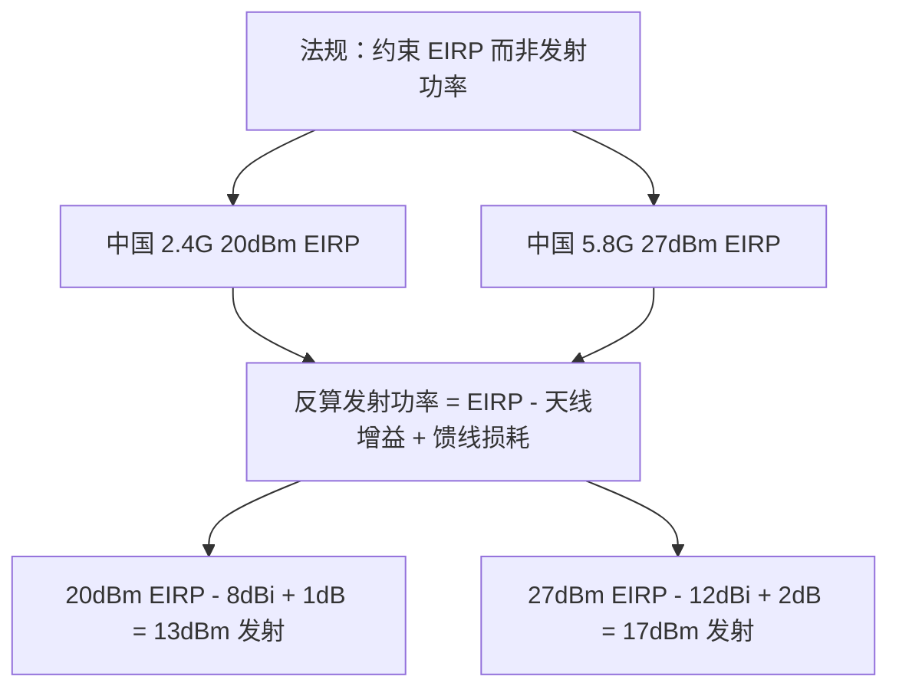

### 真题精练

**Q37.【真题·单选】** 中国 2.4GHz 频段 WLAN 设备的 EIRP 上限参考值为 100mW，若使用增益 8dBi 的天线、馈线损耗 1dB，则发射功率最大不应超过：
A. 20dBm  B. 13dBm  C. 12dBm  D. 27dBm

> **答案：B**
> **解析**：100mW = 20dBm。由 EIRP = P_tx + G - L 得 P_tx = 20 - 8 + 1 = 13dBm（约 20mW）。D 是把增益加到了限值上；A 忽略了天线增益；C 把损耗符号记反。

**Q38.【真题·判断】** 为了提升覆盖，把 AP 发射功率从 17dBm 提升到 23dBm，覆盖距离大致可以变为原来的约 2 倍。

> **答案：正确**
> **解析**：17→23dBm 是 +6dB。自由空间下损耗与距离的对数关系为 20lg d，+6dB 对应距离 ×2（20lg2 = 6dB）。注意这是理想自由空间结论，实际有遮挡时提升幅度更小，且功率提升会加剧同频干扰，通常不推荐。

### 易错点与排错

1. **法规限 EIRP**：题干若给"天线增益 12dBi"，切勿仍按 20dBm 配发射功率。
2. **室内/室外限制**：5150~5350MHz 限室内，室外应用 5725~5850MHz。
3. **DFS 影响**：使用 52~64、100~144 信道时可能因雷达避让切信道，关键业务应避免只依赖 DFS 信道。
4. 排错命令：`display ap radio-info ap-id 1`、`display regulatory-domain-profile name cn-domain`。

---

## 2.7 MIMO、波束赋形与信道绑定

### 考点定位

11n/ac/ax 的核心技术对比题：MIMO 空间复用与空间分集的区别、SU-MIMO 与 MU-MIMO、波束赋形的探测流程（NDPA/NDP）、OFDMA 与 MU-MIMO 的差异、信道绑定的利弊。分值 4~8 分。易错点：**把 MU-MIMO 与 OFDMA 混为一谈**、把"空间分集"与"空间复用"目标搞反、认为带宽绑定只有好处。

### 原理精讲

**MIMO（Multiple-Input Multiple-Output，多入多出）**在收发两端使用多根天线，利用无线信道的**多径**这一"缺陷"作为资源：只要各条路径之间的**相关性足够低**（富散射环境），就可以把它们当作多条并行的独立通道。

**空间复用（Spatial Multiplexing）**：把待发数据拆分成 N 条独立数据流，同一时间同一频率从不同天线发出，接收端用信道估计解出各流。目标是**提高速率**，理论速率 = 空间流数 × 单流速率。前提是信道相关性低、SNR 足够高（每一流都需要满足解调门限），因此**只有在信号强、散射丰富的环境才能跑满多流**；弱信号时流数会自动回退到 1。

**空间分集（Spatial Diversity）**：把**同一份数据**通过多个天线（或时空编码 STBC）重复发送，接收端合并多份副本。目标是**提高可靠性/覆盖**，代价是不提升速率（甚至略微降低）。这是"信号边缘时游走于 1 流"的原因——设备在速率与可靠性之间自动权衡。

**波束赋形（Beamforming）**：通过调整多天线发射信号的**相位与幅度**，使电磁波在目标终端方向**同相叠加**，形成指向性波束，从而提升目标方向的 SNR（典型增益 3~5dB），改善边缘用户体验并减少对他人的干扰。802.11n 使用隐式反馈（依赖信道互易性，AP 自行估计），802.11ac 起采用**显式波束赋形**：AP 先发 **NDPA（Null Data Packet Announcement）** 宣告探测，再发 **NDP（Null Data Packet）** 供终端测量信道，终端回送 **Compressed Beamforming Report**，AP 据此计算赋形矩阵。虽然流程开销不小，但换来更稳的高阶调制。

**SU-MIMO 与 MU-MIMO**：**SU-MIMO（单用户 MIMO）**是"一个用户占满所有空间流"；**MU-MIMO（多用户 MIMO）**是"把空间流分给多个用户同时传输"。802.11ac Wave 2 支持**下行 MU-MIMO**（最多 4 个用户），802.11ax 支持**上下行 MU-MIMO**（最多 8 个用户，上行需要 AP 发 Trigger 帧调度）。注意两个关键限制：① 终端必须支持 MU-MIMO 且天线数匹配；② MU-MIMO 依赖**空间分离**（用户位置要分散），且对信道反馈的时效性要求高，因此实际增益在密集终端场景才明显。

**OFDMA 与 MU-MIMO 的区别（高频考点）**：**MU-MIMO 在"空间维度"复用**（同一频率、不同空间流给不同用户，需要良好的空间隔离）；**OFDMA 在"频率维度"复用**（同一时刻把信道划分为多个 RU 分给不同用户，对空间隔离无要求）。二者在 11ax 中**互补并用**：小包并发（语音、IoT）用 OFDMA 更高效，大流量下行用 MU-MIMO 吞吐更高。

**信道绑定（Channel Bonding）**：把相邻的 20MHz 信道合并成 40/80/160/320MHz 以提高单用户速率。收益是速率线性提升（80→160MHz 速率 ×2），代价有三：① **噪声底抬高 3dB/次翻倍**，覆盖边缘终端灵敏度下降；② **可用不重叠信道组减少**（5G 做 80MHz 只有 3~5 组，做 160MHz 更少），同频干扰概率上升；③ **必须等整个绑定带宽都空闲才能发送**（CCA 检查全部子信道），在繁忙环境中反而更容易被打断，导致"带宽越宽、实际吞吐反而下降"。因此工程原则是：**高密场景用 20/40MHz 换取复用率，低密/单用户高速场景用 80/160MHz**。

**速率计算（理解即可）**：单流速率 ≈ 数据子载波数 × 每子载波比特数 × 编码率 ÷ 符号时间（含 GI）。据此得出的代表值：802.11ac 80MHz 单流 MCS9 = 433Mbps（160MHz 为 866.7Mbps）；802.11ax 80MHz 单流 MCS11 = 600.4Mbps（160MHz 为 1201Mbps）。多流相乘即为理论峰值（但要扣除 MAC 效率，实测约为理论值的 50%~65%）。

### 关键概念对照表

| 技术 | 目标 | 前提 | 增益类型 | 典型增益 |
|---|---|---|---|---|
| 空间复用 | 提升速率 | 信道相关性低、SNR 高 | 速率（×流数） | 2 流约 ×1.8 |
| 空间分集 STBC | 提升可靠性 | 多天线 | 覆盖/稳定性 | 3~6dB 等效 |
| 波束赋形 | 提升目标方向 SNR | 需信道探测反馈 | 定向增益 | 3~5dB |
| SU-MIMO | 单用户体验 | 终端多天线 | 速率 | 随流数线性 |
| MU-MIMO | 多用户并发 | 空间分离 + 终端支持 | 系统容量 | 11ac 最多 4 用户 |
| OFDMA | 多用户并发（小包） | 11ax 及以上 | 时延与效率 | RU 粒度调度 |
| 信道绑定 | 单用户峰值速率 | 连续频谱空闲 | 速率 | 带宽翻倍 = 速率翻倍 |

| 带宽 | 噪声底增益（相对 20MHz） | 2.4G 可用性 | 5G 不重叠信道组（参考） | 建议场景 |
|---|---|---|---|---|
| 20MHz | 0dB（约 -95dBm） | 3 个（1/6/11） | 10+ 组 | 高密、2.4G |
| 40MHz | +3dB | 不建议（仅 1 组且重叠） | 5 组 | 中等密度、5G |
| 80MHz | +6dB | 不可用 | 3 组 | 常规办公 5G |
| 160MHz | +9dB | 不可用 | 1~2 组 | 低密单用户高速 |
| 320MHz | +12dB | 不可用 | 仅 6GHz | Wi-Fi 7 专用场景 |

### 华为设备配置

```bash
system-view
wlan
 radio-5g-profile name radio5g
  channel 80mhz                                # 5G 绑定 80MHz
  dot11ac mu-mimo enable                       # 使能 802.11ac MU-MIMO（下行多用户）
  dot11ax enable                               # 使能 802.11ax：OFDMA + 上下行 MU-MIMO
  beamforming enable                           # 使能显式波束赋形（NDPA/NDP 探测）
  dot11n a-mpdu enable                         # A-MPDU 聚合，配合 Block ACK
 radio-2g-profile name radio2g
  channel 20mhz                                # 2.4G 严禁宽带宽绑定
 ap-group name office-group
  radio-5g-profile radio5g
  radio-2g-profile radio2g
quit
display ap radio-info ap-id 1                   # 查看带宽、MIMO 与 11ax 能力是否生效
display station all                             # 查看终端协商的空间流数与 MCS
```

### 示意图

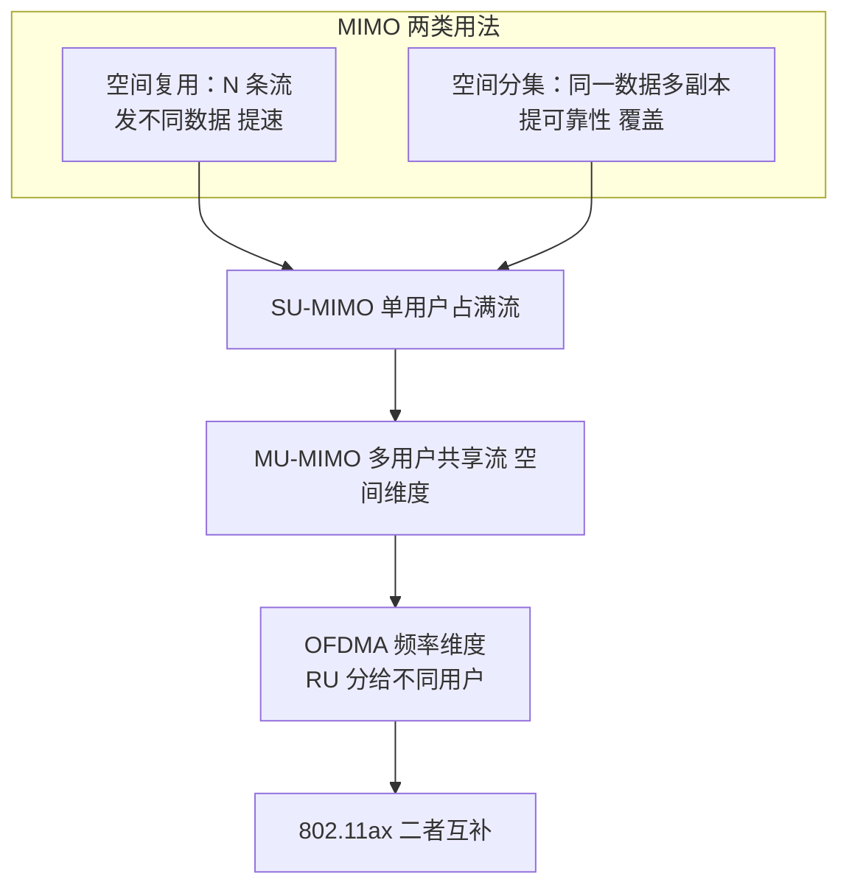

### 真题精练

**Q39.【真题·单选】** 关于 MU-MIMO 与 OFDMA 的区别，正确的是：
A. 两者都是把不同子载波分给不同用户  B. MU-MIMO 在空间维度复用（不同空间流给不同用户），OFDMA 在频率维度复用（不同 RU 给不同用户）  C. OFDMA 需要终端具备多天线空间隔离  D. MU-MIMO 只能用于上行

> **答案：B**
> **解析**：A 错，那是 OFDMA 的描述。C 错，OFDMA 不要求空间隔离，只需终端支持 11ax。D 错，11ac 的 MU-MIMO 是下行；11ax 才增加上行 MU-MIMO（需 Trigger 帧）。

**Q40.【真题·多选】** 把 5GHz 信道带宽从 40MHz 提升到 80MHz，会带来：
A. 单用户峰值速率约翻倍  B. 噪声底抬高约 3dB  C. 可用不重叠信道组数量减少  D. 覆盖边缘终端的接入成功率上升

> **答案：ABC**
> **解析**：D 错。带宽翻倍使噪声底抬高约 3dB，相同信号下 SNR 下降，灵敏度变差，覆盖边缘终端反而更容易掉线或只能低速率回退。ABC 均为带宽绑定的直接后果。

**Q41.【真题·简答】** 简述 802.11ac 显式波束赋形的流程，以及它为什么需要额外开销。

> **答案与解析**：① AP 先发送 **NDPA** 帧，宣告即将进行信道探测并指定需要反馈的终端顺序；② 紧接着发送 **NDP**（无数据载荷的探测帧），终端据此测量信道状态；③ 终端依次回送 **Compressed Beamforming Report**（压缩后的信道矩阵信息）；④ AP 根据反馈计算赋形权重矩阵，此后向该终端发送的数据在多个天线上按计算出的相位/幅度发射，实现定向叠加。开销在于 NDPA/NDP/反馈三类帧占用空口时间，且信道变化（终端移动）后需要重新探测，因此波束赋形更适合**位置相对固定**的终端（如吸顶 AP 覆盖的办公位），并在终端移动频繁时收益有限。

### 易错点与排错

1. **空间复用提速率，空间分集提可靠**，方向别记反。
2. **MU-MIMO 要求空间分离，OFDMA 不要求**。
3. **带宽绑定不是越大越好**：噪声底 +3dB/次、信道组减少、CCA 全带宽检查。
4. **多流需要高 SNR**：弱信号处看到"只跑 1 流"是正常自适应，不是故障。
5. 排错命令：`display station all`（看空间流/MCS/带宽）、`display ap radio-info ap-id 1`（看射频能力与带宽配置）。

---

## 2.8 射频干扰、频谱分析与射频规划原则

### 考点定位

网规与排错题的核心：识别干扰类型、给出信道/功率调整方案、AP 布局间距计算。分值 5~10 分（方案题与排错题常见）。易错点：把"信号强但速率低"误判为设备故障、规划时忽略上行与容量、AP 间距与覆盖半径的换算错误。

### 原理精讲

**干扰分类**：① **同频干扰（Co-channel）**：多个 BSS 使用同一信道，MAC 层互相竞争退避（不是"信号叠加成噪声"，而是"抢不到发送机会"），表现为信道利用率高、时延大、吞吐下降；2.4GHz 因只有 3 个信道必然存在，靠**空间隔离 + 降功率 + 减少 SSID/VAP 数**缓解。② **邻频干扰（Adjacent Channel）**：相邻信道旁瓣能量泄漏，表现为接收端底噪抬高、SNR 下降，典型错误配置是"相邻 AP 配 1 和 3 信道"。③ **非 Wi-Fi 干扰**：微波炉（2.45GHz 附近泄漏大、周期性）、蓝牙/ZigBee（跳频，占空比小但持续）、无绳电话与模拟无线摄像头（长时间占用）、无线麦克风、雷达（5G DFS 触发源）、劣质 PoE 适配器与 LED 驱动电源（宽带噪声抬高底噪）、4G/5G 基站邻频泄漏。

**干扰的判定方法**：看**底噪与信道利用率**比看信号强度更准确。若终端 RSSI 很好（-55dBm）但协商速率低、重传率高、时延抖动大，则问题在**干扰或信道拥塞**而非覆盖。工具上可用 AP 的**频谱分析/空口扫描**功能观察底噪与干扰图，也可以用第三方软件（如 Ekahau、Chanalyzer）现场扫描。华为 WLAN 侧可通过 AC 查看 AP 性能数据与空口扫描结果。

**射频规划五步法**：

1. **定目标**：明确覆盖目标（普通办公 RSSI ≥ -65dBm、SNR ≥ 25dB；高密/语音场景 ≥ -60dBm）、容量目标（单 AP 并发终端数、每终端带宽）、漫游要求（时延 < 50ms 的无感漫游）、业务类型（语音/视频对时延敏感）。
2. **算 AP 数量**：分别按**覆盖**与**容量**估算，取较大值。覆盖估算：AP 数 ≈ 区域面积 ÷ 单 AP 有效覆盖面积。单 AP 有效覆盖面积按覆盖半径 R 取正六边形近似 2.6R²（或按蜂窝布局间距 d = 1.5R 估算）。容量估算：AP 数 ≈ 总并发终端数 ÷ 单 AP 建议并发数（一般办公建议单 AP 活跃终端 20~30 个、高密场景通过降功率增加密度，单 AP 20 个左右）。
3. **布点**：采用**蜂窝状（正三角形交错）布局**，避免一字排开的线性布局；AP 应安装在**吊顶下方、远离金属结构/管道/承重梁**，避开微波炉与电机；走廊部署用定向天线或采用"走廊 + 房间"混合布点；高密场馆（体育馆、报告厅）采用**顶装小功率高密 AP**（AirEngine 8760 系列）并缩短间距。
4. **信道分配**：2.4GHz 按 1/6/11 复用，相邻 AP 不同信道，**同频 AP 之间尽量隔开两层**；5GHz 尽量使用全部可用信道，80MHz 部署时确保相邻 AP 的 80MHz 组不重叠；避免使用 DFS 信道作为关键业务的主信道。
5. **功率与验证**：相邻 AP 功率应**大致一致**（避免"一个 AP 压住邻居"导致终端粘滞），2.4GHz 通常比 5GHz 低 3~6dB；建议开启自动调优但**在稳定期关闭自动调功率**以防震荡；最后用**现场勘测（Site Survey）**验证：网格采样 RSSI/SNR、测速、漫游测试（ping 连续性）、同频干扰检查。

**AP 间距与覆盖半径的工程参考**：办公放装型 AP（内置天线，功率 17~20dBm）2.4GHz 覆盖半径 15~25m、5GHz 8~15m；会议室/开放办公区 AP 间距 12~18m；高密场景（每 AP 30~60 终端）间距 8~12m 并降低功率；仓库等高大空间需考虑货架遮挡，采用过道定向覆盖。**注意：AP 密度由容量需求主导时，间距会远小于覆盖半径**，这时必须降功率以控制干扰——"高密不等于高功率，而是多而小"。

**AP 布局与容量的平衡**：覆盖不足表现为边缘区域掉线（增加 AP 或调整天线）；容量不足表现为忙时全场速率下降（增加 AP 数量、缩小覆盖半径、降带宽增复用、启用频段引导、限制低速终端）。二者手段有时相反（容量优先要降功率、覆盖优先要升功率），所以必须先明确目标再动手。

### 关键概念对照表

| 干扰类型 | 成因 | 现象 | 缓解手段 |
|---|---|---|---|
| 同频干扰 | 多 BSS 同信道 | 信道利用率高、时延大 | 空间隔离、降功率、减少 VAP |
| 邻频干扰 | 相邻信道旁瓣交叠 | 底噪抬高、SNR 下降 | 只用 1/6/11 或规范信道规划 |
| 非 Wi-Fi 干扰 | 微波炉/蓝牙/摄像头/电源 | 周期性或宽带底噪抬升 | 换信道、物理隔离干扰源、屏蔽 |
| 雷达干扰 | 5G DFS 频段 | 强制静默切信道 | 关键业务避开 DFS 信道 |
| 多径干扰 | 反射叠加 | RSSI 剧烈波动、ISI | 降带宽、用短 GI 或长 GI 权衡、调整天线位置 |

| 规划项 | 普通办公 | 高密场景（报告厅/体育馆） |
|---|---|---|
| 覆盖目标 RSSI | ≥ -65dBm | ≥ -60dBm |
| SNR 目标 | ≥ 25dB | ≥ 30dB |
| AP 间距 | 12~18m | 8~12m |
| 单 AP 并发终端 | 20~30 | 20 左右（靠加密 AP 提升总容量） |
| 信道带宽 | 5G 80MHz | 5G 20/40MHz（提高复用） |
| 发射功率 | 17~20dBm | 降 3~6dB，相邻一致 |
| 2.4G 策略 | 20MHz + 频段引导 | 20MHz、限低速、必要时关闭部分 VAP |

### 华为设备配置

```bash
system-view
wlan
 rrm-profile name rrm1
  calibrate auto-channel-mode auto             # 自动信道选择（避开干扰）
  calibrate auto-txpower-mode auto             # 自动功率控制（保持相邻 AP 功率一致）
  calibrate start-time 03:00:00                # 低峰期调优，避免影响业务
  calibrate noise-floor-threshold -85          # 底噪门限：超过则视为干扰严重，触发调优
 radio-2g-profile name radio2g
  channel 20mhz
  dot11bg disable-rate 1 2 5.5 11              # 禁用低速率，减少空口占用
 radio-5g-profile name radio5g
  channel 40mhz                                # 高密场景 40MHz，兼顾速率与复用
  dfa enable                                   # 动态频率选择（DFS）：雷达避让
 ap-group name office-group
  rrm-profile rrm1
  radio-2g-profile radio2g
  radio-5g-profile radio5g
quit
display ap performance ap-id 1                  # 查看信道利用率、重传率、干扰与底噪
display ap all                                  # 检查相邻 AP 的信道与功率是否合理
display station all                             # 查看终端 RSSI/SNR/速率，定位覆盖或干扰问题
```

### 示意图

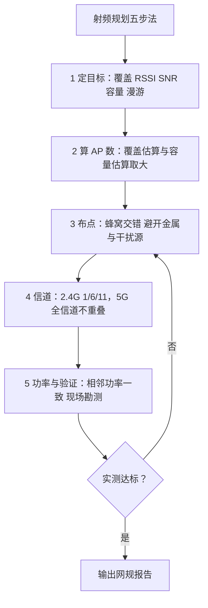

### 真题精练

**Q42.【真题·单选】** 用户终端显示的信号强度很好（-52dBm），但网速只有几兆且时延抖动大。最可能的原因是：
A. AP 发射功率不足  B. 存在严重的同频干扰或信道拥塞  C. 终端天线损坏  D. DHCP 地址池不足

> **答案：B**
> **解析**：RSSI 好说明下行覆盖没问题，速率低与时延大指向空口竞争/干扰（信道利用率高、重传多）。A 与现象矛盾；C 无法解释（信号很好）；D 会导致拿不到地址或频繁断线，而不是"能上网但慢"。应通过 `display ap performance ap-id 1` 看信道利用率与重传率确认。

**Q43.【真题·多选】** 为降低 2.4GHz 的干扰，可采取的措施包括：
A. 相邻 AP 使用 1/6/11 交错分配  B. 禁用 1/2/5.5/11Mbps 低速率  C. 把 2.4GHz 带宽从 20MHz 提升到 40MHz  D. 适当降低 2.4GHz 发射功率并减少该频段的 SSID 数量

> **答案：ABD**
> **解析**：C 错。2.4GHz 总带宽仅约 83.5MHz，40MHz 绑定会占用大部分频谱并与邻频严重重叠，加剧干扰。A（信道复用）、B（减少低速终端空口占用）、D（降功率减少同频覆盖重叠、减少 VAP 降低管理帧开销）都是正确手段。

**Q44.【真题·排错】** 某楼层反馈"时通时断，扫码付款偶尔失败"。请给出完整的排查与优化步骤。

> **答案与解析**：
> ① **缩小范围**：确认是个别终端还是整层；用 `display station all` 看终端 RSSI、SNR、协商速率与所在 AP/频段，用 `display ap performance ap-id N` 看信道利用率、重传率与底噪。
> ② **区分覆盖与干扰**：RSSI 好而重传高 → 干扰或拥塞；RSSI 差 → 覆盖不足。检查相邻 AP 是否同频（`display ap all`），2.4GHz 是否为 1/6/11。
> ③ **查非 Wi-Fi 干扰**：周边是否有微波炉、无线摄像头、模拟图传、劣质电源；必要时做频谱扫描，换到干净信道。
> ④ **查漫游与粘滞**：终端是否长期挂在远处的 2.4GHz AP（粘滞），启用频段引导、统一相邻 AP 功率。
> ⑤ **查容量**：单 AP 关联数是否过高，忙时是否拥塞；必要时增加 AP 密度并降低单 AP 功率，5G 由 80MHz 降到 40MHz 提升复用。
> ⑥ **查上层**：支付类业务是否因认证掉线（Portal/802.1X 超时）或 DHCP 租约过短导致；确认 AC 与认证服务器状态。
> ⑦ **验证**：优化后连续 ping 测试（观察丢包与时延抖动）与多点测速，确认漫游切换是否平滑。

### 易错点与排错

1. **"信号好 = 网络好"是错的**：必须同时看 SNR、信道利用率、重传率。
2. **相邻 AP 配相邻信道（1 和 3）是典型错误**：2.4G 只能用 1/6/11。
3. **高密场景的第一手段是"多 AP + 低功率"**，不是提高功率。
4. **自动调优有风险**：生产网络建议固定信道/功率或把调优窗口放到低峰期。
5. 排错命令：`display ap performance ap-id 1`、`display ap all`、`display station all`、`display wlan rrm-status`。

---

# WLAN-HCIA-章节3-WLAN组网架构与CAPWAP协议

## 3.1 WLAN 组网架构演进：FAT AP 与 FIT AP + AC

### 考点定位

架构对比题每年必考 1~2 道，且是方案题与排错题的背景知识。分值 4~6 分。易错点：**说不清 FAT AP 的"独立"到底独立在哪里**、误认为 FIT AP 无法单独工作（其实 FIT AP 可以切换为 FAT 模式）、搞错"AC 宕机后 FIT AP 是否还能转发数据"。

### 原理精讲

**FAT AP（胖 AP）架构**：每一台 AP 都是一台**独立的网络设备**，自身完成射频管理、SSID 广播、认证加密、DHCP（部分型号）、NAT、路由交换等全部功能。它的优点是部署简单（通电配一下就能用）、不依赖 AC、单点故障只影响自身覆盖；缺点是**管理分散**：100 台 AP 就要配 100 次，改一个密码要逐台操作；**无法集中射频优化**（各 AP 各自选信道/功率，容易撞车）；**漫游体验差**（通常需要二层同网段，跨网段漫游困难）；**认证能力弱**（难以统一接 RADIUS/Portal）。FAT AP 适用于家庭、小型商铺、AP 数量很少（一般 ≤10 台）且无需集中管理的场景。华为的 AirEngine 系列 AP 支持通过模式切换（`ap-mode` 相关命令）在 FAT/FIT 之间转换，因此"FIT AP 在无 AC 时完全不能工作"是错的——它可以被切成 FAT 模式独立工作，但需要手工配置。

**FIT AP（瘦 AP）+ AC 架构**：AP 只保留射频与 802.11 报文的收发，**所有配置、认证、射频调优、漫游决策、用户表项都由 AC（Access Controller，无线接入控制器）统一管理**。AP 上电后通过 **CAPWAP 隧道**向 AC 请求配置，实现**零配置上线**。优点是：集中管理（AC 上一次配置下发全网）、统一认证（AC 对接 RADIUS/Portal）、集中射频优化（RRM 自动分配信道与功率，避免同频）、支持二层与三层漫游（AC 上维护用户表项，跨网段也能保持 IP）、易扩容（AP 上电即纳入管理）、策略统一（QoS/ACL 统一下发）。缺点是：配置集中在 AC，AC 成为关键节点（因此需要 VRRP + HSB 双机热备）；对 CAPWAP 隧道网络质量有依赖；AC 的容量（支持的 AP 数、用户数、转发性能）决定组网上限。这是中大型园区、企业、校园、医院、酒店的标准架构。

**演进主线**：FAT → FIT + AC → **云管理架构（Cloud AP + iMaster NCE-Campus）**。云 AP 把管理面移到云端（公有云或本地部署的 NCE-Campus），AP 通过 HTTPS 向云平台注册，支持多租户（MSP 场景）、免本地 AC、跨地域统一运维，适合连锁门店、多分支场景。三种架构是并存的，选型取决于规模与管理需求。

**关键推论（排错题常用）**：① FIT AP 与 AC 之间**必须先建立 CAPWAP 隧道**（控制隧道 + 数据隧道），因此 AP 到 AC 的三层可达性与 UDP 5246/5247 放通是"上线"的前置条件；② **隧道转发模式下，数据要经 AC 转发**，因此 AC 故障会导致数据中断（靠 HSB 缓解）；**本地转发模式下，AC 只做控制**，AC 故障时已上线 AP 的用户数据仍可转发（但新用户无法上线、无法切换 AP），这是转发模式对比的关键结论。

### 关键概念对照表

| 对比维度 | FAT AP 架构 | FIT AP + AC 架构 |
|---|---|---|
| 配置方式 | 逐台手工配置 | AC 统一配置，AP 零配置 |
| 管理规模 | 小（≤10 台） | 大（数十至数万台） |
| 认证能力 | 本地/简单，难接 RADIUS | 统一 802.1X/Portal，对接 RADIUS |
| 射频优化 | 各自为政，易同频 | RRM 集中优化信道与功率 |
| 漫游 | 二层为主，体验一般 | 支持二层/三层漫游 |
| 单点故障 | 仅影响本 AP | AC 为关键点，需 VRRP + HSB |
| 组网依赖 | 无 | 依赖 CAPWAP 隧道与三层可达 |
| 扩容 | 需逐台配置 | AP 上电自动纳管 |
| 典型场景 | 家庭、小店、临时 | 园区、校园、医院、酒店、场馆 |
| 华为产品 | AirEngine AP 切 FAT 模式 | AirEngine AP + AC6805/AirEngine 9700S |

### 华为设备配置

```bash
# ===== 场景一：FIT AP + AC 架构（AC6805 侧最小可用配置）=====
system-view
sysname AC6805
vlan batch 10 100                                # 10 业务 VLAN，100 AP 管理 VLAN
interface GigabitEthernet0/0/1
 port link-type trunk
 port trunk allow-pass vlan 100
interface Vlanif100
 ip address 10.10.100.1 255.255.255.0            # AP 管理网关
dhcp enable
ip pool ap-pool
 network 10.10.100.0 mask 255.255.255.0
 gateway-list 10.10.100.1
 option 43 sub-option 1 ip-address 10.10.100.1   # 通过 Option 43 告知 AP 的 AC 地址
interface Vlanif100
 dhcp select global
wlan
 capwap source interface vlanif100               # 指定 CAPWAP 源接口（隧道本端地址）
 ap auth-mode mac-auth                            # AP 认证方式：MAC 认证（可改 no-auth）
 ap-id 1 ap-mac 00e0-fc12-3456                   # 手工添加 AP 并指定 MAC
  ap-name AP-Office-01                            # 给 AP 命名，便于维护
  ap-group office-group                           # 加入指定 AP 组
  # 说明：FIT/FAT 工作模式由 AP 自身模式决定，切换命令随型号与版本不同，请按产品手册执行
quit
display ap all                                    # 查看 AP 是否上线及其状态、型号、IP
display ap online-fail-record all                 # 查看上线失败记录（排错第一站）
```

```bash
# ===== 场景二：FAT AP 独立工作（AP 侧本地配置，示意语法，按具体型号手册）=====
<AirEngine> system-view
 sysname AP-Office-FAT
 wlan
  ssid-profile name fat-ssid
   ssid HUAWEI-FAT
  security-profile name fat-sec
   security wpa2 psk pass-phrase Huawei@123 aes
  vap-profile name fat-vap
   service-vlan vlan-id 1
   ssid-profile fat-ssid
   security-profile fat-sec
  quit
 display vap ssid HUAWEI-FAT                     # 确认 FAT 模式下的 VAP 已生效
```

### 示意图

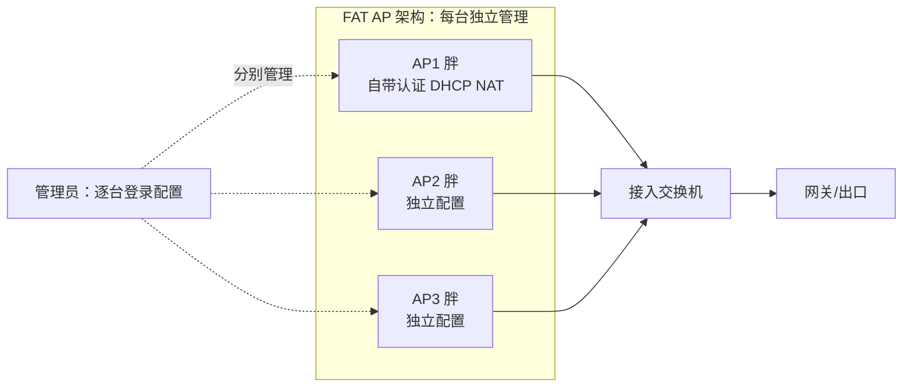

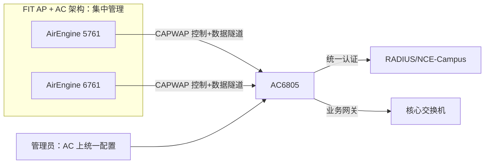

### 真题精练

**Q45.【真题·单选】** 关于 FIT AP + AC 架构，下列说法错误的是：
A. AP 上电后通过 CAPWAP 隧道从 AC 获取配置，实现零配置上线  B. AC 可统一管理认证与射频调优  C. FIT AP 一旦没有 AC 就完全无法工作，也不能做任何转换  D. AC 通常需要双机热备以提高可靠性

> **答案：C**
> **解析**：C 错误。华为 AirEngine 系列 AP 支持在 FIT/FAT 模式之间切换，切换到 FAT 模式后可独立工作（需手工配置）。其余三项均为 FIT + AC 架构的正确描述。注意"A 选项"中的零配置依赖 AP 能发现 AC（广播/Option 43/DNS 等）。

**Q46.【真题·多选】** 与 FAT AP 相比，FIT AP + AC 架构的优势包括：
A. 集中配置与统一策略下发  B. 支持跨三层的二层/三层漫游  C. 单台 AP 不需要任何配置即可上电工作  D. 支持 RRM 集中射频优化，减少同频干扰

> **答案：ABD**
> **解析**：C 表述不严谨但常见误选——AP 本身确实"零配置"，但前提是网络中已存在可被发现的 AC 且地址可达，同时 AC 侧需要完成 AP 纳管与模板配置；"不需要任何配置"应理解为"AP 本地无需配置"，因此 C 不应选。A、B、D 是集中架构的核心优势。

### 易错点与排错

1. **FIT AP 本地无配置 ≠ 全网无需配置**：配置集中在 AC，AC 侧必须配好模板与纳管关系。
2. **AC 故障的影响取决于转发模式**：隧道转发数据中断，本地转发数据仍可通。
3. **零配置依赖"发现 AC"**：广播/组播只在同网段有效，跨网段必须 Option 43/DNS/静态指定。
4. 排错命令：`display ap all`、`display ap online-fail-record all`、`display capwap configuration`。

---

## 3.2 AC 的形态与选型

### 考点定位

概念题为主：AC 的形态分类、容量指标（管理 AP 数、并发用户数、转发性能、隧道数）、插卡 AC 与独立 AC 的适用场景、云管理（MSP）的价值。分值 2~4 分。易错点：**把"管理 AP 数"当成"并发用户数"**、忽视"AC 的转发性能"这一瓶颈、混淆 AC 与认证服务器的角色。

### 原理精讲

AC 从**物理形态**上分四类：

**① 独立盒式 AC**：独立设备，部署灵活，是中小型园区主流。代表产品：**AC6805**（大型园区，支持高密度 AP 管理与大容量转发）、**AirEngine 9700S**（面向中小园区的盒式 AC，支持有线无线一体化）、**AC6605**（中小型场景，容量较小）。盒式 AC 通常提供多个 GE/10GE 端口，可作为业务网关（起 Vlanif 做 DHCP 与网关）或旁挂部署。

**② 插卡式 AC（无线业务板卡）**：把 AC 功能做成交换机（如 CloudEngine S12700 系列框式交换机）的业务板卡，实现**有线无线一体化**——用户无需单独采购 AC 设备，交换机的背板带宽即转发能力。优点是转发性能极高（背板线速）、节省机架空间、统一运维；缺点是初期投资大、只适用于已使用该框式交换机的场景。

**③ 云 AP / 云管理架构（Cloud Management）**：管理面部署在 **iMaster NCE-Campus**（公有云或本地私有云），AP 出厂内置云管理域名/地址，上电后通过安全通道（常用 HTTPS，端口随版本与方案而定）向云平台注册，由云平台下发配置。特点是**免本地 AC**、支持**多租户（MSP，Managed Service Provider，管理服务提供商）**统一运维多个客户的网络、天然支持大规模跨地域分支、配置通过模板化（站点/设备组/SSID 模板）批量下发。华为的云 AP（如 AirEngine 系列云模式）与 NCE-Campus 组合适合连锁门店、多分支企业与教育行业。注意云管理解决的是"管理便捷性"，数据转发仍可选择本地转发或经网关，并非所有流量都上云。

**④ 虚拟化/软件 AC**：在服务器或云上以软件形式提供 AC 功能（如 vAC），适合虚拟化数据中心与实验环境，考纲中出现频率较低。

**AC 的关键容量指标**（选型必须核对）：**可管理 AP 数**（AC6805 可达万级，AirEngine 9700S 与 AC6605 为千级或百级，具体以产品文档为准）、**可管理用户数（并发 STA）**、**转发性能（Gbps）**、**CAPWAP 隧道数**、**支持的 SSID/VAP 数**、**是否支持双机热备（HSB）与 VRRP**、**是否支持 802.11ax/be 与 MU-MIMO 等新特性**。选型逻辑是：**先按 AP 数量与并发用户数定容量，再按转发模式定转发性能需求**（隧道转发时所有用户流量都过 AC，转发性能必须大于峰值业务流量总和；本地转发时 AC 只承载控制流量，性能压力小）。此外还要核对 AC 与 AP 的**版本兼容性**（AP 的软件版本由 AC 统一管理，两者必须匹配，否则 AP 上线后会下载版本甚至失败）。

### 关键概念对照表

| 形态 | 代表产品 | 优点 | 缺点 | 适用场景 |
|---|---|---|---|---|
| 独立盒式 AC | AC6805、AirEngine 9700S、AC6605 | 部署灵活、独立扩展 | 需单独采购与机架空间 | 中小型园区、企业总部 |
| 插卡式 AC | 框式交换机（S12700 系列）无线板卡 | 有线无线一体、转发线速 | 初期投资大 | 大型园区、已用框式交换机的场景 |
| 云管理（云 AP） | AirEngine AP + iMaster NCE-Campus | 免本地 AC、多租户、跨地域统一运维 | 依赖云可达性与网络质量 | 连锁门店、多分支、MSP |
| 虚拟化 AC | 软件 AC | 节省硬件、弹性 | 性能受服务器限制 | 实验、虚拟化环境 |

| 选型指标 | 说明 | 常见陷阱 |
|---|---|---|
| 可管理 AP 数 | AC 的纳管上限 | 与"并发用户数"不同，两者都要看 |
| 并发用户数 | 可同时在线的 STA 数 | 超高密场景是真正瓶颈 |
| 转发性能 | Gbps 级吞吐 | 隧道转发时是硬瓶颈 |
| CAPWAP 隧道数 | 可建立的隧道数量 | 双链路/热备会翻倍占用 |
| 版本兼容 | AC 与 AP 软件版本 | 不匹配会导致 AP 上线失败或反复重启 |
| 热备能力 | VRRP + HSB | 不支持则无法做高可用 |

### 华为设备配置

```bash
# 查看 AC 的容量与运行状态（AC6805 / AirEngine 9700S 通用）
<AC6805> display version                            # 查看 VRP 版本，用于核对 AP 兼容性
<AC6805> display license                            # 查看 License：可管理 AP 数与特性授权
<AC6805> display ap all                             # 查看当前在线 AP 数量与状态（对比容量上限）
<AC6805> display station all                        # 查看在线用户总数（对比并发容量）
<AC6805> display capwap configuration               # 查看 CAPWAP 源接口与控制/数据隧道配置
<AC6805> display wlan ac-info                       # 查看 AC 的 WLAN 侧整体信息（按版本支持）
```

```bash
# 云管理场景：AP 侧指定云平台地址（示意，具体语法以型号手册为准）
<AirEngine> system-view
 wlan
  cloud-management server domain <云平台域名>        # 指定云管理平台域名（替换为实际域名）
  cloud-management server port 443                  # 与云平台的安全通道端口（以实际方案端口为准）
  quit
 display cloud-management status                    # 查看云平台注册状态
```

### 示意图

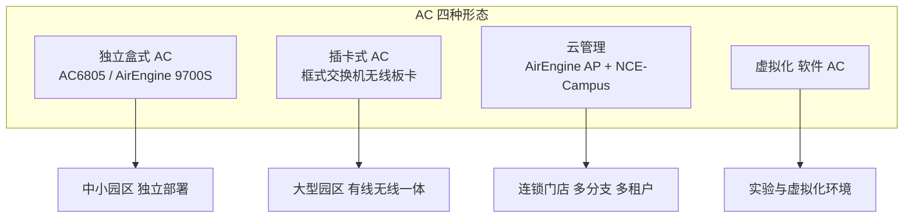

### 真题精练

**Q47.【真题·单选】** 关于云管理 WLAN 架构，说法正确的是：
A. 云 AP 必须依赖本地 AC 才能工作  B. AP 通过安全通道向 iMaster NCE-Campus 注册并由云平台下发配置  C. 云管理架构不支持多租户  D. 云管理意味着所有用户数据必须上云转发

> **答案：B**
> **解析**：A 错，云 AP 的设计目标之一就是免本地 AC；C 错，多租户（MSP）正是云平台的核心价值；D 错，云平台负责管理面，数据转发可选择本地转发或经网关，不必上云。

**Q48.【真题·判断】** 选择 AC 时，只要"可管理 AP 数"满足需求即可，转发性能不影响选型。

> **答案：错误**
> **解析**：若采用隧道转发（集中转发），所有用户数据都要经 AC 封装转发，AC 的转发性能（Gbps）会直接成为业务瓶颈；即使 AP 数量满足，转发性能不足也会导致丢包与速率骤降。选型必须同时核对 AP 数、并发用户数、转发性能、隧道数与版本兼容性；本地转发模式下 AC 压力显著降低，但仍需承载控制报文与部分管理流量。

### 易错点与排错

1. **"可管理 AP 数"与"并发用户数"是两个不同指标**，题干若强调"高密场馆"要优先看并发用户数。
2. **隧道转发时 AC 是流量瓶颈**，方案题中必须评估转发性能。
3. **版本兼容性是上线失败的高频原因**：`display version` 与 AP 型号支持列表要对照。
4. 排错命令：`display version`、`display license`、`display ap all`、`display ap online-fail-record all`。

---

## 3.3 CAPWAP 协议详解：双隧道、报文格式与 DTLS

### 考点定位

**本章最高频考点**：CAPWAP 的全称与 RFC 编号、控制隧道 UDP 5246 与数据隧道 UDP 5247、双隧道分离的原因、DTLS 加密的对象、CAPWAP 控制报文类型。分值 5~10 分，选择/填空/简答都常出。易错点：**把两个端口号记反**、误认为"数据隧道默认加密"、不知道控制隧道才是强制的 DTLS。

### 原理精讲

**CAPWAP（Control And Provisioning of Wireless Access Points，无线接入点控制与配置协议）**由 IETF 标准化：**RFC 5415** 定义基础协议，**RFC 5416** 定义 802.11 绑定。它的前身是 Cisco 主导的 LWAPP（Lightweight Access Point Protocol，RFC 5412）。CAPWAP 的目标是**解耦"无线功能"与"接入点硬件"**：把实时性要求高、必须靠近射频的功能（如 Beacon 发送、ACK 回复、加密解密）保留在 AP（这就是 WTP，Wireless Termination Point，无线终端点），而把管理、认证、漫游决策等集中在 AC（即 AC 角色）。CAPWAP 就是这两者之间的标准"通信语言"。

**双隧道设计（核心考点）**：CAPWAP 规定 AC 与 AP 之间建立**两条独立的 UDP 隧道**：

- **控制隧道：UDP 5246**，承载所有 CAPWAP 控制报文（Discovery、Join、Configuration、Echo 等），**强制使用 DTLS 加密**。
- **数据隧道：UDP 5247**，承载封装后的用户 802.11/802.3 数据帧，**DTLS 可选**（默认不加密）。

**为什么分离？** 三点理由：① **可靠性要求不同**：控制报文必须可靠、有序（配置错误会导致 AP 异常），需要 DTLS 提供的完整性保护与重传/确认机制；而数据报文要求高吞吐、低时延，额外的加密与握手开销会显著降低转发性能，因此解密的工作应当交给资源更充裕的 AC，且传输层加密由上层（WPA2/WPA3 的链路层加密 + 可选 IPSec/HTTPS）承担。② **策略与 QoS 不同**：控制隧道可以打高优先级（保证 AP 不掉线），数据隧道按业务打 QoS，二者分开便于差分服务。③ **转发与旁路灵活**：数据隧道可以被"旁路"（即本地转发模式），让用户流量直接在 AP 本地转发，而控制隧道始终保留在 CAPWAP 中——若两条隧道耦合在一起，就无法实现本地转发这种关键优化。**一句话总结：控制隧道保证"管得住"，数据隧道保证"转得快"，分离是为了让两者各自最优。**

**CAPWAP 报文格式**：CAPWAP 报文 = **UDP/IP 头 + （可选 DTLS 记录 + 8 字节 Preambles）+ CAPWAP 头 + 载荷**。CAPWAP 头结构为：

| 字段 | 长度 | 含义 |
|---|---|---|
| Version | 4bit | 协议版本，当前为 0 |
| Type | 4bit | 0 = 数据报文，1 = 控制报文 |
| T 标志 | 1bit | 报文类型（Data / Control） |
| F 标志 | 1bit | 是否分片 |
| W 标志 | 1bit | 是否使用 802.11 无线绑定（Wireless Binding） |
| M 标志 | 1bit | Keep-alive 报文（Echo） |
| L 标志 | 1bit | 是否为分片的最后一片 |
| K 标志 | 1bit | 载荷是否为原生 802.11 帧 |
| Flags/Reserved | 若干 bit | 保留与扩展 |
| Fragment ID | 16bit | 分片标识 |
| Fragment Offset | 13bit | 分片偏移 |
| Radio MAC Address | 8 字节（可选） | W 标志置位时携带，标识射频 |
| Wireless Specific Info | 8 字节（可选） | 无线特定信息（如 WLAN ID、优先级） |

**控制报文载荷**再包一层控制消息头：**Message Type（16bit）、Sequence Number（8bit）、Message Element Length（16bit）、Flags（8bit）**，其后是若干 **Message Element（TLV 格式：Type+Length+Value）**。

**关键控制报文类型（必须记住几个编号）**：Discovery Request(1) / Discovery Response(2)、Join Request(3) / Join Response(4)、Configuration Status Request(5) / Response(6)、Configuration Update Request(7) / Response(8)、**WLAN Configuration Request(9) / Response(10)**、Change State Event Request(11) / Response(12)、**Echo Request(13) / Echo Response(14)**（保活）、Image Data Request(15) / Response(16)（版本下载）、Reset Request(17) / Response(18)、Station Configuration Request(25) / Response(26)（STA 上线/下线通告）。

**DTLS（Datagram Transport Layer Security，数据报传输层安全）**：基于 UDP 的 TLS，为 CAPWAP 提供**双向认证 + 加密 + 完整性保护**。控制隧道**强制** DTLS；数据隧道可选。华为设备默认使用**预置证书/预共享密钥**完成 DTLS 握手（部分版本支持自定义证书）。若 AP 与 AC 的证书或密钥不匹配，DTLS 握手失败，AP 会卡在 Join 之前，是上线失败的常见原因之一。

**CAPWAP 报文的分片与 MTU**：CAPWAP 数据隧道会在原始帧外加 8~16 字节 CAPWAP 头 + UDP/IP 头，若底层 MTU 为 1500，封装后可能超过 MTU 而被分片，导致效率下降与丢包。工程上建议将 AP 上行口与 AC 侧接口 MTU 适当调大（或将 CAPWAP 数据隧道的封装开销计入规划），并在中间设备放通分片。

### 关键概念对照表

| 项目 | 控制隧道 | 数据隧道 |
|---|---|---|
| UDP 端口 | **5246** | **5247** |
| 承载内容 | Discovery/Join/Configuration/Echo 等控制报文 | 封装的用户数据帧 |
| DTLS | **强制加密** | 可选（默认不加密） |
| 可靠性 | 有序、需确认 | 尽力而为、低时延优先 |
| QoS 处理 | 可打高优先级 | 按业务差分 |
| 本地转发时 | 始终存在 | 不存在（数据被旁路） |
| 报文头 Type 值 | 1（Control） | 0（Data） |

| 控制报文 | 编号 | 作用 |
|---|---|---|
| Discovery Request/Response | 1 / 2 | AP 发现可用 AC |
| Join Request/Response | 3 / 4 | AP 请求加入 AC，AC 决定是否接受 |
| Configuration Status Request/Response | 5 / 6 | 下发/上报配置（含版本信息） |
| Configuration Update Request/Response | 7 / 8 | 配置变更下发 |
| WLAN Configuration Request/Response | 9 / 10 | 下发 WLAN/VAP 配置（SSID、安全、VLAN） |
| Change State Event Request/Response | 11 / 12 | 上报状态变化（射频状态） |
| Echo Request/Response | 13 / 14 | 保活探测（Keepalive） |
| Image Data Request/Response | 15 / 16 | AP 下载软件版本 |
| Reset Request/Response | 17 / 18 | AC 复位 AP |
| Station Configuration Request/Response | 25 / 26 | STA 上线/下线通告 |

### 华为设备配置

```bash
system-view
sysname AC6805
interface Vlanif100
 ip address 10.10.100.1 255.255.255.0            # CAPWAP 源接口地址（AP 需可达）
wlan
 capwap source interface vlanif100               # 指定 CAPWAP 源接口，控制/数据隧道的本端地址
 # 说明：CAPWAP 控制隧道使用 UDP 5246，数据隧道使用 UDP 5247，中间设备必须放通
 # 若 AC 与 AP 跨防火墙，需要放通 AP->AC 的 UDP 5246/5247（双向）
quit
display capwap configuration                      # 查看 CAPWAP 源接口等配置
display capwap packet statistics                  # 查看 CAPWAP 收发报文统计（判断隧道是否通）
display ap all                                    # 查看 AP 状态与隧道建立结果
```

```bash
# 跨三层组网时，中间设备（防火墙/ACL）必须放通以下流量，否则 AP 无法上线：
#   AP  → AC ：UDP 5246（CAPWAP 控制报文，DTLS 加密）、UDP 5247（CAPWAP 数据报文）
#   AC  → AP ：上述两个端口的回程报文（应答、Echo 保活、下行数据）
# 华为 USG 系列请在安全策略（security-policy）中按上表放通对应服务或自定义端口，
# 具体 service 名称与端口写法随 USG 版本不同，请在设备上以 ? 补全为准。
```

### 示意图

```mermaid
sequenceDiagram
    participant AP as "FIT AP"
    participant AC as "AC6805"
    Note over AP,AC: 控制隧道 UDP 5246 强制 DTLS
    AP->>AC: Discovery Request 发现 AC
    AC->>AP: Discovery Response 返回 AC 信息
    AP->>AC: DTLS 握手 证书或预共享密钥
    AP->>AC: Join Request 请求加入
    AC->>AP: Join Response 同意加入
    AP->>AC: Configuration Status Request
    AC->>AP: Configuration Status Response 下发配置
    AC->>AP: WLAN Configuration Request 下发 SSID 与安全
    AP->>AC: Data Check 完成 进入运行态
    Note over AP,AC: 数据隧道 UDP 5247 承载用户数据 可本地旁路
    AP->>AC: Echo Request 保活 周期约 25s
    AC->>AP: Echo Response
```

### 真题精练

**Q49.【真题·单选】** CAPWAP 协议中，控制隧道与数据隧道使用的 UDP 端口分别是：
A. 5246 与 5247  B. 5247 与 5246  C. 500 与 4500  D. 1812 与 1813

> **答案：A**
> **解析**：CAPWAP 控制隧道 = UDP 5246（强制 DTLS），数据隧道 = UDP 5247（DTLS 可选）。C 是 IPSec NAT 穿越端口（IKE 500 / NAT-T 4500），D 是 RADIUS 认证/计费端口，都是常设的干扰项。

**Q50.【真题·简答】** 说明 CAPWAP 为什么要把控制隧道与数据隧道分开，并指出各自的安全性设计差异。

> **答案与解析**：① 可靠性需求不同：控制报文承载配置与状态，必须可靠有序、不能被篡改，因此强制使用 DTLS；数据报文要求高吞吐与低时延，加密开销会显著降低转发性能，因此 DTLS 可选（默认不加密，用户数据的安全性由 802.11 的 WPA2/WPA3 链路加密保证）。② QoS 策略不同：控制隧道需高优先级保证 AP 不掉线，数据隧道按业务差分服务。③ 转发灵活性：数据隧道可以被旁路（本地转发模式让用户流量直接在 AP 侧入 VLAN 转发），而控制隧道始终保留；若两隧道合一则无法实现本地转发。④ 综上，分离的目的是让"管理可靠"与"转发高效"各自最优，同时降低 AC 的处理压力。

**Q51.【真题·多选】** 关于 DTLS，说法正确的是：
A. CAPWAP 控制隧道强制使用 DTLS  B. DTLS 基于 UDP，为 CAPWAP 提供加密与完整性保护  C. 数据隧道默认也强制 DTLS 加密  D. AP 与 AC 的证书/密钥不匹配会导致 CAPWAP 隧道建立失败

> **答案：ABD**
> **解析**：C 错，数据隧道的 DTLS 是可选项，默认不加密。D 对，DTLS 握手失败会导致 AP 停留在 Discovery/Join 阶段无法继续，可用 `display ap online-fail-record all` 观察失败阶段。

### 易错点与排错

1. **端口号必须记牢**：控制 5246、数据 5247（顺序不要反）。
2. **控制隧道强制 DTLS，数据隧道可选**。
3. **防火墙/ACL 必须放通双向 UDP 5246/5247**，这是跨三层组网最常被忽略的一步。
4. **MTU 问题**：数据隧道封装会增加开销，必要时调整 MTU，避免被中间设备丢弃。
5. 排错命令：`display capwap configuration`、`display capwap packet statistics`、`display ap online-fail-record all`。

---

## 3.4 AP 发现 AC 的五种方式

### 考点定位

**必考对比题**：五种发现方式的报文类型、适用层级、配置要点，以及"跨三层组网应该用哪种"。分值 3~6 分。易错点：**广播/组播只在同网段有效**、DHCP Option 43 的编码格式、DNS 方式需要域名与 DNS 服务器配合。

### 原理精讲

AP 上电后并不知道 AC 在哪里，必须"找 AC"。CAPWAP 的 Discovery 阶段支持五种方式，可以按"是否需要预先配置信息"分成两类：

**① 静态指定（AP 本地预配 AC 地址 / AC 列表）**：在 AP 上手工指定 AC 的 IP 地址列表。优点是**不依赖 DHCP/DNS，跨三层也能用，最可控**；缺点是维护量大（每台 AP 都要配），适用于 AP 数量极少或特殊环境。华为 AP 在部分版本支持通过 AC 的 `ap-id` 预配置或 AP 侧本地命令配置 AC 列表，现场多用"由 AC 侧统一下发 AC 列表（Primary/Secondary AC）"来替代。

**② DHCP Option 43**：DHCP 服务器在给 AP 分配地址时，通过 **Option 43（厂商特定信息）** 把 AC 的 IP 地址或域名告知 AP。这是**中大型网络的主流做法**：AP 拿到 IP 的同时就得到了 AC 地址，无需人工干预，且天然支持跨三层（DHCP 中继可跨网段）。华为 DHCP 服务器的配置语法是 `option 43 sub-option 1 ip-address x.x.x.x`，对应的十六进制编码为 `01 04` + 4 字节 IP（如 192.168.10.1 → `0104C0A80A01`；`01` 为子选项类型表示 AC 的 IPv4 地址，`04` 为长度 4 字节）。**注意 Other 厂商的 Option 43 编码格式不同（有的用 ASCII 字符串），跨厂商混用会失败**——这是排错题的经典陷阱。

**③ DNS 方式**：DHCP 下发 DNS 服务器与域名（Option 15），AP 用域名向 DNS 服务器解析 AC 的地址。优势是**AC 地址变化时只需改 DNS 记录**，不必改 DHCP 配置，适合 AC 地址可能调整的网络。华为 AP 默认会尝试解析的域名常见为 `huawei.com`（具体以版本为准），也可通过 DHCP 或 AP 本地配置自定义。前提是**DNS 服务器可达且解析正确**，任何一环出错 AP 都找不到 AC。

**④ 广播方式**：AP 向 **255.255.255.255** 发送 CAPWAP Discovery Request（广播）。优点是零配置、即插即用；缺点是**广播不能跨越三层网段**，因此仅适用于 AP 与 AC 在同一广播域（二层组网）的场景。

**⑤ 组播方式**：AP 向 CAPWAP 组播地址 **224.0.1.187** 发送 Discovery Request（IPv4）。同样受限于**组播域**（一般不能跨三层，除非网络做了组播路由与 PIM），适合"同一网段部署多台 AC"时让 AP 一次性发现所有 AC，便于做 AC 间的负载分担或备份。需要网络设备放通组播并正确配置 IGMP/PIM。

**发现顺序**：华为 AP 一般按"静态指定 → DHCP Option 43 → DNS → 广播 → 组播"的顺序依次尝试（不同版本可能略有差异，也可能并行尝试），任一方式得到有效 AC 地址后即转入 DTLS/Join 阶段。因此排错时若 AP 拿到 IP 却不上线，应按这个顺序逐项检查。

### 关键概念对照表

| 方式 | 报文/载体 | 是否跨三层 | 配置位置 | 适用场景 | 缺点 |
|---|---|---|---|---|---|
| 静态指定 | 单播 Discovery | 可 | AP 本地/AC 下发 AC 列表 | 少量 AP、特殊网络 | 维护量大 |
| DHCP Option 43 | 单播 Discovery | 可（配合中继） | DHCP 服务器 | 中大园区（主流） | 编码格式厂商相关 |
| DNS | 单播 Discovery | 可 | DHCP Option 15 + DNS 记录 | AC 地址可能变化 | 依赖 DNS 可用性 |
| 广播 | 广播 Discovery（255.255.255.255） | 否 | 无需配置 | 二层组网、小规模 | 不能跨网段、广播风暴 |
| 组播 | 组播 Discovery（224.0.1.187） | 通常否（需组播路由） | 网络侧放通组播 | 同网段多 AC 备份 | 需组播支持 |

| Option 43 编码示例 | 十六进制 | 含义 |
|---|---|---|
| 单个 AC 地址 192.168.10.1 | `01 04 C0 A8 0A 01` | 子选项 1（AC IPv4）+ 长度 4 + IP |
| 十进制 192 / 168 | C0 / A8 | 十六进制转换 |
| 10.10.100.1 | `01 04 0A 0A 64 01` | 0A=10、64=100 |

### 华为设备配置

```bash
# ===== 方式二：DHCP Option 43（最常用）=====
system-view
dhcp enable
ip pool ap-pool
 network 10.10.100.0 mask 255.255.255.0
 gateway-list 10.10.100.1
 option 43 sub-option 1 ip-address 10.10.100.1     # 告知 AP：AC 的 IPv4 地址
 # 若 AC 有多台（主备），可继续配置 sub-option 3 等子选项或下发域名
interface Vlanif100
 dhcp select global
quit
display ip pool name ap-pool used                    # 确认 AP 已获取地址与 Option 43 下发情况
```

```bash
# ===== 方式三：DNS 方式 =====
ip pool ap-pool
 option 15 ascii huawei.local                        # 下发域名后缀（依版本与规划）
 dns-list 10.10.200.53                               # 下发 DNS 服务器地址
quit
# DNS 服务器上需配置 AC 域名到 AC 地址的 A 记录（本设备若兼作 DNS 可配置 dns resolve）
dns resolve                                           # 使能 DNS 解析功能
dns server 10.10.200.53                               # 指定上游 DNS 服务器
```

```bash
# ===== 方式四/五：广播与组播（二层组网，通常无需 AC 侧配置）=====
# AC 只需保证 CAPWAP 源接口配置正确，AP 在同网段即可通过广播/组播发现 AC
wlan
 capwap source interface vlanif100                   # AC 侧唯一必配项
quit
display capwap packet statistics                      # 观察是否收到 Discovery 报文
display ap online-fail-record all                     # 若发现失败，记录会给出对应阶段与原因
```

### 示意图

```mermaid
flowchart TD
    AP["AP 上电 无配置"] --> S0{"是否预配 AC 地址"}
    S0 -->|"是"| M1["静态指定 AC 单播"]
    S0 -->|"否"| S1{"DHCP 是否下发 Option 43"}
    S1 -->|"是"| M2["Option 43 得到 AC 地址"]
    S1 -->|"否"| S2{"是否有 DNS 与域名"}
    S2 -->|"是"| M3["DNS 解析 AC 域名"]
    S2 -->|"否"| S3{"AC 是否同网段"}
    S3 -->|"是"| M4["广播 255.255.255.255 或组播 224.0.1.187"]
    S3 -->|"否"| FAIL["无法发现 AC 需补配 Option 43 或 DNS"]
```

### 真题精练

**Q52.【真题·单选】** AP 与 AC 位于不同网段（三层组网），下列发现方式中通常**不能**使用：
A. DHCP Option 43  B. DNS  C. 广播 255.255.255.255  D. 静态指定 AC 地址

> **答案：C**
> **解析**：广播报文被三层设备（路由器/三层交换机）隔离，不能跨越网段，因此三层组网必须使用 Option 43、DNS、组播（需组播路由支持）或静态指定。这也是"跨三层组网为什么必须配 Option 43"的原因。

**Q53.【真题·填空】** DHCP Option 43 中告知 AC 地址 192.168.10.1 的十六进制编码为 ______；CAPWAP 的 IPv4 组播发现地址是 ______。

> **答案：0104C0A80A01；224.0.1.187**
> **解析**：`01` 为子选项类型（AC IPv4 地址），`04` 为长度（4 字节），`C0 A8 0A 01` 为 192.168.10.1 的十六进制。CAPWAP 在 RFC 5415 中定义的 IPv4 组播地址为 224.0.1.187，AP 通过它组播发送 Discovery Request。

**Q54.【真题·排错】** 某三层组网中，AC 侧配置与路由均正常，AP 拿到了 IP 地址但一直不上线。请给出排查步骤。

> **答案与解析**：
> ① **确认 AP 的发现方式**：三层组网不能靠广播，检查 DHCP 是否下发了 Option 43（`display ip pool name ap-pool used`，并在 DHCP 服务器上核对 `option 43` 配置与编码格式是否与华为 AP 要求一致，跨厂商设备常常格式不兼容）。
> ② **确认可达性**：从 AP 网段 ping AC 的 CAPWAP 源接口地址；检查 AC 是否配置了 `capwap source interface vlanif100`。
> ③ **确认端口放通**：中间防火墙/ACL 是否放通 UDP 5246 与 5247（双向）；`display capwap packet statistics` 看 AC 是否收到 Discovery 报文（收到说明发现成功，问题在后续阶段）。
> ④ **确认 DTLS 与版本**：若卡在 Join 阶段，检查 AP 与 AC 的证书/预共享密钥、以及 AP 型号与 AC 版本的兼容性（可能需要 AP 先下载版本，`display ap online-fail-record all` 会指出阶段）。
> ⑤ **确认纳管与授权**：AC 的 AP 认证方式（`ap auth-mode mac-auth` 时 AP 的 MAC 必须已添加）、AP 是否已达 License 上限、AP 组与模板是否配置。
> ⑥ **结论**：按"发现 → 可达 → 端口 → 安全握手 → 纳管授权"的顺序定位，`display ap online-fail-record all` 会直接给出失败阶段，是最快的入口。

### 易错点与排错

1. **Option 43 编码是厂商相关的**，华为主体 `01 04 + IP`。
2. **广播/组播不能跨三层**（组播需专门配置），三层组网一定要配 Option 43 或 DNS。
3. **发现顺序**：静态 → Option 43 → DNS → 广播 → 组播。
4. 排错命令：`display capwap packet statistics`、`display ap online-fail-record all`、`display ap all`。

---

## 3.5 AP 上线完整流程与零配置

### 考点定位

**流程题的绝对重点**：要求写出 AP 从加电到上线的完整步骤，或根据现象判断卡在哪一步。分值 5~10 分。易错点：**漏掉"AP 获取 IP"这一步**（认为 AP 直接找 AC）、把"下载版本"与"下发配置"的顺序颠倒、忽视 AC 侧 AP 认证与 License。

### 原理精讲

AP 零配置上线的完整流程可分六个阶段（必须按序背）：

**第 1 步：AP 加电启动（Power On）**。AP 从 PoE 交换机或本地适配器获得供电（见 3.8），启动 BootROM 与系统软件，初始化射频与网口。此时 AP 尚未与 AC 建立任何关系，本地无业务配置。

**第 2 步：获取 IP 地址（DHCP）**。AP 默认作为 **DHCP 客户端**，从管理 VLAN 的 DHCP 服务器获取 IP、掩码、网关、DNS，以及关键的 **Option 43（AC 地址）**。这一步的前提是 AP 上行的交换机端口已放通管理 VLAN 且 DHCP 可用。若 AP 拿到 169.254.x.x 或长时间无地址，就会卡在此阶段。

**第 3 步：发现 AC（Discovery）**。AP 按 3.4 节的五种方式之一获得候选 AC 地址，向 AC 的 **UDP 5246** 发送 **Discovery Request**，AC 回 **Discovery Response**（携带 AC 的优先级、负载、可用性等信息）。若 AP 收到多个 AC 的响应，会按优先级/负载选择。

**第 4 步：建立 CAPWAP 隧道（DTLS + Join + Configuration）**。AP 与选定的 AC 进行 **DTLS 握手**（证书或预共享密钥，控制隧道加密），随后发送 **Join Request**，AC 校验 AP 的合法性（MAC 认证/无认证）、License 余量、版本兼容性，回 **Join Response** 决定接受或拒绝。接受后 AC 通过 **Configuration Status Request/Response** 下发基础配置，再用 **WLAN Configuration Request/Response** 下发 WLAN/VAP/安全/转发模式等业务配置。AP 回 **Change State Event** 上报射频状态，并完成 **Data Check**（确认数据通路可用），随后进入 **Run（正常）状态**。

**第 5 步：下载软件版本（Image Data，条件执行）**。如果 AP 当前运行的版本与 AC 期望的版本不一致，AC 会先通过 **Image Data Request/Response** 把软件版本推送给 AP，**AP 下载完成后自动重启**，重新走一遍发现与 Join 流程，然后才进入配置阶段。这是"AP 第一次上线特别慢、且可能重启一次"的原因，也是排错时"AP 反复重启"的常见解释。

**第 6 步：上线并纳入管理（Run / Normal）**。AP 进入正常运行状态，`display ap all` 中状态显示为正常（`nor`），射频开始发送 Beacon，终端可以关联。此后 AC 通过 **Echo（保活）** 维持隧道，通过 Configuration Update 在配置变化时同步下发。

**AC 侧的配套配置（缺一不可）**：① CAPWAP 源接口（`capwap source interface vlanif100`）；② AP 认证方式（`ap auth-mode mac-auth` 时需要预先添加 AP 的 MAC；`no-auth` 则允许任意 AP 上线，生产环境不推荐）；③ AP 组与各类模板（射频域、SSID、安全、VAP、RRM）；④ License 余量（超出授权数无法上线）；⑤ AP 的 IP 可达性（路由）。

**零配置的本质**：AP 本地不保存业务配置，每次上电都从 AC 拉取，因此"换一台 AP"只需把旧 AP 的 MAC 与新 AP 对应（或在 AP 组模板下自动继承），即可实现快速替换。配置同步是"AC 为主、AP 为从"的单向模型（AP 只上报状态，不反向下发配置），这也解释了为什么**在 AP 本地改配置会被 AC 覆盖**。

### 关键概念对照表

| 阶段 | 关键动作 | 依赖条件 | 失败现象 | 排查入口 |
|---|---|---|---|---|
| 1 加电 | 供电与自检 | PoE/适配器功率足够 | AP 完全不亮/反复重启 | 看指示灯、查 PoE 功率 |
| 2 获取 IP | DHCP 获取地址与 Option 43 | 管理 VLAN 放通、DHCP 可用 | AP 无地址或 169.254 | `display ip pool ... used` |
| 3 发现 AC | Discovery Request/Response | 发现方式可用、UDP 5246 可达 | AP 一直"未上线" | `display capwap packet statistics` |
| 4 建立隧道 | DTLS + Join + Configuration | 证书/密钥正确、MAC 已纳管、License 足够 | 卡在 Join/配置阶段 | `display ap online-fail-record all` |
| 5 下载版本 | Image Data | 版本不匹配时触发 | AP 反复重启、上线时间长 | 查 AP 与 AC 版本 |
| 6 运行 | Run 状态、发 Beacon | 模板配置完整 | AP 在线但 SSID 搜不到 | `display vap ssid ...` |

| AP 状态（display ap all 常见值） | 含义 | 处理方向 |
|---|---|---|
| nor（Normal） | 正常运行 | 正常 |
| fau / fault | 故障 | 查告警、硬件、供电 |
| cfg | 配置中 | 等待配置下发完成，检查模板 |
| img | 版本下载中 | 等待下载，检查版本兼容与链路质量 |
| 未显示/未上线 | 未建立 CAPWAP | 查发现、可达性、端口与纳管 |

### 华为设备配置

```bash
# ===== AC 侧完整上线配置（AC6805，二层组网）=====
system-view
sysname AC6805
vlan batch 10 100
interface GigabitEthernet0/0/1
 port link-type trunk
 port trunk allow-pass vlan 100
interface Vlanif100
 ip address 10.10.100.1 255.255.255.0
dhcp enable
ip pool ap-pool
 network 10.10.100.0 mask 255.255.255.0
 gateway-list 10.10.100.1
 option 43 sub-option 1 ip-address 10.10.100.1
interface Vlanif100
 dhcp select global
wlan
 capwap source interface vlanif100                # CAPWAP 源接口
 ap auth-mode mac-auth                            # AP 认证：只允许已登记的 AP
 ap-id 1 ap-mac 00e0-fc12-3456                    # 登记 AP 的 MAC
  ap-name AP-Office-01
  ap-group office-group
 regulatory-domain-profile name cn-domain
  country-code cn
 ssid-profile name office-ssid
  ssid HUAWEI-Office
 security-profile name office-sec
  security wpa2 psk pass-phrase Huawei@123 aes
 vap-profile name office-vap
  service-vlan vlan-id 10
  ssid-profile office-ssid
  security-profile office-sec
  forward-mode tunnel
 ap-group name office-group
  regulatory-domain-profile cn-domain
  vap-profile office-vap wlan 1 radio all
quit
display ap all                                     # 查看 AP 是否上线（State 应为 nor）
display ap online-fail-record all                  # 若未上线，查看失败阶段与原因
display vap ssid HUAWEI-Office                     # 确认 VAP 已生效、BSSID 已生成
```

### 示意图

```mermaid
flowchart TD
    P1["1 AP 加电 PoE 供电自检"] --> P2["2 DHCP 获取 IP 与 Option 43"]
    P2 --> P3["3 Discovery 发现 AC UDP 5246"]
    P3 --> P4["4 DTLS 握手 控制隧道加密"]
    P4 --> P5["5 Join 请求 纳管与授权校验"]
    P5 --> P6{"6 版本是否一致"}
    P6 -->|"否"| P7["下载 Image 版本并重启"]
    P7 --> P3
    P6 -->|"是"| P8["7 下发配置与 WLAN 配置"]
    P8 --> P9["8 Data Check 与状态上报"]
    P9 --> P10["9 AP 上线 发 Beacon 终端可关联"]
```

### 真题精练

**Q55.【真题·单选】** FIT AP 上电后到正式上线的正确顺序是：
A. 发现 AC → 获取 IP → 建立 CAPWAP → 下载配置 → 上线  B. 获取 IP → 发现 AC → 建立 CAPWAP 隧道 → 下载版本/配置 → 上线  C. 建立 CAPWAP → 获取 IP → 认证 → 上线  D. 获取 IP → 下载版本 → 发现 AC → 上线

> **答案：B**
> **解析**：AP 必须先有 IP 才能进行 IP 层通信（Discovery 报文需要源地址），所以顺序是"获取 IP → 发现 AC → 建立 CAPWAP（DTLS/Join/Config）→（如需）下载版本 → 上线"。注意"下载版本"与"下发配置"的前后关系：版本不一致时先下载并重启，重启后重新走发现/Join，再下发业务配置。

**Q56.【真题·多选】** AP 无法上线，可能的原因包括：
A. AC 未配置 CAPWAP 源接口  B. 中间设备未放通 UDP 5246/5247  C. AP 使用 `ap auth-mode mac-auth` 但未在 AC 上登记 AP 的 MAC  D. AC 的 License 已达到可管理 AP 数上限

> **答案：ABCD**
> **解析**：四项均会导致上线失败，且分别对应不同阶段：A、B 影响发现与隧道建立；C、D 影响 Join 阶段的纳管与授权。实际排错时应先用 `display ap online-fail-record all` 看失败阶段，再针对性处理，而不是逐项盲试。

**Q57.【真题·简答】** 解释"AP 零配置上线"的含义，以及为什么在 AP 本地修改的配置会被覆盖。

> **答案与解析**：① 含义：FIT AP 出厂/复位后本地不保存业务配置（SSID、安全、VLAN、转发模式等），上电后通过 DHCP 获取地址并发现 AC，再经 CAPWAP 的 Configuration/WLAN Configuration 报文**从 AC 拉取全部配置**，因此只需在 AC 上做好模板与纳管，AP 即插即用，扩容与故障替换都无需现场配置。② 被覆盖的原因：CAPWAP 采用"**AC 为主、AP 为从**"的单向配置模型，AP 只负责上报状态（Change State Event）与执行配置；AC 会周期性或在配置变更时下发 Configuration Update，一旦检测到 AP 本地配置与 AC 期望不一致就会重新下发覆盖，以保证全网配置一致性与策略统一。③ 例外：把 AP 切换为 FAT 模式后由本地管理，此时配置保存在 AP 本地。

### 易错点与排错

1. **顺序不能颠倒**："获取 IP"必须在"发现 AC"之前。
2. **版本不一致会触发下载+重启**，表现为首次上线慢或反复重启。
3. **纳管与授权在 Join 阶段校验**：MAC 未登记、License 不足都会失败。
4. 排错命令（按顺序）：`display ap all` → `display ap online-fail-record all` → `display capwap packet statistics` → `display ap config-info ap-id 1`。

---

## 3.6 CAPWAP 状态机与保活机制

### 考点定位

以状态机图与状态迁移命题，常考"AP 未发现 AC 时进入哪个状态"、"Echo 的作用与周期"、"隧道断开后 AP 如何恢复"。分值 3~6 分。易错点：**静默（Sulking）状态的含义**、Echo 与 Discovery 的区别、DTLS 在状态机中的位置。

### 原理精讲

RFC 5415 定义了 CAPWAP 的完整状态机，工程上需要掌握六个核心状态：

**① Start（启动）**：AP 加电后完成自检与 IP 获取，准备发起发现。

**② Discovery（发现）**：AP 向候选 AC 发送 Discovery Request，等待 Response。此时隧道尚未加密（Discovery 阶段使用**无 DTLS 的普通 UDP 5246**），因为 DTLS 需要先确定对端。若收到响应，选择优先级最高/负载最低的 AC 进入下一阶段。

**③ Sulking（静默）**：如果 AP 发了多次 Discovery Request 都**没有收到任何响应**，或者被所有 AC **拒绝（Join 失败）**，AP 会进入 Sulking 状态——在一段静默时间（RFC 5415 中默认 30 秒左右，随后可指数退避）内不再发送任何 Discovery 报文，避免在 AC 不可用时对网络造成广播风暴。**静默期结束后重新进入 Discovery**。这是排错中的关键知识点：**"AP 半小时才上线"经常是 Sulking 退避造成的，而不是链路不通。**

**④ Join（加入）**：AP 与 AC 完成 **DTLS 握手**后发送 Join Request，AC 依据 AP 认证方式、License、版本兼容性等决定是否接受，回 Join Response。

**⑤ Configuration（配置）**：AC 通过 Configuration Status Request/Response 下发基础参数（AC 名称、时间、AP 组等），随后通过 WLAN Configuration Request/Response 下发业务配置（SSID/安全/VLAN/转发模式）。若版本不一致，还会在 Run 之前插入 **Image Data** 下载与重启流程。

**⑥ Data Check（数据检查）**：AP 与 AC 通过交换数据报文确认**数据通路可用**（部分实现里包含 802.11 的配置校验与 Data Transfer 测试），成功后进入 **Run（运行）**。

**⑦ Run（运行）**：AP 正常工作，周期性发送 **Echo Request** 保活，并接受 Configuration Update。**Echo 默认间隔约 25 秒**（RFC 5415 默认 Echo Interval = 25s），若连续多次（可配置，一般 3~6 次）未收到 Echo Response，AP 判定 AC 不可达，**回到 Discovery 状态重新寻找 AC**（或重启 CAPWAP 流程）；AC 侧也会因超时把 AP 置为未上线并清除表项。**Echo 与 Keepalive 的作用是双向探测隧道与对端是否存活**，同时用于 NAT/防火墙场景下维持 UDP 会话表项。

**⑧ Reset（复位）**：AC 可下发 Reset Request 让 AP 重启（如修改了 AP 的 IP 相关配置或需要强制重新上线），AP 重启后重新走完整流程。

**状态迁移的工程含义**：整条链路是"**发现—加密—纳管—配置—数据校验—运行**"，任一环节失败都会向回退（Join 失败回 Sulking/Discovery，Echo 超时回 Discovery）。因此排错时只要确定"AP 当前处于哪个状态"，就能锁定问题范围——这也是 `display ap online-fail-record all` 的价值所在：它记录了每次上线失败时 AP 所处的阶段与具体原因。

### 关键概念对照表

| 状态 | 主要动作 | 失败后退到 | 典型时长 |
|---|---|---|---|
| Start | 自检、获取 IP | — | 秒级 |
| Discovery | 发送 Discovery Request | Sulking | 秒级~十几秒 |
| Sulking | 静默退避，不发报文 | Discovery | 约 30s（可退避） |
| Join | DTLS 握手 + Join 请求 | Discovery / Sulking | 秒级 |
| Configuration | 下发配置，必要时下载版本 | Discovery | 秒级~分钟级（含版本下载） |
| Data Check | 校验数据通路 | Discovery | 秒级 |
| Run | 正常运行 + Echo 保活 | Discovery | 持续 |
| Reset | 响应 AC 的复位请求 | Start | 秒级 |

| 机制 | 方向 | 周期/门限 | 作用 |
|---|---|---|---|
| Discovery Request | AP → AC | 按发现方式重试 | 找到可用 AC |
| Echo Request/Response | AP ↔ AC | 默认约 25s | 隧道保活，探测对端存活 |
| Echo 超时 | AP 侧判定 | 连续多次无响应 | 回 Discovery 重新找 AC |
| Configuration Update | AC → AP | 配置变更时 | 同步配置一致性 |
| Change State Event | AP → AC | 状态变化时 | 上报射频/配置状态 |
| Reset Request | AC → AP | AC 主动触发 | 强制 AP 重启 |

### 华为设备配置

```bash
system-view
wlan
 capwap source interface vlanif100
 # 保活与超时相关的可调参数（不同版本命令名略有差异，按 ? 补全）
 # echo-interval 用于调整 AP 与 AC 之间的 Echo 保活周期
quit
display ap all                                     # 查看 AP 当前状态（是否 nor）
display ap online-fail-record all                  # 查看上线失败阶段，判断停在哪个状态
display capwap packet statistics                   # 查看控制报文收发计数，判断 Echo 是否正常
display ap run-info ap-id 1                        # 查看 AP 运行信息（运行时长、重启原因等）
```

```bash
# 排错时的调试手段（生产环境慎用，会产生较多日志）
<AC6805> terminal monitor                            # 打开终端监控，实时显示日志
<AC6805> terminal logging                            # 使能终端日志输出
<AC6805> debugging capwap all                        # 打开 CAPWAP 调试信息
<AC6805> display capwap packet statistics            # 观察各类型控制报文计数
<AC6805> undo debugging all                          # 调试完成后务必关闭
```

### 示意图

```mermaid
stateDiagram-v2
    [*] --> Start
    Start --> Discovery: 获取 IP 完成
    Discovery --> Sulking: 无 AC 响应或被拒绝
    Sulking --> Discovery: 静默期结束
    Discovery --> Join: 收到 Discovery Response
    Join --> Discovery: Join 被拒绝
    Join --> Configuration: DTLS 握手成功且 Join 被接受
    Configuration --> DataCheck: 配置下发完成
    Configuration --> Discovery: 版本下载后重启
    DataCheck --> Run: 数据通路校验通过
    Run --> Discovery: Echo 超时 AC 不可达
    Run --> Reset: 收到 Reset Request
    Reset --> Start: AP 重启
```

### 真题精练

**Q58.【真题·单选】** AP 发送 Discovery Request 后长时间收不到任何 AC 响应，CAPWAP 状态机会让 AP 进入哪个状态：
A. Join  B. Sulking  C. Run  D. Data Check

> **答案：B**
> **解析**：多次发现无响应（或被 AC 拒绝）后，AP 进入 Sulking（静默）状态，在静默期内不再发送 Discovery 报文以避免网络风暴，静默期结束后重新进入 Discovery。这解释了"AP 有时要等几十秒到几分钟才上线"的现象。A/C/D 都需要先成功发现并建立隧道。

**Q59.【真题·填空】** CAPWAP 的保活报文是 ______ 与 ______，RFC 5415 中默认的 Echo 间隔约为 ______ 秒。

> **答案：Echo Request；Echo Response；25**
> **解析**：AP 周期性发送 Echo Request，AC 回 Echo Response；连续多次收不到响应即判定隧道失效，AP 回到 Discovery 状态重新寻找 AC。Echo 还起到维持中间 NAT/防火墙 UDP 会话表项的作用。注意区分：Echo 是"运行态保活"，Discovery 是"上线前发现"。

**Q60.【真题·简答】** 某 AP 上线后每隔一段时间就掉线并重新上线，`display ap online-fail-record all` 显示大量"Echo 超时"。请分析可能原因。

> **答案与解析**：
> ① **链路质量或不稳定**：AP 上行的网线、光模块或 PoE 链路存在丢包/闪断，导致 UDP 5246 上的 Echo 报文丢失；应先查物理链路误码与端口 CRC 计数。
> ② **中间设备会话老化**：防火墙/NAT 设备的 UDP 会话老化时间短于 Echo 间隔时，会丢弃回程报文，需调整会话老化时间或放通策略。
> ③ **AC 负载过高**：AC 的 CPU 繁忙导致处理 Echo 超时，应查 CPU 与 CAPWAP 报文统计，必要时扩容或做双机。
> ④ **网络拥塞或 QoS 未保障**：控制报文被数据流量挤掉，应在中间设备为 UDP 5246 打高优先级。
> ⑤ **版本兼容性/软件缺陷**：AP 或 AC 版本存在已知问题，考虑升级到配套版本。
> ⑥ **处理建议**：先用 `display capwap packet statistics` 与 `display ap run-info ap-id 1` 确认掉线周期是否规律；规律性掉线多为会话老化或定时任务（如 AP 定时重启、RRM 调优时间窗）导致，随机掉线多为链路或拥塞问题。

### 易错点与排错

1. **Sulking 是"静默退避"不是"故障"**，但会显著拖慢上线，需排查发现方式。
2. **Echo 超时后 AP 回 Discovery**，不是直接重启（除非配置了相应动作）。
3. **DTLS 在 Join 之前**：Discovery 阶段没有加密隧道。
4. 排错命令：`display ap online-fail-record all`、`display capwap packet statistics`、`display ap run-info ap-id 1`。

---

## 3.7 数据转发模式：隧道转发与本地转发

### 考点定位

**方案题与对比题的必考内容**，也是最能体现"是否真懂架构"的考点：两种模式的数据路径、AC 的角色、网关位置、优缺点与适用场景。分值 5~10 分。易错点：**说不清两种模式下网关在哪**、误以为本地转发时 AC 完全不参与、忘记本地转发需要在 AP 侧放通业务 VLAN。

### 原理精讲

WLAN 的用户数据有两条路可走，这决定了 AC 在数据面是否参与。

**隧道转发（集中转发 / Tunnel Forwarding）**：AP 把 STA 的 802.11 数据帧**封装进 CAPWAP 数据隧道（UDP 5247）**，送到 AC；AC 解封装得到原始以太网帧，再按业务 VLAN 转发到网关（AC 自身可能就是网关，起 Vlanif + DHCP）。**数据路径：STA → AP →（CAPWAP 隧道）→ AC → 核心/网关 → 外网。** 特点是：① AC 既是控制中心也是数据转发中心，**网关通常位于 AC**；② 安全策略、QoS、ACL 在 AC 上统一实施，管控最集中；③ CAPWAP 隧道承载了全部用户流量，AC 的转发性能与上行链路带宽是瓶颈，链路利用率较低（封装开销）；④ 跨三层漫游简单（所有流量都汇聚到 AC，终端 IP 不变即可）；⑤ AC 故障会导致数据中断（需 HSB 热备）。适合：中小规模园区、安全要求高、跨网段漫游需求强的场景。

**本地转发（直接转发 / Local Forwarding / Direct Forwarding）**：AP 自己把 STA 的数据帧**转换成普通以太网帧**，直接通过自己的有线上行口送入本地 VLAN，由接入/汇聚交换机的三层接口（网关）转发。**AC 只保留控制隧道，下发配置与管理，不承载用户数据**。**数据路径：STA → AP →（本地 VLAN，不打隧道）→ 接入/汇聚交换机 → 网关 → 外网。** 特点是：① 数据不经过 AC，**AC 不是网关**（网关在交换机上）；② 转发效率高、时延低，适合大流量业务（高清视频、VR、AGV、教学场景）；③ AC 压力小，可管理更多 AP；④ 但安全策略/QoS 需要下发到 AP 并在交换机侧配合实现，管控分散；⑤ 跨三层漫游较复杂（需要 AC 与网关协同，或依赖终端的 IP 保持能力）。**关键配置前提**：AP 的上行有线口必须放通业务 VLAN（在 `wired-port-profile` 中配置 Trunk 与 PVID），且中间交换机必须已创建对应 VLAN 并配置三层网关。

**选择原则（工程口诀）**：**"流量小、要集中管、跨网段漫游多 → 隧道转发；流量大、要低时延、AC 不想当瓶颈 → 本地转发。"** 实际大型园区常用**混合模式**：管理网与控制走 CAPWAP，办公/教学等大流量业务本地转发，访客/敏感业务走隧道转发以集中审计。

**两种模式下 AC 的角色小结**：

| 维度 | 隧道转发 | 本地转发 |
|---|---|---|
| AC 在控制面 | 参与（下配置、管状态） | 参与（下配置、管状态） |
| AC 在数据面 | **全程参与并转发** | **不参与数据转发** |
| 网关位置 | 通常在 AC（Vlanif） | 在接入/汇聚交换机的三层接口 |
| 用户 VLAN 终结 | AC | 交换机（AP 只打 VLAN Tag） |
| 占用 AC 转发性能 | 高 | 低 |
| AC 故障影响 | 用户数据中断 | 已上线用户数据可继续（新用户无法上线） |

### 关键概念对照表

| 对比项 | 隧道转发（集中转发） | 本地转发（直接转发） |
|---|---|---|
| 数据是否经 AC | 是（CAPWAP 数据隧道 UDP 5247） | 否 |
| 数据路径 | STA→AP→AC→网关 | STA→AP→交换机→网关 |
| 网关位置 | AC 或 AC 旁挂的核心（通常 AC 为网关） | 与 AP 相连的三层交换机 |
| AC 角色 | 管理 + 转发 | 仅管理 |
| 配置命令 | `forward-mode tunnel` | `forward-mode local` |
| AP 侧要求 | 无需放通业务 VLAN | 必须在 AP 有线口放通业务 VLAN（Trunk） |
| 交换机侧要求 | 需放通管理 VLAN 与隧道可达 | 必须创建业务 VLAN 并配三层网关 |
| 优点 | 策略集中、跨网段漫游好、易审计 | 高效低时延、AC 压力小、链路利用率高 |
| 缺点 | AC 是瓶颈与单点、封装开销 | 策略分散、跨三层漫游复杂 |
| 适用场景 | 中小园区、安全要求高、访客 | 大型/高密、视频与 AGV、教学大流量 |
| AC 故障影响 | 数据中断 | 数据不中断（新用户无法上线） |

### 华为设备配置

```bash
# ===== 模式一：隧道转发 =====
system-view
wlan
 vap-profile name tunnel-vap
  service-vlan vlan-id 10                        # 业务 VLAN，由 AC 侧终结
  ssid-profile office-ssid
  security-profile office-sec
  forward-mode tunnel                            # 关键：数据经 CAPWAP 隧道送到 AC
 ap-group name office-group
  vap-profile tunnel-vap wlan 1 radio all
quit
```

```bash
# ===== 模式二：本地转发 =====
system-view
wlan
 vap-profile name local-vap
  service-vlan vlan-id 10                        # 业务 VLAN，在 AP 本地打 Tag
  ssid-profile office-ssid
  security-profile office-sec
  forward-mode local                             # 关键：数据在 AP 本地直接转发
 # AP 有线口模板：本地转发必须放通业务 VLAN，否则用户拿不到地址/无法转发
 wired-port-profile name wired-local
  switchport mode trunk                          # AP 上行口按 Trunk 处理
  switchport trunk pvid vlan 100                 # 管理 VLAN 作为 PVID（AP 自身管理报文）
  switchport trunk allow-pass vlan 10 100        # 同时放通业务 VLAN 10 与管理 VLAN 100
 ap-group name office-group
  wired-port-profile wired-local                 # 把有线口模板绑定到 AP 组
  vap-profile local-vap wlan 1 radio all
quit
display vap ssid HUAWEI-Office                     # 查看 VAP 的转发模式是否生效
display ap config-info ap-id 1                     # 查看 AP 实际下发的配置（含转发模式）
display station all                                # 查看终端上线与所在 VLAN
```

### 示意图

```mermaid
flowchart LR
    STA["终端 STA"] -.->|"802.11"| AP["AirEngine AP"]
    AP -->|"CAPWAP 数据隧道 UDP 5247 隧道转发"| AC["AC6805 兼网关"]
    AC --> CORE["核心 出口"]
    AP -->|"本地 VLAN 不打隧道 本地转发"| SW["接入/汇聚交换机 三层网关"]
    SW --> CORE
    subgraph NOTE["对比"]
        N1["隧道转发：AC 是网关 数据必经 AC"]
        N2["本地转发：AC 只管控制 交换机是网关"]
    end
```

```mermaid
flowchart TB
    Q1{"业务流量大吗"} -->|"大 视频 AGV 高密"| LOCAL["本地转发 forward-mode local"]
    Q1 -->|"小 普通办公"| Q2{"需要集中安全审计吗"}
    Q2 -->|"需要 访客 敏感业务"| TUNNEL["隧道转发 forward-mode tunnel"]
    Q2 -->|"不需要"| Q3{"跨三层漫游多吗"}
    Q3 -->|"多"| TUNNEL
    Q3 -->|"少"| LOCAL
```

### 真题精练

**Q61.【真题·单选】** 在本地转发（直接转发）模式下，用户数据的网关通常位于：
A. AC 的 Vlanif 接口  B. 与 AP 相连的接入或汇聚交换机的三层接口  C. AP 自身  D. 出口路由器

> **答案：B**
> **解析**：本地转发时 AP 把数据帧打成带业务 VLAN Tag 的普通以太网帧送入交换机，由交换机上的三层接口（Vlanif）做网关转发；AC 只维护控制隧道。A 是隧道转发模式的典型网关位置；C 错，AP 不做三层网关；D 错，出口路由器是 NAT/外网出口，不是用户网关。

**Q62.【真题·多选】** 关于隧道转发与本地转发，正确的是：
A. 隧道转发时用户数据封装在 UDP 5247 的数据隧道中送到 AC  B. 本地转发时 AC 故障，已上线的用户数据转发通常不受影响  C. 本地转发必须在 AP 的有线口放通业务 VLAN  D. 本地转发模式下 AC 完全不参与任何工作

> **答案：ABC**
> **解析**：D 错。本地转发只是数据面不经过 AC，AC 仍需通过控制隧道（UDP 5246）下发配置、管理 AP、维护用户表项与认证，控制面工作照旧。

**Q63.【真题·实验】** 请写出把某 AP 组改为本地转发所需的完整配置步骤（AC6805，业务 VLAN 10，管理 VLAN 100）。

> **答案与解析**：
> ① 创建 VAP 模板并指定本地转发：
> ```bash
> system-view
> wlan
>  vap-profile name local-vap
>   service-vlan vlan-id 10
>   ssid-profile office-ssid
>   security-profile office-sec
>   forward-mode local
> ```
> ② 创建 AP 有线口模板，放通业务 VLAN 与管理 VLAN：
> ```bash
>  wired-port-profile name wired-local
>   switchport mode trunk
>   switchport trunk pvid vlan 100
>   switchport trunk allow-pass vlan 10 100
> ```
> ③ 绑定到 AP 组并指定 VAP 的射频：
> ```bash
>  ap-group name office-group
>   wired-port-profile wired-local
>   vap-profile local-vap wlan 1 radio all
> ```
> ④ 交换机侧准备：确保接入/汇聚交换机已创建 VLAN 10 与 VLAN 100、上行 Trunk 放通，并在三层交换机上配置 VLAN 10 的 Vlanif 网关与 DHCP（或 DHCP 中继）。
> ⑤ 验证：`display vap ssid HUAWEI-Office` 确认转发模式为 local；`display station all` 确认终端获取到 VLAN 10 的地址；在交换机上抓包确认用户数据不再经过 AC。（注意：切换转发模式会导致已在线用户短暂掉线，建议在业务低峰执行。）

### 易错点与排错

1. **本地转发忘记配 `wired-port-profile`** 是最常见错误（现象：能关联但无 IP）。
2. **网关位置随模式变化**，方案题必须写明。
3. **本地转发下 AC 故障 ≠ 数据中断**，这是可靠性题的得分点。
4. **切换模式需重连**：`forward-mode` 变更后 VAP 会重建，用户掉线一次。
5. 排错命令：`display vap ssid HUAWEI-Office`、`display ap config-info ap-id 1`、`display station all`。

---

## 3.8 二层/三层组网、AP 供电与功率预算

### 考点定位

组网方式与供电是"上机 + 方案"结合的考点：二层与三层组网的差异、PoE 标准（af/at/bt）的功率数值、PoE 功率预算计算。分值 4~8 分。易错点：**记错 PoE 标准的功率数值**、把"PSE 端口输出功率"当成"PD 可用功率"、忽略 PoE 供电距离 100m 限制。

### 原理精讲

**二层组网**：AP 与 AC 处于**同一广播域（同一 VLAN）**，AP 通过广播/组播 CAPWAP Discovery 即可发现 AC，无需 Option 43。优点是配置简单、上线快；缺点是**广播域大**（大量 AP 的广播报文会影响网络）、AP 与 AC 的部署位置受限（必须同网段）、扩容不灵活。适用于小型网络（单楼层、单栋楼）。**注意**：即使二层组网，也建议配置 Option 43 作为冗余发现手段（很多工程实践这样做）。

**三层组网**：AP 与 AC **跨网段**，通过 Option 43/DNS/静态指定发现 AC，AP 与 AC 之间通过路由可达（要求 AC 的 CAPWAP 源接口地址对 AP 网段可达），并放通 UDP 5246/5247。优点是**部署灵活**（AC 可集中放在数据中心，AP 分散在各楼栋/分支）、广播域受控、扩展性好；缺点是配置更复杂、需保证跨网段链路的稳定性。三层组网有两种常见部署形态：**① AC 旁挂核心（推荐）**：AC 只作为控制设备旁挂在核心交换机上，业务流量走核心（配置本地转发时尤其推荐），AC 不成为流量瓶颈；**② AC 串接（直连/在线部署）**：AC 作为业务的必经节点（隧道转发时的常见形态），流量经 AC 转发。大型园区推荐"AC 旁挂 + 本地转发"，中小园区常用"AC 作为网关 + 隧道转发"。

**AP 供电方式**有四种：

**① PoE 供电（主流）**：由 **PSE（Power Sourcing Equipment，供电设备，即 PoE 交换机）**通过网线同时传输数据与电力到 **PD（Powered Device，受电设备，即 AP）**。标准演进为：

| 标准 | 别名 | 发布年份 | PSE 端口输出 | PD 可用功率 | 供电线对 | 典型 AP |
|---|---|---|---|---|---|---|
| IEEE 802.3af | Type 1 / PoE | 2003 | 15.4W | **12.95W** | 2 对（4 芯） | 单频/低端双频 AP |
| IEEE 802.3at | Type 2 / PoE+ | 2009 | 30W | **25.5W** | 2 对（4 芯） | 主流 802.11ac/ax 双频 AP |
| IEEE 802.3bt | Type 3 / PoE++ | 2018 | 60W | **51W** | 4 对（8 芯） | Wi-Fi 6 三频/高密 AP |
| IEEE 802.3bt | Type 4 / PoE++ | 2018 | 90W | **71.3W** | 4 对（8 芯） | Wi-Fi 6E/7 高密 AP、带外设 |

**功率损耗约 20%**（15.4W × 0.84 ≈ 12.95W；30W × 0.85 = 25.5W；60W × 0.85 = 51W；90W × 0.79 ≈ 71.3W），差额是网线上的损耗。**供电距离限制 100m**（与数据传输距离一致，使用 Cat5e/Cat6 时），超过需用 PoE 中继器或改用光纤 + 本地供电。

**② PoE 注入器（PoE Injector / 供电模块）**：在非 PoE 交换机与 AP 之间串入一个小盒子，把电源注入网线。适合"交换机不支持 PoE 或 PoE 功率不足"的存量改造场景，成本低但增加故障点与布线复杂度。

**③ 本地供电（电源适配器）**：用 AP 自带的 DC 适配器直接供电。适合无 PoE 条件、或需要 802.3bt 以上大功率而交换机不支持的情况（高端 AP 满载常需配合本地供电）。

**④ PoE 交换机（一体机）**：主流方案，需关注**整机 PoE 供电预算（PoE Power Budget）**——这是最容易出错的地方：机箱电源能提供的 PoE 总功率是有限的，**所有端口的输出功率之和不能超过整机 PoE 预算**。

**功率预算计算（必考题型）**：

> 例：一台 PoE 交换机 PoE 预算为 380W，需接入 16 台 802.3at（PSE 端口 30W）AP。
> 计算：16 × 30W = 480W > 380W → **不足**，只能支持 ⌊380 / 30⌋ = **12 台**（余 20W 不够第 13 台）。
> 解决方案：① 换更高 PoE 预算的交换机；② 部分 AP 用本地适配器/PoE 注入器供电；③ 采用 802.3af 供电以降低 AP 功耗（需 AP 支持且功能不受限，注意 af 下部分 AP 会关闭第二射频或降低功率）；④ 减少单口供电需求（关闭 USB 口等外设）。

**再注意一个陷阱**：AP 实际功耗由型号决定，例如双频 802.11ax AP 典型功耗 12~20W，三频高密 AP 可达 30~50W。**计算时要查产品手册的"典型/最大功耗"，并选配对应等级（af/at/bt）**；若用 af 供电去带 at 级别的 AP，AP 会因电力不足而降规格运行（如关闭 5G 射频或降低发射功率），这是"AP 上线了但 5G 搜不到"的一个隐蔽原因。

### 关键概念对照表

| 组网方式 | AP 与 AC 关系 | 发现方式 | 优点 | 缺点 | 适用 |
|---|---|---|---|---|---|
| 二层组网 | 同 VLAN/广播域 | 广播/组播为主（建议加 Option 43） | 简单、上线快 | 广播域大、部署受限 | 小型网络、单栋楼 |
| 三层组网（AC 旁挂） | 跨网段，AC 旁挂核心 | Option 43/DNS/静态 | 部署灵活、流量不经 AC（配本地转发） | 配置复杂 | 大型园区（推荐） |
| 三层组网（AC 串接） | 跨网段，流量经 AC | Option 43/DNS/静态 | 策略集中、漫游简单 | AC 是流量瓶颈与单点 | 中小园区 |

| 供电方式 | 电源来源 | 优点 | 缺点 | 适用 |
|---|---|---|---|---|
| PoE 交换机（af/at/bt） | 交换机 PoE 端口 | 一线两用、集中管理 | 受整机 PoE 预算限制 | 主流方案 |
| PoE 注入器 | 独立注入模块 | 兼容非 PoE 交换机 | 增加故障点、笨重 | 存量改造 |
| 本地适配器 | 市电 DC | 不受 PoE 限制 | 需就近插座 | 高功耗 AP、无 PoE 场景 |

| 供电等级 | PD 可用功率 | 高密 AP 是否够用 |
|---|---|---|
| 802.3af | 12.95W | 多数双频 11ax AP 不够（会降规格） |
| 802.3at | 25.5W | 主流双频 AP 够用 |
| 802.3bt Type 3 | 51W | 三频/Wi-Fi 6 高密够用 |
| 802.3bt Type 4 | 71.3W | Wi-Fi 6E/7 旗舰 AP 够用 |

### 华为设备配置

```bash
# ===== 三层组网（AC 旁挂，AP 跨网段）AC6805 侧 =====
system-view
sysname AC6805
vlan batch 100 200
interface Vlanif100
 ip address 10.10.100.1 255.255.255.0            # CAPWAP 源接口（AP 需路由可达）
interface Vlanif200
 ip address 10.10.200.1 255.255.255.0            # 与核心互联
ip route-static 10.10.50.0 255.255.255.0 10.10.200.2   # 指向 AP 网段的路由
wlan
 capwap source interface vlanif100               # CAPWAP 源地址必须对 AP 可达
quit
```

```bash
# ===== 三层组网下 AP 网段 DHCP 的 Option 43（可在核心交换机上配置）=====
system-view
dhcp enable
ip pool ap-pool
 network 10.10.50.0 mask 255.255.255.0
 gateway-list 10.10.50.1
 option 43 sub-option 1 ip-address 10.10.100.1   # 跨网段靠 Option 43 告知 AC 地址
interface Vlanif50
 dhcp select global
quit
```

```bash
# ===== PoE 相关查看（PoE 交换机侧）=====
<SW-PoE> display poe power-state                   # 查看各端口 PoE 供电状态与功率
<SW-PoE> display poe power                         # 查看整机 PoE 预算与实际消耗
<SW-PoE> display poe interface gigabitethernet0/0/1   # 查看指定端口 PoE 信息与 PD 等级
```

### 示意图

```mermaid
flowchart TB
    subgraph L3["三层组网 AC 旁挂"]
        APX["AP 网段 10.10.50.0/24"] --> SWX["接入/汇聚交换机"]
        SWX --> CORE2["核心交换机"]
        CORE2 -->|"AP 网段路由"| ACX["AC6805 旁挂"]
        CORE2 --> GWX["业务网关 VLAN 10"]
        DHXP["DHCP 下发 Option 43 指向 AC"] --> SWX
    end
```

```mermaid
flowchart LR
    POE["PoE 交换机 PSE 预算 380W"] -->|"802.3at 每口 30W"| A1["AP1 25.5W 可用"]
    POE -->|"802.3at 每口 30W"| A2["AP2 25.5W 可用"]
    POE -.->|"第 13 台超预算"| A13["无法供电 需本地适配器或换交换机"]
    A1 --- NOTE1["PD 可用 25.5W 由 30W 扣除约 15% 线损"]
```

### 真题精练

**Q64.【真题·填空】** IEEE 802.3af 的 PSE 端口输出功率为 ______ W，PD 可用功率为 ______ W；802.3at 的 PD 可用功率为 ______ W。

> **答案：15.4；12.95；25.5**
> **解析**：802.3af（Type 1）PSE 15.4W / PD 12.95W；802.3at（Type 2，PoE+）PSE 30W / PD 25.5W；802.3bt Type 3 为 60W/51W、Type 4 为 90W/71.3W。差值来自网线损耗（约 15%~20%），供电距离仍受 100m 限制。

**Q65.【真题·单选】** 某 PoE 交换机的 PoE 供电预算为 380W，需接入 16 台 802.3at 供电的 AP（PSE 端口输出 30W），下列说法正确的是：
A. 可以全部接入，因为 16×30 = 480W 未超预算  B. 最多可接入 12 台，剩余功率不足以再供一台  C. 可以全部接入，PoE 会按需自动降额  D. 必须全部改为本地供电

> **答案：B**
> **解析**：380 ÷ 30 = 12.67，取整为 12 台（余 20W 不足以再供电一台）。A 算错比较方向；C 不成立（PoE 协商不会无中生有提供功率，超预算的端口将无法供电）；D 过于绝对，可通过更换高预算交换机、部分本地供电或改用 802.3af（若 AP 允许降规格）等方式解决。

**Q66.【真题·多选】** 关于 WLAN 三层组网，正确的是：
A. AP 与 AC 位于不同网段，必须通过 Option 43、DNS 或静态指定发现 AC  B. 需要保证 AP 到 AC 的 UDP 5246/5247 可达  C. AC 旁挂核心时，配置本地转发可让业务流量不经过 AC  D. 三层组网下 CAPWAP 的源接口地址不需要对 AP 可达

> **答案：ABC**
> **解析**：D 错。CAPWAP 源接口地址（AC 的隧道本端地址）必须对 AP 路由可达，否则 AP 无法与 AC 建立隧道。A 对（广播不能跨三层）；B 对（否则隧道建立或数据转发失败）；C 对（本地转发时业务流量由 AP 直接送入本地 VLAN，AC 只做控制）。

### 易错点与排错

1. **PoE 功率数值**：af 15.4/12.95、at 30/25.5、bt 60/51 与 90/71.3，必须精确。
2. **区分 PSE 输出与 PD 可用**（题干问"AP 可用多少"答 PD 值）。
3. **PoE 供电不足的症状**：AP 反复重启、第二射频不工作、功率被限制——先看 `display poe power`。
4. **二层/三层组网的发现方式**不能搞混：跨三层必须 Option 43/DNS/静态。
5. 排错命令：`display poe power-state`、`display poe interface gigabitethernet0/0/1`、`display ap all`。

---

## 3.9 AC 可靠性：VRRP 双机热备与 HSB

### 考点定位

方案题与简答题的常见收尾考点：AC 单点故障如何解决、VRRP 与 HSB 的分工、双机热备的前提条件。分值 3~6 分。易错点：**认为只配 VRRP 就完成了热备**（VRRP 只解决"谁当主"，不解决"用户表项是否同步"）、忽略主备 AC 需要版本/NTP/配置一致。

### 原理精讲

AC 是 FIT + AC 架构的**控制中心**：在隧道转发模式下它甚至还是数据转发中心，因此**AC 一旦故障，全网无线业务受影响**。可靠性方案分两个层次：

**第一层：VRRP 提供网关与主备角色切换**。**VRRP（Virtual Router Redundancy Protocol，虚拟路由器冗余协议）**把两台 AC 组成一个虚拟路由器，共用一个**虚拟 IP（VIP）**，通过优先级选举 Master，Backup 监听 Master 的 VRRP 通告（默认 1 秒一次）；Master 故障时 Backup 在数秒内（默认约 3 秒，由 Master_Down_Timer = 3 × Advertisement_Interval + Skew_Time 决定）升为 Master 并接管 VIP。在 WLAN 场景中，VRRP 的作用有两层：① **作为 AP 的默认网关**（AP 管理网段的网关指向 VIP），使得主备切换后 AP 的网关不变；② **作为 CAPWAP 源地址**的一种承载方式（部分方案让 AP 始终连接 VIP，由当前 Master 响应）。典型配置：AC1 优先级 120（Master）、AC2 默认 100（Backup），并配置抢占与延迟（`preempt-mode timer delay`）以避免切换后立即回切导致震荡。

**第二层：HSB 同步用户与 AP 表项**。只做 VRRP 的问题是：Backup 接管的只是 IP 地址，它**不知道**原来有哪些 AP、哪些用户在线、密钥是什么。因此需要 **HSB（Hot Standby，热备份）**：在两台 AC 之间建立**备份通道**（专用心跳链路或通过 IP 网络），把 **AP 表项、STA 表项、密钥/认证状态、DHCP 租约**等关键数据实时或批量同步到备机。切换时备机凭借已同步的表项立即接管，用户无需重新认证、无需重新关联，业务中断时间控制在秒级。华为的实现方式是在两台 AC 上配置相同的 `hsb-service`，使用 `hsb-service-type access-controller` 指定备份的业务类型（无线接入控制器），并指定本地/对端的 IP 与端口（常用 10241）。

**双机热备的三种常见组网形态**：① **VRRP + HSB（主备）**：一台主用、一台备用，资源利用率 50%，但切换简单可靠，最常用；② **双机负载分担 + HSB**：两台 AC 都工作，通过不同的 VRRP 组或 AC 列表让 AP 分散注册，互为备份，资源利用率更高，但配置更复杂；③ **N+1 备份**：多台 AC 共用一台备机，成本更低，切换时需要重新建立隧道与同步表项，业务中断时间更长。

**双机热备的硬性前提（常考）**：① **两台 AC 的软件版本必须一致**（否则表项同步格式不兼容）；② **WLAN 相关配置必须一致**（相同的 SSID/安全/VAP/AP 组模板，一般用相同配置文件或配置同步工具保证）；③ **License 数量必须满足"接管后所有 AP 都能上线"**（备机 License 不足会导致切换后部分 AP 无法上线，这是极易被忽略的坑）；④ **时间同步（NTP）**：两台 AC 时间不一致会影响日志与表项时序，建议配置 NTP；⑤ **心跳链路可靠**：HSB 的备份通道要保证带宽与低时延，最好走直连或独立 VLAN；⑥ 主备之间的 **CAPWAP 与业务网段路由一致**。

**其他相关机制**：**AP 双链路**（AP 同时与主备两台 AC 建立 CAPWAP 隧道，主 AC 故障时快速切换到备 AC，无需重新 Discovery，切换更快，但占用双倍隧道资源）；**DHCP 双机备份**（备机同步地址租约，避免切换后地址冲突或终端拿不到地址）；**Eth-Trunk 链路聚合**（提高 AC 上行链路可靠性）。工程上"VRRP + HSB + AP 双链路 + NTP + License 对等"是较完整的可靠性组合。

### 关键概念对照表

| 机制 | 解决的问题 | 不解决的问题 | 关键配置 |
|---|---|---|---|
| VRRP | 网关/角色的主备切换 | 不备份用户与 AP 表项 | 虚拟 IP、优先级、抢占延迟 |
| HSB | AP/STA/密钥等表项同步 | 不负责 IP 选主 | `hsb-service`、业务类型、对端 IP/端口 |
| AP 双链路 | 隧道级快速切换 | 需要双倍隧道与 License 资源 | AP 主备 AC 列表 |
| NTP | 时间一致 | 不直接提升可用性 | NTP 服务器与同步 |
| Eth-Trunk | 上行链路冗余 | 不解决 AC 设备故障 | 链路聚合 |
| License 对等 | 切换后所有 AP 可上线 | 不解决配置一致性 | 两台 AC License 数量一致 |

| 方案 | 资源利用率 | 切换时间 | 复杂度 | 适用场景 |
|---|---|---|---|---|
| VRRP + HSB 主备 | 约 50% | 秒级 | 低 | 最常用，中小型 |
| 双机负载分担 + HSB | 高（接近 100%） | 秒级 | 中高 | 大型园区 |
| N+1 备份 | 高 | 较长（需重建隧道） | 中 | 多分支、成本敏感 |

### 华为设备配置

```bash
# ===== AC1（主用）双机热备配置 =====
system-view
sysname AC6805-1
interface Vlanif100
 ip address 10.10.100.2 255.255.255.0            # 主用 AC 实地址
 vrrp vrid 1 virtual-ip 10.10.100.1              # VRRP 虚拟 IP，作为 AP 的网关与 CAPWAP 地址
 vrrp vrid 1 priority 120                        # 主用优先级（默认 100，越大越优先）
 vrrp vrid 1 preempt-mode timer delay 20         # 抢占延迟 20s，避免链路震荡导致主备反复切换
quit
hsb-service 0                                     # 创建 HSB 备份业务
 service-ip-port local-ip 10.10.100.2 peer-ip 10.10.100.3 local-data-port 10241 peer-data-port 10241
 hsb-service-type access-controller               # 备份类型：无线接入控制器（同步 AP/STA 表项）
quit
wlan
 capwap source interface vlanif100                # CAPWAP 源接口
quit
ntp-service unicast-server 10.10.200.10           # 时间同步（主备时间必须一致）
```

```bash
# ===== AC2（备用）双机热备配置 =====
system-view
sysname AC6805-2
interface Vlanif100
 ip address 10.10.100.3 255.255.255.0            # 备用 AC 实地址
 vrrp vrid 1 virtual-ip 10.10.100.1              # 同一虚拟 IP
 vrrp vrid 1 priority 100                        # 备用保持默认优先级
quit
hsb-service 0
 service-ip-port local-ip 10.10.100.3 peer-ip 10.10.100.2 local-data-port 10241 peer-data-port 10241
 hsb-service-type access-controller
quit
wlan
 capwap source interface vlanif100
quit
ntp-service unicast-server 10.10.200.10
```

```bash
# ===== 状态检查 =====
<AC6805-1> display vrrp brief                        # 查看 VRRP 主备状态（应为 Master）
<AC6805-1> display hsb-service 0                     # 查看 HSB 备份通道状态与同步情况
<AC6805-1> display hsb-service statistics            # 查看备份报文统计，确认表项在同步
<AC6805-1> display ap all                            # 确认 AP 在线情况
<AC6805-1> display station all                       # 确认用户表项
```

### 示意图

```mermaid
flowchart TB
    APD["AirEngine AP 双链路"] -->|"主用 CAPWAP"| AC1["AC6805-1 主用 priority 120"]
    APD -.->|"备用 CAPWAP"| AC2["AC6805-2 备用 priority 100"]
    AC1 <-->|"HSB 备份通道 同步 AP 与 STA 表项"| AC2
    VIP["VRRP 虚拟 IP 10.10.100.1"] --> AC1
    VIP -.->|"主故障后接管"| AC2
    NTP["NTP 服务器"] --> AC1
    NTP --> AC2
    AC1 -->|"故障"| FAIL["备机升为主 秒级接管业务"]
```

### 真题精练

**Q67.【真题·单选】** 在 AC 双机热备方案中，VRRP 与 HSB 的分工是：
A. VRRP 同步用户表项，HSB 负责选主  B. VRRP 负责虚拟 IP 与主备角色选举，HSB 负责同步 AP/STA 等表项  C. 二者功能重复，配置其一即可  D. HSB 用于链路聚合，VRRP 用于时间同步

> **答案：B**
> **解析**：VRRP 只解决"谁拥有虚拟 IP、谁当主"，不做表项同步；HSB 负责把 AP 表项、STA 表项、密钥等实时同步到备机，使切换后用户无需重新认证。只配 VRRP 会导致切换后备机"空表运行"，大量用户掉线重连。

**Q68.【真题·多选】** AC 双机热备正常工作的前提条件包括：
A. 两台 AC 的软件版本一致  B. 两台 AC 的 WLAN 配置一致  C. 备机 License 数量足以接管全部 AP  D. 两台 AC 时间同步（建议配 NTP）

> **答案：ABCD**
> **解析**：四项都是硬性前提。版本不一致会导致 HSB 表项无法兼容；配置不一致会导致切换后业务参数变化；License 不足会导致切换后部分 AP 无法上线（最易被忽略）；时间不同步会影响表项时序与日志定位。

**Q69.【真题·简答】** 说明"只配置 VRRP 而不配置 HSB"会带来什么问题，以及 AP 双链路的作用。

> **答案与解析**：① 只配 VRRP 时，主 AC 故障后备机虽然接管了虚拟 IP 和网关功能，但**没有在线 AP 与用户的表项**：AP 需要重新进行 Discovery/Join/Configuration 全部流程，用户需要重新关联与认证（若为 802.1X 还需再次经过 RADIUS），业务中断时间可能长达数十秒到分钟级，且认证服务器压力骤增。② HSB 把 AP 表项、STA 表项、密钥、DHCP 租约等同步到备机，切换后备机"带着完整表项"接管，中断可控制在秒级。③ **AP 双链路**让 AP 同时与主备两台 AC 保持 CAPWAP 隧道（主用隧道 + 备用隧道），主 AC 失效时 AP 直接切换到已建立的备用隧道，**省去了重新 Discovery 与 DTLS 握手的时间**，进一步缩短切换时间；代价是 AP 与 AC 都需要双倍隧道资源与 License 支持。

### 易错点与排错

1. **VRRP ≠ 热备**：必须叠加 HSB 才完整。
2. **License 对等**是最容易忽略的前提。
3. **抢占延迟**：`preempt-mode timer delay` 防止震荡，考试常问"为什么要配延迟"。
4. **HSB 通道要独立可靠**，带宽不足会导致表项同步滞后。
5. 排错命令：`display vrrp brief`（主备状态）、`display hsb-service 0`（备份通道）、`display hsb-service statistics`（同步统计）。

---

## 附录 A：WLAN-HCIA 层数值速查表（考前 10 分钟必背）

| 类别 | 项目 | 数值 |
|---|---|---|
| 端口 | CAPWAP 控制隧道 | UDP **5246**（强制 DTLS） |
| 端口 | CAPWAP 数据隧道 | UDP **5247**（DTLS 可选） |
| 端口 | RADIUS 认证 / 计费 | 1812 / 1813 |
| 端口 | 云管理 AP 注册 | 安全通道（常用 HTTPS，随方案/版本） |
| 地址 | CAPWAP IPv4 组播地址 | 224.0.1.187 |
| 地址 | 广播发现地址 | 255.255.255.255 |
| 标准 | CAPWAP 基础 / 802.11 绑定 | RFC 5415 / RFC 5416 |
| MAC 帧 | Frame Control / FCS | 2 字节 / 4 字节（CRC-32） |
| MAC 帧 | Frame Body 上限 | 2304 字节 |
| MAC 帧 | 序列号 / 分片号 | 12bit / 4bit |
| 定时器 | Beacon Interval | 100 TU = 102.4ms |
| 定时器 | TU | 1024μs |
| 定时器 | Echo 间隔（RFC 5415） | 约 25s |
| 定时器 | Sulking 静默期 | 约 30s（可退避） |
| 定时器 | VRRP 通告间隔 / 切换 | 1s / 约 3s |
| 定时器 | AID 范围 | 1~2007 |
| 信道 | 2.4GHz 中心频率 | 2407 + 5n（信道 1 = 2412） |
| 信道 | 5GHz 中心频率 | 5000 + 5n（信道 36 = 5180） |
| 信道 | 2.4GHz 不重叠信道 | 1 / 6 / 11 |
| 信道 | 2.4GHz 总带宽 | 约 83.5MHz（2400~2483.5） |
| 射频 | 波长公式 | λ = c / f（2.4G = 12.5cm） |
| 射频 | dBm 换算 | 0dBm=1mW，20dBm=100mW，30dBm=1W |
| 射频 | 3dB 规律 | +3dB = ×2，+10dB = ×10 |
| 射频 | dBi 与 dBd | dBd = dBi - 2.15 |
| 射频 | EIRP | P_tx + G_ant - L_cable |
| 射频 | FSPL 公式 | 32.44 + 20lgf(MHz) + 20lgd(km) |
| 射频 | 距离翻倍 / 频率翻倍 | 各 +6dB |
| 射频 | 2.4GHz 1m / 10m 损耗 | 约 40dB / 60dB |
| 射频 | 20MHz 噪声底 | 约 -95dBm（带宽翻倍 +3dB） |
| 网规 | 办公覆盖目标 | RSSI ≥ -65dBm，SNR ≥ 25dB |
| 网规 | 高密覆盖目标 | RSSI ≥ -60dBm，SNR ≥ 30dB |
| PoE | 802.3af / at | PSE 15.4W / PD 12.95W；PSE 30W / PD 25.5W |
| PoE | 802.3bt Type3 / Type4 | PSE 60W / PD 51W；PSE 90W / PD 71.3W |
| PoE | 供电距离 | ≤ 100m |

## 附录 B：本册命令索引（按任务分类）

| 任务 | 关键命令 | 说明 |
|---|---|---|
| 指定 CAPWAP 源接口 | `capwap source interface vlanif100` | WLAN 视图下必配 |
| AP 认证方式 | `ap auth-mode mac-auth` / `no-auth` | mac-auth 需登记 AP MAC |
| 登记 AP | `ap-id 1 ap-mac 00e0-fc12-3456` | 配合 `ap-name`、`ap-group` |
| 射频域 | `regulatory-domain-profile name X` + `country-code cn` | 决定信道与功率上限 |
| SSID / 安全 / VAP | `ssid-profile` / `security-profile` / `vap-profile` | 三件套 + 绑定 AP 组 |
| 转发模式 | `forward-mode tunnel` / `forward-mode local` | 本地转发需配有线口 VLAN |
| AP 有线口 | `wired-port-profile` + `switchport trunk allow-pass vlan` | 本地转发前提升 |
| 射频参数 | `channel 20mhz/40mhz/80mhz`、`txpower`、`eirp`、`dot11ax enable` | 功率需合规 |
| RRM 调优 | `rrm-profile` + `calibrate auto-channel-mode/txpower-mode` | 建议低峰执行 |
| 频段引导 | `band-steer enable` | 引导双频终端上 5G |
| DHCP Option 43 | `option 43 sub-option 1 ip-address X` | AP 发现 AC 主流方式 |
| AC 热备 | `vrrp vrid 1 virtual-ip X` + `hsb-service 0` | VRRP + HSB 配套 |
| 查看 AP | `display ap all`、`display ap online-fail-record all` | 排错首选 |
| 查看终端 | `display station all` | RSSI/速率/频段 |
| 查看空口 | `display ap performance ap-id 1` | 重传率与信道利用率 |
| 查看 CAPWAP | `display capwap configuration`、`display capwap packet statistics` | 隧道与报文统计 |
| 查看 VAP | `display vap ssid HUAWEI-Office` | 确认转发模式与 BSSID |
| 查看 PoE | `display poe power`、`display poe power-state` | 供电预算与端口状态 |
| 调试 | `terminal monitor` + `debugging capwap all` + `undo debugging all` | 生产慎用，用完即关 |

---

> **本册（上册）覆盖 WLAN-HCIA 层 3 章、共 69 道真题与解析。** 下一分册（中册）将进入 HCIP 层：WLAN 漫游技术、VAP/AP 组高级配置、无线安全（WPA3/802.1X/Portal）、WIDS/WIPS、漫游与高可用进阶；HCIE 层分册覆盖高密部署、射频优化、云管理园区与排障演练。建议按"上册表格数值 → 中册配置流程 → 下册方案设计"的顺序推进。


