## 分册 B6 · DCN 方向 · HCIE 层 —— M-LAG 与 Fabric 设计 / 数据中心网络规划设计与 DCI（国赛两章）

> 本册真题依据华为 ICT 大赛历年公开赛题方向、华为认证考试真题回忆与官方教材例题整理改写，用于自测训练；正式参赛请以大赛官方考试大纲与题库为准。

## 本分册使用说明

- **适用范围**：华为 ICT 大赛网络赛道 **DCN（Data Center Network，数据中心网络）方向 · HCIE 层**，本册负责 **章节 3（M-LAG 技术与虚拟化对比）** 与 **章节 4（数据中心网络规划设计与 DCI）**。这两章是国赛 DCN 方向的分值顶点：DCN 方向的理论卷中，接入侧双活方案辨析（M-LAG vs 堆叠 vs CSS）与 Fabric + DCI 综合设计题合计常占 **40% 以上**，且几乎必出一道 **8~20 分的"给定业务需求设计 Fabric"综合设计题**。
- **实验环境**：M-LAG 的 DFS Group、peer-link、Keepalive、双主检测全部可在 **eNSP（CE6865/CE12800 镜像）** 上验证；**VXLAN + BGP EVPN + M-LAG anycast VTEP、ESI 多活、EVPN 多活（无 peer-link）建议使用 CloudEngine 6865/6863/16800/8850 真机或 NCE-Fabric 实验室**，因为 ESP/ESI 相关特性在部分模拟器镜像与低版本 VRP V200 上不完整，动手前先用 `display version` 与《CloudEngine 产品文档 - M-LAG 最佳实践》确认特性支持矩阵（M-LAG 要求两端设备款型与软件版本完全一致，版本不一致会直接导致 M-LAG 无法建立）。
- **建议用法**：先读 `### 考点定位` 明确命题方式，再读 `### 原理精讲`（HCIE DCN 综合题几乎全部考"为什么这么设计"与"故障场景推演"，而不是背命令），然后用 `### 关键概念对照表` 记死数值与差异，最后限时自测真题（每题 2 分钟）。
- **四张必须背到能默画的图**：① 3.2 节 **M-LAG 三大组件关系图**；② 3.3 节 **M-LAG 建立状态机**；③ 3.5 节 **peer-link 故障双主场景**；④ 4.1 节 **数据中心网络规划流程图**。
- **三处必须背到能默写的内容**：① 3.5 节 **M-LAG 故障场景行为分析表（重点：peer-link 全断 + Keepalive 正常 / 两者全断的区别）**；② 4.3 节 **Underlay 用 OSPF/IS-IS 还是 EBGP 的对比**；③ 4.8 节 **DCI 技术选型对比表**。

---

# DCN-HCIE-章节3-M-LAG技术与虚拟化对比

## 3.1 M-LAG 是什么、解决什么问题

### 考点定位

本考点在理论卷中以单选/多选/判断为主，占 **3~6 分**，但它是整章的"地基"：只有理解了"传统双归只有 STP 与堆叠两条路，M-LAG 是第三条路"，才能解释后面所有故障场景与设计取舍。最高频陷阱：把 M-LAG 说成"堆叠的另一种叫法"、误认为 M-LAG 必须两端配置完全同步（控制面合一）、误认为 M-LAG 下一定需要 STP。

### 原理精讲

**M-LAG（Multi-Chassis Link Aggregation Group，跨设备链路聚合组）的定义**：两台**控制面彼此独立**的物理交换机，通过**跨设备链路聚合**在接入侧呈现为**一个逻辑链路聚合组**，使下游设备（服务器或交换机）可以同时双归到两台设备，并且**两条链路同时转发流量、带宽叠加**。术语上：华为云引擎文档中称为 **M-LAG**，业界等价术语有 **vPC（Cisco Nexus）**、**MLAG/VPC**、**跨设备 Eth-Trunk**，HCIE 面试中常要求指出它们**本质相同**。

**先看传统双归接入的三条路（这是命题的直接来源）**：

- **路径一：STP 双归**。服务器双上联到两台独立交换机，二层形成环路，STP 只能保留一棵树：一条链路 Forwarding、另一条 Blocking/Discarding。结果是**带宽利用率只有约 50%**，且 STP 收敛依赖 Hello 2s / Max Age 20s / Forward Delay 15s 等定时器，拓扑变化时秒级中断。数据中心要的是"高带宽利用率 + 毫秒~亚秒收敛 + 多路径同时转发"，STP 与这个目标**在原理上冲突**——STP 的目的是破环（牺牲带宽换无环），不是利用多路径。
- **路径二：堆叠/集群（iStack/CSS）**。两台交换机合并为一台逻辑设备，双上联变成"同一台设备上的两条链路"，可以做 Eth-Trunk 同时转发。代价是**控制面合一**：主设备（或集群主控）故障会引发整组震荡；**升级必须整体进行**，一次升级覆盖两台设备，无法做到"A 升级、B 承载业务"；配置是一份，一处误操作影响全组；**故障域合并**——原本A 故障只影响 A 上的服务器，堆叠后可能影响全部。
- **路径三：M-LAG（本考点）**。接入侧看到的是**一个跨设备的 Eth-Trunk**，两条链路同时转发（带宽 2×），但两台设备的 **CPU、控制面、软件版本升级过程、管理面完全独立**：一台升级重启时，另一台继续转发，链路聚合组因对端仍在而保持 Up，服务器侧**无感**。

**M-LAG 的设计哲学：用"控制面分离 + 数据面协同"代替"控制面合并"。** 这一点是本章所有对比题的答案入口。堆叠为了"一条链路聚合组"付出了控制面合并的代价；M-LAG 则选择让两台设备各跑各的控制面，只在**表项层面**（MAC、ARP、部分 ND/邻居信息）和**协议层面**（DFS 一致性检查、双主检测）做协同。因此：

- **好处**：故障域隔离（一台的重启/死机不影响另一台的控制面）；可逐台升级、可逐台替换、可逐台排错；配置虽需一致但有专门的一致性检查机制（`display m-lag consistency-check`）把"不一致"变成可观测、可告警的显性问题。
- **代价**：需要**peer-link**（对等链路）承载跨设备流量与同步表项 → 引入带宽瓶颈与"peer-link 故障"这一特有故障模式；需要 **Keepalive** 做双主检测 → 引入"两个心跳都不通时怎么办"的判定问题；需要一致性检查保证两端配置相同 → 运维规范要求更高。

一句话总结：**M-LAG 是"用控制面独立换取故障域隔离，用 peer-link/Keepalive 换取数据面协同"的接入侧双活方案，它是数据中心 Leaf 双归接入的主流选择。**

### 关键概念对照表

| 维度 | STP 双归 | 堆叠/集群（iStack/CSS） | M-LAG |
|---|---|---|---|
| 逻辑形态 | 两个独立设备 + 二条链路（1 转发 1 阻塞） | 一个逻辑设备 | 两个独立设备 + 一个跨设备 Eth-Trunk |
| 链路带宽利用 | 约 50% | 100%（聚合） | 100%（聚合，2×） |
| 控制面 | 独立 | **合一** | **独立（核心优势）** |
| 故障域 | 最小（但依赖 STP 收敛） | 合并，主设备故障影响全组 | 隔离，单台故障不影响对端控制面 |
| 升级方式 | 逐台（但切换依赖 STP 收敛） | 整体升级，风险高 | 逐台升级，业务无感 |
| 是否需要 peer-link | 否 | 需要堆叠线/集群线 | **是（且承载业务流量）** |
| 是否依赖 STP | 强依赖 | 通常仍需要 | **M-LAG 口不依赖 STP** |
| 典型产品 | 任意支持 STP 的交换机 | S5731/S6730 的 iStack、CE12800 的 CSS | CE6865/6863/16800/8850/CE12800 的 M-LAG |
| 典型场景 | 传统园区接入 | 园区汇聚、框式设备虚拟化 | **数据中心 Leaf 双归、ToR 双活** |

### 华为设备配置

两台 CE6865 作为 Leaf，服务器双归接入，先完成 M-LAG 的"骨架"配置（peer-link、DFS Group、Keepalive 三要素），后续小节再补业务部分。

```bash
# ================= 前置：两台设备必须"款型一致 + 软件版本完全一致" =================
<Leaf-1> display version                                 // 确认 VRP V200R019C10SPC500 等版本号与对端完全相同
<Leaf-1> display device                                  // 确认主控/接口板型号与对端一致（一致性检查项之一）

# ================= Leaf-1 =================
<Leaf-1> system-view
[Leaf-1] sysname Leaf-1                                  // 规范命名，便于排错时一眼区分
[Leaf-1] vlan batch 999                                  // 仅用 VLAN 999 作为 Keepalive 三层互联，业务 VLAN 后续再加

# --- ① Keepalive 心跳：三层可达即可，推荐走带外管理网或独立 VLAN ---
[Leaf-1] interface Vlanif999
[Leaf-1-Vlanif999] description Keepalive-To-Leaf2
[Leaf-1-Vlanif999] ip address 10.99.99.1 30              // /30 点对点，节省地址且边界清晰
[Leaf-1-Vlanif999] quit
[Leaf-1] interface 10GE1/0/1
[Leaf-1-10GE1/0/1] description To-Leaf2-Keepalive
[Leaf-1-10GE1/0/1] port link-type access                 // Keepalive 链路只跑三层心跳
[Leaf-1-10GE1/0/1] port default vlan 999
[Leaf-1-10GE1/0/1] stp disable                           // 纯三层链路，无需参与 STP
[Leaf-1-10GE1/0/1] quit

# --- ② peer-link：必须直连、必须聚合、建议两条以上高速链路 ---
[Leaf-1] interface Eth-Trunk 100
[Leaf-1-Eth-Trunk100] description Peer-Link-To-Leaf2
[Leaf-1-Eth-Trunk100] mode lacp-static                   // 静态 LACP：便于 LACP 报文参与双主检测与链路状态同步
[Leaf-1-Eth-Trunk100] stp disable                        // peer-link 不参与 STP，避免被阻塞
[Leaf-1-Eth-Trunk100] quit
[Leaf-1] interface 100GE1/0/49
[Leaf-1-100GE1/0/49] description Peer-Link-Member1
[Leaf-1-100GE1/0/49] eth-trunk 100                       // 物理口加入 peer-link 聚合组
[Leaf-1-100GE1/0/49] quit
[Leaf-1] interface 100GE1/0/50
[Leaf-1-100GE1/0/50] eth-trunk 100                       // 第二条成员，物理路径与第一条分离（不同板卡/不同走线）
[Leaf-1-100GE1/0/50] quit

# --- ③ DFS Group：M-LAG 的大脑，负责主备选举、表项同步、一致性检查 ---
[Leaf-1] dfs-group 1                                     // 组号两端必须一致
[Leaf-1-dfs-group-1] priority 150                        // 数值大者为主设备（默认 100），建议主备显式区分
[Leaf-1-dfs-group-1] source ip address 10.99.99.1        // Keepalive 源地址，必须为本机实地址（不能用虚地址）
[Leaf-1-dfs-group-1] peer ip address 10.99.99.2          // 对端 Keepalive 地址
[Leaf-1-dfs-group-1] quit
[Leaf-1] interface Eth-Trunk 100
[Leaf-1-Eth-Trunk100] dfs-group 1 m-lag 1                // 把 peer-link 绑定到 DFS 组 1，M-LAG ID = 1（两端必须相同）
[Leaf-1-Eth-Trunk100] quit

# ================= 验证 =================
<Leaf-1> display dfs-group 1                             // 看主备角色、Keepalive 状态、peer-link 状态
<Leaf-1> display dfs-group 1 m-lag                       // 看 M-LAG ID 1 是否 OK、成员设备列表
<Leaf-1> display m-lag summary                           // 全局 M-LAG 概览（配置项、状态、告警）
<Leaf-1> display m-lag consistency-check                 // 关键：两端配置一致性检查结果
<Leaf-1> save                                            // 保存配置
```

### 示意图

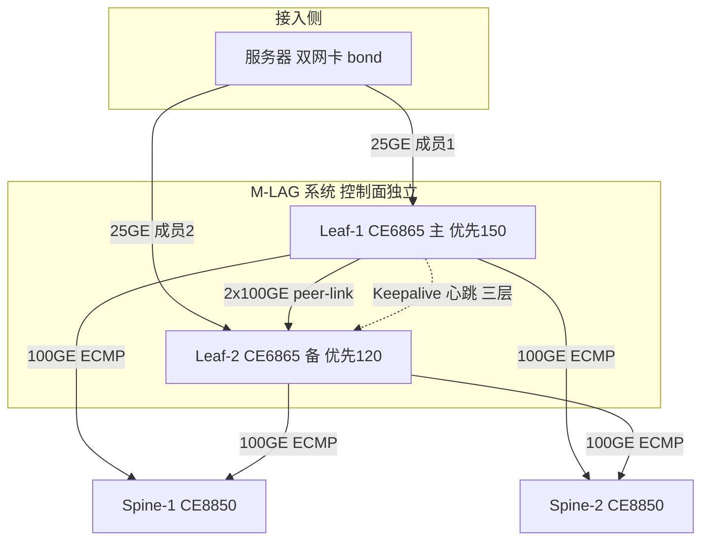

### 真题精练

**Q1.【真题·单选】** 关于 M-LAG 与 iStack 堆叠的本质区别，下列说法正确的是：
A. M-LAG 两台设备控制面合一，堆叠控制面独立
B. M-LAG 两台设备控制面独立，堆叠控制面合一
C. 两者都通过专用堆叠线缆实现控制面合一
D. M-LAG 必须依赖 STP 破环，堆叠不需要

> **答案：B**
> **解析**：M-LAG 的设计哲学就是"控制面分离 + 数据面协同"，两台设备各自运行独立的控制平面、各自管理、各自升级，只同步表项与做一致性检查；堆叠/集群把两台（或多台）设备合并为一台逻辑设备，只有**一个**控制面，主设备（主控）统一管理。A 把二者说反；C 错在 M-LAG 没有"控制面合一"这一说，peer-link 是数据/协议通道而非堆叠线；D 错在恰恰相反——M-LAG 的成员口设计上不依赖 STP，而堆叠虽然合并了控制面，但若拓扑中仍有其他二层环路，STP 仍需存在。

**Q2.【真题·多选】** 数据中心接入侧更倾向 M-LAG 而不是堆叠，主要理由包括：
A. 两台设备控制面独立，单个控制面故障不会牵连对端
B. 支持逐台升级，一台升级重启期间另一台继续转发业务
C. 故障域隔离，一台设备故障只影响其直连的部分链路
D. 配置天然一致，因此不需要任何一致性检查
E. 可以完全替代 VXLAN，实现租户隔离

> **答案：A、B、C**
> **解析**：A/B/C 正是 M-LAG 相对堆叠的三大优势：故障域隔离、升级不中断（可逐台）、控制面独立。D 是堆叠的优点（同一份配置天然一致），M-LAG 恰恰相反——两端各有一份配置，必须靠 DFS 的一致性检查（`display m-lag consistency-check`）保证 STP/VLAN/接口/MAC 同步等项一致，所以说"不需要检查"是错的。E 与 M-LAG 无关，租户隔离是 VXLAN/VNI 或 VRF 的职责，M-LAG 只解决"接入侧双活与带宽叠加"。

**Q3.【真题·简答】** 简述为什么 M-LAG 成员口的链路聚合组在"一台成员设备整机断电"后仍能保持 Up，而普通 Eth-Trunk 在同样情况下会 Down。

> **答案与解析**：
> - **普通 Eth-Trunk** 的成员口必须位于**同一台设备**上，聚合组的 Up/Down 由本设备 LACP 状态机与成员口物理状态决定。若该设备整机断电，聚合组随设备一起消失，链路必然 Down。
> - **M-LAG 的 Eth-Trunk** 是**跨设备**的：服务器侧看到的是一个聚合组，成员口分别落在 Leaf-1 与 Leaf-2 上。两台设备之间通过 **peer-link 交换 LACP 报文与 M-LAG 状态**，各自把对端的成员口状态"代报"给服务器。因此 Leaf-2 断电时，Leaf-1 通过 peer-link 感知到对端成员不可用，但仍**以本机成员口的 LACP 状态维持聚合组 Up**（聚合组本身不因对端设备消失而被删除），服务器侧只是带宽从 2× 降到 1×，聚合组保持 Up，业务不中断。
> - **得分点**：跨设备聚合、peer-link 代报 LACP 状态、聚合组 Up 不依赖对端整机存活、带宽降级而非业务中断。

## 3.2 M-LAG 三大组件详解：peer-link / DFS Group / Keepalive

### 考点定位

**本章最高频考点，理论卷与实验卷都会考**，占 **5~8 分**。命题方式：① 三要素各承载什么流量（单选/多选）；② peer-link 与 Keepalive 的辨析（判断题最爱设陷阱："Keepalive 断了 M-LAG 立刻双主"）；③ DFS Group 优先级与主备选举规则；④ "必须画三组件关系图"（综合题/简答题常要求画图说明）。易错点：把 Keepalive 当成承载业务流量的链路、认为 peer-link 可以为三层、混淆 DFS 优先级与 VRRP 优先级。

### 原理精讲

M-LAG 只有三个组件，但每一个都承担不可替代的职责，考试要求"能画图 + 能说清各走什么流量 + 能说清故障后果"。

**① peer-link（对等链路，也叫 Peer-Link / IPL）**：两台 M-LAG 成员设备之间的**直连二层链路**，必须是 **Eth-Trunk**（推荐 2 条以上高速链路，如 2×100GE，且物理路径分离、最好跨不同单板）。它承担**三类流量**，缺一不可：

- **M-LAG 协议报文**：DFS 协商与同步报文、M-LAG 心跳/状态通告、LACP 代报报文——这是"协议面"。
- **跨设备业务流量**：当某台设备收到一份流量，而该流量按 MAC/ARP 表项或服务器哈希规则应当从**对端设备的成员口**发出时，必须经 peer-link 送到对端再发出。典型场景：单归服务器（只上联到 Leaf-1）访问双归服务器且哈希落到 Leaf-2 的口；或 VRRP 备设备从上游收到下行流量需转给主设备下送。**这是 peer-link 必须考虑带宽的根本原因**——peer-link 不是"只管协议的控制线"，它是业务路径的一部分。
- **表项同步流量**：MAC 表项、ARP 表项（以及部分场景的 ND、IGMP Snooping 表项）在两台设备之间的实时同步，保证"任何一台设备收到帧时都知道该从哪个跨设备成员口发出"。

**② DFS Group（Dynamic Fabric Service Group，动态 Fabric 服务组）**：M-LAG 的**管理框架与同步通道管理器**。两端配置**相同的组号**（如 `dfs-group 1`）并把 peer-link 绑定进组（`dfs-group 1 m-lag 1`）。它负责四件事：

- **主备选举（Master/Backup）**：依据 `priority`（数值大者优先，默认 100）选举主设备；优先级相同时按系统 MAC 或其他内部规则比较。主设备在**双主（Dual-Active）场景下拥有"M-LAG 成员口保持 Up"的优先权**，并在表项冲突时作为裁决者。
- **表项同步通道管理**：规定哪些表项通过 peer-link 同步、同步的触发条件（见表项变化立即同步 + 周期校验）。
- **一致性检查（Consistency Check）**：周期性比对两端的 M-LAG 相关配置——STP 模式与实例、VLAN 放通、接口类型与属性、M-LAG ID、成员口数量与速率、版本与款型等。不一致项会体现在 `display m-lag consistency-check` 中，严重不一致会导致 M-LAG 无法建立或成员口 Error-Down。
- **双主检测的参与方**：DFS 结合 peer-link 状态与 Keepalive 状态共同判定"对端是否存活"，最终决定是否进入 Dual-Active 处理流程。

**③ Keepalive（心跳链路 / 双主检测链路）**：两台成员设备之间的**三层可达心跳**，通常走**带外管理网**或**独立的互联 VLAN**，只承载 Keepalive 探测报文（华为实现为 UDP 封装、可配置探测周期与超时次数），**不承载任何业务流量**。它的唯一使命就是回答一个问题：**"peer-link 断了的时候，对端设备是不是还活着？"**

- peer-link 正常时，双方通过 peer-link 就能互相感知，Keepalive 处于"备用"地位；
- peer-link 故障时，Keepalive 成为**唯一**的存活判据：
  - **Keepalive 正常** → 判定"对端仍存活，只是 peer-link 断了" → 进入 **Dual-Active（双主）状态**，由主设备保留 M-LAG 成员口转发、备设备的 M-LAG 成员口置为 **Error-Down**（华为默认行为是备设备侧 M-LAG 口 Error-Down），从而避免环路与表项冲突。
  - **Keepalive 也故障** → 双方**都无法判定对端存活**。此时为了不造成转发中断，M-LAG 通常**不改变成员口状态**（两端成员口都保持 Up），但网络已存在**环路与 MAC/ARP 表项冲突的风险**；必须依靠 `Monitor Link`/`EFM`/上行口联动或运营商侧防护来兜底（详见 3.5 节）。

**为什么这样设计？** 关键在于"**判定能力决定行为**"：如果设备**能**确定对端已死（Keepalive 不通 + peer-link 不通，且心跳超时），它就可以安全地接管全部业务（对端不可能再转发）；如果设备只能确定"peer-link 断了但对端活着"，它就必须**牺牲一半接入能力**（关掉自己的成员口）来保证无环；如果**连对端死活都不知道**，它既不敢接管全部（怕与对端形成双活环路），也不敢放弃自己的成员口（怕业务全断），于是只能"维持现状 + 依赖外部机制"，这就是"keepalive 也断"场景最危险的原因。

### 关键概念对照表

| 组件 | 层次 | 承载流量 | 部署要求 | 故障后果 | 能否省 |
|---|---|---|---|---|---|
| peer-link | 二层（Eth-Trunk） | M-LAG 协议报文 + **跨设备业务流量** + 表项同步 | 直连、≥2 条高速链路、物理路径分离、建议跨单板 | 直接进入双主风险，靠 Keepalive 判定 | **不可省** |
| DFS Group | 逻辑框架 | 主备选举、表项同步管理、一致性检查 | 两端组号一致、绑定 peer-link、优先级显式规划 | M-LAG 无法建立或成员口 Error-Down | **不可省** |
| Keepalive | 三层（IP 可达） | 仅心跳探测报文，**不承载业务** | 三层可达即可（推荐带外管理网/独立 VLAN）、源地址用实地址 | 无法判定对端存活，双主场景退化为"维持现状" | 强烈建议（可省但极不安全） |

| 参数 | 默认值 | 建议值 | 说明 |
|---|---|---|---|
| DFS Group 优先级 `priority` | 100 | 主 150 / 备 120（或 200/100） | **数值大者为主**；与 VRRP 优先级方向一致，便于主备角色对齐 |
| M-LAG ID | 无（必配） | 建议与 Eth-Trunk 编号解耦，统一编号规范 | 两端必须相同，否则一致性检查失败 |
| peer-link 成员数 | 无（必配） | ≥2，建议 2×100GE 或 4×100GE | 需考虑跨设备流量，不是"控制线" |
| Keepalive 探测周期/超时 | 周期 1s、超时倍数 3 | 保持默认或按业务收敛要求微调，勿过大 | 超时过大 → 双主判定慢；过小 → 管理网抖动误判 |
| 一致性检查周期 | 默认开启周期性检查 | 保持开启，接入 NCE-Fabric 时上报告警 | `display m-lag consistency-check` |

### 华为设备配置

```bash
# ================= Leaf-2（与 Leaf-1 严格对称） =================
<Leaf-2> system-view
[Leaf-2] sysname Leaf-2
[Leaf-2] vlan batch 999
[Leaf-2] interface Vlanif999
[Leaf-2-Vlanif999] description Keepalive-To-Leaf1
[Leaf-2-Vlanif999] ip address 10.99.99.2 30              // 与 Leaf-1 同网段，互相 ping 通
[Leaf-2-Vlanif999] quit
[Leaf-2] interface 10GE1/0/1
[Leaf-2-10GE1/0/1] port link-type access
[Leaf-2-10GE1/0/1] port default vlan 999
[Leaf-2-10GE1/0/1] stp disable
[Leaf-2-10GE1/0/1] quit

[Leaf-2] interface Eth-Trunk 100
[Leaf-2-Eth-Trunk100] description Peer-Link-To-Leaf1
[Leaf-2-Eth-Trunk100] mode lacp-static
[Leaf-2-Eth-Trunk100] stp disable
[Leaf-2-Eth-Trunk100] quit
[Leaf-2] interface 100GE1/0/49
[Leaf-2-100GE1/0/49] eth-trunk 100
[Leaf-2-100GE1/0/49] quit
[Leaf-2] interface 100GE1/0/50
[Leaf-2-100GE1/0/50] eth-trunk 100
[Leaf-2-100GE1/0/50] quit

[Leaf-2] dfs-group 1
[Leaf-2-dfs-group-1] priority 120                        // 低于 Leaf-1 的 150 → Leaf-2 为备
[Leaf-2-dfs-group-1] source ip address 10.99.99.2
[Leaf-2-dfs-group-1] peer ip address 10.99.99.1
[Leaf-2-dfs-group-1] quit
[Leaf-2] interface Eth-Trunk 100
[Leaf-2-Eth-Trunk100] dfs-group 1 m-lag 1                // 与 Leaf-1 完全一致的绑定关系
[Leaf-2-Eth-Trunk100] quit

# ================= 三组件状态逐个验证（排错顺序：Keepalive → peer-link → DFS） =================
<Leaf-1> display dfs-group 1                             // Master/Backup 角色、优先级、Keepalive 是否 Up
<Leaf-1> display dfs-group 1 keepalive                   // 专看 Keepalive 报文收发计数（发送/接收是否都在涨）
<Leaf-1> display eth-trunk 100 verbose                   // peer-link 各成员口状态与 LACP 协商结果
<Leaf-1> display dfs-group 1 m-lag                       // M-LAG ID 1 的同步状态（是否 OK / 是否有 Item 未同步）
<Leaf-1> display m-lag consistency-check                 // 一致性检查：列出一致/不一致的具体项目
<Leaf-1> display m-lag troubleshooting                    // M-LAG 异常项与建议（部分版本支持）
```

### 示意图

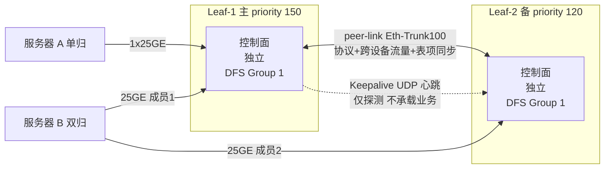

### 真题精练

**Q4.【真题·单选】** 在华为 CloudEngine 的 M-LAG 实现中，Keepalive 链路的主要作用是：
A. 承载跨设备转发的业务流量
B. 同步 MAC 与 ARP 表项
C. 在 peer-link 故障时判断对端设备是否存活，用于双主检测
D. 代替 peer-link 完成 DFS 协商

> **答案：C**
> **解析**：A、B 都是 **peer-link** 的职责——peer-link 既承载跨设备业务流量，也承载表项同步；Keepalive 是纯心跳，不承载业务。D 错在 DFS 协商与 M-LAG 建立必须依赖 peer-link，Keepalive 只是"辅助判定存活"，peer-link 断了 M-LAG 就已经进入异常/双主流程，Keepalive 无法让 M-LAG 恢复正常工作。本题的核心区分点就是"业务 vs 心跳"。

**Q5.【真题·判断】** 两台设备上配置的 DFS Group 优先级不同，优先级数值较小的一台会成为 Master（主设备）。

> **答案：错误**
> **解析**：华为 M-LAG 的 DFS Group 优先级**数值越大越优先**，成为 Master。这与 VRRP 的优先级规则方向一致（VRRP 也是数值大者为 Master），但与 STP 的桥优先级方向**相反**（STP 桥 ID 越小越优先）。这个"方向性"是选择题的高频陷阱：做题时先确认问的是 DFS 优先级、VRRP 优先级还是 STP 桥优先级。规划建议：让 DFS 主设备与 VRRP Master 落在同一台设备上，即把同一台的 DFS 优先级和 VRRP 优先级都设为高值。

**Q6.【真题·简答】** 请画出并说明 M-LAG 三大组件的相互关系，指出哪些组件承载业务流量、哪些只承载控制/心跳流量。

> **答案与解析**（作答要点，参考 3.2 示意图）：
> 1. **画图**：画两台独立交换机（各带独立控制面），中间画两条线——实线 peer-link（标注 Eth-Trunk、2×100GE）、虚线 Keepalive（标注三层可达、独立 VLAN/管理网）；两台设备内部各画一个 DFS Group 1 的框，peer-link 绑定进 DFS Group；下方画双归服务器分别接两台设备。
> 2. **承载业务流量的组件**：**只有 peer-link**。它不仅承载协议与同步报文，还承载"需从对端成员口发出"的跨设备业务流量，因此带宽必须按峰值跨设备流量规划。
> 3. **只承载控制的组件**：**Keepalive 只承载心跳探测**（不承载业务）；**DFS Group 是逻辑框架**（主备选举、表项同步管理、一致性检查），本身不"承载"流量，它管理的是 peer-link 上的同步行为。
> 4. **三者关系**：DFS Group 依赖 peer-link 建立与同步（绑定关系），peer-link 故障时由 Keepalive 提供存活判定，最终共同决定是否进入 Dual-Active 以及哪台设备保留转发。

## 3.3 M-LAG 协商与建立流程（状态机与时序）

### 考点定位

本考点常以**简答/画图题**出现，占 **3~5 分**，也常结合排错题考"卡在某状态怎么查"。命题点：① 建立的先后顺序（先 Keepalive 还是先 peer-link？先选主还是先同步表项？）；② 状态机各状态含义；③ 为什么必须"先选主后备/同步"。易错点：认为 DFS 主备选举在 peer-link 建立之后才通过 peer-link 完成（实际上优先级是**配置态**，两端一上电即可按本地优先级判定，peer-link 用于确认与协商表项同步）。

### 原理精讲

M-LAG 的建立可以归纳为**四大阶段**，理解顺序比背状态名更重要——**顺序的本质是"先建立可靠通道，再统一视图，最后开放转发"**：

**阶段一：配置态与本地初始化（Init）**。两端设备各自检查本地配置：DFS Group 编号、优先级、Keepalive 源/目的地址、peer-link 是否已绑定 M-LAG ID、成员口是否加入。任一项缺失，M-LAG 停留在 Init。**注意**：此时优先级已在本地生效，两端都能"知道"自己应该是主还是备，但还没确认对端。

**阶段二：Keepalive 建立（Ready）**。两端通过三层互通开始互发 Keepalive 探测报文，双向都收到即认为心跳通道就绪。同时，peer-link 的 Eth-Trunk 通过 LACP 协商 Up。**为什么先要心跳**：因为后续所有协商都建立在"知道对端存在"的基础上；如果心跳不通，即使 peer-link Up，一旦 peer-link 抖动就会立刻陷入"无法判定对端存活"的最坏情况。

**阶段三：DFS 协商与主备选举确认（Negotiation / Sync）**。两端交换 DFS 报文，比对：组号、优先级、系统 MAC、款型与版本、M-LAG ID 配置。随后进行**链路级与配置级一致性检查**（STP、VLAN、接口、成员口数量与速率）。检查通过后进入**表项同步**：周期性/触发式同步 MAC 表项与 ARP 表项，使两端对"某 MAC 在哪个跨设备成员口下"有一致视图。**为什么必须先同步表项**：如果成员口先 Up 而表项不一致，单播流量可能被两端同时泛洪或指向错误端口，出现丢包甚至环路。

**阶段四：M-LAG 接口 Up（Active / Working）**。两端视图一致、表项同步完成后，M-LAG 成员口进入正常工作状态，服务器侧聚合组 Up，两条链路同时转发。此后进入**稳态维护**：周期性一致性检查 + 表项变化即时同步 + 心跳保活。

**状态机简表**（华为 `display dfs-group` / `display m-lag summary` 中可见的状态与告警）

| 状态/阶段 | 触发条件 | 关键动作 | 异常停留常见原因 |
|---|---|---|---|
| Init / 未配置 | 配置缺失或 DFS Group 未绑定 | 本地参数检查 | DFS 组号不一致、peer-link 未绑定 M-LAG ID |
| Keepalive Ready | 双向心跳报文可达 | 心跳通道就绪、peer-link LACP Up | Keepalive 地址不可达、中间三层设备拦截、ACL 丢弃 |
| Negotiation | 交换 DFS 报文并比对参数 | 主备确认、一致性检查 | 版本/款型不一致、优先级相同且冲突、peer-link 成员数不一致 |
| Sync | 一致性检查通过 | MAC/ARP 表项同步 | 表项量大同步慢、peer-link 拥塞丢包 |
| Active（正常） | 同步完成 | 成员口 Up、双活转发 | — |
| Dual-Active（双主） | peer-link 故障且 Keepalive 正常 | 备设备 M-LAG 口 Error-Down | 见 3.5 节 |
| 分裂/未知（Split） | peer-link 故障且 Keepalive 也故障 | 维持现状、告警 | 见 3.5 节，最危险场景 |

### 关键概念对照表

| 阶段 | 报文/机制 | 依赖 | 失败后现象 |
|---|---|---|---|
| 本地初始化 | 无（本地配置检查） | 配置正确性 | `display dfs-group 1` 显示配置未生效 |
| Keepalive | UDP 心跳探测（周期 1s/超时 3 次） | 三层可达（管理网/独立 VLAN） | 心跳统计不增长，M-LAG 无法进入正常态 |
| peer-link | LACP + DFS 协商报文 | 直连 Eth-Trunk 成员 Up | M-LAG 无法建立，成员口 Error-Down |
| 主备选举 | DFS 报文携带优先级 | 两端优先级可比 | 优先级相同则按内部规则裁决，结果不可预期 |
| 一致性检查 | 周期比对 STP/VLAN/接口/版本 | 两端配置对称 | 检查项告警，严重时 M-LAG 不 Up |
| 表项同步 | MAC/ARP 表项经 peer-link 同步 | peer-link 带宽与延迟 | 跨设备转发丢包、未知单播泛洪增加 |
| 成员口 Up | 聚合组进入转发 | 以上全部通过 | 服务器侧聚合组 Down 或单链路转发 |

### 华为设备配置

```bash
# ================= 观察建立过程（按顺序执行，每一步都看状态变化） =================
<Leaf-1> display dfs-group 1                              // 步骤1：确认自身角色与 Keepalive 是否 Up
<Leaf-1> display dfs-group 1 keepalive                    // 步骤2：确认心跳收发计数在增长（不增长=三层不通）
<Leaf-1> ping -a 10.99.99.1 10.99.99.2                    // 步骤3：指定源地址 ping 对端（不加 -a 可能走错接口）
<Leaf-1> display eth-trunk 100 verbose                    // 步骤4：确认 peer-link 成员口 Up 且 LACP 协商 Success
<Leaf-1> display dfs-group 1 m-lag                        // 步骤5：确认 M-LAG ID 1 状态与成员设备是否都 OK
<Leaf-1> display dfs-group 1 m-lag 1                      // 步骤6：查看该 M-LAG 的详细信息（角色、成员口、同步项）
<Leaf-1> display m-lag consistency-check                  // 步骤7：一致性检查通过后才能进入 Active
<Leaf-1> display mac-address m-lag                        // 步骤8：查看通过 M-LAG 学到的 MAC 是否两端一致

# ================= 调试技巧：抓取 DFS 协商过程（生产环境慎用，有性能影响） =================
<Leaf-1> terminal monitor                                 // 打开终端告警/日志输出
<Leaf-1> terminal logging level 6                         // 提升日志级别（数值越大越详细，排错后务必改回）
<Leaf-1> debugging dfs-group all                          // 打开 DFS 调试（排错后 undo debugging all）
<Leaf-1> display dfs-group 1 statistics                   // 看协商报文统计，判断是否有丢包/重传
```

### 示意图

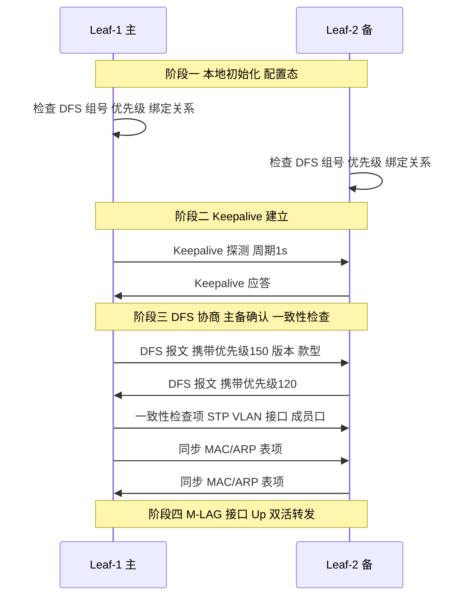

### 真题精练

**Q7.【真题·简答】** 按正确顺序列出 M-LAG 建立的四个阶段，并解释"为什么必须先同步 MAC/ARP 表项之后，M-LAG 成员口才能 Up"。

> **答案与解析**：
> 1. 顺序：**本地初始化 → Keepalive 建立 → DFS 协商与主备选举 + 一致性检查 → 表项同步 → M-LAG 接口 Up（Active）**。
> 2. 必须"先同步后 Up"的原因：M-LAG 的两台设备是**独立控制面**，各自学习 MAC/ARP。如果成员口先 Up 而表项不一致，会出现三种问题：① **未知单播泛洪增加**——A 设备不知道某 MAC 其实在 B 设备的成员口下，只能泛洪；② **转发错向**——A 设备把本该从 B 侧成员口发出的帧从自己侧发出，服务器收到重复帧或帧到达错误的网卡；③ **环路风险**——两台设备对同一 MAC 的视图冲突时可能形成"互相转发"的环路。因此必须先让两端对"MAC/ARP 在哪里"取得一致视图，再开放转发。
> 3. 附加得分点：表项同步依赖 peer-link 的带宽与可靠性，这也是 peer-link 必须聚合多条高速链路的原因之一。

**Q8.【真题·排错】** 工程师配置完 M-LAG 后，`display dfs-group 1` 显示 Keepalive 状态为 Down，`display dfs-group 1 m-lag` 显示 M-LAG ID 1 状态为非 OK，两台设备之间业务不通。请给出排错思路与关键命令。

> **答案与解析**（按"从下到上"的顺序排查）：
> 1. **确认 Keepalive 三层可达性**：`display ip interface brief | include Vlanif999` 确认源地址已生效；`ping -a <本端源地址> <对端地址>` 确认能通。**必须带 `-a` 指定源地址**，否则 ping 可能从其他接口发出，通不代表 Keepalive 源地址可达。
> 2. **确认 Keepalive 报文是否被拦截**：检查两端的 ACL、`traffic-filter`、管理网防火墙策略是否放通 Keepalive 的 UDP 端口与探测报文；`display dfs-group 1 keepalive` 看发送/接收计数——发送在涨、接收不涨，说明被中间设备丢弃或路由不可达。
> 3. **确认配置对称**：`display current-configuration | section dfs-group` 比对两端的 `source`/`peer` 地址是否互相配对（A 的 peer 必须是 B 的 source，反之亦然）、DFS 组号是否一致、`priority` 是否显式配置。
> 4. **确认 peer-link 本身**：`display eth-trunk 100 verbose` 看成员口是否 Up、LACP 是否 Success；`display interface Eth-Trunk 100` 看有无 CRC 错包、光模块告警。
> 5. **确认一致性检查项**：`display m-lag consistency-check`，重点看 STP/VLAN/接口/M-LAG ID/成员口数量是否有一致性问题（两端 VLAN 放通不一致是最常见的"隐性不一致"）。
> 6. **看日志定位**：`display logbuffer | include M-LAG` 与 `display dfs-group 1 statistics`，日志通常会直接给出原因（如"peer ip unreachable"）。

## 3.4 M-LAG 流量转发路径（本地优先与跨设备转发）

### 考点定位

本考点常以**流量路径分析题 / 画图题**出现，占 **4~6 分**，是"排错与设计题"的推理基础。核心考"本地优先转发（Local Preference）"这一机制：为什么 M-LAG 要尽量从本地成员口发出、什么情况下必须走 peer-link。易错点：认为"双归服务器流量一定在两条链路上按哈希均匀分担"（单归服务器的流量、以及上行方向就未必）、忽略"下行方向可能从备设备进来"。

### 原理精讲

M-LAG 的转发设计有一条铁律：**能本地转发就不走 peer-link**。这叫 **本地优先转发（Local Preference / Local Forwarding）**，它的目的有两个：**① 节省 peer-link 带宽（peer-link 是共享资源，一旦成为瓶颈就会拖累所有跨设备流量）；② 缩短转发路径、减少一跳时延。**

**场景 A：双归接入的主动流量（服务器 → 网络）**。服务器做 bond/聚合，两条 25GE 上联分别到 Leaf-1、Leaf-2。服务器侧按哈希把流量分担到两条链路：从 Leaf-1 收到的帧由 Leaf-1 转发（就近出，如走本地 ECMP 上行到 Spine），从 Leaf-2 收到的由 Leaf-2 转发。**同一 VLAN 内互访时**：Leaf-1 从本机成员口学到源 MAC，若目的 MAC 也学到在本地成员口，则本地二层转发，路径最短；若目的 MAC 学到在**对端**成员口（Leaf-2 侧），Leaf-1 必须经 peer-link 送到 Leaf-2 再发出——这就是跨设备转发。

**场景 B：单归接入的流量（只上联一台设备）**。单归服务器只接 Leaf-1。当它要访问另一台双归服务器 B（成员口分别在 Leaf-1 与 Leaf-2）时：Leaf-1 查表发现目的 MAC 在 Leaf-2 侧成员口，流量**必须**经 peer-link 到 Leaf-2 再下送。如果单归服务器规模很大，peer-link 上的跨设备流量会显著上升——这是容量规划中必须量化的部分。

**场景 C：下行流量（网络 → 服务器）与 VRRP 的关系**。若两台 Leaf 用 VRRP 做服务器网关，外部/上行流量通常按 ECMP 均衡到 Leaf-1 与 Leaf-2；但 VRRP 虚拟 MAC 只由 **Master** 响应与转发（服务器 ARP 请求网关 MAC，得到的是虚拟 MAC，Master 回应）。因此：**上行（服务器 → 外部）由 VRRP Master 转发**；**下行（外部 → 服务器）可能从 VRRP Backup 设备进入**（因为上游 ECMP 不认虚拟 MAC，只按 IP 路由到两台设备），此时 Backup 设备需要把流量经 peer-link 送到 Master，再由 Master 下送服务器——这正是"M-LAG + VRRP 主备一致"能显著降低跨设备转发的原因（详见 3.7 节）。

**场景 D：VXLAN 场景下的跨设备转发**。若两台 Leaf 是 M-LAG + anycast VTEP（两台使用同一个 NVE 源地址），VM 在同一 VNI 内互访时，两台设备的 MAC 表由 peer-link 同步，因此**本机接入的 VM 之间的流量本地转发**，跨设备流量只在"目的 VM 挂在对方成员口下"时经 peer-link 转发。

**一句话总结四条转发原则**：① 本机成员口收到的帧优先从本机出口发出（本地优先）；② 目的在对方成员口下才走 peer-link；③ 上行方向按 ECMP/VRRP 角色决定，下行方向按路由结果决定，二者不一致时 Backup 设备要经 peer-link 转给 Master；④ 未知单播/广播/组播按 M-LAG 机制在两端受控泛洪（peer-link 参与），不能各泛各的。

### 关键概念对照表

| 流量方向 | 场景 | 是否走 peer-link | 依据 |
|---|---|---|---|
| 服务器 → 网络（双归） | 本机成员口进入 | 否 | 本地优先转发 |
| 服务器 → 网络（双归） | 目的在对端成员口下 | **是** | 表项指向对端 |
| 单归服务器 → 双归服务器 | 目的在对端成员口下 | **是** | 只能经 peer-link 到对端 |
| 上行（服务器 → 外部） | VRRP 虚拟 MAC 网关 | 否（由 Master 转发） | VRRP Master 持有虚拟 MAC |
| 下行（外部 → 服务器） | 上游 ECMP 命中 Backup | **是**（Backup → Master） | 网关虚拟 MAC 在 Master 上 |
| 跨 Leaf 三层转发 | 分布式网关/Vbdif | 否（各 Leaf 独立三层转发） | VXLAN 分布式网关 |
| 未知单播/广播 | M-LAG 成员口 | 受控同步/泛洪 | DFS 表项同步机制 |

### 华为设备配置

```bash
# ================= 在 Leaf-1 / Leaf-2 上配置双归服务器接入的 M-LAG 聚合组 =================
[Leaf-1] interface Eth-Trunk 10                          // 面向双归服务器的跨设备聚合组
[Leaf-1-Eth-Trunk10] description To-Server-DualHomed
[Leaf-1-Eth-Trunk10] mode lacp-static                    // 服务器侧做 bond，建议 LACP 静态模式
[Leaf-1-Eth-Trunk10] stp disable                         // M-LAG 成员口不参与 STP，避免阻塞
[Leaf-1-Eth-Trunk10] port link-type trunk                // 服务器多 VLAN 接入用 trunk
[Leaf-1-Eth-Trunk10] port trunk allow-pass vlan 100 200  // 放通业务 VLAN（两端必须完全一致）
[Leaf-1-Eth-Trunk10] dfs-group 1 m-lag 2                 // 关键：绑定 DFS 组 1，M-LAG ID 2（两端必须相同）
[Leaf-1-Eth-Trunk10] quit
[Leaf-1] interface 25GE1/0/1
[Leaf-1-25GE1/0/1] description To-Server-A-NIC1
[Leaf-1-25GE1/0/1] eth-trunk 10                          // 物理口加入跨设备聚合组
[Leaf-1-25GE1/0/1] quit

# ================= 本地优先转发的验证与调优 =================
<Leaf-1> display eth-trunk 10 verbose                     // 看本地成员口与 M-LAG 状态
<Leaf-1> display dfs-group 1 m-lag 2                      // 看该 M-LAG 的两端成员口列表
<Leaf-1> display mac-address vlan 100                     // 观察同一 MAC 是否两端都学到（跨设备同步生效）
<Leaf-1> display interface Eth-Trunk 100                  // 关键：观察 peer-link 的入/出速率，评估跨设备流量占比
<Leaf-1> display eth-trunk 100 verbose | include Rate     // 周期性采样 peer-link 利用率，判断是否需要扩容

# ================= 用 Monitor Link 联动上行，避免"上行断但成员口仍转发"（可选加固） =================
[Leaf-1] monitor-link group 1                            // 创建联动组，上行 Down 时联动下行
[Leaf-1-mtlk-group1] port 100GE1/0/1 uplink              // 定义上行口（到 Spine）
[Leaf-1-mtlk-group1] port Eth-Trunk 10 downlink          // 定义下行口（到服务器）
[Leaf-1-mtlk-group1] quit
```

### 示意图

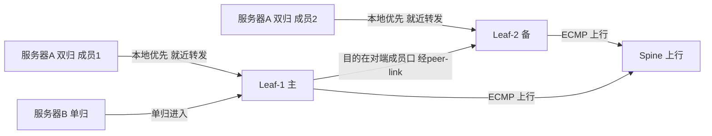

### 真题精练

**Q9.【真题·单选】** M-LAG 的"本地优先转发"机制的主要目的是：
A. 保证所有流量都从主设备转发，便于流量统计
B. 尽量减少跨 peer-link 的转发流量，节省 peer-link 带宽并缩短路径
C. 让服务器两条链路只使用一条，避免乱序
D. 强制两端设备表项完全独立，不做同步

> **答案：B**
> **解析**：本地优先转发（Local Preference）是 M-LAG 的核心转发优化：能从本机成员口出去的流量绝不绕 peer-link，目的是①节约 peer-link 这条共享通道的带宽；②减少一次跨设备转发带来的时延与拥塞风险。A 错——M-LAG 是双活，不是主备转发，两台设备都转发流量；C 错——M-LAG 的目标恰恰是两条链路同时转发、带宽叠加；D 错——M-LAG 必须同步 MAC/ARP 表项，否则无法判断"目的 MAC 在哪个跨设备成员口下"。

**Q10.【真题·简答】** 某数据中心两台 Leaf 组成 M-LAG 并为服务器 VLAN 100 提供 VRRP 网关（Leaf-1 为 Master）。请分别说明"服务器 → 外部网络"与"外部网络 → 服务器"两个方向的流量路径，并指出哪种情况下会经过 peer-link。

> **答案与解析**：
> 1. **服务器 → 外部**：服务器把网关 MAC 解析为 **VRRP 虚拟 MAC**（由 Master 持有并响应 ARP）。服务器发往网关的帧目的 MAC 是虚拟 MAC，因此**无论服务器从哪条物理链路（Leaf-1 或 Leaf-2 的成员口）发出**：
>    - 若进入 Leaf-1（Master）：直接三层转发上行，**不经 peer-link**；
>    - 若进入 Leaf-2（Backup）：Leaf-2 发现目的 MAC 是虚拟 MAC，本机是 Backup 不持有该虚拟 MAC 的转发权，需经 **peer-link 送到 Leaf-1**，由 Leaf-1 完成三层转发。
> 2. **外部 → 服务器**：上游按 IP 路由（ECMP 或去往 Leaf 的任意路径）可能命中 Leaf-2（Backup）。Leaf-2 查表发现目的 IP 是 VLAN 100 的网段，但网关虚拟 MAC 在 Master 上，因此需要经 **peer-link 转给 Leaf-1**，由 Leaf-1 下送服务器；若服务器是双归且目的 MAC 正好在 Leaf-2 的成员口下，也可能直接下送。
> 3. **结论**：只要**两端角色（DFS 主备与 VRRP Master/Backup）不一致**，或流量进入的设备不是持有虚拟 MAC 的那台，就会出现跨 peer-link 转发。因此**推荐的加固做法是让 DFS 主设备与 VRRP Master 落在同一台设备**，使绝大多数流量"就近进入、就近转发"，把 peer-link 上的跨设备流量压到最低。

## 3.5 M-LAG 故障场景与切换（逐场景推演）

### 考点定位

**本章区分度最高的考点，简答/排错题必考**，占 **8~12 分**。命题方式：给出拓扑与故障点，问"流量如何切换、成员口状态如何变化、是否形成环路、两端设备如何判定"。**必须掌握的核心对比**：`peer-link 全断 + Keepalive 正常` 与 `peer-link 全断 + Keepalive 也断` 的行为差异。易错点：认为"peer-link 断了 M-LAG 就整体 Down"（实际是进入双主处理，一台继续转发）、认为"Keepalive 断了会造成业务中断"（实际 Keepalive 断通常只告警，不影响转发）。

### 原理精讲

先建立一条**判定逻辑主线**（所有故障场景都由它推导）：

> 设备每时每刻要回答两个问题：**Q1 peer-link 通不通？Q2 对端活不活（Keepalive）？**
> - Q1 通：正常双活，两台都转发，表项同步。
> - Q1 不通、Q2 通（对端活着）：**Dual-Active（双主）**——必须**只有一台**继续用 M-LAG 成员口转发，另一台把 M-LAG 成员口 **Error-Down**，否则两台同时转发会造成环路与表项冲突。华为默认由**备设备**（DFS 优先级低者）置 Error-Down，主设备保留转发。
> - Q1 不通、Q2 也不通（对端死活未知）：**最危险场景**。两端都无法判定对端状态，**通常保持现状（两端成员口都保持 Up）**，因为任何一方贸然关闭成员口都可能造成"两端都关、业务全断"，而任何一方贸然接管又会与对端形成双活环路。此时网络存在环路/表项冲突风险，必须靠**外部加固机制**（Monitor Link 联动上行、EFM、上游设备侧的防环、或人工干预）兜底。

**场景 1：服务器一条上联链路断（成员口/LACP 成员故障）**。服务器侧 bond 降级为单链路，M-LAG 聚合组仍 Up（跨设备聚合组的特性），流量全部走剩余成员口。**无跨设备影响**，属于最轻微的故障。注意：如果服务器侧是**非 LACP 的静态聚合**，可能出现两端哈希不一致导致部分流量丢弃，所以数据中心推荐 **LACP**。

**场景 2：一条 peer-link 成员链路断（peer-link 聚合组仍有成员 Up）**。peer-link 聚合组本身仍 Up（带宽降级），M-LAG 保持正常，但**跨设备转发能力与表项同步带宽下降**。行为：不会进入双主，业务不中断；但若跨设备流量较大，可能出现丢包（peer-link 拥塞）。**处理**：告警并尽快修复/扩容；这也是 peer-link 必须 ≥2 条的原因。

**场景 3：peer-link 全部中断 + Keepalive 正常（必考）**。这是**典型的双主（Dual-Active）场景**：
- 两台设备判定：Q1 不通、Q2 通 → 进入 **Dual-Active**。
- 行为：**主设备（DFS 优先级高者）的 M-LAG 成员口保持 Up 并继续转发；备设备的 M-LAG 成员口被置为 Error-Down**（华为默认策略），同时产生 Dual-Active 告警。
- 影响：备设备下挂的**单归服务器全部断网**（因为它们只有一条上联到备设备）；**双归服务器带宽降级**为只有主设备那一半成员口可用；但**网络无环、无表项冲突**，业务"部分降级而非全断"。
- **为什么这样设计**：Dual-Active 的本质风险是"两台设备都以为自己独占接入侧，导致同一 VLAN 出现两个转发点"→ 环路 + 双份泛洪 + MAC 表项在两端反复翻转。既然能确定对端活着，就必须**二选一**。选主的理由：主设备是规划中承载 VRRP Master 与主要上行流量的设备，保留它转发对业务影响最小。
- **加固建议**：把单归服务器尽量改为双归；或在备设备侧配置 **Monitor Link**，使 peer-link/上行故障时联动关闭不必要的下行口，减少"半通"状态。

**场景 4：peer-link 全断 + Keepalive 也断（必考，与场景 3 对比）**。
- 判定：Q1 不通、Q2 不通 → 对端死活未知，进入**分裂（Split）/ 双主未知状态**。
- 行为：两端**无法判定**，因此**不主动改变 M-LAG 成员口状态**——两端成员口都保持 Up、都继续转发（若误判对端已死而贸然接管，会造成环路；若误判对端活着而关闭自己，会造成双端全断）。结果：**接入侧同一 VLAN 出现两个转发点，存在二层环路与 MAC 表项冲突，广播/未知单播会出现重复泛洪，服务器可能收到重复帧**。
- **与场景 3 的关键区别**（考试必答点的"三句话"）：
  1. **判定能力不同**：场景 3 能确定"对端活着"（有明确结论）；场景 4 完全无法判定（结论缺失）。**行为由判定能力决定**，这是整个 M-LAG 故障设计的哲学。
  2. **行为不同**：场景 3 → 备设备成员口 **Error-Down**（牺牲一半接入，换绝对无环）；场景 4 → 两端**维持现状**（不做切换，换"不断业务"，但承担环风险）。
  3. **后果不同**：场景 3 是"**可控降级**"（部分单归服务器不通，但无环、可快速定位）；场景 4 是"**不可控风险**"（可能环路、风暴、MAC 翻转，排查困难），因此**Keepalive 链路的可靠性优先级极高**，绝不能省。
- **加固**：Keepalive 走**带外管理网 + 独立物理路径**；两端启用 `dual-active` 相关检测与告警；部署 Monitor Link/EFM 联动；在服务器侧启用 STP BPDU 保护或风暴抑制；对跨设备聚合口做流量抑制（`storm-control`）降低环路危害。

**场景 5：一台 M-LAG 成员设备故障（断电/重启/整机不可用）**。此时对端通过 peer-link 与 Keepalive **同时**感知对端消失（peer-link Down + Keepalive Down，但本次是"对端真的死了"而非"链路断了"）：
- 存活设备**接管全部业务**（它是唯一转发点，不存在环路风险，因此**不需要**把自己的成员口 Error-Down）；
- 双归服务器的跨设备聚合组降级为单链路但保持 Up，业务基本无感；
- **单归挂在故障设备上的服务器会断网**（这是单归的固有风险，与 M-LAG 无关）；
- **这是 M-LAG 相比堆叠最大的优势体现**：故障设备的控制面消失，但不影响存活设备；堆叠场景下主设备故障可能引发整组选主与全组震荡。
- 注意：**"对端真死"与"peer-link 断但对端活着"必须区分**——前者可以全量接管，后者必须二选一。区分手段就是 Keepalive 的判定结果。

**场景 6：上行链路故障（Leaf 到 Spine 断一条/全断）**。
- 断一条：由 Underlay 的 **ECMP + BFD** 收敛，M-LAG 层不变，流量切到剩余上行，业务不中断（**与 M-LAG 无关**，但常出现在综合题里考"谁负责收敛"）。
- 上行全断（Leaf-1 到 Spine 全断）：Leaf-1 无法访问外部，但**M-LAG 成员口仍 Up**，服务器哈希到 Leaf-1 的流量会黑洞。**加固手段：Monitor Link** —— 把上行口设为 uplink、M-LAG 成员口设为 downlink，上行全断时联动把 M-LAG 成员口置 Down，迫使服务器侧聚合组只保留 Leaf-2 链路，避免黑洞。这也说明"为什么 M-LAG 需要上行联动机制"。

### 关键概念对照表

| 故障场景 | peer-link | Keepalive | 对端判定 | 成员口状态 | 业务影响 | 是否环路风险 |
|---|---|---|---|---|---|---|
| 服务器一条上联断 | 正常 | 正常 | 存活 | 本机成员口 Up | 带宽减半，无中断 | 无 |
| peer-link 部分成员断 | 降级 Up | 正常 | 存活 | 全部 Up | 跨设备流量可能丢包 | 无 |
| **peer-link 全断 + Keepalive 正常** | Down | 正常 | **确认存活** | **备设备 M-LAG 口 Error-Down** | 备侧单归断网；双归降级 | **无（已规避）** |
| **peer-link 全断 + Keepalive 也断** | Down | Down | **无法判定** | **两端维持 Up** | 表面正常，实则环路/泛洪/表项冲突 | **有（危险）** |
| 一台设备整机故障 | Down | Down | **确认死亡** | 存活设备全部 Up | 单归侧断网；双归降级无感 | 无 |
| 上行全断（未加固） | 正常 | 正常 | 存活 | 保持 Up | 该设备方向流量黑洞 | 无 |
| 上行全断 + Monitor Link | 正常 | 正常 | 存活 | 联动置 Down | 流量全走对端，无黑洞 | 无 |

| 判定组合 | Q1 peer-link | Q2 Keepalive | 系统状态 | 默认动作 |
|---|---|---|---|---|
| 组合 1 | Up | Up | 正常工作（Active） | 双活转发 + 表项同步 |
| 组合 2 | Down | Up | Dual-Active（双主） | 备设备 M-LAG 口 Error-Down |
| 组合 3 | Down | Down | Split / 未知（分裂） | 维持现状 + 告警，依赖外部加固 |
| 组合 4 | Up | Down | 正常工作但心跳异常 | 告警；若随后 peer-link 也断 → 组合 3 |

### 华为设备配置

```bash
# ================= 双主检测与故障处理相关配置 =================
[Leaf-1] dfs-group 1
[Leaf-1-dfs-group-1] priority 150                        // 优先级高者为主：双主场景下保留转发权
[Leaf-1-dfs-group-1] source ip address 10.99.99.1
[Leaf-1-dfs-group-1] peer ip address 10.99.99.2
[Leaf-1-dfs-group-1] keepalive interval 1 timeout 3      // 心跳周期 1s、超时 3 次（默认即推荐，勿盲目放大）
[Leaf-1-dfs-group-1] quit

# --- 加固①：Monitor Link 联动，上行全断时关闭 M-LAG 成员口，避免流量黑洞 ---
[Leaf-1] monitor-link group 1
[Leaf-1-mtlk-group1] port 100GE1/0/1 uplink              // 上行口（到 Spine）
[Leaf-1-mtlk-group1] port 100GE1/0/2 uplink              // 多上行口全部作为 uplink
[Leaf-1-mtlk-group1] port Eth-Trunk 10 downlink          // M-LAG 成员口作为 downlink，被联动
[Leaf-1-mtlk-group1] quit

# --- 加固②：抑制环路危害，在成员口上做风暴抑制与 BPDU 保护 ---
[Leaf-1] interface Eth-Trunk 10
[Leaf-1-Eth-Trunk10] storm-control broadcast min-rate 5000 max-rate 10000   // 广播风暴抑制（kbit/s）
[Leaf-1-Eth-Trunk10] storm-control multicast min-rate 5000 max-rate 10000   // 组播风暴抑制
[Leaf-1-Eth-Trunk10] stp bpdu-protection                 // 避免服务器误发 BPDU 干扰 M-LAG 口状态
[Leaf-1-Eth-Trunk10] quit

# ================= 故障定位命令（按场景使用） =================
<Leaf-1> display dfs-group 1                             // 一眼看角色 + Keepalive 状态 + peer-link 状态
<Leaf-1> display dfs-group 1 brief                       // 简要信息：双主告警、同步状态
<Leaf-1> display m-lag summary                           // 全局 M-LAG 状态与告警计数
<Leaf-1> display m-lag troubleshooting                    // 异常项与建议处理
<Leaf-1> display logbuffer | include Dual-Active          // 查双主事件日志（关键字大小写按版本）
<Leaf-1> display interface Eth-Trunk 100                  // peer-link 是否 Down、成员口是否全 Down
<Leaf-1> display mac-address flapping history             // 双主时典型现象：MAC 反复翻转
```

### 示意图

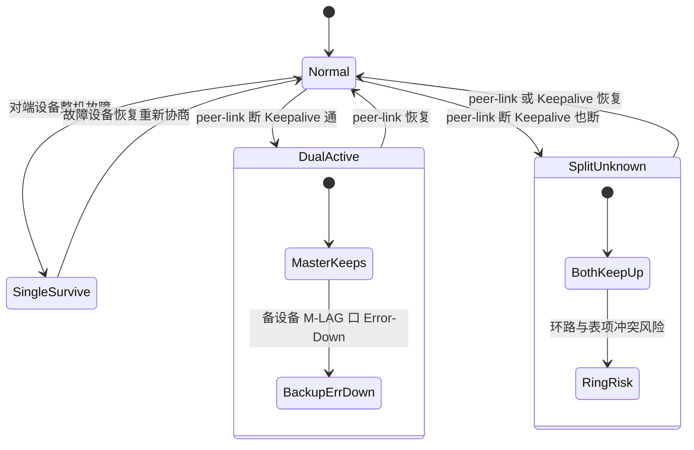

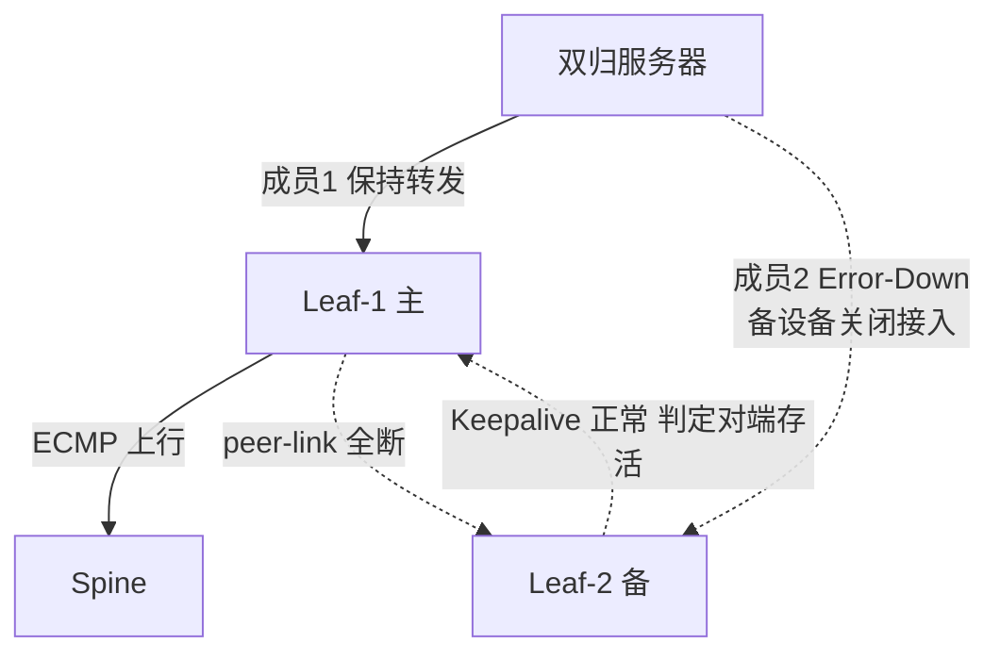

### 真题精练

**Q11.【真题·简答】** 某数据中心 M-LAG 系统中 peer-link 的两条成员链路同时中断，但 Keepalive 心跳正常。请说明：① 系统进入什么状态；② 两台设备分别如何动作；③ 如果此时 Keepalive 也中断，行为有何不同；④ 为什么设计上要这样区别对待。

> **答案与解析**：
> ① 系统进入 **Dual-Active（双主）状态**。
> ② **主设备**（DFS 优先级高者）的 M-LAG 成员口**保持 Up 并继续转发**；**备设备**的 M-LAG 成员口被置为 **Error-Down**，不再转发；同时产生双主告警。结果是备设备侧的单归服务器断网、双归服务器带宽降级，但网络**无环**。根本原因：能确定"对端仍存活"，就不能允许两台同时转发，必须二选一，否则同一 VLAN 出现两个转发点会产生环路与 MAC 表项冲突。
> ③ 如果 Keepalive 也中断，两台设备**都无法判定**对端是否存活，因此**不主动改变 M-LAG 成员口状态**（两端保持 Up、继续转发）。此时业务表面未中断，但接入侧**存在环路、广播/未知单播重复泛洪、MAC 表项冲突**的严重风险，必须依靠 Monitor Link/EFM/风暴抑制等外部加固手段兜底。
> ④ **设计哲学：行为由"判定能力"决定。** 能确定对端已死 → 可以放心全量接管（对端不可能再转发）；能确定对端活着 → 必须二选一（牺牲一半接入换无环）；无法判定 → 既不能全量接管（怕与对端形成双活环路）也不能全部关闭（怕双端全断），只能"维持现状 + 告警 + 依赖外部机制"。这也是为什么 Keepalive 必须走**带外管理网、物理路径独立、绝不与 peer-link 共用同一物理路由**——一旦两者同时失效，就落入最危险的场景 4。

**Q12.【真题·排错】** 监控告警显示某 Leaf 的 M-LAG 出现"双主"状态，且业务侧反映部分服务器断网、部分服务器时延抖动。请给出完整的定位与处置步骤。

> **答案与解析**（定位 → 影响评估 → 处置 → 根因）：
> 1. **确认双主事实**：`display dfs-group 1` 看主备角色与 peer-link/Keepalive 状态（预期：peer-link Down、Keepalive Up）；`display m-lag summary` 看双主告警；`display logbuffer | include Dual-Active` 看事件时间点。
> 2. **确认 peer-link 物理层**：`display interface Eth-Trunk 100` 与 `display eth-trunk 100 verbose` 看成员口状态；`display interface 100GE1/0/49` 看是否有光模块告警、CRC 错包、LOS；`display transceiver diagnosis interface 100GE1/0/49` 看光功率（**光衰过大是 peer-link 中断的常见物理原因**）。
> 3. **确认 Keepalive 正常**：能走到双主而非未知分裂，说明 Keepalive 是通的，这本身可作为定位线索——问题在 peer-link 一侧而非心跳。
> 4. **评估业务影响**：备设备 M-LAG 口 Error-Down → 备设备下挂的**单归服务器断网**；双归服务器聚合组降级、带宽减半，高峰时出现时延抖动。用 `display interface Eth-Trunk 10` 看剩余链路的利用率是否打满（打满即时延抖动的直接原因）。
> 5. **紧急处置**：① 优先恢复 peer-link 物理链路（换光模块/换光纤/换端口），恢复后 M-LAG 自动回归正常（Dual-Active → Normal），Error-Down 口自动恢复；② 若短时无法恢复，把关键单归服务器临时改接双归，或调整服务器 side bond 权重；③ **切忌在双主期间手工去 Up 备设备的 M-LAG 口**，会破坏无环保护。
> 6. **根因与整改**：检查 peer-link 两条成员是否走了**同一物理路径/同一板卡/同一光缆**（本次若同缆中断，说明冗余设计不满足"路径分离"原则）；整改为跨单板、跨走线槽、跨光缆；考虑把 peer-link 扩容到 4×100GE 并引入更高可靠的光路。

## 3.6 M-LAG 与 STP 的关系

### 考点定位

常考**判断/单选 + 简答**，占 **3~5 分**。命题点：① peer-link 上为什么不需要 STP（甚至必须关闭）；② M-LAG 接口下如何处理 BPDU；③ 既然 M-LAG 不用 STP，防环靠什么。易错点：认为"M-LAG 场景全局可以关闭 STP"（错，Fabric 内其他二层路径仍需 STP 或已被三层化）；认为"peer-link 上开启 STP 更安全"（错，会阻塞或影响 M-LAG 协议与跨设备流量）。

### 原理精讲

**先回答"环路在哪里"**。M-LAG 建立后，从二层拓扑视角看：服务器双归的两条链路被聚合成**一个跨设备逻辑链路**，逻辑上**不存在环路**——流量从服务器进入聚合组，聚合组内的成员口属于同一个逻辑端口，不会形成"出去又回来"的路径。所以在 **M-LAG 成员口这段**，STP 没有存在的必要。

**peer-link 上为什么不需要（而且应关闭）STP？** 有三个层面的原因：

1. **peer-link 是 M-LAG 系统的"内部链路"，不是普通转发链路**。它承载 M-LAG 协议报文、跨设备业务流量与表项同步。一旦让它参与 STP 并被置为 Blocking/Discarding，会直接切断上述三类流量：M-LAG 协议报文发不出去 → 两端无法协商 → 成员口 Error-Down；跨设备业务流量被丢 → 单归服务器与跨设备流量全部中断。因此 peer-link 必须**始终处于转发状态**。
2. **peer-link 上本来就不构成 STP 意义上的环路**。两台 M-LAG 设备各自只有一个逻辑接入点（聚合组），peer-link 是这两点之间的"内部通道"，不是被 STP 用来打破的用户环路。防环职责由 **DFS 的双主检测机制**承担，而不是 STP。
3. **关闭 STP 可避免 STP 收敛过程干扰 M-LAG**。若 peer-link 参与 STP，链路抖动会触发 STP 拓扑变化、TC 泛洪、MAC 表刷新，与 M-LAG 的表项同步机制相互冲突，产生不必要的收敛时间与瞬时丢包。

**M-LAG 接口下的 BPDU 处理**：M-LAG 成员口面向服务器，服务器理论上不发 BPDU。但仍有两种现实情况需要处理：
- **服务器/虚拟化平台误发 BPDU**（例如宿主机装了某些桥接软件、或服务器侧接了一台小交换机）。这会干扰 M-LAG 口的 STP 状态，甚至引发拓扑变化。对策：在 M-LAG 成员口上配置 **BPDU 保护（`stp bpdu-protection`）** 或直接 `stp disable`；同时 M-LAG 成员口推荐 `stp disable`（因为聚合组无环，不需要 STP 收敛）。
- **M-LAG 成员口下挂交换机（多级接入）**：若服务器机柜内有接入小交换机，则二层域扩大，可能在"小交换机 + 两台 Leaf + peer-link"之间形成环路。此时**不能简单关闭 STP**，需要在正确的边界上保留 STP：让 M-LAG 成员口**参与 STP 但处于边缘端口（edged-port）**，并在小交换机侧保证无环；或者直接以三层方式终结（Leaf 做网关），把二层域压到最小。**这也是数据中心"二层域越小越好"原则的具体体现**。

**既然 M-LAG 不靠 STP 防环，靠什么？** 靠四层防护：① **DFS 双主检测**（最核心，防"两个转发点"）；② **表项同步一致**（防转发错向与表项翻转）；③ **受控泛洪**（未知单播/广播的同步与抑制）；④ **外部加固**（Monitor Link、风暴抑制、BPDU 保护）。考试若问"M-LAG 如何防环"，标准答案就是以 DFS 双主检测为核心的这套机制，而不是"靠 STP"。

### 关键概念对照表

| 位置 | 是否启用 STP | 原因 | 建议配置 |
|---|---|---|---|
| peer-link（Eth-Trunk 100） | **关闭** | 必须始终转发，承载协议+跨设备流量+同步；参与 STP 会被阻塞 | `stp disable` |
| M-LAG 成员口（面向纯服务器） | **关闭** | 聚合组逻辑无环，无需 STP 收敛；避免 STP 抖动影响 | `stp disable` + `stp bpdu-protection` |
| M-LAG 成员口（下挂交换机） | 启用（边缘端口） | 二层域扩大，需 STP 兜底 | 保留 STP，设边缘端口，控制二层域 |
| Fabric 内其他二层路径 | 视设计 | 同 VLAN 跨 Leaf 的二层延伸仍是环路风险源 | 优先用 VXLAN 分布式网关做三层化 |
| 上行到 Spine（三层） | 不涉及 | 三层链路无 STP | 配置 `stp disable` 或三层口 |
| 服务器侧 bond | 不参与 STP | 服务器做聚合，不发 BPDU | 服务器侧启用 LACP 而非 STP |

### 华为设备配置

```bash
# ================= peer-link 与 M-LAG 成员口的 STP 处理 =================
[Leaf-1] interface Eth-Trunk 100
[Leaf-1-Eth-Trunk100] stp disable                        // peer-link 必须关闭 STP，保证始终转发
[Leaf-1-Eth-Trunk100] quit

[Leaf-1] interface Eth-Trunk 10
[Leaf-1-Eth-Trunk10] stp disable                         // 面向纯服务器的 M-LAG 口关闭 STP
[Leaf-1-Eth-Trunk10] stp bpdu-protection                 // 若服务器误发 BPDU，接口被保护性关闭并告警
[Leaf-1-Eth-Trunk10] stp edged-port enable               // 若保留 STP，则设为边缘端口（二者按场景择一）
[Leaf-1-Eth-Trunk10] quit

# ================= 验证 STP 与 M-LAG 的关系 =================
<Leaf-1> display stp brief                               // 确认 peer-link 与 M-LAG 口不在 STP 计算范围内
<Leaf-1> display stp interface Eth-Trunk 10              // 若保留了 STP，看角色是否为 Edge/Designated
<Leaf-1> display m-lag consistency-check                 // 两端 STP 配置不一致会在此报出（一致性检查项之一）
<Leaf-1> display bpdu-protection interface Eth-Trunk 10  // 查看 BPDU 保护触发记录（若版本支持）

# ================= 若 M-LAG 口下挂交换机，需要保留 STP 的正确姿势 =================
[Leaf-1] stp mode mstp                                   // 使用 MSTP，便于多实例与负载分担
[Leaf-1] stp region-configuration
[Leaf-1-mst-region] region-name DC-FABRIC                // 两台 Leaf 必须配置完全相同的域参数
[Leaf-1-mst-region] instance 1 vlan 100 200              // 业务 VLAN 映射到实例 1
[Leaf-1-mst-region] active region-configuration          // 必须激活，否则不生效
[Leaf-1-mst-region] quit
```

### 示意图

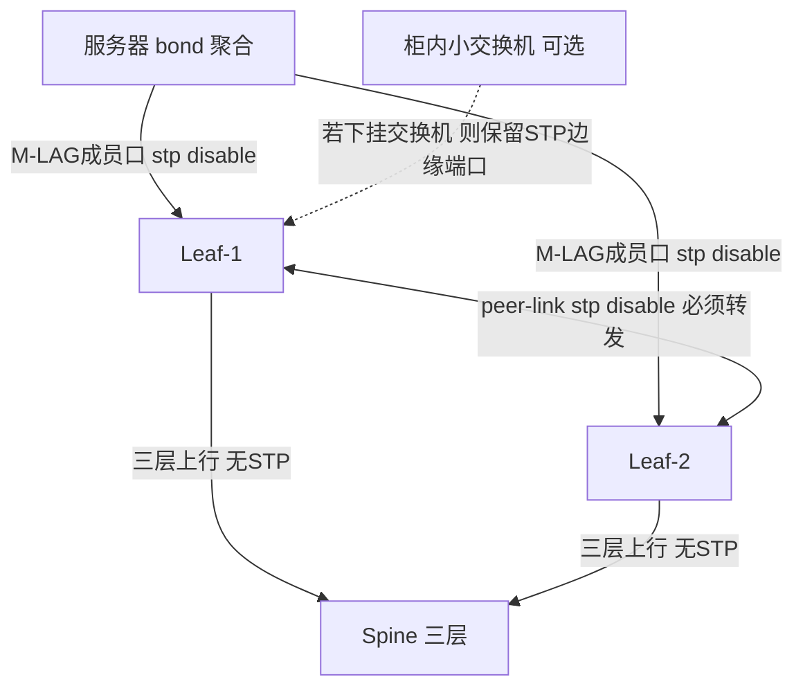

### 真题精练

**Q13.【真题·判断】** M-LAG 场景下 peer-link 应当启用 STP，以便在出现二层环路时自动阻塞。

> **答案：错误**
> **解析**：peer-link 是 M-LAG 系统的**内部转发链路**，承载 M-LAG 协议报文、跨设备业务流量与表项同步，必须**始终处于转发状态**。若启用 STP 并被计算为 Blocking/Discarding，会直接切断协议报文与跨设备流量，导致 M-LAG 协商失败、成员口 Error-Down、单归服务器与跨设备流量全部中断。M-LAG 的防环职责由 **DFS 双主检测 + 表项同步 + 受控泛洪 + 外部加固**承担，而不是 STP。注意区分：**"peer-link 不启用 STP"不等于"整个 Fabric 关闭 STP"**——若 M-LAG 成员口下挂交换机、二层域被扩大，仍需要在正确的边界上保留 STP（边缘端口/MSTP 实例）。

**Q14.【真题·多选】** 关于 M-LAG 成员口的 BPDU 处理，正确的做法或说法有：
A. 面向纯服务器的 M-LAG 成员口可配置 `stp disable`
B. 若服务器误发 BPDU，可配置 `stp bpdu-protection` 使接口被保护性关闭并告警
C. M-LAG 成员口下挂交换机时，应保留 STP 并设为边缘端口，或干脆把网关下沉做三层终结
D. M-LAG 成员口收到 BPDU 说明一定有环路，必须立即关闭 STP 全局
E. 两端 STP 配置不一致不会影响 M-LAG 建立

> **答案：A、B、C**
> **解析**：A 正确——聚合组逻辑无环，无需 STP 收敛，关闭可避免抖动。B 正确——`stp bpdu-protection` 正是为"终端侧误发 BPDU"设计的保护机制。C 正确——二层域扩大后必须保留 STP 兜底，边缘端口 + 控制二层域（或三层化）是标准做法。D 错——收到 BPDU 只说明对端有桥功能，可能是服务器装了桥接软件或下挂了小交换机，不一定构成环路，且"全局关闭 STP"是危险操作。E 错——STP 模式/实例/VLAN 映射是 **M-LAG 一致性检查项**之一，不一致会导致检查告警，严重时影响 M-LAG 建立。

## 3.7 M-LAG 与 VRRP 配合：双活网关设计

### 考点定位

**设计题高频考点**，占 **4~8 分**。命题方式：① 为什么推荐 M-LAG 主备与 VRRP 主备**角色一致**；② 不一致时会出现什么现象；③ 双活网关的几种实现方式对比（VRRP 主备 vs VXLAN 分布式网关）。易错点：把"双活"误解为"两台设备都用 VRRP 虚拟 MAC 转发"（VRRP 虚拟 MAC 同一时刻只在 Master 上生效）、忽略 BFD 在 VRRP 与 M-LAG 中配置冲突的可能。

### 原理精讲

**M-LAG 解决"链路与设备冗余"，VRRP 解决"三层网关冗余"，二者必须配合才能构成完整的双活网关。**

**① VRRP 主备与 M-LAG 主备的"两个主备"**。这是本题的核心：系统里同时存在两套主备关系——

- **DFS Group 主备**（M-LAG 视角）：由 `dfs-group priority` 决定，**主设备在双主场景下拥有"M-LAG 成员口保持转发"的优先权**；它决定"peer-link 故障时谁继续转发"。
- **VRRP Master/Backup**（三层网关视角）：由 VRRP 优先级 + 抢占决定，**Master 持有虚拟 MAC（华为默认 00e0-fc00-01xx 形式）并响应网关 ARP**；它决定"服务器网关的虚拟 MAC/IP 由谁应答与转发"。

**② 为什么必须让两者一致（推荐主备一致）？** 关键在于"虚拟 MAC 只在 VRRP Master 上生效"这条铁律：

- **如果一致**（DFS 主 = VRRP Master）：
  - 服务器 → 外部：服务器把网关 MAC 解析为虚拟 MAC，发往网关的帧只会被 **Master** 正确处理转发（就近转发，**不经 peer-link**）；若服务器从 Backup 侧链路发出，Backup 也不持有虚拟 MAC，需经 peer-link 转给 Master。
  - 外部 → 服务器：上游按路由/ECMP 可能命中任一台，命中的设备查表后把流量交给持有虚拟 MAC 的 Master（或直接按目的 MAC 下送），路径短、可控。
  - peer-link 上的跨设备流量最小，带宽压力最低。
- **如果不一致**（DFS 主 = Leaf-1，VRRP Master = Leaf-2）：双主（peer-link 断）时会发生**角色冲突**——M-LAG 机制认为 Leaf-1 是主、保留其成员口转发，但**VRRP 虚拟 MAC 却在 Leaf-2 上**。此时 Leaf-2 的 M-LAG 成员口被 Error-Down，而 Leaf-2 恰恰是持有网关虚拟 MAC 的设备：**上行要经 peer-link 到 Leaf-2，下行也要到 Leaf-2，但 Leaf-2 的接入口已关闭** → 结果是大规模流量需经 peer-link 绕行、peer-link 带宽被打满，甚至出现网关不可达/流量黑洞。**这就是"必须主备一致"的根本原因。**

**③ 双活网关的三种实现路径对比**：

| 方案 | 机制 | 优点 | 缺点 | 典型场景 |
|---|---|---|---|---|
| M-LAG + VRRP 主备 | 两台 Leaf 用同一虚拟 IP/虚拟 MAC，Master 转发 | 服务器无感、兼容性好、配置简单 | 虚拟 MAC 单点 → 跨设备转发/黑洞风险；需主备角色对齐；网关带宽不能纵向扩展 | 中小规模 DC、传统业务区 |
| M-LAG + VXLAN 分布式网关（推荐） | 每台 Leaf 都有 Vbdif，**各 Leaf 使用自己的实 MAC**（或统一 anycast MAC 但各设备独立转发） | 网关无主备、本地就近转发、横向扩展、VM 迁移网关不变 | 需要 VXLAN/EVPN 能力与 Underlay 支撑；规划复杂 | 大型云化 DC、多租户 |
| M-LAG + anycast VTEP（EVPN 多活） | 同一 VNI 下两台设备用**同一个 NVE 源地址（anycast VTEP）**，彼此通过 peer-link 同步表项 | 对外呈现单一 VTEP，收敛快，配置对称 | 要求两端 NVE 配置完全一致（一致性检查严格）；ESI 场景更复杂 | 大规模 Fabric、EVPN 多活 |

**④ 如果确实要保留 VRRP，如何确保角色一致？** 两条实践规则：
- 把同一台设备的 **DFS 优先级**与 **VRRP 优先级**都设为高值（如 DFS 150 / VRRP 120），并在 VRRP 上启用**抢占（preempt）**、设置足够长的抢占延时，避免两者切换时机不一致；
- **注意 VRRP 与 M-LAG 的 BFD 冲突**：M-LAG 已使用 Keepalive 做双主检测，若再为 VRRP 配置 BFD，需确保 BFD 会话的源/目的地址与 Keepalive 不冲突、会话数不超规格；部分版本下 M-LAG 与 VRRP BFD 存在互斥或需要特定会话模式，规划前应查版本说明。

### 关键概念对照表

| 维度 | DFS Group 主备 | VRRP Master/Backup |
|---|---|---|
| 决定者 | `dfs-group priority`（数值大者优先，默认 100） | VRRP `priority`（数值大者优先，默认 100）+ 抢占 |
| 作用 | 双主时谁保留 M-LAG 成员口转发 | 谁持有虚拟 MAC 并响应网关 ARP |
| 是否承载虚拟 MAC | 否 | **是**（华为默认虚拟 MAC 由 Master 持有） |
| 故障切换时机 | peer-link 故障/成员设备故障 | Master 故障或优先级变化 |
| 与对端关系 | 需要两端配置一致（组号/M-LAG ID） | 同一 VRRP 组、同一 virtual-router-id |
| 推荐配置 | 高优先级设备与 VRRP Master 落在同一台 | 启用抢占、延时 ≥ 30s 便于 M-LAG 稳定 |
| 冲突后果 | 角色不一致 → 跨设备绕行、peer-link 拥塞 | 虚拟 MAC 与保留转发权分离 → 黑洞风险 |

| 场景 | 上传方向 | 下载方向 | 是否经 peer-link |
|---|---|---|---|
| 主备一致 · 流量进 Master | Master 转发上行 | Master 下送 | 否 |
| 主备一致 · 上行进 Backup | Backup → peer-link → Master | Master 下送 | 是（上行） |
| 主备一致 · 下行进 Backup | — | Backup → peer-link → Master | 是（下行） |
| **主备不一致** | 大量流量集中到持虚拟 MAC 的设备 | 同上 | **是（且量大，易拥塞）** |

### 华为设备配置

```bash
# ================= Leaf-1：M-LAG 主 + VRRP Master（角色一致） =================
[Leaf-1] interface Vlanif 100                            // 业务 VLAN 100 的网关
[Leaf-1-Vlanif100] description Gateway-VLAN100
[Leaf-1-Vlanif100] ip address 192.168.100.2 24          // 本机实地址（两台各不同）
[Leaf-1-Vlanif100] vrrp vrid 100 virtual-ip 192.168.100.1   // 虚拟网关地址（两台必须相同）
[Leaf-1-Vlanif100] vrrp vrid 100 priority 120           // VRRP 主：数值大者优先
[Leaf-1-Vlanif100] vrrp vrid 100 preempt-mode timer delay 30  // 抢占延时 30s，避免与 M-LAG 切换抖动叠加
[Leaf-1-Vlanif100] quit
[Leaf-1] dfs-group 1
[Leaf-1-dfs-group-1] priority 150                        // DFS 主（150 > 120），与 VRRP Master 一致
[Leaf-1-dfs-group-1] quit

# ================= Leaf-2：M-LAG 备 + VRRP Backup（角色一致） =================
[Leaf-2] interface Vlanif 100
[Leaf-2-Vlanif100] ip address 192.168.100.3 24
[Leaf-2-Vlanif100] vrrp vrid 100 virtual-ip 192.168.100.1
[Leaf-2-Vlanif100] vrrp vrid 100 priority 100           // 备：低于 120
[Leaf-2-Vlanif100] vrrp vrid 100 preempt-mode timer delay 30
[Leaf-2-Vlanif100] quit
[Leaf-2] dfs-group 1
[Leaf-2-dfs-group-1] priority 120                        // DFS 备（120 < 150），与 VRRP Backup 一致
[Leaf-2-dfs-group-1] quit

# ================= 验证：确认两套主备关系落在同一台 =================
<Leaf-1> display dfs-group 1 brief                       // 期望：本机 Master
<Leaf-1> display vrrp                                    // 期望：vrid 100 状态 Master
<Leaf-2> display dfs-group 1 brief                       // 期望：本机 Backup
<Leaf-2> display vrrp brief                              // 期望：vrid 100 状态 Backup
<Leaf-1> display vrrp statistics                         // 看是否有频繁主备切换（频繁切换说明优先级/抢占配置不当）
<Leaf-1> display vrrp interface Vlanif 100 verbose       // 看虚拟 MAC 与实 MAC（虚拟 MAC 只在 Master 生效）
```

### 示意图

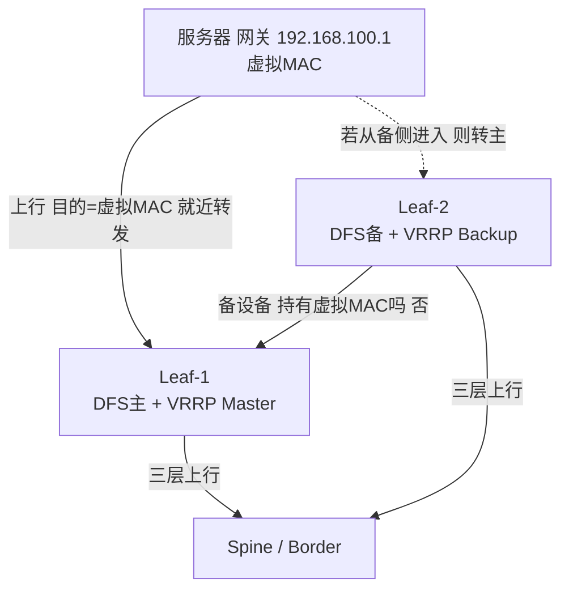

### 真题精练

**Q15.【真题·简答】** 为什么推荐 M-LAG 的 DFS 主设备与 VRRP 的 Master 落在同一台设备上？如果二者不一致，可能出现什么问题？

> **答案与解析**：
> 1. **理由一（转发路径）**：VRRP 虚拟 MAC 同一时刻**只在 Master 上生效**。若 DFS 主与 VRRP Master 一致，服务器上行的网关流量能就近在本机完成三层转发，**不经 peer-link**；外部下行流量也能在持有虚拟 MAC 的设备上一次到位。这使 peer-link 上的跨设备流量最小化。
> 2. **理由二（故障场景一致性）**：peer-link 全断进入 Dual-Active 时，M-LAG 机制保留 **DFS 主设备**的成员口转发，而网关虚拟 MAC 在 **VRRP Master** 上。若两者是同一台，则"保留转发的设备"就是"持有网关 MAC 的设备"，业务可用性最好。
> 3. **不一致的后果**：假设 DFS 主 = Leaf-1、VRRP Master = Leaf-2。Dual-Active 时 Leaf-2（备）的 M-LAG 成员口被 Error-Down，但 Leaf-2 恰恰持有网关虚拟 MAC —— 上行流量必须经 peer-link 绕到 Leaf-2 处理，下行流量也集中在 Leaf-2，结果是 **peer-link 带宽被大量跨设备流量打满**、转发时延上升，严重时出现**网关不可达/流量黑洞**。同时两端角色判断"打架"，给排错带来极大困难。
> 4. **最佳实践**：同一台设备的 DFS 优先级与 VRRP 优先级都设为高值；VRRP 启用抢占并设置 ≥30s 抢占延时（让 M-LAG 先稳定，再切换 VRRP）；或直接采用 **VXLAN 分布式网关**，从根本上消除"网关主备"这一单点。

**Q16.【真题·比较】** 对比"M-LAG + VRRP 主备网关"与"M-LAG + VXLAN 分布式网关"两种双活网关方案，说明各自适用场景。

> **答案与解析**：
> 1. **M-LAG + VRRP 主备**：两台 Leaf 配置相同虚拟 IP 与虚拟 MAC，Master 转发。优点：服务器完全无感（只看到一个网关）、对 Underlay 无特殊要求、配置与排错简单、兼容老业务。缺点：① 网关是"主备"，Master 承担全部三层转发，无法横向扩展；② 虚拟 MAC 单点导致跨设备转发（peer-link 承压）；③ 需要手工保证 DFS 与 VRRP 角色一致，运维要求高。适用：**中小规模 DC、传统业务区、尚未部署 VXLAN 的场景**。
> 2. **M-LAG + VXLAN 分布式网关**：每台 Leaf 都是网关（Vbdif + 同一 anycast 网关 MAC），VM 在任意 Leaf 上都能就近三层转发，网关无主备。优点：① 网关横向扩展、无单点；② 同 VNI 内东西向流量**本地就近转发**，不绕行；③ VM 跨 Leaf 迁移后网关 MAC/IP 不变，业务不感知迁移。缺点：需要 VXLAN/EVPN 与 Underlay 支撑，规划复杂（VNI 规划、RR 部署、anycast VTEP 一致性）。适用：**大型云化 DC、多租户、东西向流量占主导的 Fabric**。
> 3. **结论**：新建大型 DC 优先选分布式网关；存量改造或被服务器/业务限制无法上 VXLAN 时，用 M-LAG + VRRP 并严格对齐主备角色。

## 3.8 M-LAG 与 VXLAN/EVPN 结合

### 考点定位

**HCIE 层最"值钱"的考点之一**，常以简答/设计/对比形式出现，占 **6~10 分**。命题点：① M-LAG 作为 VTEP 时用 anycast VTEP 还是各自独立地址；② ESI 多活与纯 EVPN 多活的区别；③ M-LAG + EVPN 与 "纯 EVPN 多活（无 peer-link）"的取舍。易错点：认为"上了 EVPN 就不需要 M-LAG"（二者解决不同层次问题，且纯 EVPN 多活有额外要求）、把 ESI 的 DF 选举与 DFS Group 主备混为一谈。

### 原理精讲

**① M-LAG 作为 VTEP 的两种做法。**

- **做法一：anycast VTEP（推荐）**。两台 M-LAG 设备配置**完全相同的 NVE 源地址**（同一个 Loopback 地址，如 10.255.0.1/32），形成一个逻辑 VTEP。好处：接入侧交换机/其他 VTEP 只看到**一个** VTEP 地址，无需要求对端支持多活接入能力；ARP/MAC 表项由 M-LAG 的 peer-link 同步保证一致；M-LAG 建立时两端 NVE 配置必须完全一致（**一致性检查会强校验**）。本端 VM 访问同 VNI 内对端成员口下的 VM 时，走 peer-link 转发。
- **做法二：各用独立 VTEP 地址 + EVPN ESI 多活**。两台设备有各自的 NVE 源地址，通过 BGP EVPN 通告 **ESI（Ethernet Segment Identifier，以太网段标识）**与 **DF（Designated Forwarder，指定转发者）选举**来实现多活接入。此时同一 ESI 下的 BUM（Broadcast/Unknown unicast/Multicast）流量只由 DF 转发，避免重复泛洪。

**② ESI 与 EVPN 多活的机制要点**（用来回答"与纯 EVPN 多活的对比"）：

- **ESI**：标识"一段以太网段"（即一对或多对设备与接入设备之间的多条链路构成的逻辑段）。两台 M-LAG 设备在**同一个接入链路**（同一 Eth-Trunk / 同一 M-LAG ID）上配置**相同的 ESI**（10 字节，可用 `esi 0 0011-2233-4455-6677-8899` 这类形式配置）。相同 ESI 表示"我们连的是同一个客户侧设备"。
- **DF 选举**：在属于同一 ESI 的成员设备之间，根据 **ESI 优先级（数值越小越优）** 与源 IP（VTEP 地址）等规则，选出**唯一**的 DF。**DF 负责转发该 ESI 上的 BUM 流量**，非 DF 设备不转发（避免重复泛洪）。这与 M-LAG 的 DFS 主备**目的不同**：DFS 主备解决"双主时谁保留转发权"，ESI DF 解决"BUM 谁来转发"。
- **本地优先（Local Bias）**：EVPN 多活下，单播流量仍遵循"就近/本地优先"，避免流量绕行。
- **与 M-LAG 的配合**：华为实现中，M-LAG + EVPN 多活可同时存在——M-LAG 负责接入侧的链路聚合与表项同步，EVPN/ESI 负责 Overlay 侧的多活接入表达能力。两者叠加时，**ESI 配置也必须两端一致**，否则会引发 BUM 重复泛洪或 DF 选举异常。

**③ 与"纯 EVPN 多活（无 peer-link）"的对比**（这是本节最常考的对立项）：

| 维度 | M-LAG 方案 | 纯 EVPN 多活（ESI + DF，无 peer-link） |
|---|---|---|
| 设备间互联 | **必须有直连 peer-link + Keepalive** | **不需要 peer-link/心跳**，设备间仅需三层可达（Underlay） |
| 表项同步方式 | 数据面同步 MAC/ARP（peer-link 承载） | **控制面同步**（BGP EVPN 路由通告）为主 |
| 接入侧要求 | 接入设备按普通聚合组处理即可 | 接入设备需支持 ESI 多活（或由网络侧主导） |
| 距离限制 | peer-link 直连 → 两台设备必须**同机房、相邻机柜** | 无直连要求 → 可跨机房、跨 POD 部署 |
| 规模扩展 | peer-link 带宽与表项同步成为瓶颈 | 无 peer-link 瓶颈，扩展性更好 |
| 故障域 | 两台设备构成紧耦合系统（双主场景复杂） | 耦合更松，靠控制面收敛 |
| 配置复杂度 | 中等，配 DFS/peer-link/Keepalive 三件套 | 高，需规划 ESI、DF、EVPN 路由类型 |
| 收敛速度 | 表项同步快，切换快 | 依赖 EVPN 路由收敛（可配合 BFD 加速） |
| 典型适用 | Leaf 双归接入、同 POD 内双活 | 跨 POD/跨机房多活、大规模云 Fabric |

**④ 结论**：M-LAG 与 EVPN 多活**不是替代关系而是互补关系**——M-LAG 解决"接入侧两台设备的链路聚合与紧耦合双活（同机柜）"，EVPN 多活解决"广域/跨 POD 的多活接入与松耦合"。HCIE 设计题的标准答法：**同 POD 内 Leaf 双归用 M-LAG（可按需叠加 ESI/anycast VTEP）；跨 POD/跨 DC 的多活接入用 EVPN 多活（ESI + DF）**，两者可在同一 Fabric 中共存。

### 关键概念对照表

| 概念 | 谁定义 | 作用 | 关键参数 | 与 M-LAG 的关系 |
|---|---|---|---|---|
| anycast VTEP | Overlay 部署方式 | 两台设备共用一个 NVE 源地址，对外呈现单一 VTEP | NVE 源地址必须两端一致 | 依赖 M-LAG 表项同步保证一致 |
| ESI | EVPN（RFC 7432） | 标识"一段以太网段"，供多活接入使用 | ESI 10 字节，同一接入段两端必须相同 | 可与 M-LAG 叠加，需两端一致 |
| DF | EVPN 多活 | 该 ESI 上 BUM 流量的唯一转发者 | DF 选举依据 ESI 优先级（小者优）与源 IP | 与 DFS 主备目的不同（BUM vs 双主接管） |
| Local Bias | EVPN 多活优化 | 单播优先本地转发，避免绕行 | 本地优先开关 | 与 M-LAG 本地优先转发理念一致 |
| Vbdif | VXLAN 三层网关 | 每个 VNI 的三层网关接口 | 关联 VNI 与 BD | 分布式网关下无需 VRRP |

| 对比项 | M-LAG + anycast VTEP | 纯 EVPN 多活（ESI/DF） |
|---|---|---|
| 是否需要 peer-link | 需要（且承载业务） | 不需要 |
| 是否需要 Keepalive | 需要 | 不需要 |
| 部署灵活性 | 同机房双机 | 可跨机房/跨 POD |
| 一致性要求 | NVE/STP/VLAN 等多项需一致 | ESI/DF 参数需一致 |
| 扩展性 | 受 peer-link 限制 | 更好 |
| 运维复杂度 | 较低（模式统一） | 较高（需懂 EVPN 路由类型） |

### 华为设备配置

```bash
# ================= Leaf-1：M-LAG + VXLAN（anycast VTEP）+ BGP EVPN =================
[Leaf-1] interface LoopBack 1
[Leaf-1-LoopBack1] ip address 10.255.0.1 32              // anycast VTEP 地址：两台 Leaf 配置完全相同
[Leaf-1-LoopBack1] quit

[Leaf-1] interface Nve 1
[Leaf-1-Nve1] source 10.255.0.1                          // NVE 源地址 = anycast VTEP 地址
[Leaf-1-Nve1] vni 10000 head-end peer-list protocol bgp   // VNI 10000 通过 BGP EVPN 动态建立头端复制列表
[Leaf-1-Nve1] quit

[Leaf-1] bridge-domain 100                               // 二层广播域，与 VNI 绑定
[Leaf-1-bd100] vxlan vni 10000                           // BD 100 ↔ VNI 10000 映射
[Leaf-1-bd100] quit

[Leaf-1] interface Vbdif 100                             // 分布式三层网关（无 VRRP，各 Leaf 独立转发）
[Leaf-1-Vbdif100] ip address 192.168.100.1 24            // 两台 Leaf 使用相同的网关地址（anycast 网关）
[Leaf-1-Vbdif100] mac-address 0000-5e00-0101             // 统一的网关 MAC，保证 VM 迁移后网关不变
[Leaf-1-Vbdif100] quit

[Leaf-1] bgp 65001
[Leaf-1-bgp] router-id 10.255.0.1
[Leaf-1-bgp] peer 10.0.0.1 as-number 65000               // 与 Spine（RR）建 EBGP
[Leaf-1-bgp] peer 10.0.0.1 connect-interface LoopBack0   // 用 Loopback 建会话，需 Underlay 可达
[Leaf-1-bgp] l2vpn-family evpn
[Leaf-1-bgp-af-evpn] peer 10.0.0.1 enable                // 使能 EVPN 地址族
[Leaf-1-bgp-af-evpn] peer 10.0.0.1 advertise irb         // 通告 IRB 类型路由（分布式网关必需）
[Leaf-1-bgp-af-evpn] quit
[Leaf-1-bgp] quit

# --- 若采用 ESI 多活接入（接入侧需多活表达时） ---
[Leaf-1] interface Eth-Trunk 10
[Leaf-1-Eth-Trunk10] esi 0 0011-2233-4455-6677-8899      // 同一接入段两端 ESI 必须一致
[Leaf-1-Eth-Trunk10] esi precedence 100                   // 数值小者优先成为 DF（两端需按规划设置）
[Leaf-1-Eth-Trunk10] quit

# ================= 关键验证命令 =================
<Leaf-1> display nve                                          // 确认 NVE 源地址与 VNI 状态
<Leaf-1> display vxlan vni                                    // VNI 与 BD 映射、头端复制列表状态
<Leaf-1> display bgp evpn peer                                // EVPN 邻居状态
<Leaf-1> display bgp evpn all routing-table                   // EVPN 五类路由（Type1~5）学习情况
<Leaf-1> display bgp evpn instance                            // EVPN 实例与 ESI/DF 状态
<Leaf-1> display m-lag consistency-check                       // NVE/VNI 配置不一致会在此报出
```

### 示意图

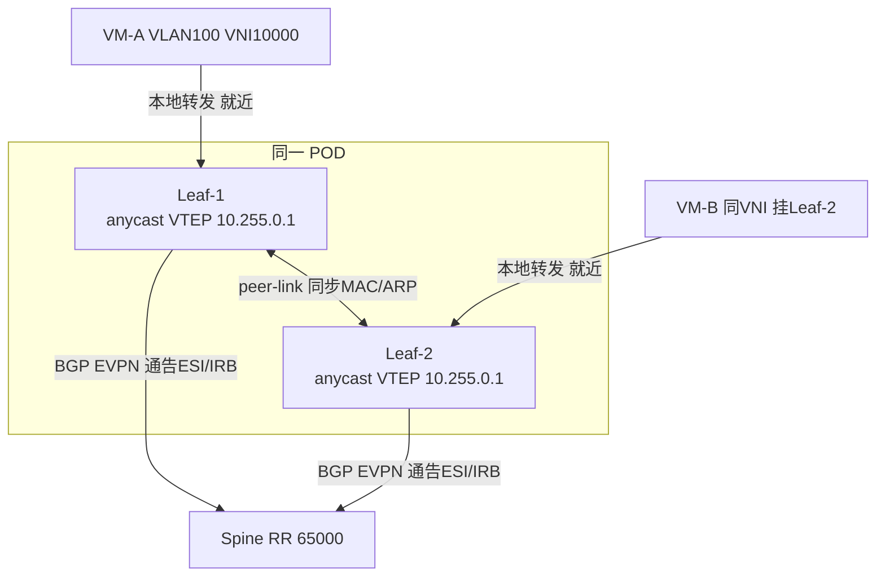

### 真题精练

**Q17.【真题·简答】** 说明 M-LAG 与 EVPN 多活（ESI + DF）在解决"多活接入"问题上的分工，并指出为什么大规模 Fabric 中两者常常并存而不是二选一。

> **答案与解析**：
> 1. **M-LAG 的职责**：解决**接入侧**两台设备（同机房、相邻机柜）的链路聚合、带宽叠加与**紧耦合双活**。它依赖 **peer-link**（承载跨设备流量与 MAC/ARP 表项同步）和 **Keepalive**（双主检测），因此两台设备**必须直连、必须在同一机房**。它让服务器/接入交换机只看到一个跨设备聚合组。
> 2. **EVPN 多活（ESI + DF）的职责**：解决**Overlay 侧**的"同一以太网段被多台设备多活接入"的表达与控制面协同。通过**相同 ESI** 声明"我们连的是同一个客户侧设备"，通过 **DF 选举**保证该 ESI 上的 BUM 流量只由一个设备转发，避免重复泛洪。它**不需要 peer-link**，只要求 Underlay 三层可达，因此可以**跨 POD、跨机房**部署。
> 3. **分工边界**：M-LAG 管"链路与表项的紧耦合"（同机柜、数据面同步）；EVPN 多活管"接入段的多活表达与 BUM 控制"（可跨距离、控制面同步）。
> 4. **为什么并存**：同一 Fabric 中，**同 POD 内 Leaf 双归**用 M-LAG 即可（简单、成熟、切换快）；**跨 POD/跨 DC 的多活接入**必须靠 EVPN 多活（M-LAG 的 peer-link 不可能跨机房）。二者叠加时互不冲突：M-LAG 负责接入侧聚合，EVPN 负责 Overlay 表达，只需保证 **ESI/DF 参数两端一致** 与 **NVE/VNI 配置一致**（一致性检查项）。

**Q18.【真题·多选】** 关于 anycast VTEP 与 ESI/DF，下列说法正确的有：
A. anycast VTEP 要求两台 M-LAG 设备的 NVE 源地址配置完全相同
B. ESI 标识一段以太网段，同一接入段的两台设备必须配置相同的 ESI
C. DF 选举决定该以太网段上 BUM 流量由哪台设备转发，其优先级通常是数值小者优先
D. DFS Group 主备与 ESI DF 是同一个概念，都表示"谁转发 BUM 流量"
E. 纯 EVPN 多活（无 peer-link）可以跨机房部署，扩展性优于 M-LAG

> **答案：A、B、C、E**
> **解析**：A 正确——anycast VTEP 的意义就是"两台设备对外是一个 VTEP"，源地址必须相同，且 M-LAG 一致性检查会强校验 NVE 相关配置。B 正确——ESI 的作用就是声明"这条接入链路属于同一以太网段"。C 正确——DF 选举决定 BUM 的唯一转发者，ESI 优先级数值小者优（与 DFS 优先级方向相反，是典型混淆点，务必区分）。D 错——**DFS Group 主备**解决"peer-link 故障时谁保留 M-LAG 成员口转发权"（双主接管问题）；**ESI DF** 解决"该以太网段上的 BUM 流量由谁转发"（防重复泛洪），二者目的、触发条件、决策依据都不同。E 正确——纯 EVPN 多活不需要 peer-link 与 Keepalive，设备间仅需三层可达，因此可跨机房部署，也不受 peer-link 带宽瓶颈限制。

## 3.9 M-LAG 下的升级与维护（ISSU 与逐台升级）

### 考点定位

以**简答/判断**为主，占 **2~4 分**，但常与"为什么 DC 选 M-LAG 不选堆叠"联动出题。命题点：① M-LAG 逐台升级的正确顺序；② ISSU（In-Service Software Upgrade，在线业务升级）成立的前提条件；③ 为什么堆叠难以逐台升级。易错点：把"逐台升级"等同于"绝对零丢包"（实际存在主备切换瞬间的短暂收敛）。

### 原理精讲

**① M-LAG 逐台升级流程（标准动作序列）**：

1. **升级前检查**：`display dfs-group 1` 确认主备角色正常、`display m-lag summary` 无告警、`display m-lag consistency-check` 全部一致；`display version` 确认当前版本；备份配置（`save` 后导出 `vrpcfg.zip` 与配置文件）。
2. **先升备设备（Backup）**：备设备重启期间，其 M-LAG 成员口 Down，接入侧聚合组降级为单链路（**主设备承载全部流量**）。因此升级前必须确认**主设备与上行链路能承载全量业务**（收敛比、上行带宽、CPU 表项规格都要检查）。
3. **备设备升级完成后验证**：确认 M-LAG 重新建立（`display dfs-group 1 m-lag` 恢复 OK）、表项同步恢复、一致性检查通过。
4. **触发主备切换**：把当前主设备的 DFS 优先级**调低**（或把备设备调高），触发角色切换，使已升级的设备成为主设备。
5. **升级原主设备（现为备）**：此时业务由已升级的设备承载，原主设备重启不影响接入侧聚合组 Up（同样是"对端存活 + 本机重启"的降级而非中断）。
6. **升级后验证与回切**：恢复原优先级规划，确认两套主备关系（DFS + VRRP）重新对齐；观察一段时间的丢包、时延、MAC/ARP 表项与 peer-link 利用率。

**② 逐台升级 ≠ 零丢包。** 关键在步骤 2 与 5：升级备设备时，接入侧聚合组从 2 条成员降为 1 条，**服务器侧会感知链路数变化（LACP 重新协商），可能出现秒级抖动**；如果主设备上行带宽不足，会出现拥塞丢包。要做到接近无感，需要：① 上行带宽留有余量（避免升级期间打满）；② 服务器侧使用 LACP 且支持平滑降级；③ 控制升级窗口在业务低谷。

**③ ISSU 的前提条件（考试常考"为什么 M-LAG 可以做到不中断而堆叠很难"）**：

- **设备必须具备硬件冗余的转发平面（双主控 + 双转发/双交换网板）**，这是 ISSU 的硬件基础（如 **CE12800/16800 框式设备**的双主控、双交换网板）。M-LAG 的两台**盒式设备**（CE6865/6863/8850）没有双主控，因此**做不到真正意义上的"零中断 ISSU"**，只能做到"逐台升级 + 业务降级不中断"。
- **控制面与转发面解耦**：主控切换时转发平面继续按已有转发表转发（Graceful Restart/NSR 等机制保证控制面重启期间转发不中断）。
- **协议支持平滑重启**：BGP 需要 **NSR（Non-Stop Routing）** 或 GR（Graceful Restart）避免邻居震荡；IGP 需要 GR/NSR；M-LAG 本身在设备重启时由**对端继续转发**兜底。
- **两端版本兼容**：升级过程中两端的 M-LAG 版本可能不同（一台新、一台旧），必须查版本说明确认**跨版本 M-LAG 兼容性**（M-LAG 强校验版本一致，因此逐台升级窗口内的一致性检查可能报"版本不一致"告警，属于预期现象，但需确认业务仍正常）。

**④ M-LAG 与堆叠在升级上的对比（一句话得分点）**：堆叠/集群是**单一控制面**，主设备（主控）的软件版本决定了整组行为，逐台升级会导致控制面版本分裂、堆叠可能直接分裂成两台独立设备，因此**必须整体升级**（通常伴随业务中断）。M-LAG 是**独立控制面**，两台设备的升级互不影响控制面，因此可以"一台一台来"，这也是数据中心接入侧选 M-LAG 的关键运维理由。

### 关键概念对照表

| 维护动作 | M-LAG | 堆叠 / CSS |
|---|---|---|
| 软件升级 | **逐台升级**（先备后主） | 整体升级，通常需中断窗口 |
| 升级期间业务 | 降级（带宽减半）不中断 | 通常中断或需业务倒换 |
| 硬件基础 | 盒式设备无 ISSU；框式（CE12800/16800）可 ISSU | 框式 CSS 可借助双主控 ISSU |
| 控制面影响 | 无（两端独立） | 主控重启影响整组 |
| 版本兼容要求 | 逐台窗口内需确认跨版本兼容；一致性检查会报版本不一致 | 全组必须同版本 |
| 配置备份 | 需分别备份两端配置 | 备份一份 |
| 风险点 | 主设备需能承载全量流量；升级窗口抖动 | 升级失败可能整组分裂 |

### 华为设备配置

```bash
# ================= 升级前检查脚本（逐条执行，务必全部确认） =================
<Leaf-1> display dfs-group 1 brief                         // 1. 主备角色正常，本机为 Master/Backup 明确
<Leaf-1> display m-lag summary                             // 2. 无异常告警项
<Leaf-1> display m-lag consistency-check                   // 3. 一致性检查全通过
<Leaf-1> display version                                   // 4. 记录当前版本号（两台必须一致）
<Leaf-1> display eth-trunk 100 verbose                     // 5. peer-link 成员全 Up
<Leaf-1> display interface Eth-Trunk 10                    // 6. 估算现有流量，确认单机可承载全量
<Leaf-1> save                                              // 7. 保存配置
<Leaf-1> dir flash:                                        // 8. 记录 flash 空间，确认足够存放新版本

# ================= 备设备（Leaf-2）升级：先降级角色，再升级 =================
<Leaf-2> system-view
[Leaf-2] dfs-group 1
[Leaf-2-dfs-group-1] priority 100                          // 确认当前为备（优先级低于对端 150）
[Leaf-2-dfs-group-1] quit
<Leaf-2> save
# --- 例行维护窗口内执行版本加载与重启（示意，实际按版本升级指导书操作） ---
<Leaf-2> startup system-software CE6865-V200R019C10SPC500.cc   // 指定下次启动的软件包（版本号按实际）
<Leaf-2> display startup                                        // 确认下次启动包与当前包
<Leaf-2> reboot                                                 // 重启生效；此时业务由 Leaf-1 承载

# ================= 触发主备切换：把已升级设备提升为主 =================
# 方式一：把原主设备优先级调低（推荐，避免同时改两台）
<Leaf-1> system-view
[Leaf-1] dfs-group 1
[Leaf-1-dfs-group-1] priority 100                          // 降低原主优先级，触发切换
[Leaf-1-dfs-group-1] quit
<Leaf-1> display dfs-group 1 brief                         // 确认角色已切换（本机变 Backup）
<Leaf-2> display dfs-group 1 brief                         // 确认 Leaf-2 变 Master

# ================= 升级完成后：恢复优先级规划并验证 =================
<Leaf-1> system-view
[Leaf-1] dfs-group 1
[Leaf-1-dfs-group-1] priority 150                          // 恢复原规划（主）
[Leaf-1-dfs-group-1] quit
<Leaf-1> display dfs-group 1 m-lag                         // M-LAG 恢复正常
<Leaf-1> display m-lag consistency-check                   // 一致性检查重新全通过
<Leaf-1> display vrrp                                      // 确认 VRRP 主备与 DFS 主备再次对齐
<Leaf-1> display interface Eth-Trunk 100                   // 观察 peer-link 利用率是否回归正常水平
```

### 示意图

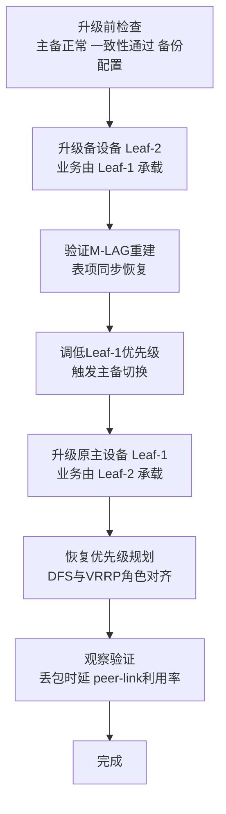

### 真题精练

**Q19.【真题·简答】** 请按正确顺序描述 M-LAG 场景下两台 Leaf 的软件升级流程，并说明为什么"逐台升级"不等同于"业务零丢包"。

> **答案与解析**：
> 1. **正确顺序**：① 升级前检查（角色、一致性、peer-link、单机承载能力、备份配置）；② **先升级备设备**（此时全部业务由主设备承载）；③ 验证备设备 M-LAG 重建与表项同步；④ **调低原主设备优先级，触发主备切换**，让已升级设备成为主设备；⑤ 升级原主设备（现为备）；⑥ 恢复优先级规划，确认 DFS 与 VRRP 角色重新对齐；⑦ 观察验证。
> 2. **为什么不是零丢包**：① 升级期间被升级设备的 M-LAG 成员口 Down，接入侧聚合组由 2 条成员降为 1 条，服务器侧 LACP 需要重新协商，存在**秒级抖动**；② 存活设备需独自承载全部流量，若上行带宽/收敛比没有余量，会出现**拥塞丢包**；③ 主备切换时（优先级调整）存在收敛过程，MAC/ARP 表项重新同步期间可能出现短暂未知单播泛洪；④ 盒式设备无双主控，**不具备真正 ISSU 的硬件基础**，因此只能做到"业务降级不中断"，而不是"绝对零丢包"。
> 3. **改进措施**：窗口安排在业务低谷；确认上行带宽余量；服务器侧使用 LACP 静态模式并支持平滑降级；框式设备（CE12800/16800）在有双主控前提下可用 ISSU 进一步降低中断。

**Q20.【真题·判断】** 与 M-LAG 相比，iStack 堆叠由于只有一个控制面，因此更容易实现逐台升级、升级期间业务影响更小。

> **答案：错误**
> **解析**：恰恰相反。堆叠/集群是**单一控制面**，主设备（主控）的软件版本决定整组行为；逐台升级会造成控制面版本分裂，堆叠可能因此**分裂为两台独立设备**，引发双主、配置冲突与业务中断，所以堆叠通常必须**整体升级**（且往往需要中断窗口）。M-LAG 两台设备控制面独立，升级一台时另一台完全不受影响、可独立承载业务，因此**M-LAG 的升级灵活性明显优于堆叠**——这也是数据中心接入侧倾向 M-LAG 的核心运维理由之一（另两条是控制面故障域隔离与配置一致性可检查）。

## 3.10 iStack / CSS / M-LAG 三者对比（虚拟化技术总览）

### 考点定位

**必考的"大对比"考点**，占 **4~6 分**，选择题与简答题都会出现。命题点：① 控制面合一 vs 独立的本质差异；② 堆叠的带宽（堆叠线缆/集群带宽）与可靠性问题；③ CSS 与 iStack 的区别（框式 vs 盒式、集群方式）；④ 三者适用场景。易错点：把 CSS/iStack 当成"数据中心双活方案"、认为堆叠后就没有双主问题（堆叠同样有双主检测）。

### 原理精讲

**先厘清三个概念**：

- **iStack（Intelligent Stack，智能堆叠）**：把**多台盒式交换机**（如 S5731/S6730 系列，也支持部分 CE 盒式）通过**堆叠口（物理业务口或专用堆叠口）**连接，合并为一台逻辑交换机。有一个**主交换机（Master）**、若干备交换机（Standby）与从交换机（Slave）；主交换机统一管理，配置是一份（实际会同步到各成员）。**堆叠线缆带宽有限**（常为 10GE/25GE 级别，且共享业务板卡带宽），是堆叠的固有瓶颈。
- **CSS（Cluster Switch System，集群交换机系统）**：把**两台框式交换机**（如 CE12800、S12700）通过**集群线（Cluster Cable，专用高速链路，如 2×100GE 或更多）**连接，合并为一台逻辑交换机。相比 iStack，CSS 面向高端框式、集群带宽更高、支持双主控与更完善的可靠性机制（如 MAD 双主检测）。**框式 CSS 可实现 ISSU（双主控 + 双交换网板）**，这是它与盒式 iStack 的关键差异之一。
- **M-LAG**：如 3.1 节所述，两台设备**控制面独立**，不合并为一台逻辑设备，只做接入侧跨设备聚合 + 表项同步 + 双主检测。

**① 控制面合一 vs 独立的本质差异**（本节核心）：

| 层面 | 堆叠/集群（合一） | M-LAG（独立） |
|---|---|---|
| 管理面 | 一个 IP、一份配置、一次登录 | 两个 IP、两份配置，需分别管理（NCE 可统一下发） |
| 控制面 | 单一控制面，主设备统一计算（STP 根、路由、ARP 代理等） | 两个控制面各自计算，通过同步机制保持一致 |
| 转发面 | 统一转发表（各成员芯片表项由主设备下发） | 各自转发表 + 跨设备表项同步 |
| 收敛 | 主设备故障需要重新选主（可能秒级） | 单台故障不影响对端控制面（亚秒级业务无感） |
| 一致性 | 天然一致（同一份配置） | 需一致性检查保证（可观测、可告警） |
| 扩展 | 堆叠成员数有限，堆叠带宽是瓶颈 | 只有两台成员，但可通过 EVPN 多活横向扩展 |

**② 堆叠的带宽与可靠性问题**（命题点）：

- **堆叠带宽瓶颈**：堆叠口承载"跨成员框/盒的转发流量"以及控制面同步流量。若堆叠口带宽远低于业务口带宽（例如成员各有 48×25GE 下行，堆叠口只有 2×10GE），跨成员流量会被堆叠口挤爆。因此堆叠设计必须核算**跨成员流量占比**，必要时用更多堆叠口（端口聚合）。
- **可靠性问题**：① **堆叠分裂（Split）**：堆叠线缆全部断开时，多个成员可能各自认为自己是主，形成**双主**（与 M-LAG 的双主类似），需要 **MAD（Multi-Active Detection，多主检测）**机制（直连 MAD、Relay MAD、代理 MAD）来检测并处理；② **主设备故障**：需要备交换机接管，涉及控制面重建与表项重新下发，收敛时间较长；③ **升级必须整体进行**。

**③ CSS 与 iStack 的区别**：

| 维度 | iStack（盒式堆叠） | CSS（框式集群） |
|---|---|---|
| 承载产品 | S5731/S6730 等盒式，部分 CE 盒式 | CE12800、S12700 等框式 |
| 连接方式 | 堆叠口（业务口或专用堆叠口） | 集群线（专用高速链路，2×100GE+） |
| 主控 | 各成员自有主控，选一台为主 | 两台框式各有双主控，集群主控角色 |
| 带宽 | 较低（堆叠口带宽有限） | 高（集群线专用高速） |
| 是否支持 ISSU | 一般不支持（无冗余主控） | **支持**（双主控 + 双网板） |
| 典型场景 | 园区接入/汇聚 | 园区核心、数据中心汇聚/核心 |
| 双主检测 | MAD（多种方式） | MAD / 集群双主检测 |

**④ 三者适用场景总结**（答设计题时的"选型口诀"）：

- **园区接入/汇聚** → iStack（简化管理、统一配置）；
- **园区核心 / 大型框式汇聚** → CSS（高可靠、可 ISSU、集群带宽高）；
- **数据中心 Leaf 双归接入 / ToR 双活** → **M-LAG**（控制面独立、升级不中断、故障域隔离）。

### 关键概念对照表

| 对比维度 | iStack 堆叠 | CSS 集群 | M-LAG |
|---|---|---|---|
| 逻辑设备数 | 1 台（多成员） | 1 台（2 框） | 2 台（独立） |
| 控制面 | 合一 | 合一 | **独立** |
| 配置文件 | 一份（主设备） | 一份 | 两份（需一致性检查） |
| 互联链路 | 堆叠口（10GE/25GE 常见） | 集群线（100GE+，专用） | peer-link（Eth-Trunk，如 2×100GE） |
| 心跳/双主检测 | MAD | MAD / 集群检测 | Keepalive + peer-link |
| 跨设备流量瓶颈 | 堆叠口带宽 | 集群线带宽 | peer-link 带宽 |
| 升级方式 | 整体升级 | 整体升级（框式可 ISSU） | **逐台升级** |
| 故障域 | 合并 | 合并（框内有冗余） | **隔离** |
| 典型产品 | S5731/S6730 | CE12800/S12700 | CE6865/6863/16800/8850/CE12800 |
| 典型场景 | 园区接入汇聚 | 园区/DC 核心 | **DC Leaf 双归** |

| 技术 | 双主风险来源 | 检测机制 | 处理方式 |
|---|---|---|---|
| iStack | 堆叠线全断 | MAD（直连/Relay/代理） | 按策略关闭一侧端口或整机 |
| CSS | 集群线全断 | MAD / 集群双主检测 | 一侧进入 Recovery 或关闭 |
| M-LAG | peer-link 断 | Keepalive 心跳 | 备设备 M-LAG 口 Error-Down（心跳通则） |

### 华为设备配置

```bash
# ================= 参考配置：园区 iStack（S5731，仅作对比理解，非 DC 方案） =================
<S5731-1> system-view
[S5731-1] stack slot 0 priority 150                      // 指定堆叠优先级，数值大者优先成为主
[S5731-1] interface stack-port 0/1
[S5731-1-Stack-Port0/1] port interface 10GE1/0/1 enable  // 将物理口配置为堆叠口
[S5731-1-Stack-Port0/1] quit
[S5731-1] stack slot 0 renumber 1                        // 修改槽位号（需重启生效）
[S5731-1] quit
<S5731-1> save
<S5731-1> reboot                                          // 堆叠建立需重启

# --- iStack 双主检测（MAD）配置示例 ---
[S5731-1] interface Vlanif 999
[S5731-1-Vlanif999] ip address 10.99.99.1 30             // MAD 检测地址（需与对端同网段）
[S5731-1-Vlanif999] quit
[S5731-1] mad detect mode relay                          // 指定 MAD 检测方式（direct/relay/proxy 按组网选）
[S5731-1] interface Eth-Trunk 20
[S5731-1-Eth-Trunk20] mad detect mode relay              // 在检测链路上使能 MAD

# ================= 参考配置：框式 CSS（CE12800）集群 =================
[CE12800-A] system-view
[CE12800-A] css enable                                   // 使能集群功能（需重启生效，按版本要求）
[CE12800-A] interface 100GE1/1/0/1
[CE12800-A-100GE1/1/0/1] quit
[CE12800-A] cluster                                    // 进入集群配置视图（命令形态按版本）
[CE12800-A-cluster] quit

# --- CSS 双主检测 ---
[CE12800-A] mad detect mode direct                       // 直连 MAD 检测（通过专用直连链路）
[CE12800-A] interface 100GE1/1/0/9
[CE12800-A-100GE1/1/0/9] mad detect mode direct          // 在直连检测口上使能

# ================= DC 场景：正确选择 M-LAG（推荐，不是 iStack/CSS） =================
<CE6865> display dfs-group 1 brief                       // M-LAG 主备角色
<CE6865> display m-lag summary                           // M-LAG 总体状态与告警
<CE6865> display m-lag consistency-check                 // 一致性检查（M-LAG 特有）
```

### 示意图

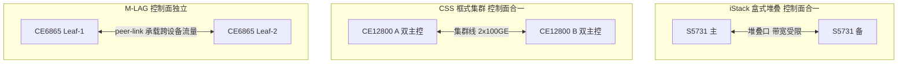

### 真题精练

**Q21.【真题·单选】** 关于 iStack、CSS 与 M-LAG 三者的本质差异，下列说法正确的是：
A. 三者都是"多台设备合并为一台逻辑设备"
B. 只有堆叠需要双主检测，M-LAG 不存在双主问题
C. iStack/CSS 控制面合一并共用一份配置，M-LAG 控制面独立并各自持有配置
D. M-LAG 的互联链路只承载协议报文，不承载业务流量

> **答案：C**
> **解析**：A 错——M-LAG 并**不**把两台设备合并为一台逻辑设备，它们仍是两台独立设备，只是接入侧呈现为一个跨设备聚合组。B 错——M-LAG 同样有双主问题（peer-link 故障即进入 Dual-Active），靠 Keepalive 检测；堆叠也有双主（堆叠分裂）靠 MAD 检测。C 正确。D 错——peer-link 不仅承载 M-LAG 协议报文，还承载**跨设备业务流量**与表项同步，这是它与"心跳线"最容易被混淆、也最常考的一点。

**Q22.【真题·简答】** 数据中心 Leaf 双归接入为什么选择 M-LAG 而不是 iStack/CSS？请从控制面、升级维护、故障域、带宽四个角度作答。

> **答案与解析**：
> 1. **控制面**：iStack/CSS 把两台设备合并为**单一控制面**，主设备（主控/主交换机）故障会影响整组，需重新选主并重建表项，收敛慢且有整组风险；M-LAG 两台设备**控制面独立**，一台的控制面故障不影响另一台，业务由存活设备继续承载。
> 2. **升级维护**：iStack/CSS 必须**整体升级**（逐台升级会导致控制面版本分裂甚至堆叠分裂），通常需要业务中断窗口；M-LAG 支持**逐台升级**（先备后主，配合优先级切换），升级期间业务降级但不中断。盒式 iStack 无冗余主控，不具备 ISSU 硬件基础；框式 CSS 虽有双主控可 ISSU，但仍在同一逻辑设备内，风险集中。
> 3. **故障域**：iStack/CSS 把两台设备的**故障域合并**——堆叠线/集群线故障会引发双主与整组震荡，配置一处出错影响全组；M-LAG 故障域隔离，且两端配置不一致可通过 `display m-lag consistency-check` 显性化、可告警、可分批修复。
> 4. **带宽**：堆叠口/集群线的带宽常低于业务口总带宽，跨成员流量受其限制，容易成为瓶颈；M-LAG 的 peer-link 虽也是瓶颈，但由于**本地优先转发**机制，正常流量不绕行 peer-link，只有真正需要跨设备转发的流量才占用它，实际压力更可控，且可通过增加 peer-link 成员与规划单归/双归比例来优化。
> 5. **结论**：数据中心 Leaf 双归接入选 **M-LAG**；园区接入/汇聚选 **iStack**；园区或 DC 核心的框式虚拟化选 **CSS**。三者定位不同，不可互相替代。

## 3.11 M-LAG 常用 display 命令与一致性检查清单

### 考点定位

以**排错题与实验题**为主，占 **3~5 分**。命题点：① 给出典型故障，问用哪条命令定位；② "M-LAG 不一致性检查项清单"（简答题常直接要求列举）；③ `display m-lag consistency-check` 报出不一致时的定位步骤。易错点：只会 `display dfs-group 1` 而不知道一致性检查命令、不知道 M-LAG 状态需要"从下到上"逐层确认。

### 原理精讲

M-LAG 排错的**核心思路是"分层 + 对称"**：

- **分层**：物理层（光模块/链路）→ 链路层（Eth-Trunk 成员口与 LACP）→ 心跳层（Keepalive 三层可达）→ 协议层（DFS 协商与主备）→ 数据层（MAC/ARP 表项同步）→ 业务层（VLAN/网关可达）。下层不通，上层必然异常，因此**永远从下往上查**。
- **对称**：M-LAG 是"两台设备做同一件事"，任何**两端配置不对称**都会体现为不一致性告警。因此排错必须**同时登录两台设备逐项对比**，而不是只看一台。

**M-LAG 不一致性检查项清单（必背，考试常直接要求列举）**：

1. **设备基础信息**：设备款型（如 CE6865-48S8CQ 必须一致）、软件版本（VRP V200 版本号必须完全一致）、补丁版本。
2. **STP 配置**：STP 模式（MSTP/STP/RSTP）、MSTP 域参数（region-name、revision-level、实例与 VLAN 映射）、BPDU 保护、边缘端口设置。
3. **VLAN 配置**：两端的 VLAN 是否都已创建、M-LAG 成员口放通的 VLAN 列表是否完全一致（最常见的隐性不一致）、VLANIF 是否存在。
4. **接口配置**：M-LAG 成员口的链路类型（access/trunk/hybrid）、端口属性、速率/双工、MTU、风暴抑制、端口隔离等。
5. **M-LAG 与 DFS 配置**：DFS 组号、M-LAG ID、peer-link 绑定的 M-LAG ID、成员口数量（两端必须相同）、成员口速率一致。
6. **MAC/ARP 表项同步状态**：两端通过 M-LAG 学到的 MAC 是否一致、是否有同步失败计数、是否存在 MAC 漂移/flapping。
7. **其他业务配置**：VXLAN/NVE/VNI 配置（anycast VTEP 场景必须两端一致）、QoS/ACL/DHCP Snooping/IGMP Snooping 等业务特性是否一致。
8. **时间与日志**：两端系统时间是否同步（影响日志比对与事件排序），是否有 Dual-Active、Error-Down 等关键日志。

**处理原则**：发现不一致时，**先判断影响等级**——影响转发/可靠性的（成员口数量、VLAN 放通、STP 模式、版本）必须立即修复；仅影响可观测性的（描述字符串、时间）可安排窗口修复。修复时**避免两台同时变更**，逐台变更并在每步后验证 M-LAG 状态（防止一次改动引入新故障）。

### 关键概念对照表

| 检查目的 | 命令 | 关注点 |
|---|---|---|
| 总体角色与状态 | `display dfs-group 1` / `display dfs-group 1 brief` | Master/Backup、Keepalive Up/Down、双主告警 |
| 心跳通道 | `display dfs-group 1 keepalive` | 发送/接收计数是否增长、是否超时 |
| peer-link 链路 | `display eth-trunk 100 verbose` | 成员口 Up、LACP Success、跨设备状态 |
| M-LAG 成员状态 | `display dfs-group 1 m-lag` / `display dfs-group 1 m-lag 1` | M-LAG ID 是否 OK、成员口列表、同步项 |
| M-LAG 全局概览 | `display m-lag summary` | 配置项、状态、告警计数 |
| 一致性检查 | `display m-lag consistency-check` | 逐项列出一致/不一致 |
| 异常与建议 | `display m-lag troubleshooting` | 异常项 + 建议动作（部分版本） |
| MAC 表项 | `display mac-address m-lag` / `display mac-address vlan 100` | 两端是否一致、是否 flapping |
| ARP 表项 | `display arp` / `display arp interface Vlanif 100` | 是否有同步/老化异常 |
| 日志与事件 | `display logbuffer \| include M-LAG` | Dual-Active、Error-Down、一致性告警时间线 |
| 光模块状态 | `display transceiver diagnosis interface 100GE1/0/49` | 光功率（peer-link 中断常见物理原因） |

### 华为设备配置

```bash
# ================= M-LAG 标准巡检脚本（建议保存为脚本，每日/变更后执行） =================
<Leaf-1> display dfs-group 1                              // 1. 角色 + Keepalive + peer-link 总览
<Leaf-1> display dfs-group 1 keepalive                    // 2. 心跳收发计数（两次执行对比是否增长）
<Leaf-1> display dfs-group 1 m-lag                        // 3. 所有 M-LAG ID 状态
<Leaf-1> display eth-trunk 100 verbose                    // 4. peer-link 各成员口与 LACP
<Leaf-1> display eth-trunk 10 verbose                     // 5. 业务 M-LAG 聚合组成员口
<Leaf-1> display m-lag summary                            // 6. M-LAG 总体状态与告警
<Leaf-1> display m-lag consistency-check                  // 7. 一致性检查（核心）
<Leaf-1> display m-lag troubleshooting                    // 8. 异常项与建议
<Leaf-1> display mac-address m-lag                        // 9. 跨设备 MAC 表项
<Leaf-1> display arp statistics all                       // 10. ARP 表项统计（同步是否异常）
<Leaf-1> display logbuffer | include M-LAG                // 11. 关键事件日志
<Leaf-1> display transceiver diagnosis interface 100GE1/0/49   // 12. peer-link 光功率体检

# ================= 一致性检查的具体项定位（不一致时逐项比对两端） =================
<Leaf-1> display current-configuration | include vlan batch    // VLAN 创建是否对称
<Leaf-1> display current-configuration interface Eth-Trunk 10  // M-LAG 成员口配置逐行比对
<Leaf-1> display current-configuration | section dfs-group     // DFS 组配置比对
<Leaf-1> display port vlan                                     // 各接口 VLAN 放通情况（隐性不一致常在此）
<Leaf-1> display stp region-configuration                      // MSTP 域参数是否一致
<Leaf-1> display version                                       // 版本/补丁是否一致
<Leaf-1> display device                                        // 款型与单板是否一致

# ================= 变更安全实践：逐台变更 + 每步验证 =================
[Leaf-1] system-view
[Leaf-1] interface Eth-Trunk 10
[Leaf-1-Eth-Trunk10] port trunk allow-pass vlan 100 200 300    // 变更 VLAN 放通（先改一台）
[Leaf-1-Eth-Trunk10] quit
<Leaf-1> display m-lag consistency-check                       // 变更后立即验证：预期报 VLAN 不一致（正常）
# --- 确认业务无异常后，再对 Leaf-2 做同样变更 ---
<Leaf-1> display m-lag consistency-check                       // 两端一致后，检查项应恢复全通过
```

### 示意图

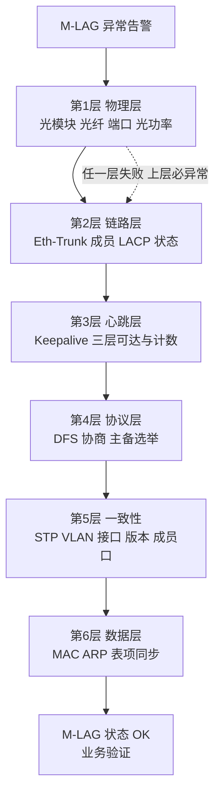

### 真题精练

**Q23.【真题·简答】** 请列出 M-LAG 不一致性检查（Consistency Check）的主要检查项，并说明发现不一致时的处理原则。

> **答案与解析**：
> 1. **检查项清单**：① **设备基础信息**（款型、软件版本、补丁）；② **STP 配置**（STP 模式、MSTP 域参数与实例映射、BPDU 保护、边缘端口）；③ **VLAN 配置**（VLAN 是否创建、成员口放通的 VLAN 列表是否一致——最常见的隐性不一致）；④ **接口配置**（链路类型、属性、速率/双工、MTU、风暴抑制、端口隔离）；⑤ **M-LAG/DFS 配置**（DFS 组号、M-LAG ID、peer-link 绑定关系、两端成员口数量与速率）；⑥ **MAC/ARP 表项同步状态**（是否一致、有无同步失败与 flapping）；⑦ **业务特性配置**（VXLAN/NVE/VNI、QoS/ACL/DHCP Snooping 等）；⑧ **系统时间与日志**（时间同步、关键事件是否存在）。
> 2. **处理原则**：① **分级**——影响转发与可靠性的（成员口数量、VLAN 放通、STP 模式、版本）必须立即修复；仅影响可观测性的（描述、时间）可安排窗口；② **逐台变更**——绝不两台同时改，避免引入新故障；③ **每步验证**——每次变更后立即执行 `display m-lag consistency-check` 与 `display dfs-group 1 m-lag`，确认状态；④ **留痕**——记录变更前后配置差异与事件日志，便于复盘。
> 3. **定位命令**：`display m-lag consistency-check`（找不一致项）、`display port vlan`（查 VLAN 放通差异）、`display stp region-configuration`（查 MSTP 域）、`display version` / `display device`（查版本款型）。

**Q24.【真题·排错】** 某 M-LAG 系统中，`display dfs-group 1` 显示角色与 Keepalive 均正常、`display eth-trunk 100 verbose` 显示 peer-link 成员全部 Up，但服务器反映跨 Leaf 访问（同一 VLAN 内互访）时丢包明显，且 M-LAG 聚合组状态正常。请给出排错思路与关键命令。

> **答案与解析**（状态正常但丢包，重点查"表项同步"与"peer-link 质量"）：
> 1. **查 MAC 表项同步是否一致**：`display mac-address m-lag`（或 `display mac-address vlan 100`）在**两台设备上分别执行并对比**。如果同一 MAC 在一端学在本地成员口、另一端学在 peer-link 上却指向错误端口，或存在"MAC 频繁漂移"，说明表项同步异常，会导致转发错向与丢包。
> 2. **查 MAC 漂移记录**：`display mac-address flapping history`，确认是否出现 MAC 在成员口与 peer-link 之间反复切换（提示存在环路或双主隐患）。
> 3. **查 peer-link 链路质量**：`display interface Eth-Trunk 100` 看**错包（CRC/Align）、丢包、丢弃计数**；`display transceiver diagnosis interface 100GE1/0/49` 看光功率是否接近灵敏度门限（光衰会造成间歇性错包，表现就是"协议 Up 但丢包"）；`display interface Eth-Trunk 100` 观察**入/出速率是否长期接近带宽上限**（跨设备流量打满 peer-link 会直接丢包）。
> 4. **查一致性检查**：`display m-lag consistency-check`，确认 VLAN 放通、STP、接口配置是否真的完全一致（"状态正常"不代表一致性检查通过）。
> 5. **查 ARP 同步**：`display arp statistics all` 与两端 `display arp` 对比，确认 ARP 表项是否同步完整；ARP 缺失会导致跨 Leaf 三层流量首包丢弃。
> 6. **查业务特性一致性**：`display current-configuration interface Eth-Trunk 10` 逐行比对两端（含风暴抑制、QoS、端口隔离等），特别是 anycast VTEP 场景下的 `display nve`、`display vxlan vni` 是否两端一致。
> 7. **结论与整改**：若定位为 peer-link 光衰/错包，更换光纤或光模块并做光路检查；若为表项同步异常，检查 peer-link 是否拥塞，考虑扩容 peer-link 或调整单归/双归比例减少跨设备流量；若为配置不一致，按"逐台变更 + 每步验证"原则修复。

---

# DCN-HCIE-章节4-数据中心网络规划设计与DCI

## 4.1 数据中心网络规划方法论

### 考点定位

**综合设计题的总纲**，占 **4~8 分**。命题方式：① 给出业务需求，要求按"规划方法论"的步骤依次作答（简答/设计题）；② 要求画出规划流程图；③ 针对某个步骤追问细节（如"流量模型怎么算""地址怎么规划"）。易错点：一上来就答设备和协议（跳过需求调研与流量分析）、把"架构选型"放在"流量模型"之前（顺序体现了"以业务驱动设计"的思想）。

### 原理精讲

数据中心网络不是"先选设备再想业务"，而是**以业务需求为输入、以可运维可扩展为约束的反向推导过程**。标准方法论分为**八个阶段**，每个阶段都有明确的输入、输出与交付物：

**① 业务需求调研（Requirement Gathering）**。输入：业务部门的应用清单、SLA 要求、机房条件。要问清的六件事：**业务类型**（Web/数据库/大数据/存储/AI 训练/HPC）、**规模与增长**（当前与 3 年后的服务器数量、机柜数、带宽需求）、**东西向/南北向流量特征**、**可靠性等级**（是否要求双活、RTO/RPO 指标）、**合规与隔离要求**（多租户、等保等级、金融行业隔离要求）、**机房条件**（机柜数量、配电与制冷能力、跨机房距离与光缆资源）。输出：《需求规格说明书》与业务矩阵表。**为什么第一步必须是需求**：因为后续每一个技术选择（Spine 数量、收敛比、VXLAN、DCI 方案）都由需求中的某一个指标直接决定；需求不明就选型，等于"先买设备再找业务"，必然返工。

**② 流量模型分析（Traffic Modeling）**。输入：业务清单与部署分布。输出：**东西向/南北向流量比例、收敛比、峰值带宽与突发特征、时延敏感业务清单**。这是全书最"算数"的一步（详见 4.2 节）。**为什么必须量化**：Spine 上行带宽、Leaf 上行端口数、peer-link 容量、DCI 带宽全部由流量模型换算而来，不能凭感觉"配两条 100GE 就够"。

**③ 架构选型（Architecture Selection）**。输入：流量模型 + 可靠性等级。输出：**拓扑（Spine-Leaf 两层 / 三层 / 混合）、层数与规模、接入方式（ToR/EoR）、冗余方式（M-LAG/堆叠）、Overlay 方案（VXLAN + BGP EVPN）**。关键判断：服务器规模 ≤ 单 POD 容量（如 2 个 Spine × 64 下行 = 128 台 Leaf 之内）就用**两层 Spine-Leaf**；超出则引入 **Super-Spine 组成三层 Fabric**，或横向扩展 POD。

**④ 地址与 VLAN/VNI 规划（Addressing & Segmentation）**。输入：架构与租户/业务矩阵。输出：**Loopback 地址段、互联地址段、管理地址段、业务网段、VLAN 与 VNI 编码规范、网关地址分配表**。原则：**结构化、可聚合、可预测**（见 4.6 节）。VLAN 12 bit（1~4094）、VNI 24 bit（1~16777215），编码规范必须能"从编号看出用途"。

**⑤ 路由设计（Routing Design）**。输入：地址规划 + 拓扑。输出：**Underlay 协议与 AS 规划、Overlay（BGP EVPN）RR 部署、路由汇总策略、BFD 与收敛参数、路由策略与泄露防护**（见 4.3/4.4 节）。核心原则：**Underlay 只承载可达性（只通告 Loopback + 汇总），Overlay 承载业务路由**，两者严格分离。

**⑥ 可靠性设计（Reliability Design）**。输入：SLA 与 RTO/RPO。输出：**设备冗余（双机/双主控）、链路冗余（双上行、跨单板）、M-LAG/Eth-Trunk、ECMP、BFD 快速收敛、故障域划分、双活/主备策略**（见 4.7 节）。要点：**可靠性是分层的**，任何一层单点都要有明确的消除手段与收敛时间承诺。

**⑦ 安全设计（Security Design）**。输入：合规要求、业务隔离需求。输出：**安全域划分（Underlay/Overlay/管理/存储/DMZ）、Border Leaf 安全策略、微分段方案、防火墙对接方式（旁挂/串接/引流）、访问控制与审计**（见 4.7 节后半）。

**⑧ 管理与运维设计（O&M Design）**。输入：团队规模与运维能力。输出：**自动化开局（ZTP）、配置模板与版本管理、监控（Telemetry/SNMP/Syslog）、变更流程与回滚方案、容量与性能基线**（见 4.9 节）。**为什么必须放在最后而不是"以后再补"**：网络上线后每一次变更都靠这套体系承载，没有运维设计的 Fabric 等于"无法维护的黑盒"，扩容与排障成本会指数上升。

### 关键概念对照表

| 阶段 | 输入 | 关键输出 | 决定的后续设计 | 常见失误 |
|---|---|---|---|---|
| 需求调研 | 业务清单、SLA、机房条件 | 需求规格、业务矩阵 | 全部 | 跳过需求直接选设备 |
| 流量模型 | 业务分布、流量特征 | 收敛比、峰值带宽、时延要求 | Spine 上行、DCI 带宽 | 不量化，凭经验配链路 |
| 架构选型 | 规模 + 可靠性 | 拓扑、层数、冗余方式 | 地址与协议设计 | 小规模上三层 Fabric，过度设计 |
| 地址与 VNI 规划 | 架构 + 租户矩阵 | 地址段、VLAN/VNI 编码规范 | 路由汇总可行性 | 地址零散无法汇总 |
| 路由设计 | 地址规划 | Underlay IGP/EBGP、EVPN RR | 收敛与扩展性 | Underlay 通告业务网段 |
| 可靠性设计 | SLA/RTO/RPO | 冗余清单、收敛时间承诺 | 故障域与双活方案 | 只做链路冗余不做设备/上行冗余 |
| 安全设计 | 合规与隔离 | 安全域、策略、微分段 | 防火墙对接方式 | 安全策略逐条手配不可维护 |
| 运维设计 | 团队与工具 | ZTP、模板、监控、变更流程 | 长期可运维性 | 上线后才补，配置漂移严重 |

### 华为设备配置

```bash
# ================= 规划落地：用 iMaster NCE-Fabric 做"模板化规划 + 自动下发" =================
# 说明：NCE-Fabric 是华为数据中心网络控制器，规划阶段的 Fabric 建模、VNI/VLAN 编排、
#       路由模板与设备开局脚本都在控制器侧完成，再由控制器下发到 CloudEngine 设备。
# 下面给出设备侧"接受控制器纳管"的基础配置（真实 VRP V200 语法）。

<CE6865> system-view
[CE6865] sysname Leaf-1
[CE6865] interface MEth0/0/0                             // 带内管理口（也可用 Vlanif 管理网段）
[CE6865-MEth0/0/0] ip address 10.200.1.11 24             // 管理地址：按规划表分配，便于 ZTP 与 NCE 纳管
[CE6865-MEth0/0/0] quit
[CE6865] ip route-static 0.0.0.0 0 10.200.1.1            // 指向管理网关，保证控制器可达
[CE6865] snmp-agent                                      // 使能 SNMP，供监控平台采集（V300 上为 snmp-agent）
[CE6865] snmp-agent community read cipher Huawei@123     // 只读团体名（生产环境用高强度口令）
[CE6865] snmp-agent sys-info version v3                  // 推荐 SNMPv3，具备认证与加密
[CE6865] info-center enable                              // 使能信息中心，日志上送 Syslog
[CE6865] info-center loghost 10.200.1.100                // 日志服务器地址，供审计与排错
[CE6865] ntp-service enable                              // 使能 NTP，保证两台 M-LAG 设备时间一致（日志比对必需）
[CE6865] ntp-service unicast-server 10.200.1.100         // 指定 NTP 服务器
[CE6865] quit
<CE6865> save                                            // 保存配置

# ================= 规划交付物在设备侧的核对（容量与规格基线） =================
<Leaf-1> display version                                 // 确认软件版本符合规划基线（禁止随意升级）
<Leaf-1> display device                                  // 确认单板与端口资源满足规划
<Leaf-1> display interface brief                         // 核对实际链路与规划表是否一致（端口对号）
<Leaf-1> display vlan                                    // 核对 VLAN 列表与规划表
<Leaf-1> display ip routing-table statistics             // 核对路由表规模基线（用于容量监控）
<Leaf-1> display fib statistics                          // 核对 FIB 表项基线
```

### 示意图

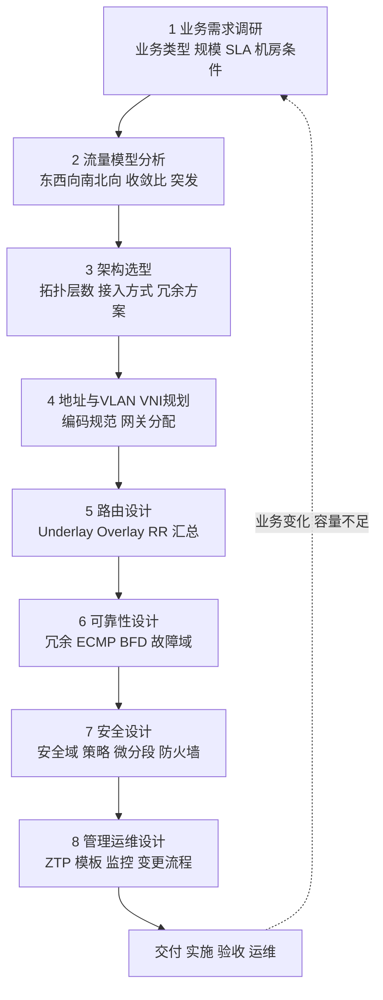

### 真题精练

**Q25.【真题·简答】** 请按正确顺序列出数据中心网络规划的八个阶段，并说明为什么"流量模型分析"必须排在"架构选型"之前。

> **答案与解析**：
> 1. **八个阶段顺序**：① 业务需求调研 → ② 流量模型分析 → ③ 架构选型 → ④ 地址与 VLAN/VNI 规划 → ⑤ 路由设计 → ⑥ 可靠性设计 → ⑦ 安全设计 → ⑧ 管理与运维设计。
> 2. **为什么流量模型在架构选型之前**：因为**架构规模与链路带宽是流量模型的函数**，而不是相反。具体地：① **收敛比**直接决定 Leaf 上行端口数量与速率（例如 Leaf 下行 48×25GE = 1.2T，若收敛比 3:1 则上行需 ≥400G，即 4×100GE 或 2×400GE）；② **东西向流量占比**决定是否需要 Spine-Leaf 全互联 Mesh（东西向主导）还是传统三层（南北向主导）；③ **峰值与突发特征**决定是否需要更大的缓存与无损网络（PFC/ECN）；④ **时延敏感业务**决定 DCI 与 Fabric 的跳数与选路约束。若先定架构再去凑流量，要么带宽不足（业务拥塞、扩容返工），要么严重过度设计（投资浪费）。**这就是"以业务驱动设计"的具体体现**。
> 3. 附加得分点：需求调研是全部阶段的输入，任何阶段发现需求不清都应回到第 ① 步确认；运维设计必须与建设同步规划，不能"上线后再补"。

## 4.2 流量模型、收敛比与 incast

### 考点定位

**计算题的来源**，占 **4~6 分**。命题方式：① 给出服务器数量与接入速率，要求计算收敛比或所需上行带宽；② 判断给定设计是否满足收敛比要求；③ 解释 incast 现象与解决手段。易错点：把收敛比方向说反（收敛比 = 下行总带宽 ÷ 上行总带宽）、忽略"双归"会让下行带宽翻倍、把 incast 与普通拥塞混为一谈。

### 原理精讲

**① 东西向（East-West）与南北向（North-South）**。**南北向**是数据中心与外部（用户/互联网）之间的流量，典型路径是"服务器 → Leaf → Spine → Border Leaf → 出口路由器/防火墙"。**东西向**是数据中心内部服务器之间（含同机柜、跨机柜、跨 POD、跨 DC）的流量，典型路径是"服务器 → Leaf → [Spine] → Leaf → 服务器"。

传统数据中心以南北向为主（比例约 80:20）；在虚拟化、分布式数据库、大数据与 AI 训练普及后，**东西向流量占比通常达到 70%~90%**。这一变化的三个直接后果：① 传统"接入-汇聚-核心"三层架构中，汇聚层成为东西向流量的瓶颈（同 VLAN 内绕行、跨 VLAN 必须上核心），因此要**把网关下沉到 Leaf**（分布式网关）；② Fabric 内部必须支持**多路径 ECMP**（Spine-Leaf 全互联 Mesh），让任意两台 Leaf 之间的东西向流量有多条等价路径；③ 二层域必须**尽量小**（避免大二层泛洪与 STP），跨 Leaf 用三层/VXLAN 转发。

**② 收敛比（Oversubscription Ratio，超配比）的定义与计算**。定义：**收敛比 = 下行总带宽 ÷ 上行总带宽**（即"接入带宽是上行带宽的多少倍"）。比值越大，代表上行越"省"，但拥塞风险越高；比值越接近 1:1（无收敛），成本越高但时延与丢包最优。

**标准计算示例**（考试常出这类题）：
- 场景：一台 Leaf 接入 **48 台服务器**，每台服务器 **2×25GE 双归**（注意：双归时该 Leaf 实际承载的是每台服务器的一条 25GE，但按"接入端口数"计算下行总带宽应为 Leaf 的**下行端口总容量**）。
- Leaf 下行容量 = 48 × 25GE = **1200G（1.2T）**。
- 若 Leaf 上行 = **4 × 100GE = 400G**，则收敛比 = 1200 / 400 = **3:1**。
- 若 Leaf 上行 = **8 × 100GE = 800G**，则收敛比 = 1200 / 800 = **1.5:1**（这也是 CE6865-48S8CQ"48 下 8 上"被推荐为经典 Leaf 的原因，天然接近 1.5:1）。
- 若 Leaf 上行 = **1 × 100GE = 100G**，收敛比 = 12:1（仅适用于纯接入、低带宽业务）。

**POD 级与 Fabric 级收敛比**：若一个 POD 有 **32 台 Leaf**，每台 Leaf 上行 **8×100GE**，则 POD 内 Spine 侧需要 **32 × 8 = 256 个 100GE 下行端口**；若 Spine 使用 **CE16800**（单板可提供高密 100GE/400GE 端口），按每台 Spine 提供 64 个 100GE 下行端口估算，需要 **4 台 Spine**（提供 256 个下行口）——即"32 Leaf : 4 Spine"的配比。若改用 400GE 上行（每 Leaf 2×400GE），则 32 Leaf 需要 64 个 400GE 下行口，**2 台 Spine** 即可满足下行端口需求，**但要注意：Spine 数量还受"故障后带宽余量"与"上行 ECMP 路径数"约束**，工程上通常至少 **2 台**（双平面隔离），大规模场景取 4 台以获得更好的负载分担与故障余量。

**③ 突发流量与 incast（入向汇聚/多打一）**。**Incast** 指**多个源同时向同一个目的发送数据**，在目的端（或其上行链路）形成瞬时流量叠加，导致交换机端口缓存溢出而丢包。典型场景：**分布式存储与搜索类应用**（如 MapReduce、Hadoop、分布式数据库）中，一个请求会触发成百上千个节点同时返回分片结果。经典表现：时延突然飙升（几百毫秒到秒级）、吞吐反而下降（TCP 超时重传与拥塞控制退避）。

**Incast 的四个治理手段**：
1. **加大缓存**：数据中心交换机采用共享缓存 + 大缓存单板（如 CE 系列的深缓存板卡），吸收微突发；但缓存不是万能药（Bufferbloat 会增大时延）。
2. **无损网络（PFC + ECN）**：**PFC（Priority Flow Control，基于优先级的流量控制）**在拥塞时发送 Pause 帧阻止对端继续发送，做到"不丢包"；**ECN（Explicit Congestion Notification，显式拥塞通知）**在拥塞初期标记报文（而非丢弃），让 TCP 端侧降速，实现**端到端拥塞控制**。二者配合是 RoCEv2（RDMA over Converged Ethernet）无损网络的标准方案。
3. **负载均衡**：用 **ECMP / DLB（Dynamic Load Balancing，动态负载分担）**把流量分散到多条等价路径，避免单一链路成为瓶颈；对大象流（Elephant Flow）可用基于逐包或流粒度的动态调度（如华为的 DLB 特性）。
4. **应用侧优化**：增大并发请求的错峰度、控制分片数、用 RDMA 降低协议栈开销与重传代价。

### 关键概念对照表

| 概念 | 定义 | 典型值 | 影响 |
|---|---|---|---|
| 东西向流量 | DC 内部服务器间流量 | 占比 70%~90%（云化/大数据场景） | 决定 Fabric 是否必须 ECMP Mesh、网关是否下沉 |
| 南北向流量 | DC 与外部之间的流量 | 占比 10%~30% | 决定 Border Leaf 与出口带宽 |
| 收敛比 | 下行总带宽 ÷ 上行总带宽 | 接入 1.5:1~3:1；核心 3:1~10:1；出口 10:1~20:1 | 决定上行端口数与拥塞风险 |
| 无收敛（1:1） | 上行 = 下行 | 成本最高 | 存储/AI 训练等高带宽场景 |
| 微突发 | 毫秒级瞬时流量尖峰 | 可达平均速率数倍 | 依赖交换机缓存吸收 |
| Incast | 多源同时打一目的 | 分布式存储/Hadoop 典型 | 缓存溢出丢包、时延飙升 |
| PFC | 基于优先级的流控 | 802.1Qbb | 实现无损（不丢包） |
| ECN | 显式拥塞通知 | RFC 3168 | 拥塞前标记，端侧降速 |
| DLB | 动态负载分担 | 华为 CE 特性 | 缓解大象流导致的链路不均 |

| 业务类型 | 建议收敛比 | 说明 |
|---|---|---|
| 普通 Web/办公业务 | 3:1 ~ 5:1 | 带宽需求平稳，突发有限 |
| 数据库/虚拟化 | 2:1 ~ 3:1 | 东西向为主，时延较敏感 |
| 分布式存储 | 1.5:1 ~ 2:1 | 需配合 PFC/ECN 无损 |
| AI 训练/HPC | 1:1（无收敛） | RDMA 流量，对丢包零容忍 |
| 出口/南北向 | 10:1 ~ 20:1 | 互联网访问按峰值并发设计 |

### 华为设备配置

```bash
# ================= 无损网络：PFC + ECN 配置（RoCEv2 存储/AI 场景，真实 VRP V200 语法） =================
[Leaf-1] dcb pfc                                   // 进入 DCB PFC 配置视图（V200 上为 dcb pfc）
[Leaf-1-dcb-pfc] priority 3                                // 对优先级 3 使能 PFC（RoCEv2 常用优先级 3）
[Leaf-1-dcb-pfc] quit
[Leaf-1] interface 25GE1/0/1
[Leaf-1-25GE1/0/1] priority-flow-control enable            // 接口使能 PFC
[Leaf-1-25GE1/0/1] priority-flow-control priority 3 enable  // 对优先级 3 报文生效
[Leaf-1-25GE1/0/1] quit
[Leaf-1] qos buffer-pool shared-pool 12                     // 配置共享缓存池，为无损队列预留缓存
[Leaf-1] dcb pfc                                  // 回到 PFC 视图配置死锁预防与检测参数
[Leaf-1-dcb-pfc] priority 3                                // 指定优先级
[Leaf-1-dcb-pfc] quit

# --- ECN：在队列上配置 WRED 门限，拥塞时标记 CE 位而不是丢包 ---
[Leaf-1] acl number 3000
[Leaf-1-acl-adv-3000] rule 5 permit ip destination 192.168.0.0 0.0.255.255  // 匹配需要 ECN 的流量（示例）
[Leaf-1-acl-adv-3000] quit
[Leaf-1] traffic classifier ecn-class operator or
[Leaf-1-classifier-ecn-class] if-match acl 3000
[Leaf-1-classifier-ecn-class] quit
[Leaf-1] traffic behavior ecn-behavior
[Leaf-1-behavior-ecn-behavior] ecn                                       // 行为中使能 ECN 标记
[Leaf-1-behavior-ecn-behavior] quit
[Leaf-1] traffic policy ecn-policy
[Leaf-1-trafficpolicy-ecn-policy] classifier ecn-class behavior ecn-behavior
[Leaf-1-trafficpolicy-ecn-policy] quit
[Leaf-1] interface 25GE1/0/1
[Leaf-1-25GE1/0/1] traffic-policy ecn-policy inbound                   // 入方向应用策略（按设计方向）
[Leaf-1-25GE1/0/1] quit

# ================= 拥塞观测与容量确认命令 =================
<Leaf-1> display interface 25GE1/0/1                     // 看速率、丢包、Pause 帧统计（PFC 是否触发）
<Leaf-1> display qos queue statistics interface 25GE1/0/1  // 看各优先级队列的丢弃与缓存占用（判断 incast）
<Leaf-1> display interface Eth-Trunk 100                 // peer-link 利用率（跨设备流量评估）
<Leaf-1> display dcb pfc                                  // PFC 全局配置与状态（V200 上为 display dcb pfc）
<Leaf-1> display interface brief | include up             // 上游链路数量核对，确认 ECMP 路径数
```

### 示意图

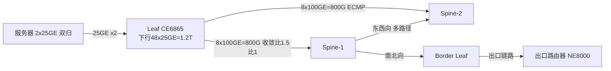

### 真题精练

**Q26.【真题·计算】** 某 Leaf 交换机下行提供 48 个 25GE 端口连接服务器，上行提供 4 个 100GE 端口连接 Spine。请计算该 Leaf 的收敛比；若要求收敛比降到 1.5:1，需要多少条 100GE 上行链路（或等效带宽）？

> **答案与解析**：
> 1. **收敛比 = 下行总带宽 ÷ 上行总带宽** = (48 × 25G) ÷ (4 × 100G) = 1200G ÷ 400G = **3:1**。
> 2. 要求 1.5:1，则上行总带宽 = 1200G ÷ 1.5 = **800G**，即需要 **8 条 100GE** 上行（或 **2 条 400GE**，等效 800G）。
> 3. **工程提示**：实际选型时，CE6865-48S8CQ 的"48×25GE + 8×100GE"正好对应 1.5:1，是业界最经典的 Leaf 收敛比配置；若上行端口不足以做到 1.5:1，则需要在设计文档中说明该区域的业务特征（如以低带宽 Web 业务为主），把拥塞风险与观测手段（`display qos queue statistics`）写入运维基线。**注意区分**："服务器双归"意味着每台服务器有两条上联分别到两台 Leaf，单台 Leaf 承载的是其中一条，但 Leaf 的**下行端口总容量**仍是 48×25GE（端口数是物理资源，不因双归减半）。

**Q27.【真题·简答】** 解释 incast 现象的产生原因，并说明 PFC 与 ECN 在无损网络中分别扮演什么角色、为什么二者要配合使用。

> **答案与解析**：
> 1. **Incast 成因**：在分布式存储/大数据/搜索类应用中，一个上层请求会同时触发**成百上千个节点并行返回分片结果**，这些流量在同一时刻汇聚到同一目的端口或其上行链路，瞬时速率远超链路带宽或端口缓存容量，导致**缓存溢出 → 丢包 → TCP 超时重传与拥塞退避 → 时延飙升、吞吐下降**的恶性循环。它是"多打一"（Many-to-One）的典型流量模式，与普通单流拥塞的区别在于**突发聚集性与同步性**。
> 2. **PFC 的角色（保不丢包）**：在链路级按优先级发送 Pause 帧，通知上游暂停该优先级的发送，避免缓冲区溢出丢包。它解决"丢包"，但会**把拥塞向上游传播**（拥塞扩散），且若配置不当可能引发 **PFC 死锁**（互相等待）与 **PFC 风暴**。
> 3. **ECN 的角色（提前降速）**：在队列拥塞达到门限时，交换机**不丢包**而是给报文打上 **CE（Congestion Experienced）** 标记；目的端收到后通过 ACK 告知源端（或由 DCQCN 等算法），源端**主动降低发送速率**。它解决"拥塞本身"，让速率收敛在链路容量附近，而不是等到溢出才反应。
> 4. **为什么配合**：只靠 PFC 是"被动刹车"，拥塞会在网络中扩散且可能触发死锁；只靠 ECN 在极短微突发下可能来不及收敛，仍有丢包风险。二者配合形成"**ECN 精细调速（常态） + PFC 兜底保不丢（极端）**"的双保险，这也是 RoCEv2 无损网络的标准部署方式；配套还需 **DCQCN 等端侧算法**与合理的缓存/门限规划。

## 4.3 Underlay 网络设计（Spine-Leaf 规模、协议选型、汇总原则）

### 考点定位

**HCIE 设计题与对比题的重点**，占 **6~10 分**。命题点：① Spine-Leaf 层数与规模计算（含端口数推算）；② **Underlay 用 OSPF/IS-IS 还是 EBGP**（必考的对比题）；③ EBGP 的 AS 号规划与 peer group 设计；④ 为什么"Underlay 只通告 Loopback + 必须做路由汇总"。易错点：Underlay 里通告业务网段、AS 号规划造成路由环路或阻断、把路由汇总与"不汇总明细"混为一谈。

### 原理精讲

**① Spine-Leaf 的层数与规模计算。**

- **两层 Fabric（Leaf + Spine）**：任意 Leaf 到任意 Leaf 恰好 **2 跳**（Leaf→Spine→Leaf），时延可预测（同构等长路径，这是 Fabric 相对传统三层架构的最大优势：**等距多路径**，无需担心"绕远路"）。规模上限由 **Spine 的下行端口数**与 **Leaf 的上行端口数**决定：
  - 单 POD Leaf 数量 ≤ 单台 Spine 可用下行端口数（取所有 Spine 下行口的交集，因为每个 Leaf 必须上联到每台 Spine）。
  - 例：Spine 用 CE16800，每台提供 **64 个 100GE 下行端口** → 每台 Spine 最多接 **64 台 Leaf**（若每 Leaf 用 1 个 100GE 上联）；若每 Leaf 用 **8×100GE** 上联，则每台 Spine 最多接 64/8 = 8 台 Leaf（此时需要更多 Spine 或更高密端口）。
  - **工程结论**：一个 POD 通常配 **2~4 台 Spine**（2 台为最小冗余，4 台兼顾负载与故障余量），Leaf 数量按上联端口数反推。
- **三层 Fabric（Super-Spine）**：当 Leaf 总量超过单 POD 容量、或需要跨 POD 的大二层/大 Fabric 统一管理时，引入 **Super-Spine** 层组成"**Leaf → Spine → Super-Spine**"三层。代价是**跳数增加（最多 4 跳）**、时延与收敛复杂度上升。此时务必确认业务时延容忍度（存储/AI 类业务对跳数敏感，通常要求 Spine-Leaf 两层内解决）。

**② Underlay 用 IGP 还是 EBGP（本节核心对比）。** Underlay 的唯一职责是提供 **VTEP 之间（Loopback 地址之间）的 IP 可达性**与多路径 ECMP，不承载业务网段。三种主流选择：

| 对比维度 | OSPF | IS-IS | EBGP |
|---|---|---|---|
| 协议类型 | 链路状态（IP 层） | 链路状态（L2 封装） | 路径矢量（TCP 179） |
| 扩展性 | 中；LSA 泛洪与 SPF 在数百节点内可控 | **强**；TLV 结构易扩展，天然支持 IPv6/多拓扑 | **最强**；增量更新、无全网泛洪、天然分层 |
| 收敛速度 | 快（配合 BFD 可达百毫秒级） | 快（配合 BFD） | **最快**（增量更新 + BFD，且无 SPF 重算） |
| 策略能力 | 弱（只能改度量、路由过滤） | 弱 | **强**（AS_Path、Community、路由策略丰富） |
| 配置复杂度 | 低 | 中（NET 地址、Level 概念） | 中高（AS 号规划、peer group、策略） |
| 环路防护 | SPF 天然无环 | SPF 天然无环 | AS_Path 防环（需规划 AS 号） |
| 可读性/排错 | 熟悉度高、工具多 | 需专门知识 | 需理解 BGP 属性与策略 |
| 典型适用 | 中小规模 Fabric、运维护团队熟悉 OSPF | 大规模单一 Fabric、需 IPv6 与多拓扑 | **大规模 Fabric（含多 POD、DCI）、需精细策略与快速收敛** |

**为什么大规模 Fabric 倾向 EBGP（五条理由，考试按点给分）**：
1. **扩展性**：BGP 增量更新，无需全网泛洪链路状态；IGP 在数百节点时 SPF 与数据库同步开销显著上升。
2. **收敛速度**：BGP 配合 BFD 可做到亚秒级，且不涉及 SPF 重算（IGP 拓扑变化会引发全网 SPF）。
3. **策略能力**：可用 AS_Path 与 Community 做精细的路由控制与流量工程，IGP 只能调度量。
4. **天然边界**：Fabric 的每个 Leaf 可视为一个"自治域"（独立 AS），边界清晰、故障影响范围明确、规划与扩容互不干扰（新增 Leaf 只需与 Spine 建邻居）。
5. **与 DCI 天然衔接**：跨 DC 互联本质是 EBGP 域间互联，Underlay 用 EBGP 后，DCI 侧的 AS 与策略体系可以**延续同一套方法论**，减少协议栈种类。

**IGP 的优势与适用**：配置简单、运维团队熟悉、无需 AS 号规划、天然无环。**因此中小型 Fabric（几十台 Leaf）用 OSPF/IS-IS 完全合理**，考试作答要避免绝对化："大规模、多 POD、需要精细策略选 EBGP；中小规模、团队熟悉 IGP 选 OSPF/IS-IS"，并给出规模判据（如 Leaf > 100 台或需跨 POD/跨 DC 统一策略时倾向 EBGP）。

**③ EBGP 的 AS 号规划与 peer group 设计（实操要点）**：
- **AS 号规划三原则**：① **每个 Leaf 一个独立 AS**（推荐，边界最清晰，如 Leaf 用 **65001~65NNN**，Spine 用 **65000**）或 ② 所有 Leaf 共用**同一 AS**（配置简单，但依赖 `allow-as-loop` 等机制处理接收自身 AS 号的问题，需谨慎）；③ Spine 与 Leaf 之间为 **EBGP（相邻 AS 不同）**，Leaf 与 Leaf 之间不建邻居。
- **必须使用 4 字节 AS 号或私有 AS（64512~65534）**避免与公网 AS 冲突。
- **peer group（对等体组）**：把同一台 Spine 的**所有 Leaf 邻居**放进一个 peer group，统一配置 `peer as-number`、`connect-interface`、`bfd enable`、`route-policy` 等，减少配置量、避免遗漏。
- **必须做 BFD**：`peer x.x.x.x bfd enable` 使 EBGP 故障检测进入毫秒级，替代 BGP Keepalive 的秒级检测。
- **必须做安全加固**：`peer x.x.x.x valid-ttl-hops 1`（GTSM）防止非法邻居、`peer x.x.x.x password cipher` 认证。
- **必须设置 EBGP 多跳为 1**（直连邻居用默认，用 Loopback 建邻居时要 `peer ebgp-max-hop 2` 并保证 Underlay 先可达——注意这需要**先有 IGP 提供 Loopback 可达**，或用直连 IP 建邻居）。

**④ 两条铁律（必背）**：
- **Underlay 只通告 Loopback 地址（以及必要的互联网段）**，绝不把业务网段/VNI 网段引入 Underlay。**为什么**：Underlay 是"承载网"，业务网段由 Overlay（BGP EVPN）承载；一旦业务网段进入 Underlay，会出现① 路由表膨胀（FIB 规模暴涨）；② 业务路由与 Overlay 路由竞争，可能导致流量绕开 VXLAN 直接走 IP 转发，破坏租户隔离与网关策略；③ Underlay 收敛被业务变更牵动，失去稳定性。
- **必须做路由汇总**。**为什么**：Fabric 中 Leaf 数量可能上百，每台有 Loopback0（Router ID）与 Loopback1（VTEP 地址），若不汇总，每台 Spine 都要维护 N×M 条明细路由，表项与收敛开销线性增长。做法：**按 POD/区域规划连续的 Loopback 地址段**（如 POD1 的 VTEP 用 10.255.1.0/24），在 Spine 侧对下游 Leaf 的 Loopback 段做**聚合通告**，使上层只看到每个 POD 一条汇总路由。**前提是地址规划有序可聚合**——这正是"地址规划必须与路由设计联动"的原因。华为设备上用 `aggregate`（BGP）或 `abr-summary`/`summary`（IGP）实现，并注意**抑制明细（suppress）**与**防环（AS_SET）**参数。

### 关键概念对照表

| 项目 | 推荐做法 | 原因 |
|---|---|---|
| Fabric 层数 | 单 POD ≤ 容纳上限时用两层 Spine-Leaf | 等距两跳、时延可预测、收敛简单 |
| Spine 数量 | 2 台（最小）~ 4 台 | 冗余 + 负载分担 + 故障余量 |
| Leaf 数量 | ≤ 单台 Spine 下行端口数 ÷ 每 Leaf 上联端口数 | 每个 Leaf 必须上联到每台 Spine |
| Underlay 协议 | 大规模 EBGP；中小规模 OSPF/IS-IS | 扩展性、收敛、策略、边界清晰 |
| 邻居地址 | Loopback 建邻居（需 IGP 或直连可达）或直连 IP | Loopback 更稳（不受单链路影响） |
| BFD | 全部 Underlay 邻居使能 | 毫秒级故障检测 |
| 通告范围 | **只通告 Loopback 与互联网段** | 隔离承载网与业务 |
| 路由汇总 | Spine 侧按 POD 聚合 Loopback 段 | 控制表项规模与收敛开销 |
| 安全 | GTSM（valid-ttl-hops 1）+ 认证 | 防止非法邻居与攻击 |
| 布线 | 每个 Leaf 到每台 Spine 至少 1 条（建议 2 条跨单板） | 冗余与 ECMP |

### 华为设备配置

```bash
# ================= Spine（CE16800，AS 65000）：Underlay EBGP + peer group + 汇总 =================
<Spine-1> system-view
[Spine-1] sysname Spine-1
[Spine-1] interface LoopBack 0
[Spine-1-LoopBack0] ip address 10.0.0.1 32               // Loopback0：Router ID 与 BGP 源地址
[Spine-1-LoopBack0] quit
[Spine-1] interface 100GE1/0/1
[Spine-1-100GE1/0/1] description To-Leaf-1
[Spine-1-100GE1/0/1] undo portswitch                     // 数据中心互联口通常转三层（按版本/款型，有的为 no switchport）
[Spine-1-100GE1/0/1] ip address 10.1.1.1 30              // /30 互联地址：按"Spine编号.Leaf编号"规范编码
[Spine-1-100GE1/0/1] quit

[Spine-1] bgp 65000                                      // Spine 统一 AS 65000
[Spine-1-bgp] router-id 10.0.0.1
[Spine-1-bgp] peer LEAF group                            // 创建 peer group，统一管理所有 Leaf 邻居
[Spine-1-bgp] peer LEAF as-number 65001                  // 组内默认 AS（实际每个 Leaf 用独立 AS 时逐个覆盖）
[Spine-1-bgp] peer LEAF connect-interface LoopBack0      // 用 Loopback 建会话（Underlay 提供可达性）
[Spine-1-bgp] peer LEAF ebgp-max-hop 2                   // Loopback 建 EBGP 邻居需要多跳
[Spine-1-bgp] peer LEAF bfd enable                       // BFD 毫秒级故障检测
[Spine-1-bgp] peer LEAF valid-ttl-hops 1                 // GTSM：TTL 校验，防非法邻居
[Spine-1-bgp] peer LEAF password cipher Huawei@123       // BGP MD5 认证
[Spine-1-bgp] peer 10.255.1.1 as-number 65001            // 与 Leaf-1 的 Loopback0 建邻居
[Spine-1-bgp] peer 10.255.1.1 group LEAF                 // 加入 peer group 继承统一配置

[Spine-1-bgp] ipv4-family unicast
[Spine-1-bgp-af-ipv4] peer LEAF enable                   // 使能 IPv4 地址族
[Spine-1-bgp-af-ipv4] peer LEAF route-policy ONLY-LOOPBACK export  // 只向 Leaf 通告允许的前缀
[Spine-1-bgp-af-ipv4] aggregate 10.255.1.0 24 detail-suppressed     // 汇总 POD1 的 VTEP 段并抑制明细
[Spine-1-bgp-af-ipv4] quit
[Spine-1-bgp] quit

# --- 路由策略：只通告 Loopback 与互联网段，杜绝业务网段进入 Underlay ---
[Spine-1] ip ip-prefix LOOPBACK index 10 permit 10.255.0.0 16        // 允许的 Loopback 汇总段
[Spine-1] ip ip-prefix LOOPBACK index 20 permit 10.0.0.0 16          // 允许的 Router ID 段
[Spine-1] route-policy ONLY-LOOPBACK permit node 10
[Spine-1-route-policy] if-match ip-prefix LOOPBACK                   // 命中允许列表才通告
[Spine-1-route-policy] quit
[Spine-1] route-policy ONLY-LOOPBACK deny node 100                   // 其余一律拒绝（隐式拒绝显式化，便于审计）
[Spine-1-route-policy] quit

# ================= Leaf（CE6865，AS 65001）：对称配置 =================
<Leaf-1> system-view
[Leaf-1] sysname Leaf-1
[Leaf-1] interface LoopBack 0
[Leaf-1-LoopBack0] ip address 10.255.1.1 32              // Router ID 与 BGP 源地址（POD1 段内连续编号）
[Leaf-1-LoopBack0] quit
[Leaf-1] interface LoopBack 1
[Leaf-1-LoopBack1] ip address 10.255.1.11 32             // VTEP 地址（anycast 场景下与 Leaf-2 相同）
[Leaf-1-LoopBack1] quit
[Leaf-1] bgp 65001
[Leaf-1-bgp] router-id 10.255.1.1
[Leaf-1-bgp] peer SPINE group
[Leaf-1-bgp] peer SPINE as-number 65000
[Leaf-1-bgp] peer SPINE connect-interface LoopBack0
[Leaf-1-bgp] peer SPINE ebgp-max-hop 2
[Leaf-1-bgp] peer SPINE bfd enable
[Leaf-1-bgp] peer SPINE valid-ttl-hops 1
[Leaf-1-bgp] peer SPINE password cipher Huawei@123
[Leaf-1-bgp] peer 10.0.0.1 as-number 65000                // 与 Spine-1 建邻居
[Leaf-1-bgp] peer 10.0.0.1 group SPINE
[Leaf-1-bgp] peer 10.0.0.2 as-number 65000                // 与 Spine-2 建邻居（双平面）
[Leaf-1-bgp] peer 10.0.0.2 group SPINE
[Leaf-1-bgp] ipv4-family unicast
[Leaf-1-bgp-af-ipv4] peer SPINE enable
[Leaf-1-bgp-af-ipv4] network 10.255.1.1 32                // 只通告自己的 Loopback0
[Leaf-1-bgp-af-ipv4] network 10.255.1.11 32               // 只通告 VTEP Loopback1
[Leaf-1-bgp-af-ipv4] quit
[Leaf-1-bgp] quit

# ================= 验证与容量基线 =================
<Spine-1> display bgp peer                                 // 邻居状态与 BFD 状态
<Spine-1> display bgp routing-table                        // Underlay 路由表（应只有 Loopback 与互联段）
<Spine-1> display bgp routing-table 10.255.1.0             // 确认收到的是汇总路由而非明细
<Spine-1> display ip routing-table statistics              // 路由表规模基线
<Leaf-1> display ip routing-table 10.255.2.0               // 确认到其他 POD 的可达性（汇总生效）
<Leaf-1> display bfd session all                           // BFD 会话是否 Up
<Leaf-1> display bgp peer verbose | include BFD            // 逐邻居确认 BFD 已绑定（版本支持时）
```

### 示意图

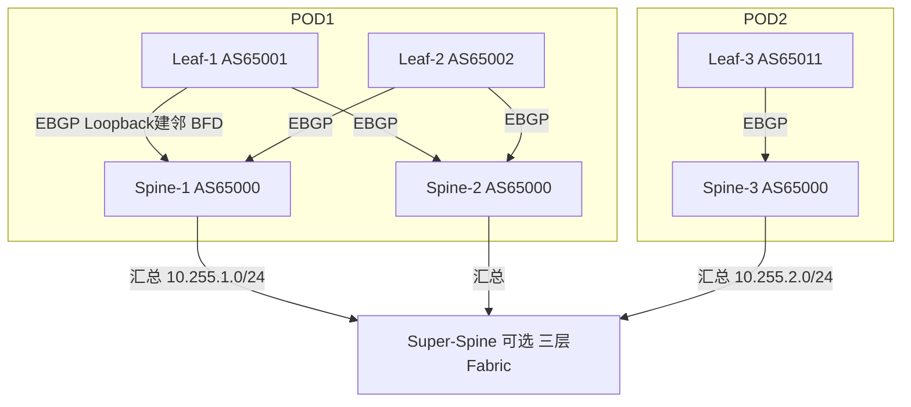

### 真题精练

**Q28.【真题·简答】** 在大型数据中心 Fabric 中，Underlay 网络为什么推荐使用 EBGP 而不是 OSPF/IS-IS？请至少给出四条理由，并说明什么情况下用 IGP 反而更合适。

> **答案与解析**：
> 1. **扩展性更好**：BGP 采用增量更新、无全网泛洪。IGP（OSPF/IS-IS）在数百节点规模下，链路状态数据库同步、LSA/LSP 泛洪与 SPF 重算的开销显著上升（OSPF 尤其明显，IS-IS 略优但仍不如 BGP）。
> 2. **收敛更快且影响面更小**：BGP 配合 BFD 可做到亚秒级故障检测与切换；IGP 拓扑变化会触发**全网 SPF 重算**，影响范围大。
> 3. **策略能力强**：BGP 可用 AS_Path、Community、路由策略做精细的流量工程与路由控制；IGP 只能通过修改度量间接影响，能力有限。
> 4. **边界清晰、故障域与规划解耦**：每个 Leaf 可分配独立 AS，形成一个清晰的自治边界；新增/变更 Leaf 只需与 Spine 建邻居，不影响其他设备的路由计算。
> 5. **与 DCI 方法论统一**：跨 DC 互联本质是 EBGP 域间互联，Underlay 采用 EBGP 后，DCI 的 AS 规划、策略与排错方法可以延续，减少协议栈种类与学习成本。
> 6. **什么情况用 IGP 更合适**：① **中小规模 Fabric**（几十台 Leaf 以内），IGP 的简单性优势压倒扩展性劣势；② **运维团队对 IGP 更熟悉**、缺乏成熟的 BGP 策略管理能力；③ **无需复杂路由策略**、也不需要与外部域间互联的内部承载网。此时用 OSPF 或 IS-IS 是合理且常见的工程选择，**不应绝对化认为"Fabric 必须用 EBGP"**。

**Q29.【真题·多选】** 关于 Underlay 网络设计，下列做法正确的有：
A. Underlay 只通告 Loopback 地址与必要的互联网段，不引入业务网段
B. 所有 Underlay BGP 邻居使能 BFD，实现毫秒级故障检测
C. 按 POD 规划连续的 Loopback 地址段，在 Spine 侧做路由汇总并抑制明细
D. 为了让 Leaf 之间互通更直接，应把业务网段也引入 Underlay 走原生 IP 转发
E. 使用 Loopback 地址建立 EBGP 邻居时，需要配置 `ebgp-max-hop` 并保证底层可达

> **答案：A、B、C、E**
> **解析**：A 正确——Underlay 是"承载网"，职责只有 VTEP 间可达性与 ECMP，引入业务网段会导致 FIB 膨胀、Overlay 与 Underlay 路由竞争、租户隔离被破坏。B 正确——BGP Keepalive 默认 60s/Hold 180s，远慢于业务容忍度，必须靠 BFD 达到毫秒级检测。C 正确——地址可聚合是路由汇总的前提，汇总能显著压制表项与收敛开销（`aggregate ... detail-suppressed`）。D 错——这正是要**避免**的做法：业务网段走原生 IP 转发会绕过 VXLAN 封装与 EVPN 策略，破坏租户隔离、网关策略与微分段，也会让 Underlay 收敛被业务变更牵动。E 正确——Loopback 建邻居是非直连会话，必须放宽多跳限制，同时要求 Loopback 之间底层可达（通常由直连互联段的静态路由或已收敛的 IGP 提供）。

**Q30.【真题·设计】** 某 Fabric 规划了 32 台 Leaf，每台 Leaf 使用 8×100GE 上联。请回答：① 需要多少台 Spine（按每台 Spine 提供 64 个 100GE 下行端口计算）？② Underlay 的 Loopback 地址应如何规划才能做汇总？③ 若要求 Leaf 上行收敛比达到 1.5:1，Leaf 下行最多可提供多少 25GE 端口？

> **答案与解析**：
> ① **Spine 数量**：32 台 Leaf × 8 个上联 = 需要 **256 个 100GE 下行端口**。按每台 Spine 提供 64 个 100GE 下行端口计算，256 ÷ 64 = **4 台 Spine**。**注意**：Spine 数量同时受"冗余要求"约束——即使算出来是 3 台，也应取 **4 台**（或 2 台为一组做双平面）以获得故障余量；且必须保证**每个 Leaf 都上联到每一台 Spine**，否则最坏情况下 Leaf 间路径数不一致。
> ② **Loopback 地址规划与汇总**：按 POD/机柜区域分配**连续段**，例如 POD1 的 Router ID 用 `10.255.1.0/24`（Leaf 依次 10.255.1.1/32、10.255.1.2/32…），VTEP 用 `10.255.101.0/24`；POD2 用 `10.255.2.0/24`、`10.255.102.0/24`。在 Spine 侧用 `aggregate 10.255.1.0 24 detail-suppressed`（BGP）对下游 Leaf 段做聚合并抑制明细，使上层只看到每个 POD 一条汇总路由。**关键前提**：地址必须**连续可聚合**，所以地址规划必须在路由设计之前完成并与之一致。
> ③ **收敛比计算**：1.5:1 意味着下行总带宽 = 上行总带宽 × 1.5 = (8 × 100G) × 1.5 = **1200G**。若下行端口为 25GE，则最多 1200 ÷ 25 = **48 个 25GE 端口**。这正是 CE6865-48S8CQ（48×25GE + 8×100GE）成为经典 Leaf 型号的原因：**端口配比天然对应 1.5:1 收敛比**，无需额外链路即可满足存储/虚拟化类业务的带宽要求。

## 4.4 Overlay 网络设计（VXLAN 部署、EVPN RR、VNI 规划与映射）

### 考点定位

**设计题的核心环节**，占 **5~8 分**。命题点：① VXLAN 部署模式（集中式网关 vs 分布式网关）；② BGP EVPN 的 RR 部署位置与冗余；③ VNI 规划方法（VLAN 与 VNI 映射、二层 VNI 与三层 VNI）；④ **VNI/VLAN/租户/业务映射规划表**（常要求现场画表）。易错点：VNI 与 VLAN 混为一谈、RR 只部署一台（单点）、忘了三层 VNI（L3 VNI）与二层 VNI 的区别。

### 原理精讲

**① VXLAN 部署模式对比。**

- **集中式网关（Centralized Gateway）**：网关（Vbdif/三层网关）**只部署在 Border Leaf 或专门的 Gateway 设备**上。同一 VNI 内的二层流量在 Leaf 间直接通过 VXLAN 隧道转发；**跨 VNI 的三层流量必须绕行到集中式网关**再回到目的 Leaf。
  - 优点：网关集中，策略、安全与审计点单一，便于与防火墙对接；**ARP/ND 表项集中**，网关设备掌握全部租户的三层信息。
  - 缺点：**三层流量绕行**（可能"上行再下行"），时延增加、网关成为带宽与性能瓶颈、故障影响面大。
- **分布式网关（Distributed Gateway，推荐）**：**每个 Leaf 都是网关**（配置 Vbdif 与 VXLAN 三层转发），采用**统一的 anycast 网关 MAC**（如 `0000-5e00-0101`，两端一致），VM 在任意 Leaf 上都能**就近完成三层转发**。
  - 优点：**三层流量本地就近转发（不绕行）**、网关无主备、横向扩展、VM 迁移后网关 MAC/IP 不变、时延最优。
  - 缺点：需要在所有 Leaf 上一致配置网关 MAC 与 VNI，规划与一致性要求高；ARP 表项分散在各 Leaf（依赖 EVPN 的 **Type 2（MAC/IP 通告）**与 **Type 5（IP 前缀路由）**同步）。
  - **结论**：新建大规模 Fabric 一律推荐**分布式网关**；仅在需要"全部三层流量强制经过某台安全设备"时才考虑集中式网关（此时也建议用服务链引流而不是让网关成为瓶颈）。
- **关于 VXLAN 控制面**：推荐 **BGP EVPN**（RFC 7432 + RFC 8365）作为控制面，用 EVPN 路由类型通告 MAC/IP 与 IP 前缀，**取代早期 VXLAN 的"泛洪学习"（Flood-and-Learn）数据面学习方式**。EVPN 的价值：抑制泛洪、快速收敛、天然支持多活接入（ESI）与 IRB（Integrated Routing and Bridging，集成的路由与桥接）。

**② BGP EVPN 的 RR（Route Reflector，路由反射器）部署。**

- **部署位置**：**Spine 作为 RR**（最常见，因为所有 Leaf 都与 Spine 建 BGP 邻居，且 Spine 天然位于流量汇聚点）；也可在 Fabric 中设置**独立的 RR**（性能与稳定性更好，但增加设备与布线成本）。
- **冗余要求**：**RR 必须至少 2 台**（与 Spine 数量一致，2~4 台）。**为什么**：BGP 的 RR 是逻辑上的"控制面单点"——若只有 1 台 RR 且它故障，所有 Leaf 之间的 EVPN 路由无法反射，**Overlay 控制面整体失效**（虽然已建立的转发表项还能继续转发，但任何新变化都无法收敛）。两台 RR 之间使用**同一 Cluster ID**（如 `reflector cluster-id 1.1.1.1`）以避免路由重复与环路。
- **客户机（Client）配置**：Leaf 与全部 Spine 建立 EVPN 邻居（`peer x.x.x.x as-number 65000`），Spine 上把 Leaf 声明为 `peer x.x.x.x reflect-client`。
- **地址族**：需要同时启用 **`l2vpn-family evpn`**（承载 MAC/IP 与 ESI 路由，即 Type 1/2/3/4）与 **`ipv4-family unicast`**（或 EVPN 的 **Type 5 IP Prefix Route** 承载跨 VNI 的三层前缀）。分布式网关推荐使用 **Type 5** 通告 IP 前缀，避免每台 Leaf 都学到所有租户的明细主机路由。
- **收敛优化**：EVPN 邻居同样要 `bfd enable`，并用 `peer ... route-policy` 做路由过滤；BGP 的 **Add-Path**（`bestroute add-path`）在多 RR 场景下能提高负载分担与冗余。

**③ VNI 规划方法。**

- **VNI 是 24 bit（1~16777215）**，必须与 VLAN（12 bit，1~4094）区分开。VLAN 是**本地意义**（只在某台设备的某个二层域内有意义），VNI 是**全局意义**（在整个 Fabric 内标识一个二层广播域）。
- **二层 VNI（L2 VNI / Bridging VNI）**：标识一个二层广播域（对应一个 BD/Bridge Domain），承载同子网内的二层流量。**一对一映射**到 VLAN（BD 与 VLAN 通过 `bridge-domain` 与接口的 VLAN 归属关联）。
- **三层 VNI（L3 VNI / VRF VNI）**：标识一个 VRF（租户/业务的三层实例），承载跨子网的对称 IRB 三层流量。**一个 VRF 一个 L3 VNI**，所有属于该 VRF 的 Leaf 使用**同一个 L3 VNI**。
- **映射规范建议**（便于记忆与自动化）：
  - `L2 VNI = VLAN + 10000`（如 VLAN 100 → VNI 10100；VLAN 200 → VNI 10200）；
  - `L3 VNI = 50000 + VRF 编号`（如 VRF-A → VNI 50001）；
  - 或采用"业务段 + 租户段"分层编码：`VNI = 租户号 × 1000 + 业务号`。
  - **原则**：编码必须**结构化、可读、可自动化生成、不冲突**，并在《VNI 规划表》中登记（这是设计题的交付物之一）。

**④ VNI/VLAN/租户/业务的映射规划表（设计题常要求现场给出）**。示例：

| 租户/业务 | VRF | VRF RD/RT | 三层 VNI | VLAN | 二层 VNI | 子网（网关） | 说明 |
|---|---|---|---|---|---|---|---|
| 租户 A · Web | VRF-A | 65000:100 / RT 100:100 | 50001 | 100 | 10100 | 192.168.100.0/24（.1） | 对外服务区 |
| 租户 A · App | VRF-A | 65000:100 / RT 100:100 | 50001 | 101 | 10101 | 192.168.101.0/24（.1） | 应用服务器 |
| 租户 A · DB | VRF-A | 65000:100 / RT 100:100 | 50001 | 102 | 10102 | 192.168.102.0/24（.1） | 数据库区 |
| 租户 B · Web | VRF-B | 65000:200 / RT 200:200 | 50002 | 200 | 10200 | 192.168.200.0/24（.1） | 独立租户隔离 |
| 存储网络 | VRF-STOR | 65000:300 | 50003 | 300 | 10300 | 10.10.30.0/24（.1） | 无损网络（PFC/ECN） |
| 管理网络 | 公网 VRF | — | — | 999 | — | 10.200.1.0/24 | 带外管理，BGP EVPN 承载 |

### 关键概念对照表

| 概念 | 位宽/取值 | 作用域 | 与 VLAN 的关系 |
|---|---|---|---|
| VLAN ID | 12 bit（1~4094） | 本地（单设备内） | 本地二层标识 |
| L2 VNI | 24 bit（1~16777215） | 全局（整个 Fabric） | 与 VLAN 一对一映射（经 BD 关联） |
| L3 VNI | 24 bit | 全局（按 VRF） | 无 VLAN 对应，对应一个 VRF |
| BD（Bridge Domain） | 本地 | 设备内 | 广播域，绑定 VNI 与 VLAN |
| Vbdif | 本地 | 设备内 | 三层网关接口，绑定 BD/VNI |
| VRF | 本地（需全网同 RT） | 通过 RT 扩展到全网 | 三层隔离实例，对应一个 L3 VNI |
| RD | 全局唯一 | 用于区分相同前缀 | 与 VLAN 无关 |
| RT | 全局 | 控制路由导入导出 | 与 VLAN 无关 |

| 部署模式 | 网关位置 | 三层流量路径 | 优点 | 缺点 |
|---|---|---|---|---|
| 集中式网关 | Border Leaf / 专用网关 | 必须绕行到网关 | 策略集中、与防火墙对接简单 | 绕行、瓶颈、故障面大 |
| 分布式网关（推荐） | 每台 Leaf | 本地就近转发 | 无绕行、可扩展、无主备 | 需全网一致配置与 EVPN 支撑 |

| RR 部署方式 | 位置 | 冗余 | 优点 | 缺点 |
|---|---|---|---|---|
| Spine 兼作 RR（推荐） | Spine | ≥2 台，同 Cluster ID | 无需额外设备与链路，天然汇聚点 | Spine 承担控制面压力 |
| 独立 RR | 独立设备 | ≥2 台 | 性能好、解耦转发与控制 | 成本与布线增加 |
| 全互联 IBGP（不推荐） | — | — | 无需 RR | N² 邻居数，不可扩展 |

### 华为设备配置

```bash
# ================= Spine 作为 BGP EVPN RR（CE16800，AS 65000） =================
[Spine-1] bgp 65000
[Spine-1-bgp] router-id 10.0.0.1
[Spine-1-bgp] peer LEAF group
[Spine-1-bgp] peer LEAF as-number 65001
[Spine-1-bgp] peer LEAF connect-interface LoopBack0
[Spine-1-bgp] peer LEAF ebgp-max-hop 2
[Spine-1-bgp] peer LEAF bfd enable                       // EVPN 邻居也要 BFD
[Spine-1-bgp] peer 10.255.1.1 as-number 65001
[Spine-1-bgp] peer 10.255.1.1 group LEAF
[Spine-1-bgp] l2vpn-family evpn
[Spine-1-bgp-af-evpn] peer LEAF enable                    // EVPN 地址族使能
[Spine-1-bgp-af-evpn] peer LEAF reflect-client            // 把 Leaf 声明为反射客户机（RR 角色）
[Spine-1-bgp-af-evpn] reflector cluster-id 1.1.1.1        // 两台 RR 必须配置相同 Cluster ID
[Spine-1-bgp-af-evpn] peer LEAF advertise community       // 传递团体属性（便于策略与监控）
[Spine-1-bgp-af-evpn] quit
[Spine-1-bgp] quit

# ================= Leaf 分布式网关（CE6865）：VXLAN + EVPN + Vbdif =================
[Leaf-1] bridge-domain 100                                // 创建 BD，作为二层广播域
[Leaf-1-bd100] vxlan vni 10100                            // BD 100 映射到 L2 VNI 10100（VLAN100+10000）
[Leaf-1-bd100] quit

[Leaf-1] interface Vbdif 100                              // 分布式三层网关接口
[Leaf-1-Vbdif100] ip address 192.168.100.1 24             // 全网统一网关地址（anycast）
[Leaf-1-Vbdif100] mac-address 0000-5e00-0101              // 全网统一网关 MAC（关键：保证VM迁移网关不变）
[Leaf-1-Vbdif100] quit

[Leaf-1] interface Nve 1
[Leaf-1-Nve1] source 10.255.1.11                          // VTEP 源地址（anycast 场景与 Leaf-2 相同）
[Leaf-1-Nve1] vni 10100 head-end peer-list protocol bgp    // L2 VNI 通过 BGP EVPN 动态建立头端复制
[Leaf-1-Nve1] quit

[Leaf-1] ip vpn-instance VRF-A                            // 租户 A 的 VRF（三层隔离实例）
[Leaf-1-vpn-instance-VRF-A] ipv4-family
[Leaf-1-vpn-instance-VRF-A-af-ipv4] route-distinguisher 65000:100   // RD：全局唯一，用于区分前缀
[Leaf-1-vpn-instance-VRF-A-af-ipv4] vpn-target 100:100 export-extcommunity  // RT：控制路由导出
[Leaf-1-vpn-instance-VRF-A-af-ipv4] vpn-target 100:100 import-extcommunity  // RT：控制路由导入
[Leaf-1-vpn-instance-VRF-A-af-ipv4] quit
[Leaf-1-vpn-instance-VRF-A] quit

[Leaf-1] interface Vbdif 100
[Leaf-1-Vbdif100] ip binding vpn-instance VRF-A           // 网关绑定到租户 VRF
[Leaf-1-Vbdif100] quit

[Leaf-1] bgp 65001
[Leaf-1-bgp] router-id 10.255.1.1
[Leaf-1-bgp] peer 10.0.0.1 as-number 65000
[Leaf-1-bgp] peer 10.0.0.1 connect-interface LoopBack0
[Leaf-1-bgp] peer 10.0.0.1 ebgp-max-hop 2
[Leaf-1-bgp] peer 10.0.0.1 bfd enable
[Leaf-1-bgp] ipv4-family vpn-instance VRF-A                // 进入 VRF 的 IPv4 地址族
[Leaf-1-bgp-VRF-A] advertise l2vpn evpn                    // 关键：把该 VRF 的 IP 前缀通过 EVPN Type5 通告
[Leaf-1-bgp-VRF-A] import-route direct                     // 引入直连网段（含网关网段）
[Leaf-1-bgp-VRF-A] quit
[Leaf-1-bgp] l2vpn-family evpn
[Leaf-1-bgp-af-evpn] peer 10.0.0.1 enable                  // 与 RR 建立 EVPN 邻居
[Leaf-1-bgp-af-evpn] peer 10.0.0.1 advertise irb           // 通告 IRB 路由（分布式网关必需）
[Leaf-1-bgp-af-evpn] quit
[Leaf-1-bgp] quit

# ================= 验证命令 =================
<Leaf-1> display vxlan vni                                  // VNI 与 BD 的映射、VNI 状态
<Leaf-1> display nve                                         // NVE 源地址与头端复制列表
<Leaf-1> display bgp evpn peer                               // EVPN 邻居状态
<Leaf-1> display bgp evpn all routing-table                  // EVPN 各类型路由（Type1~5）学习情况
<Leaf-1> display bgp evpn all routing-table mac-route        // Type2：MAC/IP 路由（主机路由）
<Leaf-1> display bgp evpn all routing-table prefix-route     // Type5：IP 前缀路由（跨 VNI 三层）
<Leaf-1> display ip vpn-instance                             // VRF 与 RD/RT 配置核对
<Leaf-1> display vxlan tunnel                                // VXLAN 隧道状态
```

### 示意图

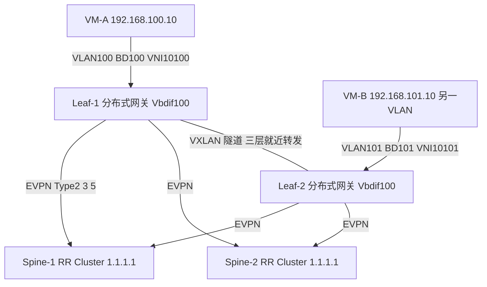

### 真题精练

**Q31.【真题·简答】** 分布式网关相比集中式网关有哪些优势？为什么新建大型 Fabric 推荐分布式网关？部署分布式网关时为保证 VM 迁移后业务不中断，必须统一哪些参数？

> **答案与解析**：
> 1. **优势**：① **三层流量本地就近转发**——集中式网关下跨 VNI 流量必须绕行到网关设备再返回目的 Leaf（可能"上行再下行"），分布式网关让每台 Leaf 都具备网关能力，路径最短；② **无网关主备**——不需要 VRRP 主备，也不存在"网关单点"，可用性更高；③ **横向扩展**——网关能力随 Leaf 数量线性增长，不受单一网关设备的性能与端口限制；④ **时延更优、VM 迁移无感**——网关地址与 MAC 全网一致，VM 迁移后仍使用同一网关，无需重新 ARP 或改配置。
> 2. **为什么推荐**：大型 Fabric 中东西向跨子网流量占比很高，集中式网关的绕行会显著增加时延并让网关成为带宽瓶颈与故障单点；分布式网关把三层转发分散到每台 Leaf，与 Fabric 的等距多路径特性天然匹配。
> 3. **必须统一的参数**：① **网关 IP 地址**（同一子网在所有 Leaf 上配置相同的 anycast 网关地址，如 192.168.100.1）；② **网关 MAC 地址**（全网统一，如 `0000-5e00-0101`，否则 VM 迁移后网关 MAC 变化导致通信中断）；③ **BD 与 VNI 映射**（BD/VLAN/L2 VNI 全网一致）；④ **VRF 的 RD/RT**（保证同一租户的三层路由能正确导入导出，不同租户隔离）；⑤ **L3 VNI**（同一 VRF 全网相同）；⑥ **NVE 源地址**（anycast VTEP 场景下同一对 M-LAG 设备必须相同）。

**Q32.【真题·多选】** 关于 BGP EVPN 的 RR 部署，下列说法正确的有：
A. RR 建议部署在 Spine 上，因为所有 Leaf 都与 Spine 建立 BGP 邻居
B. RR 必须至少部署 2 台，且两台应配置相同的 Cluster ID
C. 只有 1 台 RR 时，该 RR 故障会导致 Overlay 控制面无法收敛新变化，虽已建立的转发表项仍可转发
D. 使用 EVPN Type 5（IP Prefix Route）可以承载跨 VNI 的三层前缀，减少主机明细路由
E. RR 与客户机之间必须使用 IBGP 或 EBGP？——两种都可以，但必须保证 AS_Path 与下一跳处理正确

> **答案：A、B、C、D、E（全选）**
> **解析**：A 正确——Spine 是所有 Leaf 的汇聚点，天然适合做 RR，无需额外设备与链路。B 正确——RR 是控制面的逻辑单点，必须有冗余；两台 RR 使用**相同 Cluster ID** 才能避免路由重复与环路（不同 Cluster ID 会导致同一路由被反射两次）。C 正确——RR 故障不影响已下发的转发表项（数据面继续转发），但新的 MAC/IP 变化无法反射，Overlay 无法收敛，属于"隐性故障"，因此 RR 必须冗余并纳入监控。D 正确——分布式网关推荐用 **Type 5 IP Prefix Route** 通告网段前缀，避免每台 Leaf 学习所有租户的全部主机路由（Type 2 明细会造成表项爆炸）。E 正确——Fabric 中常见的是 **Spine 与 Leaf 属于不同 AS 的 EBGP**（配合 `ebgp-max-hop`、`peer next-hop-local` 或 `third-party-next-hop` 等下一跳处理），也有同一 AS 内 IBGP + RR 的做法；关键是**下一跳可达性与 AS_Path 处理**必须正确，否则路由能学到但转发不通（典型现象：EVPN 路由存在但 ping 不通）。

## 4.5 地址、VLAN/VNI 与命名规范规划

### 考点定位

以**设计题交付物**形式考查，占 **3~6 分**。命题方式：给一个 Fabric 规模，要求填写"地址规划表""VLAN/VNI 编码规范""设备命名规范"。易错点：地址段不连续导致无法汇总、互联地址用 /24 浪费、管理地址与业务地址混用、命名无规律导致运维困难。

### 原理精讲

规划的核心目标是**三可**：**可聚合（Aggregatable）、可预测（Predictable）、可自动化（Automatable）**。任何一条地址或编号，看到它就应该能推断出"属于哪个 POD、哪台设备、什么用途"。

**① Loopback 地址规划**。每台设备需要两类 Loopback：
- **Loopback0**：作为 **Router ID** 与 BGP 会话源地址。建议按 `10.0.<POD>.<设备编号>/32` 或独立段 `10.255.<区域>.0/24` 规划。
- **Loopback1（VTEP 地址）**：作为 NVE 源地址。建议单独一段（如 `10.255.100+POD.0/24`），便于**按 POD 汇总**。
- **anycast VTEP**：M-LAG 两台设备使用**同一个** Loopback1 地址（如 `10.255.1.11/32`），因此该地址在规划表中要标注"双机共享"。
- **原则**：同一 POD 内连续编号；不同 POD 用不同子段；所有段都能被一条 /16 或 /20 汇总覆盖。

**② 互联地址（P2P Link）规划**。Leaf 与 Spine 之间的三层互联：
- 推荐 **/30 或 /31**（/30 用 2 个可用地址，/31（RFC 3021）用 2 个地址零浪费）。**不要用 /24**——会造成大量地址浪费且无法体现点对点语义。
- 编码建议：`10.<Spine编号>.<Leaf编号>.0/30` 或 `10.1.<POD>.<序号>/30`，使"看到地址就知道两端是谁"，排错时极有价值。
- **同一台 Spine 与同一 Leaf 的多条链路**：若做 Eth-Trunk 则为一条逻辑链路一个 /30；若做多条独立三层链路做 ECMP，则每条一个 /30。

**③ 管理地址规划**。独立网段（如 `10.200.<区域>.<设备>/24`），走**带外管理网**（BMC/管理口 MEth），**与业务网段、互联网段完全分离**。**为什么必须分离**：① 业务网络故障时仍能远程管理设备（带外管理是灾难恢复的生命线）；② 管理流量不占用业务带宽；③ 安全上可对管理网做独立 ACL 与审计。KVM/IPMI 等服务器管理口也应在同一管理网内按规范编号。

**④ 业务网段规划**。按"区域 + 业务类型 + 租户"分层：例如 `192.168.<租户编号>.<子网序号>/24`（租户 A 用 192.168.100~109，租户 B 用 192.168.200~209）。**要点**：① 每个子网的**网关地址统一用 .1 或 .254**（便于记忆与自动化）；② 预留扩展空间（不要用完整个段）；③ 与 VLAN/VNI 编码联动，形成"VLAN 100 ↔ VNI 10100 ↔ 192.168.100.0/24"的三元对应关系，一张表管到底。

**⑤ 命名规范**。设备命名建议 `角色-位置-编号`：如 `SPINE-01-A`、`LEAF-POD1-01`、`BL-01`（Border Leaf）、`FW-01`。接口描述必须写对端设备与端口（`description To-Leaf-POD1-01-100GE1/0/1`），这是排错效率的关键。VLAN/VNI 名称也用规范（如 `vlan 100 name TENANT-A-WEB`）。

**⑥ 编码规范实例（考试可直接套用）**：

| 类别 | 编码规范 | 示例 | 汇总方式 |
|---|---|---|---|
| Loopback0（Router ID） | 10.255.<POD>.0/24 内编号 | POD1 Leaf1 = 10.255.1.1/32 | 按 POD 汇总为 /24 |
| Loopback1（VTEP） | 10.255.<100+POD>.0/24 | POD1 = 10.255.101.1/32（M-LAG 双机共享） | 汇总为 /24 |
| 互联地址 | 10.1.<Spine>.<Leaf>.0/30 | Spine1-Leaf1 = 10.1.1.1/30 | 汇总为 10.1.0.0/16 |
| 管理地址 | 10.200.<区域>.<设备>/24 | Leaf1 = 10.200.1.11/24 | 汇总为 10.200.0.0/16 |
| 业务网段 | 192.168.<租户>.<子网>/24 | 租户A Web = 192.168.100.0/24（网关 .1） | 按租户汇总 |
| VLAN | 100 + 业务序号（每租户 100 个 VLAN） | 租户A = 100~199，租户B = 200~299 | — |
| L2 VNI | VLAN + 10000 | VLAN 100 → VNI 10100 | — |
| L3 VNI | 50000 + VRF 编号 | VRF-A → VNI 50001 | — |
| VRF / RT | VRF-A / RT 100:100 | — | — |

### 关键概念对照表

| 地址类别 | 建议前缀长度 | 是否汇总 | 关键要求 |
|---|---|---|---|
| Loopback0（Router ID） | /32 | 按 POD 汇总 | 全网唯一、稳定不变 |
| Loopback1（VTEP） | /32 | 按 POD 汇总 | 同一 M-LAG 对共享（anycast） |
| 互联地址 | /30 或 /31 | 汇总为大段 | 编码体现两端身份 |
| 管理地址 | /24 | 汇总 | 必须带外、与业务隔离 |
| 业务网段 | /24（或按需 /23） | 按租户/业务汇总 | 网关统一 .1、预留扩展 |
| 存储网段 | /24 | 按 POD 汇总 | 独立 VRF + 无损（PFC/ECN） |
| DCI 互联 | /30 或 /31 | 独立段 | 与本地 Fabric 分离、独立策略 |

### 华为设备配置

```bash
# ================= 规范落地：Leaf-1（POD1 第 1 台）的完整地址与接口描述配置 =================
[Leaf-1] sysname LEAF-POD1-01                             // 命名规范：角色-位置-编号
[Leaf-1] vlan batch 100 101 102 200 300 999               // 按规划表批量创建 VLAN
[Leaf-1] vlan 100
[Leaf-1-vlan100] name TENANT-A-WEB                        // VLAN 命名规范，便于 display 时识别
[Leaf-1-vlan100] description TenantA-Web-Segment
[Leaf-1-vlan100] quit

[Leaf-1] interface LoopBack 0
[Leaf-1-LoopBack0] description RouterID-BGP-Source
[Leaf-1-LoopBack0] ip address 10.255.1.1 32               // 按"POD.设备编号"规范
[Leaf-1-LoopBack0] quit
[Leaf-1] interface LoopBack 1
[Leaf-1-LoopBack1] description VTEP-Anycast-Shared-With-Leaf2
[Leaf-1-LoopBack1] ip address 10.255.101.1 32             // VTEP 段（M-LAG 双机共享同一地址）
[Leaf-1-LoopBack1] quit

[Leaf-1] interface MEth0/0/0
[Leaf-1-MEth0/0/0] description OOB-Management
[Leaf-1-MEth0/0/0] ip address 10.200.1.11 24              // 带外管理地址，与业务/互联网段分离
[Leaf-1-MEth0/0/0] quit

[Leaf-1] interface 100GE1/0/1
[Leaf-1-100GE1/0/1] description To-SPINE-01-100GE1/0/1    // 接口描述必须写清对端设备与端口
[Leaf-1-100GE1/0/1] undo portswitch                       // 转为三层口（额型/版本不同命令可能为 no switchport）
[Leaf-1-100GE1/0/1] ip address 10.1.1.2 30                // 互联地址：10.1.<Spine>.<Leaf>.0/30
[Leaf-1-100GE1/0/1] quit

# ================= 业务接口与网关 =================
[Leaf-1] interface 25GE1/0/1
[Leaf-1-25GE1/0/1] description To-Server-A-NIC1
[Leaf-1-25GE1/0/1] eth-trunk 10                           // 加入 M-LAG 成员口
[Leaf-1-25GE1/0/1] quit
[Leaf-1] interface Eth-Trunk 10
[Leaf-1-Eth-Trunk10] port link-type trunk
[Leaf-1-Eth-Trunk10] port trunk allow-pass vlan 100 101 102 200 300   // 按规划表放通，两端必须一致
[Leaf-1-Eth-Trunk10] quit

# ================= 核对：地址与命名规范检查清单 =================
<Leaf-1> display current-configuration | include description   // 检查所有接口是否都有规范描述
<Leaf-1> display ip interface brief                            // 核对地址分配与掩码是否符合规划
<Leaf-1> display vlan                                          // 核对 VLAN 列表与名称
<Leaf-1> display ip routing-table 10.255.1.0 24                // 确认汇总路由生效（可聚合性验证）
<Leaf-1> display ip vpn-instance                               // 核对 VRF 与 RD/RT
```

### 示意图

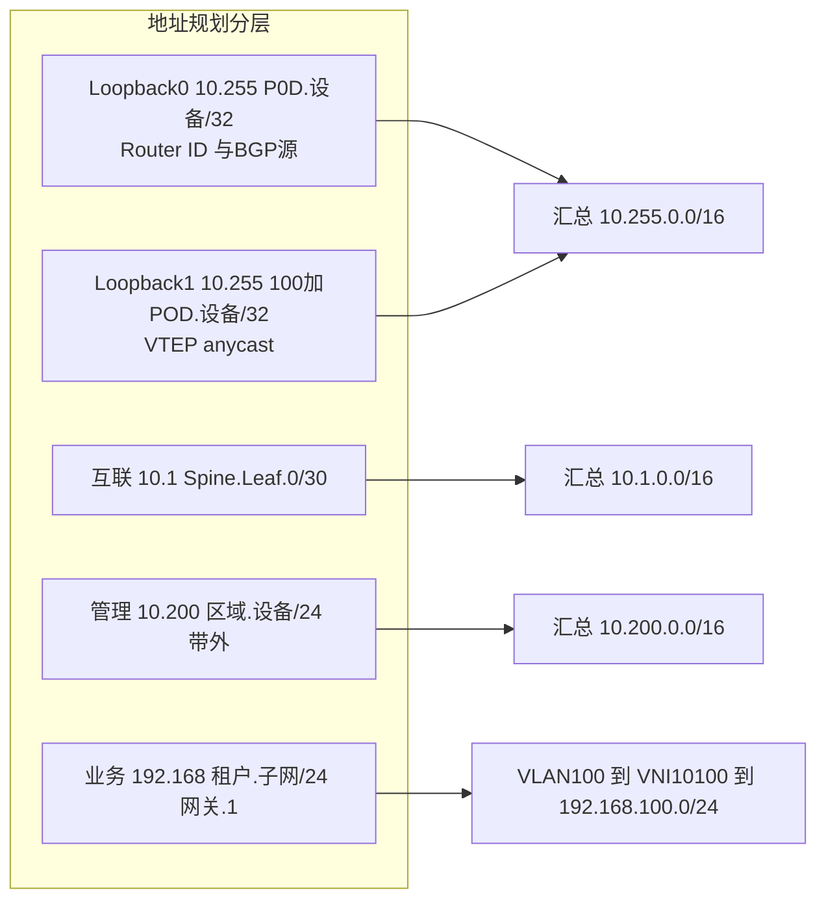

### 真题精练

**Q33.【真题·设计】** 某数据中心规划 3 个 POD（POD1~POD3），每个 POD 最多 32 台 Leaf、4 台 Spine。请给出一套完整的地址与编号规划方案（Loopback、互联地址、管理地址、业务网段、VLAN/VNI 编码），并说明如何保证可汇总性。

> **答案与解析**（参考方案，只要规范自洽、可汇总即可得分）：
> 1. **Loopback0（Router ID）**：`10.255.<POD>.0/24`，POD1 用 `10.255.1.0/24`（Leaf 依次 .1~.32，Spine 用 .241~.244）；POD2 用 `10.255.2.0/24`；POD3 用 `10.255.3.0/24`。→ 上层可按 `10.255.0.0/16` 汇总。
> 2. **Loopback1（VTEP）**：`10.255.<100+POD>.0/24`，POD1 用 `10.255.101.0/24`，同一 M-LAG 对共用同一 /32（如 10.255.101.1/32）。→ 每 POD 一条 /24 汇总。
> 3. **互联地址**：`10.1.<POD>.<Spine>.0 + Leaf 序号 /30`，例如 POD1 Spine-1 与 Leaf-1 用 `10.1.1.1/30`（Spine 侧）与 `10.1.1.2/30`（Leaf 侧）。→ 可按 `10.1.0.0/16` 汇总。
> 4. **管理地址**：`10.200.<POD>.<设备序号>/24`，POD1 Leaf-1 用 `10.200.1.11/24`，走带外管理口。→ 汇总为 `10.200.0.0/16`。
> 5. **业务网段**：`192.168.<租户编号>.<子网序号>/24`，租户 A 用 `192.168.100~109.0/24`（网关统一 `.1`），租户 B 用 `192.168.200~209.0/24`；每租户预留扩展段。→ 按租户汇总（如租户 A `192.168.100.0/22`）。
> 6. **VLAN / VNI 编码**：VLAN 按租户分段（租户 A：100~199；租户 B：200~299；存储：300~399；管理：999）；**L2 VNI = VLAN + 10000**（VLAN 100 → VNI 10100）；**L3 VNI = 50000 + VRF 编号**（VRF-A → 50001）。
> 7. **可汇总性保证**：① 所有地址段**按 POD/区域连续分配**、不跨段使用；② 每类地址**独立成段**（Router ID / VTEP / 互联 / 管理 / 业务互不交叉）；③ 预留扩展（每个 POD 段内留出 20% 以上空余），避免新增设备破坏连续性；④ 在 Spine 侧配置聚合（BGP `aggregate ... detail-suppressed`）并**显式拒绝**非规划前缀（route-policy 显式 deny），保证汇总的稳定性与安全性。

**Q34.【真题·判断】** 在数据中心规划中，互联地址使用 /24 掩码比 /30 更好，因为地址更充足。

> **答案：错误**
> **解析**：Leaf-Spine 互联是**点对点链路（P2P）**，一台 Spine 要与几十台 Leaf 互联，如果每条链路用 /24，将消耗海量地址空间并产生大量无意义的路由表项（每条 /24 都是一条路由），严重削弱可汇总性。正确做法是用 **/30（2 个可用地址）**，或更省地址的 **/31（RFC 3021，2 个地址零浪费）**；同时用编码规范（如 `10.1.<Spine>.<Leaf>.0/30`）让地址本身携带"两端是谁"的信息，便于排错与自动化。**补充**：管理地址与业务网段可以用 /24（便于识别与扩展），但**互联地址必须用点对点掩码**——这正是"掩码长度与用途匹配"的规划原则。

## 4.6 可靠性设计（冗余、BFD、快速收敛、故障域划分）

### 考点定位

设计题必答模块，占 **4~8 分**。命题点：① 列出可靠性设计的分层清单（设备/链路/协议/路径）；② BFD 与协议收敛时间的关系（必考数值：BFD 默认报文间隔、检测倍数）；③ 故障域划分原则；④ 如何用 BFD + BGP/IGP 做到亚秒级收敛。易错点：只做链路冗余不做上行/设备冗余、以为 BFD 会话建立后无需考虑中断时间、混淆 BFD 检测时间与路由收敛时间。

### 原理精讲

**① 可靠性的四个层次（清单化记忆）**：

| 层次 | 手段 | 消除的单点 | 收敛目标 |
|---|---|---|---|
| 设备级 | 双机（M-LAG/双活）、框式双主控、双电源、双风扇 | 单设备故障 | 秒级/无感 |
| 链路级 | 每 Leaf 双上行（跨 Spine）、跨单板、Eth-Trunk/M-LAG、物理路径分离 | 单链路/单板故障 | 毫秒~亚秒 |
| 协议级 | BFD、BGP/IGP 快速收敛参数、NSR/GR、LACP 快速模式 | 协议慢收敛导致的长时间中断 | 亚秒 |
| 路径级 | ECMP（多路径等价转发）、FRR（Fast Reroute） | 单路径故障 | 毫秒~亚秒 |

**② BFD（Bidirectional Forwarding Detection，双向转发检测）**。BFD 是**独立于路由协议的快速故障检测机制**，通过与对端周期性交换 BFD 控制报文并按倍数判定丢包来检测链路/会话故障。关键数值（必记）：
- **默认发送间隔**：常见配置为 **1000 ms**（华为可配到 3.3 ms 级别，具体取决于板卡能力）；
- **默认检测倍数**：**3**；
- **检测时间 = 发送间隔 × 检测倍数**（例如 10 ms × 3 = 30 ms，即 **30 ms 内判定故障**）。
- **为什么需要 BFD**：BGP 的 Keepalive 默认 **60 s**、Hold **180 s**，IGP 的 Hello/Dead 也在秒级；对于数据中心业务（尤其是存储与数据库），秒级中断不可接受。BFD 把检测时间压到毫秒级，再触发路由协议立即切换。
- **BFD 与路由收敛的区别**（高频陷阱）：**BFD 只负责"发现"故障，收敛速度还取决于路由协议重算与下发 FIB 的时间**。因此"BFD + EBGP"通常比"BFD + IGP（需 SPF 重算）"收敛更快；工程上要**同时**配置 BFD 与协议的快速收敛参数（如 `bfd min-tx-interval`、`bfd min-rx-interval`、`bfd detect-multiplier`），并验证端到端切换时间（`display bfd session all verbose`）。
- **BFD 的两种模式**：**异步模式**（周期发送，默认）与**查询模式**（按需）；Fabric 中通常用异步模式。**单跳 BFD**（用于直连链路，UDP 3784）与**多跳 BFD**（用于 Loopback 间的会话，UDP 4784）——**Underlay 用 Loopback 建 BGP 邻居时，对应的是多跳 BFD（需注意端口与 TTL 配置）**。

**③ ECMP 与 FRR**。**ECMP（Equal-Cost Multi-Path，等价多路径）**：Fabric 中同一目的（如远端 Leaf 的 Loopback）存在多条等价路径（经不同 Spine），ECMP 让流量在这些路径上哈希分担，既提升带宽利用率又提供路径冗余（一条 Spine 故障，流量自动走其余路径）。**关键要求**：哈希算法要足够均匀（避免大象流集中），并考虑 **逐流哈希 vs 逐包哈希**（逐包可能导致乱序，需按业务选择）。**FRR（Fast Reroute，快速重路由）**：为关键前缀预先计算备份路径，主路径故障时**毫秒级**切换，常用于与外部互联（Border Leaf → 出口路由器）的链路保护。

**④ 故障域划分（Fault Domain）**。原则：**把故障影响限制在最小范围**，具体做法：
- **POD 隔离**：一个 POD 的 Spine 故障只影响本 POD（Leaf 的上行全部在本 POD 内），不扩散到其他 POD。**这要求 Leaf 只上联本 POD 的 Spine**（不跨 POD 上联），是 Spine-Leaf 架构的重要约束。
- **双平面（Dual-Plane）**：把 Spine 分为两个平面（Plane-A/Plane-B），同一 Leaf 在每个平面各有一条上行，且**两平面的物理路径、电源、光缆路由都分离**。任一平面故障，业务由另一平面承载。
- **M-LAG 对**：两台 Leaf 组成 M-LAG，形成最小的"设备级故障域"，一台故障不影响对端控制面（见第 3 章）。
- **跨 DC 故障域**：双活数据中心之间要保持**控制面隔离**（各自独立 Fabric，通过 DCI 互联交换必要路由），避免一个 DC 的故障/震荡通过 DCI 传播到另一个 DC（典型风险：路由泄露、BGP 震荡、ARP 跨 DC 泛洪）。**防护手段**：DCI 侧做路由过滤与汇总、限制通告前缀、独立 VRF/AS、BFD 与路由阻尼（dampening）。
- **管理域与业务域分离**：带外管理网独立，即使业务面全瘫仍可远程操作。

**⑤ 快速收敛的端到端清单（答题模板）**：① 物理层：链路聚合 + 跨单板 + 路径分离；② 检测层：BFD（毫秒级）；③ 协议层：BGP 快速收敛参数 + Add-Path + NSR/GR；④ 路径层：ECMP/FRR；⑤ 应用层：服务器侧双归 + 业务侧超时重试；⑥ 验证：故障注入测试 + 收敛时间基线。

### 关键概念对照表

| 机制 | 检测/收敛时间 | 作用层次 | 典型配置要点 |
|---|---|---|---|
| LACP 快速模式 | 秒级（快模式更短） | 链路级 | `mode lacp-static`、短超时 |
| BFD（10ms×3） | **30 ms** | 检测层 | `bfd min-tx-interval 10`、`min-rx-interval 10`、`detect-multiplier 3` |
| BFD（默认 1000ms×3） | 3000 ms | 检测层 | 默认值，慢于 DC 业务要求 |
| BGP Keepalive/Hold | 60 s / 180 s | 协议层 | 必须用 BFD 替代检测 |
| OSPF Hello/Dead | 10 s / 40 s（广播型） | 协议层 | 可调小，但影响 CPU |
| ECMP | 无（常态多路径） | 路径层 | 哈希算法、路径数一致性 |
| FRR | 毫秒级 | 路径层 | 预置备份路径 |
| M-LAG 双主切换 | 亚秒~秒级 | 设备级 | Keepalive 1 s × 3 |
| ISSU | 目标不中断 | 设备级 | 需双主控 + 双网板（框式） |

| 故障类型 | 保护机制 | 预期业务影响 |
|---|---|---|
| 单链路故障 | Eth-Trunk / ECMP | 无感（带宽微降） |
| 单 Spine 故障 | 双上行 + ECMP | 无感（路径切换，亚秒） |
| 单 Leaf 故障 | M-LAG + 服务器双归 | 双归服务器无感，单归服务器中断 |
| 单主控故障 | 双主控（框式） | 无感（ISSU/NSR） |
| 单个 POD 故障 | POD 隔离 + 跨 POD 路由 | 本 POD 业务受影响，其他 POD 正常 |
| 单 DC 故障 | DCI 双活 + 跨 DC 路由 | 业务切换至另一 DC（分钟级或秒级） |
| 带外管理故障 | 带内应急通道（预留） | 影响运维，不影响业务转发 |

### 华为设备配置

```bash
# ================= BFD 全局与接口级配置（毫秒级检测） =================
[Leaf-1] bfd                                                 // 全局使能 BFD
[Leaf-1-bfd] quit
[Leaf-1] bfd min-tx-interval 10                              // 最小发送间隔 10ms（按板卡能力设置）
[Leaf-1] bfd min-rx-interval 10                              // 最小接收间隔 10ms
[Leaf-1] bfd detect-multiplier 3                             // 检测倍数 3 → 检测时间约 30ms

# --- BGP 邻居绑定 BFD（多跳 BFD，因邻居为 Loopback） ---
[Leaf-1] bgp 65001
[Leaf-1-bgp] peer SPINE bfd enable                           // 邻居级使能 BFD
[Leaf-1-bgp] peer SPINE bfd min-tx-interval 10               // 邻居级覆盖全局参数
[Leaf-1-bgp] peer SPINE bfd min-rx-interval 10
[Leaf-1-bgp] peer SPINE bfd detect-multiplier 3
[Leaf-1-bgp] peer SPINE bfd encryption none                  // 按需选择 BFD 认证（默认无认证）
[Leaf-1-bgp] quit

# --- OSPF 快速收敛（若 Underlay 用 OSPF） ---
[Leaf-1] ospf 1 router-id 10.255.1.1
[Leaf-1-ospf-1] bfd all-interfaces enable                    // 所有 OSPF 接口使能 BFD
[Leaf-1-ospf-1] bfd all-interfaces min-tx-interval 10
[Leaf-1-ospf-1] bfd all-interfaces min-rx-interval 10
[Leaf-1-ospf-1] bfd all-interfaces detect-multiplier 3
[Leaf-1-ospf-1] quit
[Leaf-1] interface 100GE1/0/1
[Leaf-1-100GE1/0/1] ospf timer hello 3                       // Hello 3s（默认 10s），加速邻居检测
[Leaf-1-100GE1/0/1] ospf timer dead 12                       // Dead 12s（默认 40s）
[Leaf-1-100GE1/0/1] quit

# ================= ECMP 与负载分担 =================
[Leaf-1] load-balance profile default
[Leaf-1-load-balance-profile-default] hash-mode hash-symmetric  // 开启对称哈希（双向同路径，便于排错与状态检测）
[Leaf-1-load-balance-profile-default] quit
[Leaf-1] interface Eth-Trunk 10
[Leaf-1-Eth-Trunk10] load-balance enhanced                   // 增强型负载分担（按板卡支持）

# ================= 故障注入验证（上线前必做） =================
<Leaf-1> display bfd session all verbose                       // 确认 BFD 会话 Up 与实际检测时间
<Leaf-1> display bgp peer verbose | include BFD                // 确认邻居 BFD 状态
<Leaf-1> display ip routing-table 10.255.2.0 24                // 确认到远端 Loopback 有 ECMP 多路径
<Leaf-1> display ip routing-table 10.255.2.0 24 verbose        // 查看该前缀的所有下一跳（路径数）
<Leaf-1> display dfs-group 1 brief                             // M-LAG 角色（设备级冗余状态）
<Leaf-1> display interface brief | include up                  // 上行链路数量（冗余是否到位）
# --- 故障注入：shutdown 一条上行，观察丢包与收敛时间（实验环境执行） ---
[Leaf-1] interface 100GE1/0/1
[Leaf-1-100GE1/0/1] shutdown                                   // 注入故障
<Leaf-1> display ip routing-table 10.255.2.0 24 verbose         // 确认已切换到剩余路径
<Leaf-1> ping -c 100 -s 1000 10.255.2.2                        // 统计丢包数，换算收敛时间（实验环境勿在生产执行）
```

### 示意图

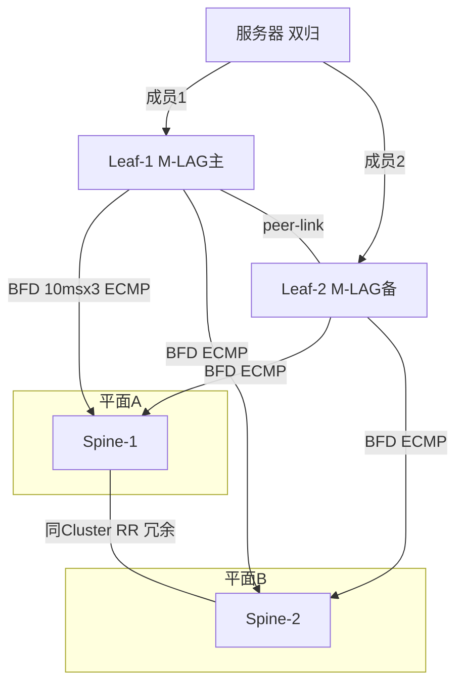

### 真题精练

**Q35.【真题·计算】** 某 Fabric 配置 BFD 检测间隔为 **10 ms**、检测倍数为 **3**，BGP 邻居绑定 BFD。请计算 BFD 判定故障所需时间；若实际业务切换耗时 80 ms，说明多出来的时间花在哪里；并给出进一步提升收敛速度的两条措施。

> **答案与解析**：
> 1. **BFD 检测时间 = 发送间隔 × 检测倍数 = 10 ms × 3 = 30 ms**（本地判定对端失效所需时间）。
> 2. **多出的 50 ms 来自**：① **故障上报与协议处理**——BFD 通知 BGP，BGP 撤销该邻居的路由并重新计算最优路径；② **FIB 下发时间**——新表项下发到转发芯片并生效；③ **ECMP 重哈希**——剩余路径的负载重新分配；④ 若 Underlay 使用 IGP（OSPF/IS-IS），还包含 **SPF 重算** 时间（这是 EBGP 收敛通常更快的原因之一）。因此**"BFD 检测时间 ≠ 端到端收敛时间"**，这是本考点最重要的辨析。
> 3. **提升措施**：① 采用 **EBGP 作为 Underlay**（增量更新、无需 SPF 重算），并配置 BGP 快速收敛参数与 Add-Path；② 缩短 BFD 间隔（如 3.3 ms × 3 ≈ 10 ms，需板卡支持）并启用**硬件级快速检测/FRR**；③ 减少路径跳数与表项规模（两层 Spine-Leaf、路由汇总），让重算与下发更快；④ 上线前做故障注入测试，建立**收敛时间基线**并纳入监控。

**Q36.【真题·简答】** 某数据中心设计为 3 个 POD，每个 POD 有 2 台 Spine 与 32 台 Leaf。请说明如何划分故障域，并解释为什么"Leaf 只上联本 POD 的 Spine"是一条重要约束。

> **答案与解析**：
> 1. **故障域划分方案**：① **POD 级隔离**——每个 POD 是独立的三层转发域，Leaf 只上联本 POD 的 Spine；POD 内 Spine 故障不影响其他 POD 的转发路径。② **双平面分离**——每个 POD 内 2 台 Spine 构成 Plane-A/Plane-B，Leaf 在每个平面各有一条上行，两平面的物理走线、光缆路由、配电尽量分离，避免"挖断一根光缆导致整 POD 失联"。③ **设备级双活**——两台 Leaf 组成 M-LAG，构成最小故障域，单台故障不影响对端控制面（见第 3 章）。④ **POD 间互访**——通过 Spine 上的**汇总路由**互通（每个 POD 一条汇总），不做 POD 间的二层延伸，避免故障与泛洪跨 POD 传播。⑤ **管理域独立**——带外管理网单独划分，业务面故障时仍可管理。
> 2. **为什么"Leaf 只上联本 POD 的 Spine"是重要约束**：① **保证等距两跳**——Leaf 与 Spine 全互联使任意 Leaf 间路径恰好 2 跳，时延可预测；若跨 POD 上联，路径长度不一致（可能 2 跳也可能 4 跳），破坏 Fabric 的"等距多路径"优势，导致流量绕行与时延抖动。② **限制故障域**——跨 POD 上联会让一个 POD 的 Spine 故障直接影响到其他 POD 的 Leaf 上行，故障跨 POD 传播。③ **简化规划与扩容**——POD 内自治，地址段、VNI、汇总边界清晰；扩容只需在本 POD 内加 Leaf/Spine，不影响其他 POD。④ **控制 Spines 数量与成本**——若允许跨 POD 上联，Leaf 需要上联到所有 Spine（跨 POD 则 Spine 数量翻倍），端口与光缆成本剧增。
> 3. **跨 POD 互访如何保证可靠**：靠 Spine 之间的（或 Super-Spine 层的）**ECMP 多路径 + 汇总路由 + BFD**，而不是靠 Leaf 跨 POD 上联。

## 4.7 安全设计（安全域、Border Leaf 策略、微分段、防火墙对接）

### 考点定位

常以**设计题的一问**或**多选/简答**出现，占 **3~6 分**。命题点：① 数据中心安全域如何划分；② 防火墙旁挂/串接/引流三种对接方式的对比；③ 微分段（Micro-Segmentation）的实现层次；④ Border Leaf 上应部署哪些安全能力。易错点：认为"有了防火墙就不需要微分段"、把安全域与 VRF/VNI 隔离混为一谈、忽略 Underlay 自身的安全加固（GTSM、认证、管理面 ACL）。

### 原理精讲

**① 数据中心安全域划分（Zone Design）**。安全域划分的依据是"**信任等级 + 业务属性 + 合规要求**"，典型的六个域：

| 安全域 | 内容 | 默认信任等级 | 主要威胁 |
|---|---|---|---|
| 互联网接入域 | 出口路由器、AntiDDoS、外层防火墙 | 最低（不可信） | DDoS、扫描、入侵 |
| DMZ / 对外服务域 | 公网可访问的 Web/API 服务器 | 低 | 入侵、Web 攻击 |
| 内网业务域 | 应用服务器、中间件 | 中 | 横向移动、越权访问 |
| 数据库/核心数据域 | 数据库、存储 | 高（最需保护） | 数据泄露、提权 |
| 管理域 | 带外管理网、NCE、跳板机 | 最高（严格管控） | 管理面被攻破 → 全盘失守 |
| 存储域（无损网络） | 分布式存储、RoCEv2 网络 | 高 | 性能干扰、ARP/流控攻击 |

**域间访问一律"默认拒绝、按需放通"**，且策略必须**可审计、可追溯**（谁能访问谁、依据哪条工单）。安全域通常与 **VRF/VNI 隔离**联动：每个域（或每个租户）一个 VRF，域间流量必须经过**安全设备（防火墙）**。

**② 防火墙对接的三种方式（本节核心对比）**：

- **旁挂（Bypass / One-Arm）**：防火墙旁挂在 Border Leaf 或核心交换机上，通过 VRF 引流（把需要检查的流量通过策略路由/PBR 引到防火墙的入接口，检查后从出接口送回）。**优点**：不改动主流量路径、防火墙故障不影响转发（可用 Bypass 或策略回退）、扩容方便（横向加防火墙）。**缺点**：流量需"绕出去再回来"，占用交换机与防火墙端口带宽，需要精细的引流策略（否则漏检）；路径变长时延增加。**注意**：旁挂时**必须保证来回路径一致**（同一对接口进出），否则防火墙会因状态检测（Session 表）不一致而丢包（**非对称路由是旁挂防火墙最常见的故障**）。
- **串接（Inline / Through）**：防火墙直接串在转发路径上（如 Border Leaf 与出口路由器之间，或两个安全域之间的"串糖葫芦"位置）。**优点**：**所有流量强制经过检查**，无法绕过，安全性最高；策略与实际路径一致，无需引流。**缺点**：**防火墙成为单点**（必须做双机热备/集群），故障会影响业务；扩容受防火墙性能限制（带宽瓶颈）；链路中断影响面大。**必须做双机**（主备或双活集群），并规划 **Bypass 链路/旁路保护**。
- **引流（Service Chaining / 服务链）**：由控制器（如 iMaster NCE-Fabric）或策略路由按照**业务策略**把流量牵引到一串服务设备（防火墙 → IPS → 负载均衡 → WAF），实现"按需编排"。**优点**：灵活、可编排、支持按租户/按业务定义不同服务链，结合微分段可实现精细化管控。**缺点**：架构复杂，依赖控制器的可靠性与一致性，排错难度高；需要 VXLAN 服务链或 PBR 支持。

**对比结论**：**南北向出口**通常用**串接双机**（强制检查，安全性优先）；**东西向域间/租户间**流量大且路径复杂，常用**旁挂 + 策略路由引流**（性能与灵活性优先），并由 NCE-Fabric 编排服务链；**关键业务**可在分布式网关的 Vbdif 上直接下发 **ACL** 做第一道过滤（就近丢弃），减少对防火墙的依赖与压力。

**③ 微分段（Micro-Segmentation）**。传统安全域是"大颗粒"（按网段/机柜划分），段内服务器之间默认互通，一旦某台服务器被攻陷，攻击者可**在段内横向移动**。**微分段**把策略粒度下沉到**单台服务器/IP/端口甚至应用身份**级别，实现"**东西向零信任**"。三种实现层次：
- **网络层微分段**：在 Leaf 的 Vbdif/接口上按 IP + 端口下发 **ACL**（或 MQC 流分类），或在 VXLAN 隧道上做基于 **Group-Based Policy（基于组的策略）**的访问控制（把服务器打上组标签，策略在组之间生效，与 IP 解耦）。华为方案常用 **VXLAN + 组策略 + NCE-Fabric 编排**。
- **主机层微分段**：在服务器操作系统/虚拟化平台上用 iptables、安全组（Security Group）、微隔离 Agent 实现（云平台常见）。
- **应用层**：通过身份认证、API 网关、服务网格（Service Mesh）做访问控制。
**结论**：**微分段与防火墙不是替代关系**——微分段（尤其是基于组的策略）负责**东西向大规模、细粒度、随虚机迁移自动跟随**的访问控制；防火墙负责**南北向出口的深度检测（IPS/AV/URL 过滤）与合规审计**。二者配合才是完整方案。

**④ Underlay 与管理面的安全加固（容易被忽略但常考）**：① BGP 邻居用 **GTSM（`valid-ttl-hops 1`）+ MD5 认证**，防止伪造邻居与路由注入；② **管理面 ACL**（只允许跳板机/NCE 访问 SSH/SNMP）；③ 关闭未使用端口与服务（`shutdown` 空闲端口、禁用 HTTP/Telnet，使用 SSH/SNMPv3）；④ **控制面保护（CoPP）**限制上送 CPU 的协议报文速率，防 DoS；⑤ **日志与审计**（`info-center` 上送 Syslog，NTP 保证时间一致）；⑥ **AAA 集中认证**（`aaa` + RADIUS/TACACS，避免本地账号泛滥）。

### 关键概念对照表

| 对接方式 | 流量是否强制经过 | 故障影响 | 扩容能力 | 典型位置 | 关键风险 |
|---|---|---|---|---|---|
| 串接（Inline） | **是（强制）** | 高（单点，需双机） | 受防火墙性能限制 | 南北向出口、域间关键节点 | 非对称路由、单点故障、带宽瓶颈 |
| 旁挂（Bypass） | 否（依赖引流策略） | 低（可回退） | 好（横向扩展） | 东西向域间、租户间 | **引流遗漏、非对称路由导致丢包** |
| 引流/服务链 | 取决于编排策略 | 中（依赖控制器） | 好 | 按业务编排的复杂场景 | 控制器一致性、排错复杂 |
| Vbdif ACL / 组策略 | 是（就近过滤） | 低（分布式执行） | 好 | 分布式网关 Leaf | 策略量大需自动化编排 |

| 隔离手段 | 粒度 | 实现位置 | 典型用途 |
|---|---|---|---|
| VRF | 租户/安全域 | 三层实例（RD/RT） | 租户隔离、安全域隔离 |
| VNI（L2） | 广播域 | VXLAN BD | 二层隔离 |
| ACL / MQC | 五元组 | 接口/Vbdif | 粗颗粒访问控制 |
| 组策略（GBP） | 服务器组/标签 | VXLAN + 控制器 | 微分段（东西向零信任） |
| 防火墙策略 | 应用/用户/内容 | 防火墙 | 深度检测与合规审计 |
| 主机安全组 | 虚机/容器 | 虚拟化平台/云平台 | 云内微分段 |

### 华为设备配置

```bash
# ================= Underlay 与管理面安全加固（CE6865，VRP V200 语法） =================
[Leaf-1] aaa
[Leaf-1-aaa] authentication-scheme default
[Leaf-1-aaa-authen-default] authentication-mode radius                // 认证走 RADIUS 集中认证
[Leaf-1-aaa-authen-default] quit
[Leaf-1-aaa] radius-server template RAD1
[Leaf-1-aaa-radius-RAD1] radius-server shared-key cipher Huawei@123   // RADIUS 共享密钥
[Leaf-1-aaa-radius-RAD1] radius-server authentication 10.200.1.100 1812  // 认证服务器地址与端口
[Leaf-1-aaa-radius-RAD1] quit
[Leaf-1-aaa] quit
[Leaf-1] stelnet server enable                               // 只开 SSH（禁用 Telnet）
[Leaf-1] undo telnet server enable                           // 显式关闭 Telnet
[Leaf-1] undo http server enable                             // 关闭 HTTP（如需 Web 管理用 HTTPS）
[Leaf-1] snmp-agent sys-info version v3                      // 使用 SNMPv3（带认证与加密）
[Leaf-1] cpu-defend policy COPP                              // 控制面保护策略
[Leaf-1-cpu-defend-COPP] car packet-type arp-request cir 5000  // 限制 ARP 上送速率（pps）
[Leaf-1-cpu-defend-COPP] car packet-type bgp cir 3000          // 限制 BGP 报文上送速率
[Leaf-1-cpu-defend-COPP] quit

# --- 管理面 ACL：只允许跳板机与 NCE 访问管理地址 ---
[Leaf-1] acl number 2000
[Leaf-1-acl-basic-2000] rule 5 permit source 10.200.1.50 32   // 跳板机
[Leaf-1-acl-basic-2000] rule 10 permit source 10.200.1.100 32 // NCE-Fabric 控制器
[Leaf-1-acl-basic-2000] rule 100 deny                          // 其余拒绝
[Leaf-1-acl-basic-2000] quit
[Leaf-1] user-interface vty 0 4
[Leaf-1-ui-vty0-4] acl 2000 inbound                            // 管理登录源地址限制
[Leaf-1-ui-vty0-4] authentication-mode aaa                     // 登录认证用 AAA
[Leaf-1-ui-vty0-4] protocol inbound ssh                        // 只允许 SSH 接入
[Leaf-1-ui-vty0-4] quit

# ================= 微分段：在分布式网关 Vbdif 上做组策略/ACL（东西向就近过滤） =================
[Leaf-1] acl number 3001
[Leaf-1-acl-adv-3001] rule 5 permit tcp source 192.168.100.0 0.0.0.255 destination 192.168.101.0 0.0.0.255 destination-port eq 8080  // 只放通必要端口
[Leaf-1-acl-adv-3001] rule 100 deny ip                                        // 默认拒绝，其余全部拦截
[Leaf-1-acl-adv-3001] quit
[Leaf-1] interface Vbdif 100
[Leaf-1-Vbdif100] traffic-filter inbound acl 3001                             // 在网关上就近过滤（第一道防线）
[Leaf-1-Vbdif100] quit

# ================= 旁挂防火墙引流：策略路由（PBR）把域间流量引到防火墙 =================
[Leaf-1] acl number 3002
[Leaf-1-acl-adv-3002] rule 5 permit ip source 192.168.100.0 0.0.0.255 destination 192.168.200.0 0.0.0.255  // 租户A→租户B 需检查
[Leaf-1-acl-adv-3002] quit
[Leaf-1] traffic classifier TO-FW operator or
[Leaf-1-classifier-TO-FW] if-match acl 3002
[Leaf-1-classifier-TO-FW] quit
[Leaf-1] traffic behavior TO-FW
[Leaf-1-behavior-TO-FW] redirect ip-nexthop 10.10.10.2                        // 引流到防火墙入接口（保持来回路径一致）
[Leaf-1-behavior-TO-FW] quit
[Leaf-1] traffic policy TO-FW
[Leaf-1-trafficpolicy-TO-FW] classifier TO-FW behavior TO-FW
[Leaf-1-trafficpolicy-TO-FW] quit
[Leaf-1] interface Vbdif 100
[Leaf-1-Vbdif100] traffic-policy TO-FW inbound                                // 在网关入方向应用引流策略
[Leaf-1-Vbdif100] quit

# ================= 验证 =================
<Leaf-1> display acl 3001                                     // 确认 ACL 规则与命中计数
<Leaf-1> display traffic policy statistics interface Vbdifif 100 inbound   // 确认引流策略命中情况
<Leaf-1> display cpu-defend statistics                         // 确认 CoPP 限速是否生效
<Leaf-1> display aaa online-fail-record all                    // 查认证失败记录（安全审计）
<Leaf-1> display current-configuration | include telnet         // 确认 Telnet 已关闭
```

### 示意图

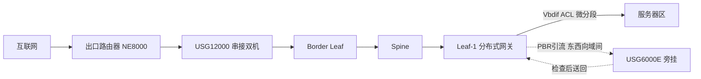

### 真题精练

**Q37.【真题·简答】** 对比防火墙"旁挂"与"串接"两种部署方式在数据中心中的应用，说明各自的优缺点与适用位置，并指出旁挂部署最容易出现的故障及原因。

> **答案与解析**：
> 1. **串接（Inline）**：防火墙直接串在转发路径上。**优点**：所有流量**强制经过检查**，无法绕过，安全等级最高；策略与实际转发路径一致，无需引流。**缺点**：防火墙成为**路径单点**（必须双机热备/集群），故障影响业务；受防火墙性能与端口带宽限制，可能成为瓶颈。**适用**：**南北向互联网出口**（出口路由器与 Border Leaf 之间），安全合规要求最高的位置。
> 2. **旁挂（Bypass/One-Arm）**：防火墙旁挂，靠**策略路由（PBR）/VRF 引流**把需要检查的流量送到防火墙，检查后再送回。**优点**：不改变主转发路径，防火墙故障可通过策略回退不影响转发；便于**横向扩展**（增加防火墙数量分担流量）；适合流量大、路径复杂的东西向域间/租户间检查。**缺点**：**依赖引流策略的完整性**（漏配即漏检）；流量"绕出再回来"增加时延与端口占用；排错复杂。
> 3. **最容易出现的故障**：**非对称路由（Asymmetric Routing）导致丢包**。原因是防火墙基于**状态检测（Session 表）**工作：如果请求从防火墙接口 A 进来、响应却因为路由/ECMP 从接口 B 直接返回（绕过了防火墙），防火墙看不到完整会话，会丢弃后续报文；反之若来回都进防火墙但**进出接口不一致**，同样会因会话不匹配而丢弃。**规避方法**：① 保证引流策略在**两个方向**都生效（或使用 VRF 方式统一进出）；② 防火墙进出接口固定为一对（同一 VRF 的两个接口）；③ 关闭会破坏对称性的逐包负载分担，改用逐流哈希；④ 上下线前用 `display traffic policy statistics` 确认两个方向都能命中引流策略，并做端到端连通性与长连接测试。

**Q38.【真题·多选】** 关于数据中心微分段（Micro-Segmentation），下列说法正确的有：
A. 微分段把访问控制粒度下沉到单台服务器/IP/端口甚至应用组，用于抑制东西向横向移动
B. 基于组（Group-Based Policy）的策略可以在 VXLAN 网络上实现，与服务器 IP 解耦
C. 有了防火墙就不需要微分段，两者功能重复
D. 微分段策略可分布在 Leaf 的 Vbdif 上就近执行，避免所有东西向流量都绕行防火墙
E. 微分段只适用于物理服务器，虚拟化环境无法实现

> **答案：A、B、D**
> **解析**：A 正确——微分段的核心目标就是"东西向零信任"，阻止攻击者在同一网段/同一机柜内横向移动。B 正确——基于组的策略把服务器打上组标签（如"Web 组""DB 组"），策略在组之间生效，服务器改 IP 或迁移后策略自动跟随，比五元组 ACL 更适合云环境。C 错——二者**互补而非重复**：微分段负责**大规模、细粒度、分布式执行的东西向访问控制**；防火墙负责**南北向出口的深度检测（IPS/AV/URL 过滤）与合规审计**。若把所有东西向流量都引到防火墙，会造成严重的性能瓶颈与单点风险。D 正确——把策略下发到各 Leaf 的 Vbdif 上**就近过滤**，是微分段的关键优势（分布式执行、无绕行、可线性扩展）。E 错——虚拟化与容器环境恰恰是微分段最主要的应用场景（安全组、微隔离 Agent、VXLAN 组策略均可实现），并且虚机迁移时策略需要自动跟随，这正是微分段相对于传统按网段划分的优势。

## 4.8 DCI 数据中心互联（需求、选型、路由与双活网关）

### 考点定位

**HCIE DCN 的压轴考点**，占 **8~14 分**。命题方式：① 给出多活/灾备/双活需求，要求做 DCI 技术选型并说明理由；② **DCI 技术对比表**（必须能默写）；③ DCI 路由设计与路由泄露防护；④ **双活数据中心的网关设计与 ARP 跨 DC 同步问题**（深水区考点）。易错点：把"灾备"与"双活"混为一谈、认为 VXLAN 可以直接跨 DC 延伸大二层（忽略泛洪域与故障域风险）、忽略路由泄露与震荡风险。

### 原理精讲

**① 先分清三种 DCI 需求形态（这是选型的前提）**：

| 形态 | 定义 | RTO/RPO | 资源利用率 | 网络要求 |
|---|---|---|---|---|
| **主备 / 灾备（Active-Standby）** | 生产中心承载业务，灾备中心待命（可能仅数据同步） | RTO 分钟~小时级，RPO 近 0（同步）/秒级（异步） | 低（备中心闲置） | 只需数据复制链路 + 切换通道，网络要求相对低 |
| **双活（Active-Active）** | 两个中心**同时承载生产业务**，互为备份 | RTO 秒级~分钟级，RPO 近 0 | 高（资源充分利用） | 需要**跨 DC 的二层/三层连通 + 网关协同 + 状态同步**，网络要求最高 |
| **多活（Multi-Active）** | ≥3 个中心同时承载，按业务/租户分流 | RTO 秒级 | 最高 | 需要统一的 Fabric 编排、跨 DC 一致的策略与自动化 |

**双活与灾备的本质差异在网络层**：灾备只需要"数据能复制、切换时网络能收敛"，**不需要**跨 DC 的二层延伸或 ARP 同步；双活则要求**同一业务网段在两个 DC 都可用**（网关、ARP/ND、会话状态、防火墙状态都要协同），这带来三大难题：**网关位置、ARP/ND 跨 DC 同步、路由与流量回程一致性**。

**② DCI 技术选型对比表（必须能默写）**：

| 技术 | 层次 | 带宽/距离 | 优点 | 缺点 | 适用场景 |
|---|---|---|---|---|---|
| **裸光纤直连** | L1 | 高带宽，距离受限于光纤衰减（同城几十 km） | 时延最低、成本可控（自有光纤时）、无协议开销 | 距离受限、纤芯资源消耗大、无保护（需自行冗余） | **同城双活**（机房距离 < 40~70 km、有富余纤芯） |
| **DWDM（密集波分复用）** | L1 | 单纤可承载 T 级，距离可达数百 km（配合放大） | 容量极大、时延低于 L3 方案、纤芯利用率高 | 设备昂贵、需要专业运维、光层规划复杂 | 同城/异地大带宽互联（双活数据中心主流） |
| **EVPN over MPLS（L3VPN/VPWS）** | L2/L3 | 由运营商提供，跨城/跨省 | 运营商级 QoS 与可靠性、天然隔离、跨域能力强 | 成本高（带宽月租）、时延不可控（取决于运营商路径）、配置与排错依赖运营商 | **异地灾备、跨城多活**，无自有光纤时 |
| **VXLAN over DCI（VXLAN 跨 DC 延伸）** | L2 over L3 | 依托 IP 承载网（含互联网专线/MPLS） | 复用现有 Fabric 与运维体系、支持大二层延伸与统一策略 | **泛洪域扩大**（广播/未知单播跨 DC 传播）、故障域合并、ARP 同步压力大、MTU 与封装开销 | 双活数据中心**统一 Fabric** 编排（需严格规划） |
| **OTV（Overlay Transport Virtualization）** | L2 over L3 | 依托 IP 承载网 | 思科专有方案，支持 L2 延伸与 MAC 路由 | **厂商专有**（华为不采用）、生态受限 | 存量异构网络（考试中主要作为"对比项"出现） |
| **IP 层互联（EBGP 交换汇总路由）** | L3 | 任意距离 | **最简单、最稳、故障域天然隔离**、无泛洪问题 | 不支持跨 DC 二层延伸（虚机跨 DC 迁移需 IP 重新规划） | **推荐默认方案**：跨 DC 三层互联 + 应用层双活/分布式数据库 |

**选型决策口诀**：**同城双活 → 裸光纤/DWDM（追求低时延与带宽）；跨城灾备 → EVPN over MPLS 或 IP 层 EBGP 互联；需要跨 DC 大二层统一池化（虚机可跨 DC 在线迁移）→ VXLAN over DCI（但必须做泛洪域与故障域控制）；能接受三层互联、不要求跨 DC 二层 → 优先 IP 层 EBGP（最稳最简）。**

**为什么"跨 DC 大二层"要谨慎（高频追问）**：把 VXLAN 的 VNI 延伸到两个 DC，等于把**广播域与故障域合并**：① 一个 DC 的广播/未知单播泛洪会跨 DC 传播，消耗 DCI 带宽；② MAC/ARP 表项规模翻倍，两端都要学习对端全部主机；③ 一个 DC 的控制面震荡可能通过 EVPN 传播到另一个 DC；④ DCI 链路故障时，跨 DC 的二层域被"劈成两半"，可能出现**双活网关冲突与回程绕行**（与第 3 章 M-LAG 双主类似的困境）。因此**除了确有虚机跨 DC 迁移等硬需求，优先选择"三层互联 + 汇总路由"**。

**③ DCI 路由设计与路由泄露防护**：
- **AS 号规划**：两个 DC 各自使用独立 AS（如 DC1 = 65001，DC2 = 65002），DCI 之间 EBGP 互联（或用运营商 MPLS 提供的 VPN）。**禁止**两个 DC 使用同一 AS 造成 AS_Path 防环判定异常。
- **只交换必要路由**：DCI 上只允许**汇总路由**与**明确允许的业务前缀**通过，用 **route-policy / ip-prefix** 严格过滤。**绝不允许**把 Underlay 明细、管理网段、互联地址泄露到对端 DC。
- **路由泄露（Route Leak）风险**：若 DCI 侧把本地 Fabric 的全部路由（含明细、含其他 POD 内部前缀）通告给对端，会造成：① 对端路由表膨胀；② 流量绕行（本可本地直达的流量被引到对端再回来）；③ 更严重的是**形成转发环路**（两 DC 互相把对方当作到达某前缀的下一跳）。
- **防环与稳定**：使用 AS_Path 长度作为选路依据（本地优先：`bgp bestroute` 与 `local-preference` 配合）、配置**路由阻尼（dampening）**抑制震荡、使用 **BFD** 快速检测、必要时用 **BGP 团体（Community）**标记路由来源并做过滤。
- **双活路由一致性**：两个 DC 对外通告相同的业务前缀（anycast/等价），由上层（DNS/GSLB 或应用层）做流量调度；若做 L3 双活，需保证**回程路径一致**（否则防火墙状态检测失效）。

**④ 双活数据中心的网关设计与 ARP/ND 跨 DC 同步问题（深水区）**。三种网关设计方案：

| 方案 | 网关位置 | 优点 | 缺点/风险 |
|---|---|---|---|
| **本地网关（推荐）** | 每个 DC 用**自己的网关地址段**（业务 IP 按 DC 划分） | ARP/ND 无需跨 DC 同步、故障域隔离、设计简单 | 虚机/IP 不能跨 DC 平移（需 NAT 或 IP 重规划）；应用需支持按 DC 就近接入 |
| **跨 DC 共享网关（大二层）** | 同一网段网关在两个 DC 都有（VXLAN 延伸 + 网关 anycast/主备） | 虚机可跨 DC 迁移、IP 不变 | **必须同步 ARP/ND**；泛洪跨 DC；双主风险；回程一致性差 |
| **分布式网关 + anycast（EVPN 多活）** | 两个 DC 都配置相同的 anycast 网关 IP/MAC，通过 EVPN 同步 | 就近转发、无主备、迁移无感 | 要求 EVPN 跨 DC 互通与 ESI/DF 正确；控制面耦合（故障可能跨 DC 传播） |

**ARP/ND 跨 DC 同步问题（必考的三点）**：
1. **为什么要同步**：跨 DC 共享网关下，DC1 的 Leaf 需要知道 DC2 内主机的 MAC（否则发往 DC2 主机的报文只能靠泛洪，消耗 DCI 带宽且可能被丢弃）；反之亦然。**解决方法**：用 **BGP EVPN Type 2（MAC/IP Advertisement）**在两个 DC 之间同步 MAC/IP 路由（控制面同步，而不是数据面泛洪）；或用 VXLAN 的泛洪机制（**不推荐**，会跨 DC 泛洪）。
2. **不同步的后果**：① **首包丢失/黑洞**——虚机迁移到 DC2 后，DC1 的网关仍把 ARP 表项指向旧位置，导致流量送到 DC1 却找不到主机；② **泛洪风暴**——未知单播跨 DC 泛洪，DCI 带宽被占满；③ **ARP 表项冲突/翻转**——同一 IP 在两个 DC 都有 ARP 响应时，ARP 表项反复刷新（与 MAC flapping 类似），转发不稳定。
3. **同步的代价与规避**：ARP/MAC 表项跨 DC 同步意味着**表项规模是单 DC 的两倍以上**、控制面耦合（一端震荡传播到另一端）；因此**最优实践是优先选择"本地网关 + IP 按 DC 分段"**，从根本上避免跨 DC ARP 同步需求；只有在"虚机必须跨 DC 在线迁移且 IP 不能变"的硬约束下才使用跨 DC 共享网关，并配合 EVPN 控制面同步 + 严格过滤 + 泛洪抑制。

**⑤ DCI 带宽与冗余设计**：
- **带宽测算**：DCI 带宽 = 需跨 DC 的流量（数据复制 + 跨 DC 业务访问 + 迁移流量）× 冗余系数（1.5~2）。数据同步（数据库/存储）通常是主要成分，需按"峰值同步速率 + 重同步（Resync）窗口"峰值计算（重同步时带宽需求可能是常态的 2~3 倍）。
- **冗余设计**：① **双链路双设备**（每 DC 两台 DCI 网关/边界设备，交叉互联）；② **多运营商/多物理路由**（避免同沟同缆，防止单点挖掘中断）；③ **BFD + EBGP 快速收敛**；④ **链路聚合/ECMP** 提升带宽与可靠性；⑤ 关键场景可加 **DWDM 光层保护（OLP）**。
- **质量约束**：双活的同步复制要求**往返时延（RTT）在可接受范围**（通常 < 5~10 ms，"5 ms 定律"是同步复制的经验门槛），因此**同城双活优先裸光纤/DWDM，异地灾备用异步复制 + MPLS/IP**。

### 关键概念对照表

| DCI 技术 | 时延 | 带宽能力 | 是否支持二层延伸 | 运维复杂度 | 推荐场景 |
|---|---|---|---|---|---|
| 裸光纤 | 最低（光速传播 + 设备转发） | 高（100G/400G/端口） | 可（直连二层） | 低 | 同城双活 |
| DWDM | 低（光层透明） | 极高（T 级/纤） | 可 | 高 | 同城/异地大带宽双活 |
| EVPN over MPLS | 中（取决于运营商路径） | 中高（按带宽购买） | 可（VPWS） | 中（依赖运营商） | 跨城灾备/多活，无自有光纤 |
| VXLAN over DCI | 中（封装 + 转发） | 取决于承载网 | **是（大二层延伸）** | 高（泛洪/故障域风险） | 需求统一 Fabric、跨 DC 迁移 |
| IP 层 EBGP 互联 | 低（无封装开销） | 取决于链路 | **否** | **最低** | 三层双活、分布式应用、推荐默认 |

| 双活网关方案 | 跨 DC ARP 同步 | 虚机跨 DC 迁移 | 故障域 | 推荐度 |
|---|---|---|---|---|
| 本地网关（IP 按 DC 分段） | 不需要 | 不支持（IP 需重规划） | 隔离 | **最高（默认推荐）** |
| 跨 DC 共享网关（VXLAN 延伸） | **必须（EVPN Type2 同步）** | 支持（IP 不变） | 合并（风险） | 仅在硬需求下使用 |
| 分布式网关 + anycast（EVPN 多活） | 通过 EVPN 控制面同步 | 支持 | 部分耦合 | 大规模云双活（需严格规划） |

### 华为设备配置

```bash
# ================= DC1 / DC2 三层互联（IP 层 EBGP，推荐默认方案） =================
# --- DC1 侧边界设备（Border Leaf 或 DCI 网关，AS 65001） ---
<BL-DC1> system-view
[BL-DC1] sysname BL-DC1
[BL-DC1] interface 100GE1/0/1
[BL-DC1-100GE1/0/1] description To-DC2-DCI-Link
[BL-DC1-100GE1/0/1] undo portswitch
[BL-DC1-100GE1/0/1] ip address 10.250.0.1 30              // DCI 互联地址：独立段 10.250.0.0/16
[BL-DC1-100GE1/0/1] quit

[BL-DC1] ip ip-prefix DCI-ALLOW index 10 permit 192.168.0.0 16        // 只允许业务汇总段通过
[BL-DC1] ip ip-prefix DCI-ALLOW index 20 permit 10.255.101.0 24       // 允许对端必要 Loopback 段
[BL-DC1] route-policy DCI-OUT permit node 10
[BL-DC1-route-policy] if-match ip-prefix DCI-ALLOW                    // 命中才通告
[BL-DC1-route-policy] apply community 65001:100                       // 打上团体标记，便于对端识别来源
[BL-DC1-route-policy] apply local-preference 200                      // 提高本地优先级，保证本 DC 优先
[BL-DC1-route-policy] quit
[BL-DC1] route-policy DCI-OUT deny node 100                           // 其余一律拒绝（杜绝路由泄露）
[BL-DC1-route-policy] quit
[BL-DC1] route-policy DCI-IN permit node 10
[BL-DC1-route-policy] if-match ip-prefix DCI-ALLOW                    // 只接收明确允许的前缀
[BL-DC1-route-policy] quit
[BL-DC1] route-policy DCI-IN deny node 100
[BL-DC1-route-policy] quit

[BL-DC1] bgp 65001
[BL-DC1-bgp] router-id 10.255.101.251
[BL-DC1-bgp] peer 10.250.0.2 as-number 65002                          // DC2 使用独立 AS
[BL-DC1-bgp] peer 10.250.0.2 bfd enable                               // BFD 毫秒级检测
[BL-DC1-bgp] peer 10.250.0.2 valid-ttl-hops 1                         // GTSM 防伪造邻居
[BL-DC1-bgp] peer 10.250.0.2 password cipher Huawei@123               // 认证
[BL-DC1-bgp] ipv4-family unicast
[BL-DC1-bgp-af-ipv4] peer 10.250.0.2 enable
[BL-DC1-bgp-af-ipv4] peer 10.250.0.2 route-policy DCI-OUT export      // 出方向严格过滤
[BL-DC1-bgp-af-ipv4] peer 10.250.0.2 route-policy DCI-IN import       // 入方向严格过滤
[BL-DC1-bgp-af-ipv4] peer 10.250.0.2 route-limit 2000 80              // 限制接收路由数量，防路由震荡冲击
[BL-DC1-bgp-af-ipv4] peer 10.250.0.2 capability-advertise add-path send  // Add-Path 提升多路径与冗余
[BL-DC1-bgp-af-ipv4] aggregate 192.168.0.0 16 detail-suppressed        // 对外只发汇总，抑制明细
[BL-DC1-bgp-af-ipv4] quit
[BL-DC1-bgp] quit

# --- 路由震荡抑制（dampening）与本地优先（保证跨 DC 回程一致） ---
[BL-DC1] bgp 65001
[BL-DC1-bgp] ipv4-family unicast
[BL-DC1-bgp-af-ipv4] dampening 15 750 2000 60                          // 阻尼参数：半衰期/重用/抑制/最大抑制时间
[BL-DC1-bgp-af-ipv4] maximum load-balancing 8                          // 允许最多 8 条等价路径 ECMP
[BL-DC1-bgp-af-ipv4] quit
[BL-DC1-bgp] quit

# ================= 双活网关：跨 DC 共享网关（VXLAN 延伸 + EVPN 同步，谨慎使用） =================
# --- 说明：仅在"虚机必须跨 DC 迁移且 IP 不变"时使用；两 DC 通过 EVPN 同步 MAC/IP ---
[BL-DC1] bgp 65001
[BL-DC1-bgp] l2vpn-family evpn
[BL-DC1-bgp-af-evpn] peer 10.250.0.2 enable                            // 跨 DC 建立 EVPN 邻居
[BL-DC1-bgp-af-evpn] peer 10.250.0.2 route-policy EVPN-OUT export      // 只同步必要 VNI 的 MAC/IP
[BL-DC1-bgp-af-evpn] peer 10.250.0.2 route-policy EVPN-IN import
[BL-DC1-bgp-af-evpn] quit
[BL-DC1-bgp] quit
# --- 泛洪抑制：限制跨 DC 的 BUM 流量，防止泛洪风暴打满 DCI ---
[BL-DC1] interface Nve 1
[BL-DC1-Nve1] source 10.255.101.251
[BL-DC1-Nve1] vni 10100 head-end peer-list protocol bgp                 // 只用 EVPN 控制面建立复制列表，避免数据面泛洪
[BL-DC1-Nve1] quit

# ================= DCI 验证与运维命令 =================
<BL-DC1> display bgp peer                                                  // DCI 邻居与 BFD 状态
<BL-DC1> display bgp routing-table 192.168.0.0                            // 确认收到的是汇总路由
<BL-DC1> display bgp routing-table peer 10.250.0.2 received-routes        // 查看从对端接收的路由（核查泄露）
<BL-DC1> display bgp routing-table peer 10.250.0.2 advertised-routes      // 查看向对端通告的路由（核查泄露）
<BL-DC1> display ip routing-table statistics                              // 路由表规模基线（防泄露指标）
<BL-DC1> display bfd session all verbose                                   // DCI 链路 BFD 检测时间
<BL-DC1> display bgp evpn all routing-table mac-route                     // 跨 DC 同步的 MAC/IP 路由（双活网关场景）
<BL-DC1> display interface 100GE1/0/1                                     // DCI 链路利用率与错包
<BL-DC1> display bgp routing-table dampened                                // 被抑制的震荡路由（稳定性监控）
```

### 示意图

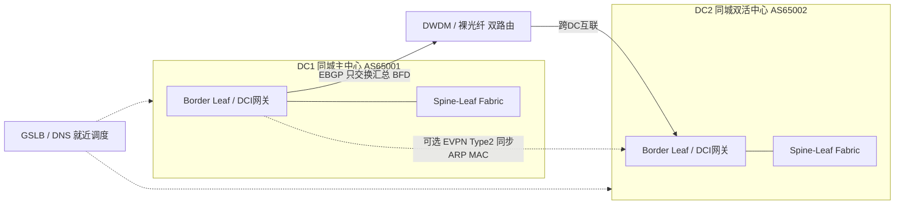

### 真题精练

**Q39.【真题·简答】** 某企业需要建设"同城双活数据中心"，要求 RTO 秒级、RPO 近 0，两个机房相距 25 km，拥有富余的裸光纤资源。请完成 DCI 技术选型并说明理由，同时说明网关应该如何设计以及是否需要跨 DC 同步 ARP。

> **答案与解析**：
> 1. **DCI 技术选型**：**裸光纤直连（或裸光纤 + DWDM 扩容）**。理由：① 距离 25 km 在裸光纤可直驱范围内，无需波分放大即可承载 100GE/400GE；② **时延最低**——同步复制（RPO 近 0）要求往返时延尽可能小（经验阈值通常 < 5~10 ms，"5 ms 定律"），25 km 光纤单向传播时延约 0.125 ms（按 5 μs/km 估算），加上设备转发完全满足同步复制要求；③ 有自有光纤，**长期成本低于按月租用运营商专线**；④ 二层/三层均可承载，灵活性高。**冗余设计**：两条裸光纤走**不同物理路由**（不同管道/不同桥架），两端各部署两台 DCI 边界设备交叉互联，配合 **BFD + EBGP** 实现亚秒级收敛；必要时加 **DWDM + 光层保护（OLP）** 提升容量与可靠性。
> 2. **网关设计**：**推荐"本地网关 + 业务 IP 按 DC 分段"**——DC1 与 DC2 各用独立的业务网段与网关（例如 DC1 用 192.168.100.0/24，DC2 用 192.168.110.0/24），两 DC 之间通过 **DCI 的 EBGP 交换汇总路由**实现三层互通，上层用 **GSLB/DNS 或应用层调度**做就近接入与故障切换。
> 3. **是否需要跨 DC 同步 ARP**：**采用本地网关方案时不需要**。这是该方案最大的优势：ARP/ND 表项只在本地 Fabric 内有效，故障域天然隔离，不存在表项冲突与跨 DC 泛洪；代价是**虚机不能跨 DC 在线迁移并保持 IP 不变**（若必须迁移，需要在应用层做 IP 重规划或使用 NAT）。若业务确有"跨 DC 迁移 IP 不变"的硬需求，则必须采用**跨 DC 共享网关（VXLAN 延伸）+ BGP EVPN Type 2 同步 MAC/IP 路由**，并接受泛洪域扩大、表项翻倍、控制面耦合与双主风险。
> 4. **加分点**：说明"双活"的关键不只是网络，还包括**数据库/存储的双活复制**（同步复制对时延敏感）、**防火墙会话同步**（双机双活需状态同步）、**DNS/GSLB 调度策略**；网络侧要保证**回程路径一致**，否则状态检测设备会丢包。

**Q40.【真题·多选】** 关于 DCI 路由设计与路由泄露防护，正确的做法有：
A. 两个数据中心使用不同的 AS 号，DCI 之间采用 EBGP 互联
B. 在 DCI 出/入方向都用 route-policy + ip-prefix 严格过滤，只交换汇总路由
C. 配置 `route-limit` 限制从对端接收的路由数量，防止路由震荡冲击设备
D. 把本 DC 的全部明细路由（含 Underlay 互联与管理网段）都通告给对端，便于对端排错
E. 使用 BFD 加速 DCI 链路故障检测，并配合 dampening 抑制路由震荡

> **答案：A、B、C、E**
> **解析**：A 正确——不同 AS 才能构成 EBGP，且 AS_Path 能发挥防环作用；若两 DC 使用同一 AS，AS_Path 防环判定会异常（收到含自身 AS 的路由被丢弃），需要额外配置 `allow-as-loop` 等机制，风险高。B 正确——出/入方向都要过滤（**只出不过滤会导致泄露，只入不过滤会导致被污染**），且只交换汇总路由可同时控制表项规模与爆炸半径。C 正确——`route-limit` 是对端的"防洪堤"，可防止对端故障时海量路由冲击本端设备导致 CPU/内存耗尽。D 错——这正是**必须避免的路由泄露**：会把对端路由表撑爆、引发流量绕行，甚至形成**转发环路**；管理网段与 Underlay 互联地址更是绝不能泄露（安全问题 + 无意义路由）。E 正确——DCI 链路是跨 DC 的关键路径，BFD 提供毫秒级检测；dampening（阻尼）抑制反复震荡的路由，避免"路由翻动 → 全网重算"的雪崩。

**Q41.【真题·设计】** 某银行需要建设"两地三中心"（同城双活 + 异地灾备）。请给出整体网络方案框架，包括：三个中心的角色与流量关系、DCI 技术选型、网关与路由设计、可靠性设计。

> **答案与解析**（标准作答框架）：
> 1. **角色与流量关系**：① **同城生产中心 A + 同城双活中心 B**（距离 20~30 km，承载生产业务，双活、互为备份，RTO 秒级、RPO 近 0）；② **异地灾备中心 C**（距离数百至上千 km，作为最终兜底，异步复制，RTO 分钟~小时级、RPO 秒级）。流量关系：A/B 之间承载**业务流量 + 同步复制流量**（带宽大、时延敏感）；A/C（或 B/C）之间承载**异步复制流量 + 备份流量**（带宽较大、时延不敏感）。
> 2. **DCI 技术选型**：① **A↔B（同城双活）**：**裸光纤 + DWDM**，双路由（不同物理管道）、双设备交叉互联，满足同步复制的低时延与大带宽要求；② **A/B↔C（异地灾备）**：优先 **DWDM 长距**（若自有光纤）或 **EVPN over MPLS / IP 层 EBGP 专线**（无自有光纤时），采用**异步复制**规避长距时延对同步复制的影响；若需要跨同城/异地统一的二层池化，才考虑 VXLAN over DCI，并严格控制泛洪域。
> 3. **网关与路由设计**：① **网关**：同城 A/B 采用**本地网关 + 业务 IP 按中心分段**（推荐），通过 EBGP 交换汇总路由，GSLB 做就近调度与故障切换；异地 C 作为灾备，网关独立、平时不承载生产流量；② **路由**：三个中心各用**独立 AS**（如 65001/65002/65003），DCI 之间 EBGP 互联，**只交换业务汇总路由**，出/入方向 route-policy + ip-prefix 严格过滤，配置 `route-limit` 与 `dampening`；Underlay 明细、管理网段、互联地址一律不通告；③ **防环**：依靠 AS_Path 防环 + 本地优先级保证"本中心优先"，避免跨 DC 绕行。
> 4. **可靠性设计**：① 每个中心内部：Spine-Leaf + 双上行 + M-LAG + ECMP；② DCI 侧：双设备、双链路、**不同物理路由**、BFD + EBGP 亚秒级收敛；③ 中心级：A/B 双活（RTO 秒级），C 为最终兜底（RTO 分钟级）；④ 存储/数据库侧：同步复制（A↔B）+ 异步复制（→C）三层保护；⑤ 安全：DCI 侧严格路由过滤 + GTSM + 认证 + 流量审计；⑥ 运维：ZTP 开局、配置模板与版本统一、跨中心监控与定期切换演练（**演练是"两地三中心"能否真正生效的唯一验证手段**）。

## 4.9 数据中心自动化运维体系（ZTP、模板、版本与变更）

### 考点定位

以**简答/多选**为主，占 **3~5 分**，也是设计题"运维设计"一问的标准答案来源。命题点：① ZTP（Zero Touch Provisioning，零配置开局）的工作流程与依赖条件；② 配置模板与版本管理的目的；③ 变更流程应包含哪些环节；④ NCE-Fabric 在自动化中的角色。易错点：认为 ZTP 只需设备支持（忽略了 DHCP/文件服务器/NTP 等依赖）、把"配置备份"等同于"版本管理"。

### 原理精讲

**① ZTP 零配置开局流程**。新设备上电、无配置时，自动完成"获取管理地址 → 获取版本文件与配置文件 → 加载并重启 → 上线纳管"。依赖五个环节：

| 环节 | 依赖 | 作用 |
|---|---|---|
| 1. 上电自检 | 设备支持 ZTP（VRP 内置） | 检测到无配置或指定触发条件时进入 ZTP 流程 |
| 2. 获取临时管理地址 | **DHCP 服务器**（含 Option 148/67 指向文件服务器） | 让设备在无配置状态下获得 IP 与引导信息 |
| 3. 获取版本/配置文件 | **文件服务器（TFTP/FTP/SFTP）** | 下载系统软件包与配置文件（按设备序列号/型号区分） |
| 4. 加载与重启 | 校验（MD5/SHA256） | 防止文件损坏或篡改 |
| 5. 上线纳管 | **NTP + 控制器（NCE-Fabric）** | 时间同步、注册上线、接受控制器下发的业务配置 |

**ZTP 的价值**：① 减少人工配置错误（数据中心一次扩容可能几十台设备）；② 缩短上线时间（从小时级到分钟级）；③ 保证配置一致性（模板化）。**考试要点**：ZTP 的前提是**网络侧已准备好 DHCP/文件服务器/NTP 与相应模板**，且新设备的**管理口连通性**必须预先规划（带外管理网）。若设备已有配置，需要执行"清除配置 + 重启"或使用特定触发命令（如 `ztp run` 类似机制，视版本而定）才能重新进入 ZTP。

**② 配置模板与配置漂移控制**。做法：① **模板化**——把设备配置抽象为"角色模板（Spine/Leaf/Border）+ 变量（设备名、IP、AS、VNI）"，由控制器渲染生成（Jinja2 模板 + YANG 模型是常见实现）；② **配置基线**——每次变更后保存并归档配置，形成可对比的基线；③ **配置一致性校验**——定期抓取设备当前配置与基线比对，发现**配置漂移（Configuration Drift）**并告警（这是数据中心最常见的隐性风险）；④ 对 M-LAG 这类强一致性场景，把 `display m-lag consistency-check` 的结果纳入监控。

**③ 版本管理与升级策略**。① **版本统一**——同一角色的设备使用同一软件版本（M-LAG 甚至要求两台设备版本完全一致）；② **版本登记**——维护《版本基线表》（设备角色 → 推荐版本 → 补丁 → 已知问题）；③ **升级窗口与灰度**——先在非关键 POD 灰度验证，再全网推广；④ **回滚方案**——保留上一版本软件包与配置（`startup system-software` 指定启动包、`display startup` 核对），确保可快速回退；⑤ **升级前自动化检查**——脚本化执行"角色检查、一致性检查、容量检查、配置备份"（见第 3 章升级流程）。

**④ 变更流程（Change Management）**。标准环节：**申请 → 评审（风险评估 + 影响面分析）→ 计划（时间窗、步骤、验证点、回滚方案）→ 演练（预生产环境验证）→ 实施（按 checklist 逐步执行、每步验证）→ 验证（业务与健康检查）→ 归档（配置备份 + 变更记录）**。数据中心的特殊要求：① **变更的原子性与可回滚**——每一步都要有明确的成功判据与回滚动作；② **禁止"两台设备同时变更"**（尤其 M-LAG/堆叠场景，会造成业务全断）；③ **变更后立即做健康巡检**（接口、协议、M-LAG、路由规模、日志）。

**⑤ 监控与可观测性**。① **指标采集**：SNMP/Syslog 是传统方式；现代数据中心用 **Telemetry（流式推送，秒级/亚秒级采集）** 获取接口速率、丢包、时延、队列深度、表项使用率；② **关键 KPI**：链路利用率、丢包率、时延（含 P99）、PFC/Pause 帧计数、ECN 标记比例、BGP 邻居状态与路由数、M-LAG 状态与一致性检查、CPU/内存/表项水位；③ **告警分级与抑制**（避免告警风暴）；④ **容量趋势与预测**（提前扩容）。

### 关键概念对照表

| 运维能力 | 关键依赖 | 主要收益 | 常见失败原因 |
|---|---|---|---|
| ZTP 开局 | DHCP + 文件服务器 + NTP + 模板 | 减少人工错误、分钟级上线 | 管理口不通、DHCP Option 配错、文件校验失败 |
| 配置模板化 | 控制器 + 变量与角色定义 | 一致性与可审计 | 模板与实际版本命令差异、变量遗漏 |
| 配置基线/漂移检测 | 定期抓取 + 比对 | 及早发现隐性风险 | 未纳入监控、比对规则过宽 |
| 版本管理 | 版本基线表 + 软件仓库 | 可回滚、可复现 | 版本散乱、M-LAG 两端版本不一致 |
| 变更流程 | 评审 + 演练 + 回滚方案 | 降低变更事故率 | 跳过演练、无回滚方案、两台同时变更 |
| Telemetry 监控 | 采集器 + 分析平台 | 秒级可见性、容量预测 | 只上 SNMP（分钟级），看不到微突发 |

### 华为设备配置

```bash
# ================= ZTP 相关配置（设备侧） =================
<CE6865> system-view
[CE6865] sysname LEAF-POD1-01
[CE6865] interface MEth0/0/0
[CE6865-MEth0/0/0] ip address dhcp-alloc                    // 管理口 DHCP 自动获取（ZTP 第一步依赖）
[CE6865-MEth0/0/0] quit
[CE6865] dhcp enable                                        // 使能 DHCP 客户端功能
[CE6865] ntp-service enable                                 // 时间同步（ZTP 与日志比对前提）
[CE6865] ntp-service unicast-server 10.200.1.100
[CE6865] quit
# --- 查看 ZTP 过程（版本支持时） ---
<CE6865> display ztp status                                 // 查看 ZTP 当前阶段与结果（版本支持时）
<CE6865> display dhcp client                                // 确认是否成功获取管理地址
<CE6865> display startup                                    // 确认下次启动的软件包与配置文件

# ================= 配置备份与版本核对 =================
<LEAF-POD1-01> save                                         // 保存配置到 flash
<LEAF-POD1-01> display saved-configuration | include sysname  // 核对已保存配置
<LEAF-POD1-01> dir flash:                                    // 查看 flash 中的配置文件与软件包
<LEAF-POD1-01> display startup                               // 核对当前启动包与下次启动包（升级/回滚关键）
<LEAF-POD1-01> display version                               // 核对版本是否与《版本基线表》一致

# --- 指定下次启动的软件包与配置（升级/回滚的核心命令） ---
<LEAF-POD1-01> startup system-software CE6865-V200R019C10SPC500.cc   // 指定下次启动软件包
<LEAF-POD1-01> startup saved-configuration vrpcfg.zip               // 指定下次启动配置文件
<LEAF-POD1-01> display startup                                      // 复核后再执行 reboot

# ================= 健康巡检与漂移检测（建议脚本化） =================
<LEAF-POD1-01> display interface brief | include up           // 接口健康
<LEAF-POD1-01> display ip routing-table statistics            // 路由规模（与基线比对）
<LEAF-POD1-01> display bgp peer                               // 邻居状态
<LEAF-POD1-01> display dfs-group 1 brief                      // M-LAG 角色
<LEAF-POD1-01> display m-lag consistency-check                // M-LAG 一致性（漂移检测关键项）
<LEAF-POD1-01> display cpu-usage                              // CPU 水位
<LEAF-POD1-01> display memory-usage                           // 内存水位
<LEAF-POD1-01> display logbuffer | include ERROR              // 近期错误日志
<LEAF-POD1-01> display interface 100GE1/0/1 | include error   // 关键链路错包（隐性故障）

# ================= Telemetry 采集（CloudEngine 支持 gRPC 推模式） =================
[LEAF-POD1-01] telemetry                                      // 进入 Telemetry 配置视图（V200 支持）
[LEAF-POD1-01-telemetry] destination-group COLLECTOR          // 定义采集器组
[LEAF-POD1-01-telemetry-destination-group-COLLECTOR] ipv4-address 10.200.1.120 port 50051 protocol grpc  // gRPC 采集端点
[LEAF-POD1-01-telemetry-destination-group-COLLECTOR] quit
[LEAF-POD1-01-telemetry] sensor-group IF-STATS                // 定义传感器组（采集对象）
[LEAF-POD1-01-telemetry-sensor-group-IF-STATS] sensor-path huawei-ifm:ifm/interfaces/interface     // 接口统计
[LEAF-POD1-01-telemetry-sensor-group-IF-STATS] quit
[LEAF-POD1-01-telemetry] subscription SUB1                    // 定义订阅：绑定采集器与传感器
[LEAF-POD1-01-telemetry-subscription-SUB1] sensor-group IF-STATS sample-interval 5000   // 5 秒采样（亚秒级可按需）
[LEAF-POD1-01-telemetry-subscription-SUB1] destination-group COLLECTOR
[LEAF-POD1-01-telemetry-subscription-SUB1] quit
[LEAF-POD1-01-telemetry] quit
<LEAF-POD1-01> display telemetry subscription                 // 确认订阅状态与采集是否正常
```

### 示意图

```mermaid
sequenceDiagram
  participant DEV as 新设备 CE6865
  participant DHCP as DHCP服务器
  participant FS as 文件服务器
  participant NCE as NCE-Fabric
  DEV->>DHCP: 上电无配置 请求管理地址
  DHCP->>DEV: 分配地址 + Option指向文件服务器
  DEV->>FS: 请求版本包与配置文件
  FS->>DEV: 下发软件包与配置 含校验值
  DEV->>DEV: 校验加载并重启
  DEV->>NCE: NTP同步后注册上线
  NCE->>DEV: 下发角色模板与业务配置 VXLAN M-LAG
  NCE->>NCE: 记录配置基线 纳入漂移检测
```

### 真题精练

**Q42.【真题·简答】** 说明 ZTP 零配置开局的完整流程与依赖条件，并指出两个最容易导致 ZTP 失败的环节。

> **答案与解析**：
> 1. **流程**：① 设备上电，检测到**无配置**（或满足触发条件）后进入 ZTP 流程；② 通过**管理口向 DHCP 服务器请求地址**，DHCP 响应中携带**Option（如 148/67）指向文件服务器与配置模板路径**；③ 设备从**文件服务器（TFTP/FTP/SFTP）**下载对应的软件包与配置文件（按设备型号/序列号匹配模板）；④ 校验文件（MD5/SHA256）后**加载并重启**；⑤ 与 **NTP 同步时间**、注册到 **NCE-Fabric** 控制器上线，接受控制器下发的业务配置并纳入基线管理。
> 2. **依赖条件**：DHCP 服务器（含正确的 Option 配置）、文件服务器（软件包与配置模板齐备）、NTP 服务器、控制器（NCE-Fabric）、**带外管理网的连通性与地址规划**、以及设备的 ZTP 特性支持。
> 3. **两个最容易失败的环节**：① **管理网连通性/DHCP Option 配置错误**——管理口未接、VLAN 未放通、DHCP 中继未配置、Option 指向的服务器地址错误或不可达，导致设备拿不到地址或拿不到模板路径（现象：设备停留在获取地址阶段）；② **文件校验失败或版本/模板不匹配**——软件包损坏、校验值不符、模板中的命令与设备实际版本不兼容（例如模板用了新版本命令而设备是旧版本），导致加载失败或加载后配置报错。**规避做法**：ZTP 前用一台样机做**全流程预演**，并对文件做完整性校验与版本适配确认。

**Q43.【真题·多选】** 关于数据中心配置与版本管理，下列说法正确的有：
A. 应建立配置基线，定期抓取设备实际配置与基线比对，检测配置漂移
B. 同一角色的设备应使用统一软件版本；M-LAG 两端设备版本必须完全一致
C. 升级前必须备份配置、核对 `display startup`，并准备回滚方案
D. 为节省时间，同一次变更中可以同时对 M-LAG 的两台设备执行相同操作
E. Telemetry 相比 SNMP 能提供更高频率的采集能力，适合观测微突发与队列变化

> **答案：A、B、C、E**
> **解析**：A 正确——配置漂移（Configuration Drift）是数据中心最常见的隐性风险，人工变更后未同步到模板/基线会导致下次自动化下发时"配置回退"或冲突。B 正确——版本不一致会让命令行为、特性支持、甚至 M-LAG 协商出现差异（M-LAG 强校验版本一致）。C 正确——升级必须有回滚路径，`display startup` 是核对"下次启动包与配置文件"的关键命令。D 错——**这是绝对禁止的操作**：M-LAG/堆叠场景下同时操作两台设备会造成接入侧完全中断（两台同时 Down，服务器失去全部上联），必须"逐台变更 + 每步验证"。E 正确——Telemetry 是推模式、支持秒级甚至亚秒级采样，能捕捉 SNMP 轮询（通常分钟级）看不到的微突发与队列瞬时变化。

---

## 4.10 典型组网方案设计题（2 道完整综合设计题 + 标准答案框架）

### 考点定位

**国赛 DCN 方向分值最高的题型**，单题常为 **15~25 分**。命题方式：给出一段业务需求（服务器数量、业务类型、可靠性等级、机房条件），要求完成"设备选型 + 拓扑设计 + VLAN/VNI 规划 + 路由协议选择 + 可靠性方案"，并说明理由。评分特点是**按要素给分**：只要覆盖"选型、拓扑、地址/VNI、路由、可靠性、安全、运维"七个要素并给出可执行参数，即使个别参数不同也能拿高分；反之，只答"用 VXLAN + BGP EVPN"而没有量化计算与规划表，会被大量扣分。**答题必须"先算后选、有表有图、给出理由"。**

### 原理精讲（综合设计题的通用答题骨架）

无论题目如何变化，都可套用**七步骨架**作答：

1. **需求解读与量化**——把文字需求翻译成数字：服务器总数、单机带宽、东西向/南北向比例、机柜数、可靠性等级（RTO/RPO）、机房距离。
2. **流量模型与收敛比计算**——算出每个 POD 的接入带宽、Leaf 上行需求、Spine 数量、DCI 带宽（**必须写出计算式**，这是主要得分点）。
3. **设备选型**——按场景选真实型号并说明匹配理由：
   - **Leaf（服务器接入）**：CE6865-48S8CQ（48×25GE + 8×100GE，天然 1.5:1 收敛比，25GE 服务器主流场景）；成本敏感或 10GE 服务器场景用 CE6863-48S6CQ、CE6855-48S6Q；需要 400GE 上行或更高密度的场景用 CE8850。
   - **Spine**：CE16800（框式，高密 100GE/400GE，适合大规模 POD 核心）；中等规模用 CE8850-64CQ（高密 400GE）；POD 较小的场景可用 CE6865 盒式做 Spine（不推荐大规模）。
   - **Border Leaf / DCI 边界**：CE16800 或 CE8850（需要大表项、多 VRF、EVPN 与丰富策略）。
   - **出口路由器**：NE8000 系列（如 NE8000 M14/M8，多端口 100GE/400GE，承载出口 BGP 全表）。
   - **防火墙**：南北向出口串接 **USG12000**（高端、大吞吐）；东西向域间/租户间旁挂 **HiSecEngine USG6000E（USG6520E）**；配合 **HiSec Insight** 做态势感知、**NIP** 做入侵检测。
   - **控制器/运维**：**iMaster NCE-Fabric**（Fabric 建模、VXLAN/EVPN 编排、ZTP、配置基线与漂移检测）。
4. **拓扑设计**——画图（Spine-Leaf 两层，Spine ≥2 台做双平面；Leaf 只上联本 POD；M-LAG 双归接入；Border Leaf 对上联出口、对下接 Fabric）。
5. **地址与 VLAN/VNI 规划**——给出规划表（Loopback0/Loopback1/互联/管理/业务、VLAN 段、L2 VNI = VLAN + 10000、L3 VNI = 50000 + VRF、RD/RT），并说明可汇总性。
6. **路由协议选择**——**Underlay：EBGP**（每 Leaf 独立 AS，Spine 统一 AS，BFD + GTSM + 只通告 Loopback + 汇总）；**Overlay：BGP EVPN，Spine 作 RR（≥2 台同 Cluster ID）**；**边界：EBGP 对接出口，严格路由过滤**；**DCI：EBGP 交换汇总路由**。
7. **可靠性 / 安全 / 运维**——M-LAG 双归 + ECMP + 双上行 + BFD；安全域划分 + 微分段（Vbdif ACL/组策略）+ 防火墙串接（南北）与旁挂引流（东西）；ZTP + 模板 + 版本基线 + Telemetry + 变更流程。

### 关键概念对照表（答题评分要素自查表）

| 要素 | 必须出现的内容 | 分值权重（参考） | 常见失分点 |
|---|---|---|---|
| 需求量化 | 服务器数、带宽、东西向比例、RTO/RPO | 高 | 直接跳入技术方案 |
| 流量与收敛比 | **计算公式与结果**、Leaf 上行端口数、Spine 数量 | 高 | 只给结论不给计算 |
| 设备选型 | 真实型号 + 匹配理由 | 高 | 编造型号、无理由 |
| 拓扑 | 图 + 层数 + POD 划分 + 双平面 | 中 | 无图、Leaf 跨 POD 上联 |
| VLAN/VNI 规划 | **规划表**（VLAN/VNI/网关/VRF/RT） | 高 | VNI 与 VLAN 混淆、无 L3 VNI |
| 路由设计 | Underlay/Overlay/边界/DCI 分别说明 + 汇总与过滤 | 高 | Underlay 通告业务网段 |
| 可靠性 | M-LAG、ECMP、BFD、双上行、故障域 | 中高 | 只说"做冗余"无具体机制 |
| 安全 | 安全域、微分段、防火墙对接方式 | 中 | 只提防火墙不提微分段 |
| 运维 | ZTP、模板、版本、监控、变更 | 中 | 完全遗漏 |

### 华为设备配置

```bash
# ================= 综合设计题落地配置骨架（以"题一"为例，可复用的最小可用集合） =================
# ---------- Spine（CE16800，AS 65000，兼作 BGP EVPN RR） ----------
<Spine-1> system-view
[Spine-1] sysname SPINE-POD1-01
[Spine-1] interface LoopBack 0
[Spine-1-LoopBack0] ip address 10.255.1.241 32                 // Router ID：POD1 Spine 段 .241 起
[Spine-1-LoopBack0] quit
[Spine-1] bgp 65000
[Spine-1-bgp] router-id 10.255.1.241
[Spine-1-bgp] peer LEAF group
[Spine-1-bgp] peer LEAF connect-interface LoopBack0
[Spine-1-bgp] peer LEAF ebgp-max-hop 2
[Spine-1-bgp] peer LEAF bfd enable                              // BFD 毫秒级检测
[Spine-1-bgp] peer LEAF valid-ttl-hops 1                        // GTSM 安全加固
[Spine-1-bgp] peer LEAF password cipher Huawei@123
[Spine-1-bgp] l2vpn-family evpn
[Spine-1-bgp-af-evpn] peer LEAF enable
[Spine-1-bgp-af-evpn] peer LEAF reflect-client                  // RR：反射 EVPN 路由
[Spine-1-bgp-af-evpn] reflector cluster-id 1.1.1.1              // 两台 RR 相同 Cluster ID
[Spine-1-bgp-af-evpn] quit
[Spine-1-bgp] ipv4-family unicast
[Spine-1-bgp-af-ipv4] peer LEAF enable
[Spine-1-bgp-af-ipv4] aggregate 10.255.1.0 24 detail-suppressed  // 汇总 POD1 Loopback 段
[Spine-1-bgp-af-ipv4] quit
[Spine-1-bgp] quit

# ---------- Leaf（CE6865，AS 65001，分布式网关 + M-LAG 双归） ----------
<Leaf-1> system-view
[Leaf-1] sysname LEAF-POD1-01
[Leaf-1] vlan batch 100 101 200 999
[Leaf-1] interface LoopBack 0
[Leaf-1-LoopBack0] ip address 10.255.1.1 32                     // Router ID
[Leaf-1-LoopBack0] quit
[Leaf-1] interface LoopBack 1
[Leaf-1-LoopBack1] ip address 10.255.101.1 32                   // VTEP（M-LAG 两台共享 anycast 地址）
[Leaf-1-LoopBack1] quit
[Leaf-1] interface 100GE1/0/1
[Leaf-1-100GE1/0/1] description To-SPINE-POD1-01
[Leaf-1-100GE1/0/1] undo portswitch
[Leaf-1-100GE1/0/1] ip address 10.1.1.2 30                      // 互联地址：10.1.Spine.Leaf.0/30
[Leaf-1-100GE1/0/1] quit
[Leaf-1] bgp 65001
[Leaf-1-bgp] router-id 10.255.1.1
[Leaf-1-bgp] peer SPINE group
[Leaf-1-bgp] peer SPINE as-number 65000
[Leaf-1-bgp] peer SPINE connect-interface LoopBack0
[Leaf-1-bgp] peer SPINE ebgp-max-hop 2
[Leaf-1-bgp] peer SPINE bfd enable
[Leaf-1-bgp] ipv4-family unicast
[Leaf-1-bgp-af-ipv4] peer SPINE enable
[Leaf-1-bgp-af-ipv4] network 10.255.1.1 32                      // 只通告 Loopback
[Leaf-1-bgp-af-ipv4] network 10.255.101.1 32
[Leaf-1-bgp-af-ipv4] quit
[Leaf-1-bgp] l2vpn-family evpn
[Leaf-1-bgp-af-evpn] peer SPINE enable
[Leaf-1-bgp-af-evpn] peer SPINE advertise irb                   // 分布式网关必须通告 IRB
[Leaf-1-bgp-af-evpn] quit
[Leaf-1-bgp] quit
[Leaf-1] bridge-domain 100
[Leaf-1-bd100] vxlan vni 10100                                  // VLAN100 → L2 VNI 10100
[Leaf-1-bd100] quit
[Leaf-1] interface Vbdif 100
[Leaf-1-Vbdif100] ip address 192.168.100.1 24                   // anycast 网关地址（全网一致）
[Leaf-1-Vbdif100] mac-address 0000-5e00-0101                    // anycast 网关 MAC（全网一致）
[Leaf-1-Vbdif100] quit
[Leaf-1] interface Nve 1
[Leaf-1-Nve1] source 10.255.101.1
[Leaf-1-Nve1] vni 10100 head-end peer-list protocol bgp          // EVPN 控制面建立复制列表（抑制泛洪）
[Leaf-1-Nve1] quit

# ---------- M-LAG（双归接入 + 双活） ----------
[Leaf-1] dfs-group 1
[Leaf-1-dfs-group-1] priority 150
[Leaf-1-dfs-group-1] source ip address 10.99.99.1
[Leaf-1-dfs-group-1] peer ip address 10.99.99.2
[Leaf-1-dfs-group-1] quit
[Leaf-1] interface Eth-Trunk 100
[Leaf-1-Eth-Trunk100] mode lacp-static
[Leaf-1-Eth-Trunk100] stp disable
[Leaf-1-Eth-Trunk100] dfs-group 1 m-lag 1                        // peer-link
[Leaf-1-Eth-Trunk100] quit
[Leaf-1] interface Eth-Trunk 10
[Leaf-1-Eth-Trunk10] mode lacp-static
[Leaf-1-Eth-Trunk10] stp disable
[Leaf-1-Eth-Trunk10] port link-type trunk
[Leaf-1-Eth-Trunk10] port trunk allow-pass vlan 100 101 200      // 两端必须完全一致
[Leaf-1-Eth-Trunk10] dfs-group 1 m-lag 2                         // 服务器双归成员口
[Leaf-1-Eth-Trunk10] quit

# ---------- 出口与安全（Border Leaf + 防火墙） ----------
[BL-01] interface Eth-Trunk 200
[BL-01-Eth-Trunk200] description To-USG12000-Inline
[BL-01-Eth-Trunk200] undo portswitch
[BL-01-Eth-Trunk200] ip address 10.251.0.1 30                    // 与防火墙串接互联（独立段）
[BL-01-Eth-Trunk200] quit
[BL-01] bgp 65000
[BL-01-bgp] peer 10.251.0.2 as-number 65100                      // 与出口路由器 NE8000 建 EBGP
[BL-01-bgp] peer 10.251.0.2 bfd enable
[BL-01-bgp] ipv4-family unicast
[BL-01-bgp-af-ipv4] peer 10.251.0.2 enable
[BL-01-bgp-af-ipv4] peer 10.251.0.2 route-policy EXPORT-OUT export   // 只通告业务汇总
[BL-01-bgp-af-ipv4] quit
[BL-01-bgp] quit
```

### 示意图

```mermaid
flowchart TB
  INET["互联网"]
  NE["NE8000 出口路由器 AS65100"]
  USG["USG12000 防火墙 串接双机"]
  BL1["Border Leaf-01"]
  BL2["Border Leaf-02"]
  S1["Spine-1 CE16800 AS65000 RR"]
  S2["Spine-2 CE16800 AS65000 RR"]
  L1["Leaf-1 CE6865"]
  L2["Leaf-2 CE6865"]
  SRV["服务器 双归 M-LAG"]
  INET --> NE
  NE --> USG
  USG --> BL1
  USG --> BL2
  BL1 --> S1
  BL1 --> S2
  BL2 --> S1
  BL2 --> S2
  S1 --> L1
  S1 --> L2
  S2 --> L1
  S2 --> L2
  SRV --> L1 & L2
  L1 <-->|"peer-link"| L2
```

```mermaid
flowchart LR
  subgraph FAB["Fabric 内部转发"]
    L1["Leaf-1 分布式网关"]
    L2["Leaf-2 分布式网关"]
    SP["Spine RR"]
  end
  WEB["Web区 VRF-WEB"]
  APP["应用区 VRF-APP"]
  DB["数据库区 VRF-DB"]
  WEB -->|"VNI 10110"| L1
  APP -->|"VNI 10120"| L2
  DB -->|"VNI 10130"| L1
  L1 -->|"EVPN Type2 5"| SP
  L2 -->|"EVPN Type2 5"| SP
  APP -->|"只允许应用区访问数据库区"| DB
```

### 真题精练

**Q44.【真题·设计】** **（综合设计题一：单数据中心 Fabric 新建）**

**业务需求**：某企业新建一个数据中心，用于承载虚拟化平台与数据库业务。需求如下：
- 机柜 40 个，每机柜部署 20 台服务器（共约 800 台），服务器网卡为 **2×25GE**，要求**双归接入**；
- 业务分为三个安全等级：**Web 区**（对外发布）、**应用区**、**数据库区**，三区之间需要访问控制，数据库区只允许应用区访问；
- 要求 Fabric 内部任意两台服务器之间**时延最低且可预测**，链路利用率高；
- 可靠性要求：单台交换机或单条链路故障时**业务不中断**；单台设备升级时**业务不中断**；
- 机房条件：单层机房，机柜集中布置，有富余纤芯；
- 运维：运维团队 3 人，希望实现**自动化开局与统一监控**。

**请完成**：① 流量模型与规模计算；② 设备选型；③ 拓扑设计（画图）；④ VLAN/VNI 规划表；⑤ 路由协议选择（Underlay/Overlay）；⑥ 可靠性方案；⑦ 安全方案与运维方案。

> **标准答案框架**（分要素给分，每要素需给出量化依据与理由）：
>
> **① 流量模型与规模计算**
> - 服务器总数 800 台，每台 2×25GE 双归 → **每个 Leaf 平均接入**：按每机柜 20 台服务器、每台双归计算，一个机柜需要 **40 个 25GE 接入端口**（20 台 × 2 条，但两条分别接两台 Leaf，故每台 Leaf 承担 20 个端口）；采用 **CE6865-48S8CQ（48×25GE）** 时，**一台 Leaf 可接入约 2 个机柜（40 台服务器）**。
> - **POD 与 Leaf 数量**：40 个机柜 ÷ 2 机柜/Leaf = **20 台 Leaf**；为便于扩展与故障域划分，建议按 **2 个 POD、每 POD 10 台 Leaf** 部署（或单 POD 20 台 Leaf，取决于 Spine 端口密度）。
> - **收敛比计算**：每台 Leaf 下行 48×25GE = **1200G**；上行 8×100GE = **800G** → **收敛比 1.5:1**（满足虚拟化/数据库类业务对带宽与突发的容忍度）。若数据库区需更优体验，可对数据库区 Leaf 提升到 **4×100GE 上行对应 24×25GE 下行**（约 1.5:1 且端口更省）或使用 **400GE 上行**。
> - **Spine 数量**：10 台 Leaf/POD × 8 个 100GE 上联 = **80 个 100GE 下行端口**；若采用 CE16800（单板高密 100GE/400GE，按每台提供 64 个 100GE 下行口估算）→ 需要 **2 台 Spine/POD**（2×64 = 128 ≥ 80，且有冗余）；**推荐 2 台 Spine 组成双平面**；若未来 Leaf 扩展到 16 台以上，则升级为 4 台 Spine 或改用 400GE 上行。
> - **东西向/南北向**：虚拟化 + 数据库场景**东西向约占 75%**，因此必须**网关下沉（分布式网关）**避免跨区流量绕行上行。
>
> **② 设备选型**
> - **Leaf**：**CloudEngine 6865-48S8CQ**（48×25GE + 8×100GE，匹配 25GE 服务器与 1.5:1 收敛比，支持 VXLAN/BGP EVPN/M-LAG）；
> - **Spine**：**CloudEngine 16800**（框式、高密 100GE/400GE、大表项，适合 POD 核心与后续扩容）；
> - **Border Leaf**：**CloudEngine 16800** 或 **8850**（承载出口对接与多 VRF）；
> - **出口路由器**：**NE8000 系列**（出口 BGP、NAT/大表项）；
> - **防火墙**：南北向出口 **USG12000 串接双机**；东西向三区之间在 Border Leaf/Leaf 的 Vbdif 上做 **ACL/微分段**，必要时旁挂 **HiSecEngine USG6520E** 做深度检查；
> - **控制器**：**iMaster NCE-Fabric**（Fabric 建模、VXLAN/EVPN 编排、ZTP、配置基线与漂移检测）。
>
> **③ 拓扑设计**
> - **两层 Spine-Leaf**：Spine-Leaf 全互联，任意服务器间**恰好 2 跳**（Leaf→Spine→Leaf），时延最低且可预测；Leaf **只上联本 POD 的 Spine**（保证等距与 POD 故障域隔离）。
> - 每 Leaf **双上行**（到两台 Spine 各 8×100GE 或按 ECMP 多链路）→ 提供 ECMP 多路径与冗余。
> - 每台服务器 **25GE 双归到一对 M-LAG Leaf**（跨设备聚合，带宽叠加、无 STP）。
> - 出口：两台 **Border Leaf** 上联 **USG12000 双机（串接）** 再上联 **NE8000**，全部关键路径双链路。
> - （图见 4.10 示意图）
>
> **④ VLAN/VNI 规划表**（示例）
>
> | 区域 | VRF | RD / RT | L3 VNI | VLAN | L2 VNI | 子网（网关） | 访问策略 |
> |---|---|---|---|---|---|---|---|
> | Web 区 | VRF-WEB | 65000:110 / 110:110 | 50011 | 110 | 10110 | 192.168.110.0/24（.1） | 允许外部访问 80/443 |
> | 应用区 | VRF-APP | 65000:120 / 120:120 | 50012 | 120 | 10120 | 192.168.120.0/24（.1） | 可访问数据库区 |
> | 数据库区 | VRF-DB | 65000:130 / 130:130 | 50013 | 130 | 10130 | 192.168.130.0/24（.1） | **只允许应用区访问** |
> | 管理网 | 默认 | — | — | 999 | — | 10.200.1.0/24 | 只允许跳板机/NCE |
>
> - 编码规范：**L2 VNI = VLAN + 10000**；**L3 VNI = 50000 + VRF 编号**；网关统一用 `.1`；anycast 网关 MAC 全网统一（`0000-5e00-0101`）。
> - 可汇总性：业务网段按区域连续分配（192.168.110/120/130.0/24），可汇总为 192.168.0.0/16 对外通告。
>
> **⑤ 路由协议选择**
> - **Underlay：EBGP**。Spine 统一 AS 65000，每个 Leaf 独立 AS（65001~65020），Leaf 与 Spine 用 **Loopback0 建立 EBGP**（`ebgp-max-hop 2`），**只通告 Loopback0/Loopback1**，启用 **BFD（10ms×3）**、**GTSM（valid-ttl-hops 1）**与 **MD5 认证**；Spine 侧按 POD 做 **`aggregate ... detail-suppressed` 汇总**。理由：规模适中但需精细策略与快速收敛，且未来对接 DCI 可延续同一方法论。
> - **Overlay：BGP EVPN，两台 Spine 兼作 RR**（相同 Cluster ID），Leaf 作为 RR 客户机，使能 `l2vpn-family evpn`；分布式网关使用 **Type 2（MAC/IP）** 与 **Type 5（IP Prefix）** 通告，避免明细主机路由泛滥。
> - **边界：Border Leaf 与出口路由器 NE8000 之间 EBGP**，只通告业务汇总（`route-policy` 严格过滤），并做 NAT/安全策略。
>
> **⑥ 可靠性方案**
> - **设备级**：两台 Leaf 组成 **M-LAG**（控制面独立、逐台升级）；Spine 双机（双平面）；Border Leaf 双机；防火墙双机。
> - **链路级**：每 Leaf **双上行到两台 Spine**（ECMP）；服务器 **25GE 双归 M-LAG**；所有关键链路**跨单板、物理路径分离**。
> - **协议级**：Underlay/Overlay 邻居全部启用 **BFD**；M-LAG 配置 **Keepalive 双主检测（1s×3）**，peer-link 用 2×100GE 并做路径分离。
> - **收敛目标**：单链路故障 < 50 ms（BFD + ECMP）、单 Spine 故障 < 200 ms、单 Leaf 故障（双归服务器）业务无感、**单设备升级业务不中断**（逐台升级 + 优先级切换）。
> - **故障域**：POD 隔离、双平面隔离、M-LAG 对隔离、管理网带外隔离。
>
> **⑦ 安全方案与运维方案**
> - **安全域划分**：Internet / DMZ(Web) / 应用区 / 数据库区 / 存储 / 管理，六个域 + 独立 VRF。
> - **访问控制**：① **微分段**——在 Leaf 的 Vbdif 上按区域下发 ACL / 基于组的策略，实现"数据库区只允许应用区访问"（就近过滤，不绕行防火墙）；② 南北向出口 **USG12000 串接**做 IPS/AV/URL 过滤；③ 东西向大规模检查可**旁挂 USG6520E + PBR 引流**（注意保证来回路径一致）。
> - **Underlay 加固**：GTSM + BGP 认证 + 管理面 ACL（只允许跳板机与 NCE）+ CoPP + 关闭 Telnet/HTTP + SNMPv3 + AAA 集中认证。
> - **运维方案**：**ZTP 零配置开局**（DHCP + 文件服务器 + NTP + NCE-Fabric 纳管）；**配置模板化**（角色模板 + 变量）与**配置基线/漂移检测**；**版本统一管理**（版本基线表 + 灰度升级 + 回滚方案）；**Telemetry 秒级监控**（接口速率、丢包、队列、PFC/ECN、BGP 邻居与路由数、M-LAG 一致性）；**变更流程**（评审 → 演练 → 逐台实施 → 每步验证 → 归档）。
>
> **加分点**：说明"两组 Leaf 做 M-LAG，两台 M-LAG 设备必须同款型同版本"、"anycast VTEP 与 anycast 网关 MAC 必须两端一致"、"Leaf 只上联本 POD Spine 以保证等距两跳"、"收敛比计算过程"。

**Q45.【真题·设计】** **（综合设计题二：两地三中心 + DCI 双活）**

**业务需求**：某金融企业需要建设"两地三中心"：
- **同城中心 A 与 B**：相距 25 km，要求**双活**（同时承载业务），RTO ≤ 1 分钟、RPO ≈ 0（同步复制）；
- **异地灾备中心 C**：距同城约 800 km，用于最终兜底，RTO ≤ 30 分钟、RPO ≤ 5 分钟（异步复制）；
- 三个中心的服务器规模分别为：A 与 B 各 **300 台**（2×25GE 双归），C **150 台**（平时仅承载少量业务）；
- 业务要求：核心交易系统**必须跨中心双活**，且**虚机需要能够在 A 与 B 之间在线迁移并保持 IP 不变**；
- 安全合规：金融行业要求严格的访问控制、会话级审计与网络隔离；
- 网络资源：A/B 之间有富余裸光纤；A/B 到 C 需要租用运营商线路。

**请完成**：① DCI 技术选型（A↔B、A/B↔C 分别选择并说明理由）；② 三个中心的 Fabric 架构与规模计算；③ 网关设计与 ARP/ND 跨 DC 同步方案（重点）；④ DCI 路由设计与路由泄露防护；⑤ 带宽与冗余设计；⑥ 安全与运维设计。

> **标准答案框架**：
>
> **① DCI 技术选型**
> - **A ↔ B（同城双活，25 km）**：**裸光纤 + DWDM（波分复用扩容）**，双路由（不同物理管道/不同桥架）。理由：① 25 km 在裸光纤直驱范围内；② 同步复制要求 RTT 尽可能小（经验阈值 < 5~10 ms），裸光纤单向传播约 0.125 ms（25 km × 5 μs/km），加设备转发远低于阈值；③ DWDM 把单纤容量提升到 T 级，满足同步复制 + 业务流量的**大带宽**需求；④ 自有光纤长期成本低于按月租用专线。**可叠加光层保护（OLP）**。
> - **A/B ↔ C（异地灾备，800 km）**：**EVPN over MPLS（运营商 L3VPN/VPWS）** 或 **IP 层 EBGP 专线**。理由：① 无自有光纤，租用运营商线路是唯一现实选择；② 800 km 时延约 4 ms（单向，按 5 μs/km 估算）以上，**同步复制不可行，必须异步复制**（RPO ≤ 5 分钟满足）；③ 运营商 MPLS 提供 QoS 保障与天然隔离，适合承载复制与备份流量；④ 若仅需三层互联（灾备切换），优先 **IP 层 EBGP + 汇总路由**（最简最稳，故障域天然隔离）；若需跨中心二层池化，才考虑 VXLAN over DCI（并严格控制泛洪域）。
> - **技术对比要点（答题时给出对比表更佳）**：裸光纤/DWDM（低时延、大带宽、需自有资源）｜EVPN over MPLS（跨城、运营商级 QoS、成本高、时延不可控）｜VXLAN over DCI（复用 Fabric、支持大二层，但泛洪域与故障域合并）｜IP 层 EBGP（最简最稳、不支持二层延伸）。**结论：同城用光纤/DWDM，异地用 MPLS 或 IP EBGP，避免不必要的跨 DC 大二层。**
>
> **② Fabric 架构与规模计算**
> - 每个中心独立部署 **Spine-Leaf 两层 Fabric**（控制面相互独立，故障域隔离）：A/B 各 300 台服务器、每 Leaf 接入 40 台（2 机柜）→ 约 **8 台 Leaf**（含冗余余量，建议 **10 台 Leaf + 2 台 Spine**）；C 150 台 → **4 台 Leaf + 2 台 Spine**。
> - 每台 Leaf 下行 48×25GE = 1200G，上行 **8×100GE = 800G**，**收敛比 1.5:1**（金融核心业务建议 1.5:1 或更优）。
> - Spine 数量：10 Leaf × 8 上联 = 80 个 100GE 下行口 → **2 台 CE16800**（每台按 64 个 100GE 下行口）可满足并留冗余。
> - 每个中心配置 **2 台 Border Leaf / DCI 网关**（CE16800），用于对接出口、防火墙与 DCI。
>
> **③ 网关设计与 ARP/ND 跨 DC 同步方案（重点，题眼）**
> - **需求冲突点**：题目要求"**虚机在 A/B 之间在线迁移且 IP 不变**"→ 这意味着 A 与 B 的同一业务网段必须**共享网关**（否则迁移后网关变更、需重配 IP），因此**必须采用"跨 DC 共享网关"方案**，也就**必须解决 ARP/ND 跨 DC 同步问题**。
> - **方案选型**：
>   - **核心交易系统（需跨中心双活 + 迁移）**：采用 **VXLAN 跨 DC 延伸 + 分布式网关（anycast 网关 IP/MAC）**，两中心配置**相同的网关 IP 与网关 MAC**（如 `0000-5e00-0101`），Leaf 的 Vbdif 各自独立转发（无 VRRP 主备）；两个中心的 **NVE 通过 DCI 建立 EVPN 邻居**，用 **BGP EVPN Type 2（MAC/IP Advertisement）同步 MAC 与 ARP/ND 表项**，用 **Type 5（IP Prefix Route）**同步网段前缀。
>   - **非核心业务/灾备（无需迁移）**：采用**本地网关 + IP 按中心分段**（A 用 192.168.10x.0/24，B 用 192.168.11x.0/24），通过 DCI EBGP 交换汇总路由，**完全不需要跨 DC ARP 同步**，故障域最干净。
> - **ARP/ND 跨 DC 同步的实现与风险控制**：
>   1. **同步方式**：**优先用 EVPN 控制面同步**（Type 2 携带 MAC 与 IP 的绑定），**禁止依赖数据面泛洪**（跨 DC 泛洪会打满 DCI 并放大故障）。
>   2. **必须做的加固**：① 只允许**必需 VNI** 的 EVPN 路由跨 DC（`route-policy` 过滤，配合 EVPN Route Target）；② **泛洪抑制**——用 `vni ... head-end peer-list protocol bgp` 仅靠控制面建立复制列表，限制 BUM 跨 DC；③ **ARP 表项老化与容量规划**——表项规模约为单中心的 2 倍（甚至更多），必须核对 Leaf 的 ARP/MAC 表项规格；④ **防表项冲突**——同一 IP 若在两个中心同时出现（如误配置双活 IP），会造成 ARP 表项反复翻转（类似 MAC flapping），需在监控中对该现象告警；⑤ **故障域控制**——DCI 的 EVPN 邻居启用 BFD 与 dampening，避免一个中心的控制面震荡传导到另一个中心。
>   3. **DCI 链路故障时的行为规划**：DCI 全断时，两个中心各自的 Fabric 仍可本地转发（数据面不受影响），但**跨中心的表项同步停止**——因此必须：(a) 保证**本中心内业务闭环**（应用与数据库的跨中心会话有超时与重试机制）；(b) 用 **Monitor Link/路由策略**联动，避免流量被引到不可达的中心；(c) 明确**双活降级策略**（如某一中心降级为只读），避免"两端都以为自己是主"（与 M-LAG 双主同一类问题）。
> - **网关设计结论**：**核心系统用"跨 DC 共享网关 + EVPN Type 2 同步 + 严格过滤"；非核心系统用"本地网关 + IP 分段 + EBGP 汇总"**。答出"能不用共享网关就不用"这一取舍原则是重要得分点。
>
> **④ DCI 路由设计与路由泄露防护**
> - **AS 规划**：A = 65001、B = 65002、C = 65003，DCI 之间 EBGP 互联（A↔B 直连；A/B↔C 经运营商 MPLS，可用不同 AS 或运营商分配的 AS）。
> - **只交换汇总路由**：DCI 出/入方向均配置 `route-policy` + `ip-prefix`，只允许业务汇总段与必要的 Loopback 段通过；**Underlay 明细、管理网段、互联地址一律不通告**。
> - **防护手段**：① **`route-limit`** 限制从对端接收的路由数量（防路由冲击）；② **`dampening`** 抑制震荡路由；③ **BGP 团体（Community）** 标记来源并据此过滤；④ **BFD** 快速检测；⑤ **GTSM + MD5 认证** 防伪造邻居；⑥ 定期用 `display bgp routing-table peer x.x.x.x advertised-routes / received-routes` **审计实际通告与接收的路由**（这是发现路由泄露最直接的方法）。
> - **回程一致性**：双活下必须保证请求与响应走同一中心（否则防火墙状态检测丢包），通过 **本地优先级（local-preference）+ AS_Path 长度**让本中心路由优先，并让上层调度（GSLB/DNS）与会话保持（应用层）配合。
>
> **⑤ 带宽与冗余设计**
> - **DCI 带宽测算**：A↔B 需承载"业务流量 + 同步复制流量 + 迁移流量"；同步复制带宽 ≈ 业务写入速率 × 2（写两份）× 冗余系数 1.5~2；数据初始化/重同步（Resync）时峰值可达常态的 2~3 倍，**必须按峰值设计**（否则重同步会拖垮 DCI）。建议 **A↔B 至少 2×100GE 起（按 400GE 规划）**，A/B↔C 按异步复制带宽（通常 1~10GE 级）+ 备份流量规划，建议 **2×10GE 或 2×100GE**。
> - **冗余设计**：① 每个中心 2 台 DCI 网关（Border Leaf）交叉互联；② **两条以上链路走不同物理路由**（不同管道/不同运营商），避免单点挖掘中断；③ **BFD + EBGP** 亚秒级收敛；④ ECMP 提升带宽与可靠性；⑤ 同城光纤可加 **DWDM 光层保护（OLP）**；⑥ 异地线路建议**双运营商**（避免单一运营商故障）。
> - **质量指标**：同步复制要求 RTT 稳定（抖动小）→ 同城用光纤；异步复制对时延不敏感 → 异地可用 MPLS/IP。
>
> **⑥ 安全与运维设计**
> - **安全**：① 三中心统一的安全域划分（Internet/DMZ/应用/数据库/存储/管理）；② **DCI 侧严格路由过滤 + 流量审计**（金融合规要求会话级审计）；③ 核心区之间用**独立 VRF** 隔离；④ 出口 **USG12000 串接双机**（IPS/AV），东西向关键路径 **VXLAN 组策略微分段**；⑤ 管理面带外独立 + AAA（RADIUS/TACACS）+ 操作审计；⑥ 关键操作**双人复核**（合规要求）。
> - **运维**：① 三中心统一 **NCE-Fabric** 纳管与 **ZTP 开局**；② **配置基线与漂移检测**（跨中心一致性尤其重要——共享网关要求两中心 VNI/网关 MAC/RD/RT 完全一致）；③ **版本统一**（A/B 的 M-LAG 对设备版本必须一致）；④ **Telemetry 监控**（DCI 链路利用率、时延抖动、BFD 状态、EVPN 路由数与 ARP 表项水位、复制延迟）；⑤ **定期切换演练**（每季度至少一次真实切换），并记录 RTO/RPO 实测值，验证是否满足 ≤1 分钟 / ≈0 的指标；⑥ 变更流程（评审 → 演练 → 逐台实施 → 验证 → 归档）。
> - **加分点**：指出"**两地三中心的成败在于演练与数据一致性**，网络只解决连通性与收敛，RTO/RPO 最终由存储/数据库复制模式与应用切换流程共同决定"；同时指出"**跨 DC 大二层的代价**（泛洪、表项翻倍、故障域耦合），能用三层解决就不要做二层延伸"。

### 易错点与排错

- **易错 1（计算类）**：收敛比方向写反。**收敛比 = 下行总带宽 ÷ 上行总带宽**，不是反过来；且分母是"上行总带宽"（所有上行链路之和），不是单条链路带宽。
- **易错 2（架构类）**：让 Leaf 跨 POD 上联 Spine。这会破坏"等距两跳"、扩大故障域、增加 Spine 与光缆成本；**POD 内自治是 Spine-Leaf 的核心约束**。
- **易错 3（协议类）**：Underlay 通告业务网段。Underlay 只承载 Loopback 可达性；业务网段由 Overlay（EVPN）承载，混入会导致 FIB 膨胀、租户隔离被绕过、收敛被业务牵动。
- **易错 4（DCI 类）**：认为"双活 = 把 VXLAN 大二层延伸到两个 DC 就行了"。跨 DC 二层会把**广播域与故障域合并**，带来泛洪、表项翻倍、控制面耦合、双主与回程不一致等问题；**优先三层互联 + 汇总路由**，只有硬需求（虚机跨 DC 迁移 IP 不变）才做二层延伸，并配套 EVPN 控制面同步与泛洪/故障域控制。
- **易错 5（安全类）**：认为有防火墙就不需要微分段。二者互补：防火墙做**南北向深度检测与合规审计**，微分段做**东西向大规模细粒度分布式控制**；把东西向流量全引到防火墙会造成瓶颈与单点。
- **易错 6（运维类）**：忽略"配置漂移"与"版本不一致"。跨中心共享网关场景下，VNI/网关 MAC/RD/RT 必须**三中心一致**，M-LAG 对设备版本必须一致；必须用基线比对与一致性检查（`display m-lag consistency-check`）作为常态化巡检项。
- **排错命令汇总（跨章节通用）**：`display dfs-group 1 brief`（M-LAG 角色）、`display m-lag consistency-check`（一致性）、`display bgp peer`（邻居）、`display bgp evpn all routing-table`（EVPN 路由）、`display vxlan vni` / `display nve`（VXLAN）、`display ip routing-table statistics`（路由规模基线，防泄露）、`display bfd session all verbose`（检测时间）、`display interface`（错包/利用率）、`display logbuffer | include ERROR`（错误日志）。

---

## 本分册结语（DCN HCIE 层备考要点）

1. **第 3 章的核心是一句话**：**M-LAG 用"控制面独立 + 数据面协同（peer-link/Keepalive）"换取故障域隔离与升级不中断**；所有故障场景的行为都能从"**判定能力决定行为**"（peer-link 通不通 × 对端活不活）推导出来。**必背**：三组件关系图、建立四阶段、四个故障判定组合表、M-LAG/堆叠（iStack/CSS）对比大表、一致性检查清单。
2. **第 4 章的核心是一句话**：**数据中心网络是"以业务需求与流量模型为输入，反推出拓扑、地址、协议、可靠性与安全"的设计过程**；**必背**：规划八阶段流程图、收敛比计算公式、Underlay 协议选型对比、DCI 技术选型对比表、双活网关与 ARP 跨 DC 同步的取舍原则。
3. **综合设计题的答题公式**：**量化需求 → 算收敛比 → 选真实型号 → 画拓扑 → 给规划表 → 分平面说协议 → 列可靠性与安全手段 → 补运维体系 → 点出取舍理由**。八步骨架覆盖全部给分点，切勿只答"用什么技术"。
4. **上机实验建议**：M-LAG 三要素与双主场景在 eNSP（CE6865）即可完整验证；VXLAN + BGP EVPN 分布式网关、anycast VTEP、EVPN Type 2/5 与 ESI 多活建议在真机或 NCE-Fabric 实验室完成，并在实验后**故意注入故障**（断开 peer-link、断 Keepalive、关上行）验证切换行为与收敛时间，这是把"理论"变成"分数"的最有效方式。
