## 华为 ICT 大赛网络赛道备考资料 · B7 DCN · HCIE（无损网络与智能运维）

> 本册真题依据华为 ICT 大赛历年公开赛题方向、华为认证考试真题回忆与官方教材例题整理改写，用于自测训练；正式参赛请以大赛官方考试大纲与题库为准。

## 分册说明（非知识点）

| 项目 | 内容 |
|---|---|
| 分册编号 | B7（DCN 方向 · HCIE 层 · 无损网络与智能运维） |
| 适用阶段 | 国赛（全国总决赛）"AI 数据中心"热点板块 |
| 覆盖章节 | 章节5 无损网络与 RoCE 技术；章节6 iMaster NCE-Fabric 与数据中心智能运维 |
| 参考产品 | CloudEngine 6865 / 6863 / 16800 / 8850、CE12800；iMaster NCE-Fabric、iMaster NCE-FabricInsight；VRP V200 / V300 |
| 前置要求 | 已掌握 VXLAN 与 BGP EVPN、Underlay 路由（OSPF/IS-IS/BGP）、QoS 基础（分类→标记→队列调度→拥塞避免）、NETCONF/Telemetry 基本概念 |
| 学习建议 | 无损网络部分必须"画图 + 敲命令 + 看计数器"三件套，PFC/ECN/DCQCN 三者协同与 PFC 死锁是必考深水区；智能运维部分必须"讲清四面架构 + 讲透 iPCA 着色与包守恒 + 会调 RESTful API" |

本册所有命令均为华为 VRP 真实语法（以 CloudEngine 6800/16800 系列 V200R0xx 与 V300R0xx 为参照），可直接在 eNSP Pro、真机或 NCE-Fabric 纳管环境中验证。每行命令后的 `//` 是逐行注释，说明"为什么敲、敲完有什么效果"。命令的**视图层级**（系统视图 / 接口视图 / 模板视图）在本册中一律保留，因为国赛排错题最喜欢考"命令敲错视图导致不生效"。

无损网络与智能运维是国赛 DCN 方向"AI 数据中心"板块的两大压轴来源：无损网络考"**为什么丢一个包就等于白训**"和"**PFC/ECN/DCQCN 谁先动、谁兜底**"；智能运维考"**Telemetry 采什么、iPCA 怎么染色、丢包定到哪台设备哪个口**"。请把本册当"手册 + 题库"用。

---

# DCN-HCIE-章节5-无损网络与RoCE技术

> 本章主线三句话：**业务需求决定了必须无损（5.1）→ 技术选型决定了用谁（5.2/5.3）→ 三大机制 + 缓存规划保证了真的无损且不出事（5.4~5.11）**。

## 5.1 为什么需要无损网络：AI 训练与存储的丢包零容忍

### 考点定位

国赛"AI 数据中心"板块的**开篇必考题**，通常 2~3 道选择/判断 + 1 道简答，分值 5~10 分。高频考法：① 给一个"训练效率随丢包率下降"的曲线，问根因（答：RDMA 的 RC 重传是 Go-Back-N 式重传，代价远大于 TCP）；② 问"分布式存储为什么比普通 Web 业务更怕丢包"（答：P99 时延放大 + 同步复制链路）；③ 判断"无损网络就是完全不能丢包"（错，指的是**稳态下零丢包**，靠反压而不是丢弃）。易错点是**把"无损"理解成"绝对不丢"**、把 **PFC 当成端到端机制**（它只作用于单条链路）。

### 原理精讲

**先看 AI 训练的网络流量模型。** 大模型训练是"计算—通信—再计算"的周期性迭代。以数据并行 + Ring AllReduce 为例，每一轮迭代的梯度同步要经历 Reduce-Scatter 和 All-Gather 两个阶段，每个 GPU 都要把自己的梯度切片发给环上的下游、再接收上游的切片。这带来三个特征：(1) **多打一 / 一对多并存**，流量呈"阶跃式突发"（迭代开始时全网同时起流）；(2) **同步屏障**，本轮通信没完成前所有 GPU 都在空等，任何一个流变慢，整个集群的算力利用率（MFU）就被拉低——即"木桶效应"；(3) **流量大且集中**，1000 张卡规模下东西向带宽动辄数十 Tbps，交换机上"多入一出的瞬时收敛比"极高。只要出现丢弃，重传就会叠加在原本已经突发的流量上，把"局部拥塞"放大成"全局排队"。

**为什么丢包的代价在 RDMA 上被放大？** TCP 的可靠性设计非常"抗造"：滑动窗口 + SACK 选择性确认 + 快速重传，丢一个包只补一个包，且内核对 RTO 有精细估算（Linux 最小 RTO 为 200 ms，但大多由快速重传兜住）。RoCEv2 承载的是 **IB Transport（InfiniBand Transport）的 RC（Reliable Connection）队列**：它靠 PSN（Packet Sequence Number）做顺序确认，一旦中途丢包，接收侧无法继续按序交付，只能丢弃后续报文并回 NAK 或等发送侧超时，发送侧从丢失处**重传整段未确认窗口**（Go-Back-N 语义）——丢 1 个包可能导致几十甚至上百个报文重传。更糟的是，RDMA 的重传计时器单位是微秒级但退避策略保守，而重传本身又加剧拥塞，形成"**丢包 → 重传 → 更拥塞 → 更多丢包**"的正反馈。工程上的经验量级是：**在 100G 单流场景下，0.1% 的丢包率就可能让 RDMA 有效吞吐跌到一半以下**，而 TCP 在同样丢包率下的退化要温和得多。这就是"AI 训练对丢包零容忍"的根本原因——不是协议不能重传，而是**重传的代价与突发性让吞吐与时延同时劣化**。

**再看存储业务。** NVMe over RoCE（NVMe-oF）、分布式存储（Ceph、HDFS、对象存储）与数据库主从同步对网络的要求是"**低时延 + 低抖动 + 高可靠**"。存储 I/O 通常是"小而多"（4 KB/8 KB 随机读写），一次 I/O 的完成时延由"网络往返 + 介质"决定；链路一丢包，上层要么重传、要么触发副本重建，P99 时延会从百微秒级跳到毫秒级。对同步复制链路（RPO=0 场景）而言，丢包直接等于业务卡顿。因此存储无损队列与训练无损队列在参数上要区别对待：**存储流量更看重时延抖动，ECN 门限应更低、PFC 兜底更靠前**。

**传统以太网为什么会丢？** 以太网天生"尽力而为"：交换机出端口队列用**尾丢弃（Tail Drop）**，当多个入端口同时向一个出端口发送（Incast，多打一），瞬时速率超过出端口线速，队列瞬间填满并开始丢弃。这种丢包往往发生在**微秒级的微突发（Microburst）**里：平均利用率只有 30% 的链路，也可能因为 10 微秒内的瞬时打满而丢包。所以"加带宽"解决不了无损问题，必须引入**反压（PFC）与端侧降速（ECN/DCQCN）**这两类机制。

**"无损"到底是什么意思？** 严格说，无损网络追求的是**稳态零丢包**：在链路拥塞时，先用 ECN 让发送端主动降速（避免拥塞），实在来不及降速时用 PFC 让上游"暂停发送"（避免丢包）。它并不承诺设备故障、光纤误码、芯片表项溢出等场景绝对不丢——这些要靠故障倒换与冗余设计。考试中务必区分"**无损队列**"（配置了 PFC/ECN 的队列）与"**无损网络**"（全网规划一致）这两个概念。

### 关键概念对照表

| 业务类型 | 流量特征 | 关键指标 | 对丢包的敏感度 | 典型机制 |
|---|---|---|---|---|
| AI 训练（AllReduce/AllGather） | 突发的多打一 / 一对多，大包长流 | 有效带宽、迭代时延 | 极高（重传放大） | PFC + ECN + DCQCN |
| 分布式存储（NVMe-oF、Ceph） | 小 I/O、高 IOPS、随机 | P99/P999 时延、抖动 | 高 | PFC + ECN（低门限） |
| 数据库主从同步 | 中等包、持续流 | 同步时延、RPO | 高 | PFC + ECN |
| 计算与管理网 | 普通 TCP/UDP | 吞吐、可达性 | 中 | 尽力而为队列 |
| 备份 / 大数据搬运 | 大流量、可容忍时延 | 平均吞吐 | 低 | 可丢队列（ECN 或尾丢弃） |

| 对比项 | 内核 TCP/IP | RDMA（RoCEv2） |
|---|---|---|
| 数据路径 | 内核协议栈，系统调用 + 内存拷贝 | 用户态 Verbs，网卡直接 DMA（Kernel Bypass、Zero Copy） |
| CPU 占用 | 高（每 Gbps 都要 CPU 参与） | 极低（几乎不占 CPU） |
| 单跳时延量级 | 十几微秒以上 | 1~2 微秒量级 |
| 可靠性 | 滑动窗口 + SACK + 快速重传，丢 1 补 1 | RC 队列 + PSN 顺序确认，Go-Back-N 式重传 |
| 拥塞控制 | Reno/CUBIC/BBR（端到端、成熟） | 依赖网络提供 ECN 信号，由 DCQCN 调速 |
| 对网络的假设 | 允许丢包，靠重传兜底 | 要求低丢包（理想无损），否则吞吐崩塌 |
| 典型封装 | TCP/UDP over IP | IB Transport over UDP 4791 over IP |

### 华为设备配置

```bash
system-view                                                // 进入系统视图
interface 100GE1/0/1                                       // 进入面向服务器的无损接口（以 CE6865 的 100GE 口为例）
 mtu 4096                                                  // 放大接口 MTU，避免大包分片（需与服务器网卡一致，端到端统一）
 quit
display interface 100GE1/0/1                               // 查看接口速率、双工、MTU、错包与丢弃计数
display interface 100GE1/0/1 counters inbound              // 查看入方向计数（含 pause 帧、丢弃、错误）
display interface 100GE1/0/1 counters outbound             // 查看出方向计数（判断是出端口拥塞还是入端口问题）
display qos queue statistics interface 100GE1/0/1         // 查看各队列的通过/丢弃计数，定位"哪个队列在丢"
```

> 排查"是否真的丢包"，**必须区分三类计数**：① 物理层/CRC 错误（`display interface` 的 CRC、Align 计数，属链路质量问题，与拥塞无关）；② 队列丢弃（`display qos queue statistics` 的 Discard，属拥塞问题）；③ PFC 反压帧计数（`display dcb pfc statistics` 的 XOFF/XON，说明上游被暂停过）。三者定位手段完全不同，国赛排错题常把第一类伪装成第三类。

### 示意图

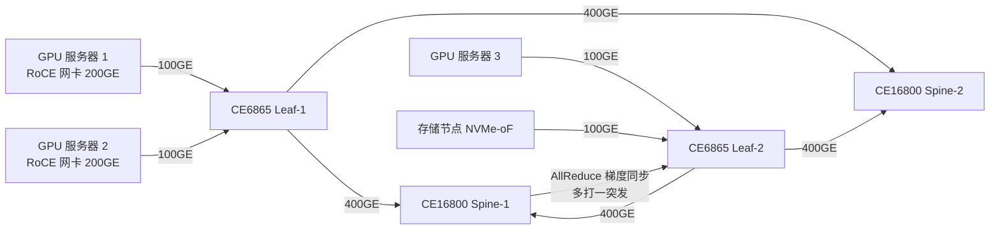

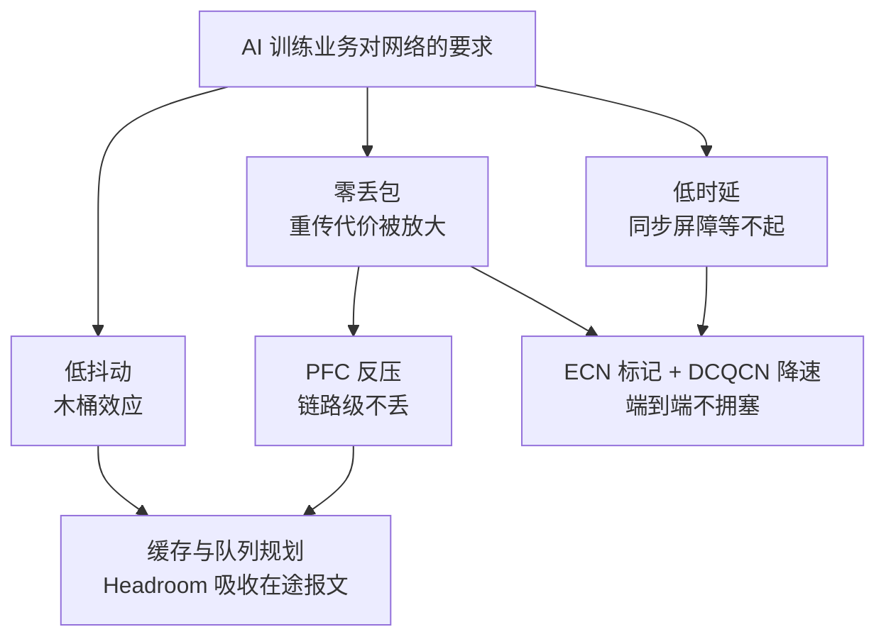

### 真题精练

**Q1.【真题·单选】** 在 AI 训练集群中，100G RoCEv2 单流在出现 0.1% 丢包时有效吞吐会显著下降，其最主要原因是：
A. RoCEv2 使用 UDP 承载，UDP 本身不可靠且无重传
B. 丢包导致 IB Transport 的 RC 队列执行 Go-Back-N 式重传，丢 1 个包要重传整段未确认窗口
C. 丢包后 PFC 立即反压，导致链路利用率下降
D. 丢包触发 TCP 慢启动，窗口被重置为 1

> **答案：B**
> **解析**：A 错——RoCEv2 虽然外层是 UDP，但可靠性由 IB Transport 层（RC 队列 + PSN 确认 + 重传）保证，"UDP 不可靠"是干扰项；B 对——RC 是顺序确认的连接，接收侧无法按序交付时会丢弃后续报文，发送侧只能从丢失点重传整个未确认窗口，这就是吞吐崩塌的根因；C 错——PFC 是**防止丢包**的机制，它反压的目的是不丢包，而不是"丢包后反压"，因果颠倒；D 错——RoCE 流量不经内核 TCP 栈，不存在 TCP 慢启动。补充记忆点：RDMA 抗丢包能力差的本质是"重传粒度粗 + 重传与拥塞正反馈"。

**Q2.【真题·判断】** 无损网络指的是在任何情况下（含设备故障、光纤误码）都绝不丢弃任何报文。

> **答案：错误**
> **解析**：无损网络追求的是**在链路拥塞场景下的稳态零丢包**，手段是"ECN 让发送端先降速、PFC 让上游后暂停"。设备宕机、链路误码（CRC 错包）、芯片表项/缓存异常等场景依然会丢包，必须靠冗余链路、故障倒换（如 M-LAG/ECMP 收敛）与端侧重传来兜底。考试中也常把"无损队列"（配了 PFC/ECN 的队列）偷换成"无损网络"来设坑。

**Q3.【真题·简答】** 从"业务同步屏障"和"协议重传语义"两个角度，说明为什么 AI 训练网络对丢包的容忍度远低于普通 Web 业务网络。

> **答案与解析**：
> **① 同步屏障（业务角度）**：AI 训练的每轮迭代都是"先通信、后计算"的强同步过程，AllReduce 必须等全部参与卡完成梯度交换才能进入下一轮。环上任何一条流因丢包变慢，所有 GPU 都在空等，训练效率按"最慢的那条流"结算，即木桶效应。Web 业务是异步请求，单请求慢一点只影响单个用户的体验，不会让整个集群停摆。
> **② 重传语义（协议角度）**：Web 业务走内核 TCP，有 SACK 选择性确认与快速重传，丢 1 个包只补 1 个包；RoCEv2 的 RC 队列是 PSN 顺序确认，接收侧不能乱序交付，发送侧需从丢失处重传整个未确认窗口（Go-Back-N），且重传流量会与原有突发流量叠加，形成拥塞正反馈。
> **③ 结论**：因此 AI 训练网络的正确做法是"不让它丢"——用 PFC 保证链路级不丢、用 ECN+DCQCN 让端侧提前降速，而不是依赖端侧重传来弥补。

### 易错点与排错

1. **把"无损"等同于"绝对不丢"**：无损是稳态零丢包，故障与误码仍会丢，要靠冗余与倒换。
2. **把 PFC 当端到端机制**：PFC 是**逐跳、链路级**的反压，只在直连链路两端生效，不能跨设备传递"远端拥塞"信息（这正是需要 ECN 的原因）。
3. **认为加大缓存就能无损**：缓存只能吸收微突发，无法解决持续超速；无限加大缓存还会推高排队时延，并让 PFC 反压更晚触发却更猛烈。
4. **忽略计量口径**：`display interface` 的 CRC/Align 错包与 `display qos queue statistics` 的队列丢弃是两回事，先把物理层排除掉再谈无损。
5. **排错命令组合**：`display interface 100GE1/0/1 counters`（物理层）→ `display qos queue statistics interface 100GE1/0/1`（队列层）→ `display dcb pfc statistics interface 100GE1/0/1`（反压层）→ 服务器侧 `ethtool -S`（网卡侧）。

---

## 5.2 RDMA 三种实现方式对比：IB / iWARP / RoCEv1 / RoCEv2

### 考点定位

**纯记忆型送分题**，几乎每届都会以单选/多选/填空出现，分值 3~5 分。必背三件事：① RoCEv2 的 UDP 目的端口是 **4791**；② RoCEv1 的以太网类型（Ethertype）是 **0x8915**，且**二层不可路由**；③ iWARP 承载在 **TCP** 之上，因此**不要求无损以太网**。易错点是把 **4789（VXLAN 端口）与 4791（RoCEv2 端口）记混**——这是命题人最爱的一道"送命题"。

### 原理精讲

RDMA（Remote Direct Memory Access，远程直接内存访问）的本质是"**让网卡直接读写对端内存**"，绕过内核、绕过 CPU、绕过内存拷贝。但"RDMA 报文跑在什么网络上传"有四种路线，它们的差别集中在**网络层封装**和**谁来提供可靠性/流控**。

**① InfiniBand（IB）**：由 IBTA 制定的独立体系，从物理层到传输层全部自研。它的链路层采用**基于信用的流控（Credit-Based Flow Control）**——接收方先告诉发送方"我还有多少缓存额度"，发送方只发额度内的数据，因此**天生无损、不需要 PFC**。传输层提供 RC/UC/UD 队列，管理面用 SM（Subnet Manager）。优点是时延最低、确定性最好；缺点是**必须专用 IB 交换机与线缆**，与以太网生态割裂，成本与运维门槛高。典型速率 HDR 200G、NDR 400G。

**② iWARP**：IETF 标准（RDMAP / DDP / MPA 三层之上再压 TCP），把 RDMA 语义**承载在 TCP 之上**。因此可靠性与拥塞控制**完全复用 TCP**：可以在普通有丢包的 IP 网络上跑，不需要 PFC，也不需要 ECN 配合。代价是 TCP 处理带来的时延与 CPU 开销（虽然仍是零拷贝，但连接管理、窗口、重传仍在网卡/软件里做），且生态支持少（主要是 Chelsio、Intel 等厂商），在 AI 集群中基本不采用。

**③ RoCEv1**：IBTA 定义，把 IB Transport 层**直接封装进以太网帧**（Ethertype 0x8915），没有 IP 头。这意味着：不能路由（只能在同一二层广播域内），不能跨三层，不能做 ECMP，也不能被 VXLAN 封装。它需要无损以太网（PFC）保证不丢包。今天已基本被 RoCEv2 取代。

**④ RoCEv2**：IBTA 定义，把 IB Transport 封装成 **UDP（目的端口 4791）→ IP → Ethernet**。加上 IP 头后就"可路由"了：跨三层、多路径 ECMP、跨 POD、进 VXLAN、与业务网融合全部成为可能。代价是**必须自己解决无损问题**（以太网默认会丢），因此 PFC + ECN + DCQCN 三件套是 RoCEv2 落地的必要配套。RoCEv2 是当今 AI 数据中心事实上的标准（NVIDIA/Mellanox 网卡、华为昇腾/鲲鹏服务器 RoCE 网卡、几乎所有 AI 交换机都支持）。

**为什么大家都选 RoCEv2 而不是 IB？** 三个字：**可路由、可复用、可运维**。IB 需要独立组网与独立人员技能；RoCEv2 跑在标准以太网上，可以复用既有的 Spine-Leaf 架构、ECMP 负载分担、VXLAN 多租户、以及 iMaster NCE-Fabric 这类控制器做自动化编排。而 RoCEv2 的唯一"债"就是要配好无损网络——这恰恰是本册的核心考点。

**关键补充：RoCEv1 与 RoCEv2 共用同一套 IB Transport。** 也就是说，队列类型（RC/UC/UD）、BTH 头、PSN、Opcode 这些概念两者完全一致，唯一区别是**网络层封装**：v1 是 Ethernet 直接承载（0x8915），v2 是 UDP 4791 + IP。因此"RoCEv1 不能跨三层、RoCEv2 可以跨三层"是唯一需要记的差异，其余不用再学第二套。

### 关键概念对照表

| 技术 | 协议栈（上层→下层） | 封装 / 标识 | 是否可路由 | 是否需无损以太网 | 生态与现状 |
|---|---|---|---|---|---|
| InfiniBand | Verbs → IB Transport → IB Network → IB Link → IB PHY | 专用二层帧，无 IP | 仅 IB 内部（IB Router 有限支持） | 不需要（信用流控天生无损） | 独立生态，HPC 高端，成本高 |
| iWARP | Verbs → RDMAP/DDP/MPA → TCP → IP → Ethernet | TCP 承载（由实现约定的端口） | 可以（复用 TCP/IP） | 不需要（靠 TCP 拥塞控制与重传） | 生态小，时延与 CPU 开销偏高 |
| RoCEv1 | Verbs → IB Transport → Ethernet | Ethertype **0x8915** | **不可以**（同一二层域） | 需要（PFC） | 已基本淘汰 |
| RoCEv2 | Verbs → IB Transport → **UDP 4791** → IP → Ethernet | UDP 目的端口 **4791** | **可以**（ECMP/VXLAN 均可） | 需要（PFC + ECN + DCQCN） | AI 数据中心事实标准 |

| 易混端口 / 标识 | 归属协议 | 记忆口诀 |
|---|---|---|
| UDP **4789** | VXLAN | "VXLAN 吃 89" |
| UDP **4791** | RoCEv2 | "RoCE 比 VXLAN 大 2" |
| Ethertype **0x8915** | RoCEv1 | v1 只有以太网类型，没有 IP 头 |
| Ethertype 0x0800 / 0x86DD | IPv4 / IPv6 | RoCEv2 外层是普通 IP 报文 |
| BTH Opcode **0x81** | RoCEv2 CNP | 拥塞通知报文专用 Opcode |

### 华为设备配置

```bash
system-view                                                // 进入系统视图
interface 100GE1/0/1                                       // 进入连接 AI 服务器/存储的接口
 mtu 4096                                                  // 大帧：RoCE 报文头开销大，MTU 必须端到端一致
 quit
display interface 100GE1/0/1 | include MTU                 // 确认接口 MTU 实际生效值
display lldp neighbor interface 100GE1/0/1                 // 查看对端网卡信息，确认服务器侧协商结果
display mac-address interface 100GE1/0/1                   // 确认服务器网卡 MAC 学习正常（RoCEv1 场景靠二层转发）
```

> RoCEv1 与 RoCEv2 在交换机侧**没有"开协议"的开关**，交换机只按普通以太网/IP 报文转发。区别体现在**转发行为**：RoCEv1 是二层流（需保证同 VLAN、不能跨三层，也不走 ECMP），RoCEv2 是普通 UDP/IP 流（吃 ECMP 哈希，需注意**哈希极化**问题——五元组相同的大象流容易压到同一条链路，应开启逐包/动态负载分担）。国赛实验题里若要求"RoCE 流量走多条上行链路"，必须确认用的是 RoCEv2。

### 示意图

```mermaid
flowchart TB
  subgraph GROUP_IB["InfiniBand 栈"]
    IB1["用户 Verbs / MPI"] --> IB2["IB Transport RC-UC-UD"]
    IB2 --> IB3["IB Network GRH"]
    IB3 --> IB4["IB Link 信用流控"]
  end
  subgraph GROUP_R2["RoCEv2 栈"]
    R21["用户 Verbs / MPI"] --> R22["IB Transport RC-UC-UD"]
    R22 --> R23["UDP 端口 4791"]
    R23 --> R24["IP 可路由"]
    R24 --> R25["Ethernet PFC 流控"]
  end
  subgraph GROUP_R1["RoCEv1 栈"]
    R11["用户 Verbs"] --> R12["IB Transport"]
    R12 --> R13["Ethernet 类型 0x8915 不可路由"]
  end
  subgraph GROUP_IW["iWARP 栈"]
    IW1["用户 Verbs"] --> IW2["RDMAP / DDP / MPA"]
    IW2 --> IW3["TCP 自带可靠与拥塞控制"]
    IW3 --> IW4["IP 可路由"]
  end
  GROUP_IB --> NOTE1["专用网络 天生无损"]
  GROUP_R2 --> NOTE2["以太网 需 PFC 与 ECN"]
  GROUP_IW --> NOTE3["普通 IP 网即可"]
```

### 真题精练

**Q1.【真题·单选】** RoCEv2 报文在 UDP 头中使用的目的端口号是：
A. 4789  B. 4790  C. 4791  D. 8915

> **答案：C**
> **解析**：RoCEv2 使用 UDP 目的端口 **4791**。A 的 4789 是 VXLAN 的默认目的端口，是最强干扰项；D 的 8915 是 RoCEv1 的 Ethertype（0x8915）而不是端口，属于"跨字段混淆"；B 的 4790 是杜撰值。记忆法：VXLAN 4789、RoCEv2 4791，只差 2。

**Q2.【真题·多选】** 关于 RoCEv1 与 RoCEv2 的区别，下列说法正确的有：
A. RoCEv1 直接封装在以太网上，不能跨三层转发
B. RoCEv2 封装在 UDP/IP 之上，可以跨三层并支持 ECMP
C. RoCEv1 与 RoCEv2 使用完全不同的传输层协议，RoCEv1 用 TCP，RoCEv2 用 UDP
D. 两者都要求以太网提供无损能力（PFC），否则性能会明显劣化

> **答案：ABD**
> **解析**：A、B 是两者的核心差异（封装决定可路由性）；C 错——RoCEv1 与 RoCEv2 **共用同一套 IB Transport 层**（RC/UC/UD、BTH、PSN），RoCEv2 只是把承载从以太网直封换成 UDP/IP 封装，用 TCP 的是 iWARP；D 对——两者都依赖无损以太网（PFC），只是 RoCEv2 因为可路由而更需要 ECN/DCQCN 做端到端调速。

**Q3.【真题·填空】** 在 iWARP、RoCEv1、RoCEv2、InfiniBand 四种 RDMA 实现中，**不依赖无损以太网、可在普通有丢包的 IP 网络上部署**的是 ________ 和 ________。

> **答案：iWARP、InfiniBand**
> **解析**：iWARP 把可靠性交给 TCP（窗口 + 重传 + 拥塞控制），因此不要求链路无损；InfiniBand 的链路层用**基于信用的流控**，天生不丢包，也不需要 PFC；RoCEv1/RoCEv2 都需要以太网侧提供 PFC（+ECN）来保证不丢包。注意：InfiniBand"不需要无损以太网"是因为它根本不用以太网，不要答成"IB 需要 PFC"。

### 易错点与排错

1. **4789 / 4791 记混**：这是最高频失分点，务必写成肌肉记忆（VXLAN 4789，RoCEv2 4791）。
2. **以为 RoCEv2 需要专门的"协议开关"**：交换机不区分 RoCE 协议号，只按普通 UDP/IP 转发，真正要做的是 PFC/ECN/QoS 规划。
3. **用 RoCEv1 做跨三层设计**：RoCEv1 无 IP 头，跨三层直接不通；实验题中若要求跨 POD，必须换 RoCEv2。
4. **忽略 RoCEv2 的 ECMP 哈希极化**：大量同五元组大象流会压到同一条链路，需开启动态负载分担或调整哈希因子，否则"链路不均 + 局部拥塞"会被误判成 PFC 故障。
5. **排错命令**：`display interface brief`（链路与利用率）→ `display lldp neighbor`（对端是否支持 RoCE/DCB）→ `display dcb pfc interface`（对端是否协商上 PFC）→ 服务器侧 `ibv_devinfo`/`show_gids`（确认 RoCEv2 GID 与网卡模式）。

---

## 5.3 RoCEv2 协议栈与报文封装

### 考点定位

**报文细节题的主战场**，常以"字段识别 / 报文长度 / Opcode 含义"形式出现，分值 3~6 分。必背：RoCEv2 报文 = **Eth | IP | UDP(4791) | BTH | 扩展头 | 载荷 | ICRC | FCS**；BTH 中存在 **DestQP（目的队列对，24 bit）** 与 **PSN（包序列号，24 bit）**；CNP 用 **Opcode 0x81** 标识。易错点是**把 BTH 说成传输层"TCP 头"**、把 **ICRC 与 FCS 混为一谈**（FCS 覆盖整帧含可变字段，ICRC 只覆盖不变字段，用于端到端校验）。

### 原理精讲

**先看封装顺序（自上而下）。** 应用调用 Verbs API 提交工作请求（WR）后，网卡（HCA/RNIC）把 RDMA 操作翻译成一串 IB Transport 报文，然后逐层加封装：

1. **IB Transport 层**：加 **BTH（Base Transport Header，8 字节）**，必要时再加扩展头（RETH/AETH/ImmDt 等），并在报文尾部加 **ICRC（Invariant CRC，4 字节）**。
2. **UDP 层**：加 UDP 头，**目的端口固定 4791**（源端口由网卡按流熵选取，用于 ECMP 哈希）。
3. **IP 层**：加 IPv4/IPv6 头，DSCP 通常标记为 RoCE 数据流的规划值（如 CS3/24）。
4. **以太网层**：加以太网头（RoCEv2 是普通以太网帧，Ethertype 0x0800），最后由物理层加 FCS。

**为什么 RoCEv2 要包一层 UDP，而不直接用 IP 协议号？** 三个原因：(1) **端口号给 ECMP 提供熵**——如果用 IP 协议号承载，交换机只能按 IP 五元组里的地址做哈希，同一条 RC 连接的所有报文会压到同一条链路；包上 UDP 后可以按源端口做哈希，链路利用率显著提升；(2) **复用现有 UDP 硬件解析路径**，网卡与交换芯片改造成本低；(3) **与 NAT/防火墙等中间设备的兼容性更好**（虽然生产环境不建议在 RoCE 路径上做 NAT）。

**BTH 字段及其含义**（考试重点）：

| 字段 | 位宽 | 含义 | 考试要点 |
|---|---|---|---|
| Opcode | 8 bit | 操作码，标识报文类型（SEND/RDMA Write/RDMA Read/ACK/CNP） | RC 的 RDMA Write Only 为 0x0A，Acknowledge 为 0x11，**CNP 为 0x81** |
| SE（Solicited Event） | 1 bit | 请求接收侧产生事件 | 用于完成通知，与丢包无关 |
| M（MigReq） | 1 bit | 迁移请求 | 用于连接迁移，考试几乎不考 |
| PadCnt | 2 bit | 载荷填充字节数（使报文 4 字节对齐） | 与"报文长度计算"题型相关 |
| TVer | 4 bit | 传输头版本，恒为 0 | 经典送分点 |
| PKey | 16 bit | 分区键（Partition Key），用于隔离 | 可类比 VLAN 的隔离作用 |
| F/B | 1 bit | FECN/BECN 拥塞标记位 | **RoCEv2 的拥塞信号走 CNP，不依赖这两位** |
| DestQP | 24 bit | 目的队列对编号 | QP 是 RDMA 通信的"连接标识"，成对出现 |
| AckReq | 1 bit | 是否要求 ACK | 与可靠性相关 |
| PSN | 24 bit | 包序列号 | **RC 顺序确认与重传的依据，是 Go-Back-N 的根源** |

**扩展头**按操作类型出现：**RETH（RDMA Extended Transport Header，16 字节）**用于 RDMA Write/Read，包含虚拟地址（VA，64 bit）、R_Key（32 bit）、DMA 长度（32 bit）；**AETH（ACK Extended Transport Header，4 字节）**用于 ACK，携带 Syndrome 与 MSN；**ImmDt** 用于带立即数的操作。

**CNP 报文的结构与特殊性。** CNP（Congestion Notification Packet，拥塞通知报文）是 RoCEv2 独有的控制报文：它由**交换机（拥塞点 CP）**在出端口发生拥塞并对 ECN 能力报文打上 CE 标记后，由**接收端网卡（反应点 RP）**生成并回送给**发送端网卡**。CNP 的结构是 `Eth | IP | UDP 4791 | BTH(Opcode 0x81) | ICRC | FCS`，**没有业务载荷**，属于短报文。它的 DSCP 通常规划为 CS6（48），802.1p 优先级为 6，**并且绝不能走 PFC 无损队列**——如果 CNP 被 PFC 反压而排队，拥塞控制就会失去时效，甚至出现"数据等 CNP、CNP 等数据"的死锁。这是本册反复强调的一条铁律：**PFC 队列给数据，CNP 走独立的高优先级可丢队列**。

**ICRC 与 FCS 的区别。** 以太网 FCS（4 字节）覆盖整帧，逐跳校验，用于检测链路误码；RoCEv2 在 FCS 之前额外插入 **ICRC（4 字节）**，只覆盖报文中的**不变字段（Invariant fields）**，如源/目的地址、QP、PSN 等，用于端到端校验"传输过程中关键字段是否被错误修改"（例如经过 NAT 或错误的路由改写）。因此 FCS 管"链路比特错误"，ICRC 管"语义字段被改"，两者不能互相替代。

### 关键概念对照表

| 报文类型 | 有 RETH | 有载荷 | 典型用途 | 备注 |
|---|---|---|---|---|
| RDMA Write Only | 有 | 有 | 单包写远端内存 | 常见于小消息 |
| RDMA Write First/Middle/Last | 有（仅 First） | 有 | 大消息分片写 | 常见于 AI 梯度同步 |
| RDMA Read Request | 有 | 无 | 请求读远端内存 | 时延敏感 |
| RDMA Read Response | 无 | 有 | 返回读到的数据 | 可能多包 |
| ACK（Acknowledge） | 无（用 AETH） | 无 | 确认收到 | 含 Syndrome 与 MSN |
| **CNP** | 无 | 无 | 拥塞通知 | **Opcode 0x81，DSCP 48** |

| 字段/头 | 长度 | 覆盖范围 | 作用 |
|---|---|---|---|
| BTH | 8 字节 | 本报文 | 传输层语义（Opcode/QP/PSN） |
| RETH | 16 字节 | 本报文 | 远端内存地址与 R_Key |
| AETH | 4 字节 | 本报文 | ACK 语义与拥塞标记 |
| ICRC | 4 字节 | 不变字段 | 端到端语义完整性校验 |
| Ethernet FCS | 4 字节 | 整帧 | 逐跳链路误码检测 |

### 华为设备配置

```bash
system-view                                                // 进入系统视图
interface 100GE1/0/1                                       // 进入 RoCE 承载接口
 mtu 4096                                                  // 与服务器网卡 MTU 对齐；RoCEv2 头开销约 66 字节（Eth14+IP20+UDP8+BTH8+RETH16+ICRC4）
 quit
traffic classifier roce_data operator or                   // （可选）用 MQC 识别 RoCE 数据流
 if-match udp destination-port 4791                        // 用目的端口 4791 精确匹配 RoCEv2 报文
 quit
display acl all                                            // 若用 ACL 匹配，确认规则命中计数在增长
display interface 100GE1/0/1 verbose | include MTU         // 二次确认 MTU 生效
```

> 交换机**不需要**解析 RoCE 业务语义即可转发，但**需要**能按 4791 端口做流分类（用于 QoS 重标记或流量统计），因此涉及精细化 QoS 的方案里，`if-match udp destination-port 4791` 是常用手段。注意：CNP 也是 4791，若要区分 CNP 与数据流，必须用 **DSCP 48 / 802.1p 6** 这类标记做分类，而不是端口号。

### 示意图


```text
RoCEv2 数据报文（示意，未按比例）：

+--------+--------+---------+--------+--------+---------+--------+-----+
| Eth 14 | IP 20  | UDP 8   | BTH 8  | RETH16 | Payload | ICRC 4 | FCS |
+--------+--------+---------+--------+--------+---------+--------+-----+
  ^                        ^                  ^          ^        ^
  |                        |                  |          |        |
  |                        |                  |          |        +-- 逐跳链路校验
  |                        |                  |          +----------- 端到端不变字段校验
  |                        |                  +---------------------- RDMA 业务数据
  |                        +----------------------------------------- 传输语义（QP/PSN/Opcode）
  +------------------------------------------------------------------ 普通以太网，Ethertype 0x0800

CNP 报文（示意）：

+--------+--------+---------+-----------------+--------+-----+
| Eth 14 | IP 20  | UDP 8   | BTH Opcode 0x81 | ICRC 4 | FCS |
+--------+--------+---------+-----------------+--------+-----+
                          ^
                          +-- 无业务载荷，DSCP 48，走独立可丢队列
```

### 真题精练

**Q1.【真题·单选】** RoCEv2 报文中用于标识目的队列对（QP）的字段位于：
A. UDP 头的目的端口字段  B. IP 头的 Protocol 字段  C. BTH 的 DestQP 字段  D. 以太网头的 Ethertype 字段

> **答案：C**
> **解析**：QP（Queue Pair）是 RDMA 通信的连接标识，由 **BTH 的 DestQP（24 bit）** 携带。A 的 UDP 目的端口固定为 4791，标识"这是 RoCEv2"而不是"哪个 QP"；B 的 IP Protocol 字段在 RoCEv2 中是 17（UDP）；D 的 Ethertype 只说明上层是 IP。补充：RoCEv1 因为没有 IP/UDP 头，QP 同样在 BTH 里，这也是"v1/v2 共用 IB Transport"的体现。

**Q2.【真题·多选】** 关于 RoCEv2 中 CNP（拥塞通知报文）的说法，正确的有：
A. CNP 由交换机直接生成并发送给数据发送端
B. CNP 的 UDP 目的端口同样是 4791
C. CNP 通过 BTH 的 Opcode 0x81 标识，通常不含业务载荷
D. CNP 应当与数据流走同一个 PFC 无损队列，以保证不丢

> **答案：BC**
> **解析**：A 错——交换机是被动"打 ECN CE 标记"的一方（拥塞点 CP），**CNP 由接收端网卡（反应点 RP）生成**并回送给发送端；B、C 对；D 错——CNP 必须走**独立的高优先级、非 PFC 队列**（DSCP 48、802.1p 6），若被 PFC 反压排队，拥塞信息就会迟到甚至死锁，这是与"PFC 队列只承载业务数据"配套的设计铁律。

**Q3.【真题·简答】** 说明 ICRC 与以太网 FCS 的区别，并解释为什么 RoCEv2 在已有 FCS 的情况下还需要 ICRC。

> **答案与解析**：
> **① 覆盖范围不同**：FCS 覆盖整个以太网帧（含可能被中间设备修改的字段），逐跳校验，用于检测链路误码；ICRC 只覆盖报文中的**不变字段**（源/目的 GID、QP、PSN、Opcode 等），跨越整条端到端路径校验。
> **② 校验时机不同**：FCS 在每一跳都被重新计算与校验（甚至可以由中间设备重写）；ICRC 由发送侧网卡计算、接收侧网卡校验，**中间设备不参与也不修改**。
> **③ 为什么要两个**：以太网设备在转发时可能修改 TTL、DSCP、VLAN 标签等字段，这些"可变字段"不能进 ICRC；而 RDMA 的语义正确性依赖 QP、PSN、地址这些"绝不能被改"的字段。ICRC 正是用来防止"帧完好无损但语义被改写"（如错误的路由改写、错误的 NAT）导致数据被写到错误内存地址——这在 RDMA 中后果是**内存被写坏**，远比丢包严重。

### 易错点与排错

1. **把 BTH 与 TCP 头混淆**：RoCEv2 没有 TCP 头，传输语义在 BTH 里；有 TCP 的是 iWARP。
2. **CNP 生成方搞反**：交换机只做"ECN 标记"，CNP 由接收端网卡生成并回送发送端。
3. **ICRC/FCS 混为一谈**：FCS 逐跳、覆盖整帧；ICRC 端到端、只覆盖不变字段。
4. **MTU 不一致**：RoCEv2 头开销约 66 字节，服务器与交换机 MTU 不一致会造成分片或丢包，务必端到端统一。
5. **排错命令**：`display interface 100GE1/0/1 verbose`（MTU 与计数）→ `display acl all`（流分类命中）→ 服务器侧 `ibv_rc_pingpong -d mlx5_0 -g 1`（验证 RoCEv2 路径连通性与时延）。

---

## 5.4 PFC 优先级流控（802.1Qbb）：原理、报文与配置

### 考点定位

**无损网络第一大机制，必考**。常见考法：① 判断"PFC 是端到端还是逐跳机制"（答：逐跳、链路级）；② 给出 PFC 报文的目的 MAC / Ethertype / Opcode 问是什么；③ 问"传统 PAUSE 与 PFC 的区别"；④ 问"8 个优先级队列、XOFF 时间量纲（512 bit times）"；⑤ 实验题要求"在 CE6865 上使能 PFC 优先级 3 并验证"。易错点是**认为 PFC 能感知远端拥塞**（不能，只能感知直连下游的缓存水位）、**认为配了 PFC 就不会丢**（Headroom 不足时照样丢）。

### 原理精讲

**PFC 解决什么问题？** 传统以太网的流控是 **802.3x PAUSE**：下游缓存快满时发一个 PAUSE 帧，上游**整条链路全部流量**都停下来。这在数据中心是灾难——为了一个拥塞的存储流，把同一物理链路上的所有业务（包括 CNP、管理流量、其他租户的流量）全部冻结，形成"队头阻塞"。**PFC（Priority Flow Control，优先级流控）** 的依据是 **IEEE 802.1Qbb**（属于 DCB 套件，与 802.1Qaz 的 ETS、802.1Qau 的 QCN 同族）：它为链路上的 **8 个优先级（对应 8 个内部队列）各自独立**做流控——只暂停"拥塞的那个优先级"，其余优先级照常转发。

**PFC 的工作模型（必须记牢三层关系）**：
1. **队列→优先级**：业务报文先经 QoS 分类进入内部队列（CE 上是 8 个队列，队列号即优先级号）；
2. **优先级→PFC 使能**：管理员在设备上指定"哪几个优先级是无损的"（例如只把优先级 3 设为无损），只有这些优先级的水位会触发反压；
3. **水位→反压帧**：当队列水位**超过 XOFF 门限（PFC 反压门限）**时，本端口向上游发 **XOFF**（携带一个非 0 的暂停时间）；当水位**低于 XON 门限**时，发 **XON**（暂停时间填 0）恢复发送；上游收到后只暂停对应优先级。

**PFC 报文格式**（考试细节题来源）：PFC 帧是 **MAC 控制帧**，目的 MAC 为 **01-80-C2-00-00-01**（与 802.3x PAUSE 相同的保留组播地址，保证交换机/网卡不转发给主机），源 MAC 为本端口 MAC，**Ethertype = 0x8808**，MAC Control Opcode = **0x0101**（PAUSE 的是 0x0001）。载荷是 **8 个各 2 字节的 Time（quanta）字段**，依次对应优先级 0~7：字段值为 0 表示该优先级 XON（可发），非 0 表示暂停这么多时间。**时间单位是 quanta，1 quanta = 512 bit times**（即传输 512 bit 所需时间），100G 链路上 1 quanta ≈ 5.12 ns。上游网卡/交换机收到 XOFF 后启动一个定时器，超时未收到新的 XOFF 就自动恢复发送——这个"自动恢复"设计是为了防止反压帧丢失导致永久停摆。

**为什么 XOFF 要带时间而不是"一直停"？** 因为 PFC 是**无状态**的反压机制：下游不需要维护"我暂停了上游几次"，上游也不需要确认；下游只需在下一次门限检查时**周期性重发 XOFF** 刷新上游的定时器。这样即使某一帧 XOFF 丢失或延迟，系统也能在 quanta 时间后自愈，不会出现"永久反压"。代价是下游要持续发帧（有一定带宽开销），以及**反压响应存在一个往返时延（RTT）窗口**——这正是 **Headroom** 要解决的问题（见 5.9）。

**PFC 的生效范围与三大风险**：(1) **逐跳生效**：PFC 只在直连链路两端起作用，端到端无损要求**路径上每一跳**都使能了同一优先级的 PFC，任何一跳没配，该跳就开始丢包；(2) **PFC 死锁**：多条链路互相反压形成依赖环，全网该优先级永久停摆（5.8 详述）；(3) **PFC 风暴/反压扩散**：反压沿多级链路向外扩散，一台慢速服务器可以"冻结"上游一大片交换机的同一优先级。

**PFC 与 DCBX/LLDP 的协商**：DCB 能力（PFC/ETS/应用优先级）通过 **DCBX（Data Center Bridging Exchange，基于 LLDP 的 TLV）** 在链路两端协商。CE 上的 `dcb pfc enable mode auto` 就是"由 DCBX 协商决定是否使能"，`mode manual` 是"按本地配置静态使能"。**生产环境推荐 manual**：因为 auto 模式下若对端（如某些网卡）不支持或配置不一致，会导致 PFC 静默地没生效，而配置命令看起来"敲进去了"——这是国赛排错题的高频陷阱。

### 关键概念对照表

| 对比项 | 802.3x PAUSE | PFC（802.1Qbb） |
|---|---|---|
| 流控粒度 | 整条链路（全部流量） | 按优先级（最多 8 个独立队列） |
| 目的 MAC | 01-80-C2-00-00-01 | 01-80-C2-00-00-01 |
| Ethertype | 0x8808 | 0x8808 |
| MAC Control Opcode | 0x0001 | **0x0101** |
| 载荷 | 1 个 2 字节 Time | **8 个 2 字节 Time（对应优先级 0~7）** |
| 时间单位 | quanta（1 quanta = 512 bit times） | 同左 |
| 典型用途 | 传统链路保护 | RoCE/存储无损队列 |
| 是否产生队头阻塞 | 会（全链路停） | 不会（仅暂停指定优先级） |

| PFC 关键量 | 含义 | 工程取值思路 |
|---|---|---|
| XOFF 门限（pfc-threshold） | 队列水位到此值发 XOFF | 要**大于** ECN 高门限，且留出足够 Headroom |
| XOFF 偏移（pfc-threshold-offset） | 水位下降多少后发 XON | 一般为门限的 1/2 或固定值，避免抖动反复 |
| Headroom 缓存 | 吸收 XOFF 生效期间仍在链路上的报文 | 按链路速率 × 往返时延 + 突发量计算（见 5.9） |
| Guard Band | 提前量，防止 Headroom 被其他队列占用 | 依芯片实现，配置时通常由设备自动预留 |

| 优先级规划（AI DC 常用） | DSCP | 802.1p | 队列 | 是否 PFC | 是否 ECN |
|---|---|---|---|---|---|
| RoCE 数据流（AI 训练/存储） | 24（CS3） | 3 | 3 | 是 | 是 |
| RoCE CNP 控制报文 | 48（CS6） | 6 | 6 | **否** | 否（转发优先） |
| 普通 TCP 业务 | 0（BE） | 0 | 0 | 否 | 可选 |
| 网络协议报文 | 56（CS7） | 7 | 7 | 否 | 否 |

### 华为设备配置

```bash
system-view                                                // 进入系统视图
dcb pfc                                                    // 进入全局 PFC 配置视图
 priority 3                                                // 指定 PFC 优先级为 3（即队列 3 为无损队列；可一次配多个，如 priority 3 4）
 quit                                                      // 退出 PFC 视图
interface 100GE1/0/1                                       // 进入面向 AI 服务器/存储的接口
 trust dscp                                                // 信任报文自带 DSCP，按默认映射表入队（CS3→队列3），保证 RoCE 数据流进无损队列
 dcb pfc enable mode manual                                // 接口使能 PFC，manual=按本地配置静态使能（推荐，避免 DCBX 协商不一致）
 dcb pfc priority 3                                        // （版本支持时）在接口上显式绑定 PFC 优先级 3
 mtu 4096                                                  // 大帧，端到端一致
 quit
display dcb pfc                                            // 查看全局 PFC 优先级配置
display dcb pfc interface 100GE1/0/1                       // 查看接口 PFC 使能状态、工作模式与优先级
display dcb pfc statistics interface 100GE1/0/1            // 查看收发的 XOFF/XON 计数（关键排错命令）
display qos queue statistics interface 100GE1/0/1 queue 3 // 查看无损队列 3 的通过/丢弃/缓存使用情况
```

```bash
# 可选：用 DiffServ 域自定义 DSCP→PHB→队列映射（当默认映射不满足规划时使用）
diffserv domain ds_roce                                    // 创建 DiffServ 域
 ip-dscp-inbound 24 map phb cs3 green                      // 入方向：DSCP 24 映射为 CS3（默认进队列 3，与 PFC 3 对应）
 ip-dscp-inbound 48 map phb cs6 green                      // 入方向：CNP 的 DSCP 48 映射为 CS6（队列 6，不做 PFC）
 ip-dscp-outbound cs3 map 24                               // 出方向：CS3 重新标记回 DSCP 24，保证跨域标记一致
 quit
interface 100GE1/0/1
 trust upstream ds_roce                                    // 信任该 DiffServ 域的映射（部分版本命令形式不同，可用 trust ? 确认）
```

> **PFC 配置的四个必检项**：① 全局是否指定了优先级（`dcb pfc` 视图的 `priority`）；② 接口是否使能（`dcb pfc enable`）；③ 业务流量是否真的进了那个队列（`trust dscp` + 映射表，用 `display qos queue statistics` 看队列 3 计数是否增长）；④ 路径上每一跳是否都配了同一优先级。四项缺一，端到端无损就不成立，而现象往往只是"训练慢"而非"报错"。

### 示意图

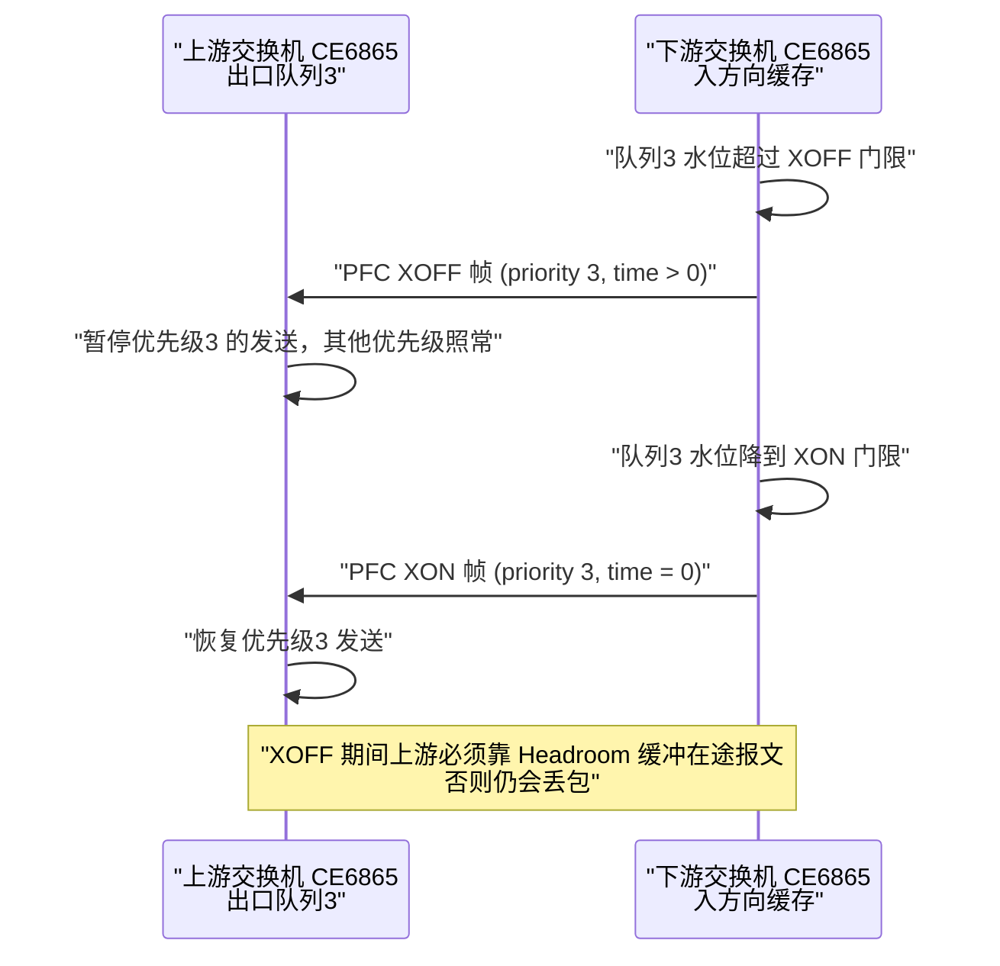

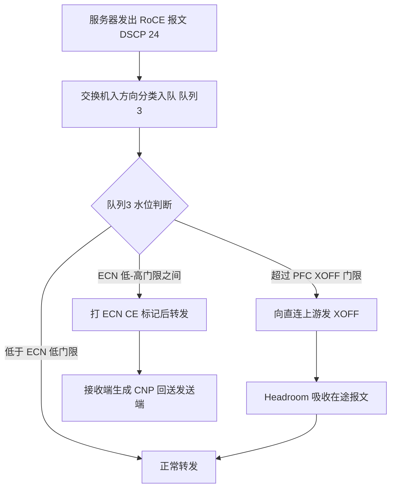

### 真题精练

**Q1.【真题·单选】** 华为 CloudEngine 交换机上，一条链路使能了 PFC 优先级 3，当队列 3 水位超过反压门限时，设备会：
A. 丢弃队列 3 的部分报文  B. 向直连上游设备发送 XOFF 帧，暂停优先级 3 的流量
C. 向数据源端到端发送反压消息，要求其降速  D. 暂停该链路全部流量

> **答案：B**
> **解析**：PFC 是**逐跳、链路级**机制，反压对象是**直连上游**，且只暂停**指定的优先级**（这里是 3）。A 错——PFC 的目的正是避免丢弃；C 错——端到端降速是 ECN/DCQCN 做的事，PFC 不感知远端；D 错——暂停全链路流量是 802.3x PAUSE 的行为，不是 PFC。

**Q2.【真题·多选】** 关于 PFC 报文，下列说法正确的有：
A. 目的 MAC 为 01-80-C2-00-00-01，Ethertype 为 0x8808
B. MAC Control Opcode 为 0x0101
C. 载荷中包含 8 个 Time 字段，分别对应优先级 0~7，值为 0 表示 XON
D. Time 字段单位是毫秒，可以直接配置为 1000 表示暂停 1 秒

> **答案：ABC**
> **解析**：A、B、C 均为 802.1Qbb 的标准定义；D 错——Time 的单位是 **quanta（1 quanta = 512 bit times）**，不是毫秒，且取值上限受限（16 bit）。上游收到 XOFF 后按 quanta 换算成时间挂起，超时未收到新 XOFF 会自动恢复发送，这种无状态设计可防止反压帧丢失导致永久停摆。

**Q3.【真题·实验】** 在 CE6865（V200）上把队列 3 配置为无损队列，要求 RoCE 数据流（DSCP 24）进入队列 3 并能触发 PFC 反压；请给出关键配置并说明如何验证反压确实生效。

> **答案与解析**：
> **配置（系统视图 + 接口视图）**：
> ```bash
> system-view
> dcb pfc
>  priority 3                                       // 全局指定无损优先级为 3
> quit
> interface 100GE1/0/1
>  trust dscp                                       // 信任 DSCP，DSCP 24 按映射表进入队列 3
>  dcb pfc enable mode manual                       // 静态使能 PFC，避免协商失败
> ```
> **验证步骤**：① `display dcb pfc interface 100GE1/0/1` 确认 PFC 已使能且优先级为 3；② `display qos queue statistics interface 100GE1/0/1 queue 3` 确认 DSCP 24 的流量确实进入队列 3 且有通过计数；③ 用打流仪/服务器向该队列施加超过出端口线速的流量，同时用 `display dcb pfc statistics interface 100GE1/0/1` 观察 **XOFF 发送计数**增长、对端接口的 XOFF 接收计数增长；④ 观察 `display qos queue statistics` 中队列 3 的 **Discard 计数应保持不增长**（这才是"无损生效"的直接证据）；⑤ 反向验证：把 `trust dscp` 去掉或用 DSCP 26 打流，应看到流量进入队列 4 且不受 PFC 3 保护（Discard 增长）。
> **注意**：验证必须在**端到端同一优先级**的链路上做，且对端也要已使能 PFC 3，否则 XOFF 发出后对端不响应，现象是"发了 XOFF 但依然丢包"。

### 易错点与排错

1. **只在最靠近服务器的接入口配 PFC**：PFC 是逐跳的，Spine 上行口也必须配同一优先级，否则上行一样丢。
2. **`dcb pfc enable mode auto` 导致静默失效**：对端不支持 DCBX 或配置不一致时，PFC 根本没生效；生产建议 `manual`。
3. **配了 PFC 但流量不在无损队列**：常见于没配 `trust dscp`，报文按端口默认优先级（通常 0）入队，队列 3 空转。
4. **Headroom 不足**：XOFF 发出到上游真正停发之间，链路上仍有在途报文（速率 × RTT），Headroom 不够就会丢，现象是"XOFF 计数在涨但仍有 Discard"。
5. **误判反压计数**：`display dcb pfc statistics` 的 XOFF **接收**计数增长说明"自己被上游反压"，XOFF **发送**计数增长说明"自己在反压上游"，方向别搞反。
6. **排错命令链**：`display dcb pfc` → `display dcb pfc interface <if>` → `display dcb pfc statistics interface <if>` → `display qos queue statistics interface <if>`。

---

## 5.5 ECN 显式拥塞通知：ECN 标记、CNP 与门限规划

### 考点定位

**无损网络第二大机制，与 DCQCN 联合命题**。高频考法：① ECN 两位编码的含义（Not-ECT/ECT(0)/ECT(1)/CE）；② "交换机打标记、接收端回 CNP、发送端降速"的角色分配；③ **ECN 门限与 PFC 门限的先后关系**（必考）；④ 实验题配置 `drop-profile` + `ecn` 并绑到队列。易错点是**认为交换机生成 CNP**（错，交换机只打 CE 标记）、**认为 ECN 会丢包**（ECN 的核心价值是"标记代替丢弃"）。

### 原理精讲

**ECN 要解决 PFC 的三个短板。** PFC 虽能保证单链路不丢包，但它有三个天生缺陷：(1) **滞后**——只有缓存快满了才反压，此时拥塞已经形成，队列排队时延已经抬高；(2) **逐跳不感知全局**——它无法告诉"源端"该降多少速，反压只是把压力往上游推，可能扩散成一大片；(3) **可能死锁**。ECN（Explicit Congestion Notification，显式拥塞通知）的思路完全不同：**让网络在"拥塞刚萌芽"时就把信号明确告诉端侧**，由端侧主动降速，从源头消除拥塞，而不是等缓存塞满再反压。

**标准演进先理清（命题点）**：IEEE 曾在 **802.1Qau** 中定义了二层拥塞通知 QCN（Quantized Congestion Notification），用 **CNM（Congestion Notification Message）** 报文在二层回传拥塞量化信息，并规定端侧按量化反馈调整速率。但 QCN 需要全网二层支持、芯片实现复杂、且难以跨三层，**最终未大规模商用**。真正落地的路线是 **IETF 的 ECN（RFC 3168）**：在 **IP 头 ToS 字段的最后两位**做标记，跨三层通用；RoCEv2 在此之上定义了 **CNP** 作为回传拥塞信号的载体，端侧算法交给 **DCQCN**。所以考试问"RoCEv2 用的二层还是三层 ECN"，答案是**三层的 RFC 3168 ECN + RoCEv2 的 CNP**，802.1Qau 只是历史与概念。

**ECN 的两位编码（必背表）**：

| ECN 位（二进制） | 名称 | 含义 | 端侧行为 |
|---|---|---|---|
| 00 | Not-ECT | 不支持 ECN | 拥塞时只能丢弃；不参与 ECN 降速 |
| 01 | ECT(1) | 支持 ECN（编码点 1） | 允许被标记为 CE |
| 10 | ECT(0) | 支持 ECN（编码点 0） | **RoCEv2 常用** |
| 11 | CE | 拥塞经历（Congestion Experienced） | 说明路径上某设备已拥塞 |

**完整交互链路（四个角色，务必分清）**：
1. **发送端网卡（RP，Reaction Point，反应点）**：把 RoCE 数据报文的 ECN 位置为 **ECT(0)**，表示"我支持 ECN，拥塞了请告诉我"；
2. **交换机（CP，Congestion Point，拥塞点）**：出端口队列水位超过 **ECN 低门限**后，按 **WRED 的概率**把 ECT 报文标记为 **CE**（而不是丢弃）；超过高门限后**全部标记 CE**。**交换机只负责标记，不生成 CNP**；
3. **接收端网卡（RP-接收侧）**：收到 CE 标记的报文后，**生成 CNP** 并**回送给数据发送端**（CNP 的目的地址是数据流的源 IP，DSCP 48、802.1p 6、目的端口 4791、Opcode 0x81）。接收端**按流控频次**发 CNP（有最小间隔 `min_time_between_cnps` 限制，避免 CNP 风暴）；
4. **发送端网卡**：收到 CNP 后按 **DCQCN 算法降速**（详见 5.6）。

**WRED 与 ECN 的关系**：WRED（Weighted Random Early Detection，加权随机早期检测）原本是"拥塞避免"的**丢弃**策略：水位在 [low-limit, high-limit] 之间时按概率丢弃，超过 high-limit 全部丢弃。开启 ECN 后，同一个 `drop-profile` 把"丢弃动作"换成"**打 CE 标记**"：**低于低门限——直接入队；低门限到高门限之间——按丢弃概率（此时体现为标记概率）打 CE；高于高门限——全部打 CE**。华为 CloudEngine 的写法就是在 `drop-profile` 视图里加一行 `ecn`，即可让该模板对 ECN 能力报文改为标记。**这就是"一套门限、两种动作"的巧妙设计**：非 ECN 报文照旧丢弃（保护网络），ECN 报文被标记并触发端侧降速（保护业务）。

**ECN 门限配置思路（本章最关键的工程经验，国赛简答高频）**：
- **第一原则：ECN 必须"先动"，PFC 只能"后动"**。即 **ECN 低门限 < ECN 高门限 < PFC XOFF 门限 < 队列总可用缓存（含 Headroom）**。因为 ECN 让端侧降速需要**一个 RTT** 才能见效，而 PFC 反压只需要**几微秒到几十微秒**。若 ECN 门限贴着 PFC 门限，端侧还没降速，PFC 反压就触发了：无损是靠 PFC 兜住的，一旦 PFC 因死锁检测被关闭或某跳未配，立刻大量丢包。
- **第二原则：低门限不能太低，也不能太高**。太低（例如只占缓存的 5%）会导致轻微突发就打标，端侧频繁降速，链路利用率低、吞吐抖动；太高（接近 PFC 门限）则 ECN 形同虚设。工程经验是让 ECN 低门限落在**"能吸收一个 RTT 的 BDP 增量 + 典型微突发"**的量级上（很多现网按队列可用 shared 缓存的 **20%~40%** 取低门限，高门限取 2~4 倍低门限），并以实测吞吐/时延曲线（常被称为 ECN 调优曲线，低标过多与高标过多之间有一段"死亡区/黄金区"）来收敛。
- **第三原则：PFC 门限要低于队列总缓存减 Headroom**，把 Headroom 留给"反压生效期间的在途报文"，绝不能把 Headroom 用来存业务队列积压。
- **第四原则：CNP 不参与任何无损机制**。CNP 走独立队列（6），不使能 PFC、不做 ECN 标记，必要时反而要给它更高的调度优先级——**CNP 晚到 1 毫秒，降速就晚 1 毫秒，拥塞就多堆 1 毫秒的缓存**。

### 关键概念对照表

| 角色 | 设备 | 做什么 | 不做什么 |
|---|---|---|---|
| 拥塞点 CP | 交换机（出端口） | 按门限与概率**把 ECT 报文标记为 CE** | 不生成 CNP、不感知是哪个 QP |
| 反应点 RP（发送侧） | 服务器网卡 | 数据流置 ECT(0)、收 CNP 后降速 | 不感知路径上的门限 |
| 反应点 RP（接收侧） | 服务器网卡 | 收 CE 后**生成并回送 CNP** | 不直接降速（它只是接收方） |

| 门限类型 | 典型相对关系 | 触发动作 | 设计要点 |
|---|---|---|---|
| ECN 低门限 | 最小 | 按概率打 CE | 落在微突发 + 一个 RTT 增量量级 |
| ECN 高门限 | 2~4 倍低门限 | 全部打 CE | 仍须小于 PFC 门限 |
| PFC XOFF 门限 | 大于 ECN 高门限 | 发 XOFF 反压上游 | 低于"总缓存 − Headroom" |
| Headroom | PFC 门限之上 | 吸收在途报文 | 按速率 × RTT 计算，不可挪用 |

| 报文 | DSCP | 802.1p | 队列 | PFC | 目的是否 4791 |
|---|---|---|---|---|---|
| RoCE 数据（ECT(0)） | 24 | 3 | 3 | 是 | 是 |
| CNP | 48 | 6 | 6 | **否** | 是 |
| 普通 TCP | 0 | 0 | 0 | 否 | 否 |

### 华为设备配置

```bash
system-view                                                // 进入系统视图
drop-profile ecn_dp                                        // 创建丢弃模板（ECN 与 WRED 共用同一套门限）
 wred dscp                                                 // 进入基于 DSCP 的 WRED 配置子视图
  dscp 24 low-limit 150 high-limit 600 discard-percentage 100  // 队列3 的 ECN 门限：低门限150KB 高门限600KB，超限全标记
  quit                                                     // 退回丢弃模板视图
 ecn                                                       // 关键：把"丢弃动作"改为"打 ECN CE 标记"（ECN 能力报文）
 quit                                                      // 退出丢弃模板视图
qos queue-profile qp_roce                                  // 创建队列模板，把丢弃模板绑定到指定队列
 queue 3 drop-profile ecn_dp                               // 队列 3（PFC 优先级 3）绑定 ECN 丢弃模板
 quit
interface 100GE1/0/1                                       // 进入面向 AI 服务器的接口
 trust dscp                                                // 信任 DSCP，保证 DSCP 24 进入队列 3、DSCP 48 进入队列 6
 qos queue-profile qp_roce                                 // 在接口上应用队列模板（入方向生效）
 dcb pfc enable mode manual                                // 同一接口使能 PFC 作为兜底（ECN 先动、PFC 后动）
 quit
display drop-profile ecn_dp                                // 查看丢弃模板的门限与 ECN 使能状态
display qos queue statistics interface 100GE1/0/1 queue 3  // 查看队列 3 的丢弃计数（ECN 生效时应显著下降）
```

> 上面示例中 `low-limit`/`high-limit` 的**单位与取值范围随版本不同**（部分版本按百分比 0~100，部分按 KB/字节），配置前务必用 `dscp ?` 看该版本的取值范围，再按现网缓存大小折算。国赛实验题若只要求"配出 ECN 能力"，写清"低门限 < 高门限 < PFC 门限"的逻辑关系即可得分。

### 示意图

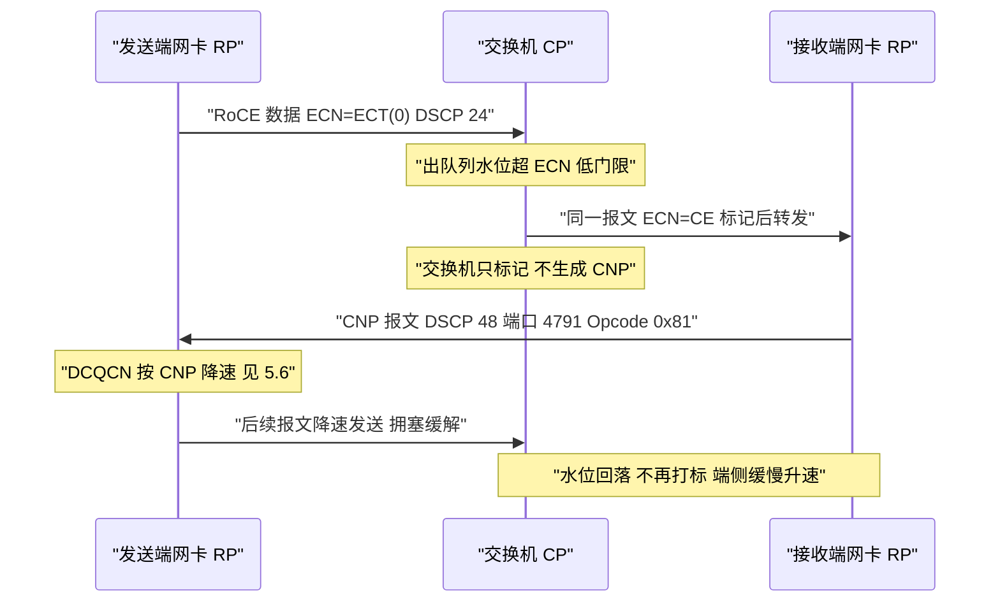

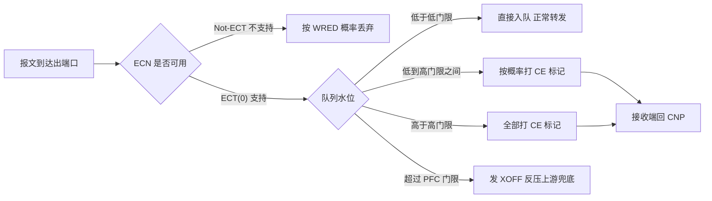

### 真题精练

**Q1.【真题·单选】** 在 RoCEv2 的 ECN 机制中，负责生成并回送 CNP 报文的是：
A. 发送端网卡（数据源）  B. 交换机（拥塞点）  C. 接收端网卡  D. iMaster NCE-Fabric 控制器

> **答案：C**
> **解析**：交换机只把 ECT 报文**标记为 CE**（拥塞点 CP 的动作）；接收端网卡收到 CE 标记的报文后**生成 CNP** 回送给数据发送端，发送端再按 DCQCN 降速。B 是最常见错答——"交换机发 CNP"不符合 RoCEv2 规范；A 是 CNP 的接收者而非生成者；D 与数据面实时拥塞控制无关（控制器不参与微秒级闭环）。

**Q2.【真题·多选】** 关于 ECN 与 PFC 的门限关系，下列设计合理的有：
A. ECN 低门限 < ECN 高门限 < PFC XOFF 门限
B. ECN 低门限设置在接近 PFC 门限的位置，以减少打标次数
C. PFC XOFF 门限应低于"队列总可用缓存减去 Headroom"
D. CNP 报文应与数据流共用同一个 PFC 无损队列，确保不丢

> **答案：AC**
> **解析**：A 对——ECN 必须先于 PFC 生效，给 DCQCN 留出一个 RTT 的反应时间；B 错——这会让 ECN 形同虚设，拥塞直接由 PFC 兜底，容易出现 PFC 频繁触发、吞吐抖动，甚至 PFC 风暴与死锁风险上升；C 对——Headroom 是留给"反压生效期间在途报文"的专用缓存，不能被业务积压占用；D 错——CNP 若走 PFC 队列，会被反压排队，拥塞信号迟到，严重时可造成控制环路死锁。

**Q3.【真题·排错】** 某 AI 集群已配置 ECN（`drop-profile` + `ecn` + 绑定队列 3）与 PFC 3，但训练吞吐仍然低，且 `display qos queue statistics interface 100GE1/0/1 queue 3` 显示 Discard 计数持续增长、`display dcb pfc statistics` 显示 XOFF 发送计数几乎为 0。请分析最可能的原因与排查步骤。

> **答案与解析**：
> **现象特征解读**：丢弃在涨但**没有反压**，说明"丢失发生在 PFC 反压生效之前"，即水位的增长没有被 PFC 拦住——要么 PFC 没真正在这个队列/这个接口生效，要么 ECN 与 PFC 的门限配置不匹配（如 PFC 门限高于队列总缓存，永远触发不了就被尾丢弃），要么丢弃根本不是发生在这个队列（可能在别的队列或有别的瓶颈）。
> **可能原因**：① `trust dscp` 未配置，RoCE 报文实际进了队列 0 而不是队列 3（用 `display qos queue statistics` 看哪个队列计数在涨即可确认）；② PFC 优先级规划与队列映射不一致（全局使能了优先级 3，但业务映射到了队列 4）；③ 路径中某一跳未使能 PFC 3，丢失发生在那一跳（逐跳排查）；④ PFC 门限配置高于实际可用缓存，永远不触发，报文直接被尾丢弃；⑤ Headroom 配得过小，XOFF 刚发出，在途报文已经把缓存打穿（此时应看到 XOFF 有计数但仍有丢包）；⑥ 服务器网卡侧未开启 PFC（`mlnx_qos --pfc`）或网卡不支持 ECN，导致上游不响应反压/不回 CNP。
> **排查步骤**：① `display qos queue statistics interface 100GE1/0/1` 逐队列看通过/丢弃分布，确认真正的拥塞队列号；② `display dcb pfc interface 100GE1/0/1` 与该接口**上游所有跳**的 PFC 配置是否一致；③ `display dcb pfc statistics interface <每一跳>` 看 XOFF 收发方向，定位反压在哪儿断链；④ 服务器侧 `mlnx_qos -i <nic>` 确认 PFC/ECN 使能、`ethtool -S <nic>` 看 `rx_pause`/`tx_pause`/`out_of_buffer` 计数；⑤ 按"ECN 低 < ECN 高 < PFC 门限 < 总缓存 − Headroom"重排门限并复测；⑥ 若确认是哈希极化导致单链路拥塞，调整负载分担方式而不是继续加缓存。

### 易错点与排错

1. **"交换机生成 CNP"**：错，交换机只打 CE 标记，CNP 由接收端网卡生成。
2. **ECN 与 PFC 门限倒挂**：ECN 高门限高于 PFC 门限时，PFC 永远先触发，ECN 白白配置。
3. **把 ECN 当"防丢包机制"**：ECN 防的是"拥塞发生"，丢包仍由 PFC + Headroom 兜底，两者是分工不是替代。
4. **只在一台设备上配 ECN**：ECN 门限应在**所有可能拥塞的出端口**（Leaf 上行、Spine 下行）都配置；只配一半等于没配。
5. **忽略 CNP 的优先级**：CNP 必须走非 PFC 的高优先级队列，DSCP 48/802.1p 6 要与全网规划一致。
6. **排错命令链**：`display drop-profile <name>` → `display qos queue statistics interface <if> queue <n>` → `display dcb pfc statistics interface <if>` → 服务器侧 `mlnx_qos`/`ethtool -S`。

---

## 5.6 DCQCN 拥塞控制算法：速率增减、状态机与交互时序

### 考点定位

**无损网络的"大脑"，国赛简答/多选题高频**，分值 5~10 分。考法：① 问 DCQCN 三个角色的分工（CP/NP/RP）；② 问"收到 CNP 后网卡怎么调速率"（乘法降速、加法/超加法升速）；③ 问 α（拥塞程度估计）的作用与更新方式；④ 结合 5.5 问"降速为什么用乘性、升速为什么用加性"（AIMD 的稳定性原理）。易错点是**把 DCQCN 当成交换机算法**（错，它跑在**网卡**上，交换机只提供 ECN 标记）、**把 NP 与 RP 混为一谈**。

### 原理精讲

**DCQCN 是谁、解决什么。** DCQCN（Data Center Quantized Congestion Notification，数据中心量化拥塞通知）由微软与 Mellanox 在 2015 年提出，是 RoCEv2 事实上的标准拥塞控制算法。它要解决的核心问题是：**交换机只会说"我拥塞了"（CE 标记），网卡怎么把这个二值信号变成精确的发送速率**。DCQCN 的答案是"**用乘性降速快速止损 + 用加性/超加性升速缓慢试探**"，即经典 AIMD（Additive Increase Multiplicative Decrease）思想在数据中心场景下的精细化实现。

**三个角色（必须能画出来、说清楚）**：

| 角色 | 位置 | 职责 |
|---|---|---|
| **CP（Congestion Point，拥塞点）** | 交换机出端口 | 按 ECN 门限与概率把 ECT 报文标记为 CE |
| **NP（Notification Point，通知点）** | 接收端网卡 | 收到 CE 标记后生成 CNP 回送，并按最小间隔限流 CNP |
| **RP（Reaction Point，反应点）** | 发送端网卡 | 维护每流速率，收到 CNP 后降速，无 CNP 时升速 |

**DCQCN 的核心变量**：`Rc`（当前速率，Current Rate）、`RT`（目标速率，Target Rate）、`α`（0~1 的拥塞程度估计）、`F`（最近一次降速前的速率，用于快速恢复）、`n`（当前降速周期内累计的 CNP 个数）。

**① 拥塞程度估计 α 的更新**：α 是 DCQCN 的"记忆"。**每收到一个 CNP**，执行 `α ← (1 − g)·α + g`（g 为常数，典型 1/256），即在无 CNP 时 α 也会周期性（α 更新计时器，典型 55 µs）按 `α ← (1 − g)·α` **衰减**。这样设计的意义是：连续来 CNP 时 α 迅速逼近 1（说明拥塞严重，降速要狠），而长时间没有 CNP 时 α 缓慢回落到 0（说明链路已经空闲，可以放开升速）。

**② 降速（Rate Decrease，乘性）**：收到 CNP 时执行 `Rc ← Rc × (1 − α/2)`。注意这里是**乘性降速**：α 越大降得越狠。同时维护一个"降速监视周期"（典型 4 µs，`rate_reduce_monitor_period`）：
- 若这是本周期内**第一个** CNP：先保存 `RT ← Rc`（记住降速前的目标速率），再 `Rc ← Rc(1 − α/2)`；
- 若本周期内**又来**了 CNP（说明降得不够快）：`Rc ← Rc(1 − α/2)` 且 `RT ← Rc`（目标速率一起下压，避免立刻反弹）。

**③ 快速恢复（Fast Recovery，也叫超加性升速 HAI）**：降速后如果一直压着不动，链路会被白白浪费。DCQCN 记录降速前的速率 `F`，并累计 CNP 个数 n；当 `n ≥ F_threshold`（典型 5）时仍收到 CNP，说明"降速还没到位"，此时把目标速率提到 `RT ← (Rc + F)/2`、`Rc ← RT`，然后进入**超加性升速**：每个升速事件执行 `Rc ← (Rc + RT)/2`，即以"向目标速率对折逼近"的方式快速爬升——这就是 HAI（Hyper-Additive Increase），比纯加法快得多，用于快速抢占刚被释放的带宽。

**④ 升速（Additive Increase，加性）**：当 `Rc ≥ RT`（说明已经追平目标速率，链路仍有富余），转入**加性升速**：每个升速事件执行 `Rc ← Rc + RAI`（RAI 为加性增量，典型 5 Mbps），缓慢试探可用带宽。升速事件由**两个条件之一**触发（谁先到算谁）：**升速计时器**到期（典型 55 µs）或**发送字节计数器**达到门限（典型 10 KB）。

**为什么必须"乘性降 + 加性升"？** 这是控制论上的稳定性要求：乘性降速能保证"无论当前速率多高，遇到拥塞都能按比例快速退到安全区"（收敛快、不易过冲）；加性升速保证"缓慢逼近而不引发新的拥塞"（避免振荡）。若升速也用乘性，速率会指数级反弹，链路在"打满—拥塞—暴跌"之间剧烈振荡，时延抖动极大；若降速用加性，遇到剧烈拥塞时降得太慢，丢包已经发生。

**与交换机侧的关系（考试常考的"分工"）**：交换机**不做速率决策**，它只提供两类信息：ECN CE 标记（拥塞信号）与本身的缓存/门限行为。真正决定"发多快"的永远是网卡。因此同一个交换机能同时服务 DCQCN 网卡和其他厂商网卡（如华为的 iLossless 算法）——只要它们都认 ECN/CNP。华为在此基础上还提供了 **AI ECN（智能 ECN）** 与 **NPCC** 等增强：前者用算法自动调整 ECN 门限（减少人工调参），后者在交换机侧做更精细的拥塞控制协同，目的是在**混合厂商网卡、混合业务**的环境中把无损网络的调参门槛降下来。

### 关键概念对照表

| 参数 | 含义 | 典型取值 | 调大/调小的后果 |
|---|---|---|---|
| α（Alpha） | 拥塞程度估计（0~1） | 动态，初值 0 | 越大降速越猛，收敛快但吞吐抖动 |
| g（α 更新因子） | α 的更新步长 | 1/256 | 大→反应快但不稳；小→平滑但迟钝 |
| RateIncreaseTimer | 升速事件周期 | 55 µs | 小→升速激进易拥塞 |
| RateIncreaseByteCounter | 升速字节门限 | 10 KB | 小→小流也频繁升速 |
| RAI | 加性升速增量 | 5 Mbps | 大→逼近目标快但易过冲 |
| RateDecreaseFactor | 乘性降速系数 | 1/2（配合 α/2） | 大→降得狠，恢复慢 |
| F（FastRecoveryThreshold） | 进入快速恢复所需 CNP 数 | 5 | 大→恢复晚；小→易反复 |
| MinTimeBetweenCNPs | NP 生成 CNP 的最小间隔 | 4 µs 量级 | 小→CNP 风暴；大→信号滞后 |

| 算法 | 部署位置 | 信号来源 | 特点 |
|---|---|---|---|
| DCQCN | 网卡（RP/NP） | ECN CE + CNP | RoCEv2 事实标准，需交换机配 ECN |
| TIMELY | 网卡 | RTT 梯度 | 不依赖交换机 ECN，但依赖精确时间戳 |
| Swift | 网卡 | 网络内时延（近似） | 类 TCP，部署复杂 |
| HPCC | 网卡 + 交换机可编程 | INT 精确链路信息 | 精度最高，需 P4 可编程芯片 |
| 华为 AI ECN / NPCC | 交换机 + 网卡协同 | ECN/自研信号 | 自动调参、面向混合厂商环境 |

### 华为设备配置

```bash
# 第一部分：交换机侧（CloudEngine）——为 DCQCN 提供 ECN 标记能力（门限规划见 5.5）
system-view
drop-profile ecn_dp                                        // 创建 ECN 丢弃模板
 wred dscp
  dscp 24 low-limit 150 high-limit 600 discard-percentage 100  // 数据流 DSCP 24 的 ECN 门限
  quit
 ecn                                                       // 使能为 CE 标记
 quit
qos queue-profile qp_roce
 queue 3 drop-profile ecn_dp                               // 队列 3 绑定模板
 quit
interface 100GE1/0/1
 trust dscp
 qos queue-profile qp_roce
 dcb pfc enable mode manual                                // PFC 兜底
 quit
display drop-profile ecn_dp                                // 验证 ECN 已使能、门限符合规划
```

```bash
# 第二部分：服务器网卡侧（以 NVIDIA/Mellanox 网卡 + Linux 为例，非交换机命令）
cma_roce_mode -d mlx5_0 -p 1 -m 2                          // 网卡工作在 RoCEv2 模式（m 2 表示 v2）
mlnx_qos -i ens1f0 --pfc 0,0,0,1,0,0,0,0                   // 网卡使能优先级 3 的 PFC，与交换机规划对齐
echo 1 > /sys/class/net/ens1f0/ecn/roce_np/enable/3        // 接收侧（NP）对优先级 3 使能 ECN 通知
echo 48 > /sys/class/net/ens1f0/ecn/roce_np/cnp_dscp       // CNP 使用 DSCP 48（CS6），与交换机队列 6 对应
echo 6 > /sys/class/net/ens1f0/ecn/roce_np/cnp_802p_prio   // CNP 使用 802.1p 6，保证高优先级、不被 PFC 反压
echo 5 > /sys/class/net/ens1f0/ecn/roce_rp/rpg_hai         // 快速恢复阈值 F=5（超加性升速的门限）
echo 2 > /sys/class/net/ens1f0/ecn/roce_rp/rpg_min_dec_fac // 乘性降速因子 1/2（收到 CNP 时的降速力度）
cat /sys/class/net/ens1f0/ecn/roce_rp/rate_raise_period    // 查看升速计时器（典型 55 µs）
```

> 服务器侧参数是**网卡厂商实现**，不同固件版本文件名与取值范围略有差异，请以实际 `ls /sys/class/net/<dev>/ecn/roce_rp/` 为准。华为昇腾/鲲鹏服务器侧的 RoCE 与 DCQCN 参数用 `hccn_tool`（如 `hccn_tool -i 0 -pfc -g`、`hccn_tool -i 0 -ecn -g`）配置与查询。国赛理论题只需答出"**交换机配 ECN 门限、网卡跑 DCQCN**"这一分工，实验题通常只要求交换机侧配置 + 网卡侧 PFC/ECN 开关。

### 示意图

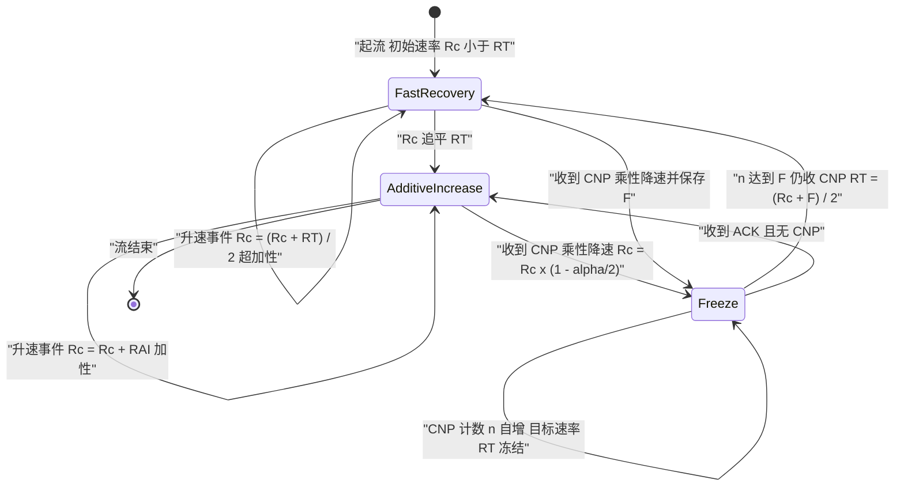

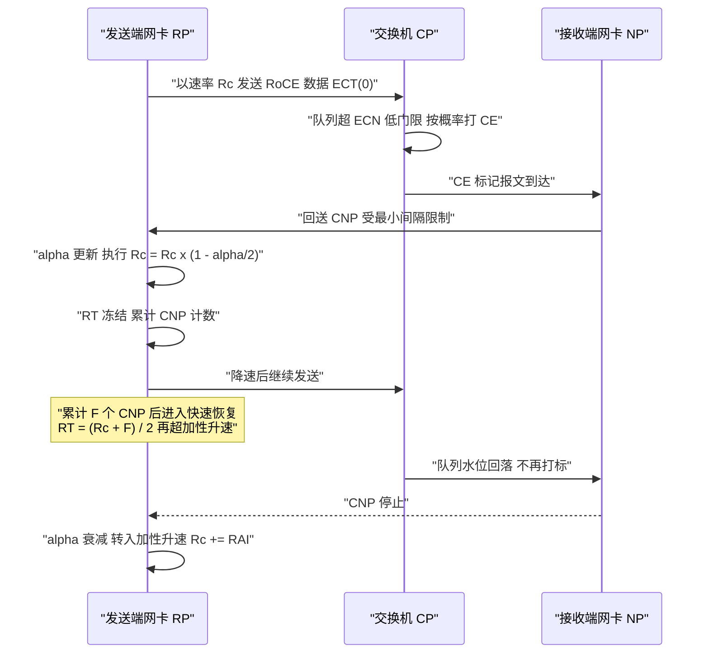

### 真题精练

**Q1.【真题·单选】** DCQCN 算法中，发送端网卡收到 CNP 后对当前速率 Rc 的处理方式是：
A. 加法降速 Rc = Rc − RAI  B. 乘性降速 Rc = Rc × (1 − α/2)
C. 直接把速率置为线速的 1/2  D. 不做调整，仅上报控制器

> **答案：B**
> **解析**：DCQCN 的降速是**乘性降速**，降速力度由拥塞程度估计 α 决定（α 越大降得越狠）；升速才是加性（`Rc ← Rc + RAI`）与超加性（`Rc ← (Rc + RT)/2`）。A 错——加性降速在严重拥塞时太慢，来不及止损；C 错——机械地减半不体现 α 的连续估计；D 错——DCQCN 是微秒级的本地闭环，不依赖控制器。

**Q2.【真题·多选】** 关于 DCQCN 的三个角色与 α 参数，下列说法正确的有：
A. CP 是交换机，只负责按门限把 ECT 报文标记为 CE
B. NP 是接收端网卡，负责生成并回送 CNP
C. RP 是发送端网卡，收到 CNP 后执行降速，无 CNP 时缓慢升速
D. α 只在收到 CNP 时才变化，没有 CNP 时保持不变

> **答案：ABC**
> **解析**：A、B、C 是 DCQCN 的标准角色划分。D 错——α 不仅在收到 CNP 时按 `α ← (1−g)α + g` 增大，在**没有 CNP 时也会随 α 更新计时器周期性衰减**（`α ← (1−g)α`），这样才能在链路空闲后让端侧"敢"把速率升回去。若 α 只增不减，一次拥塞会让流速率长期偏低，链路利用率受损。

**Q3.【真题·简答】** 解释 DCQCN 中为什么降速采用乘性、升速采用加性，并说明"快速恢复（HAI）"存在的必要性。

> **答案与解析**：
> **① 乘性降速的必要性**：拥塞发生时，速率必须"与当前速率成比例"地下降，才能保证无论速率处于哪个量级都能快速退到安全区；若用固定量加性降速，高速流（如 400 Gbps）在严重拥塞下需要很多个周期才能降到位，期间丢包已经发生。
> **② 加性升速的必要性**：拥塞刚缓解时链路余量未知，若乘性升速会指数反弹，立刻再次触发拥塞，形成"打满—拥塞—暴跌"的振荡，时延抖动剧烈。加性升速（每次 +RAI）本质是"缓慢试探"，用时间换取稳定。
> **③ 快速恢复（HAI）的必要性**：纯加性升速在 400G 链路上从 5 Mbps 爬回线速需要极长时间，链路长期闲置。DCQCN 记录降速前的速率 F，当累计 CNP 达到 F_threshold 后把目标速率设为 `(Rc + F)/2`，再以"向目标对折逼近"的超加性方式快速爬升——既比纯加法快得多，又不像乘性那样激进，是"收敛速度"与"稳定性"之间的折中。

### 易错点与排错

1. **说 DCQCN 跑在交换机上**：它跑在网卡上；交换机只提供 ECN 标记（以及可选的 AI ECN/NPCC 增强）。
2. **NP 与 RP 混淆**：NP 在**接收侧**（生成 CNP），RP 在**发送侧**（收 CNP 后降速）。
3. **认为 α 只增不减**：α 会周期性衰减，否则速率无法恢复。
4. **只调网卡不管交换机**：网卡再聪明，交换机不打 CE 标记，DCQCN 就永远收不到 CNP，形同没有拥塞控制。
5. **CNP 走 PFC 队列**：这是会引发控制环路死锁的经典错误配置，CNP 必须走非 PFC 高优先级队列。
6. **排错命令**：交换机侧 `display drop-profile`、`display qos queue statistics interface <if> queue 3`；服务器侧 `ethtool -S <dev> | grep -E "ecn|cnp|pause"`、`cat /sys/class/net/<dev>/ecn/roce_np/...`、`ibv_rc_pingpong`。

---

## 5.7 PFC 与 ECN 的协同：为什么 ECN 先动、PFC 后动

### 考点定位

**本章的"综合题眼"，几乎必考一道简答或论述**，分值 6~10 分。核心命题：① 门限阶梯关系（ECN 低 < ECN 高 < PFC XOFF）；② 两者分工（ECN 端到端治本、PFC 逐跳止血）；③ 只配一个会怎样；④ 画出协同工作流程。易错点是**答成"ECN 和 PFC 二选一"**（实际是**必须协同**）、**忽略 Headroom 与死锁检测这两道后手**。

### 原理精讲

**先明确两者的能力边界。** PFC 的能力在"**链路**"：它能在下游缓存将满时让上游停止发送，速度极快（微秒级生效），但代价是 (1) 只作用于直连链路，无法把"远端拥塞"告诉源端；(2) 反压会沿链路逐跳扩散，可能把无关流量一起冻住；(3) 存在死锁风险。ECN 的能力在"**端到端**"：它把拥塞信号送达到**数据源**，让源端从根上降速，代价是需要一个 RTT 才能见效，且**依赖网卡支持**。

**因此正确的协同关系是"ECN 先动、PFC 后动，PFC 只做兜底"**：

1. **常态（水位 < ECN 低门限）**：全部正常转发，端侧按 DCQCN 的加性/超加性升速试探带宽。
2. **第一道防线（ECN 低门限 ≤ 水位 < ECN 高门限）**：交换机按概率给 ECT 报文打 CE；接收端 NP 回 CNP；发送端 RP 按 `Rc ← Rc(1−α/2)` 乘性降速。**此时网络侧没有任何丢包，也没有任何反压**——这是"最优雅"的拥塞处理：压力由源端自己消化。
3. **第二道防线（水位 ≥ ECN 高门限）**：全部打 CE，端侧持续降速（α 逼近 1，降速越来越猛）。
4. **第三道防线（水位 ≥ PFC XOFF 门限）**：说明端侧降速"没来得及"（RTT 太长、incast 太猛、或对端网卡不支持 ECN），交换机立即发 XOFF 把上游停住——**此时 PFC 的角色是"止血带"而不是"常规手段"**。水位回落到 XON 门限后撤销反压。
5. **第四道防线（Headroom）**：XOFF 发出到上游真正停发之间存在一个 RTT 窗口，期间链路上仍有在途报文，必须由 Headroom 缓存吸收，否则照样丢包。
6. **第五道防线（PFC 死锁检测）**：一旦检测到某接口的某优先级长时间处于"已反压但队列水位不降"的死锁状态，设备可自动**临时关闭该优先级的 PFC**（并产生告警，如 `hwXQoSPfcTurnOffAlarm`），宁可丢包也要让网络恢复转发能力——因为"死锁"比"丢一点包"危害大得多。

**只配 PFC 不配 ECN 会怎样？** 微突发一上来就直接触发 PFC：反压频繁、沿多级链路扩散、吞吐呈锯齿状抖动；无损完全依赖 PFC，**死锁风险敞口 100%**；一旦某跳死锁检测把 PFC 关掉，立刻大量丢包，训练直接受损。此外 PFC 反压本身会占用链路带宽（反压帧），并造成上游队列"暂停—恢复"的反复切换，时延抖动大。

**只配 ECN 不配 PFC 会怎样？** 在"端侧能及时反应"的情况下表现很好（这也是很多大规模 AI 集群的实践：ECN 为主、PFC 为辅甚至不用）；但只要出现以下任一情况就会丢包并导致 RDMA 吞吐崩塌：网卡不支持 ECN/CNP、服务器侧参数配置不当、incast 极端到水位在一个 RTT 内打穿缓存、或路径上某设备不支持 ECN。因此**生产环境的稳妥做法是"ECN 为主 + PFC 兜底 + Headroom 保证 + 死锁检测保险"**。

**四条协同铁律（答题模板）**：
1. **门限阶梯**：ECN 低门限 < ECN 高门限 < PFC XOFF 门限 < 队列可用缓存 − Headroom；
2. **优先级隔离**：业务数据走 PFC 无损队列，CNP 走独立的高优先级非 PFC 队列；
3. **全网一致**：PFC 优先级、DSCP 映射、ECN 门限必须在**所有 Leaf/Spine 的所有相关端口**上一致，否则任何一跳都可能成为丢包点；
4. **兜底齐全**：Headroom 按速率×RTT+突发量规划，并开启 PFC 死锁检测与告警，让网络"出问题时能自愈"。

### 关键概念对照表

| 对比项 | ECN + DCQCN | PFC |
|---|---|---|
| 作用范围 | 端到端（跨多跳） | 逐跳、单条链路 |
| 生效时延 | 一个 RTT（微秒~毫秒级） | 微秒级（本链路） |
| 处理方式 | 标记 CE + CNP 让源端降速 | 反压上游暂停发送 |
| 是否会丢包 | 不丢（标记代替丢弃） | 不丢（靠 Headroom 兜） |
| 主要风险 | 端侧不支持/反应不及则失效 | 死锁、风暴、反压扩散、队头风险 |
| 依赖 | 网卡支持 ECN/CNP、交换机配 ECN | 全网每跳支持同优先级 PFC |
| 角色定位 | **主用手段（治本）** | **兜底手段（止血）** |

| 水位区间 | 触发动作 | 端到端效果 |
|---|---|---|
| 低于 ECN 低门限 | 无 | 正常转发，端侧缓慢升速 |
| ECN 低~高门限 | 按概率打 CE | 端侧乘性降速，无丢包无反压 |
| 高于 ECN 高门限 | 全部打 CE | 端侧持续降速，α 逼近 1 |
| 高于 PFC XOFF 门限 | 发 XOFF | 上游暂停该优先级，止住拥塞 |
| 水位降至 XON 门限 | 发 XON | 上游恢复发送 |
| 长期反压但水位不降 | PFC 死锁检测动作 | 临时关闭该优先级 PFC 并告警 |

### 华为设备配置

```bash
system-view                                                // 进入系统视图
# 第一步：ECN 门限（第一道防线）
drop-profile ecn_dp
 wred dscp
  dscp 24 low-limit 150 high-limit 600 discard-percentage 100  // ECN 低门限 150KB、高门限 600KB
  quit
 ecn                                                       // 使能 ECN 标记
 quit
# 第二步：PFC 兜底（第三道防线）
dcb pfc
 priority 3                                                // 队列 3 为无损队列
 quit
# 第三步：接口上把两者绑在一起，并给 PFC 门限留出 Headroom
interface 100GE1/0/1
 trust dscp                                                // DSCP 24 入队列 3、DSCP 48 入队列 6
 qos queue-profile qp_roce                                 // 应用 ECN 模板（队列 3 绑定 ecn_dp）
 dcb pfc enable mode manual                                // 使能 PFC 兜底
 qos buffer queue 3 shared-threshold dynamic               // 队列 3 采用动态缓存门限（按端口速率与队列数自适应）
 qos buffer queue 3 pfc-threshold 300 pfc-threshold-offset 200  // PFC 反压门限 300KB、偏移 200KB
 qos buffer queue 3 guaranteed 25 headroom 1000            // 保障缓存 25KB，Headroom 1000KB（吸收在途报文）
 quit
# 第四步：死锁检测与告警（第五道防线）
dcb pfc deadlock-detect interval 200                       // 死锁检测周期（部分版本层级不同，可用 ? 确认）
display dcb pfc                                            // 验证全局 PFC 优先级
display drop-profile ecn_dp                                // 验证 ECN 门限与标记开关
display qos queue statistics interface 100GE1/0/1 queue 3  // 观察通过/丢弃，理想状态：无丢弃
```

> 三条门限的相对关系必须**肉眼可验**：`display drop-profile` 看 ECN 门限，`display dcb pfc interface` 看 PFC 反压门限，`display qos buffer`（或接口下的 `qos buffer queue` 配置）看缓存总量与 Headroom。建议在现网调优时把三者与实测曲线一起记录，形成本项目的"调优基线"。

### 示意图

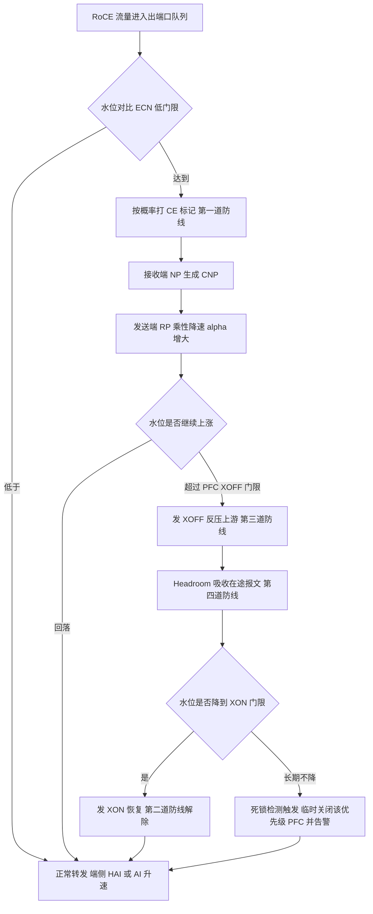

### 真题精练

**Q1.【真题·简答】** 说明 PFC 与 ECN 在无损网络中各自扮演的角色，并解释为什么配置的顺序逻辑必须是"ECN 先动、PFC 后动"。

> **答案与解析**：
> **① 角色定位**：ECN（配合 DCQCN）是**端到端的主用机制**，它在拥塞刚萌芽时让**源端主动降速**，从根上消除拥塞，不产生反压、不涉及反压扩散；PFC 是**逐跳的兜底机制**，在端侧来不及降速时用反压"止血"，保证缓存不被击穿。
> **② 为什么 ECN 必须先动**：ECN 的闭环需要**一个 RTT**（交换机打标 → 接收端生成 CNP → 发送端降速 → 新速率生效），响应天然比 PFC 慢；而 PFC 只需"本链路缓存到门限"即可在微秒级反压。若把 ECN 门限设置得贴近 PFC 门限，端侧还没来得及降速，PFC 就已经触发——此时网络已经处于"靠反压维持"的状态，无损的可靠性完全押在 PFC 上，死锁与风暴风险敞口极大。因此必须给 ECN 留出足够的水位提前量：**ECN 低门限 < ECN 高门限 < PFC XOFF 门限**。
> **③ 门限以外还要做什么**：为 PFC 留够 Headroom（吸收反压生效期间的在途报文）、把 CNP 放在独立的非 PFC 高优先级队列、并开启 PFC 死锁检测作为最后一道防线。

**Q2.【真题·多选】** 某 AI 集群只配置了 PFC 而没有配置 ECN。可能出现的现象有：
A. 微突发一发生就触发 PFC 反压，反压频繁且沿多级链路扩散
B. 训练吞吐呈锯齿状抖动，时延抖动变大
C. PFC 死锁风险显著提高
D. 由于有 PFC 兜底，网络性能与配置了 ECN 的情况完全等价

> **答案：ABC**
> **解析**：A、B 对——没有 ECN 的"提前减压"，拥塞只能等缓存接近满时才由 PFC 处理，反压频繁且逐跳传播；C 对——反压次数越多，形成依赖环的概率越大，死锁风险随之上升；D 错——PFC 只能"暂停"，不能降低源端速率，"暂停—恢复"的反复切换会造成带宽损失与时延抖动，无法与 ECN 的端侧平滑降速等价。

**Q3.【真题·排错】** 某 Spine-Leaf 网络中，Leaf 上行口频繁出现 PFC 反压（`display dcb pfc statistics` 显示 XOFF 发送计数持续增长），但服务器侧流量并没有明显超订。请给出你的排查思路。

> **答案与解析**：
> **① 先确认"是谁在拥塞、拥塞在哪个队列"**：`display qos queue statistics interface <上行口>` 看哪个队列的缓存使用与丢弃最高。若拥塞在无损队列 3，则核实该队列的业务是否真的只有 RoCE 数据流（可能有普通 TCP 流量因为 `trust dscp` 缺失或 DSCP 被误标而混入无损队列，导致"不该无损的流量挤占无损队列"）。
> **② 检查 ECN 是否真的生效**：`display drop-profile <name>` 确认 `ecn` 已使能、门限是否远低于 PFC 门限；若 ECN 门限配得过高甚至高于 PFC 门限，就会出现"该由 ECN 解决的事全丢给 PFC"。
> **③ 检查负载分担是否极化**：`display interface brief` 看多条上行链路利用率是否严重不均（例如 90%/30%），若不均则说明 RoCEv2 大象流的哈希极化导致"局部拥塞"，需要调整负载分担哈希因子或改用动态负载分担，而不是继续加缓存/调 PFC 门限。
> **④ 检查是否存在"反压扩散/远端慢速接收者"**：多打一（incast）场景下，若某个接收端处理慢（网卡/应用瓶颈），其上游 Leaf 会持续反压，进而把压力扩散到 Spine 与其他 Leaf。定位方法是对比各 Leaf 上行口的 XOFF 计数与对应下行服务器网卡的接收速率。
> **⑤ 检查 Headroom 与死锁**：若 XOFF 在发但队列仍丢包，说明 Headroom 不足；若某接口长期"已反压但水位不降"，需检查死锁检测是否触发、告警日志中是否有 PFC 相关告警（如 `hwXQoSPfcTurnOffAlarm`）。
> **⑥ 最后再谈调参**：按"ECN 低 < ECN 高 < PFC 门限 < 总缓存 − Headroom"重新规划门限，并回归测试吞吐与时延曲线，避免只调单个门限造成"按下葫芦浮起瓢"。

### 易错点与排错

1. **答"ECN 与 PFC 二选一"**：正确结论是**必须协同**，ECN 为主、PFC 兜底。
2. **门限倒挂**：ECN 门限高于 PFC 门限是典型错误配置，会让 PFC 成为常态手段。
3. **忘了 CNP 的独立优先级**：CNP 被 PFC 反压会导致拥塞信号迟到，甚至引发控制环路死锁。
4. **只配一个方向/一台设备**：无损是"全网工程"，任一跳缺失即不成立。
5. **忽略 PFC 死锁检测这道后手**：它的价值是"出问题时让网络能自愈并留下证据"，实验与简答都应提到。
6. **排错命令链**：`display qos queue statistics`（拥塞队列）→ `display drop-profile`（ECN 门限）→ `display dcb pfc interface`/`statistics`（反压方向）→ `display interface brief`（负载分担均匀性）→ 告警日志。

---

## 5.8 PFC 死锁成因、Deadlock 场景与规避

### 考点定位

**国赛 DCN 无损网络的"终极难题"，简答/排错题常驻**，分值 6~10 分。必答要点：① 死锁的**环状依赖**本质；② 反压是**按优先级**传播的，因此死锁也是按优先级发生的；③ **CNP 走 PFC 队列**是一种典型的人为死锁；④ 规避手段（拓扑/优先级规划、缓存与 Headroom、死锁检测自愈、ECN 为主）。易错点是**把"PFC 风暴"与"PFC 死锁"混为一谈**、**以为死锁会随超时自动解除**（不会，因为它不是丢帧问题而是逻辑环）。

### 原理精讲

**死锁的定义与本质。** PFC 死锁（PFC Deadlock）指**某一优先级**在多条链路之间形成了**循环等待**：每台交换机都在等下游释放缓存，而下游的水位又依赖上游停止发送，形成"谁也动不了"的闭环。关键在于 PFC 的反压是**按优先级**独立作用的——优先级 3 死锁时，优先级 0/6/7 照常转发，所以现象很有迷惑性：**ICMP 通、ping 不丢、管理面正常，但 RoCE 业务吞吐掉到 0**。这也是为什么死锁必须靠专用机制检测，而不能靠"看接口 up/down"。

**死锁的四种典型场景**：

**场景一：多级 PFC 依赖环（经典必考）**。假设三台交换机上同优先级（队列 3）的流量构成一个环（原因可能是路由环路、ECMP 哈希把同一流的去回程压到同一组链路、或应用层逻辑上构成环，如分布式存储的副本同步环）。此时：SW1 的队列 3 水位到门限 → 反压 SW3；SW3 队列 3 水位已高 → 反压 SW2；SW2 队列 3 水位也已到门限 → 反压 SW1。三台设备互相等待，队列 3 永远无法排空 → **优先级 3 在环内永久停摆**。

**场景二：CNP 被 PFC 反压（人为死锁，最容易被考）**。如果管理员图省事，把 CNP 也放进了 PFC 无损队列：数据流灌满缓存 → 交换机反压 → 该优先级所有报文（含 CNP）都被暂停 → 接收端的 CNP 送不出去/排不上队 → 发送端收不到 CNP 就不降速 → 水源源不断灌进来 → 水位无法回落 → 反压永不解除。**数据流与拥塞控制报文互相锁死**，这是 PFC 死锁里最典型的"配置错误型"死锁。

**场景三：单链路反复反压引发的"活锁"式拥塞扩散**。一台服务器或存储节点处理能力差（网卡中断、应用卡住），其接入交换机的入方向持续反压上行，反压沿多级链路扩散到 Spine 与其他 Leaf。这不是严格意义的死锁（链路并未成环），但现象极像：**吞吐长时间接近 0**，且伴随大量 XOFF 计数。区分方法是把该慢速服务器断掉，若全网立即恢复，则属于"反压扩散/慢速接收者"问题。

**场景四：PFC 帧本身的问题**。XOFF 帧因链路误码丢失、或上游设备对 XOFF 的处理异常，可能导致"下游认为已经反压、上游却没停"的不一致；另外 PFC 帧是 MAC 控制帧，**优先级最高**，某些芯片在极端拥塞下可能出现反压帧排队延迟。这类问题通常表现为"偶发、短暂"的吞吐塌陷，需要靠计数器与日志定位。

**为什么死锁不能靠"超时"自动解除？** 因为 PFC 的 Time 字段只是"暂停多久"的定时器，上游超时后会**恢复发送**——但如果环内水位依旧不降，下一轮 XOFF 立刻又到，上游再次被暂停。也就是说，**反压的定时器只能保证"不会因为丢一帧 XOFF 而永久停摆"，不能解决"逻辑环导致的持续拥塞"**。真正能解除的只有两种手段：**打破资源依赖关系（业务/拓扑层面）**，或**主动关闭该优先级的 PFC（丢包换恢复）**。

**规避与自愈的五条措施**：
1. **拓扑与路由层面**：避免同优先级流量构成环；谨慎使用会改变路径的负载分担策略；对存储/计算混合流量做优先级隔离，避免"不同业务挤在同一个无损优先级"（这是死锁的温床）。
2. **优先级规划层面**：**CNP 与协议报文绝不放无损队列**；无损优先级尽量少（通常只开 1~2 个）；普通业务一律走可丢队列。
3. **缓存与门限层面**：保证 `PFC 门限 + Headroom ≤ 端口可用缓存`，并留 Guard Band，避免"反压了但水位还是降不下来"。
4. **检测与自愈层面**：开启 **PFC 死锁检测**（在华为 CloudEngine 上通过 `dcb pfc deadlock-detect interval` 系列命令 + 接口死锁恢复能力），设备持续监视"已反压但水位不降"的异常状态，一旦判定死锁就**临时关闭该优先级的 PFC**（宁可丢包也要恢复转发），并上报告警（如 `hwXQoSPfcTurnOffAlarm`），随后自动尝试恢复。
5. **架构层面**：优先用 **ECN/DCQCN 作为主要手段**，把 PFC 触发次数降到最低——**PFC 用得越少，死锁概率越低**。

### 关键概念对照表

| 现象 | 本质 | 典型特征 | 处置 |
|---|---|---|---|
| PFC 死锁 | 反压形成循环等待 | 某优先级吞吐归零，其他优先级正常；XOFF 持续 | 打破环/关闭该优先级 PFC/死锁自愈 |
| PFC 风暴（反压扩散） | 单点慢速导致反压大面积传播 | XOFF 计数在多台设备同时暴涨 | 定位慢速端、限速、隔离优先级 |
| PFC 帧丢失 | 反压信号未送达 | 偶发短暂吞吐下降 | 检查链路误码、PFC 帧统计 |
| 队头阻塞 | 同一优先级内多业务互相拖累 | 单业务抖动、其他业务被拖慢 | 业务优先级细分 |

| 规避措施 | 作用点 | 效果 | 注意 |
|---|---|---|---|
| 优先级隔离（CNP 独立队列） | 配置 | 消除人为死锁 | CNP 走 DSCP 48/队列 6，不做 PFC |
| 减少无损优先级数量 | 配置 | 降低环的概率 | 一般只开 1~2 个无损队列 |
| 缓存与 Headroom 规划 | 配置 | 保证反压后水位能降 | 门限 + Headroom ≤ 可用缓存 |
| PFC 死锁检测与自愈 | 设备功能 | 死锁时自动降级恢复转发 | 会产生告警，需纳入监控 |
| 以 ECN 为主 | 架构 | 减少 PFC 触发频次 | 需要网卡支持 ECN/CNP |

### 华为设备配置

```bash
system-view                                                // 进入系统视图
dcb pfc
 priority 3                                                // 只把队列 3 设为无损（优先级数量越少，死锁概率越低）
 quit
dcb pfc deadlock-detect interval 200                       // 开启 PFC 死锁检测，检测周期 200（部分版本需先在系统视图使能该功能）
interface 100GE1/0/1
 dcb pfc enable mode manual                                // 接口使能 PFC
 dcb pfc deadlock recovery                                 // （版本支持时）接口使能死锁自愈：判定死锁后临时关闭该优先级 PFC
 quit
drop-profile cnp_prio                                      // 为 CNP 单独准备一个"非 PFC"的处理策略
 wred dscp
  dscp 48 low-limit 50 high-limit 100 discard-percentage 100   // CNP 队列门限低、转发优先，但不做 PFC 反压
  quit
 quit
display dcb pfc                                            // 确认 PFC 优先级与死锁检测参数
display dcb pfc statistics interface 100GE1/0/1            // 观察 XOFF/XON 收发计数，识别异常持续反压
display logbuffer | include PFC                            // 查看日志缓冲区中的 PFC 相关记录（死锁检测、自动关闭告警）
display alarm active                                       // 查看当前活动告警（可能包含 hwXQoSPfcTurnOffAlarm 等）
```

> **排错要点**：判断"是否死锁"的关键证据是**"XOFF 持续发送 + 队列水位长期不降 + 该优先级通过计数几乎为 0"三者同时成立**。只有 XOFF 多而水位能回落，那是正常的反压；只有某个优先级归零而其他优先级正常，才是死锁的典型指纹。

### 示意图

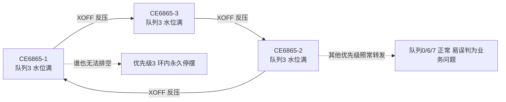

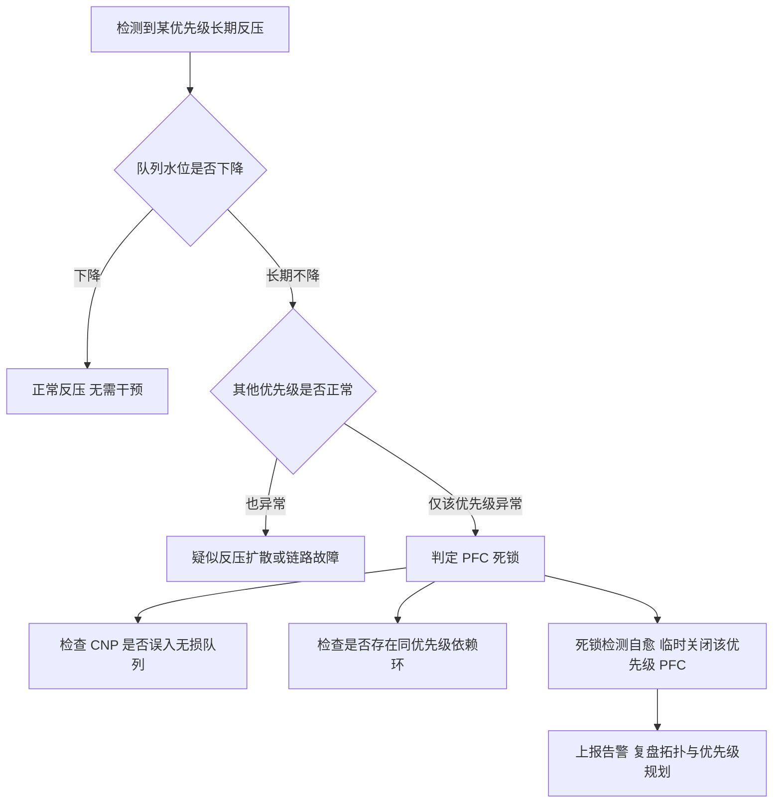

### 真题精练

**Q1.【真题·简答】** 什么是 PFC 死锁？请画出（或描述）一个典型的多级 PFC 依赖环场景，并说明为什么它无法通过 XOFF 的定时器自动恢复。

> **答案与解析**：
> **① 定义**：PFC 死锁指同一优先级在**多条链路之间形成循环依赖**——每条链路都在等待下游释放缓存，而下游的水位又依赖上游停止发送，导致该优先级在环内永久无法转发。由于 PFC 按优先级独立反压，**其他优先级不受影响**，因此现象隐蔽。
> **② 典型场景**：SW1、SW2、SW3 三台交换机上优先级 3 的流量构成环（如路由环路、ECMP 把同一大象流的去回程压到同组链路、或存储副本同步逻辑成环）。SW1 队列 3 到门限反压 SW3 → SW3 队列 3 也已满，反压 SW2 → SW2 队列 3 同样满，反压 SW1，形成闭环，谁都无法发送、谁都无法排空。
> **③ 为什么定时器救不了**：PFC 帧的 Time 字段只是"暂停多久"，上游超时后会恢复发送；但环内水位不降，下一轮 XOFF 立刻又到，上游再次被暂停——**定时器只能防"XOFF 丢帧导致的永久停摆"，防不了"逻辑环导致的持续拥塞"**。真正的解法是打破依赖关系（改拓扑/优先级/业务分布）、或以"丢包换恢复"主动关闭该优先级的 PFC（死锁检测自愈）。
> **④ 规避**：CNP 与协议报文绝不放无损队列；无损优先级数量尽量少；缓存与 Headroom 规划保证反压后水位能降；开启 PFC 死锁检测与告警；以 ECN/DCQCN 为主要手段降低 PFC 触发频次。

**Q2.【真题·排错】** 某集群突然出现大量 RoCE 业务超时，但管理面 ping 全通、其他业务正常。`display dcb pfc statistics interface 100GE1/0/1` 显示 XOFF 发送计数持续快速增长，`display qos queue statistics interface 100GE1/0/1 queue 3` 显示队列 3 的通过计数几乎不增长、水位居高不下。请给出判断与处置方案。

> **答案与解析**：
> **① 判断**："XOFF 持续 + 水位不降 + 该优先级通过计数归零 + 其他优先级正常"是 **PFC 死锁**的典型指纹（若所有优先级都异常，则更可能是反压扩散或链路/芯片故障）。
> **② 立即处置（先恢复业务）**：开启/触发 PFC 死锁检测自愈，让设备**临时关闭优先级 3 的 PFC**，使该优先级恢复转发（会丢一部分包，但能让业务从"完全停摆"恢复到"降速运行"）；同时检查是否有 `hwXQoSPfcTurnOffAlarm` 类告警。若版本不支持自愈，可临时在接口上关闭 PFC（`undo dcb pfc enable`）恢复转发，再逐步定位。
> **③ 根因定位**：a) 检查 CNP 是否被误配到无损队列（`display drop-profile` 看 DSCP 48 的映射、`display current-configuration interface` 看 QoS 策略）——这是最常见的人为死锁；b) 用 `display interface brief` 与路由表检查是否存在同优先级流量的路径环或 ECMP 极化；c) 检查是否有多台设备同时反压同一优先级（`display dcb pfc statistics` 逐台比对），确认环的范围；d) 检查是否有慢速接收者导致的持续反压扩散。
> **④ 长期整改**：把 CNP 迁移到独立的非 PFC 高优先级队列；减少无损优先级数量；按"ECN 低 < ECN 高 < PFC 门限 < 可用缓存 − Headroom"重排门限；开启死锁检测与告警并纳入监控；在控制器（NCE-Fabric）侧固化这套模板，避免逐台手工配置引入不一致。

### 易错点与排错

1. **把死锁当"链路故障"**：接口 up、ping 通、其他优先级正常，最容易误判为业务侧问题。
2. **指望超时自愈**：反压定时器只解决丢帧问题，不解决逻辑环。
3. **CNP 进无损队列**：人为死锁的头号原因，务必独立优先级。
4. **无损优先级开太多**：优先级越多，形成依赖环的组合越多，死锁概率越高。
5. **不做死锁检测**：没有自愈能力时，一次死锁可能让整个训练任务挂数小时。
6. **排错命令链**：`display dcb pfc statistics interface <if>` → `display qos queue statistics interface <if> queue <n>` → `display logbuffer | include PFC` → `display alarm active` → 全网逐跳比对反压方向。

---

## 5.9 缓存与队列规划：Headroom 计算与动态缓存

### 考点定位

**计算题 + 规划设计题的高发区**，分值 5~8 分。必会：① **Headroom 存在的意义与计算公式**（能代入数值算出来）；② Guaranteed / Shared / Headroom 三类缓存的区别；③ 反压门限与缓存总量的关系；④ 动态缓存（dynamic shared threshold）的作用。易错点是**认为 Headroom 是共享缓存的一部分可以随便占用**（它是**专用预留**，被其他队列占用就失去了吸收在途报文的能力）。

### 原理精讲

**先看芯片缓存的层次结构。** 交换芯片的缓存是"总缓存 → 端口共享 → 队列"三级结构。每个队列的空间通常由三部分组成：

1. **Guaranteed（保证缓存）**：每个队列**独占**的最小额度，无论其他队列怎么拥塞都能保证有这么多的空间。它的作用是"防止饿死"——避免低优先级队列在拥塞时完全拿不到缓存。数值一般较小（几十 KB 量级）。
2. **Shared（共享缓存）**：多个队列共享的弹性池，队列在保证缓存用满后可按门限继续占用共享池。共享门限分**静态**（固定值/固定百分比）与**动态**（设备按端口速率、队列总数、当前在线队列数自动计算）。
3. **Headroom（预留缓存）**：**专为 PFC 服务**的预留空间，**只允许被使能了 PFC 的队列使用**，且通常**不可被其他队列抢占**。它的唯一使命是：在下游发出 XOFF 到上游真正停发之间的那段窗口里，把"已经在链路上飞行的报文"接住。

**为什么必须有 Headroom？** 因为反压不是瞬间生效的。假设下游在 T0 时刻发出 XOFF，上游最早在 T0 + Δ 时刻才能停止发送，Δ 由四部分组成：① XOFF 帧在链路上的传播与串行化时间；② 上游设备解析并执行暂停的处理时延；③ 上游在收到 XOFF 之前已经"发出去但还在路上"的报文到达下游的时间；④ 芯片内部管线与转发时延。在这段时间里，**上游还在往下游灌数据**，如果下游没有额外空间接住它们，缓存就被打穿 → 丢包 → 无损目标失效。Headroom 就是为这段"盲飞时间"买的保险。

**Headroom 计算公式（务必会代入）**：

```
Headroom（字节） ≈ 链路速率（bit/s） ÷ 8 × Δ（秒） × (1 + 裕量系数)
其中 Δ ≈ XOFF 帧传输与传播时延 + 上游处理时延 + 在途报文到达时延 + 芯片内部管线时延
```

**例题（100GE 端口）**：链路速率 100 Gbps = 100×10⁹ bit/s，则速率为 `100×10⁹ / 8 = 12.5×10⁹ 字节/秒 = 12.5 字节/纳秒`。若实测/估算 Δ = 10 µs = 10 000 ns，则 `Headroom ≈ 12.5 × 10 000 = 125 000 字节 ≈ 122 KB`；再乘 1.5 倍裕量 ≈ **183 KB**。

**例题（400GE 端口）**：`400×10⁹ / 8 = 50 字节/纳秒`，同样 Δ = 10 µs，则 `Headroom ≈ 50 × 10 000 = 500 000 字节 ≈ 488 KB`，乘 1.5 倍裕量 ≈ **732 KB**。

**必须记住的三条结论**：(1) **Headroom 与端口速率成正比**——400GE 的 Headroom 是 100GE 的 4 倍，因此"从 100G 升级到 400G 时忘了改 Headroom"是典型事故；(2) **Headroom 与 RTT/处理时延成正比**——跨机柜、经过多级交换的链路 Δ 更大，Headroom 要相应加大；(3) **各厂商芯片的处理时延不同，设备给出的推荐值应优先采用**——华为 CloudEngine 在 `qos buffer queue <queue> headroom <value>` 上给出的推荐量级（常见为几百 KB 到 1 MB）已经把芯片内部管线、Guard Band 等算进去了，人工只做微调。

**反压门限与缓存总量的关系**：设端口某队列的可用缓存为 `B`（保证 + 可占用的共享），则必须满足：

```
PFC XOFF 门限 + Headroom + Guard Band ≤ B
```

如果 XOFF 门限设得过高（例如把 `B` 全用掉），那么反压触发时**已经没有 Headroom 可用来吸收在途报文**，结果就是"发了 XOFF 仍然丢包"——这是现网极常见的一类疑难杂症：计数器上 PFC 在正常工作，但队列 Discard 也在涨。

**动态缓存（Dynamic Shared Threshold）为什么好？** 静态门限是"一刀切"：无论端口是 100GE 还是 400GE、无论当前有多少队列在用，门限都是同一个值，于是大速率端口门限偏小（容易丢）、小速率端口门限偏大（时延高）。动态缓存让设备按 **端口速率、队列数、当前活跃队列数**自动计算门限，使"每队列可用空间"更贴合实际转发能力。华为 CloudEngine 的命令形态是 `qos buffer queue <queue-index> shared-threshold dynamic [dynamic-value]`，即把门限交给设备自适应（可选参数用于微调）。国赛答题要点：**动态缓存解决的是"门限与实际转发能力不匹配"，Headroom 解决的是"反压生效窗口的在途报文"，两者不能互相替代**。

**微突发与缓存的定量关系**：微突发需要的缓存量 = **超速速率 × 突发持续时间**。例如一个 100GE 入端口在 50 µs 内以 2 倍线速向同一出端口发送（超速 100 Gbps），则所需缓存 `= 12.5 字节/ns × 50 000 ns × 1 = 625 KB`。这说明：**在 incast 场景下，几台服务器同时向一个出端口发送，几十微秒就能吃掉数百 KB 缓存**——所以无损网络必须"从头端就抑制"（ECN/DCQCN 降速），否则再多缓存也只是延后丢包。

### 关键概念对照表

| 缓存类型 | 归属 | 是否可被抢占 | 主要作用 | 典型配置命令 |
|---|---|---|---|---|
| Guaranteed | 单队列独占 | 否 | 防饿死，保证基本额度 | `qos buffer queue <i> guaranteed <v>` |
| Shared（静态） | 多队列共享 | 是 | 弹性吸收突发 | `qos buffer queue <i> shared-threshold <v>` |
| Shared（动态） | 多队列共享 | 是 | 按端口速率与队列数自适应 | `qos buffer queue <i> shared-threshold dynamic` |
| Headroom | PFC 队列专用 | 否（专用预留） | 吸收反压生效期间在途报文 | `qos buffer queue <i> headroom <v>` |
| Guard Band | 芯片级预留 | 否 | 防止 Headroom 被误占 | 通常由设备自动预留 |

| 参数 | 与端口速率关系 | 与 RTT/时延关系 | 建议 |
|---|---|---|---|
| Headroom | 成正比 | 成正比 | 按公式算 + 乘 1.5~2 倍裕量，或采用设备推荐值 |
| PFC XOFF 门限 | 一般随速率增大 | 影响较小 | 保证"门限 + Headroom ≤ 可用缓存" |
| ECN 低/高门限 | 随速率增大 | 与 RTT 相关 | 取 shared 缓存的 20%~40% 作低门限 |
| Shared 门限 | 随速率增大 | — | 优先用 dynamic 自适应 |

| 常见现象 | 根因 | 处置 |
|---|---|---|
| 有 XOFF 但仍丢包 | Headroom 不足或 XOFF 门限过高 | 增大 Headroom、下调 XOFF 门限 |
| 时延普遍偏高 | Shared 门限过大导致长队列 | 减小门限或改用动态缓存 + ECN 提前打标 |
| 100G 正常、400G 丢包 | Headroom 按 100G 老配置 | 按速率等比放大 Headroom |
| 突发业务偶发丢包 | 微突发超缓存 | 提高 ECN 灵敏度 + 适度增大 shared |

### 华为设备配置

```bash
system-view                                                // 进入系统视图
interface 100GE1/0/1                                       // 进入无损接口
 qos buffer queue 3 guaranteed 25                           // 队列 3 独占保证缓存 25（单位随版本，常见为 KB）
 qos buffer queue 3 shared-threshold dynamic                // 队列 3 的共享门限交给设备动态计算（按速率与队列数自适应）
 qos buffer queue 3 pfc-threshold 300 pfc-threshold-offset 200  // PFC 反压门限 300、偏移 200（水位降 200 后发 XON）
 qos buffer queue 3 headroom 1000                           // 为队列 3 预留 Headroom，用于吸收反压生效期间的在途报文
 quit
display qos buffer queue interface 100GE1/0/1              // 查看接口各队列的保证/共享/Headroom 与当前占用（命令名随版本略有差异）
display qos queue statistics interface 100GE1/0/1 queue 3  // 查看队列 3 的缓存使用峰值与丢弃计数
display dcb pfc interface 100GE1/0/1                       // 交叉验证 PFC 反压门限与 Headroom 是否匹配
```

> 若设备提示参数不合法或关键字不存在，请用 `qos buffer queue ?` / `qos buffer queue 3 ?` 逐级补全：不同版本（V200R005 与 V300）在单位（KB/字节/百分比）与关键字组合上存在差异。**规划的核心不是记住某个数字，而是记住约束关系**：`XOFF 门限 + Headroom + Guard Band ≤ 可用缓存`，且 `ECN 低 < ECN 高 < XOFF 门限`。

### 示意图

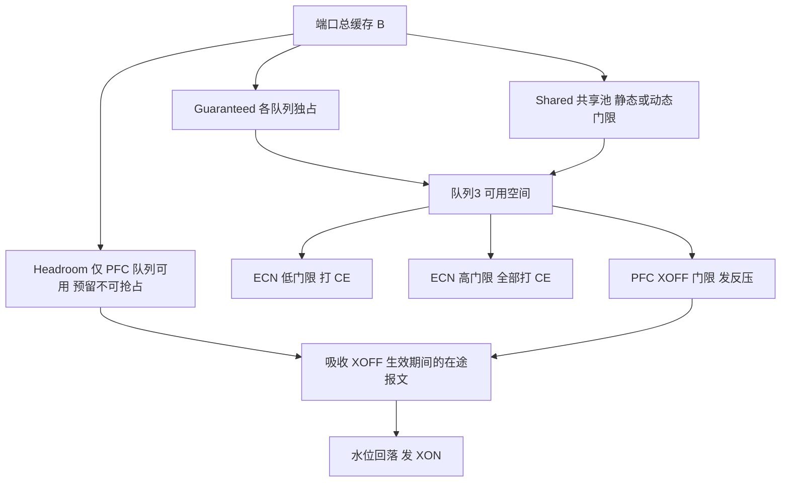


### 真题精练

**Q1.【真题·计算/填空】** 某 400GE 无损端口，测得从发出 XOFF 到上游真正停止发送的时间窗口 Δ = 8 µs（含链路传播、上游处理与芯片内部时延）。请估算该队列所需的最小 Headroom（不考虑裕量），并说明若沿用 100GE 时期的 Headroom 配置会发生什么。

> **答案与解析**：
> **计算**：400 Gbps = 400×10⁹ bit/s，换算为字节速率 `400×10⁹ ÷ 8 = 50×10⁹ 字节/秒 = 50 字节/纳秒`。Δ = 8 µs = 8 000 ns，则 `Headroom = 50 × 8 000 = 400 000 字节 ≈ 390 KB`。
> **若沿用 100GE 配置**：100GE 在同样 Δ 下的需求为 `12.5 × 8 000 = 100 000 字节 ≈ 98 KB`，只有 400GE 需求的约 1/4。沿用老配置会导致 Headroom 严重不足：**反压虽然正常发出，但在 XOFF 生效前的窗口内到达的报文无处可放，缓存被打穿，出现"有 XOFF 计数、队列 Discard 也在增长"的现象**。训练业务表现为吞吐骤降且难以定位（因为 PFC 计数器看起来"在工作"）。
> **结论**：Headroom 必须随端口速率**等比放大**，并与实测 Δ、最大帧长（MTU）一起核算，最后乘以 1.5~2 倍裕量或直接采用设备/控制器给出的推荐值。

**Q2.【真题·多选】** 关于交换机缓存类型的说法，正确的有：
A. Guaranteed 是队列独占的保证缓存，用于防止队列被饿死
B. Headroom 是给所有队列共享使用的弹性缓存
C. Headroom 的作用是吸收 PFC 反压生效期间仍在链路上传输的报文
D. 动态共享门限会根据端口速率和队列数量自动调整，减少人工调参

> **答案：ACD**
> **解析**：B 错——Headroom 是**PFC 队列专用的预留缓存**，通常不能被其他队列抢占，若被共享占用就失去了"接住在途报文"的能力，这正是"配了 PFC 仍丢包"的常见根因。A、C、D 分别对应保证缓存、Headroom 的作用与动态门限的价值。补充一个应试要点：`PFC XOFF 门限 + Headroom + Guard Band ≤ 队列可用缓存` 是判断缓存规划是否合理的"一条不等式"。

### 易错点与排错

1. **Headroom 当成共享缓存**：它必须专用预留，否则反压期间照样丢包。
2. **端口升级不调 Headroom**：400GE 的需求约为 100GE 的 4 倍，这是"升级后性能反而变差"的高频原因。
3. **XOFF 门限吃掉全部缓存**：门限 + Headroom 超预算时，反压触发即丢包。
4. **忘记 Guard Band 与芯片开销**：理论上算出的 Headroom 是下限，实际要留裕量。
5. **只加缓存不调 ECN**：缓存只能延后丢包，抑制拥塞要靠端侧降速。
6. **排错命令链**：`display qos buffer queue interface <if>` → `display qos queue statistics interface <if> queue <n>` → `display dcb pfc interface <if>` → 与服务器侧 `ethtool -S` 的接收丢弃计数交叉验证。

---

## 5.10 RoCE 网络调优清单与运维命令

### 考点定位

**实验题与简答题的"清单型考点"**，分值 5~10 分。考法：① 给一个"RoCE 已经通了但性能不达标"的场景，要求列出排查/调优清单；② 问 MTU 建议值与一致性要求；③ 问 QoS DSCP 映射与 PFC 优先级选择；④ 要求写出查看 PFC/队列/接口计数的命令。易错点是**只调交换机不调网卡**、**忘了 MTU 端到端一致**、**在无损链路上开节能（EEE）**。

### 原理精讲

调优的本质是"**让端侧尽可能不触发 PFC，同时保证一旦触发也不丢包**"。因此调优清单按"**先端侧、再网络侧、最后验证**"的顺序组织，任何一项不达标都会表现为"训练慢"。

**① MTU 与帧长**。RoCEv2 报文头开销约 66 字节（Eth 14 + IP 20 + UDP 8 + BTH 8 + RETH 16 + ICRC 4，不含 FCS），如果 MTU 保持 1500，网卡会把大消息切成大量小报文，报文数增加会放大 PFC/ECN 的处理压力与重传代价。因此 AI/存储网络建议**端到端启用大帧**（常见 4096 或 9000，部分方案用 4000/4200 组合）。**关键要求是端到端一致**：服务器网卡、Leaf 接口、Spine 接口、VXLAN 封装后的外层（若走 VXLAN 需再叠加约 50 字节开销）全部要 ≥ 该值，任何一跳较小都会导致分片或丢包。

**② QoS 与优先级规划**。用 DSCP 区分 RoCE 数据流与 CNP，是"让 CNP 不被反压"的前提。推荐规划：**RoCE 数据 DSCP 24（CS3）→ 队列 3，使能 PFC + ECN；CNP DSCP 48（CS6）→ 队列 6，不使能 PFC**；普通业务 DSCP 0 → 队列 0（可丢）。交换机侧用 `trust dscp` 信任来向标记（或用 DiffServ 域做自定义映射），服务器侧用 `mlnx_qos`/`hccn_tool` 设置 DSCP 与 PCP。**PFC 优先级的选择原则**：只给真正需要无损的业务开（通常 1~2 个优先级），不要把多个业务混进同一无损队列（既增大死锁概率，也互相拖累）；优先级号与 DSCP 的映射要在**全网所有设备与网卡**上保持一致。

**③ 队列与缓存**。按 5.9 的约束关系规划：ECN 低门限 < ECN 高门限 < PFC XOFF 门限 < 可用缓存 − Headroom。共享门限优先用**动态**；Headroom 按速率 × Δ × 裕量计算。

**④ 负载分担**。RoCEv2 是 UDP/IP 大象流，容易"哈希极化"到同一条上行链路，造成"总体空闲但单链路拥塞"。解决手段：开启**动态负载分担**/逐包负载分担，调整哈希因子（如把源端口也纳入哈希熵），或使用支持逐包喷洒（packet spraying）的网卡与交换芯片；调度上优先 **DLB/动态选路** 而非纯静态哈希。

**⑤ 服务器与网卡侧（最容易被忽略、也最常是瓶颈）**。检查项包括：网卡是否工作在 **RoCEv2 模式**（`cma_roce_mode -m 2`）；网卡 PFC 是否与交换机一致（`mlnx_qos --pfc`）；ECN/CNP 是否使能（`/sys/class/net/<dev>/ecn/roce_np/enable/<prio>`）；CNP 的 DSCP/PCP 是否为 48/6；MTU 是否与交换机一致；PCIe 带宽与 NUMA 绑定是否会限制吞吐；中断聚合（interrupt moderation）与队列数是否合理；驱动与固件版本是否匹配（不同固件的 DCQCN 参数默认值不同）。华为昇腾服务器侧对应 `hccn_tool -i <id> -mtu/-pfc/-ecn` 等。

**⑥ 关闭"捣乱者"**。在无损链路上应关闭 **EEE（Energy Efficient Ethernet，节能以太网）**——它会让链路周期性进入低功耗状态，引入时延抖动甚至丢包；避免在同一物理链路上混跑大量普通 TCP 业务与无损业务（队列间虽然隔离，但共享缓存与芯片资源仍互相影响）；避免在无损路径上做 **NAT/ACL 深度处理**（增加时延、甚至改写字段破坏 ICRC 语义）。

**⑦ 验证与监控**。调优必须以数据收尾：队列丢弃应为 0（或极低且不随时间增长）、PFC XOFF 计数应处于低频（而不是持续增长）、端到端吞吐应达到线速的 90%+、时延抖动应在微秒量级。建议把关键计数器接入 iMaster NCE-FabricInsight 做秒级监控与历史对比（这也是第 6 章的主题）。

### 关键概念对照表

| 调优域 | 检查项 | 推荐值/做法 | 不达标的后果 |
|---|---|---|---|
| 帧长 | 服务器网卡 MTU / 交换机接口 MTU | 4096 或 9000，端到端一致（VXLAN 需 +50 字节） | 分片、丢包、吞吐下降 |
| 标记 | DSCP 规划 | 数据 24、CNP 48；`trust dscp` | CNP 被误入无损队列，控制失效 |
| PFC | 优先级数量与范围 | 只开必要的 1~2 个优先级，全网一致 | 死锁概率上升、无损不成立 |
| ECN | 门限与覆盖范围 | ECN 低 < ECN 高 < PFC 门限，所有可能拥塞端口都配 | PFC 频繁触发、吞吐抖动 |
| 缓存 | Headroom / 动态门限 | 按速率 × Δ × 裕量，`shared-threshold dynamic` | 有 XOFF 仍丢包、时延偏高 |
| 负载分担 | ECMP/动态调度 | 开启动态负载分担，避免哈希极化 | 单链路拥塞、局部丢包 |
| 网卡 | RoCEv2/PFC/ECN/CNP | 与交换机规划严格一致 | 端侧不响应反压、不回 CNP |
| 链路 | EEE/节能 | 关闭 | 时延抖动、偶发丢包 |

| 常用运维命令（CloudEngine） | 作用 |
|---|---|
| `display interface 100GE1/0/1 counters` | 接口收发计数、错包、丢弃 |
| `display qos queue statistics interface 100GE1/0/1 [queue n]` | 各队列通过/丢弃/缓存统计 |
| `display dcb pfc interface 100GE1/0/1` | PFC 使能状态、优先级、反压门限 |
| `display dcb pfc statistics interface 100GE1/0/1` | XOFF/XON 收发计数（反压方向） |
| `display drop-profile <name>` | ECN/WRED 门限与标记开关 |
| `display logbuffer \| include PFC` / `display alarm active` | 死锁检测、自动关闭等事件 |

### 华为设备配置

```bash
# ===== 交换机侧（CE6865，完整调优模板）=====
system-view
dcb pfc
 priority 3                                                // 只把队列 3 设为无损队列
 quit
drop-profile ecn_dp
 wred dscp
  dscp 24 low-limit 150 high-limit 600 discard-percentage 100  // ECN 门限（低 < 高 < PFC 门限）
  quit
 ecn                                                       // 使能 ECN 标记
 quit
qos queue-profile qp_roce
 queue 3 drop-profile ecn_dp                               // 队列 3 绑定 ECN 模板
 quit
interface 100GE1/0/1
 mtu 4096                                                  // 大帧，与服务器网卡一致
 trust dscp                                                // 信任 DSCP，保证入队正确
 qos queue-profile qp_roce                                 // 应用队列模板
 dcb pfc enable mode manual                                // 静态使能 PFC，避免协商失败
 qos buffer queue 3 shared-threshold dynamic               // 动态共享门限
 qos buffer queue 3 pfc-threshold 300 pfc-threshold-offset 200  // PFC 反压门限与 XON 偏移
 qos buffer queue 3 headroom 1000                          // Headroom 预留（按 5.9 的公式核算）
 undo energy-efficient-ethernet enable                     // 关闭 EEE，避免时延抖动（命令名随版本）
 quit
display qos queue statistics interface 100GE1/0/1         // 验证：Discard 应为 0 或不增长
display dcb pfc statistics interface 100GE1/0/1           // 验证：XOFF 计数处于低频
```

```bash
# ===== 服务器侧（以 Mellanox 网卡 + Linux 为例）=====
ip link set ens1f0 mtu 4096                                // 网卡 MTU 与交换机对齐
cma_roce_mode -d mlx5_0 -p 1 -m 2                          // 网卡使用 RoCEv2
mlnx_qos -i ens1f0 --pfc 0,0,0,1,0,0,0,0                   // 优先级 3 使能 PFC
mlnx_qos -i ens1f0 --trust dscp                            // 信任 DSCP 标记
echo 1 > /sys/class/net/ens1f0/ecn/roce_np/enable/3        // 使能 ECN 通知（接收侧）
echo 48 > /sys/class/net/ens1f0/ecn/roce_np/cnp_dscp       // CNP DSCP 48
echo 6 > /sys/class/net/ens1f0/ecn/roce_np/cnp_802p_prio   // CNP 802.1p 6（非 PFC 队列）
ethtool -S ens1f0 | grep -E "pause|ecn|cnp|discard"        // 查看网卡侧反压与拥塞计数
```

### 示意图

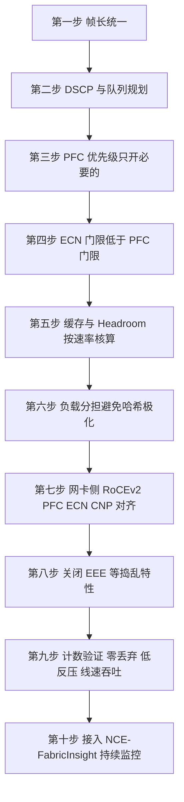

### 真题精练

**Q1.【真题·简答】** 某 AI 集群 RoCE 业务"能通但慢"，`display qos queue statistics` 显示队列 3 有明显丢弃，`display dcb pfc statistics` 显示 XOFF 发送计数很低。请按优先级列出你的调优排查清单（至少 5 条）。

> **答案与解析**：
> **① 入队是否正确（先看"丢的是不是无损队列"）**：`display qos queue statistics interface <if>` 逐队列比对，确认 RoCE 流量是否真的进入了队列 3。常见错误是漏配 `trust dscp`，报文按端口默认优先级（通常 0）入队，队列 3 空转而队列 0 在丢包。
> **② 链路 MTU 是否端到端一致**：服务器网卡与交换机各跳接口的 MTU 必须一致（含 VXLAN 封装开销），否则大包分片或丢弃，表现为"吞吐打不满 + 偶发丢弃"。
> **③ ECN 是否生效、门限是否合理**：`display drop-profile <name>` 确认 `ecn` 已使能、门限低于 PFC 门限。ECN 未生效时，拥塞只能靠 PFC 或直接丢弃，简单粗暴。
> **④ 缓存与 Headroom 是否匹配端口速率**：若队列 Discard 在 XOFF 发出后仍增长，优先怀疑 Headroom 不足或 XOFF 门限过高（吃掉全部缓存）。
> **⑤ 负载分担是否极化**：`display interface brief` 看多条上行链路的利用率是否严重不均；RoCEv2 大象流容易被哈希到同一条链路，需开启动态负载分担。
> **⑥ 服务器/网卡侧是否配合**：`mlnx_qos -i <nic>`、`ethtool -S <nic> | grep -E "pause|ecn"` 确认网卡 PFC/ECN/CNP 已使能、MTU 一致、驱动固件版本合适；网卡侧没开 ECN 时，交换机的 CE 标记没有意义。
> **⑦ 是否存在"捣乱者"**：EEE 节能、混跑的大量 TCP 业务、路径上的 NAT/深度 ACL 处理都会引入额外时延或抖动。
> **收尾**：调优必须以计数器为证据（Discard 归零、XOFF 低频、吞吐达线速 90%+），并把配置模板固化到控制器侧统一发放。

**Q2.【真题·多选】** 关于 RoCE 网络调优，下列说法正确的有：
A. MTU 建议端到端统一放大（如 4096），任一跳不一致都会导致分片或丢包
B. CNP 应使用独立的 DSCP（如 48）并放在非 PFC 队列中转发
C. 只要交换机侧配置正确，服务器网卡是否支持 ECN 不影响无损效果
D. 在无损链路上应关闭 EEE，避免链路节能引入时延抖动

> **答案：ABD**
> **解析**：C 错——ECN 的闭环需要网卡配合：发送端要置 ECT 位并按 CNP 降速，接收端要能生成 CNP。若服务器网卡不支持或不使能 ECN，交换机的 CE 标记不会有任何反应，拥塞只能由 PFC 兜底（PFC 触发频次上升、抖动变大），极端情况下直接丢包。A、B、D 都是调优清单中的关键项。

### 易错点与排错

1. **只调交换机不调网卡**：无损是端到端工程，网卡 PFC/ECN/DSCP/MTU 缺一不可。
2. **MTU 不一致**：尤其是 VXLAN 场景忘了叠加封装开销。
3. **无损优先级开得太多**：既是性能问题也是死锁风险。
4. **在无损链路上保留 EEE**：节能换来的那点功耗远不值得时延抖动。
5. **不做验证**：调完不核对计数器，等于没调；必须做到"Discard 为 0、XOFF 低频、吞吐线速 90%+"。
6. **排错命令链**：`display qos queue statistics` → `display drop-profile` → `display dcb pfc interface`/`statistics` → `display interface brief` → 服务器侧 `mlnx_qos`/`ethtool -S`。

---

## 5.11 无损网络运维命令与常见故障定位

### 考点定位

**排错题的"工具箱"章节**，几乎每届国赛都会出 1~2 道"给现象、找根因、写命令"的排错题，分值 8~15 分。必须掌握：① PFC 反压的**方向判断**（XOFF 发送 vs XOFF 接收）；② 三类丢弃（物理 CRC / 队列 Discard / 网卡丢弃）的区分；③ PFC 风暴、PFC 死锁、ECN 不生效三大典型故障的现象指纹与定位路径。易错点是**只看 PFC 计数就下结论**（必须同时看队列丢弃与水位）以及**把 XOFF 的收发方向搞反**。

### 原理精讲

**排错的第一原则：先分层，再看方向。** 无损网络的丢包可能发生在四个层面，现象相似但处置完全不同：

| 层面 | 典型计数 | 特征 | 处置方向 |
|---|---|---|---|
| 物理/链路层 | `display interface` 的 CRC、Align、Symbol 错误 | 计数单调增长但流量不大也会涨 | 换光模块/光纤/检查端口 |
| 队列/缓存层 | `display qos queue statistics` 的 Discard、Discarded | 与拥塞/微突发相关 | 调 ECN/PFC 门限与 Headroom |
| 反压层 | `display dcb pfc statistics` 的 XOFF/XON | 只反映"是否反压过"，不直接等于丢包 | 定位反压源头与扩散范围 |
| 网卡/主机层 | `ethtool -S` 的 rx_discards、out_of_buffer、pause | 交换机不丢但业务仍慢 | 调网卡队列/中断/应用 |

**PFC 计数怎么读（考频最高）**：
- **本端口 XOFF 发送计数增长**：说明**下行方向拥塞**，本设备正在"反压下游链路的上游"（即本设备自己出方向队列积压）；排查看**本设备出方向的拥塞队列**。
- **本端口 XOFF 接收计数增长**：说明**本设备被上游反压**，即本设备的对端（上游设备）出方向拥塞；排查看**上游设备的出队列**。
- **XON 计数与 XOFF 计数大致成对出现**：说明反压是"正常的开关式反压"；若 XOFF 出现但几乎没有 XON，说明长期处于反压状态（危险信号，接近或已进入死锁/风暴）。
- **PFC 反压存在 ≠ 丢包**：PFC 的目的就是"不丢包"，因此看到 XOFF 不必惊慌；真正的危险是"**XOFF 在涨 + 队列 Discard 也在涨 + 水位不降**"三者同时出现。

**故障一：PFC 风暴（反压扩散）。** 现象：多台设备的 `display dcb pfc statistics` 同时出现 XOFF 计数暴涨，业务吞吐呈锯齿状抖动，严重时管理面出现反压相关告警。根因通常有三类：① **慢速接收者**——某台服务器/存储网卡处理能力不足（驱动问题、CPU 打满、PCIe 瓶颈），其接入交换机的入队列持续积压，反压沿多级链路向上扩散；② **incast**——多台服务器同时向同一目标发送（如 AllReduce 的汇总阶段、存储重建），瞬时汇聚比远超线速；③ **ECMP 哈希极化**——本应分散到多条上行链路的流量被哈希到同一条，造成"链路有空闲但单链路拥塞"。定位方法：**沿 XOFF 方向逐跳回溯**，找到"XOFF 接收计数高但 XOFF 发送计数低"的那台设备——它就是反压的源头（最靠近慢速接收者的一端），然后检查其下挂服务器网卡的接收计数与主机侧指标。处置：先给问题流限速或隔离（把该业务迁出无损队列），再修根因（升级驱动、增加网卡队列、修哈希策略）。

**故障二：PFC 死锁。** 现象指纹：**某优先级通过计数归零、XOFF 持续增长、水位长期不降、其他优先级完全正常**。定位方法见 5.8 的场景分析（CNP 是否误入无损队列、是否存在同优先级依赖环）。处置：先触发死锁检测自愈（临时关闭该优先级 PFC）恢复业务，再整改配置与拓扑。判据口径要背下来，考试常直接给这几个计数器让你判断。

**故障三：ECN 不生效导致吞吐下降。** 现象：训练吞吐低、`display dcb pfc statistics` 显示 XOFF 频繁（说明拥塞完全靠 PFC 兜底），或者队列 Discard 明显，而服务器侧 CNP 计数始终为 0。定位路径：① 服务器侧确认网卡是否使能 ECN 与 CNP（`mlnx_qos -i <nic>`、`/sys/class/net/<dev>/ecn/roce_np/enable/<prio>`、`ethtool -S | grep -E "ecn|cnp"`）；② 交换机侧确认 `drop-profile` 是否真的使能了 `ecn`、是否绑定到正确的队列（`display drop-profile`、`display qos queue-profile`、`display current-configuration interface`）；③ 确认流量是否真的进入该队列（`display qos queue statistics` 看计数分布与 `trust dscp` 配置）；④ 确认门限是否过高（高于 PFC 门限则 ECN 永远不动）；⑤ 确认门限是否只配在上行口而漏配下行口。ECN 一旦生效，正确现象是 **XOFF 频次明显下降、Discard 归零、吞吐稳定在线速 90% 以上**。

**故障四：丢包定位的五步法**（通用答题框架）：
1. **定层**：先看 `display interface` 计数排除物理层，再看 `display qos queue statistics` 判断是否队列丢弃；
2. **定队列**：找出丢弃集中的队列号，反推业务与优先级（对照 DSCP 规划表）；
3. **定设备与端口**：沿转发路径逐跳执行同样的命令，找到"上一跳无丢弃、本跳有丢弃"的那个设备与端口；
4. **定方向与原因**：区分入方向还是出方向（`counters inbound/outbound`），出方向丢弃基本等于拥塞，入方向丢弃多为超速/限速/物理问题；
5. **定时间特征**：周期性（定时任务/备份流量）还是突发性（训练迭代/存储重建），必要时结合 iMaster NCE-FabricInsight 的秒级 Telemetry 与 iPCA 精确定位（见第 6 章）。

**时延抖动类问题**：若没有丢包但业务时延抖动大，依次检查：① 队列排队时延（`display qos queue statistics` 的缓存占用是否长期偏高，说明 ECN 门限过高或业务突发过大）；② 是否开启 EEE 节能；③ 是否发生"PFC 反复暂停—恢复"（XOFF/XON 成对高频出现，说明门限设置过窄，会导致抖动）；④ 是否路径频繁切换（ECMP/LAG 成员变化）。

### 关键概念对照表

| 现象 | 首要怀疑 | 关键命令 | 判据 |
|---|---|---|---|
| 无丢包但训练慢 | 网卡/应用侧瓶颈或时延抖动 | `ethtool -S`、`display qos queue statistics` | 交换机无丢弃 → 查主机 |
| 有丢弃且 PFC 计数为 0 | PFC 未生效或流量不在无损队列 | `display dcb pfc interface`、`display qos queue statistics` | 队列号与规划不符 |
| XOFF 高且 Discard 为 0 | 正常反压（工作正常） | `display qos queue statistics` | 无丢弃即达标 |
| XOFF 高且 Discard 增长 | Headroom 不足或 XOFF 门限过高 | `display dcb pfc interface`、缓存配置 | 门限 + Headroom > 可用缓存 |
| 某优先级吞吐归零 | PFC 死锁 | `display dcb pfc statistics`、日志告警 | 其他优先级正常 |
| 多设备 XOFF 同时暴涨 | PFC 风暴/反压扩散 | 逐跳 `display dcb pfc statistics` | 找到反压源头 |
| CNP 计数为 0 | ECN 未生效 | `display drop-profile`、网卡侧 | 交换机打标/网卡使能任一缺失 |
| 时延抖动大 | 排队时延/EEE/PFC 反复切换 | `display qos queue statistics`、接口特性 | 缓存占用高或 EEE 开启 |

### 华为设备配置

```bash
# ===== 无损网络日常巡检命令集（可直接作为国赛实验的验证环节）=====
display interface 100GE1/0/1                               // 查看接口速率、双工、MTU、up/down 状态
display interface 100GE1/0/1 counters                      // 查看收发总计数（含 pause 帧）
display interface 100GE1/0/1 counters inbound              // 入方向计数（CRC/Align 错包在这里看）
display qos queue statistics interface 100GE1/0/1          // 各队列通过/丢弃/缓存统计（无损是否达标的直接证据）
display qos queue statistics interface 100GE1/0/1 queue 3  // 聚焦无损队列 3
display dcb pfc                                            // 全局 PFC 优先级配置
display dcb pfc interface 100GE1/0/1                       // 接口 PFC 使能状态、模式、反压门限
display dcb pfc statistics interface 100GE1/0/1            // XOFF/XON 收发计数（判断反压方向）
display drop-profile ecn_dp                                // ECN/WRED 门限与标记开关
display logbuffer | include PFC                            // PFC 相关事件日志
display alarm active                                       // 活动告警（含 PFC 自动关闭类告警）
display current-configuration interface 100GE1/0/1         // 复核接口下的 QoS/PFC/MTU 配置是否齐全
```

```bash
# ===== 快速定位"丢包发生在哪一跳"的对比法（在路径上逐台执行）=====
# 1) 在源侧 Leaf 上行口执行：
display qos queue statistics interface 100GE1/0/2          // 记录队列 3 的 Discard 计数与时间
# 2) 在 Spine 下行口执行：
display qos queue statistics interface 100GE1/0/1          // 若此处无 Discard，说明丢包不在本跳
# 3) 在目的侧 Leaf 下行口执行：
display qos queue statistics interface 100GE1/0/3          // 找到"上一跳干净、本跳有丢弃"的落点
# 4) 交叉验证反压方向：
display dcb pfc statistics interface 100GE1/0/3            // XOFF 接收计数高说明被上游反压
```

> 国赛实验题常要求"用命令证明无损配置生效"：标准答案至少包含三条证据 —— ① `display dcb pfc interface` 显示 PFC 使能且优先级与规划一致；② `display drop-profile` 显示 ECN 已使能且门限关系正确；③ 施压后 `display qos queue statistics` 中无损队列的 **Discard 不增长**，同时 `display dcb pfc statistics` 中能看到 XOFF/XON 计数（证明反压确实工作了）。

### 示意图

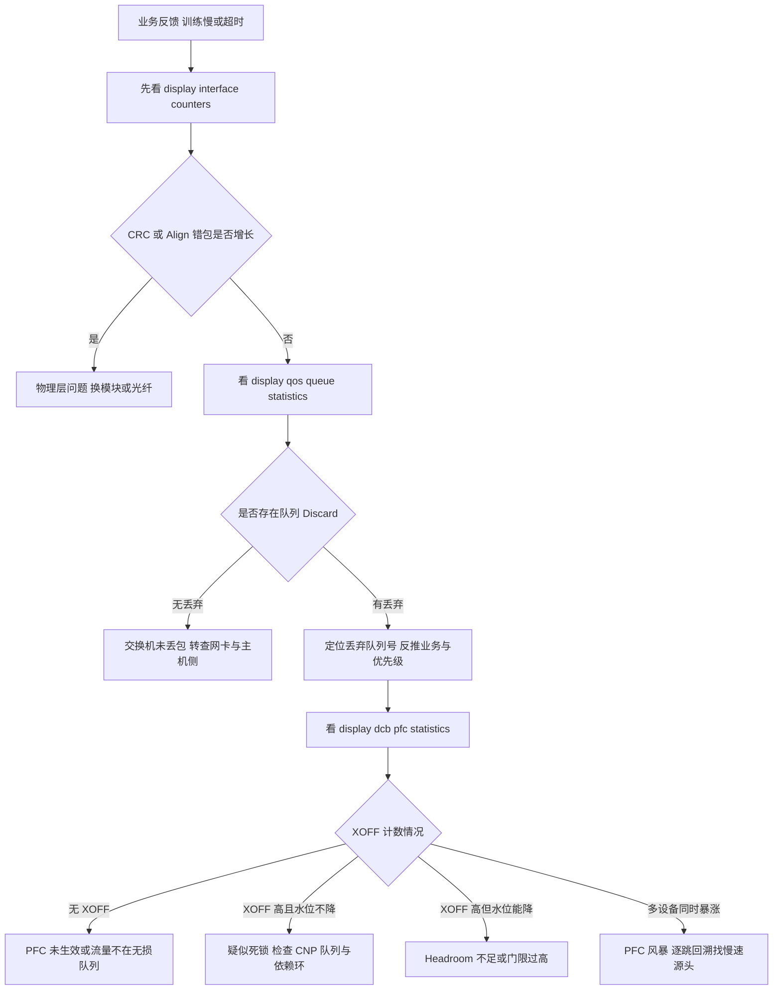

### 真题精练

**Q1.【真题·排错】** 某 Leaf 设备的 `display dcb pfc statistics interface 100GE1/0/2` 显示 XOFF 接收计数持续快速增长，而 `display dcb pfc statistics interface 100GE1/0/1`（上联 Spine）XOFF 发送计数增长缓慢。请说明这说明什么，以及下一步该怎么查。

> **答案与解析**：
> **① 计数含义**：100GE1/0/2 的 **XOFF 接收**计数高，说明**该接口方向被对端反压**，即 100GE1/0/2 直连的对端设备在其出方向（朝本设备的方向）拥塞；100GE1/0/1 的 **XOFF 发送**计数低，说明本设备朝上联方向的出队列并不拥塞，即本设备的压力不是由内部转发引起的。
> **② 初步结论**：反压来自**本设备下挂/对端方向**，本设备更像是"被动承压者"。需要判断对端是同层的 Leaf/服务器还是下游设备。
> **③ 下一步排查**：a) 确认 100GE1/0/2 的对端是什么（`display lldp neighbor interface 100GE1/0/2`）；b) 若对端是服务器网卡，检查该服务器是否使能 PFC 且速率/队列配置正常，并用 `ethtool -S` 看接收丢弃（`out_of_buffer`、`rx_discards`）；c) 若对端是交换机，登录对端执行 `display qos queue statistics interface <出方向接口>` 找出拥塞队列，并继续沿 XOFF 发送方向回溯，直到找到"XOFF 接收高、XOFF 发送低"的源头设备；d) 检查是否存在 incast（多打一）或哈希极化（`display interface brief` 看各上行利用率是否不均）；e) 检查本设备被反压的队列是否正是无损队列 3，以及该队列是否混入了非 RoCE 业务。
> **④ 处置建议**：找到源头后，优先隔离或限速问题流（把非关键业务迁出无损队列），再按"ECN 低 < ECN 高 < PFC 门限 < 可用缓存 − Headroom"复核门限，必要时调高 ECN 灵敏度让端侧更早降速，减少 PFC 触发。

**Q2.【真题·排错】** 某集群已按规范配置 PFC 3 与 ECN，但服务器侧 `ethtool -S` 显示 CNP 接收计数始终为 0，训练吞吐只有线速的 40%。请给出定位思路。

> **答案与解析**：
> **① CNP 为 0 说明 ECN 闭环没有建立**，需要沿"交换机打标 → 接收端生成 CNP → 发送端收到 CNP"三段式排查。
> **② 交换机侧是否真的打标**：`display drop-profile <name>` 确认 `ecn` 已使能、门限值合理；`display current-configuration interface` 确认该 `drop-profile` 已通过 `qos queue-profile` 绑定到队列 3 且接口已应用；`display qos queue statistics interface <if> queue 3` 确认 RoCE 流量确实进入队列 3（若计数在队列 0，说明 `trust dscp` 缺失或 DSCP 被改写）。
> **③ 门限是否合理**：若 ECN 门限高于 PFC 门限，则拥塞时先触发 PFC 反压（流量被暂停），队列水位可能在"被暂停"的状态下根本升不到 ECN 门限——于是永远不打标、永远没有 CNP。这是"配了 ECN 却没 CNP"最常见的原因。此外还要确认门限是否只配在部分端口（所有可能拥塞的 Leaf 上行、Spine 下行都要配）。
> **④ 接收端是否具备生成 CNP 的能力**：`mlnx_qos -i <nic>` 与 `/sys/class/net/<dev>/ecn/roce_np/enable/3` 确认接收侧 ECN 通知已使能；`cnp_dscp` 与 `cnp_802p_prio` 要与交换机的队列 6 规划一致，否则 CNP 可能被丢进拥塞队列而"发不出/排不上队"。
> **⑤ 发送端是否能收到 CNP**：检查回程路径的 ACL/QoS 是否误丢 DSCP 48 的报文，以及 CNP 是否被 PFC 反压（人为死锁的雏形）。服务器侧可用 `ethtool -S` 的 CNP 计数与 `tcpdump` 抓包验证。
> **⑥ 收尾**：ECN 生效后的正确现象是 XOFF 频次下降、Discard 归零、吞吐上升到线速 90% 以上；若吞吐仍上不去，再排查哈希极化、网卡与主机侧瓶颈。

**Q3.【真题·判断】** 在无损网络巡检中，只要 `display dcb pfc statistics` 显示 XOFF 计数在增长，就可以判定网络存在故障。

> **答案：错误**
> **解析**：PFC 的作用正是"拥塞时反压而不丢包"，因此 XOFF 计数增长本身可能是**正常工作**的表现。真正的故障判据是"**XOFF 增长的同时队列 Discard 也在增长**"或"**某优先级吞吐归零且水位不降（死锁）**"或"**多设备 XOFF 同时暴涨且业务抖动（风暴）**"。巡检时应结合 `display qos queue statistics` 的丢弃计数与缓存水位一起判断，不能只看反压计数。

### 易错点与排错

1. **XOFF 收发方向搞反**：发送=本设备反压别人（本设备出方向拥塞）；接收=被别人反压（对端出方向拥塞）。
2. **只看 PFC 计数不看丢弃**：反压存在不等于丢包，也不等于正常，必须联动队列丢弃与水位。
3. **把物理层错包当成拥塞问题**：CRC/Align 增长与拥塞无关，先换硬件。
4. **忘记 DNS（Data Network Simulator）/ DNS 类无关因素**：实验环境中常见因服务器侧未使能 PFC/ECN 导致"配了没用"，务必双向验证。
5. **不做逐跳对比**：定位丢包点最有效的方法是"沿路径逐跳看同一队列的 Discard"，找到"上一跳无、本跳有"的落点。
6. **排错命令链**：`display interface counters` → `display qos queue statistics` → `display dcb pfc interface`/`statistics` → `display drop-profile` → `display logbuffer | include PFC`。

---

## 5.12 章节综合真题（无损网络与 RoCE）

### 真题精练

**Q1.【真题·单选】** RoCEv2 相较 RoCEv1 最本质的优势是：
A. 时延更低  B. 支持跨三层转发与 ECMP  C. 不需要 PFC  D. 不需要网卡支持

> **答案：B**
> **解析**：RoCEv1 直接封装在以太网（Ethertype 0x8915），只能在同一二层域内转发；RoCEv2 封装到 UDP 4791/IP 之上，因此可跨三层、可做 ECMP、可进 VXLAN。A 错——时延主要由网卡与芯片决定，两者差异不大；C 错——两者都需要 PFC 保证无损；D 错——两者都必须由支持 RDMA 的网卡实现。

**Q2.【真题·多选】** 无损网络的三大机制及其分工，下列说法正确的有：
A. PFC 是逐跳链路级反压，用于在缓存将满时暂停上游发送
B. ECN 由交换机打 CE 标记、接收端网卡回 CNP、发送端按 DCQCN 降速
C. DCQCN 运行在交换机上，负责计算每条流的目标速率
D. Headroom 用于吸收 PFC 反压生效期间仍在链路上传输的报文

> **答案：ABD**
> **解析**：C 错——DCQCN 运行在**网卡**上（RP/NP），交换机只提供 ECN 标记与缓存/门限行为，不参与逐流速率计算。A、B、D 分别对应 PFC、ECN+CNP、Headroom 的正确职责划分；这也是国赛简答题"三者协同"的标准骨架。

**Q3.【真题·判断】** ECN 使能后，交换机在队列水位超过高门限时会丢弃所有报文，以保证其他队列的转发。

> **答案：错误**
> **解析**：开启 ECN 后，`drop-profile` 的作用是"**标记代替丢弃**"：对支持 ECN（ECT）的报文，水位在低—高门限之间按概率打 **CE** 标记，超过高门限则**全部打 CE 标记**（而不是丢弃）；对不支持 ECN（Not-ECT）的报文才按 WRED 概率丢弃。ECN 的价值正是"不丢包也能传递拥塞信号"。

**Q4.【真题·填空】** RoCEv2 报文的 UDP 目的端口是 ______；CNP 报文通过 BTH 的 Opcode ______ 标识；PFC 报文的 MAC Control Opcode 是 ______。

> **答案：4791；0x81；0x0101**
> **解析**：这三个数值是无损网络章节最常考的"三个数字"，必须背到条件反射：RoCEv2 用 UDP 4791（区别于 VXLAN 的 4789）；CNP 用 Opcode 0x81；PFC 帧 Ethertype 0x8808 且 MAC Control Opcode 0x0101（802.3x PAUSE 是 0x0001）。

**Q5.【真题·简答】** 请完整描述一次"微突发 → 无损处理 → 恢复"的全过程，要求体现 PFC、ECN、DCQCN 三者的配合时机与门限关系。

> **答案与解析**：
> **① 常态**：发送端网卡以当前速率 `Rc` 发送 RoCEv2 数据，报文 ECN 位置为 ECT(0)、DSCP 24，交换机按 `trust dscp` 将其送入队列 3；端侧按 DCQCN 加性（`Rc += RAI`）或超加性（`Rc = (Rc+RT)/2`）缓慢升速试探带宽。
> **② ECN 先动（第一道防线）**：当多台服务器同时向同一出端口发送（incast）导致队列 3 水位超过 **ECN 低门限**时，交换机按 WRED 概率把 ECT 报文标记为 **CE**；接收端网卡（NP）收到 CE 后生成 **CNP**（DSCP 48、802.1p 6、UDP 4791、Opcode 0x81，且受最小间隔限制）回送发送端；发送端（RP）收到 CNP 后更新 α（`α ← (1−g)α + g`）并执行**乘性降速** `Rc ← Rc(1 − α/2)`，同时冻结目标速率 RT。若水位继续上涨并超过 **ECN 高门限**，则报文被全部打 CE，α 迅速逼近 1，降速更猛。
> **③ PFC 兜底（第二道防线）**：若端侧降速来不及（RTT 长、incast 极端或网卡未使能 ECN），队列水位会进一步上涨到 **PFC XOFF 门限**，交换机对该优先级发送 **XOFF**，直连上游暂停优先级 3 的发送；此时 **Headroom** 负责吸收"XOFF 发出到上游停发"这段窗口内仍在链路上飞行的报文，保证不丢包（这正是 `XOFF 门限 + Headroom + Guard Band ≤ 可用缓存` 的原因）。
> **④ 恢复**：水位下降到 **XON 门限**后，交换机发 **XON**（Time = 0）恢复上游发送；由于 CNP 停止、α 周期性衰减，发送端通过 **快速恢复（HAI）** 把速率尽快拉回降速前的水平 F 附近，再转入**加性升速**缓慢逼近可用带宽，避免再次冲高。
> **⑤ 门限阶梯与后手**：全过程要求 `ECN 低门限 < ECN 高门限 < PFC XOFF 门限 < 可用缓存 − Headroom`；CNP 必须走独立的非 PFC 高优先级队列；并开启 PFC 死锁检测作为最后一道防线（检测到某优先级长期"已反压但水位不降"时临时关闭该优先级 PFC 并告警）。

**Q6.【真题·排错】** 某集群业务大面积卡顿，`display dcb pfc statistics` 在多台设备上同时出现 XOFF 计数暴涨，`display interface brief` 显示各 Leaf 上行链路利用率严重不均（其中一条 95%，其余 25% 左右）。请分析原因并给出解决方案。

> **答案与解析**：
> **① 原因判断**：多设备 XOFF 同时暴涨 + 上行链路利用率严重不均，典型是 **RoCEv2 大象流的 ECMP 哈希极化**造成"局部链路拥塞 → 反压扩散（PFC 风暴）"。
> **② 机理**：RoCEv2 是 UDP/IP 流，同一 QP 的大量报文五元组高度一致（尤其是源/目的端口固定），静态哈希会把它们全部压到同一条上行链路；该链路出队列积压后触发 PFC 反压，反压沿多级链路扩散，导致"整体带宽空闲但业务抖动"。
> **③ 定位验证**：`display interface brief` 观察多条等价上行口的利用率差异；在利用率最高的口上 `display qos queue statistics interface <if>` 看队列 3 是否堆积、`display dcb pfc statistics interface <if>` 看 XOFF 发送计数；用 `display dcb pfc statistics` 逐跳回溯确认反压的源头与扩散范围。
> **④ 解决方案**：a) 开启**动态负载分担/逐包负载分担**，或调整哈希因子把更多字段（如 UDP 源端口）纳入哈希熵，使大流能分散到多条链路；b) 在服务器侧让网卡为不同 QP 分配不同的 UDP 源端口（多数网卡默认已做），并确认交换机哈希算法包含源端口；c) 适度提高 ECN 灵敏度（降低门限或调大标记概率），让端侧更早降速，减少 PFC 触发；d) 对超大流做应用层并行（如把 AllReduce 的多条流拆到不同 QP）；e) 长期由 NCE-Fabric 侧统一下发负载分担与 QoS 模板，避免逐台不一致。
> **⑤ 反面做法**：单纯加大缓存或放宽 PFC 门限只会把拥塞"藏起来"，反而提高死锁与抖动风险。

**Q7.【真题·实验】** 在 CE6865 与两台服务器（RoCEv2 网卡）之间搭建无损网络实验环境，要求：(1) 队列 3 为无损队列；(2) RoCE 数据流 DSCP 24 进队列 3、CNP DSCP 48 进队列 6；(3) ECN 门限低于 PFC 门限；(4) 给出验证无损生效的命令与判据。

> **答案与解析**：
> **交换机侧配置**：
> ```bash
> system-view
> dcb pfc
>  priority 3                                       // 队列 3 为无损队列
> quit
> drop-profile ecn_dp
>  wred dscp
>   dscp 24 low-limit 150 high-limit 600 discard-percentage 100  // ECN 门限（低于 PFC 门限）
>  quit
>  ecn
> quit
> qos queue-profile qp_roce
>  queue 3 drop-profile ecn_dp                      // 队列 3 绑定 ECN 模板
> quit
> interface 100GE1/0/1
>  mtu 4096                                        // 与服务器网卡一致
>  trust dscp                                      // DSCP 24 入队列 3、DSCP 48 入队列 6（默认映射）
>  qos queue-profile qp_roce
>  dcb pfc enable mode manual
>  qos buffer queue 3 shared-threshold dynamic
>  qos buffer queue 3 pfc-threshold 300 pfc-threshold-offset 200 // PFC 门限高于 ECN 高门限
>  qos buffer queue 3 headroom 1000                // Headroom 按速率×Δ×裕量核算
> ```
> **服务器侧配置**：`ip link set ens1f0 mtu 4096`、`cma_roce_mode -m 2`（RoCEv2）、`mlnx_qos -i ens1f0 --pfc 0,0,0,1,0,0,0,0`、`echo 1 > /sys/class/net/ens1f0/ecn/roce_np/enable/3`、`echo 48 > .../cnp_dscp`、`echo 6 > .../cnp_802p_prio`。
> **验证命令与判据**：
> ① `display dcb pfc interface 100GE1/0/1` → PFC 已使能、优先级 3；
> ② `display drop-profile ecn_dp` → `ecn` 已使能且门限低于 PFC 门限；
> ③ 施加超过出端口线速的 RoCE 流量后，`display qos queue statistics interface 100GE1/0/1 queue 3` → **Discard 不增长**（无损达标的直接证据）；
> ④ `display dcb pfc statistics interface 100GE1/0/1` → 出现 XOFF 发送计数与（对端）XOFF 接收计数，说明反压链路工作；
> ⑤ 服务器侧 `ethtool -S ens1f0 | grep -E "ecn|cnp|pause"` → CNP 计数增长，说明 ECN 闭环建立；
> ⑥ `ibv_rc_pingpong` 或实际训练任务 → 吞吐达到线速 90% 以上、时延抖动在微秒量级。

**Q8.【真题·简答】** 某工程师为"保证不丢包"，把交换机所有 8 个优先级都配置成 PFC 无损队列，并对所有业务统一放行。请评价该方案并给出改进建议。

> **答案与解析**：
> **① 评价：这是典型的错误设计。** a) **死锁概率剧增**：无损优先级越多，多个优先级之间形成依赖环的组合越多，一旦出现环，受影响范围更大；b) **反压扩散严重**：普通 TCP 业务的突发也会触发 PFC，把无关业务一起冻结，形成大面积队头阻塞；c) **PFC 失去意义**：PFC 的价值是"精准保护少数关键业务"，全开等于退化为"整链路 PAUSE（802.3x）"，还额外承担了死锁与风暴风险；d) **缓存被切碎**：8 个队列都要保证缓存与 Headroom，单个队列可用空间变小，反而更容易触发丢包。
> **② 改进建议**：a) **按业务分级**：只为真正需要无损的业务（AI 训练 RoCE 数据流、NVMe-oF 存储流）开启 1~2 个无损优先级，其余走可丢队列；b) **CNP 与协议报文走非 PFC 高优先级队列**（DSCP 48/802.1p 6）；c) **以 ECN 为主、PFC 为辅**，把 ECN 门限设在 PFC 门限之下，尽量减少 PFC 触发；d) **缓存精细化**：无损队列配足 Headroom 与动态共享门限，可丢队列用尾丢弃 + 适度门限；e) **开启 PFC 死锁检测与告警**，让网络具备自愈能力；f) **配置模板化**：由 iMaster NCE-Fabric 统一下发并做配置漂移检测，避免逐台手工配置引入不一致。

**Q9.【真题·排错】** 某 400GE 无损端口出现"PFC 反压计数正常增长，但队列 3 的 Discard 也在持续增长"的现象。请给出最可能的原因与验证方法。

> **答案与解析**：
> **① 现象含义**：反压机制在"工作"（XOFF 在发），但缓存仍被打穿而丢包，说明**反压生效的速度赶不上报文到达的速度**，典型根因有两类：**Headroom 不足**（或 XOFF 门限过高、吃掉了本该留给 Headroom 的空间），以及**反压未能真正让上游停发**（对端未使能 PFC、PFC 帧丢失、上游处理异常）。
> **② 最可能原因（按概率排序）**：a) **Headroom 按 100GE 时期的数值配置**——400GE 的 Headroom 需求约为 100GE 的 4 倍（按 `速率/8 × Δ × 裕量` 计算，Δ=8 µs 时约需 390 KB），Headroom 不足则 XOFF 生效前的在途报文直接把缓存打穿；b) **XOFF 门限 + Headroom > 端口可用缓存**，导致反压触发时已无空间；c) 上游设备或服务器网卡**未使能 PFC 3**（或使用 `dcb pfc enable mode auto` 协商失败），收到 XOFF 不响应；d) 存在**哈希极化或 incast**，瞬时到达速率远超反压能抑制的程度。
> **③ 验证方法**：`display qos buffer queue interface 100GE1/0/1`（或用 `qos buffer queue ?` 查当前 Headroom 与门限配置）核对 `XOFF 门限 + Headroom + Guard Band ≤ 可用缓存`；`display dcb pfc interface` 核对门限；在对端执行 `display dcb pfc interface` 与其网卡侧 `mlnx_qos`/`ethtool -S` 确认 PFC 已生效并能响应；`display interface brief` 检查上行链路利用率是否不均；必要时按 400GE 重新核算 Headroom 并下调 XOFF 门限后复测。
> **④ 结论**：**缓存规划必须随端口速率同步放大**，并且"有反压"不等于"不丢包"——Headroom 与门限预算才是无损的最后一公里。

### 易错点与排错

1. **算 Headroom 忘乘裕量、忘随速率放大**：400GE 是最容易暴露该问题的场景。
2. **把"PFC 在反压"当作"网络没问题"**：必须同时验证 Discard 与水位。
3. **答不出三个数字（4791 / 0x81 / 0x0101）**：这是送分点，务必背熟。
4. **混淆 ECMP 哈希极化与 PFC 配置错误**：前者表现为"总体空闲、单链路拥塞"，后者表现为"配置与规划不一致"。
5. **忘记 CNP 独立优先级**：既是性能问题也是死锁隐患。
6. **综合题答题模板**：现象分层（物理/队列/反压/主机）→ 计数判据 → 定位落点 → 根因 → 整改（配置 + 架构 + 监控）。

---

# DCN-HCIE-章节6-iMaster-NCE-Fabric与数据中心智能运维

> 本章主线三句话：**控制器管"配置自动化"，设备管"转发与协议"（6.1~6.5）→ 运维靠 Telemetry 秒级采集，定位靠 iPCA 包守恒（6.6/6.7）→ 最终形态是数字地图、意图闭环与 AIOps（6.8~6.11）**。

## 6.1 iMaster NCE 产品族概述

### 考点定位

**概念辨析题与"选型题"的来源**，分值 3~6 分。高频考法：① 给一个场景（园区/数据中心/广域）问应该用哪个 NCE 产品；② 问 NCE-Fabric 与 NCE-FabricInsight 的分工（配置管理 vs 智能运维）；③ 判断"NCE-Fabric 是否参与数据面转发"（不参与）。易错点是**把 NCE-Campus 当成数据中心控制器**、**把 FabricInsight 当成独立网管而忽略它与 NCE-Fabric 的协同关系**。

### 原理精讲

**iMaster NCE（Network Cloud Engine，网络云引擎）是华为自动驾驶网络（ADN，Autonomous Driving Network）方案的管理与控制系统族**。它按"管理域"切分产品，而不是按技术切分——同一个技术（如 VXLAN）在园区和数据中心都会用，但管理对象、业务模型、对接的系统完全不同，所以华为做了产品族分工。

**① iMaster NCE-Fabric：数据中心网络控制器。** 定位是"**DC Fabric 的自动化编排与配置管理中心**"。核心能力包括：设备自动发现与纳管（ZTP）、Underlay 自动化（拓扑/链路/IP/路由协议一键下发）、Overlay 自动化（VXLAN + BGP EVPN 的 VNI/BD/VBDIF/EVPN 实例自动编排）、租户与 VPC 管理、Fabric 内多 POD 管理、以及与云平台（OpenStack、FusionSphere、VMware、Kubernetes）对接实现"网络即代码"。它**不参与数据面转发**，转发由设备自身的分布式协议完成（这一点在 6.2 详细展开）。

**② iMaster NCE-Campus：园区网络控制器。** 面向园区场景（有线 + 无线一体），管理 CloudEngine S 系列园区交换机、AirEngine 系列 AP、AC6805 等无线控制器，负责园区网络自动化部署、用户准入与认证（802.1X、Portal、MAC 认证）、策略随行（基于用户/终端的策略分发）、园区 VXLAN、以及园区智能运维（通常由 NCE-CampusInsight 承担）。**注意边界**：园区的 Fabric 与数据中心的 Fabric 虽然都叫"Fabric"，但业务模型与产品完全不同，考试中不要混用。

**③ iMaster NCE-IP：广域/骨干 IP 网络控制器。** 面向运营商骨干网与大型企业广域网，核心能力是 SRv6/SR-MPLS 路径编排、网络切片、流量调优（基于 Telemetry 的实时带宽工程）、L3VPN 自动化、以及骨干网智能运维。它与 DC 场景的差异在于"跨域、长时延、面向流量工程"，而不是"面向多租户虚拟化"。

**④ iMaster NCE-FabricInsight：数据中心网络智能运维分析平台。** 定位是"**DC 网络的深度可观测性与根因分析**"。它通过 **Telemetry 秒级采集**设备与流的数据、通过 **iPCA（In-band Performance Measurement，随流检测）** 做网络级丢包/时延定位、通过**流分析（NetStream/NetFlow/sFlow）** 与应用识别做"应用—网络"关联分析，并输出**网络数字地图**与健康度评分、配置漂移检测、故障根因定位（RCA）。它与 NCE-Fabric 的关系是"**配置面 + 分析面**"的协同：NCE-Fabric 把网络建起来并保持配置正确，FabricInsight 把网络看清楚并定位问题；两者通常在同一套 DC 自动驾驶网络方案中配套部署，也可以让 FabricInsight 纳管已有网络（此时 NCE-Fabric 可以不存在）。

**为什么要把"配置自动化"与"分析运维"分成两个产品？** 因为二者的核心难题不同：配置自动化的难点是"**多厂商/多版本设备的配置模型统一、事务化下发、失败回滚与幂等**"；分析运维的难点是"**海量数据的秒级采集、存储与实时分析、以及从海量指标中定位根因**"。这两套技术栈（NETCONF/YANG vs Telemetry/时序数据库/流分析）差异很大，拆开成产品更利于各自演进和独立部署。

### 关键概念对照表

| 产品 | 管理域 | 主要管理对象 | 核心能力 | 关键南向/对接协议 |
|---|---|---|---|---|
| NCE-Fabric | 数据中心 | CE 系列 DC 交换机、Fabric 内设备 | Underlay/Overlay 自动化、VXLAN 编排、VPC/租户、云平台对接 | NETCONF、SNMP、Telemetry、BGP EVPN |
| NCE-Campus | 园区 | 园区交换机、AP、AC6805、认证服务器 | 园区自动化、准入认证、策略随行、园区 VXLAN | NETCONF、CAPWAP（AP 方向）、RADIUS |
| NCE-IP | 广域/骨干 | NE 系列路由器、骨干设备 | SRv6 路径编排、切片、流量调优、L3VPN | NETCONF、BGP-LS、PCEP、Telemetry |
| NCE-FabricInsight | 数据中心（分析面） | 已有 DC 网络（可独立纳管） | Telemetry 秒级采集、iPCA 丢包定位、流分析、数字地图、RCA | gRPC Telemetry、NetStream/NetFlow/sFlow、SNMP |

| 易混概念 | 正确理解 | 常见错误 |
|---|---|---|
| NCE-Fabric 是否转发数据 | 不转发，只做配置下发与编排 | 误认为它是"集中式控制器转发" |
| FabricInsight 是否必须配 NCE-Fabric | 不必，可独立纳管现网 | 误认为两者必须成套采购 |
| 园区 Fabric 与 DC Fabric | 产品、模型完全不同的两套体系 | 用 NCE-Campus 管 DC 交换机 |
| 控制面协议 | DC Fabric 用 BGP EVPN（分布式） | 误答"用 OpenFlow 集中下发流表" |

### 华为设备配置

```bash
# NCE-Fabric 纳管前，设备侧需要开放被纳管通道（以 CloudEngine 为例）
system-view
snetconf server enable                                     // 使能 NETCONF 服务，控制器通过它下发 YANG 配置
ssh server enable                                          // 使能 SSH（NETCONF 承载在 SSH 之上）
snmp-agent                                                // 使能 SNMP（用于性能采集、告警上报与部分场景的发现）
snmp-agent sys-info version v3                             // 使用 SNMPv3（安全，推荐）
snmp-agent community read cipher <complex-password>        // 配置读团体名（v2c 场景），建议用可读密文
snmp-agent target-host trap address udp-domain <nce-ip> params securityname <user> v3  // 配置告警上报到 NCE
netconf                                                 // （部分版本）在系统视图使能 NETCONF 相关能力
display snmp-agent sys-info                                // 验证 SNMP 配置
display snetconf server session                            // 查看 NETCONF 会话（确认控制器已连上）
display current-configuration | include netconf            // 复核 NETCONF 相关配置
```

> 设备侧只需开放"管理通道 + 上报通道"，**业务配置由控制器统一生成与下发**。因此实际工程中会遵循"设备侧最小配置"原则：手工只配管理 IP、SNMP/NETCONF 使能、NTP（时间同步是 Telemetry 与 iPCA 的前提），其余全部由 NCE 下发——这也让"配置漂移检测"有了基准。

### 示意图

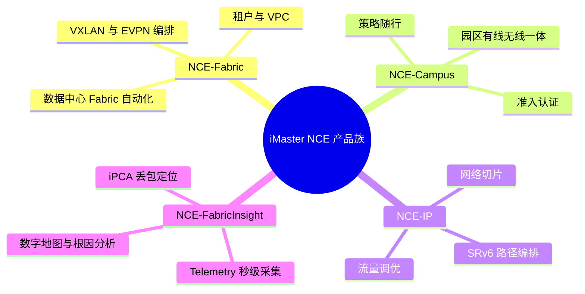

### 真题精练

**Q1.【真题·单选】** 某企业要为自己的数据中心部署"Underlay/Overlay 自动部署 + VXLAN 多租户编排"，并希望网络能与 OpenStack 云平台对接实现"虚机上线网络即就绪"。应选择的产品是：
A. iMaster NCE-Campus  B. iMaster NCE-Fabric  C. iMaster NCE-IP  D. iMaster NCE-FabricInsight

> **答案：B**
> **解析**：NCE-Fabric 是数据中心 Fabric 的自动化编排与配置管理中心，负责 Underlay/Overlay 自动部署、VXLAN 编排、VPC/租户管理与云平台对接。A 是园区控制器（管理园区交换机与 AP，不做 DC Fabric 编排）；C 面向广域骨干（SRv6、切片、流量调优）；D 是分析面产品，负责 Telemetry/iPCA/流分析与根因定位，**不负责**配置自动化。

**Q2.【真题·判断】** iMaster NCE-Fabric 作为 SDN 控制器，需要集中计算并下发每台交换机的转发表项，交换机不再运行 BGP EVPN 等控制面协议。

> **答案：错误**
> **解析**：华为 DC Fabric 方案是"**控制器做配置自动化与编排，设备做分布式转发与协议**"。VXLAN 隧道路由由 Leaf 之间的 **BGP EVPN** 交换 Type-2/Type-3 路由自动建立，转发表项由设备分布式计算，NCE-Fabric 不逐包/逐流转发决策。这种设计的优点是控制面不成为单点瓶颈、收敛快、控制器故障不影响已建业务转发；考试中若把 NCE-Fabric 说成"OpenFlow 式集中转发控制器"就是错的。

### 易错点与排错

1. **把园区与 DC 控制器混用**：NCE-Campus 管园区，NCE-Fabric 管数据中心。
2. **认为 FabricInsight 依赖 Fabric**：FabricInsight 可独立纳管现网做分析与定位。
3. **忽略时间同步**：Telemetry 秒级数据与 iPCA 统计都依赖准确的 NTP/时间同步，工程上必须先把 NTP 打通。
4. **忘记放开管理通道**：NETCONF/SNMP 未使能时控制器纳管失败，`display snetconf server session` 可验证。
5. **排错命令**：`display snetconf server session`（NETCONF 会话）→ `display snmp-agent sys-info`（SNMP 状态）→ `display ntp status`（时间同步）→ 控制器侧纳管日志。

---

## 6.2 NCE-Fabric 的架构：管理面、控制面、分析面

### 考点定位

**架构图题与协议辨析题的核心**，分值 6~10 分。必答要点：① 三个面（管理/控制/分析）各自职责；② 南向协议族（NETCONF、SNMP、Telemetry）与北向 RESTful API；③ "控制器不下发转发表项"这一本质。易错点是**南向协议张冠李戴**（例如把 Telemetry 说成配置下发协议）、**把分析面算成 NCE-Fabric 的必备组件**（分析面通常由 FabricInsight 承担）。

### 原理精讲

**NCE-Fabric 的架构按"面"划分，每个面对应一类任务与一套协议**：

**① 管理面（Management Plane）——把网络建起来、并保持配置正确。** 职责包括：设备发现与纳管、拓扑管理、**配置生成与事务化下发**、软件版本管理与升级、配置备份与恢复、**配置漂移检测**（与基准模板比对，发现手工改动）、ZTP 流程编排、License 管理。它的南向协议是：
- **NETCONF（RFC 6241，承载在 SSH 830 端口）**：基于 **YANG 数据模型**的结构化配置下发与状态读取，是"配置自动化"的主力。相比 CLI 文本，YANG 模型可校验、可事务化、可回滚。
- **SNMP（v2c/v3）**：用于设备性能采集、告警 Trap 上报，以及在部分场景做设备发现（**不作为主要配置手段**，因为 SNMP Set 缺乏事务与模型约束）。
- **SFTP/SCP**：用于系统软件包、补丁与配置文件的传输。
- **CLI（SSH/Telnet）**：作为兜底（部分老设备或模型未覆盖的命令）。

**② 控制面（Control Plane）——编排 Fabric 的逻辑拓扑与隧道路由。** 职责包括：Fabric 逻辑模型（POD、Spine/Leaf 角色、AS 号规划）、**BGP EVPN 的编排**、VXLAN 隧道编排、VNI/BD/VBDIF 与租户映射关系的生成与下发。它的实现方式是"**通过管理面把控制面协议配置到设备上，让设备之间自己跑协议**"：控制器为 Leaf 配置 BGP EVPN 邻居（指向控制器或设备间直连）、EVPN 实例与 VNI 映射，随后 Leaf 之间通过 **BGP EVPN 交换 Type-2（MAC/IP 通告）与 Type-3（IMET，VTEP 成员发现）路由**，自动建立 VXLAN 隧道并学习远端 VTEP。**控制器也可以承担 BGP EVPN 路由反射器（RR）角色**，减少 Leaf 之间的全互联会话数量。
- 这里必须与"OpenFlow 集中控制"划清界限：**NCE-Fabric 不生成也不下发转发表项**，数据面转发由设备自主完成（分布式），控制器只保证"配置正确、拓扑正确、路由能收敛"。

**③ 分析面（Analysis Plane）——把网络看清楚、把问题定到位。** 职责包括：Telemetry 数据采集（设备、接口、队列、流）、流分析（NetStream/NetFlow/sFlow）、iPCA 随流检测数据收集、告警与事件关联、健康度评估与根因定位。在华为的方案中，这一面通常由 **NCE-FabricInsight** 承担（可独立部署、也可与 Fabric 协同），NCE-Fabric 自身更侧重"配置一致性校验 + 基础告警"。分析面的南向关键是 **Telemetry（gRPC/Proto，推送模式，秒级甚至亚秒级）**，替代传统 SNMP 轮询（分钟级、精度低、对设备 CPU 压力大）。

**北向接口（Northbound）**：统一对上层系统（云平台、运维平台、自研系统）暴露 **RESTful API（HTTPS + JSON）**，覆盖认证鉴权、Fabric/租户/网络的增删改查、配置下发与查询、告警订阅等；另有 **Kafka 消息通知**（实时事件流）与 **Syslog** 对接第三方运维平台。北向接口是"网络即代码"的入口：OpenStack/K8s/Ansible 都通过它驱动网络。

**为什么要用 Telemetry 取代 SNMP 轮询？** 三个原因：① **精度**——SNMP 轮询周期通常 1~5 分钟，无法捕捉微突发与秒级拥塞，而 Telemetry 可以做到秒级甚至亚秒级；② **效率**——轮询是"控制器主动拉"，设备数量多时管理面压力大，且拉取的数据大部分是无变化的；Telemetry 是"设备主动推"，按订阅关系推送变化数据，效率高；③ **结构化**——Telemetry 推送的是 **Proto/JSON 结构化数据**，便于入库与分析，而 SNMP 的 OID 模型对复杂数据（如 per-queue 统计、流信息）表达力弱。

### 关键概念对照表

| 平面 | 核心职责 | 关键南向协议 | 典型数据/对象 | 对应产品 |
|---|---|---|---|---|
| 管理面 | 纳管、配置下发、版本与备份、漂移检测 | NETCONF（YANG）、SNMP、SFTP、CLI | 配置、拓扑、设备状态 | NCE-Fabric |
| 控制面 | Fabric 编排、BGP EVPN/VXLAN 编排 | BGP EVPN（设备间）、NETCONF（下发配置） | EVPN 实例、VNI、BD、隧道 | NCE-Fabric |
| 分析面 | 采集、流分析、iPCA、告警与 RCA | **gRPC Telemetry**、NetStream/sFlow、SNMP Trap | 指标、流、丢包与时延、告警 | NCE-FabricInsight |
| 北向开放 | 对接云平台与运维系统 | RESTful API（HTTPS/JSON）、Kafka、Syslog | Fabric/租户/网络对象、事件 | 全部产品通用 |

| 采集方式 | 周期/精度 | 方向 | 数据格式 | 适用 |
|---|---|---|---|---|
| SNMP 轮询 | 分钟级 | 控制器拉 | OID 标量 | 简单性能与告警 |
| SNMP Trap | 事件触发 | 设备推 | OID | 告警上报 |
| **Telemetry 静态订阅** | 秒级/亚秒级 | 设备推 | Proto/JSON | 接口/队列/CPU 等周期性指标 |
| **Telemetry 动态订阅** | 秒级 | 设备推 | Proto/JSON | 按需订阅特定对象（如某接口） |
| NetStream/NetFlow/sFlow | 秒级聚合 | 设备推 | 流记录 | 流量构成、应用识别 |
| iPCA | 统计周期（如 1 分钟） | 设备推/控制器采 | 染色计数 | 网络级丢包与时延定位 |

### 华为设备配置

```bash
# 设备侧：配置 Telemetry 静态订阅（把秒级指标推送给 NCE-FabricInsight 采集器）
system-view
telemetry                                                  // 进入 Telemetry 视图
 sensor-group sg_if                                         // 定义传感器组（一组要采集的数据路径）
  sensor-path huawei-ifm:ifm/interfaces/interface           // 采集接口通用信息（YANG 路径，按需替换）
  sensor-path huawei-qos:qos/queue-statistics/queue-statistic  // 采集队列统计（无损网络的关键指标）
  quit
 destination-group dg_insight                               // 定义接收端组（采集器地址）
  ipv4-address 10.10.10.100 port 10001 protocol grpc         // gRPC 协议推送到 FabricInsight 采集器
  quit
 subscription sub1                                          // 定义订阅，把传感器组与接收端组绑起来
  sensor-group sg_if sample-interval 5000                    // 采样间隔 5000 毫秒（秒级采集的关键参数）
  destination-group dg_insight
  quit
 quit
display telemetry subscription                              // 查看订阅状态、采样间隔与推送目标
display telemetry sensor-path                              // 查看设备支持的 YANG 采集路径（找路径用这个命令）
```

```bash
# 设备侧：配置 NetStream（流分析）——让 FabricInsight 能看到"谁在跟谁说话"
system-view
interface 100GE1/0/1
 ip netstream inbound                                       // 入方向开启流统计
 ip netstream outbound                                      // 出方向开启流统计
 quit
netstream export host 10.10.10.100 9995                     // 指定流记录导出目的（采集器地址 + 端口）
netstream export version 9                                  // 使用 NetFlow v9（或 IPFIX，按采集器支持选择）
display ip netstream cache                                  // 查看流缓存（验证是否抓到流）
display ip netstream statistics                             // 查看流统计计数
```

> 关键点：Telemetry 采集需要**设备与控制器时间同步**（NTP）、**采集器可达**、**YANG 路径正确**。工程上建议先用 `display telemetry sensor-path` 找到本版本支持的采集路径，再配 `sensor-group`，否则订阅会建立但推不出数据。

### 示意图

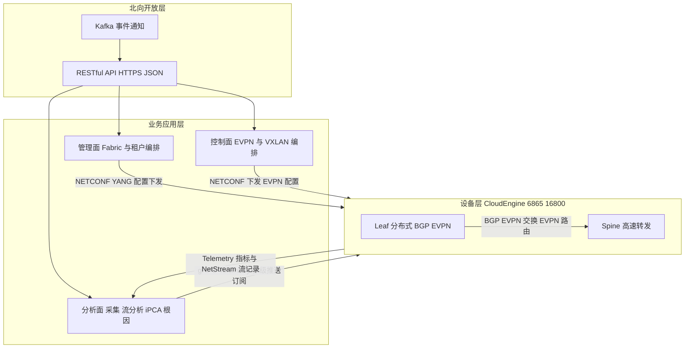

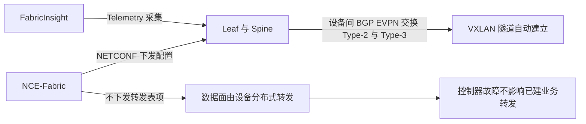

### 真题精练

**Q1.【真题·多选】** 关于 iMaster NCE-Fabric 的架构与协议，下列说法正确的有：
A. 管理面通过 NETCONF/YANG 向设备下发结构化配置，支持事务与回滚
B. 控制面由控制器集中计算每台设备的转发表项并通过 OpenFlow 下发
C. 分析面通常由 NCE-FabricInsight 通过 gRPC Telemetry 做秒级采集
D. 北向通过 RESTful API（HTTPS/JSON）对接云平台与自研运维系统

> **答案：ACD**
> **解析**：B 错——华为 DC Fabric 方案中控制器**不下发转发表项**，VXLAN 隧道路由由设备间 **BGP EVPN** 分布式建立，NCE-Fabric 只把 EVPN 相关配置下发到设备。A 是管理面的核心价值（YANG 模型 + 事务化 + 回滚 + 幂等）；C 是分析面的实现方式（Telemetry 推送优于 SNMP 轮询）；D 是北向开放的通用做法。

**Q2.【真题·简答】** 说明为什么数据中心网络运维要用 Telemetry 取代 SNMP 轮询，并指出 Telemetry 部署的两个前提条件。

> **答案与解析**：
> **① 取代原因（三点）**：
> - **精度不足**：SNMP 轮询周期通常 1~5 分钟，无法捕捉微秒级微突发与秒级拥塞；无损网络排错需要秒级甚至亚秒级数据，Telemetry 可按需配置采样间隔（如 5 秒或更短）。
> - **效率与开销**：轮询是控制器主动拉取，设备多、指标多时管理面与设备 CPU 压力大，且大量数据无变化；Telemetry 是设备按订阅主动推送结构化数据，效率高、可裁剪。
> - **数据结构化**：Telemetry 推送 Proto/JSON 结构化数据，字段含义清晰、便于入库与时序分析；SNMP 的 OID 标量模型对 per-queue、per-flow 等复杂数据表达力弱。
> **② 两个前提**：a) **时间同步（NTP）**——设备与采集器必须时间一致，否则秒级数据无法对齐、iPCA 统计也无法比对；b) **采集器可达 + YANG 路径正确**——设备要能访问采集器的 IP/端口，且 `sensor-path` 必须是本版本支持的路径（可用 `display telemetry sensor-path` 查询并本地验证推送是否成功）。

### 易错点与排错

1. **南向协议张冠李戴**：NETCONF 管配置、Telemetry 管采集、SNMP 管告警与简单性能。
2. **认为控制器集中转发**：DC Fabric 是分布式转发，控制器只管配置与编排。
3. **忘记时间同步**：NTP 未打通时 Telemetry/iPCA 数据不可信。
4. **订阅建立但无数据**：多为 `sensor-path` 不被该版本支持或采集器端口不可达，逐项验证。
5. **排错命令**：`display telemetry subscription`、`display telemetry sensor-path`、`display snetconf server session`、`display ntp status`。

---

## 6.3 NCE-Fabric 的核心能力：Underlay 与 Overlay 自动化部署

### 考点定位

**实验设计题与流程描述题的高频来源**，分值 8~12 分。必答要点：① **ZTP 的作用与流程**；② Underlay 自动化（拓扑/链路/IP/路由协议一键下发）与 Overlay 自动化（VXLAN + BGP EVPN 自动编排）的边界；③ 控制器与设备的分工（谁配什么）；④ 预检查、事务下发与回滚、配置一致性校验的价值。易错点是**认为 ZTP 能直接完成所有业务配置**（ZTP 只解决"设备上线并能被纳管"，业务配置由控制器下发）、**把 Underlay 协议与 Overlay 协议混淆**。

### 原理精讲

**自动化的总目标是"把网络当成代码来交付"**：网规（LLD，Low Level Design）里的设备、端口、链路、IP、AS 号、VNI、租户信息，全部以数据模型的形式录入控制器，由控制器生成配置并下发，配合校验与回滚保证"一次做对"。这条流水线分三段：**设备上线（ZTP）→ Underlay 自动化 → Overlay 与业务自动化**。

**① 设备上线：ZTP（Zero Touch Provisioning，零配置上线）。** 新设备上架后**不需要工程师手工敲任何配置**：设备通过 **DHCP** 获取管理 IP、默认网关、控制器地址与软件版本文件的存放位置；随后通过 **SFTP/TFTP** 拉取指定的系统软件与**最小引导配置**（含 SNMP/NETCONF 使能、控制器地址、NTP 地址）；加载完成后设备重启并以"待纳管"状态上报控制器；控制器识别设备型号与序列号，完成**纳管（Onboarding）**。ZTP 的价值是"**让设备从'裸机'变成'可被控制器管理'"**——它**不负责**业务配置（VLAN、VXLAN、路由协议等），这些由后续的自动化流程下发。工程上还会用"**设备白名单/序列号认证**"防止非法设备上线，用"**版本一致性校验**"确保全网版本统一。

**② Underlay 自动化。** Underlay 是承载 VXLAN 隧道的三层 IP 网络，它的目标是"**任意两台 Leaf 之间 IP 可达、等价多路径、收敛快**"。传统做法是逐台手工配置接口 IP、路由协议、ECMP，工作量大且容易出现"两端配置不一致"。自动化做法是：
1. **网规导入**：把 LLD（拓扑、链路、接口、IP 网段、AS 号/路由协议、BFD 参数等）导入控制器；
2. **配置生成与预检查**：控制器按模板生成每台设备的配置，并做**预检查**（IP 冲突、链路两端速率/MTU/聚合不一致、AS 规划冲突、环回口缺失等）；
3. **事务化下发**：通过 NETCONF 下发，**失败即回滚**，避免"下发一半留下半配置"的脏状态；
4. **收敛验证**：下发后采集邻居、路由表、链路状态，确认路由收敛与 ECMP 生效；
5. **一致性校验与基线固化**：把当前配置作为"基准（Baseline）"，后续由漂移检测持续比对。

Underlay 协议选择上，数据中心大规模场景**推荐 BGP（eBGP，Spine 与 Leaf 之间）**：原因是大规模 Fabric 用 BGP 便于按 AS 号做策略与路由控制、收敛行为可预期、与 EVPN 天然配套；中小规模也可用 OSPF/IS-IS。**BFD** 常与 BGP 配合做毫秒级故障检测。

**③ Overlay 自动化（VXLAN + BGP EVPN）。** Overlay 是租户的虚拟网络，它的核心是"**VNI ↔ 广播域（BD）↔ VBDIF（分布式网关）↔ 租户/VPC**"的映射关系，以及 Leaf 之间的**隧道路由自动建立**。自动化流程：
1. 控制器在 Fabric 模型里创建**租户/VPC**、子网、网关（可选 DHCP/网关地址）；
2. 控制器为每个二层域分配 **VNI**，创建 **BD** 与 **VBDIF**，并配置 **EVPN 实例**（EVPN Instance，绑定 BD 与 VNI）；
3. 控制器在每台 Leaf 上配置 **NVE 接口**（`interface nve 1`，指定源 VTEP 地址）与 **BGP EVPN 邻居**（指向控制器 RR 或设备间直连）；
4. Leaf 之间通过 BGP EVPN 交换路由：**Type-3（IMET 路由）**用于 VTEP 成员发现与**自动建立 VXLAN 隧道**；**Type-2（MAC/IP 通告路由）**用于主机 MAC/IP 学习与**分布式网关的 ARP 抑制**；
5. **分布式网关**：每台 Leaf 上都配置相同的 VBDIF 网关地址（任何 Leaf 都是网关），主机在任何 Leaf 下上线都能就近三层转发，避免"网关集中在某台设备"的瓶颈与绕行。
6. **对接云平台**：OpenStack/VMware/K8s 通过北向 API 请求创建网络，控制器自动完成 VNI 分配与端口绑定（"虚机上线，网络即就绪"）。

**自动化的三个"保险"必须一起讲**：**预检查（Pre-check）**——把错误挡在变更之前；**事务与回滚（Transaction & Rollback）**——保证变更的原子性；**配置一致性/漂移检测（Compliance & Drift Detection）**——保证变更之后长期不变形。缺少任何一项，"自动化"都会变成"批量手工操作"，一次错误就能影响整个 Fabric。

### 关键概念对照表

| 阶段 | 目标 | 控制器做什么 | 设备做什么 | 关键协议 |
|---|---|---|---|---|
| ZTP 上线 | 裸机 → 可纳管 | 提供 DHCP/文件服务器，识别并纳管设备 | DHCP 取址、拉版本与引导配置、上报 | DHCP、SFTP/TFTP、SNMP/NETCONF |
| Underlay 自动化 | Leaf 间三层可达 + ECMP | 生成并事务下发接口/IP/路由配置，校验收敛 | 运行 BGP/OSPF、BFD，转发 | NETCONF、BGP/OSPF/IS-IS、BFD |
| Overlay 自动化 | 租户虚拟网络与隧道 | 分配 VNI、创建 BD/VBDIF/EVPN 实例、配 NVE 与邻居 | 跑 BGP EVPN，自动建 VXLAN 隧道 | NETCONF、BGP EVPN、VXLAN |
| 业务对接 | 虚机/容器上线即通网 | 响应云平台 API，绑定端口与网络 | 学习 MAC/IP、转发 | RESTful API、EVPN Type-2 |

| 自动化保险 | 作用 | 缺失后果 |
|---|---|---|
| 预检查 | 变更前发现 IP 冲突、两端不一致、模板缺参 | 错误配置直接下发，故障面扩大 |
| 事务与回滚 | 下发失败时回到变更前状态 | 出现"半配置"脏状态，难恢复 |
| 一致性校验/漂移检测 | 长期保持与基线一致 | 手工改动悄悄积累，故障难定位 |

| 易混概念 | 正确理解 |
|---|---|
| ZTP vs 业务自动化 | ZTP 只解决"上线可纳管"，业务配置由控制器下发 |
| Underlay 协议 vs Overlay 协议 | Underlay 用 BGP/OSPF（underlay 可达），Overlay 用 BGP EVPN + VXLAN |
| VNI / BD / VBDIF | VNI 是隧道标识（24 bit），BD 是二层广播域，VBDIF 是分布式网关接口 |
| Type-2 / Type-3 路由 | Type-2 通告 MAC/IP（主机路由），Type-3 通告 VTEP（建隧道用） |

### 华为设备配置

```bash
# ===== ZTP 场景：设备侧先具备最基本的管理能力（也可由 DHCP 选项自动下发）=====
system-view
interface MEth0/0/0                                        // 管理网口（不同型号可能是 MEth0/0/0 或 ETH0）
 ip address 10.10.10.11 255.255.255.0                      // 管理 IP（ZTP 场景通常由 DHCP 自动获取）
 quit
ntp-service enable                                         // 使能 NTP（Telemetry 与 iPCA 的前提）
ntp-service unicast-server 10.10.10.100                    // 指定 NTP 服务器（通常就是控制器所在服务器）
snetconf server enable                                     // 使能 NETCONF，供控制器纳管与下发
ssh server enable                                          // 使能 SSH
snmp-agent sys-info version v3                              // SNMPv3
display ntp status                                          // 验证时间同步是否完成（必须 synchronized）
display snetconf server session                             // 验证 NETCONF 通道已建立
```

```bash
# ===== 控制器自动化下发后的设备侧结果（用于核对"控制器到底配了什么"）=====
display vxlan vni                                          // 查看本机所有 VNI 及其状态（应由控制器批量下发）
display vxlan tunnel                                       // 查看 VXLAN 隧道是否自动建立（对端 VTEP、状态 up）
display bgp evpn peer                                      // 查看 BGP EVPN 邻居状态（应与 RR/对端 Established）
display bgp evpn all routing-table                         // 查看 EVPN 路由（Type-2/Type-3 是否学到）
display interface nve 1                                    // 查看 NVE 接口的源地址与 VNI 成员（Underlay/Overlay 衔接点）
display current-configuration configuration bgp            // 复核 BGP 配置是否与网规一致
```

> 自动化落地的判据是"**设备侧配置全部来自控制器，手工配置只剩管理与上报**"。工程验收时按三条核对：① `display vxlan tunnel` 中所有该有的隧道都 up（说明 Type-3 路由学到了）；② `display bgp evpn all routing-table` 中能看到 Type-2 主机路由（说明 MAC/IP 学习正常）；③ 控制器侧做一次"配置一致性检查"无差异（说明无人手工改动）。

### 示意图

```mermaid
flowchart TD
  A["设备上架 裸机"] --> B["ZTP DHCP 获取管理地址与控制器信息"]
  B --> C["拉取系统版本与引导配置并重启"]
  C --> D["上报控制器 完成纳管"]
  D --> E["导入网规 LLD 拓扑 IP AS 号 VNI"]
  E --> F["控制器生成配置并做预检查"]
  F --> G["NETCONF 事务化下发 Underlay"]
  G --> H["设备跑 BGP 与 BFD 邻居建立"]
  H --> I["校验路由收敛与 ECMP"]
  I --> J["创建租户与 VPC 分配 VNI 与 BD"]
  J --> K["下发 VXLAN 与 EVPN 配置 建立 NVE 与邻居"]
  K --> L["Leaf 间交换 Type-2 与 Type-3 自动建隧道"]
  L --> M["云平台 API 请求网络 虚机上线即通网"]
  M --> N["固化基线 开启漂移检测与 Telemetry"]
```

```mermaid
sequenceDiagram
  participant CE as "新上架 CE6865"
  participant DHCP as "DHCP 与文件服务器"
  participant NCE as "iMaster NCE-Fabric"
  CE->>DHCP: "DHCP 请求 获取管理 IP 与控制器地址"
  DHCP->>CE: "响应 并给出软件包与引导配置文件位置"
  CE->>DHCP: "SFTP 拉取版本与引导配置"
  CE->>NCE: "以待纳管状态上报 序列号与型号"
  NCE->>NCE: "白名单校验 纳管设备"
  NCE->>CE: "NETCONF 下发 Underlay 与 Overlay 配置"
  CE->>NCE: "回送下发结果与配置校验信息"
  NCE->>NCE: "一致性校验 固化基线"
```

### 真题精练

**Q1.【真题·简答】** 说明 ZTP 在数据中心 Fabric 自动化中的定位与完整流程，并指出 ZTP 完成后还有哪些工作必须由控制器完成。

> **答案与解析**：
> **① 定位**：ZTP（Zero Touch Provisioning，零配置上线）解决的是"**设备从裸机到可被控制器纳管**"这一段，是自动化的**起点**，不负责业务配置。
> **② 流程**：设备上电后通过 **DHCP** 获取管理 IP、网关、控制器地址与软件/配置文件位置 → 通过 **SFTP/TFTP** 拉取指定系统软件与**最小引导配置**（SNMP/NETCONF 使能、控制器与 NTP 地址等）→ 加载并重启 → 以"待纳管"状态向控制器上报（型号、序列号、版本）→ 控制器做**白名单校验**后完成纳管。
> **③ ZTP 之后必须由控制器完成的工作**：a) **Underlay 自动化**——接口/IP/链路聚合/MTU/路由协议（BGP/OSPF）/BFD 的生成与下发，并验证收敛与 ECMP；b) **Overlay 自动化**——VNI/BD/VBDIF/EVPN 实例/NVE 接口/BGP EVPN 邻居的下发，使 Leaf 间通过 Type-3 路由自动建立 VXLAN 隧道；c) **租户与 VPC 编排**——按业务需求创建虚拟网络并分配 VNI；d) **业务对接**——响应云平台 API 完成端口与网络绑定；e) **运维基线**——开启 Telemetry 采集、配置备份与漂移检测。
> **④ 补充**：ZTP 还需要配套的**安全与一致性措施**（白名单、版本校验、镜像签名），否则非法设备可能被自动纳管。

**Q2.【真题·多选】** 关于 NCE-Fabric 的 Underlay 与 Overlay 自动化，下列说法正确的有：
A. Underlay 自动化的目标是让任意 Leaf 之间三层可达并具备 ECMP 与快速收敛能力
B. Overlay 自动化中，VXLAN 隧道由控制器逐条指定远端 VTEP 并下发静态隧道
C. BGP EVPN 的 Type-3 路由用于 VTEP 成员发现，可实现隧道自动建立
D. 分布式网关使每台 Leaf 都能作为网关，主机就近三层转发，避免绕行

> **答案：ACD**
> **解析**：B 错——这正是自动化的价值所在：Leaf 之间通过 **BGP EVPN（Type-3 IMET 路由）自动发现对端 VTEP 并建立隧道**，无需控制器逐条指定静态隧道（静态隧道方案在主机迁移、扩容时维护成本极高）。A 是 Underlay 的目标；C、D 是 Overlay 自动化的两个关键机制（隧道自动建立 + 分布式网关就近转发）。

**Q3.【真题·实验】** 请设计一个"新增一台 Leaf 并接入一个租户网络"的自动化实验流程，写出关键步骤与验证命令。

> **答案与解析**：
> **① 步骤**：
> 1. **准备**：在控制器中登记设备序列号到白名单，配置 DHCP 与文件服务器（软件版本 + 引导配置）；
> 2. **上线**：设备上架接线后上电，通过 ZTP 获取管理 IP、拉取版本与引导配置，自动注册到 NCE-Fabric；
> 3. **纳管**：控制器校验序列号与型号后完成纳管，采集到设备的基本信息与接口清单；
> 4. **网规更新**：在控制器中把新 Leaf 加入 Fabric 模型，指定其角色（Leaf）、上行到 Spine 的链路、接口 IP、AS 号与 MTU；
> 5. **预检查**：控制器检查 IP 冲突、链路两端速率/MTU/聚合一致性、AS 与路由规划，确认无风险；
> 6. **Underlay 下发**：NETCONF 事务化下发接口与路由配置，建立 BGP/BFD 邻居，验证路由收敛与 ECMP；
> 7. **Overlay 下发**：为该 Leaf 下发 NVE 源地址、BGP EVPN 邻居、租户的 VNI/BD/VBDIF，主机上线后通过 Type-2 路由通告 MAC/IP；
> 8. **业务验证**：在同租户的其他 Leaf 下挂主机，验证跨 Leaf 二层互通与三层网关就近转发；
> 9. **固化与监控**：保存配置基线，开启漂移检测与 Telemetry 订阅。
> **② 验证命令（设备侧）**：`display bgp peer`（邻居 Established）、`display bgp evpn peer`、`display vxlan tunnel`（隧道 up）、`display vxlan vni`、`display bgp evpn all routing-table`（Type-2/Type-3 路由）、`display interface nve 1`、`display current-configuration interface` 复核配置与网规一致。
> **③ 控制器侧验证**：Fabric 拓扑视图中新 Leaf 显示为"在线/配置一致"，配置一致性检查无差异，拓扑链路无告警。

### 易错点与排错

1. **认为 ZTP 会把业务配置也配好**：ZTP 只到"可纳管"，业务配置由控制器下发。
2. **Underlay/Overlay 协议混淆**：Underlay 是 BGP/OSPF/IS-IS（IP 可达），Overlay 是 BGP EVPN + VXLAN。
3. **跳过预检查直接下发**：两端 MTU/速率/聚合配置不一致会导致"部分链路通、部分不通"的疑难问题。
4. **忘记时间同步与 NTP**：Telemetry/iPCA 与日志时间对齐都依赖它。
5. **手工改设备配置**：会破坏基线，导致漂移检测告警与后续自动化失败（这是现网最常见的"自动化退化"原因）。
6. **排错命令链**：`display vxlan tunnel` → `display bgp evpn peer` → `display bgp evpn all routing-table` → `display interface nve 1` → 控制器侧配置一致性检查。

---

## 6.4 Fabric 的部署模型：单 POD、多 POD、多 Fabric 与云平台对接

### 考点定位

**规划设计题与选型题**，分值 4~8 分。考法：① 给出设备数量与业务规模，让你选择单 POD/多 POD/多 Fabric；② 问多 POD 之间如何互联（Border Leaf / DCI）；③ 问控制器与云平台对接的作用与接口。易错点是**把"多 POD"与"多 Fabric"混为一谈**（前者是一个 Fabric 内的多个转发单元，后者是多个独立 Fabric 的互联）、**忘记 VNI 的全局唯一性要求**。

### 原理精讲

**① 单 POD（Single POD）模型。** 一个 Fabric = 一个 POD，由一对或多对 Spine 与若干 Leaf 组成标准的 Spine-Leaf 两层架构。所有 Leaf 都上联到本 POD 的所有 Spine，任意两台 Leaf 之间只有一跳（Leaf→Spine→Leaf），收敛比可控、时延确定。适用规模：Leaf 数量在几十台以内、服务器数千台以内。优点是模型最简单、控制器管理最轻、故障域最小；缺点是 Spine 端口数决定了 Fabric 的规模上限，超过后必须引入多 POD 或更多层级。

**② 多 POD（Multi-POD）模型。** 当一个 Fabric 内的 Leaf 数量超过单 POD 承载能力（Spine 下行端口不够）时，把网络划分为多个 POD，每个 POD 有自己的一对 Spine；**POD 之间通过 Border Leaf（边界叶子）互联**，Border Leaf 同时上联各 POD 的 Spine，承担 POD 间流量的转发职责。关键设计点：
- **VNI 在一个 Fabric 内全局唯一**：同一租户跨 POD 时使用同一 VNI，跨 POD 的 VTEP 之间仍然通过 BGP EVPN 学到的路由建立隧道，因此**逻辑上仍是一个 EVPN 域**；
- **Border Leaf 的角色**：既可以是"POD 间三层转发点"（推荐，POD 间流量走三层，避免大二层泛洪扩散），也可以让 POD 间保持二层连通（不推荐，会放大故障域与广播域）；
- **故障域与路由设计**：POD 内部收敛与 POD 间收敛应解耦，避免一个 POD 的震荡影响全网。

**③ 多 Fabric（Multi-Fabric）模型。** 当规模进一步扩大（多个楼宇/多个机房/多期建设），或出于**故障隔离与分层管理**的考虑，会把网络划分为多个独立 Fabric（每个 Fabric 可有自己的控制器实例/管理域），Fabric 之间通过 **DCI（Data Center Interconnect，数据中心互联）** 打通。Fabric 间互通有两条路线：
- **三层互通（L3 DCI，推荐）**：把 Fabric 当作一个大型三层网络，通过 Border Leaf/网关设备做 L3 互联（EBGP/OSPF + VXLAN L3 网关），租户在各自 Fabric 内独立分配 VNI，跨 Fabric 用 IP 路由互通。优点是故障域清晰、规模可无限扩展；缺点是需要规划 IP 地址与租户映射（如 VRF 对应、VNI 与 VRF 映射）。
- **二层互通（L2 DCI）**：通过 VXLAN 隧道跨 DCI 延伸二层域，或使用 EVPN 多域互通（Inter-AS Option B 风格）。优点是虚拟机可跨 Fabric 无感迁移；缺点是**大二层故障域放大**、广播/未知单播泛洪跨域、对 DCI 链路质量要求高。生产环境一般只对少量必须二层延伸的租户使用。

**④ 与云平台的对接。** DC 网络的价值在于"承载云业务"，因此 NCE-Fabric 必须与云平台/容器平台对接：
- **OpenStack**：通过 Neutron 的 ML2 Driver/Plugin 调用 NCE-Fabric 北向 API，把"创建网络/子网/端口"翻译为 VNI/BD/VBDIF/端口绑定；
- **华为 FusionSphere/FusionCompute**：通过开放 API 对接，实现虚机上线即插网；
- **VMware**：通过 vCenter/NSX 的对接能力或 API 集成；
- **Kubernetes**：通过 CNI 插件（或华为的容器网络方案）在 Pod 创建时调用控制器 API 分配网络与 IP。
对接的核心价值是"**消除人工工单**"：计算资源上线时网络自动就绪，这正是"网络即代码（Network as Code）"的直接体现。对接的接口统一是 6.2 讲的**北向 RESTful API**。

### 关键概念对照表

| 模型 | 规模量级 | 互联方式 | VNI 规划 | 适用场景 | 主要风险 |
|---|---|---|---|---|---|
| 单 POD | 数十台 Leaf | 无（Spine-Leaf 一层） | Fabric 内唯一 | 中小型 DC、单机房 | Spine 端口成为规模上限 |
| 多 POD | 数百台 Leaf | Border Leaf 互联 | **Fabric 内全局唯一** | 大型 DC、多机房模块 | POD 间流量绕行与收敛设计 |
| 多 Fabric | 多 DC/多期 | DCI（L3 优先，L2 少量） | 各 Fabric 独立 | 多数据中心、故障隔离 | 跨域地址/租户映射复杂 |
| 云平台对接 | — | 北向 RESTful API | 由控制器分配 | 云/容器业务上线 | 对接失败导致业务无法上线 |

| 对接对象 | 调用方 | 关键动作 | 网络侧结果 |
|---|---|---|---|
| OpenStack Neutron | 云平台 | 创建网络/子网/端口 | 分配 VNI、创建 BD/VBDIF、绑定端口 |
| FusionSphere | 云平台 | 虚机创建与网卡绑定 | 虚机上线即通网 |
| Kubernetes CNI | 容器平台 | Pod 创建时分配网络 | Pod IP 与网络策略自动下发 |
| Ansible/自研平台 | 运维系统 | 批量配置与巡检 | 配置一致性与自动化运维 |

### 华为设备配置

```bash
# 多 POD 场景：Border Leaf 上检查 POD 间互通相关配置（配置由控制器下发，此处用于核对）
display bgp evpn peer                                      // 查看与各 POD Spine/RR 的 BGP EVPN 邻居
display vxlan tunnel                                       // 查看跨 POD 的 VXLAN 隧道是否已自动建立
display vxlan vni                                          // 核对 VNI 是否在 Fabric 内唯一且各 POD 一致
display ip routing-table vpn-instance <vpn>                // 多租户场景查看 VRF 内的路由（跨 POD 三层互通）
display bgp vpnv4 vpn-instance <vpn> routing-table         // 核对 VPN 路由（L3 DCI 场景）
display ntp status                                         // 跨 POD/跨 Fabric 时间必须同步
```

> 多 POD 与多 Fabric 的**验收判据**：① 同 POD 内 Leaf 互通时延为一跳（Leaf-Spine-Leaf），跨 POD 互通明确经过 Border Leaf；② `display vxlan tunnel` 中不存在"该建未建"的隧道；③ 租户跨 POD 访问时，源/目的 VNI 一致且网关为分布式网关；④ 多 Fabric 场景下，跨 DCI 的可达性由 L3 路由保证，二层延伸仅限必要租户。

### 示意图

```mermaid
flowchart TB
  subgraph POD1["POD-1"]
    SP1["Spine-1a"]
    SP2["Spine-1b"]
    LF1["Leaf-1 与 Leaf-2 服务器接入"]
    BL1["Border Leaf-1"]
    LF1 --> SP1
    LF1 --> SP2
    SP1 --> BL1
    SP2 --> BL1
  end
  subgraph POD2["POD-2"]
    SP3["Spine-2a"]
    SP4["Spine-2b"]
    LF3["Leaf-3 服务器接入"]
    BL2["Border Leaf-2"]
    LF3 --> SP3
    LF3 --> SP4
    SP3 --> BL2
  end
  BL1 ---|"POD 间互联 L3 优先"| BL2
  BL1 -.->|"跨 POD VXLAN 隧道 EVPN 自动建立"| BL2
```

### 真题精练

**Q1.【真题·单选】** 某数据中心 Leaf 数量增长到 300 台，单 POD 的 Spine 下行端口已无法承载，但仍希望全网属于同一个 EVPN 域以支持租户跨模块二层/三层互通。最合理的方案是：
A. 增加 Spine 数量并保持单 POD  B. 划分为多 POD，用 Border Leaf 互联，VNI 在 Fabric 内全局唯一
C. 拆分为多个独立 Fabric，只做 L3 DCI  D. 改用 OSPF 替换 BGP EVPN

> **答案：B**
> **解析**：多 POD 正是为解决"单 POD Spine 端口不足"而设计的：各 POD 有独立 Spine，POD 间经 Border Leaf 互联，同时**VNI 在整个 Fabric 内全局唯一**，因此逻辑上仍是一个 EVPN 域，租户可跨 POD 互通；跨 POD 流量建议走三层，避免大二层泛洪扩散。A 不可行（Spine 端口数与机框槽位有限）；C 会破坏"同一 EVPN 域"的诉求（各 Fabric 独立分配 VNI）；D 与规模无关且会丢掉 EVPN 的自动隧道能力。

**Q2.【真题·简答】** 说明多 POD 与多 Fabric 两种部署模型的本质区别，并分别指出各自适用的场景与关键设计约束。

> **答案与解析**：
> **① 本质区别**：**多 POD 是"一个 Fabric（一个 EVPN 域）内的多个转发单元"**，POD 之间通过 Border Leaf 互联，**VNI 在 Fabric 内全局唯一**，隧道由 BGP EVPN 自动建立，逻辑上是一个网络；**多 Fabric 是"多个独立网络"**，各 Fabric 有独立的控制器/管理域、独立分配 VNI，之间通过 **DCI** 打通（以 L3 互通为主）。
> **② 多 POD 适用场景与约束**：适用于**单一大型数据中心内规模扩展**（单 POD Spine 端口不足）。关键约束：POD 间必须明确三层转发路径（Border Leaf 角色）、VNI 全局唯一、POD 间收敛与 POD 内收敛解耦、避免 POD 间大二层泛洪。
> **③ 多 Fabric 适用场景与约束**：适用于**多机房/多期建设/多租户强隔离/需要明确故障域边界**的场景。关键约束：跨 Fabric 的地址与租户映射规划（VRF/VNI 对应关系）、DCI 带宽与可靠性、二层延伸仅限必要租户（否则故障域放大）、统一运维需要多 Fabric 统一视图（控制器侧聚合）。
> **④ 选择建议**：能用多 POD 解决就不拆多 Fabric（管理更简单、租户互通更自然）；当规模、安全域或建设期导致必须分域时，才拆多 Fabric 并用 L3 DCI 打通。

### 易错点与排错

1. **多 POD 与多 Fabric 混淆**：判断标准是"VNI 是否全局唯一、隧道是否由同一个 EVPN 域自动建立"。
2. **多 POD 里 POD 间做大二层**：会把广播域与故障域放大，只应对必要租户开放。
3. **云平台对接只测通不测异常**：要对"创建失败/删除失败/控制器不可达"做补偿与重试设计。
4. **忘记时间同步与统一视图**：跨 POD/跨 Fabric 的 Telemetry 与日志必须时间对齐才能联合分析。
5. **排错命令**：`display vxlan vni`、`display vxlan tunnel`、`display bgp evpn peer`、`display bgp vpnv4 vpn-instance <vpn> routing-table`。

---

## 6.5 意图驱动的网络管理（Intent-Based Networking）

### 考点定位

**概念+流程题**，分值 4~8 分。考法：① 解释 IBN 的四步闭环（意图→翻译→下发→验证保障）；② 判断"意图"与"策略/配置"的关系；③ 结合 NCE-Fabric/FabricInsight 说明"闭环校验"如何实现。易错点是**把 IBN 等同于"自动化脚本"**（IBN 的灵魂是"声明意图 + 持续验证"，而脚本只是执行）、**忽略 Assure（验证保障）环节**。

### 原理精讲

**IBN（Intent-Based Networking，意图驱动网络）要解决的问题**是：传统网络运维是"命令式"的——工程师脑子里想的是"我要保证研发到存储的时延低于 1 ms"，落到设备上却变成几百行 CLI；一旦需求变化或设备被人手工改动，网络的真实状态与"意图"就脱节了。IBN 的做法是让工程师**只描述业务意图（What），由系统负责翻译成网络配置（How），并持续验证结果是否满足意图（Verify）**。

**IBN 的四步闭环**：
1. **意图（Intent）表达**：用**业务语言**描述需求，例如"研发区与生产区二层隔离、三层按需互通"、"AI 训练流量的端到端时延 < 100 µs 且零丢包"、"某租户带宽不低于 10 Gbps"。意图通常以结构化对象（租户、应用、SLA）形式录入，而不是设备命令。
2. **翻译与策略生成（Translate）**：控制器把意图翻译成**网络策略与配置**——确定涉及哪些 Fabric/设备/端口，生成 VNI/BD/VBDIF、ACL、QoS（DSCP/PFC/ECN 模板）、路由策略等，并做**可行性校验**（资源是否足够、是否与已有策略冲突、是否会造成环路/中断）。
3. **下发与激活（Activate）**：通过 NETCONF 事务化下发到设备，**失败即回滚**；下发后校验设备侧配置与控制器模型是否一致（幂等）。
4. **验证与保障（Assure）**：通过 **Telemetry 秒级采集 + iPCA/流分析** 持续验证"实际运行状态是否满足意图"。例如意图是"零丢包"，则监控无损队列的 Discard 与 PFC 反压频次；意图是"时延 < 100 µs"，则用 iPCA 逐跳时延数据比对。一旦偏离（Drift/Violation），系统告警并**可选自动纠偏**（重新下发策略），从而形成闭环。

**意图、策略、配置三者的层次关系（考点）**：
- **意图（Intent）**：业务目标，人可读，稳定（不随设备型号变化）；
- **策略（Policy）**：把意图映射为与设备无关的网络规则（如"租户 A 的流量标记 DSCP 24 并走无损队列"）；
- **配置（Configuration）**：设备可执行的 CLI/YANG 实例（如 `dcb pfc priority 3`、`trust dscp`）。
**一次意图变更，控制器自动重算策略与配置**——这正是"声明式（Declarative）"与"命令式（Imperative）"的分界线：声明式只描述目标状态，由系统决定怎么到达；命令式必须逐步指定动作。

**IBN 与 NCE 的关系**：NCE-Fabric 提供"翻译、下发、激活"的能力（Fabric/VPC/策略编排 + NETCONF 事务下发 + 漂移检测）；NCE-FabricInsight 提供"验证与保障"的能力（Telemetry 采集、iPCA、流分析、数字地图与告警）。两者合起来才能构成**闭环**——只有自动化下发没有闭环校验，就只是"批量配置工具"；只有监控没有自动化，就只是"网管"。这也是国赛论述题最容易拉开分差的点。

**落地难点与现实做法**：① **意图的形式化**——业务语言到网络模型的映射需要领域模型（租户/应用/SLA 对象）；② **验证指标的可得性**——"零丢包""时延 < 100 µs"这类意图需要 iPCA 这类带内测量能力支撑，传统 SNMP 根本测不到；③ **变更安全**——必须有预检查、灰度与回滚机制，否则自动化会把错误"快速放大"；④ **人机边界**——现阶段的实践多是"关键变更走意图编排、日常排障仍靠人工+分析工具"，完全自主的闭环仍在演进（见 6.11）。

### 关键概念对照表

| 层次 | 表达对象 | 示例 | 谁负责 | 变化频率 |
|---|---|---|---|---|
| 意图 Intent | 业务目标 | "AI 训练流量零丢包、时延 < 100 µs" | 业务/网络工程师 | 低 |
| 策略 Policy | 与设备无关的网络规则 | "租户 A 流量 DSCP 24，走无损队列，ECN 门限 X" | 控制器 | 中 |
| 配置 Configuration | 设备可执行命令/YANG 实例 | `dcb pfc priority 3`、`trust dscp` | 控制器下发 | 高 |

| IBN 环节 | 关键能力 | 对应产品/功能 | 失败后果 |
|---|---|---|---|
| 意图表达 | 业务对象建模、SLA 定义 | NCE 业务模型 | 意图无法翻译 |
| 翻译与策略生成 | 资源分配、冲突校验、模板 | NCE-Fabric | 策略冲突或资源不足 |
| 下发与激活 | NETCONF 事务、回滚、幂等 | NCE-Fabric | 半配置脏状态 |
| 验证与保障 | Telemetry、iPCA、流分析、漂移检测 | NCE-FabricInsight | 网络与意图脱节且无人知晓 |

### 华为设备配置

```bash
# IBN 的"落地锚点"：设备侧必须提供可被验证的数据（采集能力）与被纳管的配置通道
system-view
telemetry                                                  // 使能 Telemetry 视图，提供意图验证所需数据
 sensor-group sg_intent
  sensor-path huawei-qos:qos/queue-statistics/queue-statistic   // 队列/丢弃数据：验证"零丢包"意图
  sensor-path huawei-ifm:ifm/interfaces/interface               // 接口数据：验证"链路健康/带宽"意图
  quit
 destination-group dg_insight
  ipv4-address 10.10.10.100 port 10001 protocol grpc
  quit
 subscription sub_intent
  sensor-group sg_intent sample-interval 5000               // 5 秒采样，满足"秒级验证"要求
  destination-group dg_insight
  quit
 quit
ntp-service enable                                          // 时间同步是"验证数据可比对"的前提
display telemetry subscription                              // 确认订阅下发成功（控制器意图验证的数据来源）
```

> 从设备视角看，IBN 的"可验证性"完全依赖两条通道：**配置通道（NETCONF）**与**数据通道（Telemetry/iPCA）**。因此国赛实验若要求"体现闭环"，最少要做到：控制器下发配置 → 设备上报 Telemetry → 控制器/分析平台比对基线并给出"满足/不满足意图"的结论。

### 示意图

```mermaid
flowchart LR
  I["意图 业务语言<br/>AI 训练零丢包且时延小于 100 微秒"] --> T["翻译 生成网络策略<br/>DSCP 24 无损队列 ECN 门限"]
  T --> A["激活 事务下发<br/>NETCONF 失败回滚"]
  A --> V["验证 采集与分析<br/>Telemetry 与 iPCA"]
  V --> Q{"是否满足意图"}
  Q -->|"满足"| R["持续监控 固化基线"]
  Q -->|"不满足"| C["告警并纠偏 重新下发或调整策略"]
  C --> A
  R --> I
```

### 真题精练

**Q1.【真题·简答】** 说明 IBN（意图驱动网络）的四步闭环，并解释为什么"只有自动化下发、没有闭环验证"不能称为意图驱动网络。

> **答案与解析**：
> **① 四步闭环**：a) **意图表达**——用业务语言描述目标（如"训练流量零丢包、时延 < 100 µs"）；b) **翻译与策略生成**——控制器把意图翻译为与设备无关的网络策略，并做资源与冲突校验；c) **下发与激活**——通过 NETCONF 事务化下发，失败回滚、保证幂等；d) **验证与保障**——通过 Telemetry/iPCA/流分析持续验证实际状态是否满足意图，偏离则告警并可选自动纠偏，从而回到意图，形成闭环。
> **② 为什么缺验证不行**：若只有自动下发，系统只能保证"配置被写进去了"，无法保证"业务目标被满足"。网络是持续变化的（流量模型变化、人工改动、硬件故障、软件缺陷），配置正确 ≠ 结果正确；只有闭环验证才能发现"配置对但效果差"（如 ECN 门限不合理导致 PFC 频繁反压）与"配置被改回"（漂移）两类问题。没有验证的自动化实质是"批量配置工具"，出错时反而放大故障面。
> **③ 支撑条件**：意图的可验证性依赖带内测量能力（iPCA）与秒级采集（Telemetry），以及时间同步（NTP），这也是 NCE-Fabric 必须与 NCE-FabricInsight 协同的原因。

**Q2.【真题·判断】** 意图（Intent）可以直接被设备执行，因此意图与配置是同一层次的概念。

> **答案：错误**
> **解析**：三层是**逐层细化**的关系：**意图**是业务目标（人可读、与设备无关）；**策略**是映射后的与设备无关的网络规则；**配置**才是设备可执行的命令/YANG 实例。控制器负责把意图翻译为策略、再把策略翻译为配置。正因为分离，同一意图可以在不同型号/版本的设备上生成不同配置，也能在设备替换时保持意图不变。

### 易错点与排错

1. **把 IBN 当脚本自动化**：IBN 的核心是"声明意图 + 持续验证 + 闭环纠偏"。
2. **忽略 Assure 环节**：答题时必须写明"验证与保障"，这是拉开分差的关键。
3. **意图无法验证**：涉及"零丢包/时延"的意图必须配 iPCA/Telemetry，否则只是口号。
4. **变更无回滚**：自动化的前提是预检查 + 事务 + 回滚，否则错误被放大。
5. **排错思路**：意图不满足时，先看 Telemetry 数据（事实层）→ 再看策略与配置（模型层）→ 最后看是否有人工改动（漂移）。

---

## 6.6 iMaster NCE-FabricInsight：Telemetry 采集架构与秒级流分析

### 考点定位

**智能运维板块的架构题与数据题**，分值 6~10 分。必答要点：① 采集架构的完整链条（设备→采集器→消息队列→存储→分析→呈现）；② 为什么用 Telemetry 而不是 SNMP；③ 秒级采集的数据量与挑战；④ 流分析（NetStream/NetFlow/sFlow）能回答什么问题。易错点是**把流分析与 iPCA 混为一谈**（流分析看"谁在通信、占多少带宽"，iPCA 看"报文有没有丢、丢在哪一跳"）。

### 原理精讲

**FabricInsight 的采集架构是一条"数据流水线"**：
1. **数据源（设备侧）**：CloudEngine 通过三类手段产出数据——**Telemetry（gRPC/Proto，推送指标）**、**流分析（NetStream/NetFlow/sFlow，推送流记录）**、**iPCA/随流检测（推送统计流数据）**；此外还有 SNMP Trap 与 Syslog 作为告警与事件来源。
2. **采集层（Collector）**：FabricInsight 部署一个或多个采集器实例接收 gRPC/流记录，负责协议解析、批量聚合与背压控制。采集器需要水平扩展（设备与指标数量大时单实例撑不住），并需要与设备时间同步（否则秒级数据无法对齐）。
3. **消息与存储层**：采集到的数据写入**消息队列（如 Kafka）**做削峰，再落入**时序数据库（指标）**与**流/日志存储（流记录、事件）**。分层的目的：把"高频写入"与"分析查询"解耦，避免分析任务拖垮采集。
4. **分析层**：做**流分析**（TopN、流量矩阵、应用识别）、**指标分析**（阈值、趋势、突变检测）、**关联分析**（把接口指标、流数据、iPCA、告警关联起来做根因定位 RCA）、**健康度与数字地图**计算。
5. **呈现与开放层**：拓扑/数字地图、健康度评分、告警与工单、报表；并通过北向 API/Kafka 把分析结果推给上层运维平台。

**"秒级采集"的意义与挑战**。传统 SNMP 轮询周期 1~5 分钟，而 AI 训练的一次拥塞可能只持续**几十毫秒到几秒**（微突发 + 反压窗口），分钟级采集完全看不到。Telemetry 支持秒级甚至亚秒级采样（如 `sample-interval 5000` 表示 5 秒），能捕捉到"Discard 突增""PFC 反压频次上升""队列水位飙升"等关键过程。挑战在于数据量：假设 1000 台设备、每台 500 个指标、1 秒采样，则每秒 50 万个数据点、每天约 430 亿点——必须依赖**采集器水平扩展 + 数据压缩 + 分层保留（近期高精度、远期降采样）**才能落地。这也是"秒级采集"在国赛简答题里常与"数据量/性能"一起被问的原因。

**流分析（Flow Analysis）回答什么问题？** 流分析基于 **NetStream/NetFlow/sFlow**：设备把每个流的五元组、报文数、字节数、时间戳等聚合后导出。它能回答："**谁在跟谁通信、用了什么协议/应用、占了多少带宽、TopN 是谁**"，从而支撑：① 容量规划（哪条链路快满了）；② 异常流量发现（异常主机、扫描、绕行）；③ **应用与网络的关联分析**（应用体验差时，判断是网络问题还是应用自身问题）；④ 与 Telemetry 指标联动做根因定位（如"某接口丢包突增"+"该接口 Top 流是某个存储同步任务"→ 定位到业务）。

**iPCA 与流分析、Telemetry 的分工（必背对照）**：

| 手段 | 回答的问题 | 数据粒度 | 典型用途 |
|---|---|---|---|
| **Telemetry** | 设备/接口/队列此刻的指标是多少 | 指标（秒级） | 容量、拥塞、反压趋势、健康度 |
| **流分析** | 谁在跟谁通信、占多少带宽 | 流（五元组聚合） | TopN、应用识别、容量规划、异常流量 |
| **iPCA/随流检测** | 报文有没有丢、丢在哪一跳、时延多少 | 网络级/逐跳（分钟级统计） | **丢包精确定位、时延与抖动分析** |
| SNMP Trap/Syslog | 发生了什么事件 | 事件 | 告警、变更审计 |

**"应用与网络质量关联分析"怎么做？** 步骤是：① 从应用侧（APM/业务系统）拿到"应用体验变差"的时间点与客户端 IP；② 用流分析查出该客户端与服务器之间的流及其路径；③ 用 Telemetry 查该路径上设备/接口/队列在同期的指标（丢包、缓存水位、PFC/ECN）；④ 用 iPCA 定位丢包/时延发生在哪一跳；⑤ 结论：若网络侧无丢包无拥塞，则问题在应用或主机侧（如网卡队列、CPU、磁盘）。这就是"**先定位责任边界，再定位具体设备**"的运维方法论。

### 关键概念对照表

| 层次 | 组件 | 职责 | 关键设计点 |
|---|---|---|---|
| 数据源 | CE 交换机、服务器网卡 | 产出指标/流/iPCA 数据 | Telemetry 订阅、YANG 路径、时间同步 |
| 采集层 | Collector（可多实例） | 接收 gRPC/流记录 | 水平扩展、背压、协议解析 |
| 传输/缓冲 | Kafka 等消息队列 | 削峰、解耦 | 分区与保留策略 |
| 存储层 | 时序库 + 流/日志库 | 高效写入与查询 | 分层保留、降采样 |
| 分析层 | 流分析、指标分析、RCA | 关联与根因 | 算法与模型质量决定价值 |
| 呈现层 | 数字地图、健康度、报表、API | 消费与开放 | 与工单/自研平台集成 |

| 采集频率 | 能看到什么 | 看不到什么 |
|---|---|---|
| 5 分钟（SNMP 轮询） | 容量趋势、长期增长 | 微突发、秒级拥塞、PFC 反压过程 |
| 1 分钟（Telemetry 低频） | 明显异常与渐变 | 十毫秒级微突发 |
| **秒级/亚秒级（Telemetry）** | 微突发、队列水位突变、反压频次 | —（代价是数据量与成本） |
| 分钟级统计（iPCA） | 丢包数与丢包位置（精确） | 单个报文的路径细节 |

### 华为设备配置

```bash
system-view
telemetry                                                  // 进入 Telemetry 视图
 sensor-group sg_health                                     // 健康度与拥塞分析所需的指标组
  sensor-path huawei-ifm:ifm/interfaces/interface           // 接口级指标（速率、错包、丢弃）
  sensor-path huawei-qos:qos/queue-statistics/queue-statistic   // 队列级指标（无损队列的关键）
  sensor-path huawei-device:device/boards/board             // 设备级指标（CPU/内存/温度）
  quit
 destination-group dg_collector
  ipv4-address 10.10.10.100 port 10001 protocol grpc         // 指向 FabricInsight 采集器
  quit
 subscription sub_health
  sensor-group sg_health sample-interval 5000                // 5 秒采样（秒级采集）
  destination-group dg_collector
  quit
 quit
netstream export host 10.10.10.100 9995                     // 流分析：流记录导出到采集器
netstream export version 9                                  // 流导出格式（与采集器支持一致）
interface 100GE1/0/1
 ip netstream inbound                                       // 入方向开启流统计（用于应用与网络关联分析）
 ip netstream outbound
 quit
display telemetry subscription                              // 验证 Telemetry 订阅与采样间隔
display ip netstream statistics                             // 验证流统计是否在工作
display ip netstream cache                                  // 查看流缓存内容与 TopN 排序依据
```

> 秒级采集要落地，必须同时满足：**NTP 同步**、**采集器资源与带宽充足**（每台设备每秒可能推送数百条数据）、**只订阅必要指标**（避免"全量订阅"把采集器压垮）、**合理设置保留周期**（近期高精度、远期降采样）。

### 示意图

```mermaid
flowchart LR
  D1["CloudEngine 6865<br/>Leaf"] -->|"gRPC Telemetry 指标"| C1["采集器实例 1"]
  D2["CloudEngine 16800<br/>Spine"] -->|"gRPC Telemetry 指标"| C1
  D3["服务器网卡<br/>流与拥塞计数"] -.->|"被动采集或代理"| C1
  D1 -->|"NetStream 流记录"| C2["采集器实例 2"]
  C1 --> MQ["消息队列 Kafka"]
  C2 --> MQ
  MQ --> TS["时序库 指标"]
  MQ --> FS["流与事件库"]
  TS --> AN["分析引擎 流分析 关联 RCA 健康度"]
  FS --> AN
  AN --> UI["数字地图 健康度 告警 报表"]
  AN -->|"RESTful API 与 Kafka"| EXT["上层运维平台 工单 自研系统"]
```

```mermaid
sequenceDiagram
  participant DEV as "CE 交换机"
  participant COL as "FabricInsight 采集器"
  participant AN as "分析引擎"
  participant UI as "运维界面"
  DEV->>COL: "按订阅推送 5 秒粒度的队列与丢弃指标"
  COL->>AN: "聚合后写入时序库"
  AN->>AN: "突变检测 发现队列3 Discard 突增"
  AN->>AN: "关联该接口 Top 流与应用识别结果"
  AN->>UI: "生成告警与根因建议 定位到某服务器存储同步任务"
  UI->>AN: "运维人员确认并派单处理"
```

### 真题精练

**Q1.【真题·多选】** 关于 FabricInsight 的采集架构与能力，下列说法正确的有：
A. Telemetry 采用设备主动推送，采样粒度可达秒级，优于 SNMP 分钟级轮询
B. 流分析（NetStream/NetFlow/sFlow）主要回答"谁在跟谁通信、占多少带宽"
C. iPCA 与流分析是一回事，都是用五元组聚合流量
D. 采集架构通常需要消息队列与分层存储来应对海量秒级数据

> **答案：ABD**
> **解析**：C 错——**iPCA 是带内性能测量**，通过染色/特征识别与两端（或逐跳）计数比对来**定位丢包与时延**；**流分析是流级聚合统计**，回答流量构成与 TopN。二者互补：流分析告诉你"哪条流可疑"，iPCA 告诉你"这条流在哪个设备哪个端口丢了包"。A、B、D 分别是采集方式、流分析定位与架构设计要点。

**Q2.【真题·简答】** 业务部门反馈"某应用访问变慢"，请说明如何利用 FabricInsight 的 Telemetry、流分析与 iPCA 三者结合，判断问题在应用侧还是网络侧，并定位到具体设备与端口。

> **答案与解析**：
> **① 先定边界（网络 vs 应用）**：用**流分析**查出该客户端与服务端之间的流（五元组、协议、端口、流量与时间分布），确认通信量与业务反馈的时间点是否吻合；再用 **Telemetry** 查看该路径上相关设备接口在同时段的指标（丢包、错包、队列缓存水位、PFC/ECN 计数）。
> - 若接口无丢弃、队列水位正常、无异常反压 → 网络侧大概率没问题，转查主机/应用（网卡队列、CPU、磁盘、应用日志）。
> - 若发现某接口丢弃或队列积压 → 进入下一步。
> **② 定位网络段落**：用 **iPCA/随流检测**对该流做网络级或逐跳统计，通过相邻测量点的"包守恒"计数差，确定丢包/时延发生在**哪两台设备之间**，逐跳收敛到**具体设备与端口**。
> **③ 定位根因**：在定位到的端口上结合第 5 章方法判断类型：队列 Discard 增长 → 拥塞（调 ECN/PFC/Headroom）；XOFF 暴涨 → PFC 反压扩散（找慢速接收者或哈希极化）；CRC 错包 → 物理层问题；CNP 计数为 0 → ECN 未生效。
> **④ 输出与闭环**：给出"责任边界 + 设备/端口 + 根因 + 建议动作"的结论；把该结论与基线配置做比对（**配置漂移检测**）确认是否有人为改动；整改后用同样的 Telemetry/iPCA 数据复验，形成闭环。

### 易错点与排错

1. **iPCA 与流分析混淆**：前者定位丢包/时延，后者看流量构成。
2. **全量订阅指标**：会把采集器与设备 CPU 压垮，应"按需订阅 + 分层保留"。
3. **时间不同步**：秒级数据无法对齐，关联分析结论不可信。
4. **只看采集不看存储策略**：海量数据的保留与降采样策略决定长期可用性。
5. **排错思路**：先流分析定范围 → 再 Telemetry 定指标 → 再 iPCA 定跳点 → 最后结合设备命令定根因。

---

## 6.7 iPCA 网络包守恒算法与丢包精确定位

### 考点定位

**智能运维板块的"技术核心"，国赛必考且常作为压轴简答题**，分值 8~15 分。必答要点：① **网络包守恒算法的原理**（为什么"入口计数 − 出口计数 = 丢包数"能成立）；② **着色方式**（两种颜色交替、为什么能消除在途报文误差）；③ iPCA 1.0 与 2.0 的区别；④ 丢包定位的两种粒度（网络级 vs 逐跳）；⑤ 时延统计。易错点是**只答"染色后统计差值"而讲不出"为什么要两种颜色"**、**把 iPCA 说成需要逐包插入时间戳**。

### 原理精讲

**iPCA（In-band Performance Measurement，随流检测/带内性能测量）的目标**是回答两个在传统网管里极难回答的问题：**"这个业务的报文到底丢了多少？丢在哪一跳？"** 与 **"这段路径的时延/抖动是多少、瓶颈在哪一跳？"** 它的思想基础是**网络包守恒算法（Packet Conservation Algorithm）**。

**① 包守恒的直觉（一句话版本）**：在一个统计周期内，如果一段路径没有任何丢包，那么**从入口进入的报文数**应当等于**从出口离开的报文数**（忽略复制与乱序不存在的情况）；两者的差值就是这一段路径上的丢包数。把这段路径拆成多段（逐跳），差值就能定位到"哪一段丢的"。

**② 难点一：如何在没有逐包标记的情况下区分"属于哪个统计周期的报文"？** 如果源端只在入口统计总数、目的端只在出口统计总数，那么一旦报文在途（还在链路上还没到达），两端的统计窗口就对不齐——源端已经计入的报文，目的端还没收到，会被误判为"丢包"。**iPCA 的解法是"染色（Coloring）"**：在源端（着色点）把被测流的报文按统计周期**交替染成两种颜色（颜色 0 / 颜色 1）**：第 n 个周期染颜色 1，第 n+1 个周期染颜色 0，第 n+2 个周期再染颜色 1……目的端（测量点）**按颜色分别统计**收到的报文数量。

**③ 难点二：两种颜色如何消除在途误差？** 关键在于**同色报文之间隔了一整个统计周期**。设统计周期为 T（iPCA 通常取**分钟级**，如 1 分钟），网络时延为 d（微秒到毫秒级），则 `d << T`。于是：
- 源端在周期 n（颜色 1）发出的报文，到达目的端的时间最多跨越到周期 n+1 的开头一小段；
- 目的端在周期 n 收到的"颜色 1"报文，绝大多数来自源端周期 n，极少数来自周期 n−1 的尾部。
- 因此，当把**源端相邻两个周期的发送量**与**目的端对应两个周期的接收量**放在一起做"双周期守恒"比较时，**进入比较窗口的在途报文与离开比较窗口的在途报文在数量上相互抵消**（一进一出），误差被压缩到"一个统计周期边界上的在途报文量"，而在 `d << T` 的条件下这个误差远小于 1 个报文的统计粒度，可以忽略。
- 直观理解：**颜色是用来"错位对齐"的时间标签**。两种颜色交替，相当于给每个统计周期发了一张"奇偶标签"，目的端靠标签把收到的报文归回它所属的统计窗口，从而把"在途造成的窗口错位"抵消掉。这也是为什么 iPCA 只需要 **1 个比特**的染色位（而不需要逐包时间戳）就能做到精确丢包统计——**用周期性的"颜色时间戳"代替了逐包时间戳**。

**④ 着色位（Color Flag）的选择**：iPCA 1.0 需要占用报文中**1 个比特**作为染色位，通常选择转发语义中不使用的位（例如 IPv4 头的 Flag/保留位，或 DSCP 中的某一位，具体可选项依设备型号与版本而定），并且必须在**整条测量路径上的所有设备都能识别且不修改**。这带来两个实际约束：① 染色位不能与现有业务标记冲突（例如不能选 DSCP 中已被 QoS 使用的位）；② 路径上的中间设备必须都支持 iPCA，否则染色位可能被改写，统计失效。

**⑤ iPCA 1.0 与 iPCA 2.0（随流检测）的区别**：

| 对比项 | iPCA 1.0 | iPCA 2.0（随流检测） |
|---|---|---|
| 流识别方式 | **染色位 + ACL 匹配** | **基于报文特征（五元组/ACL）自动识别**，不占用报文比特 |
| 是否占用业务报文位 | 占用 1 bit 染色位 | 不占用 |
| 统计粒度 | 网络级（路径两端）为主 | 支持**网络级与逐跳** |
| 测量内容 | 以丢包为主 | 丢包 + **时延/抖动**（逐跳） |
| 部署难度 | 需规划染色位与两端能力 | 更简单，逐跳测量灵活 |
| 数据上报 | 设备统计，控制器采集 | 通过 **Telemetry** 上报，实时性更好 |

**⑥ 丢包定位的两种粒度（答题重点）**：
- **网络级（Network-level）测量**：只在路径的**两端**（如源 Leaf 的上行口与目的 Leaf 的下行口）设置测量点，得到"端到端丢包数"。它只能回答"有没有丢"，无法回答"丢在哪"。
- **逐段/逐跳（Hop-by-hop）测量**：在路径上的**每一跳设备**都设置测量点，得到每一段的丢包数；由于相邻测量点共享同一个"包守恒"口径，**差值即该段的丢包数**，从而**精确定位到设备与端口**。工程做法是：先在网络级确认端到端确有丢包，再开启逐跳测量把范围收敛到一段，最后结合第 5 章的队列/PFC/物理层命令定位根因。这种"**先粗后细、逐跳收敛**"的流程是国赛排错题的标准答案结构。

**⑦ 时延统计**：iPCA 2.0 的逐跳测量还能给出**每跳时延与端到端时延**（通过设备侧时间戳与周期统计推算），用于回答"抖动是排队造成的还是路径切换造成的"。分析时把"丢包定位结果"与"时延定位结果"叠加，就能判断是**拥塞型丢包**（排队时延同步上升）还是**误码型丢包**（时延正常但 CRC 错包增长）——这是区分网络故障性质的关键判据。

**⑧ 与 Telemetry 的配合**：iPCA 的统计结果通过 Telemetry 周期性上报 FabricInsight，由其在数字地图上把"丢包点"直接标注到链路/设备上，实现"**从告警到定位的分钟级闭环**"。设备侧只需保证：时间同步（NTP）、染色位/流特征配置正确、Telemetry 订阅生效。

### 关键概念对照表

| 概念 | 含义 | 考试要点 |
|---|---|---|
| 网络包守恒算法 | 无丢包时入口报文数 = 出口报文数，差值即丢包 | 是 iPCA 的理论基础 |
| 着色（Coloring） | 按统计周期对被测流报文交替染两种颜色 | **颜色是"周期性时间标签"，用于错位对齐** |
| 染色位（Color Flag） | 承载颜色的 1 个比特（iPCA 1.0） | 必须全网设备都识别且不修改 |
| 统计周期 T | 一次统计的时间长度，通常分钟级 | **T >> 网络时延 d，误差才可忽略** |
| 着色点 / 测量点 | 打颜色的设备 / 统计计数的设备 | 网络级测量在两端，逐跳测量在每跳 |
| 网络级测量 | 只测端到端丢包 | 只能回答"有没有丢" |
| 逐跳测量 | 每跳都统计 | **能定位到设备与端口** |

| 现象组合 | 结论 |
|---|---|
| 端到端丢包 > 0，某跳丢包 > 0 | 定位到该跳（设备/端口） |
| 端到端丢包 > 0，各跳丢包均为 0 | 检查测量点覆盖范围（可能有未覆盖的链路/设备） |
| 丢包伴随队列 Discard 增长 | 拥塞型丢包 → 调 ECN/PFC/缓存 |
| 丢包但 CRC/Align 错包增长 | 误码型丢包 → 换光模块/光纤 |
| 时延逐跳递增明显 | 定位到排队最严重的跳 → 查缓存与门限 |

### 华为设备配置

```bash
# ===== 方式一（推荐，AI DC 常用）：在 NCE-FabricInsight 上创建检测任务，配置由控制器下发 =====
# 运维 > 网络性能 > iPCA 或随流检测 > 新建检测任务
#  1) 选择检测源与目的（设备/接口，或端到端路径）
#  2) 指定业务流：五元组或 DSCP（如匹配 UDP 4791 的 RoCE 数据流 / DSCP 24）
#  3) 选择测量类型：丢包 / 丢包+时延；粒度：网络级 / 逐跳
#  4) 设置统计周期（如 1 分钟）与上报周期
#  5) 下发：控制器通过 NETCONF 把检测配置推送到沿途设备
#  6) 查看结果：数字地图上以链路/设备为单位展示丢包与时延，支持历史回溯
```

```bash
# ===== 方式二：设备侧准备（时间同步 + 被测流定义 + 统计上报通道）=====
system-view
ntp-service enable                                        // 必须：统计周期与上报时间对齐依赖 NTP
ntp-service unicast-server 10.10.10.100                   // 指定 NTP 服务器
ipca                                                      // 进入 iPCA（随流检测）视图（V200/V300 子命令不同）
 measure enable                                           // 使能 iPCA 测量能力（用 ipca ? 逐级补全本版本命令）
 quit
acl number 3999                                           // 定义"统计流"：要检测哪条业务流
 rule 5 permit udp destination-port eq 4791               // 以 RoCEv2 数据流为例（也可按源/目的 IP 精确匹配）
 rule 10 permit ip source 10.1.1.10 0 destination 10.2.2.20 0  // 或精确匹配"服务器到存储"的流
 quit
telemetry                                                 // 让 iPCA 统计结果通过 Telemetry 上报分析平台
 sensor-group sg_ipca
  sensor-path huawei-ipca:ipca/ipca-statistics/ipca-statistic   // iPCA 统计数据的采集路径（以设备实际路径为准）
  quit
 destination-group dg_insight
  ipv4-address 10.10.10.100 port 10001 protocol grpc
  quit
 subscription sub_ipca
  sensor-group sg_ipca sample-interval 60000               // 与统计周期匹配（如 60 秒上报一次）
  destination-group dg_insight
  quit
 quit
display ntp status                                        // 复核时间同步（必须 synchronized）
display telemetry subscription                            // 复核 iPCA 数据上报订阅已建立
```

> **版本提示**：iPCA 的设备侧命令入口与子命令在 V200/V300 之间差异较大（`ipca` 视图下的使能参数、染色位可选值、逐跳测量的开关名都不同）。国赛理论题只需答出**原理、着色方式、1.0/2.0 区别与定位流程**；实验题若在真机/模拟器上操作，请用 `ipca ?` 与 `display ipca ?` 逐级补全本版本支持的命令。生产环境建议**统一用控制器下发**，避免逐台手工配置造成不一致。

### 示意图

```mermaid
flowchart TD
  A["统计周期 T1 源端染颜色1"] --> B["目的端分别统计颜色0与颜色1的接收数"]
  C["统计周期 T2 源端染颜色0"] --> B
  D["统计周期 T3 源端再染颜色1"] --> B
  B --> E["源端计数 S1 与 S0"]
  B --> F["目的端计数 R1 与 R0"]
  E --> G["双周期守恒比较"]
  F --> G
  G --> H{"差值是否为0"}
  H -->|"为0"| I["该段无丢包"]
  H -->|"不为0"| J["差值即该段丢包数"]
  J --> K["逐跳测量 定位到设备与端口"]
  I --> L["继续监测下一周期"]
```

```mermaid
flowchart LR
  S["源端服务器 10.1.1.10"] -->|"着色点 染颜色位"| L1["Leaf-1"]
  L1 -->|"测量点 统计"| SP["Spine-1"]
  SP -->|"测量点 统计"| L2["Leaf-2"]
  L2 -->|"测量点 统计"| D["目的端存储 10.2.2.20"]
  L1 -.->|"段1 丢包=0"| SP
  SP -.->|"段2 丢包=5 定位到此段"| L2
  L2 -.->|"段3 丢包=0"| D
```

```mermaid
flowchart TD
  S1["网络级测量 发现端到端丢包"] --> S2["开启逐跳测量 收敛范围"]
  S2 --> S3["定位到具体设备与端口"]
  S3 --> S4{"是否伴随队列丢弃"}
  S4 -->|"是"| S5["拥塞型 调 ECN PFC 门限与 Headroom"]
  S4 -->|"否"| S6{"CRC 错包是否增长"}
  S6 -->|"是"| S7["误码型 更换光模块或光纤"]
  S6 -->|"否"| S8["检查测量点覆盖 是否有未纳入统计的链路"]
  S5 --> S9["整改后复测 闭环"]
  S7 --> S9
```

### 真题精练

**Q1.【真题·简答】** 请完整说明 iPCA 的网络包守恒算法原理，重点解释：(1) 为什么"入口计数减出口计数"就是丢包数；(2) 为什么要用两种颜色交替染色，而不是只染一种颜色；(3) 为什么统计周期要远大于网络时延。

> **答案与解析**：
> **① 包守恒**：一条路径上若没有丢包、没有复制，那么"从入口进入的报文"必然"从出口离开"，因此把同一统计口径下的入口发送计数与出口接收计数相减，差值就是该段路径的丢包数。把路径拆成多段并逐段统计，即可把丢包定位到具体的一段（设备与端口）。
> **② 为什么要两种颜色交替**：难点在于**报文在途**。源端在某个统计窗口内发出的报文，可能有一部分在窗口结束时还没到达目的端，若直接比较两端的周期计数，这部分在途报文会被误判为丢包。iPCA 的解法是按统计周期**交替染色（颜色 0/颜色 1）**，使相邻同一颜色的周期之间隔了整整一个统计周期；目的端按颜色统计后，把**源端相邻两周期的发送量**与**目的端对应两周期的接收量**做双周期守恒比较，这样"进入比较窗口的在途报文"与"离开比较窗口的在途报文"相互抵消，误差被压缩到可忽略的边界量。**颜色实质上是周期级的"时间标签"**，用一个比特替代了逐包时间戳，这是 iPCA 工程上能落地的关键。
> **③ 为什么 T >> d**：只有当统计周期 T 远大于网络时延 d（T 通常为分钟级，d 为微秒到毫秒级）时，跨越周期边界的在途报文才极少，抵消后的残差才远小于统计粒度，丢包统计才准确。若 T 与 d 同量级，窗口错位会带来大量"假丢包"。
> **④ 补充（加分点）**：iPCA 1.0 需要占用 1 bit 染色位且要求路径设备都支持；iPCA 2.0 基于报文特征识别流、无需染色位，支持逐跳丢包与时延测量。

**Q2.【真题·排错】** 某 AI 集群反馈"训练任务偶发超时"，FabricInsight 的网络级 iPCA 显示该业务的端到端丢包数在特定时间段不为 0（每分钟丢几个报文），但交换机 `display interface` 的 CRC 错包为 0、`display qos queue statistics` 的队列 Discard 也几乎为 0。请给出定位思路。

> **答案与解析**：
> **① 现象解读**：端到端有少量丢包（个位数/分钟），但**物理层无错包、队列层无丢弃**——说明丢包既不发生在"链路误码"，也不发生在"队列拥塞丢弃"，需要逐跳测量来缩小范围，重点怀疑以下方向：
> - **测量点覆盖不全**：iPCA 统计点之间的链路上可能有未被纳入统计的设备/端口（如未开启随流检测的中间设备），使"丢包"落在盲区；
> - **上游设备/服务器侧丢包**：丢包可能发生在交换机之外（网卡接收缓冲溢出 `out_of_buffer`、服务器 CPU 拥塞时丢包），而 iPCA 的网络级统计只覆盖"交换机之间"；
> - **整形/限速/ACL 误配**：路径上某设备的 CAR 限速、流量整形或 ACL 丢弃把报文吃掉，这类丢弃在接口计数里可能体现为 `Outbound Discards` 而不在队列统计里；
> - **PFC 反压导致的丢包**：Headroom 不足时会出现"有 XOFF 但仍丢包"，但丢弃计数可能落在特定队列的 Discard 上（需要细看每个队列，含非无损队列）。
> **② 定位步骤**：a) 开启**逐跳测量**，把丢包收敛到具体的一段（相邻两台设备之间）；b) 在该段两端执行 `display interface 100GE1/0/x counters inbound/outbound` 对比收发差值与各类 Discard（含 `Outbound Discards`、`Inbound Discards`）；c) 执行 `display qos queue statistics interface <if>`（不指定队列，看全部队列）确认是否有个别队列在丢；d) 执行 `display dcb pfc statistics interface <if>` 与缓存配置，检查是否存在 Headroom 不足；e) 检查路径上是否有 CAR/整形/ACL 策略（`display current-configuration interface <if>`）；f) 到服务器侧用 `ethtool -S` 查 `rx_discards`、`out_of_buffer`、`pause` 等计数，确认是否为主机侧丢包。
> **③ 结论输出**：给出"丢包段（设备+端口）→ 丢包类型（拥塞/误码/策略/主机侧）→ 根因 → 处置"的完整链条；整改后再用同一 iPCA 任务复测，确认端到端丢包归零，形成闭环。

**Q3.【真题·多选】** 关于 iPCA 1.0 与 iPCA 2.0（随流检测），下列说法正确的有：
A. iPCA 1.0 需要占用报文中 1 个比特作为染色位
B. iPCA 2.0 基于报文特征（如五元组）识别目标流，无需占用染色位
C. iPCA 2.0 支持逐跳丢包与时延测量，1.0 以网络级丢包测量为主
D. 两者都不需要时间同步，统计结果可通过 SNMP 轮询获取

> **答案：ABC**
> **解析**：D 错——统计周期与上报时间必须依赖 **NTP 时间同步**（否则多设备数据无法对齐、丢包差值不可信）；上报方式在现网以 **Telemetry** 为主（秒级/分钟级结构化推送），SNMP 轮询是传统方式且精度不足。A、B、C 分别是两者的核心差异（染色位 vs 特征识别、网络级 vs 逐跳、丢包为主 vs 丢包+时延）。

### 易错点与排错

1. **只答"染色后相减"**：必须讲出"两种颜色交替 + 双周期比较抵消在途误差"，这是得分点。
2. **认为 iPCA 需要逐包时间戳**：它只用 1 bit 周期染色（1.0）或流特征（2.0）。
3. **统计周期设得太短**：T 与网络时延同量级时会导致大量"假丢包"。
4. **染色位选冲突**：选了被 QoS/业务使用的位会导致染色被改写、统计失效。
5. **只做网络级测量就下结论**：网络级只能证明"有丢包"，定位必须靠逐跳。
6. **忘记时间同步**：NTP 未同步时 iPCA 与 Telemetry 数据都不可信。
7. **排错命令链**：iPCA 网络级结果 → 逐跳结果 → `display interface counters inbound/outbound` → `display qos queue statistics interface <if>` → `display dcb pfc statistics interface <if>` → 服务器侧 `ethtool -S`。

---

## 6.8 网络数字地图与健康度评估

### 考点定位

**概念与价值题**，分值 3~6 分。考法：① 问数字地图的层次与"从业务视角看网络"的价值；② 问健康度评分的输入维度与用途；③ 场景题：如何用数字地图做"故障影响面分析"。易错点是**把数字地图当成"漂亮的拓扑图"**（它的核心是"物理/逻辑/业务/指标四层叠加 + 可下钻"）、**认为健康度只看链路利用率**。

### 原理精讲

**网络数字地图（Network Digital Map）要解决的问题**是"**运维视角的错位**"：传统网管呈现的是"设备与端口"，而业务关心的是"我的应用和租户"。当业务报障时，工程师必须在几百台设备和上千条链路里手工推断"这条业务走了哪些设备"，效率极低。数字地图的做法是**把四层信息叠加在同一个模型上，并支持逐层下钻**：

1. **物理层**：设备（型号、版本、槽位、单板）、端口、物理链路、堆叠/M-LAG 关系。这一层回答"硬件在哪里、是什么状态"。
2. **逻辑层**：VLAN/VXLAN（VNI、BD、VBDIF）、隧道、VRF/VPN 实例、路由域（AS、区域）、以及 Overlay 与 Underlay 的映射关系。这一层回答"逻辑网络是如何组织的、路径怎么走"。
3. **业务层**：租户/VPC、应用、虚机/容器/裸金属、存储卷、以及"业务—网络资源"的绑定关系（某个应用经过哪些 Leaf、哪些链路）。这一层回答"这条业务依赖哪些网络资源"。
4. **指标层**：健康度评分、告警、Telemetry 指标（利用率、丢包、时延、队列水位、PFC/ECN 计数）、iPCA 丢包点与流分析结果。这一层回答"现在好不好、哪里不好"。

**数字地图的三个典型用法**：
- **故障影响面分析（Impact Analysis）**：点击某个端口或设备，直接看到"受影响的应用/租户/虚机有哪些"，从而判断故障等级与优先恢复顺序；
- **路径追踪（Path Trace）**：输入源与目的（IP 或应用），直接在高亮路径上叠加每跳的健康度、时延与丢包，替代"逐台登录查路由"；
- **变更风险预判**：在变更前评估"这条路改动会影响哪些业务"，避免"动了 A 业务的链路，B 业务断了"。

**健康度评估（Health Score）的思路与维度**。健康度是把多维指标归一化加权后的**综合评分**（常见为百分制，分"优/良/中/差"几档），它的价值在于"**把海量指标压缩成一个可排序、可对比、可考核的数字**"，用于：① 快速定位"最不健康"的设备/链路/租户（把运维注意力集中到关键点）；② 趋势与基线对比（比昨天差还是好）；③ 变更前后对比（变更是否带来劣化）；④ 作为 SLA 与运维 KPI 的依据。典型输入维度包括：

| 维度 | 典型指标 | 说明 |
|---|---|---|
| 可用性 | 设备/链路 up/down、协议邻居状态、BFD | 硬故障优先级最高 |
| 拥塞 | 链路利用率、队列缓存水位、PFC XOFF 频次 | 影响时延与丢包 |
| 丢包 | 接口 Discard、队列 Discard、iPCA 端到端/逐跳丢包 | 无损业务的核心指标 |
| 时延/抖动 | 逐跳时延、P99/P999、抖动 | 存储与 AI 训练敏感 |
| 质量 | CRC/Align 错包、光功率 | 物理层隐患 |
| 资源 | CPU、内存、表项使用率 | 设备自身瓶颈 |
| 配置 | 配置一致性、漂移项数量、版本一致性 | 隐患与风险 |
| 事件 | 告警数量与等级、日志异常 | 事件面 |

**必须提醒的一点**：健康度是"**辅助决策**"而不是"判据"。评分模型是加权的结果，权重设置不同会得出不同排序；排障时仍要回到原始指标与 iPCA 定位结果。国赛答题若把健康度当成"唯一真相"会被扣分。

### 关键概念对照表

| 层次 | 内容 | 回答的问题 | 下钻方向 |
|---|---|---|---|
| 物理层 | 设备、端口、链路、单板 | 硬件在哪、什么状态 | → 端口 → 队列 → 指标 |
| 逻辑层 | VNI/BD/VBDIF、隧道、VRF、路由域 | 逻辑怎么组织、路径怎么走 | → Fabric → 租户网络 |
| 业务层 | 租户/VPC、应用、虚机/容器、存储 | 这条业务依赖哪些资源 | → 应用 → 路径 → 设备 |
| 指标层 | 健康度、告警、Telemetry、iPCA、流分析 | 现在好不好、哪里不好 | → 设备 → 端口 → 队列 |

| 健康度用途 | 说明 | 注意 |
|---|---|---|
| 排序定位 | 找出最差的设备/链路/租户 | 权重需按业务调整 |
| 趋势基线 | 与历史对比判断劣化 | 需时间同步与稳定基线 |
| 变更评估 | 变更前后对比 | 需固定评测窗口 |
| KPI/SLA | 运维考核与服务水平 | 不能替代原始指标 |

### 华为设备配置

```bash
# 数字地图与健康度的数据基础：设备侧提供拓扑、指标与事件三类数据
system-view
lldp enable                                                // 使能 LLDP，控制器据此自动发现物理拓扑与邻居
snmp-agent trap enable                                     // 使能告警上报（数字地图的事件来源）
telemetry                                                  // 指标来源（健康度评分）
 sensor-group sg_map
  sensor-path huawei-ifm:ifm/interfaces/interface           // 接口状态与速率
  sensor-path huawei-qos:qos/queue-statistics/queue-statistic   // 队列与丢弃（拥塞维度）
  sensor-path huawei-device:device/boards/board             // CPU/内存（资源维度）
  quit
 destination-group dg_insight
  ipv4-address 10.10.10.100 port 10001 protocol grpc
  quit
 subscription sub_map
  sensor-group sg_map sample-interval 5000
  destination-group dg_insight
  quit
 quit
display lldp neighbor brief                                // 验证邻居发现（拓扑自动生成的基础）
display telemetry subscription                             // 验证指标上报
```

> 数字地图的准确度取决于三件事：**拓扑发现是否完整**（LLDP/控制器纳管是否覆盖全部设备）、**业务绑定关系是否准确**（云平台/CMDB 是否把虚机与应用映射到网络资源）、**指标是否连续**（Telemetry 是否稳定上报）。任一项缺失，地图就会"看起来很美但不可用"。

### 示意图

```mermaid
flowchart TD
  B["业务层 应用与租户与虚机"] --> L["逻辑层 VNI BD VRF 隧道"]
  L --> P["物理层 设备 端口 链路"]
  P --> M["指标层 健康度 告警 Telemetry iPCA"]
  M --> V1["健康度评分与排序"]
  M --> V2["iPCA 丢包点标注"]
  M --> V3["流分析 TopN 与异常流量"]
  B --> U1["故障影响面分析 影响哪些业务"]
  L --> U2["路径追踪 逐跳健康度与时延"]
  U1 --> ACT["运维决策 抢修顺序与变更评估"]
  U2 --> ACT
  V1 --> ACT
  V2 --> ACT
```

### 真题精练

**Q1.【真题·简答】** 说明网络数字地图的层次结构，并解释它在"故障影响面分析"中的价值。

> **答案与解析**：
> **① 层次结构（四层叠加）**：**物理层**（设备、端口、链路、单板）→ **逻辑层**（VNI/BD/VBDIF、VXLAN 隧道、VRF/VPN、路由域）→ **业务层**（租户/VPC、应用、虚机/容器、存储卷及其与网络资源的绑定）→ **指标层**（健康度、告警、Telemetry 指标、iPCA 丢包点、流分析结果）。四层通过统一模型关联，支持从业务下钻到端口、从端口上溯到业务。
> **② 故障影响面分析的价值**：传统网管只显示"某端口 down"，工程师无法立刻知道影响谁；数字地图可根据"业务—网络资源"绑定关系，直接列出受影响的**应用、租户、虚机与存储卷**，并给出影响等级与替代路径，从而：a) 快速判定故障等级与抢修优先级；b) 判断是否需要业务侧配合切换/降级；c) 在变更前预判风险，避免"改 A 断 B"。它把运维视角从"设备中心"转为"**业务中心**"，这是智能运维最重要的价值之一。
> **③ 前提条件**：拓扑发现完整（LLDP/纳管）、业务绑定准确（云平台/CMDB 对接）、指标连续（Telemetry 稳定），三者缺一地图就不可信。

**Q2.【真题·多选】** 网络健康度评估通常会把下列哪些维度纳入评分？
A. 链路利用率与队列缓存水位  B. 接口 CRC/Align 错包与光功率
C. 配置一致性（是否存在漂移）  D. 运维人员的值班排班表

> **答案：ABC**
> **解析**：健康度评分面向"网络自身状态"，典型维度包括可用性（up/down、邻居、BFD）、拥塞（利用率、缓存水位、PFC 反压）、丢包（接口/队列 Discard、iPCA 丢包）、时延抖动、物理质量（CRC、光功率）、设备资源（CPU/内存/表项）与配置一致性（漂移项）。D 属于管理流程数据，与网络健康度无关。补充：健康度是**辅助决策**，权重不同会改变排序，排障仍须回到原始指标。

### 易错点与排错

1. **把数字地图当拓扑图**：核心是"四层叠加 + 可下钻 + 影响面分析"。
2. **健康度当唯一判据**：加权评分只用于排序与趋势，根因定位仍靠原始指标与 iPCA。
3. **业务绑定缺失**：没有云平台/CMDB 对接时，业务层是空的，影响面分析无从谈起。
4. **拓扑发现不全**：LLDP 未开或被过滤、非纳管设备会造成"路径断点"。
5. **排错思路**：地图上看到异常 → 下钻到端口/队列 → 用 Telemetry 指标与 iPCA 结果交叉验证。

---

## 6.9 典型运维场景与根因定位流程

### 考点定位

**场景题（案例题）的主战场**，分值 8~15 分，通常以"给现象+给数据，要求写定位过程"的形式出现。必须能熟练处理四类场景：**服务器访问慢、丢包精确定位、时延抖动分析、配置漂移检测**。易错点是**一上手就调参数**（正确顺序是先定边界、再定位、后调优）、**给不出判据**（每个结论都要有对应的数据支撑）。

### 原理精讲

**场景一：某台服务器访问慢。** 这是最高频的"入口题"，答题要按"**先定边界、再定路径、后定根因**"三步走：
1. **定边界（网络 vs 主机/应用）**：用流分析查出该服务器与对端之间的流（五元组、协议、流量、时间分布），确认业务流量形态是否正常（比如是否存在异常重传、是否流量本身就是小包高频）；用 Telemetry 查该路径上所有设备接口的丢包、错包、队列水位、PFC/ECN 计数。**若网络侧全部正常（无丢弃、无长期反压、队列水位健康），则应先怀疑主机侧**（网卡队列/中断、CPU、内存、磁盘、应用自身），并用 `ethtool -S`（`rx_discards`、`out_of_buffer`）、`sar`/`iostat`、应用日志交叉验证。
2. **定路径（走的哪条路）**：用数字地图/路径追踪确认业务实际经过的设备与链路（注意 ECMP 可能有多条等价路径，需确认是否发生哈希极化）。
3. **定根因（网络侧具体问题）**：按第 5 章方法分类——队列 Discard 增长=拥塞型；XOFF 暴涨=反压扩散；CRC 增长=误码型；CNP 为 0=ECN 未生效；MTU 不一致=分片/丢弃。
4. **输出与闭环**：给出"责任边界 + 具体设备端口 + 根因 + 建议动作"，整改后用同一组指标复验。

**场景二：丢包精确定位到设备与端口。** 这是 iPCA 的主场，标准流程是"**先粗后细**"：
1. **确认丢包存在**：网络级 iPCA 确认端到端丢包数不为 0（也可用接口/队列 Discard 或主机侧计数辅助确认）。
2. **逐跳收敛**：开启逐跳测量，比较相邻测量点的包守恒计数差，找到"丢包数不为 0 的那一段"，定位到设备与端口。
3. **区分类型**：在该端口上查看 `display interface counters`（CRC/Align → 误码；Inbound/Outbound Discards → 拥塞或策略）、`display qos queue statistics`（哪个队列、是否无损队列）、`display dcb pfc statistics`（反压方向与频次）、`display current-configuration interface`（是否有 CAR/整形/ACL）。
4. **交叉验证**：与服务器侧 `ethtool -S` 对照，确认丢包是否发生在网络内部（而不是主机侧）。
5. **处置并复测**：拥塞型调 ECN/PFC/缓存；误码型换硬件；策略型修 CAR/ACL；复测后确认端到端丢包归零。

**场景三：时延抖动分析。** 抖动（Jitter）的三大来源必须能区分：
1. **排队时延（拥塞）**：iPCA 逐跳时延显示某一跳的时延与队列缓存水位同向上升，说明该跳在排队；处置是让 ECN 更早生效（降低门限）或做流量调优/错峰。
2. **链路与设备引入的固定抖动**：**EEE（节能以太网）**会使链路周期性进入低功耗状态，引入微秒级甚至更大的抖动；应关闭 EEE。同样，某些芯片的节能特性、动态频率调整也会带来抖动。
3. **路径切换**：ECMP 成员变化、LAG 成员上下线会导致业务"换路"，不同路径的时延差直接表现为抖动；应检查链路稳定性与负载分担策略。
   **判据组合**：`逐跳时延曲线 + 队列缓存水位 + 接口 up/down 与 LAG 成员变化 + EEE 配置`。答题时把三者分别对应到"拥塞/配置/切换"三类根因。

**场景四：配置漂移检测（Configuration Drift Detection）。**
1. **原理**：控制器把"设计态"（网规/模板生成的配置）作为**基线（Baseline）**，定期（或变更后）采集设备的"运行态"配置与之比对，输出差异项。
2. **差异分类**：**允许的差异**（如管理 IP、序列号、时间戳、动态生成的表项）应加入白名单；**不允许的差异**（PFC 优先级被删、ECN 门限被改、MTU 变小、被加了限速/ACL）必须告警。
3. **处置**：确认差异是"有意变更"还是"误操作"——有意变更要更新基线模板并全网同步；误操作要回滚到基线。
4. **价值与延伸**：漂移检测是"自动化不退化的保障"。现网最常见的自动化退化原因就是"工程师为临时解决问题手工改了配置，事后没回滚也没同步模板"，导致下次自动化下发与现网冲突。
5. **配套措施**：**权限与审计**（谁能改设备、改了要留痕）、**变更流程**（走控制器而不是直连设备）、**定期巡检报告**。

### 关键概念对照表

| 场景 | 首要数据来源 | 关键判据 | 典型处置 |
|---|---|---|---|
| 服务器访问慢 | 流分析 + Telemetry | 网络侧无丢弃且队列健康 → 主机侧问题 | 转主机排查或按网络根因处置 |
| 丢包精确定位 | iPCA 逐跳 + 队列统计 | 相邻测量点计数差 ≠ 0 的那一段 | 按拥塞/误码/策略分类处置 |
| 时延抖动 | iPCA 逐跳时延 + 队列水位 + 接口日志 | 时延与缓存同升=拥塞；EEE 开启=配置；LAG 变动=切换 | 调 ECN、关 EEE、稳定路径 |
| 配置漂移 | 控制器基线比对 | 非白名单差异项 | 回滚或更新基线模板 |
| 容量热点 | Telemetry + 流分析 | 链路利用率 TopN、增长趋势 | 扩容/调优/迁移业务 |

| 定位原则 | 说明 | 反面做法 |
|---|---|---|
| 先定边界 | 先判断网络还是主机/应用 | 一上来就调网络参数 |
| 先定位再调优 | 先用 iPCA/逐跳把范围收敛 | 全局盲目改门限 |
| 每个结论有判据 | 结论必须对应具体计数器 | 凭经验猜 |
| 整改后复测 | 用同一指标闭环验证 | 改完不复测 |

### 华为设备配置

```bash
# 场景化排错的"命令套餐"（按顺序执行，逐层排除）
display interface 100GE1/0/1 counters inbound               // 第一层：物理与入方向错包/丢弃
display interface 100GE1/0/1 counters outbound              // 第一层：出方向丢弃
display qos queue statistics interface 100GE1/0/1           // 第二层：哪个队列在丢/在堆积
display dcb pfc statistics interface 100GE1/0/1             // 第三层：反压方向与频次
display drop-profile ecn_dp                                 // 第四层：ECN 门限与使能状态
display current-configuration interface 100GE1/0/1          // 第五层：MTU/QoS/PFC/限速配置是否齐全
display lldp neighbor brief                                 // 拓扑核对（路径是否与预期一致）
display telemetry subscription                              // 数据通道是否正常（分析平台的数据来源）
```

> **配置漂移检测的落地方式**：控制器侧导出"基线配置"，与设备 `display current-configuration` 的对应片段做结构化比对（建议按 YANG 模型比对，而不是文本行比对，避免顺序/注释造成误报）。设备侧可配合 `display configuration change`（部分版本支持变更记录）与 Syslog 审计日志定位"谁在什么时候改了什么"。

### 示意图

```mermaid
flowchart TD
  A["业务报障 例如某服务器访问慢"] --> B["流分析 确认业务流与时间点"]
  B --> C["Telemetry 查路径上丢包 缓存 反压"]
  C --> D{"网络侧是否异常"}
  D -->|"无异常"| E["定边界 转主机侧 查网卡与CPU与磁盘"]
  D -->|"有异常"| F["iPCA 网络级确认端到端丢包"]
  F --> G["iPCA 逐跳收敛 定位到设备与端口"]
  G --> H{"丢包类型判断"}
  H -->|"队列 Discard 增长"| I["拥塞型 调 ECN PFC 与 Headroom"]
  H -->|"CRC 错包增长"| J["误码型 换光模块与光纤"]
  H -->|"XOFF 暴涨"| K["反压扩散 找慢速端与哈希极化"]
  H -->|"无丢弃但超时"| L["查策略 限速 ACL 与 MTU 不一致"]
  I --> M["整改后复测 确认归零"]
  J --> M
  K --> M
  L --> M
  M --> N["更新基线与模板 防止漂移"]
```

### 真题精练

**Q1.【真题·简答】** 某业务部门反馈"某台服务器访问存储变慢"，请你给出完整的定位流程，并说明在什么条件下可以判定"问题不在网络侧"。

> **答案与解析**：
> **① 完整流程（四步）**：
> - **第一步：定边界**。用**流分析**确认该服务器与存储之间的流（五元组、协议、流量规模与时间分布），并用 **Telemetry** 查该路径上所有设备接口同期指标：接口丢包/错包、队列 Discard、队列缓存水位、PFC XOFF/XON、ECN/CNP 计数。同时核对物理层（CRC/Align、光功率）。
> - **第二步：定路径**。用数字地图/路径追踪确认业务实际经过的设备与链路，并确认是否有多条等价路径（ECMP）以及是否发生哈希极化（各链路利用率是否均衡）。
> - **第三步：定根因**。若网络侧有异常，用 **iPCA** 做网络级确认、再逐跳收敛到具体设备与端口，并按"拥塞型（队列 Discard）/误码型（CRC）/反压型（XOFF 暴涨）/策略型（CAR、ACL、MTU 不一致）/ECN 未生效（CNP 为 0）"分类。
> - **第四步：输出与闭环**。给出"责任边界 + 设备端口 + 根因 + 建议动作"，整改后用同一组指标复测，并检查是否存在**配置漂移**。
> **② 判定"问题不在网络侧"的条件（需同时满足）**：
> a) 路径上所有相关接口的 `Discard`/`CRC` 计数在业务变慢的时间段内**无增长**；
> b) 无损队列的缓存水位处于健康区间（无长期高位），PFC XOFF 计数**低频且不成对高频出现**（排除反复反压造成的抖动）；
> c) iPCA 网络级与逐跳测量显示**丢包为 0、逐跳时延无异常抬升**；
> d) 流分析显示流量形态与业务预期一致（无异常重传、无带宽被其他流抢占）。
> 满足以上条件即可初步判定网络侧无责，转查**主机侧**：`ethtool -S`（`rx_discards`、`out_of_buffer`、`pause`）、CPU/中断/软中断、内存与磁盘 IO、应用日志与数据库等待事件。

**Q2.【真题·排错】** 某 Fabric 中业务时延抖动明显（P99 时延从 20 µs 上升到 800 µs），iPCA 逐跳显示某一跳的时延抬升最明显，同时该跳出端口的队列 3 缓存水位长期在 60% 以上，且该链路上开启了 EEE。请分析根因并给出处置。

> **答案与解析**：
> **① 根因分析（两个因素叠加）**：
> - **排队时延（主因）**：队列 3 缓存长期占用 60% 以上，说明该出端口存在持续排队，排队时延直接抬升 P99。缓存长期高位常见原因是 **ECN 门限偏高**（端侧降速不及时）或**流量本身突发过大**（incast/多打一），也可能是**无损队列混入了非无损业务**。
> - **EEE 引入的额外抖动（次因）**：EEE（节能以太网）会让链路周期性进入低功耗状态，唤醒需要时间，在微秒级敏感的场景下会引入额外抖动甚至丢包，与排队时延叠加放大抖动。
> **② 处置措施**：
> a) **降低 ECN 门限 / 提高打标灵敏度**（保持 `ECN 低 < ECN 高 < PFC XOFF 门限`），让端侧更早降速，减少排队；
> b) **关闭 EEE**（如 `undo energy-efficient-ethernet enable`，以设备实际命令为准），消除节能引入的抖动；
> c) 核对**队列映射**：确认无损队列 3 中只有 RoCE 数据流（检查 `trust dscp` 与 DSCP 规划，必要时用 DiffServ 域重映射），避免普通业务挤占；
> d) 检查**是否存在哈希极化或 incast**（`display interface brief` 看链路利用率是否不均、核对业务通信模式），必要时调负载分担或应用侧错峰；
> e) 用**缓存与 Headroom 预算**复核"门限 + Headroom ≤ 可用缓存"，避免反压与排队互相恶化。
> **③ 验证**：整改后复测 iPCA 逐跳时延（P99 应显著回落）、队列水位（应回落到健康区间）、业务侧时延抖动指标，并把新参数写入基线模板防止漂移。

**Q3.【真题·排错】** FabricInsight 的配置一致性检查报警："Leaf-5 的无损队列配置与基线不一致：`dcb pfc priority 3` 缺失"。请说明该报警的风险、可能原因与处置流程。

> **答案与解析**：
> **① 风险**：`dcb pfc priority 3` 缺失意味着该 Leaf 上**队列 3 不再是无损队列**——一旦该 Leaf 的上行出现拥塞，报文将被直接丢弃（而非反压），RoCE 业务在该设备上失去无损保护，表现为"局部偶发丢包 + 训练任务偶发超时"，且因为只有一台设备有问题，现象非常隐蔽（其他路径正常）。
> **② 可能原因**：a) 工程师为临时解决某个问题手工删除了该配置，事后未回滚、也未更新模板；b) 设备发生过版本回退/配置恢复，导致部分配置丢失；c) 有人用脚本批量下发时漏掉了该设备或该命令；d) 控制器下发的模板本身被误改（基线被污染）。
> **③ 处置流程**：a) **确认影响面**：用数字地图/业务绑定关系确认该 Leaf 下挂的服务器与租户，评估影响；b) **恢复配置**：由控制器按基线重新下发（不要手工直连设备改，避免二次漂移），下发后校验 `display dcb pfc` 与接口状态；c) **验证**：在恢复后观察该 Leaf 上行队列 3 的 Discard 是否归零、PFC XOFF 是否正常工作，并用 iPCA 复测端到端丢包；d) **根因治理**：核对控制器基线模板是否被改动（若被改动需修正模板并全网同步）；检查变更审计日志定位责任人；收紧设备直连权限，要求变更必须走控制器；e) **长期措施**：把配置一致性检查纳入日常巡检与告警，做到"漂移即告警、告警即处置"。

### 易错点与排错

1. **跳过"定边界"直接调网络**：很多"网络慢"其实是主机或应用问题。
2. **只做网络级 iPCA 就下结论**：必须逐跳收敛才能定位到设备端口。
3. **抖动只想到拥塞**：EEE、路径切换同样会引入抖动，要三选一验证。
4. **整改后不复测**：没有闭环的"修复"等于没修。
5. **手工改设备绕过控制器**：这是配置漂移的头号来源，也是自动化退化的根因。
6. **排错命令链**：流分析（定范围）→ Telemetry（定指标）→ iPCA（定跳点）→ 设备计数器（定根因）→ 基线比对（定是否漂移）。

---

## 6.10 NCE-Fabric 的 API 与自动化集成

### 考点定位

**实践题与简答题**，分值 5~10 分。考法：① 描述 RESTful API 的调用流程（认证 → 调用 → 结果/异步任务）；② 给出对接云平台/自研平台的集成思路；③ 说明与 Ansible 等自动化工具的集成方式；④ 问 API 集成中的注意事项（幂等、重试、限流、分页）。易错点是**忽略认证与 Token 过期**、**把"设备 CLI 自动化"当成"控制器 API 集成"**（前者是绕过控制器的，会破坏基线）。

### 原理精讲

**NCE-Fabric 的北向接口是 RESTful API（HTTPS + JSON）**，它的设计遵循"资源化 + 无状态 + 标准动词"的 REST 风格：URL 表示资源（Fabric、租户、VPC、网络、子网、端口、设备、告警），HTTP 方法表示操作（`GET` 查询、`POST` 创建、`PUT` 更新、`DELETE` 删除），状态码表示结果（`200/201` 成功、`400` 参数错误、`401` 未认证、`403` 无权限、`404` 不存在、`409` 冲突、`500` 服务端错误）。

**典型调用流程（四步）**：
1. **认证获取 Token**：向控制器的认证接口提交用户名与密码（密码通常需 Base64 编码），返回一个**会话 Token**（有效期有限，如 30 分钟），后续所有请求在 HTTP 头中携带该 Token（华为 NCE/ManageOne 系列常用头部为 `X-Auth-Token`）。
2. **调用业务 API**：以 Token 调用业务资源接口，例如查询 Fabric 列表、创建 VPC/网络、查询设备与告警。请求体为 JSON，返回体包含业务数据与状态码。
3. **处理异步任务**：创建网络这类"耗时操作"通常返回**任务 ID（taskId/jobId）**，调用方需要**轮询任务状态接口**直到成功/失败——这是自动化脚本最容易漏掉的一步（很多人创建完就认为成功了）。
4. **异常与生命周期管理**：处理 Token 过期（重新认证）、限流（HTTP 429/退避重试）、幂等（重复创建应识别"已存在"而不是报错或产生重复资源）、分页（大结果集需翻页拉取）。

**与云平台集成的思路（重点）**：云平台（OpenStack Neutron/FusionSphere/VMware/K8s CNI）并不直接调设备，而是调 NCE-Fabric 的北向 API。以"创建一台虚机"为例：云平台分配虚机 → 调用网络接口创建端口 → NCE-Fabric 收到请求后分配 VNI/IP、创建相应的 BD/VBDIF 与端口绑定 → 通过 NETCONF 下发到 Leaf → 虚机启动即通网。整条链路的**关键设计点**是：**资源映射的一致性**（云平台的网络/子网 ID 与 NCE 的 VPC/VNI 一一对应，建议在 NCE 侧维护映射表）、**失败补偿**（网络创建失败时云平台要能回滚虚机创建）、**幂等与重试**（云平台重试不应产生重复网络）。

**与 Ansible/自研平台的集成**：
- **Ansible 调控制器 API**：用 `uri` 模块完成"取 Token → 调业务接口 → 轮询任务"三步，把网络编排写成 Playbook 纳入 CI/CD 流水线；优点是幂等、可版本化、可评审。
- **Ansible 直连设备（补充手段）**：华为提供 Ansible 集合（`ce_*` 模块）封装设备侧操作，适合**设备侧兜底配置与巡检**（如批量收集 `display` 结果）；但**业务配置仍应走控制器**，否则会破坏基线并触发漂移告警。
- **自研平台**：通过北向 API + Kafka 事件流做"网络即服务"（NaaS）能力，把网络申请做成自助工单；同时消费告警与性能事件，把网络状态反馈给业务系统。
- **最佳实践**：**声明式 + 幂等 + 可重试 + 有审计**；所有变更走 API（不直连设备）；关键操作双人复核；在测试 Fabric 上先验证 Playbook/脚本，再灰度到生产。

### 关键概念对照表

| 步骤 | 动作 | 关键点 | 易错点 |
|---|---|---|---|
| 认证 | POST 认证接口取 Token | 密码常需 Base64；Token 有有效期 | 忘记 Token 过期处理 |
| 调用 | 带 Token 调业务接口 | `X-Auth-Token` 头、JSON 体 | 权限不足（403）无提示 |
| 异步 | 轮询任务状态 | 创建类操作返回 taskId | 创建完就当成功 |
| 收尾 | 查询校验 + 记录 | 幂等、分页、限流退避 | 重复创建产生脏资源 |

| 集成方式 | 适用 | 优点 | 风险 |
|---|---|---|---|
| 云平台对接（Neutron/CNI） | 虚机/容器上线自动通网 | 消除人工工单 | 映射不一致、失败无补偿 |
| Ansible 调控制器 API | 批量编排与 CI/CD | 幂等、可版本化、可评审 | 脚本未处理异步任务 |
| Ansible 直连设备 | 巡检、兜底配置 | 直接、灵活 | **绕过控制器 → 配置漂移** |
| 自研 NaaS 平台 | 自助工单与服务化 | 贴近业务 | 需处理限流与并发 |

### 华为设备配置

```bash
# ===== 北向 RESTful API 调用示例（认证 -> 查询 -> 创建异步任务 -> 轮询）=====
# 说明：控制器地址、端口与路径随产品版本/部署模式不同，请以产品《开放 API 参考》为准；下列示例用于说明调用流程。
# 1) 获取 Token（密码需 Base64 编码）
curl -k -X POST "https://10.10.10.100:26335/rest/plat/smapp/v1/oauth2/token" \
  -H "Content-Type: application/json" \
  -d '{"grantType":"password","userName":"nceadmin","value":"<base64(密码)>"}'
# 返回示例：{"accessSession":"xxxxx","expires":1800}  其中 accessSession 即后续要携带的 Token

# 2) 携带 Token 查询 Fabric 列表
curl -k -X GET "https://10.10.10.100:26335/rest/fabric/v1/fabrics" \
  -H "X-Auth-Token: xxxxx" \
  -H "Content-Type: application/json"

# 3) 创建租户网络（异步任务，返回 taskId）
curl -k -X POST "https://10.10.10.100:26335/rest/fabric/v1/vpcs" \
  -H "X-Auth-Token: xxxxx" \
  -H "Content-Type: application/json" \
  -d '{"name":"ai-training-vpc","vni":5001,"subnet":"10.20.1.0/24","gateway":"10.20.1.1"}'

# 4) 轮询任务结果（直到 success 或 failed）
curl -k -X GET "https://10.10.10.100:26335/rest/fabric/v1/tasks/<taskId>" \
  -H "X-Auth-Token: xxxxx"
```

```yaml
# ===== Ansible 集成示例：取 Token -> 创建 VPC -> 轮询任务 =====
- name: "通过 NCE-Fabric API 编排租户网络"
  hosts: localhost
  vars:
    nce: "https://10.10.10.100:26335"
    user: "nceadmin"
    pass_b64: "{{ '<base64(密码)>' }}"
  tasks:
    - name: "获取 Token"
      uri:
        url: "{{ nce }}/rest/plat/smapp/v1/oauth2/token"
        method: POST
        body_format: json
        body: { grantType: "password", userName: "{{ user }}", value: "{{ pass_b64 }}" }
        validate_certs: false
      register: tok
    - name: "创建 VPC（返回 taskId）"
      uri:
        url: "{{ nce }}/rest/fabric/v1/vpcs"
        method: POST
        headers: { "X-Auth-Token": "{{ tok.json.accessSession }}" }
        body_format: json
        body: { name: "ai-training-vpc", vni: 5001, subnet: "10.20.1.0/24", gateway: "10.20.1.1" }
        validate_certs: false
      register: vpc
    - name: "轮询任务状态直至完成"
      uri:
        url: "{{ nce }}/rest/fabric/v1/tasks/{{ vpc.json.taskId }}"
        method: GET
        headers: { "X-Auth-Token": "{{ tok.json.accessSession }}" }
        validate_certs: false
      register: task
      until: task.json.status in ["success", "failed"]
      retries: 30
      delay: 5
```

> 集成的三条纪律：**① 业务配置只走控制器 API，不直连设备**（直连会造成配置漂移与自动化失效）；**② 一定处理异步任务与失败补偿**（创建返回 taskId，必须轮询确认）；**③ Token、限流与幂等都要处理**（Token 过期重新认证、429 退避重试、重复创建识别为已存在）。

### 示意图

```mermaid
sequenceDiagram
  participant APP as "云平台或自研平台"
  participant NCE as "iMaster NCE-Fabric"
  participant DEV as "CloudEngine Leaf"
  APP->>NCE: "POST 认证接口 获取 Token"
  NCE-->>APP: "返回 accessSession 与有效期"
  APP->>NCE: "POST 创建 VPC 携带 X-Auth-Token"
  NCE->>NCE: "分配 VNI 与资源 校验冲突"
  NCE-->>APP: "返回 taskId 异步任务"
  NCE->>DEV: "NETCONF 下发 VXLAN 与 EVPN 配置"
  DEV-->>NCE: "下发结果与配置校验信息"
  APP->>NCE: "GET 轮询任务状态"
  NCE-->>APP: "返回 success 与资源详情"
  APP->>NCE: "GET 查询资源 确认一致"
```

### 真题精练

**Q1.【真题·简答】** 说明通过 NCE-Fabric 北向 API 完成一次"创建租户网络"的完整调用流程，并指出自动化脚本最常犯的两个错误。

> **答案与解析**：
> **① 完整流程**：
> a) **认证**：`POST` 认证接口，提交用户名与 Base64 编码的密码，获取会话 Token（有效期有限）；
> b) **创建**：`POST` 租户网络/VPC 资源接口，请求头携带 `X-Auth-Token`，请求体为 JSON（名称、VNI、子网、网关等）；控制器校验资源与冲突后受理；
> c) **异步处理**：创建类操作返回 **taskId**，脚本需要**轮询任务状态接口**直到 `success`/`failed`；
> d) **校验与记录**：`GET` 查询资源详情确认配置已生效（可与设备侧 `display vxlan vni`、`display bgp evpn all routing-table` 交叉验证），并记录审计信息。
> **② 最常犯的两个错误**：
> - **忽略异步任务**：创建接口返回后即认为完成，实际设备侧下发可能失败，导致"平台显示创建成功但业务不通"；
> - **不处理 Token 过期与失败重试/幂等**：Token 过期导致后续请求 401（脚本中断或反复失败）；重试时未做幂等识别，产生重复资源。
> **③ 加分点**：还应处理限流（429 退避）、分页查询、以及"失败补偿"（创建失败时通知云平台回滚虚机），并坚持"业务配置只走 API、不直连设备"的纪律。

**Q2.【真题·多选】** 关于数据中心网络自动化集成，下列说法正确的有：
A. 云平台通过 NCE-Fabric 北向 RESTful API 驱动网络，实现虚机上线即通网
B. 用 Ansible 直连设备下发业务配置，比走控制器更可靠，推荐作为主要方式
C. 集成时需维护云平台网络资源与 NCE 侧 VPC/VNI 的映射关系
D. 应处理异步任务的轮询与失败补偿，避免"平台显示成功但业务不通"

> **答案：ACD**
> **解析**：B 错——直连设备下发业务配置会**绕过控制器**，破坏配置基线与一致性，触发漂移告警，并让后续自动化下发冲突；Ansible 直连设备更适合**巡检与兜底操作**，业务配置应走控制器 API。A、C、D 分别是集成方式、映射关系与异步任务处理的关键点。

### 易错点与排错

1. **不做认证/不处理 Token 过期**：所有请求 401，脚本"看起来跑完了"其实全失败。
2. **不轮询异步任务**：把"受理成功"当成"配置成功"。
3. **无幂等设计**：重试产生重复 VPC/VNI，后续排查极其麻烦。
4. **直连设备改配置**：破坏基线，是自动化退化的头号原因。
5. **缺少失败补偿**：网络创建失败而云平台已创建虚机，产生"虚机无网"的僵尸资源。
6. **排错思路**：API 返回码（401/403/404/409/429/500）→ 任务状态 → 控制器下发日志 → 设备侧 `display` 校验。

---

## 6.11 数据中心智能运维的演进方向（AIOps 概述）

### 考点定位

**论述题与趋势题**，分值 4~8 分。考法：① 描述从"人工运维"到"自动驾驶网络"的演进阶梯；② 问 AIOps 的关键技术构成（采集、异常检测、告警治理、根因分析、预测、自动闭环）；③ 问 AIOps 落地的主要挑战。易错点是**把 AIOps 等同于"加一个大屏"或"上一个 AI 算法"**（AIOps 的基础是**数据质量与闭环能力**，算法只是其中一环）。

### 原理精讲

**演进的五个阶段**：
1. **人工运维（L0）**：靠经验与手工 CLI，故障响应依赖专家，知识在个人脑中。
2. **工具化/脚本化（L1）**：使用网管、脚本批量执行与巡检，效率提升但仍是"人驱动、命令式"，且容易出现配置不一致。
3. **自动化编排（L2~L3）**：控制器统一纳管与事务化下发（NCE-Fabric 的 Fabric/VPC 自动化、配置基线与漂移检测），网络交付从"天"缩短到"分钟"，且变更可回滚、可审计。
4. **智能运维 AIOps（L3~L4）**：在自动化之上叠加**数据分析与智能决策**——秒级采集（Telemetry）、带内测量（iPCA）、流分析、异常检测、告警压缩与关联、根因定位、容量与故障预测，并支持**有条件自动闭环**（如自动调整 ECN 门限、自动倒换、自动开单）。
5. **意图驱动与自动驾驶网络（L4~L5）**：业务意图直接驱动网络，网络自主闭环、自动纠偏与自愈，人的角色转向"定义意图与策略边界"。

**华为自动驾驶网络（ADN）的分级**（常被考）：L0 完全手工；L1 辅助运维（工具给建议，人执行）；L2 部分自动化（特定场景自动执行）；L3 有条件自动化（在限定条件下网络可自决并自愈，需要人工兜底）；L4 高度自动化（绝大多数场景自决）；L5 完全自动化（无人干预）。当前产业实践多处于 **L2~L3**，NCE 方案的目标是支撑 L3+。

**AIOps 的六大关键技术**：
1. **数据采集与治理**：Telemetry（秒级指标）、流分析（流记录）、iPCA（丢包/时延）、Syslog/Trap（事件）、以及配置基线——必须**统一时间（NTP）、统一标签（设备/端口/租户/应用维度）**，否则无法关联；
2. **异常检测**：基于时序基线（同比/环比/周期模型）发现"偏离正常"，识别突增、突降、周期破坏；相比固定阈值更能发现"缓慢劣化"（如光功率衰减、缓存水位逐步抬升）；
3. **告警治理**：**降噪（同源告警归并）、压缩（根因告警与派生告警关联）、抑制（已知变更窗口内屏蔽）**，把"告警风暴"变成"少量可处置事件"；
4. **根因分析（RCA）**：基于拓扑与依赖关系（物理/逻辑/业务三层）做**因果推断与图分析**，把"某端口丢包"关联到"某条业务变慢"；iPCA 与流分析在此环节提供关键证据；
5. **预测与预防**：容量预测（何时需要扩容）、故障预测（光模块劣化、风扇/电源异常趋势）、变更风险预测；
6. **决策与自动闭环**：把分析结论转化为动作——自动调优（如华为 **AI ECN** 用算法自学习最优 ECN 门限，替代人工反复试参）、自动倒换、自动开单、自动回滚。**自动闭环必须建立在"可回滚 + 有审计 + 有限授权"之上**。

**落地的四大挑战（论述题加分点）**：① **数据质量**：采集不全、时间不同步、标签缺失会让分析结论失真；② **可解释性**：模型给出"建议重启设备"这类结论却说不清依据，运维不敢执行；③ **误动作风险**：自动变更一旦误判，影响面可能大于故障本身，因此需要灰度、限权与人工确认；④ **组织与流程**：AIOps 要求"变更走控制器、配置有基线、数据有责任人"，这本质上是**流程改造**而不是工具采购。

### 关键概念对照表

| 阶段 | 人的角色 | 技术特征 | 典型能力 |
|---|---|---|---|
| L0 人工 | 全靠人 | CLI、经验 | 手工排障 |
| L1 辅助 | 人决策、工具建议 | 网管、脚本 | 批量巡检、阈值告警 |
| L2 部分自动 | 人监督、系统执行 | 控制器、模板 | 配置自动化、事务回滚 |
| L3 有条件自动 | 人兜底、系统自决 | Telemetry + 分析 + 闭环 | 自动定位、自动调优、自愈 |
| L4/L5 高度/完全自动 | 定义意图与边界 | 意图驱动 + AI | 自主闭环、自优化 |

| AIOps 能力 | 依赖数据 | 典型输出 | 风险 |
|---|---|---|---|
| 异常检测 | Telemetry 时序 | 异常事件 | 误报造成告警疲劳 |
| 告警治理 | Trap/Syslog/拓扑 | 压缩后的少数事件 | 过度抑制掩盖真实故障 |
| 根因分析 | 拓扑 + 流 + iPCA | 根因设备/端口 | 结论不可解释 |
| 容量/故障预测 | 长周期指标 | 扩容建议、更换建议 | 预测偏差导致误投入 |
| 自动闭环 | 上述全部 + 基线 | 自动调整/倒换/开单 | 误动作放大影响 |

### 华为设备配置

```bash
# AIOps 的"数据地基"：秒级采集 + 事件上报 + 时间同步（配置一次，长期受益）
system-view
ntp-service enable                                         // 时间同步：一切关联分析的前提
ntp-service unicast-server 10.10.10.100
telemetry                                                  // 指标通道（异常检测与预测的数据来源）
 sensor-group sg_aiops
  sensor-path huawei-ifm:ifm/interfaces/interface
  sensor-path huawei-qos:qos/queue-statistics/queue-statistic
  sensor-path huawei-device:device/boards/board
  quit
 destination-group dg_analytics
  ipv4-address 10.10.10.100 port 10001 protocol grpc
  quit
 subscription sub_aiops
  sensor-group sg_aiops sample-interval 5000                // 5 秒粒度：能捕捉拥塞过程，数据量可控
  destination-group dg_analytics
  quit
 quit
snmp-agent trap enable                                      // 事件通道：告警与变更事件
display telemetry subscription                              // 确认采集通道正常
display ntp status                                          // 确认时间同步正常
```

> AIOps 的落地顺序建议：**先把数据打通（Telemetry + NTP + 拓扑与业务标签），再做告警治理，然后做根因分析，最后才做自动闭环**。顺序颠倒（先上"智能"，数据却是脏的）是现网最常见的失败模式。

### 示意图

```mermaid
flowchart LR
  L0["L0 人工 CLI 排障"] --> L1["L1 工具与脚本 阈值告警"]
  L1 --> L2["L2 自动化编排 控制器下发与回滚"]
  L2 --> L3["L3 有条件自动 秒级采集与自动定位"]
  L3 --> L4["L4 意图驱动 自动调优与自愈"]
  L4 --> L5["L5 完全自动 网络自治"]
  L3 -.-> D1["数据地基 Telemetry iPCA 流分析 NTP"]
  L4 -.-> D2["决策闭环 可回滚 有审计 有限授权"]
```

```mermaid
mindmap
  root(("AIOps 关键能力"))
    数据采集与治理
      Telemetry 秒级指标
      iPCA 带内测量
      流分析与事件
    分析
      异常检测与基线
      告警降噪与关联
      根因定位 RCA
    决策与闭环
      容量与故障预测
      自动调优与倒换
      意图闭环纠偏
    挑战
      数据质量
      可解释性
      误动作风险
```

### 真题精练

**Q1.【真题·简答】** 简述数据中心网络运维从"人工"到"自动驾驶网络"的演进阶段，并说明 AIOps 落地的关键技术构成与主要挑战。

> **答案与解析**：
> **① 演进阶段**：L0 人工（CLI + 经验）→ L1 工具化/脚本化（网管与批量脚本，仍是命令式）→ L2~L3 自动化编排（控制器事务下发、配置基线与漂移检测，交付从"天"到"分钟"）→ L3~L4 智能运维 AIOps（秒级 Telemetry、iPCA 带内测量、流分析、异常检测、告警治理、根因分析与自动闭环）→ L4~L5 意图驱动与自动驾驶（意图直接驱动网络、自主自愈，人定义意图与边界）。
> **② 关键技术**：数据采集与治理（统一时间与标签）、异常检测（时序基线与突变检测）、告警治理（降噪/压缩/抑制）、根因分析（基于拓扑与依赖的因果推断，iPCA 与流分析提供证据）、预测与预防（容量与故障预测）、决策与自动闭环（自动调优如 AI ECN、自动倒换、自动开单，必须可回滚、有审计、有限授权）。
> **③ 主要挑战**：a) **数据质量**（采集不全、时间不同步、标签缺失导致结论失真）；b) **可解释性**（模型结论无法解释则运维不敢执行）；c) **误动作风险**（自动变更误判可能放大故障，需要灰度与人工确认）；d) **组织与流程改造**（变更必须走控制器、配置要有基线、数据要有责任人）。
> **④ 落地顺序**：先把数据打通（Telemetry + NTP + 拓扑与业务标签）→ 再做告警治理 → 然后做根因分析 → 最后才是自动闭环。顺序颠倒是最常见的失败原因。

**Q2.【真题·判断】** AIOps 的核心是引入机器学习算法，只要算法足够先进，即使数据采集不完整、时间不同步，也能实现准确的根因定位。

> **答案：错误**
> **解析**：AIOps 的地基是**数据质量**：采集覆盖不全、设备与采集器时间不同步、缺少设备/端口/租户/应用维度的标签，都会让任何算法得出错误结论（"垃圾进、垃圾出"）。正确路径是先把 Telemetry/iPCA/流分析与 NTP、标签体系做好，再叠加异常检测与根因分析。此外，AIOps 的价值最终体现在**闭环能力**（可回滚的自动处置），而不只是算法精度。

### 易错点与排错

1. **把 AIOps 当"大屏 + 算法"**：数据治理与闭环能力才是核心。
2. **忽略时间同步与标签**：没有它们，关联分析与 RCA 全部失效。
3. **先上智能再补数据**：最常见的失败顺序，应先打通数据再做分析。
4. **自动闭环无回滚/无审计**：一旦误判，影响面可能大于故障本身。
5. **排错思路**：AI 告警不可信时，回到原始 Telemetry 指标与设备计数器验证，再检查采集通道与时间同步是否正常。

---

## 6.12 数据中心运维排错题库（基于 Telemetry / iPCA 数据）

> 以下 6 个案例均以"分析平台采集到的数据"为起点，考查"**从数据到结论**"的推理能力，是国赛 DCN 智能运维板块最常见的题型。建议先自己给出结论，再看解析。

### 真题精练

**案例 1.【真题·排错】** FabricInsight 的 Telemetry 曲线显示：某 Leaf 上行口队列 3 的缓存水位每 10 分钟周期性从 10% 攀升到 80% 再回落；同期 PFC XOFF 发送计数每分钟约 200 次；队列 3 的 Discard 计数始终为 0；服务器侧 CNP 接收计数有增长。请判断网络是否正常，并给出优化建议。

> **答案与解析**：
> **① 判断**：**网络工作正常，但反压频次偏高**。证据：a) 队列 Discard 为 0 → 无损目标达成（PFC/Headroom 兜住了）；b) XOFF 有计数 → 反压机制确实在工作；c) CNP 计数增长 → ECN 闭环也建立了（端侧在降速）。因此这不是故障，而是"参数可以更优"的场景。
> **② 根因分析**：水位呈 **10 分钟周期**的锯齿状，说明是**周期性业务突发**（典型的如训练任务的 checkpoint 落盘、周期性梯度同步、备份任务），而不是持续性拥塞。此时 ECN 门限可能偏高，导致每次突发都要靠 PFC 兜底，反压频次高、时延抖动偏大。
> **③ 优化建议**：a) 适度**降低 ECN 低门限**（保持"低 < 高 < PFC 门限"），让端侧更早降速，把拥塞在 ECN 阶段消化，减少 PFC 触发；b) 核对无损队列是否混入非训练业务（用 `display qos queue statistics` 与流分析确认 Top 流），避免无关突发挤占；c) 应用侧**错峰**（把周期任务分散到不同时间窗）；d) 复核 Headroom 与 PFC 门限预算（`XOFF 门限 + Headroom + Guard Band ≤ 可用缓存`）；e) 把优化后的门限写入控制器基线模板，并持续观察 XOFF 频次是否下降、Discard 是否仍为 0。

**案例 2.【真题·排错】** iPCA 网络级测量显示某 RoCE 业务端到端丢包 30 包/分钟；开启逐跳测量后，数据为：Leaf-1→Spine-1 段丢包 30，Spine-1→Leaf-2 段丢包 0，Leaf-2→服务器段丢包 0。Spine-1 的下行口 `display qos queue statistics` 显示队列 3 的 Discard 为 30，而 `display dcb pfc statistics` 显示该口 XOFF 发送计数为 0。请给出根因与处置。

> **答案与解析**：
> **① 定位**：丢包全部集中在 `Leaf-1→Spine-1` 这一段，且 **Spine-1 下行口队列 3 出现 Discard 而 XOFF 发送为 0** —— 说明该口**根本没有发出过反压**，即 **PFC 没有在这条链路/这个队列上生效**，报文只能被尾丢弃。
> **② 根因排查（按概率排序）**：a) **Spine-1 下行口未使能 PFC**（缺 `dcb pfc enable mode manual`）或全局未配置优先级 3（缺 `dcb pfc priority 3`）；b) 使用了 `dcb pfc enable mode auto` 但**DCBX 协商失败**（对端不支持或配置不一致），导致"命令敲了但没生效"；c) 流量实际进入的是**其他队列**（`trust dscp` 缺失或 DSCP 被改写），PFC 3 保护不到它；d) PFC 帧本身被丢弃（链路质量或芯片异常）。
> **③ 处置**：在 Spine-1 下行口执行 `display dcb pfc interface <if>` 确认 PFC 状态与优先级；补齐 `dcb pfc priority 3` 与接口 `dcb pfc enable mode manual`；核对 `trust dscp` 与队列映射（`display qos queue statistics interface <if>` 看每个队列的计数分布）；同时检查 Leaf-1 上行口的 PFC 使能情况（PFC 需两端同时使能）。
> **④ 验证**：修复后重新施加同等流量，`display qos queue statistics` 中队列 3 的 Discard 应归零、`display dcb pfc statistics` 应出现 XOFF 发送计数，iPCA 端到端丢包应归零。

**案例 3.【真题·排错】** 某业务反馈"偶发超时"，但所有交换机接口与队列计数器均无丢弃，iPCA 端到端丢包为 5 包/分钟（数量很小），逐跳测量各段丢包均为 0。服务器侧 `ethtool -S` 显示 `out_of_buffer` 与 `rx_discards` 持续增长。请给出结论与建议。

> **答案与解析**：
> **① 结论**：**丢包发生在服务器/主机侧，而非网络内部**。依据：a) 交换机侧接口与队列计数器无丢弃；b) iPCA 逐跳测量各段丢包均为 0（说明交换机之间没有丢包；端到端那 5 个包来自测量覆盖范围之外的部分，即主机—交换机之间或主机内部）；c) 服务器网卡的 `out_of_buffer`（接收缓冲耗尽）与 `rx_discards` 增长，直接证明是**网卡接收侧来不及处理**。
> **② 常见原因**：a) 网卡**接收环（RX ring）缓冲设置过小**；b) **中断聚合/多队列配置不合理**，单队列被压满；c) **CPU 瓶颈或 NUMA 跨节点访问**导致处理不及时；d) 应用读取慢（如存储 I/O 阻塞），导致内核/网卡缓冲累积；e) 网卡固件/驱动版本问题；f) 速率不匹配（对端 200G 打到本端 100G 且无流控）。
> **③ 建议**：a) 调大 RX ring（`ethtool -G <dev> rx <n>` 并持久化）；b) 增加接收队列并按 CPU 亲和性绑定（`ethtool -L`、`irqbalance`/手动绑核）；c) 检查 NUMA 与 PCIe 带宽；d) 复核应用读取能力与磁盘 IO；e) 升级驱动/固件；f) 复核链路的 PFC 是否已在网卡侧使能（`mlnx_qos --pfc`、`ethtool -S | grep pause`），确保上游反压能真正让发送端减速；g) 若确实存在速率不匹配且业务可容忍，考虑在应用层限速或提升网卡能力。
> **④ 方法论提示**：这类题的核心是"**先用 iPCA 把网络洗清，再去主机侧找证据**"，不要因为业务喊"网络慢"就一直在交换机上找问题。

**案例 4.【真题·排错】** Telemetry 显示某 Leaf 的两条等价上行链路利用率分别为 92% 与 18%；iPCA 逐跳丢包集中在那条 92% 链路的出端口队列 3；`display dcb pfc statistics` 显示该口 XOFF 计数较高。请给出根因与解决方案。

> **答案与解析**：
> **① 根因**：**ECMP 哈希极化**。RoCEv2 是 UDP/IP 大象流，同一 QP 的大量报文五元组高度一致（源/目的 IP 与端口固定），静态哈希把它们全部压到同一条上行链路，造成"一条拥塞、一条空闲"；拥塞链路触发 PFC 反压并出现队列丢弃（Headroom 或门限预算不足时）。
> **② 验证**：`display interface brief` 确认多条等价口利用率差异；在 92% 的端口上 `display qos queue statistics interface <if>` 看队列 3 的堆积与丢弃、`display dcb pfc statistics interface <if>` 看反压方向；用流分析确认是否存在少数几条超大流占据绝大部分带宽。
> **③ 解决方案**：a) 开启**动态负载分担/逐包负载分担**（或调整哈希因子，把 UDP 源端口等更多字段纳入哈希熵），使大流可分散到多条链路；b) 确认服务器网卡为不同 QP 分配不同 UDP 源端口（多数网卡默认如此），并让交换机哈希算法包含源端口；c) 若业务允许，把超大流拆成多条并行流（多 QP 并行）；d) 适度提高 ECN 灵敏度（降低门限），让端侧更早降速，减少 PFC 触发与丢弃；e) 复核 Headroom 与 PFC 门限是否满足"门限 + Headroom ≤ 可用缓存"。
> **④ 反面做法**：单纯加大缓存或放宽 PFC 门限只会把拥塞藏起来，反而提高死锁与抖动风险。

**案例 5.【真题·排错】** iPCA 逐跳时延显示：Leaf-1→Spine-1 段时延正常（20 µs），Spine-1→Leaf-2 段 P99 时延在 20 µs 与 800 µs 之间大幅波动；同期该段出端口队列 3 缓存水位长期在 60%~70%；链路已开启 EEE；接口日志中没有 up/down 记录。请分析根因并给出处置。

> **答案与解析**：
> **① 根因分析（两个因素叠加）**：
> - **排队时延（主因）**：DP 队列 3 缓存水位长期 60%~70%，说明该出端口存在持续排队；排队时延直接推高 P99。常见原因是 ECN 门限偏高（端侧降速不及时）、流量突发过大（incast/多打一），或无损队列混入了非无损业务。
> - **EEE 引入的附加抖动（次因）**：EEE 让链路周期性进入低功耗状态，唤醒需要时间，会引入额外抖动，与排队时延叠加放大波动。
> - **排除项**：接口日志无 up/down 记录，排除"路径切换（ECMP/LAG 成员变化）"这一抖动来源（这是本题的关键判据）。
> **② 处置**：a) 降低 ECN 低门限/提高打标灵敏度（保持门限阶梯关系），让端侧更早降速，压低排队；b) **关闭 EEE**（以设备实际命令为准），消除节能抖动；c) 核对队列映射与 `trust dscp`，确保无损队列只承载 RoCE 数据流；d) 复核缓存预算与 Headroom；e) 检查是否存在 incast（多打一），必要时在应用侧错峰或做流量调优。
> **③ 验证**：复测 iPCA 逐跳时延（P99 应回落并稳定）、队列水位（回到健康区间）、业务侧抖动指标；把新门限与 EEE 关闭动作写入基线模板。

**案例 6.【真题·排错】** FabricInsight 报出配置一致性告警：某 Leaf 的配置与基线存在差异——基线要求"`dcb pfc priority 3` + 接口 `dcb pfc enable mode manual`"，现网该设备上两者均缺失；同时该 Leaf 所在 POD 的 iPCA 数据显示该 Leaf 下挂服务器的业务丢包 12 包/分钟，而其他 Leaf 无丢包。请给出影响分析、处置流程与长期措施。

> **答案与解析**：
> **① 影响分析**：该 Leaf 的队列 3 已不再是"无损队列"，其上行一旦拥塞将直接尾丢弃；iPCA 的丢包数据正好只落在该 Leaf 下挂的服务器上（其他 Leaf 无丢包），**两者互为因果印证**：配置漂移直接导致了局部丢包。影响面可通过数字地图/业务绑定关系查出（受影响的应用、租户与虚机），从而判断优先级。
> **② 处置流程**：a) **立即恢复**：通过控制器按基线**重新下发**（不要直连设备手工改），恢复 `dcb pfc priority 3` 与接口 `dcb pfc enable mode manual`；b) **验证**：`display dcb pfc` 与 `display dcb pfc interface <if>` 确认生效，`display qos queue statistics` 确认队列 3 的 Discard 收敛，iPCA 复测端到端丢包归零；c) **根因治理**：查询变更审计日志与控制器操作记录，确认是"人为手工改动"还是"控制器模板被改坏"——若是模板问题必须修正模板并全网同步，避免其他设备同样缺失；d) 收紧设备直连权限，要求所有变更经控制器执行。
> **③ 长期措施**：a) 把**配置一致性检查纳入日常巡检与告警**，做到"漂移即告警、告警即处置"；b) 定期（如每周）做一次全网基线与现网比对并输出报告；c) 对关键无损参数（PFC 优先级、ECN 门限、MTU、缓存门限）建立"受保护配置"清单，任何差异必须走审批；d) 结合 Telemetry 与 iPCA 建立"配置合规 + 性能达标"的双维度看板，避免只盯配置不盯效果。

### 易错点与排错

1. **只看一个数据源就下结论**：必须"流分析定范围 + Telemetry 定指标 + iPCA 定跳点 + 设备计数器定根因"四者交叉。
2. **忘记判据**：每个结论都要写出对应的计数器证据（如"Discard 为 0"证明无损达标）。
3. **把主机侧丢包算到网络头上**：`out_of_buffer`/`rx_discards` 是主机侧证据。
4. **把周期性反压当故障**：Discard 为 0 时，反压存在只说明"参数可优化"，不等于故障。
5. **定位到设备却不查配置**：定位之后必须核对配置是否漂移（很多"故障"其实是配置被改）。
6. **整改后不复测**：没有闭环验证的处置不算完成，必须用同一组指标确认归零并更新基线。

---

> 本册到此结束。建议复习路径：**第 5 章**先把"PFC/ECN/DCQCN 三者协同 + Headroom 计算 + PFC 死锁"三条主线画成自己的图；**第 6 章**把"四面架构（管理/控制/分析/北向）+ iPCA 包守恒与着色 + 数字地图 + API 闭环"串成一条运维故事线。两章的真题请限时闭卷完成，再对照解析逐条补齐判据。
