## 分册 B9 · 安全方向 · HCIE 层 —— IPSec 深入与 IKEv2 / SSL VPN 与 DSVPN 技术（国赛两章）

> 本册真题依据华为 ICT 大赛历年公开赛题方向、华为认证考试真题回忆与官方教材例题整理改写，用于自测训练；正式参赛请以大赛官方考试大纲与题库为准。

## 本分册使用说明

- **适用范围**：华为 ICT 大赛网络赛道 **安全方向 · HCIE 层**，本册负责 **章节 3（IPSec 深入与 IKEv2）** 与 **章节 4（SSL VPN 与 DSVPN 技术）**。这两章是安全方向"VPN 与远程接入"板块的分数集中区：按历年国赛与 HCIE 笔试卷的分布，IPSec 报文细节 + IKE 协商排错约占 **15%**，SSL VPN 接入流程 + GRE/L2TP/DSVPN 组网约占 **12%**，且**排错题与设计题几乎必然落在"IKE 协商失败"与"隧道 up 但业务不通"两个方向上**。
- **前置要求（本册的写作基线）**：你已掌握 HCIA 层 VPN 基础——知道 AH/ESP 有传输模式与隧道模式、能背出 IKEv1 主模式 6 报文的名字、会配一条最简单的 `ipsec policy`、知道 GRE 和 L2TP 的用途。因此本册**不重复基础定义**，所有内容都从"为什么这么设计""字段为什么会这样""现象为什么长这样"三个角度切入，直接讲深。
- **实验环境**：IPSec/IKE 部分建议在 **HiSecEngine USG6000E（USG6510E/USG6520E）V600R007** 真机或 eNSP 上做，配合 Wireshark 抓包看 IKE 报文的载荷顺序（这是把主模式 6 报文"看会"的唯一办法）；GRE/L2TP/DSVPN 建议在 **AR6000 系列（AR6120/AR651）V300R021** 上做；SSL VPN 建议用 USG6000E + 华为 **SecoClient** 客户端（或浏览器）实测四种接入方式的差别。
- **命令版本说明**：本册示例基于 USG6000E V600R007C20 与 AR6000 V300R021 的命令体系。IPSec/IKE 与 SSL VPN 的少量**开关类**命令在不同 VRP 版本中的**视图位置**会略有差异（例如抗重放窗口、NAT 穿越开关、虚拟网关的子视图层级），遇到差异时以设备上的 `?` 补全与对应版本《命令参考》为准；命令关键字与参数取值本身在 V600R007 上是稳定可用的。
- **四处必须背到能默写并默画的内容**：① 3.2 节 **AH 与 ESP 在两种模式下的逐字段封装**；② 3.4 节 **IKEv1 主模式 6 报文（含每条报文的载荷与明文/密文属性）**；③ 4.7 节 **DSVPN 的 NHRP 注册 + Redirect + 直连建立全过程**；④ 4.2 节 **SSL VPN 完整认证与接入时序**。这四处是国赛简答与画图题的固定落点。

---

# 安全-HCIE-章节3-IPSec深入与IKEv2

## 3.1 IPSec 体系架构深化：SA 三元组、SAD 与 SPD

### 考点定位

本考点在理论卷中以**单选/多选/简答**出现，占 **3~6 分**，但它是后续所有 IPSec 题目的"坐标系"：SPD/SAD 分工搞错，报文处理流程、隧道 up 不通、`display ipsec sa` 判读会连锁错。高频陷阱有三个：① 把 SPD 说成"存密钥的表"；② 认为一条 IPSec 隧道只有一条 SA；③ 认为 SPD 只在出方向生效（忽略入方向的防绕过检查）。

### 原理精讲

**一、SA 为什么必须"单向"，又为什么用三元组标识。** 安全联盟（Security Association，SA）是 IPSec 的**单向逻辑连接**，本质是一组"保护参数 + 密钥 + 计数器"的集合：加密算法与密钥、认证算法与密钥、工作模式、隧道端点、生存期、抗重放窗口、当前序列号。它之所以必须单向，是因为上述参数里有一半是**方向相关**的：序列号计数器只对发送方向有意义，抗重放窗口只对接收方向有意义，加密/认证密钥在 IKE 中也是按方向分别派生的。若强行把两个方向合并成一条 SA，就会出现"两边共用同一个序列号计数器"的语义混乱，重放攻击的判定边界也会失效。**记住结论：一条最简单的 IPSec 隧道 = 2 条 SA（in+out），若同时使用 AH 与 ESP 则是 4 条，一条 `display ipsec sa` 里看到成对出现是正常的。**

SA 的唯一标识是一个**三元组**：**SPI（Security Parameter Index，安全参数索引）+ 目的 IP 地址 + 安全协议（AH 或 ESP）**。这里的三处设计意图值得逐个讲清：

1. **为什么用目的 IP 而不用源 IP？** 因为 SA 是"接收方本地"的资源。报文到达后，接收方只能确定"我是谁"（目的 IP），而源 IP 在公网上可被伪造——若把源 IP 纳入标识，攻击者只要伪造源地址就能构造出"查不到 SA"或"查到错误 SA"的歧义。用目的 IP 让 SPI 的命名空间按"本机"隔离，也使同一对端点之间可以并存多条 SA。
2. **为什么需要 SPI？** 目的 IP + 协议只能定位到"本机的某一类 SA 集合"，无法区分同协议下的多条并发 SA（例如同一个对端的两条不同感兴趣流的 SA，或重协商期间"新老并存"的两条 SA）。SPI 是一个 **32 bit** 的随机/序号值，由**接收方**分配（因为查找发生在接收方），发送方在 AH/ESP 头中把它带过去，接收方直接用它做哈希索引，查找是 O(1)。**SPI = 0 保留，不得使用**（0 表示"由本机决定"）。
3. **为什么协议号也进三元组？** 因为 AH（IP 协议号 **51**）和 ESP（IP 协议号 **50**）可以叠加使用（AH+ESP 的 SA bundle），两者的 SPI 是各自独立的空间，必须用协议号区分。

**二、SAD 与 SPD：一个管"怎么保护"，一个管"要不要保护"。** 这是本节最核心的一句分工。

**SAD（Security Association Database，安全联盟数据库）** 回答"**怎么保护**"，以 SA 三元组为索引，存放的是**参数**：

| SAD 字段 | 含义 | 取值来源 |
|---|---|---|
| SPI | 安全参数索引（32 bit，接收方分配） | IKE 协商（或手工 SA 手工指定） |
| 目的 IP / 安全协议 | 三元组的另两项，做索引 | 配置的隧道端点 / 提议中的 transform |
| 工作模式 | 传输模式或隧道模式 | `ipsec proposal` 的 `encapsulation-mode` |
| 加密算法与密钥 | ESP 的加密算法（AH 无此项） | IKE 阶段二协商（PFS 时由新 DH 交换生成） |
| 认证/完整性算法与密钥 | AH 或 ESP 的认证算法 | IKE 阶段二协商 |
| SA 生存期 | 时间（秒）与流量（KB）双阈值 | `sa duration time-based/traffic-based` |
| 抗重放窗口与序列号 | 接收窗口大小、发送侧当前序列号 | 缺省窗口 1024 |
| 隧道端点（外层 IP） | 隧道模式下的源/目的公网地址 | `tunnel local` / `tunnel remote` |

**SPD（Security Policy Database，安全策略数据库）** 回答"**要不要保护、保护哪些流**"，以**数据流**为索引，存放的是**策略**。它的表项粒度是五元组（源 IP、目的 IP、协议、源端口、目的端口），动作只有三种，必须背熟：

- **protect（保护）**：命中后必须用 SAD 中的 SA 加密封装，若无对应 SA 则触发 IKE 协商（或按策略丢弃）。
- **bypass（旁路）**：命中后原样转发、不加解密，例如 IKE 自身的 UDP 500/4500、路由协议、管理流量必须 bypass，否则会死锁。
- **discard（丢弃）**：命中后直接丢弃。

**三、华为实现上的一个关键对口关系（考试爱考）。** 华为 VRP 并没有给用户一张可以直接编辑的"SPD 表"，而是**由 `ipsec policy` 视图中的 `security acl` 映射生成 SPD**：ACL 中 **permit** 的规则 = SPD 的 **protect** 表项；ACL 中未匹配到的报文 = **bypass**（原样转发）。因此 `display ipsec policy` 的输出本质上就是"SPD 的策略视图"。**true 的 discard 语义在华为上通常由防火墙的安全策略（`security-policy`）或 ACL 的显式 deny 完成，而不是由 IPSec 自己产生**——这是常见的概念混淆点。

**四、出/入两个方向的完整处理流程。** 出方向：路由查表确定出接口 → 查 SPD → protect 则查 SAD → 加密封装 → 重新查路由（因为外层头变了）后发出。入方向：**先用三元组查 SAD 解密**，解密完成后**还要再查一次 SPD**，确认"这条明文流本来就该以保护方式进来"。这第二步叫**防绕过（anti-bypass）检查**：没有它，攻击者只要把本应受 IPSec 保护的流量以明文直接发给内网主机，就能绕过整条加密隧道。这一点极易被忽略，也是简答题的加分点。

### 关键概念对照表

| 维度 | SPD（安全策略数据库） | SAD（安全联盟数据库） |
|---|---|---|
| 回答的问题 | 要不要保护、保护哪些流 | 怎么保护 |
| 索引 | 数据流五元组（ACL 规则） | SA 三元组（SPI + 目的 IP + 协议） |
| 内容性质 | 策略（动作 + 指向的 SA） | 参数与状态（算法、密钥、计数器、窗口） |
| 数量关系 | 一条 protect 表项可指向一个 SA bundle | 隧道模式下一对端点通常 2 条（in/out） |
| 生效顺序 | 出方向先查；入方向解密后复检 | 出方向第二步查；入方向第一步查 |
| 华为查看方式 | `display ipsec policy` / `display acl` | `display ipsec sa` / `display ipsec sa verbose` |
| 动作/字段 | protect、bypass、discard | SPI、算法、密钥、生存期、抗重放窗口 |
| 谁分配 | 管理员配置（ACL + policy） | SA 参数由 IKE 协商，SPI 由接收方分配 |

| 常见说法 | 正误 | 纠正 |
|---|---|---|
| "一条隧道一条 SA" | ✗ | SA 单向，一条隧道 2 条（ESP in/out），AH+ESP 为 4 条 |
| "SPI 由发送方分配" | ✗ | 由**接收方**分配，发送方携带 |
| "SPD 里存密钥" | ✗ | 密钥在 SAD；SPD 只存策略与 SA 引用 |
| "入方向不需要查 SPD" | ✗ | 必须复检，即防绕过检查 |
| "SPI 可以为 0" | ✗ | 0 为保留值，不得使用 |
| "ACL 里 deny 就是丢弃报文" | 视实现 | 华为 IPSec 中 ACL 未匹配/deny 多为 bypass（不保护、原样转发） |

### 华为设备配置

```bash
# ===== 一条最简站点到站点 IPSec（USG6000E V600R007），重点看 SPD 是怎么被"生成"的 =====
system-view

# ① 感兴趣流：ACL 3400 的 permit 规则会被映射成 SPD 的 protect 表项
acl number 3400                                            // 创建高级 ACL 3400
 rule 5 permit ip source 10.1.1.0 0.0.0.255 destination 10.2.2.0 0.0.0.255
                                                           // 本端 10.1.1.0/24 到对端 10.2.2.0/24 的流量需要保护（=SPD protect）
 rule 100 deny ip                                           // 建议显式写一条兜底 deny：语义上表示"其余流量不保护"（bypass）
quit

# ② 安全提议：描述"怎么保护"（会被 SAD 继承）
ipsec proposal prop_esp                                    // 创建 IPSec 安全提议
 transform esp                                             // 使用 ESP（加密+认证）；AH 用 transform ah，两者都用用 transform ah-esp
 encapsulation-mode tunnel                                 // 隧道模式（站点到站点 + NAT 场景必须用隧道模式）
 esp encryption-algorithm aes-256                          // ESP 加密算法 AES-256（新版命令参考中亦写作 aes-cbc-256）
 esp authentication-algorithm sha2-256                     // ESP 认证算法 SHA2-256（AH 提议则是 authentication-algorithm）
quit

# ③ IKE 提议 / IKE 对等体 / IPSec 策略
ike proposal 10                                            // 创建 IKE 提议（阶段一参数）
 authentication-method pre-share                           // 认证方式：预共享密钥
 authentication-algorithm sha2-256                         // 阶段一认证算法（HASH 用）
 encryption-algorithm aes-cbc-256                          // 阶段一加密算法
 dh group14                                                // DH 组 14（2048 bit MODP）
 prf hmac-sha2-256                                         // 伪随机函数（用于派生密钥）
 sa duration 86400                                         // IKE SA 生存期，缺省 86400 秒（24 小时）
quit

ike peer peer_hq                                           // 创建 IKE 对等体
 version 2                                                 // 使用 IKEv2（缺省 IKEv1；V600R007 支持该命令切换版本）
 ike-proposal 10                                           // 引用 IKE 提议 10（两端必须能匹配上）
 pre-shared-key cipher Huawei@123                          // 预共享密钥（两端必须完全一致，含大小写）
 local-address 202.1.1.1                                   // 本端 IKE 源地址（必须与隧道本地地址一致，否则协商失败）
 remote-address 202.1.1.2                                  // 对端 IKE 地址
 local-id-type ip                                          // 本端 ID 类型为 IP（野蛮模式下常改为 name，见 3.4 节）
quit

ipsec policy map_to_hq 10 isakmp                           // 创建 IPSec 策略（seq 10）；这条策略 + 下面的三条引用共同生成 SPD
 security acl 3400                                         // 引用 ACL 3400 = 定义 SPD 的感兴趣流（protect 表项）
 ike-peer peer_hq                                          // 引用 IKE 对等体（阶段一参数）
 proposal prop_esp                                         // 引用 IPSec 提议（阶段二参数）
 tunnel local 202.1.1.1                                    // 隧道外层源地址（NAT 场景必须是本端公网可路由地址）
 tunnel remote 202.1.1.2                                   // 隧道外层目的地址
 sa duration time-based 3600                               // IPSec SA 时间生存期，缺省 3600 秒
 sa duration traffic-based 1843200                         // IPSec SA 流量生存期，缺省 1843200 KB（约 1.8 GB）
 pfs dh-group14                                            // 开启 PFS 并指定 DH 组，阶段二重新做 DH 交换（见 3.6 节）
quit

interface GigabitEthernet1/0/1                             // 进入公网出接口
 ipsec policy map_to_hq                                    // 在接口上应用 IPSec 策略，此后该接口的出入报文都要过 SPD 与 SAD
quit

# ④ 查看 SPD 与 SAD（考试判读点）
display ipsec policy name map_to_hq                        // 查看策略全文 = 查看 SPD 的 protect 表项（感兴趣流、proposal、ike-peer、隧道端点）
display acl 3400                                           // 查看感兴趣流规则本身（命中计数能证明流量是否匹配上）
display ipsec sa brief                                     // 查看 SAD 条目摘要：SPI、协议、隧道端点、剩余生存期
display ipsec sa verbose                                   // 查看 SAD 详细字段：算法、密钥长度、抗重放窗口、序列号、加解密统计
display ipsec statistics                                   // 查看封装/解封装与错误计数（如 anti-replay 丢弃）
save                                                       // 保存配置
```

### 示意图

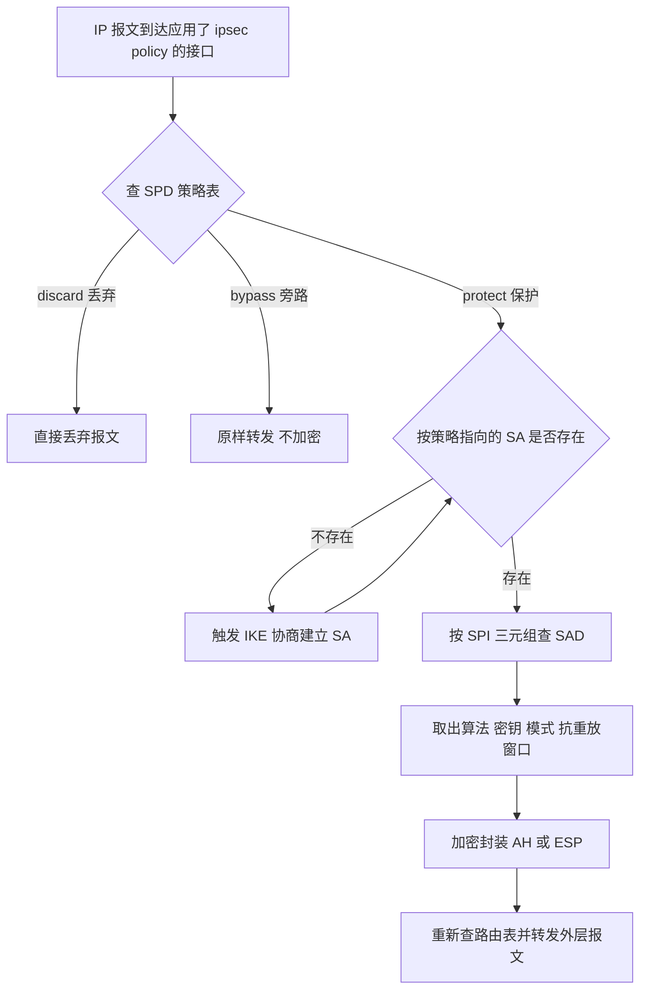

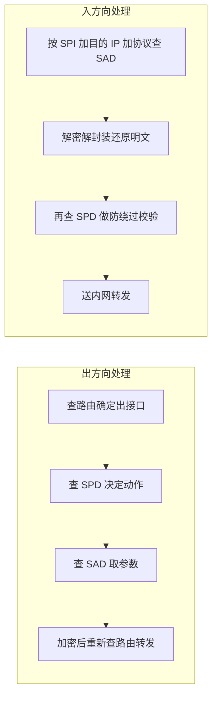

### 真题精练

**Q1.【真题·多选】** 关于 IPSec 的 SA、SAD 与 SPD，下列说法正确的有？
A. SA 是单向的，一条最简单的站点到站点 IPSec 隧道在两个方向上各有一条 SA
B. SA 由三元组唯一标识：SPI、目的 IP 地址、安全协议（AH 或 ESP）
C. SPD 中存放加密算法与密钥，SAD 中存放感兴趣流与动作
D. SPI 由接收方分配，发送方在 AH/ESP 报文中携带该值
E. 入方向报文解密后还需要再查一次 SPD，用于防止明文绕过隧道

> **答案：A、B、D、E**
> **解析**：C 项把两张表的内容完全颠倒了——SPD 存策略（感兴趣流 + 动作 + 对 SA 的引用），SAD 存参数（算法、密钥、计数器、抗重放窗口），这是最经典的混淆点。A、B 是 SA 的两个基本属性；D 体现了"查找发生在接收方"的设计意图；E 即防绕过（anti-bypass）检查，是最容易被忽略的加分点。

**Q2.【真题·简答】** 请说明 IPSec 中 SAD 与 SPD 的作用与相互关系，并指出华为设备上分别用什么命令查看。

> **答案：**
> （1）**SPD（安全策略数据库）**负责"**要不要保护、保护哪些流**"。它以数据流五元组为索引，动作有三种：protect（必须保护，无 SA 时触发协商）、bypass（原样转发）、discard（丢弃）。
> （2）**SAD（安全联盟数据库）**负责"**怎么保护**"。它以 SA 三元组（SPI + 目的 IP + 安全协议）为索引，保存加密/认证算法与密钥、工作模式、隧道端点、SA 生存期、抗重放窗口与序列号等参数。
> （3）**关系**：SPD 是策略层，SAD 是参数层；出方向先查 SPD 决定要不要保护，命中 protect 后再查 SAD 取参数封装；若 SA 不存在则触发 IKE 协商。入方向先用三元组查 SAD 解密，解密后再复检 SPD 做防绕过校验。SPD 的 protect 表项指向 SAD 中对应的 SA（SA bundle）。
> （4）**华为查看命令**：SPD 侧看 `display ipsec policy`（并可结合 `display acl`、`display acl 3400` 看规则与命中计数）；SAD 侧看 `display ipsec sa brief` / `display ipsec sa verbose`，配合 `display ipsec statistics` 看封装与错误计数。

**Q3.【真题·判断】** 在华为 VRP 上，IPSec 策略引用的 ACL 中，被 deny 的报文一定被丢弃。

> **答案：错误**
> **解析**：华为 IPSec 是通过 ACL 的 permit 规则映射 SPD 的 protect 表项；ACL 中**未匹配或 deny** 的报文默认语义是 **bypass（不保护、原样转发）**，而不是丢弃。真正的"丢弃"要由防火墙的 `security-policy` 或显式的拒绝策略完成。这个区别在排错题里很关键：如果只写了 deny 却没有安全策略兜底，本应被拦的明文流量会被直接放行，形成"隧道在跑、明文也在跑"的隐蔽漏洞。

**Q4.【真题·填空】** IPSec 中 AH 的 IP 协议号是 ______，ESP 的 IP 协议号是 ______；SA 三元组中的 SPI 长度为 ______ 位，其中值为 ______ 的 SPI 被保留、不得使用。

> **答案：51；50；32；0**
> **解析**：AH=51、ESP=50 必须背准，排错时判断"防火墙上到底要放行哪个协议"就靠这两个数字。SPI 为 32 bit，由接收方分配；SPI=0 是保留值。附带记：IKE 使用 UDP **500**（NAT 检测到后切换到 UDP **4500**）、GRE 的 IP 协议号 **47**、L2TP 使用 UDP **1701**。

### 易错点与排错

- **易错 1**：把 `display ipsec sa` 当成 SPD 的输出。SPD 看 `display ipsec policy`，SAD 看 `display ipsec sa`。
- **易错 2**：认为"隧道建起来就一定在加密业务"。ACL 写错时会出现"SA 建在错误的流上"，业务流量实际走了 bypass。
- **易错 3**：忘了 bypass 的必要性。IKE 自身的 UDP 500/4500 必须能正常出入，否则 SA 永远协商不出来（表现为 SA 反复重建）。
- **排错命令**：`display ipsec policy`（策略引用是否正确）、`display acl 3400`（规则是否有命中计数，`display acl` 输出中的 matches 计数为 0 说明流量压根没匹配上感兴趣流）、`display ipsec sa brief`（SA 是否存在、方向是否成对）、`display ipsec statistics`（anti-replay 丢弃、解封装失败计数）、`display ipsec interface`（接口上是否真正应用了策略）。

## 3.2 AH 与 ESP 报文结构逐字段

### 考点定位

本考点以**单选/填空/简答/画图**出现，占 **4~8 分**，是国赛安全方向"报文级"考点的最高频落点。命题方式通常是：给出字段名问"哪一项不属于 AH""AH 与 ESP 的认证范围差在哪""哪种模式可以穿越 NAT"。易错点集中在**认证覆盖范围**与**加密覆盖范围**两个边界上。

### 原理精讲

**一、AH（Authentication Header，认证头，IP 协议号 51）。** AH 只做**认证与完整性校验**，**不做加密**——这是它最本质的属性。它的设计目标是"证明报文确实来自声称的对端，且中途未被篡改"，因此它必须把**IP 头中所有不变的字段**都纳入认证范围，否则攻击者只要改一下源 IP 就能伪造。AH 头长度固定为 **24 字节**（不含认证数据），认证数据长度可变（必须是 32 bit 的整数倍），字段如下：

| 字段 | 长度 | 作用与考试要点 |
|---|---|---|
| Next Header（下一个头） | 8 bit | 标识 AH 之后是什么：TCP=6 / UDP=17 / ESP=50（AH+ESP 叠加时） |
| Payload Len（载荷长度） | 8 bit | **以 4 字节（32 bit）为单位**表示 AH 头长度再减 2；AH 固定 24 字节时取值为 **4** |
| Reserved（保留） | 16 bit | 必须置 0 |
| SPI（安全参数索引） | 32 bit | 与目的 IP、协议号共同定位 SAD 中的 SA |
| Sequence Number（序列号） | 32 bit | 从 1 开始单调递增，接收方据此做抗重放；**不可重复使用**（重协商新 SA 时归 1） |
| Authentication Data（认证数据） | 可变（32 bit 整数倍） | HMAC 结果，SHA2-256 时为 32 字节（AH 头变成 24+32=56 字节） |

**AH 的认证范围 = 整个 IP 头（可变字段置零）+ AH 头 + 上层数据**。所谓"可变字段置零"，指 TOS、Flags、Fragment Offset、TTL、Header Checksum、Options 这些传输途中可被合法修改的字段在计算 HMAC 时先置 0。**由此推出三条必须记住的结论**：① AH 能认证源/目的 IP，所以**AH 无法穿越 NAT**（NAT 会改 IP 与端口，校验必然失败）；② AH 不加密，所以**不提供机密性**，不能用于传输敏感数据；③ AH 的校验计算包含 IP 头，导致实现复杂、开销大，现网几乎不用 AH，只在合规场景与 AH+ESP 的 SA bundle 中出现。

**二、ESP（Encapsulating Security Payload，封装安全载荷，IP 协议号 50）。** ESP 同时提供**机密性、完整性、源认证与抗重放**，是唯一被广泛部署的 IPSec 协议。它的报文结构与 AH 完全不同：**头在前面，尾在后面，认证数据在最后**。

| 字段 | 长度 | 作用与考试要点 |
|---|---|---|
| SPI | 32 bit | 与 AH 相同，三元组之一 |
| Sequence Number | 32 bit | 单调递增，抗重放依据；**ESP 的序列号在 SA 建立后从 1 开始** |
| Payload Data（载荷数据） | 可变 | 传输模式放 TCP/UDP 段；隧道模式放**整个原始 IP 报文** |
| Padding（填充） | 0~255 字节 | 把报文补齐到**块加密算法的整数倍**（如 AES 为 16 字节），同时保证 ESP 尾 + 认证数据的对齐 |
| Pad Length（填充长度） | 8 bit | 指出填充了多少字节，供接收方剥离 |
| Next Header（下一个头） | 8 bit | 指出载荷数据的真实类型（TCP=6 / UDP=17 / **IP=4**（隧道模式）） |
| Authentication Data | 可变（32 bit 整数倍） | ICV 完整性校验值，覆盖 **ESP 头 + 载荷 + ESP 尾** |

**ESP 的两条覆盖边界是"必考题"**：**加密覆盖 = Payload Data + Padding + Pad Length + Next Header**（即 ESP 头之后、认证数据之前的一切）；**认证覆盖 = ESP 头 + Payload Data + Padding + Pad Length + Next Header**（**不含** IP 头，也**不含** Authentication Data 自身）。**正因为 ESP 的认证不覆盖外层 IP 头，ESP 才能穿越 NAT**——NAT 改的是 IP 头与（在 4500 封装下）UDP 头，而 ESP 的 ICV 只校验 ESP 头之后的内容，所以校验不会失败。**"AH 不能过 NAT、ESP 能过 NAT"的根因就在这半句话里，这是简答题的标准答案。**

另外要区分两个细节：**ESP 传输模式**下不产生新的 IP 头，原始 IP 头的 Protocol 字段被改为 50；**ESP 隧道模式**下要生成新 IP 头，新头的 Protocol=50，原来的整个 IP 报文（含原 IP 头）被当成载荷加密。隧道模式增加的开销约为 **20（新 IP 头）+ 8（ESP 头）+ 16（AES 填充至块边界）+ 2（ESP 尾）+ 12~32（认证数据）≈ 50~70 字节**，做 MTU 规划时必须考虑（这也是"IPSec 隧道里大包不通、小包能通"的根因，见 3.11 节）。

### 关键概念对照表

| 维度 | AH（协议号 51） | ESP（协议号 50） |
|---|---|---|
| 机密性（加密） | **不提供** | 提供（DES/3DES/AES/SM1/SM4） |
| 完整性/认证范围 | 整个 IP 头（可变字段置零）+ AH 头 + 载荷 | ESP 头 + 载荷 + ESP 尾（**不含外层 IP 头**） |
| 抗重放 | 提供（序列号 + 窗口） | 提供（序列号 + 窗口） |
| 能否穿越 NAT | **不能**（校验覆盖 IP 头） | **能**（校验不覆盖 IP 头） |
| 是否支持组播 | 技术上可行但现网不部署 | 现网方案是 GRE over IPSec，不用 ESP 直接承载组播 |
| 头部位置 | 头在载荷之前，无尾部 | 头在前、尾在后、认证数据在最后 |
| 固定开销 | 24 字节 + 认证数据 | 8 字节头 + 2 字节尾 + 填充 + 认证数据 |
| 典型用途 | 只认证不加密的合规场景、与 ESP 组成 SA bundle | 站点到站点、远程接入、DSVPN 加密等**绝大多数场景** |

| 报文字段所属 | AH | ESP |
|---|---|---|
| Next Header | ✔（AH 头中） | ✔（ESP 尾中，隧道模式填 4） |
| Payload Len / Pad Length | Payload Len（AH 头中，单位 4 字节） | Pad Length（ESP 尾中，单位字节） |
| Reserved | ✔（16 bit 置 0） | ✗ |
| SPI / Sequence Number | ✔ / ✔ | ✔ / ✔ |
| Authentication Data | ✔（最后，覆盖含 IP 头） | ✔（最后，不覆盖 IP 头） |
| Padding | ✗ | ✔（0~255 字节） |

### 华为设备配置

```bash
# ===== 只认证不加密：AH 提议（注意 AH 不能过 NAT，仅用于实验与合规场景）=====
system-view
ipsec proposal prop_ah                                     // 创建安全提议
 transform ah                                              // 指定使用 AH 协议（AH 必须配认证算法，没有加密算法可配）
 authentication-algorithm sha2-256                          // AH 的完整性与认证算法
 encapsulation-mode transport                               // AH 常用传输模式（隧道模式也可，但会额外增加 20 字节外层 IP 头）
quit

# ===== AH + ESP 同时使用（SA bundle）=====
ipsec proposal prop_ah_esp                                 // 一个提议里同时指定两种协议，即 AH+ESP 的 SA bundle
 transform ah-esp                                           // 同时启用 AH 与 ESP
 authentication-algorithm sha2-256                          // AH 使用该认证算法
 esp encryption-algorithm aes-256                           // ESP 使用 AES-256 加密（推荐用 aes-256 或 aes-cbc-256）
 esp authentication-algorithm sha2-256                      // ESP 的认证算法（AH 与 ESP 各自独立）
quit

# ===== 调整 ESP 相关行为 =====
ipsec proposal prop_esp                                    // 进入已有 ESP 提议
 esp encryption-algorithm aes-256                          // 加密算法（AES-GCM 类 AEAD 算法同时提供加密与完整性，无需再配认证算法）
 esp authentication-algorithm sha2-256                     // 认证算法；国密场景可用 sm3
 quit
ipsec policy map_to_hq 10 isakmp                           // 进入 IPSec 策略视图调抗重放参数
 anti-replay window 1024                                   // 抗重放窗口大小，缺省 1024；可按 64/128/256/512/1024/2048/4096 调整
quit

# ===== 查看与验证 =====
display ipsec sa verbose                                   // 输出中可以看到每条 SA 使用的协议（AH/ESP）、加密/认证算法、抗重放窗口与计数器
display ipsec statistics                                   // 观察封装/解封装的字节与报文数，以及各类错误（如认证失败、抗重放丢弃）
display ipsec proposal                                     // 查看本机所有安全提议的参数组合
save                                                       // 保存配置
```

### 示意图

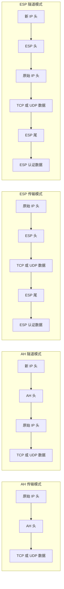

```text
【AH 传输模式逐字节布局】（总开销 = 20 字节原 IP 头 + 24 字节 AH 头 + 认证数据）
+----------------+--------+--------+----------+--------+--------+-----+------------------+--------+
| 原 IP 头 20B   | Next   | Payload| Reserved |  SPI   |  Seq   | ... |  上层数据(TCP/UDP)| Auth   |
| (协议号=51)    | Header |  Len=4 |   0      | 32 bit | 32 bit |     |                  | Data   |
+----------------+--------+--------+----------+--------+--------+-----+------------------+--------+
|<------------------- 认证覆盖范围：IP 头（可变字段置零）+ AH 头 + 上层数据 ------------------->|

【ESP 隧道模式逐字节布局】（总开销 ≈ 50~70 字节）
+-------------+--------+--------+------------------+----------------+-----+----------+--------+-----------+--------+
| 新 IP 头20B |  SPI   |  Seq   |  原始 IP 报文    |    Padding     | Pad | Next     | Auth   |          |        |
| (协议号=50) | 32 bit | 32 bit | (含原 IP 头)     | 补齐到块整数倍 | Len | Header=4 | Data   |          |        |
+-------------+--------+--------+------------------+----------------+-----+----------+--------+-----------+--------+
              |<------------ 加密覆盖范围 --------------------------->|
              |<---------------- 认证覆盖范围（不含外层 IP 头）--------------------->|
```

### 真题精练

**Q1.【真题·单选】** 下列关于 AH 与 ESP 的描述中，正确的是？
A. AH 提供加密，ESP 只提供认证
B. AH 的认证范围包含 IP 头的不变字段，因此 AH 不能穿越 NAT
C. ESP 的认证数据覆盖外层 IP 头，因此 ESP 不能穿越 NAT
D. ESP 的传输模式会生成新的 IP 头

> **答案：B**
> **解析**：A 反了——AH 只认证不加密，ESP 既加密又认证（可选）。C 恰好说反：ESP 的 ICV **不覆盖**外层 IP 头，这正是 ESP 能过 NAT 的原因。D 错误：生成新 IP 头的是**隧道模式**，传输模式沿用原 IP 头，只把 Protocol 改为 50。

**Q2.【真题·多选】** 关于 ESP 报文的字段与覆盖范围，下列说法正确的有？
A. ESP 头包含 SPI 和序列号，各 32 bit
B. Padding 与 Pad Length 用于把报文补齐到块加密算法的整数倍并指示填充长度
C. ESP 的加密范围包括 ESP 头和认证数据
D. ESP 尾中的 Next Header 在隧道模式下取值为 4（表示内层是 IP 报文）
E. ESP 的认证数据长度必须是 32 bit 的整数倍

> **答案：A、B、D、E**
> **解析**：C 错误，加密范围是 **Payload Data + Padding + Pad Length + Next Header**，**不含** ESP 头与认证数据；ESP 头是被"认证"而不是被"加密"的。D 是隧道模式判读的关键细节：传输模式下该字段为 6（TCP）或 17（UDP），隧道模式下为 4（IP）。E 是 ICV 的对齐要求。

**Q3.【真题·简答】** 为什么现网几乎不使用 AH，而在需要"只认证不加密"时也往往改用 ESP 的 NULL 加密？请从 NAT 兼容性与实现复杂度两方面说明。

> **答案：**
> （1）**NAT 兼容性**：AH 的完整性校验覆盖 IP 头（含源/目的地址），任何 NAT 设备修改地址后校验都会失败，因此 AH **无法穿越 NAT**；而今天绝大多数公网接入点都在 NAT 之后，AH 直接不可用。ESP 的 ICV 不覆盖外层 IP 头，再配合 NAT-T（UDP 4500 封装）即可正常穿越。
> （2）**实现复杂度与开销**：AH 需要对 IP 头做可变字段置零处理，并且要处理分片（AH 不能对分片后的报文正确校验，需要先重组），实现复杂、与分片/重组功能冲突；ESP 只需处理自身头部与载荷，实现简单。
> （3）**结论**：需要"只认证不加密"时，业界普遍使用 **ESP + NULL 加密算法**（或用 AES-GCM 之类的 AEAD 算法一次完成加密与认证），既保留了 ESP 的 NAT 穿透能力与统一实现，又满足合规要求。

**Q4.【真题·填空】** AH 头的固定长度为 ______ 字节；当认证算法为 SHA2-256 时，AH 认证数据长度为 ______ 字节，因此 AH 总开销为 ______ 字节；ESP 隧道模式相比传输模式会多出 ______ 字节的外层 IP 头开销。

> **答案：24；32；56；20**
> **解析**：AH 固定头 24 字节（Next Header 1 + Payload Len 1 + Reserved 2 + SPI 4 + Seq 4 + …实际头部字段合计 12 字节后再按 4 字节单位对齐到 24 字节的 IPv4 场景，考试按"AH 头 24 字节"记即可），加 SHA2-256 的 32 字节 ICV 共 56 字节。隧道模式比传输模式多一个 20 字节 IPv4 外层头（IPv6 为 40 字节）。MTU 计算题就靠这几个数字。

### 易错点与排错

- **易错 1**：混淆"加密覆盖"与"认证覆盖"。加密不含 ESP 头与认证数据；认证含 ESP 头但不含外层 IP 头。
- **易错 2**：认为"AH 也能加密"。AH 永远不提供机密性。
- **易错 3**：忘记 ESP 隧道模式的 MTU 开销，导致"ping 小包通、大包不通"，排错时要用 `ping -s 1400` 逐步定位并在隧道接口上 `tcp adjust-mss` 或改接口 MTU。
- **排错命令**：`display ipsec sa verbose`（确认协议是 AH 还是 ESP、算法是否与对端一致）、`display ipsec statistics`（认证失败/抗重放丢弃计数增长说明参数不匹配或存在重放/乱序）、`display interface GigabitEthernet1/0/1`（看 MTU 与分片统计）。

## 3.3 IPSec 封装模式选择与 NAT 场景的必然结论

### 考点定位

本考点以**单选/多选/简答**出现，占 **3~5 分**，核心只有两句话：**传输模式不改变 IP 头，隧道模式新增 IP 头**；**只要路径上有 NAT，就必须用隧道模式 + ESP**。考试爱考"给一个场景选模式"，以及"为什么 NAT 场景必须隧道模式"的因果链。

### 原理精讲

**一、两种模式的本质差别只有一个：是否新增外层 IP 头。** 传输模式（Transport Mode）在原 IP 头与上层数据之间插入 AH/ESP，**保留原始 IP 头**，因此源/目的地址仍是内网地址——它保护的是"两个主机之间的端到端数据流"，只有两端主机都实现 IPSec 时才能用。隧道模式（Tunnel Mode）把**整个原始 IP 报文**（含原 IP 头）当作载荷加密，再套上一个新的 IP 头，新头的源/目的是隧道端点（通常是两台网关的公网地址）——它保护的是"两个网关之间的整条链路"。

**二、场景化选择推理（考试就是考这套推理）。**

| 场景 | 推荐模式 | 推理过程 |
|---|---|---|
| 主机到主机（两端都是支持 IPSec 的服务器/主机） | 传输模式 | 两端本身就是通信端点，不需要隐藏内网地址；传输模式省 20 字节外层 IP 头，开销最小 |
| 网关到网关（站点到站点，总部—分支） | **隧道模式** | 内网用户主机的地址在公网上不可路由，必须用隧道端点的公网地址作为外层地址；同时内网拓扑被隐藏，安全性更好 |
| 主机到网关（远程接入 / L2TP over IPSec 之外的拨号） | 隧道模式 | 客户端私网地址不可路由，需要由网关侧看到"隧道端点地址" |
| 路径上存在 NAT（家庭宽带、4G/5G、运营商 CGNAT） | **隧道模式 + ESP** | 见下条 |
| 需要承载组播/广播或非 IP 协议 | 隧道模式 + GRE（GRE over IPSec） | 见 3.10 节 |

**三、NAT 场景为什么"必须隧道模式 + ESP"，这条因果链必须能完整复述。**

第一，**必须 ESP（不能用 AH）**：AH 的完整性校验覆盖 IP 头，而 NAT 必然改写 IP 地址（有时还改端口），校验必然失败，报文被丢弃。ESP 的 ICV 不覆盖外层 IP 头，NAT 改写外层地址不影响校验。

第二，**必须隧道模式**：这是一个容易被跳过但其实很硬的理由。传输模式下，ESP 保护的载荷是 TCP/UDP 段，而 **TCP/UDP 的校验和（checksum）里包含一个"伪首部"，伪首部含有源/目的 IP 地址**。内网主机的原始 IP 头在传输模式下是明文保留的，如果 NAT 改写了这个 IP 头（这正是 NAT 的职责），那么接收端做完校验和验证时会发现 TCP/UDP 校验和与"被 NAT 改写后的 IP 地址 + 收到的载荷"不匹配而丢包。也就是说：**传输模式把"必须被 NAT 改写的 IP 头"留在了受保护数据之外却又与受保护数据存在校验耦合，形成不可调和的矛盾。** 而隧道模式下，原始 IP 头（含内网地址）被完整地放进加密载荷里，NAT 只能看到并改写外层新 IP 头；内层 IP 头与 TCP/UDP 校验和在解密后完全自洽。

第三，**NAT 设备还需要能正确处理 ESP**。ESP 没有端口号，传统 NAPT（端口复用）无法为 ESP 建立映射表项。因此 IKE 协商时通过 **NAT-D 载荷**探测 NAT 存在，然后**把 ESP 报文封装进 UDP 4500**（即 NAT-T），NAT 设备才能像处理普通 UDP 一样做地址端口转换并维持老化计时。

第四，**还要避免 NAT 设备把 IKE 也改坏**。IKE 在 UDP 500 上协商，检测到 NAT 后切换到 UDP 4500 并在报文前加 4 字节**全零的非 ESP 标记（non-ESP marker）**，用于区分"这是 IKE 报文"还是"这是被封装的 ESP 报文"。

**四、一个必须澄清的常见误解**：有人认为"NAT 场景用野蛮模式就不用隧道模式了"——不对。NAT 场景用野蛮模式是为了**让响应方能根据报文中的 ID 而不是源 IP 去查预共享密钥**（见 3.4 节），与封装模式是两个正交的维度。正确组合是"**隧道模式 + ESP + NAT-T（必要时 + 野蛮模式）**"。

### 关键概念对照表

| 维度 | 传输模式 Transport | 隧道模式 Tunnel |
|---|---|---|
| 是否新增 IP 头 | 不新增，保留原 IP 头 | 新增外层 IP 头（IPv4 +20 字节） |
| 保护对象 | 上层数据（TCP/UDP 段） | 整个原始 IP 报文 |
| 通信端点 | 必须就是 IPSec 端点（主机到主机） | 可以是网关（网关到网关、主机到网关） |
| 内网地址可见性 | 原 IP 头明文可见 | 内网地址被加密隐藏 |
| 额外开销 | 只有 AH/ESP 自身开销 | ESP/AH 开销 + 20 字节外层 IP 头 |
| NAT 场景可用性 | **不可用**（TCP/UDP 伪首部校验冲突） | **必须使用** |
| 组播/广播支持 | 不支持 | 结合 GRE 后支持 |
| 典型部署 | 主机到主机、L2TP over IPSec（Windows 客户端） | 站点到站点、远程接入、DSVPN、GRE over IPSec |

| 场景要素 | 安全协议选择 | 封装模式 | 附加要求 |
|---|---|---|---|
| 两端公网互通、无 NAT、仅需认证 | AH 可选 | 传输或隧道 | 实际更推荐 ESP+NULL 加密 |
| 两端公网互通、无 NAT、需加密 | ESP | 传输（主机间）或隧道（网关间） | 无 |
| 一端在 NAT 后（家庭/4G） | **只能 ESP** | **必须隧道** | 开 NAT-T，IKE 切 UDP 4500 |
| 双方都在 NAT 后 | **只能 ESP** | **必须隧道** | 至少一端能主动发起，注意多 NAT 场景（3.8 节） |
| 需要跑 OSPF/组播 | ESP | 隧道 | 必须 GRE over IPSec（3.10 节） |

### 华为设备配置

```bash
# ===== 站点到站点：隧道模式 + ESP（推荐标准配置，NAT 场景同样适用）=====
system-view
acl number 3400                                            // 感兴趣流：内网到内网
 rule 5 permit ip source 192.168.1.0 0.0.0.255 destination 192.168.2.0 0.0.0.255
quit

ipsec proposal prop_tunnel                                 // 隧道模式提议
 transform esp                                             // NAT 场景必须 ESP，禁用 AH
 encapsulation-mode tunnel                                 // 隧道模式：新增外层 IP 头，内网地址被隐藏
 esp encryption-algorithm aes-256                          // 加密算法
 esp authentication-algorithm sha2-256                     // 认证算法
quit

ike peer peer_branch                                       // IKE 对等体
 pre-shared-key cipher Huawei@123                          // 预共享密钥两端必须一致
 remote-address 203.0.113.9                                // 对端公网地址（NAT 后为 NAT 映射后的地址）
 local-address 202.1.1.1                                   // 本端公网地址
 exchange-mode aggressive                                  // 对端 IP 不固定或位于 NAT 后时常用野蛮模式（见 3.4 节）
 local-id-type name                                        // 野蛮模式建议用 name 作为 ID，避免依赖源 IP 查 PSK
 local-name branch01                                       // 本端 ID 取值（与对端 remote-name 对应）
 version 2                                                 // 使用 IKEv2
quit

ipsec policy map_branch 10 isakmp                          // IPSec 策略
 security acl 3400                                         // 感兴趣流
 ike-peer peer_branch                                      // 阶段一参数
 proposal prop_tunnel                                      // 阶段二参数（隧道模式）
 tunnel local 202.1.1.1                                    // 隧道外层源（必须是接口上真实存在的地址）
 tunnel remote 203.0.113.9                                 // 隧道外层目的
quit

interface GigabitEthernet1/0/1                             // 公网出接口
 ipsec policy map_branch                                   // 应用策略
quit

# ===== 主机到主机：传输模式（对比用，NAT 环境禁用）=====
ipsec proposal prop_transport
 transform esp
 encapsulation-mode transport                              // 传输模式：不新增 IP 头，两端必须都是 IPSec 端点
 esp encryption-algorithm aes-256
 esp authentication-algorithm sha2-256
quit

# ===== 排查 MTU/分片（隧道模式开销导致大包不通时的常用手段）=====
interface Tunnel0/0/0                                      // 若使用隧道接口承载（GRE over IPSec）
 tcp adjust-mss 1200                                       // 调整 TCP MSS，避免依赖分片
quit
display ipsec sa verbose                                   // 确认每条 SA 的 Mode 字段是 tunnel 还是 transport
display interface GigabitEthernet1/0/1                     // 观察接口 MTU 与分片/丢弃计数
save
```

### 示意图

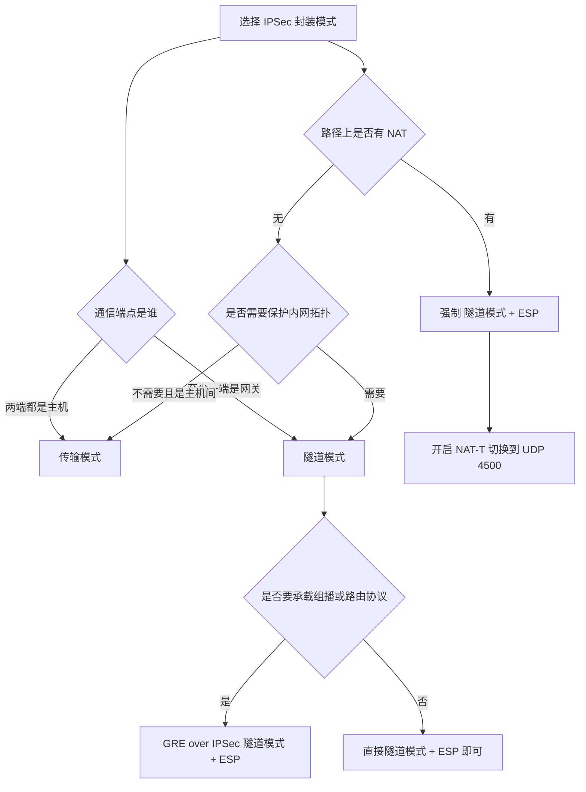

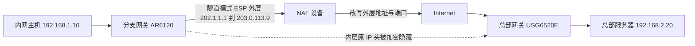

### 真题精练

**Q1.【真题·单选】** 分支机构通过 4G 路由器接入 Internet（地址为运营商 NAT 后的私网地址）访问总部，IPSec 隧道应采用的组合是？
A. AH + 传输模式
B. AH + 隧道模式
C. ESP + 传输模式
D. ESP + 隧道模式

> **答案：D**
> **解析**：AH 的完整性校验覆盖 IP 头，NAT 改写地址后校验必然失败，A、B 排除。传输模式保留原始 IP 头明文，而 TCP/UDP 校验和依赖含 IP 地址的伪首部，NAT 改写 IP 头后接收端 TCP/UDP 校验失败，C 排除。只有 **ESP + 隧道模式**（配合 NAT-T 的 UDP 4500 封装）才能同时解决"校验不覆盖外层地址"与"内层地址自洽"两个问题。

**Q2.【真题·多选】** 下列关于传输模式与隧道模式的说法，正确的有？
A. 传输模式不新增 IP 头，额外开销比隧道模式小 20 字节（IPv4）
B. 隧道模式把原始 IP 报文整体作为载荷，因此可以隐藏内网地址
C. 传输模式可以用于站点到站点的网关间组网
D. 隧道模式下 ESP 尾中的 Next Header 取值为 4
E. 传输模式在 NAT 环境下会因 TCP/UDP 伪首部校验和与改写后的 IP 头不一致而丢包

> **答案：A、B、D、E**
> **解析**：C 错误——站点到站点的内网地址在公网不可路由，网关间必须用隧道模式（否则外层报文的目的地址就是内网地址，根本发不出去）。A、B、D、E 全部成立。E 是"为什么 NAT 场景必须隧道模式"的核心机理，比"AH 不能过 NAT"更容易被漏答。

**Q3.【真题·简答】** 某分支网关位于运营商 NAT 之后，工程师配置了 AH 提议的传输模式 IPSec，结果 SA 能协商成功但业务不通，请分析原因并给出修正方案。

> **答案：**
> （1）**SA 能协商成功的原因**：IKE 本身跑在 UDP 500/4500 上，NAT 设备可正常做地址端口转换，因此阶段一、阶段二协商可以完成，`display ike sa` 与 `display ipsec sa` 都能看到 SA。
> （2）**业务不通的原因有两层**：① AH 的 ICV 覆盖 IP 头（含源/目的地址），NAT 改写外层地址后对端校验失败，报文被丢弃，`display ipsec statistics` 里通常能看到认证失败计数增长；② 即使是 ESP，若用传输模式，原始 IP 头被明文保留且被 NAT 改写，接收端 TCP/UDP 校验和（含伪首部 IP 地址）验证失败而丢包。
> （3）**修正方案**：将提议改为 `transform esp` + `encapsulation-mode tunnel`；确认 NAT-T 已生效（IKE 切换到 UDP 4500，`display ike sa` 中可见 NAT-T 标志）；同时检查两端的安全策略是否放行了 UDP 4500 与 ESP（协议号 50）；若对端 IP 不固定，把 IKE 改为 `exchange-mode aggressive` + `local-id-type name`。

### 易错点与排错

- **易错 1**：把"野蛮模式"当成 NAT 的替代方案。野蛮模式解决的是"身份查找"问题，不解决封装与校验问题。
- **易错 2**：忽略传输模式下 TCP/UDP 校验和的耦合，只会背"AH 不能过 NAT"。
- **易错 3**：隧道模式忘了算 20 字节（IPv6 为 40 字节）外层开销，导致 MSS/MTU 规划错误。
- **排错命令**：`display ipsec sa verbose`（看 Mode 与协议）、`display ike sa`（看是否出现 NAT-T 标志）、`display ipsec statistics`（认证失败计数）、`display firewall session table` 或 `display nat session`（确认外层 UDP 4500 会话是否建立与老化）。

## 3.4 IKEv1 深入：主模式 6 报文、野蛮模式 3 报文与两阶段关系

### 考点定位

本考点是国赛安全方向的**必考简答/画图题**（出现概率最高的一节），分值约 **6~10 分**。命题方式包括：默写主模式 6 报文的载荷与明文/密文属性、比较主模式与野蛮模式、解释 NAT 场景为什么用野蛮模式、说明阶段二快速模式的 3 条报文。易错点：把报文 3/4 说成"加密的"、把 IKE 的 SA 说成"单向两条"、分不清"阶段一身份保护"与"阶段二身份选择符"。

### 原理精讲

**一、IKE 为什么要分成两个阶段（这是理解全部交互的前提）。** IPSec 的参数协商与密钥协商如果每次都从头做一遍 DH 交换与身份认证，代价极高（DH 是模幂运算，计算量远大于对称加密）。IKE 的设计是**分层复用**：**阶段一（Phase 1）**用一次昂贵的身份认证 + DH 交换，建立一条**双向的 IKE SA（ISAKMP SA）**，它的唯一使命是"保护后续所有协商报文"；**阶段二（Phase 2）**在这条受保护的通道里，用很低的代价为每一个具体的感兴趣流协商出一对 **IPSec SA**。这样 10 条感兴趣流只需 1 次阶段一 + 10 次阶段二。此外，阶段二可以独立启用 PFS，使每条 IPSec SA 的密钥彼此隔离（见 3.6 节），这也是分层带来的安全红利。

**二、阶段一主模式（Main Mode）6 条报文逐条解析。** 主模式共 **3 个往返、6 条报文**，分成三组：**SA 协商（报文 1、2）→ 密钥交换（报文 3、4）→ 身份与认证（报文 5、6）**。前 4 条报文是**明文**，第 5、6 条是**密文**——"身份保护（Identity Protection）"这个名号正是来源于"身份是在加密之后才出现的"。

| 报文 | 方向 | 载荷 | 明文/密文 | 关键内容与失败现象 |
|---|---|---|---|---|
| 1 | 发起方 → 响应方 | HDR, SA（含 Proposal/Transform 列表） | 明文 | 发起方把**所有**候选组合一次抛出：加密算法、HASH 算法、认证方式、DH 组、SA 生存期。若两端无任何交集，响应方回 `NO_PROPOSAL_CHOSEN`，表现为 SA 建不起来、`debugging ike` 里看到提议不匹配 |
| 2 | 响应方 → 发起方 | HDR, SA | 明文 | 响应方从候选中选定**唯一**一组 Transform（不允许一次选多组） |
| 3 | 发起方 → 响应方 | HDR, KE, Ni | 明文 | 发送 DH 公钥（g^i）与 Nonce（Ni，一次性随机数，用于抗重放与密钥新鲜性）。KE 明文并不影响安全，因为 DH 的安全性来自"离散对数难解"，窃听者拿到 g^i、g^r 也算不出 g^ir |
| 4 | 响应方 → 发起方 | HDR, KE, Nr | 明文 | 回送 g^r 与 Nr。**到这一步双方已能算出共享秘密 g^ir，并派生出 SKEYID 系列密钥** |
| 5 | 发起方 → 响应方 | HDR*, IDii, HASH_I | **密文** | 用派生的加密密钥加密后发送**身份 IDii** 与 **HASH_I**。HASH_I 是对"身份 + 协商参数 + 双方 Cookie + DH 公钥"做的 HMAC，用来证明"我确实持有 PSK/私钥"。这一条是**认证的关键节点**：PSK 不一致、ID 类型不匹配（`local-id-type` 与对端 `remote-name` 不一致）都会在这里失败 |
| 6 | 响应方 → 发起方 | HDR*, IDir, HASH_R | **密文** | 回送自己的身份 IDir 与 HASH_R，双向认证完成，IKE SA 建立 |

**密钥派生链条（HCIE 要能写出公式）**：先算共享秘密 `g^ir`，再算 `SKEYID`：

- 预共享密钥认证：`SKEYID = prf(pre-shared-key, Ni | Nr)`
- 数字签名认证：`SKEYID = prf(Ni | Nr, g^ir)`
- 加密 Nonce 认证：`SKEYID = prf(hash(Ni | Nr), CKY-I | CKY-R)`

再由 SKEYID 派生出三把用途不同的密钥：`SKEYID_d`（派生 IPSec SA 密钥用）、`SKEYID_a`（IKE 报文完整性用）、`SKEYID_e`（IKE 报文加密用）。身份认证的哈希为：

- `HASH_I = prf(SKEYID, g^i | g^r | CKY-I | CKY-R | SAi_b | IDii_b)`
- `HASH_R = prf(SKEYID, g^r | g^i | CKY-R | CKY-I | SAi_b | IDir_b)`

**由公式可以推出一个排错要点**：HASH 里包含了 Cookie、DH 公钥、SA 提议体、身份体——**任何一项在两端的理解不一致，HASH 校验就失败**。因此"PSK 一致但仍然认证失败"时，要优先怀疑 ID 类型与取值（例如一端 ID 用 IP、另一端用 name），而不是反复改 PSK。

**三、野蛮模式（Aggressive Mode）3 条报文逐条解析。** 野蛮模式把主模式的前四条报文压缩：发起方在**第 1 条报文里就同时发送 SA 提议、DH 公钥、Nonce 与身份**，响应方在第 2 条里一次回全，第 3 条做最后确认。代价是**身份在明文报文中暴露**，且发起方**只能提出一组提议**（不能像主模式那样一次抛出多组候选，灵活性下降）。

| 报文 | 方向 | 载荷 | 明文/密文 | 关键内容 |
|---|---|---|---|---|
| 1 | 发起方 → 响应方 | HDR, SA, KE, Ni, **IDii** | 明文 | 提议 + DH + Nonce + **身份（明文，无身份保护）** |
| 2 | 响应方 → 发起方 | HDR, SA, KE, Nr, **IDir**, HASH_R | 明文 | 选定参数，回送自己的 DH、Nonce、身份与 HASH_R |
| 3 | 发起方 → 响应方 | HDR*, HASH_I | 密文 | 发起方确认身份，IKE SA 建立 |

**四、主模式与野蛮模式的对比与选型。**

| 维度 | 主模式 Main Mode | 野蛮模式 Aggressive Mode |
|---|---|---|
| 报文数 / 往返 | 6 条 / 3 个往返 | 3 条 / 1.5 个往返 |
| 身份保护 | **有**（身份在第 5、6 条密文中） | **无**（身份在第 1、2 条明文中） |
| 提议灵活性 | 可一次提出多组候选，匹配成功率高 | 只能提一组，参数不一致就直接失败 |
| PSK 查找依据 | 依赖**源 IP 地址**定位对端与 PSK | 依据报文中的 **ID**（可配为 name）定位 |
| 对动态地址/ NAT 的适应性 | 差（源 IP 变化后可能找不到 peer） | **好**（不依赖源 IP） |
| 计算与开销 | 略高（多两次报文） | 略低 |
| 典型场景 | 两端地址固定、对身份保密有要求的总部—分支 | 拨号/4G 分支、一端地址不固定、NAT 穿越、与部分第三方设备互通 |

**五、NAT 场景为什么常用野蛮模式（必须能完整讲清因果链）。** IKE 的预共享密钥认证在实现上有一个硬约束：**响应方必须先确定"用哪一份 PSK"才能验证 HASH**。主模式的报文 5 才携带 ID，因此响应方在报文 2~4 阶段就要靠**报文源 IP 地址**去匹配本地 `ike peer` 配置并取出 PSK 来预计算 HASH；而在 NAT 场景下，发起方的源地址已被 NAT 改写，响应方要么匹配不到任何 peer（协商失败），要么匹配到错误的 peer（多分支多 PSK 时直接失败）。野蛮模式的第 1 条报文就携带 ID，响应方可以直接用 **ID（name 或 IP）** 匹配到正确的 `ike peer` 与 PSK，因此天然适配"NAT 后接入"和"分支地址不固定"两种场景。**结论：NAT + 地址不固定的场景，典型配置是"野蛮模式 + `local-id-type name` + 两端配置对应的 `local-name`/`remote-name`"。** 但要注意野蛮模式牺牲了身份保护与提议灵活性，在地址固定的站点间互联中不应使用。

**六、阶段二快速模式（Quick Mode）3 条报文。** 快速模式的全部报文都被阶段一的 IKE SA 加密保护（所以叫"快速"——不需要再做身份认证与 DH，除非开 PFS）。

| 报文 | 方向 | 载荷 | 说明 |
|---|---|---|---|
| 1 | 发起方 → 响应方 | HDR*, HASH(1), SA, Ni, [KE], [IDci, IDcr] | 提出 IPSec 提议（协议、算法、封装模式、生存期）与 Nonce；`[KE]` 仅在**开启 PFS** 时出现；`IDci/IDcr` 是感兴趣流标识（源自 ACL） |
| 2 | 响应方 → 发起方 | HDR*, HASH(2), SA, Nr, [KE], [IDci, IDcr] | 选定参数、交换 SPI（双方各自生成自己接收方向的 SPI 并告知对端） |
| 3 | 发起方 → 响应方 | HDR*, HASH(3) | 最终确认，IPSec SA 建立完成 |

三个 HASH 的构成（体现"报文顺序绑定"，防重放与篡改）：

- `HASH(1) = prf(SKEYID_a, M-ID | SA | Ni [ | KE ] [ | IDci | IDcr ])`
- `HASH(2) = prf(SKEYID_a, M-ID | Ni | SA | Nr [ | KE ] [ | IDci | IDcr ])`
- `HASH(3) = prf(SKEYID_a, 0 | M-ID | Ni | Nr)`

**注意 HASH(2) 中同时包含 Ni 与 Nr**——这意味着响应方确认"我看到了你的 Nonce"，形成双向绑定；HASH(3) 只有双方 Nonce 无 SA，起"最终握手确认"作用，防止发起方在不知道响应方 Nonce 的情况下就认为自己建 SA 成功了（避免半开连接）。

**七、IKE SA 与 IPSec SA 的关系（高频考点）。**

| 维度 | IKE SA（阶段一） | IPSec SA（阶段二） |
|---|---|---|
| 保护对象 | IKE 协商报文自身 | 业务数据流量 |
| 方向性 | **双向共用一条** | **单向**，每条隧道每个方向一条（成对出现） |
| 数量关系 | 一对端点之间通常 1 条 | 一个 IKE SA 可派生多对 IPSec SA（对应多个感兴趣流） |
| 缺省生存期 | **86400 秒（24 小时）**，只有时间限制 | **3600 秒 / 1843200 KB**，时间与流量双阈值 |
| 到期行为 | IKE SA 被删除/到期会**连带删除**由它协商出的全部 IPSec SA，业务需重新走阶段一 | IPSec SA 到期可单独重协商（快速模式），**不必重做阶段一** |
| 建立方式 | 主模式或野蛮模式 | 快速模式（IKEv1）/ CREATE_CHILD_SA（IKEv2） |
| 认证内容 | PSK / 证书 / 签名 | 无独立认证，仅由 IKE SA 保护并做 HASH 校验 |

### 关键概念对照表

| 报文序号 | 主模式（6 条） | 野蛮模式（3 条） | 是否加密（主/野蛮） |
|---|---|---|---|
| 1 | HDR, SA | HDR, SA, KE, Ni, IDii | 明文 / 明文 |
| 2 | HDR, SA | HDR, SA, KE, Nr, IDir, HASH_R | 明文 / 明文 |
| 3 | HDR, KE, Ni | HDR*, HASH_I | 明文 / 密文 |
| 4 | HDR, KE, Nr | — | 明文 / — |
| 5 | HDR*, IDii, HASH_I | — | 密文 / — |
| 6 | HDR*, IDir, HASH_R | — | 密文 / — |

| 华为命令/参数 | 作用 | 考试要点 |
|---|---|---|
| `exchange-mode main` | 阶段一使用主模式（缺省） | 地址固定、需身份保护时使用 |
| `exchange-mode aggressive` | 阶段一使用野蛮模式 | NAT / 地址不固定场景使用 |
| `local-id-type ip \| name` | 指定本端身份 ID 的类型 | 野蛮模式建议用 `name`，避免依赖源 IP 查 PSK |
| `local-name` / `remote-name` | 设置本端/对端 ID 取值 | 必须与对端配置**互相吻合**，否则 HASH 校验失败 |
| `ike proposal` 中 `sa duration` | IKE SA 生存期（缺省 86400 秒） | 两端不一致时以较短者触发重协商 |
| `display ike sa` / `display ike sa verbose` | 查看 IKE SA 与阶段一参数 | 排错第一命令，见 3.11 节 |

### 华为设备配置

```bash
# ===== 场景一：总部（地址固定）+ 分支（ADSL/4G，NAT 后）→ 野蛮模式 =====
system-view

ike proposal 10                                            // IKE 阶段一提议
 authentication-method pre-share                           // 预共享密钥认证
 authentication-algorithm sha2-256                          // HASH 算法
 encryption-algorithm aes-cbc-256                           // IKE 报文加密算法
 dh group14                                                 // DH 组 14（2048 bit）
 sa duration 86400                                          // IKE SA 生存期 86400 秒
quit

ike peer peer_branch                                       // 总部侧 IKE 对等体
 version 2                                                 // 使用 IKEv2（若对端只支持 IKEv1，改为 version 1）
 exchange-mode aggressive                                  // 野蛮模式：分支在 NAT 后/地址不固定时必须选它
 local-id-type name                                        // 总部本端 ID 用 name 形式
 local-name HQ_GW                                          // 总部 ID 取值（对端用 remote-name HQ_GW 匹配）
 remote-name BRANCH01                                      // 期望对端 ID 取值（对端用 local-name BRANCH01 匹配）
 pre-shared-key cipher Huawei@123                          // PSK，两端必须完全一致
 remote-address 0.0.0.0                                    // 地址不固定时不便固定对端地址，可结合对端主动发起
 ike-proposal 10                                           // 引用 IKE 提议
quit

# ===== 场景二：分支侧（发起方）=====
ike peer peer_hq
 version 2
 exchange-mode aggressive                                   // 两端模式需匹配（协商参数一致）
 local-id-type name                                         // 分支本端 ID 用 name
 local-name BRANCH01                                        // 与总部 remote-name 对应
 remote-name HQ_GW                                          // 与总部 local-name 对应
 pre-shared-key cipher Huawei@123                           // 与总部完全一致
 remote-address 202.1.1.1                                   // 总部固定公网地址
 local-address 192.168.10.1                                 // 本端 IKE 源地址（NAT 前为私网地址）
 ike-proposal 10
quit

ipsec policy map_hq 10 isakmp                              // IPSec 策略
 security acl 3400                                         // 感兴趣流（内网到内网）
 ike-peer peer_hq                                          // 引用 IKE 对等体
 proposal prop_esp                                         // 引用 IPSec 提议（隧道模式 ESP）
 tunnel local 192.168.10.1                                 // 隧道本地地址
 tunnel remote 202.1.1.1                                   // 隧道对端地址
quit

interface GigabitEthernet1/0/1                             // 公网出接口
 ipsec policy map_hq                                       // 应用策略
quit

# ===== 排错：看得见阶段一与阶段二到底走到哪一步 =====
display ike sa                                             // 看 IKE SA 是否存在、Phase 字段是 v1/v2、State 是 Established
display ike sa verbose                                     // 看阶段一协商出来的算法、DH 组、身份 ID、NAT-T 标志
display ike sa peer 202.1.1.1                              // 只看某个对端的 IKE SA（多分支场景很有用）
display ike statistics                                     // 看 IKE 报文的收发与错误计数
display ipsec sa                                           // 看阶段二是否协商出成对的 IPSec SA（inbound/outbound）
save
```

### 示意图

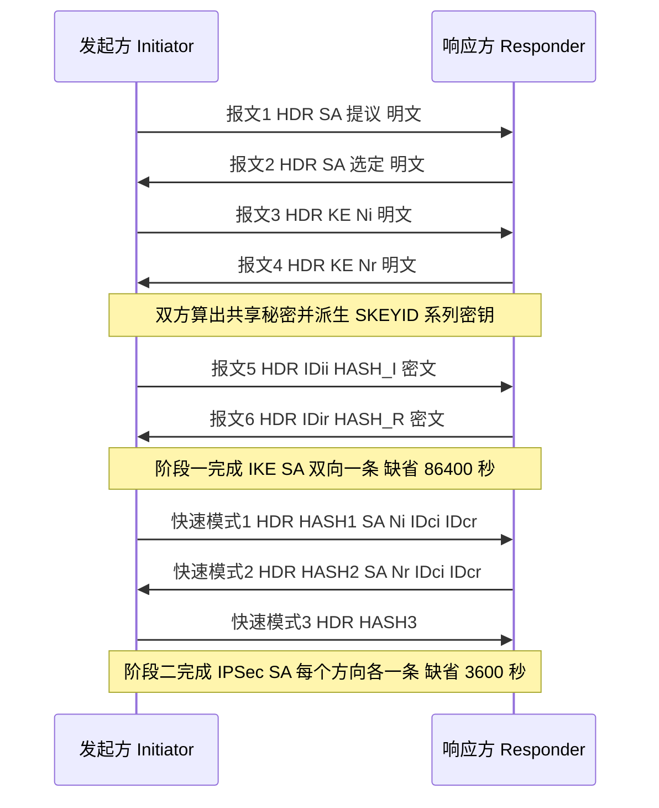

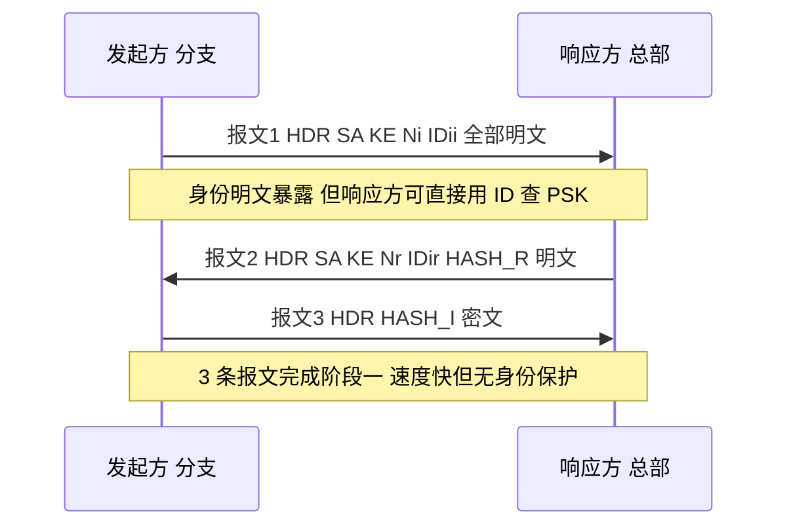

### 真题精练

**Q1.【真题·简答】** 请按顺序写出 IKEv1 主模式阶段一 6 条报文的载荷，并指出哪些报文是加密的、身份保护体现在哪里。

> **答案：**
> 报文 1：`HDR, SA`（发起方提出全部候选提议）——**明文**
> 报文 2：`HDR, SA`（响应方选定一组）——**明文**
> 报文 3：`HDR, KE, Ni`（发起方 DH 公钥与 Nonce）——**明文**
> 报文 4：`HDR, KE, Nr`（响应方 DH 公钥与 Nonce）——**明文**
> 报文 5：`HDR*, IDii, HASH_I`（发起方身份与哈希）——**密文**
> 报文 6：`HDR*, IDir, HASH_R`（响应方身份与哈希）——**密文**
> **身份保护**：双方的身份 ID 只在报文 5、6 中携带，而这两条报文是用 SKEYID_e 加密的，因此链路上的窃听者看不到通信双方的真实身份（只看到两个 IP 地址），这就是"主模式提供身份保护"的含义。相对地，野蛮模式在第 1、2 条明文中就携带 ID，无身份保护。

**Q2.【真题·多选】** 关于 IKEv1 主模式与野蛮模式，下列说法正确的有？
A. 主模式需要 6 条报文、3 个往返，野蛮模式只需 3 条报文
B. 野蛮模式的发起方只能提出一组提议，协商灵活性低于主模式
C. 野蛮模式提供身份保护，因此比主模式更安全
D. 在 NAT 场景下，响应方按源 IP 地址查找预共享密钥会遇到困难，而野蛮模式可按报文中的 ID 查找，因此 NAT 场景常用野蛮模式
E. 主模式的报文 3、4 承载 DH 公钥与 Nonce，这两条报文是加密的

> **答案：A、B、D**
> **解析**：C 反了——野蛮模式的身份在第 1、2 条**明文**报文中携带，**没有**身份保护，安全性低于主模式，它换来的是速度与 NAT/动态地址适应性。E 错误：报文 3、4 是**明文**，DH 的安全性来自离散对数难题，不依赖报文的机密性。D 是本考点的核心结论，也是简答题的固定得分点。

**Q3.【真题·排错】** 某工程师配置了主模式 IPSec，`display ike sa` 始终没有表项，`debugging ike` 显示协商进行到第 5 条报文后失败。请列出最可能的三类原因及验证方法。

> **答案：**
> 协商能走到报文 5，说明阶段一的提议（报文 1、2）与密钥交换（报文 3、4）**都已成功**，失败点集中在**身份与认证**上：
> （1）**预共享密钥不一致**（含大小写、特殊字符、`cipher` 加密存储后两端手工输入不同）。验证：两端用 `display ike peer` 或重新统一下发同一 PSK，注意用 `cipher` 时输入的是明文、设备内部加密存储，两端只能通过"重新输入同一明文"来保证一致。
> （2）**身份 ID 类型或取值不匹配**：一端 `local-id-type ip`，另一端配置了 `remote-name`；或 name 取值大小写不一致。验证：`display ike sa verbose` 看协商出的 ID 与本地/对端配置，检查 `local-name`/`remote-name` 的互相吻合关系。
> （3）**IKE 提议参数被"部分匹配"**：例如两端 `authentication-algorithm` 一致但 `dh group` 不同（这种情况下一般会更早失败），或一端开启了 `authentication-method rsa-signature` 而另一端是 `pre-share`。验证：`display ike proposal` 与 `display ike sa verbose` 对比两端实际协商结果。
> 另外要留意：如果第 5 条报文的**发送方向**在中间被设备拦截（例如运营商或中间防火墙丢弃了 UDP 500 的大包 / 分片报文），也会表现为"卡在报文 5"，此时用 Wireshark 在两端同时抓包，判断到底是"没发出"还是"被丢了"。

**Q4.【真题·填空】** IKEv1 阶段一主模式的第 ______ 条报文开始使用加密保护；阶段二快速模式共 ______ 条报文；IKE SA 的缺省生存周期是 ______ 秒，IPSec SA 的缺省生存周期是 ______ 秒或 ______ KB。

> **答案：5（第 5 条起加密）；3；86400；3600；1843200**
> **解析**：报文 1~4 明文、5~6 密文，这是主模式最容易被记错的地方。快速模式 3 条报文（HASH(1)/HASH(2)/HASH(3)）。生存期数值是必背项：IKE SA 86400 秒；IPSec SA 3600 秒 / 1843200 KB，两者是"时间或流量先到先触发"的关系。

### 易错点与排错

- **易错 1**：把报文 3、4 说成加密的。DH 公钥与 Nonce 是明文，安全性由 DH 数学性质保证。
- **易错 2**：认为 IKE SA 也是单向两条。IKE SA 是**双向共用一条**，单向成对的是 IPSec SA。
- **易错 3**：以为"PSK 一致就一定认证通过"。HASH 里还包含 Cookie、DH 公钥、SA 提议体、身份体，ID 配置不匹配同样失败。
- **易错 4**：野蛮模式两端配置不一致（一端 main、一端 aggressive），协商必然失败；且野蛮模式只能提一组提议，必须逐项对齐。
- **排错命令**：`display ike sa`（有无 SA）、`display ike sa verbose`（算法、DH 组、ID、NAT-T 标志）、`display ike sa peer <ip>`、`display ike statistics`（收发与错误计数）、`display ipsec sa`（阶段二是否成功）、`debugging ike all` 与 `terminal monitor` / `terminal debugging`（**生产网慎用**，见 3.11 节注意事项）。

## 3.5 IKEv2 的改进与报文交互

### 考点定位

本考点以**多选/简答/对比表**出现，占 **4~6 分**。命题方式：IKEv1 与 IKEv2 的差异对比、IKEv2 的 4 条报文与载荷、IKEv2 的内建 NAT 检测与防 DoS 机制。易错点：把 IKEv2 说成"三个阶段"、把 IKE_AUTH 说成明文、以为 IKEv2 不支持预共享密钥。

### 原理精讲

**一、IKEv2 的设计目标：把 IKEv1 的"历史包袱"砍掉。** IKEv1 的复杂来自它的"协商式设计"——它把"用什么交换类型"本身也当成协商内容，导致定义了 32 种 Exchange Type，实际只用了主模式、野蛮模式、快速模式几种；同时 NAT 检测、防 DoS、用户认证等后来才需要的功能只能通过私有的 Vendor ID 载荷"打补丁"。IKEv2（RFC 7296，已替代 RFC 5996）做了减法：**Exchange Type 精简为 4 种**——`IKE_SA_INIT`、`IKE_AUTH`、`CREATE_CHILD_SA`、`INFORMATIONAL`；把"阶段一/阶段二"合并为"IKE SA 的建立"与"Child SA 的建立"，并把第一个 Child SA 的建立直接塞进 `IKE_AUTH`。

**二、IKEv2 的 4 条报文（这是必须能默写的部分）。** IKEv2 建立 IKE SA + 首个 Child SA（即 IPSec SA）只需 **2 个往返、4 条报文**，而 IKEv1 主模式 + 快速模式需要 **6 + 3 = 9 条报文（4.5 个往返）**。

| 交换 | 报文 | 载荷 | 是否加密 | 要点 |
|---|---|---|---|---|
| IKE_SA_INIT | 1（发起方 → 响应方） | HDR, SAi1, KEi, Ni, [N(NAT_DETECTION_SOURCE_IP), N(NAT_DETECTION_DESTINATION_IP)], [CERTREQ], [N(FRAGMENTATION_SUPPORTED)] | 明文 | 协商算法、交换 DH 公钥与 Nonce、**顺带完成 NAT 检测**（把"我看到的源/目的 IP 的哈希"与真实值对比） |
| IKE_SA_INIT | 2（响应方 → 发起方） | HDR, SAr1, KEr, Nr, [N(NAT_DETECTION_*), CERTREQ] | 明文 | 选定算法；若需要防 DoS 会附带 `N(COOKIE)` 要求发起方重发 |
| IKE_AUTH | 3（发起方 → 响应方） | HDR, **SK**{IDi, [CERT], [CERTREQ], [IDr], **AUTH**, SAi2, TSi, TSr} | **密文** | 身份、认证数据（AUTH）、**同时携带第 2 个 SA 提议 SAi2 与流量选择符 TSi/TSr**，即在这一条里就把第一个 IPSec SA 建起来 |
| IKE_AUTH | 4（响应方 → 发起方） | HDR, **SK**{IDr, [CERT], **AUTH**, SAr2, TSi, TSr} | **密文** | 响应方身份与认证，确认 IPSec SA 建立。至此 4 条报文同时完成"身份认证 + IKE SA + 首个 Child SA" |

**`SK{}` 的含义**：`SK` 是"加密与完整性保护的载荷容器"（Encrypted and Authenticated Payload），凡是被 `SK{}` 包住的载荷都在 IKEv2 派生的密钥保护之下。因此 IKEv2 中**除 IKE_SA_INIT 的 4 类载荷外，其余全部加密**，包括身份、证书、流量选择符——比 IKEv1"只在报文 5、6 保护身份"要彻底得多。

**`AUTH` 载荷的巧思**：AUTH 的计算把**本条报文之前的全部内容（含对方的 Nonce 与 DH 公钥）**作为 MAC/签名的输入，即 `AUTH = prf(prf(SK_pi, "Key Pad for IKEv2"), <实时的报文内容>)`（PSK 认证场景）。这样一来，攻击者即使窃听到全部明文报文，也无法重放到另一个会话（Nonce 每次不同）；同时把身份与密钥交换绑定在一起，抵抗中间人攻击。

**三、IKEv2 的关键改进逐项说明。**

1. **报文更少、更快**：4 条报文完成 IKE SA + Child SA，且 IKE_AUTH 的第 3 条报文就已携带 Child SA 提议，减少了往返。
2. **SA 生命周期与重协商更简单（make-before-break）**：IKEv1 重协商 IPsec SA 时是"先删旧 SA 再建新 SA"，中间存在丢包窗口；IKEv2 统一用 `CREATE_CHILD_SA` 交换（`HDR, SK{SA, Ni, [KEi], TSi, TSr}` / `HDR, SK{SA, Nr, [KEr], TSi, TSr}`），**先建立新 SA、再删除旧 SA**，业务无感知。IKE SA 自身的重协商也用同一交换类型完成。
3. **内建 NAT 检测**：`NAT_DETECTION_SOURCE_IP` 与 `NAT_DETECTION_DESTINATION_IP` 通知载荷直接放在 `IKE_SA_INIT` 里，内容是对"源/目的 IP + 端口"的哈希。双方把收到的哈希与"自己看到的实际地址 + 端口"算出的哈希对比：不一致即说明中间有 NAT，随后**自动把后续报文切换到 UDP 4500** 并启动 NAT 保活（keepalive），无需任何额外协商或 Vendor ID 探测。相比之下 IKEv1 要先发 Vendor ID 探测、再在阶段一或快速模式中用 NAT-D 载荷确认。
4. **内建防 DoS 的 Cookie 机制**：响应方在 `IKE_SA_INIT` 响应中可返回 `N(COOKIE)`（Cookie 由双方 IP 与一个本机密钥派生）；发起方必须在重发的 `IKE_SA_INIT` 中带回该 Cookie。这样响应方**无需保存任何半开状态**就能验证请求的真实性，从而抵御伪造源 IP 的洪泛攻击（IKEv1 没有这个机制，容易被半开 SA 耗尽内存）。
5. **支持 EAP 与更丰富的认证**：IKEv2 支持 PSK、RSA 签名、以及 **EAP（Extensible Authentication Protocol，可扩展认证协议）**（如 EAP-MSCHAPv2、EAP-TLS、EAP-AKA）。这让"网关之间用证书/PSK，而"用户拨号接入用账号口令"的混合场景变得自然——这也是华为远程接入类方案（SecoClient、IKEv2 拨号）偏向 IKEv2 的原因。
6. **支持 MOBIKE（RFC 4555）**：终端在 Wi-Fi 与 4G 之间切换导致 IP 变化时，可在不重建 IKE SA 的前提下迁移 SA，适合移动办公。
7. **错误通知更规范**：所有失败原因都用标准的 Notify 载荷表达（如 `NO_PROPOSAL_CHOSEN`、`AUTHENTICATION_FAILED`、`INVALID_KE_PAYLOAD`），其中 `INVALID_KE_PAYLOAD` 会直接告诉对端"请换这个 DH 组重试"，排错比 IKEv1 友好得多。
8. **NAT 保活**：检测到 NAT 后自动周期性发送保活报文，用于维持中间 NAT 设备的映射表项不老化——这是"隧道白天正常、晚上断"类故障的常见根因。

### 关键概念对照表

| 维度 | IKEv1 | IKEv2 |
|---|---|---|
| 标准 | RFC 2409（原始） | RFC 7296（现行） |
| 交换类型数量 | 32 种（实际常用 3 种） | 4 种：IKE_SA_INIT / IKE_AUTH / CREATE_CHILD_SA / INFORMATIONAL |
| 建立 IKE SA + 首个 IPSec SA 的报文数 | 6 + 3 = 9 条（4.5 个往返） | **4 条（2 个往返）** |
| 身份保护 | 主模式有、野蛮模式无 | **默认全部保护**（除 IKE_SA_INIT 的少量载荷） |
| NAT 检测 | 需 Vendor ID + NAT-D 载荷，分阶段探测 | **内建**，在 IKE_SA_INIT 的 Notify 载荷中完成 |
| 检测到 NAT 后的动作 | 切换 UDP 4500，加 4 字节非 ESP 标记，启动保活 | 同左（自动） |
| 防 DoS | 无内建机制 | **Cookie 机制**（无状态验证） |
| 重协商方式 | 删旧建新，有丢包窗口 | **CREATE_CHILD_SA 先建后删**，业务不中断 |
| 认证方式 | PSK、RSA 签名、加密 Nonce | PSK、RSA 签名、**EAP** |
| 移动性 | 不支持 | 支持 **MOBIKE** |
| 与 IKEv1 互通 | — | 同一设备可同时支持 v1/v2，但**同一对等体两端版本必须一致**（`ike peer` 的 `version`） |
| 华为配置 | `ike peer` 下 `version 1`（缺省） | `ike peer` 下 `version 2` |

| IKEv2 交换类型 | 用途 | 典型载荷 |
|---|---|---|
| `IKE_SA_INIT` | 协商算法、交换 DH、检测 NAT | SAi1/SAr1、KEi/KEr、Ni/Nr、NAT_DETECTION_*、COOKIE |
| `IKE_AUTH` | 身份认证 + 建立首个 Child SA | SK{IDi, AUTH, SAi2, TSi, TSr} / SK{IDr, AUTH, SAr2, TSi, TSr} |
| `CREATE_CHILD_SA` | 建立额外 Child SA、重协商（rekey） | SK{SA, Ni, [KEi], TSi, TSr} 等 |
| `INFORMATIONAL` | 删除 SA、DPD 存活探测 | SK{Delete} 或空载荷 |

### 华为设备配置

```bash
# ===== 配置 IKEv2 站点到站点 IPSec（USG6000E V600R007）=====
system-view

ike proposal 20                                            // IKEv2 使用的提议（IKEv2 支持 prf，建议显式配置）
 authentication-method pre-share                           // IKEv2 同样支持 PSK；也可用 rsa-signature 走证书
 authentication-algorithm sha2-256                         // 完整性算法
 encryption-algorithm aes-cbc-256                          // 加密算法
 dh group14                                                // DH 组（两端必须一致；若对端不支持，可降到 group2/group5）
 prf hmac-sha2-256                                         // IKEv2 引入的伪随机函数参数（IKEv1 无此参数）
 sa duration 86400                                         // IKE SA 生存期
quit

ike peer peer_v2                                           // IKE 对等体
 version 2                                                 // **关键：切换为 IKEv2**（缺省为 version 1）
 ike-proposal 20                                           // 引用 IKEv2 提议
 pre-shared-key cipher Huawei@123                          // 预共享密钥
 local-address 202.1.1.1                                   // 本端 IKE 源地址
 remote-address 203.0.113.9                                // 对端 IKE 地址
 local-id-type ip                                          // ID 类型（IKEv2 默认用 IP 作为 IDi/IDr）
quit

ipsec proposal prop_esp                                    // IPSec 提议（IKEv2 的 Child SA 参数）
 transform esp
 encapsulation-mode tunnel
 esp encryption-algorithm aes-256
 esp authentication-algorithm sha2-256
quit

ipsec policy map_v2 10 isakmp                              // IPSec 策略（引用 v2 的 IKE peer）
 security acl 3400
 ike-peer peer_v2
 proposal prop_esp
 tunnel local 202.1.1.1
 tunnel remote 203.0.113.9
 sa duration time-based 3600                               // Child SA 时间生存期（IKEv2 会先建后删重协商）
 sa duration traffic-based 1843200                         // Child SA 流量生存期
quit

interface GigabitEthernet1/0/1
 ipsec policy map_v2
quit

# ===== 查看 IKEv2 状态与重协商情况 =====
display ike sa                                             // 输出中 Version 字段显示 v2；State 为 Established 表示 IKE SA 已建立
display ike sa verbose                                     // 查看 IKEv2 的 SPI（Initiator/Responder 各 8 字节）、算法、NAT-T 标志
display ike sa peer 203.0.113.9                            // 按对端过滤（多分支场景）
display ike statistics                                     // 收发的 IKE 报文计数与错误计数（可用于判断保活是否正常）
display ipsec sa                                           // 查看由 IKEv2 协商出的 Child SA（成对出现）
display ike peer peer_v2                                   // 确认对端配置（检查 version 是否为 2）
save
```

### 示意图

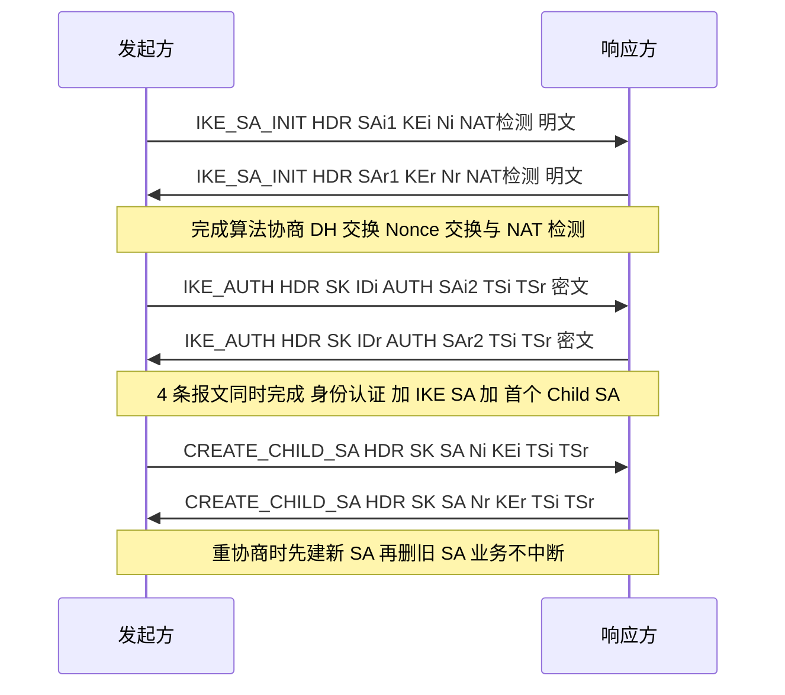

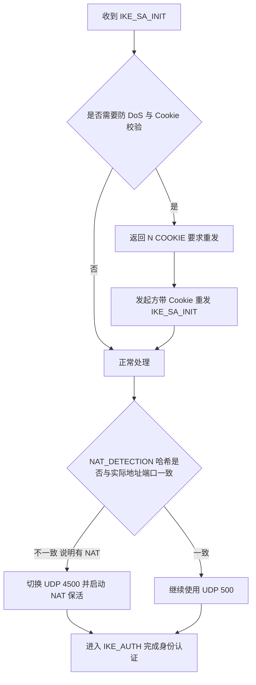

### 真题精练

**Q1.【真题·多选】** 关于 IKEv2 相比 IKEv1 的改进，下列说法正确的有？
A. 建立 IKE SA 与首个 IPSec SA 只需 4 条报文、2 个往返
B. IKEv2 内建 NAT 检测，通过 NAT_DETECTION_SOURCE_IP / NAT_DETECTION_DESTINATION_IP 通知载荷实现
C. IKEv2 支持 EAP 认证，适合用户级远程接入
D. IKEv2 的 IKE_AUTH 交换是明文的，因此身份不做保护
E. IKEv2 重协商 IPsec SA 时采用先建新 SA 再删旧 SA 的方式，减少丢包

> **答案：A、B、C、E**
> **解析**：D 错误——`IKE_AUTH` 的载荷全部包在 `SK{}` 中，是**加密**的；IKEv2 中只有 `IKE_SA_INIT` 的若干载荷是明文（SAi1、KEi、Ni、NAT 检测通知），身份、证书、AUTH 全在密文里，身份保护比 IKEv1 更彻底。

**Q2.【真题·简答】** 请列出 IKEv2 的 4 种交换类型，并说明 IKE_SA_INIT 与 IKE_AUTH 各自完成了什么。

> **答案：**
> **4 种交换类型**：`IKE_SA_INIT`、`IKE_AUTH`、`CREATE_CHILD_SA`、`INFORMATIONAL`。
> （1）**IKE_SA_INIT（2 条报文，明文）**：协商加密/完整性/DH/PRF 算法；交换 DH 公钥（KEi/KEr）与 Nonce（Ni/Nr），从而派生出 IKE SA 的密钥；通过 `NAT_DETECTION_SOURCE_IP` 与 `NAT_DETECTION_DESTINATION_IP` 通知载荷完成 NAT 检测；需要时用 Cookie 机制防 DoS。本条交换结束后 IKE SA 的密钥已就绪，但**身份尚未认证**。
> （2）**IKE_AUTH（2 条报文，密文 SK{}）**：交换身份（IDi/IDr）与认证数据（AUTH），完成双向身份认证；同时携带第二个 SA 提议（SAi2/SAr2）与流量选择符（TSi/TSr），**在同一个交换里就把第一个 Child SA（IPSec SA）建立起来**，因此 IKEv2 用 4 条报文就完成了 IKEv1 需要 9 条报文才能完成的工作。
> （3）后续用 `CREATE_CHILD_SA` 建立额外 Child SA 或做重协商（先建后删）；用 `INFORMATIONAL` 删除 SA 或做存活探测（DPD）。

**Q3.【真题·判断】** IKEv2 不支持预共享密钥认证，必须使用证书。

> **答案：错误**
> **解析**：IKEv2 支持 PSK、RSA 签名/**证书**、EAP 三类认证方式。华为设备上 `ike peer` + `ike proposal` 中配置 `authentication-method pre-share` 即可在 IKEv2 下使用预共享密钥；`version 2` 只改变协商流程与报文格式，不限制认证方式。需要注意的只是：**同一对等体两端必须使用相同的 IKE 版本**，否则在 IKE_SA_INIT 阶段就会因为版本不匹配而失败。

**Q4.【真题·填空】** IKEv2 中承载加密载荷的容器写作 ______；IKEv2 的 IKE SA 由发起方 SPI 与响应方 SPI 两个 ______ 字节的字段共同标识；IKEv2 用于抵御伪造源地址 DoS 攻击的机制是 ______ 机制。

> **答案：SK{}（Encrypted and Authenticated Payload）；8；Cookie**
> **解析**：IKEv2 报文头中 Initiator SPI 与 Responder SPI 各 8 字节（与 IKEv1 的 8 字节 Cookie 长度相同但语义更明确）。Cookie 机制让响应方在**不保存任何状态**的前提下验证请求真实性，这是 IKEv1 所没有的能力。

### 易错点与排错

- **易错 1**：认为 IKEv2 是"三个阶段"。IKEv2 只有两个用于建链的交换（IKE_SA_INIT、IKE_AUTH），其余是维护类交换。
- **易错 2**：一端配 `version 2`、另一端仍为缺省 `version 1`，表现为协商立即失败；排错时用 `display ike peer` 核对两端版本。
- **易错 3**：IKEv2 提议里漏配 `prf`，导致与对端（显式配置了 prf）匹配不上。
- **易错 4**：以为"检测到 NAT 会切换端口号"。切换的是**UDP 端口**（500 → 4500），不是 IP；且 IKE 报文前会加 4 字节全零的 non-ESP 标记。
- **排错命令**：`display ike sa verbose`（看 Version 与 SPI）、`display ike statistics`（保活是否正常收发）、`display ipsec sa`（Child SA 是否成对）、`display current-configuration configuration ike`（核对两端 IKE 参数）。

## 3.6 IPSec 关键参数深入：算法组合、DH 组、PFS 与生存周期

### 考点定位

本考点以**单选/填空/简答**出现，占 **4~6 分**。命题方式：PFS 的作用与原理（几乎每年都考）、DH 组的取值与强度、SA 生存周期默认值、抗重放窗口的作用与风险、加密算法与认证算法的组合关系。易错点：把 PFS 说成"防止密钥被破解"（它防的是"事后推导"）、把 DH 组配在 IPSec 提议里、以为生存期越长越好。

### 原理精讲

**一、算法组合：IKE 提议与 IPSec 提议的参数必须分清楚"谁管什么"。**

- **IKE 提议（阶段一）**管的是"**怎么保护协商通道**"：认证方式（`authentication-method`：pre-share / rsa-signature）、认证算法（`authentication-algorithm`，即 HASH 算法）、加密算法（`encryption-algorithm`）、DH 组（`dh`）、PRF（`prf`，IKEv2 需要）、SA 生存期（`sa duration`）。
- **IPSec 提议（阶段二）**管的是"**怎么保护业务数据**"：安全协议（`transform`：ah / esp / ah-esp）、ESP 加密算法（`esp encryption-algorithm`）、AH/ESP 的认证算法（`authentication-algorithm` / `esp authentication-algorithm`）、封装模式（`encapsulation-mode`）。
- **DH 组不在 IPSec 提议里**！阶段二要用 DH，必须通过 **PFS** 参数（`pfs dh-groupXX`，一般配在 IPSec 策略视图）来指定。这是极高频的配置错误点：把 `dh group14` 写进 `ipsec proposal` 会直接报错。

**算法强度与组合的对应关系（推荐与禁用）**：

| 强度等级 | 加密算法 | 完整性/认证算法 | DH 组 | 说明 |
|---|---|---|---|---|
| 已淘汰（禁用） | DES(56 bit)、3DES(168 bit，有 Sweet32 风险) | MD5、SHA1 | group1(768)、group2(1024)、group5(1536) | 仅用于兼容老旧设备的实验，国赛评分中不应作为推荐方案 |
| 合规基线（推荐） | AES-128/192/256（CBC 或 GCM） | SHA2-256 | **group14(2048)** 及以上 | 现网与考试的标准答案 |
| 更高强度 | AES-256-GCM（AEAD，一次完成加密与认证） | GCM 自带完整性，无需单独配认证算法 | group19(ECP256)/group20(ECP384)/group21(ECP521) | 椭圆曲线组计算更快、强度更高 |
| 国密 | SM1(128 bit)、SM4(128 bit) | SM3 | 对应的国密 DH 参数 | 政企合规场景使用 |

**AEAD 类算法（如 AES-GCM）的一个细节**：它把加密与完整性在同一个算法内完成，因此配置时**不再需要也不应该单独指定 `esp authentication-algorithm`**；同时它使用计数器模式，对序列号有更强的依赖（序列号绝不能重复使用）。

**二、DH 组：数值越大越安全，代价是计算越慢。** DH（Diffie-Hellman）交换的安全性来自"有限域上离散对数难解"或"椭圆曲线上离散对数难解"。组号对应的强度如下：

| DH 组 | 类型与模长 | 强度评估 | 考试定位 |
|---|---|---|---|
| group1 | MODP 768 bit | 已可被破解 | 禁用 |
| group2 | MODP 1024 bit | 不满足现代要求 | 仅兼容旧设备 |
| group5 | MODP 1536 bit | 边缘 | 不推荐 |
| group14 | MODP 2048 bit | **当前最低推荐** | 标准答案 |
| group15 / group16 | MODP 3072 / 4096 bit | 高 | 高安全场景 |
| group19/20/21 | ECP 256/384/521 | 高（且计算更快） | 现代推荐 |
| group24 | MODP 2048 + 256 bit 子群 | 高 | 特定合规要求 |

**排错要点**：DH 组**必须两端一致**（且 IKEv2 下若不一致，对端会回 `INVALID_KE_PAYLOAD` 提示正确的组）。此外**PFS 的 DH 组强度不应低于阶段一的 DH 组**，否则整体强度被最弱环节决定（"木桶效应"）。

**三、PFS（Perfect Forward Secrecy，完美前向保密）——本节最重要的考点。** 要讲清 PFS，先讲**没有 PFS 时的密钥链条**：

无 PFS 时，IPSec SA 的密钥材料由阶段一的结果直接派生：`KEYMAT = prf(SKEYID_d, protocol | SPI | Ni | Nr)`。而 `SKEYID_d` 又来自 `SKEYID`，`SKEYID` 在预共享密钥认证下等于 `prf(PSK, Ni | Nr)`。于是存在一条**可推导链条**：**拿到 PSK（或拿到 IKE SA 的 SKEYID 系列密钥）→ 可以算出 SKEYID_d → 可以算出任意一条 IPSec SA 的密钥**。这意味着：如果管理员在总部与分支之间长期使用同一个 PSK，而这个 PSK 某天被泄露（或者被离线暴力破解，因为 PSK 认证的 HASH 可以被抓包后离线穷举），那么**攻击者不仅能解密今后的流量，还能回头解密此前长期抓取保存的全部历史流量**。这在安全语义上是不可接受的。

开启 PFS 后，阶段二的快速模式会**额外做一次全新的 DH 交换**，IPSec SA 的密钥变为：`KEYMAT = prf(SKEYID_d, g^ir(新) | protocol | SPI | Ni | Nr)`。这个 `g^ir(新)` 是**一次性的、只存在于本次协商中的** DH 共享秘密，**协商完成后双方即丢弃私钥**（DH 的临时私钥本来就只在本轮有效）。因此：

- 每条 IPSec SA 的密钥**彼此独立**，无法从任何一条 SA 的密钥推导出另一条；
- 即使 PSK 泄露或 IKE SA 密钥泄露，攻击者**也只能影响"泄露之后"新建的 SA**，无法解密此前已建立并已丢弃临时私钥的历史 SA；
- 这就是"**前向保密**"：保护的是"过去"的通信。

**PFS 的代价**：每次快速模式都要多做一次 DH 模幂运算（大组时开销显著），在高带宽、SA 频繁重建的场景下会增加网关 CPU 负担。因此工程实践中常见折中：**站点到站点用 PFS（group14）+ 合理的 SA 生存期**；对性能极度敏感的场景可只依赖阶段一的 DH。

**一个必须澄清的误区**：PFS **不能**防止"当前正在使用的 SA 被暴力破解"，也**不能**弥补弱算法（如 DES）。它是"密钥隔离"的机制，不是"加密强度"的机制。

**四、SA 生存周期与字节数限制。** 生存期是"强制换钥"机制，不让同一个密钥用太久（密钥使用时间越长、加密的数据越多，被分析破解的风险越大；同时 ESP 的 32 位序列号在高流量下可能回绕）。

| 参数 | 缺省值 | 取值范围/建议 | 考试要点 |
|---|---|---|---|
| IKE SA 时间生存期（`ike proposal` 下 `sa duration`） | **86400 秒**（24 小时） | 建议与对端一致 | 只有时间限制，无流量限制 |
| IPSec SA 时间生存期（`sa duration time-based`） | **3600 秒**（1 小时） | 建议两端一致 | 时间或流量先到者触发重协商 |
| IPSec SA 流量生存期（`sa duration traffic-based`） | **1843200 KB**（约 1.8 GB） | 高带宽场景可调大 | 单位为 KB，考试常考"字节数限制" |
| 抗重放窗口（`anti-replay window`） | **1024** | 64/128/256/512/1024/2048/4096 | 窗口越大越容忍乱序，但内存开销与重放空间更大 |

**两端生存期不一致会怎样？** 谁先到期谁发起重协商。若一端设 600 秒、另一端设 86400 秒，则每隔 600 秒就重协商一次（开销大）；若一端设得极长，则可能在高流量下先撞上另一端的流量阈值。**工程建议：两端保持一致。** 另外，设备会在生存期到期之前**提前触发重协商**（避免"到点删 SA"造成的瞬时丢包），因此 `display ipsec sa` 输出的剩余生存期通常看不到 0。

**五、抗重放窗口的机理与风险。** ESP/AH 的序列号从 1 开始单调递增，接收方维护一个"窗口"：窗口右侧是已收到的最大序列号，窗口覆盖范围内的序号用位图记录"是否已收到"。

- 收到的序列号落在窗口内且位图显示"已收到" → 判定为**重放**，直接丢弃（`display ipsec statistics` 中的 anti-replay 计数增加）。
- 落在窗口右侧（更新的号） → 接收，窗口右移，跳过的号标记为"未达"。
- 落在窗口左侧（更老的号，已滑出窗口） → 判定为重放/超窗，丢弃。

**窗口大小的权衡**：窗口大 → 能容忍更大的乱序（如多路径、负载分担场景），但**给攻击者留下的"可重放区间"也更大**（在窗口内未被占用的号都能被塞进重放报文），且内存开销上升。缺省 1024 是通用场景的平衡点；纯单路径、低乱序场景可调小到 128/256 以提高抗重放严格性。

**超高速链路的一个隐患**：ESP 序列号是 32 bit，理论上 2^32 个报文后回绕。在 10GE 线速下，这个量级在较短时间内就可能达到。**对策**：缩短 IPSec SA 的流量生存期（让序列号远未回绕就重协商），或使用扩展序列号（ESN，RFC 4303，把序列号扩展为 64 bit 并改变 ICV 计算方式）。这一点是 HCIE 层"参数为什么要这么配"的加分项。

### 关键概念对照表

| 参数 | 所属视图 | 缺省值 | 两端是否必须一致 | 不一致的现象 |
|---|---|---|---|---|
| `authentication-method` | `ike proposal` | pre-share | **必须** | 阶段一失败，`NO_PROPOSAL_CHOSEN` 或直接无响应 |
| `authentication-algorithm` | `ike proposal` / `ipsec proposal` | 视版本 | **必须**（或至少一组匹配） | 阶段一/阶段二失败 |
| `encryption-algorithm` / `esp encryption-algorithm` | 两个提议 | 视版本 | **必须**（或至少一组匹配） | 阶段失败 |
| `dh groupXX`（阶段一） | `ike proposal` | group2（旧版本） | **必须** | 阶段一失败；IKEv2 会回 INVALID_KE_PAYLOAD |
| `prf` | `ike proposal` | 随认证算法 | **必须**（IKEv2） | IKEv2 协商失败 |
| `pfs dh-groupXX`（阶段二） | IPSec 策略视图 | 不启用 | **建议一致** | 一端开一端不开：阶段二失败（PFS 必须在两端同时启用或同时关闭） |
| `sa duration` | 两个视图 | 86400 / 3600 / 1843200 | **建议一致** | 不一致时以较短者频繁重协商，业务可通但开销大 |
| `encapsulation-mode` | `ipsec proposal` | tunnel | **必须** | 阶段二失败（Transform 不匹配） |
| `transform`（ah/esp/ah-esp） | `ipsec proposal` | esp | **必须** | 阶段二失败 |

| 常见错误配置 | 现象 | 修正 |
|---|---|---|
| 把 `dh group14` 写进 `ipsec proposal` | 命令报错，无法下发 | DH 组属于 IKE 提议；阶段二用 `pfs dh-group14` |
| PFS 只在一端开启 | 阶段一成功、阶段二失败（SA 建不起来） | 两端同时开或同时关 PFS，且 DH 组一致 |
| 使用 DES + MD5 | 部分版本/合规检查直接拒绝或警告 | 换 AES-256 + SHA2-256 + group14 |
| IPSec SA 生存期设为 0 或极短 | SA 频繁重建，CPU 升高、业务抖动 | 按 3600 秒 / 1843200 KB 缺省值或按业务调整 |
| AEAD 算法（AES-GCM）又配认证算法 | 配置冲突或认证算法被忽略 | AEAD 不需要单独配认证算法 |

### 华为设备配置

```bash
# ===== 强化版参数配置（算法组合 + DH 组 + PFS + 生存期 + 抗重放）=====
system-view

# ① IKE 提议：阶段一参数
ike proposal 10
 authentication-method pre-share                           // 预共享密钥认证
 authentication-algorithm sha2-256                          // HASH 用 SHA2-256（禁用 md5/sha1）
 encryption-algorithm aes-cbc-256                           // 加密用 AES-256
 dh group14                                                 // DH 组 14（2048 bit），最低推荐强度
 prf hmac-sha2-256                                          // PRF（IKEv2 需要）
 sa duration 86400                                          // IKE SA 生存期 86400 秒（与对端保持一致）
quit

# ② IPSec 提议：阶段二参数（注意这里没有 DH 组）
ipsec proposal prop_strong
 transform esp                                              // 只用 ESP（NAT 兼容）
 encapsulation-mode tunnel                                   // 隧道模式
 esp encryption-algorithm aes-256                            // 加密算法
 esp authentication-algorithm sha2-256                       // 完整性算法（若改 aes-gcm 则不再配此项）
quit

# ③ IPSec 策略：PFS、生存期、抗重放
ipsec policy map_hq 10 isakmp
 security acl 3400
 ike-peer peer_hq
 proposal prop_strong
 tunnel local 202.1.1.1
 tunnel remote 203.0.113.9
 pfs dh-group14                                             // ★开启 PFS 并指定阶段二 DH 组（两端必须同时开启）
 sa duration time-based 3600                                // 时间生存期 3600 秒
 sa duration traffic-based 1843200                           // 流量生存期 1843200 KB（约 1.8 GB）
 anti-replay window 1024                                     // 抗重放窗口（缺省 1024，可调 64~4096）
quit

# ④ DPD：探测对端存活，避免"SA 还在但业务早断"
dpd dpd1                                                    // 创建 DPD 模板
 dpd type periodic                                          // 周期性探测（on-demand 为按需探测）
 dpd interval 10 retransmit 3                               // 每 10 秒探测，连续 3 次无响应判定对端失效
quit
ike peer peer_hq
 dpd dpd1                                                   // 在 IKE 对等体上引用 DPD 模板
quit

# ⑤ 查看参数协商结果与运行状态
display ike proposal                                        // 查看本机 IKE 提议（阶段一参数）
display ipsec proposal                                      // 查看本机 IPSec 提议（阶段二参数）
display ike sa verbose                                      // 查看实际协商出的加密/HASH/DH 组/生存期
display ipsec sa verbose                                    // 查看实际协商出的 ESP 算法、抗重放窗口、序列号、剩余生存期
display ipsec statistics                                    // 观察 anti-replay 丢弃计数（异常增长说明存在重放或严重乱序）
save
```

### 示意图

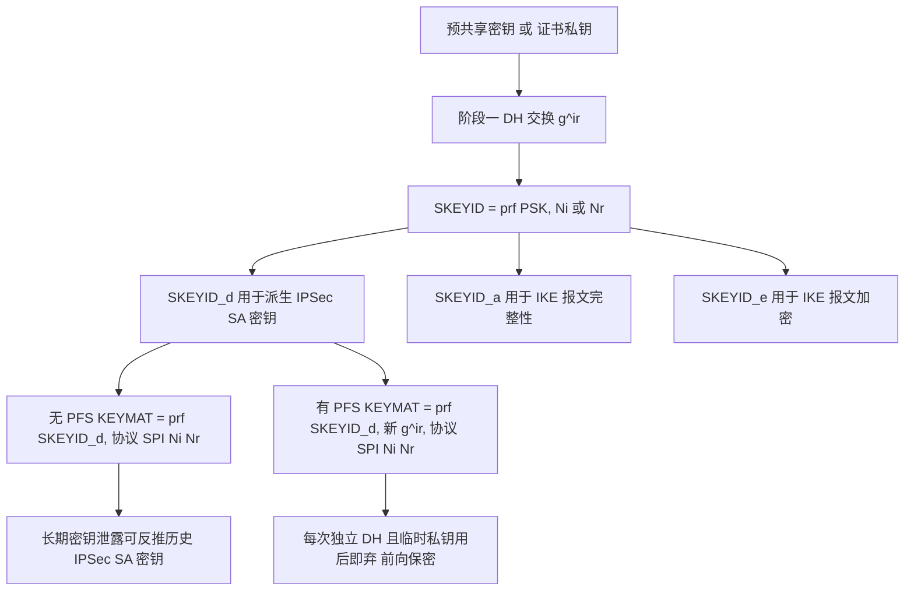

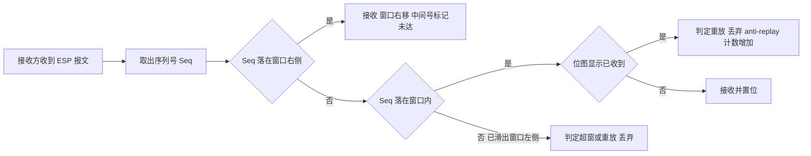

### 真题精练

**Q1.【真题·单选】** 关于 IPSec 中的 PFS（完美前向保密），下列说法正确的是？
A. PFS 通过在阶段二额外进行一次 DH 交换，使每条 IPSec SA 的密钥彼此独立
B. PFS 能防止当前正在使用的 SA 被暴力破解
C. PFS 的 DH 组可以与阶段一的 DH 组无关，且越小越好（为了性能）
D. PFS 只需在一端配置即可生效

> **答案：A**
> **解析**：B 错误——PFS 保证的是"**过去**的会话不被事后推导解密"，对当前 SA 的加密强度没有提升作用。C 错误——PFS 的 DH 组强度不应低于阶段一，否则整体强度受最弱环节限制（木桶效应）。D 错误——PFS 必须**两端同时开启且 DH 组一致**，一端开一端不开会导致阶段二协商失败。

**Q2.【真题·简答】** 请解释"为什么开启 PFS 后能实现前向保密"，并说明不开启 PFS 时密钥是如何推导的。

> **答案：**
> （1）**不开 PFS 的推导链条**：阶段一通过 DH 交换得到共享秘密 `g^ir`，并派生出 `SKEYID`，再由 `SKEYID` 派生出 `SKEYID_d`。阶段二的 IPSec SA 密钥为 `KEYMAT = prf(SKEYID_d, protocol | SPI | Ni | Nr)`。可见 **IPSec SA 的密钥完全由阶段一的结果（最终由 PSK 或 IKE SA 密钥）决定**：一旦攻击者获得 PSK（例如离线暴力破解 PSK 认证的 HASH）或 IKE SA 的密钥，就能推导出所有由该 IKE SA 协商出的 IPSec SA 密钥，从而解密此前抓取保存的**历史**流量。
> （2）**开启 PFS 后**：阶段二额外执行一次**全新的 DH 交换**，得到一次性的共享秘密 `g^ir(新)`，IPSec SA 密钥变为 `KEYMAT = prf(SKEYID_d, g^ir(新) | protocol | SPI | Ni | Nr)`。由于 DH 的临时私钥只在本轮协商中使用、协商完成即丢弃，`g^ir(新)` **无法由任何长期密钥或其它 SA 的密钥推导出来**，因此每条 IPSec SA 的密钥彼此隔离；即使 PSK 或 IKE SA 密钥日后泄露，也无法反推历史 SA 的密钥——这就是前向保密。
> （3）**代价**：每次阶段二都要多做一次 DH 模幂运算，DH 组越大开销越高，在 SA 频繁重建的高带宽场景会增加网关 CPU 负担；工程上通常以 group14 为平衡点。

**Q3.【真题·填空】** IPSec SA 的缺省时间生存期是 ______ 秒，缺省流量生存期是 ______ KB；IKE SA 的缺省生存期是 ______ 秒；抗重放窗口的缺省大小是 ______。

> **答案：3600；1843200；86400；1024**
> **解析**：四个数字必须背准，且要记住它们分属不同视图——`sa duration time-based` / `sa duration traffic-based` 在 IPSec 策略视图；IKE 的 `sa duration` 在 `ike proposal` 视图；`anti-replay window` 在 IPSec 策略视图（部分版本位于系统视图，以设备 `?` 为准）。

**Q4.【真题·排错】** 工程师配置了 PFS，但阶段一协商成功后阶段二始终失败，`display ike sa` 能看到 IKE SA 而 `display ipsec sa` 为空。请给出排查思路。

> **答案：**
> 阶段一成功说明认证、算法、DH 组（阶段一）都没问题，问题集中在**阶段二参数的匹配**上。按以下顺序排查：
> （1）**PFS 是否两端同时开启**：这是本题最可能的原因。一端配了 `pfs dh-group14`、另一端未配置 → 阶段二提议不匹配，SA 建不起来。修正：两端同时开启 PFS 且指定**相同的 DH 组**。
> （2）**IPSec 提议是否匹配**：`transform`（ah/esp/ah-esp）、`encapsulation-mode`（tunnel/transport）、`esp encryption-algorithm`、`esp authentication-algorithm` 四项必须两端至少有一组完全一致。用 `display ipsec proposal` 两端对比。
> （3）**感兴趣流（ACL）是否互为镜像且被命中**：`display acl 3400` 看是否有匹配计数；一端 ACL 写成 `10.1.1.0/24 → 10.2.2.0/24`、另一端写成 `10.2.2.0/24 → 10.1.1.0/24`（正确写法），若一端写成同向就会不对称。
> （4）**是否有第三方设备丢弃了 Quick Mode 报文**（如中间防火墙只放行了 UDP 500 而没放行 4500，或做了 SIP/ALG 类深度检测干扰）。
> （5）**用 `debugging ike all` 与 `debugging ipsec all` 观察阶段二失败的 Notify 类型**（如 `NO_PROPOSAL_CHOSEN` 指向提议不匹配，`TS_UNACCEPTABLE` 指向感兴趣流不匹配）。

### 易错点与排错

- **易错 1**：把 DH 组写进 `ipsec proposal`。DH 组属于 IKE 提议；阶段二要用 DH 必须通过 `pfs`。
- **易错 2**：认为 PFS 能防"当前 SA 被破解"。PFS 保护的是历史流量。
- **易错 3**：两端生存期设置差异巨大导致频繁重协商，业务虽通但抖动大、CPU 高。
- **易错 4**：忽视 32 位序列号回绕风险，超高速链路上应缩短流量生存期或使用 ESN。
- **排错命令**：`display ipsec sa verbose`（看实际协商出的算法、PFS 后的 DH 组、剩余生存期、抗重放窗口）、`display ike sa verbose`、`display ipsec statistics`（anti-replay 与认证失败计数）、`display ipsec proposal` / `display ike proposal`（两端对参数）。

## 3.7 感兴趣流、ACL 与路由的配合

### 考点定位

本考点是全卷**排错题的最大来源**，占 **5~8 分**。命题方式：给出 ACL 配置判断隧道能否建立、给出"隧道 up 但业务不通"的现场让考生列出原因清单、判断"IPSec 是否改变路由决策"。易错点：两端 ACL 写成同向、把反掩码写成子网掩码、忘记"必须先有到对端公网地址的路由"。

### 原理精讲

**一、ACL 与感兴趣流的三个硬性规则。**

**规则一：ACL 只描述"哪些流量需要保护"，两端必须互为镜像。** IPSec 是点对点协商，本端 ACL 的 source 必须是**本端内网网段**、destination 必须是**对端内网网段**；对端 ACL 恰好相反。两端写成同向（例如两端都配 `source 10.1.1.0/24 destination 10.2.2.0/24`）是**最常见的配置错误**：本端认为"我要把去 10.2.2.0 的流量加密"，对端却在 SPD 里没有"允许 10.1.1.0 作为源、来 10.2.2.0 作为目的"的保护表项，于是它对解密后的报文做防绕过检查时判定"这条明文本不该以保护方式进来"，直接丢弃，表现为 **SA 建起来了（阶段二协商时可以交换 IDci/IDcr，某些实现要求匹配才会成功）但业务完全不通**。

**规则二：华为使用通配符（反掩码）。** `0.0.0.255` 代表"前 24 位必须匹配"（等价于 /24），而 `255.255.255.0` 在华为 ACL 语境下是**反掩码**，含义是"只比较最后一个字节的第 8 位"之类的怪异匹配，几乎必然导致 ACL 命中错误。考试里这是高频"细节陷阱"。

**规则三：ACL 的类型与位置。** 必须使用**高级 ACL（编号 3000~3999）**来匹配 IP 五元组；基本 ACL（2000~2999）只能匹配源 IP，不足以描述感兴趣流（在双方向场景下会保护过多流量）。ACL 被 `ipsec policy` 的 `security acl` 引用后，**ACL 中的 permit = SPD 的 protect 表项**，未匹配 = bypass。

**二、IPSec 与路由的相互关系（四条必须记住）。**

1. **IPSec 不改变路由的决策过程，但会改变报文的"外层目的地址"。** 加密后的报文（隧道模式）目的地址变成了 `tunnel remote`，因此**本端必须有到 `tunnel remote` 的路由**。这是"隧道起不来"的极高概率原因：内网路由齐全，但去对端公网地址的路由缺失或被错误地指向了一个不存在的下一跳。
2. **内网到对端内网的路由必须存在，且不能指向黑洞。** 很多网络为了防环会配置 `ip route-static 10.2.0.0 255.255.0.0 NULL0` 之类的汇总黑洞路由。如果这条路由的匹配优先级高于去往隧道出口的路由，流量会直接进黑洞，**IPSec 根本没有机会看到报文**，ACL 命中计数永远是 0。
3. **流量必须从"应用了 `ipsec policy` 的接口"发出。** 如果去对端内网的路由指向了另一个未应用策略的接口，报文会被明文发出（旁路），业务能通但没有加密——这是**比"不通"更危险的隐性故障**，排错时要同时验证"业务能通"和"SA 有加密字节计数"两件事。
4. **反向路由同样重要。** IPSec 是双向的，对端解密后要能把明文送回自己的内网；同时本端解密后的明文要能回到源主机。若使用非对称路由（去程走隧道 A、回程走隧道 B），需要保证两条隧道的感兴趣流一致，否则会出现"单向通"（能 ping 通但 TCP 建不起来，因为 SYN 过去了、SYN-ACK 回不来）。

**补充：SA 是"按需触发"的。** 默认情况下，IPSec SA 由匹配感兴趣流的**业务报文**触发建立。因此"刚配好还没有业务流量时 `display ipsec sa` 为空"是**正常现象**，不是故障。这也给出一个排错技巧：**用 `ping -a <本端内网地址> <对端内网地址>` 主动触发 SA 建立**，再观察 SA 是否出现、ACL 是否出现命中计数。

**三、ACL 配置错误导致隧道起不来的原因清单（考试要求能列出 8~10 条）。**

| 序号 | 错误类型 | 现象 | 定位方法 |
|---|---|---|---|
| 1 | 两端 ACL 不互为镜像（源/目的同向或写反） | SA 可能建立，但业务不通；或阶段二协商失败并报流量选择符不可接受 | 两端 `display acl 3400` 对比 |
| 2 | 通配符掩码写成子网掩码（`0.0.0.255` 写成 `255.255.255.0`） | ACL 命中计数异常或为 0，保护的网段范围错误 | `display acl 3400` 看规则文本与命中计数 |
| 3 | ACL 没有 permit 规则，或规则被前置的 deny 覆盖 | SPD 中无 protect 表项，IKE 根本不会被触发 | `display acl` + `display ipsec policy` |
| 4 | ACL 编号/名称与 `security acl` 引用的不一致 | 同上，策略引用了空 ACL | `display ipsec policy name <name>` |
| 5 | ACL 中误把 IKE 自身的流量（UDP 500/4500）或 ESP/GRE 协议纳入保护 | 自我加密死锁：IKE 报文被要求加密，而加密又需要 IKE 先协商成功 | 检查 ACL 是否出现 `udp eq 500`/`eq 4500`/`protocol 50` 等规则 |
| 6 | ACL 匹配了隧道端点的公网地址（例如 `permit ip source 202.1.1.0 0.0.0.255 ...`） | 隧道报文被再次加密，形成嵌套/循环 | 核对 ACL 是否包含公网网段 |
| 7 | 使用了基本 ACL（2000~2999）而非高级 ACL | 只能匹配源 IP，无法保证双向精确匹配 | 检查 ACL 编号区间 |
| 8 | 业务流量真正的源地址与 ACL 中写的网段不符（多网段、VLAN 子接口、带 NAT 后的地址） | ACL 无命中计数，SA 一直不建立 | 在该网段主机上抓包确认源 IP，或 `display acl` 看计数 |
| 9 | 流量未产生 / 路由缺失，报文根本没到应用策略的接口 | ACL 无命中计数 | `ping -a` 主动触发 + `display ip routing-table` 确认出接口 |
| 10 | 一端配置了 ACL 但接口上忘了 `ipsec policy` | 该端不解密/不加密，表现为单向不通 | `display ipsec interface` 或 `display current-configuration interface` |
| 11 | ACL 规则顺序问题：先写了一条范围更大的 deny | 后写的 permit 永远不生效 | `display acl` 按序号查看顺序 |
| 12 | 使用 IPSec Profile + 隧道接口方式时，ACL 的写法与策略方式不同（Profile 方式通常保护隧道接口的全部流量） | 误用策略式 ACL 导致不匹配 | 核对采用哪种部署模型 |

### 关键概念对照表

| 对比项 | ACL 命中 / SA 状态 | 结论 |
|---|---|---|
| ACL 无命中计数，`display ipsec sa` 为空 | 流量没匹配上或没产生 | 先在主机上 ping，再查源地址与掩码、路由与出接口 |
| ACL 有命中计数，`display ike sa` 为空 | 触发了协商但阶段一失败 | 查版本、PSK/证书、IKE 提议、ID、UDP 500/4500 可达性 |
| `display ike sa` 有 SA，`display ipsec sa` 为空 | 阶段一成功、阶段二失败 | 查 IPSec 提议、PFS 两端一致性、封装模式、ACL 对称性 |
| 两侧 SA 均 Established，业务不通 | 数据面问题 | 查防火墙安全策略、NAT 顺序、MTU/MSS、反向路由、抗重放丢弃 |
| 业务能通但 SA 加解密字节为 0 | 流量走了旁路（未加密） | 查路由出接口是否应用了 `ipsec policy`，ACL 是否覆盖该流 |

| 路由要素 | 要求 | 不满足的后果 |
|---|---|---|
| 到 `tunnel remote` 的路由 | 必须有，且下一跳正确 | 加密后的报文发不出去，隧道建立后立刻中断 |
| 到对端内网的路由 | 必须存在且出接口为应用策略的接口 | 业务不通，或明文旁路（更危险） |
| 反向路由（对端侧） | 必须能把明文送回内网 | 单向通、TCP 建不起来 |
| 路由与 ACL 的关系 | 双向对称，避免非对称路径 | 一侧加密一侧不加密，会话中断 |
| 主动触发 | 用 `ping -a` 主动产生匹配 ACL 的流量 | 误判为"隧道建不起来" |

### 华为设备配置

```bash
# ===== 两端镜像 ACL + 路由配合（USG6000E V600R007 / AR6000）=====
# ---------- 总部侧（HQ，内网 10.1.1.0/24，公网 202.1.1.1；对端内网 10.2.2.0/24）----------
system-view
acl number 3400                                            // 必须使用高级 ACL（3000~3999）
 rule 5 permit ip source 10.1.1.0 0.0.0.255 destination 10.2.2.0 0.0.0.255
                                                           // 源=本端内网，目的=对端内网；0.0.0.255 是通配符（反掩码）
 rule 10 deny ip                                            // 兜底：其余流量不保护（bypass 语义）
quit
display acl 3400                                           // 关键：查看 matches 命中计数，为 0 说明流量没匹配上感兴趣流

ip route-static 0.0.0.0 0.0.0.0 202.1.1.254                // 必须有到对端公网地址（tunnel remote）的路由，通常用默认路由
ip route-static 10.2.2.0 255.255.255.0 202.1.1.2           // 到对端内网的路由：下一跳可写对端公网地址（出接口应用了 ipsec policy，会被加密）
display ip routing-table 10.2.2.0                          // 确认去对端内网的路由确实从应用了策略的接口发出

# ---------- 分支侧（BR，内网 10.2.2.0/24，公网 202.1.1.2）----------
system-view
acl number 3400
 rule 5 permit ip source 10.2.2.0 0.0.0.255 destination 10.1.1.0 0.0.0.255
                                                           // ★与总部互为镜像：源=本端内网，目的=对端内网
 rule 10 deny ip
quit
ip route-static 0.0.0.0 0.0.0.0 202.1.1.1                  // 到总部公网地址的路由
ip route-static 10.1.1.0 255.255.255.0 202.1.1.1           // 到总部内网的路由

# ---------- 排错：主动触发 SA 并逐层确认 ----------
ping -a 10.1.1.1 10.2.2.2                                  // 用本端内网地址作为源主动 ping 对端内网，触发 IPSec SA 建立
display acl 3400                                           // 看 permit 规则的 matches 是否增长（第 1 层：流量是否匹配感兴趣流）
display ike sa                                             // 看 IKE SA 是否 Established（第 2 层：阶段一是否成功）
display ipsec sa brief                                     // 看 IPSec SA 是否成对出现（第 3 层：阶段二是否成功）
display ipsec statistics                                   // 看加解密字节数是否增长（第 4 层：数据面是否真的在加密）
display ip routing-table 10.2.2.2                          // 确认去程路由的出接口是应用了 ipsec policy 的接口
save
```

### 示意图

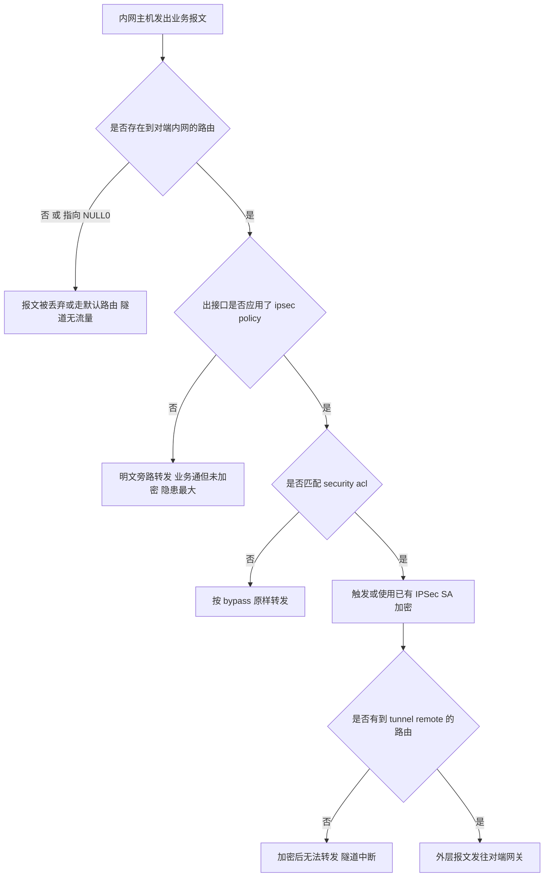


### 真题精练

**Q1.【真题·排错】** 某站点到站点 IPSec 工程中，`display ike sa` 与 `display ipsec sa` 均显示 Established，但两端内网主机互 ping 不通，`display acl 3400` 显示 permit 规则命中计数为 0。请分析最可能的原因并给出解决步骤。

> **答案：**
> **矛盾点分析**：SA 已建立说明阶段一、阶段二都成功（阶段二能成功说明两端的流量选择符至少在被协商时是匹配的），但 ACL 命中计数为 0，说明**当前实际业务流量没有被这条 ACL 匹配到**。常见原因与解决步骤：
> （1）**主机源地址与 ACL 网段不符**：例如主机实际地址是 10.1.2.x（属于另一个 VLAN/网段），而 ACL 写的是 10.1.1.0/24。解决：在主机上确认实际源地址，或把 ACL 网段改为实际网段（必要时用多条规则覆盖多个网段）。
> （2）**ACL 通配符写错**：把 `0.0.0.255` 写成了 `255.255.255.0`，导致匹配范围完全错误。解决：改为正确的反掩码，用 `display acl 3400` 核对规则文本。
> （3）**报文根本没到达应用策略的接口**：去对端内网的路由指向了 NULL0 黑洞，或被更高优先级的明细路由引到了别的出口（未加密）。解决：`display ip routing-table <对端内网地址>` 确认出接口，修正路由。
> （4）**测试方法问题**：ping 时未指定源地址，源地址被选成了出口公网地址（不在 ACL 的 source 网段内）。解决：用 `ping -a 10.1.1.1 10.2.2.2` 显式指定内网源地址再观察命中计数。
> （5）**NAT 顺序问题**：本机 NAT 策略先把内网源地址做了转换，等到 IPSec 匹配 ACL 时源地址已不是内网地址。解决：调整 NAT 与 IPSec 的处理顺序（隧道模式下应为"先 IPSec 封装、后 NAT"），或让 NAT 策略排除 IPSec 感兴趣流。

**Q2.【真题·多选】** 关于 ACL 与 IPSec 感兴趣流配置，下列说法正确的有？
A. 两端 ACL 必须互为镜像，即本端 ACL 的源是对端 ACL 的目的
B. 华为 ACL 使用通配符（反掩码），`0.0.0.255` 表示前 24 位匹配
C. 使用基本 ACL（2000~2999）即可精确描述感兴趣流
D. ACL 中没有匹配到的报文在华为实现中按 bypass 处理，原样转发
E. IPSec SA 默认由匹配感兴趣流的业务报文触发建立，因此无流量时看不到 SA 属正常现象

> **答案：A、B、D、E**
> **解析**：C 错误——基本 ACL 只能匹配源 IP，无法描述"源 + 目的"的双向精确感兴趣流，容易保护过多或过少流量，必须用高级 ACL（3000~3999）。E 是重要的排错观念：不要把"没有流量所以没有 SA"误判为故障，正确做法是用 `ping -a` 主动触发。

**Q3.【真题·简答】** 请说明"IPSec 与路由的配合"需要满足哪些条件，并解释为什么"隧道建立成功"并不等于"业务一定加密"。

> **答案：**
> （1）**路由必须满足的条件**：① 存在到 `tunnel remote`（对端隧道端点）的路由，否则加密后的报文无法发出；② 存在到对端内网的路由，且其**出接口必须是应用了 `ipsec policy` 的接口**；③ 该路由不能被优先级更高的黑洞路由（如指向 NULL0 的汇总路由）覆盖；④ 反向路由必须对称，避免一程加密一程明文。
> （2）**"隧道建立成功"≠"业务一定加密"的原因**：IPSec 的加密与否由**两条独立的判断**决定——一是 SA 是否存在，二是业务流量是否**匹配 SPD 的 protect 表项**（即是否匹配 `security acl`）。SA 可能是**另一条感兴趣流**触发的（例如管理员为测试配了一条测试 ACL），或者业务流量的实际出接口没有应用 `ipsec policy`，此时报文会按 bypass 原样转发：**业务能通，但完全没有加密**。验证方法是同时看两个指标：`display acl` 的命中计数与 `display ipsec statistics` 的加解密字节数，两者都增长才说明"匹配的流量确实被加密了"。

### 易错点与排错

- **易错 1**：两端 ACL 写成同向，导致"SA 建立、业务不通"的经典故障。
- **易错 2**：把反掩码写成子网掩码；这是华为 ACL 最高频的低级错误。
- **易错 3**：只关注"能不能通"，不关注"是否真的加密"，把明文旁路当成配置成功。
- **易错 4**：用 `ping` 不带 `-a` 导致源地址被选成公网地址，误判 ACL 不生效。
- **排错命令**：`display acl 3400`（命中计数）、`display ipsec policy name <name>`（策略引用）、`display ip routing-table <目的>`（出接口）、`display ipsec statistics`（加解密字节）、`display ipsec interface`（策略是否落到了接口上）。

## 3.8 NAT 穿越（NAT-T）深入与四种部署场景

### 考点定位

本考点以**多选/简答/排错**出现，占 **4~6 分**。命题方式：NAT-D 载荷的作用与位置、检测到 NAT 后的报文变化（UDP 4500 + 非 ESP 标记 + 保活）、NAT 与 IPSec 的四种组合场景选型。易错点：以为"检测到 NAT 会切换 IP 地址"、把 NAT-T 当成一个独立协议、忽略 NAT 设备上的 IPSec ALG 反而是故障源。

### 原理精讲

**一、NAT 给 IPSec 带来的三重破坏。** 这是本节的推理起点，讲清它就能自然推出 NAT-T 的全部设计：

1. **改写 IP 头 → 破坏 AH 的完整性校验**（AH 的 ICV 覆盖源/目的地址），AH 报文必然被丢弃。
2. **改写端口 → 破坏 IKE 的"按地址查找"逻辑**。IKE 跑在 UDP 500 上，响应方在主模式下要按**源 IP** 匹配 `ike peer` 并取 PSK；源地址被 NAT 改写后匹配失败（详见 3.4 节）。
3. **ESP 没有端口 → 传统 NAPT 无法为它建立映射表项**。NAPT 依靠"IP + 端口"来复用地址并维持映射老化计时，ESP 只有 SPI 没有端口，很多 NAT 设备会直接丢弃或无法回送 ESP 报文。这是"为什么必须把 ESP 封装进 UDP"的根本原因。

**二、NAT-D 载荷：怎么发现"路径上有 NAT"。** NAT-D（NAT Discovery，RFC 3947）的思想极其朴素：**双方各自把自己看到的"对端地址 + 端口"做哈希发过去，对方对比"我实际是什么地址 + 端口"，不一致就说明中间有 NAT 改写过。** 具体机制：

- 载荷内容是 `HASH(IP 地址, 端口)`，**每个方向携带两个 NAT-D 载荷**（一个针对源地址端口、一个针对目的地址端口），因此一次交换共 4 个哈希值。
- **携带位置**：IKEv1 中，主模式在报文 3、4 中携带（此时尚未加密，但哈希值本身不泄露地址信息）；野蛮模式在报文 1、2 中携带；若阶段一未协商，还可在快速模式报文 1、2 中再次携带。IKEv2 中直接在 `IKE_SA_INIT` 的 `NAT_DETECTION_SOURCE_IP` / `NAT_DETECTION_DESTINATION_IP` 通知载荷里完成，一步到位。
- **判定规则**：只要**任一方向**的哈希不匹配，即认为路径上存在 NAT，双方**都**切换到 NAT-T 模式（这一点很重要：只要有 NAT，两端都要按 NAT-T 的方式收发）。

**三、检测到 NAT 后发生了什么（三条变化必须背全）。**

1. **IKE 端口从 UDP 500 浮动到 UDP 4500**（术语叫 "float to 4500"）。4500 上的报文可能是 IKE，也可能是被 UDP 封装的 ESP，因此需要在 IKE 报文前加 **4 字节全零的非 ESP 标记（non-ESP marker）**。接收方靠前 4 字节判断：全零 = IKE 报文；否则 = ESP 报文（ESP 的第一个字段是 SPI，非零）。
2. **ESP 报文被封装进 UDP**（仍使用 4500 端口，源/目的端口都是 4500），即 `IP | UDP 4500 | ESP | 加密载荷`。这样 NAT 设备能像处理普通 UDP 一样为它建立并维持映射表项。代价是增加 **8 字节外层 UDP 头**开销，并带来 **NAT 保活**的需求。
3. **启动 NAT 保活（keepalive）**：周期性发送保活报文以刷新中间 NAT 设备的映射老化计时（缺省周期约 20 秒，可按设备版本与命令调整）。**"隧道白天正常、夜间空闲一段时间后失效"这类故障，根因几乎都是保活周期大于 NAT 设备的映射老化时间。**

**四、NAT 与 IPSec 组合的四种部署场景（考试必考，必须能画能说）。**

| 场景 | 拓扑特征 | 关键技术点 | 配置要点 |
|---|---|---|---|
| **场景一：两端均为公网地址** | 总部与分支都有公网 IP，之间无 NAT | 不需要 NAT-T；UDP 500 + ESP 直通 | `exchange-mode main` 可用；两端互相配置 `remote-address` |
| **场景二：一端在 NAT 后（最常见）** | 分支在家庭宽带/4G 的 NAT 后，总部为公网 | 由 **NAT 后的分支主动发起**；NAT 检测后走 UDP 4500；总部必须放行 UDP 500/4500 与 ESP（协议号 50） | 分支侧 `exchange-mode aggressive` + `local-id-type name`；总部用 `remote-name` 匹配，不固定对端 IP |
| **场景三：两端都在 NAT 后** | 双方都无公网地址 | 双方都无法被对方主动访问，**纯 NAT 后对 NAT 后无法直接建立 IKE** | 三条出路：① 至少一侧做**静态端口映射**（把 UDP 500/4500 映射到内网 IPSec 网关），使其成为"准公网"节点；② 引入第三方**中间代理/隧道中转**；③ **改用 SSL VPN**（TCP/443 天然穿透任意 NAT） |
| **场景四：多级 NAT** | 分支私网 → 分支出口 NAT → 运营商 CGNAT → 公网（两次以上改写） | NAT-D 检测依然有效（只比对哈希，不关心改写次数）；**必须** NAT-T；对端必须从**最外层**地址发起/回应 | 保证 IKE 由内向外发起并持续保活；确认各级 NAT 设备都不做"IPSec ALG"，且未限制 UDP 4500；两端都无法映射时同样不可行 |

**五、两个容易被忽略的工程要点。**

1. **NAT 设备上的 IPSec ALG / ESP ALG 往往是"帮倒忙"。** 部分厂商的 NAT 设备会尝试"智能改写" IKE 报文（例如替换报文里的 IP 地址），结果破坏了 HASH 校验（HASH 覆盖了 Cookie 与 SA 提议体）。因此现网经验是：**穿越 NAT 时优先关闭 NAT 设备上的 IPSec ALG**，让 NAT-T 自己完成穿越。
2. **设备自身做 NAT 时的处理顺序**：在华为防火墙上，隧道模式下正确顺序是"**先 IPSec 封装、再 NAT 转换**"——NAT 改写的是**外层隧道地址**，内层受保护地址不动，因此不会破坏 ESP 的 ICV。若顺序颠倒（先 NAT 再加密），内层源地址被改写会导致对端 ACL 不匹配。配置时要注意 NAT 策略（`nat-policy`）不要匹配到需要进入 IPSec 的内网流量。
3. **NAT 保活与 DPD 是两件事**：保活是给**中间 NAT 设备**看的（维持映射表项），DPD 是给**对端网关**看的（探测对端是否还活着）。两者周期与用途都不同，配置时不要混淆。

### 关键概念对照表

| 项目 | 无 NAT（场景一） | 有 NAT（场景二/四） |
|---|---|---|
| IKE 端口 | UDP 500 | 检测到 NAT 后切换到 UDP **4500** |
| IKE 报文前导 | 无 | **4 字节全零 non-ESP marker** |
| ESP 承载方式 | 直接 IP 承载（协议号 50） | **UDP 4500 封装**（额外 8 字节） |
| NAT 检测方式 | IKEv2 内建通知载荷；IKEv1 用 NAT-D 载荷 | 同左，检测到即整体切到 NAT-T |
| 是否需要保活 | 不需要 | **必须**（缺省约 20 秒），否则映射老化导致隧道失效 |
| 是否可用 AH | 可用 | **不可用**（校验覆盖 IP 头） |
| 交换模式建议 | 主模式 | 野蛮模式（IKEv1）/ IKEv2 |
| 中间设备注意点 | — | 关闭 IPSec ALG；放行 UDP 500/4500 与 ESP |

| 现象 | 可能原因 | 定位手段 |
|---|---|---|
| 能 ping 通对端公网地址，IKE 无任何反应 | 中间设备阻断了 UDP 500 | 两端抓包，看 IKE_SA_INIT 是否发出/到达 |
| IKE SA 建立后马上中断 | NAT 映射老化、保活未生效或周期过长 | 调小保活周期；`display ike statistics` 看保活计数 |
| IKE SA Established 但 ESP 不通 | 中间设备不放行 ESP（协议号 50）或对 ESP-thru-UDP 不支持 | 抓包确认是否出现 UDP 4500 承载的 ESP |
| 每次协商成功但很快重协商 | NAT 设备改写了端口导致对端认为对端地址变化 | 检查 NAT 设备是否保持端口不变（端口保持对 NAT-T 很关键） |
| 明文/ESP 交替出现 | NAT 与 IPSec 处理顺序错误，部分流量未进隧道 | 调整 `nat-policy` 与 `ipsec policy` 的匹配范围 |

### 华为设备配置

```bash
# ===== 场景二：分支在 NAT 后 → 总部（USG6000E V600R007）=====
# ---------- 分支侧（NAT 后，主动发起）----------
system-view
acl number 3400
 rule 5 permit ip source 192.168.10.0 0.0.0.255 destination 10.1.1.0 0.0.0.255
quit

ike proposal 10
 authentication-method pre-share
 authentication-algorithm sha2-256
 encryption-algorithm aes-cbc-256
 dh group14
 sa duration 86400
quit

ike peer peer_hq
 version 2                                                  // 优先使用 IKEv2（内建 NAT 检测，无需额外配置）
 exchange-mode aggressive                                    // IKEv1 场景下 NAT 后建议野蛮模式；IKEv2 无此概念也可保留
 local-id-type name                                          // 用 name 做 ID，避免依赖源 IP
 local-name BRANCH01                                         // 本端 ID
 remote-name HQ_GW                                           // 对端 ID（与总部 local-name 对应）
 pre-shared-key cipher Huawei@123
 remote-address 202.1.1.1                                    // 总部公网地址
 ike-proposal 10
quit

ipsec proposal prop_esp
 transform esp                                               // 必须 ESP（AH 无法过 NAT）
 encapsulation-mode tunnel                                   // 必须隧道模式（见 3.3 节）
 esp encryption-algorithm aes-256
 esp authentication-algorithm sha2-256
quit

ipsec policy map_hq 10 isakmp
 security acl 3400
 ike-peer peer_hq
 proposal prop_esp
 tunnel local 192.168.10.1                                   // NAT 前为私网地址；NAT 设备会改写外层地址
 tunnel remote 202.1.1.1
quit

interface GigabitEthernet1/0/1
 ipsec policy map_hq
quit

# ---------- 总部侧（公网，放行 IKE 与 ESP/NAT-T）----------
system-view
security-policy                                             // 防火墙安全策略：必须放行 IKE 与 ESP 相关流量
 rule name permit_ike_esp
  source-zone untrust
  destination-zone local
  service udp-500 udp-4500 esp                              // 放行 UDP 500、UDP 4500 与 ESP（协议号 50）
  action permit
quit

ike peer peer_branch
 version 2
 local-id-type name
 local-name HQ_GW
 remote-name BRANCH01                                        // 分支 ID 不固定时用 name 匹配（可配合通配）
 pre-shared-key cipher Huawei@123
 ike-proposal 10
quit

# ---------- 监控 NAT-T 是否生效 ----------
display ike sa verbose                                      // 输出中查看是否存在 NAT-T 相关标志与 4500 端口信息
display ipsec sa verbose                                    // 查看 SA 是否以 UDP 4500 封装承载 ESP
display ike statistics                                      // 观察保活报文的收发计数（长期为 0 说明保活未生效）
display firewall session table verbose destination 202.1.1.1
                                                           // 在防火墙上确认 UDP 4500 会话存在且未老化
save
```

### 示意图

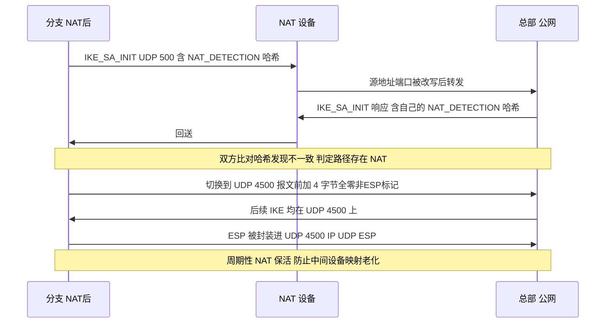

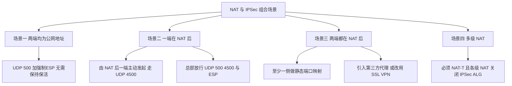

### 真题精练

**Q1.【真题·多选】** 关于 IPSec 的 NAT 穿越（NAT-T），下列说法正确的有？
A. IKE 通过 NAT-D 载荷探测路径上是否存在 NAT，其内容是对 IP 地址与端口计算的哈希
B. 检测到 NAT 后，IKE 从 UDP 500 切换到 UDP 4500，并在 IKE 报文前加 4 字节全零的非 ESP 标记
C. ESP 报文被封装进 UDP 4500 后，NAT 设备就能像处理普通 UDP 一样为它建立并维持映射表项
D. 检测到 NAT 后，需要为 ESP 配置一个端口号以便 NAPT 复用
E. NAT 场景下建议周期性地发送 NAT 保活报文，防止中间设备的映射表项老化

> **答案：A、B、C、E**
> **解析**：D 错误——ESP 本身**没有端口**（这正是它无法被 NAPT 处理的原因），NAT-T 的做法不是"给 ESP 配端口"，而是**把整个 ESP 报文封装进 UDP 4500**，由外层 UDP 头提供端口供 NAT 使用。E 是"隧道白天正常夜间失效"类故障的根因，也是本条最实用的考点。

**Q2.【真题·简答】** 请解释 IPSec 的 NAT 检测原理，并说明检测到 NAT 之后 IKE 与 ESP 报文的封装各发生了什么变化。

> **答案：**
> （1）**检测原理**：IPSec 使用 NAT-D 载荷（IKEv2 中为 `NAT_DETECTION_SOURCE_IP` 与 `NAT_DETECTION_DESTINATION_IP` 通知载荷）进行探测。每一方对"自己看到的对端源地址 + 端口"和"目的地址 + 端口"分别计算哈希并发送给对端；对端用自己的**真实地址 + 端口**计算哈希与之比对。只要有一个哈希不一致，就说明路径上有 NAT 设备改写了地址或端口，双方随即启用 NAT-T。IKEv1 中 NAT-D 载荷在主模式报文 3、4（或野蛮模式报文 1、2、快速模式报文 1、2）中携带；IKEv2 中在 `IKE_SA_INIT` 交换中一步完成。
> （2）**IKE 报文的变化**：端口由 UDP 500 **浮动到 UDP 4500**；由于 4500 上同时承载 IKE 与封装后的 ESP，IKE 报文前必须加 **4 字节全零的 non-ESP marker**，接收方用前 4 字节区分报文类型。
> （3）**ESP 报文的变化**：ESP 被封装进 UDP，格式为 `IP | UDP(4500) | ESP | 载荷 | ESP 尾 | 认证数据`。这样 NAT 设备可以看到 UDP 端口为其建立映射并维持老化计时。代价是增加 8 字节 UDP 头开销，因此**需要 NAT 保活**（缺省约 20 秒）来刷新中间设备的映射表项。

**Q3.【真题·排错】** 某企业总部为公网地址，两个分支均在 NAT 后，分支之间也需要互访。目前分支到总部的隧道正常，但分支 A 与分支 B 之间无法建立 IPSec 隧道，请分析原因并给出方案。

> **答案：**
> **原因分析**：这是一个典型的"**两端都在 NAT 后**"的场景（场景三）。IPSec/IKE 要求**至少有一端可以被主动访问**（有可达的公网地址与端口），而分支 A 与分支 B 都只有 NAT 后的私网地址，且各自的 NAT 设备做的是动态地址端口转换：
> （1）分支 A 无法主动向分支 B 发起 IKE——它拿不到分支 B 的可达地址与端口；
> （2）即使通过某种方式获知了地址，NAT 设备的映射表项也是按"内部主动发起"建立的，外部无法主动创建映射；
> （3）多级 NAT 或 CGNAT 环境下更不可能由外部主动发起。
> **可行方案（按推荐程度排序）**：
> （1）**让分支间流量经总部中转（Hub-Spoke）**：分支 A 与分支 B 各自与总部建立 IPSec 隧道，总部通过路由把 A 的流量转发到 B 的隧道。配置最简单、最稳定，是最通用的方案。
> （2）**改用 DSVPN（mGRE + NHRP）**：由总部作为 NHS，分支向总部注册后可获取其它分支的 NBMA 地址，从而**在分支之间建立直达隧道**，从根本上解决"A、B 都在 NAT 后"的直连需求（详见 4.7 节；注意若分支在 NAT 后且 NAT 不保持端口，仍需谨慎验证）。
> （3）**至少一侧做静态端口映射**：在分支 B 的出口 NAT 上把 UDP 500/4500 静态映射到分支 B 的 IPSec 网关，使其成为"准公网"节点，然后由分支 A 主动发起。
> （4）**改用 SSL VPN 或基于 TCP/UDP 的隧道技术**：TCP 443 可穿透任意 NAT，无需依赖 IPSec 的 NAT-T。
> **结论**：IPSec 本身没有解决"双侧 NAT 直连"的通用机制，工程上要么改用 Hub 中转/DSVPN，要么依赖一侧的公网映射，要么换用 SSL VPN。

**Q4.【真题·判断】** 在 IPSec NAT 穿越场景中，若在 NAT 设备上开启 IPSec ALG 功能，可以提升隧道建立的稳定性。

> **答案：错误**
> **解析**：恰恰相反。IPSec ALG 会尝试深入改写 IKE 报文内部的地址信息，而 IKE 的 HASH（覆盖 Cookie、SA 提议体等）与 NAT-D 哈希都是强校验，任何中间改写都会导致校验失败、协商中断。NAT-T 机制本身已能完成穿越，因此工程上通常**关闭 NAT 设备上的 IPSec ALG**。此外，部分设备的 ESP ALG 还可能干扰 UDP 4500 上承载的 ESP 报文。

### 易错点与排错

- **易错 1**：认为"检测到 NAT 会更换 IP 地址"。变的是**端口**（500→4500）和**封装方式**，地址由 NAT 设备自行改写。
- **易错 2**：只放行了 UDP 500，忘了 UDP 4500 与 ESP（协议号 50），导致检测到 NAT 后立刻中断。
- **易错 3**：忽略 NAT 保活导致空闲后隧道失效，且故障现象具有"时好时坏"的迷惑性。
- **易错 4**：把 NAT-T 保活与 DPD 混为一谈——前者维持 NAT 映射，后者检测对端存活。
- **排错命令**：`display ike sa verbose`（NAT-T 标志）、`display ipsec sa verbose`（4500 封装）、`display ike statistics`（保活计数）、`display firewall session table verbose destination <peer>`（确认 UDP 4500 会话存在且未老化）、两端同时抓包（判断是"没发出"还是"被丢了"）。

## 3.9 IPSec 高可用：双机热备、隧道备份与检测联动

### 考点定位

本考点以**多选/简答/设计**出现，占 **4~6 分**。命题方式：IPSec 与 VRRP/HRP 如何配合、双机切换后 IPSec 为什么需要重新协商、如何做隧道备份。易错点：以为"HRP 会把 IPSec SA 一起同步给备机"、以为"隧道备份只配两条策略就够了（忘了检测联动）"。

### 原理精讲

**一、IPSec 高可靠的三个层次，必须分开设计。** IPSec 的可用性不是靠单一机制保证的，工程上按"设备—链路—隧道"三层来做：

- **设备级**：两台防火墙组成双机热备（HRP），一台故障时另一台接管。它解决的是"网关这台设备坏了"。
- **链路级**：出口有多条物理链路/多个 ISP。它解决的是"运营商线路断了"。
- **隧道级**：同一目的地存在多条隧道（主备隧道），配合检测手段（DPD/BFD/NQA + Track）实现切换。它解决的是"这条隧道不通了（但对端还活着）"。

**二、IPSec 与 VRRP/HRP 配合的三个技术要点。**

1. **用 VRRP 虚拟 IP 作为隧道本地地址，是对端"无感知切换"的关键。** 双机热备下内网通过 VRRP 虚拟网关指向主用设备，同时把 IPSec 的 `tunnel local` 也配置为 **VRRP 虚拟 IP**：主备切换后，对端看到的隧道端点地址**仍然是同一个地址**，无需在对端修改 `remote-address`，也不需要重新协商隧道参数（只需重建 SA）。如果两台设备各用自己的物理接口 IP，切换后对端会发现"对端地址变了"，行为取决于具体实现，容易出现 SA 长时间无法恢复。
2. **HRP 同步配置，但动态 SA 通常需要重新协商。** HRP 会把 IPSec/IKE 相关**配置**同步到备机，使备机随时具备接管能力；但 IKE SA 与 IPSec SA 属于**端到端的动态状态**（密钥、SPI、序列号都在两端协商生成），标准做法是切换后由流量触发**重新协商**（通常毫秒到秒级完成，期间会有少量丢包）。对切换期丢包极度敏感的业务，应通过缩短 DPD 探测周期、在应用层允许重传、或采用"双活 + 会话快速备份"等组合来缓解。**是否能备份 IPSec SA 与具体版本相关，配置前用 `display hrp state verbose` 与对应版本产品文档确认。**
3. **心跳链路与安全策略必须放行。** 心跳接口要加入安全区域，并在 `security-policy` 中双向放行 `local` 与心跳区域的流量，否则会出现"两台设备都认为自己是主机"的双主风险（这与 B8 分册 1.x 节的 HRP 要求一致）。

**三、隧道备份的实现方式（考试要能给出方案对比）。**

| 方式 | 实现思路 | 优点 | 缺点 |
|---|---|---|---|
| 双 IPSec 策略 + 路由优先级 | 同一对端点配两条策略（不同出口/不同对端），用两条静态路由指向不同出接口并设不同优先级 | 配置简单 | 需要外部检测手段触发路由切换，否则路由不会感知"隧道失效" |
| 双隧道 + DPD 联动 | 主隧道用 DPD 探测对端，探测失败触发 SA 删除，配合路由切换 | 能检测"对端网关活着但 IKE 不响应"的情况 | DPD 周期与重传次数需权衡（过短易误判，过长切换慢） |
| 双隧道 + NQA/Track 联动 | 用 NQA 探测对端可达性，用 `track` 关联静态路由，探测失败自动切换下一跳 | 检测与路由联动明确，适合多 ISP 出口 | NQA 探测本身消耗少量资源 |
| 隧道接口 + 动态路由 | 用 GRE over IPSec 建隧道接口，隧道内跑 OSPF/BGP，靠路由协议收敛切换 | 收敛快、扩展性好（多隧道天然支持） | 需要处理隧道接口的路由与 IPSec 保护的关系 |
| 双机热备 + 双 Upstream | 两台设备分别接不同 ISP，用 VRRP 组规划分流 | 同时解决设备级与链路级故障 | 配置复杂，需严格规划来回路径 |

**四、DPD（Dead Peer Detection）的定位与配置要点。** DPD 让设备能发现"对端网关已经不可用但 SA 还挂着"的状态——没有 DPD 时，只有发数据才会发现隧道已断（或者更糟：报文被黑洞吞掉而业务一直超时）。DPD 有两种模式：**periodic（周期性探测，无论有无流量都定时探测）** 与 **on-demand（按需探测，仅在需要向对端发送且一段时间无流量时探测）**。工程建议：站点到站点主链路上用 `periodic`，探测周期 10 秒、重传 3 次（即约 30 秒判定失效）；分支较多的 Hub 上适当放宽周期，避免探测风暴。

**五、一个设计题常考的权衡。** "要不要把 IPSec SA 生存期设得很长以减少重协商开销？"答案是否定的：生存期过长会放大**单条密钥的暴露风险**（数据量大、时间长、序列号回绕风险上升），并且在双机切换/链路切换时更难及时更新。正确做法是**保持缺省或适度缩短的生存期（如 3600 秒）+ 依靠 DPD/路由快速感知故障**，两者分工不同。

### 关键概念对照表

| 机制 | 解决的问题 | 生效时间尺度 | 与 IPSec 的关系 |
|---|---|---|---|
| VRRP | 内网网关单点、隧道端点地址漂移 | 秒级 | 虚拟 IP 作为 `tunnel local`，对端无感知 |
| HRP | 配置与状态的设备级备份 | 秒级 | 同步配置；动态 SA 通常切换后重新协商 |
| DPD | 对端网关失效但 SA 未删除 | 取决于周期（常见 10s×3） | 探测失败触发 SA 删除与重建/切换 |
| BFD | 链路级快速故障检测 | 毫秒级 | 可关联路由实现快速切换，比 DPD 更快 |
| NQA + Track | 端到端可达性检测与路由联动 | 秒级 | 探测失败自动切换静态路由下一跳 |
| SA 生存期 | 密钥新鲜度、序列号回绕 | 3600 秒量级 | 到点重协商（先建后删/快速模式） |

| 故障场景 | 仅靠 HRP 是否够 | 还需要什么 |
|---|---|---|
| 主用防火墙宕机 | 够（备机接管 + 重新协商 SA） | 会话快速备份（缓解切换丢包） |
| 主用出口链路断 | 不够 | 多 ISP 出口 + 路由/BFD/NQA 联动 |
| 对端网关宕机 | 不够 | DPD 检测 + 主备隧道切换 |
| 对端 IKE 进程异常但接口 up | 不够 | DPD（periodic 模式）主动探测 |
| 中间公网抖动导致丢包 | 不够 | 应用层重传/QoS，或双隧道负载分担 |

### 华为设备配置

```bash
# ===== 双机热备 + VRRP 虚拟 IP 作为隧道本地地址（FW1 主用，USG6000E V600R007）=====
system-view
interface GigabitEthernet1/0/2                             // 内网侧接口
 ip address 10.1.1.2 255.255.255.0
 vrrp vrid 1 virtual-ip 10.1.1.1 active                   // 配置 VRRP 组 1 并指定本机为 Active，虚拟 IP 10.1.1.1 作为内网网关
quit

hrp enable                                                 // 使能双机热备（提示符变为 HRP_M）
hrp interface GigabitEthernet1/0/0 remote 10.1.2.2         // 指定心跳接口与对端心跳地址
hrp preempt delay 60                                       // 开启抢占并设置延迟，避免频繁切换
quit

firewall zone dmz                                          // 心跳接口加入安全区域
 add interface GigabitEthernet1/0/0
quit
security-policy                                            // 放行心跳相关流量（使用 remote 单播时必配）
 rule name hrp_local_to_dmz
  source-zone local
  destination-zone dmz
  action permit
 rule name hrp_dmz_to_local
  source-zone dmz
  destination-zone local
  action permit
quit

# ===== IPSec 侧：用 VRRP 虚拟 IP 作为 tunnel local，实现切换后对端无感知 =====
acl number 3400
 rule 5 permit ip source 10.1.1.0 0.0.0.255 destination 192.168.10.0 0.0.0.255
quit
ike peer peer_branch
 version 2
 pre-shared-key cipher Huawei@123
 local-address 10.1.1.1                                     // ★使用 VRRP 虚拟 IP 作为本端 IKE 源地址（主备一致）
 remote-address 203.0.113.9
 exchange-mode aggressive                                   // 分支地址/端口可能变化时使用
 local-id-type name
 local-name HQ_GW
 remote-name BRANCH01
quit
ipsec policy map_branch 10 isakmp
 security acl 3400
 ike-peer peer_branch
 proposal prop_esp
 tunnel local 10.1.1.1                                      // ★隧道本地地址也用虚拟 IP：切换后备机沿用同一端点
 tunnel remote 203.0.113.9
 pfs dh-group14
quit

# ===== DPD：及时发现对端失效（配合隧道备份切换）=====
dpd dpd1
 dpd type periodic                                          // 周期性探测
 dpd interval 10 retransmit 3                               // 每 10 秒探测，连续 3 次无响应判失效
quit
ike peer peer_branch
 dpd dpd1
quit

# ===== 隧道备份：静态路由 + NQA + Track 实现主备切换 =====
nqa test-instance admin to_peer                             // 创建 NQA 测试实例
 test-type icmp                                             // 使用 ICMP 探测
 destination-address ipv4 203.0.113.9                       // 探测对端公网地址
 frequency 5                                                // 每 5 秒探测一次
 probe-count 3                                              // 每次探测 3 个报文
 start now                                                  // 立即启动
quit
ip route-static 192.168.10.0 255.255.255.0 GigabitEthernet1/0/1 202.1.1.2 preference 60 track nqa admin to_peer
                                                           // 主路由：走主出口，关联 NQA，探测失败则本条路由失效
ip route-static 192.168.10.0 255.255.255.0 GigabitEthernet1/0/3 203.0.113.9 preference 100
                                                           // 备路由：优先级数值更大（更不优先），主路由失效时自动生效

# ===== 查看与验证 =====
display hrp state                                          // 查看主备角色与心跳状态
display vrrp brief                                         // 查看 VRRP 组状态（主备是否与 HRP 角色一致）
display ike sa                                             // 切换后确认 IKE SA 是否已重新建立
display ipsec sa brief                                     // 确认 IPSec SA 是否成对恢复
display nqa results test-instance admin to_peer             // 查看 NQA 探测结果
display ip routing-table 192.168.10.0                      // 确认当前生效的是主路由还是备路由
save
```

### 示意图

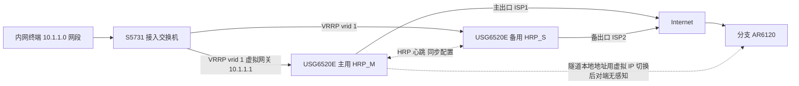

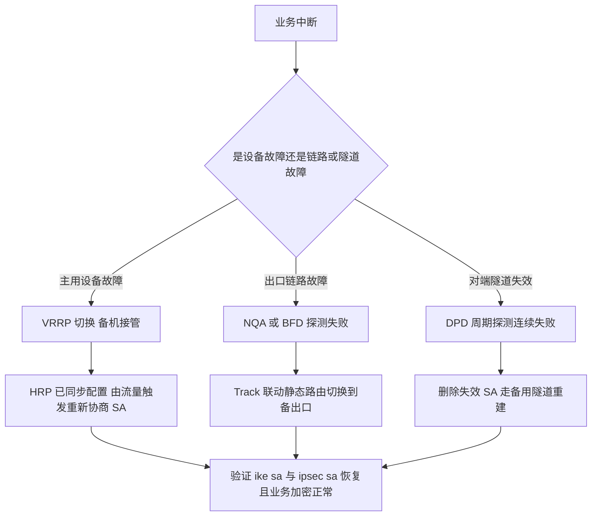

### 真题精练

**Q1.【真题·多选】** 关于 IPSec 与双机热备（HRP/VRRP）的配合，下列说法正确的有？
A. 把 IPSec 的隧道本地地址配置为 VRRP 虚拟 IP，可使主备切换后对端无需修改配置
B. HRP 会把 IPSec/IKE 的配置同步到备机，使备机具备接管能力
C. IKE SA 与 IPSec SA 会随 HRP 完整同步，切换后无需重新协商、零丢包
D. 心跳接口需要加入安全区域并放行 local 区域与心跳区域之间的流量
E. 缩短 DPD 探测周期可以更快发现对端失效，但周期过短可能造成误判

> **答案：A、B、D、E**
> **解析**：C 是典型错误——IKE SA/IPSec SA 是**端到端动态状态**（含双方协商产生的 SPI、密钥、序列号），标准做法是切换后由流量触发**重新协商**（通常秒级完成，切换瞬间会有少量丢包）。宣称"零丢包"的说法在考试中一定是干扰项。是否支持动态表项备份与具体版本相关，需查版本说明与 `display hrp state verbose`。

**Q2.【真题·简答】** 请设计一个"总部—分支 IPSec 隧道"的高可用方案，要求覆盖设备故障、出口链路故障、对端网关故障三类场景，并说明每类场景由什么机制负责。

> **答案：**
> （1）**设备级故障（主用防火墙宕机）**：部署两台同型号同版本 USG6000E 组成**双机热备**，内网用 **VRRP 虚拟网关**引导流量；`hrp interface ... remote ...` 建立心跳并放行心跳区域策略；IPSec 的 `tunnel local` 与 IKE `local-address` 统一配置为 **VRRP 虚拟 IP**，使切换后对端看到的隧道端点地址不变，只需重新协商 SA。若要减小切换影响，可开启会话快速备份并缩短 DPD 周期。
> （2）**出口链路故障（主 ISP 断）**：部署双出口（主备 ISP 或双机各接一条），用 **NQA（ICMP 探测对端公网地址）+ Track 关联静态路由**或 **BFD 关联路由**实现自动切换；主路由 preference 60、备路由 preference 100，主路由探测失败即失效，备路由自动生效。同时注意两台设备的来回路径一致性。
> （3）**对端网关故障或 IKE 进程异常**：在 `ike peer` 上引用 **DPD 模板**（`dpd type periodic`，`dpd interval 10 retransmit 3`），周期探测对端；探测失败即删除失效 SA 并触发重建或切换到备用隧道（可用两条 IPSec 策略 + 不同对端 + 路由优先级构成主备隧道）。
> （4）**验证方法**：`display hrp state`（角色）、`display vrrp brief`（VRRP 与 HRP 角色是否一致）、`display nqa results`、`display ip routing-table`（当前生效路由）、`display ike sa` 与 `display ipsec sa brief`（切换后 SA 是否恢复）、`display ipsec statistics`（加密字节是否持续增长，确认业务真的在隧道里走）。

**Q3.【真题·判断】** 为了减少重协商带来的开销，应把 IPSec SA 的生存期设置为尽可能长（例如 24 小时）。

> **答案：错误**
> **解析**：SA 生存期过长有三个风险：① 同一密钥保护的数据量与使用时间过长，**密钥暴露风险与差分分析风险上升**；② ESP 的 32 位序列号在高带宽下可能**回绕**，带来抗重放与安全问题；③ 双机/链路切换后修复不及时。正确做法是保持缺省（3600 秒 / 1843200 KB）或按业务适度调整，把"快速感知故障"的职责交给 **DPD/BFD/NQA + 路由联动**，而不是靠"不换密钥"来减少开销。

### 易错点与排错

- **易错 1**：以为 HRP 会同步 IPSec SA，从而在切换后不验证 SA 是否重建。
- **易错 2**：隧道本地地址用物理接口 IP，切换后对端配置不匹配导致长期无法恢复。
- **易错 3**：只配了两条备份策略和两条路由，却没有任何检测手段，"隧道断了路由不知道"。
- **易错 4**：DPD 周期设得过短（如 1 秒 × 3 次）在公网抖动时频繁误判，SA 反复重建。
- **排错命令**：`display hrp state` / `display hrp state verbose`、`display vrrp brief`、`display ike sa`、`display ipsec sa brief`、`display nqa results test-instance <name>`、`display ip routing-table <目的>`、`display ipsec statistics`。

## 3.10 IPSec 与其他技术结合：GRE over IPSec、MPLS VPN 与组播

### 考点定位

本考点以**单选/多选/简答/设计**出现，占 **4~6 分**。命题方式：GRE over IPSec 与 IPSec over GRE 的本质区别与选型、"IPSec 为什么不支持组播及如何解决"、IPSec 与 MPLS VPN 的对比与组合方案。易错点：把两种组合的封装顺序说反、认为"IPSec 加一条组播 ACL 就能承载组播"。

### 原理精讲

**一、两种组合的本质区别只在于"谁先封装"。** 这是本节的核心命题点，务必用"封装层次"来理解，而不是背名字：

- **GRE over IPSec（推荐）**：**先 GRE 封装，再 IPSec 加密**。数据流是"内网报文 → 加 GRE 头（内层协议类型可为 IP/组播/非 IP）→ 整条 GRE 报文被 ESP 隧道模式加密 → 加外层 IP 头发出"。因此 **IPSec 的感兴趣流是"两台隧道端点之间的 GRE 流量"**，ACL 只需一条 `permit gre source <local> destination <remote>`。**一条 SA 保护所有内层流量**，包括组播、广播、以及跑在隧道上的 OSPF/BGP 等路由协议。新增内网网段时**无需修改 IPSec 配置**（不需要动 ACL），扩展性极好，这是现网首选方案。
- **IPSec over GRE**：**先 IPSec 加密，再把 IPSec 报文装进 GRE**。数据流是"内网报文 → 被 ESP 加密 → 加 GRE 头 → 加外层 IP 头"。IPSec 的 ACL 必须**精确匹配每一条业务流**（`permit ip source ... destination ...`），新增网段就要改 ACL；而**跑在 GRE 上的路由协议（OSPF/BGP）因为不匹配业务 ACL，通常处于"不被加密"的状态**（除非再为它们单独配 ACL）。它的优势是**可以只加密关键业务流量**、让组播/路由更新以明文走 GRE（节省 CPU）。

| 对比维度 | GRE over IPSec（先 GRE 后加密） | IPSec over GRE（先加密后 GRE） |
|---|---|---|
| 封装顺序 | 内层报文 → GRE → ESP → 外层 IP | 内层报文 → ESP → GRE → 外层 IP |
| IPSec ACL 复杂度 | **一条 GRE 规则即可**（`permit gre`） | 每条业务流一条规则，新增网段需改配置 |
| 内层协议支持 | 任何协议（IP、IPX、组播、二层桥接） | 仅 ACL 覆盖的协议（通常只是 IP） |
| 路由协议是否受保护 | **受保护**（GRE 载荷被整体加密） | **通常不受保护**（除非单独为路由协议配 ACL） |
| 组播/广播支持 | **支持**（GRE 隧道天然支持组播/广播） | 组播由 GRE 承载但不被 IPSec 保护 |
| 开销 | GRE 24 字节 + IPSec 开销 | ESP 开销 + GRE 24 字节（一样多，但分布不同） |
| 扩展性 | 好（改网段不动 IPSec） | 差（改网段要改 ACL） |
| 典型用途 | 站点间需要跑动态路由、需要承载组播/组播 | 只加密部分关键业务、或需保留明文组播 |
| 现网推荐度 | **首选** | 特殊场景 |

**二、IPSec 为什么不能原生承载组播——四条根因。**

1. **SA 是一对一的。** IPSec SA 通过 IKE 与**单一对端**协商（UDP 500/4500 单播），SPI 与密钥都是点对点的。组播是"一对多"，源无法为每个接收者分别协商 SA；若让多个接收者共享同一条 SA，**抗重放会因为序列号冲突而失效**（同一源用同一序列号序列发给多个接收者，接收方无法区分"重放"与"另一个接收者收到的同一报文"）。
2. **IKE 本身是单播协议。** 组播地址不能作为 IKE 的对等体地址；即便在 SPD/ACL 中写了组播地址，也没有可用于加密它的 SA（没有 SA 就触发不了协商，或者协商出来也无法复用）。
3. **封装语义冲突。** AH/ESP 的隧道模式外层是单播 IP 头，公网只按单播转发；组播需要网络逐跳复制（组播树的复制点），而加密后的载荷对中间网络完全不可见，PIM/IGMP 无法在加密载荷内部学习组播状态。
4. **RFC 层面缺少广泛部署的组密钥方案。** 理论上可用 GDOI/GMSP 等组密钥管理协议为整组协商一把组密钥，但现网部署极少，HCIE 只需知道结论。

**标准解决方案：GRE over IPSec。** GRE 隧道接口**默认支持组播与广播**（它把组播/广播报文封装成**单播** GRE 报文，由单播隧道送到对端后再还原为组播），因此可以在 GRE 隧道上跑 OSPF（`ospf network-type broadcast`）、PIM-SM 等；然后由 IPSec 对这条**单播** GRE 隧道做隧道模式加密。**一句话总结：用 GRE 把"多对多/组播"降维成"点对点单播"，再让 IPSec 去保护这个点对点单播。**

**三、IPSec 与 MPLS VPN 的对比与组合。** 两者都用于"多站点互联"，但定位完全不同：

| 维度 | IPSec VPN | MPLS L3VPN |
|---|---|---|
| 提供方与依赖 | 企业自建，依赖公网 Internet | 运营商提供，依赖 MPLS 骨干 |
| 隔离机制 | 加密与认证（密码学隔离） | VRF/RT/RD 路由隔离（逻辑隔离，**默认不加密**） |
| 扩展性 | Hub-Spoke 尚可，全互联为 N² 问题 | 好，新增站点改 PE 配置即可（Hub 无瓶颈） |
| 组播支持 | 需 GRE over IPSec | 原生支持（NG MVPN） |
| QoS 能力 | 弱（中间公网不可控） | 强（MPLS TE、DiffServ、显式路径） |
| 成本 | 低（利用现有公网） | 高（需购买运营商专线/VPN 服务） |
| 部署速度 | 快 | 取决于运营商开通周期 |
| 安全性 | 内生加密，等保合规友好 | 默认明文，敏感场景需叠加 IPSec/国密加密 |
| 典型场景 | 中小规模、临时/应急、跨运营商互联 | 大型企业多站点、对 SLA 与 QoS 有要求 |

**四种结合方式（设计题常考）**：

1. **IPSec over MPLS VPN**：在 MPLS VPN 之上再叠加 IPSec，用于满足"专线也要加密"的合规要求（例如金融、政企的等保/密码评估要求），通常是 PE-CE 之间或跨域场景的 ASBR 之间用 IPSec 保护。
2. **MPLS VPN 为主 + IPSec 为备**：主用 MPLS 专线（低时延、有 SLA），备用 IPSec over Internet（便宜、易部署）；用路由优先级 + BFD/NQA 联动切换。这是最实用的现网方案。
3. **混合组网（分区接入）**：总部通过 MPLS PE 接入核心分支（大站点），偏远小站点/临时站点用 IPSec over Internet 接入总部的 IPSec 网关，二者在总部通过路由重分发互通。
4. **MPLS VPN 承载 + IPSec 只加密关键业务流**：在同一 MPLS VPN 内对特定服务器网段叠加 IPSec（端到端加密），避免全量加密带来的性能开销。

**四、GRE over IPSec 的关键配置要点。** 华为 AR 上通常有两种落地方式：**① 在物理接口上应用 IPSec 策略，ACL 匹配 GRE 流量**（经典方式）；**② 在 Tunnel 接口上应用 IPSec Profile**（新一代方式，ACL 语义更简单，适合 mGRE/DSVPN）。要注意的是：**IPSec 保护的是 GRE 隧道端点之间的报文**，因此 ACL 的源/目的必须是**隧道源/目的公网地址**，而不能是内网网段。此外，GRE 的 24 字节头 + IPSec 的开销让 MTU 更紧张，务必配置 `tcp adjust-mss`。

### 关键概念对照表

| 报文封装层次（外层 → 内层） | 技术组合 | 谁被加密 |
|---|---|---|
| `IP(公网) → ESP → GRE → IP(内网) → 数据` | **GRE over IPSec** | 整条 GRE 报文（含内网 IP 头与路由协议） |
| `IP(公网) → GRE → ESP → IP(内网) → 数据` | **IPSec over GRE** | 仅 ESP 载荷内的业务报文 |
| `IP(公网) → UDP 4500 → ESP → GRE → IP(内网) → 数据` | GRE over IPSec **且** 路径有 NAT | 同上，且外层再加 8 字节 UDP 头 |
| `IP(MPLS) → 标签栈 → IP(内网) → 数据` | MPLS L3VPN | **不加密**（仅逻辑隔离） |

| 需求 | 推荐方案 | 原因 |
|---|---|---|
| 站点间要跑 OSPF/BGP 且要求加密 | **GRE over IPSec** | 一条 GRE ACL 保护全部内层流量，含路由协议 |
| 需要承载组播/组播视频 | **GRE over IPSec** | GRE 把组播降维为单播，IPSec 只加密单播隧道 |
| 只加密少数关键服务器流量 | IPSec over GRE 或纯 IPSec 策略式 | ACL 可精确控制加密范围，节省 CPU |
| 总部与大量分支互联、分支间也要互通 | **DSVPN（mGRE + NHRP）**，可选叠加 IPSec | Hub 一次配置、分支动态注册，spoke 间可直连（见 4.7 节） |
| 合规要求"专线也要加密" | MPLS VPN + IPSec 叠加 | 运营商隔离 + 密码学加密双保险 |
| 移动用户/个人终端接入 | **SSL VPN** | 免客户端或轻客户端、天然穿透 NAT（见 4.x 节） |

### 华为设备配置

```bash
# ===== GRE over IPSec（推荐方式）：AR6120，站点到站点，隧道内跑 OSPF =====
system-view
interface Tunnel0/0/0                                       // 创建 GRE 隧道接口
 tunnel-protocol gre                                        // 隧道协议为 GRE（点对点）
 source GigabitEthernet0/0/1                                // 隧道源：本端公网接口
 destination 203.0.113.9                                    // 隧道目的：对端公网地址
 ip address 192.168.100.1 255.255.255.0                     // 隧道内层地址（用于跑 OSPF）
 keepalive period 10 retry-times 3                          // GRE Keepalive：10 秒探测、连续 3 次失败判定隧道不可用
 tcp adjust-mss 1200                                        // 调整 TCP MSS，规避 GRE + IPSec 开销造成的分片问题
quit

ospf 1 router-id 1.1.1.1                                    // 在隧道上运行动态路由
 area 0.0.0.0
  network 192.168.100.0 0.0.0.255                           // 宣告隧道网段
  network 10.1.1.0 0.0.0.255                                // 宣告本端内网网段
 quit
quit

acl number 3101                                             // ★IPSec 感兴趣流 = GRE 隧道端点之间的 GRE 报文
 rule 5 permit gre source 202.1.1.1 0 destination 203.0.113.9 0
                                                           // 一条规则即可保护全部内层流量（含 OSPF 组播与内网所有网段）
quit

ipsec proposal prop_gre
 transform esp
 encapsulation-mode tunnel                                   // 隧道模式
 esp encryption-algorithm aes-256
 esp authentication-algorithm sha2-256
quit

ike peer peer_branch
 version 2
 pre-shared-key cipher Huawei@123
 local-address 202.1.1.1
 remote-address 203.0.113.9
quit

ipsec policy map_gre 10 isakmp
 security acl 3101                                           // 引用 GRE 专用 ACL
 ike-peer peer_branch
 proposal prop_gre
 tunnel local 202.1.1.1
 tunnel remote 203.0.113.9
quit

interface GigabitEthernet0/0/1                              // 在物理出接口上应用策略（保护 GRE 隧道报文）
 ipsec policy map_gre
quit

display ipsec sa brief                                       // 确认 SA 的感兴趣流是 gre 协议
display ospf peer                                            // 确认隧道内 OSPF 邻居建立（依赖 GRE 承载组播）
display interface Tunnel0/0/0                                // 查看隧道接口状态与 Keepalive 是否正常
display ip routing-table                                     // 确认内网路由通过隧道学到
save
```

### 示意图

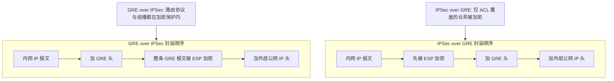

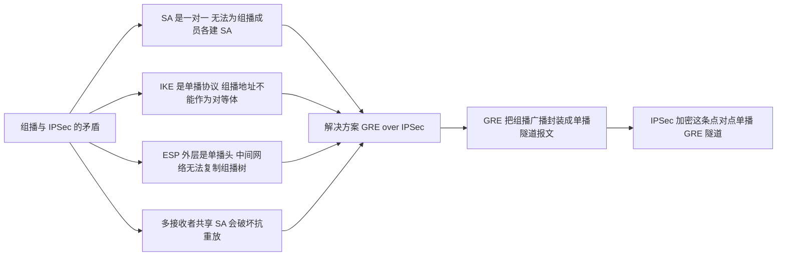

### 真题精练

**Q1.【真题·单选】** 需要在总部与分支之间的 IPSec 隧道上运行 OSPF 并承载组播业务，应选择的方案是？
A. 纯 IPSec 策略模式，ACL 中加入组播地址
B. IPSec over GRE
C. GRE over IPSec
D. 直接使用 AH 传输模式

> **答案：C**
> **解析**：A 不可行——IPSec SA 必须与单播对端协商，组播地址无法作为 IKE 对等体，也没有可用的 SA，写了组播 ACL 也不会生效。B 的问题在于：IPSec over GRE 中 IPSec 只保护匹配业务 ACL 的流量，**OSPF 的组播报文（224.0.0.5/224.0.0.6）通常落在 ACL 之外，处于明文状态**，不满足"隧道上运行 OSPF 且受保护"的要求；且每新增网段都要改 ACL。C 正确：GRE 隧道天然支持组播/广播（把组播降维成单播），IPSec 只需用一条 `permit gre` 规则保护整条隧道，OSPF 与业务全在加密保护内。D 错误——AH 不加密且无法过 NAT，也不解决组播问题。

**Q2.【真题·简答】** 请说明 IPSec 为什么不支持原生组播，并给出标准的解决思路。

> **答案：**
> **不支持的原因**：
> （1）**SA 是点对点的**：IPSec SA 通过 IKE 与单一对端协商，SPI、密钥、序列号都是针对该对端的；组播是一对多，源无法为每个组成员分别协商 SA。
> （2）**IKE 是单播协议**：IKE 运行在 UDP 500/4500 上，组播地址不能作为 IKE 对等体地址，因此无法为组播流量协商出 SA。
> （3）**封装语义冲突**：ESP 隧道模式的外层是单播 IP 头，中间网络只做单播转发；若让多个接收者共享一条 SA，**抗重放机制会因序列号在不同接收者之间冲突而失效**，安全语义被破坏。
> （4）**中间网络不可见**：加密后的载荷对 PIM/IGMP 等组播控制协议完全不可见，公网无法为它建立组播转发树（RFC 层面虽有 GDOI/GMSP 等组密钥方案，但现网极少部署）。
> **解决思路（标准答案）**：使用 **GRE over IPSec**——利用 GRE 隧道接口默认支持组播与广播的特性（GRE 把组播/广播报文封装成**单播** GRE 报文，在隧道对端还原），先把"组播"降维成"点对点单播"，再用 IPSec 隧道模式加密这条单播 GRE 隧道。由此 OSPF、PIM、业务组播全部在加密保护内，且 IPSec 侧只需一条 `permit gre` 的 ACL，扩展性最好。若组网是 Hub-Spoke 且希望分支间直连，则可在此基础上使用 **DSVPN（mGRE + NHRP）**。

**Q3.【真题·多选】** 关于 IPSec VPN 与 MPLS L3VPN 的对比与结合，下列说法正确的有？
A. MPLS L3VPN 依靠 VRF/RT 实现路由隔离，本身默认不提供加密
B. MPLS L3VPN 的扩展性优于 IPSec，新增站点主要改 PE 配置，不存在 Hub 性能瓶颈
C. IPSec VPN 支持组播，MPLS VPN 不支持组播
D. 常见组合方式是"MPLS VPN 为主、IPSec over Internet 为备"，用路由优先级与检测机制联动切换
E. 在 MPLS VPN 之上叠加 IPSec，可以满足"专线流量也必须加密"的合规要求

> **答案：A、B、D、E**
> **解析**：C 恰好说反——**MPLS L3VPN 原生支持组播（NG MVPN）**，而 **IPSec 不支持原生组播**（需 GRE over IPSec 解决）。A、B 是 MPLS VPN 的两个基本特征；D、E 是现网最常见的两种组合方式，设计题中给出这两条即可得分。

### 易错点与排错

- **易错 1**：把 GRE over IPSec 与 IPSec over GRE 的封装顺序说反，进而把两者优缺点记混。
- **易错 2**：在 IPSec 的 ACL 里写内网网段去保护 GRE 隧道流量。GRE over IPSec 的 ACL 必须匹配 **GRE 协议 + 隧道端点的公网地址**。
- **易错 3**：忘记 GRE + IPSec 的开销导致 MTU 问题，出现"OSPF 邻居抖动、TCP 大包卡死"。
- **易错 4**：以为"IPSec 的 ACL 里加一条组播规则就能承载组播"。
- **排错命令**：`display ipsec sa brief`（确认感兴趣流是不是 gre）、`display interface Tunnel0/0/0`（隧道与 Keepalive 状态）、`display ospf peer`（隧道内邻居）、`display ip routing-table`（内网路由是否经隧道）、`display ipsec statistics`（加解密字节是否增长）。

## 3.11 IPSec 故障排查大全

### 考点定位

本考点是**国赛排错题与 HCIE 实验题的绝对重点**，占 **8~12 分**。命题方式：给出 `display ike sa` / `display ipsec sa` / `display ipsec statistics` 的输出片段让考生判读并给出结论；给出故障现象（协商失败、隧道 up 但业务不通）让考生写出原因清单与定位步骤。易错点：不按层次排查、上来就改 PSK、生产网随意开 `debugging`。

### 原理精讲

**一、排错总纲：五层定位法。** IPSec 故障排查的最有效方法是**自下而上分层**，每一层都有可验证的"证据"（计数、状态、报文）：

| 层次 | 要验证什么 | 关键命令 | 通过标准 |
|---|---|---|---|
| 第 1 层：可达性 | 到对端公网地址是否有路由、能否 ping 通 | `ping`、`display ip routing-table <对端公网IP>` | ping 通（若对端禁 ping，用抓包或 NQA 验证） |
| 第 2 层：触发与匹配 | 业务流量是否匹配感兴趣流、报文是否从应用策略的接口发出 | `display acl 3400`（matches 计数）、`display ip routing-table <对端内网IP>` | ACL 命中计数增长 |
| 第 3 层：IKE（阶段一） | IKE SA 是否 Established | `display ike sa`、`display ike sa verbose`、`display ike statistics` | State = Established |
| 第 4 层：IPSec（阶段二） | IPSec SA 是否成对建立 | `display ipsec sa brief`、`display ipsec sa verbose` | 出/入方向 SA 都存在且未过期 |
| 第 5 层：数据面 | 加解密是否真的发生、报文是否被策略/MTU/重放拦截 | `display ipsec statistics`、`display firewall session table`、抓包 | 加密/解密字节持续增长，无错误计数增长 |

**二、`display ike sa` 与 `display ike sa verbose` 字段逐项解读。**

`display ike sa` 的主要列：

| 字段 | 含义 | 判读要点 |
|---|---|---|
| Conn-ID | IKE SA 的连接编号（本机唯一） | 用于配合 `reset ike sa conn-id <ID>` 精确重置某条 SA |
| Peer | 对端地址（NAT 场景下为 NAT 后的地址） | 与预期不符说明走了错误的出口/被 NAT 改写 |
| VPN / Phase | 所属 VPN 实例、IKE 版本与阶段（如 `v2:2`） | 直接暴露两端版本是否一致；`v1`/`v2` 不符即失败 |
| Flag(s) | 状态标志字母 | **含义以命令输出底部打印的图例为准**，常见含义包括：是否为该 SA 的**发起方**、是否正在**重协商**、是否由**重定向**产生；读到不认识的字母一定去看图例，不要猜 |
| State | SA 状态 | `Established` 表示阶段一完成；出现 `No proposal`、`Phase1...` 等中间态说明卡在某一阶段 |

`display ike sa verbose` 会额外给出：**协商出的加密算法、HASH 算法、DH 组、认证方法、本端/对端身份 ID、IKE SA 的 SPI（发起方 SPI 与响应方 SPI 各 8 字节）、剩余生存期、是否启用 NAT-T（是否走 4500）**。判读要点：**把 verbose 输出与两端配置逐项对齐**——算法、DH 组、身份 ID 任一项不一致就是根因。

**三、`display ipsec sa brief` / `display ipsec sa verbose` 字段逐项解读。**

| 字段 | 含义 | 判读要点 |
|---|---|---|
| IPSec policy name / Sequence number | 策略名与序号 | 定位是哪条策略生成的 SA；序号决定匹配优先级 |
| Acl group / Acl rule | 感兴趣流 ACL 与命中规则号 | 规则号能反查出到底匹配了哪条规则 |
| Mode | 协商方式（ISAKMP / 手工） | 手工 SA 不出现在 IKE 表中 |
| Tunnel local / remote | 隧道外层端点 | 与 `tunnel local/remote` 配置一致 |
| **SPI** | 安全参数索引（十六进制与十进制） | 入方向 SA 的 SPI 应与对端出方向 SA 的 SPI 一致；不一致说明两端看的不是同一条 SA |
| Proposal / Transform | 实际协商出的提议与协议（ESP/AH） | 与配置预期不符说明匹配到了其它提议 |
| Encapsulation mode | tunnel / transport | NAT 场景必须是 tunnel |
| Encryption / Authentication algorithm | 实际算法（含密钥长度） | 两端必须一致（不一致根本协商不成功，能协商成功说明一致） |
| **Anti-replay window** | 抗重放窗口大小 | 乱序丢包时关注此值 |
| Sequence number / Remaining lifetime | 当前序列号与剩余生存期 | 序列号增长飞快说明业务量大；剩余生存期很短说明即将重协商 |
| Inbound / Outbound 两条 | 方向 | **必须成对出现**；只有一条说明协商未完成或表项异常 |

**四、`display ipsec statistics` 字段逐项解读。**

| 字段（中文/英文常见表述） | 含义 | 异常解读 |
|---|---|---|
| 发送/接收的封装报文数与字节数 | 实际加密/解密的流量 | **长期为 0 说明流量没进隧道**（走了 bypass 或根本没匹配 ACL） |
| `encapsulation failed` / 封装失败 | 加密阶段失败 | 多为算法/内存/MTU 问题 |
| `decapsulation failed` / 解封装失败 | 解密阶段失败 | 参数不匹配或报文被截断/篡改 |
| `authentication failed` / 认证失败 | ICV 校验失败 | 密钥不一致、报文被中间设备改写、硬件故障 |
| `anti-replay dropped` / 抗重放丢弃 | 序列号落入已收区间或滑出窗口 | 存在真实重放，或多路径严重乱序/链路聚合哈希不均 |
| `SA not found` / 未找到 SA | 按三元组查不到 SAD 表项 | 对端用了过期的 SPI、SA 刚被删除、两端配置不一致 |
| `packet too long` / 报文过长 | 封装后超过 MTU | MTU/MSS 规划问题 |

**五、IKE 协商失败的 10 类原因与定位方法（考试必背清单）。**

| 序号 | 原因 | 典型现象 | 定位方法 |
|---|---|---|---|
| 1 | 两端 **IKE 版本不一致**（v1 / v2） | 协商立即失败，无任何 SA 中间态 | `display ike peer`、`display ike sa` 的 Phase 字段 |
| 2 | **预共享密钥/证书不一致**（含大小写、加密存储后手工输入不同） | 主模式卡在报文 5/6；IKEv2 报 AUTHENTICATION_FAILED | 两端重新输入同一明文 PSK；证书场景核对 CA 链与有效期 |
| 3 | **IKE 提议参数不匹配**（加密/HASH/DH/PRF/认证方式） | `NO_PROPOSAL_CHOSEN`；无 SA | 两端 `display ike proposal` 逐项对比；IKEv2 若 DH 组不匹配会回 INVALID_KE_PAYLOAD |
| 4 | **身份 ID 类型或取值不匹配**（`local-id-type`、`local-name`/`remote-name`） | 卡在报文 5/6，HASH 校验失败 | `display ike sa verbose` 看协商出的 ID 与本地配置 |
| 5 | **交换模式不一致**（一端 main、一端 aggressive） | 报文中断、无 SA | 两端 `display ike peer` 核对 `exchange-mode` |
| 6 | **UDP 500/4500 或 ESP 被拦截**（中间设备、运营商、本机安全策略未放行 local 区域） | 报文发出但无响应；`display ike statistics` 只见发送不见接收 | 两端同时抓包；检查 `security-policy` 是否放行 `local` 与 `untrust` 之间的 UDP 500/4500/ESP |
| 7 | **到对端地址无路由或对端地址配置错误**（含 NAT 后地址未更新） | IKE 报文发不出去 | `display ip routing-table <对端地址>`、抓包确认源/目的 |
| 8 | **NAT 相关问题**（NAT 设备开启 IPSec ALG、丢弃 ESP、端口不保持、映射老化） | 阶段一成功但 ESP 不通；空闲后失效 | 关闭 ALG；检查 UDP 4500 会话；调小保活周期 |
| 9 | **证书类问题**（证书过期、CA 链不完整、设备时间不同步导致校验失败、CRL/OCSP 不可达） | 阶段一失败并报证书相关错误 | `display pki certificate`、`display clock`（时间必须准确，建议配 NTP） |
| 10 | **设备资源与许可限制**（IKE SA 数量达上限、CPU 过载、License 不足、内存告警） | 部分对端能建、部分不能；或周期性失败 | `display ike sa` 统计条数、`display cpu-usage`、`display memory-usage`、查看 License 授权规格 |

**补充（第 11~12 类，常作为加分点）**：接口上**未应用** `ipsec policy` 或应用在了错误接口；**双机热备切换**过程中备机尚未完成配置同步。

**六、IPSec 隧道 up 但流量不通的 6 类原因（考试必背清单）。**

| 序号 | 原因 | 现象特征 | 定位与解决 |
|---|---|---|---|
| 1 | **感兴趣流（ACL）与实际业务不匹配**：两端不互为镜像、掩码写错、协议/端口限制不当、业务源地址与 ACL 网段不符 | `display acl` 无命中计数；SA 可能是被其它流量触发的 | 两端镜像核对 ACL；`ping -a` 指定内网源地址主动触发；必要时用 `any` 调试后再收紧 |
| 2 | **防火墙安全策略未放行解封装后的明文流量** | SA 正常、加解密字节增长，但业务仍不通；会话表无内网会话或显示被 deny | `display firewall session table`、命中计数、策略日志；放行对应区域与网段 |
| 3 | **路由问题**：本端或对端缺少到对方内网的路由、路由指向错误出接口、被黑洞路由（NULL0）覆盖、反向路由缺失 | 单向不通（能 ping 通但 TCP 建不起来）、或流量根本没进隧道 | `display ip routing-table <对端内网>`；检查 ACL 命中与出接口是否应用策略 |
| 4 | **NAT 与 IPSec 处理顺序错误**：本机 NAT 策略先把内层流量做了源 NAT，导致对端 ACL 不匹配；或 NAT 策略与 IPSec 感兴趣流重叠 | 一侧 SA 有加密计数、对端解封装后丢弃 | 调整策略顺序/范围：隧道模式下应"先 IPSec 封装、后 NAT"；用 `nat-policy` 的地址范围排除 IPSec 感兴趣流 |
| 5 | **MTU/MSS 与分片**：GRE + IPSec 开销导致大包被丢弃 | `ping -s <大包>` 不通、小包通；TCP 建连成功但传输卡死、网页打不开 | 隧道接口配 `tcp adjust-mss 1200`；必要时调小接口 MTU；用 `ping -s -f` 逐步定位最大可通长度 |
| 6 | **抗重放丢弃与乱序**：多路径/链路聚合/负载分担导致报文严重乱序，落在窗口之外被丢 | 间歇性丢包、`anti-replay dropped` 计数增长 | 适当增大 `anti-replay window`；优化链路聚合哈希，保证同一流走同一路径 |

**补充（第 7 类）**：**双机热备下两台设备的策略/路由不一致**导致来回路径不一致（去程走 FW1、回程走 FW2），表现为"时通时不通"，用 `display hrp state` 与两端会话表核对。

**七、`debugging ike/ipsec` 的注意事项（这是安全操作题，容易丢分）。**

1. **生产网严禁随意开启。** `debugging` 输出的优先级高、信息量大，会大量占用 CPU 与终端带宽，严重时导致设备业务中断；在国赛实验环境中也应养成规范习惯。
2. **必须先用 `terminal monitor` 与 `terminal debugging` 打开终端显示**，否则看不到任何输出（这是新手最常见的"debug 开了但什么都没看到"的原因）。
3. **务必在维护窗口内使用，并限定范围**：优先使用更精细的调试开关（只开 IKE 而不开 IPsec，或只针对特定对端/IP），减少无关输出。
4. **用完立即关闭**：`undo debugging all`。离开会话前确认已关闭。
5. **远程调试要防"把自己 debug 掉"**：调试输出可能挤占管理通道，或让控制台阻塞导致无法输入 `undo debugging all`；建议通过带外管理口进行，或提前配置好自动关闭（定时任务/超时）。
6. **优先用非侵入式手段替代 debug**：`display ike statistics`、`display ipsec statistics` 的计数变化 + 两端**同时抓包**（端口镜像/Wireshark）通常足以定位问题，且对现网零影响。
7. **debug 的典型价值场景**：判断"协商卡在哪条报文""对端回了什么 Notify 错误"（如 `NO_PROPOSAL_CHOSEN`、`TS_UNACCEPTABLE`、`AUTHENTICATION_FAILED`），这类信息 `display` 命令看不到。

### 关键概念对照表

| 现象 | 第一个要查的命令 | 结论方向 |
|---|---|---|
| ACL 无命中计数 | `display acl 3400` | 流量没匹配/没产生（路由、源地址、掩码） |
| 有 ACL 命中但没有 IKE SA | `display ike sa` | 阶段一失败（版本、PSK、提议、ID、UDP 500 可达） |
| 有 IKE SA 但没有 IPSec SA | `display ipsec sa brief` | 阶段二失败（IPSec 提议、PFS 一致性、ACL 对称性） |
| 两侧 SA 齐全但业务不通 | `display ipsec statistics` + 会话表 | 数据面（安全策略、路由、NAT 顺序、MTU、抗重放） |
| 加解密字节为 0 | `display ipsec statistics` | 流量走了 bypass（出接口未应用策略/ACL 不覆盖） |
| 认证失败计数增长 | `display ipsec statistics` | 密钥不一致或报文被中间设备改写 |
| 抗重放丢弃增长 | `display ipsec statistics` | 真实重放或严重乱序（多路径） |
| 空闲一段时间后隧道失效 | `display ike statistics` + NAT 会话表 | NAT 映射老化、保活周期过长 |
| 大包不通小包通 | `ping -s` 测试 | MTU/MSS 与分片问题 |

| 命令 | 用途 | 关键字段 |
|---|---|---|
| `display ike sa` | 看阶段一是否成功 | Conn-ID、Peer、Phase、Flag、State |
| `display ike sa verbose` | 看阶段一协商细节 | 算法、DH 组、身份 ID、SPI、剩余生存期、NAT-T |
| `display ike statistics` | 看 IKE 报文收发与错误 | 收/发计数、错误计数、保活计数 |
| `display ipsec sa brief` | 看阶段二 SA 摘要 | 策略名、ACL、隧道端点、SPI |
| `display ipsec sa verbose` | 看 SA 详细参数 | 算法、封装模式、抗重放窗口、序列号、剩余生存期 |
| `display ipsec statistics` | 看数据面加解密与错误 | 加解密字节、认证失败、抗重放丢弃、SA not found |
| `display ipsec policy` | 看 SPD 策略（策略式部署） | 感兴趣流 ACL、ike-peer、proposal、隧道端点 |
| `display acl 3400` | 看感兴趣流命中情况 | 规则文本、matches 计数 |
| `display ipsec interface` | 看接口是否应用策略 | 接口与策略绑定关系 |

### 华为设备配置

```bash
# ===== IPSec 排错的标准操作序列（USG6000E V600R007）=====

# ① 放行 IKE/IPSec 自身流量（最常见的"隧道起不来"根因之一）
system-view
security-policy
 rule name permit_ike_ipsec
  source-zone local                                        // 本机发起的 IKE 报文
  destination-zone untrust
  service udp-500 udp-4500 esp                              // 必须放行 UDP 500、UDP 4500 与 ESP
  action permit
 rule name permit_ike_ipsec_in
  source-zone untrust
  destination-zone local
  service udp-500 udp-4500 esp
  action permit
quit

# ② 主动触发 + 逐层验证
ping -a 10.1.1.1 10.2.2.2 -c 5                              // 指定内网源地址主动触发，产生匹配感兴趣流的流量

display acl 3400                                            // 第 1 步：ACL 命中计数是否增长（流量是否匹配感兴趣流）
display ike sa                                              // 第 2 步：IKE SA 是否存在且为 Established
display ike sa verbose                                      // 第 3 步：协商出的算法/DH 组/身份 ID/NAT-T/剩余生存期
display ipsec sa brief                                      // 第 4 步：IPSec SA 是否成对（in/out 各一条）
display ipsec sa verbose                                    // 第 5 步：SPI、封装模式、抗重放窗口、序列号、剩余生存期
display ipsec statistics                                    // 第 6 步：加解密字节是否增长；有无认证失败/抗重放丢弃
display ip routing-table 10.2.2.2                           // 第 7 步：去程路由的出接口是否应用了 ipsec policy
display ipsec interface                                     // 第 8 步：策略是否真的应用到了正确接口
display firewall session table verbose destination 10.2.2.2  // 第 9 步：会话是否建立、是否被安全策略拦截

# ③ 深度调试（仅维护窗口使用，用完必须关闭）
terminal monitor                                            // 打开终端监视（否则看不到任何 debug 输出）
terminal debugging                                          // 打开终端调试信息显示
debugging ike all                                           // 打开 IKE 调试，观察协商卡在哪条报文、返回什么 Notify
debugging ipsec all                                         // 打开 IPSec 调试，观察封装与 SA 建立过程
undo debugging all                                          // ★调试结束立即关闭！生产网长时间开启会严重影响性能

# ④ 重置与重协商（谨慎操作，会中断当前业务）
reset ike sa conn-id 12                                     // 按 Conn-ID 重置指定的 IKE SA，触发重新协商
reset ipsec sa policy map_branch                            // 重置指定策略下的 IPSec SA，用于验证配置修改是否生效
display ike sa                                              // 重置后确认 SA 是否重新建立
save                                                        // 保存配置
```

### 示意图

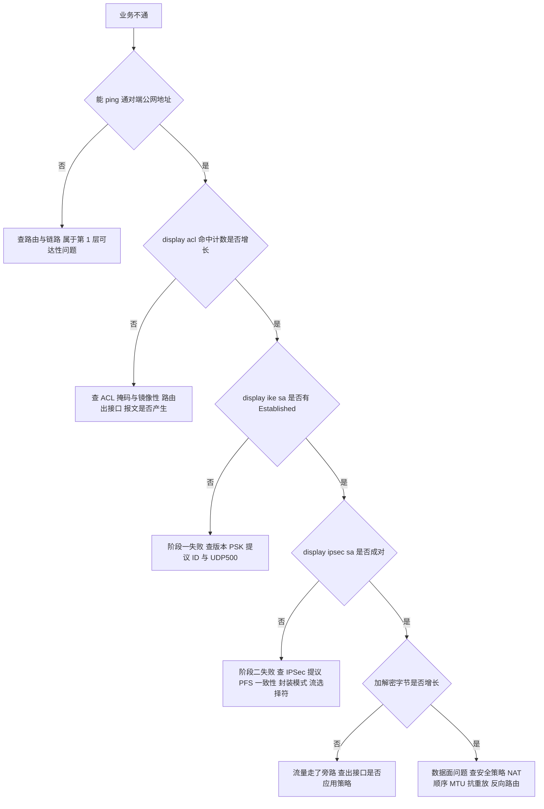

```mermaid
flowchart LR
    A["证据链定位"] --> B["display acl 证明流量匹配"]
    A --> C["display ike sa 证明阶段一"]
    A --> D["display ipsec sa 证明阶段二"]
    A --> E["display ipsec statistics 证明数据面"]
    B --> F["四者都通过仍不通 则查防火墙策略与应用层"]
    C --> F
    D --> F
    E --> F
```

### 真题精练

**Q1.【真题·排错】** 现场输出如下：`display acl 3400` 显示 permit 规则 matches 计数持续增长；`display ike sa` 为空；`display ipsec statistics` 中的加密报文计数为 0；两端能互相 ping 通公网地址。请给出你的排查顺序与最可能的原因。

> **答案：**
> **现象判读**：① 两端公网可达、ACL 有命中 → 第 1、2 层正常，问题在 IKE 协商；② `display ike sa` 为空 → **阶段一完全没建立**；③ 加密计数为 0 → 印证没有 SA。因此定位在阶段一。
> **排查顺序**：
> （1）**确认 IKE 报文是否真的收发**：`display ike statistics` 看收/发计数。只发不收 → 中间设备或对端安全策略拦截了 UDP 500/4500；收发都有但协商失败 → 参数问题。
> （2）**确认两端 IKE 版本**：`display ike peer` 比对 `version`（v1/v2 不一致直接失败，且 `display ike sa` 不会有 SA）。
> （3）**确认 IKE 提议是否匹配**：两端 `display ike proposal` 逐项对比加密算法、认证算法、DH 组、认证方式、PRF（IKEv2）。
> （4）**确认 PSK 与身份 ID**：PSK 是否完全一致（大小写、特殊字符）；`local-id-type`、`local-name`/`remote-name` 是否互相吻合。
> （5）**确认交换模式一致**：一端 `main`、一端 `aggressive` 会直接失败。
> （6）**确认本机与中间设备策略**：本机 `security-policy` 是否放行 `local`↔`untrust` 的 UDP 500/4500/ESP；中间 NAT 设备是否开启 IPSec ALG、是否限制 UDP 4500；NAT 场景对端地址是否正确。
> （7）**仍无法定位时**：在维护窗口用 `terminal monitor` + `terminal debugging` + `debugging ike all` 观察协商卡在哪条报文与返回的 Notify（如 `NO_PROPOSAL_CHOSEN` 指提议不匹配、`AUTHENTICATION_FAILED` 指 PSK/证书问题），或用两端同时抓包（更安全）。
> **最可能的原因排序**（结合"公网可达但完全无 SA"的特征）：① 本机/中间设备未放行 UDP 500/4500 与 ESP；② IKE 版本或提议参数不匹配；③ 交换模式或身份 ID 配置不一致；④ PSK 不一致（通常会看到协商进行到报文 5 才失败，因此排序略后）。

**Q2.【真题·排错】** `display ike sa` 与 `display ipsec sa` 均正常，`display ipsec statistics` 显示加解密字节持续增长，但两端内网主机互访仍然失败。请列出至少 6 类原因及对应验证方法。

> **答案：**
> SA 与加解密都正常，说明**隧道本身工作正常**，问题在数据面的"隧道之外的环节"。六类原因：
> （1）**本端/对端防火墙安全策略未放行解封装后的明文流量**：验证 `display firewall session table verbose destination <对端内网>`，检查策略命中与计数，必要时看策略日志。
> （2）**路由问题**：对端缺少回程路由（去程通、回程不通）、或本端到对端内网的路由指向了未加密的出接口（出现"一部分流量在隧道里、一部分明文走"）。验证 `display ip routing-table <对端内网>`、两端 `display acl` 命中对比。
> （3）**ACL 不匹配导致的"半通"**：一端 ACL 覆盖了网段 A、另一端覆盖了网段 B，某些源/目的组合落在隧道外。验证两端 `display acl` 规则与本端主机实际源地址。
> （4）**NAT 与 IPSec 顺序错误**：本机 NAT 策略先把内层流量源 NAT 成公网地址，对端按 ACL 校验时判定流选择符不匹配而丢弃。验证 `display nat-policy`、`display firewall session table` 中该流的 NAT 前后地址。
> （5）**MTU/MSS 与分片**：`ping -s` 小包通、大包不通；TCP 能建连但传输卡死。验证用 `ping -s 1400`/`ping -s 1200` 逐步逼近，隧道接口配 `tcp adjust-mss`。
> （6）**抗重放丢弃或严重乱序**：多路径/链路聚合导致报文乱序超窗。验证 `display ipsec statistics` 中 anti-replay 丢弃计数，适当增大 `anti-replay window`、优化链路聚合哈希。
> （补充）**双机热备下两台设备策略或路由不一致**，造成来回路径不一致、时通时不通：验证 `display hrp state` 与两端会话表；**应用层问题**（服务未监听、主机防火墙、端口不通）：用 `telnet`/抓包在主机侧验证。

**Q3.【真题·简答】** 某工程师在生产网直接执行了 `debugging ike all`，随后核心业务出现明显卡顿、而且他在终端上什么都看不到。请指出两个操作错误，并给出正确的调试流程。

> **答案：**
> **两个错误**：
> （1）**在生产网上直接开启全局调试**。`debugging` 输出优先级高、信息量巨大，会占用大量 CPU 与终端带宽，可能导致业务卡顿甚至中断；正确做法是在维护窗口、经带外管理通道、并尽量缩小调试范围（只针对特定对端/只开必要模块）。
> （2）**没有打开终端显示开关，所以看不到任何输出**。必须先用 `terminal monitor` 打开终端监视、用 `terminal debugging` 打开调试信息显示，`debugging` 的输出才会打印到终端。此外还可能是调试输出被控制台大量日志淹没、或远程会话被输出挤占而无法交互。
> **正确的调试流程**：
> ① 优先使用**非侵入式手段**：`display ike statistics` / `display ipsec statistics` 的计数变化，配合两端**同时抓包**（端口镜像 + Wireshark），绝大多数问题无需 debug 即可定位；
> ② 若必须 debug：选择维护窗口 → 通过带外管理登录 → `terminal monitor` + `terminal debugging` → 只开最小必要的调试开关（如 `debugging ike all`，避免同时开 `debugging ipsec all` 外的其它模块）→ 观察关键信息（协商卡在哪条报文、对端返回什么 Notify）；
> ③ 调试结束**立即执行 `undo debugging all`**，并确认终端显示开关已按需关闭；
> ④ 记录关键输出后，用 `reset ike sa conn-id <ID>` 或 `reset ipsec sa policy <name>` 触发重新协商验证结论（注意会短暂中断业务）。

**Q4.【真题·单选】** `display ipsec statistics` 输出中"认证失败（authentication failed）"计数持续快速增长，最可能的原因是？
A. 抗重放窗口设置过小
B. 两端的加密或认证密钥不一致，或报文在传输途中被中间设备改写
C. 隧道 MTU 设置过小导致分片
D. 安全策略未放行解密后的明文流量

> **答案：B**
> **解析**：认证失败意味着 **ICV 校验不通过**，只有两种可能：密钥不一致（SA 的密钥派生自 IKE 协商结果，通常说明两端 SA 不是同一对，或 IKE 参数配置不一致导致密钥不同），或报文被第三方改写（NAT 设备开启 IPSec ALG、中间设备做深度改写）。A 对应的是 anti-replay 丢弃计数，现象是间歇丢包而非认证失败；C 表现为大包不通；D 表现为 SA 与加解密都正常但业务不通。

### 易错点与排错

- **易错 1**：不按层次排查，上来就改 PSK 或重启设备，导致现场证据被破坏。
- **易错 2**：只看 `display ike sa` 有 SA 就认为一切正常，不验证数据面的加解密计数与安全策略。
- **易错 3**：忘了本机安全策略要放行 `local` 区域的 UDP 500/4500 与 ESP，这是"隧道起不来"的高频根因。
- **易错 4**：在生产网开 `debugging` 且忘记关闭，或忘记 `terminal monitor`/`terminal debugging` 而误判"debug 无效"。
- **易错 5**：把"没有业务流量所以没有 SA"当成故障（应先 `ping -a` 主动触发）。
- **核心命令清单**：`display ike sa` / `display ike sa verbose` / `display ike statistics` / `display ipsec sa brief` / `display ipsec sa verbose` / `display ipsec statistics` / `display ipsec policy` / `display acl <号>` / `display ipsec interface` / `display ip routing-table <目的>` / `display firewall session table verbose destination <目的>` / `terminal monitor` + `terminal debugging` + `debugging ike all`（慎用）+ `undo debugging all`。

---

# 安全-HCIE-章节4-SSL-VPN与DSVPN技术

## 4.1 SSL VPN 原理与四种接入方式

### 考点定位

本考点以**多选/简答/设计**出现，占 **5~8 分**。命题方式：SSL VPN 与 IPSec 的本质差异对比、四种接入方式（Web 代理 / 文件共享 / 网络扩展 / 端口转发）的原理与适用场景、"为什么 SSL VPN 几乎不需要考虑 NAT 穿越"。易错点：把网络扩展当成"SSL 加密的 IPSec"、以为 Web 代理能访问所有内网应用、把端口转发与网络扩展混为一谈。

### 原理精讲

**一、SSL VPN 的本质：基于 TLS 的应用层访问网关。** 所谓"SSL VPN"其实是习惯性称呼（源于 SSLv3 时代），今天它实际建立在 **TLS（Transport Layer Security，传输层安全协议）** 之上，监听 **TCP 443** 或自定义端口。它与 IPSec 的根本差别不在"加密强度"，而在**工作层次与访问粒度**：

- IPSec 工作在**网络层**，保护的是"两个 IP 端点之间的报文"，因此它的访问粒度天然是**网段级**（由 ACL 定义的感兴趣流决定），客户端必须拥有完整的 IP 层连通性——这就意味着客户端要有 IPSec 协议栈、要有可路由的 IP 地址、要处理 NAT 穿越、要处理 MTU。
- SSL VPN 工作在**传输层/应用层**，用户先与网关建立一条 TLS 连接（这是一条普通的 TCP 连接），**再由网关代表用户去访问内网资源**（反向代理模式），或者由网关与客户端建立一条承载 IP 报文的隧道（网络扩展模式）。由于"连接"是由用户主动向网关的 443 端口发起的，**SSL VPN 天然穿透任意 NAT/FW**——不需要 NAT-T、不需要 UDP 4500、不需要固定公网 IP 的对端，只要用户能打开一个网页即可。

**二、SSL VPN 与 IPSec 的本质差异对比（必背表）。**

| 维度 | IPSec VPN | SSL VPN |
|---|---|---|
| 工作层次 | 网络层（IP 层） | 传输层/应用层（TCP + TLS） |
| 协议与端口 | ESP(50) / AH(51)，IKE 用 UDP 500/4500 | TCP 443（可自定义端口） |
| 客户端要求 | 需要系统 IPSec 协议栈或专用客户端，配置复杂 | **浏览器即可**（Web 代理/文件共享），或轻量客户端（网络扩展） |
| 访问粒度 | 网段级（ACL 感兴趣流） | **资源级**（URL、文件共享目录、指定端口、指定网段） |
| 认证粒度 | 设备级为主（PSK/证书），用户级需额外配合 | **用户级**：本地/AAA/证书/双因子，粒度细、可角色授权 |
| NAT 穿越 | 需要 NAT-T；**双侧 NAT 基本不可行** | **天然穿透**（TCP 443 主动发起） |
| 终端安全 | 无 | 支持**主机检查与安全准入**（补丁、杀毒、进程、注册表） |
| 组播/非 IP 协议 | 纯 IPSec 不支持，GRE over IPSec 可支持 | **不支持**（只承载 TCP 应用或 IP 单播） |
| 性能 | 高（硬件加解密，适合大流量站点互连） | 中（TCP 处理 + TLS 卸载开销，受并发用户数限制） |
| 典型场景 | 站点到站点（总部—分支，7×24 固定互联） | 移动办公、出差、合作伙伴临时接入（点到站点） |
| 会话状态 | 有 SA（含 SPI/序列号/密钥） | 无 SA，基于 TCP 会话与在线用户表 |

**三、四种接入方式的原理与适用场景（命题核心）。**

**① Web 代理（Web Proxy）。** 网关作为**反向代理**：用户登录门户后点击一个资源别名，浏览器请求发送到网关，网关代替用户向真实的内网 Web 服务器发起请求，拿到响应后**改写其中的 URL、重定向与 Cookie**，再返回给浏览器，使页面上后续的链接、表单提交、图片引用仍然指向网关。适用对象是**B/S（浏览器/服务器）架构的 Web 应用**：OA、Web 邮箱、内网管理页面、报表系统。优点：**完全免客户端、免安装、免管理员权限**，任何设备（含手机、平板）都能用。缺点是它的"改写"机制有边界：由 JavaScript 动态拼接的 URL、ActiveX/Flash 插件、WebSocket 长连接、非标准 HTTP 应用常常改写失败，表现为"首页能打开，点进去就 404/白屏"——**这是 Web 代理最常见的故障形态**。

**② 文件共享（File Share）。** 用户通过门户浏览内网的 **SMB/CIFS 文件共享**（Windows 共享目录），可以在网页里上传、下载、新建目录、删除文件。适用对象是文档协作场景（共享盘、资料库）。优点：免客户端、免映射网络驱动器。限制：只支持 SMB 协议，且性能与体验受网页界面限制，不适合大文件高频读写。

**③ 网络扩展（Network Extension）。** 客户端安装一个**虚拟网卡**（随 SSL VPN 客户端一起安装），用户认证通过后网关为其分配一个**虚拟 IP**，并向客户端**注入内网路由**，客户端与网关之间通过 TLS 隧道承载 IP 报文，从而实现"**类 IPSec 的三层全网访问**"。它支持任意 IP 应用：C/S 客户端、数据库客户端、VoIP、视频会议、SSH/RDP 等。路由注入有三种模式：

| 模式 | 下发路由 | 适用场景 | 注意 |
|---|---|---|---|
| full（全隧道） | `0.0.0.0/0` 全部流量走网关 | 要求所有流量受控、安全合规严格 | 客户端原本的互联网访问也走网关，网关需具备转发能力 |
| split（拆分隧道） | 只下发内网网段路由 | **最常用**：内网走网关、上网走本地 | 需正确配置内网网段清单 |
| manual（手动） | 由管理员手工指定若干网段 | 只允许访问少数服务器网段，最小权限 | 漏配网段会导致"某系统访问不了" |

网络扩展的**三个必须注意的约束**：① **虚拟 IP 地址池不能与内网网段、也不能与客户端本地网段重叠**，重叠会导致路由冲突（客户端会认为内网地址在本地直连）；② 网关必须有到虚拟 IP 池的回程路由（通常直连或静态路由），内网服务器看到的源地址是虚拟 IP，因此**内网的安全策略与路由必须放行虚拟 IP 池网段**；③ 需要安装客户端，涉及驱动兼容性（尤其国产化终端与移动端）。

**④ 端口转发（Port Forwarding）。** 在**客户端本地**监听若干预设端口，把访问"本地端口"的连接通过 TLS 隧道转发到**内网服务器的指定端口**。例如把本机 `127.0.0.1:13389` 映射到内网 `10.1.1.20:3389`，用户用远程桌面连 `127.0.0.1:13389` 即可。优点非常突出：**不需要虚拟网卡、不需要管理员权限、不修改客户端路由表**（对权限受限的办公终端极其友好），适合访问 RDP、SSH、Telnet、数据库等**固定 TCP 端口**的服务。缺点：必须**预先为每个服务定义端口映射**，只支持 TCP（不支持 UDP），动态端口/多端口应用无法使用。

**四、四种方式的选型对照（考试直接用这张表作答）。**

| 场景/需求 | 推荐方式 | 理由 |
|---|---|---|
| 只用浏览器访问 OA/Web 邮箱 | **Web 代理** | 免客户端、体验最好 |
| 需要访问内网文件共享 | **文件共享** | 门户内直接浏览 SMB |
| 需要运行 C/S 客户端、访问任何 IP 应用 | **网络扩展** | 三层可达，协议无关；可配合拆分隧道 |
| 权限受限终端访问 RDP/SSH | **端口转发** | 免虚拟网卡、免管理员权限、不改路由表 |
| 合规要求"最小权限、只开放单个服务" | **端口转发** | 粒度最细，只暴露指定端口 |
| 手机/平板临时接入 | **Web 代理** | 无需安装客户端 |

**五、华为产品的落点。** 华为 **HiSecEngine USG6000E** 内置 SSL VPN 功能（虚拟网关 + 四种接入方式 + 主机检查），并发用户数与设备型号及 License 相关；**SVN 系列（如 SVN5500/5600/5800）** 是专用的安全接入网关产品，定位是高并发远程接入；客户端侧使用华为 **SecoClient**（同时支持 SSL VPN 与 IPSec VPN 接入）。国赛实验通常在 USG6000E + 浏览器/SecoClient 上完成。

### 关键概念对照表

| 接入方式 | 是否需要客户端 | 支持的应用类型 | 访问粒度 | 典型故障 |
|---|---|---|---|---|
| Web 代理 | 不需要（浏览器） | Web（HTTP/HTTPS） | URL/资源别名 | 重写失败导致点进去 404/白屏 |
| 文件共享 | 不需要（浏览器） | SMB/CIFS | 共享目录 | 域认证/权限问题、大文件体验差 |
| 网络扩展 | 需要（虚拟网卡） | 任意 IP 应用 | 网段（full/split/manual） | 虚拟 IP 池与内网/客户端网段重叠、缺回程路由 |
| 端口转发 | 需要（轻量插件，无虚拟网卡） | 固定 TCP 服务 | 单端口映射 | 未预定义端口、UDP 应用不支持 |

| 对比项 | IPSec VPN | SSL VPN |
|---|---|---|
| 提出/建设方 | 企业自建 | 企业自建 |
| 客户端部署成本 | 高（需安装配置） | 低（浏览器）或中（轻客户端） |
| 穿透 NAT | 需要 NAT-T，双侧 NAT 不可行 | 天然穿透 |
| 单点故障影响 | 网关单点，靠双机热备 | 同样需要高可用（见 4.3 节） |
| 与终端安全联动 | 无 | 主机检查与准入 |
| 加密技术 | ESP（AES/SM4）+ IKE | TLS（AES-GCM/国密 TLS） |

### 华为设备配置

```bash
# ===== SSL VPN 基础配置（USG6000E V600R007；虚拟网关各子视图名称在不同版本略有差异，可用 ? 逐级确认）=====
system-view

# ① 创建 SSL VPN 用户：service-type 必须包含 ssl-vpn，否则登录会被拒绝
aaa
 local-user vpnuser password irreversible-cipher Huawei@123  // 创建用户（irreversible-cipher 为不可逆加密存储）
 local-user vpnuser service-type ssl-vpn                      // ★业务类型必须包含 ssl-vpn
 local-user vpnuser privilege level 1                         // 权限级别（SSL VPN 用户一般为 1）
quit

# ② 创建虚拟网关（Virtual Gateway）：SSL VPN 的业务实例，可创建多个实现多角色接入
v-gateway gw_emp                                              // 创建虚拟网关 gw_emp（员工接入用）
 basic
  enable                                                      // 使能该虚拟网关
  server interface GigabitEthernet1/0/1                       // 门户对外服务的接口（公网侧接口）
  server port 8443                                            // 门户监听端口；缺省 443，与其它业务冲突时可修改
 quit
 authentication
  // 认证参数：认证域、认证方式（本地/服务器/证书/双因子）等；具体命令随版本略有差异
 quit
 service                                                      // 进入业务子视图，逐项开启四种接入方式
  web-proxy enable                                            // 开启 Web 代理接入（免客户端，B/S 应用）
  file-share enable                                           // 开启文件共享接入（门户访问 SMB 共享）
  network-extension enable                                    // 开启网络扩展接入（虚拟网卡，三层全网访问）
  network-extension netpool 10.100.10.100 10.100.10.200 255.255.255.0
                                                              // ★虚拟 IP 地址池（不能与内网网段、客户端本地网段重叠）
  network-extension mode split                                // 客户端路由模式：split 拆分隧道（内网走网关、上网走本地）
  network-extension manual-route 172.16.0.0 255.255.0.0       // mode 为 manual 时手工指定下发路由（此处为示例）
  network-extension keep-alive enable                         // 使能虚拟网卡保活，避免空闲被中间设备断开
  network-extension keep-alive interval 120                   // 保活周期 120 秒
 quit
quit

# ③ 若网关侧访问内网服务器需要路由，补齐到内网与虚拟 IP 池的路由
ip route-static 10.1.1.0 255.255.255.0 10.1.0.254             // 到内网服务器网段的路由（示例）
ip route-static 10.100.10.0 255.255.255.0 10.100.10.254       // 到虚拟 IP 池的回程路由（若网关本身不是池的网关则需配置）

# ④ 查看与排错
display v-gateway                                             // 查看虚拟网关列表与状态
display current-configuration configuration v-gateway          // ★查看虚拟网关完整配置（排错首选）
display web-proxy                                             // 在 service 视图下查看 Web 代理是否 enable
display network-extension                                     // 查看网络扩展状态、路由模式、虚拟 IP 池
save                                                          // 保存配置
```

### 示意图

```mermaid
flowchart TB
    U["远程用户 浏览器或 SecoClient"] -->|"TLS over TCP 443"| GW["USG6000E 虚拟网关"]
    GW --> W["Web 代理 反向代理加 URL 重写"]
    GW --> F["文件共享 门户访问 SMB"]
    GW --> N["网络扩展 虚拟网卡加虚拟 IP 加路由注入"]
    GW --> P["端口转发 本地端口映射到内网端口"]
    W --> S1["内网 Web 服务器 OA 邮箱"]
    F --> S2["内网文件服务器"]
    N --> S3["任意 IP 应用 C/S 数据库 VoIP"]
    P --> S4["内网 RDP SSH 服务器"]
```

```mermaid
flowchart TD
    A["远程接入需求"] --> B{"只需要浏览器访问 Web 应用"}
    B -->|"是"| C["Web 代理"]
    B -->|"否"| D{"需要访问文件共享"}
    D -->|"是"| E["文件共享"]
    D -->|"否"| F{"终端是否禁止安装虚拟网卡或权限受限"}
    F -->|"是"| G["端口转发 固定 TCP 服务"]
    F -->|"否"| H["网络扩展 配合 split 拆分隧道"]
```

### 真题精练

**Q1.【真题·多选】** 关于 SSL VPN 与 IPSec VPN 的差异，下列说法正确的有？
A. SSL VPN 基于 TCP 443 承载 TLS，天然穿透 NAT，不需要 NAT-T 机制
B. SSL VPN 的访问粒度可以细到单个 URL 或单个端口，而 IPSec 的粒度是网段级
C. SSL VPN 支持主机检查与安全准入，IPSec VPN 本身不提供该能力
D. SSL VPN 可以原生承载组播业务，IPSec 不能
E. IPSec 更适合站点到站点的大流量常连场景，SSL VPN 更适合移动办公与个人接入

> **答案：A、B、C、E**
> **解析**：D 说反了——**两者都不能原生承载组播**，SSL VPN 只承载 TCP 应用或 IP 单播，组播需求要靠 GRE over IPSec（见 3.10 节）。A 是 SSL VPN 最实用的优势（TCP 主动发起，任何 NAT 都能穿透）；B、C 是 SSL VPN 相对 IPSec 的两大能力优势；E 是选型结论。

**Q2.【真题·简答】** 请说明 SSL VPN 四种接入方式的原理与各自的适用场景，并指出网络扩展方式的三个必须注意的约束。

> **答案：**
> （1）**Web 代理**：网关作为反向代理，代替用户访问内网 Web 服务器并**重写响应中的 URL/重定向/Cookie**，使页面后续访问仍经网关。适用 B/S 应用（OA、Web 邮箱），完全免客户端；缺点是重写机制对 JS 动态 URL、ActiveX、WebSocket 等复杂前端可能失效。
> （2）**文件共享**：用户通过门户浏览内网 SMB/CIFS 共享目录，可上传下载。适用文档协作场景；只支持 SMB，性能受网页界面限制。
> （3）**网络扩展**：客户端安装**虚拟网卡**，网关分配**虚拟 IP** 并**注入内网路由**（full 全隧道 / split 拆分隧道 / manual 手动），通过 TLS 隧道承载 IP 报文，实现三层全网访问，支持任意 IP 应用。
> （4）**端口转发**：在客户端本地监听预设端口，把连接转发到内网服务器指定端口。**无需虚拟网卡、无需管理员权限、不修改路由表**，适合权限受限终端访问 RDP/SSH 等固定 TCP 服务；限制是必须预先定义映射、只支持 TCP。
> **网络扩展的三个约束**：① 虚拟 IP 地址池**不能与内网网段或客户端本地网段重叠**，否则路由冲突；② 网关必须有到虚拟 IP 池的**回程路由**，内网设备的安全策略要放行虚拟 IP 池网段（内网服务器看到的源地址是虚拟 IP）；③ 需要安装客户端（虚拟网卡驱动），存在终端兼容性与权限要求。

**Q3.【真题·排错】** 用户通过 SSL VPN 的 Web 代理方式成功登录门户，但点击资源列表里的应用时页面返回 404 或空白页，而同一应用在内网直接访问正常。请分析原因与排查方向。

> **答案：**
> **原因**：这是 **Web 代理的 URL 重写失败**的典型表现。Web 代理要求把服务器响应中的所有"指向内网服务器的引用"改写为"指向网关的引用"，一旦某些引用没有被正确改写，浏览器就会直接去访问内网地址（不可达）或访问到错误的网关路径，表现为 404/空白页。
> **常见触发点与排查方向**：
> （1）**由 JavaScript 动态拼接的 URL**（如用 `location.href = '/app/...'` 在运行时生成）：静态重写无能为力。排查：浏览器开发者工具看网络请求的 URL 是否指向内网地址；解决：为应用增加**重写规则/资源别名**，或改用网络扩展方式访问该应用。
> （2）**应用使用了 ActiveX/Flash/WebSocket 或非标准 HTTP 方法**：Web 代理无法代理这类流量。解决：改用网络扩展。
> （3）**资源别名（Resource Alias）配置错误或未包含该应用的根路径**：导致部分子路径未被代理。
> （4）**应用内部做了绝对地址跳转或重定向到自己的域名**：需要配置重写规则或让 DNS 把该域名解析到网关门户外网地址。
> （5）**Cookie 域/路径限制**导致会话丢失（现象更像"登录后立刻掉线"）。
> **排查命令/手段**：`display web-proxy` 确认功能已 enable、`display web-proxy resource` 查看重写资源列表是否包含该应用、`display current-configuration configuration v-gateway` 核对虚拟网关与资源授权配置，配合浏览器开发者工具的网络面板定位具体失败的请求。

**Q4.【真题·判断】** SSL VPN 的网络扩展方式下，内网服务器看到的是用户在客户端上的真实 IP 地址。

> **答案：错误**
> **解析**：网络扩展方式下，网关会给客户端分配**虚拟 IP 地址**并注入路由，客户端发往内网的报文经 TLS 隧道到达网关后，由网关以**虚拟 IP 作为源地址**转发给内网服务器。因此内网服务器看到的是**虚拟 IP**，而不是客户端的真实地址；这也是"内网的安全策略与回程路由必须放行虚拟 IP 池网段"这一要求的原因。若客户端的真实地址需要被内网看到，则需要额外的地址转换或代理配置。

### 易错点与排错

- **易错 1**：把网络扩展说成"SSL 加密的 IPSec"。两者虽然都提供三层可达，但 SSL VPN 是在 TLS 之上承载 IP（用户态实现），与 IPSec 的内核协议栈实现完全不同。
- **易错 2**：以为 Web 代理万能。它只能代理 Web 应用，且受重写机制限制。
- **易错 3**：虚拟 IP 池与内网网段重叠，导致"部分内网地址访问不了"或客户端断网。
- **易错 4**：忘记内网侧要放行虚拟 IP 池网段与配置回程路由。
- **排错命令**：`display v-gateway`（虚拟网关状态）、`display current-configuration configuration v-gateway`（完整配置）、`display web-proxy` / `display web-proxy resource`（Web 代理与资源）、`display network-extension`（网络扩展状态、路由模式、虚拟 IP 池）、`display firewall session table`（用户访问内网的会话是否建立）。

## 4.2 SSL VPN 关键技术：虚拟网关、认证、重写、主机检查

### 考点定位

本考点是 SSL VPN 部分的**简答与画图题主战场**，占 **6~9 分**。命题方式：默画 SSL VPN 的完整认证与接入时序、解释虚拟网关的作用、说明主机检查的检查项与动作、解释网络扩展的路由注入。易错点：把认证与授权混为一谈、把主机检查放在认证之前（顺序题）、忽略资源授权是"角色绑定资源"。

### 原理精讲

**一、虚拟网关（Virtual Gateway）：SSL VPN 的业务实例与隔离边界。** 虚拟网关不是"一个 IP 地址"，而是**一套独立的 SSL VPN 业务配置容器**：它拥有自己的监听接口与端口、自己的认证方式与认证域、自己的可访问资源集合与角色授权、自己的虚拟 IP 地址池与路由模式、自己的会话超时与并发限制。因此一台 USG6000E 可以创建多个虚拟网关，实现**多租户/多角色接入隔离**：例如 `gw_emp`（员工：网络扩展 + 全内网资源）、`gw_partner`（合作伙伴：仅 Web 代理 + 指定门户）、`gw_admin`（运维：端口转发 + 双因子认证 + 主机检查严格模式）。这种"一个硬件平台、多套接入策略"的能力，是 SSL VPN 在企业中大量替代"多套 VPN 设备"的原因。

**二、认证体系：认证、授权、准入是三件事。** 初学者最容易把它们混成一件事，其实它们由不同组件完成：

| 环节 | 回答的问题 | 实现组件 | 华为侧的配置落点 |
|---|---|---|---|
| **认证（Authentication）** | 你是谁 | 本地用户 / RADIUS / LDAP / AD / TACACS+ / 证书 / 短信与令牌 | `aaa` 下的 `local-user ... service-type ssl-vpn`，或 AAA 服务器模板 + 认证域 |
| **授权（Authorization）** | 你能访问什么 | 用户/用户组 → 角色（Role）→ 资源（URL、目录、网段、端口） | 虚拟网关中的角色与资源绑定 |
| **准入（Admission/Host Check）** | 你的终端是否合规 | 主机检查策略（补丁、杀毒、进程、注册表、文件、域） | 虚拟网关中的主机检查配置 |

认证方式的选择与安全等级直接相关：**单因子（口令）** 最低；**双因子（口令 + 证书/短信/OTP 令牌）** 是等保与金融场景的常见要求；**证书认证**需要 PKI 体系（CA、证书颁发、吊销检查）；**服务器认证**（RADIUS/LDAP/AD）便于与现有账号体系打通。注意：无论是本地还是服务器认证，**用户的业务类型必须包含 `ssl-vpn`**（华为侧通过 `local-user ... service-type ssl-vpn` 或 AAA 服务器返回的属性指定），否则登录会被拒绝——这是实验中最常见的"密码明明正确却登不上"的原因。

**三、Web 代理的重写机制（为什么它是 Web 代理的命门）。** 反向代理要"骗过浏览器"，必须把服务器响应中的所有引用都改成指向网关。需要重写的内容分三类：

1. **响应体中的绝对 URL 与相对路径引用**：例如 `<a href="http://10.1.1.20/oa/index.jsp">`、``。若不改写，浏览器会尝试直接访问 `10.1.1.20`（不可达）或访问到网关根路径下的错误资源。
2. **重定向与 Location 头**：服务器返回 302 时 `Location: http://10.1.1.20/login`，必须改为网关地址，否则浏览器直接跳出隧道。
3. **Cookie 的域与路径**：Cookie 的 `Domain` 若仍是内网域名、`Path` 若与改写后的路径不匹配，会导致会话丢失（表现为"登录成功但立刻回到登录页"）。

**重写失败的典型场景**：由 JavaScript 在运行时拼接的 URL、`<base>` 标签、WebSocket、非 HTTP 协议（如 RDP 的 ActiveX 控件）。工程上的处理办法是"**能重写就重写，不能重写就换方式**"——为具体应用增加重写规则/资源别名，或对该应用改用网络扩展接入。

**四、网络扩展的虚拟网卡与路由注入。** 客户端安装 SSL VPN 客户端时会在系统中注册一块**虚拟网卡**（在操作系统看来是一块普通网卡）。认证通过后：

1. 网关从**虚拟 IP 地址池**中分配一个地址给该虚拟网卡（客户端侧会看到该地址）；
2. 网关根据配置的模式（full/split/manual）**向客户端注入路由**（这些路由的下一跳是虚拟网卡的网关，即网关的虚拟接口地址）；
3. 客户端发往这些网段的报文被虚拟网卡捕获，封装进 TLS 连接发往网关；网关解封装后按虚拟 IP 转发到内网；
4. 内网回程报文按到虚拟 IP 池的路由送回网关，再经 TLS 隧道回到客户端。

**这套机制的三个工程约束**（考试反复考）：虚拟 IP 池与内网/客户端本地网段**不得重叠**；网关与内网必须有**到虚拟 IP 池的回程路由**；内网设备的安全策略必须**放行虚拟 IP 池网段**（因为内网服务器看到的源地址就是虚拟 IP）。

**五、主机检查与安全准入。** 主机检查（Host Check，也叫终端安全检查、安全准入）把"终端是否合规"变成访问控制的一部分，检查项通常包括：

| 检查类别 | 具体检查项示例 |
|---|---|
| 杀毒与防火墙 | 是否安装指定杀毒软件、病毒库版本与更新时间、实时防护是否开启、主机防火墙是否启用 |
| 系统补丁 | 操作系统版本、指定补丁包是否安装（如 KB 编号）、补丁更新时间 |
| 进程与软件 | 必须运行的进程（如杀毒、EDR 客户端）、禁止运行的进程（如迅雷、TeamViewer、翻墙工具） |
| 注册表与文件 | 指定注册表键值、指定文件/目录是否存在（常用于企业统一管控标识） |
| 域与身份 | 是否加入域、域账号是否一致 |
| 网络 | 是否使用指定网段、是否有指定 MAC/资产标签 |

**检查失败后的三种动作**：① **允许**（合规放行）；② **拒绝**（直接禁止访问）；③ **隔离/修复**（只允许访问补丁服务器或修复页面，修复达标后重新检查放行）——第三种在考试中常作为"最优答案"，因为它兼顾了安全与可用性。

### 关键概念对照表

| 概念 | 作用 | 常见配置误区 |
|---|---|---|
| 虚拟网关 | SSL VPN 业务实例，隔离不同用户群体的认证/资源/地址池 | 以为一个设备只能有一个虚拟网关 |
| 认证域 | 指定认证所使用的域与服务器 | 本地用户所在域与虚拟网关认证域不一致导致认证失败 |
| 角色（Role） | 把"用户/用户组"与"资源集合"绑定 | 只做了认证没做授权，用户登录后看不到任何资源 |
| 主机检查 | 终端合规性检查与准入控制 | 放在认证之前导致无法投诉到具体用户，或检查项过多导致体验差 |
| 虚拟 IP 池 | 为网络扩展客户端分配地址 | 与内网网段重叠、缺回程路由、内网策略未放行 |
| 会话超时 | 空闲超时与最大会话时长 | 超时过短导致频繁重新登录，过长导致地址池耗尽 |
| 在线用户表 | 当前登录用户与分配的资源 | 排查"地址池耗尽/并发超限"必须看 |

| 时序阶段 | 参与方 | 关键动作 | 失败表现 |
|---|---|---|---|
| TLS 握手 | 客户端 ↔ 网关 | 协商 TLS 版本与套件、验证网关证书 | 浏览器证书告警、握手失败 |
| 认证 | 网关 ↔ AAA | 校验口令/证书/双因子 | 登录失败、返回认证错误 |
| 授权 | 网关 | 按角色下发资源列表 | 登录成功但资源列表为空 |
| 准入 | 客户端插件 ↔ 网关 | 上报检查项、比对策略 | 提示终端不合规，被隔离/拒绝 |
| 建立数据通道 | 客户端 ↔ 网关 | Web 代理转发 / 网络扩展分配虚拟 IP 并注入路由 | 部分应用不可用（重写失败、路由缺失） |
| 会话维持与退出 | 双方 | 保活、超时回收 | 空闲断开、地址池泄漏 |

### 华为设备配置

```bash
# ===== SSL VPN 认证、授权、准入与网络扩展（USG6000E V600R007）=====
system-view

# ① 认证：本地用户 + AAA（生产环境建议使用 RADIUS/LDAP，本地用户用于实验）
aaa
 local-user vpnuser password irreversible-cipher Huawei@123
 local-user vpnuser service-type ssl-vpn                      // ★业务类型必须包含 ssl-vpn
 local-user vpnuser privilege level 1
quit

# ①' 若要使用服务器认证（示例：RADIUS 模板与认证域，命令结构示意）
radius-server template rd_ssl                                // 创建 RADIUS 服务器模板
 radius-server shared-key cipher Huawei@123                   // 与 RADIUS 服务器约定的共享密钥
 radius-server authentication 10.1.1.100 1812                 // 认证服务器地址与端口
quit
aaa
 authentication-scheme sch_ssl                                // 创建认证方案
  authentication-mode radius local                            // 优先 RADIUS，失败回退本地
 quit
 domain huawei.com                                            // 创建认证域
  authentication-scheme sch_ssl                               // 绑定认证方案
  radius-server rd_ssl                                        // 绑定 RADIUS 模板
 quit
quit

# ② 虚拟网关：隔离员工与合作伙伴两类接入
v-gateway gw_emp                                              // 员工虚拟网关
 basic
  enable
  server interface GigabitEthernet1/0/1                       // 对外服务接口
  server port 8443                                            // 门户端口（缺省 443）
 quit
 authentication
  // 指定认证域与认证方式（本地/服务器/证书/双因子）；视图名称随版本略有差异
 quit
 service
  web-proxy enable
  network-extension enable                                    // 员工使用网络扩展（三层全网访问）
  network-extension netpool 10.100.10.100 10.100.10.200 255.255.255.0
  network-extension mode split                                // 拆分隧道：内网走网关、互联网走本地
  network-extension keep-alive enable
  network-extension keep-alive interval 120
 quit
quit

v-gateway gw_partner                                          // 合作伙伴虚拟网关：最小权限
 basic
  enable
  server interface GigabitEthernet1/0/1
  server port 9443                                            // 使用不同端口，区分不同用户群体
 quit
 service
  web-proxy enable                                            // 只允许 Web 代理，不开放网络扩展
 quit
quit

# ③ 主机检查：终端合规才放行（检查项示例，具体命令以版本 ? 为准）
v-gateway gw_emp
 // 主机检查配置位于虚拟网关的主机检查/准入相关子视图下，常见检查项包括：
 //   - 杀毒软件是否安装并运行、病毒库版本
 //   - 操作系统补丁与版本
 //   - 必须/禁止运行的进程
 //   - 注册表键值或指定文件是否存在
 // 失败动作：允许 / 拒绝 / 隔离（隔离时仅允许访问修复区）
quit

# ④ 内网侧的配合：回程路由与安全策略
ip route-static 10.100.10.0 255.255.255.0 10.1.1.1            // 内网设备到虚拟 IP 池的回程路由（示例）
security-policy
 rule name permit_vpnpool_to_intranet                        // 放行虚拟 IP 池访问内网资源
  source-zone untrust
  destination-zone trust
  source-address 10.100.10.0 24                               // 虚拟 IP 池网段
  action permit
quit

# ⑤ 查看与排错
display v-gateway                                             // 虚拟网关状态
display current-configuration configuration v-gateway          // ★完整配置（核对端口/地址池/路由模式/授权）
display network-extension                                     // 网络扩展：状态、路由模式、虚拟 IP 池
display web-proxy resource                                    // Web 代理重写资源列表（Web 代理排错必看）
display access-user                                           // 查看在线用户（排查并发超限、地址池耗尽、会话异常）
save
```

### 示意图

```mermaid
sequenceDiagram
    participant C as 客户端
    participant G as SSL VPN 网关
    participant A as AAA 服务器
    participant H as 主机检查
    participant R as 内网资源
    C->>G: 访问 https 网关门户端口
    G->>C: TLS 握手 返回服务器证书
    C->>G: 提交用户名口令 可叠加证书或短信
    G->>A: 发起认证请求
    A->>G: 返回认证结果与授权属性
    G->>H: 触发主机检查 客户端插件上报检查项
    H->>G: 返回合规或不合规
    Note over G: 合规则继续 不合规则拒绝或隔离到修复区
    G->>C: 下发角色授权的资源列表
    C->>G: 选择接入方式 Web代理或网络扩展或端口转发
    G->>C: 网络扩展方式下发虚拟 IP 与内网路由
    C->>G: TLS 隧道承载业务报文
    G->>R: 以虚拟 IP 为源转发访问内网
    R->>G: 回程报文
    G->>C: 经 TLS 隧道返回
```

```mermaid
flowchart TD
    A["主机检查结果"] --> B{"是否全部检查项合规"}
    B -->|"合规"| C["允许接入 下发资源列表"]
    B -->|"不合规"| D{"策略动作"}
    D -->|"允许"| C
    D -->|"拒绝"| E["禁止接入 记录日志"]
    D -->|"隔离"| F["仅允许访问修复区或补丁服务器"]
    F --> G["终端修复后重新检查"]
    G --> B
```

### 真题精练

**Q1.【真题·简答】** 请描述 SSL VPN 用户从打开浏览器到成功访问内网资源的完整时序，并指出认证、授权、准入三个环节各自的产物。

> **答案：**
> **完整时序**：① 客户端浏览器访问网关门户的 HTTPS 地址（如 `https://202.1.1.1:8443`）；② 双方完成 **TLS 握手**（协商版本与加密套件，客户端验证网关服务器证书）；③ 网关返回门户登录页面；④ 用户提交用户名口令（可按策略叠加证书、短信验证码或 OTP 令牌等第二因子）；⑤ 网关把凭证交给**认证组件**（本地用户或 RADIUS/LDAP/AD/证书体系）校验；⑥ 认证通过后，网关按用户的**角色**做**授权**，确定该用户可见的资源列表；⑦ 若启用了**主机检查**，客户端插件上报终端检查项（杀毒、补丁、进程、注册表等），网关比对策略并执行允许/拒绝/隔离动作；⑧ 全部通过后，门户展示授权资源列表；⑨ 用户选择接入方式并建立数据通道——Web 代理由网关反向代理并做 URL 重写；网络扩展则分配**虚拟 IP**、**注入内网路由**并建立 TLS 隧道承载 IP 报文；端口转发在客户端本地监听端口并映射到内网端口；⑩ 会话期间双方保活，达到空闲超时或最大会话时长后会话释放，虚拟 IP 回收。
> **三个环节的产物**：**认证**的产物是"用户的身份标识与会话凭证"；**授权**的产物是"该身份可访问的资源集合"；**准入**的产物是"该终端是否被允许建立数据通道的判定结果"。

**Q2.【真题·多选】** 关于 SSL VPN 的主机检查（安全准入），下列说法正确的有？
A. 检查项可以包括杀毒软件运行状态、病毒库版本、操作系统补丁、必须或禁止运行的进程、注册表键值等
B. 检查失败时的动作可以是允许、拒绝或隔离（仅允许访问修复区）
C. 主机检查只能检查操作系统补丁，不能检查第三方软件
D. 主机检查需要客户端组件配合上报终端信息
E. 主机检查通过后才下发资源列表或建立数据通道，属于访问控制的组成部分

> **答案：A、B、D、E**
> **解析**：C 错误——检查项不仅限于补丁，还包括杀毒软件、进程、注册表、文件、域等，属于"终端合规性"的综合检查。D 说明了实现前提：终端检查信息需要由客户端插件采集上报（Web 代理方式下能力有限，通常需要客户端组件）。E 点出了它的安全意义：把访问控制从"你是谁"扩展到"你的终端是否可信"，是零信任思路的早期实践。

**Q3.【真题·排错】** 用户通过 SSL VPN 的网络扩展方式登录成功，也能 ping 通网关，但访问内网某台服务器的业务端口不通；同时发现该用户拿到的虚拟 IP 是 10.1.1.200，而内网服务器网段是 10.1.1.0/24。请分析原因。

> **答案：**
> **根因**：**虚拟 IP 地址池与内网网段重叠**（池地址 10.1.1.200 落在内网 10.1.1.0/24 内）。由此引发两类问题：
> （1）**客户端侧路由冲突**：客户端注入的内网路由与虚拟网卡自身网段重叠，操作系统会认为 10.1.1.0/24 就是虚拟网卡所在网段（直连），发往内网服务器的报文可能根本不进隧道，或被错误地封装；
> （2）**网关与内网侧路由歧义**：网关与内网设备都认为 10.1.1.0/24 是"本地/直连"网段，到虚拟 IP 的回程路由与到内网服务器的路由产生冲突，报文可能被送回错误方向。
> **解决办法**：把虚拟 IP 地址池改为**与内网及客户端本地网段都不重叠**的专用网段（例如 `10.100.10.0/24` 或 `192.168.200.0/24`），重新分配地址；确认网关与内网设备有到新池的**回程路由**；确认内网安全策略放行新池网段。改完后让用户重新登录获取新虚拟 IP 验证。
> **排查手段**：`display network-extension`（查看池配置与路由模式）、`display access-user`（查看在线用户拿到的虚拟 IP）、客户端 `route print`（确认路由是否冲突）。

### 易错点与排错

- **易错 1**：把认证、授权、准入三个环节混为一谈，简答题只答"认证通过就能访问"。
- **易错 2**：网络扩展的虚拟 IP 池与内网网段重叠，导致时通时不通的诡异故障。
- **易错 3**：Web 代理出现 404/白屏时去查网络与防火墙，而根因是 URL 重写失败。
- **易错 4**：只做认证不做角色授权，用户登录后资源列表为空。
- **排错命令**：`display v-gateway`、`display current-configuration configuration v-gateway`、`display network-extension`、`display web-proxy resource`、`display access-user`、客户端侧 `route print` 与浏览器开发者工具。

## 4.3 SSL VPN 的高可用、组网与选型决策

### 考点定位

本考点以**多选/简答/设计**出现，占 **3~5 分**。命题方式：单臂与双臂部署的区别与选型、SSL VPN 与负载均衡配合的要点、SSL VPN 与 IPSec 的选择决策。易错点：以为"双机热备会同步 SSL VPN 在线用户会话"、忘记单臂部署需要在内网配置回程路由。

### 原理精讲

**一、单臂（旁路）与双臂（串接）部署。**

- **单臂部署**：SSL VPN 网关的一个接口接在核心交换机的某个 VLAN 上，**不串接在流量路径中**。用户的 TLS 连接由公网经防火墙/NAT 映射到网关；虚拟 IP 池的流量由内网设备通过**路由**指向网关。优点是**不改变现有拓扑、不成为串接瓶颈、部署与割接风险低**（这是企业现网最常见的部署方式）；代价是**必须在内网设备上配置到虚拟 IP 池与内网网段的路由**，且要保证往返路径一致。
- **双臂部署**：网关**串接**在内外网之间（公网侧接口接 Internet，内网侧接口接核心）。优点是**不需要额外的回程路由配置**（网关是两个网段的网关），转发路径清晰、易于做安全策略；代价是网关成为**带宽瓶颈与单点**（必须靠双机热备 + 链路冗余解决）。

**二、SSL VPN 与负载均衡配合。** 当并发用户数超过单台设备能力时，常见做法是在多台 USG（或 SVN 网关）**前面部署负载均衡器（SLB / ADC）**，把来自公网的 TLS 连接分发到多台设备。必须注意四点：

1. **会话保持（Sticky Session）**：同一用户的连续请求必须落到同一台设备上（否则登录态与虚拟 IP 都会错乱）。通常按源 IP 或 Cookie 做四层/七层保持。
2. **证书一致性**：多台设备上使用**同一张服务器证书与相同的私钥**（或把证书放在负载均衡器上做 TLS 卸载），否则用户会在不同的后端设备之间看到证书变化。
3. **配置一致性**：所有设备的虚拟网关、认证、授权资源、虚拟 IP 池**必须完全一致**（可用配置模板或集中管理平台统一下发）。
4. **虚拟 IP 池的规划**：若多台设备共用同一个虚拟 IP 池，必须保证**同一虚拟 IP 不会被两台设备同时分配**（按设备划分池段，或由负载均衡器做会话保持后由各设备使用独立池段）。若池段划分不当，会出现"两个用户拿到同一虚拟 IP"的地址冲突。

**三、双机热备下的 SSL VPN。** 配置可以通过 HRP 同步到备机，使备机具备接管能力；但**在线用户会话（含虚拟 IP、TLS 会话状态）通常不随 HRP 同步**，切换后用户一般需要**重新登录**（重新认证、重新分配虚拟 IP）。因此设计时要考虑：① 认证服务器要能承受切换后的集中重认证（避免认证风暴）；② 缩短用户重连的等待时间（门户自动重连、客户端自动重建隧道）；③ 若业务不能容忍重登录，则应考虑前面提到的负载均衡 + 多活方案，或评估该版本是否支持会话备份能力（以版本说明与 `display hrp state verbose` 为准）。

**四、SSL VPN 与 IPSec 的选择决策（设计题高频）。** 一句话概括：**"站点对站点、流量大、常连、要跑路由协议或组播 → IPSec（必要时 GRE over IPSec）；人对资源、移动办公、要细粒度授权与终端准入 → SSL VPN。"** 具体决策要素：接入主体（设备/站点 vs 人/终端）、流量特征（大流量稳定 vs 小流量随机）、访问粒度（网段 vs 资源）、终端管理能力（可统一管控 vs 不可控）、合规要求（是否要求准入）、NAT 环境（是否双侧 NAT）、是否需要组播与动态路由。

### 关键概念对照表

| 维度 | 单臂（旁路）部署 | 双臂（串接）部署 |
|---|---|---|
| 拓扑位置 | 接在核心交换机旁路 | 串接在内外网之间 |
| 是否需内网配回程路由 | **需要**（到虚拟 IP 池与相关网段） | 一般不需要（网关即双网段网关） |
| 是否为流量瓶颈 | 不是（只处理 VPN 流量） | 是（所有穿越流量） |
| 部署/割接风险 | 低 | 高 |
| 安全策略控制 | 依赖旁路策略与路由 | 路径清晰、易控制 |
| 适用场景 | 现网改造、以远程接入为主 | 新建网络、网关兼作边界设备 |

| 高可用手段 | 解决的问题 | 关键注意点 |
|---|---|---|
| 双机热备（HRP） | 设备级故障 | 配置可同步；在线用户会话通常需重新登录 |
| 负载均衡（SLB） | 并发能力与设备冗余 | 会话保持、证书一致、配置一致、虚拟 IP 池划分 |
| 多出口链路 | 运营商链路故障 | 与 IPSec/SSL VPN 的门户地址发布策略配合 |
| 认证服务器冗余 | 认证单点 | 主备 RADIUS/LDAP，避免切换后认证风暴 |

| 需求要素 | 选 IPSec | 选 SSL VPN |
|---|---|---|
| 总部—分支固定互联 | ✔ | ✘ |
| 移动办公/出差/居家 | ✘ | ✔ |
| 需要跑 OSPF/BGP、承载组播 | ✔（GRE over IPSec） | ✘ |
| 需要按 URL/端口做细粒度授权 | ✘ | ✔ |
| 需要终端安全准入 | ✘ | ✔ |
| 双侧均在 NAT 后 | 基本不可行 | ✔（TCP 主动发起） |
| 大流量、低时延、7×24 | ✔ | 视并发与性能评估 |

### 华为设备配置

```bash
# ===== 单臂部署 + 多虚拟网关 + 与负载均衡配合的配置要点（USG6000E V600R007）=====
system-view

# ① 单臂部署：网关只有一个业务接口接入核心交换机
interface GigabitEthernet1/0/1                                // 接核心交换机的接口
 ip address 10.1.0.10 255.255.255.0                           // 与核心同网段地址
quit
firewall zone trust
 add interface GigabitEthernet1/0/1                            // 加入 trust 区域（因其位于内网侧）
quit

v-gateway gw_emp
 basic
  enable
  server interface GigabitEthernet1/0/1                       // 门户在业务接口上监听
  server port 8443
 quit
 service
  network-extension enable
  network-extension netpool 10.100.10.100 10.100.10.200 255.255.255.0
  network-extension mode split
 quit
quit

# ② 单臂部署的关键：内网必须有到虚拟 IP 池的回程路由（在核心交换机或防火墙上配置）
ip route-static 10.100.10.0 255.255.255.0 10.1.0.10           // 若在防火墙上配：到虚拟 IP 池的路由指向网关自身接口
// 在核心交换机 S5731 上：
// ip route-static 10.100.10.0 255.255.255.0 10.1.0.10       // 把虚拟 IP 池流量引到 SSL VPN 网关

# ③ 与负载均衡配合时（多台设备共用同一门户地址）的要点
// - 负载均衡器上按源 IP 或 Cookie 做会话保持（Sticky）
// - 多台设备使用相同的服务器证书与私钥（或在负载均衡器上做 TLS 卸载）
// - 多台设备的虚拟网关配置、认证域、授权资源必须完全一致
// - 若共用一个虚拟 IP 池，必须按设备划分池段，避免同一虚拟 IP 被重复分配
v-gateway gw_emp
 service
  network-extension netpool 10.100.10.100 10.100.10.149 255.255.255.0
                                                              // 设备 1 使用池的前半段
 quit
quit
// 设备 2 配置为 pool 10.100.10.150 10.100.10.199 255.255.255.0（按设备划分，避免冲突）

# ④ 双机热备下的 SSL VPN（配置同步、会话不保证同步）
hrp enable
hrp interface GigabitEthernet1/0/0 remote 10.1.2.2
quit
display hrp state verbose                                     // 确认同步开关与状态；在线用户会话通常需切换后重新登录
save
```

### 示意图

```mermaid
flowchart LR
    U["远程用户"] -->|"HTTPS 443 或 8443"| NET["Internet"]
    NET --> R["出口路由器 做端口或地址映射"]
    R --> SW["S5731 核心交换机"]
    SW -->|"单臂接入"| GW["USG6520E SSL VPN 网关"]
    SW -->|"到虚拟 IP 池的路由必须指回网关"| GW
    GW --> S["内网服务器与文件共享"]
    GW -. "虚拟 IP 池 10.100.10.0 24" .-> SW
```

```mermaid
flowchart LR
    U["远程用户"] --> LB["负载均衡器 SLB"]
    LB -->|"会话保持 按源 IP 或 Cookie"| G1["USG6520E 节点1"]
    LB --> G2["USG6520E 节点2"]
    G1 --> S["内网资源"]
    G2 --> S
    G1 -. "虚拟 IP 池前半段" .-> S
    G2 -. "虚拟 IP 池后半段 避免地址冲突" .-> S
```

### 真题精练

**Q1.【真题·多选】** 关于 SSL VPN 的单臂与双臂部署，下列说法正确的有？
A. 单臂部署不串接在流量路径中，部署与割接风险低，但需要在内网配置到虚拟 IP 池的回程路由
B. 双臂部署中网关串接在内外网之间，一般不需要额外配置虚拟 IP 池的回程路由
C. 双臂部署不会成为带宽瓶颈
D. 单臂部署下网关只处理 VPN 相关流量，不影响其它业务的转发
E. 双臂部署通常需要配合双机热备来消除设备单点

> **答案：A、B、D、E**
> **解析**：C 错误——双臂（串接）部署意味着**所有穿越流量都要经过网关**，它天然是带宽瓶颈与单点，因此必须靠双机热备、链路冗余来兜底。A 考的是单臂部署最容易被忽略的配置要求（回程路由）；D 是单臂部署受欢迎的原因。

**Q2.【真题·简答】** 多台 SSL VPN 网关通过负载均衡器对外提供接入服务时，需要保证哪些一致性？为什么？

> **答案：**
> 需要保证四类一致性：
> （1）**会话保持（Sticky Session）**：同一用户的连续请求必须分发到同一台设备。因为 SSL VPN 的用户会话状态（登录态、角色授权、网络扩展分配的虚拟 IP、TLS 会话）都保存在**该设备本地**，若不保持，用户会在不同设备间"反复跳转"，表现为频繁要求重新登录、虚拟 IP 变化、业务中断。
> （2）**证书一致**：所有后端设备应使用**同一张服务器证书与相同的私钥**（或把证书与 TLS 终止放在负载均衡器上）。否则用户在不同后端之间会看到不同的证书，触发浏览器告警，也会破坏基于证书的认证。
> （3）**配置一致**：虚拟网关、认证域与认证方式、角色授权资源、虚拟 IP 池、主机检查策略必须**完全一致**，否则用户"换个节点就看不到资源"或"换个节点就通不过检查"。
> （4）**虚拟 IP 池划分一致且互不冲突**：若多台设备共用同一个地址池，必须按设备划分**互不重叠的池段**，否则会出现两个用户被分配同一个虚拟 IP 的地址冲突，导致内网回程流量被送到错误的设备。

**Q3.【真题·判断】** 在 SSL VPN 的双机热备场景中，主备切换后在线用户会连同其虚拟 IP 一起被无缝迁移到备机，用户无需重新登录。

> **答案：错误**
> **解析**：HRP 可以同步 SSL VPN 的**配置**，但在线用户会话（登录态、角色授权、虚拟 IP 分配、TLS 会话密钥）通常**不在同步范围内**，切换后用户一般需要**重新认证并重新获取虚拟 IP**。设计时应考虑重认证风暴、地址池回收时间与用户体验；是否支持会话备份与具体产品版本相关，需以版本说明为准，不能默认"无缝迁移"。

### 易错点与排错

- **易错 1**：单臂部署忘记配回程路由，导致"能登录、能拿到虚拟 IP，但访问不了内网任何服务器"。
- **易错 2**：以为双机热备能同步在线用户会话，从而在方案里承诺"无缝切换"。
- **易错 3**：多节点共用一个虚拟 IP 池却不划分池段，出现地址冲突。
- **易错 4**：负载均衡未做会话保持，用户操作过程中被切到另一节点，反复掉线。
- **排错命令**：`display v-gateway`、`display access-user`（在线用户与虚拟 IP）、`display current-configuration configuration v-gateway`、`display hrp state verbose`、`display ip routing-table 10.100.10.0`（回程路由是否指向网关）、`display firewall session table`。

## 4.4 SSL/TLS 协议深入与证书体系

### 考点定位

本考点以**多选/简答/填空**出现，占 **4~6 分**。命题方式：TLS 1.2 与 1.3 握手过程的差异、证书验证流程的步骤、会话恢复机制、常见 TLS 攻击与防护。易错点：把 TLS 1.3 说成"3 个往返"、以为证书验证只查有效期、把会话票据与会话 ID 混为一谈。

### 原理精讲

**一、TLS 的协议分层与记录层。** TLS 分为两层：**握手层（Handshake Layer）** 负责协商参数、认证身份、派生密钥；**记录层（Record Layer）** 负责把上层数据分片、加上内容类型与版本、做完整性保护与加密后交给 TCP 传输。记录层的内容类型（Content Type）有五种：**Handshake(22)**、**ChangeCipherSpec(20)**、**Alert(21)**、**ApplicationData(23)**、Heartbeat(24)（已因 Heartbleed 漏洞被广泛禁用）。理解分层对排错很关键：**"能 TCP 三次握手但 TLS 握手失败"与"TLS 握手成功但应用层 404"是两个完全不同层次的问题**（后者常见于 SSL VPN 的 Web 代理重写失败）。

**二、TLS 1.2 完整握手（2 个往返）。**

1. **ClientHello**：客户端提供支持的 TLS 版本、客户端随机数（Client Random）、会话 ID（用于会话恢复）、**密码套件列表**、压缩方法、扩展（SNI 服务器名称指示、ALPN 应用层协议协商、签名算法列表、支持的椭圆曲线等）。
2. **ServerHello**：服务端选定 TLS 版本与**唯一一个密码套件**、生成服务端随机数（Server Random）、返回会话 ID（可用于会话恢复）。
3. **Certificate**：服务端发送证书链（服务器证书 + 中间 CA，通常不含根 CA）。
4. **ServerKeyExchange**：当使用 DHE/ECDHE 等**临时密钥交换**时，服务端发送 DH 参数并用证书私钥**签名**，防止中间人篡改（这一步是前向保密的基础）。
5. **CertificateRequest**（可选）：要求客户端也提供证书（双向认证）。
6. **ServerHelloDone**：服务端握手消息发送完毕。
7. 客户端**验证服务端证书**（见下文流程），然后用 ServerKeyExchange 的参数生成预主密钥，发送 **ClientKeyExchange**（若用 RSA 密钥传输则发送用服务器公钥加密的预主密钥；若用 ECDHE 则发送客户端 DH 公钥）。
8. **CertificateVerify**（可选，客户端有证书时）：用客户端私钥签名，证明持有证书私钥。
9. 双方各自用 Client Random + Server Random + 预主密钥派生出主密钥与会话密钥；客户端发 **ChangeCipherSpec**（通知后续报文开始加密）与 **Finished**（含之前所有握手消息的摘要，用于校验握手未被篡改）。
10. 服务端回 **ChangeCipherSpec** 与 **Finished**；此后进入应用数据传输。

**三、TLS 1.3 的关键变化（1-RTT，支持 0-RTT）。** TLS 1.3 是一次"减法式重构"：

1. **握手压缩到 1 个往返**：客户端在 ClientHello 中直接携带 `key_share`（DH 公钥猜测）与 `supported_versions`；服务端在 ServerHello 中回 `key_share`，双方立刻具备派生密钥的能力，**证书、CertificateVerify、Finished 与 EncryptedExtensions 一并放在 ServerHello 之后的加密消息里**发送。若服务端不接受客户端的 key_share，会返回 **HelloRetryRequest** 要求换组，此时退化为 2 个往返。
2. **默认只保留前向保密的密钥交换**：废弃 RSA 密钥传输与静态 DH，只允许 **(EC)DHE**，因此所有 TLS 1.3 连接天然具备 PFS。
3. **ServerHello 之后全部加密**：证书、扩展、Finished 都在加密保护内，避免了 TLS 1.2 中证书明文暴露可被用于流量分析/中间人探测的问题。
4. **密码套件大幅精简**：只保留 **AEAD** 类（AES-GCM、ChaCha20-Poly1305、AES-CCM），把密钥交换、签名算法与套件解耦；删除 CBC 模式、RC4、SHA-1、MD5 等弱算法。
5. **密钥派生改用 HKDF**（基于 HMAC 的密钥派生函数），层次更清晰（Early Secret / Handshake Secret / Master Secret）。
6. **会话恢复统一为 PSK + 票据**：不再区分会话 ID 与会话票据，统一用 `pre_shared_key` 扩展；并引入 **0-RTT（Early Data）**，允许客户端在恢复会话时立即发送数据，代价是 **0-RTT 数据可被重放**（因此只应用于幂等请求）。

| 对比维度 | TLS 1.2 | TLS 1.3 |
|---|---|---|
| 完整握手往返 | **2-RTT** | **1-RTT**（0-RTT 用于会话恢复） |
| 密钥交换 | RSA 密钥传输 / DHE / ECDHE | **仅 (EC)DHE**（强制前向保密） |
| 认证加密范围 | 证书与部分握手消息明文 | **ServerHello 之后全部加密** |
| 密码套件 | 数量庞大（含 CBC、RC4） | 精简为 AEAD（AES-GCM、ChaCha20-Poly1305、AES-CCM） |
| 弱算法支持 | 兼容 SSLv3/TLS1.0/1.1、SHA-1、MD5 | **全部删除** |
| 会话恢复 | Session ID + Session Ticket | 统一 PSK + 票据，支持 0-RTT |
| 重协商 | 支持（有安全隐患，需 secure renegotiation） | 移除重协商，改用 KeyUpdate |
| 降级防护 | 依赖版本回退，易被降级攻击 | 握手内嵌降级保护（Server Random 特殊值）与版本协商扩展 |

**四、证书验证流程（服务端证书，客户端视角，必须能按序默写）。**

1. **构建证书链**：把收到的证书按"签发者 = 上一级主体"串成链，最终追到本地信任库中的**根 CA**（信任锚）。
2. **逐级验证签名**：用上级 CA 的公钥验证下级证书的签名，确保整条链未被伪造；同时检查 CA 的基本约束（`BasicConstraints: CA=TRUE`、路径长度限制）。
3. **检查有效期**：每张证书的 `NotBefore` / `NotAfter` 都必须覆盖当前时间——**设备时间不同步（未配 NTP）是"证书验证失败"的高频根因**。
4. **检查吊销状态**：通过 **CRL**（证书吊销列表，可离线下载）或 **OCSP**（在线证书状态协议）确认证书未被吊销；OCSP Stapling 可减少在线查询开销。
5. **校验身份匹配**：检查证书的 **SAN（Subject Alternative Name）** 或 CN 是否与访问的域名一致（现代浏览器优先 SAN，CN 已弃用）。
6. **检查密钥用途**：`KeyUsage`（如数字签名、密钥加密）与 `ExtendedKeyUsage`（如 `serverAuth`）必须允许当前用途。
7. **检查算法强度与合规**：禁用 MD5/SHA-1 签名的证书、密钥长度不足（RSA<2048）的证书，以及不符合国密要求的场景。

**五、会话恢复与会话票据。** 完整握手需要 DH 计算与证书验证，代价高。会话恢复让双方复用之前的会话密钥材料，只需 1 个往返（TLS 1.2 甚至可 0 新增往返）：

- **Session ID（TLS 1.2）**：服务端把会话状态**保存在本地缓存**中，客户端只持有会话 ID；缺点是服务端需要为大量并发会话占用内存，集群下还需共享缓存。
- **Session Ticket（RFC 5077）**：服务端把会话状态**加密后交给客户端保存**（票据），恢复时客户端提交票据、服务端解密即可，**服务端无状态**，特别适合负载均衡后的集群。
- **TLS 1.3**：统一为 **PSK（pre_shared_key）+ 票据**，并支持 **0-RTT** 早数据；注意 0-RTT 数据**不具备前向保密且可被重放**，只应用于幂等请求（如 GET）。

**六、常见 TLS 攻击与防护（考试要求能列 5~6 个）。**

| 攻击 | 原理 | 防护 |
|---|---|---|
| POODLE | 利用 SSLv3 的 CBC 填充校验缺陷逐字节恢复明文 | 禁用 SSLv3 |
| DROWN | 利用支持 SSLv2 的服务器 + 相同密钥，破解 TLS 会话 | 禁用 SSLv2，证书与密钥不在多套服务间复用 |
| BEAST / CRIME / BREACH | BEAST 利用 TLS 1.0 CBC 的 IV 缺陷；CRIME/BREACH 利用**压缩**导致的长度侧信道 | 升级到 TLS 1.2+，禁用 TLS 压缩与 HTTP 压缩（针对敏感页面） |
| Heartbleed | OpenSSL 心跳扩展实现缺陷导致内存越界读取 | 升级 OpenSSL，禁用/修复心跳扩展 |
| FREAK / Logjam | 降级到"出口级"弱 RSA/DH 参数，可被离线破解 | 禁用导出级套件与弱 DH 参数（DH<2048、导出级 RSA） |
| Sweet32 | 64 位块密码（3DES）在大量数据下发生生日碰撞 | 禁用 3DES/IDEA 等 64 位块密码 |
| ROBOT | RSA 解密的填充预言机攻击 | 升级/修复 TLS 实现，禁用 RSA 密钥传输 |
| 降级与中间人 | 强制协商到旧版本或替换证书 | 启用 HSTS、证书固定（Pinning）、现代套件、HSTS 预加载 |
| 重协商攻击 | 利用不安全重协商注入前缀 | 启用 secure renegotiation，TLS 1.3 已移除重协商 |

**防护总原则一句话**：**只启用 TLS 1.2/1.3，只使用 AEAD + (EC)DHE + SHA-2 及以上的套件，禁用压缩与弱算法，做好证书生命周期管理与 HSTS。** 国密合规场景则使用 SM2/SM3/SM4 的国密 TLS 套件。

### 关键概念对照表

| 握手消息 | TLS 1.2 | TLS 1.3 | 说明 |
|---|---|---|---|
| ClientHello | ✔ | ✔（含 key_share、supported_versions） | 1.3 直接携带 DH 公钥以省一个往返 |
| ServerHello | ✔ | ✔（含 key_share） | 1.3 之后的消息全部加密 |
| Certificate / CertificateVerify | 明文 | **加密**（在 ServerHello 之后） | 1.3 提升隐私 |
| ServerKeyExchange | ✔（DHE/ECDHE 时） | 合并进 key_share 机制 | 1.3 不再单独使用 |
| ChangeCipherSpec | ✔ | 仅作兼容性占位 | 1.3 中不再是必要的状态切换 |
| Finished | ✔ | ✔（加密） | 校验握手完整性 |

| 恢复机制 | 状态保存在哪 | 优点 | 缺点/风险 |
|---|---|---|---|
| Session ID（1.2） | 服务端缓存 | 实现简单 | 服务端内存压力，集群需共享缓存 |
| Session Ticket（1.2） | 客户端（加密票据） | 服务端无状态，适合集群 | 票据密钥泄露风险，需定期轮换 |
| PSK + 票据（1.3） | 客户端（PSK 标识） | 统一机制、支持 0-RTT | 0-RTT 可重放且无前向保密 |

### 华为设备配置

```bash
# ===== 证书与 PKI（USG6000E V600R007 / AR6000）=====
system-view

# ① 申请/导入设备证书（SSL VPN 门户与 IPSec 证书认证都会用到）
pki realm ssl_realm                                           // 创建 PKI 域（证书管理域）
 // 通过 SCEP 在线申请或手工导入证书与密钥；URL/口令等参数按 CA 服务器实际填写
quit
pki import-certificate local realm ssl_realm filename ssl_server.cer
                                                              // 导入本端证书（文件名按实际路径）
pki import-certificate ca realm ssl_realm filename ca_root.cer
                                                              // 导入 CA 根证书（必须导入，否则证书链不完整）
display pki certificate local realm ssl_realm                 // 查看本端证书内容（主体、颁发者、有效期、密钥用途）
display pki certificate ca realm ssl_realm                    // 查看已导入的 CA 证书
display clock                                                 // ★校时：设备时间不准确会导致证书有效期校验失败，务必配置 NTP

# ② SSL/TLS 策略（限制版本与套件；具体命令字在不同版本中略有差异，用 ? 确认）
ssl policy ssl_pol                                            // 创建 SSL 策略
 ssl minimum version tls1.2                                   // ★最低 TLS 1.2，禁用 SSLv3 与 TLS 1.0/1.1
 // 指定加密套件时优先选择 ECDHE + AES-GCM 或 ChaCha20-Poly1305 + SHA2 及以上的 AEAD 套件
quit

# ③ 应用证书与策略到 SSL VPN 虚拟网关
v-gateway gw_emp
 basic
  server interface GigabitEthernet1/0/1
  server port 8443
  // 绑定服务器证书与 SSL 策略（命令名称随版本略有差异，例如 ssl server-policy / certificate 等）
 quit
quit
display v-gateway                                             // 确认虚拟网关已成功引用证书
save
```

### 示意图

```mermaid
sequenceDiagram
    participant C as 客户端
    participant S as 服务端
    C->>S: ClientHello 版本 随机数 套件列表 SNI
    S->>C: ServerHello 选定套件 随机数
    S->>C: Certificate 证书链
    S->>C: ServerKeyExchange DHE或ECDHE参数加签名
    S->>C: ServerHelloDone
    Note over C: 验证证书链 有效期 吊销 域名 用途
    C->>S: ClientKeyExchange 加 ChangeCipherSpec 加 Finished
    S->>C: ChangeCipherSpec 加 Finished
    Note over C,S: TLS 1.2 完整握手耗时 2 个往返
    C->>S: ApplicationData 加密业务数据
    S->>C: ApplicationData
```

```mermaid
sequenceDiagram
    participant C as 客户端
    participant S as 服务端
    C->>S: ClientHello 加 key_share 加 supported_versions
    S->>C: ServerHello 加 key_share
    S->>C: 加密的 EncryptedExtensions Certificate CertificateVerify Finished
    C->>S: 加密的 Finished 可附带 0-RTT 早数据
    Note over C,S: TLS 1.3 完整握手 1 个往返 且 ServerHello 之后全部加密
    C->>S: ApplicationData
    S->>C: ApplicationData
```

### 真题精练

**Q1.【真题·多选】** 关于 TLS 1.3 相比 TLS 1.2 的改进，下列说法正确的有？
A. 完整握手从 2 个往返减少到 1 个往返（HelloRetryRequest 情况下为 2 个）
B. 废弃 RSA 密钥传输，仅保留 (EC)DHE，因此所有连接都具备前向保密
C. ServerHello 之后的所有握手消息（含证书）都被加密
D. TLS 1.3 支持 0-RTT 早数据，且 0-RTT 数据同样具备前向保密与抗重放能力
E. 密码套件精简为 AEAD 类（AES-GCM、ChaCha20-Poly1305、AES-CCM）

> **答案：A、B、C、E**
> **解析**：D 错误——0-RTT 早数据是本考点的"安全陷阱"：它复用会话恢复的 PSK，**不具备前向保密**，且**可被重放**（攻击者可以录制并重发 0-RTT 数据），因此只应用于幂等请求（如 GET）。A 中提到 HelloRetryRequest 会退化为 2 个往返，是容易被忽略的细节。

**Q2.【真题·简答】** 请按顺序说明客户端验证服务端证书的完整流程，并指出"证书验证失败"最常见的三个非证书本身原因。

> **答案：**
> **验证流程**：① **构建证书链**：把服务端返回的证书（服务器证书 + 中间 CA）按签发关系串成链，并追溯到本地**信任库中的根 CA**（信任锚）；② **逐级验证签名**：用上级 CA 的公钥验证下级证书签名，并检查 CA 的基本约束（`CA=TRUE`、路径长度）；③ **检查有效期**：每张证书的 `NotBefore`/`NotAfter` 都必须覆盖当前时间；④ **检查吊销状态**：通过 **CRL** 或 **OCSP** 确认证书未被吊销（可用 OCSP Stapling）；⑤ **校验身份匹配**：证书的 **SAN**（或 CN）必须与访问的域名一致；⑥ **检查密钥用途**：`KeyUsage` / `ExtendedKeyUsage`（如 `serverAuth`）必须允许当前用途；⑦ **检查算法强度与合规**：拒绝 MD5/SHA-1 签名、密钥长度不足（RSA<2048）等弱证书。
> **最常见的三个非证书本身原因**：① **设备/客户端时间不准确**（未配置 NTP，时间偏差导致"证书尚未生效"或"证书已过期"）；② **证书链不完整**（服务端只发了服务器证书，未发送中间 CA，客户端无法构建到根 CA 的链路）；③ **信任库缺失根 CA**（客户端/浏览器未导入该 CA 的根证书，或企业自建 CA 未通过组策略下发）。此外域名不匹配（用了 IP 访问但证书只签了域名）也是高频原因。

**Q3.【真题·填空】** TLS 1.2 的完整握手需要 ______ 个往返；TLS 1.3 的完整握手需要 ______ 个往返；TLS 记录层中承载握手消息的内容类型取值为 ______；会话恢复在 TLS 1.2 中有 ______ 和 ______ 两种机制。

> **答案：2；1；22（Handshake）；Session ID；Session Ticket（会话票据）**
> **解析**：内容类型取值也常考：Handshake=22、ChangeCipherSpec=20、Alert=21、ApplicationData=23。TLS 1.3 把两种恢复机制统一为 PSK + 票据，并新增 0-RTT。

**Q4.【真题·简答】** 请列举至少四种常见的 TLS 攻击并给出对应的防护措施。

> **答案：**
> （1）**POODLE**：利用 SSLv3 的 CBC 填充校验缺陷逐字节恢复明文 → 禁用 SSLv3，只允许 TLS 1.2/1.3。
> （2）**BEAST**：利用 TLS 1.0 的 CBC IV 可预测缺陷 → 升级到 TLS 1.2+ 或使用 AEAD 套件（AES-GCM）。
> （3）**CRIME / BREACH**：利用**压缩**造成的长度侧信道推断明文（如 Cookie）→ 禁用 TLS 压缩；对含敏感信息的响应禁用 HTTP 压缩或做长度随机化。
> （4）**Heartbleed**：OpenSSL 心跳扩展实现缺陷导致内存越界读取 → 升级 OpenSSL/固件，禁用或修复心跳扩展。
> （5）**FREAK / Logjam**：降级到弱 RSA/DH 参数（出口级）后离线破解 → 禁用导出级套件，DH 参数 ≥2048 位，禁用弱组。
> （6）**Sweet32**：64 位块密码（3DES）在大量数据下发生碰撞 → 禁用 3DES 等 64 位块密码。
> （7）**降级攻击与中间人**：强制协商到旧版本或替换证书 → 启用 HSTS、证书固定（Pinning），只允许现代套件，部署版本协商与降级保护。
> **总原则**：只启用 TLS 1.2/1.3 + AEAD + (EC)DHE + SHA-2 及以上，禁用压缩与弱算法，做好证书生命周期管理与客户端校时。

### 易错点与排错

- **易错 1**：以为 TLS 1.3 的 `ChangeCipherSpec` 仍是必要的状态切换（它只作兼容性占位）。
- **易错 2**：认为 0-RTT 是纯粹的优化——它有重放风险且无前向保密。
- **易错 3**：把"证书验证失败"一律归因于证书本身，忽略时间不同步、证书链不完整、信任库缺失这三个高频原因。
- **易错 4**：把 Session ID（服务端缓存）与会话票据（客户端持有）的存储位置说反。
- **排错命令/手段**：`display pki certificate local realm <域>`、`display pki certificate ca realm <域>`、`display clock`（校时）、`display ssl policy`（策略与套件）、浏览器开发者工具的 Security 面板、`openssl s_client -connect <host>:<port>`（查看实际协商的协议版本与套件）。

## 4.5 GRE 深入：协议号 47、Keepalive、组播承载与安全缺陷

### 考点定位

本考点以**单选/多选/填空/简答**出现，占 **4~6 分**。命题方式：GRE 头字段、GRE 为什么能承载组播、GRE Keepalive 的作用与默认值、GRE 的安全缺陷与加固。易错点：把 GRE 头长度算错、以为 GRE 自带加密或校验（默认校验和不启用）、以为 GRE 有连接状态。

### 原理精讲

**一、GRE 的定位与协议号。** GRE（Generic Routing Encapsulation，通用路由封装）是**一种承载任意三层协议的隧道封装技术**：把一个"乘客协议"（Passenger Protocol，如 IPv4、IPv6、IPX、MPLS）报文封装进一个"承载协议"（Carrier Protocol，通常是 IPv4）中传输。它的 IP 协议号为 **47**（外层 IP 头的 Protocol 字段 = 47）。GRE 的核心价值有两个：**① 打通不同协议/不同编址域的网络（例如把私有地址、组播、非 IP 协议"运"过公网）；② 让隧道接口具备"点到点链路"的语义**，从而可以在上面运行 OSPF/RIP 等路由协议。

**二、GRE 头结构逐字段（必考）。**

| 字段 | 长度 | 说明 |
|---|---|---|
| Flags + Version | 2 字节（16 bit） | Flags 占高 4 bit：**bit0 = C（Checksum Present，校验和存在）**、**bit1 = R（Routing Present，路由信息存在）**、**bit2 = K（Key Present，密钥字段存在）**、**bit3 = S（Sequence Number Present，序列号存在）**、bit4 = s（Strict Source Route）；**Version 占低 4 bit，必须为 0（GRE v0）** |
| Protocol Type | 2 字节 | 标识**乘客协议的以太类型**：IPv4 = **0x0800**、IPv6 = **0x86DD**、MPLS = 0x8847、透明以太网桥接 = 0x6558、**NHRP = 0x2001**（DSVPN 用到）、PPP = 0x880B |
| Checksum + Reserved1 | 各 2 字节 | 仅当 C 位置 1 时有效（华为/多数实现默认不启用校验和） |
| Key | 4 字节（可选） | 仅当 K 位置 1；用于区分同一对端点之间的多条 GRE 隧道（类似"隧道标识"），**不是加密密钥** |
| Sequence Number | 4 字节（可选） | 仅当 S 位置 1；用于对隧道内报文排序（防乱序），**不提供抗重放安全保证** |
| Routing | 可变（可选） | 仅当 R 位置 1；源路由信息，现网几乎不用 |

**开销计算（高频计算题）**：**GRE 基础头 = 4 字节**（Flags/Version 2 字节 + Protocol Type 2 字节）；若要经公网传输，还要加上**外层 IP 头 20 字节**。因此工程上常说"**GRE 隧道增加 24 字节开销**"——这是把外层 IP 头一起算进去了。若额外启用校验和（+4 字节）、Key（+4 字节）、序列号（+4 字节），开销还会再增加。**考试中"GRE 头是 4 字节"与"GRE 隧道开销 24 字节"两种表述都要能对上，并能说明后者含外层 IP 头。**

**三、GRE Keepalive：让无状态隧道"可感知故障"。** GRE 本身**没有任何状态与保活机制**——它不握手、不确认、不感知对端。这带来一个严重的工程问题：**如果隧道对端设备故障但本地接口仍 up，GRE 隧道接口不会 down**，隧道内的路由不会撤销，报文会被封装后发往一个"黑洞"，业务中断而路由表毫无反应。

**GRE Keepalive 的解决方式**：本地周期性通过隧道发送 Keepalive 探测报文（一种特殊的 GRE 报文），对端收到后回送应答；若在"周期 × 重试次数"内没有收到应答，就把**隧道接口置为 down**，从而触发路由撤销与切换。华为 Tunnel 接口的配置为 `keepalive period <秒> [ retry-times <次数> ]`，缺省周期 **5 秒**、重试 **3 次**（以设备版本为准）。要注意：**Keepalive 报文是厂商实现相关的**，不同厂商设备互通时可能出现对端不识别 Keepalive 报文的情况，需要按需关闭（这也是"和第三方设备建 GRE 隧道后接口反复 up/down"的常见原因）。

**四、GRE 为什么能承载组播与广播（本节最有价值的原理）。** GRE 隧道接口在实现上被当作一条**支持组播与广播的点到点链路**：当内层报文是组播或广播时，GRE 把它整体封装成一个**单播** GRE 报文（外层源/目的地址就是隧道源/目的地址）发往对端，对端解封装后再按**内层的目的地址**（组播/广播）转发到隧道接口连接的网络。于是：

- **组播被"降维"成单播**穿过公网，公网不需要支持组播路由；
- **OSPF（224.0.0.5 / 224.0.0.6）、RIP、EIGRP 等依赖组播/广播的路由协议可以在 GRE 隧道上运行**（通常配置 `ospf network-type broadcast`）；
- **PIM-SM 等组播路由协议也能在 GRE 隧道上建立组播分发**，从而实现"跨公网的组播互联"。

**这正是 3.10 节"IPSec 不能承载组播、需要用 GRE over IPSec 解决"的技术基础**：GRE 负责处理"多播语义"，IPSec 负责"加密这条点对点单播隧道"。

**五、GRE 的安全缺陷（考试要求能列 4~5 条并给出加固方案）。** GRE 是"纯粹的封装"，**没有任何安全机制**：

1. **无加密**：内层报文（含全部业务数据、内网私有地址、甚至路由协议的 LSDB 内容）在公网上完全明文，可被直接窃听——**跑在 GRE 上的 OSPF 会把整张链路状态数据库暴露给窃听者**，这是信息泄露的严重来源。
2. **无完整性校验与认证**：没有 ICV、没有密钥、没有 SPI，任何人都可以构造 GRE 报文。攻击者只要知道隧道两端的公网地址，就能**伪造 GRE 报文注入内网**。
3. **无抗重放**：序列号字段是可选的，且仅用于排序，不具备抗重放能力，报文可被录制后重放。
4. **可被路由注入**：若隧道内运行 OSPF 且未启用认证，攻击者可伪造 OSPF Hello/LSA 注入，实现**路由劫持或流量黑洞**。
5. **不隐藏内网拓扑**：内层 IP 头明文，内网网段结构完全暴露。
6. **易被用作放大/反射**（在特定实现下）与 **DoS 目标**（隧道端点暴露）。

**加固方案（对策清单）**：① **GRE over IPSec**（最彻底：加密 + 完整性 + 认证 + 抗重放）；② 对隧道内的路由协议启用**认证**（如 `ospf authentication-mode`，推荐 md5/hmac-sha256 而非 simple）；③ 在边界防火墙/ACL 上**只允许对端隧道源地址发来的 GRE（协议号 47）报文**，其余全部丢弃；④ 隧道内使用**私有地址 + 路由过滤**，减少暴露；⑤ 关闭不必要的 Keepalive/校验和字段以减少特征。**排列优先级：GRE over IPSec > 路由协议认证 > 源地址过滤**。

### 关键概念对照表

| GRE 头字段 | 长度 | 是否默认启用 | 作用 |
|---|---|---|---|
| Flags + Version | 2 字节 | 是（必选） | 标志位（C/R/K/S/s）与版本（必须为 0） |
| Protocol Type | 2 字节 | 是（必选） | 乘客协议类型（IPv4=0x0800、NHRP=0x2001） |
| Checksum + Reserved1 | 4 字节 | 否（C 位） | 头部校验；多数实现不启用 |
| Key | 4 字节 | 否（K 位） | 区分同一对端点的多条隧道，**不是加密密钥** |
| Sequence Number | 4 字节 | 否（S 位） | 排序防乱序，**不提供抗重放** |
| Routing | 可变 | 否（R 位） | 源路由，现网不用 |

| 能力/缺陷 | GRE 是否具备 | 说明与对策 |
|---|---|---|
| 承载任意三层协议 | ✔ | 这是 GRE 的核心价值 |
| 承载组播/广播 | ✔ | 把组播降维成单播，是 IPSec 组播问题的解法基础 |
| 让隧道内跑路由协议 | ✔ | 需配置 `ospf network-type broadcast` 等 |
| 加密 | ✘ | 用 GRE over IPSec |
| 完整性/认证 | ✘ | 用 GRE over IPSec |
| 抗重放 | ✘ | 用 GRE over IPSec |
| 故障感知 | ✘（需 Keepalive） | `keepalive period 10 retry-times 3` |
| 隧道状态 | 无状态（无握手/无确认） | 靠 Keepalive 或上层协议（BFD/路由）感知 |

### 华为设备配置

```bash
# ===== GRE 隧道 + Keepalive + 路由协议认证 + 源地址过滤（AR6120）=====
system-view

# ① GRE 隧道接口
interface Tunnel0/0/0
 tunnel-protocol gre                                         // 隧道封装协议为 GRE
 source GigabitEthernet0/0/1                                  // 隧道源地址（本端公网接口）
 destination 203.0.113.9                                      // 隧道目的地址（对端公网地址）
 ip address 192.168.100.1 255.255.255.0                       // 隧道内层地址
 keepalive period 10 retry-times 3                            // ★GRE Keepalive：10 秒一次、连续 3 次失败置隧道接口 down
 tcp adjust-mss 1200                                           // 调整 TCP MSS，规避封装开销导致的分片
quit

# ② 隧道内运行动态路由，并启用认证（防止路由注入）
ospf 1 router-id 1.1.1.1
 area 0.0.0.0
  network 192.168.100.0 0.0.0.255
  network 10.1.1.0 0.0.0.255
 quit
quit
interface Tunnel0/0/0
 ospf network-type broadcast                                  // 隧道接口按广播型网络对待（GRE 支持组播，OSPF 可正常建邻）
 ospf authentication-mode hmac-sha256 cipher Huawei@123        // ★启用 OSPF 认证，防止伪造 Hello/LSA 注入
 ospf cost 100                                                 // 调整开销，用于主备路径选择
quit

# ③ 只允许对端源地址的 GRE 报文进入（最小暴露面）
acl number 3100
 rule 5 permit gre source 203.0.113.9 0                        // 只允许对端公网地址发来的 GRE（协议号 47）
 rule 10 deny gre                                              // 其余 GRE 报文全部拒绝
quit
interface GigabitEthernet0/0/1
 traffic-filter inbound acl 3100                               // 在公网接口入方向应用过滤
quit

# ④ 若需要加密与完整性（推荐做法）：在物理接口上叠加 IPSec 保护 GRE
acl number 3101
 rule 5 permit gre source 202.1.1.1 0 destination 203.0.113.9 0
quit
ipsec policy map_gre 10 isakmp
 security acl 3101                                             // 保护 GRE 隧道报文本身
 ike-peer peer_branch
 proposal prop_gre                                             // 隧道模式 ESP
 tunnel local 202.1.1.1
 tunnel remote 203.0.113.9
quit
interface GigabitEthernet0/0/1
 ipsec policy map_gre                                          // 应用后 GRE 隧道被整体加密（GRE over IPSec）
quit

# ⑤ 查看与验证
display interface Tunnel0/0/0                                  // 隧道状态、Keepalive 是否正常、收发计数
display ospf peer                                              // 隧道内 OSPF 邻居是否建立（验证组播承载）
display ip routing-table                                       // 通过隧道学到的路由
display ipsec sa brief                                          // 确认 GRE 流量被 IPSec 保护（感兴趣流为 gre）
save
```

### 示意图

```mermaid
flowchart TB
    A["乘客协议报文 IPv4 或 IPv6 或 MPLS"] --> B["GRE 头 4 字节 Flags与Version 加 ProtocolType"]
    B --> C["承载协议头 外层 IPv4 头 20 字节 协议号 47"]
    C --> D["公网传输"]
    D --> E["对端剥离外层 IP 头与 GRE 头"]
    E --> F["按 Protocol Type 还原为原始乘客协议报文"]
```

```mermaid
flowchart LR
    M1["内网组播报文 目的 224.0.0.5"] --> G1["GRE 隧道接口"]
    G1 --> E1["封装为单播 GRE 源 202.1.1.1 目的 203.0.113.9"]
    E1 --> N["公网按单播转发 无需组播路由"]
    N --> G2["对端 GRE 隧道接口"]
    G2 --> M2["解封装还原为组播 目的 224.0.0.5"]
    M2 --> R["隧道对端内网 可运行 OSPF 与 PIM"]
```

### 真题精练

**Q1.【真题·单选】** 一台路由器上 GRE 隧道的基础封装开销（不含校验和、Key、序列号等可选字段）是？
A. 4 字节 GRE 头 + 20 字节外层 IP 头 = 24 字节
B. 24 字节 GRE 头（不含外层 IP 头）
C. 8 字节 GRE 头 + 20 字节外层 IP 头 = 28 字节
D. 4 字节 GRE 头，不含外层 IP 头，共 4 字节

> **答案：A**
> **解析**：GRE 的基础头为 **4 字节**（Flags+Version 2 字节、Protocol Type 2 字节），加上公网传输所需的外层 IPv4 头 **20 字节**，合计 **24 字节**——这就是工程上常说"GRE 隧道增加 24 字节开销"的来源。若启用校验和（+4）、Key（+4）、序列号（+4），开销会进一步增加到 36 字节。B、D 是把"含外层 IP 头"与"不含"两种口径混淆的典型错误选项；C 把基础头记成了 8 字节。

**Q2.【真题·简答】** 为什么 GRE 隧道可以承载组播和广播，而纯 IPSec 不能？GRE 有哪些安全缺陷，如何加固？

> **答案：**
> **（1）GRE 能承载组播/广播的原因**：GRE 隧道接口在实现上被视为一条**支持组播与广播的点到点链路**。当内层报文是组播或广播时，GRE 把它整体封装成一个**单播** GRE 报文（外层源/目的地址是隧道端点的公网地址）发往对端，公网只需按普通单播转发（**不需要任何组播路由能力**）；对端解封装后，再按内层的目的组播/广播地址在本端网络转发。由此，"跨公网的组播"被**降维**为"点对点单播隧道"，OSPF/RIP/PIM 等依赖组播广播的协议得以在隧道上运行。
> **（2）纯 IPSec 不能承载组播的原因**：IPSec SA 是**一对一点对点**协商的（IKE 运行在单播 UDP 上），组播地址无法作为 IKE 对等体；若多个接收者共享同一 SA，抗重放所依赖的序列号会冲突而失效；ESP 隧道模式的外层是单播 IP 头，中间网络也无法为加密载荷建立组播转发树。
> **（3）GRE 的安全缺陷**：① **无加密**——内层数据、内网地址乃至路由协议数据库全部明文可被窃听；② **无完整性校验与认证**——任何人都可伪造 GRE 报文注入内网；③ **无抗重放**——序列号可选且仅用于排序；④ **可被路由注入**——隧道内 OSPF 若无认证，可被伪造 Hello/LSA 劫持路由；⑤ **不隐藏内网拓扑**。
> **加固措施（按优先级）**：① 使用 **GRE over IPSec**（先 GRE 后加密），一次性获得加密、完整性、认证与抗重放；② 对隧道内路由协议启用**认证**（如 OSPF `authentication-mode hmac-sha256`），防止路由注入；③ 在边界上用 ACL/安全策略**只允许隧道对端源地址发来的 GRE（协议号 47）报文**，丢弃其余 GRE；④ 隧道内使用私有地址并做路由过滤，减少信息暴露；⑤ 需要感知对端故障时配置 **GRE Keepalive** 或 BFD。

**Q3.【真题·排错】** 两台设备之间的 GRE 隧道接口状态在 up 与 down 之间反复振荡，隧道内 OSPF 邻居也不稳定。已知对端为第三方厂商设备，请分析最可能的原因。

> **答案：**
> **最可能的原因**：**GRE Keepalive 的互通性问题**。GRE Keepalive 是实现相关的私有扩展报文，不同厂商的报文格式、识别方式与应答行为可能不一致。当本端启用了 Keepalive 而对端不识别（不回应答）时，本端会认为"连续多次未收到应答"，把**隧道接口置为 down**；接口 down 后 Keepalive 停止，接口又 up，于是出现**周期性 up/down 振荡**，进而导致隧道内的 OSPF 邻居反复重建（OSPF 邻居抖动又会让路由反复撤销/添加，业务时断时续）。
> **验证与解决**：
> （1）验证：`display interface Tunnel0/0/0` 观察 up/down 的时间间隔是否与 Keepalive 周期 × 重试次数一致；抓包看 Keepalive 探测报文的收发情况（只发不收即为对端不响应）。
> （2）解决：与对端厂商确认是否支持该 Keepalive 扩展；若不兼容，**关闭本端 Keepalive**（`undo keepalive`），改用 **BFD** 或依赖隧道内路由协议的 Hello/Dead 计时器来感知故障（注意 OSPF Dead 计时器收敛比 BFD 慢）。
> （3）其他需排查的次要原因：隧道源/目的地址与实际出接口地址不一致、中间设备限制 GRE（协议号 47）、MTU 过小导致 Keepalive 报文被丢弃、路由抖动导致隧道源地址不可达。

### 易错点与排错

- **易错 1**：把 GRE 的 Key 字段当成"加密密钥"。它只是隧道标识，不提供任何安全能力。
- **易错 2**：以为 GRE 自带校验和。Checksum 是可选的（C 位），多数实现默认不启用。
- **易错 3**：忘记 GRE 没有故障感知能力，不配 Keepalive/BFD 就会出现"隧道 up 但黑洞"。
- **易错 4**：忽略 GRE 明文暴露 OSPF 数据库的风险，不启用路由协议认证。
- **排错命令**：`display interface Tunnel0/0/0`（隧道状态与 Keepalive）、`display ospf peer`（隧道内邻居）、`display ip routing-table`（隧道路由）、`display ipsec sa brief`（是否叠加了 IPSec 保护）、`display acl <号>`（GRE 源地址过滤是否命中）。

## 4.6 L2TP 深入：UDP 1701、LAC/LNS 两层结构与 L2TP over IPSec

### 考点定位

本考点以**单选/多选/简答/画图**出现，占 **3~5 分**。命题方式：L2TP 的两层结构（控制连接与会话）、LAC/LNS 的角色、隧道认证与 PPP 认证的区别、L2TP over IPSec 的报文封装层次。易错点：把 L2TP 说成"加密协议"（它不加密）、把隧道认证与用户认证混为一谈、把封装层次画错。

### 原理精讲

**一、L2TP 是什么，为什么会有它。** L2TP（Layer 2 Tunneling Protocol，二层隧道协议，RFC 2661）是 **L2F（Cisco）与 PPTP（Microsoft）两种二层隧道协议的融合产物**，使用 **UDP 1701** 作为承载。它的设计目标是：**让远端用户或分支机构通过公网，把二层链路（PPP 链路）延伸到企业网关**，从而复用 PPP 成熟的认证（PAP/CHAP/MSCHAPv2/EAP）与地址分配（IPCP）机制。理解这一点就能推出它的全部特性：**L2TP 只做"承载"，不做"保护"——它不加密、不做完整性校验**，因此现代部署几乎都是 **L2TP over IPSec**。

**二、两个层次：控制连接与会话（高频考点）。** L2TP 在一条隧道里定义了两种不同粒度的连接：

- **控制连接（Control Connection）**：L2TP 隧道本身，**一条隧道只有一条控制连接**。它负责隧道参数的协商（通过 **AVP，Attribute Value Pair，属性值对**，如承载类型、认证信息、厂商信息）、隧道的保活（通过控制报文的 Ns/Nr 序号与 ZLB（Zero-Length Body）Hello 报文）、以及隧道的建立与拆除。隧道的建立流程为：`SCCRQ（Start-Control-Connection-Request）→ SCCRP → SCCCN`，拆除为 `StopCCN`。
- **会话（Session）**：**一条隧道内可以有多个会话**，每个会话对应**一个用户的 PPP 连接**（一个 PPP 会话）。会话的建立流程为：`ICRQ（Incoming-Call-Request）→ ICRP → ICCN`，拆除为 `CDN`。

**这个"隧道:会话 = 1:N"的关系是 L2TP 与其他 VPN 技术的重要区别**：一条 L2TP 隧道可以承载多个用户的 PPP 会话（例如 LAC 把多个拨号用户的 PPP 会话汇聚到同一条到 LNS 的隧道里），因此会话建立与拆除**不必**重建隧道，效率更高。

**三、LAC 与 LNS：两个角色与两种接入模型。**

- **LAC（L2TP Access Concentrator，L2TP 接入集中器）**：位于**用户侧**，负责把用户的 PPP 连接"收进来"并放进 L2TP 隧道。典型设备是运营商的 NAS（宽带接入服务器）或企业分支的接入设备。
- **LNS（L2TP Network Server，L2TP 网络服务器）**：位于**企业侧**，是 L2TP 隧道的终结者，负责终结 PPP、完成 PPP 认证、给用户分配地址（从地址池或由 AAA 下发）、并把用户的报文送进企业内网。典型设备是企业出口的 AR 路由器或 USG 防火墙。

由此产生两种接入模型：

| 模型 | 发起方 | 用户终端是否需要 L2TP 客户端 | 典型场景 |
|---|---|---|---|
| **NAS-initiated（LAC 主动）** | LAC（运营商 NAS 或分支接入设备）代替用户发起 L2TP | **不需要**（用户只是普通拨号/PPPoE） | 运营商代建企业 VPN（用户与 LNS 之间通过 PPP 认证） |
| **Client-initiated（客户端主动）** | 用户终端自己作为"LAC 客户端"直接与 LNS 建立隧道 | **需要**（Windows 内置 L2TP 客户端、华为 SecoClient） | 移动办公、员工远程拨入企业内网 |

**四、两层认证：隧道认证与 PPP 认证（必须分清）。**

- **隧道认证（Tunnel Authentication）**：发生在**控制连接建立阶段**，认证的是"**对端设备**"是否有权与本端建立 L2TP 隧道——本质是**设备级认证**，双方用预配置的隧道密码（tunnel password）配合挑战-应答（challenge-response）完成校验。华为侧通过 `l2tp-group` 下的 `tunnel password` 与 `undo tunnel authentication`（关闭认证）来控制。
- **PPP 认证**：发生在**会话建立阶段**，认证的是"**用户**"（用户名/口令），方式包括 PAP、CHAP、MSCHAP、MSCHAPv2、EAP——本质是**用户级认证**，通常由 LNS 委托给 AAA（RADIUS）完成。

**两层认证必须都通过**，隧道与用户才能正常通信。排错时要能判断"失败发生在隧道认证阶段还是 PPP 认证阶段"（前者表现为隧道建不起来、`display l2tp tunnel` 无表项；后者表现为隧道已建立但会话建立失败、`display l2tp session` 异常）。生产环境建议**同时启用**两层认证，并优先使用 MSCHAPv2/EAP（避免 PAP 的明文风险与 CHAP 的弱强度）。

**五、L2TP over IPSec：为什么必须叠加，以及封装层次。** 由于 L2TP 只承载不加密，未加密的 L2TP 报文（含 PPP 载荷中的业务数据、以及 PPP 认证过程）在公网上完全明文。因此标准做法是**用 IPSec 保护 L2TP 流量**：

- **Windows 等系统内置客户端**使用 **IPSec 传输模式**保护 UDP 1701 的 L2TP 报文（可配预共享密钥或证书）；两端点就是"客户端 ↔ LNS"，传输模式不需要额外的外层 IP 头。
- **华为 LNS 侧**的配置要点是：`ac`L 匹配 **UDP 1701**（L2TP 流量），IPSec 提议使用 **`encapsulation-mode transport`**，并放行 UDP 500/4500 与 ESP。

**封装层次图（必考的画图题）**：

```text
【L2TP over IPSec（传输模式，Windows 客户端场景）】
+-------------+--------+-------------+-------+-----+-------------+--------+-----------+--------+
| 公网 IP 头  | ESP 头 | UDP 1701    | L2TP  | PPP | 内层 IP 报文| ESP 尾 | Auth Data |        |
| 协议号 50   | SPI+Seq| 源/目的 1701| 头    | 头  | (用户数据)  | Pad 等 | ICV       |        |
+-------------+--------+-------------+-------+-----+-------------+--------+-----------+--------+
|<--- 被 IPSec 认证与加密保护的范围 ------------------------------------------->|

【未加密的原生 L2TP（对比：仅承载不保护）】
+-------------+-------------+-------+-----+-------------+
| 公网 IP 头  | UDP 1701    | L2TP  | PPP | 内层 IP 报文|
+-------------+-------------+-------+-----+-------------+
```

由上图可知三点：① **L2TP 报文整体落在 ESP 的保护范围之内**（内含 UDP 头、L2TP 头、PPP 头）；② IPSec 提供加密与完整性，**补上了 L2TP 缺失的安全能力**；③ 使用传输模式时**不增加外层 IP 头**（ESP 直接插在 UDP 之前），只有隧道模式才会出现"IP | ESP | 原始 IP | UDP 1701 ..."的结构。

**六、L2TP 的局限与选型定位。** ① 只承载 PPP（实际只用 IP），**不支持组播**；② 性能与并发受 PPP 的逐用户处理影响（每用户一个会话，控制面开销大）；③ NAT 场景下 UDP 1701 本身可穿越 NAT，但 L2TP over IPSec 需要 NAT-T（Windows 客户端支持），且**同一 NAT 后多个客户端同时连同一 LNS** 是经典难题；④ 配置比 SSL VPN 复杂、终端需内置客户端。因此在今天的方案选型中，L2TP over IPSec 主要用于**兼容既有 Windows 客户端**的场景，新项目更多选择 SSL VPN 或 IPSec/IKEv2 拨号。

### 关键概念对照表

| 概念 | 数量关系 | 建立报文 | 认证对象 |
|---|---|---|---|
| 控制连接（隧道） | 一条隧道一条控制连接 | SCCRQ / SCCRP / SCCCN（拆：StopCCN） | 隧道认证（设备级，tunnel password） |
| 会话 | 一条隧道 N 个会话（每用户一个） | ICRQ / ICRP / ICCN（拆：CDN） | PPP 认证（用户级，PAP/CHAP/MSCHAPv2/EAP） |

| 维度 | 未加密 L2TP | L2TP over IPSec |
|---|---|---|
| 承载端口 | UDP 1701 | UDP 1701（被 ESP 保护） |
| 加密 | 无 | 有（ESP） |
| 完整性/认证 | 无 | 有（ESP ICV） |
| 封装模式 | — | 传输模式（Windows 客户端）或隧道模式 |
| 需要放行的协议 | UDP 1701 | UDP 500/4500、ESP（协议号 50）、UDP 1701（被封装在 ESP 内） |
| 典型客户端 | 支持原生 L2TP 的终端 | Windows 内置 L2TP/IPsec、华为 SecoClient |

| 认证方式 | 认证内容 | 安全强度 | 建议 |
|---|---|---|---|
| PAP | 用户名口令明文 | 最低 | 禁用（或仅在隧道加密保护下使用） |
| CHAP | 三次握手质询，MD5 | 中（依赖口令强度，MD5 较弱） | 兼容用 |
| MSCHAPv2 | 微软质询应答，支持密钥派生 | 中高 | Windows 场景首选 |
| EAP | 可扩展，支持证书/令牌 | 最高 | 与 AAA/EAP 服务器配合 |

### 华为设备配置

```bash
# ===== LNS 侧：L2TP over IPSec（AR6120 / USG6000E V600R007）=====
system-view

# ① 全局使能 L2TP 并创建 L2TP 组
l2tp enable                                                   // ★全局使能 L2TP 功能（否则所有 L2TP 命令不生效）
l2tp-group 1                                                  // 创建 L2TP 组 1（LNS 侧）
 tunnel name LNS_HQ                                            // 本端隧道名称（隧道认证使用）
 allow l2tp virtual-template 1                                 // 允许对端使用虚拟模板 1 建立会话（Client-initiated 场景可不带 remote）
 tunnel password cipher Huawei@123                              // 隧道认证密码（设备级认证，两端必须一致）
quit
// 关闭隧道认证：undo tunnel authentication（不推荐，生产环境应保持开启）

# ② 虚拟模板与地址池：为 PPP 用户分配地址并做 PPP 认证
ip pool l2tp_pool
 network 192.168.200.0 mask 255.255.255.0                      // PPP 用户地址池
 gateway 192.168.200.1                                         // 网关地址
quit
interface Virtual-Template1                                    // 虚拟模板：L2TP 会话的 PPP 参数模板
 ppp authentication-mode chap                                  // ★PPP 认证方式（生产环境建议 mschap-v2 或 eap）
 remote address pool l2tp_pool                                 // 从地址池给对端分配地址
 ip address 192.168.200.1 255.255.255.0                        // 虚拟模板接口地址
quit

# ③ 为 L2TP 用户配置 AAA（本地用户示例，生产环境建议 RADIUS）
aaa
 local-user l2tpuser password irreversible-cipher Huawei@123
 local-user l2tpuser service-type ppp                          // ★业务类型为 ppp（L2TP 用户走 PPP 认证）
 local-user l2tpuser privilege level 1
quit

# ④ L2TP over IPSec：用传输模式保护 UDP 1701
acl number 3401
 rule 5 permit udp destination-port eq 1701                    // 匹配 L2TP 流量（UDP 1701）
quit
ipsec proposal prop_l2tp
 transform esp
 encapsulation-mode transport                                  // ★传输模式：ESP 插在 UDP 之前，不新增外层 IP 头
 esp encryption-algorithm aes-256
 esp authentication-algorithm sha2-256
quit
ike peer l2tp_client
 version 2
 pre-shared-key cipher Huawei@123                              // Windows L2TP/IPsec 客户端需与之匹配
 local-address 202.1.1.1
quit
ipsec policy map_l2tp 10 isakmp
 security acl 3401
 ike-peer l2tp_client
 proposal prop_l2tp
 tunnel local 202.1.1.1                                        // 传输模式下隧道端点即通信端点
quit
interface GigabitEthernet0/0/1
 ipsec policy map_l2tp                                         // 在公网接口应用，保护 UDP 1701
quit

# ⑤ 防火墙场景需放行的服务（USG）
security-policy
 rule name permit_l2tp_over_ipsec
  source-zone untrust
  destination-zone local
  service udp-500 udp-4500 esp udp-1701                         // 放行 IKE、ESP 与 L2TP
  action permit
quit

# ⑥ 查看与排错
display l2tp tunnel                                            // 查看 L2TP 隧道状态（本地/远端隧道 ID、会话数、状态）
display l2tp session                                           // 查看 L2TP 会话状态（每个用户的 PPP 会话）
display ip pool name l2tp_pool used                            // 查看地址池分配情况（地址耗尽会导致新用户拨不上）
display ppp interface Virtual-Template1                        // 查看 PPP 协商与认证结果
display ipsec sa brief                                          // 确认保护 UDP 1701 的 SA 已建立
save
```

### 示意图

```mermaid
flowchart LR
    U["远程用户 或 分支拨号"] -->|"PPP 会话"| LAC["LAC 接入集中器 运营商 NAS 或分支设备"]
    LAC -->|"L2TP 隧道 UDP 1701 一条控制连接"| LNS["LNS 企业网关 AR 或 USG"]
    LNS -->|"PPP 认证后分配地址"| INT["企业内网"]
    LNS -. "一条隧道内可承载多个用户会话 ICRQ 建立" .-> LAC
```

```mermaid
sequenceDiagram
    participant C as 客户端或LAC
    participant L as LNS 企业网关
    C->>L: SCCRQ 请求建立控制连接 含隧道认证信息
    L->>C: SCCRP 应答
    C->>L: SCCCN 确认 控制连接建立完成
    Note over C,L: 隧道建立完成 一条隧道可承载多个会话
    C->>L: ICRQ 请求建立会话
    L->>C: ICRP 应答
    C->>L: ICCN 确认会话建立
    Note over C,L: 会话内进行 PPP 认证 PAP或CHAP或MSCHAPv2或EAP
    L->>C: PPP 认证通过并分配地址 IPCP 协商
    Note over C,L: 数据经 L2TP over IPSec 隧道传输
    C->>L: CDN 或 StopCCN 拆除会话与隧道
```

### 真题精练

**Q1.【真题·多选】** 关于 L2TP 的控制连接与会话，下列说法正确的有？
A. 一条 L2TP 隧道内只有一条控制连接，但可以有多个会话
B. 控制连接负责隧道参数协商与保活，会话对应用户的一个 PPP 连接
C. 隧道认证认证的是对端设备，PPP 认证认证的是用户
D. L2TP 自身提供加密能力，无需叠加 IPSec
E. 控制连接的建立过程为 SCCRQ → SCCRP → SCCCN

> **答案：A、B、C、E**
> **解析**：D 错误——**L2TP 只承载不保护**，不提供加密与完整性校验，必须叠加 IPSec（L2TP over IPSec）才能保证机密性与完整性。A 的"1 条控制连接 : N 个会话"是 L2TP 的重要特性，也是会话建立/拆除不必重建隧道的原因。

**Q2.【真题·简答】** 请画出 L2TP over IPSec（传输模式）的报文封装层次，并说明为什么通常使用传输模式而不是隧道模式。

> **答案：**
> **封装层次（由外到内）**：`公网 IP 头（协议号 50）| ESP 头（SPI、序列号）| UDP 1701（源/目的端口 1701）| L2TP 头 | PPP 头 | 内层 IP 报文 | ESP 尾（Padding、Pad Length、Next Header）| ESP 认证数据（ICV）`。可见 **L2TP 报文整体处于 ESP 的保护范围内**，IPSec 为 L2TP 补上了加密与完整性能力；传输模式下 ESP 头直接插在 UDP 之前，不新增外层 IP 头。
> **为什么用传输模式**：① IPSec 的通信端点（客户端与 LNS）**本身就是 L2TP 的端点**，不需要由网关代表内网主机通信，因此没有新增外层 IP 头的必要性；② 传输模式**少 20 字节外层 IP 头开销**，对逐用户的 PPP 会话更有利；③ 与 Windows 等系统内置的 L2TP/IPsec 客户端实现保持一致（它们默认使用传输模式），互通性最好。若使用隧道模式，报文会变成 `公网 IP | ESP | 原始 IP | UDP 1701 | L2TP | PPP | 内层 IP | ESP 尾 | ICV`，多一层 IP 头，且需要两端都支持。
> **补充**：由于 L2TP over IPSec 涉及 IKE（UDP 500/4500）、ESP（协议号 50）与 L2TP（UDP 1701，位于 ESP 内），边界设备必须放行 IKE 与 ESP；若路径上有 NAT，还需 NAT-T 支持。

**Q3.【真题·排错】** 某企业用 AR 路由器做 LNS，Windows 客户端配置 L2TP/IPsec 拨号。现象：客户端提示"正在验证用户名和密码"很久后失败（错误 789/691），而 IPSec 部分显示已连接。请分析原因。

> **答案：**
> **现象分层判读**：**IPSec 部分已建立**说明 IKE 协商、预共享密钥、UDP 500/4500 与 ESP 的放行**都正常**（这是关键信息，可排除 IPSec 侧的绝大多数原因）；失败发生在**PPP 认证阶段**（错误 691 通常表示认证被拒绝，789 常与安全层协商失败相关但此处 IPSec 已通）。
> **排查顺序**：
> （1）**认证方式是否匹配**：Windows 客户端默认协商 MSCHAPv2，而 LNS 侧 `Virtual-Template` 上若配置的是 `ppp authentication-mode chap` 或 `pap`，两端协商不到共同方式就会失败。解决：`ppp authentication-mode mschap-v2`（或改为 `chap` 并同步调整客户端设置）。
> （2）**用户的业务类型**：L2TP 用户走 PPP 认证，`local-user` 的 `service-type` **必须是 `ppp`**（若误配成 `ssl-vpn`、`telnet` 等，认证会被拒绝）。用 `display current-configuration configuration aaa` 核对。
> （3）**用户名与域名**：客户端提交的用户名可能带域（如 `huawei\l2tpuser` 或 `l2tpuser@huawei.com`），而 LNS 侧本地用户未配置对应域，导致查不到用户。解决：配置认证域并允许不带域，或在客户端去掉域名。
> （4）**地址池耗尽或虚拟模板未绑定**：`display ip pool name l2tp_pool used` 看池是否已满；确认 `allow l2tp virtual-template 1` 与 `Virtual-Template1` 的配置对应。
> （5）**AAA 服务器不可达**（使用 RADIUS 时）：`display aaa` 或抓包看 RADIUS 交互是否超时。
> （6）**隧道认证失败**：若两端 `tunnel password` 不一致，隧道建不起来，但客户端现象通常是"完全连不上"而非"IPSec 已连接"。可用 `display l2tp tunnel` 确认隧道是否存在与会话数。

### 易错点与排错

- **易错 1**：以为 L2TP 是加密协议。它只承载不保护，必须叠加 IPSec。
- **易错 2**：把隧道认证（设备级）与 PPP 认证（用户级）混为一谈，导致排错方向错误。
- **易错 3**：L2TP 用户的 `service-type` 未设为 `ppp`，认证直接被拒。
- **易错 4**：封装层次画错（把 PPP 画到 L2TP 之外，或忘记 UDP 1701 在 ESP 之内）。
- **排错命令**：`display l2tp tunnel`、`display l2tp session`、`display ppp interface Virtual-Template1`、`display ip pool name <池名> used`、`display ipsec sa brief`（确认保护 UDP 1701 的 SA）、`display current-configuration configuration aaa`（service-type 与认证域）。

## 4.7 DSVPN：mGRE + NHRP 的分支动态直连

### 考点定位

本考点是**国赛安全方向"组网设计"类题目的核心**，占 **6~10 分**。命题方式：DSVPN 解决什么痛点、NHRP 注册与解析（Redirect/Resolution）流程、非 Shortcut 与 Shortcut 两种模式的差异、Hub/Spoke 的配置框架。易错点：把 NHRP 说成"路由协议"、把 Redirect 报文的作用说反、忘记 `nhrp network-id` 两端必须一致。

### 原理精讲

**一、DSVPN 要解决的痛点：Hub-Spoke 的"绕行"与"N² 问题"。** 传统 IPSec 站点到站点组网在"一个总部 + 多个分支"场景下有两条路可走，但都有缺陷：

- **Hub-Spoke（星型）**：分支只与总部建隧道，分支之间的流量必须**经总部中转**。问题是：① 总部成为带宽与 CPU 瓶颈；② 分支间通信时延翻倍（去总部再回来）；③ 总部要维护与所有分支的隧道，**每增加一个分支，总部的配置与 SA 数量线性增长**。
- **全互联（Full Mesh）**：每两个站点之间都建隧道，分支间时延最优。问题是 **N 个站点需要 N×(N-1)/2 条隧道**（N² 问题），分支数量一多就无法维护；而且分支通常使用**动态或 NAT 后的地址**，根本无法预先配置对端地址。

**DSVPN（Dynamic Smart VPN，动态智能 VPN）** 正是为解决这两难而设计的：**用"Hub 作为解析中心 + 分支间按需建立直连隧道"的方式，同时获得星型组网的配置简单与全互联的性能**。它的技术底座是两个组件的组合：

1. **mGRE（Multipoint GRE，多点 GRE）**：一个 Tunnel 接口可以对应**多个对端**（华为配置为 `tunnel-protocol gre p2mp`），不需要为每个对端创建一个 Tunnel 接口，从根本上解决了"分支数量增长导致接口与配置爆炸"的问题。
2. **NHRP（Next Hop Resolution Protocol，下一跳解析协议，RFC 2332）**：负责在"隧道地址（协议地址）"与"NBMA 地址（公网地址）"之间建立映射，并支持**动态解析**——这正是"分支地址不固定也能建直连隧道"的关键。**NHRP 不是路由协议**，它只做地址映射解析；路由功能仍由隧道内运行的 OSPF/BGP/静态路由完成。

**NHRP 的两个角色**：**NHS（Next Hop Server，下一跳服务器）**——由 Hub 担任，负责接收注册、并作为解析的"中枢"；**NHC（Next Hop Client，下一跳客户）**——由 Spoke 担任，向 NHS 注册并请求解析。

**NHRP 报文封装**：NHRP 报文被封装在 **GRE** 中传输，GRE 的 Protocol Type 字段取值为 **0x2001**（这是 NHRP over GRE 的固定标识，考试常考）。NHRP 的报文类型包括：**Resolution Request（解析请求）**、**Resolution Reply（解析应答）**、**Registration Request（注册请求）**、**Registration Reply（注册应答）**、Purge Request/Reply、Error Indication、**Redirect（重定向）**。

**二、DSVPN 的建立与通信完整流程（本节必须能默画，共 9 步）。**

**阶段一：基础配置与隧道就绪。** Hub 创建 mGRE 隧道接口（`tunnel-protocol gre p2mp`），配置隧道 IP（如 `192.168.100.1`）、`nhrp network-id 100`、`nhrp entry multicast dynamic`（允许分支动态注册）与 `nhrp redirect`（开启重定向，Shortcut 模式必需）；Spoke 同样创建 mGRE 隧道接口，配置隧道 IP（如 `192.168.100.2`）、**相同的 `nhrp network-id 100`**（两端必须一致，否则注册被拒）、`nhrp entry 192.168.100.1 <Hub公网地址> register`（指定 NHS 并注册）、以及 `nhrp shortcut`（开启捷径）。

**阶段二：Spoke 向 Hub 注册（NHRP Registration）。** Spoke 启动后周期性向 NHS 发送 **NHRP Registration Request**，携带自己的**隧道地址（协议地址）**、**NBMA 地址（公网地址）**、network-id 以及可选的认证信息。Hub 校验 network-id（与本地一致）与 NHRP 认证后，回 **Registration Reply**，并在本地 **NHRP peer 表**中建立该 Spoke 的表项（**动态表项，带 holding time，需要周期性刷新**）。**这一步的意义**：Hub 从此知道了每个 Spoke 的"隧道地址 ↔ 公网地址"映射，也为后续代为解析建立了基础。

**阶段三：隧道内运行路由协议，Hub 学到所有分支网段。** 在 mGRE 隧道上运行 OSPF（配置 `ospf network-type broadcast`；把 Hub 的 `ospf dr-priority` 设高使其成为 DR，Spoke 设为 0），或使用静态路由。结果是：Hub 学到所有 Spoke 的内网网段，Spoke 学到 Hub 侧以及其他 Spoke 的网段——但 **Spoke 学到的"到其它 Spoke 网段"的下一跳是对方 Spoke 的隧道地址，而 Spoke 的 NHRP 表里并没有该地址对应的公网地址映射**，这正是下一步"先走 Hub"的原因。

**阶段四：Spoke1 → Spoke2 的第一个报文先送到 Hub。** Spoke1 收到发往 Spoke2 内网的报文，查路由得到出接口为 mGRE 隧道、下一跳为 Spoke2 的隧道地址；但 NHRP 表中无该地址的映射，**报文被送到 NHS（Hub）**（同时也正是这一步触发了地址解析的需求）。

**阶段五：Hub 发送 NHRP Redirect 通知 Spoke1 做解析。** Hub 收到该报文后，发现**入接口与出接口是同一个 mGRE 隧道接口**，且本地配置了 `nhrp redirect`，于是回送 **NHRP Redirect** 报文给 Spoke1，提示"你与目的分支之间存在更优的直连路径，请自行解析地址"；同时 Hub **仍会把这个报文正常转发给 Spoke2**，从而保证**业务在建立直连的过程中不丢包**（这是设计上的巧思，考试常考）。

**阶段六：Spoke1 发起 NHRP Resolution Request。** Spoke1 收到 Redirect 后，向目的 Spoke2 的隧道地址发送 **NHRP Resolution Request**，询问"你的 NBMA 地址是什么"。该请求经由 mGRE 隧道发出（必要时可先经 NHS 转发）。

**阶段七：Spoke2 回 NHRP Resolution Reply。** Spoke2 收到解析请求后，回送 **NHRP Resolution Reply**，携带自己的 **NBMA 地址（公网地址）** 与隧道地址。

**阶段八：Spoke1 建立到 Spoke2 的直连隧道（Shortcut）。** Spoke1 在本地 NHRP peer 表中**动态创建 Spoke2 的表项**（隧道地址 ↔ 公网地址），此后发往 Spoke2 内网的报文直接以 Spoke2 的公网地址为外层目的地址封装发出，**不再经过 Hub**——这就是"分支间直连隧道"（Spoke-to-Spoke Tunnel）。

**阶段九：表项老化与重新解析。** NHRP 动态表项有 holding time，若长时间无流量则老化删除；之后再次通信会**重新走"经 Hub → Redirect → Resolution"**的流程。因此 DSVPN 的直连隧道是**按需建立、自动老化、自动重建**的，运维上无需人工干预（这也是"Dynamic"的含义）。

**三、DSVPN 的两种模式（考点对比）。**

| 维度 | 非 Shortcut 模式（中心转发） | Shortcut 模式（捷径/直连） |
|---|---|---|
| 关键配置 | Hub 与 Spoke 都**不配** `nhrp redirect` / `nhrp shortcut` | Hub 配 `nhrp redirect`，Spoke 配 `nhrp shortcut` |
| Spoke 间流量路径 | **全部经 Hub 中转** | 首包经 Hub，之后**Spoke 之间直连** |
| Hub 的负担 | 重（转发全部分支间流量） | 轻（只处理首包与解析控制报文） |
| 时延与带宽利用 | 分支间时延为两倍、Hub 带宽被双倍占用 | 分支间一跳直达，时延与带宽最优 |
| 可审计性 | 好（Hub 可对分支间流量做策略与审计） | 差（分支间流量不经 Hub，中心无法审计） |
| 配置与排错复杂度 | 低 | 较高（NHRP 解析失败时流量退化为经 Hub，现象隐蔽） |
| 适用场景 | 分支间流量少、要求集中审计/合规 | 分支间流量大（视频、协同）、追求最优路径 |

**四、DSVPN 的加密、冗余与其他要点。**

- **与 IPSec 结合**：由于 mGRE 是"一对多"的接口，不能使用一对一的 `ipsec policy`，而要使用 **IPSec Profile**（在 Tunnel 接口上应用），它支持动态对端并为 mGRE 隧道流量提供加密与完整性保护。
- **Hub 冗余**：Spoke 可以配置**多个 NHS**（多个 `nhrp entry ... register`），实现 Hub 的主备；配合路由开销或 BFD 实现切换。
- **分支在 NAT 后**：Spoke 注册时上报的是 **NAT 后的 NBMA 地址**，因此只要 NAT 设备能保持映射（配合 NHRP 注册的周期性刷新），Hub 与其它 Spoke 就能与它通信；若 NAT 设备频繁更换端口，则可能出现"注册表项频繁失效"的问题。
- **路由协议选择**：OSPF 最常用（Hub 为 DR、Spoke dr-priority 0）；分支数量很大时也可用 BGP 或静态路由 + `nhrp` 解析。
- **排错要点**：`display nhrp peer all` 看有没有 Spoke 表项与动态捷径表项；`display nhrp statistics` 看注册与解析报文计数；`display interface Tunnel0/0/0` 看隧道状态与 `nhrp network-id`；`display ospf peer` 看隧道内邻居。

### 关键概念对照表

| 概念 | 角色/作用 | 配置落点 |
|---|---|---|
| mGRE（`tunnel-protocol gre p2mp`） | 一个 Tunnel 接口对应多个对端，消除 N² 接口问题 | Hub 与 Spoke 的 Tunnel 接口 |
| NHRP | 隧道地址 ↔ NBMA 地址的动态解析 | `nhrp network-id`、`nhrp entry ... register` |
| NHS（Next Hop Server） | 解析与注册的中心，由 Hub 担任 | Hub 的 `nhrp entry multicast dynamic` |
| NHC（Next Hop Client） | 向 NHS 注册并请求解析，由 Spoke 担任 | Spoke 的 `nhrp entry <Hub隧道地址> <Hub公网地址> register` |
| Registration Request/Reply | Spoke 上报自己的隧道地址与 NBMA 地址 | Spoke 周期发起，Hub 回送并建表项 |
| Resolution Request/Reply | 查询目的分支的 NBMA 地址 | Redirect 触发后由 Spoke 发起 |
| Redirect | Hub 提示源 Spoke"可建立直连" | Hub 侧 `nhrp redirect` |
| Shortcut | Spoke 允许为其它分支建立直连隧道 | Spoke 侧 `nhrp shortcut` |

| DSVPN 与其他方案 | 分支间通信 | 配置量 | 分支地址可变 | 典型定位 |
|---|---|---|---|---|
| Hub-Spoke IPSec | 经 Hub 中转 | 低（Hub 需为每个分支建配置） | 需野蛮模式/ID 匹配 | 小规模、分支间流量少 |
| 全互联 IPSec | 直连 | **极高**（N² 条隧道） | 难（需预配对端地址） | 站点数量少且地址固定 |
| **DSVPN** | **按需直连** | **低**（Hub 一套配置、Spoke 注册） | **支持** | **分支多、分支间需直连** |
| MPLS L3VPN | 经 PE 转发（原生支持） | 中（运营商侧） | 不涉及 | 有专线预算的大型企业 |

### 华为设备配置

```bash
# ================== Hub（总部，NHS）—— AR6120 ==================
system-view
interface Tunnel0/0/0
 tunnel-protocol gre p2mp                                     // ★mGRE：一个 Tunnel 接口可对应多个分支
 ip address 192.168.100.1 255.255.255.0                        // 隧道内层地址（Hub 的隧道地址）
 source GigabitEthernet0/0/1                                   // 隧道源：本端公网接口
 nhrp network-id 100                                           // ★NHRP 网络标识，两端必须一致，否则注册被拒
 nhrp entry multicast dynamic                                  // 允许分支动态注册（Hub 动态学习 Spoke 的 NBMA 地址）
 nhrp redirect                                                 // ★Shortcut 模式必需：Hub 通知源分支去做地址解析
 nhrp authentication cipher Huawei@123                          // NHRP 认证（可选但推荐，防止非法分支注册）
 ospf network-type broadcast                                    // 隧道接口按广播型网络，便于 OSPF 建邻
 ospf dr-priority 100                                           // Hub 优先级高，成为 DR（Spoke 设为 0）
 ospf cost 100                                                  // 开销（用于路径优选）
 tcp adjust-mss 1200                                            // 调整 MSS，规避 mGRE + IPSec 的分片问题
quit

ospf 1 router-id 1.1.1.1
 area 0.0.0.0
  network 192.168.100.0 0.0.0.255
  network 10.1.1.0 0.0.0.255                                    // 宣告总部内网网段
 quit
quit

# 可选：用 IPsec Profile 为 mGRE 隧道提供加密（mGRE 是一对多，不能用一对一 ipsec policy）
ipsec proposal prop_dsvpn
 transform esp
 encapsulation-mode tunnel
 esp encryption-algorithm aes-256
 esp authentication-algorithm sha2-256
quit
ipsec profile profile_dsvpn
 proposal prop_dsvpn
 ike-peer peer_spoke                                            // 引用 IKE 对等体（支持动态对端）
quit
interface Tunnel0/0/0
 ipsec profile profile_dsvpn                                     // 在 Tunnel 接口上应用 IPsec Profile
quit

# ================== Spoke（分支，NHC）—— AR6120 ==================
system-view
interface Tunnel0/0/0
 tunnel-protocol gre p2mp                                        // 分支侧同样是 mGRE 接口
 ip address 192.168.100.2 255.255.255.0                           // 分支的隧道地址
 source GigabitEthernet0/0/1                                      // 分支公网接口（可为 NAT 后地址）
 nhrp network-id 100                                              // ★必须与 Hub 一致
 nhrp entry 192.168.100.1 202.1.1.1 register                       // ★向 NHS 注册：Hub 隧道地址 + Hub 公网地址
 nhrp shortcut                                                     // ★开启捷径：允许与其它分支建立直连隧道
 nhrp authentication cipher Huawei@123                             // 与 Hub 的 NHRP 认证一致
 ospf network-type broadcast
 ospf dr-priority 0                                                // 分支不作为 DR，避免 DR 选举问题
quit

ospf 1 router-id 2.2.2.2
 area 0.0.0.0
  network 192.168.100.0 0.0.0.255
  network 192.168.10.0 0.0.0.255                                  // 宣告本分支内网网段
 quit
quit

interface Tunnel0/0/0
 ipsec profile profile_dsvpn                                       // 与 Hub 侧对称的加密保护
quit

# ================== 查看与排错 ==================
display nhrp peer all                                             // ★关键：查看 NHRP 表项（Hub 应看到所有注册分支；Spoke 在建立捷径后应看到其它分支的动态表项）
display nhrp statistics                                            // 查看注册与解析报文的收发计数（判断 Redirect/Resolution 是否发生）
display interface Tunnel0/0/0                                      // 隧道状态、network-id、收发包统计
display ospf peer                                                  // 隧道内 OSPF 邻居（Hub 应为 DR，Spoke 为 DROther）
display ip routing-table                                            // 分支路由是否通过隧道学到
display ipsec sa brief                                              // 若启用 IPsec Profile，确认隧道流量被加密
save
```

### 示意图

```mermaid
sequenceDiagram
    participant S1 as Spoke1 分支1
    participant H as Hub NHS 总部
    participant S2 as Spoke2 分支2
    S1->>H: NHRP Registration Request 隧道地址加NBMA地址
    H->>S1: Registration Reply Hub 建立 S1 的 NHRP 表项
    S2->>H: NHRP Registration Request 注册自己的 NBMA 地址
    H->>S2: Registration Reply
    Note over S1,H: 隧道内运行 OSPF Hub 为 DR 学到所有分支网段
    S1->>H: 首个发往 Spoke2 内网的报文 先经 Hub 中转
    H->>S1: NHRP Redirect 提示可建立直连
    H->>S2: 同时正常转发该报文 业务不中断
    S1->>S2: NHRP Resolution Request 请求对方 NBMA 地址
    S2->>S1: NHRP Resolution Reply 携带自己的公网地址
    Note over S1,S2: Spoke1 动态建立直连 mGRE 隧道 后续流量不再经过 Hub
```

```mermaid
flowchart TB
    HUB["总部 Hub 兼 NHS 隧道地址 192.168.100.1"] -->|"NHRP 注册"| S1["分支1 Spoke 隧道地址 192.168.100.2"]
    HUB -->|"NHRP 注册"| S2["分支2 Spoke 隧道地址 192.168.100.3"]
    HUB -->|"NHRP 注册"| S3["分支3 Spoke 隧道地址 192.168.100.4"]
    S1 -. "首包经 Hub 触发 Redirect 后建立直连捷径" .-> S2
    S2 -. "直连 mGRE 隧道" .-> S3
    S1 -. "直连 mGRE 隧道" .-> S3
```

### 真题精练

**Q1.【真题·多选】** 关于 DSVPN 的 Shortcut 模式，下列说法正确的有？
A. 需要在 Hub 上配置 `nhrp redirect`，在 Spoke 上配置 `nhrp shortcut`
B. Spoke 之间的第一个报文会先经过 Hub，Hub 在回送 Redirect 的同时仍会把该报文正常转发，保证业务不中断
C. Spoke1 收到 Redirect 后会向目的 Spoke2 发送 NHRP Resolution Request，并根据 Reply 中的 NBMA 地址建立直连隧道
D. 建立直连隧道后，Spoke 之间的所有流量都不再经过 Hub
E. 直连隧道的 NHRP 表项永不老化，需要管理员手工删除

> **答案：A、B、C、D**
> **解析**：E 错误——NHRP 动态表项有 **holding time**，长时间无流量会老化删除；再次通信会重新走"经 Hub → Redirect → Resolution"的流程，从而保证表项与网络变化保持同步，这也是"Dynamic"的体现。B 是本考点的"设计巧思"：Hub 既回 Redirect 又不丢报文，保证建立捷径的过程中业务连续。D 是 Shortcut 模式的核心收益（也是它在合规审计上不如非 Shortcut 模式的原因）。

**Q2.【真题·简答】** 请说明 DSVPN 中 NHRP 的注册流程与解析流程，并解释为什么"分支地址动态变化"的场景下必须使用 DSVPN 而不是全互联 IPSec。

> **答案：**
> **（1）NHRP 注册流程**：Spoke（NHC）启动后周期性向 NHS（Hub）发送 **NHRP Registration Request**，携带自己的**隧道地址（协议地址）**、**NBMA 地址（公网地址）**、network-id 与认证信息；Hub 校验 network-id（必须与本地一致）与 NHRP 认证后回 **Registration Reply**，并在本地 NHRP peer 表中建立（或刷新）该分支的表项（动态表项、带 holding time，需要周期刷新）。
> **（2）NHRP 解析流程**：当 Spoke1 要访问 Spoke2 的内网、而本地 NHRP 表中没有 Spoke2 的 NBMA 映射时，**第一个报文先经 Hub 转发**；Hub 发现入接口与出接口是同一个 mGRE 隧道且配置了 `nhrp redirect`，于是向 Spoke1 回送 **NHRP Redirect**（同时仍把原报文转发给 Spoke2，保证业务不丢）；Spoke1 随后向 Spoke2 发送 **NHRP Resolution Request**，Spoke2 回 **NHRP Resolution Reply**（携带自己的 NBMA 地址）；Spoke1 据此**动态建立到 Spoke2 的直连 mGRE 隧道**，后续报文直达。
> **（3）为什么动态地址场景必须用 DSVPN**：全互联 IPSec 要求**每两个站点之间预先配置对方的对端地址**（`remote-address`），而分支若使用拨号/4G/NAT 后的动态地址，**总部与其它分支根本无法预知该地址**，也就无法预先建立"分支到分支"的隧道；同时全互联存在 **N² 配置问题**。DSVPN 通过 **mGRE（一个接口对多对端）+ NHRP（动态解析地址映射）** 把"预配置对端地址"变成"运行时解析"，从而在分支地址动态变化、分支数量多的场景下实现按需直连，同时保持 Hub 配置量最小。

**Q3.【真题·排错】** 某 DSVPN 组网中，Hub 与各 Spoke 的隧道、OSPF 邻居均正常，Hub 能访问所有分支内网，但 Spoke1 访问 Spoke2 内网时流量一直绕行 Hub，`display nhrp peer all` 中 Spoke1 只看到 Hub 的表项。请列出可能原因与排查步骤。

> **答案：**
> **现象判读**：隧道与路由都正常（说明注册与 OSPF 都没问题），但**从未建立直连捷径**，说明"Redirect → Resolution → 建表项"这条链路中的某一环没走通。按顺序排查：
> （1）**Hub 是否配置了 `nhrp redirect`**：若未配置，Hub 不会通知源分支做解析，流量必然一直绕行 Hub（对应"非 Shortcut 模式"的正常表现）。用 `display current-configuration interface Tunnel0/0/0` 核对。
> （2）**Spoke 是否配置了 `nhrp shortcut`**：只配 Hub 侧不够，Spoke 侧必须允许为其它分支建立捷径。
> （3）**`nhrp network-id` 是否一致**：Hub 与各 Spoke 的 network-id 必须完全相同，不一致时注册会被拒（但本例注册正常，可先排除）。
> （4）**NHRP 认证是否一致**：`nhrp authentication cipher ...` 两端不一致会使注册或解析被丢弃；观察 `display nhrp statistics` 中解析请求与应答的计数是否增长（只发不收说明请求被丢弃）。
> （5）**解析请求是否真的发出**：`display nhrp statistics` 若 Redirect 计数为 0，说明 Hub 没有下发 Redirect（回到第 1 步）；若 Resolution Request 有发送但无 Reply，检查目的 Spoke 是否收到请求、其 NHRP 是否正常、中间是否有 ACL/安全策略丢弃了 GRE（协议号 **47**）报文。
> （6）**分支在 NAT 后**：若目的 Spoke 的 NBMA 地址因 NAT 频繁变化，解析应答里的地址可能已失效，导致捷径建不起来或建起来后立即失效；此时检查 NAT 设备的端口保持与注册刷新周期。
> （7）**路由层面的干扰**：若 Spoke 上学到的"到 Spoke2 网段"的路由下一跳不是 Spoke2 的隧道地址（而是 Hub 的隧道地址），则流量在路由层面就不会触发解析；检查 OSPF 是否按预期把 Hub 设为 DR 且各分支的 `ospf dr-priority 0`。
> **验证手段**：`display nhrp peer all`（是否出现其它分支的动态表项）、`display nhrp statistics`（Redirect/Resolution 计数）、`display interface Tunnel0/0/0`、`display ospf peer`、必要时在 Hub 与分支同时抓包观察 NHRP 报文。

### 易错点与排错

- **易错 1**：把 NHRP 当成路由协议。NHRP 只做"隧道地址 ↔ NBMA 地址"解析，路由仍由 OSPF/BGP/静态路由完成。
- **易错 2**：把 Redirect 的作用说反（它是 **Hub → 源 Spoke** 的"你可以建直连"通知）。
- **易错 3**：`nhrp network-id` 两端不一致，注册被拒，隧道内 OSPF 也建不起来。
- **易错 4**：mGRE 隧道上错误地套用一对一 `ipsec policy`；应使用 **IPSec Profile**。
- **易错 5**：忘记 NHRP 动态表项会老化，误判为"配置丢失"。
- **排错命令**：`display nhrp peer all`、`display nhrp statistics`、`display interface Tunnel0/0/0`、`display ospf peer`、`display ip routing-table`、`display ipsec sa brief`。

## 4.8 SVPN 与 IPSec 的新形态

### 考点定位

本考点为**概念辨析 + 新特性**，占 **2~4 分**。命题方式：SVPN/SVN 与防火墙内置 SSL VPN 的定位差异、IPSec Profile 与 IPSec Policy 两种部署模型的区别、Efficient VPN 与国密 IPSec 的适用场景。易错点：把 SVPN 等同于某一具体协议。

### 原理精讲

**一、SVPN/SVN 的定位。** 在华为安全产品线中，**SVN（Secure Virtual Network）系列（如 SVN5500/5600/5800）** 是**专用的安全接入网关**，其核心业务就是 **SSL VPN**（虚拟网关 + 四种接入方式 + 主机检查），配套客户端为 **SecoClient**。课程与资料中常见的 "SVPN" 多作为"**安全 VPN / SSL VPN 接入**"的泛称出现，指代"以 SVN 网关或防火墙 SSL VPN 特性 + SecoClient 客户端构成的统一远程接入方案"。

**SVN 专用网关与防火墙内置 SSL VPN 的定位差异**：

| 维度 | 防火墙内置 SSL VPN（如 USG6000E） | SVN 专用安全接入网关（如 SVN5500/5600/5800） |
|---|---|---|
| 定位 | 边界安全设备的附加能力 | **专用远程接入设备**，以接入为核心 |
| 并发与性能 | 受设备型号与 License 限制 | 面向高并发远程接入优化 |
| 功能重点 | 与防火墙安全策略、NAT、内容安全联动 | 接入认证、准入、多租户虚拟网关、终端管理更丰富 |
| 典型部署 | 中小规模、与边界安全一体化 | 大型企业/园区的集中远程接入 |
| 客户端 | SecoClient / 浏览器 | SecoClient / 浏览器 |

**二、IPSec 的两种部署模型：Policy 模型与 Profile/Tunnel 模型（这是本节的实用考点）。**

| 维度 | IPSec Policy 模型（策略式） | IPSec Profile 模型（隧道接口式） |
|---|---|---|
| 应用位置 | **物理接口**上应用 `ipsec policy` | **Tunnel 接口**上应用 `ipsec profile` |
| 感兴趣流 | 由 `security acl` 精确指定（网段级） | **保护隧道接口的全部流量**，ACL 语义简化 |
| 对端地址 | 通常固定（`tunnel remote`） | **支持动态对端**，适合 mGRE/DSVPN、拨号 |
| 与路由协议配合 | 需额外用 GRE 才能跑动态路由 | 天然支持（Tunnel 接口上跑 OSPF/BGP） |
| 扩展性 | 新增网段要改 ACL | 新增网段只需改路由，IPSec 配置不动 |
| 典型场景 | 传统站点到站点、与第三方设备互通 | **DSVPN、GRE over IPSec、大规模分支组网（推荐）** |

**结论**：新项目、分支数量多、需要动态对端或跑动态路由时，**优先选用 Profile/Tunnel 模型**；与只支持策略式的第三方设备互通时使用 Policy 模型。

**三、其他新形态与新技术要点。**

1. **Efficient VPN（高效 VPN）**：华为在路由器/防火墙上提供的"**一套配置支持多种接入模板**"的方案——总部集中定义若干"接入模板"（包含地址池、DNS、感兴趣流、IKE 参数等），分支设备通过 IKE 协商**从总部获得自己所需的网络参数**，从而**大幅减少分支的手工配置量**（分支甚至可以"零配置"上线）。适合分支数量极多、运维人力有限的场景。
2. **国密 IPSec / 国密 TLS**：使用 **SM1/SM4 加密、SM3 完整性、SM2 证书**的国密套件，满足金融、政企的密码合规要求；与标准套件不能混用，两端必须同为国密算法。
3. **IKEv2 + MOBIKE**：终端在 Wi-Fi/4G 之间切换导致 IP 变化时，**在不重建 IKE SA 的前提下迁移 SA**，是移动办公与车载/物联场景的重要能力。
4. **SD-WAN 化编排**：通过 **iMaster NCE-Campus / NCE-WAN** 对海量站点的 IPSec/DSVPN 隧道做**集中编排与策略下发**，并结合应用识别与智能选路（按应用质量选链路），把"手工逐台配置 VPN"变成"控制器一键下发"。这是网络自动化方向与 VPN 结合的最新趋势，也是 HCIE 综合题常考的能力延伸。
5. **IPSec 与 SR/分段路由、IPv6 的结合**：在 IPv6 网络上使用 IKEv2 + IPv6 承载（ESP over IPv6），或与 SRv6 Policy 配合实现"按需加密的业务链"。

### 关键概念对照表

| 概念 | 一句话定位 | 考试要点 |
|---|---|---|
| SVN/SVPN | 华为专用安全接入网关（以 SSL VPN 为核心业务）+ SecoClient 的统一接入方案 | 与防火墙内置 SSL VPN 的定位差异 |
| IPSec Policy 模型 | 在物理接口按 ACL 保护指定流 | 与第三方互通、传统站点到站点 |
| IPSec Profile 模型 | 在 Tunnel 接口保护全部流量，支持动态对端 | **DSVPN/GRE over IPSec 推荐** |
| Efficient VPN | 总部定义模板、分支通过 IKE 获取参数 | 降低海量分支的配置成本 |
| 国密 IPSec | SM1/SM4 + SM3 + SM2 | 两端必须同为国密，不可混用 |
| IKEv2 + MOBIKE | SA 随终端地址迁移 | 移动终端地址变化场景 |
| SD-WAN 编排 | 控制器集中下发隧道与选路策略 | 与 iMaster NCE 结合 |

### 华为设备配置

```bash
# ===== IPSec Profile 模型（推荐用于 DSVPN / GRE over IPSec）=====
system-view

# ① IPSec 提议与 IKE 对等体
ipsec proposal prop_profile
 transform esp
 encapsulation-mode tunnel
 esp encryption-algorithm aes-256
 esp authentication-algorithm sha2-256
quit
ike peer peer_dynamic
 version 2
 pre-shared-key cipher Huawei@123
 // Profile 模型常用于动态对端场景，可不指定 remote-address（由对端发起或由 NHRP 解析）
 local-address 202.1.1.1
quit

# ② 创建 IPSec Profile 并引用提议与 IKE 对等体
ipsec profile profile_dsvpn
 proposal prop_profile
 ike-peer peer_dynamic
 pfs dh-group14
quit

# ③ 应用到 Tunnel 接口（保护该隧道接口上的全部流量，无需再写业务 ACL）
interface Tunnel0/0/0
 tunnel-protocol gre p2mp
 ip address 192.168.100.1 255.255.255.0
 source GigabitEthernet0/0/1
 nhrp network-id 100
 nhrp entry multicast dynamic
 nhrp redirect
 ipsec profile profile_dsvpn                                    // ★在 Tunnel 接口上应用 Profile 模型
quit

# ④ 查看
display ipsec profile                                          // 查看 IPSec Profile 配置
display ipsec sa brief                                          // 查看由 Profile 协商出的 SA
display ipsec sa verbose                                        // 查看 SA 详细参数
save
```

### 示意图

```mermaid
flowchart LR
    subgraph P1["Policy 模型 策略式"]
        A1["业务报文"] --> A2["匹配 security acl 感兴趣流"] --> A3["按 ipsec policy 加密"] --> A4["物理接口发出"]
    end
    subgraph P2["Profile 模型 隧道接口式"]
        B1["业务报文"] --> B2["按路由进入 Tunnel 接口"] --> B2b["Tunnel 接口上的 ipsec profile 保护全部流量"] --> B3["物理接口发出"]
    end
```

```mermaid
flowchart TD
    A["VPN 组网技术演进"] --> B["传统 IPSec Policy 模型 站点到站点"]
    A --> C["IPSec Profile 加 Tunnel 模型 支持动态对端"]
    C --> D["GRE over IPSec 承载路由协议与组播"]
    C --> E["DSVPN mGRE 加 NHRP 分支按需直连"]
    A --> F["SSL VPN 面向用户与资源的细粒度接入"]
    A --> G["Efficient VPN 总部模板化下发分支参数"]
    A --> H["SD-WAN 加 iMaster NCE 集中编排与智能选路"]
```

### 真题精练

**Q1.【真题·多选】** 关于 IPSec 的 Policy 模型与 Profile 模型，下列说法正确的有？
A. Policy 模型在物理接口上应用，通过 `security acl` 精确指定感兴趣流
B. Profile 模型在 Tunnel 接口上应用，保护该隧道接口上的全部流量，无需为业务单独写 ACL
C. Profile 模型支持动态对端，适合 DSVPN / mGRE 这类一对多的隧道
D. Policy 模型更容易与 OSPF 等动态路由协议配合，无需 GRE 支持
E. 大规模分支且需要动态地址的场景优先选择 Profile 模型

> **答案：A、B、C、E**
> **解析**：D 错误——Policy 模型保护的是"由 ACL 指定的特定流"，**本身不能承载组播/广播，因而不能直接跑 OSPF 等动态路由协议**；想在 Policy 模型下跑动态路由，必须先用 GRE 把路由协议封进单播隧道（即 GRE over IPSec）。Profile 模型则因为作用于隧道接口而天然与动态路由配合良好，这也是 DSVPN 必须使用 Profile 的原因。

**Q2.【真题·简答】** 请说明 SVPN/SVN 与防火墙内置 SSL VPN 的定位差异，并列举至少三种 IPSec 的"新形态"及其适用场景。

> **答案：**
> **（1）SVPN/SVN 与防火墙内置 SSL VPN 的差异**：SVN（Secure Virtual Network）系列（如 SVN5500/5600/5800）是**专用安全接入网关**，以远程接入为核心业务，面向**高并发**与更丰富的接入认证、准入、多租户虚拟网关与终端管理能力；防火墙内置的 SSL VPN（如 USG6000E）是边界安全设备的**附加能力**，优势是**与防火墙安全策略、NAT、内容安全一体化**、部署成本低，适合中小规模。两者都以虚拟网关 + 四种接入方式（Web 代理/文件共享/网络扩展/端口转发）+ SecoClient 为核心技术框架。
> **（2）IPSec 的新形态**：
> ① **IPSec Profile + Tunnel 接口模型**：在 Tunnel 接口上应用 Profile，保护隧道接口全部流量，**支持动态对端**，适合 DSVPN、GRE over IPSec、分支地址动态变化的大规模组网。
> ② **Efficient VPN（高效 VPN）**：总部集中定义接入模板（地址池、DNS、感兴趣流、IKE 参数），分支通过 IKE 从总部获取所需参数，**大幅降低海量分支的配置与运维成本**。
> ③ **国密 IPSec**：SM1/SM4 + SM3 + SM2 组合，满足密码合规要求（金融、政企），两端必须同为国密算法。
> ④ **IKEv2 + MOBIKE**：终端 IP 变化时迁移 SA，适合移动办公、车载/物联场景。
> ⑤ **SD-WAN 编排**：通过 iMaster NCE 系列控制器集中下发隧道与选路策略，实现"零接触"开局与按应用智能选路。

### 易错点与排错

- **易错 1**：在 mGRE/DSVPN 场景误用一对一 `ipsec policy`，导致无法为动态对端建立 SA。
- **易错 2**：认为 Profile 模型"不需要 ACL"，从而不理解它保护的是"隧道接口的全部流量"。
- **易错 3**：把 SVPN 当成一个具体协议名称。
- **排错命令**：`display ipsec profile`、`display ipsec sa brief`、`display ipsec interface`（确认策略/Profile 是否落到正确接口）、`display current-configuration interface Tunnel0/0/0`。

## 4.9 企业分支组网方案对比与选型决策

### 考点定位

本考点以**设计题/多选/简答**出现，占 **5~8 分**，是国赛"方案设计"大题的标准落点。命题方式：给出企业规模、分支数量、业务类型、预算与合规要求，让考生选择组网方案并说明理由。答题的关键不是"选出唯一正确答案"，而是**给出决策维度 + 权衡理由 + 排除理由**。

### 原理精讲

**一、五种主流方案的核心差异（速查表）。** 企业分支组网的主流方案有五种：**GRE over IPSec、DSVPN、SSL VPN、MPLS VPN、SD-WAN**。它们的差异可以在五个维度上完整刻画：**① 提供方（自建还是运营商）；② 拓扑模型（星型/按需直连/运营商承载/集中编排）；③ 是否能跑动态路由与组播；④ 分支地址是否可动态（是否需要预配置对端）；⑤ 成本与运维复杂度。**

| 方案 | 提供方 | 拓扑模型 | 加密 | 组播/动态路由 | 分支地址可变 | 扩展性（新增分支） | 成本 | 运维复杂度 | 适用规模与场景 |
|---|---|---|---|---|---|---|---|---|---|
| **GRE over IPSec** | 自建 | 星型为主（可手工做部分网状） | ✔（ESP） | **✔**（GRE 承载） | 一般需固定对端地址 | 一般（总部需加配置） | 低 | 中 | 中小规模、需要跑 OSPF/组播（如视频会议、组播推送） |
| **DSVPN** | 自建 | **Hub-Spoke + 分支按需直连** | ✔（可叠加 IPsec Profile） | **✔**（mGRE 承载，OSPF 常用） | **✔（注册制，支持动态地址/NAT）** | **好**（Hub 一套配置，分支注册） | 低 | 中高（NHRP 排错需经验） | **分支数量多、分支间需直连、分支地址动态** |
| **SSL VPN** | 自建 | 点到站点（人对资源） | ✔（TLS） | ✘ | **✔（TCP 主动发起，天然穿透 NAT）** | 好 | 低 | 低 | 移动办公、出差、合作伙伴临时接入；按 URL/端口细粒度授权 |
| **MPLS VPN（L3VPN）** | **运营商** | 运营商承载（PE 转发，可全互联） | ✘（默认逻辑隔离，不加密） | **✔**（原生支持组播 NG MVPN） | 不涉及 | **好**（改 PE 配置） | **高** | 低（企业侧简单） | 大型企业多站点、有 SLA/QoS 要求、预算充足 |
| **SD-WAN** | 自建 + 控制器编排（可叠加运营商链路） | 集中编排、多链路智能选路 | ✔（IPSec 隧道） | 视实现 | ✔ | **极好**（控制器一键下发） | 中 | 低（自动化，但需控制器平台） | 分支多、链路多样（MPLS+Internet+5G）、要求按应用选路与快速开局 |

**二、选型的四个关键判断问题（答题时按这个顺序推理）。**

1. **接入主体是"站点"还是"人/终端"？** 站点对站点（总部—分支固定互联）→ IPSec 类（GRE over IPSec / DSVPN / MPLS / SD-WAN）；人对资源（移动办公、出差、合作伙伴）→ **SSL VPN**。这个判断决定了大方向。
2. **分支地址是否固定、分支数量是否多？** 地址固定且数量少 → 传统 IPSec（Policy 模型）即可；**地址动态或 NAT 后、数量多** → **DSVPN**（注册制 + mGRE，杜绝 N² 配置）。
3. **是否需要跑动态路由协议或承载组播？** 需要 → **必须让 GRE/mGRE 参与**（GRE over IPSec 或 DSVPN），因为纯 IPSec 与 SSL VPN 都不支持组播。
4. **预算、SLA 与运维能力如何？** 有预算、要 SLA/QoS、可自建能力弱 → MPLS VPN；预算有限、要快速开通 → IPSec 类；分支极多、链路复杂、要求自动化与智能选路 → **SD-WAN + iMaster NCE**。

**三、常见组合方案（现网最实用，也是设计题的高分答案）。**

- **主备组合：MPLS VPN 为主 + IPSec（DSVPN）为备**。主用 MPLS 专线保证 SLA，备用 IPSec over Internet 保证可用性，用路由优先级 + BFD/NQA 联动切换。兼顾质量、成本与可靠性。
- **混合接入：核心大分支走 MPLS/专线，偏远小分支与临时站点走 IPSec/DSVPN，移动用户走 SSL VPN**，在总部做路由互通与策略统一。
- **GRE over IPSec + DSVPN 组合**：DSVPN 负责分支间直连，隧道内跑 OSPF 并承载组播；再用 IPsec Profile 为 mGRE 隧道加密，一次解决"动态、直连、加密、组播、动态路由"五个需求。
- **合规叠加**：任何方案上叠加国密 IPSec/国密 TLS，满足等保与密码合规。
- **自动化叠加**：用 iMaster NCE-Campus/NCE-WAN 对上述方案做集中编排、监控与策略下发，降低运维成本。

**四、答题模板（国赛设计题）。** 建议按"**需求分析 → 方案选型（含排除理由）→ 拓扑与关键技术 → 高可用设计 → 安全与合规 → 运维与验证**"六段作答。其中"**排除理由**"是拉开分数的关键：例如"不选全互联 IPSec，因为分支地址动态且数量已达 200，会带来 N² 配置与运维不可控问题"；"不选纯 MPLS，因为预算受限且部分偏远分支无专线资源"。

### 关键概念对照表

| 需求 | 首选方案 | 备选 | 排除理由示例 |
|---|---|---|---|
| 200 个分支、地址动态、分支间需视频通话 | **DSVPN（Shortcut）+ IPsec Profile** | GRE over IPSec + 手工部分网状 | 全互联 IPSec 存在 N² 问题且无法预配动态地址 |
| 少量固定站点、只传办公流量、无组播 | **IPSec Policy 模型**（或 GRE over IPSec） | SSL VPN（不合适，站点间不适用） | SSL VPN 面向用户接入，站点间大流量不合适 |
| 移动办公、临时接入、要求细粒度授权 | **SSL VPN** | IKEv2 拨号 | IPSec 拨号客户端部署与配置成本高 |
| 对时延与 SLA 要求极高、预算充足 | **MPLS L3VPN** | SD-WAN+多链路 | 纯 Internet IPSec 无法保证 SLA |
| 分支多、链路类型多（专线+宽带+5G）、要求按应用选路 | **SD-WAN（iMaster NCE 编排）** | DSVPN + 策略路由 | 手工 IPSec 无法实现应用级智能选路与自动开局 |
| 需承载组播（视频培训、组播推送） | **GRE over IPSec / DSVPN** | MPLS（原生组播） | 纯 IPSec/SSL VPN 不支持组播 |
| 需要集中审计分支间流量 | **DSVPN 非 Shortcut 模式**（经 Hub 中转） | 非 Shortcut + Hub 策略审计 | Shortcut 模式分支间流量不经 Hub，无法审计 |

### 华为设备配置

```bash
# ===== 主备组合：MPLS/专线为主 + IPSec 为备（AR6120，总部侧）=====
system-view

# ① 主用：通过专线/VPN 实例的正常路由（示意）
ip route-static 192.168.10.0 255.255.255.0 GigabitEthernet0/0/2 10.0.0.2 preference 60
                                                              // 主路由：走专线接口，优先级 60（更优）

# ② 备用：IPSec 隧道所在出口的路由，优先级更低
ip route-static 192.168.10.0 255.255.255.0 GigabitEthernet0/0/1 202.1.1.2 preference 100
                                                              // 备路由：走公网出口并触发 IPSec 加密，优先级 100

# ③ 用 NQA + Track 让主路由具备"感知故障并切换"的能力
nqa test-instance admin to_mpls
 test-type icmp
 destination-address ipv4 10.0.0.2
 frequency 5
 probe-count 3
 start now
quit
ip route-static 192.168.10.0 255.255.255.0 GigabitEthernet0/0/2 10.0.0.2 preference 60 track nqa admin to_mpls
                                                              // 主路由关联 NQA：探测失败则本条失效，自动切到备路由

# ④ IPSec 侧（备用路径）正常配置
acl number 3400
 rule 5 permit ip source 10.1.1.0 0.0.0.255 destination 192.168.10.0 0.0.0.255
quit
ike peer peer_branch
 version 2
 pre-shared-key cipher Huawei@123
 local-address 202.1.1.1
 remote-address 203.0.113.9
quit
ipsec policy map_backup 10 isakmp
 security acl 3400
 ike-peer peer_branch
 proposal prop_esp
 tunnel local 202.1.1.1
 tunnel remote 203.0.113.9
 pfs dh-group14
quit
interface GigabitEthernet0/0/1
 ipsec policy map_backup
quit

# ⑤ 验证主备切换链路
display ip routing-table 192.168.10.0                        // 确认当前生效的路由（主用还是备用）
display nqa results test-instance admin to_mpls               // 确认 NQA 探测状态
display ike sa                                                // 备用路径的 IKE SA 是否按需建立
display ipsec sa brief                                        // 备用路径的 IPSec SA 状态
save
```

### 示意图

```mermaid
flowchart TD
    A["企业分支组网选型"] --> B{"接入主体是什么"}
    B -->|"站点对站点"| C{"分支数量多且地址动态吗"}
    B -->|"移动用户与终端"| D["SSL VPN"]
    C -->|"是"| E["DSVPN mGRE 加 NHRP"]
    C -->|"否"| F{"是否需要动态路由或组播"}
    F -->|"是"| G["GRE over IPSec"]
    F -->|"否"| H["IPSec Policy 模型"]
    E --> I{"对 SLA 与 QoS 要求高且预算充足吗"}
    H --> I
    G --> I
    I -->|"是"| J["MPLS L3VPN 或 SD-WAN 加多链路"]
    I -->|"否"| K["Internet 加 IPSec 类方案"]
    J --> L["可叠加国密与集中编排"]
```

```mermaid
mindmap
  root((分支组网方案))
    自建类
      GRE over IPSec
      DSVPN
      SSL VPN
    运营商类
      MPLS L3VPN
    编排与自动化
      SD-WAN
      集中策略与智能选路
```

### 真题精练

**Q1.【真题·简答】** 某连锁企业有 300 家门店（使用宽带拨号，公网地址动态且多数在 NAT 后），门店之间需要互访 POS 系统（小流量）并偶尔进行视频培训（组播），总部集中在云端。请给出组网方案并说明理由，同时说明为什么不选全互联 IPSec 与纯 MPLS。

> **答案：**
> **推荐方案：DSVPN（mGRE + NHRP，Shortcut 模式）+ IPsec Profile 加密 + 隧道内运行 OSPF。**
> **理由**：
> （1）**分支地址动态且在 NAT 后、数量达 300 家** → 必须使用**注册制**的动态方案。DSVPN 由门店（Spoke）向总部/云端 Hub（NHS）**注册**自己的隧道地址与 NBMA 地址，无需预知对端地址；mGRE 使 Hub 只需**一个 Tunnel 接口**即可对应全部门店，彻底避免 N² 配置。
> （2）**门店之间需要互访 POS** → 配置 `nhrp redirect`（Hub）+ `nhrp shortcut`（Spoke）实现 **Shortcut 模式**，首包经 Hub 后建立门店间直连隧道，降低时延、减轻 Hub 带宽压力；若 POS 流量很小且要求集中审计，也可选择非 Shortcut 模式强制经 Hub。
> （3）**偶尔需要组播（视频培训）** → 纯 IPSec 与 SSL VPN 均不支持组播，而 **mGRE 天然支持组播/广播**（把组播降维为单播隧道报文），可直接在隧道上运行组播，满足视频培训需求。
> （4）**安全要求** → 在 Tunnel 接口上应用 **IPsec Profile**（支持动态对端，不能用一对一 ipsec policy），为 mGRE 隧道提供加密、完整性与抗重放；NHRP 开启认证（`nhrp authentication`）防止非法分支注册。
> （5）**高可用** → 云端可部署多个 Hub（Spoke 配置多个 NHS 注册实现主备），或在总部侧配合双机热备与双出口。
> **为什么不选全互联 IPSec**：① 300 个门店的全互联需要约 44850 条隧道，**N² 问题**在配置与运维上不可控；② 门店公网地址**动态且 NAT 后**，无法预先配置对端 `remote-address`，隧道根本无法预建。
> **为什么不选纯 MPLS**：① 300 家门店全部开通 MPLS 专线**成本极高**；② 门店使用普通宽带，许多位置**没有专线资源**；③ 门店间 POS 流量小、视频培训为偶发，专线的 SLA 收益不足以覆盖成本（若总部与区域中心之间有强 SLA 需求，可采用"区域中心 MPLS + 门店 DSVPN"的混合方案）。

**Q2.【真题·多选】** 关于企业分支组网方案的选型，下列说法正确的有？
A. 需要承载组播与动态路由协议时，应让 GRE/mGRE 参与组网（GRE over IPSec 或 DSVPN）
B. SSL VPN 适合站点到站点的大流量固定互联
C. MPLS L3VPN 默认提供路由隔离但不加密，敏感场景需叠加 IPSec 等加密手段
D. 分支地址动态且数量多时，DSVPN 比全互联 IPSec 更合适
E. SD-WAN 的优势在于集中编排、多链路智能选路与快速开局，而不仅是"多建几条 IPSec 隧道"

> **答案：A、C、D、E**
> **解析**：B 错误——SSL VPN 的定位是**点到站点的用户/终端接入**（移动办公、临时接入），不适合站点到站点的大流量固定互联；站点间互联应用 IPSec 类方案（必要时叠加 GRE/DSVPN）。A 是"组播与动态路由"需求的标准解法；C 是 MPLS VPN 最容易被误解的一点（逻辑隔离 ≠ 加密）；D、E 是选型结论。

**Q3.【真题·排错】** 某企业采用"MPLS 专线为主 + IPSec 为备"的双路径设计，测试时发现专线中断后业务无法切换到 IPSec 备路径，但手工删除专线路由后业务立刻恢复。请分析原因。

> **答案：**
> **现象判读**：手工删除主路由后业务恢复，说明**IPSec 备路径本身是可用的**（IKE/IPSec 配置、ACL、安全策略都没问题），问题出在**"主路由无法感知专线故障、因而不触发切换"**。
> **根因**：静态路由是"无条件生效"的——只要接口 up，路由就存在于路由表中。专线中断可能表现为"物理接口仍 up（例如中间传输设备未 down、光模块未掉）、但对端已不可达"，此时主路由仍在路由表中且优先级更高，流量继续被送往这条"黑洞"路径，备用 IPSec 路径永远不会被启用。而手工删除主路由相当于人为让主路由失效，于是备路由立即生效。
> **解决方案**：为主路由引入**故障检测与联动**机制：
> （1）**NQA + Track**：用 `nqa test-instance` 对专线对端做 ICMP 探测，并 `ip route-static ... track nqa <实例>` 关联主路由；探测失败即让主路由失效，自动切到备用 IPSec 路由（本册 4.9 节配置示例即为此方案）。
> （2）**BFD**：若两端设备都支持，可用 BFD 做毫秒级链路检测并与静态路由/路由协议联动，切换更快。
> （3）**改用动态路由协议**：在专线与 IPSec 隧道上同时运行 OSPF/BGP，通过协议的邻居/故障检测与度量值实现收敛，是最根本的做法（但 IPSec 隧道需配合 GRE/Profile 模型才能跑动态路由）。
> （4）**IPSec 侧保持"按需建立"或提前建立备用 SA**：若希望切换更快，可让备用隧道预先建立 SA（由 keepalive/DPD 维持），避免切换时还要等待 IKE 协商。
> **验证**：`display ip routing-table <对端网段>` 观察主备路由切换、`display nqa results` 看探测状态、`display ike sa` 与 `display ipsec sa brief` 确认备路径 SA 建立、业务层用持续 ping 观察中断时长。

### 易错点与排错

- **易错 1**：只写"选 DSVPN"，不写排除理由（全互联的 N² 问题、纯 MPLS 的成本与资源问题），设计题容易失分。
- **易错 2**：忘记"组播需求必须让 GRE/mGRE 参与"这条硬约束。
- **易错 3**：以为 MPLS VPN 自带加密。
- **易错 4**：双路径方案只配路由不做故障检测联动，导致"专线断了不切换"。
- **验证命令**：`display ip routing-table <目的>`（当前生效路径）、`display nqa results test-instance <名>`、`display ike sa`、`display ipsec sa brief`、`display nhrp peer all`（DSVPN 场景）、`display access-user`（SSL VPN 场景）。

## 4.10 VPN 综合故障排查实战（七案例）

### 考点定位

本考点是**国赛排错题与实验题的综合演练**，占 **8~12 分**。命题方式：给出一个多技术混合的故障现场（IPSec + GRE + DSVPN + SSL VPN），要求按层次定位、给出命令证据链与最终根因。评分点在于**排查方法论的完整性**（是否有分层、是否用命令取证、是否给出验证方式），而不是"猜对答案"。

### 原理精讲：通用排错方法论

**一、五层证据链法（复用 3.11 节，适用于所有 VPN 技术）。**

| 层次 | 证据 | 命令（以 IPSec 为例） |
|---|---|---|
| 1 可达性 | 端点是否可达、路由是否正确 | `ping`、`display ip routing-table` |
| 2 触发 | 流量是否匹配并进入隧道 | `display acl <号>`（matches 计数）、`display ip routing-table` |
| 3 控制面 | 隧道/SA/邻居是否建立 | `display ike sa`、`display nhrp peer all`、`display l2tp tunnel`、`display ospf peer` |
| 4 数据面 | 加解密/封装是否真的发生 | `display ipsec statistics`、`display interface Tunnel0/0/0` |
| 5 策略与应用 | 是否被安全策略/MTU/应用层拦截 | `display firewall session table`、`ping -s`、应用侧验证 |

**二、通用排查口诀（考场上可先写下这句，保证拿到方法论分）。** **"先看路由与可达，再看流量是否匹配；再看隧道是否建立（控制面），再看报文是否加密（数据面）；最后查策略、MTU 与应用。"** 每一层都要**给出证据**，不要凭经验跳步。

**三、七类高频故障案例。** 下面七个案例覆盖 IPSec、GRE/DSVPN、SSL VPN 三大技术族，是国赛与 HCIE 实验题的原型。

### 案例精讲与定位过程

**案例 1：IPSec 隧道完全建不起来（控制面故障）**
- **现象**：`display ike sa` 无任何表项；两端能互相 ping 通公网地址；`display ike statistics` 显示一端只发不收。
- **定位**：① `display ike statistics` 只发不收 → IKE 报文在途中被丢弃或被对端策略拒绝；② 检查本机 `security-policy` 是否放行 `local` 与 `untrust` 的 UDP 500/4500/ESP；③ 检查中间设备（运营商、云平台安全组）是否限制 UDP 500/4500 与 ESP（**云环境的安全组常常只放行 TCP，这是极高频的坑**）；④ 若收发都有但无 SA，转查参数：`display ike peer`（版本 v1/v2）、`display ike proposal`（算法/DH 组）、PSK 与身份 ID。
- **根因（本例）**：云平台安全组未放行 UDP 500/4500 与 ESP，IKE 报文被丢弃。
- **解决与验证**：放行安全组规则后 `display ike sa` 出现 Established、`display ipsec sa brief` 成对出现；用 `display ike statistics` 确认收发计数正常增长。

**案例 2：隧道 up 但业务不通（数据面/策略故障）**
- **现象**：`display ike sa`、`display ipsec sa` 均正常，`display ipsec statistics` 加解密字节增长，但主机互 ping 不通。
- **定位**：① `display acl 3400` 看两端 ACL 是否互为镜像（同向配置会导致对端解密后按防绕过检查丢弃）；② `display firewall session table verbose destination <对端内网>` 看会话是否被安全策略 deny；③ `display ip routing-table <对端内网>` 看反向路由是否存在、出接口是否正确；④ 检查 NAT 策略是否先于 IPSec 改写了内层源地址。
- **根因（本例）**：两端 ACL 写成同向，对端解密后判定"该明文不应以保护方式进入"而丢弃。
- **解决与验证**：改为互为镜像后 `display acl` 两端命中计数均增长，业务恢复。

**案例 3：NAT 后分支隧道"空闲一段时间后失效"**
- **现象**：分支在 NAT 后，隧道建立后正常，但夜间或空闲数十分钟后业务中断，重新有流量时才恢复（或需要手工 `reset ike sa`）。
- **定位**：① `display ike statistics` 看 NAT 保活报文计数是否为 0 或很小；② 在防火墙上 `display firewall session table verbose destination <对端>` 看 UDP 4500 会话是否已老化消失；③ 询问 NAT 设备（家用路由/4G CPE/运营商）的 UDP 映射老化时间。
- **根因（本例）**：NAT 保活周期（缺省约 20 秒）被关闭或设置过大，而中间 NAT 设备的 UDP 映射老化时间为数分钟，映射表项被删除后外部无法回送 ESP，隧道实际失效。
- **解决与验证**：启用/调小 NAT 保活周期（使其小于 NAT 老化时间），并配合 DPD 探测；`display ike statistics` 中保活计数应稳定增长。

**案例 4：GRE over IPSec 下"小包通、大包不通"**
- **现象**：`ping` 默认小包通；`ping -s 1400` 不通；OSPF 邻居偶尔抖动；网页能打开但下载/上传卡死。
- **定位**：① 用 `ping -s` 逐步逼近最大可通长度（如 1200/1300/1400）；② `display interface Tunnel0/0/0` 看接口 MTU 与分片统计；③ 判断封装开销（GRE 24 字节 + IPSec ESP 约 50~70 字节）。
- **根因（本例）**：GRE + IPSec 双重封装使有效 MTU 显著下降，大包因 DF（Don't Fragment）置位且无法分片而被丢弃；TCP 又依赖 MSS 协商，导致传输类业务卡死。
- **解决与验证**：在隧道接口配置 `tcp adjust-mss 1200`（或按开销计算更精确的值），必要时调小接口 MTU；用 `ping -s 1200 -f` 验证大包可通过。

**案例 5：DSVPN 分支间无法直连（捷径建不起来）**
- **现象**：Hub 与分支隧道正常、路由正常，Hub 可访问所有分支；分支间流量绕行 Hub；`display nhrp peer all` 在分支上只看到 Hub。
- **定位**：① 检查 Hub 是否配置 `nhrp redirect`、Spoke 是否配置 `nhrp shortcut`；② `display nhrp statistics` 看 Redirect 与 Resolution 报文计数（Redirect 为 0 说明 Hub 未下发）；③ 检查 `nhrp network-id` 两端是否一致、`nhrp authentication` 是否一致；④ 检查中间/本机策略是否放行 **GRE（协议号 47）**；⑤ 检查分支是否在 NAT 后且端口不保持（NBMA 地址频繁变化）。
- **根因（本例）**：Spoke 侧漏配 `nhrp shortcut`，收到 Redirect 后不建立直连表项。
- **解决与验证**：补齐后 `display nhrp peer all` 出现其它分支的动态表项，`display nhrp statistics` 中 Resolution 计数增长，抓包可见分支间直接转发。

**案例 6：SSL VPN 网络扩展拿到虚拟 IP 却访问不了内网**
- **现象**：用户能登录门户、客户端显示已获得虚拟 IP（如 10.100.10.100），但访问内网服务器超时。
- **定位**：① `display network-extension` 确认池与路由模式；② 检查**虚拟 IP 池是否与内网网段重叠**；③ 检查内网设备是否有到虚拟 IP 池的**回程路由**；④ 检查内网安全策略是否放行虚拟 IP 池网段；⑤ 客户端 `route print` 看注入的路由是否正确（split 模式下是否包含目标网段）。
- **根因（本例）**：网关与内网设备缺少到虚拟 IP 池的回程路由（单臂部署最常见），内网回程报文被默认路由送到出口而丢失。
- **解决与验证**：在内网核心/防火墙上增加 `ip route-static 10.100.10.0 24 <网关地址>`，并在安全策略中放行该网段；验证 `display firewall session table` 有双向会话，业务恢复。

**案例 7：SSL VPN Web 代理"首页能开、点进去 404"**
- **现象**：门户登录成功、资源列表可见、点击资源后首页可以显示，但页面内的链接/按钮点击后 404 或白屏。
- **定位**：① 浏览器开发者工具看失败请求的 URL 指向的是内网地址还是网关地址；② `display web-proxy` 确认 Web 代理已 enable；③ `display web-proxy resource` 看重写资源列表是否覆盖该应用的根路径与子路径；④ 检查应用是否使用 JS 动态 URL、ActiveX、WebSocket 等不可重写内容。
- **根因（本例）**：应用前端通过 JavaScript 动态拼接内网绝对 URL，网关的静态重写规则无法覆盖，浏览器直接访问内网地址失败。
- **解决与验证**：为该应用增加重写规则/资源别名，或改用**网络扩展**方式访问该应用；验证页面内所有跳转均指向网关地址。

### 关键概念对照表

| 案例 | 层次定位 | 关键证据命令 | 根因类型 |
|---|---|---|---|
| 1 隧道建不起来 | 第 3 层（控制面） | `display ike statistics`（只发不收） | 中间/本机策略未放行 UDP 500/4500/ESP |
| 2 隧道 up 业务不通 | 第 5 层（策略） | `display acl`、`display firewall session table` | ACL 不镜像 / 安全策略拒绝 |
| 3 空闲后失效 | 第 3/4 层 | `display ike statistics` 保活计数、NAT 会话表 | NAT 保活缺失或周期过大 |
| 4 大包不通 | 第 5 层（MTU） | `ping -s`、`display interface Tunnel0/0/0` | GRE+IPSec 开销导致 MTU/MSS 问题 |
| 5 DSVPN 不直连 | 第 3 层（控制面） | `display nhrp peer all`、`display nhrp statistics` | 缺少 `nhrp redirect`/`nhrp shortcut` |
| 6 SSL VPN 访问不通 | 第 1/5 层 | `display network-extension`、路由表、会话表 | 缺回程路由 / 池与内网重叠 / 策略未放行 |
| 7 Web 代理 404 | 第 5 层（应用） | `display web-proxy resource`、浏览器开发者工具 | URL 重写失败 |

| 通用问题 | 一句话定位 |
|---|---|
| 云上部署的 IPSec 起不来 | 优先怀疑**云安全组**未放行 UDP 500/4500 与 ESP（协议号 50） |
| 只有单向通 | 优先怀疑**反向路由**缺失或 ACL 不镜像 |
| 时好时坏 | 优先怀疑 **NAT 映射老化 / 多路径乱序（抗重放）/ 双机主备不一致** |
| 小包通大包不通 | 优先怀疑 **MTU/MSS**（封装开销） |
| 一部分网段能通、一部分不能 | 优先怀疑 **ACL/路由覆盖范围**或 split 隧道下发的路由清单 |

### 示意图

```mermaid
flowchart TD
    A["VPN 业务故障"] --> B["第 1 层 端点是否可达 路由是否正确"]
    B -->|"不通"| B1["修路由与链路"]
    B -->|"通"| C["第 2 层 流量是否匹配并进入隧道 ACL 命中"]
    C -->|"不匹配"| C1["修 ACL 掩码 镜像性 路由出接口"]
    C -->|"匹配"| D["第 3 层 控制面 隧道 SA 邻居是否建立"]
    D -->|"未建立"| D1["查参数一致性与 UDP 500 4500 ESP 放行"]
    D -->|"已建立"| E["第 4 层 数据面 加解密与封装计数是否增长"]
    E -->|"不增长"| E1["查是否走了旁路 出接口是否应用策略"]
    E -->|"增长"| F["第 5 层 策略 MTU 与应用层"]
    F --> G["安全策略 NAT 顺序 MTU MSS 抗重放 应用配置"]
```

```mermaid
flowchart LR
    S1["现象 隧道建不起来"] --> K1["display ike statistics 只发不收"]
    S2["现象 隧道 up 业务不通"] --> K2["display acl 命中 加会话表 加路由表"]
    S3["现象 空闲后失效"] --> K3["保活计数 加 NAT 会话老化"]
    S4["现象 大包不通"] --> K4["ping -s 逐步逼近 加 接口 MTU"]
    S5["现象 分支间不直连"] --> K5["display nhrp peer all 加 nhrp statistics"]
```

### 华为设备配置

```bash
# ===== 综合排错的标准取证序列（USG6000E V600R007 / AR6000 通用）=====
system-view

# ① 确认本机放行了 VPN 自身流量（案例 1 的常见根因，也是云环境部署必查项）
security-policy
 rule name permit_vpn_ctrl
  source-zone local
  destination-zone untrust
  service udp-500 udp-4500 esp                                  // IKE 与 ESP 必须放行
  action permit
 rule name permit_vpn_ctrl_in
  source-zone untrust
  destination-zone local
  service udp-500 udp-4500 esp udp-1701                          // 含 L2TP 场景的 UDP 1701
  action permit
quit

# ② 控制面取证
display ike sa                                                   // IPSec：IKE SA 是否 Established（含版本 Phase State）
display ike statistics                                           // IKE：只发不收 → 中间被拦；都收但无 SA → 参数不一致
display nhrp peer all                                            // DSVPN：是否学到其它分支的动态表项
display nhrp statistics                                          // DSVPN：Redirect 与 Resolution 计数
display l2tp tunnel                                              // L2TP：隧道与会话状态
display ospf peer                                                // 隧道内路由协议邻居（判断是否靠它承载路由）
display l2tp session                                             // L2TP 会话（每用户）

# ③ 数据面取证
display ipsec sa brief                                            // SA 是否成对
display ipsec sa verbose                                          // SPI/算法/抗重放窗口/剩余生存期
display ipsec statistics                                          // 加解密字节与错误计数（认证失败/抗重放丢弃/SA not found）
display interface Tunnel0/0/0                                     // GRE/mGRE：状态、Keepalive、收发计数

# ④ 策略与转发面取证
display acl 3400                                                  // 感兴趣流是否命中（matches 计数）
display ip routing-table <对端内网地址>                            // 去程与回程路由、出接口
display firewall session table verbose destination <目的地址>       // 会话是否建立、是否被策略拒绝、NAT 前后地址
display network-extension                                          // SSL VPN 虚拟 IP 池与路由模式
display web-proxy resource                                         // Web 代理重写资源列表
display access-user                                                // SSL VPN 在线用户与分配地址

# ⑤ MTU/MSS 验证与修复
ping -s 1400 -f 10.2.2.2                                          // 大包探测：观察是否被丢弃/需要分片
interface Tunnel0/0/0
 tcp adjust-mss 1200                                               // 修复：调整 TCP MSS 规避封装开销
quit
save
```

### 真题精练

**Q1.【真题·排错】** 某企业总部（USG6000E）与分支（AR6120）采用 GRE over IPSec 组网，隧道内运行 OSPF。现象：公网可达，`display ipsec sa` 有 SA，`display ipsec statistics` 加解密字节持续增长，但 `display ospf peer` 看不到邻居。请给出排查思路。

> **答案：**
> **现象判读**：IPSec SA 存在且有加解密流量，说明**IPSec 保护正在生效**（GRE 报文正在被加密传输）；但 `display ospf peer` 无邻居，说明**问题在隧道内部**（GRE 隧道或隧道内的 OSPF），而不是 IPSec 本身。
> **排查顺序**：
> （1）**先确认 GRE 隧道接口是否 up**：`display interface Tunnel0/0/0` 看物理/协议状态、`source`/`destination` 是否与实际公网地址一致、Keepalive 是否正常。若隧道 down，OSPF 自然无邻居。
> （2）**确认 OSPF 是否在隧道接口上使能**：`display current-configuration interface Tunnel0/0/0` 看 `ospf network-type` 与区域宣告；`display ospf interface` 看隧道接口是否出现在 OSPF 接口列表中（若不在，说明该接口没有被任何 `network` 语句覆盖）。
> （3）**确认 OSPF 的组播与网络类型**：GRE 支持组播，但若隧道接口被配置为 `p2p` 之外的错误类型或未宣告，Hello 报文（224.0.0.5）无法正确收发。建议 `ospf network-type broadcast`（或 p2p）并核对两端的网络类型一致（**一端 broadcast、一端 p2p 会导致邻居停在 Init/ExStart**）。
> （4）**确认 OSPF 参数一致**：`display ospf interface` 比较两端的 Hello/Dead 定时器、区域 ID、认证方式与密钥（`ospf authentication-mode`）。认证不一致会表现为"收到了 Hello 但邻居无法建立"（可用 `display ospf error` 或日志看到认证失败告终）。
> （5）**确认 Router ID 冲突与区域匹配**：`display ospf brief` 两端的 Router ID 不能相同；区域 ID 必须匹配。
> （6）**确认 IPSec 的 ACL 没有"误伤" OSPF**：IPSec 的 ACL 应为 `permit gre source <本端公网> destination <对端公网>`，即**保护整条 GRE 隧道**；如果管理员错误地把 ACL 写成只保护部分内网流量的 IP 流，则 OSPF 报文（组播）就会**不被保护而直接走物理接口**或**被丢弃**，现象正是"SA 有流量但 OSPF 邻居建不起来"。
> （7）**抓包验证**：在隧道两端的物理接口抓包，看是否能看到 GRE 承载的 OSPF Hello（或看加密流量中是否有对应大小的报文），并在隧道接口上抓包确认 Hello 是否被正确解封装。
> **最可能的根因排序**：① ACL 未按 GRE 全隧道保护（误写成业务 IP 流，导致 OSPF 组播未被处理）；② 隧道接口未宣告进 OSPF 或网络类型/定时器不匹配；③ OSPF 认证不一致。

**Q2.【真题·排错】** 某企业 DSVPN 组网中，`display nhrp statistics` 显示 Hub 侧收到大量 Registration Request，但 `display nhrp peer all` 中只有少数分支的表项，且这些分支的隧道时通时断。请分析可能原因。

> **答案：**
> **现象判读**：**收到注册请求但表项少**说明"请求到达了 Hub，但被丢弃或无法持久化"；**时通时断**进一步提示"表项被建立后又很快老化/失效"。
> **可能原因与定位**：
> （1）**`nhrp network-id` 不一致**：Hub 只接受与自己 `nhrp network-id` 相同的注册请求，不一致的直接丢弃。用 `display interface Tunnel0/0/0` 或 `display current-configuration interface Tunnel0/0/0` 对比两端 network-id。
> （2）**NHRP 认证不一致**：Hub 配置了 `nhrp authentication` 而部分分支未配置或密钥错误，这些分支的注册会被丢弃。用 `display nhrp statistics` 观察是否只有部分来源被拒。
> （3）**分支处于 NAT 之后且 NAT 端口不保持**：注册携带的 NBMA 地址（公网 IP + 端口）会随 NAT 映射变化而失效，导致表项频繁更新/老化，表现为"时通时断"。检查中间 NAT 设备的端口保持能力与老化时间，必要时调整注册/保活周期。
> （4）**Holding time 与注册周期不匹配**：若分支注册周期大于 NHRP 表项的 holding time，表项会在下次注册前老化；反之若注册周期过小，会造成 Hub 的 NHRP 处理压力。核对注册间隔配置。
> （5）**Hub 侧资源或表项规格限制**：分支数量超过设备 NHRP 表项规格或内存告警时，会出现"部分注册无法建立表项"。检查 `display nhrp peer all` 的表项总数与设备规格、`display memory-usage`、`display cpu-usage`。
> （6）**多个 Hub（多 NHS）之间的表项不共享**：若分支在多个 NHS 之间注册，不同 Hub 的表项集可能不一致，导致"有的分支在 Hub1 有表项、在 Hub2 没有"，表现为部分分支可直连、部分不能。需统一规划 NHS 或使用同一 Hub 集群。
> **建议验证顺序**：network-id 与认证 → NAT 环境与注册周期 → Hub 资源与规格 → 多 Hub 一致性；并结合两端抓包确认注册请求与应答的往返情况。

**Q3.【真题·排错】** 用户在 SSL VPN 上通过 Web 代理访问内网 OA 时"每次点击菜单都会跳回登录页"，而通过内网直接访问时正常。请分析原因。

> **答案：**
> **根因**：这是 Web 代理场景中典型的**会话（Cookie）丢失**问题。OA 系统依赖 Cookie 维持会话，而 Web 代理改写了 URL 与路径，如果 Cookie 的 **Domain/Path** 属性没有随重写同步修改（或因路径变化导致浏览器不再回送 Cookie），则浏览器在后续请求中不带会话 Cookie，服务端视为未登录，于是重定向回登录页——而内网直连时路径与域完全一致，所以不会出现。
> **排查与解决**：
> （1）浏览器开发者工具查看：每次点击后请求是否携带 `Cookie` 头、`Set-Cookie` 返回的 `Domain`/`Path` 是否是内网域名或内网路径。
> （2）`display web-proxy` 确认 Web 代理已 enable；`display web-proxy resource` 检查资源别名与重写规则是否覆盖该应用的全部路径（路径覆盖不全时，部分请求会绕开代理，导致 Cookie 作用域不一致）。
> （3）检查应用是否配置了 `Secure`/`SameSite` 属性导致在特定场景下不回送；检查网关与后端的时间是否同步（时间偏差也会影响某些基于时间戳的会话校验）。
> （4）修复方式：为该应用补充重写规则（使 Cookie 域/路径与改写后的地址一致）；若应用前端复杂（JS 动态、SPA 单页应用），建议**改用网络扩展方式**访问，从根本上避免重写带来的路径/域变化。
> （5）验证：登录后连续点击多个菜单，观察会话是否保持；`display access-user` 确认同一用户会话未被反复重建。

**Q4.【真题·多选】** 下列哪些现象应优先怀疑"MTU/MSS 与分片"问题？
A. ping 小包通、ping 大包不通
B. TCP 三次握手成功但传输大文件时卡死或中断
C. `display ipsec statistics` 出现 `packet too long` 或分片相关错误计数增长
D. 隧道建立不起来，`display ike sa` 为空
E. OSPF 邻居偶尔抖动、路由间歇性丢失

> **答案：A、B、C、E**
> **解析**：D 与 MTU 基本无关（IKE 报文很小，几乎不会因 MTU 失败；除非存在极端的分片过滤策略），它属于控制面参数/策略问题。A、B 是 MTU 问题的经典现象；C 是直接证据；E 则是因为 **OSPF 的 DD（Database Description）报文可能较大**，在封装开销导致 MTU 不足时，DD 报文被丢弃会让邻居关系在 ExStart/Exchange 阶段反复失败与重建，表现为"邻居抖动、路由时有时无"——这一点是高分答案的加分项。

**Q5.【真题·简答】** 请总结 VPN 故障排查的通用方法论，并说明"为什么要按层次排查而不是直接修改配置"。

> **答案：**
> **（1）通用方法论（五层证据链法）**：
> ① **第 1 层 可达性**：确认两端端点可达、路由正确（`ping`、`display ip routing-table`）；
> ② **第 2 层 触发**：确认业务流量匹配感兴趣流并从正确的出接口发出（`display acl` 的 matches 计数、路由出接口）；
> ③ **第 3 层 控制面**：确认隧道/SA/邻居是否建立（IPSec：`display ike sa`/`display ipsec sa`；DSVPN：`display nhrp peer all`/`display nhrp statistics`；L2TP：`display l2tp tunnel`/`display l2tp session`；路由协议：`display ospf peer`）；
> ④ **第 4 层 数据面**：确认报文是否真的被加密/封装（`display ipsec statistics`、`display interface Tunnel0/0/0`）；
> ⑤ **第 5 层 策略与应用**：排查安全策略、NAT 处理顺序、MTU/MSS、抗重放、应用层配置（`display firewall session table`、`ping -s`、应用侧验证）。
> 每一层都必须**给出命令证据**，形成证据链后再给出根因与修复方案，并说明**验证方式**。
> **（2）为什么不能直接改配置**：
> ① **破坏现场**：随意修改配置（尤其是 `reset ike sa`、改 ACL、改 PSK）会让原有的证据（表项、计数、日志）消失，故障可能被"掩盖"而非解决，后续复发时更无从下手；
> ② **可能引入新故障**：生产网的配置改动有连带影响（例如改动 ACL 可能放开未预期的流量，改动路由可能引发环路或黑洞）；
> ③ **无法定位层次**：VPN 故障横跨"可达性—控制面—数据面—策略—应用"多层，同一现象可能由不同层的多种原因导致，只有按层取证才能确定唯一根因，避免"试错式排障"；
> ④ **不可复现与不可审计**：没有证据链的排障过程无法向他人交接，也无法形成可复用的经验，与 HCIE 要求的"规范化运维"背道而驰。

### 易错点与排错

- **易错 1：跳步排障。** 看到"业务不通"就直接改 ACL、改 PSK、`reset ike sa`，把现场证据（表项、计数、日志）破坏掉，导致根因永远无法确认，还可能引入新故障。**必须先取证，按五层证据链走。**
- **易错 2：只看"隧道是否建立"，不看"是否真的加密"。** `display ike sa` / `display ipsec sa` 正常只说明控制面成功；必须用 `display ipsec statistics` 的加解密字节与 `display acl` 的命中计数**共同**证明业务流量确实进了隧道，否则可能只是走了旁路（明文直通）。
- **易错 3：把"没有流量所以没有 SA"当成故障。** IPSec 的 SA、DSVPN 的 NHRP 捷径表项多由流量触发或按需建立，排查前先用 `ping -a <内网源地址>` 主动触发。
- **易错 4：忽略"VPN 之外"的环境因素。** 云平台安全组、运营商对 ESP（协议号 50）/UDP 4500 的限制、NAT 映射老化时间、终端自身防火墙，都是国赛与现网排错的常见根因，必须纳入检查清单。
- **易错 5：不验证修复结果。** 修复后必须给出验证方式（两端 ACL 命中计数、加解密字节增长、业务层持续测试、主备切换测试、分支间直连测试），不能以"配置已改"作为结束。
- **核心取证命令清单**：`display ike sa` / `display ike sa verbose` / `display ike statistics` / `display ipsec sa brief` / `display ipsec sa verbose` / `display ipsec statistics` / `display acl <号>` / `display ip routing-table <目的>` / `display firewall session table verbose destination <目的>` / `display nhrp peer all` / `display nhrp statistics` / `display interface Tunnel0/0/0` / `display l2tp tunnel` / `display l2tp session` / `display v-gateway` / `display network-extension` / `display web-proxy resource` / `display access-user`。

---

## 本分册结语与自测路线

- **第一轮（理解）**：按 3.1 → 3.6 → 4.1 → 4.4 的顺序通读原理，重点把"为什么这么设计"讲给自己听。四处必背内容（AH/ESP 逐字段封装、IKEv1 主模式 6 报文、DSVPN 建立流程、SSL VPN 接入时序）在纸上默画一遍。
- **第二轮（配置）**：在 eNSP 或真机上完整敲一遍 3.1、3.4、3.6、3.7、3.10、4.1、4.2、4.7 的配置，配合 Wireshark 抓包验证主模式 6 报文、IKEv2 的 4 报文与 NAT-T 的 UDP 4500 切换。
- **第三轮（排错）**：用 3.11 与 4.10 的案例做"故意配错再修"训练——把 ACL 改成同向、把 PFS 单端开启、把 `nhrp network-id` 改错、把虚拟 IP 池与内网重叠，然后**只用 display 命令**定位问题。能仅凭命令输出说出根因，才算真正掌握。
- **限时自测**：本册全部真题建议按每题 2 分钟限时完成，错的题回到对应小节的"原理精讲"重读，而不是只记答案。

