# A2-数通HCIA下-编址路由与网络服务

> **所属**：华为 ICT 大赛网络赛道 · 校赛 / 省赛 · 数通 方向 · HCIA 层
> **内容**：IP 编址与子网划分、路由基础与静态路由、OSPF 基础、应用层服务、ACL 与 NAT、IPv6 基础
> **真题说明**：本册真题依据华为 ICT 大赛历年公开赛题方向、华为认证考试真题回忆与官方教材例题整理改写，用于自测训练；正式参赛请以大赛官方考试大纲与题库为准。

---

# 数通-HCIA-章节5-IP编址与子网划分

## 5.1 IP 地址分类、私有地址与特殊地址

### 考点定位

本考点在大赛理论卷中通常占 **4~8 分**，形式为单选/填空（考私有地址范围、特殊地址含义）与判断题（考 169.254.0.0/16 与 0.0.0.0 的区别）。**最高频陷阱**：把 `172.16.0.0/12` 误记为 `172.16.0.0/16`，以及把 `255.255.255.255` 与"子网广播地址"混为一谈。

### 原理精讲

IPv4（Internet Protocol version 4，互联网协议第四版）地址长度 **32 bit**，写成 4 段十进制点分形式。它由两部分构成：**网络部分（Network Portion）+ 主机部分（Host Portion）**，两者的分界线由**子网掩码**决定。路由器转发数据的本质就是"比较目的 IP 的网络部分，逐跳把包送向该网络"，因此**地址必须分层**，否则全球路由表会爆炸——这是 IP 编址一切规则的根本出发点。

**早期分类编址（Classful Addressing）**把 32 bit 的首位模式固定，形成 A/B/C/D/E 五类。它的设计初衷是"按组织规模发地址"，但很快暴露出致命缺陷：B 类地址块有 65534 个可用主机，中型组织拿一个 B 类用不完、拿多个 C 类又造成路由表条目剧增，导致 B 类地址在 1994 年前后濒临耗尽。这就是后来**无类编址（Classless，CIDR）**与 **VLSM** 出现的直接原因。

| 类别 | 首字节范围（十进制） | 首比特模式 | 默认掩码（主类掩码） | 用途 |
|---|---|---|---|---|
| A | 1 ~ 126 | `0xxxxxxx` | 255.0.0.0（/8） | 超大型网络 |
| B | 128 ~ 191 | `10xxxxxx` | 255.255.0.0（/16） | 中型网络 |
| C | 192 ~ 223 | `110xxxxx` | 255.255.255.0（/24） | 小型网络 |
| D | 224 ~ 239 | `1110xxxx` | 无 | 组播（Multicast） |
| E | 240 ~ 255 | `1111xxxx` | 无 | 保留实验用 |

注意 **127 不属于 A 类可用范围**（虽然比特模式是 `01111111`），它整段被划给环回；**0** 也被排除（0.x.x.x 代表"本网络"）。

**私有地址（Private Address，RFC 1918）** 三段：

- `10.0.0.0/8` → 即 10.0.0.0 ~ 10.255.255.255，1 个 A 类
- `172.16.0.0/12` → 即 172.16.0.0 ~ **172.31.255.255**，等价 16 个 B 类（这是最容易记错的地方）
- `192.168.0.0/16` → 即 192.168.0.0 ~ 192.168.255.255，等价 256 个 C 类

私有地址**不会出现在公网路由表中**，所有运营商（ISP）都会丢弃源或目的为私有地址的公网报文，因此企业内网必须通过 **NAT（Network Address Translation，网络地址转换）** 出口。

**特殊地址**逐一解释：

- `0.0.0.0`：有两个语义。作为**源地址**时表示"本机、尚不知道自己的地址"（DHCP Discover 阶段就用它）；作为**路由表目的**时表示**默认路由**（匹配所有流量）。
- `127.0.0.0/8`：环回地址（Loopback），`127.0.0.1` 最常用。发往该网段的包**不会离开本机协议栈**，用于测试 TCP/IP 栈是否正常。华为设备 `ping 127.0.0.1` 一定会通，即使接口全 down。
- `169.254.0.0/16`：**链路本地地址**（Link-Local，RFC 3927），当主机 DHCP 获取失败且没有静态地址时，操作系统自动从中随机选取一个自配地址。**考试要记住：看到 169.254.x.x 就是"没拿到 DHCP 地址"。**注意它与 IPv6 的 `FE80::/10` 语义相似但协议完全不同。
- `255.255.255.255`：**受限广播地址**（Limited Broadcast），只在本地网段泛洪，路由器**不转发**。用于 DHCP Discover。
- **定向广播地址（Directed Broadcast）**：主机位全 1，如子网 192.168.1.0/24 的广播地址是 192.168.1.255。默认可被路由器转发（需 `ip directed-broadcast` 开启），因此常被用于 Smurf 攻击，现网一般关闭。
- `224.0.0.0/4`：组播地址段，本地链路范围组播（224.0.0.0/24，TTL=1，如 224.0.0.5 是 OSPF 的 AllSPFRouters）。

**可用主机数公式**：设主机位为 h 位，则**可用主机数 = 2^h − 2**（减掉网络号和广播地址）。例外情况：**/31**（RFC 3021，点对点链路两地址均可用，2^1 = 2 个地址全可用）、**/32**（主机路由，仅 1 个地址）。

### 关键概念对照表

| 项目 | 地址/范围 | 能否全球路由 | 典型用途 |
|---|---|---|---|
| 私有地址 | 10.0.0.0/8 | 否 | 企业内网 |
| 私有地址 | 172.16.0.0/12 | 否 | 企业内网/数据中心 |
| 私有地址 | 192.168.0.0/16 | 否 | 家庭/小型办公网 |
| 环回 | 127.0.0.0/8 | 否 | 本机协议栈测试 |
| 链路本地 | 169.254.0.0/16 | 否 | DHCP 失败自配 |
| 未指定 | 0.0.0.0 | 否 | DHCP 源地址、默认路由 |
| 受限广播 | 255.255.255.255 | 否 | DHCP Discover |
| 定向广播 | 子网主机位全 1 | 转发需配置 | 传统网段广播 |
| 组播 | 224.0.0.0/4 | 部分 | 路由协议、视频 |

### 华为设备配置

```bash
# 在 AR6120 上配置私有地址、环回地址并验证特殊地址行为
system-view
sysname AR6120-Edge
interface LoopBack0                                      # 环回口：永远UP，适合做Router ID与协议源地址
 ip address 10.255.255.1 255.255.255.255                 # 使用10/8私有地址段的/32主机地址
quit
interface GigabitEthernet0/0/0
 ip address 192.168.1.1 255.255.255.0                    # 192.168/16私有地址段
quit
interface GigabitEthernet0/0/1
 ip address 172.16.1.1 255.255.255.0                     # 172.16/12私有地址段
quit
display ip interface brief                               # 验证接口地址与状态（Up/Up）
ping 127.0.0.1                                           # 环回测试：一定通，证明本机TCP/IP协议栈正常
ping -a 10.255.255.1 172.16.1.1                          # 指定源地址ping，验证协议栈选路与地址可用性
display ip routing-table protocol direct                 # 查看由接口地址自动生成的直连路由
```

### 示意图

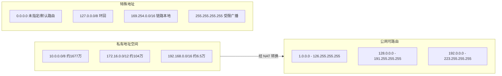

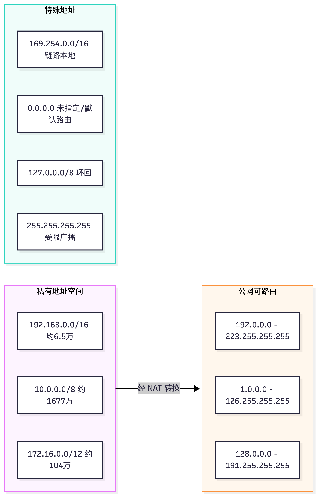


### 真题精练

**Q1.【真题·单选】** 下列哪一组全部属于 RFC 1918 定义的私有地址？
A. 10.0.0.0/8、172.16.0.0/12、192.168.0.0/16
B. 10.0.0.0/8、172.16.0.0/16、192.168.0.0/24
C. 10.0.0.0/8、172.16.0.0/12、192.168.0.0/24
D. 100.64.0.0/10、172.16.0.0/12、192.168.0.0/16

> **答案：A**
> **解析**：RFC 1918 规定的是三个**地址块**：10/8、172.16/12、192.168/16。B 错在把 172.16/12 写成 /16（会漏掉 172.17~172.31）且 192.168/16 写成 /24；C 错在 192.168 只写 /24；D 中 100.64.0.0/10 是 RFC 6598 的**运营商级 NAT（CGN）共享地址**，不属于私有地址三块，是常见干扰项。

**Q2.【真题·单选】** 主机检测到自己的 IP 地址为 169.254.10.20/16，最可能的原因是？
A. 主机配置了静态地址但网关错误
B. 主机 DHCP 请求未获得响应，触发了自动专用 IP 编址（APIPA）
C. 主机与网关处于不同 VLAN
D. 主机被 ACL 拒绝了流量

> **答案：B**
> **解析**：169.254.0.0/16 是链路本地地址段，Windows/Linux 在 DHCP Discover 多次超时后会随机选取一个地址自配（APIPA，Automatic Private IP Addressing），并每隔一段时间重试 DHCP。A/C/D 都不会导致该地址出现。排错思路：先 `ipconfig /release` 再 `/renew`，然后检查 DHCP 服务器可达性与中继配置。

**Q3.【真题·判断】** `ping 127.0.0.1` 失败说明本机网卡硬件损坏。

> **答案：错误**
> **解析**：`127.0.0.0/8` 是环回地址，报文在**本机协议栈内部**回环，完全不经过网卡。因此 `ping 127.0.0.1` 通只能证明 TCP/IP 协议栈安装正常，**不能证明网卡正常**；反过来，若 `ping 127.0.0.1` 不通，问题一定在协议栈层面（如驱动/协议未绑定），而不是网线或对端设备。

**Q4.【真题·多选】** 下列关于 `255.255.255.255` 与子网定向广播地址的说法，正确的有？
A. 255.255.255.255 是受限广播，路由器默认不转发
B. 192.168.1.255 若掩码为 /24，则是该子网的定向广播地址
C. 192.168.1.255 一定是广播地址
D. 定向广播地址是主机位全 1 的地址

> **答案：ABD**
> **解析**：C 错在"一定"——广播地址取决于**掩码**。若掩码是 /23（255.255.254.0），则 192.168.0.0/23 的广播地址是 192.168.1.255 没错，但若掩码是 /22，192.168.1.255 只是普通主机地址。这正是"广播地址由掩码决定，不由末尾 255 决定"的经典考点。

**Q5.【真题·填空】** 172.16.0.0/12 的地址范围是 172.16.0.0 ~ ______，共包含 ______ 个 /16 网段。

> **答案：172.31.255.255；16**
> **解析**：/12 意味着前 12 bit 固定为 10101100 0001，第 3 段（第 13~16 bit）为可变部分，取值从 0001 到 1111 之外的…严谨算法：/12 的网络部分固定了第 2 段的**高 4 bit**为 `0001`（即第 2 段取值 16~31），因此范围是 172.16.0.0 ~ 172.31.255.255；/12 相对 /16 多出 4 个自由比特，可划分 2^4 = 16 个 /16。

**Q6.【真题·简答】** 说明 `0.0.0.0` 在"作为源 IP"和"作为路由表目的网络"两种场景下的含义差异，并各举一个实例。

> **答案与解析**：
> 1. **作为源 IP**：表示"本机当前还没有可用的 IP 地址"，属于**未指定地址（Unspecified Address）**，不能作为目的地址使用。典型实例：主机开机启动 DHCP 流程时，Discover 报文的源 IP 填 0.0.0.0、目的 IP 填 255.255.255.255。
> 2. **作为路由表目的网络**：配合掩码 0.0.0.0（即 `0.0.0.0/0`）表示**默认路由（Default Route）**，含义是"所有目的地址都不匹配其他明细路由时，从这条路由转发"。
> 3. **差异本质**：前者是"地址空间中的占位符"，后者是"路由前缀长度为 0 的特殊前缀"，二者语义完全无关，只是共用同一串数字。

**Q7.【真题·排错】** 某园区 PC 无法上网，`ipconfig` 显示 IP 为 169.254.88.7，掩码 255.255.0.0，网关为空。请给出完整的排查步骤。

> **答案与解析**：
> 1. **定位现象**：169.254.x.x 说明 PC 未获得 DHCP 地址，网关自然为空，无法出网。
> 2. **查物理与 VLAN**：`display interface GigabitEthernet0/0/1` 确认接入交换机端口 up，`display port vlan` 确认 PC 所在端口 PVID 与 DHCP 服务器/中继所属 VLAN 一致（常见错误是端口被划到错误 VLAN）。
> 3. **查 DHCP 服务**：在 DHCP 服务器侧 `display ip pool` 查看地址池是否有 `Used/Idle`、是否 `Conflict` 耗尽；确认 `dhcp enable` 已开启（**VRP 上不开 dhcp enable，接口地址池不生效，这是最常见的低级错误**）。
> 4. **查中继**：跨网段必须有 `dhcp select relay` + `dhcp relay server-ip x.x.x.x`，并在 DHCP 服务器上 `ip route-static` 回程指向中继所在网段；用 `display dhcp relay statistics` 看是否有报文进出。
> 5. **抓包验证**：在接入端口 `mirror` 或直接 `terminal monitor` + `debugging dhcp server packet`（实验环境用），确认 Discover 是否到达服务器、Offer 是否返回。

### 易错点与排错

1. **172.16.0.0/12 的范围写到 172.31.255.255**，不是 172.16.255.255。速记：第 2 段 16~31，共 16 个 B 类。
2. **私有地址 ≠ 不可路由地址的全部**。169.254/16、127/8、0.0.0.0、240/4 也都不可全球路由，但只有 RFC 1918 的三段叫"私有地址"。
3. **广播地址由掩码决定**，不能只看末位是否 255。
4. **/31 与 /32 的可用主机数不符合 2^h − 2 公式**，/31 有 2 个可用地址（点对点），/32 有 1 个。
5. 排错命令：`display ip interface brief`（看接口地址与状态）、`display ip pool`（DHCP 池）、`ping -a 源地址 目的地址`（指定源 ping 验证选路）。

---

## 5.2 子网掩码、VLSM 与"看掩码算块大小"速算法

### 考点定位

这是**校赛、省赛计算题的第一大来源**，通常 1~2 道大题 + 若干填空，合计 **10~15 分**。考法：给出网段与需求，要求划分 VLSM；或给出 IP+掩码，求网络号/广播地址/第一个可用地址/最后一个可用地址/下一个子网。**必须能在 30 秒内手算完成**。

### 原理精讲

**子网掩码（Subnet Mask）** 是与 IP 等长的 32 bit 串，网络位为 1、主机位为 0。它存在的意义是把"网络部分"从地址中**提取**出来：`网络号 = IP AND 掩码`。掩码必须**连续 1 在前**，中间不能夹 0（否则设备报错 `Error: The subnet mask is invalid`）。

**CIDR（Classless Inter-Domain Routing，无类域间路由）表示法**：用 `/n` 表示前 n bit 是网络位，例如 `192.168.1.0/24`。它取代了主类掩码（A/8、B/16、C/24）的硬性约束，是 VLSM 与路由聚合的语法基础。

**核心速算法——"看掩码算块大小（Block Size）"**（也称"magic number"）：

> 设**关键掩码字节**（即掩码中既不是 255 也不是 0 的那个字节，如 /26 的掩码 255.255.255.192 中关键字节是 192），则
> **块大小 = 256 − 关键掩码字节值**，
> 该关键字节对应的**地址段就按"块大小"的倍数切分**，网络号一定落在这些倍数上。

举例：/26 → 255.255.255.192 → 块大小 = 256 − 192 = **64** → 第 4 段的网络号只可能是 0、64、128、192。

**五步求网络号/广播地址/可用地址**：

1. 写出掩码，找出**关键字节**的位置（第几段）。
2. 算块大小 = 256 − 关键字节值。
3. 把目标 IP 的**关键字节**向下取整到块大小的整数倍 → 得到**网络号的关键字节**。
4. 广播地址 = 网络号 + 块大小 − 1（在关键字节上），关键字节右侧的段全部填 255，左侧保持不变。
5. 可用主机地址 = 网络号 + 1 到 广播地址 − 1。

**VLSM（Variable Length Subnet Mask，可变长子网掩码）**：允许在同一主网内使用**不同长度**的掩码，从而按实际需求"按需分配"，避免浪费。VLSM 的两条铁律：

1. **从大到小分配**：先满足主机数最多的网段，再依次减小，否则小网段的地址块会被"切碎"导致大网段无连续空间可用。
2. **地址块不能重叠**，且每块起点必须落在自身块大小的整数倍上（这是"对齐"要求）。

> **为什么必须从大到小？** 因为子网是"二分递归"产生的：/24 在 /25 处切开，得到两个 /25；要得到 /26 必须在某个 /25 内再切。若先切了很多 /30（点对点互联），这些 /30 可能横跨 /25 边界，导致再也没有连续的 /25 留给 120 台主机的部门。所以先大后小是**数学上的必然要求**，而非经验之谈。

### 关键概念对照表

| CIDR | 掩码 | 关键字节 | 块大小 | 地址总数 | 可用主机数 |
|---|---|---|---|---|---|
| /24 | 255.255.255.0 | 第 4 段=0 | 256 | 256 | 254 |
| /25 | 255.255.255.128 | 第 4 段=128 | 128 | 128 | 126 |
| /26 | 255.255.255.192 | 第 4 段=192 | 64 | 64 | 62 |
| /27 | 255.255.255.224 | 第 4 段=224 | 32 | 32 | 30 |
| /28 | 255.255.255.240 | 第 4 段=240 | 16 | 16 | 14 |
| /29 | 255.255.255.248 | 第 4 段=248 | 8 | 8 | 6 |
| /30 | 255.255.255.252 | 第 4 段=252 | 4 | 4 | 2 |
| /31 | 255.255.255.254 | 第 4 段=254 | 2 | 2 | 2（RFC 3021） |
| /23 | 255.255.254.0 | 第 3 段=254 | 2 | 512 | 510 |
| /22 | 255.255.252.0 | 第 3 段=252 | 4 | 1024 | 1022 |
| /21 | 255.255.248.0 | 第 3 段=248 | 8 | 2048 | 2046 |
| /20 | 255.255.240.0 | 第 3 段=240 | 16 | 4096 | 4094 |
| /16 | 255.255.0.0 | 第 3 段=0 | 256 | 65536 | 65534 |

**快速记忆**：掩码字节值 → 块大小，记住 128→128、192→64、224→32、240→16、248→8、252→4、254→2、255→1、0→256（在"末段"意义上等同整段）。

### 华为设备配置

```bash
# 在 AR6120 上为 LAN 侧接口配置 VLSM 后的地址（以部门网段 192.168.1.0/26 为例）
system-view                                          # 进入系统视图
sysname AR6120-Branch                                # 修改设备名，便于实验识别
interface GigabitEthernet0/0/0                       # 进入 LAN 侧物理接口
 description To-AccessSwitch-S5731                   # 接口描述，工程规范要求
 undo portswitch                                      # AR 系列路由器需将二层口切换为三层口（部分型号默认三层可省略）
 ip address 192.168.1.62 255.255.255.192              # 配置 /26 网段的网关地址（网关取该网段最后一个可用地址）
quit
interface GigabitEthernet0/0/1                       # 上行 WAN 接口
 ip address 202.100.1.2 255.255.255.252              # /30 用于路由器互联，仅 2 个可用地址，最省
quit
display ip interface brief                           # 验证接口地址与物理/协议状态
display ip routing-table                             # 验证直连路由是否生成
save                                                 # 保存配置
```

### 示意图

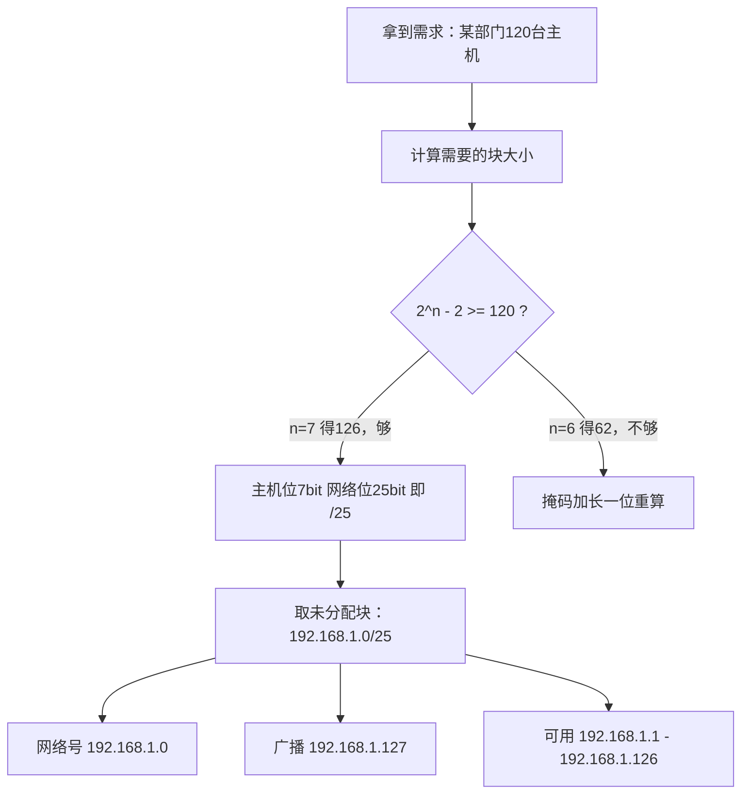

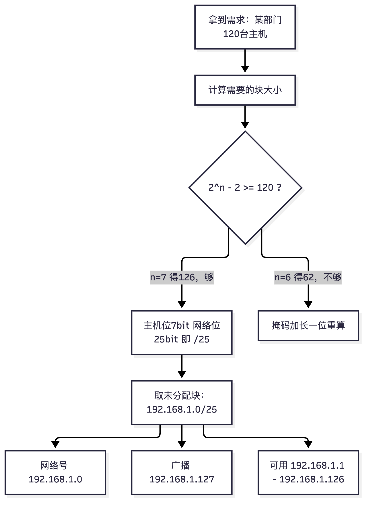


### 真题精练

**Q8.【真题·单选】** IP 地址 192.168.100.150，掩码 255.255.255.224，其所在子网的网络号是？
A. 192.168.100.128  B. 192.168.100.144  C. 192.168.100.160  D. 192.168.100.150

> **答案：A**
> **解析**：掩码关键字节为 224，块大小 = 256 − 224 = 32。第 4 段 150 ÷ 32 = 4.68 → 向下取整 4 → 4 × 32 = **128**，故网络号为 192.168.100.128。干扰项 B（144）是"按 16 的块"算的结果（误以为掩码 240）；C（160）是向上取整的结果（把广播地址段当成网络号）；D 是把主机地址当网络号的典型错误。该子网范围：128 ~ 159，可用 129 ~ 158，共 30 个。

**Q9.【真题·填空】** 子网 10.10.10.0/27 的广播地址是 ______，可用主机地址范围是 ______，可容纳主机数 ______ 台。

> **答案：10.10.10.31；10.10.10.1 ~ 10.10.10.30；30**
> **解析**：掩码 255.255.255.224，块大小 32。网络号 10.10.10.0，广播 = 0 + 32 − 1 = **31**。可用地址去掉网络号与广播地址，即 1~30，共 30 个（2^5 − 2 = 30）。**注意**：业务部门实际使用时，网关会占用 1 个地址，因此"可分配终端数"是 29 台。

**Q10.【真题·单选】** 某接口配置 `ip address 172.16.37.100 255.255.252.0`，该地址所在子网的网络地址是？
A. 172.16.36.0  B. 172.16.37.0  C. 172.16.32.0  D. 172.16.36.128

> **答案：A**
> **解析**：/22 = 255.255.252.0，关键字节在**第 3 段**（252），块大小 = 256 − 252 = 4。第 3 段 37 ÷ 4 = 9.25 → 向下取整 9 → 9 × 4 = **36**，故网络号是 172.16.**36**.0，第 4 段清零。该子网范围 172.16.36.0 ~ 172.16.39.255，广播地址 172.16.39.255，可用 172.16.36.1 ~ 172.16.39.254，共 1022 个。**考点**：块大小的计算落在哪一段，要看掩码中那个"非 255 非 0"的字节在哪一段。

**Q11.【真题·多选】** 关于 VLSM，下列说法正确的有？
A. VLSM 允许同一主网内使用不同长度的子网掩码
B. 划分时应按需求从大到小依次分配
C. VLSM 需要路由协议支持传递掩码长度（如 OSPF、RIPv2、BGP）
D. RIPv1 支持 VLSM

> **答案：ABC**
> **解析**：D 错误。RIPv1（Routing Information Protocol version 1）是**有类路由协议**，通告更新时**不携带掩码**，接收方只能按主类边界推断，因此无法支持 VLSM；RIPv2、OSPF、IS-IS、BGP 都是无类协议，更新中携带掩码长度。这是"VLSM 必须配合无类路由协议"的核心结论。

**Q12.【真题·判断】** 只要两台设备的 IP 在同一网段，它们之间就一定能直接通信，不需要网关。

> **答案：错误**
> **解析**：同一网段内通信还要求：① 二层可达（同 VLAN 或 Trunk 放通）；② 地址不冲突（否则出现 IP 冲突告警，时通时不通）；③ 双方掩码**一致**——若 PC1 配 /24、PC2 配 /25 而地址在 128~254 范围内，双方对"是否同网段"的判断会不一致，导致 PC2 认为不同网段要发网关而 PC1 认为同网段直接 ARP，通信失败。这是实验室和现网都极易踩的坑。

### 易错点与排错（子网划分与 VLSM 专题）

1. **找错关键字节所在的段**：/22 的关键字节在**第 3 段**（252），不是第 4 段；只有 /25~/32 的关键字节才在第 4 段。
2. **块大小算成"地址总数减 2"**：块大小是"该子网的地址总数"（含网络号与广播），不要提前减 2。
3. **广播地址漏改右侧段**：以 172.16.37.100/22 为例，广播地址是 172.16.**39.255**，第 4 段必须补 255，不能写成 172.16.39.100。
4. **VLSM 从小到大分配**导致大块地址无法对齐，是计算大题失分的第一原因。
5. **网段起点未对齐**：/26 的起点只能是 .0/.64/.128/.192，写成 .32 会与相邻网段重叠。
6. 验证习惯：算完后用"**网络号 + 块大小 = 下一个子网的网络号**"反查一遍；再用 `display ip interface brief` 在实验中核对接口地址是否落在正确网段。

---

## 5.3 CIDR、超网与路由聚合

### 考点定位

常考**填空题与计算题**：给出一组连续子网，求最大可能的聚合（汇总）路由；或判断某聚合路由是否会引入"路由黑洞"。占 **4~6 分**，在省赛与实验配置题中与 OSPF `abr-summary` 结合考查。

### 原理精讲

**超网（Supernetting）/路由聚合（Route Summarization）** 是把**多条具有相同前缀的连续路由**合并成一条前缀更短的路由，目的是**减小路由表规模**。它与子网划分方向相反：子网划分把块**切小**（掩码变长），聚合把块**合大**（掩码变短）。

**聚合的计算方法（三步）**：

1. 把待聚合的网段写成**二进制**，尤其关注变化的那一段。
2. 找出所有网段中**共同不变的高位比特**，这些比特就是聚合后的网络位。
3. 聚合后的前缀长度 = 8 × 完整相同的字节数 + 共同不变比特数；其余位全部置 0。

**判定能否聚合的"块大小校验法"**：若一组网段能被聚合为 /n，则**起始网络地址必须是 2^(32−n) 的整数倍**，且所有网段必须完整落在该 /n 块内。

**经典示例**：

- 192.168.0.0/24 与 192.168.1.0/24 → 第 3 段 0 = `00000000`、1 = `00000001`，前 7 bit 相同 → 聚合为 **192.168.0.0/23**。
- 192.168.0.0/24 ~ 192.168.3.0/24（4 条）→ 第 3 段前 6 bit 相同 → **192.168.0.0/22**。
- 192.168.1.0/24 与 192.168.2.0/24 → 1 = `00000001`、2 = `00000010`，只有前 6 bit 相同，但聚合 192.168.0.0/22 会**顺带包含** 192.168.0.0/24 与 192.168.3.0/24 —— 这两条若不存在，就会产生**路由黑洞（Black Hole）**：流量被吸引过来但无下一跳，被丢弃。**考试高频结论：不能为了聚合而聚合，聚合必须精确或明确接受黑洞代价。**

**聚合的两种代价**：① 引入黑洞（如上）；② 造成**次优路径**（流量绕行到聚合点）。因此工程上优先选择"物理上连续的地址块"来聚合。

### 关键概念对照表

| 待聚合路由 | 聚合结果 | 是否精确 | 说明 |
|---|---|---|---|
| 192.168.0.0/24 + 192.168.1.0/24 | 192.168.0.0/23 | 精确 | 相邻成对，最推荐 |
| 192.168.0.0/24 ~ 192.168.3.0/24 | 192.168.0.0/22 | 精确 | 4 条 /24 |
| 192.168.1.0/24 + 192.168.2.0/24 | 192.168.0.0/22 | **不精确** | 含 .0.0/24 与 .3.0/24 两个空洞 |
| 10.1.0.0/16 ~ 10.8.0.0/16 | 无法精确聚合 | — | 不连续，需 10.0.0.0/13 但含空洞 |
| 172.16.1.0/24 ~ 172.16.4.0/24 | 不精确 | — | 1 与 4 不构成 2 的整数块 |
| 10.1.0.0/16 ~ 10.1.15.0/20 类混合 | 视情况 | — | 掩码不同也可聚合，只要前缀连续 |

### 华为设备配置

```bash
# 在 AR6120 上配置一条聚合静态路由 + 一条指向 NULL0 的防环黑洞路由
system-view
ip route-static 192.168.0.0 255.255.252.0 10.0.0.2      # 将 192.168.0.0/24 ~ 3.0/24 聚合为 /22 指向下一跳
ip route-static 192.168.0.0 255.255.252.0 NULL0          # 聚合路由指向 NULL0，防止本机把该聚合段内未分配流量回送造成环路
quit
display ip routing-table 192.168.0.0 verbose             # 查看明细路由与来源，验证聚合效果
display ip routing-table statistics                       # 查看路由表总条目数，聚合前后对比
```

```bash
# OSPF 区域间路由聚合（在 ABR 上配置，把区域内明细路由汇总后通告进骨干区）
system-view
ospf 1 router-id 10.0.0.1                                 # 进入 OSPF 进程 1 并指定 Router ID
 area 1                                                   # 进入区域 1 视图（本设备为 ABR）
  abr-summary 192.168.0.0 255.255.252.0                   # 将区域 1 内 192.168.0.0/24~3.0/24 聚合为 /22 通告到 Area 0
  abr-summary 192.168.0.0 255.255.252.0 not-advertise     # 若只想抑制明细而不通告汇总，用 not-advertise 参数
 quit
quit
display ospf abr-asbr                                     # 确认本机 ABR/ASBR 角色
display ospf lsdb summary 192.168.0.0                     # 查看生成的 3 类 LSA（Summary-LSA）
```

### 示意图

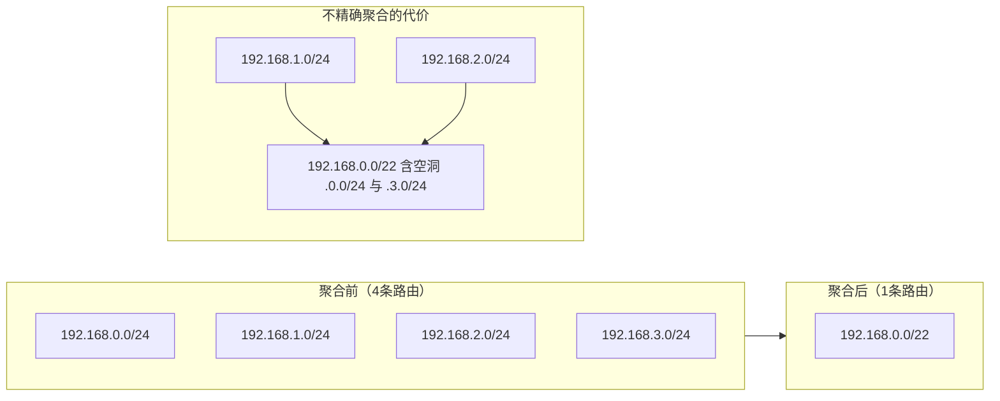

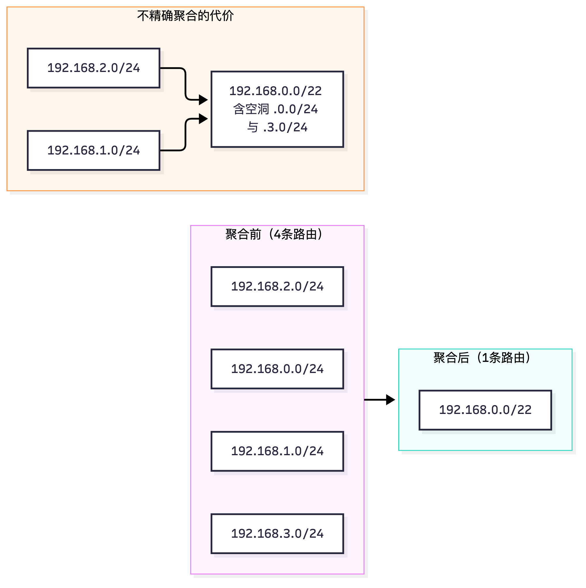


### 真题精练

**Q13.【真题·填空】** 将 172.16.8.0/24、172.16.9.0/24、172.16.10.0/24、172.16.11.0/24 四条路由聚合成一条，结果是 ______。

> **答案：172.16.8.0/22**
> **解析**：第 3 段 8/9/10/11 的二进制为 `00001000`、`00001001`、`00001010`、`00001011`，共同不变的只有高 6 位 `000010`。第 1、2 段（172.16）完整相同 = 16 bit，加上第 3 段 6 bit 共同位 = **22 bit**。故聚合结果为 172.16.8.0/22，覆盖范围 172.16.8.0 ~ 172.16.11.255，恰好等于四条 /24 之和，属**精确聚合**。校验：/22 的块大小在第 3 段为 4，起始 8 是 4 的整数倍 ✓。

**Q14.【真题·单选】** 路由器上存在 10.1.0.0/16 与 10.2.0.0/16 两条明细路由，管理员将其聚合为 10.0.0.0/14 后，最可能引发的后果是？
A. 路由表条目增加  B. 出现路由黑洞，10.0.0.0/16 与 10.3.0.0/16 流量被丢弃  C. 设备 CPU 升高  D. 邻居关系中断

> **答案：B**
> **解析**：10/14 覆盖 10.0.0.0 ~ 10.3.255.255 四段 /16，其中 10.0.0.0/16 与 10.3.0.0/16 并无明细路由，属于"空洞"。若该聚合路由指向下一跳，未被明细路由覆盖的流量会被吸引过来并按聚合路由转发，最终无法交付（或指向 NULL0 丢弃），即**路由黑洞**。A/C/D 与聚合本身无必然因果。

**Q15.【真题·简答】** 简述"路由聚合"与"子网划分"的区别，并说明 VLSM 为什么必须与无类路由协议配合。

> **答案**：
> 1. **方向相反**：子网划分把一条大前缀切成多条长前缀（掩码变长、可用子网增多、每个子网主机数减少）；路由聚合把多条长前缀合并为一条短前缀（掩码变短、路由表条目减少）。
> 2. **目的不同**：子网划分解决"地址利用率与广播域隔离"；路由聚合解决"路由表规模与收敛速度"。
> 3. **VLSM 与无类协议的关系**：VLSM 意味着"同一主网内存在不同掩码长度"，接收方**必须知道每条路由的掩码长度**才能正确转发。有类协议（RIPv1、IGRP）在更新中只通告网络地址、不带掩码，接收方只能按 A/B/C 主类边界还原掩码，会把 /26 误还原为 /24，造成**路由错误与黑洞**。因此 VLSM 只在携带掩码的无类协议（RIPv2、OSPF、IS-IS、BGP）上才能正确工作。

### 易错点与排错

1. **聚合时忽略"空洞"**：务必用块大小校验起始地址是否为 2 的整数倍，并统计聚合块内是否存在无明细覆盖的网段。
2. **混淆"聚合路由"与"默认路由"**：0.0.0.0/0 是最极端的聚合（聚合全部），但会丢失所有明细信息，只在末梢网络使用。
3. **聚合后明细路由未抑制**：即使配了 `abr-summary`，若明细 LSA 仍被通告则收益减半；`abr-summary ... not-advertise` 可抑制明细。
4. 排错命令：`display ip routing-table a.b.c.d`（看某目的地址实际命中的路由）、`display ospf lsdb`（看 3 类 LSA 是否已聚合）。

---

## 5.4 地址规划原则与三层园区规划实战（含 VLSM 综合大题 2 道）

### 考点定位

省赛与国赛的**实验配置题前 10 分钟必做动作**就是地址规划，规划错了后面全部连锁失败。理论卷中也常有"给定拓扑与需求，写出各网段地址"的大题，**8~12 分**。

### 原理精讲

**企业地址规划六原则**：

1. **层次性**：按"核心—汇聚—接入"或"区域—楼栋—楼层"分级分配地址块，使聚合可行。例如总部 10.1.0.0/16、A 楼 10.1.1.0/24、B 楼 10.1.2.0/24。
2. **唯一性**：全网无重复，私有地址在多出口 NAT 场景下尤其要避免冲突。
3. **连续性**：同一区域的地址尽量连续，便于聚合成一条路由。
4. **可扩展性**：预留 30%~50% 余量，避免"新楼无地址可用"被迫打乱层次。
5. **可管理性**：地址段含义可读（如第 3 段标识楼栋、第 4 段标识 VLAN）。推荐 `10.<园区>.<楼栋>.<网段>` 或 `10.<区域>.<VLAN 段>.0/24`。
6. **节约性**：互联链路用 /30 或 /31；服务器区可用 /24 甚至 /23；用户区按部门规模选 /24、/25、/26。

**三层园区典型规划模型**（以 10.1.0.0/16 为总部总块为例）：

| 用途 | 地址块 | 掩码 | 可用主机 | 网关 |
|---|---|---|---|---|
| 网络设备管理（Loopback） | 10.1.255.0/24 | /24 | 254 | — |
| 核心—汇聚互联 | 10.1.254.0/24 再切 /30 | /30 | 2/段 | — |
| 服务器区 | 10.1.10.0/23 | /23 | 510 | 10.1.10.1 |
| 研发部（120 人） | 10.1.20.0/25 | /25 | 126 | 10.1.20.1 |
| 市场部（60 人） | 10.1.20.128/26 | /26 | 62 | 10.1.20.129 |
| 财务部（25 人） | 10.1.20.192/27 | /27 | 30 | 10.1.20.193 |
| 会议室无线（12 台 AP 管理） | 10.1.20.224/28 | /28 | 14 | 10.1.20.225 |
| 访客 WiFi（动态池） | 10.1.30.0/24 | /24 | 254 | 10.1.30.1 |
| 语音（IP Phone） | 10.1.40.0/24 | /24 | 254 | 10.1.40.1 |
| 预留 | 10.1.128.0/17 | /17 | — | — |

**关键工程结论**：Loopback 与互联链路单独成段，便于排错与路由策略匹配；语音、访客、服务器必须独立成段（安全策略与 QoS 需要）。

### 关键概念对照表

| 网段类型 | 推荐掩码 | 理由 |
|---|---|---|
| 路由器/交换机互联 | /30 或 /31 | 只需 2 个地址，最省 |
| 管理网/Loopback | /32（单个）或 /24（整段） | /32 常作 Router ID 与 BGP 源 |
| 部门用户（>100 人） | /24 或 /25 | 兼顾规模与广播域 |
| 部门用户（20~50 人） | /26 或 /27 | 减少浪费，便于统计 |
| 服务器区 | /23 或 /24 | 服务器密度高，预留增长 |
| 访客/无线 | /24 | 终端流动大，需大池 |
| 语音 VLAN | /24 | IP Phone 与 PC 共用需分离 |

### 华为设备配置

```bash
# 三层园区核心交换机 S12700 上的 VLAN 与网关地址规划落地（VRP V200）
system-view
sysname Core-S12700
vlan batch 10 20 30 40 100                            # 批量创建 服务器/研发/市场/财务/管理 VLAN
interface Vlanif10                                     # 服务器区网关
 ip address 10.1.10.1 255.255.254.0                     # /23，510 个可用地址
quit
interface Vlanif20                                     # 研发部网关
 ip address 10.1.20.1 255.255.255.128                   # /25，126 个可用地址
quit
interface Vlanif30                                     # 市场部网关
 ip address 10.1.20.129 255.255.255.192                 # /26，62 个可用地址
quit
interface Vlanif40                                     # 财务部网关
 ip address 10.1.20.193 255.255.255.224                 # /27，30 个可用地址
quit
interface Vlanif100                                    # 设备管理 VLAN
 ip address 10.1.255.1 255.255.255.0
quit
interface LoopBack0                                    # 环回口，用于 Router ID / OSPF / SNMP 管理
 ip address 10.1.255.254 255.255.255.255                # /32 主机地址
quit
save
```

```bash
# 互联链路地址规划（核心 S12700 与出口 AR6120 之间用 /30）
interface GigabitEthernet1/0/1
 undo portswitch                                        # 若为二层口需切换为三层路由口
 ip address 10.1.254.1 255.255.255.252                  # /30，仅 2 个可用地址，.1 与 .2
quit
```

### 示意图

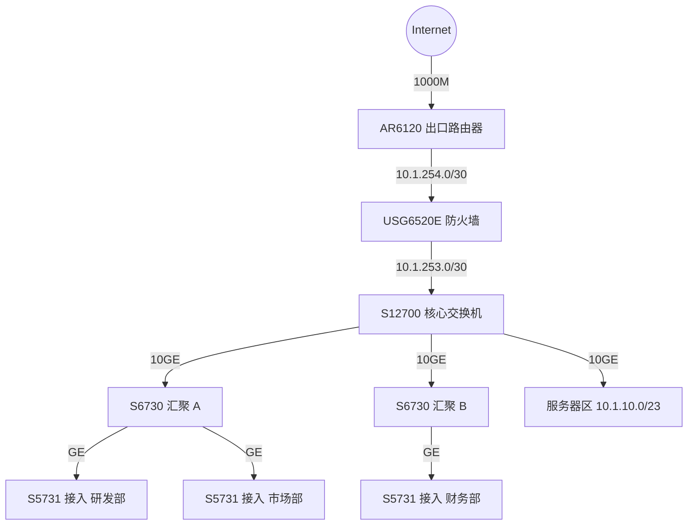

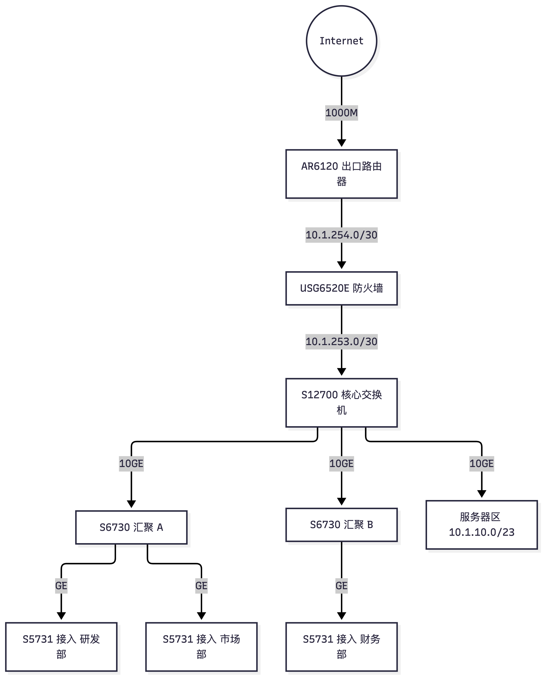


### 真题精练

**Q16.【真题·实验·VLSM 综合计算 第 1 题】** 某公司分配到地址块 **192.168.1.0/24**，需要为以下 5 个网段分配地址，请给出每个网段的 **网络地址、子网掩码、可用地址范围、广播地址**，并说明剩余可用空间。

- 网段 A：研发部，需 **100** 台主机
- 网段 B：市场部，需 **50** 台主机
- 网段 C：财务部，需 **20** 台主机
- 网段 D：服务器区，需 **10** 台主机
- 网段 E：路由器互联，需 **2** 个地址

> **答案与逐步演算**：
>
> **第 1 步：把需求换算成所需主机位数（2^n − 2 ≥ 需求）**
>
> | 网段 | 需求 | 2^n−2 计算 | 主机位 n | 掩码 | 块大小 | 地址总数 |
> |---|---|---|---|---|---|---|
> | A | 100 | 2^7−2 = 126 ≥ 100 | 7 | /25 | 128 | 128 |
> | B | 50 | 2^6−2 = 62 ≥ 50 | 6 | /26 | 64 | 64 |
> | C | 20 | 2^5−2 = 30 ≥ 20 | 5 | /27 | 32 | 32 |
> | D | 10 | 2^4−2 = 14 ≥ 10 | 4 | /28 | 16 | 16 |
> | E | 2 | 2^2−2 = 2 ≥ 2 | 2 | /30 | 4 | 4 |
>
> **第 2 步：按从大到小依次分配（保证对齐）**
>
> - **A：192.168.1.0/25**（占用 .0 ~ .127）
>   网络号 192.168.1.0；广播 192.168.1.127；可用 192.168.1.1 ~ 192.168.1.126（126 个）
> - **B：从 .128 开始，块大小 64 → 192.168.1.128/26**（占用 .128 ~ .191）
>   网络号 192.168.1.128；广播 192.168.1.191；可用 192.168.1.129 ~ 192.168.1.190（62 个）
> - **C：从 .192 开始，块大小 32 → 192.168.1.192/27**（占用 .192 ~ .223）
>   网络号 192.168.1.192；广播 192.168.1.223；可用 192.168.1.193 ~ 192.168.1.222（30 个）
> - **D：从 .224 开始，块大小 16 → 192.168.1.224/28**（占用 .224 ~ .239）
>   网络号 192.168.1.224；广播 192.168.1.239；可用 192.168.1.225 ~ 192.168.1.238（14 个）
> - **E：从 .240 开始，块大小 4 → 192.168.1.240/30**（占用 .240 ~ .243）
>   网络号 192.168.1.240；广播 192.168.1.243；可用 192.168.1.241 ~ 192.168.1.242（2 个）
>
> **第 3 步：统计余量**
>
> 已用：128 + 64 + 32 + 16 + 4 = **244** 个地址；剩余 256 − 244 = **12** 个地址，即
> **192.168.1.244/30**（4 个）、**192.168.1.248/29**（8 个）可用作后续扩展。
> 若严格按连续块最大化利用，剩余可表达为 `192.168.1.244/30` + `192.168.1.248/29`。
>
> **易错提醒**：如果把 D 或 E 放在前面分配（例如先分 /30 从 .0 开始），后续 A 需要 128 个连续地址时就会**无对齐块可用**，导致方案整体失败。这就是"必须先大后小"的实际意义。

**Q17.【真题·实验·VLSM 综合计算 第 2 题】** 某企业总部拿到 **10.100.0.0/22**，需规划如下：
1. 总部服务器区 300 台
2. 研发部 200 台
3. 市场部 100 台
4. 财务部 40 台
5. 4 条路由器互联链路，每条 2 个地址

请完成完整的 VLSM 规划表，并写出可用的**出口聚合路由**。

> **答案与逐步演算**：
>
> **第 1 步：确认母网块大小**：/22 → 掩码 255.255.252.0，第 3 段块大小 = 4 →
> 母网范围 **10.100.0.0 ~ 10.100.3.255**，共 1024 个地址（1022 可用）。
>
> **第 2 步：需求换算**
>
> | 需求 | 2^n−2 ≥ 需求 | 掩码 | 块大小 |
> |---|---|---|---|
> | 300 | 2^9−2 = 510 ≥ 300 | /23 | 512 |
> | 200 | 2^8−2 = 254 ≥ 200 | /24 | 256 |
> | 100 | 2^7−2 = 126 ≥ 100 | /25 | 128 |
> | 40 | 2^6−2 = 62 ≥ 40 | /26 | 64 |
> | 2（互联 ×4） | 2^2−2 = 2 | /30 | 4 |
>
> **第 3 步：从大到小分配**
>
> | 序号 | 用途 | 网络地址/掩码 | 可用地址范围 | 广播地址 |
> |---|---|---|---|---|
> | 1 | 服务器区 | **10.100.0.0/23** | 10.100.0.1 ~ 10.100.1.254 | 10.100.1.255 |
> | 2 | 研发部 | **10.100.2.0/24** | 10.100.2.1 ~ 10.100.2.254 | 10.100.2.255 |
> | 3 | 市场部 | **10.100.3.0/25** | 10.100.3.1 ~ 10.100.3.126 | 10.100.3.127 |
> | 4 | 财务部 | **10.100.3.128/26** | 10.100.3.129 ~ 10.100.3.190 | 10.100.3.191 |
> | 5 | 互联链路 1 | **10.100.3.192/30** | 10.100.3.193 ~ 10.100.3.194 | 10.100.3.195 |
> | 6 | 互联链路 2 | **10.100.3.196/30** | 10.100.3.197 ~ 10.100.3.198 | 10.100.3.199 |
> | 7 | 互联链路 3 | **10.100.3.200/30** | 10.100.3.201 ~ 10.100.3.202 | 10.100.3.203 |
> | 8 | 互联链路 4 | **10.100.3.204/30** | 10.100.3.205 ~ 10.100.3.206 | 10.100.3.207 |
> | — | 余量 | 10.100.3.208 ~ 10.100.3.255 | 共 48 个地址 | — |
>
> **第 4 步：聚合成一条对外路由**
>
> 全部业务网段都在 10.100.0.0/22 内，因此出口可只对外通告（或配置）一条：
> **`ip route-static 10.100.0.0 255.255.252.0 <下一跳>`**（或 OSPF 中直接通告 /22）。
> 特别地，序号 1~4 完全占据 10.100.0.0/23 与 10.100.2.0/23 的前半，可验证：
> - 10.100.0.0/23 + 10.100.2.0/24 + 10.100.3.0/25 + 10.100.3.128/26 + 4×/30 全部落在 /22 内 → **精确聚合无空洞**（余量 10.100.3.208/28~ 仍在 /22 内，属于预留，不算黑洞，因为没有对外泄漏更难匹配的路由）。
>
> **考点提醒**：若母网是 /22 但只对外通告 /24 明细，则路由表条目从 1 条变 8 条；反之若通告 /21（超出母网范围），就会把不属于本企业的 10.100.4.0/22 也吸引过来，造成**严重黑洞与流量劫持**。

**Q18.【真题·单选】** 规划企业地址时，路由器互联链路最节约且被广泛采用的掩码是？
A. /24  B. /29  C. /30 或 /31  D. /32

> **答案：C**
> **解析**：路由器互联只需 2 个地址，/30 提供 2 个可用地址，正好；/31（RFC 3021）无网络号与广播地址概念，2 个地址全部可用，更省。A 浪费 252 个地址；B 浪费 4 个；D 只有 1 个地址无法承载两端接口。

**Q19.【真题·简答】** 为什么企业地址规划要强调"层次性"？请结合路由聚合说明其技术收益。

> **答案**：
> 1. **层次性指按物理/逻辑层级分配连续地址块**（核心—汇聚—接入、楼栋—楼层），使同一层级的地址天然连续。
> 2. **技术收益一：可聚合**。连续地址块可聚合成短前缀路由。例如 4 个楼层各 /24 可聚合为 1 条 /22，接入层设备路由表从 4 条降到 1 条；大型园区（数十个 /24）可把路由表压缩一个数量级，显著降低内存与 CPU 查表压力。
> 3. **技术收益二：加快收敛**。拓扑变化时，边界设备只需重新计算聚合路由，内部明细变化不外泄，减少全网 LSA 泛洪与路由震荡（路由翻动）。
> 4. **技术收益三：便于策略与排错**。ACL、QoS、NAT 策略可直接匹配聚合前缀，一条策略覆盖整个部门；排错时凭地址即可判断设备位置（如看到 10.1.3.x 就知道是 B 楼 3 层）。
> 5. **反面案例**：若地址随机分配（10.1.5.0/24 给 A 楼、10.1.6.0/24 给 C 楼、10.1.7.0/24 给 B 楼），则无法聚合，且任何聚合尝试都会引入空洞黑洞。

### 易错点与排错（地址规划专题）

1. **先规划后配置**：实验题拿到拓扑的第一件事是把规划表写在草稿纸上（网段、掩码、网关、互联地址），再开始敲命令。跳过规划边配边想必然导致地址重叠或无法聚合。
2. **网关地址的选择**：华为工程习惯用**网段第一个可用地址**（如 10.1.20.1/25）或最后一个可用地址；一旦选定，DHCP 的 `excluded-ip-address` 与 `gateway-list` 必须一致，否则会出现地址冲突。
3. **互联链路单独成段**（/30 或 /31），不要从用户地址池里随手取两个地址，否则该网段会被通告进路由域，浪费前缀并可能引发聚合空洞。
4. **Loopback 单独成段且用 /32**，便于作为 OSPF Router ID、BGP 源地址与 SNMP 管理地址。
5. **语音、访客、服务器必须独立成段**：语音要 QoS、访客要隔离与限速、服务器要安全策略，混在一个网段无法做差异化管控。
6. **排错顺序**：先用 `display ip interface brief` 核对接口地址与掩码是否与规划表一致，再用 `display ip routing-table` 确认直连路由生成，最后用 `ping -a <本端源地址> <对端地址>` 验证点对点可达性（指定源可排除选路干扰）。

---

# 数通-HCIA-章节6-IP路由基础与静态路由

## 6.1 路由表组成与选路三原则

### 考点定位

本考点是**每一场校赛、省赛理论卷的必考项**，占 **6~10 分**。高频考法：给定几条路由（不同掩码、不同优先级、不同 Cost），判断某目的 IP 实际走哪一条（**最长匹配优先**）；或直接给出一段 `display ip routing-table` 输出，让考生指出下一跳。**最高频陷阱**：误以为"优先级小先比较"——实际顺序是**先最长匹配，再比优先级，最后比度量值**。

### 原理精讲

**路由表（Routing Table）** 是路由器/三层交换机的"地图"，每一条表项描述"去往某个目的网络，应该交给谁"。华为 VRP 的 `display ip routing-table` 输出字段含义如下（**必须逐字段背下来，实验题的排错全靠它**）：

| 字段 | 全称 | 含义 |
|---|---|---|
| Destination/Mask | 目的网络/掩码长度 | 该路由匹配的目的前缀，如 192.168.1.0/24 |
| Proto | Protocol | 路由来源协议：Direct（直连）、Static（静态）、OSPF、RIP、IS-IS、BGP |
| Pre | Preference | **优先级（管理距离）**，数值越小越优，用于比较**不同协议**之间的可信度 |
| Cost | Metric | **度量值**，用于比较**同一协议**内部到达同一目的的多条路径优劣 |
| NextHop | Next Hop | 下一跳 IP 地址；直连路由显示为接口自身地址 |
| Interface | Outgoing Interface | 出接口，报文从这里发出 |
| Age | Age | 该路由存在时长 |
| Flags | 标志位 | `R` 表示迭代（Recursion）路由、`D` 表示已被下发 FIB、`S` 表示已下刷 |

**路由表与 FIB 的关系**：路由表由各路由协议（控制平面）计算得出，称为 **RIB（Routing Information Base）**；真正指导转发的是 **FIB（Forwarding Information Base）**，它由 RIB 中**最优的、已激活的**路由下发而来，硬件芯片查 FIB 完成线速转发。这解释了为什么"路由表里有条目，但流量不通"——若出接口 down 或下一跳不可达，该路由不会下刷 FIB（Flags 中无 `D`），报文无法转发。

**选路三条原则（顺序不可颠倒）**：

1. **最长匹配（Longest Prefix Match）优先**：先只看目的前缀，掩码位数最长的明细路由获胜。**它与优先级无关！** 例如一条 `0.0.0.0/0` 优先级 1 的默认路由，永远打不过一条 /32 优先级 255 的主机路由。
2. **优先级（Preference）小者优先**：当**多条路由前缀完全相同**（同目的、同掩码）时，比较其来源协议的优先级，数值小者胜出。
3. **度量值（Cost）小者优先**：当**前缀相同且优先级也相同**（同一协议的多条路径）时，比较度量值，小者胜出。
4. **等价路由（ECMP）**：若前缀、优先级、度量值**全部相同**，则这些路由都会被安装进 FIB，形成**等价多路径**，报文按流（五元组哈希）负载分担。

> **为什么顺序是"最长匹配最优先"？** 因为 IP 转发的基本语义是"最具体的信息最可信"。管理员手工配置一条 /32 主机路由，就是要精确控制某一台设备的走向，若被协议的优先级覆盖，这份控制力就失效了。而优先级只在"两条路由描述的是同一个目的范围"时才有可比性——比较对象不同，比较毫无意义。

### 关键概念对照表

**华为 VRP 默认优先级表（必须背）**：

| 路由来源 | 默认优先级（Pre） | 说明 |
|---|---|---|
| Direct（直连） | **0** | 接口配置地址后自动生成，最可信 |
| OSPF 内部（OSPF） | **10** | OSPF 区域内/区域间路由 |
| IS-IS | **15** | 运营商常用 |
| Static（静态） | **60** | 手工配置 |
| RIP | **100** | 距离矢量，跳数度量 |
| OSPF ASE（外部） | **150** | OSPF 引入的外部路由（5 类/7 类 LSA） |
| OSPF NSSA | 150 | NSSA 区域内 7 类 LSA 转 5 类前的取值 |
| IBGP | **255** | 同一 AS 内 BGP |
| EBGP | **255** | 不同 AS 间 BGP |

> **记忆技巧**：0 → 10 → 15 → 60 → 100 → 150 → 255，**"直连最信、OSPF 次之、静态居中、RIP 靠后、BGP 最后"**。BGP 优先级 255 最大（最不可信），是因为 BGP 强调策略控制而非最短路径，必须靠 AS-Path、Local-Pref 等手段调优。

**路由来源三类对比**：

| 类型 | 生成方式 | 优点 | 缺点 | 适用场景 |
|---|---|---|---|---|
| 直连路由 | 接口配置 IP 且状态 up 后自动生成 | 无需配置、最可信、随接口状态联动 | 无法跨网段指导 | 本机所有接口网段 |
| 静态路由 | 管理员手工 `ip route-static` | 不占 CPU、可控、安全 | 拓扑变化不能自适应、规模大时维护难 | 末梢网络、默认路由、汇总路由 |
| 动态路由 | OSPF/RIP/IS-IS/BGP 自动学习 | 自适应、可扩展 | 占资源、需规划、有安全隐患 | 中大型网络 |

### 华为设备配置

```bash
# AR6120 上查看并解读路由表
display ip routing-table                                # 查看 IPv4 路由表主表
display ip routing-table verbose                        # 查看详细信息（含 Flags、Label、QoS Info）
display ip routing-table 192.168.1.100                  # 查看去往某目的地址实际命中的路由（最长匹配结果）
display ip routing-table protocol static                # 只看静态路由
display ip routing-table statistics                     # 查看路由表条目统计（总数/激活数）
display fib 192.168.1.100                               # 查看 FIB 中该目的地址的转发表项（真正转发依据）
```

```bash
# 通过调整优先级让静态路由优先于 OSPF（默认 60 > 10，需调小）
system-view
ip route-static 10.10.10.0 255.255.255.0 10.0.0.2 preference 5    # 将静态路由优先级从默认60改为5，优于OSPF的10
quit
display ip routing-table 10.10.10.1                      # 验证该目的地址是否切换到静态路由
```

### 示意图

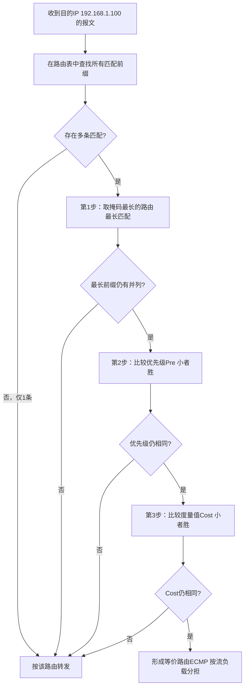

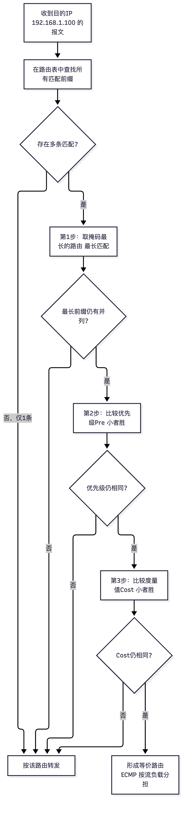


### 真题精练

**Q1.【真题·单选】** 路由器路由表中有以下条目：`0.0.0.0/0`（Static，Pre 60）、`10.1.0.0/16`（OSPF，Pre 10）、`10.1.1.0/24`（Static，Pre 60）、`10.1.1.128/25`（RIP，Pre 100）。现收到目的地址为 10.1.1.200 的报文，该报文将按哪条路由转发？
A. 0.0.0.0/0  B. 10.1.0.0/16  C. 10.1.1.0/24  D. 10.1.1.128/25

> **答案：D**
> **解析**：**最长匹配优先于一切**。四条路由中 10.1.1.128/25 掩码最长（25 位），虽然它是 RIP（优先级 100，最差），但只要求它也匹配目的地址 10.1.1.200（在 128~255 范围内），就必然胜出。这题专门考"优先级不能越过最长匹配"，是最经典的陷阱题。

**Q2.【真题·单选】** 关于华为 VRP 的默认路由优先级，下列排序正确的是？
A. Direct 0 > OSPF 10 > Static 60 > RIP 100 > IBGP 255
B. Direct 0 > Static 60 > OSPF 10 > RIP 100 > IBGP 255
C. OSPF 10 > Direct 0 > Static 60 > RIP 100 > EBGP 255
D. Direct 0 > OSPF 10 > RIP 100 > Static 60 > IBGP 255

> **答案：A**
> **解析**：数值越小越优。正确顺序：Direct 0、OSPF 10、IS-IS 15、Static 60、RIP 100、OSPF ASE 150、IBGP/EBGP 255。B 把静态排在 OSPF 前（错误）；C 把 OSPF 排在直连前（错误，直连 0 最优）；D 把 RIP 排在静态前（错误，60 < 100）。

**Q3.【真题·多选】** 以下哪些情况下，路由器会形成等价路由（ECMP）？
A. 两条静态路由去往同一目的网段，配置的优先级与度量值均相同，但下一跳不同
B. 去往同一目的网段，一条静态路由与一条 OSPF 路由
C. OSPF 学到去往同一目的的两条路径，Cost 相同
D. 一条默认路由与一条明细路由

> **答案：AC**
> **解析**：等价路由要求**前缀相同 + 优先级相同 + 度量值相同**。B 中静态（60）与 OSPF（10）优先级不同，OSPF 胜出，不会等价。D 中前缀不同（0 位 vs 明细位），走最长匹配，也不构成等价关系。A 中同协议同参数同目的 → 等价；C 中同协议同 Cost → 等价。华为设备默认开启 ECMP，可通过 `maximum load-balancing` 调整最大等价路径数。

**Q4.【真题·判断】** 路由表中存在的路由一定会被下发到 FIB 中指导转发。

> **答案：错误**
> **解析**：只有**最优且可用**的路由才会下刷 FIB。若路由的出接口物理 down、或下一跳不可达（递归查找失败），该路由虽然可能仍在 RIB 中显示为 `Inactive`，但 Flags 中不会出现 `D`（Download to FIB），转发芯片查不到表项，报文会被丢弃。这是"路由表有条目但 ping 不通"的常见原因，用 `display fib` 对照即可确认。

**Q5.【真题·填空】** 华为 VRP 中路由选路的三个比较步骤依次是：______、______、______。

> **答案：最长匹配（掩码最长优先）；比较优先级（Preference 小者优先）；比较度量值（Cost 小者优先）**
> **解析**：三者是**严格顺序**，前一步未分出胜负才进入下一步。若三步之后仍相同，则多条路由同时有效，形成等价路由（ECMP）按流分担。

**Q6.【真题·排错】** 某路由器上配置了 `ip route-static 192.168.10.0 255.255.255.0 10.0.0.2`，但 `ping 192.168.10.1` 不通，路由表中该条目存在。请给出排查思路。

> **答案与解析**：
> 1. **看 Flags 是否已下刷**：`display ip routing-table 192.168.10.0 verbose`，若没有 `D` 标志或显示 `Inactive`，说明路由未生效。
> 2. **查下一跳可达性**：`ping 10.0.0.2`。静态路由的下一跳必须可达（能递归查到直连出接口），否则该路由无效。若 10.0.0.2 属于某个非直连网段，还需要先有一条去往 10.0.0.0/24 的路由，这就是**路由递归（Recursion）**。
> 3. **查回程路由**：在 192.168.10.0/24 侧设备上确认有回程路由指向本机，**单向可达是 ping 不通最常见的原因**。
> 4. **查目的地址是否真的在该网段**：确认 192.168.10.1 属于 192.168.10.0/24（掩码一致）。
> 5. **查 ACL/NAT 干扰**：`display acl all` 与 `display nat session all`，确认没有流量被 ACL 拒绝或被 NAT 转换到错误地址。
> 6. **抓包定位**：`display interface GigabitEthernet0/0/1` 看是否有入/出方向的报文计数增长，配合 `terminal monitor` + `debugging ip icmp` 观察 ICMP 处理情况。

### 易错点与排错

1. **最长匹配 vs 优先级的顺序**：考试必考，记住"先看谁更具体，再看谁更可信，最后看谁更近"。
2. **直连路由优先级是 0，不是"没有优先级"**：0 最小即最优，所以本地接口网段永远不会被协议路由覆盖。
3. **路由表有条目 ≠ 能转发**：必须检查 FIB 下刷（`D` 标志）与下一跳可达性。
4. **ECMP 要求三要素全同**，只同前缀不够。
5. 排错命令：`display ip routing-table <目的地址>`、`display fib`、`display ip interface brief`、`ping -a <源地址> <目的地址>`。

---

## 6.2 静态路由配置：默认路由、浮动、等价、递归、NULL0 与 BFD 联动

### 考点定位

静态路由是**校赛实验题的第一道配置题**（通常 5~10 分），理论卷常考**浮动静态路由与 BFD 配置**的填空题。省赛常把"静态路由 + 默认路由 + 路由递归"组合成一道拓扑配置大题。

### 原理精讲

**基本静态路由**：`ip route-static <目的网络> <掩码> <下一跳或出接口>`。两种写法有本质差别：

- **指定下一跳 IP**：路由器需为下一跳做递归查找，找出去往该下一跳的出接口。适用于**广播型网络（以太网）**，因为以太网需要 ARP 解析对端 MAC，指定出接口而不指定下一跳会导致无法确定对端地址（VRP 会报错或要求同时指定）。
- **指定出接口**：报文直接从该接口发出，不查下一跳。适用于**点对点网络（PPP/HDLC、POS）**，因为 P2P 链路上只有一个对端，无需解析。
- **同时指定出接口 + 下一跳**：**以太网环境推荐写法**，避免递归查找开销与代理 ARP 问题。

**默认路由（Default Route）**：`ip route-static 0.0.0.0 0.0.0.0 <下一跳>`，即目的前缀长度为 0 的路由，匹配所有流量。**它的优先级是"最低"的匹配优先级**（不是 Pre 最低），任何明细路由都会胜过它。用于末梢网络（只有一条出口）。

**浮动静态路由（Floating Static Route）**：为同一目的网段配置两条静态路由，主路由用默认优先级（60），备份路由用**更大的优先级**（如 100，比主路由差但优于 RIP 的 100 需谨慎）。只有当主路由失效（出接口 down 或链路故障）时，备份路由才进入路由表，实现**主备切换**。

> **为什么用"改优先级"而不是"改 Cost"？** 因为两条静态路由的 Cost 默认都是 0，无法区分；而优先级是静态路由之间唯一可调的比较维度，因此浮动路由必须改 Pre。

**等价静态路由**：两条相同目的、相同优先级、相同 Cost（都默认 0）的静态路由 → ECMP 负载分担。

**路由递归（Recursion）**：静态路由的下一跳不在直连网段时，路由器需要**再查一次路由表**找出到达该下一跳的路由，这个过程叫递归。若递归查询失败，静态路由不生效（显示为 Inactive）。**递归深度**在 VRP 中可通过 `ip route-static ... recursive-lookup` 相关命令控制。递归是"路由的下一跳还是路由"这一思想的体现，BGP 也大量使用。

**NULL0 与黑洞路由**：`ip route-static <网段> <掩码> NULL0` 把匹配该网段的流量引向 NULL0 接口并**直接丢弃**。用途有二：① **防环**：与聚合路由配合，避免本机把聚合段内未使用的地址回送给自己造成环路；② **流量清洗**：把攻击流量（如 DDoS 目标段）导入 NULL0 丢弃。

> **为什么聚合路由需要配 NULL0？** 假设路由器 A 通告聚合路由 192.168.0.0/22，实际明细只有 .0.0/24 和 .1.0/24。若 B 发来目的为 192.168.2.5 的流量，A 查表命中聚合路由，而其下一跳可能又指回 B（或指向默认路由回到网内），形成**环路**。配上 NULL0 后，A 对该段内无明细的流量直接丢弃，环路被切断。

**BFD（Bidirectional Forwarding Detection，双向转发检测）与静态路由联动**：静态路由本身**不感知非直连链路故障**——若中间经过传输设备，两端路由器接口都是 up，但业务通道已断，静态路由仍认为可达，形成"黑洞"。BFD 通过毫秒级（默认 1000ms×3 或可配 3ms×3）的快速检测发现故障，并**通知静态路由模块撤销该路由**，使备份路由立即生效。配置命令为 `ip route-static ... bfd` + `bfd` 视图下的会话参数。

### 关键概念对照表

| 类型 | 命令要点 | 生效条件 | 典型用途 |
|---|---|---|---|
| 标准静态路由 | 目的+掩码+下一跳 | 下一跳可达 | 末梢网络互通 |
| 默认路由 | 0.0.0.0 0.0.0.0 | 无更明细匹配时 | 出口单链路 |
| 浮动静态路由 | 备份路由配大 Pre | 主路由失效才进入 | 主备冗余 |
| 等价静态路由 | 同目的同 Pre 同 Cost | 同时有效 | 负载分担 |
| 黑洞路由 | 指向 NULL0 | always | 防环、丢弃攻击流量 |
| BFD 联动 | `ip route-static ... bfd` | BFD 会话 up | 毫秒级故障感知 |
| 路由递归 | 下一跳非直连 | 递归查到出接口 | 下一跳经多跳可达 |

**BFD 默认参数**：发送间隔 1000 ms，接收间隔 1000 ms，检测倍数 3（即 3 秒判定故障）。可配置最小 3 ms（视设备性能）。

### 华为设备配置

```bash
# 场景：AR6120 双出口，主用 202.100.1.1，备用 203.100.1.1，要求主备自动切换
system-view
sysname AR6120-GW
ip route-static 0.0.0.0 0.0.0.0 202.100.1.1                      # 主默认路由，优先级默认60
ip route-static 0.0.0.0 0.0.0.0 203.100.1.1 preference 100        # 备用默认路由，优先级100，主路由失效才生效（浮动）
ip route-static 10.1.0.0 255.255.0.0 10.0.0.2 description To-Area-A   # 带描述的标准静态路由，便于运维识别
quit
display ip routing-table protocol static                         # 查看静态路由，正常只见主路由
display ip routing-table 0.0.0.0 verbose                         # 详细查看默认路由的Pre与下一跳
```

```bash
# 场景：等价静态路由实现双链路负载分担（同目的、同Pre、同Cost）
system-view
ip route-static 172.16.0.0 255.255.0.0 10.1.1.2                  # 路径1
ip route-static 172.16.0.0 255.255.0.0 10.1.2.2                  # 路径2，参数完全相同 → 形成ECMP
quit
display ip routing-table 172.16.1.1 verbose                      # 输出中会出现两条下一跳，即等价路由
```

```bash
# 场景：聚合路由 + NULL0 黑洞路由防环（在区域边界 AR6120 上）
system-view
ip route-static 192.168.0.0 255.255.252.0 10.0.0.2               # 聚合通告/转发用
ip route-static 192.168.0.0 255.255.252.0 NULL0                  # 同前缀指向NULL0，丢弃聚合段内无明细的流量，防环
quit
display ip routing-table 192.168.0.0 verbose                     # 观察两条同前缀路由如何共存（明细优先于黑洞）
```

```bash
# 场景：静态路由与 BFD 联动，实现毫秒级故障切换
system-view
bfd                                                              # 全局使能BFD
quit
interface GigabitEthernet0/0/1                                   # 主用链路接口
 ip address 202.100.1.2 255.255.255.252
quit
ip route-static 10.100.0.0 255.255.0.0 202.100.1.1 bfd enable     # 该静态路由绑定BFD会话，BFD down则路由立即撤销
quit
display bfd session all                                          # 查看BFD会话状态、检测时间与倍数
display ip routing-table protocol static                         # 故障时观察路由是否被撤销、备用路由是否生效
```

### 示意图

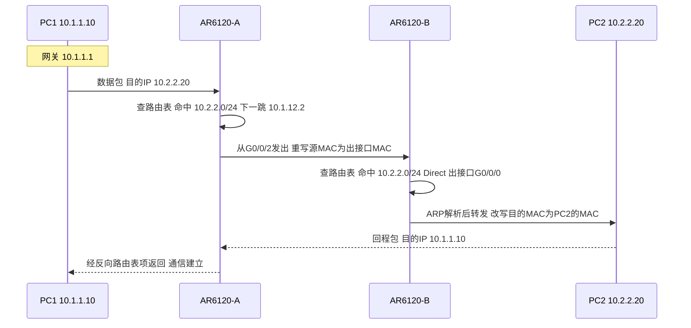

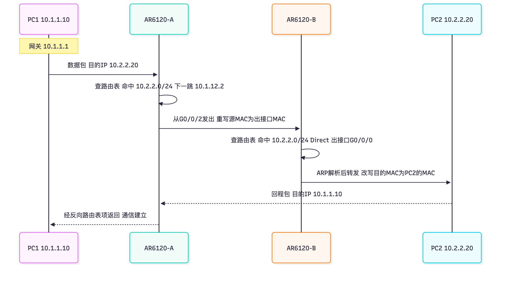


### 真题精练

**Q7.【真题·单选】** 在华为路由器上配置浮动静态路由实现主备，备份路由的正确写法是？
A. `ip route-static 10.1.0.0 255.255.0.0 10.0.0.3` 再加一条完全相同的命令
B. `ip route-static 10.1.0.0 255.255.0.0 10.0.0.3 preference 100`
C. `ip route-static 10.1.0.0 255.255.0.0 10.0.0.3 cost 100`
D. `ip route-static 10.1.0.0 255.255.0.0 10.0.0.3 tag 100`

> **答案：B**
> **解析**：浮动静态路由靠**调大优先级（Preference）**实现，数值越大越差，主路由（60）失效后备份（100）才被激活。A 会形成等价路由（负载分担）而非主备；C 中静态路由命令没有 `cost` 参数（度量值固定为 0）；D 的 `tag` 是路由标记，用于路由策略匹配，不影响选路。

**Q8.【真题·判断】** 静态路由的下一跳地址必须是与本机直连的网段地址。

> **答案：错误**
> **解析**：下一跳可以是**非直连**地址，此时路由器会进行**路由递归**，通过再次查表找出到达该下一跳的出接口。前提是必须存在一条能到达该下一跳的路由，否则静态路由无法激活（显示 Inactive）。递归机制让"下一跳经多跳可达"成为可能，也是 BGP 承载路由的基础。

**Q9.【真题·多选】** 关于 `ip route-static 192.168.0.0 255.255.252.0 NULL0` 的作用，正确的有？
A. 匹配 192.168.0.0/22 的报文被直接丢弃
B. 常与聚合路由配合，防止路由环路
C. 会阻止该网段内所有明细路由的转发
D. 可用于丢弃攻击流量

> **答案：ABD**
> **解析**：C 错误。**最长匹配优先**，只要存在更明细的路由（如 192.168.1.0/24 直连），报文仍按明细路由正常转发；NULL0 只对"没有更明细路由匹配"的那部分流量生效。这正是"聚合 + NULL0"能安全共存的原理。

**Q10.【真题·填空】** 华为 VRP 中静态路由的默认优先级为 ______；BFD 的默认发送/接收间隔为 ______ ms，检测倍数为 ______。

> **答案：60；1000；3**
> **解析**：静态路由 Pre 默认 60（直连 0、OSPF 10、RIP 100）。BFD 默认 1000 ms 间隔 × 3 倍 = 3 秒判定故障。若追求毫秒级切换，可配置 `bfd min-tx-interval 3`、`min-rx-interval 3`、`detect-multiplier 3`（具体下限视设备与链路能力）。

**Q11.【真题·简答】** 为什么以太网点对点互联场景下推荐"同时指定出接口与下一跳"的静态路由写法？

> **答案**：
> 1. **只指定出接口的问题**：以太网是广播型网络，一个出接口可能对应多个对端。仅指定出接口时，路由器需要为每个目的地址做 ARP 解析，可能启用**代理 ARP**，且无法明确对端，容易造成 ARP 表膨胀与转发异常。
> 2. **只指定下一跳的问题**：路由器需要递归查找出接口，多一次查表开销；在链路状态频繁变化时可能递归失败。
> 3. **同时指定的好处**：直接确定出接口与对端地址，**省去递归查找**，转发表项唯一且稳定，故障定位也更容易（既知出接口又知对端）。
> 4. **点对点链路（PPP/HDLC/POS）** 上则推荐只指定出接口，因为链路上只有一个对端，无需 ARP，写下一跳反而多余。

**Q12.【真题·排错】** 网络拓扑为主备双出口，主链路物理接口状态一直为 up（经传输设备），但实际业务已中断，路由器却仍在使用主路由转发，导致丢包。请说明原因与解决方案。

> **答案与解析**：
> 1. **原因**：静态路由只感知**本机接口状态**与**下一跳直连可达性**。当故障发生在中间传输设备或远端路由器接口时，本机接口仍然 up，静态路由不会撤销，报文被继续送往已中断的链路，形成**黑洞**。
> 2. **解决方案一（BFD 联动）**：在主链路静态路由上绑定 BFD 会话（`ip route-static ... bfd enable`），并在两端设备接口上配置 BFD。BFD 以毫秒级间隔双向探测，检测到中断后立即通知静态路由模块撤销该路由，备份路由（Preference 更大的浮动路由）在毫秒级内生效。
> 3. **解决方案二（动态路由）**：改用 OSPF，依靠 Hello/Dead 定时器（广播型 10s/40s）检测邻居失效，收敛速度慢于 BFD 但配置简单。
> 4. **解决方案三（关联接口/EFM 等）**：使用 `ip route-static ... track` 或 EFM（802.3ah）联动，视设备与链路类型而定。
> 5. **验证命令**：`display bfd session all` 看会话状态与 UP/DOWN 历史；`display ip routing-table protocol static` 看故障时路由是否切换；`display aaa` 无关，勿混；用 `ping -c 1000` 长时间观察丢包率评估切换时间。

### 易错点与排错（静态路由专题）

1. **忘记写默认路由的掩码**：`ip route-static 0.0.0.0 0.0.0.0 x.x.x.x` 中两个 0.0.0.0 缺一不可，少写会报语法错误。
2. **浮动路由优先级写反**：备份路由的 preference 必须**大于**主路由（如 100 > 60）；写小了会抢主。
3. **黑洞路由误伤业务**：配 NULL0 前确认聚合段内所有实际使用的网段都有更明细的路由，否则业务直接被打入黑洞。
4. **BFD 单边配置**：BFD 需要**两端都配置**才能建立会话；只在一端配置时 `display bfd session all` 会显示 Down，路由联动不生效。
5. 排错命令：`display ip routing-table protocol static`、`display bfd session all`、`display current-configuration | include route-static`（查看全部静态路由配置）。

---

# 数通-HCIA-章节7-OSPF基础

## 7.1 链路状态思想、OSPF 特点与 Router ID

### 考点定位

OSPF 是数通方向**分值最高的单点知识**（理论卷 **15~25 分**，实验题必考）。本考点考查"链路状态 vs 距离矢量"的对比、OSPF 三大特点、Router ID 选举规则，常以多选与填空出现。**陷阱**：Router ID 选举是"先看手动配置，再看 Loopback 最大，最后看物理接口最大"，且**运行中不会自动重选**。

### 原理精讲

**OSPF（Open Shortest Path First，开放式最短路径优先）** 属于**链路状态（Link State）**路由协议，与 RIP（距离矢量，Distance Vector）在思想上有本质差别：

- **距离矢量协议（RIP）**：每个路由器只把自己的"整张路由表"告诉邻居（"我到 X 有 3 跳"），邻居据此更新。它**不知道网络拓扑**，只信邻居的话，因此收敛慢、易产生环路（需水平分割、毒性逆转等机制补救）。
- **链路状态协议（OSPF）**：每个路由器把自己**直连链路的状态**（接口网段、开销、邻居）以 **LSA（Link State Advertisement，链路状态通告）** 形式泛洪到整个区域。**每个路由器都掌握完整的区域拓扑图**，然后各自用 **SPF（Shortest Path First，最短路径优先，Dijkstra）算法**独立计算出到所有网段的最短路径树。

> **为什么链路状态更优？** 因为"人人都有完整地图"，所以任何一条链路变化时，所有路由器都能独立、并行地重算，收敛速度快（秒级），且**天然无环路**（基于树形结构而非邻居传言）。代价是需要更多内存（存 LSDB）与 CPU（跑 SPF）。

**OSPF 特点（必背）**：

1. **无类路由协议**，更新报文携带掩码，支持 VLSM 与 CIDR。
2. **触发更新 + 周期更新（默认 1800 s 泛洪刷新）**，不做 RIP 那样的整表周期广播。
3. **支持区域划分（Area）**，用层次化结构限制 LSA 泛洪范围，可扩展到大型网络。
4. **支持等价路由（ECMP）**，最多默认 4 条（可调）。
5. **以 Cost（开销）为度量值**，默认按接口带宽计算，而非跳数。
6. **以组播方式发送**，避免广播风暴（224.0.0.5 / 224.0.0.6）。
7. **支持认证**（区域认证、接口认证，明文/MD5/HMAC-SHA）。
8. 协议号 **89**，封装在 IP 之上（不是 TCP/UDP），可靠性由自身确认机制保证。

**Router ID（路由器标识）** 是 OSPF 中唯一标识一台路由器的 32 bit 值，格式与 IP 地址相同。选举规则（**严格按顺序**）：

1. 若**手动配置**了 `router-id`（`ospf 1 router-id 1.1.1.1`），直接使用，最高优先。
2. 否则，从**所有 Loopback 接口的 IP** 中选**数值最大**的。
3. 再否则，从**所有物理接口的 IP** 中选**数值最大**的（接口必须 up 且有地址）。
4. 若以上都没有，OSPF 无法启动（VRP 会提示需要配置 Router ID）。

> **关键特性：Router ID 不会自动重选。** 一旦 OSPF 进程使用某个 Router ID 建立邻居，之后即使新增了更大的 Loopback 地址，也不会自动更换，**必须重置 OSPF 进程**（或在 VRP 中用 `undo ospf 1` 重建 / 重启设备）才生效。这是实验题中"改了 Router ID 但邻居关系不对"的根本原因。工程规范：**始终手工指定 Loopback0 为 Router ID**。

### 关键概念对照表

| 对比项 | RIP | OSPF |
|---|---|---|
| 协议类型 | 距离矢量 | 链路状态 |
| 度量值 | 跳数（Hops） | Cost（基于带宽） |
| 最大跳数/规模 | 15 跳，超过视为不可达 | 无跳数限制，靠区域扩展 |
| 更新方式 | 周期（30 s）全表 | 触发 + 30 min 泛洪刷新 |
| 传输层 | UDP 520 | IP 协议号 89 |
| 组播/广播 | 广播或组播 224.0.0.9 | 224.0.0.5 / 224.0.0.6 |
| 收敛速度 | 慢（分钟级） | 快（秒级） |
| 支持 VLSM | RIPv2 支持 | 支持 |
| 环路防护 | 水平分割、毒性逆转、触发更新 | SPF 树天然无环 |
| 默认优先级 | 100 | 10（内部）/ 150（外部） |

**Router ID 选举对照**：

| 优先级 | 来源 | 示例结果 |
|---|---|---|
| 1（最高） | 手工 `router-id` | 配置 3.3.3.3 → 就是 3.3.3.3 |
| 2 | Loopback 接口最大 IP | Loopback0=2.2.2.2、Loopback1=5.5.5.5 → 选 5.5.5.5 |
| 3 | 物理接口最大 IP | GE0/0/0=10.0.0.1、GE0/0/1=192.168.1.1 → 选 192.168.1.1 |
| 4 | 无任何可用地址 | OSPF 无法启动 |

### 华为设备配置

```bash
# 在 AR6120 上按工程规范配置 OSPF：手工指定 Router ID，使用 Loopback0 作为 ID 来源
system-view
sysname AR6120-Core
interface LoopBack0                                             # 环回口永久 up，适合做Router ID与协议源地址
 ip address 1.1.1.1 255.255.255.255                             # /32 主机地址
quit
ospf 1 router-id 1.1.1.1                                        # 创建OSPF进程1并手工指定Router ID（最高优先级）
 area 0.0.0.0                                                   # 进入骨干区域视图，也可写作 area 0
  network 10.1.1.0 0.0.0.255                                    # 宣告网段：反掩码（通配符）形式
  network 1.1.1.1 0.0.0.0                                       # 宣告Loopback地址，使其作为5.5.5.5式的路由被通告
 quit
quit
display ospf brief                                              # 查看OSPF进程概况，确认Router ID与区域
display ospf interface                                          # 查看OSPF接口参数（区域、网络类型、Cost）
```

### 示意图

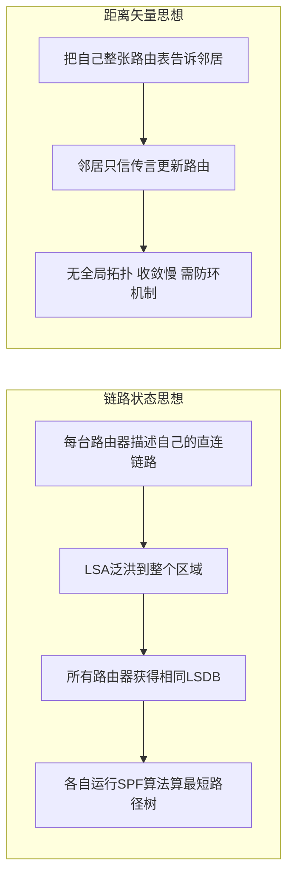

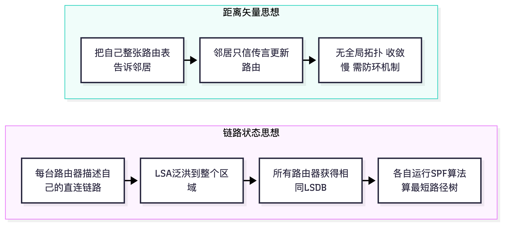


### 真题精练

**Q1.【真题·单选】** 某路由器接口地址如下：Loopback0 = 10.1.1.1/32、Loopback1 = 10.9.9.9/32、GE0/0/0 = 172.16.5.1/24、GE0/0/1 = 192.168.100.1/24，OSPF 未手工配置 router-id。该路由器的 Router ID 是？
A. 10.1.1.1  B. 10.9.9.9  C. 192.168.100.1  D. 172.16.5.1

> **答案：B**
> **解析**：无手工配置时优先选 Loopback 接口中**数值最大**的地址。两个 Loopback 中 10.9.9.9 > 10.1.1.1，故选 B。只有在没有任何 Loopback 地址时才会考虑物理接口（此时答案是 C，因为 192.168.100.1 > 172.16.5.1）。本题两层嵌套考查，务必先判断"有无 Loopback"。

**Q2.【真题·多选】** 关于 OSPF 的特点，下列正确的有？
A. OSPF 是链路状态协议，使用 SPF 算法计算最短路径
B. OSPF 使用 IP 协议号 89，直接封装在 IP 报文中
C. OSPF 使用 UDP 89 端口进行传输
D. OSPF 支持 VLSM 与 CIDR
E. OSPF 默认优先级为 10

> **答案：ABDE**
> **解析**：C 是典型错误——OSPF **不使用 TCP/UDP**，而是 IP 协议号 **89** 直接封装，其可靠性由自身的 LSAck 确认、序列号与老化机制保证。A/D/E 均为 OSPF 基本特征；B 正确。记住"OSPF 无传输层端口"，与 RIP（UDP 520）、BGP（TCP 179）形成对比。

**Q3.【真题·判断】** 路由器运行 OSPF 后新增了一个地址更大的 Loopback 接口，OSPF 会自动把 Router ID 切换为新的更大地址。

> **答案：错误**
> **解析**：Router ID 只在 OSPF 进程**首次启动时**选举一次，之后不会自动重选（即使有新的大地址或原 ID 来源接口 down）。若需变更，必须重置 OSPF 进程（`reset ospf process`，会中断邻居）或重启设备。工程上必须**手工指定 Router ID** 以规避此问题。

**Q4.【真题·填空】** OSPF 的协议号是 ______，度量值称为 ______，默认计算公式为参考带宽除以 ______。

> **答案：89；Cost（开销）；接口带宽**
> **解析**：Cost = 参考带宽（默认 100 Mbps）÷ 接口带宽。当结果小于 1 时取 1（如千兆接口 100/1000 = 0.1 → 取 1）。这一"取 1"规则导致千兆与万兆接口 Cost 相同，无法区分优劣，因此高速网络中必须用 `bandwidth-reference` 调整参考带宽。

**Q5.【真题·简答】** 从"收敛速度、环路风险、资源消耗"三方面对比链路状态协议与距离矢量协议。

> **答案**：
> 1. **收敛速度**：链路状态协议每台路由器都有完整拓扑，链路变化时全网并行运行 SPF，收敛为秒级；距离矢量协议需逐跳传递"传言"，收敛慢（RIP 通常数十秒到数分钟），且可能出现计数到无穷。
> 2. **环路风险**：链路状态基于 SPF 树，转发路径是树形结构，**天然无环**；距离矢量协议必须依赖水平分割、毒性逆转、触发更新、抑制计时器等机制**被动防环**，配置不当即出环。
> 3. **资源消耗**：链路状态协议需维护 LSDB（内存）并在变化时运行 SPF（CPU），泛洪也占用带宽；距离矢量协议只需保存邻居传来的路由表，资源占用小。因此小型末梢网络用 RIP 反而更简单，大型网络必须用 OSPF/IS-IS。
> 4. **补充**：链路状态协议还带来层次化区域设计能力，这是 RIP 完全不具备的扩展性优势。

### 易错点与排错

1. **Router ID 不会自动重选**，改配置后必须 `reset ospf process`（生产环境慎用，会短暂中断邻居）。
2. **不要用 UDP/TCP 端口号描述 OSPF**，它是 IP 协议号 89。
3. **`network` 命令后面跟的是反掩码（通配符掩码）**，不是子网掩码。`network 10.1.1.0 0.0.0.255` 表示宣告 10.1.1.0/24。
4. **宣告 Loopback 建议用 0.0.0.0 反掩码**（精确匹配单个地址），避免顺带宣告多余地址。
5. 排错命令：`display ospf brief`、`display ospf interface`、`display ospf error`（协议错误统计）。

---

## 7.2 OSPF 五种报文、邻居建立过程与邻居状态机

### 考点定位

**理论卷最高频考点之一**（**6~10 分**）。考法：给出五种报文名称与作用做连线/选择；给出状态名判断"卡在哪个状态说明什么问题"（如卡在 ExStart 是 MTU 不匹配）；或用时序图判断两次 DD 交互的意义。

### 原理精讲

OSPF 邻居建立依靠**五种报文**协同完成，每种报文承担不同职责，全部封装在 IP（协议号 89）之上：

| 报文类型 | 名称 | 作用 | 发送方式 |
|---|---|---|---|
| Type 1 | **Hello** | 发现邻居、协商参数、维持邻居关系、选举 DR/BDR | 周期组播 224.0.0.5（广播型每 10 s） |
| Type 2 | **DD（Database Description，数据库描述）** | 描述本地 LSDB 的摘要（LSA 头部列表），用于比对双方数据库差异 | 单播，邻居建立阶段 |
| Type 3 | **LSR（Link State Request，链路状态请求）** | 请求本地缺失或过期的 LSA | 单播 |
| Type 4 | **LSU（Link State Update，链路状态更新）** | 携带完整 LSA，用于响应 LSR 及后续泛洪 | 单播或组播 |
| Type 5 | **LSAck（Link State Acknowledgment，链路状态确认）** | 对收到的 LSU 进行确认，保证可靠性 | 单播或组播 |

**邻居建立完整过程**：

1. R1 从接口发出 Hello（组播 224.0.0.5）。
2. R2 收到后，在邻居表中记录 R1（状态 Init，因为 R2 在 R1 的 Hello 中看到**自己**的 Router ID 之前，只能确认收到了对方的 Hello）。
3. R2 回复 Hello，其中 Neighbor 字段**包含 R1 的 Router ID**。R1 收到后确认双向通信，状态进入 **2-Way**。
4. **DR/BDR 选举在此确认**（2-Way 之后）。若双方都是 DR-Other 且已建立与 DR/BDR 的邻接，它们之间就停留在 2-Way，不再继续（这就是"两台 DROther 之间显示 2-Way 是正常的"）。
5. 需要建立**邻接（Adjacency）**的双方进入 **ExStart**：用 Hello 中 Router ID 较大者作为 **Master**（主），开始 DD 交互。（也有描述为"双方比较 Router ID，大者为 Master"，用于决定 DD 序列号的主控方。）
6. **Exchange** 状态：双方互换 DD 报文（携带 LSA 头部摘要），形成各自的"待请求列表"。
7. **Loading** 状态：用 LSR 请求缺失的 LSA，对端以 LSU 回应，本地以 LSAck 确认。
8. **Full** 状态：双方 LSDB 完全同步，邻接建立完成，可参与 SPF 计算。

> **为什么需要 DD 和 LSR/LSU 两次交互？** 因为 LSDB 可能很大，直接互相发送全部 LSA 会造成巨大开销。先用 DD 只传"摘要（LSA 头部）"，双方比对后**只请求对方有而自己没有的**，实现增量同步。这是典型的"先协商再传输"设计。

**邻居（Neighbor）与邻接（Adjacency）的区别（高频）**：

| 对比项 | 邻居 Neighbor | 邻接 Adjacency |
|---|---|---|
| 定义 | 收到对方合法 Hello 即建立，状态 ≥ 2-Way | 双方 LSDB 完全同步，状态 = Full |
| 是否交换 LSA | 否 | 是 |
| 是否参与 SPF | 否 | 是 |
| 数量关系 | 邻居数量 ≥ 邻接数量 | 邻接是邻居的子集 |
| 典型场景 | 同一广播网段的两台 DROther 之间只是邻居 | DR 与所有 DROther、P2P 双方都是邻接 |

**Hello 报文关键字段与参数协商**（**Hello 中任何一个"必须一致"的字段不匹配，邻居都建不起来**）：

| 字段 | 含义 | 不一致后果 |
|---|---|---|
| Router ID | 发送者标识 | — |
| Area ID | 所属区域 | **无法建立邻居** |
| Hello Interval | 广播型默认 **10 s**；P2P 默认 **10 s**；NBMA/P2MP 默认 30 s | 不一致无法建立 |
| Dead Interval | 默认 = 4 × Hello，广播型 **40 s** | 不一致无法建立 |
| Neighbor | 已收到的邻居 Router ID 列表 | 决定是否进入 2-Way |
| Priority | DR 选举优先级，默认 **1**，0 表示不参与 | 不匹配不影响建立，只影响 DR |
| Authentication | 认证类型与密钥 | **不一致无法建立** |
| Stub Area Flag | 是否为末梢区域标志 | **不一致无法建立** |
| **MTU** | **注意：MTU 不在 Hello 中协商，而在 DD 报文中携带** | **不一致会卡在 ExStart** |
| Network Mask | 广播型网络需一致（P2P 不检查） | 不一致无法建立 |

> **为什么 MTU 不匹配会卡在 ExStart？** 因为 MTU 大小决定了 DD 报文能否被完整接收。MTU 较小的设备收到超过自己 MTU 的 DD 报文时会丢弃且不响应，双方都认为对方未回复，于是**永远停留在 ExStart**。这是"邻居状态卡在 ExStart"的**唯一经典原因**，解决方案是两端 MTU 一致，或在接口下配置 `ospf mtu-enable` 之外的方式禁用 MTU 检查（`undo ospf mtu-enable` 需在 DD 中不携带 MTU 字段时才有效，实际工程统一做法是**两端 MTU 配成一致**，如都设 1400）。

### 关键概念对照表

**OSPF 邻居状态机 7 种状态**：

| 状态 | 中文 | 含义 | 正常/异常信号 |
|---|---|---|---|
| **Down** | 失效 | 未收到任何 Hello，邻居关系初始状态 | 长时间 Down = 链路/区域/认证问题 |
| **Attempt** | 尝试 | 仅 NBMA 网络特有，主动向手工配置的邻居发 Hello | 非 NBMA 网络不应出现 |
| **Init** | 初始 | 收到对方 Hello，但对方 Hello 的邻居列表中**没有自己** | 单向通信（如单向链路、ACL 只放通一个方向） |
| **2-Way** | 双向 | 双方 Hello 中都看到对方，双向通信建立；DROther 之间到此为止 | **两台 DROther 之间 2-Way 是正常的** |
| **ExStart** | 交换开始 | 协商主从关系（Master/Slave），确定 DD 序列号 | **卡在此处 = MTU 不匹配** |
| **Exchange** | 交换 | 互发 DD 描述 LSDB 摘要 | 卡在此处 = 大量 LSA 或链路质量差 |
| **Loading** | 加载 | 用 LSR/LSU 请求并接收缺失的 LSA | 卡在此处 = LSA 请求无响应（可能 MTU 或链路丢包） |
| **Full** | 完全 | LSDB 同步完成，邻接关系建立 | 目标状态；P2P 与 DR/BDR 应为 Full |

**定时器默认值**：

| 网络类型 | Hello | Dead | 是否选举 DR |
|---|---|---|---|
| Broadcast（广播，如以太网） | 10 s | 40 s | 是 |
| P2P（点对点，PPP/HDLC） | 10 s | 40 s | 否 |
| P2MP（点对多点） | 30 s | 120 s | 否 |
| NBMA（非广播多路访问，如 Frame Relay） | 30 s | 120 s | 是 |

### 华为设备配置

```bash
# 修改 Hello/Dead 定时器（两端必须一致）与 MTU，验证邻居能否建立
system-view
interface GigabitEthernet0/0/1
 ospf timer hello 10                                  # Hello 间隔10秒（默认广播型即为10s，此处显式配置便于实验对比）
 ospf timer dead 40                                   # Dead 间隔40秒，通常为Hello的4倍
 ospf mtu-enable                                      # 使能DD报文中携带MTU，两端MTU不一致时会在ExStart卡住以便暴露问题
quit
interface GigabitEthernet0/0/1
 mtu 1400                                             # 调整接口MTU，两端必须一致
quit
display ospf peer verbose                             # 查看邻居的详细状态、Hello/Dead、区域、DR角色与MTU
display ospf interface GigabitEthernet0/0/1           # 查看接口的OSPF网络类型与定时器
display ospf error                                    # 查看OSPF协议错误统计（认证失败、区域不匹配等）
```

### 示意图

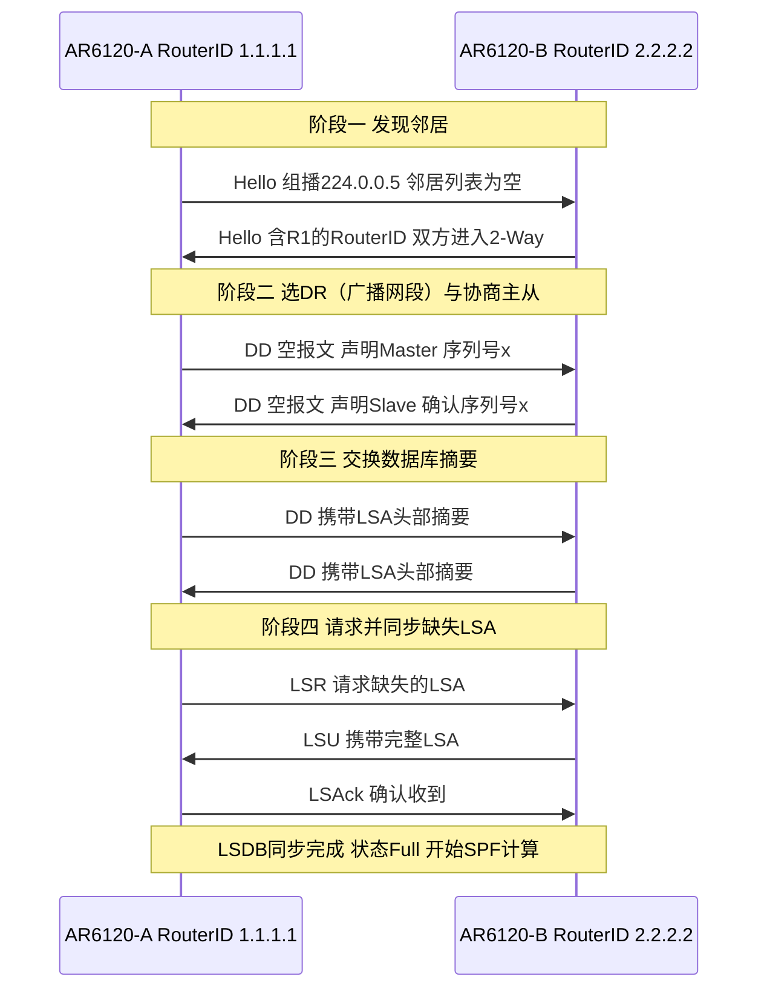

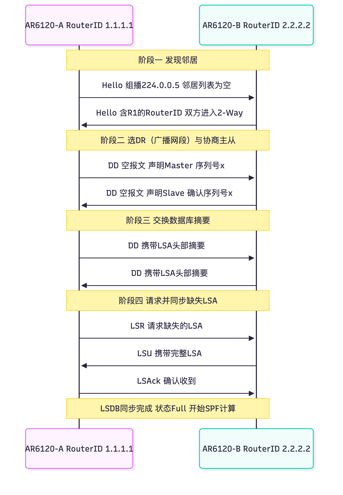


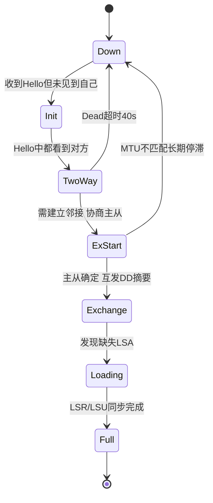

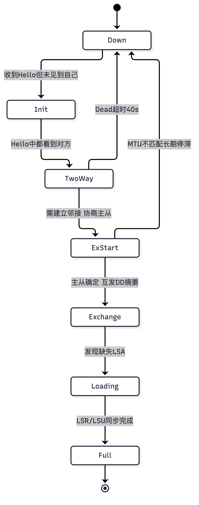


### 真题精练

**Q6.【真题·单选】** OSPF 邻居关系长时间停留在 ExStart 状态，最可能的原因是？
A. 两端 Area ID 不一致
B. 两端接口 MTU 不一致
C. 两端 Hello 定时器不一致
D. 两端 Router ID 相同

> **答案：B**
> **解析**：ExStart 阶段双方通过 DD 报文协商主从并携带 MTU。若 MTU 不一致，MTU 小的一方无法完整接收对方 DD 报文而丢弃，双方互相等待，永远停在 ExStart。A/C 会导致邻居**根本建立不起来**（停在 Down 或无法进入 2-Way）；D 中 Router ID 冲突会导致邻居关系反复震荡。**"ExStart = MTU"是必须背下来的对应关系**，解决方法是两端 `mtu` 配置一致。

**Q7.【真题·单选】** 关于 OSPF 的邻居与邻接，下列说法正确的是？
A. 只要形成邻居关系就会交换 LSA
B. 邻接关系一定是邻居关系的子集，只有 Full 状态才是邻接
C. 广播网络中任意两台路由器之间都会形成 Full 邻接
D. 邻居关系必须达到 Full 才能选举 DR

> **答案：B**
> **解析**：邻接要求 LSDB 完全同步即状态 Full，是邻居的子集。A 错（邻居只需 2-Way，不交换 LSA）；C 错（同一网段的 DROther 之间只到 2-Way，只有 DR/BDR 与 DROther 之间以及 DR 与 BDR 之间才是 Full）；D 错（DR 选举发生在 2-Way 阶段之后、ExStart 之前，与 Full 无关）。

**Q8.【真题·多选】** 下列哪些参数不一致会导致 OSPF 邻居无法建立？
A. Hello Interval  B. Area ID  C. 认证密钥  D. Router Priority  E. Stub Area Flag

> **答案：ABCE**
> **解析**：Hello 报文中的 Hello/Dead Interval、Area ID、认证信息、Stub 标志、网络掩码（广播型）必须一致。**Router Priority 不需要一致**——它只影响 DR/BDR 选举结果，不影响邻居建立，是常见干扰项。

**Q9.【真题·填空】** OSPF 的五种报文类型依次是 Hello、______、______、______、______，其中用于保证可靠传输的确认报文是 ______。

> **答案：DD（Database Description）；LSR（Link State Request）；LSU（Link State Update）；LSAck（Link State Acknowledgment）；LSAck**
> **解析**：这五种报文在华为文档与 RFC 2328 中分别对应 Type 1~5。注意 LSAck 是"对 LSU 的确认"，而 LSU 本身既是 LSR 的响应也是泛洪载体。OSPF 不用 TCP，因此可靠性完全靠自己实现（确认 + 重传 + 序列号）。

**Q10.【真题·判断】** 两台路由器在同一广播网段且都不是 DR/BDR，它们之间保持在 2-Way 状态属于故障。

> **答案：错误**
> **解析**：这是**完全正常**的行为。广播网络中，DROther 之间不需要交换 LSA（它们都只与 DR/BDR 建立 Full 邻接，由 DR 负责转发 LSA），因此停在 2-Way 是设计使然。若要让所有路由器两两建立 Full（如用于某些组播场景），可把接口网络类型改为 P2P 或使用 `ospf network-type p2mp`。

**Q11.【真题·排错】** 两台直连路由器 OSPF 邻居状态一直显示 Init，请分析原因并给出排查步骤。

> **答案与解析**：
> 1. **状态含义**：Init 表示本机收到了对方的 Hello，但**对方发来的 Hello 的邻居列表中没有本机的 Router ID**，即只有单向通信。
> 2. **最可能原因**：**单向链路**——一端能收到、另一端收不到。常见于：① 光纤收发（TX/RX）接反；② 中间传输设备只开通了单向通道；③ 一端配置了 ACL 只放通入方向未放通出方向；④ 一端接口被 `ospf filter-lsa-out` 或防火墙策略阻断；⑤ 一端接口的组播被禁用或 `ospf silent-interface` 误配。
> 3. **排查步骤**：
>    - `display ospf peer` 确认状态与本机 Router ID；
>    - `display ospf interface` 确认两端网络类型、区域、Hello/Dead 是否一致；
>    - `display ospf error` 看是否有 "Hello packet received with wrong area" 等错误计数；
>    - 两端分别 `ping` 对方接口地址，确认双向可达；
>    - 检查 `display current-configuration interface` 是否有多余的 `ospf silent-interface`（静默接口**只收不发** Hello，会导致对端看到 Init 或 Down）；
>    - 使用 `terminal monitor` + `terminal debugging` + `debugging ospf packet hello`（实验环境）或抓包工具确认 Hello 的双向收发情况。

### 易错点与排错

1. **ExStart = MTU 不一致**；**Init = 单向通信**；**Down = 链路/区域/认证不匹配**；三个映射必须烂熟。
2. **Hello/Dead 默认值**：广播与 P2P 都是 10 s / 40 s；NBMA、P2MP 是 30 s / 120 s，容易记混。
3. **`ospf silent-interface` 只抑制 Hello 收发**（不建立邻居），但仍会通告该接口网段，常用于连接终端的接口。
4. **DROther 之间 2-Way 正常**，不要误判为故障。
5. 排错命令：`display ospf peer verbose`、`display ospf interface`、`display ospf error`、`reset ospf counters`（清空计数便于重新观察）。

---

## 7.3 DR/BDR 选举、网络类型与组播地址

### 考点定位

理论卷 **4~8 分**，常考"DR/BDR 选举规则"（必考"不能抢占"）与"网络类型与 DR 的关系"。实验题常要求"通过调整优先级让指定设备成为 DR"。

### 原理精讲

**为什么需要 DR/BDR？** 在广播型网络（如一台交换机连接 5 台路由器）中，若要求两两建立 Full 邻接，邻接数量为 n(n−1)/2；5 台就是 10 条邻接，每台路由器都要向 4 个邻居泛洪 LSA，开销呈平方增长。引入 **DR（Designated Router，指定路由器）** 后，所有 DROther 只与 DR/BDR 建立 Full，LSA 只发给 **224.0.0.6（AllDRouters）**，由 DR 汇总后再用 **224.0.0.5（AllSPFRouters）** 转发给全体。邻接数量降为 2n−3（5 台时为 7 条），泛洪量大幅下降。这就是"用中心化换效率"的设计。

**DR/BDR 选举规则（严格按顺序）**：

1. **比较接口的 DR 优先级（Priority）**，**大者胜**，默认 1，范围 0~255。**Priority = 0 表示不参与选举**（永远不可能是 DR/BDR）。
2. 优先级相同时，**比较 Router ID，大者胜**。
3. 若网段上已有 DR/BDR，**新加入的路由器不抢占**（Non-Preemptive）。即使新设备优先级更高，也只能做 DROther，直到 DR 失效才参与新的选举。

> **"不能抢占"是设计而非缺陷**：若允许抢占，任何新设备上线都会引发 DR 切换，导致所有邻接重建、LSA 重新泛洪、网络短暂震荡。因此 OSPF 选择"稳定优先"。工程上若必须更换 DR，应通过 `reset ospf process` 或在维护窗口重启来触发重选。

**BDR（Backup Designated Router，备份指定路由器）** 的作用是 DR 的实时热备份：所有 DROther 同时与 DR 和 BDR 建立 Full 邻接，DR 失效时 BDR **立即升为 DR**，无需重新选举与邻接重建，收敛时间极短。BDR 同样通过"优先级次高 + Router ID 次大"选出。

**组播地址**：

| 地址 | 名称 | 含义 | 用途 |
|---|---|---|---|
| **224.0.0.5** | AllSPFRouters | 所有 OSPF 路由器 | Hello、LSU 泛洪全体 OSPF 路由器；TTL = 1 |
| **224.0.0.6** | AllDRouters | 所有 DR/BDR | DROther 向 DR/BDR 发送 LSU；TTL = 1 |

**网络类型与 DR 的关系（高频对照）**：

| 网络类型 | 命令 | 是否选 DR/BDR | Hello/Dead | 典型链路 |
|---|---|---|---|---|
| Broadcast | `ospf network-type broadcast` | **是** | 10 s / 40 s | 以太网、VLAN |
| NBMA | `ospf network-type nbma` | **是** | 30 s / 120 s | Frame Relay、ATM |
| P2P | `ospf network-type p2p` | **否** | 10 s / 40 s | PPP、HDLC、以太网改 P2P |
| P2MP | `ospf network-type p2mp` | **否** | 30 s / 120 s | 星型 FR、隧道 |

> **工程技巧**：以太网接口默认是 Broadcast 会选 DR。若只有两台路由器直连，可用 `ospf network-type p2p` 取消 DR 选举，邻接建立更快、LSA 更少（无需 2 类 LSA）。这是华为实验题的常见优化点。

### 关键概念对照表

| 选举要素 | 规则 | 备注 |
|---|---|---|
| 第 1 顺位 | Priority 大者胜 | 默认 1，范围 0~255，0 不参选 |
| 第 2 顺位 | Router ID 大者胜 | 优先级相同时 |
| 抢占 | 不支持 | 已有 DR 时新设备只能做 DROther |
| BDR 产生 | 优先级次高、Router ID 次大 | DR 的热备份 |
| DR 失效后 | BDR 立即升 DR，再选新 BDR | 邻接不重建，收敛快 |
| DR 作用范围 | **按接口（网段）独立选举** | 每台设备在不同网段可担任不同角色 |
| DR 的 LSA | 由 DR 产生 **2 类 LSA（Network LSA）** | 描述该网段有哪些路由器 |

### 华为设备配置

```bash
# 通过 DR 优先级控制 DR 选举结果（优先级高者胜），并把直连双机改为 P2P 取消 DR 选举
system-view
interface GigabitEthernet0/0/1
 ospf dr-priority 200                                 # 把本接口DR优先级调为200，使其成为DR（需在邻居建立前配置）
quit
display ospf peer                                    # 查看邻居角色：DR / BDR / DROther
display ospf interface GigabitEthernet0/0/1          # 查看本接口的DR、BDR地址与Pri值
```

```bash
# 两台路由器直连的以太网链路改为 P2P 类型，取消 DR/BDR 选举，加快收敛并减少 LSA
system-view
interface GigabitEthernet0/0/1
 ospf network-type p2p                                # 改为点对点类型，不再选举DR/BDR
quit
display ospf interface GigabitEthernet0/0/1          # 确认网络类型已变为 P2P，DR字段显示为无
display ospf peer                                    # 邻居状态应尽快到达Full，无DR/BDR角色标注
```

### 示意图

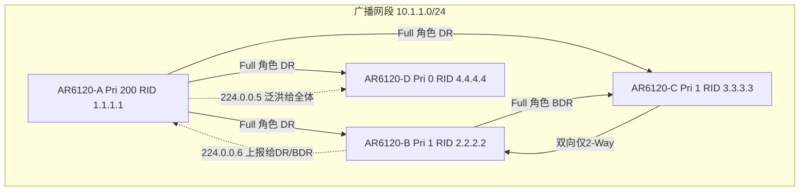

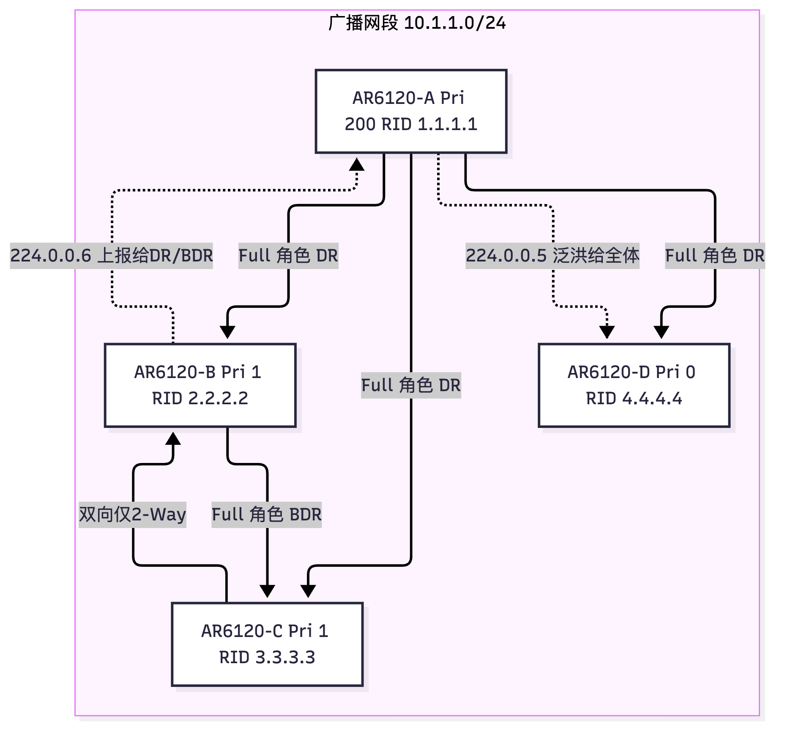


### 真题精练

**Q12.【真题·单选】** 某广播网段上已有 DR 与 BDR，此时新接入一台路由器，接口 DR 优先级为 255（现有 DR 为 1）。该新路由器的角色是？
A. 成为新 DR  B. 成为新 BDR  C. 保持 DROther  D. 不参与 OSPF

> **答案：C**
> **解析**：OSPF 的 DR/BDR 选举**不支持抢占**。网段上已有 DR 和 BDR 时，新加入的设备无论优先级多高都只能作为 DROther。只有 DR 失效时才会触发重选（此时 BDR 升为 DR，新设备与其他 DROther 竞争新 BDR）。这是最高频考点，务必记牢"不抢占"。

**Q13.【真题·单选】** OSPF 中 DROther 向 DR/BDR 发送 LSU 时使用的目的组播地址是？
A. 224.0.0.5  B. 224.0.0.6  C. 224.0.0.9  D. 224.0.0.10

> **答案：B**
> **解析**：224.0.0.5（AllSPFRouters）用于向**所有** OSPF 路由器发送；224.0.0.6（AllDRouters）用于 DROther 向 **DR/BDR** 上报。C 的 224.0.0.9 是 RIPv2 组播地址，D 的 224.0.0.10 是 EIGRP 地址，均为干扰项。另外 DR 收到后用 224.0.0.5 转发给全体。

**Q14.【真题·判断】** 一台 OSPF 路由器在整个 OSPF 域中只能有一个 DR/BDR 角色。

> **答案：错误**
> **解析**：DR/BDR 选举是**按接口（网段）独立进行**的。同一台路由器在网段 A 可以是 DR，在网段 B 可以是 DROther，在网段 C 可以是 BDR，三者互不影响。因为 DR 是"描述某个广播网段"的角色，其产生的 2 类 LSA 也只在本网段范围内有效。

**Q15.【真题·填空】** OSPF 中 DR 优先级默认为 ______，取值范围是 ______，其中 ______ 表示不参与 DR/BDR 选举；优先级相同时比较 ______，大者当选。

> **答案：1；0~255；0；Router ID**
> **解析**：`ospf dr-priority` 取值范围 0~255。优先级为 0 的路由器永远不参与选举，只做 DROther。这一设置常用于明确指定某些设备只做转发不承担 DR 职责的场景。

**Q16.【真题·简答】** 说明引入 DR/BDR 的必要性，并从邻接数量角度定量说明其收益。

> **答案**：
> 1. **必要性**：广播型网络（如交换机下挂多台路由器）中，若不引入 DR，任何两台路由器之间都要建立 Full 邻接并互相泛洪 LSA。设路由器数量为 n，邻接数为 **n(n−1)/2**，随 n 平方增长；同时 LSA 泛洪以组播方式扩散，每台设备都要处理 n−1 份更新，CPU 与带宽开销巨大。
> 2. **定量收益**：引入 DR/BDR 后，只有 DR 与 BDR 之间、以及 DR/BDR 与每个 DROther 之间建立 Full，邻接数降为 **2n−3**。
>    - n = 3 时：全互联 3 条 → 2×3−3 = 3 条（持平）；
>    - n = 5 时：全互联 10 条 → 7 条；
>    - n = 10 时：全互联 45 条 → 17 条；
>    - n = 20 时：全互联 190 条 → 37 条。
> 3. **泛洪收益**：DROther 只需把 LSA 发给 224.0.0.6（DR/BDR），由 DR 汇总后以 224.0.0.5 转发全体，泛洪次数由 O(n²) 降为 O(n)。
> 4. **可靠性收益**：BDR 作为热备份，DR 失效时立即接管，避免重新选举造成的中断。

### 易错点与排错

1. **不抢占**是必考点，同时也意味着"改了优先级后必须重启 OSPF 进程或重连网段才生效"。
2. **优先级 0 = 不参选**，不是"优先级最低因此当 BDR"。
3. **DR/BDR 是按接口选举的**，一台设备可有多个 DR 角色。
4. **P2P/P2MP 不选 DR**，改网络类型后 2 类 LSA 会消失。
5. 排错命令：`display ospf peer`（看角色）、`display ospf interface`（看 Pri 与 DR/BDR 地址）、`display ospf lsdb router`（看 1 类 LSA 中的 DR 字段）、`display ospf lsdb network`（看 2 类 LSA 由谁产生）。

---

## 7.4 LSA 类型、区域划分与骨干区域规则

### 考点定位

**OSPF 最高分的理论考点**（**6~10 分**）。常考：LSA 类型与产生者/传播范围的对应表；1/2/3/4/5/7 类 LSA 的用途；ABR/ASBR 的定义与判定；"为什么必须有 Area 0"。省赛常结合路由聚合与虚连接考综合题。

### 原理精讲

**LSA（Link State Advertisement，链路状态通告）** 是 OSPF 的信息载体，每种 LSA 描述不同类型的拓扑信息。

| LSA 类型 | 名称 | 产生者 | 传播范围 | 内容与用途 |
|---|---|---|---|---|
| **Type 1** | Router LSA | **每台 OSPF 路由器** | 本区域内 | 描述本路由器的所有链路（Stub 网段、Transit 网段、P2P 链路）与开销、接口类型；是 SPF 计算的基础 |
| **Type 2** | Network LSA | **DR** | 本区域内 | 描述广播/NBMA 网段的子网掩码与接入该网段的所有路由器（DR 产生并列出 DROther） |
| **Type 3** | Summary LSA（Network Summary） | **ABR** | 除本区域外的整个 AS（区域间） | 描述**区域间的网段路由**，把本区域的网段摘要通告给其他区域 |
| **Type 4** | ASBR Summary LSA | **ABR** | 除本区域外的整个 AS | 描述"如何到达 ASBR"，即通告 ASBR 的位置（前缀为 ASBR 的 Router ID，掩码 /32） |
| **Type 5** | AS External LSA | **ASBR** | 整个 AS（除 Stub/NSSA 特殊区域） | 描述**引入 OSPF 的外部路由**（如静态、直连、其他协议），带 E1/E2 类型与外部开销 |
| **Type 7** | NSSA External LSA | **NSSA 区域内的 ASBR** | 仅本 NSSA 区域，到 ABR 后转为 5 类 | 在 NSSA（Not-So-Stubby Area）中承载外部路由，解决 Stub 区域不能引入外部路由的矛盾 |

> **补充**：Opaque LSA（Type 9/10/11）用于 MPLS TE 等扩展，HCIA 层不考但需知道存在。

**LSA 头部关键字段**（所有 LSA 共用 **20 字节**头部）：

| 字段 | 长度 | 含义 |
|---|---|---|
| LS Age | 16 bit | 老化时间（秒），从 0 递增到 **MaxAge = 3600 s** 后失效；也可用于提前老化 |
| Options | 8 bit | 可选能力位（如 E 位表示支持外部路由、N 位表示 NSSA） |
| LS Type | 8 bit | LSA 类型 1~7 |
| **Link State ID** | 32 bit | 标识 LSA 的"主题"。1 类 = 产生者 Router ID；2 类 = DR 接口 IP；3 类 = 目的网段地址；5 类 = 外部网段地址 |
| **Advertising Router** | 32 bit | 产生该 LSA 的路由器的 Router ID（**判定的关键字段**） |
| **LS Seq Number** | 32 bit | 序列号，初始 `0x80000001`，每次更新递增，最大 `0x7FFFFFFF`；用于判断新旧 |
| **LS Checksum** | 16 bit | 除 Age 字段外全 LSA 的校验和，用于检测损坏 |
| Length | 16 bit | LSA 总长度 |

**LSA 新旧判断规则（高频）**：先比 **Seq（大者新）**，Seq 相同比 **Checksum（大者新）**，Checksum 也相同比 **Age**：Age = MaxAge（3600 s）为最新（表示要删除），否则 Age 差值 **> 900 s（MaxAgeDiff）** 时小者新，差值 ≤ 900 s 视为相同。

**区域划分与角色定义**：

| 角色 | 英文全称 | 定义 | 判定方法 |
|---|---|---|---|
| **IR** | Internal Router | 所有接口都在同一区域 | 只有 1 类 LSA 产生 |
| **BR** | Backbone Router | 至少一个接口在 Area 0 | 接口含 Area 0 |
| **ABR** | Area Border Router | 同时连接 **Area 0 与至少一个非骨干区域** | `display ospf abr-asbr` 显示 ABR |
| **ASBR** | AS Boundary Router | 引入了 OSPF 域外的路由（静态/直连/其他协议） | `display ospf abr-asbr` 显示 ASBR |

> **ABR 的严格定义**：必须**同时连接骨干区域（Area 0）和其他区域**。只连接两个非骨干区域的路由器**不是 ABR**（它无法把 LSA 转发出区域，除非配置虚连接）。这是极易混淆的考点。

**为什么必须有 Area 0（骨干区域）？** 这是 OSPF 区域设计的核心机制，原因有三：

1. **防止区域间环路**：OSPF 规定**区域间路由必须经 Area 0 中转**，非骨干区域之间不能直接交换 3 类 LSA。这样所有区域间路由形成一个以 Area 0 为中心的**星型（Hub-and-Spoke）拓扑**，天然无环。若允许任意区域互联，区域间的 3 类 LSA 可能形成环状传播导致路由环路。
2. **统一出口**：Area 0 是所有区域的"中转站"，ABR 把本区域路由汇总进来，也从 Area 0 学习其他区域路由。这样区域数量可以无限扩展（理论上），而每个区域内部只关心自己的拓扑。
3. **标准化与互操作**：RFC 2328 强制规定 Area 0（0.0.0.0）为骨干区域，是所有 OSPF 实现的互操作基础。这也是"区域必须与 Area 0 物理直连"的原因；若物理上无法直连，必须用**虚连接（Virtual Link）**逻辑上连回 Area 0。

**特殊区域**：

| 区域类型 | 过滤的 LSA | 特点 | 适用场景 |
|---|---|---|---|
| 普通区域 | 无 | 承载全部 LSA | 一般区域 |
| **Stub（末梢）** | 过滤 4、5 类 | 用 ABR 下发的**默认路由**访问外部；不能有 ASBR | 末梢网络，无外部路由引入 |
| **Totally Stub（完全末梢）** | 过滤 3、4、5 类 | 连区域间明细路由也过滤，只用一条默认路由，最省资源 | 大型网络末梢 |
| **NSSA** | 过滤 5 类，允许 7 类 | 允许区域内引入外部路由（以 7 类 LSA 承载，ABR 转 5 类） | 需要引入外部路由的末梢区域 |
| **Totally NSSA** | 过滤 3、4、5 类，允许 7 类 | NSSA + 完全末梢的组合 | 同上，进一步压缩路由表 |

### 关键概念对照表

| 判定项 | 结论 | 说明 |
|---|---|---|
| 只有 Area 0 接口 | 骨干路由器 BR | 不是 ABR |
| Area 0 + Area 1 接口 | **ABR** | 标准 ABR |
| Area 1 + Area 2 接口 | 非 ABR | 无法直接交换 3 类 LSA，需虚连接 |
| 引入静态路由 | **ASBR** | 产生 5 类 LSA |
| 引入直连网段 | ASBR | 同样产生 5 类 LSA |
| 3 类 LSA 的产生者 | ABR | 区域间路由 |
| 4 类 LSA 的产生者 | ABR | 指向 ASBR |
| 5 类 LSA 的产生者 | ASBR | 外部路由 |
| 2 类 LSA 的产生者 | DR | 描述广播网段 |
| 7 类 LSA 的产生者 | NSSA 内 ASBR | 区域内承载外部路由 |

**OSPF 外部路由类型**：

| 类型 | 含义 | 开销累加方式 | 选路优先级 |
|---|---|---|---|
| **E1（Type 1 External）** | 外部开销 + 内部开销 | 沿途累加内部 Cost | 优于 E2 |
| **E2（Type 2 External）** | 只取外部开销（默认类型） | 不累加内部 Cost，默认值 20 | 次于 E1 |

### 华为设备配置

```bash
# 多区域 OSPF 配置：AR6120 作为 ABR，同时连接 Area 0 与 Area 1
system-view
interface GigabitEthernet0/0/0
 ip address 10.0.0.1 255.255.255.0
quit
interface GigabitEthernet0/0/1
 ip address 10.1.1.1 255.255.255.0
quit
ospf 1 router-id 1.1.1.1                                # 指定Router ID，建议用Loopback
 area 0.0.0.0                                           # 骨干区域
  network 10.0.0.0 0.0.0.255                            # 宣告骨干区域网段
 quit
 area 0.0.0.1                                           # 非骨干区域 Area 1
  network 10.1.1.0 0.0.0.255                            # 宣告Area 1网段
  abr-summary 10.1.1.0 255.255.255.0                    # 在ABR上把Area 1路由聚合后通告进Area 0
 quit
quit
display ospf abr-asbr                                    # 确认本机是否为ABR（同时连接Area0与Area1）
display ospf lsdb summary                                # 查看3类LSA（区域间路由）
display ospf lsdb asbr                                   # 查看4类LSA（ASBR位置）
display ospf routing                                     # 查看OSPF计算出的路由及其类型（Intra/Inter/External）
```

```bash
# 引入外部路由使设备成为 ASBR，并查看 5 类 LSA
system-view
ospf 1
 import-route static cost 100 type 1                     # 引入静态路由，外部开销100，类型E1（累加内部Cost）
 import-route direct                                      # 引入直连路由，使设备成为ASBR
 quit
quit
display ospf lsdb ase                                     # 查看5类LSA（AS External LSA）
display ospf routing                                     # 观察External路由的Type为1还是2
```

```bash
# 虚连接（Virtual Link）：Area 2 未能与 Area 0 直连，穿越 Area 1 建立逻辑骨干连接
system-view
ospf 1
 area 0.0.0.1                                             # 穿越区域（Transit Area）必须是普通区域
  vlink-peer 2.2.2.2                                     # 对端ABR的Router ID，两端需互为配置
 quit
quit
display ospf vlink                                       # 查看虚连接状态，应显示Up
display ospf peer                                        # 观察新增的虚连接邻居
```

### 示意图

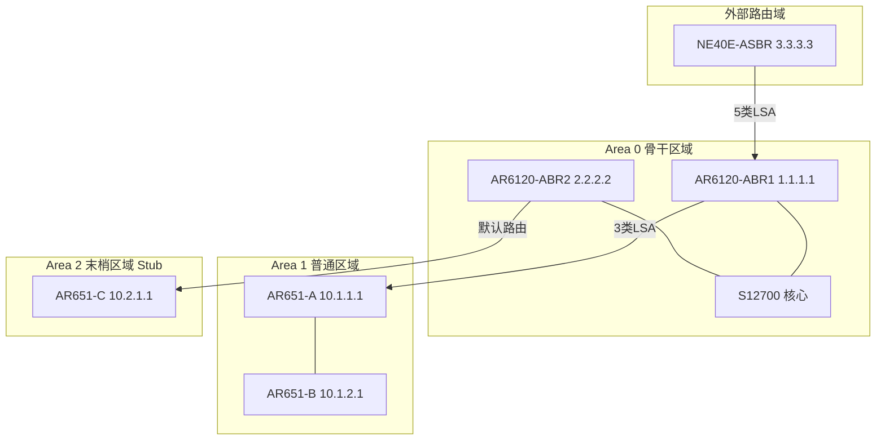

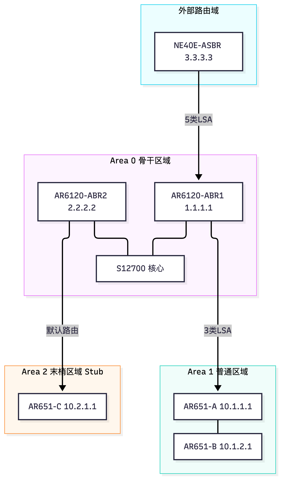


### 真题精练

**Q17.【真题·单选】** 下列哪种 LSA 由 ABR 产生并用于描述区域间的网段路由？
A. Type 1 Router LSA  B. Type 2 Network LSA  C. Type 3 Summary LSA  D. Type 5 AS External LSA

> **答案：C**
> **解析**：3 类 Summary LSA 由 ABR 产生，用于描述区域间路由。1 类由每台路由器产生（区域内拓扑）；2 类由 DR 产生（广播网段）；5 类由 ASBR 产生（外部路由）。另外 4 类也是 ABR 产生，但描述的是 ASBR 的位置而非网段路由。

**Q18.【真题·单选】** 某路由器有两个接口分别属于 Area 1 和 Area 2，既不属于 Area 0。该路由器是？
A. ABR  B. ASBR  C. 普通内部路由器  D. 骨干路由器

> **答案：C**
> **解析**：ABR 的严格定义是**同时连接骨干区域 Area 0 和至少一个非骨干区域**。只连接两个非骨干区域的路由器**不是 ABR**，它无法在两个区域之间转发 3 类 LSA（OSPF 强制区域间路由经 Area 0 中转），因此只能视为普通内部路由器（若两个区域都无 Area 0 连接，实际上会造成区域隔离，需要配虚连接）。这是极易出错的考点。

**Q19.【真题·多选】** 关于 OSPF 必须有 Area 0 的原因，下列说法正确的有？
A. 防止区域间路由环路，形成以骨干区为中心的星型拓扑
B. 作为所有非骨干区域之间的中转区域
C. 是 RFC 2328 的强制规定，保证不同厂商实现互操作
D. Area 0 必须与所有区域物理直连，不允许使用虚连接

> **答案：ABC**
> **解析**：D 错误。当非骨干区域无法与 Area 0 物理直连时，**允许使用虚连接（Virtual Link）**穿过一个普通区域（Transit Area）建立逻辑上的骨干连接。因此"必须物理直连"的说法不成立。A/B/C 均正确。

**Q20.【真题·填空】** OSPF 中 5 类 LSA 由 ______ 产生，传播范围是 ______；4 类 LSA 由 ______ 产生，其作用是 ______。

> **答案：ASBR；整个 AS（Stub/NSSA 区域除外）；ABR；通告如何到达 ASBR 的位置，使其他区域的路由器能找到 ASBR**
> **解析**：5 类 LSA 的 Link State ID 是外部目的网段地址，Advertising Router 是 ASBR 的 Router ID。其他区域的路由器虽然知道有 5 类 LSA，但要计算去往外部网段的路径，必须知道"ASBR 在哪里"，这正是 4 类 LSA 的职责（由 ABR 产生，Link State ID = ASBR 的 Router ID，掩码 /32）。

**Q21.【真题·简答】** 比较 OSPF 中 E1 与 E2 两类外部路由的差异，并说明默认类型。

> **答案**：
> 1. **E1（Type 1 External）**：到达外部目的的开销 = **外部开销（引入时指定）+ 沿途所有内部链路的 Cost**。因此 E1 路由会随转发路径不同而变化，能选出真正的最优路径。
> 2. **E2（Type 2 External）**：只使用**外部开销**，不累加内部 Cost（默认外部开销为 20）。因此在同一 AS 内，无论从哪个 ASBR 进入，Cost 都相同。
> 3. **默认类型是 E2**（华为 `import-route` 不指定 type 时默认为 2，cost 默认 20；实际 VRP 中不指定 cost 时按 20 处理）。
> 4. **选路优先级**：同目的时 **E1 优于 E2**；同为 E2 时比较外部开销，外部开销相同则比较到 ASBR 的内部 Cost；同为 E1 时直接比较总 Cost。
> 5. **使用建议**：多出口且希望按实际路径择优时用 E1；希望固定从某出口走（如统一计费出口）时用 E2。

### 易错点与排错

1. **ABR 必须同时连 Area 0 与非骨干区**，只连两个非骨干区不是 ABR。
2. **1 类 LSA 由每台路由器产生**（不是 DR），2 类才是 DR 产生。
3. **3 类 LSA 的 Link State ID 是网段地址**，4 类的 Link State ID 是 ASBR 的 Router ID，5 类的 Link State ID 是外部网段地址。
4. **Stub 区域不允许有 ASBR**（因为过滤 5 类 LSA），需要引入外部路由时要改用 NSSA。
5. 排错命令：`display ospf lsdb`、`display ospf lsdb router 1.1.1.1`（看某条 1 类 LSA 明细）、`display ospf abr-asbr`、`display ospf routing`。

---

## 7.5 Cost 计算、路由聚合、认证、静默接口与 display 输出解读

### 考点定位

实验题与理论卷的**收尾得分点**（**5~8 分**）。常考：Cost 计算（含 bandwidth-reference 调整后重算）；`abr-summary` / `asbr-summary` 的区别；区域认证与接口认证的差别；`display ospf peer` / `lsdb` / `routing` 输出的字段解读。

### 原理精讲

**Cost（开销）计算公式**：`Cost = 参考带宽（bandwidth-reference）÷ 接口带宽`，**结果小于 1 时取 1**，只取整数部分（向下取整）。默认参考带宽 **100 Mbps**。

| 接口带宽 | 默认 Cost（参考 100 M） | 参考带宽改为 10000 M 后 Cost | 参考带宽改为 1000 M 后 Cost |
|---|---|---|---|
| 10 Mbps | 100 ÷ 10 = 10 | 10000 ÷ 10 = 1000 | 1000 ÷ 10 = 100 |
| 100 Mbps | 1 | 100 | 10 |
| 1000 Mbps（GE） | 100 ÷ 1000 = 0.1 → **取 1** | 10000 ÷ 1000 = 10 | 1000 ÷ 1000 = 1 |
| 10000 Mbps（10GE） | 0.01 → **取 1** | 10000 ÷ 10000 = 1 | 0.1 → 取 1 |
| 100000 Mbps（100GE） | → 取 1 | 10000 ÷ 100000 = 0.1 → 取 1 | → 取 1 |

> **为什么必须调整参考带宽？** 因为默认 100 Mbps 太小，GE 及以上的接口 Cost 全部被"取 1"，导致**千兆与万兆链路被视为等价**，OSPF 无法区分优劣，选路可能走高带宽以外的路径。现代园区/数据中心应将 `bandwidth-reference` 设为 **10000（10 Gbps）** 或更高，并**全网一致**（不一致会导致两端 Cost 计算基准不同，产生次优路径）。

**Cost 的累加与方向**：OSPF 的 Cost 是**出接口方向**的累加（每台路由器把报文从某接口发出的开销计入）。因此路径总 Cost = 沿途所有**出接口**的 Cost 之和。**收到报文的入接口 Cost 不计入**（这是与"入方向 cost"设想的差别，也是 `ospf cost` 命令配置在出接口上影响去往该方向路径的原因）。

**路由聚合命令的区别**：

| 命令 | 配置位置 | 作用 | 生成的 LSA |
|---|---|---|---|
| `abr-summary <网络> <掩码>` | ABR 的区域视图（`area X` 下） | 把**本区域的区域内路由**聚合后通告给其他区域 | 3 类 Summary LSA |
| `asbr-summary <网络> <掩码>` | ASBR 的 OSPF 进程视图下 | 把**本机引入的外部路由**聚合后以 5 类 LSA 通告 | 5 类 AS External LSA |

**注意**：`abr-summary` 只在**本区域是产生这些明细路由的区域**时才有效，通常在需要对外通告的区域视图下配置。同时可用 `not-advertise` 抑制明细，用 `cost` 指定聚合路由的开销。

**认证（Authentication）** 用于防止非法设备接入 OSPF 域：

| 认证类型 | 作用范围 | 配置位置 | 特点 |
|---|---|---|---|
| **区域认证** | 整个区域的所有接口 | `area X` 视图 | 区域内所有路由器都需配置，一致性要求高 |
| **接口认证** | 单个接口 | 接口视图 | 优先级**高于**区域认证；同一接口同时存在时接口认证生效 |
| 明文（Simple） | — | — | 密码明文传输，不安全，仅实验用 |
| **MD5** | — | — | 密码经 MD5 摘要传输，安全性较好，最常用 |
| **Keychain** | — | 全局 keychain 视图 + 接口引用 | 支持密钥自动轮换，安全性最高 |
| HMAC-SHA256 | — | — | VRP V300 起支持，安全性高于 MD5 |

> **注意**：认证不一致会导致邻居关系无法建立（Hello 被丢弃），表现为状态长期 Down，`display ospf error` 中会有 "Authentication failure" 计数。这是"邻居建不起来"的三大原因之一（另两个是 Area ID、Hello/Dead 不匹配）。

**静默接口（Silent Interface）**：`silent-interface <接口类型 编号>` 使指定接口**只通告网段、不发送和接收 Hello**（即不建立邻居），适用于连接终端的接口（如连接用户 PC 的 VLAN 接口）。它有三大收益：① 防止非法 OSPF 报文进入；② 节省设备处理 Hello 的 CPU；③ 让路由通告仍然生效（网段依然被宣告出去）。**注意**：`silent-interface all` 会静默所有接口，通常只在特殊场景使用；`undo silent-interface all` 可恢复。默认情况下 OSPF 不会自动静默任何接口。

### 关键概念对照表

| display 命令 | 关键输出字段 | 判读要点 |
|---|---|---|
| `display ospf peer` | Router ID、Address、State、Interface、DR/BDR | State 必须为 **Full**；出现 2-Way 且非 DR/BDR 之间属正常 |
| `display ospf peer verbose` | 上述 + Hello/Dead、Options、MTU、Area、Dead 剩余时间 | 用于比对参数一致性、定位 ExStart（MTU 不同） |
| `display ospf interface` | Area、IP、Type、State、Cost、Pri、DR/BDR | 确认网络类型与 Cost；DR 字段显示本网段 DR 地址 |
| `display ospf lsdb` | Type、LinkState ID、AdvRouter、Age、Len、Seq | 核对各类 LSA 是否按预期存在（如 Stub 区不应有 5 类） |
| `display ospf lsdb router` | 1 类 LSA 明细：Link ID、Data、Link Type、Metric | 定位拓扑与 Cost 异常 |
| `display ospf routing` | Destination、Cost、Type、NextHop、AdvRouter | Type 显示 Intra Area / Inter Area / External（E1/E2） |
| `display ospf abr-asbr` | Router ID、Type（ABR/ASBR）、NextHop | 确认设备角色与到达 ABR/ASBR 的下一跳 |
| `display ospf error` | 各类错误计数 | 认证失败、Area 不匹配、Hello 间隔不匹配等 |
| `display ospf brief` | Router ID、进程号、区域、SPF 次数、LSA 数量 | 快速总览 |

### 华为设备配置

```bash
# 调整参考带宽并手工指定接口 Cost（注意：参考带宽需全网一致）
system-view
ospf 1
 bandwidth-reference 10000                               # 参考带宽改为10000Mbps，使GE=10、10GE=1，可区分带宽差异
quit
interface GigabitEthernet0/0/1
 ospf cost 50                                            # 手工指定接口Cost为50，覆盖自动计算值（用于强制选路）
quit
display ospf interface GigabitEthernet0/0/1              # 验证Cost是否为50
display ospf routing                                     # 观察Cost变化后选路是否切换
```

```bash
# 区域认证 + 接口认证 + 静默接口 综合配置
system-view
ospf 1
 area 0.0.0.0
  authentication-mode md5 1 cipher Huawei@123            # 区域认证：MD5，密钥ID=1，密钥密文形式存储
 quit
 silent-interface Vlanif100                              # 静默连接终端的VLAN接口：不建邻居但仍通告网段
 silent-interface GigabitEthernet0/0/9                   # 静默连接PC的物理接口
quit
interface GigabitEthernet0/0/1
 ospf authentication-mode md5 1 cipher Huawei@456         # 接口认证：优先级高于区域认证，本接口实际使用此密钥
quit
display ospf interface GigabitEthernet0/0/1              # 输出中会显示Authentication Mode
display ospf error                                       # 若两端密钥不一致，此处会出现认证失败计数
```

```bash
# ASBR 上的外部路由聚合（asbr-summary），并控制外部路由类型
system-view
ospf 1
 asbr-summary 172.16.0.0 255.255.0.0                     # 把引入的多条172.16.x.0/24外部路由聚合为172.16.0.0/16后以5类LSA通告
 import-route static type 1 cost 50                      # 引入静态路由，E1类型，外部开销50
 import-route rip 1 type 2 cost 20                       # 引入RIP进程1的路由，E2类型，外部开销20
quit
display ospf lsdb ase 172.16.0.0                         # 查看聚合后的5类LSA是否只有一条
display ospf routing                                     # 确认外部路由的Cost与Type是否符合预期
```

### 示意图

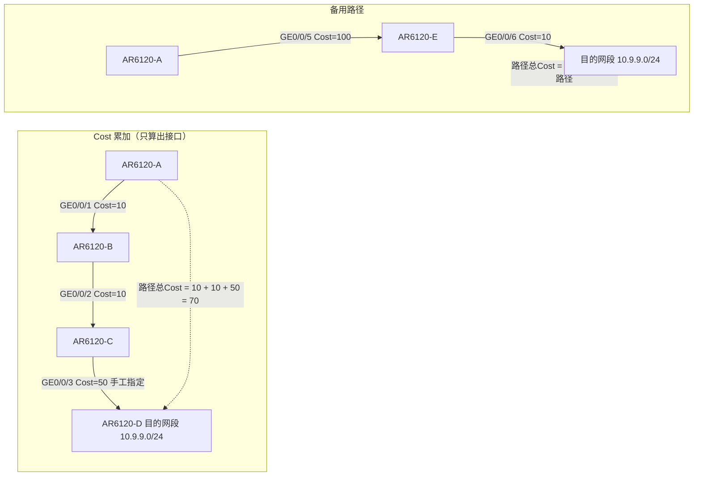

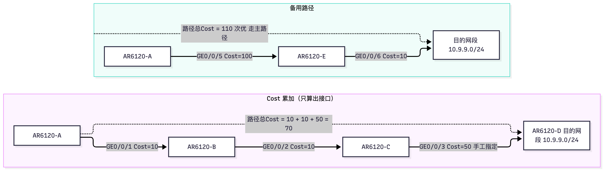


### 真题精练

**Q22.【真题·单选】** 在 OSPF 默认配置下（参考带宽 100 Mbps），一台路由器的 GE0/0/1（1000 Mbps）与 GE0/0/2（10000 Mbps）接口的 Cost 分别是？
A. 1 和 1  B. 10 和 1  C. 0.1 和 0.01  D. 100 和 1000

> **答案：A**
> **解析**：默认参考带宽 100 Mbps。GE：100 ÷ 1000 = 0.1 → 小于 1 **取 1**；10GE：100 ÷ 10000 = 0.01 → 也**取 1**。因此两者 Cost 都是 1，无法区分，这正是"必须调整 bandwidth-reference"的原因。C 是未取整的数学结果，VRP 中 Cost 为整数且最小为 1。

**Q23.【真题·单选】** `abr-summary` 命令应该配置在哪里？
A. ASBR 的 OSPF 进程视图  B. ABR 的对应区域视图  C. 任意路由器的接口视图  D. 骨干区域的接口视图

> **答案：B**
> **解析**：`abr-summary` 用于聚合**区域内路由**并通告到其他区域，因此必须在 ABR 上、且在被聚合网段所属**区域的视图**下配置（如 `ospf 1` → `area 1` → `abr-summary ...`）。A 是 `asbr-summary` 的位置（聚合外部路由）。这两个命令的位置互换是高频陷阱。

**Q24.【真题·判断】** 同一接口同时配置了区域认证和接口认证时，接口认证生效。

> **答案：正确**
> **解析**：接口认证的优先级**高于**区域认证。当接口同时存在两种认证配置时，以接口认证为准（VRP 的行为是接口认证覆盖区域认证）。这也意味着：若区域内统一配 MD5 密钥 A，而某接口单独配了 MD5 密钥 B，则该接口的邻居必须用 B 才能建立。

**Q25.【真题·填空】** 在 ABR 上把区域 1 内的 10.0.0.0/24、10.1.0.0/24、10.2.0.0/24、10.3.0.0/24 四条区域内路由聚合为一条通告到 Area 0，该聚合前缀是 ______，应配置命令 ______；该聚合会生成 ______ 类 LSA。

> **答案：10.0.0.0/22；`abr-summary 10.0.0.0 255.255.252.0`（在 `ospf 1` 的 `area 1` 视图下）；3（Summary LSA）**
> **解析**：第 3 段 0/1/2/3 的二进制为 `00000000`、`00000001`、`00000010`、`00000011`，共同不变的高位是 `000000`（6 位），前两段 10.0 完整相同（16 bit），故前缀长度 = 16 + 6 = **22**，聚合前缀为 **10.0.0.0/22**，覆盖 10.0.0.0 ~ 10.3.255.255，与四条 /24 完全吻合，属**精确聚合**。
> **对齐校验（本考点最容易踩的坑）**：/22 在第 3 段的块大小为 4，**起始地址必须是 4 的整数倍**。0 满足条件 ✓。若题目给的是 10.1.0.0/24 ~ 10.3.0.0/24（起始 1 不是 4 的倍数），则**无法精确聚合**：强行写 `abr-summary 10.1.0.0 255.255.252.0` 会覆盖 10.1.0.0 ~ 10.4.255.255，把未列出的 10.4.0.0/24 也吸引过来形成**空洞黑洞**；正确做法是保留 /24 明细，或改用 `abr-summary 10.0.0.0 255.255.252.0` 并确认 10.0.0.0/24 确实存在。
> **命令位置**：`abr-summary` 必须配置在 **ABR 上、被聚合网段所属区域的视图**（本例 `area 1`）下；若误配到 `asbr-summary` 的位置（OSPF 进程视图）则语义完全不同（后者聚合的是引入的外部路由，生成 5 类 LSA）。

**Q26.【真题·多选】** 配置静默接口（silent-interface）后，该接口会发生哪些变化？
A. 不发送也不接收 Hello 报文
B. 该接口网段仍然会被通告到 OSPF 区域中
C. 该接口不再生成 1 类 LSA 中的 Stub 链路描述
D. 该接口不会建立 OSPF 邻居关系

> **答案：ABD**
> **解析**：静默接口的核心行为是"**只通告、不建邻居**"：它不收发 Hello（A、D 正确），但接口网段仍作为 Stub 链路被写入 1 类 LSA 通告出去（B 正确，C 错误）。这是"为什么连接 PC 的接口要配 silent-interface"的答案——既能把用户网段通告给其他路由器，又避免了在接入层无谓地建立 OSPF 邻居消耗资源。

**Q27.【真题·排错】** 两台路由器之间 OSPF 邻居始终无法建立，`display ospf error` 显示认证失败计数持续增长。请说明原因与排查步骤。

> **答案与解析**：
> 1. **原因定位**：认证失败计数增长说明 Hello 报文中的认证字段校验不通过，具体可能是：① 两端认证类型不同（一端 simple 一端 md5）；② MD5 密钥 ID 不同（如一端 key-id 1、另一端 key-id 2）；③ 密钥字符串不同（大小写、特殊字符差异）；④ 一端配了区域认证、另一端配了接口认证且密钥不同；⑤ 一端**完全没有配置认证**而另一端配置了。
> 2. **排查步骤**：
>    - `display current-configuration configuration ospf` 查看本机 OSPF 全部配置，重点看 `authentication-mode`；
>    - `display ospf interface` 查看每个接口生效的认证模式；
>    - `display ospf peer` 确认状态（认证失败通常停在 Down，偶尔能看到 Init）；
>    - 两端逐项比对：**认证类型 → 密钥 ID → 密钥内容 → 作用范围（区域/接口）**；
>    - 统一后 `reset ospf counters` 清计数，再观察计数是否恢复增长。
> 3. **预防措施**：全网统一规划认证方案与密钥（建议用 Keychain 或统一 MD5 key-id 1），并把密钥纳入配置管理，避免手工输入差异（考试中特别注意 `cipher` 与 `simple` 参数及大小写）。

### 易错点与排错（OSPF 参数计算与显示解读专题）

1. **参考带宽必须全网一致**：一端 100 M、另一端 10000 M 会导致两端 Cost 计算基准不同，产生**次优路径**，且排错时极难发现。改参考带宽建议在维护窗口全网同步执行。
2. **Cost 只累加出接口方向**：手工 `ospf cost` 只影响"从该接口发出的方向"，不影响入方向；若想让某条链路的往返都走特定路径，需两端配合或使用路由策略。
3. **`abr-summary` 与 `asbr-summary` 位置与 LSA 类型不能混**（区域视图/3 类 vs 进程视图/5 类）。
4. **`display ospf peer` 中 2-Way 不一定是故障**（DROther 之间正常），只有 P2P 链路上出现非 Full 才是异常。
5. **`display ospf routing` 的 Type 字段**要会读：Intra Area（区域内，1/2 类）、Inter Area（区域间，3 类）、External（外部，E1/E2）。看到 1/2 类异常时查拓扑与 DR；看到 3 类缺失时查 ABR 与区域连通；看到 5 类缺失时查 `import-route` 与 Stub/NSSA 配置。
6. 排错命令：`display ospf brief`、`display ospf routing`、`display ospf lsdb`、`display ospf interface`、`display ospf error`、`reset ospf counters`。

---

# 数通-HCIA-章节8-应用层服务配置

## 8.1 DHCP 工作过程、报文格式与 Option 字段

### 考点定位

DHCP 是**实验题必配项**（**6~10 分**），理论卷常考 DORA 四步、报文类型、Option 字段（尤其 Option 43/60/82）与"为什么用中继"。**最高频陷阱**：把 DHCP Request/ACK 的发送方式说成单播或广播（实际 Request 是**广播**，ACK 可能是单播或广播，取决于 client 的 broadcast 标志位）。

### 原理精讲

**DHCP（Dynamic Host Configuration Protocol，动态主机配置协议）** 基于 **UDP** 工作：客户端用端口 **68**，服务器用端口 **67**。它解决"手工配置 IP 效率低、易冲突"的问题，是现代园区网的基础服务。

**DORA 四步交互（必须背下报文顺序与发送方式）**：

| 步骤 | 报文 | 方向 | 源 IP | 目的 IP | 源 MAC | 目的 MAC | 说明 |
|---|---|---|---|---|---|---|---|
| 1 | **DHCP Discover** | Client → Server | 0.0.0.0 | 255.255.255.255 | 客户端 MAC | FF-FF-FF-FF-FF-FF | 广播发现服务器，客户端此时无地址 |
| 2 | **DHCP Offer** | Server → Client | 服务器 IP | 255.255.255.255（或单播，视 broadcast 标志） | 服务器 MAC | 客户端 MAC | 提供可用地址与参数（**此时只是"提议"，尚未生效**） |
| 3 | **DHCP Request** | Client → Server | 0.0.0.0 | 255.255.255.255 | 客户端 MAC | FF-FF-FF-FF-FF-FF | **广播**请求确认，用于同时告知所有其他 DHCP 服务器"我选了它" |
| 4 | **DHCP ACK** | Server → Client | 服务器 IP | 单播或广播 | 服务器 MAC | 客户端 MAC | 确认分配，客户端正式使用该地址 |

> **为什么 Request 必须广播？** 因为同一网段可能存在多台 DHCP 服务器，客户端选中其中一个后，必须让**所有**服务器都知道结果，未被选中的服务器才能回收自己曾 Offer 的地址。若用单播，其他服务器会一直保留该地址直到租期超时，造成地址浪费。这是 DHCP 设计的经典一问。

**补充报文**：

- **DHCP NAK**：服务器拒绝 Request（地址已被占用、租期过期、网段不匹配）时发送，客户端收到后重新发起 Discover。
- **DHCP Decline**：客户端检测到分配到的地址已被占用（通过 ARP 探测或免费 ARP 冲突）时发送，服务器标记为 Conflict。
- **DHCP Release**：客户端主动释放地址（关机或 `ipconfig /release`），服务器回收地址。
- **DHCP Inform**：客户端已有地址，只需索取其他参数（如 DNS、网关）时使用。

**DHCP 报文格式关键字段**（RFC 2131，固定部分 236 字节 + 可变 Options）：

| 字段 | 长度 | 含义 |
|---|---|---|
| op | 1 B | 1 = 请求（BOOTREQUEST），2 = 应答（BOOTREPLY） |
| htype / hlen | 1 B / 1 B | 硬件类型（1 = 以太网）/ MAC 长度（6） |
| hops | 1 B | 跳数，**经过中继时该字段递增**（也用于中继回送判断），最大 16 |
| xid | 4 B | 事务 ID，用于匹配请求与应答 |
| secs | 2 B | 从获取地址开始经过的秒数 |
| flags | 2 B | **最高位是广播标志位（Broadcast Flag）**，置 1 表示客户端请求服务器用广播回应 |
| ciaddr | 4 B | 客户端当前 IP（Request 续租时有值） |
| yiaddr | 4 B | **服务器分配给客户端的 IP 地址**（"your IP"） |
| siaddr | 4 B | 下一个服务器地址（用于网络引导） |
| giaddr | 4 B | **中继代理地址（Gateway IP）**，中继设备填入，服务器据此判断从哪个池分配地址 |
| chaddr | 16 B | 客户端 MAC 地址 |
| sname / file | 64 B / 128 B | 服务器名 / 启动文件名 |
| **Options** | 可变 | 大量参数，其中 **Option 53 = 报文类型**，Option 55 = 请求参数列表，Option 50 = 请求的 IP，Option 54 = 服务器标识 |

**关键 Option 字段**：

| Option | 名称 | 用途 |
|---|---|---|
| **53** | DHCP Message Type | 标识报文类型（1=Discover、2=Offer、3=Request、4=Decline、5=ACK、6=NAK、7=Release、8=Inform） |
| 1 | Subnet Mask | 下发的子网掩码 |
| 3 | Router（默认网关） | 下发的网关地址 |
| 6 | Domain Name Server | 下发的 DNS 服务器 |
| 51 | IP Address Lease Time | 租期（默认 1 天 = 86400 s） |
| 54 | Server Identifier | 服务器标识（客户端 Request 中指明选中的服务器） |
| 55 | Parameter Request List | 客户端请求的参数列表 |
| **43** | **Vendor Specific Information** | **厂商自定义信息**：华为 WLAN 场景用它下发 **AC 的 IP 地址**给 AP，让 AP 无需手工配置即可找到 AC（配合 Option 60 使用） |
| **60** | **Vendor Class Identifier** | 厂商类别标识：AP 发送 `huawei` 等标识，DHCP 服务器据此判断是 AP 请求，从而下发 Option 43 |
| **82** | **Relay Agent Information** | **中继代理信息**：中继设备（或接入交换机）插入 **Circuit ID（端口/VLAN 标识）** 与 **Remote ID（客户端 MAC）**，服务器据此实现**按端口/位置分配固定 IP**、防私接、用户定位 |
| 66 / 67 | TFTP Server Name / Bootfile Name | 网络引导（PXE）用 |
| 121 | Classless Static Route | 下发无类静态路由（比 Option 3 更灵活） |

### 关键概念对照表

| 报文 | 类型码 | 方向 | 触发时机 |
|---|---|---|---|
| Discover | 1 | C→S | 客户端首次获取地址 |
| Offer | 2 | S→C | 服务器响应 Discover |
| Request | 3 | C→S | 客户端选择服务器（也用于续租、重绑定） |
| Decline | 4 | C→S | 客户端发现地址冲突 |
| ACK | 5 | S→C | 服务器确认分配 |
| NAK | 6 | S→C | 服务器拒绝请求 |
| Release | 7 | C→S | 客户端主动释放 |
| Inform | 8 | C→S | 客户端仅索取其他参数 |

**租期与续租（T1/T2）**：

| 计时器 | 默认比例 | 行为 |
|---|---|---|
| 租期（Lease Time） | 默认 1 天 | 地址有效时间 |
| **T1（Renewing，续租）** | 租期 50% | 客户端**单播**向原服务器请求续租（DHCP Request） |
| **T2（Rebinding，重绑定）** | 租期 87.5% | 若 T1 无响应，**广播**向任意服务器请求续租 |
| 租期到期 | 100% | 地址被回收，客户端重新 Discover |

### 华为设备配置

```bash
# 场景：AR6120 作为 DHCP 服务器，使用全局地址池为 192.168.10.0/24 客户端分配地址
system-view
sysname AR6120-DHCP
dhcp enable                                              # 全局使能DHCP功能（必配，否则地址池不生效）
ip pool LAN10                                            # 创建全局地址池，名为LAN10
 network 192.168.10.0 mask 255.255.255.0                 # 定义地址池可分配网段
 gateway-list 192.168.10.1                               # 下发默认网关（Option 3）
 dns-list 114.114.114.114 8.8.8.8                        # 下发DNS服务器（Option 6）
 excluded-ip-address 192.168.10.1 192.168.10.10          # 排除网关与服务器等静态地址，避免冲突
 lease day 3 hour 0 minute 0                             # 租期3天
 quit
interface GigabitEthernet0/0/0
 ip address 192.168.10.1 255.255.255.0
 dhcp select global                                      # 该接口从全局地址池分配地址
quit
display ip pool name LAN10                               # 查看地址池使用情况（Total/Used/Idle/Conflict）
display dhcp server statistics                           # 查看DHCP服务器报文收发统计
```

```bash
# 场景：接口地址池（适用于小型网络，地址池与接口网段绑定，无需 network 命令）
system-view
dhcp enable
interface GigabitEthernet0/0/1
 ip address 192.168.20.1 255.255.255.0
 dhcp select interface                                   # 使用接口地址池，自动以接口网段为可分配范围
 dhcp server dns-list 223.5.5.5                          # 接口地址池方式下发DNS
 dhcp server excluded-ip-address 192.168.20.100          # 排除单个地址
 dhcp server lease day 1                                 # 租期1天
quit
display ip pool interface GigabitEthernet0/0/1           # 查看接口地址池状态
```

```bash
# 场景：DHCP 中继（跨网段分配）——中继设备 S5731/S12700 或 AR6120 上配置
system-view
dhcp enable
interface Vlanif30                                       # 客户端所在网段的网关接口
 ip address 192.168.30.1 255.255.255.0
 dhcp select relay                                       # 该接口作为中继，不本地分配
 dhcp relay server-ip 10.0.0.100                         # 指定DHCP服务器地址（可配多个实现冗余）
quit
display dhcp relay statistics                            # 查看中继收发统计，确认Discover是否已转发
display dhcp relay all                                   # 查看所有中继配置
```

```bash
# 场景：在 DHCP 服务器上为 AP 下发 AC 地址（Option 43）与厂商标识（Option 60），华为 WLAN 常见配置
system-view
ip pool AP-POOL
 network 10.10.10.0 mask 255.255.255.0
 gateway-list 10.10.10.1
 option 43 sub-option 3 ascii 10.1.1.100                 # 下发AC的IP地址给AP，使AP自动发现AC
 option 60 ascii huawei                                  # 标识厂商类别为huawei，配合Option 43精确匹配AP请求
 quit
display ip pool name AP-POOL used                        # 查看AP是否成功获取地址
```

### 示意图

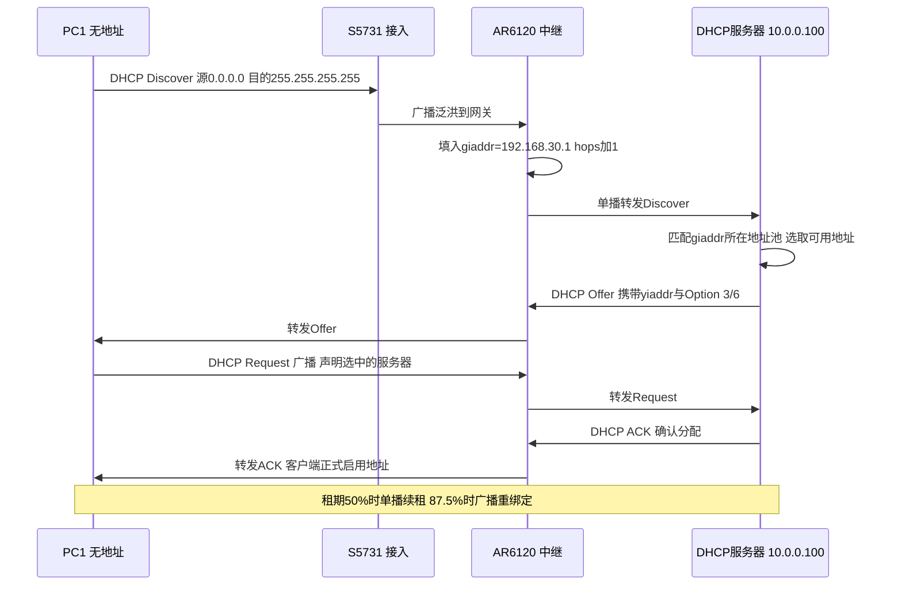

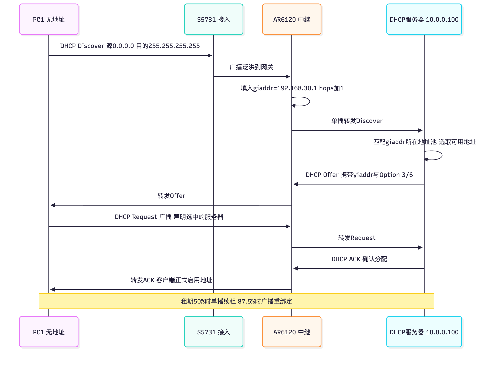


### 真题精练

**Q1.【真题·单选】** DHCP 客户端首次获取地址时，DHCP Request 报文的源 IP 与目的 IP 分别是？
A. 0.0.0.0 与 255.255.255.255  B. 客户端地址与服务器地址  C. 0.0.0.0 与服务器单播地址  D. 客户端地址与 255.255.255.255

> **答案：A**
> **解析**：Request 阶段客户端还**没有正式启用**地址（Offer 只是提议），因此源 IP 仍为 0.0.0.0；同时 Request 必须是**广播**（目的 255.255.255.255），以便让同网段所有 DHCP 服务器都知道客户端的选择。B 是续租（T1）时的情形；C 不成立（此时客户端还不知道最终是否被确认，且需通知所有服务器）。

**Q2.【真题·多选】** 关于 DHCP Option 字段，下列描述正确的有？
A. Option 53 用于标识 DHCP 报文类型
B. Option 43 常用于向 AP 下发 AC 的 IP 地址
C. Option 82 由中继设备插入，可用于按端口分配固定 IP
D. Option 60 用于下发 DNS 服务器地址

> **答案：ABC**
> **解析**：D 错误。下发 DNS 服务器的是 **Option 6**；Option 60 是**厂商类别标识（Vendor Class Identifier）**，客户端用它声明自己的厂商/型号，服务器据此返回对应的 Option 43 内容。A、B、C 均正确。华为 WLAN 场景"Option 43 + Option 60"组合是高频考点。

**Q3.【真题·判断】** DHCP 服务器收到 Discover 后，会立即把该地址从地址池中永久移除以保证不被别的客户端获取。

> **答案：错误**
> **解析**：Offer 阶段服务器只是把地址**临时保留（Offer 状态）**，并未正式分配。若客户端未发送 Request（例如选择了其他服务器），该地址会在一段时间（通常 60 秒）后回到 Idle 状态供其他客户端使用。只有收到 Request 并回复 ACK 后地址才进入 **Used** 状态。可用 `display ip pool` 观察 Total/Used/Idle/Conflict 四个计数。

**Q4.【真题·填空】** DHCP 基于 ______ 协议传输，服务器端口为 ______，客户端端口为 ______；客户端在租期达到 ______ 时开始单播续租，达到 ______ 时改为广播重绑定。

> **答案：UDP；67；68；50%；87.5%**
> **解析**：T1 = 50%（Renewing 状态，单播向原服务器请求）、T2 = 87.5%（Rebinding 状态，广播向任意服务器请求）。两个比例是 DHCP 的固定设计，考试常考。租期届满仍未续租则地址回收。

**Q5.【真题·简答】** 为什么跨网段部署 DHCP 时需要中继（Relay）？中继的工作机制是什么？

> **答案**：
> 1. **必要性**：DHCP Discover 是**广播**报文，广播不能跨越三层网段（路由器默认不转发广播）。而企业通常只部署少量集中式 DHCP 服务器（便于统一管理），服务器与客户端往往不在同一网段，因此必须由中继代为转发。
> 2. **工作机制**：① 中继设备的**网关接口**配置 `dhcp select relay` 并指定 `dhcp relay server-ip`；② 收到客户端广播 Discover 后，中继把报文**改为单播**发往服务器；③ 中继在 **giaddr（Gateway IP Address）字段填入该网关接口的 IP**，并把 hops 字段加 1；④ 服务器根据 giaddr 判断客户端属于哪个网段，从对应地址池选地址，然后把 Offer/ACK **单播回给 giaddr**；⑤ 中继再根据 giaddr 与客户端 MAC 把报文转发给客户端。
> 3. **安全考量**：中继设备同时会校验 hops 是否超限（防止环路）、并可通过 **Option 82** 插入端口信息，配合服务器的地址分配策略实现"按位置分配地址"与"防私接"。

**Q6.【真题·排错】** PC 通过 DHCP 中继获取地址失败，PC 显示 169.254.x.x。请给出排查思路。

> **答案与解析**：
> 1. **客户端侧**：确认网卡已启用 DHCP（`ipconfig /all` 查看是否 "DHCP Enabled: Yes"），排除手工静态配置。
> 2. **中继侧**：`display dhcp relay all` 确认 `dhcp select relay` 与 `dhcp relay server-ip` 已配置；`display dhcp relay statistics` 看是否收到 Discover、是否成功转发（Received/Forwarded 计数）。
> 3. **服务器连通性**：在中继上 `ping <DHCP服务器IP>`，确认路由可达（中继需要去往服务器的路由）。
> 4. **服务器侧**：`display ip pool` 看地址池是否有 Idle 地址、是否 Conflict 过多、是否 `dhcp enable` 已开启；确认地址池的 `network` 网段与客户端网段**一致或包含**（服务器根据 giaddr 选择地址池）。
> 5. **回程路由**：DHCP 服务器必须有回到客户端网段的路由（通常是服务器的默认网关指向中继或核心），否则 Offer/ACK 发不回来——**这是最容易被忽略的原因**。
> 6. **中间设备干扰**：检查接入交换机是否配置了 **DHCP Snooping** 且未把上行口设为 `trusted`，此时 Discover 会被丢弃；`display dhcp snooping user-bind all` 与 `display dhcp snooping configuration` 可确认。
> 7. **抓包定位**：在中继上行口与服务器侧同时抓包，判断报文在哪一跳丢失。

### 易错点与排错

1. **忘记 `dhcp enable`**：全局未使能时地址池完全不工作，是最常见的低级错误（VRP 中全局和接口/池都需要正确配置）。
2. **Request 是广播、Offer/ACK 可能是单播**，不要记反。
3. **排除地址必须包含网关本身**，否则网关地址可能被分配出去导致冲突（VRP 默认会把网关地址排除在可分配之外，但显式配置更稳妥）。
4. **中继必须有去往服务器的路由，服务器必须有回程路由**，双向缺一不可。
5. 排错命令：`display ip pool`、`display ip pool name X used`、`display dhcp relay statistics`、`display dhcp server statistics`、`reset dhcp server statistics`。

---

## 8.2 DHCP Snooping 与 DHCP 安全防护

### 考点定位

省赛实验题常考"防止私接 DHCP 服务器"与"防止 IP 地址欺骗"，理论卷考查 **trusted/untrusted 端口** 的概念，占 **3~5 分**。

### 原理精讲

DHCP Snooping 是交换机上的一项二层安全特性：**通过监听（snooping）DHCP 交互报文，建立"IP-MAC-端口-VLAN"绑定表，并对非法 DHCP 报文进行过滤**。

**核心机制**：

1. **端口信任（Trust）划分**：交换机端口分为 **Trusted（信任）** 与 **Untrusted（不信任）**，**默认所有端口都是 Untrusted**。
2. **上行口设为 Trusted**：连接合法 DHCP 服务器或中继的端口必须设为 trusted。
3. **Untrusted 端口的行为限制**：
   - 丢弃从 Untrusted 端口收到的 **DHCP Offer / ACK / NAK** 等服务器侧报文（防止私接 DHCP 服务器伪造网关，即"DHCP 仿冒攻击"）；
   - 允许从 Untrusted 端口收到 **Discover / Request** 等客户端侧报文，并提取 chaddr、giaddr、Option 82 建立绑定表；
   - 丢弃源 MAC 与 chaddr 不一致的报文（防止 MAC 欺骗）。
4. **绑定表（Binding Table）**：记录 **MAC 地址、IP 地址、VLAN、接口、租期**，可用于：
   - 与 **IP Source Guard（IPSG）** 联动，丢弃源 IP/MAC 与绑定表不符的报文（防 IP 欺骗）；
   - 与 **DAI（Dynamic ARP Inspection，动态 ARP 检测）** 联动，防止 ARP 欺骗；
   - 与 **802.1X** 联动实现用户接入认证。

> **为什么默认是 Untrusted？** 白名单思想——园区中绝大多数端口连接的是终端，只有极少数端口连接 DHCP 服务器/中继。默认不信任、手动放行少数上行口，才能最大限度阻断私接设备。反之若默认信任，攻击者只要插上就能伪造 DHCP 服务器，安全性无从谈起。

**Option 82 在 DHCP Snooping 中的特殊作用**：交换机在转发客户端报文时插入 Option 82（Circuit ID = 端口/VLAN、Remote ID = 客户端 MAC），服务器据此实现按位置分配地址；同时交换机校验回程报文的 Option 82 与绑定表一致，防止伪造。当报文经过**不受信任端口**且已带 Option 82 时，交换机会丢弃或替换，避免伪造注入。

### 关键概念对照表

| 端口角色 | 允许的报文 | 典型端口 | 默认状态 |
|---|---|---|---|
| Trusted | 全部 DHCP 报文（含 Offer/ACK） | 连接 DHCP 服务器/中继的上行口 | 否（需手工配置） |
| Untrusted | 仅客户端侧报文（Discover/Request/Decline/Release） | 连接 PC/AP/打印机的接入端口 | **是（默认）** |

| 联动技术 | 作用 | 依赖 |
|---|---|---|
| IP Source Guard（IPSG） | 丢弃源 IP/MAC 不匹配绑定表的报文，防 IP 欺骗 | DHCP Snooping 绑定表或静态绑定 |
| DAI（动态 ARP 检测） | 校验 ARP 报文的 IP-MAC 合法性，防 ARP 欺骗 | DHCP Snooping 绑定表 |
| 802.1X | 接入认证，未认证终端无法上网 | 需 DHCP Snooping 提供绑定信息 |

### 华为设备配置

```bash
# 在接入交换机 S5731 上配置 DHCP Snooping，防止私接 DHCP 服务器
system-view
sysname ACC-S5731
dhcp snooping enable                                     # 全局使能DHCP Snooping（VRP V200交换机语法）
vlan 10
 dhcp snooping enable                                    # 在VLAN 10内使能DHCP Snooping
 quit
interface GigabitEthernet0/0/24                          # 上行口，连接核心/合法DHCP服务器方向
 dhcp snooping trusted                                   # 设为信任端口，允许Offer/ACK通过
quit
interface GigabitEthernet0/0/1                           # 接入端口，连接PC
 dhcp snooping check dhcp-chaddr enable                  # 校验报文源MAC与chaddr一致性，防MAC欺骗
quit
display dhcp snooping configuration                      # 查看Snooping配置（含信任端口列表）
display dhcp snooping user-bind all                      # 查看动态绑定表（MAC-IP-VLAN-接口）
```

```bash
# 与 IP Source Guard 联动，防止用户私自更改 IP 地址
system-view
interface GigabitEthernet0/0/1
 ip source check user-bind enable                        # 使能IPSG，依据绑定表校验源IP与MAC
quit
display ip source check user-bind all                    # 查看IPSG生效的接口与绑定情况
```

### 示意图

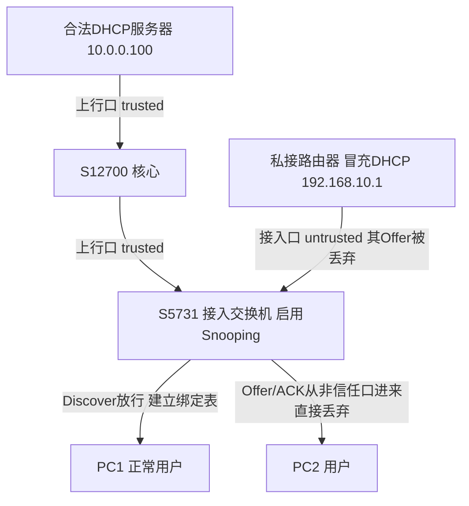

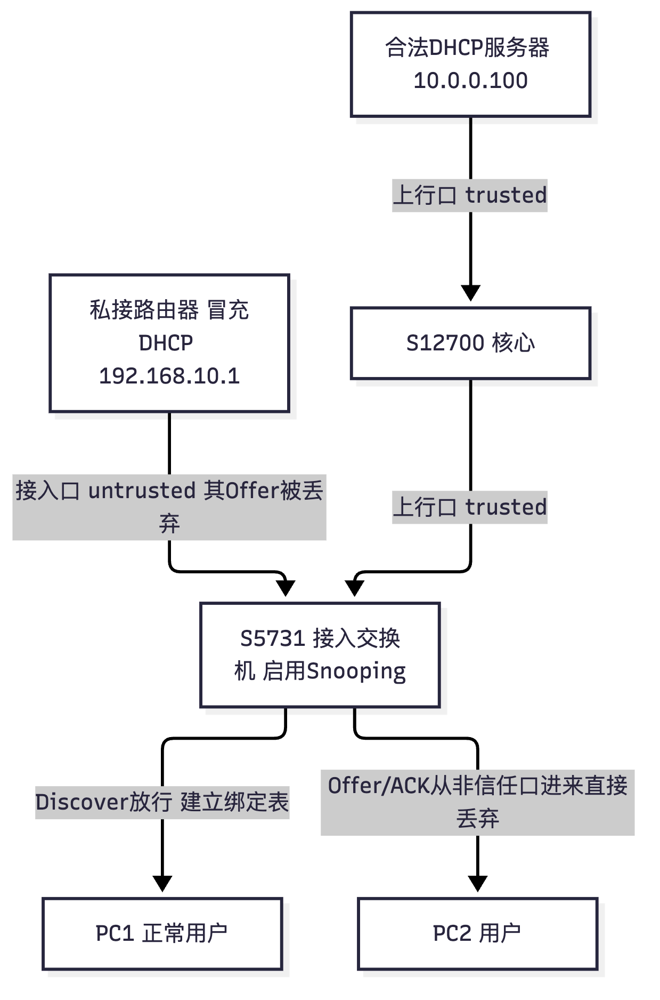


### 真题精练

**Q7.【真题·单选】** 在华为交换机上使能 DHCP Snooping 后，端口默认的信任状态是？
A. 全部 Trusted  B. 全部 Untrusted  C. 上行口 Trusted、下行口 Untrusted  D. 需手工指定，无默认值

> **答案：B**
> **解析**：使能 DHCP Snooping 后，**所有端口默认都是 Untrusted**，包括上行口，因此必须手工把连接 DHCP 服务器/中继的上行口配置为 `dhcp snooping trusted`，否则服务器的 Offer/ACK 会被丢弃，用户拿不到地址。这是配置 DHCP Snooping 后"全网断网"的经典原因。

**Q8.【真题·多选】** 从 Untrusted 端口收到的下列哪些 DHCP 报文会被丢弃？
A. DHCP Discover  B. DHCP Offer  C. DHCP Request  D. DHCP ACK

> **答案：BD**
> **解析**：Untrusted 端口只允许**客户端侧**报文通过（Discover、Request、Decline、Release、Inform），而丢弃**服务器侧**报文（Offer、ACK、NAK），以阻止私接 DHCP 服务器伪造地址分配。A、C 是客户端报文，允许通过并用于建立绑定表。

**Q9.【真题·简答】** 说明 DHCP Snooping 绑定表的作用及三种典型联动应用。

> **答案**：
> 1. **绑定表内容**：通过监听 DHCP 交互，记录 **MAC 地址、IP 地址、VLAN ID、接入接口、租期** 五元组信息（若携带 Option 82，还包含 Circuit ID 与 Remote ID）。
> 2. **作用一：防 IP 欺骗（与 IPSG 联动）**。用户私自配置静态 IP 后，其报文的源 IP 与绑定表中的 IP 不一致，`ip source check user-bind enable` 会直接丢弃该报文，强制用户必须通过 DHCP 获取地址。
> 3. **作用二：防 ARP 欺骗（与 DAI 联动）**。DAI 校验 ARP 报文中的 IP-MAC 映射是否与绑定表一致，不一致的 ARP 报文被丢弃，从而阻断中间人攻击（攻击者伪造网关 MAC）。
> 4. **作用三：用户定位与按位置分配（Option 82）**。绑定表配合 Option 82 可精确知道某 IP 对应哪个交换机的哪个端口，用于合规审计、故障定位与"按端口分配固定地址"。
> 5. **补充**：绑定表还可与 802.1X 联动，未通过认证的终端不生成绑定表，因而无法通信。

### 易错点与排错

1. **上行口必须手工设为 trusted**，否则全网拿不到地址。
2. **Snooping 要同时全局和 VLAN 使能**（不同 VRP 版本命令有差异：交换机的 `dhcp snooping enable` 需在系统视图与 VLAN 视图分别配置）。
3. 绑定表是**动态生成**的，清空后（`reset dhcp snooping user-bind all`）需要客户端重新获取地址才会重建。
4. 排错命令：`display dhcp snooping configuration`、`display dhcp snooping user-bind all`、`display dhcp snooping packet statistics`。

---

## 8.3 FTP/TFTP 服务端与客户端配置

### 考点定位

**实验题必考小项**（**3~5 分**）：用 FTP 备份配置文件、上传 VRP 镜像、指定 FTP 服务器的源接口。理论卷常考 FTP 的主动/被动模式与 TFTP 基于 UDP 的特点。

### 原理精讲

**FTP（File Transfer Protocol，文件传输协议）** 基于 **TCP**，使用**双连接**：

- **控制连接（Control Connection）**：端口 **21**，全程保持，传输命令与响应（如 USER、PASS、RETR、STOR、LIST）。
- **数据连接（Data Connection）**：端口 **20（主动模式）** 或**随机高端口（被动模式）**，传输文件内容，传输完毕即关闭。

| 模式 | 谁发起数据连接 | 数据端口 | 适用场景 |
|---|---|---|---|
| **主动模式（PORT，Active）** | **服务器**主动连接客户端 | 服务器 20 → 客户端高位端口 | 客户端无防火墙时可用；客户端在 NAT/防火墙后时常失败 |
| **被动模式（PASV，Passive）** | **客户端**主动连接服务器 | 客户端 → 服务器随机高端口 | 客户端在 NAT/防火墙后也能工作，**现代首选** |

**TFTP（Trivial File Transfer Protocol，简单文件传输协议）** 基于 **UDP**，端口 **69**，无认证、无目录浏览、无断点续传，报文小、开销低。它适合**设备内部**的配置备份/恢复与镜像升级，但不适合跨公网传输。

**华为设备上的角色**：

- 设备作为 **FTP 服务器**：`ftp server enable`，需要配置 FTP 用户（用户名、密码、目录、权限级别）。
- 设备作为 **FTP 客户端**：`ftp <服务器IP>` 后输入用户名密码，或用 `ftp` 命令的完整参数形式。
- 设备作为 **TFTP 客户端**：`tftp <服务器IP> put/get <本地文件> <远端文件>`，一条命令完成。
- **指定源接口**：当设备有多个出口时，服务器可能只允许特定源 IP 访问，用 `ftp client-source -a <源IP>` 指定。

> **为什么路由器/交换机上更常用 TFTP？** 因为 VRP 内置 TFTP 客户端只需一条命令、无需交互式登录，适合脚本化批量操作（如用 iMaster NCE 或自研脚本批量备份配置）。而 FTP 支持认证与目录操作，更适合需要权限控制的场景。

### 关键概念对照表

| 对比项 | FTP | TFTP |
|---|---|---|
| 传输层 | TCP | **UDP** |
| 默认端口 | 21（控制）+ 20（数据，主动） | **69** |
| 认证 | 有（用户名/密码） | **无** |
| 目录操作 | 支持（ls、cd、mkdir） | 不支持 |
| 断点续传 | 支持（REST） | 不支持 |
| 典型用途 | 文件服务器、权限受控传输 | 设备配置/镜像备份与升级 |
| 华为命令 | `ftp server enable` / `ftp x.x.x.x` | `tftp x.x.x.x put/get` |

### 华为设备配置

```bash
# 场景一：AR6120 作为 FTP 服务器，供管理员上传/下载配置文件与镜像
system-view
ftp server enable                                        # 使能FTP服务器功能
set default ftp-directory flash:/                        # 指定FTP默认工作目录为flash根目录
aaa                                                      # 进入AAA视图创建FTP用户
 local-user ftpadmin password irreversible-cipher Huawei@123   # 创建用户并设置不可逆加密密码
 local-user ftpadmin privilege level 15                   # 用户级别15（最高），可读写全部文件
 local-user ftpadmin service-type ftp                     # 该用户仅用于FTP服务
 local-user ftpadmin ftp-directory flash:/                # 指定该用户的FTP目录
 quit
display ftp-server                                       # 确认FTP服务器已使能及端口
display current-configuration | include ftp              # 检查FTP相关配置
```

```bash
# 场景二：AR6120 作为 FTP 客户端，把配置文件上传到远端FTP服务器
system-view
ftp client-source -a 10.1.1.1                            # 指定FTP客户端源地址，便于服务器侧ACL放通
quit
ftp 10.0.0.100                                           # 登录FTP服务器，随后按提示输入用户名密码
# 以下是FTP客户端交互命令（在FTP视图下执行）
# put vrpcfg.zip /backup/AR6120-vrpcfg.zip               # 上传配置文件到服务器
# get /backup/AR6120-vrpcfg.zip flash:/vrpcfg-restore.zip # 从服务器下载文件到本地flash
# ls                                                     # 列出远端目录
# bye                                                    # 退出FTP
```

```bash
# 场景三：TFTP 客户端（最常用的配置备份方式，一条命令完成）
tftp 10.0.0.100 put vrpcfg.zip AR6120-backup-2024.zip    # 把本地配置文件上传到TFTP服务器
tftp 10.0.0.100 get AR6120-vrpcfg.zip vrpcfg.zip         # 从TFTP服务器下载配置文件到本地
display tftp client-source                               # 查看TFTP客户端源地址配置
```

### 示意图

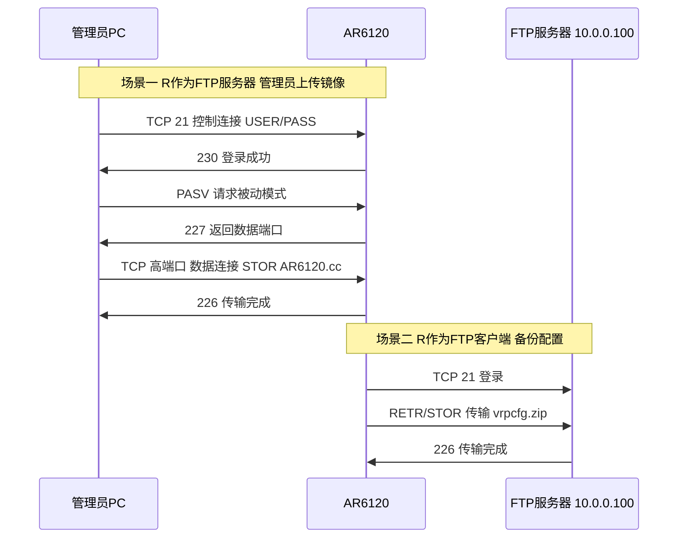

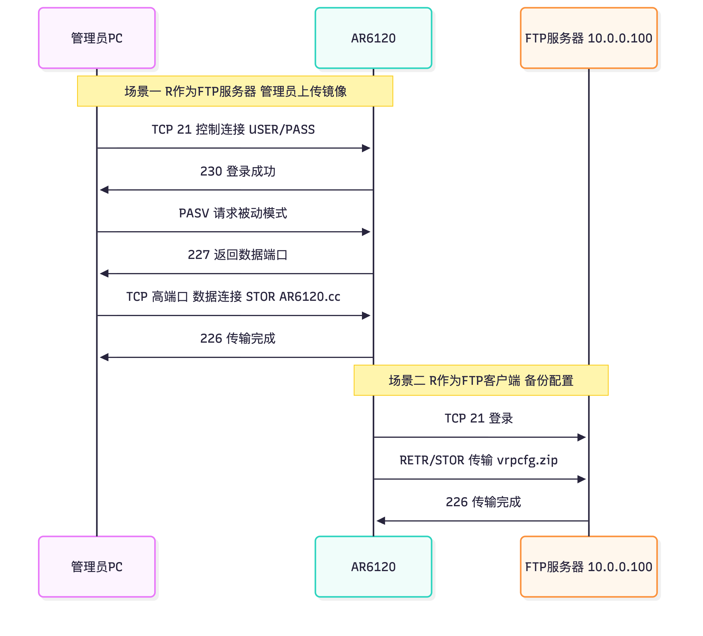


### 真题精练

**Q10.【真题·单选】** 华为路由器使用 TFTP 备份配置文件的正确命令是？
A. `tftp 10.0.0.100 put vrpcfg.zip backup.zip`
B. `tftp 10.0.0.100 get vrpcfg.zip`
C. `copy vrpcfg.zip tftp://10.0.0.100/`
D. `ftp put vrpcfg.zip`

> **答案：A**
> **解析**：VRP 的 TFTP 客户端命令格式为 `tftp <服务器IP> {put|get} <源文件> [目的文件]`。`put` 表示本地→服务器（备份/上传），`get` 表示服务器→本地（恢复/下载）。B 缺少本地文件名会报参数错误；C 是部分系统的写法（VRP 中 `copy` 不支持该 URL 形式做 TFTP）；D 语法错误（应为 `ftp x.x.x.x` 进入 FTP 客户端视图后再使用 `put`）。

**Q11.【真题·多选】** 关于 FTP 与 TFTP，下列说法正确的有？
A. FTP 使用 TCP，TFTP 使用 UDP
B. FTP 有认证机制，TFTP 没有认证
C. FTP 主动模式下由服务器发起数据连接
D. TFTP 默认使用端口 21

> **答案：ABC**
> **解析**：D 错误。TFTP 使用 **UDP 69**；端口 21 是 FTP 的控制端口。A、B、C 均正确。补充：FTP 主动模式（PORT）由服务器从 20 端口主动连客户端，客户端在 NAT/防火墙后常因无法接收入向连接而失败，此时应改用被动模式（PASV）。

**Q12.【真题·填空】** 华为设备作为 FTP 服务器时，需要先执行 ______ 命令使能服务；创建 FTP 用户需在 ______ 视图下使用 ______ 命令并指定 `service-type ftp`。

> **答案：`ftp server enable`；AAA（`aaa`）；`local-user <用户名> password irreversible-cipher <密码>`**
> **解析**：完整的 FTP 服务器配置三要素：① `ftp server enable` 使能服务；② `aaa` 视图下创建 local-user 并设置密码；③ 该用户的 `service-type` 必须包含 ftp，`privilege level` 决定文件读写权限（15 为最高），`ftp-directory` 限定可访问目录。

### 易错点与排错

1. **忘记 `ftp server enable`**，只配了用户却连不上。
2. **用户 `service-type` 未包含 ftp**，认证会失败。
3. **多出口设备需指定源接口**（`ftp client-source` / `tftp client-source`），否则服务器端 ACL 可能拒绝。
4. 排错命令：`display ftp-server`、`display tcp status`（看 21 端口监听）、`display current-configuration | include local-user`。

---

## 8.4 Telnet 与 SSH 远程登录（含 AAA 与 VTY 认证模式对比）

### 考点定位

**实验题必考**（**5~8 分**），理论卷常考"VTY 认证三种模式的区别"与"SSH 配置的前置条件"。**最高频陷阱**：SSH 必须先 `rsa local-key-pair create` 生成密钥对，否则 `protocol inbound ssh` 配置会失败或被拒绝。

### 原理精讲

**Telnet** 基于 **TCP 23**，**明文传输**用户名、密码与全部会话内容，可被中间人抓包直接读取（Wireshark 可还原）。**SSH（Secure Shell）** 基于 **TCP 22**，通过密钥交换与非对称加密建立安全通道，并支持服务端/客户端双向认证，是现代运维的唯一推荐方式。

**华为 VRP 的 VTY（Virtual Type Terminal，虚拟终端）认证三种模式**：

| 认证模式 | 命令 | 认证依据 | 优点 | 缺点 | 适用 |
|---|---|---|---|---|---|
| **None（不认证）** | `authentication-mode none` | 不需要任何凭据 | 配置最简单 | **极不安全**，任何人可登录 | 仅实验/受控环境 |
| **Password（密码认证）** | `authentication-mode password` + `set authentication password cipher X` | 只需输入一个密码 | 简单 | **无用户区分**，无法审计谁登录了 | 小型网络 |
| **AAA（用户名+密码）** | `authentication-mode aaa` + `aaa` 视图创建 local-user | 用户名 + 密码 + 权限级别 | 可区分用户、可授权、可审计 | 配置稍复杂 | **生产环境必须使用** |

**用户级别（Privilege Level）**：VRP 定义 4 个级别，决定登录后能执行哪些命令：

| 级别 | 名称 | 可执行操作 |
|---|---|---|
| 0 | Visit | 仅诊断工具（ping、tracert 等） |
| 1 | Monitor | 系统查看命令（display） |
| 2 | Configure | 配置命令（config 相关） |
| **3 ~ 15** | Manage | 全部命令，含文件系统、重启、用户管理（15 为最高，习惯配置 15） |

> **关键点**：`local-user X privilege level 15` 与 `user-interface vty 0 4` 下的 `user privilege level 15` 是两个不同层面的设置，前者在 AAA 认证时生效，后者在 password/none 认证时生效。AAA 模式下以 local-user 的级别为准。

**SSH 配置的完整要求（缺一不可）**：

1. **生成 RSA 密钥对**：`rsa local-key-pair create`（VRP V200）或 `rsa key-pair label ...`（V300），这是 SSH 的前置条件。
2. **使能 SSH 服务**：`stelnet server enable`。
3. **VTY 下允许 SSH 接入**：`protocol inbound ssh`（V200R003 前需先 `user-interface vty` 下配置；部分版本配置 `protocol inbound ssh` 后 Telnet 自动禁用）。
4. **配置 AAA 用户**：`local-user admin password irreversible-cipher X` + `service-type ssh` + `privilege level 15`。
5. **VTY 认证模式设为 AAA**：`authentication-mode aaa`。
6. **（可选）指定 SSH 用户认证方式**：`ssh user admin authentication-type password`（或 `rsa`/`password-rsa`/`all`）。

**Telnet/SSH 源地址限制**：可用 ACL 限制只有管理网段能登录 VTY，或使用 `acl` + `user-interface vty` 下的 `acl 2000 inbound`。这是最基础的安全加固。

### 关键概念对照表

| 对比项 | Telnet | SSH |
|---|---|---|
| 端口 | TCP 23 | **TCP 22** |
| 加密 | 无（明文） | 有（非对称 + 对称加密） |
| 身份认证 | 密码（可为明文传输） | 支持密码、公钥、键盘交互 |
| 前置配置 | 无 | **必须先生成 RSA 密钥对** |
| 华为使能命令 | 默认可用（需配 VTY） | `stelnet server enable` |
| 安全性 | 低 | 高（生产推荐） |
| 版本 | — | SSHv1（不安全，已淘汰）、SSHv2（默认） |

**VTY 认证模式对照**：

| 模式 | 是否需用户名 | 是否可审计 | 权限来源 |
|---|---|---|---|
| none | 否 | 否 | `user privilege level` |
| password | 否 | 否（所有人共用密码） | `user privilege level` |
| aaa | **是** | **是** | local-user 的 privilege level |

### 华为设备配置

```bash
# 场景一：配置 Telnet 登录（AAA 认证 + ACL 限制源地址），AR6120
system-view
sysname AR6120-MGMT
acl number 2000                                          # 基本ACL 2000，只允许管理网段登录
 rule 5 permit source 10.1.100.0 0.0.0.255               # 允许管理网段10.1.100.0/24
 rule 10 deny                                             # 显式拒绝其他所有源（华为ACL末尾默认也是deny，显式写出更清晰）
 quit
aaa
 local-user netadmin password irreversible-cipher Huawei@123    # 创建管理员账号，密码不可逆加密
 local-user netadmin privilege level 15                   # 权限级别15，最高
 local-user netadmin service-type telnet                  # 该账号仅用于Telnet登录
 quit
user-interface vty 0 4                                    # 配置VTY 0~4共5个虚拟终端
 authentication-mode aaa                                  # 采用AAA（用户名+密码）认证
 protocol inbound telnet                                  # 允许Telnet接入（若需SSH则改为ssh或all）
 acl 2000 inbound                                         # 只允许ACL 2000匹配的源地址登录
 user privilege level 15                                  # 登录后的默认级别（AAA模式下以local-user为准）
 idle-timeout 10                                          # 空闲10分钟自动断开，防止会话被占用
 screen-length 30                                         # 每屏显示30行，便于分屏查看
quit
display users                                            # 查看当前登录用户
display telnet server status                             # 查看Telnet服务状态
```

```bash
# 场景二：配置 SSH（Stelnet）登录，包含 RSA 密钥生成等全部前置步骤
system-view
rsa local-key-pair create                                # 生成RSA主机密钥对（SSH前置条件），按提示输入密钥长度（建议2048）
stelnet server enable                                    # 使能SSH服务器功能
ssh user netadmin authentication-type password            # 指定该SSH用户的认证方式为密码
ssh user netadmin service-type stelnet                    # 指定该用户使用的服务为Stelnet
aaa
 local-user netadmin password irreversible-cipher Huawei@123
 local-user netadmin privilege level 15
 local-user netadmin service-type ssh                     # service-type必须包含ssh，否则登录被拒
 quit
user-interface vty 0 4
 authentication-mode aaa
 protocol inbound ssh                                     # 只允许SSH接入（相当于禁用Telnet，安全性更高）
 acl 2000 inbound
quit
display rsa local-key-pair public                         # 查看生成的公钥，验证密钥对存在
display ssh server status                                # 查看SSH服务器状态与版本（应为2.0）
display ssh server session                               # 查看当前SSH会话
```

```bash
# 场景三：设备作为 SSH 客户端登录其他设备
system-view
ssh client first-time enable                             # 首次登录时不校验对端公钥（实验环境常用，生产应导入公钥）
quit
stelnet 10.0.0.1                                         # 登录对端设备，按提示输入用户名密码
display ssh client source                                # 查看SSH客户端源地址配置
```

### 示意图

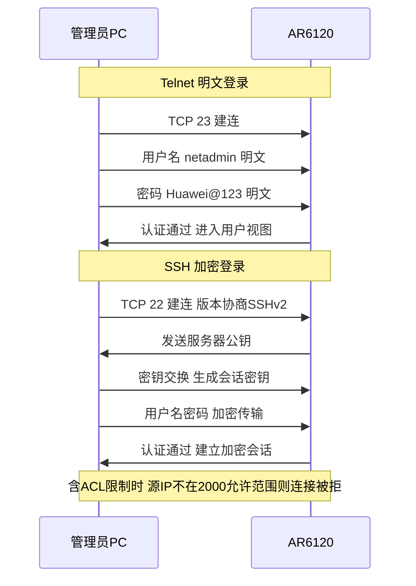

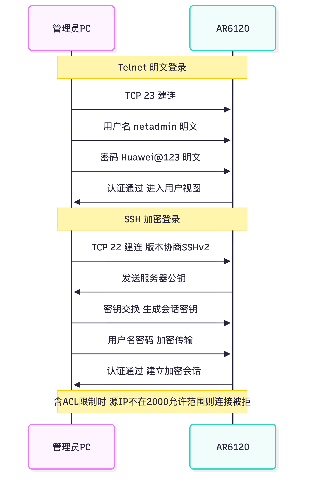


### 真题精练

**Q13.【真题·单选】** 在华为 VRP 上配置 SSH 登录，下列哪一步是**必须最先完成**的前置条件？
A. `stelnet server enable`  B. `rsa local-key-pair create`  C. 配置 `user-interface vty`  D. 创建 local-user

> **答案：B**
> **解析**：SSH 依赖非对称密钥实现密钥交换与会话加密，必须先有 RSA 主机密钥对，因此 `rsa local-key-pair create` 是前置条件。若未生成密钥就执行 `stelnet server enable` 或 `protocol inbound ssh`，配置会失败或 SSH 服务无法正常工作（部分版本会提示需要先生成密钥）。

**Q14.【真题·多选】** 关于 VTY 的三种认证模式，下列说法正确的有？
A. `authentication-mode none` 不需要任何凭据即可登录
B. `authentication-mode password` 无法区分不同用户，不利于审计
C. `authentication-mode aaa` 支持用户名密码并可通过 local-user 分配权限
D. AAA 认证模式下用户的权限级别由 `user-interface` 下的 `user privilege level` 决定

> **答案：ABC**
> **解析**：D 错误。AAA 模式下用户权限由 **`local-user X privilege level N`** 决定，`user-interface` 下的 `user privilege level` 主要在 none/password 模式下起作用。这是两个层面容易混淆的点，也是实验题中"配置了 15 级却仍只能看 display"的常见原因（把级别配错了位置）。

**Q15.【真题·判断】** 配置 `protocol inbound ssh` 后，设备的 Telnet 功能会同时被禁用。

> **答案：正确**
> **解析**：VTY 的 `protocol inbound` 参数决定该 VTY 允许的接入协议，取值为 `telnet`、`ssh`、`all`（部分版本支持）。配置为 `ssh` 后，Telnet 请求会被拒绝，从而实现"强制加密管理"。若需两者共存可配置 `protocol inbound all`，但生产环境建议只保留 SSH。

**Q16.【真题·填空】** Telnet 使用 TCP 端口 ______，SSH 使用 TCP 端口 ______；华为 VTY 认证模式有三种：______、______、______，生产环境推荐使用 ______。

> **答案：23；22；none（不认证）、password（密码认证）、aaa（AAA 认证）；aaa**
> **解析**：华为 VRP 中 `authentication-mode` 的取值就是 none/password/aaa 三种。AAA 模式能提供用户名区分、集中授权与操作审计（可配合 RADIUS/TACACS+ 服务器实现集中认证），是唯一满足等保与运维合规要求的方式。

**Q17.【真题·简答】** 某工程师配置了 `local-user admin privilege level 15`、`service-type telnet`、`user-interface vty 0 4` 下 `authentication-mode aaa`，但登录后执行 `system-view` 提示权限不足。请分析原因。

> **答案与解析**：
> 1. **最可能原因一：登录用的不是 admin 账号**。若 VTY 下还配了 `user privilege level 1` 或存在其他低权限账号，用户可能用了别的账号登录。用 `display users` 与 `display access-user`（若有）确认当前登录用户。
> 2. **最可能原因二：local-user 的 `service-type` 不含该接入方式**。若用户通过 SSH 登录而账号 `service-type` 只配了 `telnet`，会被拒绝或按默认级别处理；应配置 `service-type telnet ssh` 或 `service-type all`。
> 3. **最可能原因三：AAA 视图未生效或存在 AAA 方案覆盖**。若配置了 `authentication-scheme` 指向远程服务器而服务器不可达，可能回退到默认级别。
> 4. **排查命令**：`display current-configuration | include local-user`、`display current-configuration configuration user-interface`、`display users`、`display aaa` 相关命令（按版本）。
> 5. **修正**：确保 `local-user admin privilege level 15`、`service-type` 包含实际接入方式、VTY 认证为 aaa，并确认登录账号拼写正确（大小写敏感）。

### 易错点与排错

1. **SSH 忘记 `rsa local-key-pair create`**：这是最高频的配置遗漏。
2. **`service-type` 与实际接入方式不匹配**：Telnet 账号登录 SSH 会失败。
3. **`protocol inbound ssh` 与 `stelnet server enable` 必须同时配置**。
4. **权限级别配错位置**：AAA 模式看 local-user，其他模式看 user-interface。
5. 排错命令：`display users`、`display ssh server status`、`display ssh server session`、`display rsa local-key-pair public`、`display current-configuration configuration user-interface`。

---

## 8.5 DNS 解析、DNS Client 与 DNS 代理

### 考点定位

**3~5 分**，常考 DNS 查询的递归/迭代差别、`ip host` 与 DNS 的关系、DNS Client 配置命令。实验题中常用于让设备能通过域名访问。

### 原理精讲

**DNS（Domain Name System，域名系统）** 把域名解析为 IP 地址，基于 **UDP/TCP 53**（一般查询用 UDP，区域传送与超过 512 字节的响应用 TCP）。查询方式：

| 查询类型 | 发起者 | 行为 |
|---|---|---|
| **递归查询（Recursive）** | 客户端 → 本地 DNS 服务器 | 客户端要求"给我最终答案"，本地 DNS 负责一路查到结果 |
| **迭代查询（Iterative）** | 本地 DNS → 根/TLD/权威服务器 | 被查询者只返回"下一步该问谁"，由本地 DNS 继续追问 |

**DNS 记录类型（常见）**：A（IPv4 地址）、AAAA（IPv6 地址）、CNAME（别名）、MX（邮件交换）、NS（域名服务器）、PTR（反向解析）、SOA（起始授权）。

**华为设备上的两种用法**：

1. **DNS Client（客户端）**：设备作为客户端向 DNS 服务器查询域名。配置 `dns resolve` + `dns server <IP>`，之后 `ping www.huawei.com` 时设备会先向 DNS 服务器查询再 ping。**必须开 `dns resolve`**，否则设备只查 `ip host` 静态表。
2. **静态域名解析（`ip host`）**：手工建立"域名 → IP"映射，优先于 DNS 服务器查询（先查本地 host 表）。适合只有几个固定域名的场景，无需 DNS 服务器。

3. **DNS 代理（DNS Proxy）**：设备（通常是出口路由器或防火墙）作为 DNS 代理，把内网客户端的 DNS 请求转发给外部 DNS 服务器，并缓存结果。好处：① 客户端只需配置网关地址为 DNS，简化配置；② 内外网 DNS 分离，便于安全控制；③ 缓存减少外网查询，提高解析速度。

**DNS 解析顺序**（华为设备）：先查 **`ip host` 静态表** → 若未命中且 `dns resolve` 已开启 → 向 **DNS 服务器** 查询 → 若仍未命中则解析失败。

### 关键概念对照表

| 项目 | 递归查询 | 迭代查询 |
|---|---|---|
| 发起方 | 客户端 | 本地 DNS 服务器 |
| 被查询方响应 | 返回最终 IP | 返回下一跳服务器地址 |
| 负载 | 由本地 DNS 承担 | 由查询方逐级承担 |
| 典型场景 | PC → 本地 DNS | 本地 DNS → 根/TLD 服务器 |

| 记录类型 | 含义 | 示例 |
|---|---|---|
| A | 域名 → IPv4 | www.example.com → 1.2.3.4 |
| AAAA | 域名 → IPv6 | www.example.com → 2001:db8::1 |
| CNAME | 别名 | mail.example.com → mail.huawei.com |
| MX | 邮件服务器 | example.com → mail.example.com |
| PTR | 反向解析（IP→域名） | 4.3.2.1.in-addr.arpa |

### 华为设备配置

```bash
# 场景一：设备作为 DNS Client，通过域名访问外网服务器
system-view
dns resolve                                              # 使能动态域名解析服务（关键，不配置则只查静态表）
dns server 114.114.114.114                               # 配置主DNS服务器
dns server 223.5.5.5                                     # 配置备用DNS服务器
dns domain huawei.com                                    # 配置默认域名后缀，查询www时自动补全为www.huawei.com
quit
display dns server                                       # 查看已配置的DNS服务器
display dns dynamic-host                                 # 查看动态域名缓存
ping www.huawei.com                                      # 验证域名解析与连通性
```

```bash
# 场景二：静态域名解析（ip host），优先级高于DNS服务器查询
system-view
ip host server1 10.1.1.100                                # 建立静态映射：server1 -> 10.1.1.100
ip host server2 10.1.1.101                                # 可配置多个
quit
display ip host                                          # 查看静态域名表
ping server1                                             # 验证通过静态表直接解析
```

```bash
# 场景三：在 AR6120 上配置 DNS 代理，内网客户端把网关作为 DNS 服务器
system-view
dns server 114.114.114.114                               # 指定上游DNS服务器
dns proxy enable                                         # 使能DNS代理功能
interface GigabitEthernet0/0/0
 ip address 192.168.10.1 255.255.255.0                   # 内网网关，客户端DNS填此地址
quit
display dns proxy status                                 # 查看DNS代理状态与上游服务器
display dns dynamic-host                                 # 查看代理缓存的解析结果
```

### 示意图

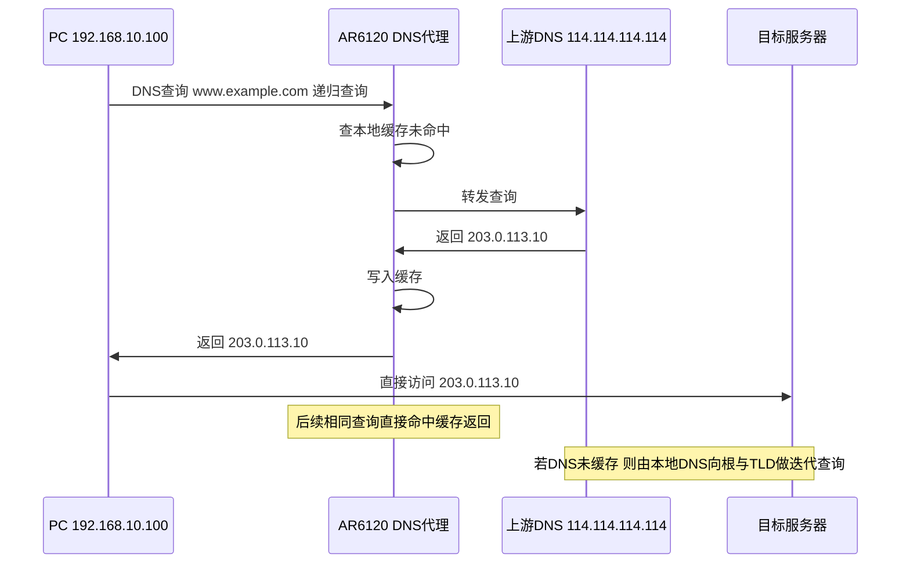

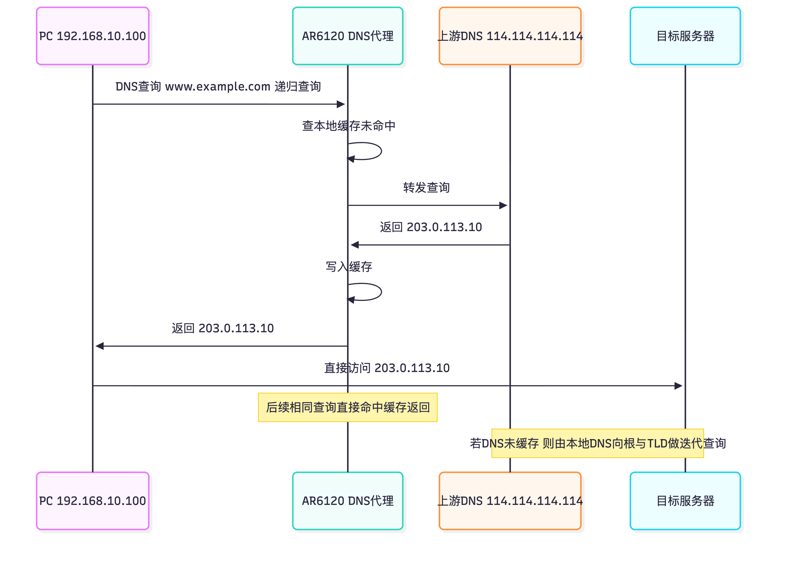


### 真题精练

**Q18.【真题·单选】** 华为路由器上使能动态域名解析必须配置的命令是？
A. `dns server 8.8.8.8`  B. `dns resolve`  C. `ip host`  D. `dns proxy enable`

> **答案：B**
> **解析**：`dns resolve` 是使能动态域名解析的开关，**不配置它，即使配了 DNS 服务器地址，设备也不会发起域名查询**（只会查 `ip host` 静态表）。这是最常见的遗漏。A 只是指定服务器（还需 B 才生效）；C 是静态解析；D 是代理功能，用途不同。

**Q19.【真题·判断】** 递归查询与迭代查询的区别在于：递归查询由客户端完成全部查询，迭代查询由本地 DNS 服务器完成全部查询。

> **答案：错误**
> **解析**：说反了。**递归查询**中客户端只发一次请求，要求本地 DNS 返回**最终结果**，全部查询工作由**本地 DNS 服务器**承担；**迭代查询**中本地 DNS 向根/TLD/权威服务器逐级询问，被问者只返回"下一步该问谁"，由**发起方**继续追问。区分的关键是"谁承担逐级查询的工作量"。

**Q20.【真题·填空】** DNS 通常使用 UDP 端口 ______；设备解析域名时的顺序是先查 ______，再查 ______。

> **答案：53；`ip host` 静态表（本地主机表）；DNS 服务器（动态解析，需已配置 `dns resolve`）**
> **解析**：DNS 主流使用 UDP 53，当响应超过 512 字节（如含大量记录）或进行区域传送（AXFR）时切换为 TCP 53。华为设备的解析顺序为静态表优先，这也是"为什么配了 ip host 后 ping 域名立刻成功"的原因。

### 易错点与排错

1. **忘记 `dns resolve`**：配了服务器地址也解析不了。
2. **`ip host` 优先于 DNS 服务器**，排错时留意静态表覆盖了动态结果。
3. **`dns domain` 只是补全后缀**，不会作为独立域名解析。
4. 排错命令：`display dns server`、`display ip host`、`display dns dynamic-host`、`display dns proxy status`。

---

## 8.6 HTTP/HTTPS 基础、访问控制与 Easy-IP + DHCP 综合场景

### 考点定位

**综合应用题**（**5~8 分**）：省赛常给一个小型企业拓扑，要求"内网 DHCP 自动分配 + 出口 Easy-IP 上网 + 发布内网 Web 服务器（NAT Server）+ 限制外网访问管理面"。本题型是实验配置题的标准模板。

### 原理精讲

**HTTP（Hypertext Transfer Protocol，超文本传输协议）** 基于 **TCP 80**，明文传输；**HTTPS** 基于 **TCP 443**，使用 TLS/SSL 加密。华为设备可通过 **HTTP 服务**（`http server enable`）提供 Web 网管，也可通过 **NAT Server** 把内网 Web 服务器发布到公网。

**HTTP 关键点（考点级）**：请求方法（GET/POST/PUT/DELETE）、状态码（**200 成功 / 301 永久重定向 / 302 临时重定向 / 400 请求错误 / 401 未认证 / 403 禁止 / 404 未找到 / 500 服务器内部错误 / 502 网关错误 / 504 网关超时**）。排错时状态码是第一线索：**502/504 通常是后端服务器或代理问题，403/404 是权限与资源路径问题**。

**Easy-IP（NAPT，Network Address Port Translation）与 DHCP 结合场景**：企业出口用一条公网地址（PPPoE 或静态）承载全部内网用户上网，路由器把内网源 IP:端口 转换为公网 IP:端口，**用端口号区分不同内网会话**。这是最经济、最常见的上网方案，与内部 DHCP 自动分配地址天然配套：内网用户零配置（DHCP 拿地址与网关），出口零额外公网地址（Easy-IP 复用接口地址）。

**访问控制设计**：出口设备（AR6120 或 USG6520E）通常需同时实现：
1. **允许内网 → 外网**（NAT 后转发，安全策略放通）；
2. **允许外网 → 内网 Web 服务器（80/443）**（NAT Server + 安全策略）；
3. **禁止外网访问内网管理面（Telnet/SSH/SNMP）**（安全策略或 ACL 拒绝）；
4. **禁止内网用户访问设备管理地址**（可选，ACL 限制）。

### 关键概念对照表

| 技术 | 转换对象 | 用途 | 公网地址需求 |
|---|---|---|---|
| 静态 NAT | IP 一对一 | 服务器对外发布（也可用 NAT Server） | 每个内网地址一个公网地址 |
| 动态 NAT | IP 一对一（从池中取） | 内网用户轮换使用公网池 | 需公网地址池 |
| **NAPT / Easy-IP** | IP + 端口 | 内网用户共享单个公网地址上网 | **仅需 1 个公网地址** |
| **NAT Server** | IP + 端口（入方向） | 把内网服务器发布到公网 | 1 个公网地址可映射多个服务器（不同端口） |
| 目的 NAT（Destination NAT） | 转换目的地址 | DNAT，NAT Server 的本质 | 同上 |
| 双向 NAT | 源 + 目的同时转换 | 特殊场景（如重叠地址互访） | 视场景 |

| HTTP 状态码 | 含义 | 排错指向 |
|---|---|---|
| 200 | 请求成功 | 正常 |
| 301 / 302 | 永久/临时重定向 | 地址变更、负载均衡 |
| 401 | 未认证 | 需要凭据 |
| 403 | 禁止访问 | 权限或目录权限问题 |
| 404 | 资源不存在 | URL 路径错误 |
| 500 | 服务器内部错误 | 后端应用异常 |
| 502 | 网关错误 | 反向代理找不到后端 |
| 504 | 网关超时 | 后端响应超时 |

### 华为设备配置

```bash
# 综合场景：AR6120 出口路由器 —— 内网 DHCP + Easy-IP 上网 + NAT Server 发布 Web + ACL 限制管理面
system-view
sysname AR6120-GW
dhcp enable                                              # 使能DHCP服务
ip pool INTRANET
 network 192.168.10.0 mask 255.255.255.0
 gateway-list 192.168.10.1
 dns-list 114.114.114.114
 excluded-ip-address 192.168.10.1 192.168.10.20          # 排除网关与服务器地址
 lease day 1
 quit
interface GigabitEthernet0/0/0                           # 内网接口
 ip address 192.168.10.1 255.255.255.0
 dhcp select global
quit
interface GigabitEthernet0/0/1                           # 公网接口
 ip address 202.100.1.2 255.255.255.252
 nat outbound 2000                                        # Easy-IP：匹配ACL 2000的内网流量做NAPT，复用接口地址
 nat server protocol tcp global 202.100.1.2 80 inside 192.168.10.100 80   # NAT Server：公网80映射到内网Web服务器
 nat server protocol tcp global 202.100.1.2 443 inside 192.168.10.100 443 # 同时发布HTTPS
quit
acl number 2000                                          # 定义允许上网的内网网段
 rule 5 permit source 192.168.10.0 0.0.0.255
 rule 10 deny
 quit
acl number 3000                                          # 高级ACL：只允许公网访问Web，禁止访问设备管理面
 rule 5 permit tcp destination 202.100.1.2 0 destination-port eq 80
 rule 10 permit tcp destination 202.100.1.2 0 destination-port eq 443
 rule 15 deny tcp destination 202.100.1.2 0 destination-port eq 23
 rule 20 deny tcp destination 202.100.1.2 0 destination-port eq 22
 quit
ip route-static 0.0.0.0 0.0.0.0 202.100.1.1              # 默认路由指向运营商
quit
display nat outbound                                     # 查看Easy-IP配置
display nat server                                       # 查看NAT Server配置
display nat session all                                  # 查看NAT会话表（含源/目的转换关系）
display ip pool name INTRANET                            # 查看DHCP地址池使用情况
```

```bash
# 在 USG6520E 防火墙上实现同样需求（安全策略 + NAT 策略，与路由器语法完全不同）
system-view
sysname USG6520E
interface GigabitEthernet1/0/0
 ip address 192.168.10.1 255.255.255.0
 service-manage ping permit                               # 允许该接口被ping（默认禁止，便于排错）
quit
interface GigabitEthernet1/0/1
 ip address 202.100.1.2 255.255.255.252
quit
firewall zone trust                                      # 内网区域
 add interface GigabitEthernet1/0/0
quit
firewall zone untrust                                    # 外网区域
 add interface GigabitEthernet1/0/1
quit
security-policy                                          # 安全策略：先放通内网出外网
 rule name trust_to_untrust
  source-zone trust
  destination-zone untrust
  source-address 192.168.10.0 mask 255.255.255.0
  action permit
 quit
 rule name untrust_to_dmz_web                            # 放通外网访问Web服务器（DMZ/内网服务器）
  source-zone untrust
  destination-zone trust
  destination-address 192.168.10.100 mask 255.255.255.255
  service http
  service https
  action permit
 quit
quit
nat-policy                                               # NAT策略：源NAT实现Easy-IP
 rule name easyip
  source-zone trust
  destination-zone untrust
  source-address 192.168.10.0 mask 255.255.255.0
  action source-nat easy-ip                              # 直接使用出接口地址做NAPT
 quit
quit
display security-policy rule all                         # 查看安全策略
display firewall session table                           # 查看会话表
```

### 示意图

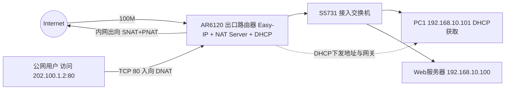

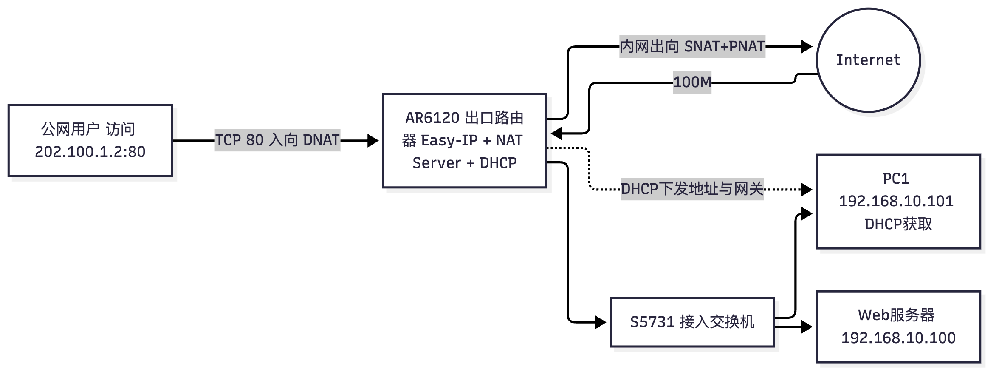


### 真题精练

**Q21.【真题·单选】** 在华为路由器上配置 Easy-IP，下列命令正确的是？
A. `nat address-group 1` + `nat outbound 2000 address-group 1`
B. `nat outbound 2000`（接口视图下）
C. `nat server 2000`
D. `nat-policy` + `action source-nat address-group 1`

> **答案：B**
> **解析**：Easy-IP 的特点是**直接复用出接口的公网地址**，因此只需在出接口下配置 `nat outbound <ACL号>`，**不需要配置地址池**。A 是"使用地址池的 NAPT"（非 Easy-IP，需要额外公网地址）；C 语法不存在；D 是**防火墙 USG** 的语法，不是路由器 AR 的语法。两类设备的 NAT 配置差异是高频考点。

**Q22.【真题·多选】** 关于 NAT Server 与 Easy-IP，下列说法正确的有？
A. NAT Server 转换的是入方向流量的目的地址与端口（DNAT）
B. Easy-IP 转换的是出方向流量的源地址与端口（SNAT/PAT）
C. 一个公网 IP 只能配置一条 NAT Server 规则
D. NAT Server 常与安全策略配合放通对应服务

> **答案：ABD**
> **解析**：C 错误。同一个公网 IP 可以配置**多条 NAT Server 规则**，只要**公网端口不同**即可（如 80 映射内网 Web1、8080 映射内网 Web2、3389 映射内网某主机）。这称为"端口级映射"或 PAT 式服务器发布。A、B、D 均正确，其中 D 强调了路由器需 ACL/防火墙需 security-policy 放通，否则 NAT 转换成功但流量仍被丢弃。

**Q23.【真题·填空】** Easy-IP 的本质是 ______（填 NAT 类型），它使用 ______ 作为转换后的公网地址；把内网服务器发布到公网使用 ______ 功能。

> **答案：NAPT（网络地址端口转换 / PAT）；出接口的公网地址；NAT Server（目的 NAT / DNAT）**
> **解析**：NAPT 通过"IP + 端口"的组合，让成千上万的内网会话共享一个公网地址（最多约 65535 × N 个会话，N 为可用端口范围系数）。NAT Server 是入方向的 DNAT，把公网 IP:端口 映射为内网 IP:端口。

**Q24.【真题·排错】** 某企业已配置 DHCP、Easy-IP 与 NAT Server，内网用户可正常上网，但公网用户访问 Web 服务器时显示 502 错误，而内网用户直接访问服务器 IP 正常。请分析。

> **答案与解析**：
> 1. **确定故障位置**：内网直接访问正常 → Web 服务器本身与应用正常；公网访问 502 → 问题在"公网 → 出口设备 → 服务器"这一段链路或映射。
> 2. **检查 NAT Server 配置**：`display nat server` 确认公网 IP、公网端口、内网 IP、内网端口四项是否正确；常见错误是内网端口写错（如服务器实际监听 8080，规则写了 80）。
> 3. **检查 ACL 与安全策略**：路由器上若公网接口应用了入方向 ACL，需放通 80/443；防火墙上需 `security-policy` 放通 untrust → trust 的 http/https 服务。
> 4. **检查回程路由**：Web 服务器的**默认网关必须指向出口设备内网接口**。若服务器网关配错（如指向了另一台设备），TCP SYN 能通过 NAT 到达服务器，但 SYN-ACK 回程不经过出口设备，**NAT 会话无法匹配**，表现为连接超时或异常。**这是 NAT Server 最常见的故障原因。**
> 5. **检查会话表**：`display nat session all` 观察是否有对应会话；`display firewall session table`（防火墙）查看入向会话是否建立。
> 6. **检查运营商侧**：确认公网 IP 已在运营商处正确路由，80/443 未被运营商封禁（国内部分线路需备案）。
> 7. **抓包**：在公网接口与内网接口分别抓包，对比入向与回向报文是否成对，定位是转换失败还是回程丢失。

### 易错点与排错

1. **路由器与防火墙的 NAT 语法完全不同**：路由器用 `nat outbound` / `nat server`，防火墙用 `nat-policy` + `source-nat` / `destination-nat`，考试中写错语法直接不得分。
2. **NAT Server 后必须放通安全策略/ACL**，否则转换成功但被丢弃。
3. **服务器的默认网关必须指向做 NAT 的设备**，否则回程不通。
4. **Easy-IP 只能用于出方向**（内网主动访问外网），被动访问需 NAT Server。
5. 排错命令：`display nat session all`、`display nat outbound`、`display nat server`、`display firewall session table`、`display security-policy rule all`、`display ip pool`。

---

# 数通-HCIA-章节9-ACL与NAT技术

## 9.1 ACL 分类与匹配规则（含"默认放行还是拒绝"陷阱）

### 考点定位

ACL 是**全卷出现频率最高的技术点**（**8~12 分**）。考法：判断某 ACL 编号属于哪一类、能匹配哪些字段；给出若干条规则判断某报文是否被放通（**必须按配置顺序逐条匹配**）；判断题考"华为 ACL 末尾默认是 deny"。**最高频陷阱**：把华为 ACL 的隐含规则记成 Cisco 的 `permit any`。

### 原理精讲

**ACL（Access Control List，访问控制列表）** 是一组**有序的规则（Rule）** 集合，每条规则由"**匹配条件（匹配项）** + **动作（permit/deny）**"组成，用于对报文进行分类，进而实现过滤、NAT、路由策略、QoS 等功能。

**ACL 的分类与能匹配的字段（必背表格）**：

| 类型 | 编号范围 | 能匹配的字段 | 典型用途 |
|---|---|---|---|
| **基本 ACL（Basic）** | **2000 ~ 2999** | **仅源 IP 地址**（及分片标记、时间段） | 简单源地址过滤、Telnet 登录限制、NAT 出方向源地址匹配 |
| **高级 ACL（Advanced）** | **3000 ~ 3999** | 源 IP、目的 IP、**协议号**（TCP/UDP/ICMP 等）、源/目的端口、TCP 标志（如 established）、ICMP 类型、IP 优先级、ToS、分片 | 精细流量过滤、NAT Server 相关、安全策略 |
| **二层 ACL（Layer 2）** | **4000 ~ 4999** | 源/目的 MAC 地址、**以太网类型（EtherType）**、VLAN ID 等二层信息 | 二层报文过滤 |
| **用户自定义 ACL** | **5000 ~ 5999** | 可用 `rule` 中的 `protocol` 与自定义字段组合（支持匹配 IPv4/IPv6 报文的特定字节），灵活性最高 | 高级过滤、协议扩展 |
| **用户 ACL（User ACL）** | **6000 ~ 6999** | 源 IP、目的 IP、协议、端口 等（用于配合用户组/用户等级） | 与 AAA 用户绑定的访问控制 |
| **用户自定义（User-defined）** | 5000 ~ 5999（同上） | — | — |

> **补充**：华为还有**命名 ACL**（`acl name <name> [basic|advanced]`），功能与编号 ACL 相同，只是便于识别；以及 **ACL6**（`acl ipv6 number 2000-3999`）用于 IPv6。

**ACL 匹配的核心规则**：

1. **按配置顺序（Rule ID 从小到大）逐条匹配**，一旦匹配某条规则就执行其动作（permit/deny）并**立即停止**，不再继续向下匹配。**顺序决定结果，这是 ACL 最重要的特性。**
2. 若所有规则都不匹配，则执行**隐含的最后一条规则**。**华为 VRP 的隐含规则是 `deny`（拒绝）**——即"未明确放通的一律拒绝"。
3. **Rule ID 自动递增**：华为 ACL 中若不指定 rule 编号，默认**以 5 为步长递增**（rule 5、10、15…），便于后续在中间插入规则。也可手工指定（如 `rule 1`、`rule 3`）。
4. **ACL 本身不产生作用**，必须被其他业务**引用**（接口下的 `traffic-filter`、`nat outbound`、`user-interface` 下的 `acl inbound`、路由策略的 `if-match` 等）才生效。
5. **ACL 与接口方向结合**：`traffic-filter inbound` 在**入方向**过滤（先过滤再查路由，节省资源）；`traffic-filter outbound` 在**出方向**过滤（先查路由再过滤）。

> **华为 vs Cisco 的 ACL 差异（高频对比题）**：Cisco 标准/扩展 ACL 末尾隐含 **`deny any`**，与华为一致；但 Cisco 的 `access-list` 是**自上而下顺序**，而华为支持**规则编号插入**。最大的区别在于**编号范围与匹配能力**：华为基本 ACL 只能匹配源 IP，Cisco 标准 ACL 也只能匹配源 IP，但**编号范围**完全不同（华为 2000-2999，Cisco 1-99/1300-1999）。考试时务必看清题目问的是华为还是思科设备。

**通配符掩码（Wildcard Mask）**：华为 ACL 中用**通配符掩码**而非子网掩码来表示"匹配多少位"。

> **通配符规则：0 = 必须匹配（精确比较），1 = 忽略（任意值）。** 它与子网掩码**逐位相反**，因此
> **通配符掩码 = 255.255.255.255 − 子网掩码**（即子网掩码按位取反）。

| 子网掩码 | 二进制反码过程 | 通配符掩码 | 含义 |
|---|---|---|---|
| 255.255.255.255（/32） | 全 0 | **0.0.0.0** | 精确匹配单个 IP |
| 255.255.255.254（/31） | 末位 1 | **0.0.0.1** | 匹配 2 个地址 |
| 255.255.255.252（/30） | 末段 3 | **0.0.0.3** | 匹配 4 个地址 |
| 255.255.255.248（/29） | 末段 7 | **0.0.0.7** | 匹配 8 个地址 |
| 255.255.255.240（/28） | 末段 15 | **0.0.0.15** | 匹配 16 个地址 |
| 255.255.255.224（/27） | 末段 31 | **0.0.0.31** | 匹配 32 个地址 |
| 255.255.255.192（/26） | 末段 63 | **0.0.0.63** | 匹配 64 个地址 |
| 255.255.255.128（/25） | 末段 127 | **0.0.0.127** | 匹配 128 个地址 |
| 255.255.255.0（/24） | 末段 255 | **0.0.0.255** | 匹配整个 /24 |
| 255.255.254.0（/23） | 第 3 段 1、第 4 段 255 | **0.0.1.255** | 匹配两个 /24 |
| 255.255.252.0（/22） | 第 3 段 3、第 4 段 255 | **0.0.3.255** | 匹配四个 /24 |
| 255.255.248.0（/21） | 第 3 段 7 | **0.0.7.255** | 匹配八个 /24 |
| 255.255.240.0（/20） | 第 3 段 15 | **0.0.15.255** | 匹配十六个 /24 |
| 255.255.0.0（/16） | 后两段全 255 | **0.0.255.255** | 匹配整个 /16 |
| 0.0.0.0（/0） | 全 1 | **255.255.255.255** | 匹配所有地址（any） |

**华为 ACL 中 `any` 的等价写法**：`source any` ≡ `source 0.0.0.0 255.255.255.255`；`source host 1.1.1.1` ≡ `source 1.1.1.1 0.0.0.0`。

### 关键概念对照表

| 判定项 | 华为 ACL 行为 |
|---|---|
| 匹配顺序 | 按 rule ID 从小到大，命中即停 |
| 默认 rule 步长 | **5**（rule 5、10、15…） |
| 末尾隐含规则 | **deny（拒绝所有）** |
| 是否需要被引用才生效 | **需要**（traffic-filter / nat outbound / acl inbound / if-match 等） |
| 入方向过滤时机 | 收到报文后、查路由前 |
| 出方向过滤时机 | 查路由后、发出前 |
| 修改规则后是否需要重新引用 | 通常不需要（动态生效），删除 ACL 前需先取消引用 |

### 华为设备配置

```bash
# 基本 ACL：只允许 192.168.10.0/24 与 10.1.1.1 单机访问，其余拒绝
system-view
acl number 2000                                          # 创建基本ACL 2000
 rule 5 permit source 192.168.10.0 0.0.0.255              # 允许整个/24网段（通配符0.0.0.255）
 rule 10 permit source 10.1.1.1 0.0.0.0                   # 允许单个主机（等价于 source host 10.1.1.1）
 rule 15 deny                                             # 显式拒绝其余所有（与隐含规则一致，写出来便于阅读）
 quit
display acl 2000                                         # 查看ACL内容与规则匹配计数
```

```bash
# 高级 ACL：精细控制（协议、源、目的、端口）
system-view
acl number 3000
 rule 5 permit tcp source 192.168.10.0 0.0.0.255 destination 10.1.1.100 0.0.0.0 destination-port eq 80    # 允许内网访问Web服务器80端口
 rule 10 permit tcp source 192.168.10.0 0.0.0.255 destination 10.1.1.100 0.0.0.0 destination-port eq 443   # 允许HTTPS
 rule 15 permit icmp source 192.168.10.0 0.0.0.255 destination 10.1.1.100 0.0.0.0 icmp-type echo           # 允许ping测试（echo请求）
 rule 20 deny ip source 192.168.10.0 0.0.0.255 destination 10.1.1.0 0.0.0.255                             # 拒绝访问整个服务器网段的其他流量
 quit
display acl 3000
```

```bash
# 在接口上应用 ACL（入方向过滤）
system-view
interface GigabitEthernet0/0/0
 traffic-filter inbound acl 3000                         # 入方向应用高级ACL 3000，流量先过滤后查路由
 quit
interface GigabitEthernet0/0/1
 traffic-filter outbound acl 3000                        # 出方向应用：先查路由后过滤，效率略低但可过滤转发出流量
 quit
display traffic-filter applied-record                    # 查看ACL在接口的应用记录
display traffic-filter statistics interface GigabitEthernet0/0/0 inbound   # 查看匹配统计（可用于验证规则是否命中）
```

```bash
# 用 ACL 限制 Telnet 登录来源（VTY 下引用）
system-view
user-interface vty 0 4
 acl 2000 inbound                                        # 只允许ACL 2000匹配的源地址登录设备
 authentication-mode aaa
quit
```

### 示意图

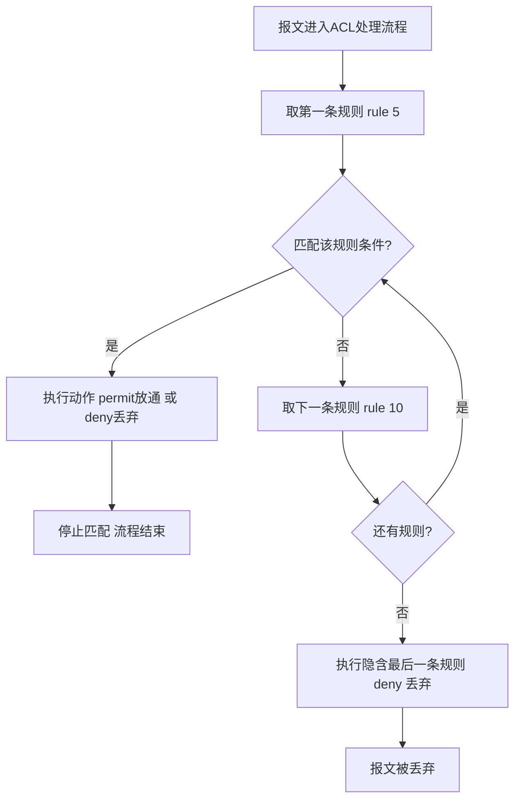

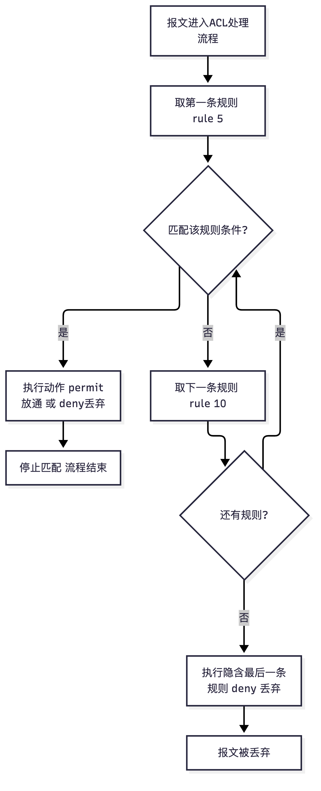


### 真题精练

**Q25.【真题·单选】** 华为设备上创建基本 ACL 的编号范围是？
A. 1 ~ 99  B. 100 ~ 199  C. 2000 ~ 2999  D. 3000 ~ 3999

> **答案：C**
> **解析**：华为 ACL 编号规范：基本 ACL **2000~2999**、高级 ACL **3000~3999**、二层 ACL **4000~4999**、用户自定义 **5000~5999**、用户 ACL **6000~6999**。A/B 是 Cisco 标准/扩展 ACL 的编号范围，是常见干扰项。基本 ACL 只能匹配**源 IP**，高级 ACL 可匹配源/目的 IP、协议、端口等。

**Q26.【真题·单选】** 某 ACL 2000 中配置了 `rule 5 permit source 10.1.1.0 0.0.0.255` 和 `rule 10 deny source 10.1.1.5 0.0.0.0` 两条规则。源地址为 10.1.1.5 的报文将被如何处理？
A. permit（放通）  B. deny（拒绝）  C. 由隐含规则决定  D. 两条规则同时生效导致冲突

> **答案：A**
> **解析**：ACL 按 **rule ID 从小到大顺序匹配，命中即停**。源地址 10.1.1.5 同时满足 rule 5（属于 10.1.1.0/24）和 rule 10，但 rule 5 编号更小、先被匹配，因此执行 **permit** 并立即停止，rule 10 永远不会被匹配到。**配置 ACL 时必须把精细的特殊规则放在前面、宽泛的规则放在后面**，否则特殊规则永远失效——这是 ACL 最经典的陷阱题。

**Q27.【真题·判断】** 华为设备的 ACL 在所有规则都不匹配时，默认放通报文。

> **答案：错误**
> **解析**：华为 VRP 的 ACL **末尾隐含一条 `deny` 规则**，即"未明确允许的一律拒绝"（白名单模型）。因此若 ACL 中只写了 `rule 5 permit source 10.1.1.0 0.0.0.255`，那么其他所有源地址都会被拒绝。这一点与 Cisco ACL 的 `deny any` 隐含规则行为一致，但考生常因"以为和某些设备的 permit any 默认一致"而失分。**注意**：ACL 本身必须有至少一条 permit 规则，否则引用后会把所有流量都拒掉（实验中常见的"配了 ACL 就全断网"）。

**Q28.【真题·多选】** 关于 ACL 在接口上的应用，下列说法正确的有？
A. `traffic-filter inbound` 在报文进入接口时、查路由之前进行过滤
B. `traffic-filter outbound` 在查路由之后、报文发出之前过滤
C. ACL 配置后即自动生效，无需被引用
D. 同一接口同一方向只能应用一个 ACL

> **答案：ABD**
> **解析**：C 错误。ACL 只是"规则集合"，**必须被引用**（`traffic-filter`、`nat outbound`、`acl inbound`、路由策略 `if-match` 等）才产生作用。A、B 正确，入方向过滤更节省资源（被拒绝的报文不占用后续查表开销）。D 正确，华为接口同一方向只能应用一个 ACL（如需多条逻辑可合并到一个 ACL 或用流策略 `traffic policy`）。

**Q29.【真题·简答】** 说明"入方向过滤"与"出方向过滤"的区别，并说明为什么推荐优先使用入方向过滤。

> **答案**：
> 1. **处理时机不同**：入方向（inbound）是在接口**收到报文后、查路由表之前**进行 ACL 匹配；出方向（outbound）是在**查完路由表、确定出接口之后、发送报文之前**进行匹配。
> 2. **资源消耗不同**：入方向过滤可以让被拒绝的报文**尽早丢弃**，节省后续的路由查找、NAT 转换、队列调度等开销；出方向过滤则已经消耗了查表资源才发现要丢弃，效率较低。
> 3. **影响范围不同**：入方向 ACL 只影响"从该接口进入的流量"，范围清晰；出方向 ACL 会影响"所有经该接口发出的流量"，包括本机产生的流量，容易误伤（如把设备自身的路由协议报文也过滤掉）。
> 4. **结论**：**过滤"进入我的流量"用入方向**（典型：公网口入方向禁止访问内网管理面），**过滤"我发出的流量"用出方向**（典型：内网口出方向限制只能访问特定服务）。工程上优先考虑入方向，但两者常常配合使用。

**Q30.【真题·实验·通配符计算专项】** 请写出下列匹配需求的 ACL 源地址（或目的地址）配置（使用通配符掩码），并说明通配符与子网掩码的换算过程。

1. 匹配 192.168.1.0/24 整个网段
2. 只匹配主机 192.168.1.100
3. 匹配 192.168.0.0 ~ 192.168.7.255
4. 匹配 10.1.1.0/26 网段
5. 匹配 172.16.0.0 ~ 172.16.31.255
6. 匹配所有地址（any）
7. 匹配 192.168.1.0 ~ 192.168.1.15
8. 匹配 10.10.0.0/22 网段
9. 匹配 192.168.1.1 与 192.168.1.3 两个地址（要求只匹配这两个）
10. 匹配 172.16.8.0 ~ 172.16.15.255

> **答案与逐步演算**：
>
> **换算通法**：通配符掩码 = 255.255.255.255 − 子网掩码（逐位取反）。**0 表示必须匹配，1 表示忽略**。
>
> | 序号 | 需求 | 子网掩码 | 换算过程 | 通配符掩码 | 完整配置示例 |
> |---|---|---|---|---|---|
> | 1 | 192.168.1.0/24 | 255.255.255.0 | 末段 255−0 = 255 | **0.0.0.255** | `rule 5 permit source 192.168.1.0 0.0.0.255` |
> | 2 | 单个主机 192.168.1.100 | 255.255.255.255（/32） | 全 0 | **0.0.0.0** | `rule 5 permit source 192.168.1.100 0.0.0.0` |
> | 3 | 192.168.0.0~192.168.7.255（8 个 /24） | 255.255.248.0（/21） | 第 3 段 255−248 = 7，末段 255−0 = 255 | **0.0.7.255** | `rule 5 permit source 192.168.0.0 0.0.7.255` |
> | 4 | 10.1.1.0/26 | 255.255.255.192 | 末段 255−192 = 63 | **0.0.0.63** | `rule 5 permit source 10.1.1.0 0.0.0.63` |
> | 5 | 172.16.0.0~172.16.31.255（32 个 /24） | 255.255.224.0（/19） | 第 3 段 255−224 = 31 | **0.0.31.255** | `rule 5 permit source 172.16.0.0 0.0.31.255` |
> | 6 | 所有地址（any） | 0.0.0.0（/0） | 全 1 | **255.255.255.255** | `rule 5 permit source any`（等价 `source 0.0.0.0 255.255.255.255`） |
> | 7 | 192.168.1.0~192.168.1.15（16 个地址） | 255.255.255.240（/28） | 末段 255−240 = 15 | **0.0.0.15** | `rule 5 permit source 192.168.1.0 0.0.0.15` |
> | 8 | 10.10.0.0/22 | 255.255.252.0 | 第 3 段 255−252 = 3，末段 255 | **0.0.3.255** | `rule 5 permit source 10.10.0.0 0.0.3.255` |
> | 9 | 只匹配 192.168.1.1 与 192.168.1.3 | 无法用单条规则精确表达 | 1 = `...00000001`、3 = `...00000011`，共同位为 `192.168.1.0/31` 但与第 3 位不同 | **0.0.0.2**（匹配 .0 与 .2，即匹配所有"偶数"地址） | 需要**两条规则**：`rule 5 permit source 192.168.1.1 0.0.0.0` + `rule 10 permit source 192.168.1.3 0.0.0.0`；若用 `0.0.0.2` 会**顺带匹配 .0 和 .2**，并不精确 |
> | 10 | 172.16.8.0~172.16.15.255（8 个 /24） | 255.255.248.0（/21） | 第 3 段 255−248 = 7 | **0.0.7.255** | `rule 5 permit source 172.16.8.0 0.0.7.255`；**注意**：起始 8 是块大小 8 的整数倍，故该 /21 精确覆盖 8~15，无空洞 |
>
> **第 9 题的关键结论**：**通配符掩码匹配的是"位模式"，不是"任意地址集合"**。`0.0.0.2` 表示"忽略第 2 位（值为 2 的那一位）"，因此匹配所有**第 2 位为 0 的地址**（偶数：0、2、4、6…），而不是"1 和 3"。凡是不构成"固定位 + 任意位"结构的地址集合，都必须拆成多条规则。这是通配符掩码最容易出错的地方，也是华为大赛计算题的常见考法。

**Q31.【真题·填空】** 通配符掩码与子网掩码的关系是 ______；华为 ACL 的默认规则步长为 ______；ACL 中"0"表示 ______，"1"表示 ______。

> **答案：通配符掩码 = 255.255.255.255 − 子网掩码（逐位取反）；5；该位必须精确匹配；该位可以是任意值（忽略）**
> **解析**：例如子网掩码 255.255.255.224（/27）→ 通配符 0.0.0.31。默认 rule 步长 5 的设计目的是方便插队：若已配 rule 5 和 rule 10，可在中间加 rule 7 而无需重排全部规则。

### 易错点与排错

1. **顺序决定结果**：特殊规则（小范围、精确 IP）必须放在前面，宽泛规则（整个网段、any）放后面。
2. **末尾隐含 deny**：只写 permit 规则时会拒绝其他所有流量；若需要"只拒绝某几个、其余放通"，必须显式写出最后一条 `permit`。
3. **通配符 ≠ 子网掩码**：把 `source 192.168.1.0 255.255.255.0` 写进 ACL 是常见错误（应该写 `0.0.0.255`）。
4. **ACL 必须被引用才生效**，且引用方向/位置决定作用范围。
5. 排错命令：`display acl all`、`display acl 3000`（看匹配计数）、`display traffic-filter applied-record`、`display traffic-filter statistics interface X inbound`、`reset acl counter all`（清空计数后重新观察）。

---

## 9.2 NAT 分类、原理与地址池/PAT

### 考点定位

**8~12 分**，实验题必考。常考 NAT 五类（静态、动态、NAPT/Easy-IP、NAT Server、双向 NAT）的特征对比、NAT 表项（会话表）字段解读、以及"哪种 NAT 适用于什么场景"。

### 原理精讲

**NAT（Network Address Translation，网络地址转换）** 的动机有两方面：① **缓解 IPv4 地址枯竭**（多个私网地址共享少量公网地址）；② **隐藏内网结构**（安全收益）。NAT 设备（路由器或防火墙）在转发报文时改写 IP 头（必要时也改写 TCP/UDP 头中的端口），并**维护转换表**以保证回程报文能被正确还原。

**NAT 分类与特征**：

| 类型 | 转换内容 | 方向 | 公网地址需求 | 典型场景 |
|---|---|---|---|---|
| **静态 NAT（Static NAT）** | 一个私网 IP ↔ 一个公网 IP（一对一，固定） | 双向 | 每个内网地址 1 个公网地址 | 需要固定映射的服务器（现多用 NAT Server 替代） |
| **动态 NAT（Dynamic NAT）** | 从地址池中动态取一个公网 IP，一对一绑定 | 出方向为主 | 需公网地址池 | 需固定公网 IP 但用户数不多的场景 |
| **NAPT / PAT / Easy-IP** | 私网 IP:端口 → 公网 IP:端口（多对一） | 出方向 | **仅需 1 个公网地址**（Easy-IP 用接口地址） | 企业用户上网（最常见） |
| **NAT Server** | 公网 IP:端口 → 私网 IP:端口（目的转换 DNAT） | 入方向 | 1 个公网 IP 可映射多台服务器（不同端口） | 对外发布 Web/FTP/邮件服务器 |
| **目的 NAT（Destination NAT）** | 改写目的地址 | 入方向 | 同上 | NAT Server 的本质；也可用于内网用户访问内网服务器的"发夹"场景 |
| **双向 NAT（Bidirectional NAT）** | 同时改写源与目的 | 双向 | — | 两个内网地址重叠的场景（如并购后地址冲突），或内外网都要转换 |
| **两次 NAT（Twice NAT）** | 一条流量上先后做两次转换（如源 NAT + 目的 NAT） | — | — | 复杂场景，如既转换源又转换目的 |
| **NAT ALG** | 应用层网关：改写应用层载荷中的 IP/端口 | — | — | FTP（PORT/PASV 携带 IP+端口）、SIP、H.323、PPTP 等 |

> **为什么需要 NAT ALG？** 因为 FTP 的 PORT/PASV 命令会把"数据连接的地址与端口"写在**应用层载荷**中，NAT 只改 IP 头与 TCP 头，载荷中的地址不会被改写，导致数据连接建立失败。NAT ALG 会**深入应用层**识别并同步改写这些字段。华为设备通过 `nat alg ftp enable`（或默认开启）支持，这是"FTP 穿越 NAT 失败"的标准答案。

**NAT 表项（会话表）关键字段**：

| 字段 | 含义 |
|---|---|
| Protocol | 协议类型（TCP/UDP/ICMP 等） |
| Source / Destination | **转换后**的源与目的地址（公网侧视角） |
| Source-port / Destination-port | 转换后的端口 |
| Inside / Outside | 私网侧与公网侧的地址与端口对应关系（如 `192.168.10.101:1024 → 202.100.1.2:1025`） |
| Age / Timeout | 会话老化时间（TCP 默认较长，UDP/ICMP 较短） |
| VPN-Instance | 所属 VPN 实例（多实例场景） |

**PAT（Port Address Translation）的会话数量限制**：单个公网 IP 理论上可承载约 **65535** 个端口，扣除保留端口后实际可用约 6 万个并发会话。企业用户数超过此规模时需使用多个公网地址（地址池 PAT）或 NAT 负载分担。

### 关键概念对照表

| 对比项 | 静态 NAT | 动态 NAT | NAPT / Easy-IP | NAT Server |
|---|---|---|---|---|
| 映射关系 | 一对一（固定） | 一对一（动态） | 多对一（端口区分） | 一对多（端口区分入向） |
| 转换方向 | 双向 | 主要出向 | 出向 | 入向 |
| 是否需要地址池 | 不需要（直接指定） | 需要 | 不需要（Easy-IP）或需要 | 不需要 |
| 公网地址消耗 | 高（1:1） | 高（1:1） | 极低（1:N） | 低（1:N 按端口） |
| 外网可否主动访问内网 | 可以 | 不可以（会话未建立） | 不可以 | 可以（对应端口） |
| 典型用途 | 服务器固定映射 | 少量用户固定公网 IP | 用户上网 | 发布服务器 |

### 华为设备配置

```bash
# 场景一：静态 NAT（一对一固定映射）
system-view
nat static global 202.100.1.10 inside 192.168.10.100     # 公网202.100.1.10 静态映射到内网服务器192.168.10.100
interface GigabitEthernet0/0/1                           # 在出接口（公网侧）生效
 nat static enable                                        # 使能接口静态NAT
quit
display nat static                                       # 查看静态NAT映射
```

```bash
# 场景二：动态 NAT（使用公网地址池，一对一动态分配）
system-view
nat address-group 1 202.100.1.20 202.100.1.30            # 创建地址池1，范围202.100.1.20~30（共11个公网地址）
acl number 2000
 rule 5 permit source 192.168.10.0 0.0.0.255             # 定义需要NAT的内网网段
 rule 10 deny
 quit
interface GigabitEthernet0/0/1
 nat outbound 2000 address-group 1 no-pat                # 使用地址池做动态NAT，no-pat表示只转换IP不转换端口（一对一）
quit
display nat address-group 1                              # 查看地址池使用情况
display nat outbound                                     # 查看出方向NAT引用配置
```

```bash
# 场景三：NAPT / PAT（多对一，用地址池的端口转换，最常用）
system-view
nat address-group 1 202.100.1.20 202.100.1.25            # 地址池6个地址
interface GigabitEthernet0/0/1
 nat outbound 2000 address-group 1                       # 不加no-pat即为PAT：转换IP+端口，多对多复用
quit
display nat session all                                  # 查看会话表，可见多个内网地址映射到相同或不同公网IP的不同端口
```

```bash
# 场景四：Easy-IP（直接使用出接口地址做PAT，最省公网地址）
system-view
interface GigabitEthernet0/0/1
 ip address 202.100.1.2 255.255.255.252
 nat outbound 2000                                       # 不指定地址池，默认使用接口自身地址做PAT（Easy-IP）
quit
display nat outbound
display nat session all
```

### 示意图

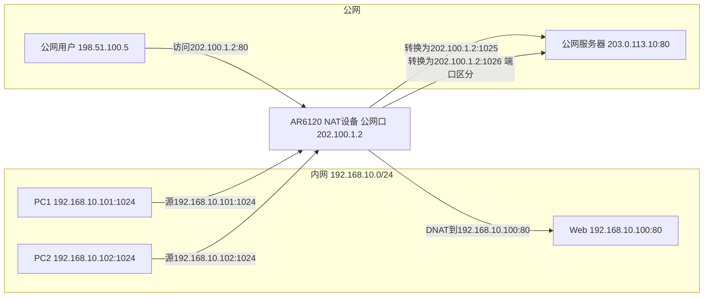

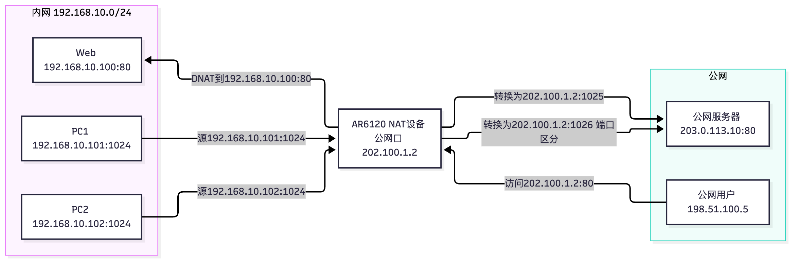


### 真题精练

**Q32.【真题·单选】** 某企业只有一个公网地址，需要让 200 台内网主机同时上网，应使用哪种 NAT？
A. 静态 NAT  B. 动态 NAT（no-pat）  C. NAPT / Easy-IP  D. NAT Server

> **答案：C**
> **解析**：只有一个公网地址且需要多台主机上网，必须使用 **NAPT（网络地址端口转换，即 PAT / Easy-IP）**，通过"IP + 端口"的组合区分不同会话。静态 NAT 与动态 NAT（no-pat）都是一对一映射，200 台主机需要 200 个公网地址；NAT Server 是入方向的服务器发布，不能用于内网用户出访。

**Q33.【真题·多选】** 关于 NAT Server，下列说法正确的有？
A. 转换的是入方向流量的目的地址与端口（DNAT）
B. 一个公网地址可以通过不同端口映射多台内网服务器
C. 使用 NAT Server 时必须同时配置 ACL 才能生效
D. NAT Server 后若服务器回程不经过 NAT 设备会导致连接失败

> **答案：ABD**
> **解析**：C 表述不准确。路由器上的 `nat server` 命令**本身不需要 ACL**（它直接指定公网与内网的映射关系）；但如果公网接口另外应用了入方向 ACL 或设备上有安全策略，则需要放通对应端口。A、B、D 均正确，其中 D 是 NAT Server 最常见的故障原因（服务器网关未指向 NAT 设备，回程绕过导致会话无法匹配）。

**Q34.【真题·填空】** NAPT 的中文全称是 ______，其转换依据是 ______；Easy-IP 的特点是直接使用 ______ 作为转换后的公网地址。

> **答案：网络地址端口转换（Network Address Port Translation）；IP 地址 + 端口号的组合；出接口（公网接口）自身的 IP 地址**
> **解析**：NAPT 又称 PAT（Port Address Translation）。Easy-IP 是 NAPT 的一种最简化形式，无需配置地址池，直接复用接口地址，非常适合只有一个公网地址的中小企业出口。

**Q35.【真题·简答】** 为什么 FTP 协议穿越 NAT 时需要 ALG（应用层网关）支持？其他常见协议（如 HTTP）为什么不需要？

> **答案**：
> 1. **NAT 的作用范围**：标准 NAT 只改写 **IP 头**（源/目的 IP）与**传输层头**（TCP/UDP 端口），不解析应用层载荷。
> 2. **FTP 的特殊性**：FTP 使用**双连接**，数据连接的地址与端口不是固定的，而是在控制连接中通过应用层命令协商：主动模式用 `PORT` 命令告知服务器"请连我的 IP:端口"，被动模式用 `PASV` 命令由服务器返回"请连我的 IP:端口"。**这些 IP 与端口写在应用层载荷里**。
> 3. **问题**：若 NAT 设备内网侧主机发出 `PORT 192.168.10.101,8,1`，NAT 只把 IP 头的源地址改成公网地址，载荷中的 192.168.10.101 保持不变；服务器收到后尝试连接这个私网地址，必然失败。因此需要 **NAT ALG** 深入应用层识别 PORT/PASV 字段并同步改写。
> 4. **HTTP 不需要的原因**：HTTP 的通信只用一个连接（TCP 80），请求报文中不含"请连接某个 IP:端口"的信息，NAT 只需改写 IP 与端口头即可，回程由会话表自动匹配，无需 ALG。
> 5. **同类需要 ALG 的协议**：SIP、H.323、RTSP、PPTP 等（都在载荷中携带地址信息）。配置上可用 `nat alg ftp enable` 等服务使能。

**Q36.【真题·排错】** 内网用户访问公网网站正常，但从公网无法访问已发布的内网 Web 服务器；`display nat session all` 显示入向会话能建立但随后超时。请给出排查思路。

> **答案与解析**：
> 1. **确认 NAT Server 映射正确**：`display nat server` 核对公网 IP/端口与内网 IP/端口是否与实际一致（尤其内网服务端口，如 Nginx 监听 8080 而映射写成 80）。
> 2. **确认服务器网关**：Web 服务器的默认网关**必须指向 NAT 设备的内网接口地址**。若指向其他设备（如核心交换机），回程报文不经过 NAT 设备，出方向的 SYN-ACK 无法被转换，表现为"会话建立后超时"。**这是本题最可能的原因。**
> 3. **确认内网路由**：NAT 设备必须有到 Web 服务器网段的路由（直连或静态），且服务器网段不能被聚合路由指向 NULL0 或被黑洞路由覆盖。
> 4. **确认 ACL 与安全策略**：公网接口入方向若应用了 `traffic-filter inbound`，需放通 80/443；防火墙上需 `security-policy` 放通 untrust → trust 的 http/https。
> 5. **确认服务器自身**：服务器防火墙/iptables 是否放通；服务是否监听 0.0.0.0 而非仅 127.0.0.1。
> 6. **抓包验证**：在 NAT 设备的公网口（`display interface` 计数 + 镜像抓包）与内网口同时抓包，观察 SYN 是否入向转换、SYN-ACK 是否回向转换，快速定位断点。
> 7. **命令速查**：`display nat server`、`display nat session all`、`display firewall session table`（防火墙）、`display ip routing-table`。

### 易错点与排错

1. **`no-pat` 关键字决定是否做端口转换**：写 `no-pat` 是一对一动态 NAT，不写才是 PAT。实验题中要求"多对一"时务必不加 `no-pat`。
2. **地址池地址必须与出接口在同网段或已被运营商正确路由**，否则转换后的地址无法被公网回程。
3. **NAT Server 的服务器网关问题**是最常见故障原因。
4. **ALG 不是万能的**：加密协议（如 IPsec ESP）载荷加密后 ALG 无法解析，需用 NAT-T 穿透方案。
5. 排错命令：`display nat session all`、`display nat server`、`display nat address-group 1`、`display nat outbound`。

---

## 9.3 路由器与防火墙 NAT 配置方式差异（AR vs USG）

### 考点定位

省赛/国赛的**分水岭考点**（**6~10 分**）：题目往往给出 USG6000E 防火墙做出口，考生若按路由器的 `nat outbound` 语法写，直接全错。必须掌握两套语法体系。

### 原理精讲

**华为 AR 系列路由器（VRP）** 的 NAT 是**接口级命令**：`nat outbound` / `nat server` / `nat static` 配置在**接口视图**下，通过 ACL 或地址池指定转换对象，控制平面是"接口 + ACL"模型。

**华为 HiSecEngine USG6000E 防火墙** 的 NAT 是**策略级命令**：需要在 **`nat-policy` 视图**中定义规则（rule），规则中通过 **源/目的安全区域（zone）、源/目的地址、服务（端口）** 匹配流量，再指定 `action source-nat`（源 NAT）或 `action destination-nat`（目的 NAT）。此外还必须配套 **`security-policy`** 放通流量——**NAT 与安全策略是两道独立的关口，两者都要配置正确**。

> **为什么防火墙要用"策略 + 区域"模型？** 因为防火墙的核心是**基于区域的安全策略**：它需要先判断流量是"从哪个区域到哪个区域"（如 trust → untrust），再按策略决定放通/阻断，NAT 只是其中的一个动作维度。这种模型表达能力更强（可精确到用户、应用、时间），也是防火墙与路由器功能定位不同的体现。**关键结论：防火墙上 NAT 策略生效的前提是安全策略已放通，否则 NAT 转换可能发生但流量被丢弃。**

**两套语法对照（必背）**：

| 需求 | AR 路由器（VRP） | USG6000E 防火墙 |
|---|---|---|
| 源 NAT（Easy-IP） | 接口视图 `nat outbound <ACL>` | `nat-policy` → `rule` → `action source-nat easy-ip` |
| 源 NAT（用地址池） | `nat address-group 1 x.x.x.x y.y.y.y` + 接口 `nat outbound <ACL> address-group 1` | `nat address-group 1` + `nat-policy` → `action source-nat address-group 1` |
| 目的 NAT（发布服务器） | 接口视图 `nat server protocol tcp global <公网IP> <公网端口> inside <私网IP> <私网端口>` | `nat-policy` → `action destination-nat static port ...`（或 `nat server` 命令，不同版本支持不同） |
| 静态 NAT | 接口 `nat static global x inside y` + `nat static enable` | `nat-policy` 或 `nat static` 命令（按版本） |
| 放通流量 | 接口 `traffic-filter inbound acl X` 或用 ACL | **必须配置 `security-policy`** |
| 区域概念 | 无 | `firewall zone trust/untrust/dmz` + `add interface` |

**NAT 与安全策略的配合顺序（防火墙上）**：

1. 报文进入防火墙，先按**入接口所属安全区域**与**安全策略**匹配，决定是否放通（**先安全策略，后 NAT**）。
2. 若放通，再按 **NAT 策略** 做地址/端口转换。
3. 转换后查路由并转发。
4. 回程报文按会话表反向还原。

> **注意**：部分版本防火墙的 NAT 策略与安全策略匹配顺序存在细节差异，但工程上的安全做法是——**安全策略里匹配的地址用 NAT 前的真实地址（私网地址），不是转换后的公网地址**。这是考试与实际配置中极高频的踩坑点：若在安全策略里写公网地址，策略永远匹配不上。

### 关键概念对照表

| 对比项 | AR 路由器 | USG6000E 防火墙 |
|---|---|---|
| 配置模型 | 接口 + ACL | 安全区域 + nat-policy + security-policy |
| 源 NAT 命令 | `nat outbound` | `nat-policy` + `action source-nat` |
| 是否需要安全策略 | 否（用 ACL 即可） | **是，必须配置** |
| 区域概念 | 无 | 有（trust/untrust/dmz） |
| 接口角色 | 三层接口直接配 IP | 接口需 `add interface` 加入 zone |
| 默认安全策略 | 无（默认放通） | **默认全部拒绝（deny）** |
| 会话表命令 | `display nat session all` | `display firewall session table` |

### 华为设备配置

```bash
# 场景一：AR6120 路由器 —— Easy-IP + NAT Server（集中对比用）
system-view
acl number 2000
 rule 5 permit source 192.168.10.0 0.0.0.255
 rule 10 deny
 quit
interface GigabitEthernet0/0/1
 ip address 202.100.1.2 255.255.255.252
 nat outbound 2000                                        # Easy-IP 源NAT
 nat server protocol tcp global 202.100.1.2 8080 inside 192.168.10.100 80   # 公网8080映射到内网Web的80
quit
display nat outbound
display nat server
display nat session all
```

```bash
# 场景二：USG6520E 防火墙 —— 区域划分 + 安全策略 + NAT 策略（完整流程）
system-view
sysname USG6520E
interface GigabitEthernet1/0/0
 ip address 192.168.10.1 255.255.255.0
quit
interface GigabitEthernet1/0/1
 ip address 202.100.1.2 255.255.255.252
quit
firewall zone trust                                      # 创建/进入trust区域
 add interface GigabitEthernet1/0/0                      # 把内网接口加入trust
quit
firewall zone untrust
 add interface GigabitEthernet1/0/1                      # 把公网接口加入untrust
quit
nat address-group 1                                      # 创建NAT地址组（可选，Easy-IP则不需要）
 mode pat                                                # 配置为PAT模式（端口转换）
 section 0 202.100.1.20 202.100.1.25                      # 指定地址范围
 quit
security-policy
 rule name permit_inside_to_outside                      # 放通内网访问外网
  source-zone trust
  destination-zone untrust
  source-address 192.168.10.0 mask 255.255.255.0         # 注意：用NAT前的真实私网地址
  action permit
 quit
 rule name permit_outside_to_web                         # 放通公网访问内网Web服务器
  source-zone untrust
  destination-zone trust
  destination-address 192.168.10.100 mask 255.255.255.255
  service http
  action permit
 quit
quit
nat-policy
 rule name snat_easyip                                   # 源NAT：Easy-IP
  source-zone trust
  destination-zone untrust
  source-address 192.168.10.0 mask 255.255.255.0
  action source-nat easy-ip
 quit
 rule name dnat_web                                      # 目的NAT：发布Web服务器
  source-zone untrust
  destination-zone trust
  destination-address 202.100.1.2 mask 255.255.255.255   # 公网地址（DNAT匹配的是转换前的目的地址）
  service http
  action destination-nat static address-to-address 192.168.10.100
 quit
quit
display security-policy rule all
display nat-policy rule all
display firewall session table
```

### 示意图

```mermaid
flowchart TD
    A["公网报文到达USG6520E G1/0/1 untrust区域"] --> B["第1步 匹配 security-policy"]
    B --> C{"策略是否放通?"}
    C -->|"否"| D["默认拒绝 丢弃报文 并记录日志"]
    C -->|"是"| E["第2步 匹配 nat-policy 做DNAT转换"]
    E --> F["目的地址转为192.168.10.100"]
    F --> G["查路由表转发到trust侧"]
    G --> H["建立会话表 记录转换关系"]
    H --> I["回程报文按会话表反向还原"]
    I --> J["内网服务器响应返回公网用户"]
```

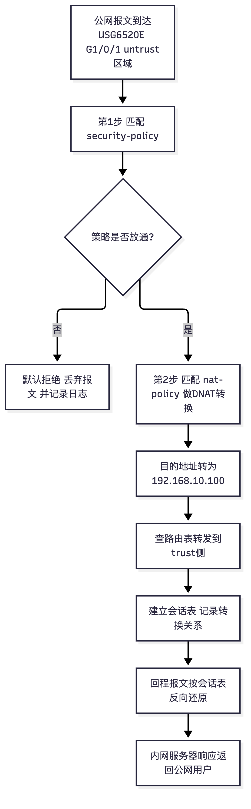


### 真题精练

**Q37.【真题·单选】** 在华为 USG6000E 防火墙上实现内网用户访问外网的源 NAT（Easy-IP），应在哪个视图下配置？
A. 接口视图 `nat outbound`  B. `nat-policy` 视图 + `action source-nat easy-ip`  C. `security-policy` 视图 + `action nat`  D. `firewall zone` 视图

> **答案：B**
> **解析**：防火墙的 NAT 配置在 **`nat-policy`** 视图下，通过 rule 匹配源/目的区域与地址，再指定 `action source-nat easy-ip`。A 是**路由器 AR** 的语法；C 中 `security-policy` 只负责放通/阻断，不做 NAT；D 的 `firewall zone` 视图只用于把接口加入区域。

**Q38.【真题·多选】** 在 USG6000E 上配置 NAT，下列说明正确的有？
A. 接口必须先加入安全区域（`firewall zone` + `add interface`）
B. 安全策略必须放通流量，否则 NAT 转换后仍会被丢弃
C. 安全策略中匹配的地址应使用 NAT 转换前的真实地址
D. 防火墙的默认安全策略是全部放通

> **答案：ABC**
> **解析**：D 错误。USG6000E 的**默认安全策略是全部拒绝（deny）**，这是防火墙"默认安全"设计原则的体现——未明确放通的流量一律阻断（与华为 ACL 末尾隐含 deny 的逻辑一致，但作用层面不同）。A、B、C 都是防火墙配置的关键顺序与要点，其中 C 是最高频踩坑点。

**Q39.【真题·简答】** 对比路由器（AR）与防火墙（USG）的 NAT 配置思路差异，并说明为什么防火墙需要额外的安全策略。

> **答案**：
> 1. **配置模型不同**：AR 路由器是"接口 + ACL"模型——`nat outbound <ACL>` 配置在公网接口下，用 ACL 定义需要转换的流量，一条命令完成匹配与动作。
> 2. **防火墙是"区域 + 双策略"模型**：先通过 `firewall zone` 把接口划入 trust/untrust/dmz 等区域，再用 `security-policy` 决定"区域间流量是否放通"，用 `nat-policy` 决定"是否转换地址"。两个策略独立配置、独立生效。
> 3. **为什么需要安全策略**：防火墙的核心价值是**访问控制**，它必须对每一条跨区域流量做出明确的允许/拒绝决策（默认拒绝）。NAT 只是地址转换动作，与"是否允许该流量通过"是**两个正交的安全问题**：一个流量可以被允许通过但不做 NAT（如内网互访），也可以被 NAT 但最终被拒绝（策略未放通）。把两者分离，才能实现"以安全策略为中心"的精细管控（可按用户、应用、时间、内容过滤）。
> 4. **实践要点**：配置顺序建议为"接口 IP → 加入区域 → 安全策略 → NAT 策略 → 路由"，且安全策略中匹配 **NAT 前的真实地址**；排错时先看 `display security-policy rule all` 再看 `display nat-policy rule all`，最后看 `display firewall session table`。

### 易错点与排错

1. **接口忘记加入区域**：未加入 zone 的接口流量无法被安全策略匹配，表现为"完全不通"。
2. **安全策略用公网地址匹配私网流量**：永远匹配不上。
3. **防火墙默认拒绝所有**：只配了 NAT 没配安全策略 = 完全不通。
4. **路由器与防火墙命令混用**：`nat outbound` 在防火墙上不存在，`nat-policy` 在路由器上也不存在。
5. 排错命令：`display security-policy rule all`、`display nat-policy rule all`、`display firewall session table`、`display zone`（查看区域与接口成员）。

---

## 9.4 ACL + NAT 综合实战：Easy-IP 与 NAT Server 完整配置实例

### 考点定位

**省赛实验题的标准题型**（**10~15 分**）：给出企业拓扑，要求完成"ACL 限制 + Easy-IP 上网 + NAT Server 发布 + 验证"。本节给出可直接照抄的完整配置与验证步骤。

### 原理精讲

真实企业出口配置必须同时满足**功能性**与**安全性**，因此 ACL 与 NAT 从来是配合使用的：

1. **ACL 定义"NAT 的范围"**：`nat outbound` 必须引用 ACL，ACL 决定哪些内网网段可以上网（如只允许办公网段，不允许服务器网段直接出网）。
2. **ACL 定义"访问控制的边界"**：公网接口入方向用 ACL 阻断对设备管理面（23/22/161）的访问，只放通业务端口。
3. **NAT 定义"地址转换策略"**：Easy-IP 解决用户上网，NAT Server 解决服务器发布。
4. **验证必须双向**：内网 → 外网（源 NAT 生效）；外网 → 内网（目的 NAT 生效）；外网 → 设备管理面（被 ACL 拒绝）。

**典型排错顺序（"四查法"）**：查路由（有无去回程路由）→ 查 NAT（映射是否正确、会话是否建立）→ 查 ACL/安全策略（是否被拦）→ 查服务器（自身服务与网关）。

### 关键概念对照表

| 验证目标 | 验证命令 | 期望结果 |
|---|---|---|
| 内网可上网 | 内网 PC `ping 8.8.8.8` 或 `tracert` | 通 |
| 源 NAT 生效 | `display nat session all` | 有内网地址 → 公网地址的会话 |
| 公网可访问 Web | 公网 PC 浏览器访问 `http://202.100.1.2:8080` | 打开页面 |
| 目的 NAT 生效 | `display nat server` | 显示公网↔内网映射 |
| 管理面被保护 | 公网 PC `telnet 202.100.1.2` | 连接失败 |
| ACL 命中情况 | `display acl 3000` | 有 permit/deny 计数 |

### 华为设备配置

```bash
# ===== 完整实例：中小型企业出口（AR6120），内网 192.168.10.0/24 =====
system-view
sysname AR6120-GW

# 第1步：内网 DHCP 服务
dhcp enable
ip pool CORP
 network 192.168.10.0 mask 255.255.255.0
 gateway-list 192.168.10.1
 dns-list 114.114.114.114
 excluded-ip-address 192.168.10.1 192.168.10.50
 lease day 1
 quit

# 第2步：接口地址
interface GigabitEthernet0/0/0                           # 内网接口
 ip address 192.168.10.1 255.255.255.0
 dhcp select global
quit
interface GigabitEthernet0/0/1                           # 公网接口
 ip address 202.100.1.2 255.255.255.252
quit

# 第3步：ACL 2000 定义允许上网的网段（源NAT匹配条件）
acl number 2000
 rule 5 permit source 192.168.10.0 0.0.0.255
 rule 10 deny
 quit

# 第4步：ACL 3000 保护设备管理面（只放通公网访问Web端口）
acl number 3000
 rule 5 permit tcp destination 202.100.1.2 0.0.0.0 destination-port eq 8080   # 放通Web映射端口
 rule 10 deny tcp destination 202.100.1.2 0.0.0.0 destination-port eq telnet  # 拒绝公网Telnet登录设备
 rule 15 deny tcp destination 202.100.1.2 0.0.0.0 destination-port eq 22      # 拒绝公网SSH登录设备
 rule 20 deny udp destination 202.100.1.2 0.0.0.0 destination-port eq snmp    # 拒绝公网SNMP
 rule 25 permit ip                                                            # 放通其他流量（可选，视安全要求）
 quit

# 第5步：在公网接口配置 NAT 与 ACL 应用
interface GigabitEthernet0/0/1
 nat outbound 2000                                       # Easy-IP：匹配ACL 2000的内网流量做NAPT
 nat server protocol tcp global current-interface 8080 inside 192.168.10.100 80  # 用接口地址的8080映射内网Web的80
 traffic-filter inbound acl 3000                          # 入方向应用ACL保护管理面
quit

# 第6步：路由
ip route-static 0.0.0.0 0.0.0.0 202.100.1.1              # 默认路由指向运营商
quit

# 第7步：验证
display nat outbound                                     # 确认Easy-IP配置
display nat server                                       # 确认服务器映射
display acl 3000                                         # 查看ACL规则与匹配计数
display nat session all                                  # 查看转换会话
display ip pool name CORP                                # 查看DHCP分配情况
save
```

### 示意图

```mermaid
flowchart TB
    subgraph Corp["企业内网 192.168.10.0/24"]
        PC["办公PC DHCP获取地址"]
        WEB["Web服务器 192.168.10.100:80"]
    end
    AR["AR6120-GW 公网口 202.100.1.2"]
    subgraph Net["公网"]
        SUF["公网用户"]
        SRV["互联网服务"]
    end
    PC -->|"源192.168.10.x"| AR
    AR -->|"ACL2000匹配 Easy-IP转为202.100.1.2:随机端口"| SRV
    SUF -->|"访问202.100.1.2:8080"| AR
    AR -->|"ACL3000放通8080 NAT Server转192.168.10.100:80"| WEB
    SUF -.->|"尝试Telnet 202.100.1.2 被ACL3000拒绝"| AR
```

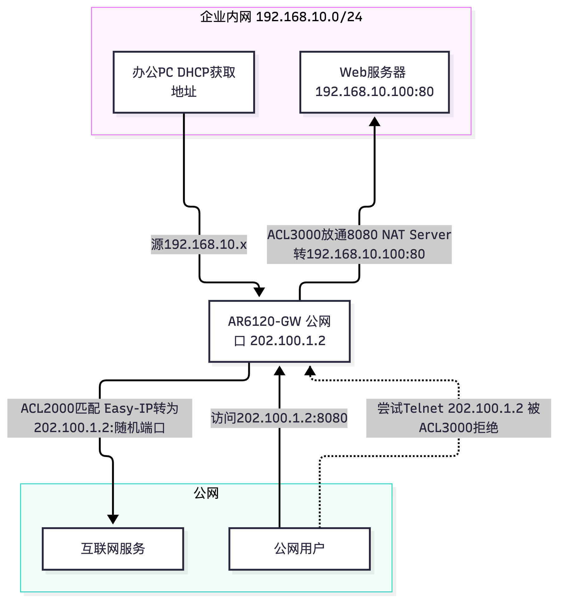


### 真题精练

**Q40.【真题·实验】** 某企业拓扑：AR6120 内网接口 G0/0/0（192.168.10.1/24）连接 S5731 与办公 PC，公网接口 G0/0/1（202.100.1.2/30）连接 Internet，内网有一台 Web 服务器 192.168.10.100。需求：① 内网 PC 通过 DHCP 自动获取地址；② 内网所有 PC 可访问互联网；③ 公网用户可通过 202.100.1.2:8080 访问内网 Web 服务器；④ 禁止公网用户 Telnet/SSH 登录设备。请写出完整配置及验证命令。

> **答案**：见上方"华为设备配置"完整实例（第 1~7 步）。关键点逐条对应：
> - 需求① → `dhcp enable` + `ip pool CORP`（network/gateway-list/dns-list/excluded-ip-address）+ 内网接口 `dhcp select global`。
> - 需求② → `acl number 2000`（permit 192.168.10.0/24）+ 公网接口 `nat outbound 2000`（Easy-IP，无需地址池）。
> - 需求③ → `nat server protocol tcp global current-interface 8080 inside 192.168.10.100 80`（`current-interface` 表示使用接口当前地址，也可直接写 202.100.1.2）。
> - 需求④ → `acl number 3000` 中 `deny tcp ... destination-port eq telnet` 与 `eq 22`，并在公网接口 `traffic-filter inbound acl 3000`。
> - 验证 → `display nat outbound`、`display nat server`、`display acl 3000`、`display nat session all`、`display ip pool name CORP`、`save`。
>
> **易错提醒**：① 别忘了 `dhcp enable`；② `nat server` 的公网端口（8080）与外网访问时使用的端口必须一致；③ ACL 3000 末尾若无 `permit ip`，则除 8080 外的**所有**入向流量都会被拒绝（包括回程的已建立会话流量在某些实现下可能受影响），生产环境需按业务精确规划；④ 服务器网关必须指向 192.168.10.1。

**Q41.【真题·排错】** 承上题，配置完成后发现：内网 PC 能上网，但公网用户访问 `http://202.100.1.2:8080` 时页面无法打开；在 AR6120 上 `display acl 3000` 显示 8080 的规则有匹配计数，`display nat session all` 也能看到入向会话。请给出排查方向。

> **答案与解析**：
> 1. **ACL 已命中、会话已建立**说明报文已到达设备并完成 NAT 转换，问题在"转换后到服务器的这一段"或"回程"。
> 2. **查服务器网关**：Web 服务器默认网关必须是 **192.168.10.1**（AR6120 内网接口）。若服务器网关指向其他设备，回程不经过 NAT 设备，会话无法匹配 → 页面打不开。**这是最可能原因**。
> 3. **查内网路由与二层**：AR6120 到 192.168.10.100 应为直连路由（同网段）或经核心交换机的静态路由；确认 VLAN 与 Trunk 放通、ARP 能解析到服务器 MAC（`display arp | include 192.168.10.100`）。
> 4. **查服务器服务**：Web 服务是否已启动、是否监听 80 端口、服务器本地防火墙是否放通 80；可先在 NAT 设备上 `telnet 192.168.10.100 80` 测试连通性（若设备支持）或在内网 PC 上直接访问 `http://192.168.10.100` 验证。
> 5. **查 NAT Server 的内网端口**：确认 `inside 192.168.10.100 80` 中的 80 与服务器实际监听端口一致（若服务器监听 8080 而映射写 80 则失败）。
> 6. **查 ACL 3000 后续规则**：若规则顺序不当（如先有一条 `deny ip` 在前面），可能 8080 的 permit 命中但某些辅助流量被拒，需核对整体规则顺序。
> 7. **抓包验证**：在 G0/0/0（内网口）抓包确认 DNAT 后的 SYN 是否发出、SYN-ACK 是否返回；若 SYN 发出无 SYN-ACK 则问题在服务器侧，若有 SYN-ACK 但页面仍打不开则检查应用层或 MTU/MSS 问题（可在接口下调 `tcp adjust-mss 1200` 尝试）。

### 易错点与排错

1. **`nat server` 与 `security-policy`/ACL 必须配合**，只配 NAT 常常通不了。
2. **ACL 末尾隐含 deny**：保护管理面的 ACL 若未在最后加 `permit ip`，会顺带拒掉其他所有入向流量，可能影响正常业务与本机回程。
3. **服务器网关指向错误**是 NAT Server 故障的第一原因。
4. **`save` 不要忘**：实验与真机重启后配置丢失（大赛实验环节若未保存可能导致成绩无效）。
5. 排错命令清单：`display nat outbound` / `display nat server` / `display nat session all` / `display acl all` / `display traffic-filter applied-record` / `display ip routing-table` / `display arp`。

---

# 数通-HCIA-章节10-IPv6基础

## 10.1 IPv6 产生背景、地址格式与零压缩规则

### 考点定位

IPv6 是**省赛/国赛的重点增长点**（**10~15 分**）。本节考"地址压缩写法"（必考，属于送分题也易失分）、"地址类型与前缀"、"IPv6 相对 IPv4 的改进"。**最高频陷阱**：零压缩只能压缩**一处最长连续的全零字段**，且 `::` 只能出现一次。

### 原理精讲

**IPv6 的产生背景**：IPv4 地址空间只有 2^32 ≈ 43 亿个，在移动互联网与物联网爆发下早已耗尽（IANA 于 2011 年分配完最后一批 /8）。NAT 与 CIDR 只是缓解手段，却带来了端到端连通性破坏、应用兼容性差、NAT 穿透复杂等问题。**IPv6 的 128 bit 地址空间**（约 3.4×10^38 个地址，可为地球上每粒沙子分配地址）从根本上解决问题，同时在协议设计上做了大量改进。

**IPv6 相对 IPv4 的主要改进**：

| 改进项 | IPv4 | IPv6 |
|---|---|---|
| 地址长度 | 32 bit | **128 bit** |
| 头部长度 | 20~60 B（可变，含选项） | **固定 40 B**（选项移到扩展头） |
| 头部字段数 | 12+ 个 | **8 个**（简化，利于硬件快速转发） |
| 校验和 | 头部有校验和 | **取消头部校验和**（由二层与上层保证，减少处理开销） |
| 分片 | 路由器可分片 | **只在源端分片**（路径 MTU 发现），路由器不分片 |
| 地址配置 | 手工 / DHCP | 支持**无状态自动配置（SLAAC）**，即插即用 |
| 广播 | 有广播 | **取消广播**，用组播与任意播替代 |
| ARP | 有 ARP（基于广播） | 用 **NDP（邻居发现）** 基于 ICMPv6 与组播实现 |
| 安全 | IPsec 可选 | IPsec 原生支持（曾为强制，后改为推荐） |
| NAT | 大量使用 | 设计目标为端到端，**不需要 NAT** |
| QoS | ToS 字段 | **流标签（Flow Label）** 支持流级标识 |
| 头部选项 | 直接放在头部 | **扩展头（Extension Header）** 链式结构 |

**地址格式**：IPv6 地址 **128 bit**，写作 **8 组**、每组 **4 位十六进制**，组间用冒号 `:` 分隔，例如：
`2001:0db8:0000:0000:0000:ff00:0042:8329`

**零压缩规则（必须严格遵守）**：

1. 每组**前导零可以省略**：`0db8` → `db8`，`0042` → `42`，`0000` → `0`。
2. **连续的多个全零组**可以用 **`::`（双冒号）** 替代，**但 `::` 在整个地址中只能出现一次**（否则无法判断每组零的数量，产生歧义）。
3. 压缩时**必须选择最长的一段连续零组**；若有多段长度相同的连续零组，压缩**最靠前**的那一段（RFC 5952 推荐做法）。
4. 单独一组全零**不能用 `::` 压缩**（因为 `::` 至少代表一组，且会导致歧义），应写成 `0`。

**示例逐步演算**（必练）：

| 完整写法 | 压缩步骤 | 压缩结果 |
|---|---|---|
| 2001:0db8:0000:0000:0000:ff00:0042:8329 | 去前导零 → 2001:db8:0:0:0:ff00:42:8329；第 3~5 组全零最长 → `::` | **2001:db8::ff00:42:8329** |
| 2001:0db8:0000:0000:0001:0000:0000:0001 | 两段各 2 组全零，长度相同，压缩**靠前**段 | **2001:db8::1:0:0:1** |
| fe80:0000:0000:0000:0202:b3ff:fe1e:8329 | 第 2~4 组全零 | **fe80::202:b3ff:fe1e:8329** |
| 0000:0000:0000:0000:0000:0000:0000:0001 | 前 7 组全零 | **::1** |
| 0000:0000:0000:0000:0000:0000:0000:0000 | 全部为零 | **::** |
| 2001:db8:0:1:1:1:1:1 | 只有**单组** 0，不能用 `::` | **2001:db8:0:1:1:1:1:1**（不能写 2001:db8::1:1:1:1:1） |
| ff02:0000:0000:0000:0000:0000:0000:0001 | 第 2~7 组全零 | **ff02::1** |

**前缀表示法**：`2001:db8::/32` 表示前 32 bit 是网络前缀。常见前缀长度：**/64**（标准子网前缀，接口 ID 占 64 bit）、**/48**（站点前缀）、**/32**（ISP 分配前缀）、**/128**（单个主机地址，相当于 IPv4 的 /32）。

**地址分类**：

| 类型 | 英文 | 含义 |
|---|---|---|
| **单播（Unicast）** | Unicast | 一对一通信，标识单个接口 |
| **组播（Multicast）** | Multicast | 一对多，发送给一组接口（`FF00::/8`） |
| **任意播（Anycast）** | Anycast | 一对最近，发送给**一组接口中路由最近的一个**；与单播共用地址空间，由配置方式区分 |

> **IPv6 取消了广播**：原本用广播的场景（ARP 请求、DHCP 发现）改用**组播**实现，例如地址解析用**被请求节点组播（Solicited-Node Multicast）**，DHCPv6 用 `FF02::1:2`（All_DHCP_Relay_Agents_and_Servers）。这减少了不相关设备的处理开销，是 IPv6 的重要优化。

### 关键概念对照表

**IPv6 主要地址类型与前缀**：

| 地址类型 | 前缀 | 中文名 | 含义与用途 |
|---|---|---|---|
| **GUA（Global Unicast Address）** | **2000::/3** | 全球单播地址 | 可在公网路由的全球唯一地址，相当于 IPv4 公网地址 |
| **ULA（Unique Local Address）** | **FC00::/7**（实际常用 FD00::/8） | 唯一本地地址 | 私网内部使用，不可全球路由，相当于 IPv4 私有地址 |
| **LLA（Link-Local Address）** | **FE80::/10** | 链路本地地址 | 仅在本地链路上有效，**每个启用 IPv6 的接口自动生成**，用于 NDP、路由协议等 |
| **组播地址** | **FF00::/8** | 组播地址 | 一对多通信 |
| **被请求节点组播** | **FF02::1:FF00:0/104** | Solicited-Node Multicast | 由单播地址后 24 bit 生成，用于地址解析（替代 ARP） |
| **环回地址** | **::1/128** | Loopback | 相当于 127.0.0.1，测试本机协议栈 |
| **未指定地址** | **::/128** | Unspecified | 相当于 0.0.0.0，用于 DAD 与地址配置初期 |

**常用 IPv6 组播地址**：

| 地址 | 名称 | 用途 |
|---|---|---|
| FF02::1 | All-Nodes（所有节点） | 发往链路上所有 IPv6 节点（替代广播） |
| FF02::2 | All-Routers（所有路由器） | 发往链路上所有 IPv6 路由器（RS 报文目的地址） |
| FF02::1:2 | All-DHCP-Servers | DHCPv6 服务器与中继 |
| FF02::1:FF00:0/104 | Solicited-Node | 地址解析与 DAD |
| FF05::1:3 | All-DHCP-Servers（站点范围） | DHCPv6 站点范围 |

**常见地址类型判定（考试速判）**：看**前几位十六进制**：`2xxx`/`3xxx` → GUA；`fe80` → LLA；`fc`/`fd` → ULA；`ff` → 组播；`::1` → 环回。

### 华为设备配置

```bash
# 在 AR6120 上启用 IPv6 并配置各类地址
system-view
ipv6                                                      # 全局使能IPv6转发功能（必配，否则不转发IPv6报文）
interface GigabitEthernet0/0/0
 ipv6 enable                                              # 在接口上使能IPv6（配置了IPv6地址后自动使能）
 ipv6 address 2001:db8:1::1 64                            # 配置GUA全球单播地址，前缀长度64
 ipv6 address fd00:1::1 64                                # 配置ULA唯一本地地址（私网）
quit
display ipv6 interface GigabitEthernet0/0/0                # 查看接口IPv6地址（含自动生成的LLA）
display ipv6 interface brief                               # 简要查看所有接口的IPv6地址
display ipv6 routing-table                                 # 查看IPv6路由表
```

```bash
# 使用 EUI-64 自动生成接口 ID（配置前缀，主机位由MAC自动生成）
system-view
interface GigabitEthernet0/0/1
 ipv6 address 2001:db8:2:: 64 eui-64                      # 用EUI-64方式生成接口ID（注意地址末尾是 ::）
quit
display ipv6 interface GigabitEthernet0/0/1                # 查看生成的完整地址（前64位为配置前缀，后64位由EUI-64生成）
```

### 示意图

```mermaid
flowchart LR
    A["原始地址 2001:0db8:0000:0000:0000:ff00:0042:8329"] --> B["第1步 去掉每组前导零"]
    B --> C["2001:db8:0:0:0:ff00:42:8329"]
    C --> D["第2步 找最长连续全零组 第3到第5组共3组"]
    D --> E["第3步 用双冒号替换 只允许出现一次"]
    E --> F["压缩结果 2001:db8::ff00:42:8329"]
    F --> G["还原时 :: 代表3组全零"]
```

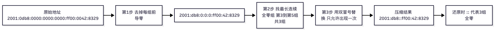


### 真题精练

**Q1.【真题·单选】** IPv6 地址 `2001:0db8:0000:0000:0001:0000:0000:0001` 的正确压缩写法是？
A. `2001:db8::1::1`  B. `2001:db8::1:0:0:1`  C. `2001:db8:0:0:1::1`  D. `2001:db8:1:0:0:1`

> **答案：B**
> **解析**：A 错误，使用了**两次 `::`**，违反"双冒号只能出现一次"的规则。C 也可表达同一地址，但压缩的是**后面**那段 2 组全零，而 RFC 5952 规定多段长度相同时应压缩**最靠前**的那一段，因此 B 才是标准写法。D 完全错误（丢了一组，且缺少双冒号导致组数不足 8 组，是非法地址）。**考试中遇到两段等长零组，答案优先选压缩靠前段的那个**。

**Q2.【真题·单选】** 下列哪个前缀表示 IPv6 链路本地地址？
A. 2000::/3  B. FE80::/10  C. FC00::/7  D. FF00::/8

> **答案：B**
> **解析**：FE80::/10 是链路本地地址（LLA），每个启用 IPv6 的接口会自动生成，仅在本链路有效。A 是 GUA（全球单播）；C 是 ULA（唯一本地地址，私网）；D 是组播地址段。注意 LLA 的前 10 位固定为 `1111111010`，通常写作 `fe80::/10`，具体地址形如 `fe80::xxxx:xxxx:xxxx:xxxx`。

**Q3.【真题·多选】** 关于 IPv6 相对 IPv4 的改进，下列说法正确的有？
A. IPv6 头部长度固定为 40 字节，字段更少，转发效率更高
B. IPv6 取消了头部校验和
C. IPv6 取消了广播，用组播和任意播替代
D. IPv6 路由器可以对报文进行分片
E. IPv6 支持无状态地址自动配置（SLAAC）

> **答案：ABCE**
> **解析**：D 错误。IPv6 **只允许源端分片**，中间路由器**不分片**（通过路径 MTU 发现机制通知源端调整），这样减轻了路由器负担、提高转发效率。若报文超过 MTU 且源端未按 PMTU 调整，路由器会返回 ICMPv6 "Packet Too Big" 报文。A/B/C/E 均为 IPv6 的真实改进。

**Q4.【真题·判断】** IPv6 中的任意播（Anycast）与单播使用不同的地址空间，前缀不同。

> **答案：错误**
> **解析**：IPv6 的**任意播与单播共用同一地址空间**，前缀完全相同（都从 2000::/3 等单播空间分配）。区别在于**配置方式与语义**：把一个单播地址同时配置在多台设备的接口上（通常要求是路由器接口），该地址就成为任意播地址；报文会被路由到**拓扑上最近的那一台**。IPv4 中任意播是"借用"单播地址的非正式实现，IPv6 则正式定义了该概念。

**Q5.【真题·填空】** IPv6 地址长度为 ______ bit，写作 ______ 组十六进制，每组 ______ 位；标准子网前缀长度为 ______，其中接口 ID 占 ______ bit。

> **答案：128；8；4；/64；64**
> **解析**：128 bit = 8 组 × 16 bit，每组用 4 位十六进制表示。标准子网划分采用 **/64**，即前 64 bit 为网络前缀、后 64 bit 为接口标识（Interface ID）。这比 IPv4 的"按需借位"简单得多——IPv6 中一个 /64 子网可容纳 2^64 个地址，几乎不可能耗尽，因此**不需要 VLSM**（但可以用 /127 或 /126 给点对点链路节省地址）。

**Q6.【真题·简答】** 说明 IPv6 零压缩（`::`）的三条使用规则，并给出一个反例说明错误用法。

> **答案**：
> 1. **规则一**：每组的前导零可以省略（如 `0db8` → `db8`、`0042` → `42`）。
> 2. **规则二**：连续的**多个**全零组可用 `::` 替代，但 `::` 在同一地址中**只能出现一次**（两次会导致零组数量无法还原，产生歧义）。
> 3. **规则三**：只能压缩**至少一组**全零；且当有多段长度相同的连续全零时，应压缩**最靠前**的那一段（RFC 5952）。
> 4. **反例一**：`2001:db8::1::1` —— 出现两次 `::`，非法。
> 5. **反例二**：`2001:db8::1:1:1:1:1` 想表示 `2001:db8:0:1:1:1:1:1` —— 非法，因为单独的**一组**全零不能用 `::` 压缩（`::` 至少要代表一组，写成这样会让 `::` 代表 0 组，若允许则产生歧义）。
> 6. **记忆口诀**：**"前导零可去，连续零用双冒号，双冒号只一次，等长压靠前。"**

### 易错点与排错

1. **`::` 不能出现两次**，也不能用于压缩单组零。
2. **不要把 `fe80::` 与 `169.254.x.x` 混为一谈**：前者是 IPv6 链路本地地址（协议内置、永远存在），后者是 IPv4 的 APIPA（DHCP 失败后的自配地址）。
3. **全局使能 `ipv6` 是关键**：只配接口地址而全局未使能时，设备不转发 IPv6 报文。
4. **ULA 实际使用 FD00::/8**：FC00::/8 理论上由权威机构分配（至今未实际分配），工程中本地自行分配时统一用 FD00::/8。
5. 排错命令：`display ipv6 interface brief`、`display ipv6 routing-table`、`display ipv6 neighbors`、`display ipv6 statistics`。

---

## 10.2 EUI-64 接口 ID 生成与地址配置方式

### 考点定位

**必考计算题**（**5~8 分**）：给出 MAC 地址，要求写出 EUI-64 生成的接口 ID 与完整 IPv6 地址。**最高频陷阱**：忘记**翻转第 7 位（U/L 位）**，或把 `FF:FE` 插错位置。

### 原理精讲

**EUI-64（Extended Unique Identifier，64 位扩展唯一标识符）** 是把 48 bit 的 MAC 地址扩展为 64 bit 接口 ID 的标准方法，过程分三步：

1. **在 MAC 地址中间（前 24 bit 之后、后 24 bit 之前）插入 `FF:FE`** 两个字节，得到 64 bit。
2. **翻转第一个字节的第 7 位（从高位数的第 7 位，即 U/L 位，Universal/Local bit）**：0 变 1，1 变 0。该位含义是"该地址是否全局唯一"：MAC 中该位为 0 表示全局唯一（IEEE 分配），而 EUI-64 规范中该位为 1 表示全局唯一，因此需要翻转。
3. **把结果写成 4 组十六进制**（每组 4 位），即为接口 ID；再与 /64 前缀拼接，去掉前缀末尾的 `::` 后直接连接。

**完整演算示例（必须能默写全过程）**：

已知接口 MAC 地址 `00-1A-2B-3C-4D-5E`，前缀 `2001:db8:1::/64`。

- 第 1 步：插入 FF:FE → `00 1A 2B FF FE 3C 4D 5E`
- 第 2 步：翻转第一个字节 `00` 的第 7 位：
  - `00` = `0000 0000`；第 7 位是**从左边数第 7 位**（即值为 2 的那一位）。`0000 0000` 翻转该位 → `0000 0010` = **`02`**
  - 得到 `02 1A 2B FF FE 3C 4D 5E`
- 第 3 步：分组写成十六进制 → `021A:2BFF:FE3C:4D5E`
- 拼接完整地址 → **`2001:db8:1::21a:2bff:fe3c:4d5e`**（或全写 `2001:db8:1:0:21a:2bff:fe3c:4d5e`）

**关键补充：翻转的到底是哪一位？**

| MAC 第一个字节的位 | 名称 | 含义 |
|---|---|---|
| 第 1 位（bit 0，最低位） | I/G（Individual/Group） | 0 = 单播，1 = 组播 |
| **第 2 位（bit 1，值 2）** | **U/L（Universal/Local）** | **0 = 全局唯一（IEEE 分配），1 = 本地管理** |

注意术语混乱点：IEEE 802 把最低位叫"第 1 位"，因此位图中"值 2 的那一位"被 IEEE 称为**第 2 位**，而 IPv6/EUI-64 文档中常称其为**第 7 位（从最高位数）**。两者指的是同一位。**做题时只需记住：把第一个字节中"值为 2 的那一位"取反。**

**举例验证**：
- `00` → `02`（0 变 1，U/L 从 0 变 1）
- `0C` = `0000 1100` → 翻转值 2 的位 → `0000 1110` = `0E`
- `2A` = `0010 1010` → 翻转 → `0010 1000` = `28`
- `FC` = `1111 1100` → 翻转 → `1111 1110` = `FE`

**IPv6 地址的三种配置方式**：

| 方式 | 说明 | 优点 | 缺点 | 适用 |
|---|---|---|---|---|
| **手工配置** | 手工输入完整地址 | 精确可控 | 工作量大、易冲突 | 服务器、路由器、网络设备 |
| **EUI-64 / SLAAC（无状态自动配置）** | 由 RA 下发前缀 + 接口自行生成接口 ID | 零配置、即插即用 | 接口 ID 暴露 MAC（隐私问题）、无法统一下发 DNS 等参数（需 RDNSS） | 终端用户、IoT 设备 |
| **DHCPv6（有状态）** | 由 DHCPv6 服务器分配地址与参数 | 可控、可审计、可统一下发 DNS/域名 | 需部署服务器 | 企业办公终端 |

**SLAAC 与 DHCPv6 的选择由 RA 报文中的标志位决定**：

| M 标志 | O 标志 | 终端行为 |
|---|---|---|
| 0 | 0 | 纯 SLAAC：由 RA 前缀 + EUI-64 生成地址，其他参数靠 RA 中的选项 |
| 0 | 1 | SLAAC 生成地址，但其他参数（如 DNS）从 DHCPv6 获取（无状态 DHCPv6） |
| 1 | — | **有状态 DHCPv6**：地址从 DHCPv6 服务器获取（RA 中的前缀仍可用于生成 LLA 与 on-link 判断） |

### 关键概念对照表

| MAC 首字节 | 二进制 | 翻转后（U/L 位取反） | 二进制 |
|---|---|---|---|
| 00 | 0000 0000 | 02 | 0000 0010 |
| 0C | 0000 1100 | 0E | 0000 1110 |
| 1A | 0001 1010 | 18 | 0001 1000 |
| 2A | 0010 1010 | 28 | 0010 1000 |
| 4C | 0100 1100 | 4E | 0100 1110 |
| FC | 1111 1100 | FE | 1111 1110 |
| AA | 1010 1010 | A8 | 1010 1000 |

**EUI-64 与隐私扩展（Privacy Extension，RFC 4941）**：由于 EUI-64 生成的接口 ID 含 MAC 信息，攻击者可通过地址追踪设备与用户。隐私扩展让主机**随机生成接口 ID** 并定期更换（临时地址），仅在需要稳定地址时使用 EUI-64。Windows/Linux 默认启用隐私扩展，因此**抓包看到的 IPv6 地址往往不含 FF:FE**，这是考试与实验中的常见疑问点。

### 华为设备配置

```bash
# 三种地址配置方式对比
system-view
ipv6
interface GigabitEthernet0/0/0
 ipv6 enable
 ipv6 address 2001:db8:1::1/64                            # 方式1：手工配置GUA（固定地址，用于服务器/设备）
quit
interface GigabitEthernet0/0/1
 ipv6 address 2001:db8:2::/64 eui-64                      # 方式2：EUI-64，前缀+MAC生成接口ID
quit
interface GigabitEthernet0/0/2
 ipv6 address auto global                                 # 方式3：通过RA自动获取全球单播地址（SLAAC）
quit
interface GigabitEthernet0/0/3
 ipv6 address auto link-local                             # 自动生成链路本地地址（通常接口使能IPv6后即自动生成）
quit
display ipv6 interface GigabitEthernet0/0/1                # 查看EUI-64生成的完整地址与LLA
display ipv6 interface GigabitEthernet0/0/2                # 查看SLAAC获取的地址
display ipv6 neighbors                                     # 查看IPv6邻居（含邻居的MAC与状态）
```

```bash
# 关闭/开启接口的 IPv6 功能，以及配置 IPv6 MTU
interface GigabitEthernet0/0/4
 undo ipv6 enable                                         # 关闭该接口的IPv6功能
quit
interface GigabitEthernet0/0/0
 ipv6 mtu 1400                                            # 配置IPv6 MTU（IPv6最小MTU为1280字节）
quit
display ipv6 interface GigabitEthernet0/0/0                # 查看MTU与地址信息
```

### 示意图

```mermaid
flowchart LR
    A["MAC地址 00:1A:2B:3C:4D:5E"] --> B["第1步 中间插入FFFE"]
    B --> C["00 1A 2B FF FE 3C 4D 5E"]
    C --> D["第2步 翻转首字节第7位 U/L位"]
    D --> E["00 = 00000000 翻转值2的位"]
    E --> F["02 = 00000010"]
    F --> G["得到 02 1A 2B FF FE 3C 4D 5E"]
    G --> H["写作 021A:2BFF:FE3C:4D5E"]
    H --> I["拼接前缀2001:db8:1::/64"]
    I --> J["最终地址 2001:db8:1::21a:2bff:fe3c:4d5e"]
```

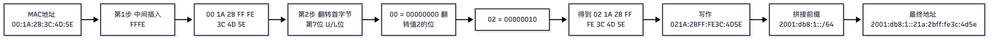


### 真题精练

**Q7.【真题·单选】** 某接口 MAC 地址为 `00-1A-2B-3C-4D-5E`，前缀为 `2001:db8:1::/64`，使用 EUI-64 生成的接口 ID 是？
A. `001A:2BFF:FE3C:4D5E`  B. `021A:2BFF:FE3C:4D5E`  C. `021A:2BFF:3C4D:5E00`  D. `FF1A:2BFF:FE3C:4D5E`

> **答案：B**
> **解析**：EUI-64 两步：① 中间插入 `FFFE` → `001A:2BFF:FE3C:4D5E`；② **翻转第一个字节的第 7 位（U/L 位）**：`00` = `0000 0000` → 翻转值 2 的位 → `02`。故接口 ID 为 `021A:2BFF:FE3C:4D5E`，完整地址 `2001:db8:1::21a:2bff:fe3c:4d5e`。A 是**忘记翻转 U/L 位**的错误结果（最常见的失分点）；C 位置错乱；D 是随意篡改首字节。

**Q8.【真题·填空题】** 某设备 MAC 地址为 `0C-1B-2C-3D-4E-5F`，使用 EUI-64 生成接口 ID 后，首字节由 `0C` 变为 ______，接口 ID 为 ______。

> **答案：`0E`；`0E1B:2CFF:FE3D:4E5F`**
> **解析**：`0C` = `0000 1100`，翻转值为 2 的那一位（从右数第 2 位）→ `0000 1110` = `0E`。插入 FFFE 后得到 `0E 1B 2C FF FE 3D 4E 5F`，写作 `0E1B:2CFF:FE3D:4E5F`。**速算技巧**：若首字节末位为 0（如 0C、4A、FC），+2；若末位为 2、6、A、E，−2；若末位为奇数…（实际上只需看"值 2 的那一位"，用十六进制判断：把字节写成二进制，或者记住规律——十六进制第 2 位数字：0→2、1→3、2→0、3→1、4→6、5→7、6→4、7→5、8→A、9→B、A→8、B→9、C→E、D→F、E→C、F→D）。

**Q9.【真题·判断】** EUI-64 生成的接口 ID 直接使用 MAC 地址并插入 FF:FE，不需要做任何位运算。

> **答案：错误**
> **解析**：插入 FF:FE 只是第一步，**必须翻转第一个字节的 U/L 位（第 7 位 / 值为 2 的那一位）**。原因是 MAC 地址中该位为 0 表示"IEEE 全局分配"，而 EUI-64 标准中该位为 1 才表示"全局唯一"，语义相反，所以必须取反。**忘记翻转是最常见的计算错误**，考试中专门设此陷阱。

**Q10.【真题·多选】** 关于 IPv6 的地址自动配置，下列说法正确的有？
A. SLAAC 通过 RA 报文下发前缀，终端结合接口 ID 生成完整地址
B. RA 报文中的 M 标志置 1 表示终端应使用有状态 DHCPv6 获取地址
C. 隐私扩展会随机生成接口 ID，使地址中不再包含 MAC 信息
D. EUI-64 方式无法与 SLAAC 一起使用

> **答案：ABC**
> **解析**：D 错误。EUI-64 正是 **SLAAC 中生成接口 ID 的最常用方式**（另一种是随机生成/隐私扩展），两者是配合关系而非互斥关系。A/B/C 均正确：M 标志（Managed Address Configuration）置 1 表示地址由 DHCPv6 管理；O 标志表示其他参数由 DHCPv6 提供；隐私扩展（RFC 4941）为保护隐私而随机化接口 ID。

**Q11.【真题·简答】** 说明 IPv6 中"手工配置、SLAAC、DHCPv6"三种地址配置方式的适用场景与优缺点。

> **答案**：
> 1. **手工配置**：适用于**服务器、路由器、网络设备**等需要稳定可预测地址的节点。优点是地址完全可控、便于 ACL/安全策略精确匹配与排错；缺点是工作量大，在终端众多时不可行，且易出现人为冲突。
> 2. **SLAAC（无状态自动配置）**：适用于**用户终端、IoT 设备、临时接入设备**。终端通过 RS/RA 交互获得前缀，自行结合 EUI-64 或随机接口 ID 生成地址，**无需服务器，即插即用**。缺点是：① EUI-64 会泄露 MAC（可用隐私扩展缓解）；② 服务器无法精确掌握谁用了哪个地址（难以审计与计费）；③ 传统的 SLAAC 无法下发 DNS 服务器（需 RA 中的 RDNSS 选项或配合无状态 DHCPv6）。
> 3. **DHCPv6（有状态）**：适用于**企业办公网、需要审计与集中管理的场景**。优点是地址分配可控、可记录绑定关系（谁在何时用了哪个地址）、可统一下发 DNS/域名/NTP 等参数、支持地址预留；缺点是需要部署与维护 DHCPv6 服务器（通常与 DHCPv4 服务器合一），且服务器故障影响面大（需冗余）。
> 4. **实践建议**：路由器/服务器手工配置 + 终端 SLAAC 或 DHCPv6（由 RA 的 M/O 标志控制），这是企业网络最常见的混合模式。

### 易错点与排错

1. **EUI-64 必须翻转 U/L 位**，这是本节唯一必考的计算细节。
2. **`ipv6 address 2001:db8:2:: 64 eui-64` 中前缀必须以 `::` 结尾**（接口 ID 由设备生成），写成 `2001:db8:2::1 64 eui-64` 是非法的。
3. **IPv6 最小 MTU 为 1280 字节**，若链路 MTU 小于 1280 则 IPv6 无法正常工作。
4. **SLAAC 需要路由器发送 RA**：可在接口下配置 `undo ipv6 nd ra halt`（默认华为设备接口**抑制** RA 发送，需手工开启）——这是"SLAAC 拿不到地址"的最常见原因。
5. 排错命令：`display ipv6 interface GigabitEthernet0/0/0`、`display ipv6 neighbors`、`display ipv6 nd ra`（部分版本）、`debugging ipv6 nd`（实验环境）。

---

## 10.3 IPv6 头部字段与 IPv4 头部对比

### 考点定位

**4~6 分**，常考"IPv6 头部固定多少字节"、"取消了哪些字段"、"流标签的作用"、"扩展头如何使用"。多以选择与填空形式出现。

### 原理精讲

IPv6 头部**固定 40 字节**，只有 **8 个字段**，相比 IPv4 的可变长头部（20~60 字节、12+ 字段）大幅简化，目的是**提高路由器查表与转发效率**（硬件可固定偏移解析）。

**IPv6 头部字段逐一说明**：

| 字段 | 长度 | 含义与设计意图 |
|---|---|---|
| **Version（版本）** | 4 bit | 固定为 6，标识协议版本 |
| **Traffic Class（通信流类别）** | 8 bit | 相当于 IPv4 的 ToS，用于 QoS 分类（DSCP + ECN） |
| **Flow Label（流标签）** | 20 bit | **IPv6 新增**：标识同一"流"的报文序列（如一个视频通话的所有报文），中间路由器可据此对整条流统一处理（无需逐包解析传输层），简化 QoS 与负载分担 |
| **Payload Length（有效载荷长度）** | 16 bit | 有效载荷（含扩展头）长度，**不含 40 字节基本头**；最大 65535 字节，超大包由"逐跳选项扩展头"中的 Jumbo Payload 支持 |
| **Next Header（下一个头部）** | 8 bit | 指示紧跟其后的是扩展头还是上层协议（TCP 6 / UDP 17 / ICMPv6 58）；形成**扩展头链** |
| **Hop Limit（跳数限制）** | 8 bit | 相当于 IPv4 的 TTL，每经过一个路由器减 1，为 0 时丢弃并回 ICMPv6 Time Exceeded。**改名是因为"生存时间"实际上从来不是时间而是跳数**，命名更准确 |
| **Source Address（源地址）** | 128 bit | 发送方地址 |
| **Destination Address（目的地址）** | 128 bit | 接收方地址 |

**IPv6 与 IPv4 头部对比表（必背）**：

| 对比项 | IPv4 | IPv6 |
|---|---|---|
| 头部长度 | 20 ~ 60 字节（可变，IHL 字段指示） | **固定 40 字节** |
| 字段数量 | 12 个基本字段 + 选项 | **8 个字段** |
| 校验和 | **有**（Header Checksum，每跳需重算） | **无**（取消，减少每跳计算开销） |
| 分片字段 | 有（Identification、Flags、Fragment Offset） | **无**（分片信息在扩展头中，且仅源端分片） |
| 选项机制 | 头部内选项字段 | **扩展头（Extension Header）链** |
| 地址长度 | 32 bit | 128 bit |
| 生存时间 | TTL（8 bit） | **Hop Limit（8 bit）**，语义相同 |
| 流标识 | 无（ToS 仅 8 bit 分类） | **Flow Label（20 bit）** 支持流级处理 |
| 服务类型 | ToS | Traffic Class |
| 协议标识 | Protocol 字段 | **Next Header** 字段（支持扩展头链） |
| 广播 | 支持 | **不支持**（用组播替代） |
| 头部对齐 | 4 字节对齐 | 8 字节对齐 |

**扩展头（Extension Header，RFC 8200）**：IPv6 把 IPv4 头部中的"选项"改造为**独立的扩展头**，通过 Next Header 字段串成链条，按需添加。这使**基本头保持固定 40 字节**，路由器只在必要时才处理扩展头。

| 扩展头 | Next Header 值 | 作用 |
|---|---|---|
| **逐跳选项头（Hop-by-Hop Options）** | 0 | 必须被路径上每个路由器处理（如 Jumbo Payload、路由器警告） |
| **目的选项头（Destination Options）** | 60 | 只被目的节点（或路由头指定的节点）处理，如移动 IPv6 |
| **路由头（Routing Header）** | 43 | 指定中间经过的节点（源路由、移动 IPv6） |
| **分片头（Fragment Header）** | 44 | 源端分片信息 |
| **认证头（AH）** | 51 | IPsec 认证 |
| **封装安全载荷头（ESP）** | 50 | IPsec 加密 |
| **上层协议头** | 6 = TCP、17 = UDP、**58 = ICMPv6** | 最终载荷 |

**标准的扩展头顺序**：IPv6 基本头 → 逐跳选项头 → 目的选项头 → 路由头 → 分片头 → AH → ESP → 目的选项头 → 上层协议头。**只有逐跳选项头必须被所有中间路由器处理，其余只被目的节点处理**，这正是 IPv6 提升转发效率的关键设计。

### 关键概念对照表

| IPv4 字段 | IPv6 对应 | 变化说明 |
|---|---|---|
| Version (4 bit) | Version (4 bit) | 6 |
| IHL (4 bit) | — | **取消**（头部固定 40 字节） |
| ToS (8 bit) | Traffic Class (8 bit) | 更名，语义相同 |
| Total Length (16 bit) | Payload Length (16 bit) | 只计载荷，不含基本头 |
| Identification / Flags / Fragment Offset | 分片扩展头 | 移到扩展头，仅源端分片 |
| TTL (8 bit) | Hop Limit (8 bit) | 更名，语义相同 |
| Protocol (8 bit) | **Next Header (8 bit)** | 支持扩展头链 |
| Header Checksum (16 bit) | — | **取消** |
| Source/Destination Address (32 bit) | Source/Destination Address (128 bit) | 位宽扩大 4 倍 |
| Options（可变长） | 扩展头链 | 结构化为独立头部 |
| — | **Flow Label (20 bit)** | **新增**，支持流级 QoS |

### 华为设备配置

```bash
# 查看 IPv6 相关的接口与统计信息（头部处理相关的排错）
display ipv6 interface GigabitEthernet0/0/0 verbose        # 查看接口IPv6详细参数（MTU、地址、ND参数）
display ipv6 statistics                                    # 查看IPv6报文收发统计（含错误计数）
display ipv6 icmp statistics                               # 查看ICMPv6统计（含Too Big、Time Exceeded等）
display ipv6 nd ra interface GigabitEthernet0/0/0          # 查看RA参数（部分版本支持）
```

```bash
# 调整 IPv6 MTU 与 MSS，解决 PMTU 导致的"小包通、大包不通"
interface GigabitEthernet0/0/0
 ipv6 mtu 1400                                            # 调整接口IPv6 MTU（不小于1280）
 ipv6 tcp adjust-mss 1360                                 # 调整TCP MSS，避免分片（MSS = MTU - 40 IPv6头 - 20 TCP头）
quit
display ipv6 interface GigabitEthernet0/0/0                # 验证MTU生效
```

### 示意图

```mermaid
flowchart LR
    subgraph H6["IPv6 基本头 固定40字节"]
        V6["Version 4bit"]
        TC["Traffic Class 8bit"]
        FL["Flow Label 20bit"]
        PL["Payload Length 16bit"]
        NH["Next Header 8bit"]
        HL["Hop Limit 8bit"]
        SA["Source Address 128bit"]
        DA["Destination Address 128bit"]
    end
    subgraph EXT["扩展头链 按需添加"]
        E1["Hop-by-Hop 逐跳选项"]
        E2["Routing 路由头"]
        E3["Fragment 分片头"]
        E4["AH 认证头"]
        E5["ESP 加密头"]
    end
    subgraph UP["上层协议"]
        U1["TCP 6"]
        U2["UDP 17"]
        U3["ICMPv6 58"]
    end
    H6 --> EXT --> UP
```

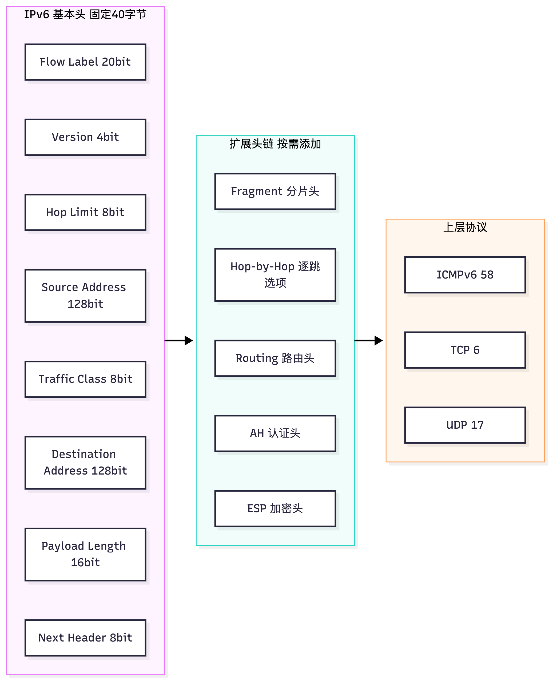


### 真题精练

**Q12.【真题·单选】** IPv6 基本头部的固定长度是？
A. 20 字节  B. 32 字节  C. 40 字节  D. 60 字节

> **答案：C**
> **解析**：IPv6 基本头**固定 40 字节**，包含 8 个字段（Version、Traffic Class、Flow Label、Payload Length、Next Header、Hop Limit、Source Address、Destination Address）。IPv4 头部为 20~60 字节（可变）。40 字节的固定头部使硬件可以固定偏移解析，显著提升转发效率。

**Q13.【真题·多选】** 相比 IPv4，IPv6 头部中**被取消**的字段有？
A. Header Checksum（头部校验和）  B. IHL（头部长度）  C. Hop Limit  D. Identification（标识）

> **答案：ABD**
> **解析**：IPv6 取消了 **Header Checksum**（减少每跳重算开销，错误检测交由二层与上层完成）、**IHL**（头部长度固定，无需该字段）、**Identification/Flags/Fragment Offset**（分片信息移入分片扩展头，且只有源端可分片）。C 错误：Hop Limit 是 TTL 的**改名保留**，语义相同，并未取消。

**Q14.【真题·填空】** IPv6 头部中用于标识同一数据流的字段是 ______，长度 ______ bit；用于指示下一个头部类型的字段是 ______；ICMPv6 的协议号（Next Header 值）是 ______。

> **答案：Flow Label（流标签）；20；Next Header；58**
> **解析**：Flow Label 是 IPv6 新增字段，20 bit，配合源地址可唯一标识一条流，中间路由器无需解析传输层即可对整条流统一处理（QoS、负载分担）。Next Header 通过链式结构支持扩展头，取值 6=TCP、17=UDP、58=ICMPv6、0=逐跳选项头、43=路由头、44=分片头、50=ESP、51=AH。

**Q15.【真题·简答】** 采用扩展头机制后，IPv6 的转发效率为什么比 IPv4 更高？

> **答案**：
> 1. **基本头固定 40 字节**：路由器无需像 IPv4 那样读取 IHL 字段动态计算头部长度，可以按固定偏移解析字段，便于硬件流水线处理。
> 2. **字段数量从 12+ 减到 8 个**：需要处理与判断的分支减少（取消了校验和、分片相关字段）。
> 3. **取消头部校验和**：IPv4 中每跳都要重新计算头部校验和（因为 TTL 减 1 会改变头部），这是显著开销；IPv6 取消后，路由器无需为转发做校验和计算。
> 4. **扩展头按需处理**：IPv4 的选项字段必须被每个路由器检查（即使不关心）；IPv6 中**只有逐跳选项头**需要中间路由器处理，其余扩展头**只被目的节点处理**，中间路由器可跳过。
> 5. **路由器不分片**：IPv4 中路由器可能需要对超长报文分片，开销大且易受攻击（分片攻击）；IPv6 只允许源端按路径 MTU 分片，路由器只返回 ICMPv6 Packet Too Big 通知源端调整。

### 易错点与排错

1. **Payload Length 不含基本头 40 字节**，考试常设陷阱。
2. **Hop Limit 是 TTL 的改名，不是取消**。
3. **ICMPv6 的协议号是 58**，不是 1（IPv4 的 ICMP 是 1）。
4. **扩展头顺序固定**，尤其是逐跳选项头必须紧跟在基本头之后。
5. 排错命令：`display ipv6 statistics`、`display ipv6 icmp statistics`、`display ipv6 interface verbose`（看 MTU）。

---

## 10.4 ICMPv6 与 NDP（NS/NA/RS/RA、DAD、SLAAC 全流程）

### 考点定位

**6~10 分的高频考点**：四种 NDP 报文的作用与目的地址、DAD 流程、SLAAC 完整交互、被请求节点组播地址的计算。**陷阱**：DAD 的 NS 报文源地址是 `::`（未指定地址），目的地址是被请求节点组播。

### 原理精讲

**ICMPv6（Internet Control Message Protocol version 6）** 是 IPv6 的核心辅助协议（Next Header = 58），功能远超 IPv4 的 ICMP：它不仅负责差错报告（Destination Unreachable、Packet Too Big、Time Exceeded、Parameter Problem），还承担**邻居发现（NDP）**、**地址自动配置**、**路径 MTU 发现**、**组播监听（MLD）** 等功能。**IPv6 取消了 ARP，其功能完全由 ICMPv6 的 NDP 承担。**

**NDP（Neighbor Discovery Protocol，邻居发现协议，RFC 4861）四种报文**：

| 报文 | 全称 | 作用 | 典型目的地址 |
|---|---|---|---|
| **RS** | Router Solicitation（路由器请求） | 主机启动时主动请求路由器立即发送 RA（不必等周期 RA） | **FF02::2（All-Routers）** |
| **RA** | Router Advertisement（路由器通告） | 路由器周期（默认 200 s，可配）或响应 RS 时发送，下发**前缀、前缀长度、标志位（M/O）、跳数限制、MTU、路由器生存时间**等 | **FF02::1（All-Nodes）**（周期）或单播（响应 RS） |
| **NS** | Neighbor Solicitation（邻居请求） | ① **地址解析**：已知对方 IPv6 地址，求其 MAC；② **DAD**：检测地址是否已被占用；③ 邻居可达性检测（NUD） | **被请求节点组播**（地址解析/DAD）或单播（NUD） |
| **NA** | Neighbor Advertisement（邻居通告） | 响应 NS，返回自己的 MAC（携带 Target Link-Layer Address 选项） | 单播（响应）或 FF02::1（主动通告） |

> **被请求节点组播地址（Solicited-Node Multicast）的计算**：取目标单播地址的**后 24 bit**，拼到 `FF02::1:FF00:0/104` 之后。例如目标地址 `2001:db8::1` 的后 24 bit 是 `00:0001`，则被请求节点组播地址为 **`FF02::1:FF00:1`**。之所以用组播而非广播来做地址解析，是为了**只打扰那些可能关注该地址的节点**（节点会为自己每个单播地址加入对应的被请求节点组播组），从而避免 ARP 广播对全网的干扰。

**DAD（Duplicate Address Detection，重复地址检测）完整流程**：

1. 主机为接口配置一个 IPv6 地址后（在正式使用前处于 **Tentative（暂态/试用）** 状态），**不立即使用**，先做 DAD。
2. 主机发送 **NS 报文**：**源地址 = `::`（未指定地址）**（因为自己的地址还没确认可用），**目的地址 = 该地址对应的被请求节点组播地址**，Target Address = 待检测地址。
3. 若链路上有节点已使用该地址，它会回复 **NA 报文**（目的地址为 FF02::1 或单播），主机收到后判定地址冲突，**该地址标记为 Duplicate 并不可用**，需重新配置。
4. 若 **1 秒**内（默认 DAD 等待时间，具体由 DupAddrDetectTransmits 与 RetransTimer 决定）没有收到 NA，则地址通过检测，从 Tentative 变为 **Preferred（首选）** 状态，可以正式使用。
5. **注意**：DAD 对**链路本地地址（LLA）也执行**，因此接口启用 IPv6 后需要短暂时间（约 1~2 秒）地址才可用。

**SLAAC（Stateless Address Autoconfiguration，无状态地址自动配置）全流程**：

1. 主机接口启用 IPv6 后，**首先生成链路本地地址（LLA，FE80::/10 + EUI-64 或随机接口 ID）**，并对其执行 **DAD**。
2. 主机发送 **RS（目的 FF02::2）** 请求路由器信息（也可等待路由器周期发送 RA）。
3. 路由器回复 **RA（目的 FF02::1）**，其中携带：**网络前缀 + 前缀长度、A 标志（Autonomous，表示可用于 SLAAC）、M/O 标志、默认网关（路由器自身 LLA）、MTU、跳数限制、DNS（RDNSS 选项）**。
4. 主机把 RA 中的前缀（通常 /64）与自己的接口 ID（EUI-64 或随机）拼接，生成 **GUA（全球单播地址）**。
5. 对新的 GUA 执行 **DAD**，通过后地址生效。
6. 主机把 RA 的源地址（路由器的 LLA）作为**默认网关**，并做邻居解析（NS/NA）获得其 MAC。
7. 通信开始。此后主机与网关之间的可达性由 **NUD（Neighbor Unreachability Detection）** 维护（通过 NS/NA 或上层协议确认）。

> **很多路由器默认抑制 RA 发送**（华为设备接口默认 `ipv6 nd ra halt` 生效），因此"主机拿不到 SLAAC 地址"的第一排查点就是**RA 是否已开启**（`undo ipv6 nd ra halt`）。

**ICMPv6 与 IPv4 ICMP 的差错报文对比**：

| IPv4 ICMP | ICMPv6 对应 | 触发场景 |
|---|---|---|
| Destination Unreachable (Type 3) | **Destination Unreachable (Type 1)** | 无法交付 |
| — | **Packet Too Big (Type 2)** | **IPv6 独有**：报文超过链路 MTU，用于路径 MTU 发现 |
| Time Exceeded (Type 11) | **Time Exceeded (Type 3)** | Hop Limit 减到 0 |
| Parameter Problem (Type 12) | **Parameter Problem (Type 4)** | 头部参数错误 |
| Echo Request/Reply (Type 8/0) | **Echo Request/Reply (Type 128/129)** | ping 测试 |

### 关键概念对照表

| 报文 | Type 值 | 目的地址 | 关键选项字段 |
|---|---|---|---|
| RS | 133 | FF02::2 | Source Link-Layer Address（源 MAC） |
| RA | 134 | FF02::1 或单播 | Prefix Information、M/O 标志、MTU、RDNSS |
| NS | 135 | 被请求节点组播（DAD/解析） | Target Address、Source Link-Layer Address |
| NA | 136 | 单播或 FF02::1 | Target Address、Target Link-Layer Address、R/S/O 标志 |

**NA 报文中的三个标志位**：

| 标志 | 名称 | 含义 |
|---|---|---|
| **R** | Router | 发送者是路由器（1 = 路由器） |
| **S** | Solicited | 该 NA 是响应 NS 而发送（1 = 响应请求，0 = 主动通告，如地址变化时） |
| **O** | Override | 是否用它更新已有的邻居缓存（1 = 覆盖） |

**NDP 的五大功能**（考试简答常考）：

| 功能 | 依赖报文 | 说明 |
|---|---|---|
| 路由器发现 | RS / RA | 发现链路上的路由器与其前缀 |
| 前缀发现 | RA | 获取网络前缀用于 SLAAC 与 on-link 判断 |
| 参数发现 | RA | 获取 MTU、跳数限制、DNS 等 |
| **地址解析** | **NS / NA** | **替代 IPv4 的 ARP**，由 IPv6 地址解析出 MAC |
| 地址自动配置 | RA + DAD | 生成地址并检测冲突 |
| 邻居可达性检测（NUD） | NS / NA | 维护邻居缓存有效性 |
| 重定向 | Redirect（Type 137） | 通知主机更优的下一跳 |

### 华为设备配置

```bash
# 路由器侧：开启 RA 发送，使下游主机能够 SLAAC 获取地址
system-view
ipv6
interface GigabitEthernet0/0/0
 ipv6 enable
 ipv6 address 2001:db8:1::1/64
 undo ipv6 nd ra halt                                     # 取消RA抑制，允许发送RA（关键命令！默认是抑制的）
 ipv6 nd ra prefix 2001:db8:1:: 64                        # 指定RA中通告的前缀（部分版本需显式指定）
 ipv6 nd ra interval 30                                   # RA周期改为30秒（默认约200秒，实验时调小便于观察）
 ipv6 nd ra lifetime 1800                                 # RA中路由器生存时间（默认1800秒）
quit
display ipv6 interface GigabitEthernet0/0/0                # 查看接口IPv6状态与ND参数
```

```bash
# 主机侧（华为设备模拟终端）：通过RA自动获取全球单播地址
system-view
ipv6
interface GigabitEthernet0/0/1
 ipv6 enable
 ipv6 address auto global                                 # 通过RA自动生成GUA（SLAAC）
quit
display ipv6 interface GigabitEthernet0/0/1                # 观察是否获取到2001:db8:1::/64前缀的地址
display ipv6 neighbors                                     # 查看邻居表（由NS/NA生成的IPv6-MAC映射）
display ipv6 interface GigabitEthernet0/0/1               # 输出中地址状态应为Preferred；若为Tentative说明DAD进行中
```

```bash
# 排错：检查 DAD 与邻居状态
display ipv6 neighbors all                                 # 查看所有邻居（含状态REACH/STALE/DELAY/PROBE/INCOMPLETE）
reset ipv6 neighbors all                                   # 清空邻居表，触发重新解析（实验排错常用）
display ipv6 interface GigabitEthernet0/0/0                # Tentative状态说明DAD未完成或检测到冲突
```

### 示意图

```mermaid
sequenceDiagram
    participant H as 主机 无地址
    participant R as AR6120 路由器
    participant O as 链路上其他主机
    Note over H: 第1步 生成链路本地地址并做DAD
    H->>O: NS 源:: 目的FF02::1:FFxx:xxxx 目标为我的LLA
    O-->>H: 无NA返回 表示地址可用
    Note over H: 第2步 发送RS请求路由器信息
    H->>R: RS 目的FF02::2
    R->>H: RA 目的FF02::1 携带前缀2001:db8:1::/64与M/O标志
    Note over H: 第3步 前缀加接口ID生成GUA并做DAD
    H->>O: NS 源:: 目的被请求节点组播 目标为新GUA
    O-->>H: 无NA 地址通过检测
    Note over H: 第4步 地址进入Preferred状态
    H->>R: NS 解析网关LLA对应的MAC
    R->>H: NA 返回路由器MAC
    Note over H,R: 通信建立 后续由NUD维护邻居可达性
```

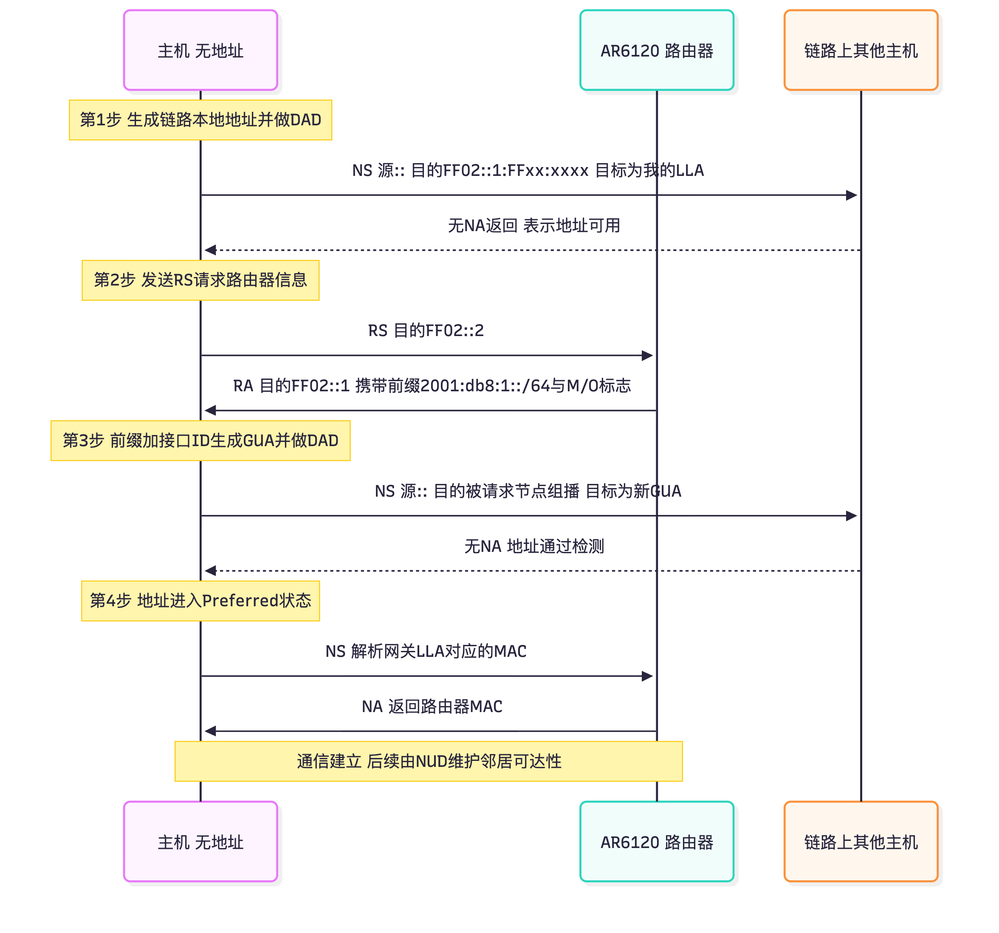


### 真题精练

**Q16.【真题·单选】** IPv6 中执行重复地址检测（DAD）时，NS 报文的源地址是？
A. 待检测的地址本身  B. `::`（未指定地址）  C. FF02::1  D. FE80::1

> **答案：B**
> **解析**：DAD 的目的是确认"待用地址是否已被占用"，此时该地址还处于 **Tentative** 状态、不能作为源地址使用，因此源地址填 **未指定地址 `::`**，目的地址填该地址对应的**被请求节点组播地址**。A 在逻辑上自相矛盾（还没确认可用就用它做源）；C 是 All-Nodes 组播，用于 RA；D 是某个具体的链路本地地址，不对。

**Q17.【真题·多选】** 关于 NDP 的四种报文，下列说法正确的有？
A. RS 的目的地址是 FF02::2（All-Routers）
B. RA 会携带网络前缀、M/O 标志、MTU 等参数
C. NS 既可用于地址解析，也可用于重复地址检测
D. NA 报文只携带 MAC 地址，不携带任何标志位

> **答案：ABC**
> **解析**：D 错误。NA 报文携带 **R（Router）、S（Solicited）、O（Override）三个标志位**：R 表示发送者是路由器，S 表示这是对 NS 的响应，O 表示是否覆盖已有邻居缓存。A/B/C 均正确：RS 的目的地址确实是 FF02::2；RA 是 SLAAC 的参数来源；NS 既用于解析（替代 ARP）也用于 DAD 与 NUD。

**Q18.【真题·填空】** 目标地址为 `2001:db8::1` 的节点所加入的被请求节点组播地址是 ______；IPv6 中替代 IPv4 ARP 功能的是 ______ 报文。

> **答案：`FF02::1:FF00:1`；NS 与 NA（邻居请求与邻居通告）**
> **解析**：被请求节点组播地址构造规则：固定前缀 **FF02::1:FF00:0/104**（前 104 位固定）+ 目标地址的**后 24 bit**。2001:db8::1 的后 24 bit 是 `00:0001`，故为 `FF02::1:FF00:1`。IPv6 取消了 ARP 广播，改由 ICMPv6 的 NS（询问）与 NA（应答）完成地址解析，并利用被请求节点组播把询问范围限制在"可能相关"的节点，减少干扰。

**Q19.【真题·判断】** 主机的 IPv6 地址配置完成后可立即使用，无需经过任何检测。

> **答案：错误**
> **解析**：配置地址后必须先执行 **DAD（重复地址检测）**。地址在检测期间处于 **Tentative（暂态）** 状态，**不能用于通信**（不能作为源地址，收到的报文也会被丢弃）；DAD 通过后才进入 **Preferred（首选）** 状态可用。若检测到冲突，地址被标记为 Duplicate 不可用，需重新配置。这也是"刚配好 IPv6 地址马上 ping 不通、等一两秒就通"的原因。

**Q20.【真题·实验】** 某主机通过 SLAAC 无法获取全球单播地址，只能看到 FE80:: 开头的地址。请给出完整排查步骤与最可能的原因。

> **答案与解析**：
> 1. **最可能原因**：路由器接口**未开启 RA 发送**。华为设备接口默认处于 `ipv6 nd ra halt`（抑制 RA）状态，必须用 **`undo ipv6 nd ra halt`** 取消抑制，主机才能通过 RS/RA 获得前缀。**这是本节最高频的故障原因。**
> 2. **排查步骤**：
>    - 主机侧 `display ipv6 interface GigabitEthernetX/X/X`：确认接口已 `ipv6 enable`、地址是否只有 LLA（FE80::）。
>    - 路由器侧 `display ipv6 interface`：确认接口已使能 IPv6、已配置 /64 前缀的 GUA、**RA 是否已开启**（`display current-configuration interface` 查看是否有 `undo ipv6 nd ra halt`）。
>    - 确认链路上没有其他设备发送 RA 干扰（可用抓包观察 RA 的来源）。
>    - 确认主机接口未被配置为"不接收 RA"（`ipv6 nd ra-disabled` 类配置）。
>    - 检查 DAD 是否因地址冲突失败：主机地址若显示 Duplicate，说明链路上已有同地址设备。
> 3. **验证命令**：路由器 `display ipv6 interface GigabitEthernetX/X/X`；主机 `display ipv6 interface`、`display ipv6 neighbors`（若能看到路由器的 LLA 邻居，说明二层与 NDP 正常）。
> 4. **补充检查**：若企业要求用 DHCPv6 而非 SLAAC，需在 RA 中把 **M 标志置 1**（`ipv6 nd autoconfig managed-address-flag`），并确保 DHCPv6 服务器可达。

### 易错点与排错

1. **RA 默认被抑制**，`undo ipv6 nd ra halt` 是 SLAAC 生效的关键命令。
2. **DAD 的 NS 源地址是 `::`**，不要写成待检测地址。
3. **被请求节点组播只取后 24 bit**，前缀固定为 FF02::1:FF00:0/104。
4. **LLA 也做 DAD**，因此接口启用 IPv6 后地址生效有约 1~2 秒延迟。
5. 排错命令：`display ipv6 neighbors`（看状态 REACH/STALE/INCOMPLETE）、`display ipv6 interface`、`reset ipv6 neighbors all`、`display ipv6 statistics`。

---

## 10.5 IPv6 静态路由、RIPng、OSPFv3 与过渡技术

### 考点定位

**5~8 分**，常考"IPv6 静态路由命令格式"、"RIPng/OSPFv3 与 IPv4 版本的差别"、"三种过渡技术的适用场景"。实验题中常见"双栈 + OSPFv3 互通"。

### 原理精讲

**IPv6 静态路由**：命令与 IPv4 类似但使用 IPv6 前缀表示法：

`ipv6 route-static <目的前缀>/<长度> <下一跳IPv6地址或出接口> [preference <值>]`

- IPv6 静态路由的**默认优先级同样是 60**；直连路由为 0；OSPFv3 为 10；RIPng 为 100；IS-ISv6 为 15。
- 也支持默认路由 `ipv6 route-static :: 0 <下一跳>`（`::/0` 即 IPv6 默认路由）。
- 也支持指向 NULL0 的黑洞路由：`ipv6 route-static 2001:db8:: 32 NULL0`。

**RIPng（RIP next generation，RFC 2080）**：RIP 的 IPv6 版本。与 RIPv2 的差别：

| 对比项 | RIPv2 | RIPng |
|---|---|---|
| 传输 | **UDP 520** | **UDP 521** |
| 组播地址 | 224.0.0.9 | **FF02::9** |
| 下一跳表示 | 报文中的 Next Hop 字段（IPv4） | 有专门的 **Next Hop RTE（路由表项）** |
| 认证 | RIPv2 支持明文/MD5 | **RIPng 本身不支持认证**（依赖 IPsec） |
| 掩码 | 携带 | 携带（前缀长度） |
| 度量 | 跳数（最大 15） | 跳数（最大 15） |
| 配置 | `rip 1` | `ripng 1`，接口下 `ripng 1 enable` |

**OSPFv3（RFC 5340）**：OSPF 的 IPv6 版本。与 OSPFv2 的**关键差别（高频考点）**：

| 对比项 | OSPFv2（IPv4） | OSPFv3（IPv6） |
|---|---|---|
| 运行位置 | 在**网段（network）**上运行，用 `network` 命令宣告 | **在链路上运行**，用**接口下 `ospfv3 1 area 0`** 使能 |
| 宣告方式 | `network 10.1.1.0 0.0.0.255` | **接口下使能**（无 network 命令） |
| 报文源地址 | 接口 IPv4 地址 | **报文源地址使用链路本地地址（LLA）** |
| Router ID | 32 bit（IPv4 格式） | **仍为 32 bit IPv4 格式**（必须手工配置或有 IPv4 地址） |
| 认证 | 报文内置认证字段 | **依赖 IPsec AH/ESP** 提供认证与加密（OSPFv3 自身不定义认证） |
| LSA 类型 | Type 1~5、7 | Type 1~5、7 **+ 新增 Type 8（Link LSA）、Type 9（Intra-Area-Prefix LSA）** |
| 组播地址 | 224.0.0.5 / 224.0.0.6 | **FF02::5（AllSPFRouters）/ FF02::6（AllDRouters）** |
| 地址信息位置 | 在 1 类/2 类 LSA 中 | **分离到 8 类（Link）与 9 类（Intra-Area-Prefix）LSA** |
| 多实例 | 不支持 | 支持（同一链路上可运行多个 OSPFv3 实例） |

> **为什么 OSPFv3 要用 LLA 作为报文源地址？** 因为 LLA 在接口启用 IPv6 时**自动生成且永远存在**，不依赖 GUA 是否已配置或是否可达。这样 OSPFv3 邻居关系可以在 GUA 尚未配置/DAD 未完成时就开始建立，加快收敛，同时也让拓扑计算与地址分配解耦（OSPFv3 的 1、2 类 LSA 只描述拓扑，不携带 IPv6 前缀，前缀信息由 8、9 类 LSA 承载）。

**IPv4 到 IPv6 过渡技术三类**：

| 类别 | 技术 | 原理 | 适用场景 | 局限 |
|---|---|---|---|---|
| **双栈（Dual Stack）** | 主机/设备同时运行 IPv4 与 IPv6 协议栈 | 同时拥有 A 记录与 AAAA 记录，按目的选择协议 | **最推荐、最基础**，新建设备首选 | 需要每个节点都有 IPv4 与 IPv6 地址，无法解决 IPv4 地址枯竭 |
| **隧道（Tunneling）** | **手动隧道**：手工配置隧道两端 | IPv6 报文封装在 IPv4 报文中穿越 IPv4 网络（协议号 **41**） | 少数固定站点互联 | 配置量大，不可扩展 |
| | **6to4** | 用 **2002::/16** 前缀，隧道端点由 IPv4 地址自动推导（2002:<IPv4>::/48） | 快速互通，无需注册 | 依赖中继路由器，NAT 后不可用 |
| | **ISATAP** | 在 IPv4 网络内为节点分配 `::5EFE:<IPv4>` 形式的接口 ID，通过自动隧道与 ISATAP 路由器互通 | 企业内网 IPv4 环境下让主机获得 IPv6 | 需 ISATAP 路由器支持，跨 NAT 困难 |
| | **GRE / 6PE / 6VPE** | 用 GRE 或 MPLS 承载 IPv6 | 运营商/大型企业骨干 | 需设备支持 |
| **翻译（Translation）** | **NAT64 + DNS64** | NAT64 把 IPv6 报文头翻译为 IPv4（含地址与端口），DNS64 为只有 A 记录的域名合成 AAAA 记录 | **纯 IPv6 网络访问 IPv4 互联网**（移动网络常用） | 有状态、破坏端到端、部分应用不兼容（需 ALG） |

> **6to4 的地址推导**：若节点 IPv4 地址为 `192.0.2.1`，则其 6to4 前缀为 `2002:c000:0201::/48`（把 IPv4 的 4 个字节十六进制化后接在 2002::/16 之后）。这是考试常考的小计算。

### 关键概念对照表

| 协议 | IPv6 版本 | 组播地址 | 传输 | 默认优先级 |
|---|---|---|---|---|
| RIP | **RIPng** | **FF02::9** | UDP **521** | 100 |
| OSPF | **OSPFv3** | **FF02::5 / FF02::6** | IP 协议号 **89** | 10（内部）/150（外部） |
| IS-IS | IS-IS for IPv6 | — | 链路层 | 15 |
| BGP | MP-BGP（IPv6 Address Family） | — | TCP **179** | 255 |
| 静态 | `ipv6 route-static` | — | — | 60 |

**过渡技术速记**：

| 技术 | 一句话记忆 |
|---|---|
| 双栈 | 两台协议栈都开，按目的地址选择 |
| 手动隧道 | 手工指定两端，封装协议号 41 |
| 6to4 | 前缀 2002::/16，地址里藏着 IPv4 |
| ISATAP | 接口 ID 里藏着 IPv4（::5EFE:IPv4） |
| NAT64/DNS64 | 网络侧做翻译，DNS 侧做记录合成 |

### 华为设备配置

```bash
# IPv6 静态路由与默认路由
system-view
ipv6 route-static 2001:db8:20:: 64 2001:db8:1::2                    # 静态路由：目的前缀/长度 下一跳
ipv6 route-static 2001:db8:30:: 64 GigabitEthernet0/0/1 2001:db8:1::2   # 同时指定出接口与下一跳（以太网推荐）
ipv6 route-static :: 0 2001:db8:1::1                                 # IPv6默认路由（::/0）
ipv6 route-static 2001:db8:99:: 64 NULL0                             # 黑洞路由，丢弃匹配流量
display ipv6 routing-table                                            # 查看IPv6路由表
display ipv6 routing-table 2001:db8:20::1                             # 查看某目的的匹配路由（最长匹配）
```

```bash
# RIPng 配置（进程 + 接口使能）
system-view
ripng 1                                                                 # 创建RIPng进程1
quit
interface GigabitEthernet0/0/0
 ipv6 enable
 ipv6 address 2001:db8:1::1 64
 ripng 1 enable                                                         # 在接口上使能RIPng（IPv6版本在接口使能）
quit
interface GigabitEthernet0/0/1
 ipv6 enable
 ipv6 address 2001:db8:2::1 64
 ripng 1 enable
quit
display ripng 1                                                         # 查看RIPng进程状态
display ripng 1 route                                                   # 查看RIPng学到的路由
display ripng 1 interface                                               # 查看RIPng使能的接口
```

```bash
# OSPFv3 配置（注意：无 network 命令，改为接口下使能）
system-view
ipv6
ospfv3 1 router-id 1.1.1.1                                              # 创建OSPFv3进程1，Router ID仍为32位IPv4格式
quit
interface GigabitEthernet0/0/0
 ipv6 enable
 ipv6 address 2001:db8:1::1 64
 ospfv3 1 area 0                                                         # 在接口上使能OSPFv3并指定区域（替代v2的network命令）
quit
display ospfv3 peer                                                      # 查看OSPFv3邻居（含状态与Router ID）
display ospfv3 interface                                                 # 查看OSPFv3接口参数
display ospfv3 lsdb                                                      # 查看OSPFv3的LSDB（含8类Link LSA与9类Intra-Area-Prefix LSA）
display ospfv3 routing                                                   # 查看OSPFv3计算出的IPv6路由
```

```bash
# 双栈配置示例（同一接口同时承载 IPv4 与 IPv6）
system-view
interface GigabitEthernet0/0/0
 ip address 10.1.1.1 255.255.255.0                                       # IPv4地址
 ipv6 enable
 ipv6 address 2001:db8:1::1 64                                           # IPv6地址（双栈）
quit
display ip interface brief
display ipv6 interface brief
```

### 示意图

```mermaid
flowchart TB
    subgraph Dual["双栈 Dual Stack"]
        D1["主机同时有IPv4与IPv6地址"]
        D2["按DNS返回的A或AAAA记录选择协议"]
    end
    subgraph Tun["隧道 Tunneling"]
        T1["手动隧道 协议号41"]
        T2["6to4 前缀2002::/16"]
        T3["ISATAP 接口ID含5EFE"]
    end
    subgraph Tr["翻译 Translation"]
        R1["NAT64 转换IPv6头为IPv4"]
        R2["DNS64 合成AAAA记录"]
    end
    Dual -->|"新建设备首选"| OK["IPv6平滑演进"]
    Tun -->|"孤岛互通"| OK
    Tr -->|"纯IPv6访问IPv4"| OK
```

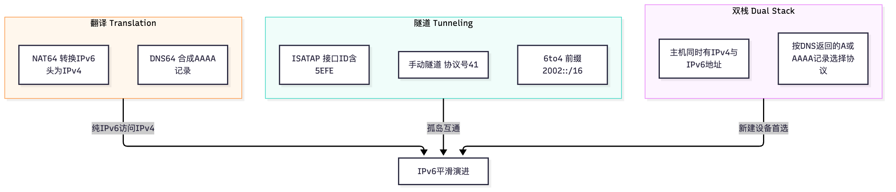


### 真题精练

**Q21.【真题·单选】** OSPFv3 与 OSPFv2 相比，配置上最重要的差别是？
A. OSPFv3 使用 `network` 命令宣告网段
B. OSPFv3 在**接口**下使能（`ospfv3 1 area 0`），不再使用 `network` 命令
C. OSPFv3 的 Router ID 必须是 IPv6 地址
D. OSPFv3 运行在 TCP 之上

> **答案：B**
> **解析**：OSPFv3 是"**基于链路**"运行的，配置方式改为在接口下执行 `ospfv3 1 area <区域号>`，**取消了 OSPFv2 的 `network` 宣告命令**。C 错误：OSPFv3 的 Router ID **仍然是 32 位 IPv4 格式**（这是常考陷阱，很多人以为会变成 IPv6 地址）；D 错误：OSPFv3 仍使用 IP 协议号 89；A 与 B 矛盾。

**Q22.【真题·单选】** RIPng 使用的 UDP 端口与组播地址分别是？
A. UDP 520 与 224.0.0.9  B. UDP 521 与 FF02::9  C. UDP 521 与 FF02::1  D. UDP 520 与 FF02::9

> **答案：B**
> **解析**：RIPng 使用 **UDP 521**（RIPv2 是 520）与**组播地址 FF02::9**（RIPv2 是 224.0.0.9）。FF02::1 是 All-Nodes、FF02::2 是 All-Routers、FF02::5/6 是 OSPFv3 的 AllSPFRouters/AllDRouters、FF02::1:2 是 DHCPv6。这些地址的对应关系必须记清。

**Q23.【真题·多选】** 关于 IPv4 到 IPv6 的过渡技术，下列说法正确的有？
A. 双栈是最基础和推荐的过渡方式，设备同时运行两套协议栈
B. 6to4 隧道使用 2002::/16 前缀，隧道端点由 IPv4 地址推导
C. ISATAP 的接口 ID 中包含 IPv4 地址（形式为 ::5EFE:<IPv4>）
D. NAT64 可以把 IPv6 报文头翻译为 IPv4，但必须配合 DNS64 才能让纯 IPv6 主机访问只有 A 记录的站点

> **答案：ABCD**
> **解析**：四项均正确。双栈是基础；6to4 用 2002::/16 且地址中嵌入 IPv4（例如 IPv4 为 192.0.2.1 时前缀为 2002:c000:0201::/48）；ISATAP 用 `::5EFE:<IPv4>` 形式的接口 ID；NAT64 做协议翻译，DNS64 负责为只有 A 记录的域名合成 AAAA 记录，两者配合才能让纯 IPv6 主机访问传统 IPv4 站点。

**Q24.【真题·填空】** IPv6 静态路由的默认优先级为 ______；IPv6 默认路由的写法是 ______；OSPFv3 使用的组播地址是 ______ 与 ______。

> **答案：60；`ipv6 route-static :: 0 <下一跳>`；FF02::5（AllSPFRouters）；FF02::6（AllDRouters）**
> **解析**：IPv6 静态路由优先级与 IPv4 一致（60），直连 0、OSPFv3 10、IS-ISv6 15、RIPng 100。`::/0` 表示 IPv6 默认路由（目的前缀长度为 0）。OSPFv3 的组播地址是 OSPFv2 的 IPv6 对应（224.0.0.5 → FF02::5，224.0.0.6 → FF02::6）。

**Q25.【真题·排错】** 两台路由器之间 OSPFv3 邻居无法建立，`display ospfv3 peer` 无输出。请给出排查思路。

> **答案与解析**：
> 1. **确认全局与接口均已使能 IPv6**：全局需 `ipv6`（使能 IPv6 转发），接口需 `ipv6 enable` 并配置地址；`display ipv6 interface brief` 确认接口 IPv6 状态为 Up 且已有 LLA（FE80::）。
> 2. **确认接口已使能 OSPFv3**：`display ospfv3 interface` 查看是否有该接口；若为空，说明接口下未配置 `ospfv3 1 area X`。
> 3. **确认 Router ID 已配置**：OSPFv3 的 Router ID 是 32 位 IPv4 格式，若设备上**没有任何 IPv4 地址**且未手工配置 `router-id`，OSPFv3 无法启动。**这是 IPv6-only 环境中最常见的故障原因。**
> 4. **确认区域一致**：两端接口的 `area` 必须相同。
> 5. **确认组播可达与 ACL**：OSPFv3 使用 FF02::5 通信，需要接口允许 IPv6 组播；检查是否有 ACL6 或流量过滤阻断 ICMPv6/OSPFv3（协议号 89）。
> 6. **确认链路本地地址互通**：OSPFv3 邻居基于 LLA 建立，可用 `ping ipv6 fe80::xxx -a <出接口>` 指定出接口测试（LLA 必须指定出接口才能 ping）。
> 7. **检查 DAD 与地址状态**：`display ipv6 interface` 确认地址为 Preferred 而非 Tentative/Duplicate。
> 8. **排错命令**：`display ospfv3 peer`、`display ospfv3 interface`、`display ospfv3 error`、`display ipv6 interface brief`、`display current-configuration configuration ospfv3`。

### 易错点与排错

1. **OSPFv3 无 `network` 命令**，改为接口下 `ospfv3 1 area X`；Router ID 仍是 IPv4 格式。
2. **RIPng 用 UDP 521 与 FF02::9**，别与 RIPv2 混。
3. **IPv6-only 设备必须手工配置 Router ID**，否则 OSPFv3 起不来。
4. **6to4 前缀 2002::/16**，地址中嵌入 IPv4；**ISATAP 用 ::5EFE:IPv4**。
5. 排错命令：`display ipv6 routing-table`、`display ospfv3 peer`、`display ripng 1 route`、`display ipv6 interface brief`、`display ipv6 neighbors`。

---

## 附录 · 本分册速查卡（考前 30 分钟必看）

## A. 数值速查

| 项目 | 数值 |
|---|---|
| 私有地址 | 10.0.0.0/8、172.16.0.0/12（16~31 段）、192.168.0.0/16 |
| 特殊地址 | 0.0.0.0（未指定/默认路由）、127.0.0.0/8（环回）、169.254.0.0/16（链路本地/APIPA）、255.255.255.255（受限广播） |
| 块大小速算法 | 块大小 = 256 − 关键掩码字节（掩码中既非 255 也非 0 的那一段） |
| 华为默认优先级 | Direct 0 / OSPF 10 / IS-IS 15 / Static 60 / RIP 100 / OSPF ASE 150 / IBGP 255 / EBGP 255 |
| 选路三原则 | 最长匹配 > 优先级（小者优）> 度量值（小者优）→ 等价路由 ECMP |
| BFD 默认 | 发送/接收 1000 ms，检测倍数 3 |
| OSPF 协议号 | IP 协议号 **89**（无 TCP/UDP 端口） |
| OSPF 定时器 | 广播/P2P：Hello 10 s、Dead 40 s；NBMA/P2MP：Hello 30 s、Dead 120 s |
| OSPF 组播 | 224.0.0.5（AllSPFRouters）、224.0.0.6（AllDRouters） |
| OSPF 邻居状态 | Down / Attempt / Init / 2-Way / ExStart / Exchange / Loading / Full |
| OSPF DR 选举 | 优先级（默认 1，0~255，0 不参选）→ Router ID，大者胜；**不抢占** |
| OSPF 参考带宽 | 默认 100 Mbps，Cost 小于 1 取 1 |
| OSPF 外部类型 | E1（外部+内部开销）、E2（仅外部开销，默认，默认值 20） |
| LSA 类型 | 1 路由器（每台）、2 网络（DR）、3 汇总网段（ABR）、4 ASBR 汇总（ABR）、5 外部（ASBR）、7 NSSA 外部 |
| DHCP 端口 | 服务器 UDP 67、客户端 UDP 68；租期 T1 50%、T2 87.5% |
| DHCP 关键 Option | 53 报文类型、43 厂商信息、60 厂商类别、82 中继信息、6 DNS、3 网关 |
| Telnet / SSH / HTTP / HTTPS | TCP 23 / 22 / 80 / 443 |
| FTP / TFTP | TCP 21+20（主动）/ UDP 69 |
| DNS | UDP/TCP 53 |
| ACL 编号 | 基本 2000-2999、高级 3000-3999、二层 4000-4999、自定义 5000-5999、用户 6000-6999 |
| ACL 规则 | 顺序匹配命中即停；默认步长 5；**末尾隐含 deny** |
| 通配符掩码 | 通配符 = 255.255.255.255 − 子网掩码；0 = 精确匹配、1 = 忽略 |
| IPv6 地址 | 128 bit、8 组 × 4 位十六进制；标准子网 /64 |
| IPv6 前缀 | GUA 2000::/3、ULA FC00::/7、LLA FE80::/10、组播 FF00::/8、被请求节点 FF02::1:FF00:0/104、环回 ::1、未指定 :: |
| IPv6 组播 | FF02::1 所有节点、FF02::2 所有路由器、FF02::5/6 OSPFv3、FF02::9 RIPng、FF02::1:2 DHCPv6 |
| IPv6 头部 | 固定 **40 字节**、8 字段、无校验和、Next Header 58 = ICMPv6、MTU 最小 1280 |
| EUI-64 | 中间插 FF:FE + **翻转首字节第 7 位（U/L 位，值为 2 的位）** |
| 过渡技术 | 双栈、隧道（手动/6to4 2002::16/ISATAP）、NAT64+DNS64 |

## B. 高频陷阱 Top 10

1. **最长匹配优先于优先级**：RIP 的 /25 也能打赢 Static 的 /16。
2. **172.16.0.0/12 的范围是 172.16.0.0 ~ 172.31.255.255**，共 16 个 B 类。
3. **广播地址由掩码决定**，不是"末尾 255"。
4. **VLSM 必须先大后小分配**，否则大块地址无法对齐。
5. **路由表有条目 ≠ 能转发**：检查 FIB 下刷（`D` 标志）与下一跳可达。
6. **静态路由 Pre 越大越差**，浮动路由的备份必须写更大的 Pre。
7. **OSPF 卡在 ExStart = MTU 不一致；卡在 Init = 单向通信**。
8. **华为 ACL 末尾隐含 deny**，且顺序决定结果（特殊规则放前面）。
9. **路由器与防火墙 NAT 语法完全不同**（`nat outbound` vs `nat-policy` + security-policy）。
10. **IPv6 `::` 只能出现一次**；EUI-64 必须翻转 U/L 位；SLAAC 需要路由器的 `undo ipv6 nd ra halt`。

## C. 排错命令总表

| 场景 | 命令 |
|---|---|
| 接口与地址 | `display ip interface brief`、`display ipv6 interface brief` |
| 路由表 | `display ip routing-table`、`display ip routing-table <目的IP>`、`display fib`、`display ipv6 routing-table` |
| 静态路由 | `display ip routing-table protocol static`、`display current-configuration \| include route-static` |
| OSPF 邻居 | `display ospf peer`、`display ospf peer verbose`、`display ospf interface`、`display ospf error` |
| OSPF 数据库 | `display ospf lsdb`、`display ospf lsdb summary`、`display ospf lsdb ase`、`display ospf abr-asbr` |
| OSPF 路由 | `display ospf routing`、`display ospf brief`、`display ospf vlink` |
| OSPFv3 | `display ospfv3 peer`、`display ospfv3 interface`、`display ospfv3 lsdb` |
| RIPng | `display ripng 1 route`、`display ripng 1 interface` |
| BFD | `display bfd session all` |
| DHCP | `display ip pool`、`display ip pool name X used`、`display dhcp relay statistics`、`display dhcp server statistics` |
| DHCP Snooping | `display dhcp snooping configuration`、`display dhcp snooping user-bind all` |
| ACL | `display acl all`、`display acl 3000`、`display traffic-filter applied-record`、`reset acl counter all` |
| NAT | `display nat outbound`、`display nat server`、`display nat session all`、`display nat address-group 1` |
| 防火墙 | `display security-policy rule all`、`display nat-policy rule all`、`display firewall session table`、`display zone` |
| IPv6 邻居 | `display ipv6 neighbors`、`display ipv6 neighbors all`、`reset ipv6 neighbors all` |
| 远程登录 | `display users`、`display ssh server status`、`display rsa local-key-pair public` |

> **本分册完** —— 数通方向 HCIA 层（下）共 6 章，覆盖 IP 编址与子网划分、IP 路由基础与静态路由、OSPF 基础、应用层服务配置、ACL 与 NAT、IPv6 基础。建议配合上册（章节 1~4：网络基础、TCP/IP、以太网与 VLAN、STP 与链路聚合）与后续 HCIP/HCIE 分册形成完整知识链。
