# A8-WLANHCIA下-配置漫游安全与排障

> **所属**：华为 ICT 大赛网络赛道 · 校赛 / 省赛 · WLAN 方向 · HCIA 层
> **内容**：WLAN 配置与 AP 上线实战、漫游技术、安全技术、规划部署与故障排查
> **真题说明**：本册真题依据华为 ICT 大赛历年公开赛题方向、华为认证考试真题回忆与官方教材例题整理改写，用于自测训练；正式参赛请以大赛官方考试大纲与题库为准。

---

# WLAN-HCIA-章节4-WLAN配置与AP上线实战

## 4.1 WLAN 配置的整体框架与模板引用关系

### 考点定位
本题是 WLAN 方向配置题的"总纲"，省赛配置实操几乎必然先让你建模板再绑 AP 组，分值占比可达配置部分的 30% 以上。高频考法有三种：一是给出业务需求让你写出配置顺序；二是判断某模板被谁引用、少绑哪一条会导致业务不通；三是给出 `display current-configuration` 片段让你找错。最大的易错点是"模板建了但没在 `ap-group` 的 `radio` 视图下引用 `vap-profile`"，此时 `display vap ssid all` 看不到 VAP，STA 自然搜不到 SSID。

### 原理精讲
华为 AC 的 WLAN 配置采用"模板化 + 引用"的设计思想，其根本原因是**管理规模**：一台 AC6805 满配可管理数千个 AP，若采用逐 AP 逐参数配置的方式，配置量随 AP 数量线性膨胀，且改一次密码要登录上千个 AP。因此 AC 把所有无线业务参数抽象成若干 **Profile（模板）**，模板本身只是"参数容器"，创建后不产生任何效果，必须被更高层的对象**引用**才生效。这就是"配置了却没生效"这类问题的根源。

引用关系分为三条链：

- **管理链**：`capwap source interface vlanif 100` 决定 AC 用哪个接口地址与 AP 建 CAPWAP 隧道；`ap auth-mode` 决定 AP 准入方式；`regulatory-domain-profile` 通过 `country-code` 决定该 AP 组允许使用的信道与最大发射功率（各国无线电法规不同，选错国家码会导致信道列表为空、射频起不来）。
- **射频链**：`ap-group` 下的 `radio 0`（2.4GHz）与 `radio 1`（5GHz）分别引用 `radio-2g-profile` / `radio-5g-profile`（信道、带宽、速率集、天线增益）和 `rrm-profile`（自动信道选择、自动功率选择、负载均衡、频段引导、智能漫游）。
- **业务链**：`radio` 视图下用 `vap-profile <名称> wlan <VAP ID>` 绑定 VAP 模板，VAP 模板再引用 `ssid-profile`（SSID 名称、是否隐藏、最大接入用户数）、`security-profile`（认证与加密方式）、`traffic-profile`（上下行限速、优先级映射）。一个 `radio` 最多可绑定 16 个 VAP，因此 2.4G+5G 双频最多可广播 32 个 SSID，但工程上建议单射频不超过 4 个。

需要强调的是**继承方向是单向的**：`ap-group` 引用模板，模板不知道谁引用它。所以同一个模板可以被多个 AP 组复用（例如"办公 SSID"模板同时绑到 1 楼组和 2 楼组），这既是优点也是陷阱——改模板会同时影响所有引用它的 AP 组。

### 关键概念对照表

| 模板名 | 中文名 | 关键参数 | 被谁引用 | 不配的后果 |
|---|---|---|---|---|
| `regulatory-domain-profile` | 域管理模板 | `country-code cn` | `ap-group` | 信道/功率无法下发，射频不可用 |
| `radio-2g-profile` | 2.4G 射频模板 | 信道、带宽、速率集 | `ap-group` 的 `radio 0` | 2.4G 用默认参数，可能与非法规信道冲突 |
| `radio-5g-profile` | 5G 射频模板 | 信道、带宽、`dot11a` 速率 | `ap-group` 的 `radio 1` | 5G 带宽可能不是 80MHz，容量打折 |
| `rrm-profile` | 射频调优模板 | 自动信道、自动功率、负载均衡、频段引导 | `radio 0/1` | 无自动调优，AP 固定用默认信道，同频干扰严重 |
| `vap-profile` | VAP 模板 | `service-vlan`、`forward-mode` | `radio` 视图（带 `wlan` ID） | 无业务虚接口，STA 无法关联 |
| `ssid-profile` | SSID 模板 | `ssid` 名称、隐藏、最大用户数 | `vap-profile` | VAP 无 SSID，空广播 |
| `security-profile` | 安全模板 | `security wpa2 psk`、`dot1x` | `vap-profile` | 默认开放认证，业务裸奔 |
| `traffic-profile` | 流量模板 | 单用户/单 VAP 限速、优先级 | `vap-profile` | 无带宽约束，个别用户可打满空口 |
| `ap-group` | AP 组 | 组织 AP、引用全部模板 | AP（`ap-group` 命令） | AP 落到 `default` 组，无业务 |

### 华为设备配置
```bash
<AC6805> system-view                                  # 进入系统视图
[AC6805] wlan                                         # 进入 WLAN 配置总视图，所有模板在此创建
[AC6805-wlan-view] regulatory-domain-profile name CN  # 创建域管理模板，名称为 CN
[AC6805-wlan-regulatory-domain-prof-CN] country-code cn  # 国家码中国，决定合规信道与功率上限
[AC6805-wlan-view] radio-2g-profile name r2           # 创建 2.4G 射频模板
[AC6805-wlan-radio-2g-prof-r2] channel 20mhz 1 6 11   # 2.4G 只用 1/6/11 三个非重叠信道
[AC6805-wlan-view] radio-5g-profile name r5           # 创建 5G 射频模板
[AC6805-wlan-radio-5g-prof-r5] channel 80mhz 36 44 52 60  # 5G 固定 80MHz 频宽与信道
[AC6805-wlan-view] rrm-profile name rrm1              # 创建射频调优模板
[AC6805-wlan-rrm-prof-rrm1] calibrate auto-channel-select enable   # 开启自动信道选择
[AC6805-wlan-rrm-prof-rrm1] calibrate auto-txpower-select enable   # 开启自动发射功率选择
[AC6805-wlan-view] ssid-profile name ssid-emp         # 创建 SSID 模板
[AC6805-wlan-ssid-prof-ssid-emp] ssid HUAWEI-EMP      # 对外广播的 SSID 名称
[AC6805-wlan-view] security-profile name sec-emp      # 创建安全模板
[AC6805-wlan-security-prof-sec-emp] security wpa2 psk pass-phrase Huawei@123 aes  # WPA2-PSK + AES
[AC6805-wlan-view] traffic-profile name tp-emp        # 创建流量模板
[AC6805-wlan-traffic-prof-tp-emp] rate-limit client up 4096    # 单用户上行限速 4Mbps
[AC6805-wlan-traffic-prof-tp-emp] rate-limit client down 8192  # 单用户下行限速 8Mbps
[AC6805-wlan-view] vap-profile name vap-emp           # 创建 VAP 模板
[AC6805-wlan-vap-prof-vap-emp] service-vlan vlan-id 101        # 业务 VLAN 101
[AC6805-wlan-vap-prof-vap-emp] ssid-profile ssid-emp           # 引用 SSID 模板
[AC6805-wlan-vap-prof-vap-emp] security-profile sec-emp        # 引用安全模板
[AC6805-wlan-vap-prof-vap-emp] traffic-profile tp-emp          # 引用流量模板
[AC6805-wlan-vap-prof-vap-emp] forward-mode tunnel             # 隧道转发，业务数据回 AC 解封装
[AC6805-wlan-view] ap-group name office               # 创建 AP 组，模板最终在组上生效
[AC6805-wlan-ap-group-office] regulatory-domain-profile CN     # AP 组引用域管理模板
[AC6805-wlan-ap-group-office] radio 0                 # 进入该组 2.4G 射频视图
[AC6805-wlan-group-radio-office/0] radio-2g-profile r2         # 引用 2.4G 射频模板
[AC6805-wlan-group-radio-office/0] rrm-profile rrm1            # 引用调优模板
[AC6805-wlan-group-radio-office/0] vap-profile vap-emp wlan 1  # 绑定 VAP 模板，VAP ID = 1
[AC6805-wlan-group-radio-office/0] quit
[AC6805-wlan-ap-group-office] radio 1                 # 进入该组 5G 射频视图
[AC6805-wlan-group-radio-office/1] radio-5g-profile r5         # 引用 5G 射频模板
[AC6805-wlan-group-radio-office/1] rrm-profile rrm1
[AC6805-wlan-group-radio-office/1] vap-profile vap-emp wlan 1  # 同一 VAP ID 在双频同时生效
```

### 示意图
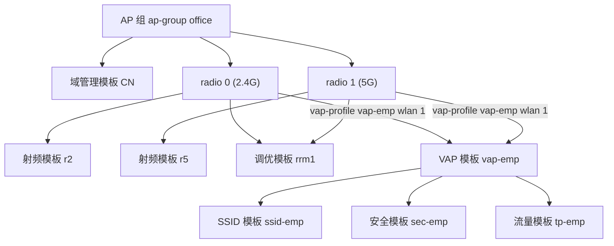

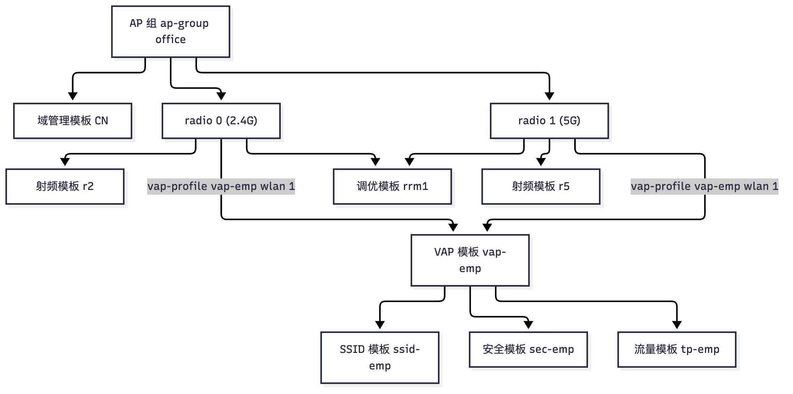


### 易错点与排错
1. **建了模板没引用**：只 `ssid-profile`/`security-profile` 建好是不够的，必须经 `vap-profile` 再绑到 `radio`，三步链条缺一不可。
2. **VAP ID 冲突**：同一 `radio` 下不同 VAP 必须用不同 `wlan` ID；双频复用同一 ID 是允许且推荐的。
3. **国家码漏配**：`regulatory-domain-profile` 未绑定到 `ap-group` 时，`display radio all` 的信道列表可能为空，射频状态为 `fault`。
4. **`service-vlan` 与 AC 侧 VLAN 未创建**：隧道转发下 AC 上必须有 `vlan batch 101` 且 `VLANIF 101` 配好地址（作 STA 网关），否则 STA 关联成功但拿不到 IP。
5. 排错三连：`display vap ssid all`（VAP 是否生成）、`display ap all`（AP 是否 normal）、`display station all`（STA 是否在线）。

---

## 4.2 AC 基础配置与 AP 认证准入

### 考点定位
本考点考查 AC 的"地基"配置：CAPWAP 源接口、国家码、AC 源地址、AP 认证模式。省赛常以填空形式考 `capwap source interface` 的准确写法，或在排错题中给出"AP 能拿到 IP 但一直 autofind"的现象让选手定位到认证模式/白名单问题。三类认证模式（mac-auth / no-auth / sn-auth）的适用场景与安全强度对比是选择题高频点。

### 原理精讲
**CAPWAP 源接口**是 AC 侧一切无线管理报文的"源地址"。AP 上线时通过 DHCP Option 43、DNS 或广播发现 AC 的地址，之后 AP 与 AC 之间建立两条隧道：控制隧道使用 UDP 5246，负责 AP 的配置下发、状态上报、保活（Echo）；数据隧道使用 UDP 5247，在隧道转发模式下承载 STA 的业务报文。CAPWAP（Control And Provisioning of Wireless Access Points，无线接入点控制与配置协议）由 RFC 5415 定义，其设计目标是让 AC 与 AP 解耦：AP 只做射频与时隙收发（Split MAC 的 Real-time 部分），关联管理、加密、漫游决策放在 AC 上（Split MAC 的 Non-real-time 部分），这样 AP 可以做成"零配置"设备，换一台 AP 不需要任何手工配置。

因此 `capwap source interface vlanif 100` 必须指向一个 AC 上真实 Up 的三层接口。为什么不能用物理口随便指一个？因为 AC 常用双机热备与多出口，源地址必须是 AP 可达且稳定的地址；用 `VLANIF` 逻辑接口的好处是物理链路切换时源地址不变，AP 不需要重新发现 AC。

**AP 认证准入**解决的是"哪些 AP 允许接入本 AC"的问题，有三种模式：

- `no-auth`：不认证，任何 AP 只要发现 AC 就能上线。仅用于实验室快速验证，生产环境禁止。
- `mac-auth`：以 AP 的 MAC 地址为准，需在 AC 上预先添加 AP 的 MAC。MAC 可被伪造，属于弱认证。
- `sn-auth`：以 AP 的序列号（SN）为准，SN 全球唯一且难以伪造，是推荐方式；批量部署时常用"AP 自动发现 + SN 白名单导入"的方式做零配置上线。

需要注意一个极易混淆的点：**AP 认证模式与 STA 的认证方式是两件完全不同的事**。前者是 AP 接入 AC 的门禁（CAPWAP Join 阶段的凭证），后者是手机连 Wi-Fi 时的 802.11 认证与加密，考题经常把它们放在同一题干里制造干扰。

### 关键概念对照表

| 项目 | no-auth | mac-auth | sn-auth |
|---|---|---|---|
| 认证依据 | 无 | AP 的 MAC 地址 | AP 的序列号 SN |
| AC 侧命令 | `ap auth-mode no-auth` | `ap auth-mode mac-auth` | `ap auth-mode sn-auth` |
| 是否需要预置信息 | 否 | 是（MAC） | 是（SN） |
| 伪造难度 | 无防护 | 低（MAC 可改） | 高（SN 唯一） |
| 典型用途 | 实验环境 | 小规模、存量改造 | 生产批量部署（推荐） |
| 上线后状态 | 直接 normal | 预置后 normal，未预置 autofind | 同左 |

| CAPWAP 隧道路径 | 端口 | 作用 | 是否可加密 |
|---|---|---|---|
| 控制隧道 | UDP 5246 | 配置下发、Echo 保活、状态上报 | 支持 DTLS |
| 数据隧道 | UDP 5247 | 隧道转发模式下承载 STA 业务报文 | 支持 DTLS |
| 保活周期 | Echo 默认 25s | 检测隧道是否可用 | — |

### 华为设备配置
```bash
[AC6805] vlan batch 100 101 102                       # 100 管理 VLAN，101/102 业务 VLAN
[AC6805] interface vlanif 100                         # 创建 AC 管理 VLANIF
[AC6805-Vlanif100] ip address 10.10.100.1 24          # AC 管理地址，AP 的网关
[AC6805-Vlanif100] quit
[AC6805] interface vlanif 101                         # STA 业务网关
[AC6805-Vlanif101] ip address 10.10.101.1 24          # 隧道转发模式下 AC 作为 STA 网关
[AC6805-Vlanif101] dhcp select interface              # 由 AC 直接给 STA 分配地址（小规模可用）
[AC6805-Vlanif101] quit
[AC6805] capwap source interface vlanif 100           # 指定 CAPWAP 源接口，AP 通过该地址找 AC
[AC6805] wlan                                         # 进入 WLAN 视图
[AC6805-wlan-view] ap auth-mode sn-auth               # 采用序列号认证，生产环境推荐
[AC6805-wlan-view] ap-id 1 type-id 65 ap-mac 00e0-fc12-3456  # 按 MAC 预置 AP；type-id 为 AP 型号编号，可用 display ap-type all 查询
[AC6805-wlan-ap-1] ap-name AP-1F-01                   # 为 AP 命名，便于在网管中识别
[AC6805-wlan-ap-1] ap-group office                    # 将 AP 加入 office 组，继承全部模板
[AC6805-wlan-ap-1] quit
[AC6805-wlan-view] ap-id 1 sn 210235448310C1640021    # SN 认证方式下按序列号预置（部分版本在 ap 视图下配置）
[AC6805] ntp-service enable                           # 开启 NTP，保证 AC 日志时间准确
[AC6805] ntp-service unicast-server 10.10.10.5        # 指定 NTP 服务器
```

### 示意图
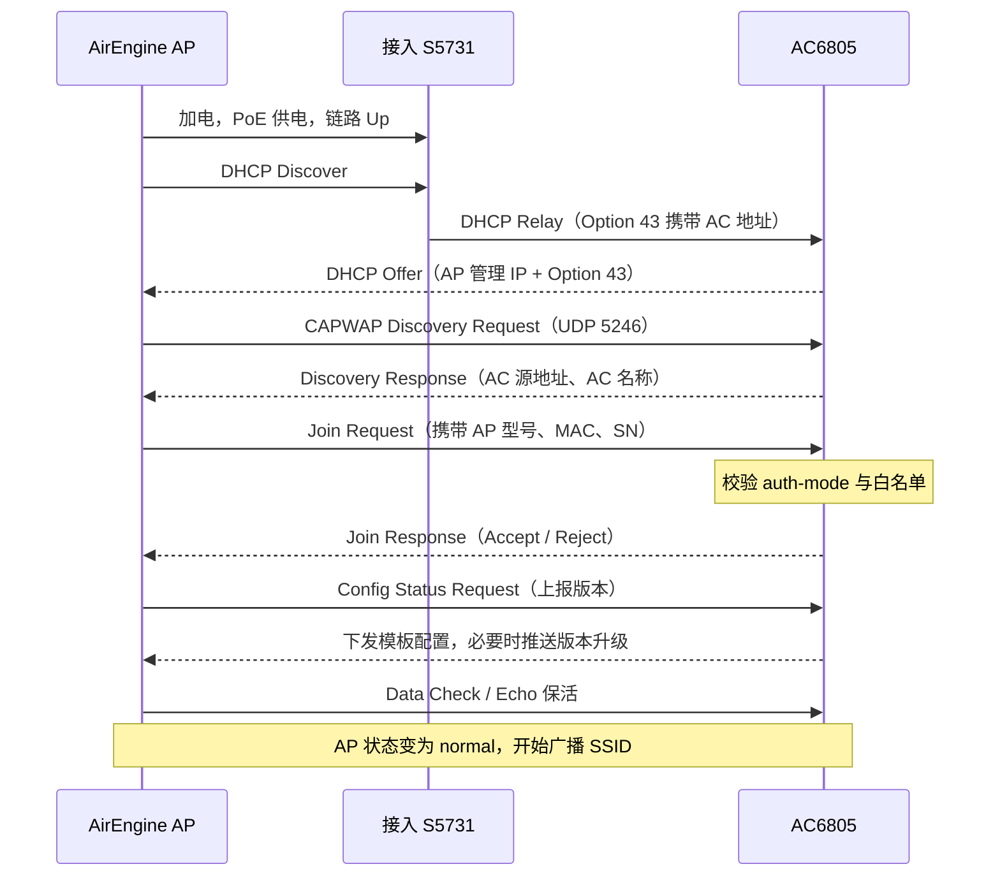

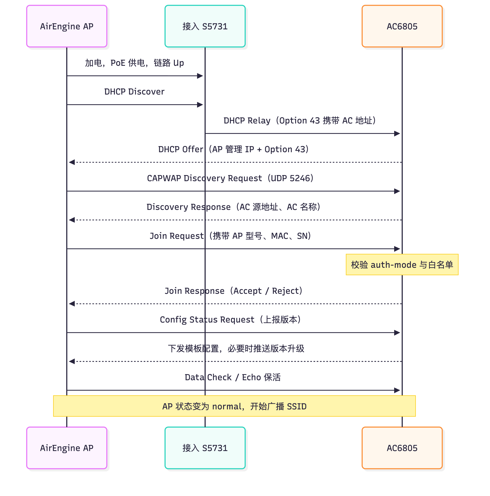


### 易错点与排错
1. `capwap source interface` 只能指定已存在且 Up 的三层接口，写成物理口 `GigabitEthernet0/0/1` 在很多版本不被接受，统一用 `vlanif`。
2. AP 管理 VLAN（本例 100）与 STA 业务 VLAN（101）**必须是不同 VLAN**，同一 VLAN 会导致 CAPWAP 报文与业务报文混在一起，且地址池冲突。
3. `ap auth-mode` 切换后需要 `reset ap` 或等待 AP 重新上线才生效；MAC 认证下若 AP 的 MAC 未预置，`display ap all` 中会看到状态 `autofind`。
4. `no-auth` 模式下即便白名单为空 AP 也能上线，若发现"改回 mac-auth 后 AP 全部掉线"，通常是忘了把存量 AP 的 MAC 批量导入。
5. 排错命令：`display ap all`、`display ap online-fail-record all`、`display capwap configuration`。

---

## 4.3 AP 上线配置全流程与 VAP 模板完整实例

### 考点定位
本考点是省赛实验题的核心：给定一份"办公楼办公 SSID + 游客 SSID + 访客限速"的需求描述，要求从零完成 AC 配置并验证 STA 上线。分值高、步骤多、容错低。高频失分点是：漏配 `capwap source interface`、漏建业务 VLANIF、`vap-profile` 未绑定、`security-profile` 密码复杂度不满足要求（至少 8 位且含两类字符）。

### 原理精讲
VAP（Virtual Access Point，虚拟接入点）是"一个射频上逻辑独立的一套 BSS"，每个 VAP 有自己的 BSSID（由 AP 射频 MAC 派生）、SSID、认证方式与业务 VLAN。`vap-profile` 模板被绑定到 `radio` 时用一个 `wlan <ID>` 标识，这个 ID 就是 VAP 的逻辑编号，双频上的同一 ID 表示"这是同一个业务"。

**转发模式**决定了 STA 的业务报文走哪条路，这是本章最需要理解"为什么"的地方：

- **隧道转发（tunnel）**：STA 的 802.11 帧由 AP 解封装成 802.3 帧后，打上 CAPWAP 封装送到 AC；AC 解封装，按 `service-vlan` 进入对应 VLANIF 转发。优点是 AC 能看到全部用户流量，便于集中做安全策略、漫游与计费；缺点是全部流量都经过 AC，AC 成为带宽瓶颈，且 AC 到 AP 的链路会重复承载同一份流量（管理与数据叠加）。
- **本地转发（direct-forward）**：AP 直接把 802.3 帧打上业务 VLAN Tag 从上行口发出，业务流量不经 AC。优点是转发路径短、AC 压力小、适合大流量与分支场景；缺点是 AC 无法直接管控用户流量，且三层漫游需要额外机制支持。

选择原则：中小型园区、需要精细化管控与三层漫游 → 隧道转发；大型高密、视频类大流量、AC 集中在核心机房 → 本地转发。

### 关键概念对照表

| 对比项 | 隧道转发 tunnel | 本地转发 direct-forward |
|---|---|---|
| AC 侧命令 | `forward-mode tunnel` | `forward-mode direct-forward` |
| 业务报文路径 | AP→CAPWAP→AC→业务网关 | AP→接入交换机→网关 |
| AC 是否需业务 VLANIF | 必须（AC 作网关） | 一般不需要（网关在下游） |
| 接入交换机要求 | 只需放通 AP 管理 VLAN | 上行口需放通全部业务 VLAN（Trunk） |
| AC 压力 | 大（所有用户流量） | 小（仅管理流量） |
| 集中安全策略 | 支持 | 受限 |
| 三层漫游 | 原生支持 | 需要 AC 参与，配置复杂 |
| 典型场景 | 园区办公、需统一管控 | 高密场馆、分支、大流量 |

### 华为设备配置
```bash
[AC6805] wlan
[AC6805-wlan-view] ssid-profile name ssid-guest        # 游客 SSID 模板
[AC6805-wlan-ssid-prof-ssid-guest] ssid HUAWEI-GUEST  # SSID 名称
[AC6805-wlan-ssid-prof-ssid-guest] max-sta-number 60  # 该 SSID 最大接入用户数，防止单 VAP 过载
[AC6805-wlan-view] security-profile name sec-guest     # 游客安全模板
[AC6805-wlan-security-prof-sec-guest] security wpa2 psk pass-phrase Guest@2024 aes  # WPA2-PSK/AES
[AC6805-wlan-view] traffic-profile name tp-guest       # 游客限速模板
[AC6805-wlan-traffic-prof-tp-guest] rate-limit client up 2048    # 单用户上行 2Mbps
[AC6805-wlan-traffic-prof-tp-guest] rate-limit client down 4096  # 单用户下行 4Mbps
[AC6805-wlan-view] vap-profile name vap-guest          # 游客 VAP 模板
[AC6805-wlan-vap-prof-vap-guest] service-vlan vlan-id 102        # 游客业务 VLAN 102
[AC6805-wlan-vap-prof-vap-guest] ssid-profile ssid-guest
[AC6805-wlan-vap-prof-vap-guest] security-profile sec-guest
[AC6805-wlan-vap-prof-vap-guest] traffic-profile tp-guest
[AC6805-wlan-vap-prof-vap-guest] forward-mode tunnel            # 游客走隧道转发便于审计
[AC6805-wlan-vap-prof-vap-guest] quit
[AC6805-wlan-view] ap-group name office                # 复用 4.1 建的 AP 组
[AC6805-wlan-ap-group-office] radio 0                  # 2.4G 射频
[AC6805-wlan-group-radio-office/0] vap-profile vap-emp wlan 1    # 办公 SSID → VAP 1
[AC6805-wlan-group-radio-office/0] vap-profile vap-guest wlan 2  # 游客 SSID → VAP 2
[AC6805-wlan-group-radio-office/0] quit
[AC6805-wlan-ap-group-office] radio 1                  # 5G 射频
[AC6805-wlan-group-radio-office/1] vap-profile vap-emp wlan 1
[AC6805-wlan-group-radio-office/1] vap-profile vap-guest wlan 2
[AC6805-wlan-group-radio-office/1] quit
[AC6805] interface vlanif 102                          # 游客业务网关
[AC6805-Vlanif102] ip address 10.10.102.1 24           # AC 作为游客网段网关
[AC6805-Vlanif102] dhcp select interface
[AC6805-Vlanif102] quit
[AC6805] save                                           # 保存配置，避免重启丢失
```

### 示意图
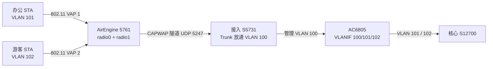

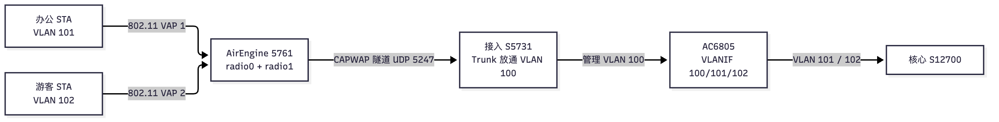


### 易错点与排错
1. **VAP ID 与 `service-vlan` 的对应关系**：同一个 `radio` 下两个 VAP 必须用不同 ID（1 和 2），若都用 `wlan 1`，后一条命令会覆盖前一条，表现为"只广播出一个 SSID"。
2. `max-sta-number` 是**单 VAP 维度**，不是单 AP 维度；高密场景要同时配 `max-sta-number` 与 RRM 的负载均衡。
3. 本地转发时接入交换机上行口必须 Trunk 放通业务 VLAN，否则 STA 关联成功但无法获取 IP——这是"连上不能上网"最常见的物理原因。
4. WPA2-PSK 密码长度 8~63 字符，纯数字 8 位在部分版本会被拒绝，建议 `字母+数字+符号`。
5. 验证顺序：`display ap all` → `display vap ssid all` → `display station all` → `display station assoc-info sta-mac xxxx-xxxx-xxxx`。

---

## 4.4 WLAN 常用 display 命令与"AP 不上线"排查决策树

### 考点定位
【真题·排错】的主战场。题目通常给一段现象描述（如"AP 已上电、能 ping 通管理地址，但 `display ap all` 显示 idle/autofind"）并要求给出排查思路与命令。评分看的是**排查顺序**与**命令准确度**，不是结论。选择题常直接考某条 display 命令能看到什么字段。

### 原理精讲
排错的核心是"沿着 AP 上线的数据流反推故障点"。AP 上线的完整链路是：**供电 → 物理链路 → 获取管理 IP → 发现 AC → 建立 CAPWAP 控制隧道 → 版本匹配 → 认证准入 → 下发配置 → 数据隧道建立 → normal**。这九步中任何一步失败，AP 都停在某个确定状态上，因此排错第一步永远是"看状态"而不是"猜"。

`display ap all` 的关键状态含义：`fault`（AP 与 AC 通信异常或射频硬件故障）、`idle`（AP 已与 AC 建链但尚未完成配置下发）、`autofind`（AP 未被 AC 授权，等待管理员确认）、`download`（正在下载版本，通常是与 AC 版本不匹配触发自动升级）、`config`（配置下发中）、`normal`（正常上线）、`vap-failed`（VAP 建立失败，通常是业务 VLAN 或模板问题）。

各命令的定位分工：`display ap all` 看 AP 维度的状态与型号；`display station all` 看 STA 维度的关联/认证/漫游状态；`display vap ssid all` 看 VAP 是否真正生成（模板引用是否生效）；`display ap online-fail-record all` 看 AP 上线失败的历史原因码，这是排查"AP 反复上线失败"最快的手段；`display ap performance` / `display radio all` 看射频与空口质量。

### 关键概念对照表

| 命令 | 观察维度 | 关键字段 | 典型故障定位 |
|---|---|---|---|
| `display ap all` | AP | State、Model、IP、MAC | AP 是否上线、是否 autofind |
| `display station all` | STA | State、IP、VLAN、AP ID | STA 是否在线、落在哪个 AP |
| `display vap ssid all` | VAP | SSID、VAP ID、状态 | 模板引用是否生效 |
| `display ap online-fail-record all` | AP 历史 | 失败原因码、失败时间 | 反复上线失败根因 |
| `display radio all` | 射频 | 信道、带宽、EIRP、信道利用率 | 覆盖/干扰问题 |
| `display ap performance ap-id 1` | AP 性能 | CPU、内存、在线用户数 | AP 过载 |
| `display station assoc-info sta-mac x-x-x` | STA 关联 | 速率、SNR、RSSI、协商能力 | STA 侧连接质量 |
| `display station online-fail-record all` | STA 历史 | 上线失败原因 | STA 连不上的原因 |

### 华为设备配置
```bash
<AC6805> display ap all                                  # 查看所有 AP 状态、型号、IP，排错第一命令
<AC6805> display ap all | include autofind               # 只看需要确认的 AP，快速定位未授权 AP
<AC6805> display ap online-fail-record all                # 查看 AP 上线失败记录与原因码
<AC6805> display station all                              # 查看在线 STA 的 IP/VLAN/所属 AP
<AC6805> display station assoc-info sta-mac 0011-2233-4455  # 查看指定 STA 的关联详情（RSSI/SNR/速率）
<AC6805> display station online-fail-record all            # 查看 STA 上线失败原因（密钥错误/认证失败等）
<AC6805> display vap ssid all                              # 确认 SSID 对应的 VAP 是否已生成
<AC6805> display radio all                                 # 查看全部射频的信道、带宽、信道利用率
<AC6805> display ap performance ap-id 1                    # 查看单 AP 的 CPU/内存/用户数
<AC6805> display ap config-info ap-id 1                    # 查看 AC 实际下发给该 AP 的配置（部分版本可用）
<AC6805> display mac-address | include 00e0-fc12            # 确认 AP 上行的 MAC 是否已学到，验证物理链路
<AC6805> reset ap ap-id 1                                  # 强制 AP 重新上线，用于验证配置修改
```

### 示意图
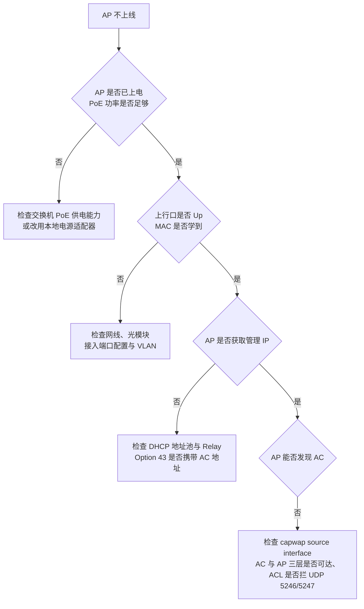

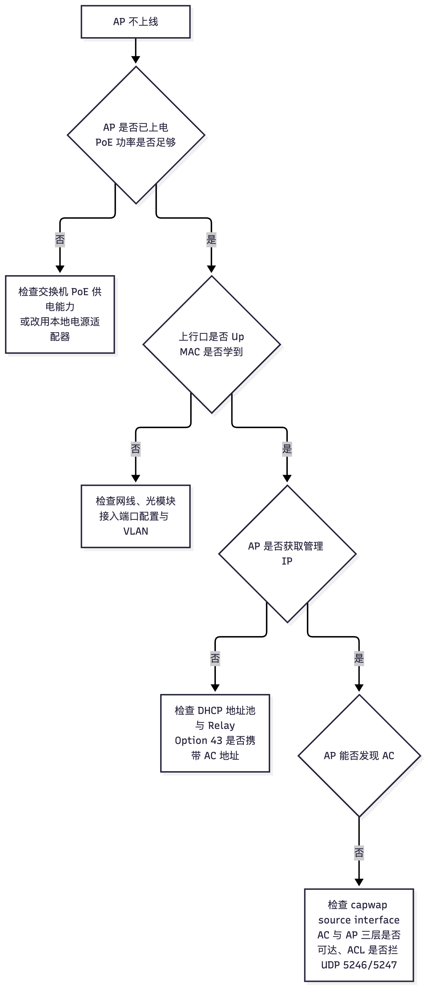

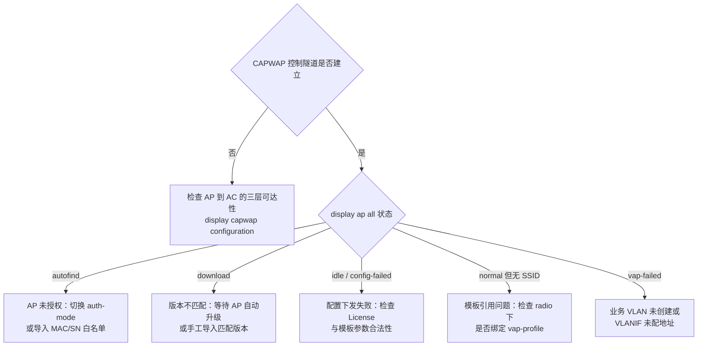

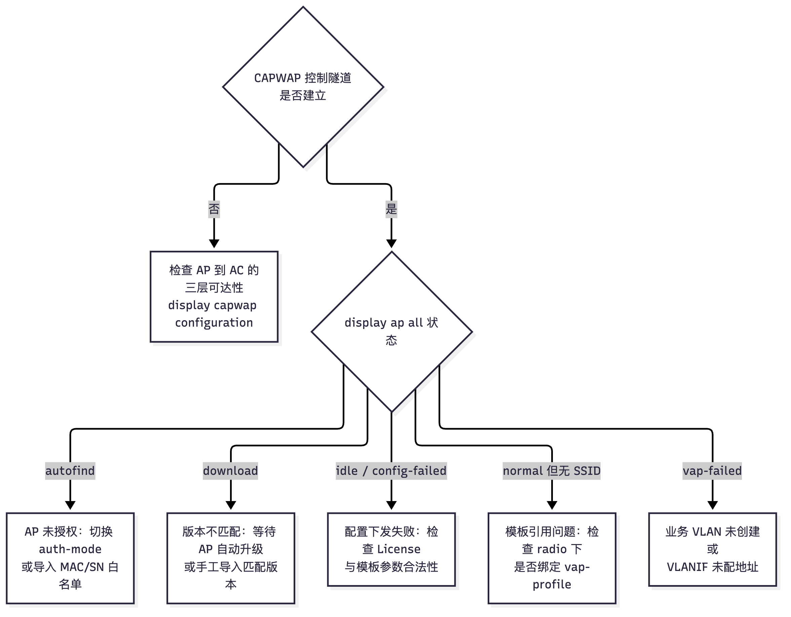


### 易错点与排错
1. **先看状态再看配置**：`display ap all` 的 State 直接给出排查方向，跳过这一步去翻配置是最低效的做法。
2. **`autofind` ≠ 故障**：这是 AC 的"待确认"状态，说明链路、DHCP、发现、CAPWAP 全部正常，只差授权确认，用 `ap-id` 添加即可。
3. **`download` 状态可能持续 10~30 分钟**：AP 与 AC 大版本不一致时会自动升级，此期间不要反复 `reset ap`，否则永远升不完。
4. **UDP 5246/5247 被 ACL 拦截**是"能 ping 通但 AP 不上线"的经典原因，注意排查中间设备与防火墙策略。
5. **License 不足**时新 AP 无法上线，报错通常出现在 `display ap online-fail-record all` 中，需先加载 License 再上线。

---

## 4.5 AC 的 License 管理与 WLAN 网络地址规划

### 考点定位
属于"工程常识题"，考法包括：AC6805 的容量规格数字、License 不足时的现象、管理 VLAN 与业务 VLAN 的划分原则。省赛的方案设计题里，VLAN 与地址规划往往单独占 5~10 分，规划不合理（如管理业务同 VLAN、地址池容量不足）会连带影响后续实验。

### 原理精讲
**License** 是华为对 AC 管理能力的授权：AC 硬件本身有最大规格（AC6805 满配可管理数千 AP），但出厂默认只授权一部分 AP 数量，超出部分需要购买并加载 License 文件（.dat）后才能上线。License 是**按 AP 数量**授权的典型形态，AC 上线的 AP 数达到授权上限后，新 AP 会停在 `autofind` 或上线失败，`display ap online-fail-record all` 中会出现与 License 相关的原因。因此工程交付的第一步核对表里必须包含"License 数量是否 ≥ 实际 AP 数量"。

**地址规划**有三条铁律：

- **管理 VLAN 与业务 VLAN 分离**。AP 的管理地址、AC 的 CAPWAP 源地址属于管理网段；STA 的地址属于业务网段。混用会导致 CAPWAP 隧道报文与用户报文争抢同一广播域，且用户所在的 DHCP 池可能被 AP 耗尽。
- **AP 管理地址池要按 AP 数量留足冗余**。一个 AP 占一个地址，池容量建议 ≥ AP 数量的 1.5 倍（考虑故障替换、临时施工 AP）。
- **DHCP 由谁来做要明确**。小规模可以用 AC 的 `dhcp select interface`；园区规模推荐使用独立的 DHCP 服务器或核心交换机做地址池，并通过 DHCP Relay 与 Option 43 把 AC 地址下发给 AP。

Option 43 是 AP 发现 AC 的关键：DHCP 服务器在给 AP 分配地址时，在 Option 43 中携带 AC 的 IP 地址，AP 收到后直接向该地址发起 CAPWAP Discovery。华为的 Option 43 常用子选项 2（十六进制 IP），例如 AC 地址 10.10.100.1 编码为 `0200000A0A6401` 形式（子选项类型 02 + 长度 04 + 4 字节 IP）。

### 关键概念对照表

| 规格项 | AC6805 | AC6605 | 说明 |
|---|---|---|---|
| 最大可管理 AP 数 | 4096（满配，需 License） | 1024（满配，需 License） | 实际数量取决于 License 授权 |
| 最大并发 STA 数 | 数万级（与 AP 数、转发模式相关） | 万级 | 隧道转发更依赖 AC 转发性能 |
| 默认授权 AP 数 | 出厂基础授权（常见 128，以实际 License 为准） | 常见 128 | 超出需购买叠加 License |
| 查看命令 | `display license`（部分版本 `display wlan license`） | 同左 | License 文件加载后可热生效 |

| VLAN 用途 | 示例 ID | 地址段 | 网关位置 | 备注 |
|---|---|---|---|---|
| AP 管理 VLAN | 100 | 10.10.100.0/24 | 核心/AC | DHCP Option 43 携带 AC 地址 |
| 办公业务 VLAN | 101 | 10.10.101.0/24 | AC/核心 VLANIF | 隧道转发时 AC 为网关 |
| 游客业务 VLAN | 102 | 10.10.102.0/24 | AC/核心 VLANIF | 需与办公网隔离 |
| AC 互联/网管 VLAN | 200 | 10.10.200.0/24 | 核心 | 带外管理，可选 |

### 华为设备配置
```bash
<AC6805> display license                                 # 查看 License 状态与 AP 授权数量
<AC6805> display ap all | include normal | count         # 统计当前已上线 AP 数量
<AC6805> system-view
[AC6805] license                                         # 进入 License 视图（部分版本通过 Web 网管"系统 > License 管理"加载）
[AC6805-license] active license flash:/license.dat       # 激活 License 文件，AP 授权数热生效；命令名随版本略有差异
[AC6805-license] display this                            # 确认当前 License 授权数量
[AC6805] wlan
[AC6805-wlan-view] ap-id 1 type-id 65 ap-mac 00e0-fc12-3456  # 授权后添加新的 AP
[AC6805-wlan-ap-1] ap-group office
[AC6805] dhcp enable                                     # 开启 DHCP 服务（用 AC 做地址池时必须）
[AC6805] ip pool ap-pool                                 # 为 AP 创建地址池（可选，也可由核心设备分配）
[AC6805-ip-pool-ap-pool] network 10.10.100.0 mask 24      # AP 管理网段
[AC6805-ip-pool-ap-pool] gateway-list 10.10.100.1         # 网关指向 AC 的 VLANIF 100
[AC6805-ip-pool-ap-pool] option 43 sub-option 2 ip-address 10.10.100.1  # 下发 AC 地址，AP 直接发现 AC
[AC6805-ip-pool-ap-pool] excluded-ip-address 10.10.100.1 10.10.100.10   # 排除静态占用地址
```

### 示意图
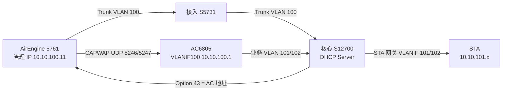

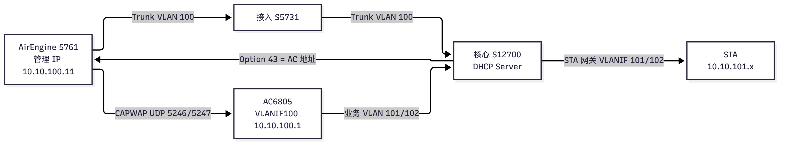


### 易错点与排错
1. License 文件与设备序列号绑定，**不能用其他设备的 License 文件跨设备加载**。
2. License 到期后 AC 会停止部分功能并告警，交付前必须核对有效期；`display license` 中会显示剩余天数。
3. Option 43 配置错误（IP 编码字节序写反）会导致 AP 始终无法发现 AC，AP 会转而使用广播方式反复尝试，表现为上线缓慢。
4. 地址池掩码开得过小（如 /25）而现场 AP 有 200 台时，后 100 台拿不到地址，`display ap all` 中表现为部分 AP 长期 `idle`。
5. 工程交付检查清单：License 数 ≥ AP 数、管理/业务 VLAN 分离、Option 43 可达、AC 源接口 Up、模板全部被引用。

---

## 4.6 章节4真题精练

### 考点定位
本章真题集中在"模板引用关系""AP 上线流程与状态""转发模式差异""排错顺序"四类。题型以单选、多选、填空与排错/实验为主，其中排错与实验题按步骤给分。

### 真题精练

**Q1.【真题·单选】** 在华为 AC 上配置 WLAN 业务时，下列哪一项是"必须被 `ap-group` 引用后才生效"的最小业务模板组合？
A. `ssid-profile` 一个即可
B. `vap-profile` + `ap-group` 引用
C. `security-profile` + `ssid-profile`
D. 只需 `regulatory-domain-profile`

> **答案：B**
> **解析**：`ssid-profile`、`security-profile`、`traffic-profile` 都是被 `vap-profile` 引用的"子模板"，它们自身无法直接绑定到射频；只有 `vap-profile` 通过 `radio` 视图下的 `vap-profile <name> wlan <id>` 绑定后才生成真正的 VAP。A、C 都只停留在中间层，D 只解决信道合规问题，与业务 SSID 无关。

**Q2.【真题·多选】** 关于隧道转发与本地转发，下列说法正确的是？
A. 隧道转发时业务报文经 CAPWAP 数据隧道（UDP 5247）送至 AC 解封装
B. 本地转发时接入交换机上行口必须放通业务 VLAN
C. 隧道转发模式下 AC 上必须存在业务 VLANIF
D. 本地转发无法实现任何形式的漫游
E. 隧道转发可以减轻 AC 的转发压力

> **答案：A、B、C**
> **解析**：D 错误——本地转发同样支持二层漫游，只是三层漫游需要 AC 参与，并非"无法漫游"；E 错误——隧道转发把所有用户流量都汇聚到 AC，恰恰**增加**了 AC 的转发压力，本地转发才减轻 AC 压力。

**Q3.【真题·判断】** `capwap source interface` 可以指定为一个物理接口，例如 `capwap source interface GigabitEthernet0/0/1`。

> **答案：错误**
> **解析**：该命令要求源接口为 AC 上已存在且 Up 的三层接口，工程与考试标准答案均为 `capwap source interface vlanif <id>`。用 VLANIF 的好处是物理链路切换时源地址保持稳定，AP 无需重新发现 AC。

**Q4.【真题·填空】** AP 与 AC 之间的 CAPWAP 控制隧道使用 UDP 端口 ______，数据隧道使用 UDP 端口 ______；在 AC 上查看 AP 上线失败历史原因的命令是 `______`。

> **答案：5246；5247；display ap online-fail-record all**
> **解析**：CAPWAP 由 RFC 5415 定义，控制与数据隧道分端口承载，便于分别做 QoS 与安全策略。注意数据隧道仅在隧道转发模式下承载业务报文。

**Q5.【真题·单选】** `display ap all` 中某 AP 的状态为 `autofind`，最可能的原因是？
A. AP 与 AC 版本不匹配
B. AP 未被 AC 授权（认证模式为 mac-auth/sn-auth 且未预置）
C. AP 的射频硬件故障
D. AC 未配置业务 VLAN

> **答案：B**
> **解析**：`autofind` 表示 AP 已完成发现与 CAPWAP Join 的绝大部分流程，只差管理员的授权确认。A 对应 `download` 状态；C 通常表现为 `fault`；D 会在 AP `normal` 之后导致 STA 无法获取地址或 VAP 建立失败。

**Q6.【真题·简答】** 请说明 WLAN 配置中 `regulatory-domain-profile` 的作用，以及"只创建但不绑定到 `ap-group`"会出现什么现象。

> **答案与解析**：
> - 作用：通过 `country-code` 指定 AP 所在国家/地区，从而确定该 AP 组允许使用的信道集合与最大发射功率上限，是满足各国无线电管理法规的强制配置；同时影响 DCA（动态信道分配）的候选信道范围。
> - 现象：模板未被引用则不生效，AP 使用默认国家码或无可选信道，`display radio all` 中可能出现信道列表为空、射频状态 `fault`、2.4G 无法在 1/6/11 中选择，5G 可用信道与本地法规不符（例如误开到本地禁用信道）。
> - 正确做法：`ap-group` 视图下执行 `regulatory-domain-profile CN`，再 `reset ap` 使其重新上线。

**Q7.【真题·排错】** 现场现象：一台 AirEngine 5761 加电后指示灯常亮，接入交换机上能看到该 AP 的 MAC 地址，但 `display ap all` 中查不到任何 AP。请给出你的排查思路与每一步使用的命令。

> **答案与解析**（按顺序给分）：
> 1. **确认 AC 侧源接口**：`display capwap configuration`，核对 `capwap source interface` 是否为 AP 可达的 VLANIF 且接口 Up；未配置则补 `capwap source interface vlanif 100`。
> 2. **确认 AP 是否拿到 IP**：在接入交换机 `display mac-address` 确认 AP 的 MAC 已学习；在 DHCP 服务器查看 10.10.100.0/24 的地址分配记录，`display ip pool name ap-pool used`。
> 3. **确认 Option 43**：检查 DHCP 池是否配置 `option 43 sub-option 2 ip-address 10.10.100.1`；若无，AP 只能用广播发现，跨三层时必然失败。
> 4. **确认三层可达**：在 AC 上 `ping` AP 的管理地址；不通说明 VLAN 或路由有问题。
> 5. **确认端口与 ACL**：核对中间设备是否放通 UDP 5246/5247，AC 上 `display acl all` 查看是否误拦。
> 6. **确认 AC 是否处于正常状态**：`display ap all` 若仍为空，可在 AC 上开 `debugging wlan capwap all` 并 `terminal monitor` 观察是否收到 Discovery Request（观察后务必 `undo debugging all`）。
> 7. **兜底验证**：将 AP 与 AC 置于同一 VLAN 直连测试，若此时能上线，则问题确定在 DHCP/路由/ACL 环节。

**Q8.【真题·实验】** 实验要求：AC6805 与 AirEngine 5761 组网，AC 管理地址 10.10.100.1/24（VLANIF 100），要求广播一个名为 `HUAWEI-EMP` 的 SSID，业务 VLAN 101（网关 10.10.101.1/24，由 AC 分配地址），采用 WPA2-PSK/AES，单用户下行限速 8Mbps，双频同时生效，采用隧道转发。请写出关键配置（要求含注释）。

> **答案与解析**：
```bash
<AC6805> system-view
[AC6805] vlan batch 100 101                              # 管理 VLAN 与业务 VLAN 分开
[AC6805] interface vlanif 100
[AC6805-Vlanif100] ip address 10.10.100.1 24             # AC 管理地址 / AP 网关
[AC6805-Vlanif100] quit
[AC6805] interface vlanif 101
[AC6805-Vlanif101] ip address 10.10.101.1 24             # STA 网关（隧道转发下 AC 为网关）
[AC6805-Vlanif101] dhcp select interface                 # 由 AC 分配 STA 地址
[AC6805-Vlanif101] quit
[AC6805] dhcp enable                                     # 必须开启 DHCP 功能
[AC6805] capwap source interface vlanif 100              # CAPWAP 源接口
[AC6805] wlan
[AC6805-wlan-view] ap auth-mode mac-auth                 # 实验环境用 MAC 认证
[AC6805-wlan-view] regulatory-domain-profile name CN
[AC6805-wlan-regulatory-domain-prof-CN] country-code cn
[AC6805-wlan-view] ssid-profile name ssid-emp
[AC6805-wlan-ssid-prof-ssid-emp] ssid HUAWEI-EMP
[AC6805-wlan-view] security-profile name sec-emp
[AC6805-wlan-security-prof-sec-emp] security wpa2 psk pass-phrase Huawei@123 aes
[AC6805-wlan-view] traffic-profile name tp-emp
[AC6805-wlan-traffic-prof-tp-emp] rate-limit client down 8192   # 单用户下行 8Mbps
[AC6805-wlan-view] vap-profile name vap-emp
[AC6805-wlan-vap-prof-vap-emp] service-vlan vlan-id 101
[AC6805-wlan-vap-prof-vap-emp] ssid-profile ssid-emp
[AC6805-wlan-vap-prof-vap-emp] security-profile sec-emp
[AC6805-wlan-vap-prof-vap-emp] traffic-profile tp-emp
[AC6805-wlan-vap-prof-vap-emp] forward-mode tunnel
[AC6805-wlan-view] ap-group name office
[AC6805-wlan-ap-group-office] regulatory-domain-profile CN
[AC6805-wlan-ap-group-office] radio 0
[AC6805-wlan-group-radio-office/0] vap-profile vap-emp wlan 1
[AC6805-wlan-group-radio-office/0] quit
[AC6805-wlan-ap-group-office] radio 1
[AC6805-wlan-group-radio-office/1] vap-profile vap-emp wlan 1
[AC6805-wlan-ap-group-office] quit
[AC6805-wlan-view] ap-id 1 type-id 65 ap-mac 00e0-fc12-3456
[AC6805-wlan-ap-1] ap-name AP-1F-01
[AC6805-wlan-ap-1] ap-group office
[AC6805] save
```
> 验证：`display ap all`（State=normal）、`display vap ssid all`（SSID=HUAWEI-EMP 且双频各一个）、`display station all`（STA 上线且 VLAN=101）。

### 易错点与排错
- 忘记 `dhcp enable` 是 STA 拿不到地址的高频原因，`dhcp select interface` 必须在全局 DHCP 开启后才生效。
- 双频生效的标志是 `display vap ssid all` 中出现两条记录（分别对应 2.4G 与 5G），只有一条说明另一个 radio 未绑定。
- `reset ap` 后 AP 需要 1~3 分钟重新上线，实验时不要在 30 秒内重复执行。

---

# WLAN-HCIA-章节5-WLAN漫游技术

## 5.1 漫游的定义、触发条件与技术指标

### 考点定位
漫游是 WLAN 方向区分"会用"与"懂原理"的分水岭，省赛考法包括：判断某个场景属于二层还是三层漫游、给出漫游阈值参数让选手判断是否会触发、以及问"漫游过程中语音为什么会断"。分值通常与安全技术并列，属于必考内容。

### 原理精讲
**漫游（Roaming）**指 STA 在保持**同一 IP 地址、同一业务会话不中断**的前提下，从一个 AP 的 BSS 关联切换到另一个 AP 的 BSS 的过程。这里要抓住三个关键词：同一 IP、会话不中断、关联切换。如果换了 IP，那是"重新接入"而不是漫游；如果会话中断（TCP 连接复位），那是"掉线重连"。

漫游的触发由 **STA 侧决策为主、网络侧引导为辅**。STA 在关联后持续扫描邻居 AP 的信标，当满足以下条件时发起切换：

1. **信号强度门限**：当前 AP 的 RSSI 低于阈值（常见 -70dBm ~ -75dBm），同时候选 AP 的 RSSI 高出当前 AP 一定余量（如 5~10dB）。这是最经典的触发条件。
2. **信噪比门限**：SNR（Signal to Noise Ratio，信噪比）低于 25dB 时，虽然信号强度可能不低，但误码率已明显升高，STA 会倾向切换。
3. **重传与速率**：连续重传失败、协商速率持续下降到最低速率集，说明链路质量劣化。
4. **负载因素**：当前 AP 用户数或信道利用率过高，在支持 802.11v 的网络中由 AC 通过 BSS Transition Management Request 引导 STA 切换。

网络侧能做的**引导**手段包括：802.11k（Radio Resource Measurement，让 STA 快速获取邻居 AP 报告，省去全信道扫描）、802.11v（BSS 过渡管理，AC 主动"劝"STA 换 AP）、频段引导（Band Steering，把双频 STA 从 2.4G 赶到 5G）。

漫游的性能指标：**漫游时延**是从 STA 发出重关联请求到新 AP 完成密钥协商、恢复数据转发的总时间。语音业务要求单次漫游时延 < 50ms（含密钥协商），理想状态 < 30ms；普通数据业务可容忍 200ms 以内。**漫游丢包**在快速漫游（802.11r）下可控制在 1~3 个报文，普通 WPA2-PSK 漫游可能丢 10~50 个报文，对语音表现为明显的"卡一下"。

### 关键概念对照表

| 触发/优化机制 | 标准 | 作用 | 谁主导 |
|---|---|---|---|
| RSSI 门限 | 厂商实现 | 信号弱到阈值即触发切换 | STA |
| SNR 门限 | 厂商实现 | 噪声升高导致误码时切换 | STA/AC 引导 |
| 802.11k | IEEE 802.11k | 邻居报告，减少扫描时间 | AC 提供，STA 决策 |
| 802.11v | IEEE 802.11v | BSS 过渡管理，AC 主动引导 | AC |
| Band Steering | 厂商实现 | 双频 STA 优先上 5G | AC |
| 802.11r | IEEE 802.11r | 快速 BSS 转换，漫游时延降到 50ms 内 | STA + AC |

| 指标 | 语音业务要求 | 数据业务要求 | 备注 |
|---|---|---|---|
| 漫游时延 | < 50ms | < 200ms | 含密钥协商 |
| 漫游丢包 | ≤ 1~3 包 | ≤ 10 包 | 影响 RTP 抖动 |
| 漫游前后 RSSI | ≥ -65dBm | ≥ -70dBm | 保证通话清晰 |
| SNR | > 25dB | > 20dB | 与速率的强相关 |

### 华为设备配置
```bash
[AC6805] wlan
[AC6805-wlan-view] rrm-profile name rrm1                 # 漫游与调优参数在 RRM 模板中统一配置
[AC6805-wlan-rrm-prof-rrm1] smart-roam enable            # 开启智能漫游，AC 协助 STA 选择更优 AP
[AC6805-wlan-rrm-prof-rrm1] smart-roam check-snr         # 以信噪比作为漫游触发判据（默认基于速率）
[AC6805-wlan-rrm-prof-rrm1] smart-roam snr-threshold 25  # SNR 低于 25dB 时触发漫游引导
[AC6805-wlan-rrm-prof-rrm1] band-steer enable            # 开启频段引导
[AC6805-wlan-rrm-prof-rrm1] band-steer balance           # 均衡模式：把双频 STA 优先引到 5G
[AC6805-wlan-view] ap-group name office
[AC6805-wlan-ap-group-office] radio 0
[AC6805-wlan-group-radio-office/0] rrm-profile rrm1      # 射频引用 RRM 模板后漫游参数生效
[AC6805-wlan-group-radio-office/0] quit
[AC6805-wlan-ap-group-office] radio 1
[AC6805-wlan-group-radio-office/1] rrm-profile rrm1
<AC6805> display station roam-track sta-mac 0011-2233-4455  # 查看指定 STA 的漫游轨迹（关键排错命令）
```

### 示意图
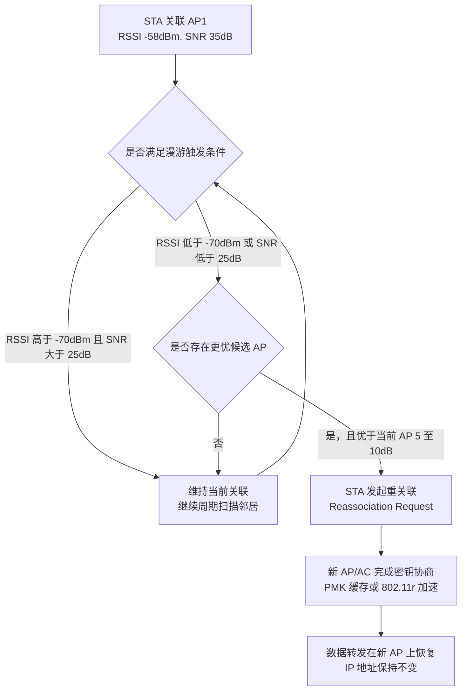

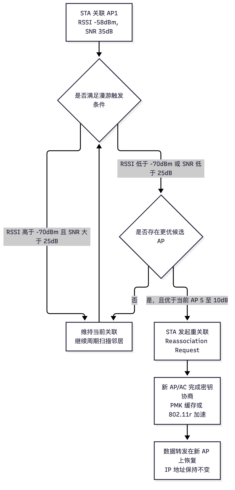


### 易错点与排错
1. **漫游阈值不能设得过激**：`smart-roam` 参数过激会导致 STA 在两个 AP 间来回切换（乒乓漫游），表现为网速剧烈抖动。
2. **2.4G 与 5G 之间的切换也是漫游**：跨频段漫游属于同一 AC 内的二层漫游（如果 `service-vlan` 相同），不要误判成三层漫游。
3. **STA 决定权最大**：AC 只能"建议"，如果终端驱动不响应 802.11k/v，AC 侧配置再全也无效，这是排错时必须先排除的"终端侧因素"。
4. **排查漫游问题首选 `display station roam-track sta-mac`**，它能给出完整的切换时间线（Old AP → New AP → 时间戳），是判断"没漫游"还是"漫游慢"的唯一权威手段。
5. 漫游性能还受**上游网络**影响：漫游后 STA 的网关若需重新 ARP 或路由收敛慢，用户感知的"断"其实来自 IP 网络而非空口。

---

## 5.2 漫游类型分类与二层漫游过程

### 考点定位
分类对照表是纯送分题也是高频陷阱题：题目常给一个拓扑（同 AC 同 VLAN、同 AC 不同 VLAN、跨 AC 不同 VLAN）要求选类型。二层漫游的过程细节（重关联、新 AP 上报、AC 更新转发表）也是简答题常见要求。

### 原理精讲
漫游分类有两个独立维度，考试必须同时说明：

**维度一：按 IP 是否变化，分为二层漫游与三层漫游。**
- **二层漫游（Layer 2 Roaming）**：STA 漫游前后处于**同一 IP 子网、同一 VLAN**。新 AP 与旧 AP 属于同一个广播域，STA 的 IP、网关、ARP 表项全部不变，AC 只需把 STA 的转发表项从旧 AP 指向新 AP。这是最简单也最可靠的漫游形式，业务几乎无感知。
- **三层漫游（Layer 3 Roaming）**：STA 漫游前后**跨 IP 子网/VLAN**。STA 的 IP 必须保持不变（否则会话全断），因此报文必须由网络侧"绕回"原网段。这就是"家乡代理（Home Agent）"概念的来源：STA 原本所在的网段（Home VLAN）由一个代理实体负责收发该 STA 的报文，漫游后 STA 的报文先送到代理，再由代理以原网段地址送出。

**维度二：按 AC 的参与范围，分为 AC 内漫游与 AC 间漫游。**
- **AC 内漫游（Intra-AC Roaming）**：所有 AP 挂在同一台 AC 下，STA 上下文、密钥、转发表都在同一台设备内更新，无需信令交互，时延最低。
- **AC 间漫游（Inter-AC Roaming）**：AP 分属不同 AC，需要配置**漫游组（Mobility Group）**并互通密钥与 STA 上下文（Huawei 通过 AC 间的 Mobility 隧道交互），还需要 AC 之间三层可达。AC 间二层漫游要求两台 AC 与 AP 处于同一二层网络或通过隧道打通；AC 间三层漫游则必须基于隧道转发模式，因为只有隧道转发时业务流量才必然经过 AC，AC 才能充当家乡代理。

二层漫游的过程可以拆成 6 步：STA 扫描并决定切换 → 向新 AP 发送 Reassociation Request（携带原 AP 的 BSSID 与自己的关联信息）→ 新 AP 上报 AC → AC 校验 STA 上下文与密钥（若命中 PMK 缓存则跳过完整 802.1X，直接进入四次握手或快速握手）→ AC 更新转发表把 STA 指向新 AP → 新 AP 回 Reassociation Response → 数据通路切换完成。关键在于**关联（Association）在漫游时叫重关联（Reassociation）**，报文里带着"我从哪来"的信息，AC 据此实现上下文迁移。

### 关键概念对照表

| 分类维度 | 类型 | 判定要点 | 关键配置 | 业务影响 |
|---|---|---|---|---|
| IP 是否变化 | 二层漫游 | 同 VLAN、同网段 | 无特殊要求 | 几乎无中断 |
| IP 是否变化 | 三层漫游 | 跨 VLAN、IP 不变 | 隧道转发 + 家乡代理 | 有少量丢包 |
| AC 范围 | AC 内漫游 | 同一台 AC | RRM 模板即可 | 时延最低（< 50ms） |
| AC 范围 | AC 间漫游 | 不同 AC | `mobility-group` + `member` | 需 AC 间三层可达 |
| 频段 | 同频漫游 | 2.4G→2.4G | — | 同频干扰下体验差 |
| 频段 | 跨频漫游 | 2.4G↔5G | Band Steering | 通常体验更好 |

| 漫游场景 | 同 AC | 跨 AC | 必要条件 |
|---|---|---|---|
| 二层漫游 | 支持，最简单 | 需 AC 间二层互通或 Mobility 隧道 | 同 VLAN |
| 三层漫游 | 支持，需隧道转发 | 支持，需漫游组 + 隧道转发 | IP 不变、家乡代理可达 |

### 华为设备配置
```bash
[AC6805] wlan
[AC6805-wlan-view] rrm-profile name rrm1                  # 二层漫游优化的核心模板
[AC6805-wlan-rrm-prof-rrm1] smart-roam enable             # 智能漫游
[AC6805-wlan-rrm-prof-rrm1] smart-roam check-snr
[AC6805-wlan-rrm-prof-rrm1] smart-roam snr-threshold 25
[AC6805-wlan-view] vap-profile name vap-emp               # 二层漫游只需保证同 VLAN
[AC6805-wlan-vap-prof-vap-emp] service-vlan vlan-id 101   # 同一 VAP 模板下发到两个 AP，VLAN 一致即二层漫游
[AC6805-wlan-vap-prof-vap-emp] forward-mode tunnel        # 隧道转发下 AC 统一处理漫游，时延更可控
<AC6805> display station all                              # 观察 STA 是否已切换到新 AP（Ap ID 变化）
<AC6805> display station roam-track sta-mac 0011-2233-4455 # 查看漫游轨迹与每次切换的时间
<AC6805> display station assoc-info sta-mac 0011-2233-4455 # 查看切换后的 RSSI/SNR 与协商速率
```

### 示意图
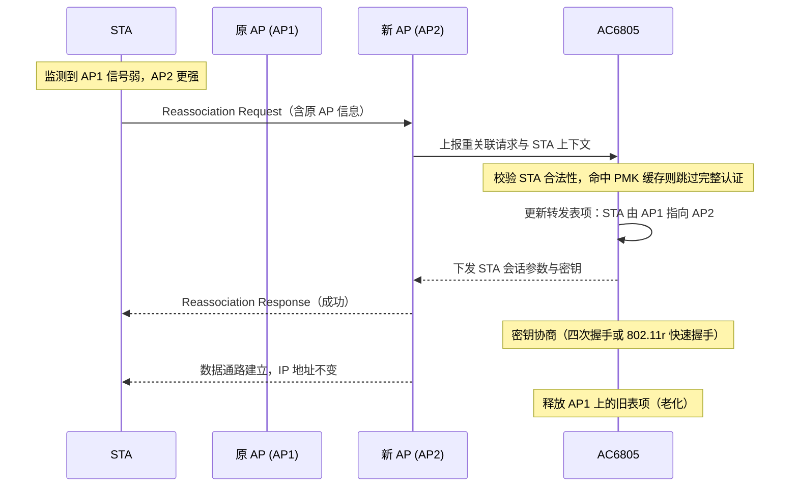

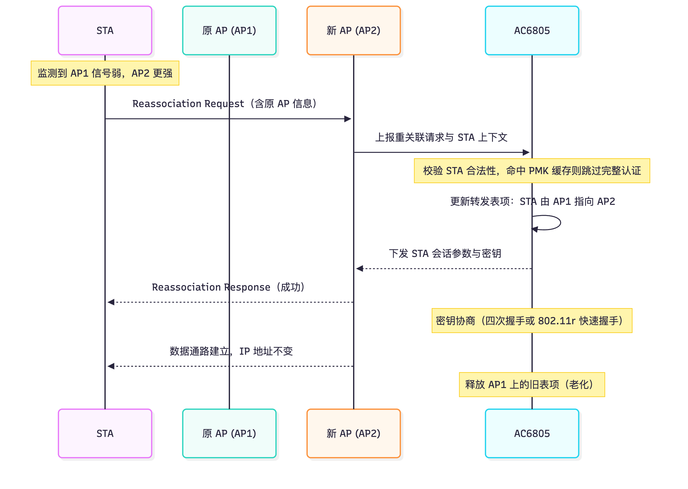


### 易错点与排错
1. **"同一个 SSID"不等于"同一个 VLAN"**：若两个 AP 的 `vap-profile` 引用了不同 `service-vlan`，STA 漫游就变成三层漫游，配置与现象完全不同。
2. AC 内二层漫游**不需要**配置 `mobility-group`，配了也无害；只有跨 AC 才必须配。
3. 漫游后 `display station all` 中 STA 的 Ap ID 会变化，但 IP 与 VLAN 不变，这是判断二层漫游成功的直接证据。
4. 若漫游后 STA 无法通信，先检查接入交换机是否更新了 MAC 地址表（本地转发模式下必须更新），再检查 AC 转发表是否老化正确。
5. `display station roam-track` 中若完全没有记录，说明 STA 根本没有发生重关联（终端"粘"在原 AP 上），应从覆盖与 `smart-roam` 参数入手，而不是排查 AC 表项。

---

## 5.3 三层漫游过程与家乡代理数据流

### 考点定位
三层漫游是本章最难的考点，常以"数据流路径画图/选择正确转发路径"或"解释为什么漫游后 IP 不变"的形式出题。省赛实操中，三层漫游的配置通常与漫游组一起考，属于压轴题。

### 原理精讲
三层漫游要解决的核心矛盾是：**STA 换了 VLAN，但 IP 不能换**。假如一台笔记本在 1 楼从 VLAN 101 的网段（10.10.101.0/24）拿到地址后走到 2 楼，2 楼 AP 属于 VLAN 102，如果按正常三层转发，STA 必须重新获取 102 网段的地址，所有 TCP 会话作废。为了保持 IP，网络必须为 STA 保留一条通往"原网段"的路径。

华为的实现是引入**家乡代理**概念，并把 STA 首次关联的 AP 称为 **HAP（Home AP，家乡 AP）**，漫游后新关联的 AP 称为 **FAP（Foreign AP，外地 AP）**：

1. STA 在 HAP 下首次上线，AC 记录其"家乡 VLAN"（Home VLAN，例如 101）与家乡网关信息。
2. STA 漫游到 FAP，FAP 位于 VLAN 102。STA 发往外部网络的上行报文，经 FAP 通过 CAPWAP 数据隧道送到 AC。
3. AC 识别出这是"漫游状态"的 STA，将报文按其**家乡 VLAN 101** 送入 VLANIF 101，从家乡网段转发出去（这就是"家乡代理"功能，AC 担当 Home Agent）。
4. 外部回程报文到达 VLANIF 101 后，AC 再次查询 STA 的当前位置，通过 FAP 的 CAPWAP 隧道送到 FAP，由 FAP 无线发出。
5. 对其他设备而言，STA 始终在 10.10.101.0/24 网段，IP 与 ARP 表项都不变。

由此可以推出一个关键结论：**三层漫游必须使用隧道转发模式**。因为只有隧道转发时，FAP 的业务流量必然回到 AC，AC 才有机会把报文"改道"回家乡 VLAN。若使用本地转发，FAP 会直接按 VLAN 102 把报文发出去，源 IP 却是 101 网段，必然被上游设备的反向路由或 uRPF 丢弃。

反向路径上还有一个细节值得注意：STA 下行报文从家乡网段回来时，若中间设备依据目的 IP 做 ARP 解析，会发现在 101 网段里"找不到"这台 STA（它在 102 的 AP 上）。因此必须由 AC 代理应答该 STA 的 ARP，或者在 AC 上为漫游 STA 生成主机路由（/32），把流量牵引到 FAP 隧道。这正是"家乡代理"必须由 AC（或支持该特性的网关）承担的原因。

### 关键概念对照表

| 概念 | 全称 | 角色 | 在本过程中的作用 |
|---|---|---|---|
| HAP | Home AP | 家乡 AP | STA 首次关联的 AP，决定 STA 的家乡 VLAN |
| FAP | Foreign AP | 外地 AP | 漫游后 STA 关联的 AP，位于新 VLAN |
| Home VLAN | 家乡 VLAN | 逻辑网段 | STA 的 IP 所属网段，漫游后不变 |
| Foreign VLAN | 外地 VLAN | 逻辑网段 | FAP 所在网段，仅承载空口接入 |
| Home Agent | 家乡代理 | AC 功能 | 代 STA 在原网段收发报文、应答 ARP |
| Mobility Tunnel | 漫游隧道 | AC 间通道 | 跨 AC 漫游时传递 STA 上下文与数据 |

| 场景 | 转发模式 | 家乡代理位置 | 是否支持 |
|---|---|---|---|
| 同 AC 三层漫游 | 隧道转发 | 本 AC | 支持 |
| 同 AC 三层漫游 | 本地转发 | 无 | 不支持（IP 会断） |
| 跨 AC 三层漫游 | 隧道转发 | 家乡 AC | 支持，需漫游组 |
| 跨 AC 二层漫游 | 隧道或本地 | 不需要 | 支持，需 AC 间互通 |

### 华为设备配置
```bash
[AC6805] wlan
[AC6805-wlan-view] vap-profile name vap-emp                # 三层漫游业务模板
[AC6805-wlan-vap-prof-vap-emp] service-vlan vlan-id 101     # 家乡 VLAN 101
[AC6805-wlan-vap-prof-vap-emp] forward-mode tunnel          # 三层漫游必须隧道转发
[AC6805-wlan-view] vap-profile name vap-emp-2f              # 2 楼 AP 使用的 VAP 模板（外地 VLAN）
[AC6805-wlan-vap-prof-vap-emp-2f] service-vlan vlan-id 102  # 外地 VLAN 102
[AC6805-wlan-vap-prof-vap-emp-2f] forward-mode tunnel       # 保证业务流量回 AC，由 AC 改道回家乡 VLAN
[AC6805] interface vlanif 101
[AC6805-Vlanif101] ip address 10.10.101.1 24                # 家乡网段网关（由 AC 担任家乡代理）
[AC6805-Vlanif101] quit
[AC6805] interface vlanif 102
[AC6805-Vlanif102] ip address 10.10.102.1 24                # 外地网段网关，漫游 STA 不使用该网段地址
[AC6805-Vlanif102] quit
[AC6805] ip route-static 10.10.0.0 255.255.0.0 10.10.200.1  # 保证回程路由可达，避免非对称路由
<AC6805> display station all                                # 检查 STA 的 IP 与 VLAN，确认漫游后 IP 未变
<AC6805> display station roam-track sta-mac 0011-2233-4455   # 查看跨 VLAN 漫游轨迹
```

### 示意图


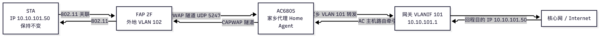


### 易错点与排错
1. **本地转发做三层漫游必然失败**：这是最经典的判断题，理由是业务报文不经过 AC，无法改道回家乡 VLAN。
2. 若漫游后能 ping 通网关但访问不了外部，重点查**回程路由**与 AC 上是否生成漫游 STA 的主机路由（`display ip routing-table`）。
3. 三层漫游要求 AC 同时拥有家乡与外地两个网段的 VLANIF，否则报文进不来也出不去。
4. 跨 AC 三层漫游时，家乡 AC 必须在线；家乡 AC 掉线会导致漫游 STA 全部失联，设计时需考虑 AC 备份。
5. 排错三连：`display station all`（IP 是否变）→ `display station roam-track`（是否真的跨 VLAN）→ `display ip routing-table`（回程是否可达）。

---

## 5.4 漫游组（Mobility Group）与 AC 间漫游配置

### 考点定位
配置题常以"两台 AC 组网，要求 STA 能跨 AC 漫游"的形式出现，考查 `mobility-group` 与 `member` 命令的准确写法、AC 间三层可达性的要求，以及跨 AC 漫游为什么需要 IACTP/漫游隧道。选择题会问"漫游组最多支持几个成员"这类规格数字。

### 原理精讲
AC 间漫游的本质问题是：**STA 的上下文与密钥在 AC-A 上，而它现在关联到了 AC-B 下的 AP**。两台独立的 AC 之间必须建立一个可信通道，用来传递 STA 的会话信息（MAC、密钥、家乡信息、QoS 参数）。华为通过**漫游组（Mobility Group）**来实现：把多台 AC 加入同一个漫游组并互相配置 `member ip-address`，它们之间会通过 AC 间隧道（基于 UDP 的 IACTP，Inter-AC Tunnel Protocol）交互 STA 上下文。

配置上有三个硬性前提，缺一不可：

1. **AC 之间三层可达**：`member ip-address` 填的是对端 AC 的源地址，通常就是各自的 `capwap source interface` 对应的地址，双方必须能互通。
2. **漫游组配置对称**：AC-A 上要把 AC-B 配成 member，AC-B 上也要把 AC-A 配成 member。单边配置会导致漫游时对端拒绝建立隧道。
3. **`vap-profile` 引用漫游组**：在 VAP 模板下用 `mobility-group <name>` 引用漫游组，只有被引用的 VAP 才参与跨 AC 漫游。

跨 AC 二层漫游时，两台 AC 与 AP 需要处于同一二层网络，或者 WLAN 侧已经通过其他方式打通二层；跨 AC 三层漫游时，隧道转发 + 漫游组是标准组合，家乡 AC 充当家乡代理。工程上为了可靠性，常把两台 AC 配成 VRRP 双机热备（HSB），并用 `wlan` 视图下的 HSB 配置同步 STA 表项，这样主 AC 故障时备用 AC 能接管在线用户，比漫游组更彻底。

### 关键概念对照表

| 配置项 | 作用 | AC-A 示例 | AC-B 示例 |
|---|---|---|---|
| `mobility-group name` | 创建漫游组，组名需双方一致 | `mobility-group name mg1` | `mobility-group name mg1` |
| `member ip-address` | 指定对端 AC 的地址 | `member ip-address 10.10.100.2` | `member ip-address 10.10.100.1` |
| `vap-profile` 引用 | 让 VAP 参与跨 AC 漫游 | `mobility-group mg1` | `mobility-group mg1` |
| AC 间隧道 | 传递 STA 上下文 | IACTP，基于三层可达 | 同左 |
| AC 源地址 | 隧道本端地址 | `capwap source interface vlanif 100` | 同左 |

| 对比项 | 漫游组（Mobility Group） | 双机热备（HSB） |
|---|---|---|
| 目的 | 跨 AC 漫游 | AC 故障时业务不中断 |
| 是否传递实时表项 | 漫游时按需传递 | 实时批量同步 |
| 组网要求 | AC 间三层可达 | 主备 AC 需 HSB 通道与相同配置 |
| 典型场景 | 多 AC 分区部署 | 核心机房双机冗余 |

### 华为设备配置
```bash
# ===== AC-A（10.10.100.1）=====
[AC-A] wlan
[AC-A-wlan-view] mobility-group name mg1                    # 创建漫游组，名称双方必须一致
[AC-A-wlan-mobility-group-mg1] member ip-address 10.10.100.2 # 指定对端 AC-B 的地址
[AC-A-wlan-mobility-group-mg1] quit
[AC-A-wlan-view] vap-profile name vap-emp
[AC-A-wlan-vap-prof-vap-emp] mobility-group mg1              # VAP 引用漫游组，该 SSID 才能跨 AC 漫游
[AC-A-wlan-vap-prof-vap-emp] forward-mode tunnel             # 跨 AC 三层漫游必须隧道转发
[AC-A] capwap source interface vlanif 100                    # 源地址即漫游隧道本端地址
# ===== AC-B（10.10.100.2）=====
[AC-B] wlan
[AC-B-wlan-view] mobility-group name mg1                    # 同名漫游组
[AC-B-wlan-mobility-group-mg1] member ip-address 10.10.100.1 # 指向 AC-A，必须双向配置
[AC-B-wlan-mobility-group-mg1] quit
[AC-B-wlan-view] vap-profile name vap-emp
[AC-B-wlan-vap-prof-vap-emp] mobility-group mg1
[AC-B-wlan-vap-prof-vap-emp] forward-mode tunnel
[AC-B] capwap source interface vlanif 100
<AC-A> display mobility-group all                            # 查看漫游组与成员状态（是否 UP）
<AC-A> display station all                                   # 跨 AC 漫游后 STA 仍应在线
```

### 示意图


### 易错点与排错
1. **漫游组必须双向配置**，只在一侧配 `member`，对端不会主动建链，`display mobility-group all` 会显示成员 Down。
2. 漫游组的 `member ip-address` 应使用对端 AC 的**源接口地址**，用管理口其他地址可能因路由或 ACL 不通。
3. 两台 AC 的 VAP 模板 `service-vlan` 若不一致，会导致二层漫游变三层，行为差异很大，配置时务必统一规划。
4. 跨 AC 漫游需要两台 AC 的**时间同步**（NTP），否则排错日志时间戳错乱，定位困难。
5. `display mobility-group all` 看组与成员状态，`display station roam-track` 看实际轨迹，两条命令配合可快速判断是"没建链"还是"建链但没漫游"。

---

## 5.5 漫游与安全：密钥协商、PMK 缓存、OKC 与 802.11r

### 考点定位
本题把漫游与安全串起来考，是省赛的"综合题"。典型问法：为什么 WPA2-Enterprise 漫游时语音会断？PMK 缓存与 802.11r 分别优化了哪一段？802.11r 的 FT 与普通漫游相比少了几次报文交互？属于必须理解原理才能答对的题目。

### 原理精讲
漫游的性能瓶颈往往不在空口切换，而在**密钥协商**。完整流程下，STA 换 AP 后需要重新做一次 802.1X 认证（STA ↔ AP ↔ AC ↔ RADIUS 往返多次），再走四次握手，整个过程可达 300ms~1s。对语音而言这已经等于"通话中断"。

优化手段按"优化哪一段"分为三类：

1. **PMK 缓存（PMK Caching，802.11i）**：STA 与 AC 在首次认证后把 PMK（Pairwise Master Key，成对主密钥）缓存起来，用一个 PMKID 标识（PMKID = HMAC-SHA1-128(PMK, "PMK Name" || AA || SPA)）。漫游到新 AP 时，STA 在重关联请求里带上 PMKID，AC 查到缓存命中则直接跳过 802.1X，进入四次握手。这样省掉了 RADIUS 往返，但四次握手仍在。
2. **OKC（Opportunistic Key Caching，机会密钥缓存）**：PMK 缓存的扩展，把缓存范围从"同一 AC 内的多个 AP"扩展到**同一漫游域内的多台 AC**。STA 侧用 PMK 与新旧 AP 的 MAC 计算出 PMKID，漫游时携带，AC 命中即可快速推导出新的 PTK。OKC 是私有扩展（各厂商实现差异较大），依赖 PMK 在 AC 间同步。
3. **802.11r（Fast BSS Transition，快速 BSS 转换 FT）**：把密钥层级改为 PMK-R0（由 MSK 派生，绑定 SSID）与 PMK-R1（由 PMK-R0 派生，绑定目标 AP），STA 在**漫游之前**就能通过与当前 AP 的 FT 交互预先把 PMK-R1 拿到手，漫游时只需 4 个报文（FT Authentication Request/Response + Reassociation Request/Response）就完成认证与密钥安装，把时延压到 50ms 以内，支持语音与视频。

FT 有两种工作模式：**Over-the-Air（空口模式）**，STA 直接与目标 AP 做 FT 认证，新 AP 通过 AC 转发密钥请求；**Over-the-DS（分布式系统模式）**，STA 的 FT 报文经当前 AP 通过 AC 转发到目标 AP。前者更快、报文更少，后者更适用于目标 AP 不可直达的场景。

需要注意：802.11r 要求所有 AP 属于同一个**移动域（Mobility Domain）**，MDID 与 FT 参数必须在同一 SSID 下一致，否则 STA 会拒绝使用 FT；且部分老终端不支持 802.11r，配置时应提供兼容开关（如华为的 `ft enable` 与 PSK/802.1X 组合使用）。

### 关键概念对照表

| 机制 | 标准 | 优化环节 | 典型时延 | 依赖条件 |
|---|---|---|---|---|
| 无优化（完整 802.1X + 四次握手） | 802.11i | 全部 | 300ms~1s | RADIUS 可达 |
| PMK 缓存 | 802.11i | 省去 802.1X | 100~200ms | AC 内缓存 PMK |
| OKC | 厂商扩展 | 省去 802.1X（跨 AP/AC） | 100~200ms | PMK 在漫游域内共享 |
| 802.11r FT | 802.11r | 省去 802.1X 且简化握手 | < 50ms | 同一移动域、终端支持 |
| 802.11k | 802.11k | 缩短扫描 | 减 50~100ms | 终端支持邻居报告 |
| 802.11v | 802.11v | 提前引导切换 | 减少掉线 | 终端支持 |

| FT 模式 | 全称 | 报文路径 | 优点 | 缺点 |
|---|---|---|---|---|
| Over-the-Air | 空口模式 | STA ↔ 目标 AP 直连 | 时延最低 | 目标 AP 需与 STA 可达 |
| Over-the-DS | 分布式系统模式 | STA → 当前 AP → AC → 目标 AP | 兼容性好 | 多一跳，稍慢 |

### 华为设备配置
```bash
[AC6805] wlan
[AC6805-wlan-view] security-profile name sec-emp
[AC6805-wlan-security-prof-sec-emp] security wpa2 psk pass-phrase Huawei@123 aes  # WPA2-PSK/AES 基础
[AC6805-wlan-security-prof-sec-emp] ft enable              # 开启 802.11r 快速 BSS 转换
[AC6805-wlan-security-prof-sec-emp] ft-over-ds enable      # 允许 Over-the-DS 模式，兼容不支持空口 FT 的终端
[AC6805-wlan-security-prof-sec-emp] pmf optional           # 802.11w 管理帧保护，可选模式兼容老终端
[AC6805-wlan-view] security-profile name sec-1x            # 802.1X 场景同样可开 FT
[AC6805-wlan-security-prof-sec-1x] security wpa2 dot1x aes
[AC6805-wlan-security-prof-sec-1x] ft enable
[AC6805-wlan-view] rrm-profile name rrm1
[AC6805-wlan-rrm-prof-rrm1] smart-roam enable              # 智能漫游引导，配合 802.11k/v 效果最佳
[AC6805-wlan-rrm-prof-rrm1] smart-roam check-snr
[AC6805-wlan-rrm-prof-rrm1] band-steer enable              # 频段引导，减少跨频段漫游次数
<AC6805> display station roam-track sta-mac 0011-2233-4455  # 查看漫游耗时，验证 FT 是否生效
<AC6805> display security-profile name sec-emp              # 确认 FT/PMF 参数已下发
```

### 示意图
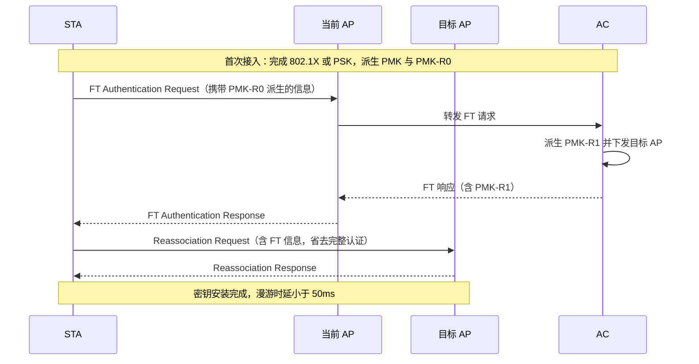

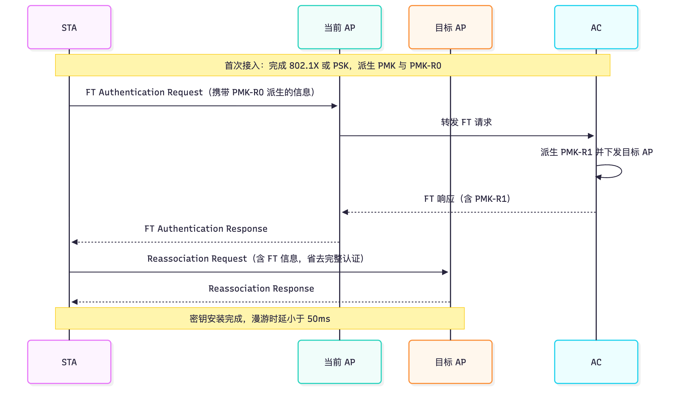


### 易错点与排错
1. **PMK 缓存与 OKC 只省 802.1X，不省四次握手**；只有 802.11r 才同时简化密钥协商，这是最容易混的点。
2. `ft enable` 后若终端报"无法连接"，多为终端不支持 FT，可将 `pmf` 设为 `optional` 并确认终端固件；必要时对该 SSID 关闭 FT 做对比测试。
3. 802.11r 要求同一 SSID 下所有 AP 的移动域参数一致，跨 AC 部署时需保证模板统一，否则 STA 在部分 AP 上无法使用 FT。
4. 开启 FT 与 PMF 后，漫游性能问题应结合 `display station roam-track` 的**时间戳差值**分析，光看"是否切换成功"无法定位慢在哪一段。
5. 语音场景建议同时开启 802.11k + 802.11v + 802.11r，并保证 `service-vlan` 与安全模板全园区一致。

---

## 5.6 章节5真题精练

### 考点定位
本章真题集中在漫游分类判定、三层漫游的转发模式要求、漫游组配置、快速漫游机制对比四类，是"理解型"考点，靠背命令无法得分。

### 真题精练

**Q1.【真题·单选】** STA 从 1 楼 AP 漫游到 2 楼 AP，两个 AP 的业务 VLAN 分别为 101 和 102，漫游后 STA 的 IP 地址保持不变。该漫游属于？
A. 二层漫游  B. 三层漫游  C. 跨 AC 漫游  D. 不属于漫游

> **答案：B**
> **解析**：判断依据是"是否跨 IP 子网"。VLAN 101 与 102 属于不同网段，而 IP 地址保持不变，因此必然是三层漫游，需要家乡代理机制。C 不一定成立，题干未说明是跨 AC。

**Q2.【真题·多选】** 关于三层漫游，下列描述正确的有？
A. 必须采用隧道转发模式
B. 漫游后 STA 的 IP 地址保持不变
C. AC 在漫游中充当家乡代理的角色
D. 本地转发同样可以原生支持三层漫游
E. 需要 AC 上存在家乡 VLAN 与外地 VLAN 的三层接口

> **答案：A、B、C、E**
> **解析**：D 错误——本地转发时业务报文直接从 AP 发出，不经过 AC，AC 无法把报文改道回家乡 VLAN，源 IP 与出口网段不匹配会被上游丢弃，因此三层漫游必须隧道转发。

**Q3.【真题·判断】** 同一 AC 内的二层漫游必须配置漫游组（mobility-group）才能实现。

> **答案：错误**
> **解析**：漫游组用于 AC 间漫游，同一 AC 内的 STA 上下文与转发表都在本机，二层漫游直接由 AC 更新转发表项即可完成。配了漫游组也不会影响功能，但属于多余配置。

**Q4.【真题·填空】** 华为 AC 上创建漫游组并向其中添加成员的命令分别是 `______` 和 `______`；查看漫游组状态使用 `______`。

> **答案：mobility-group name <组名>；member ip-address <对端 AC 地址>；display mobility-group all**
> **解析**：漫游组名称在参与漫游的所有 AC 上必须一致，`member` 必须双向配置，否则漫游隧道无法建立。

**Q5.【真题·单选】** 下列哪种机制可以同时省去漫游时的 802.1X 认证与完整的四次握手？
A. PMK 缓存  B. OKC  C. 802.11r FT  D. Band Steering

> **答案：C**
> **解析**：PMK 缓存与 OKC 都是通过复用 PMK 跳过 802.1X，但四次握手（或至少密钥安装）仍要执行；802.11r 通过 PMK-R0/PMK-R1 层级在漫游前预派生密钥，把交互压缩到 4 个报文，时延可低于 50ms。D 只影响 STA 选择哪个频段，不改变密钥协商过程。

**Q6.【真题·简答】** 语音业务对漫游有哪些量化要求？在华为 AC 上可采取哪些配置手段保障语音漫游体验？

> **答案与解析**：
> - 量化要求：单次漫游时延 < 50ms（理想 < 30ms）；漫游丢包不超过 1~3 个报文；漫游前后 RSSI ≥ -65dBm、SNR > 25dB；RTP 抖动小，避免 MOS 值下降。
> - 配置手段：`smart-roam enable` 配合 `smart-roam check-snr` 与合理的 `smart-roam snr-threshold`，避免终端"粘"在弱信号 AP 上；开启 `band-steer enable` 减少跨频段无效切换；`security-profile` 下 `ft enable`（802.11r）并 `ft-over-ds enable` 兼容老终端；必要时 `pmf optional` 兼顾兼容性；保证同 SSID 下 VLAN 与安全模板统一，控制单 AP 用户数，避免空口拥塞拉高漫游时延。

**Q7.【真题·多选】** 以下哪些是 AC 间漫游（跨 AC 漫游）的必备条件？
A. 两台 AC 之间三层可达
B. 两台 AC 配置同名漫游组且互相配置 member
C. VAP 模板引用漫游组
D. 两台 AC 必须使用完全相同的硬件型号
E. AC 之间时间同步

> **答案：A、B、C、E**
> **解析**：D 错误——跨 AC 漫游不要求硬件型号相同，但要求软件版本兼容、模板参数（VLAN、安全、SSID）一致。E 虽不是协议强制要求，但工程上时间不同步会导致排错日志无法对应，属于实施必备条件。

**Q8.【真题·排错】** 现场现象：两台 AC 完成漫游组配置后，`display mobility-group all` 显示成员为 Down 状态，STA 无法跨 AC 漫游。请给出排查步骤。

> **答案与解析**：
> 1. 检查**双向配置**：确认 AC-A 上有 `member ip-address <AC-B 地址>`，AC-B 上也有指向 AC-A 的 member，单边配置是最高频原因。
> 2. 检查**地址可达性**：在 AC-A 上 `ping <AC-B 源接口地址>`；若不通，检查 AC 之间的路由、VLAN 放通与中间 ACL。
> 3. 核对**成员地址是否等于对端源接口地址**：`display capwap configuration` 确认各自的 `capwap source interface`，`member` 必须用该地址。
> 4. 检查**中间设备是否拦截 UDP**：漫游隧道基于 UDP，若防火墙或 ACL 只放通了 ICMP，会出现"能 ping 通但成员 Down"。
> 5. 检查**VAP 是否引用漫游组**：`display vap-profile name vap-emp` 确认 `mobility-group mg1` 已配置，未引用则 STA 仍按单 AC 处理。
> 6. 检查两台 AC 的**时间与版本**：版本差异过大可能导致 IACTP 协商失败，`display version` 与 NTP 状态一并核对。

### 易错点与排错
- 判断漫游类型只看"IP 是否变化/是否跨网段"，不要被 AC 数量干扰。
- `display station roam-track sta-mac xxxx-xxxx-xxxx` 是漫游排错第一命令，先确认"是否发生了漫游"，再谈"漫游快不快"。
- 跨 AC 漫游中，家乡 AC 一旦下线，漫游 STA 会失去家乡代理，业务中断；设计时须考虑 AC 冗余。

---

# WLAN-HCIA-章节6-WLAN安全技术

## 6.1 WLAN 安全威胁与攻击面分析

### 考点定位
本章开篇考"威胁类型与防护手段的对应关系"，常见题型是给出攻击描述选择攻击名称或防护机制。窃听、伪 AP/钓鱼 AP、中间人、暴力破解、Deauth 攻击是必考五类，其中 Deauth 攻击与 802.11w 的对应关系出现频率极高。

### 原理精讲
WLAN 的安全威胁根植于**空口是开放介质**这一物理事实：任何处于覆盖范围内的设备都能收到空口中的所有帧，这是"窃听"无法从物理上根除的原因，只能通过加密让窃听者拿到密文。按攻击目标可以把威胁分成四层：

**第一层：机密性威胁（窃听与破解）。** 攻击者用监听模式网卡抓包，若网络使用开放认证或 WEP，流量可被直接读取甚至解密。WEP 的破解不需要穷举密钥，而是利用 RC4 的 IV 只有 24 位导致的高频碰撞，收集数万个报文即可恢复密钥。

**第二层：真实性威胁（伪 AP 与钓鱼）。** 攻击者架设一个与合法 SSID 同名的假 AP（Rogue AP / Evil Twin），配合更强的信号让 STA 主动关联，从而窃取用户名密码或实施中间人攻击。防御依赖于：合法 AP 的 MAC/SN 白名单、WIDS 的非法 AP 检测、以及终端侧的证书校验（802.1X + 服务器证书能有效防钓鱼，因为假 AP 拿不到合法证书）。

**第三层：可用性威胁（Deauth 与干扰）。** 802.11 的管理帧（Beacon、Auth、Deauth、Disassoc）在传统实现中是**明文且无完整性保护**的，攻击者只要伪造源地址为 AP 的 Deauth 帧，就能强制断开 STA，实施"无线踢人"或配合伪 AP 做降级攻击。防御机制是 802.11w（PMF，Protected Management Frames，管理帧保护），它用 BIP（Broadcast/Multicast Integrity Protocol）对管理帧做完整性校验，并引入 SA Query 机制识别伪造的关联请求。此外还有射频干扰（Jamming）与频谱攻击，需要频谱分析手段发现。

**第四层：认证威胁（暴力破解与弱口令）。** WPA2-PSK 的四次握手报文可以被离线捕获，攻击者用字典对 PMK 做离线穷举（因为 PMK = PBKDF2(口令, SSID, 4096 次迭代)，可离线计算比对）。防御手段是强口令（≥ 12 位混合字符）与迁移到 WPA3-SAE（Dragonfly 握手，天然抗离线字典攻击，且具备前向保密）。

### 关键概念对照表

| 威胁 | 攻击原理 | 影响 | 防护手段 |
|---|---|---|---|
| 窃听 | 空口开放，监听模式抓包 | 机密信息泄露 | WPA2/WPA3 加密（CCMP/GCMP） |
| WEP 破解 | RC4 + 24 位 IV 碰撞 | 密钥被恢复 | 禁用 WEP，改用 WPA2/WPA3 |
| 伪 AP/钓鱼 | 同名 SSID + 强信号诱骗关联 | 凭据被窃、中间人 | 802.1X 证书校验、WIDS 检测、黑白名单 |
| 中间人 | 伪 AP 转发流量 | 数据被篡改或窃取 | 证书校验、加密、PMF |
| 暴力破解 | 抓四次握手离线字典 | PSK 口令被破 | 强口令、WPA3-SAE |
| Deauth 攻击 | 伪造管理帧 | STA 掉线、服务中断 | 802.11w（PMF + SA Query） |
| 射频干扰 | 同频大功率噪声 | 吞吐骤降 | 频谱分析、信道调整、干扰源定位 |

### 华为设备配置
```bash
[AC6805] wlan
[AC6805-wlan-view] wids                                    # 进入 WIDS 配置视图，开启无线入侵检测
[AC6805-wids-view] device detection enable                 # 开启设备检测（发现非法 AP 与干扰源）
[AC6805-wids-view] attack detection enable                 # 开启攻击检测（Deauth/ARP/泛洪等）
[AC6805-wids-view] ap whitelist 00e0-fc12-3456             # 合法 AP 加入白名单，避免误报
[AC6805-wids-view] sta blacklist 0011-2233-4455            # 恶意 STA 加入黑名单，禁止接入
[AC6805] wlan
[AC6805-wlan-view] security-profile name sec-1x
[AC6805-wlan-security-prof-sec-1x] security wpa2 dot1x aes  # 企业级：802.1X 认证 + AES 加密
[AC6805-wlan-security-prof-sec-1x] pmf mandatory            # 强制管理帧保护，抵御 Deauth 攻击
<AC6805> display wids device all                            # 查看检测到的非法设备与干扰源
<AC6805> display wids attack all                             # 查看检测到的攻击事件
<AC6805> display station blacklist all                       # 确认黑名单是否生效
```

### 示意图
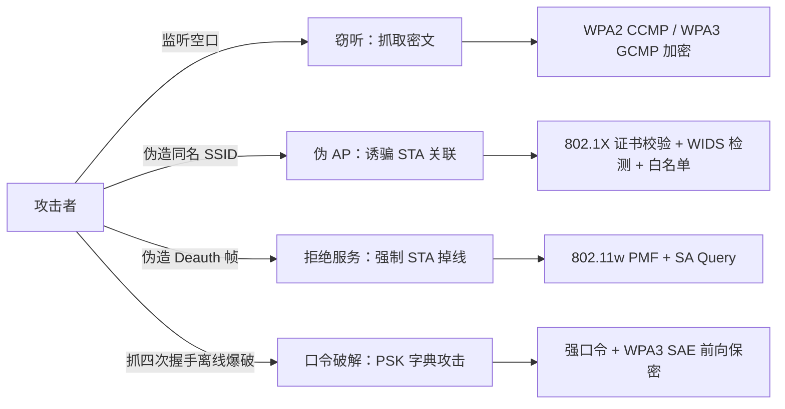

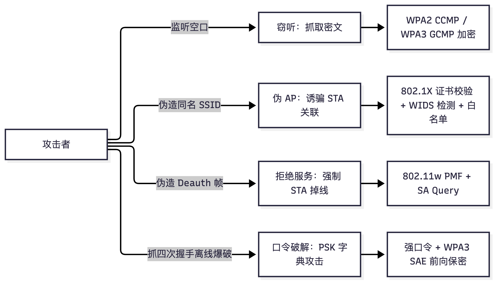


### 易错点与排错
1. **WEP 的致命缺陷是 IV 太短（24 位）而非 RC4 算法本身**，同时 ICV 使用 CRC-32 属于线性校验，可被比特翻转攻击——这两个点常被拆成两道题。
2. **开放认证（Open System）不等于没有加密**：开放认证只表示链路认证阶段不校验身份，仍可叠加 WEP/WPA 加密；考试常把"开放认证"与"开放网络"混淆。
3. Deauth 攻击是**管理帧伪造**问题，只有 802.11w 能防；WPA2 加密对管理帧无效，这是核心区分点。
4. WIDS 检测依赖 AP 的射频扫描，开启后会占用空口时间，高密场景应评估性能影响。
5. 黑白名单与 `no-auth` 认证模式不要混用，STA 黑名单在认证模式为 `no-auth` 时依然生效（针对 STA 而非 AP）。

---

## 6.2 WLAN 安全机制演进：从 WEP 到 WPA3

### 考点定位
本节是纯记忆型高频得分点，几乎每套模拟题都会出现"WPA 使用的加密算法是什么""WPA2 的完整性校验算法是什么"这类题。必须精确区分 TKIP 与 CCMP、MIC 与 CBC-MAC、RC4 与 AES。

### 原理精讲
WLAN 安全机制经历了四代演进，每一代都在修补上一代的致命缺陷：

**第一代：开放认证 + WEP（Wired Equivalent Privacy）。** WEP 用 RC4 流密码加密，密钥长度 40 位或 104 位（加 24 位 IV 共 64/128 位），完整性用 CRC-32 生成 ICV。三个缺陷让它彻底失效：一是 **IV 只有 24 位**，空间仅 1677 万，繁忙网络中几小时就会重复（生日悖论下约 5000 个报文即有 50% 概率碰撞），相同 IV 下 RC4 密钥流重复，两段密文异或即可消去密钥流；二是 **ICV 是线性的**，攻击者翻转密文比特后可以相应修正 ICV，实现可控篡改；三是**密钥是静态共享的**，无密钥更新机制。因此 WEP 在几分钟内即可被破解，早已被标准废弃。

**第二代：WPA（Wi-Fi Protected Access）。** WPA 是为兼容 WEP 硬件而设计的过渡方案，保留 RC4 但引入 **TKIP（Temporal Key Integrity Protocol，临时密钥完整性协议）**。TKIP 做了三件事：把 IV 扩展到 48 位（TSC，TKIP Sequence Counter）解决碰撞；用**每包密钥混合（Per-Packet Key Mixing）**让每个报文使用不同密钥流；用 **Michael 算法**做完整性校验（MIC），并在检测到 MIC 失败时采取对策（如限速、重密钥）。TKIP 的密钥派生仍依赖四次握手，认证上支持 PSK 与 802.1X。但 TKIP 终究受限于 RC4 与硬件兼容，已被认为不安全。

**第三代：WPA2（802.11i）。** WPA2 引入 **CCMP（Counter Mode with CBC-MAC Protocol，计数器模式与密码块链消息认证码协议）**，使用 **AES-128** 做加密、CBC-MAC 做完整性、48 位 PN（Packet Number）防重放，并通过四次握手动态派生 PTK/GTK。CCMP 是真正的"认证加密"，密文与完整性绑定在一起，无法像 WEP 那样篡改。WPA2 支持个人版（PSK）与企业版（802.1X），是目前仍在广泛部署的主流标准。

**第四代：WPA3。** WPA3 针对 WPA2 的两大痛点：一是**个人版用 SAE（Simultaneous Authentication of Equals，对等实体同时认证）**取代 PSK 的四次握手，SAE 基于 Dragonfly 握手（一种基于密码的认证密钥交换），攻击者无法离线穷举字典，且具备前向保密（即使口令泄露，已抓到的历史流量也无法解密）；二是**引入 OWE（Opportunistic Wireless Encryption，机会无线加密）**，为开放网络提供无认证的加密（类似 HTTPS 之于 HTTP），解决咖啡厅开放 Wi-Fi 明文问题；三是**企业版新增 192 位安全模式（WPA3-Enterprise 192-bit）**，要求 GCMP-256 加密、HMAC-SHA-384 完整性、套件 B 的强密码算法，用于政府与金融等高安全场景。此外 WPA3 强制要求 PMF（802.11w）。

### 关键概念对照表

| 对比项 | WEP | WPA | WPA2 | WPA3 |
|---|---|---|---|---|
| 标准 | IEEE 802.11 原始 | Wi-Fi 联盟（802.11i 草案） | IEEE 802.11i | Wi-Fi 联盟（WPA3） |
| 加密算法 | RC4 | RC4 + TKIP | AES-128 (CCMP) | AES-128 (CCMP) / AES-256 (GCMP-256) |
| 完整性 | CRC-32 (ICV) | Michael (MIC) | CBC-MAC | CBC-MAC / GMAC |
| 密钥长度 | 40/104 位 | 128 位 | 128 位 | 128/256 位 |
| IV/PN 长度 | 24 位 | 48 位 (TSC) | 48 位 (PN) | 48 位 (PN) |
| 认证方式 | 开放/共享密钥 | PSK / 802.1X | PSK / 802.1X | SAE / 802.1X |
| 抗离线字典 | 无 | 无 | 无 | 有（SAE） |
| 前向保密 | 无 | 无 | 无 | 有（SAE） |
| 管理帧保护 | 无 | 无 | 可选（802.11w） | 强制（PMF） |
| 现状 | 已废弃 | 已弃用 | 主流 | 推荐，新设备默认 |

| 术语 | 全称 | 所属 | 一句话作用 |
|---|---|---|---|
| TKIP | Temporal Key Integrity Protocol | WPA | RC4 上的补丁，每包混钥匙 |
| CCMP | Counter Mode with CBC-MAC Protocol | WPA2 | AES 的认证加密模式 |
| GCMP | Galois/Counter Mode Protocol | WPA3-192 | AES-256 的高安全模式 |
| MIC | Message Integrity Code | WPA | Michael 完整性校验值 |
| SAE | Simultaneous Authentication of Equals | WPA3 | 抗离线爆破的密钥交换 |
| OWE | Opportunistic Wireless Encryption | WPA3 | 开放网络的加密增强 |

### 华为设备配置
```bash
[AC6805] wlan
[AC6805-wlan-view] security-profile name sec-wpa2        # 最常用的 WPA2 个人版
[AC6805-wlan-security-prof-sec-wpa2] security wpa2 psk pass-phrase Huawei@2024 aes  # AES 即 CCMP
[AC6805-wlan-view] security-profile name sec-wpa3        # WPA3 个人版（SAE）
[AC6805-wlan-security-prof-sec-wpa3] security wpa3 psk pass-phrase Huawei@2024      # WPA3-Personal 使用 SAE
[AC6805-wlan-view] security-profile name sec-mix         # 过渡期：WPA2/WPA3 共存，兼容老终端
[AC6805-wlan-security-prof-sec-mix] security wpa-wpa2 psk pass-phrase Huawei@2024 aes
[AC6805-wlan-view] security-profile name sec-owe         # 开放网络的加密增强
[AC6805-wlan-security-prof-sec-owe] security owe transition  # OWE 过渡模式，兼容不支持 OWE 的终端
[AC6805-wlan-view] security-profile name sec-open        # 开放网络（仅实验，生产禁用）
[AC6805-wlan-security-prof-sec-open] security open
<AC6805> display security-profile name sec-wpa2           # 查看安全模板参数
<AC6805> display station assoc-info sta-mac 0011-2233-4455  # 查看 STA 实际协商的加密套件
```

### 示意图
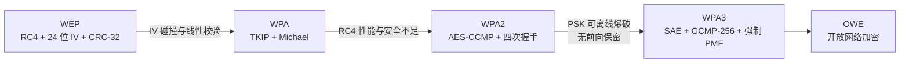


### 易错点与排错
1. **WPA 用 TKIP，WPA2 用 CCMP，WPA3 用 CCMP/GCMP**，这个对应关系必须背死；"WPA2 用 TKIP"是典型错误选项。
2. WEP 的 IV 是 **24 位**，TKIP/CCMP 的是 **48 位**，考试常把两个数字对调做干扰项。
3. **WPA3-Personal 的密码仍要 8 位以上**，SAE 只解决"离线爆破"，不解决弱口令带来的在线猜测风险。
4. `security wpa-wpa2 psk` 是过渡配置（混合模式），会降低整体安全水位，仅在必须兼容老终端时使用。
5. 若 STA 报"认证失败"而 AC 侧模板正常，优先用 `display station online-fail-record all` 查看原因码，常见为密钥不匹配或加密套件不兼容（如终端只支持 TKIP，而 AC 只开 AES）。

---

## 6.3 认证与加密的关系及 PSK 密钥派生

### 考点定位
"认证、加密、密钥派生"三者关系是本章最核心的原理考点，四次握手的报文顺序与作用几乎是必考简答题。必须能画出四次握手时序图并说明每个报文携带什么。

### 原理精讲
WLAN 安全有**三个相互独立又层层递进的环节**，考试必须分开答：

1. **链路认证（Link Authentication）**：STA 与 AP 之间的 802.11 认证，只有两种：开放系统认证（Open System，实际上不校验任何东西，直接成功）与共享密钥认证（Shared Key，用 WEP 密钥做挑战—响应，已被淘汰，且会把密钥流暴露给攻击者）。
2. **接入认证（Access Authentication）**：验证用户身份并决定是否授权，方式有 PSK（预共享密钥，所有人共用一个口令）与 802.1X（基于 RADIUS 的逐用户认证，见 6.4）。
3. **数据加密（Encryption）**：用协商出来的密钥保护数据帧，算法有 TKIP、CCMP、GCMP。

三者的关系是：**链路认证只是形式，接入认证决定"你能不能用"，加密决定"别人能不能看"**。WPA2-PSK 中，链路认证是开放的，真正的身份验证发生在四次握手的 MIC 校验里——STA 必须拥有正确的 PMK 才能算出正确的 PTK，进而生成正确的 MIC，这一点极其关键：**四次握手本身就是 WPA2-PSK 的身份验证过程**。

**密钥派生链条**必须牢记：

- **MSK（Master Session Key）**：802.1X 认证成功后由 RADIUS 与 STA 各自推导出的主会话密钥；PSK 场景下没有 RADIUS，PMK 直接来自口令。
- **PMK（Pairwise Master Key）**：PSK 场景下 `PMK = PBKDF2-HMAC-SHA1(Passphrase, SSID, 4096, 256)`，即用 SSID 作盐、迭代 4096 次、输出 256 位。注意：**SSID 参与 PMK 计算，因此改 SSID 等于换密钥**，所有终端都要重新输入密码——这是工程中一个著名陷阱。802.1X 场景下 PMK 取 MSK 的前 256 位。
- **PTK（Pairwise Transient Key）**：由 PMK、两个 MAC 地址、两个 Nonce 通过伪随机函数派生，长度 384 位（CCMP，其中 KCK 128 位、KEK 128 位、TK 128 位）或 512 位（GCMP-256）。KCK 用于计算 EAPOL-Key 的 MIC，KEK 用于加密 GTK 下发，TK 才是真正的数据加密密钥。
- **GTK（Group Temporal Key）**：用于加密广播/组播帧，由 AC 生成并通过四次握手的第三条消息加密下发给 STA。

**四次握手（4-Way Handshake）过程**：
1. AP → STA：EAPOL-Key 消息 1，携带 **ANonce**（AP 生成的随机数）。
2. STA → AP：EAPOL-Key 消息 2，携带 **SNonce**（STA 生成）与 **MIC**。双方此时都已具备计算 PTK 的全部要素（PMK、AA、SPA、ANonce、SNonce），AP 校验 MIC 即可确认 STA 拥有正确的 PMK。
3. AP → STA：EAPOL-Key 消息 3，携带 **安装 PTK 指令**与用 KEK 加密的 **GTK**。
4. STA → AP：EAPOL-Key 消息 4，纯确认（MIC）。AP 收到后安装 PTK 并开放受控端口，允许数据帧通过。

一个常考的细节：消息 1 与消息 3 可能因丢包而重传，且消息 3 的重传会携带相同的 ANonce；STA 用消息 4 确认，若 AP 未收到消息 4 会重传消息 3，此时 GTK 已安装不应重复安装——这些状态机细节是区分高水平选手的地方。

### 关键概念对照表

| 密钥 | 全称 | 长度 | 来源 | 作用 |
|---|---|---|---|---|
| MSK | Master Session Key | 512 位 | 802.1X（RADIUS 与 STA 推导） | 派生 PMK 的母密钥 |
| PMK | Pairwise Master Key | 256 位 | PSK 推导或 MSK 前 256 位 | 派生 PTK，同时是身份凭证 |
| PTK | Pairwise Transient Key | 384/512 位 | PRF(PMK, AA, SPA, ANonce, SNonce) | 单播数据加密与完整性 |
| KCK | Key Confirmation Key | 128 位 | PTK 的一部分 | 计算 EAPOL-Key 的 MIC |
| KEK | Key Encryption Key | 128 位 | PTK 的一部分 | 加密下发 GTK |
| TK | Temporal Key | 128/256 位 | PTK 的一部分 | 实际加密单播数据 |
| GTK | Group Temporal Key | 128/256 位 | AC 生成 | 加密广播/组播数据 |

| 握手消息 | 方向 | 携带内容 | 关键校验 |
|---|---|---|---|
| 消息 1 | AP → STA | ANonce | 无 |
| 消息 2 | STA → AP | SNonce、MIC、RSN IE | AP 校验 MIC（验证 PMK） |
| 消息 3 | AP → STA | 安装 PTK 指令、加密的 GTK | STA 校验 MIC 并安装 GTK |
| 消息 4 | STA → AP | MIC（确认） | AP 安装 PTK，开放端口 |

### 华为设备配置
```bash
[AC6805] wlan
[AC6805-wlan-view] security-profile name sec-emp
[AC6805-wlan-security-prof-sec-emp] security wpa2 psk pass-phrase Huawei@2024 aes  # PMK 由口令+SSID 派生
# 密钥更新周期：security-profile 视图下提供单播密钥（PTK）与组播密钥（GTK）的更新周期参数
# 生产建议单播 3600s、组播 1800s 级别；命令名随版本略有差异，以对应版本产品文档为准
[AC6805-wlan-view] ssid-profile name ssid-emp
[AC6805-wlan-ssid-prof-ssid-emp] ssid HUAWEI-EMP      # 注意：修改 SSID 会改变 PMK，所有终端须重新认证
<AC6805> display station assoc-info sta-mac 0011-2233-4455  # 查看 STA 使用的加密方式与密钥索引
<AC6805> debugging wlan security all                  # 观察四次握手过程（慎用，CPU 开销大，用完立即关闭）
<AC6805> undo debugging all                            # 关闭所有调试开关
```

### 示意图
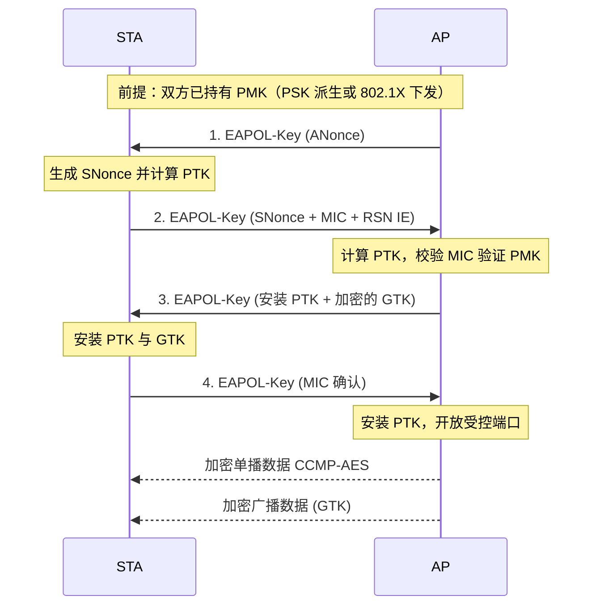

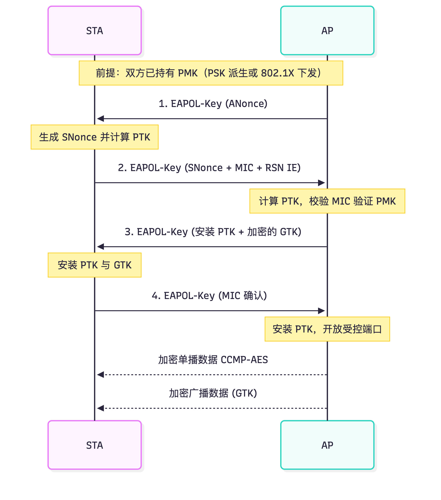


### 易错点与排错
1. **改 SSID 等于改 PMK**：因为 PMK 计算中 SSID 作为盐参与，考题与工程都常见，改 SSID 后必须让所有终端重新输入口令。
2. **四次握手既是密钥协商也是身份验证**：WPA2-PSK 没有独立的身份认证协议，这一点被大量考生忽略。
3. **PTK 由双方分别计算**，不通过网络传输；网络上传输的只有 Nonce 与 MIC，因此抓包无法直接得到 PTK（除非破解 PMK 后自行计算）。
4. `rekey-interval` 设置过短（如 60s）会导致频繁重密钥，引发短时丢包；生产建议 3600s 级别。
5. 排错时用 `debugging wlan security all` 可以看到四次握手的每条消息，但必须搭配 `terminal monitor` 与 `terminal debugging`，且用完立刻 `undo debugging all`。

---

## 6.4 802.1X 认证在 WLAN 中的应用

### 考点定位
802.1X 是企业级 WLAN 的标准配置，考题集中在：EAP 报文如何在 802.11 上承载、EAPOL 与 RADIUS 的关系、EAP-PEAP 与 EAP-TLS 的对比、以及 AC 作为"中继/终结者"的两种模式（EAP 中继 vs 本地终结）。省赛实验常要求完成 AC + RADIUS 的 802.1X 配置。

### 原理精讲
802.1X 是**基于端口的访问控制**框架，由三个角色构成：**客户端（Supplicant，即 STA）**、**认证者（Authenticator，在 WLAN 中是 AP 与 AC）**、**认证服务器（Authentication Server，通常是 RADIUS 服务器）**。在 WLAN 中，AP 只做二层透传，AC 才是真正的认证者，它是 EAP 报文的"翻译官"：面向 STA 用 **EAPOL（EAP over LAN，以太网帧类型 0x888E）** 承载 EAP，面向 RADIUS 用 **EAP-Message 属性（属性号 79）** 承载同一份 EAP 报文。这就是所谓"EAP 报文在 802.11 上的承载"——EAP 本身是链路无关的认证框架，802.11 通过 EAPOL 承载它，RADIUS 又通过扩展属性承载它。

**认证流程**：
1. STA 关联后（开放认证），EAPOL-Start 触发认证（或由 AP 侧主动发起 EAP-Request/Identity）。
2. AC 回 EAP-Request/Identity，STA 回 EAP-Response/Identity（携带用户名，格式通常是 `user@domain` 或 `domain\user`）。
3. AC 把 EAP-Response/Identity 封装进 RADIUS Access-Request 发给 RADIUS 服务器。
4. 服务器与 STA 之间进行 EAP 方法协商（TLS 隧道建立、证书校验、内部认证），AC 只做透传。
5. 认证成功后服务器回 **RADIUS Access-Accept**，并在其中携带 **MS-MPPE-Recv-Key / MS-MPPE-Send-Key**（即 MSK 的两半），AC 据此得到 PMK。
6. AC 向 STA 发送 **EAP-Success**，随后立即进入四次握手，安装 PTK/GTK，开放受控端口。
7. 若配置了计费，AC 还会向 RADIUS 的 1813 端口发送 Accounting-Request（Start/Interim/Stop）。

**EAP 方法对比**是高频考点：

- **EAP-TLS**：双向证书认证，服务器与客户端都有证书。安全性最高（抗钓鱼 AP 能力最强，因为客户端会校验服务器证书），但部署成本高（需要为每台终端签发证书），适合企业自有设备。
- **EAP-PEAP**：先用服务器证书建立 TLS 隧道，隧道内用 MSCHAPv2（用户名口令）做认证。部署成本低（只需服务器证书），是 BYOD 场景最常用的方法。缺点是内层 MSCHAPv2 存在已知弱点，且客户端若不校验服务器证书则容易被钓鱼 AP 攻击。
- **EAP-TTLS**：与 PEAP 类似，但隧道内可承载 PAP/CHAP/MSCHAPv2 等多种方式，灵活性更高。
- **EAP-SIM/AKA**：基于 SIM 卡，用于运营商 Wi-Fi 分流。

AC 侧还有"**EAP 中继**"与"**本地终结**"两种实现：`dot1x authentication-method eap` 表示 AC 把 EAP 报文透传给 RADIUS（推荐，功能完整）；`chap`/`pap` 表示 AC 终结 EAPOL、自己作为 RADIUS 客户端向服务器发普通的 PAP/CHAP 认证请求（兼容老服务器，但丧失部分 EAP 能力）。

### 关键概念对照表

| EAP 方法 | 服务器证书 | 客户端证书 | 内层认证 | 安全强度 | 典型场景 |
|---|---|---|---|---|---|
| EAP-TLS | 需要 | 需要 | 证书 | 最高 | 企业自有终端、高安全 |
| EAP-PEAP | 需要 | 不需要 | MSCHAPv2 | 中高 | BYOD、办公网 |
| EAP-TTLS | 需要 | 不需要 | PAP/CHAP/MSCHAPv2 | 中高 | 兼容多种后端 |
| EAP-SIM/AKA | 需要 | SIM 卡 | 运营商鉴权 | 高 | 运营商热点 |
| EAP-MD5 | 不需要 | 不需要 | 口令 MD5 | 低（无密钥派生） | 已淘汰 |

| 报文/属性 | 承载位置 | 作用 |
|---|---|---|
| EAPOL（EtherType 0x888E） | STA ↔ AC | 承载 EAP，EAPOL-Start/Key/Logoff |
| EAP-Message（属性 79） | AC ↔ RADIUS | 承载同一份 EAP 报文 |
| Message-Authenticator（属性 80） | AC ↔ RADIUS | 报文完整性校验 |
| State（属性 24） | AC ↔ RADIUS | 关联多轮 EAP 交互 |
| MS-MPPE-Recv-Key / Send-Key | RADIUS → AC | 下发 MSK 两半，派生 PMK |
| RADIUS 端口 | 1812 / 1813 | 认证 / 计费（旧标准 1645/1646） |

### 华为设备配置
```bash
[AC6805] radius-server template rd1                      # 创建 RADIUS 服务器模板
[AC6805-radius-rd1] radius-server shared-key cipher Huawei@123  # 与服务器一致的共享密钥
[AC6805-radius-rd1] radius-server authentication 10.10.10.5 1812  # 认证服务器地址与端口
[AC6805-radius-rd1] radius-server accounting 10.10.10.5 1813     # 计费服务器地址与端口
[AC6805-radius-rd1] undo radius-server user-name domain-included # 按需决定用户名是否带域
[AC6805-radius-rd1] quit
[AC6805] aaa
[AC6805-aaa] authentication-scheme sch-1x                # 认证方案
[AC6805-aaa-authen-sch-1x] authentication-mode radius    # 认证方式为 RADIUS
[AC6805-aaa-authen-sch-1x] quit
[AC6805-aaa] accounting-scheme acc-1x                    # 计费方案（可选）
[AC6805-aaa-accounting-acc-1x] accounting-mode radius
[AC6805-aaa-accounting-acc-1x] quit
[AC6805-aaa] domain huawei                               # 创建域，STA 用户名带 @huawei 时匹配
[AC6805-aaa-domain-huawei] authentication-scheme sch-1x
[AC6805-aaa-domain-huawei] accounting-scheme acc-1x
[AC6805-aaa-domain-huawei] radius-server rd1
[AC6805-aaa-domain-huawei] quit
[AC6805] wlan
[AC6805-wlan-view] security-profile name sec-1x
[AC6805-wlan-security-prof-sec-1x] security wpa2 dot1x aes   # 802.1X + CCMP
[AC6805-wlan-security-prof-sec-1x] ft enable                 # 建议同时开启 802.11r 降低漫游时延
[AC6805-wlan-view] vap-profile name vap-1x
[AC6805-wlan-vap-prof-vap-1x] service-vlan vlan-id 101
[AC6805-wlan-vap-prof-vap-1x] security-profile sec-1x
[AC6805-wlan-vap-prof-vap-1x] dot1x authentication-method eap # AC 做 EAP 中继，透传给 RADIUS
[AC6805-wlan-vap-prof-vap-1x] forward-mode tunnel
[AC6805] # 说明：WLAN 场景的 802.1X 由 VAP 模板中的 dot1x authentication-method 控制，无需全局 dot1x enable
<AC6805> display radius-server configuration template rd1  # 确认 RADIUS 模板参数
<AC6805> display station all                              # 查看 STA 是否通过 802.1X 上线
<AC6805> display aaa online-fail-record all               # 查看用户认证失败记录（定位服务器侧问题）
```

### 示意图
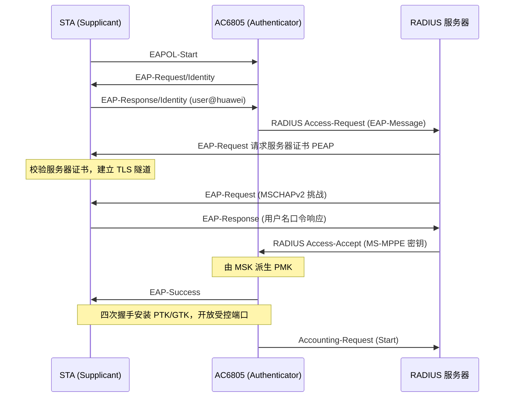

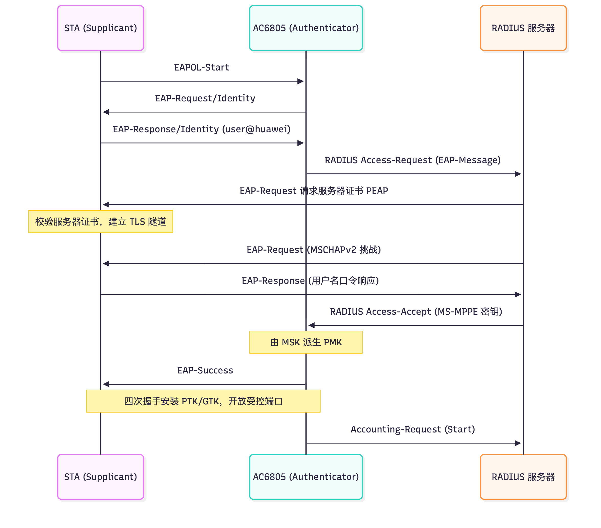


### 易错点与排错
1. **EAPOL 与 RADIUS 承载的是同一份 EAP 报文**，AC 不做 EAP 终结（中继模式下），这个理解决定了很多判断题的答案。
2. `radius-server shared-key` 两端必须完全一致（含大小写），不一致时表现为 Access-Request 无响应，服务器侧日志一片空白。
3. **域名匹配**：STA 输入 `user@huawei` 时，AC 需要存在 `domain huawei` 且配好认证方案与 RADIUS 模板；若用户名不带域，则使用 `default` 域或全局方案。
4. **EAP-PEAP 客户端必须勾选"验证服务器证书"**，否则伪 AP 可以轻易骗过终端；这也是 WIDS 之外最有效的防钓鱼手段。
5. 排错顺序：`display station all`（是否关联）→ `display aaa online-fail-record all`（是否认证失败）→ AC 与 RADIUS 是否互通（`ping`）→ 共享密钥是否一致 → 服务器侧日志（是否收到 Access-Request）。

---

## 6.5 Portal 认证与 MAC 认证及混合认证

### 考点定位
Portal 认证在校园、酒店、商场场景极为常见，是省赛配置题的常客。高频考点是**二层 Portal 与三层 Portal 的区别**、Portal 报文推送流程、以及免认证规则（free-rule）的作用。混合认证（MAC 优先 + Portal 二次认证）是拿分加分项。

### 原理精讲
**Portal 认证**（又称 Web 认证）的核心思想是：用户先获得网络接入能力（二层关联成功、三层拿到 IP），但**只能访问 Portal 服务器**，任何其他流量都被重定向到认证页面；认证通过后才放通全部流量。它最大的价值是"零客户端配置"——用户只要有浏览器即可上网，非常适合访客场景。

Portal 的组成有四个角色：STA（浏览器）、接入设备（AC）、Portal 服务器（提供页面）、RADIUS 服务器（校验账号）。**二层 Portal 与三层 Portal 的根本区别在于"认证前 AC 如何标识用户"**：

- **二层 Portal**：认证前 AC 只通过 **MAC 地址**标识用户，Portal 服务器与 AC 之间的交互基于二层（AC 通过 MAC 触发认证）。适用于认证前 AC 无法感知用户 IP 的场景（例如用户 IP 由上层设备分配、AC 与用户处于不同三层网段）。
- **三层 Portal**：认证前 AC 已经能感知用户的 **IP 地址**（AC 通常就是网关，或通过 DHCP Snooping 等机制学习到 IP），Portal 服务器与 AC 之间基于 IP 交互。适用于 AC 作为网关的典型组网，配置更直观，支持免认证规则按源 IP 精确匹配。

**Portal 页面推送的三个关键机制**：
1. **重定向**：AC 拦截 STA 的 HTTP 请求（TCP 80），返回 302 重定向到 Portal 服务器的 URL，或直接把请求代理到 Portal 服务器。HTTPS（443）在认证前通常被直接阻断（因为无法重定向加密请求的 URL），这也是"只弹出一次页面、后续点 https 打不开"的原因。
2. **免认证规则（free-rule）**：AC 必须放通 Portal 服务器自身、DNS 服务器以及必要的静态资源地址，否则用户连认证页面都打不开。free-rule 支持按目的 IP、通配符或 ACL 定义。
3. **触发方式**：AC 可以在 STA 首次上线（关联成功/获取 IP）后主动触发认证，也可以等用户访问 HTTP 时被动触发。主动触发体验更好（用户一连上就弹页面）。

**MAC 认证**是在 AC 上根据 STA 的 MAC 地址直接判断是否放通，无需用户输入任何凭证。它适合打印机、POS 机、摄像头等哑终端，安全性极低（MAC 可伪造），因此常作为"混合认证"的第一层：**MAC 优先认证 + Portal 二次认证**——哑终端通过 MAC 认证直接放通；普通用户 MAC 认证失败后自动转为 Portal 认证，用户只需认证一次；再配合 MAC 绑定，可实现"首次 Web 认证、后续免认证"（无感知认证）。

### 关键概念对照表

| 对比项 | 二层 Portal | 三层 Portal |
|---|---|---|
| 认证前用户标识 | MAC 地址 | IP 地址 |
| 交互方式 | AC 与 Portal 服务器二层交互 | AC 与 Portal 服务器三层交互 |
| 适用组网 | 用户 IP 由上游分配、跨三层 | AC 作为网关的典型组网 |
| 免认证规则 | 基于 MAC/IP 均可，配置相对受限 | 支持按源 IP 精确匹配 |
| 配置视图 | `web-auth-server` + `layer2` | `web-auth-server` + `layer3` |
| 典型场景 | 酒店、商场访客 | 校园网、企业访客网 |

| 认证方式 | 凭证 | 安全性 | 适用终端 | 用户体验 |
|---|---|---|---|---|
| MAC 认证 | MAC 地址 | 极低 | 打印机、POS | 无感知 |
| Portal 认证 | 账号口令/短信 | 中 | 访客、BYOD | 需一次网页操作 |
| 802.1X | 证书/账号 | 高 | 企业终端 | 无感知（后台完成） |
| 混合认证 | MAC 或账号 | 中高 | 混合终端环境 | 最优（哑终端无感知） |

### 华为设备配置
```bash
[AC6805] web-auth-server server1                          # 创建 Portal 服务器模板
[AC6805-web-auth-server-server1] server-ip 10.10.10.20    # Portal 服务器地址
[AC6805-web-auth-server-server1] port 50100               # Portal 服务器端口（华为默认 50100）
[AC6805-web-auth-server-server1] shared-key cipher Huawei@123  # 与 Portal 服务器一致的共享密钥
[AC6805-web-auth-server-server1] url http://10.10.10.20:8080/portal  # 认证页面 URL
[AC6805-web-auth-server-server1] quit
[AC6805] portal-access-profile name pap1                  # Portal 接入模板
[AC6805-portal-access-profile-pap1] web-auth-server server1 layer3  # 三层 Portal（AC 为网关）
[AC6805-portal-access-profile-pap1] quit
[AC6805] mac-access-profile name map1                     # MAC 接入模板（混合认证用）
[AC6805-mac-access-profile-map1] mac-authen username-format without-delimiter  # MAC 作为用户名的格式
[AC6805-mac-access-profile-map1] quit
[AC6805] authentication-profile name ap-mix               # 统一认证模板（V200R019 推荐方式）
[AC6805-authentication-profile-ap-mix] mac-access-profile map1      # 第一层：MAC 认证
[AC6805-authentication-profile-ap-mix] portal-access-profile pap1   # 第二层：Portal 认证
[AC6805-authentication-profile-ap-mix] authentication-scheme sch-1x # 绑定认证方案
[AC6805-authentication-profile-ap-mix] access-domain huawei force   # 强制使用 huawei 域
[AC6805-authentication-profile-ap-mix] free-rule 1 destination ip 10.10.10.20 mask 255.255.255.255  # 放通 Portal 服务器
[AC6805-authentication-profile-ap-mix] free-rule 2 destination ip 10.10.10.53 mask 255.255.255.255  # 放通 DNS 服务器
[AC6805] wlan
[AC6805-wlan-view] vap-profile name vap-guest
[AC6805-wlan-vap-prof-vap-guest] service-vlan vlan-id 102
[AC6805-wlan-vap-prof-vap-guest] security-profile sec-guest        # 链路层仍可用 WPA2-PSK 保护空口
[AC6805-wlan-vap-prof-vap-guest] authentication-profile ap-mix     # VAP 引用统一认证模板
[AC6805-wlan-vap-prof-vap-guest] forward-mode tunnel
<AC6805> display web-auth-server configuration            # 查看 Portal 服务器配置
<AC6805> display authentication-profile configuration name ap-mix  # 查看认证模板
<AC6805> display station all                              # 查看 STA 认证状态
```

### 示意图
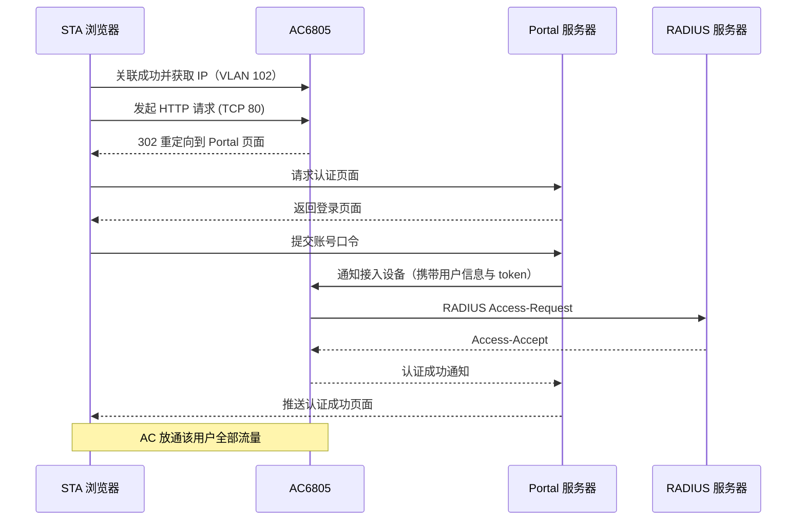

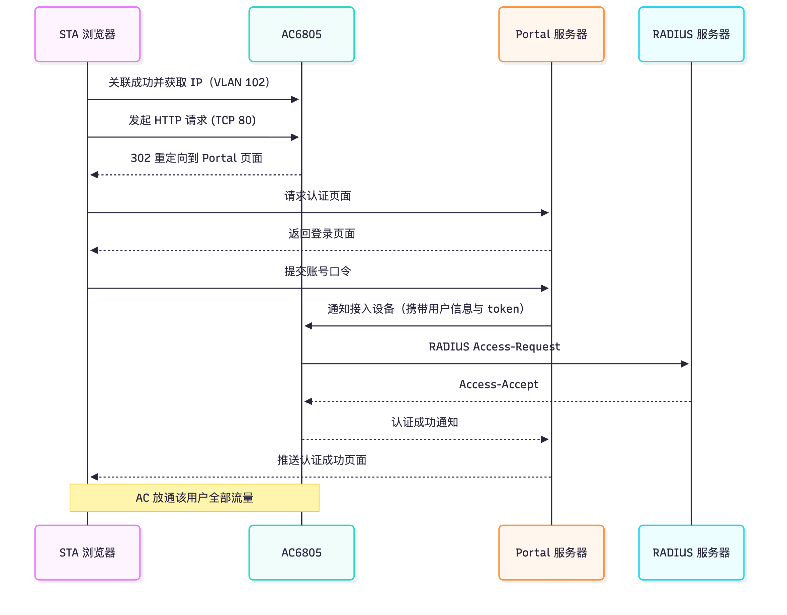


### 易错点与排错
1. **free-rule 漏配 Portal 服务器与 DNS** 是最常见故障：用户连上 Wi-Fi 后页面打不开、域名解析失败。必须放通 Portal 服务器、DNS，以及页面依赖的静态资源服务器。
2. **HTTPS 无法重定向**：认证前访问 https 站点通常会超时而非弹页面，这是设计使然，不是故障。
3. Portal 认证的共享密钥（`shared-key`）在 AC 与 Portal 服务器两端必须一致，否则出现"输入正确密码仍认证失败"。
4. 二层/三层 Portal 选错会导致认证请求根本到不了 AC：AC 作为网关时必须用 `layer3`，跨三层组网用 `layer2`。
5. 混合认证中 MAC 认证的用户名格式（是否带分隔符）必须与 RADIUS 服务器中的账号格式完全一致，否则哑终端会一直认证失败。

---

## 6.6 WIDS/WIPS 无线入侵检测与防御

### 考点定位
WIDS/WIPS 属于"安全运维"考点，常以"如何发现非法 AP""检测到 Deauth 攻击应如何处理"的形式出题。需要区分**检测（Detection）**与**反制（Containment）**，并知道华为 AC6805 + AirEngine 的实现方式与告警查看命令。

### 原理精讲
**WIDS（Wireless Intrusion Detection System，无线入侵检测系统）**负责"看见"，**WIPS（Wireless Intrusion Prevention System，无线入侵防御系统）**负责"处置"。华为在 AC 上把两者统一为一套功能，通过 AP 的射频扫描实现：

工作机理是：AP 在正常提供接入服务的同时，利用**射频扫描（Off-channel Scanning）**周期性地把射频切换到其他信道，监听空口中的管理帧与数据帧，把采集到的信息上报 AC；AC 侧维护"合法设备名单"（白名单）与"威胁特征库"，据此判定哪些是非法设备与攻击行为。

主要检测能力：

1. **非法 AP 检测（Rogue AP Detection）**：发现不在白名单中的 AP。分为两类：**Rogue AP**（与合法网络有线相连的非法 AP，危害最大，因为它把无线流量引到了企业内部网络，可能绕过防火墙）与 **干扰 AP / 邻居 AP**（只是无线信号重叠，无有线连接）。判定"是否与有线网络相连"的经典手段是**有线侧 MAC 关联检测**：AC 通知交换机查询该 BSSID 的 MAC 是否出现在交换机的 MAC 地址表中，若出现则判定为 Rogue AP。
2. **攻击检测**：包括 Deauth/Disassoc 泛洪（大量伪造管理帧）、ARP 欺骗（无线侧 ARP 泛洪与欺骗）、泛洪攻击（关联请求泛洪、Beacon 泛洪）、弱 IV 检测（发现使用 WEP 的流量）、SPoofing 检测（STA 地址伪造、AP 地址伪造）。
3. **干扰源检测与频谱分析**：AirEngine 系列 AP 内置频谱扫描能力，可识别微波炉、无绳电话、蓝牙、视频传输设备等非 802.11 干扰源，并以频谱图呈现，帮助定位"信号满格但网速极慢"的问题。

**防御/反制手段**包括：对非法 AP 或其他 STA 发送**反制报文（Containment）**，用 Deauth 帧强制其断开（本质上是"以毒攻毒"，需注意合规性）；对恶意 STA 加入黑名单直接拒绝接入；对攻击事件产生告警并联动 iMaster NCE-Campus 上报告警。

需要提醒的工程现实：WIDS 的扫描会占用 AP 的空口时间，扫描周期越短、覆盖信道越多，对业务吞吐的影响越大；高密场景应使用专用 AP（AirEngine 9700S 系列中的监测型号）或降低扫描频度。

### 关键概念对照表

| 功能 | 检测对象 | 判定依据 | 处置手段 |
|---|---|---|---|
| 非法 AP 检测 | Rogue AP / 邻居 AP | 白名单比对 + 有线侧 MAC 关联 | 告警 + 反制 + 交换机侧封堵端口 |
| Deauth 攻击检测 | 伪造管理帧泛洪 | 单位时间 Deauth 帧数量超阈值 | 告警 + 802.11w 防护 |
| ARP 攻击检测 | 无线侧 ARP 欺骗 | ARP 应答与请求异常比例 | 告警 + 网关侧 ARP 防护 |
| 泛洪攻击检测 | 关联/Beacon 泛洪 | 帧速率超阈值 | 限速 + 加入黑名单 |
| 干扰源检测 | 非 802.11 干扰 | 频谱能量特征 | 告警 + 信道调整 |
| STA 黑白名单 | 指定 STA | 静态名单 | 直接允许/拒绝接入 |

| 对比项 | WIDS | WIPS |
|---|---|---|
| 核心动作 | 检测、记录、告警 | 检测 + 主动阻断/反制 |
| 对业务影响 | 无（只监听） | 反制会占用空口与产生额外管理帧 |
| 配置要点 | `device detection enable` | 在检测基础上配置反制策略与黑白名单 |
| 常见风险 | 误报（把邻居 AP 判为非法） | 误伤（把合法终端反制掉线） |

### 华为设备配置
```bash
[AC6805] wlan
[AC6805-wlan-view] wids                                   # 进入 WIDS 视图
[AC6805-wids-view] device detection enable                # 开启设备检测，发现非法 AP 与干扰源
[AC6805-wids-view] attack detection enable                # 开启攻击检测（Deauth/ARP/泛洪）
[AC6805-wids-view] ap whitelist 00e0-fc12-3456            # 合法 AP 白名单，避免误报
[AC6805-wids-view] ap whitelist 00e0-fc12-3457
[AC6805-wids-view] sta blacklist 0011-2233-4455           # 黑名单 STA 拒绝接入
[AC6805-wids-view] quit
[AC6805-wlan-view] ap-group name office
[AC6805-wlan-ap-group-office] wids                        # AP 组级别的 WIDS 参数
[AC6805-wlan-group-wids-office] device detection enable    # 组内 AP 参与检测
[AC6805-wlan-group-wids-office] containment-mode rogue-ap  # 对非法 AP 开启反制（谨慎使用）
[AC6805-wlan-group-wids-office] quit
[AC6805] wlan
# 空口扫描参数：部分版本通过 wids 视图下的扫描策略控制，命令视图与参数名随版本变化
# scan-channel 1 6 11 36 40 44 48    # 指定 AP 参与检测时扫描的信道集合，需结合现场信道规划
<AC6805> display wids device all                           # 查看检测到的非法设备
<AC6805> display wids attack all                            # 查看检测到的攻击事件
<AC6805> display wids history all                           # 查看历史事件（部分版本可用）
<AC6805> display station blacklist all                      # 确认 STA 黑名单
```

### 示意图
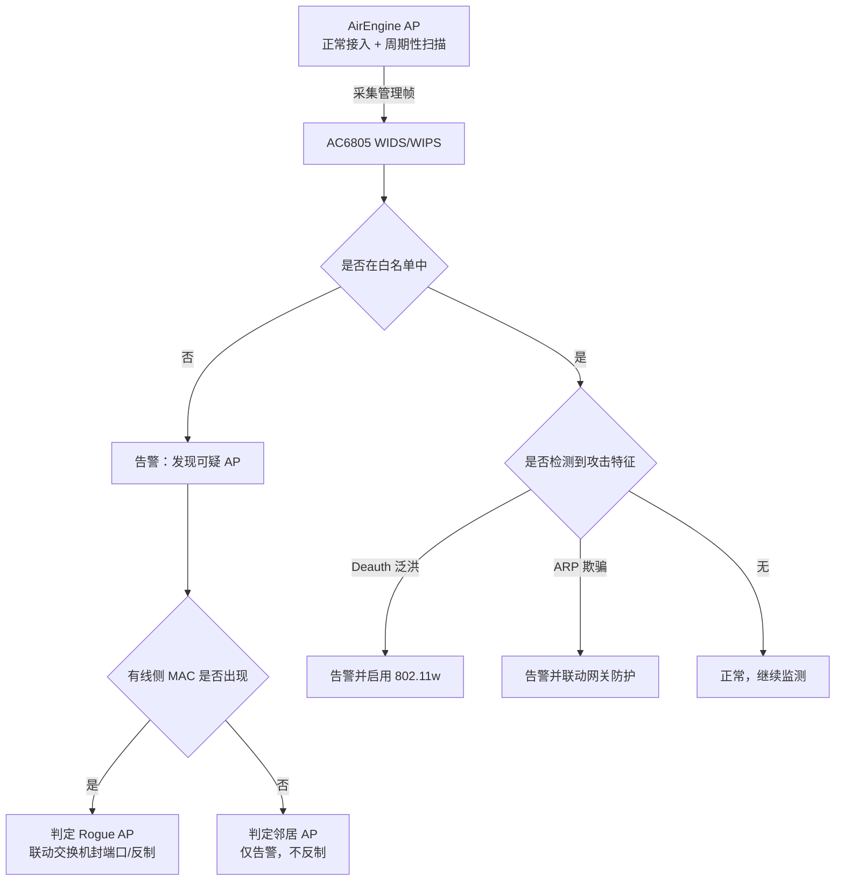

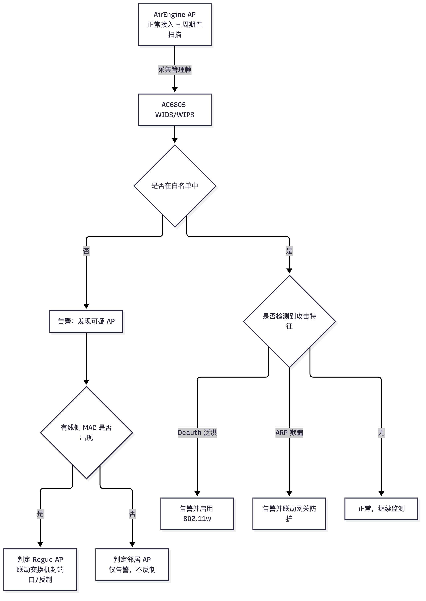


### 易错点与排错
1. **误报治理**：把公司自有 AP 全部加入白名单是使用 WIDS 的前提，否则告警列表会被自有 AP 淹没。
2. **反制（Containment）需合规**：对第三方设备主动发送 Deauth 帧在很多国家/地区属于违规行为，生产环境建议只告警不反制。
3. **扫描影响性能**：AP 在扫描期间无法服务本信道，高密场景要控制扫描信道数量与周期，或使用专用监测 AP。
4. WIDS 检测到的是"空口中的现象"，无法直接定位物理位置，需结合信号强度（RSSI）与多 AP 联合定位逐步缩小范围。
5. 排错时先确认 AP 是否真的具备检测能力（`display ap all` 的型号与软件版本），部分老型号不支持频谱分析。

---

## 6.7 章节6真题精练

### 考点定位
本章真题以安全机制对比、密钥派生、四次握手、802.1X 报文承载、Portal 类型判定为主，是"背得多、理解得更要深"的章节。

### 真题精练

**Q1.【真题·单选】** WPA2 采用的加密与完整性算法组合是？
A. RC4 + CRC-32  B. RC4 + Michael  C. AES-CCMP  D. AES-GCMP

> **答案：C**
> **解析**：WPA2 使用 CCMP（AES-128 计数器模式加密 + CBC-MAC 完整性）。A 是 WEP，B 是 WPA，D 是 WPA3-Enterprise 192 位模式使用的算法。

**Q2.【真题·多选】** 关于 WEP 的安全缺陷，下列说法正确的有？
A. IV 只有 24 位，空间过小导致密钥流重复
B. ICV 使用线性校验（CRC-32），可被比特翻转篡改
C. 使用静态共享密钥，缺少密钥更新
D. 采用 AES 加密导致性能低下
E. RC4 算法本身被证明存在严重数学缺陷，因此 WEP 必然不可用

> **答案：A、B、C**
> **解析**：D 错误——WEP 使用 RC4 而非 AES；E 错误——RC4 在正确使用（密钥与 IV 组合得当、密钥流不重复）时并非"必然不可用"，WEP 的失效主要来自 IV 过短与静态密钥的协议设计缺陷，而非 RC4 算法被攻破。

**Q3.【真题·填空】** WPA2-PSK 中 PMK 的计算方式为 `PMK = ______`；四次握手第一条报文中 AP 发送的随机数是 `______`。

> **答案：PBKDF2-HMAC-SHA1(Passphrase, SSID, 4096, 256)（即口令 + SSID 作盐，迭代 4096 次，输出 256 位）；ANonce**
> **解析**：SSID 参与 PMK 计算，因此修改 SSID 会使所有终端缓存的 PMK 失效，必须重新输入口令。第二条报文由 STA 发送 SNonce 与 MIC，AP 据此计算并校验 PTK。

**Q4.【真题·判断】** 在 802.1X 认证中，AC 把 EAP 报文透传给 RADIUS 服务器时，EAP 报文被封装在 RADIUS 的 EAP-Message 属性中；STA 与 AC 之间则用 EAPOL 承载。

> **答案：正确**
> **解析**：EAP 是链路无关的认证框架，在 802.11 侧由 EAPOL（EtherType 0x888E）承载，在 RADIUS 侧由 EAP-Message 属性（属性号 79）承载，AC 在 EAP 中继模式下只做封装转换。

**Q5.【真题·单选】** 某组网中 AC 作为 STA 的网关，需要为访客提供 Web 认证上网。应选择哪种 Portal 类型？
A. 二层 Portal  B. 三层 Portal  C. 混合认证  D. MAC 认证

> **答案：B**
> **解析**：AC 作为网关时可以直接感知用户的 IP 地址，属于三层 Portal 的典型场景，配置 `web-auth-server server1 layer3`，并可用 free-rule 按源 IP 精确放通 Portal 服务器与 DNS。

**Q6.【真题·简答】** 请说明 WPA3 相比 WPA2 的三项主要改进及其解决的安全问题。

> **答案与解析**：
> 1. **SAE 取代 PSK 四次握手认证**：SAE 基于 Dragonfly 密钥交换，攻击者无法通过抓包做离线字典穷举（WPA2-PSK 的 PMK 可离线计算比对），并可提供前向保密，即使口令泄露也无法解密历史流量。
> 2. **强制 PMF（802.11w）**：WPA3 要求管理帧保护，抵御 Deauth/Disassoc 伪造攻击；WPA2 中 PMF 为可选，多数网络未开启。
> 3. **引入 OWE 与 192 位企业模式**：OWE 为开放网络提供无认证的加密，解决公共 Wi-Fi 明文问题；WPA3-Enterprise 192 位模式要求 GCMP-256、HMAC-SHA-384 等强国密算法套件，满足政府金融等高安全场景。

**Q7.【真题·多选】** 配置 Portal 认证时，必须通过 free-rule 放通的流量通常包括？
A. Portal 服务器地址  B. DNS 服务器地址  C. 任意互联网地址  D. Portal 页面依赖的静态资源服务器  E. 所有 HTTPS 流量

> **答案：A、B、D**
> **解析**：C 错误——若放通任意地址，认证将失去意义；E 错误——HTTPS 流量在认证前无法被重定向，认证前访问 https 通常被阻断，属于设计行为而非需要放通的对象。

**Q8.【真题·排错】** 现象：AC6805 与 RADIUS 服务器组网，STA 关联成功、能弹出 802.1X 认证窗口，但每次输入正确用户名口令都提示认证失败。请给出排查步骤。

> **答案与解析**：
> 1. **确认 AC 与 RADIUS 三层可达**：在 AC 上 `ping 10.10.10.5`，不通则检查路由与 VLAN。
> 2. **核对共享密钥**：`display radius-server configuration template rd1` 与服务器配置比对，密钥不一致时服务器会静默丢弃请求（可在服务器抓包确认是否收到 Access-Request）。
> 3. **检查域名与认证方案**：STA 输入 `user@huawei`，必须存在 `domain huawei` 且绑定 `authentication-scheme` 与 `radius-server rd1`；用户名格式（是否带域）需与服务器账号库一致。
> 4. **查看 AC 失败记录**：`display aaa online-fail-record all`，根据原因码判断是"无响应"（服务器侧）还是"拒绝"（账号问题）。
> 5. **检查服务器侧日志**：若服务器根本没收到请求，问题在 AC→RADIUS 链路或共享密钥；若收到但拒绝，问题在账号、证书或 EAP 方法不匹配（例如服务器只允许 EAP-TLS，而终端使用 PEAP）。
> 6. **确认 EAP 方法一致性**：`display vap-profile name vap-1x` 查看 `dot1x authentication-method`，与终端配置的 EAP 方法、服务器的策略保持统一。

### 易错点与排错
- 记住四代安全机制的"加密算法 + 完整性算法 + 认证方式"三要素组合，是本分册最值得做成口诀的内容。
- 密钥派生链条 MSK → PMK → PTK（KCK/KEK/TK）→ GTK 必须能默写，很多题目靠这条链推导答案。
- 802.1X 认证失败先分"无响应"与"被拒绝"，前者查链路与共享密钥，后者查账号与策略。

---

# WLAN-HCIA-章节7-WLAN规划部署与故障排查

## 7.1 WLAN 网络规划流程与覆盖设计

### 考点定位
规划部署是省赛方案题的骨架，通常给出一栋楼或一个场馆的需求（楼层、人数、业务类型、并发率），要求写出规划流程、确定 AP 数量与点位、给出信道与功率规划。评分点集中在流程完整性、数值合理性（-65dBm、SNR>25dB）与容量算例。

### 原理精讲
WLAN 规划是"从需求到落地"的工程闭环，标准流程为六步：

1. **需求调研**：明确覆盖范围（哪些区域要覆盖、哪些区域不覆盖）、业务类型（办公/视频/语音/物联网）、并发规模、漫游要求、安全等级、投资与工期约束。需求调研的产出是"设计输入清单"，缺了它后面所有数值都是拍脑袋。
2. **现场勘测**：获取建筑图纸、墙体材质与厚度、已有干扰源、可用布线点位、天花板高度与承重。**墙体衰减**是覆盖设计最容易低估的因素：普通石膏板墙衰减 3~5dB，砖墙 8~15dB，混凝土承重墙 15~25dB，金属货架与电梯井可达 30dB 以上。
3. **容量与覆盖设计**：先算"覆盖需要几个 AP"，再算"容量需要几个 AP"，取两者较大值。覆盖决定 AP 的"能不能连上"，容量决定"连上好不好用"，二者不可互相替代。
4. **AP 选型与点位确定**：按场景选型号（放装/吸顶/面板/室外/高密），按勘测结果确定安装点位与朝向，避免把 AP 装在金属吊顶内、立柱后或微波炉旁。
5. **信道与功率规划**：2.4G 只使用 1/6/11 三个非重叠信道并做蜂窝式复用；5G 使用更多非重叠信道，优先 80MHz 频宽。功率规划目标是"同频 AP 之间互不干扰、边缘用户仍能保持 -65dBm 以上"，因此不是功率越大越好——功率过大反而扩大同频干扰范围，降低整体容量。
6. **实施与验收**：按点位施工、按模板下发配置、用专业工具做覆盖测试（信号强度、SNR、吞吐、漫游时延）并出具验收报告。

**覆盖设计的关键指标**（必须记住的数值）：

| 指标 | 目标值 | 说明 |
|---|---|---|
| 目标信号强度 | ≥ -65dBm | 主要业务区域的典型设计目标 |
| 边缘信号强度 | ≥ -70dBm（最低 -75dBm） | 覆盖边缘可接受下限 |
| 信噪比 SNR | > 25dB | 保证高阶调制的必要条件 |
| 同频干扰 | 同频 AP 信号低于服务 AP 15~20dB | 降低同频干扰 |
| 2.4G 信道 | 1、6、11（非重叠） | 蜂窝式复用 |
| 5G 信道 | 36/40/44/48、52~64、100~144、149~165 | 优先 80MHz |
| 2.4G AP 间距 | 办公 20~25m，开放区 25~30m | 经验值，受墙体影响大 |
| 5G AP 间距 | 办公 15~20m | 5G 穿透弱，间距更小 |

**为什么 SNR 比信号强度更关键？** 因为 802.11 的速率取决于调制编码方案（MCS），而 MCS 由 SNR 决定：SNR 低于约 10dB 只能用到最低速率（如 6Mbps），SNR 达到 25~30dB 才能使用高阶 MCS 达到数百 Mbps。所以"信号满格但网速慢"通常不是强度问题，而是噪声（同频干扰、非 Wi-Fi 干扰）把 SNR 拉低了。

### 关键概念对照表

| 规划阶段 | 主要输入 | 主要输出 | 常用工具 |
|---|---|---|---|
| 需求调研 | 业务类型、人数、并发率 | 设计输入清单 | 访谈、问卷 |
| 现场勘测 | 图纸、墙体材质 | 衰减模型、可用点位 | WLAN Planner、测试 AP |
| 覆盖设计 | 面积、墙体衰减 | AP 数量下限、点位 | WLAN Planner 仿真 |
| 容量设计 | 并发用户数、带宽需求 | AP 数量下限 | 计算表、规划工具 |
| 信道功率规划 | AP 位置、干扰情况 | 信道与功率方案 | RRM 自动调优 + 手工微调 |
| 实施验收 | 施工结果 | 测试报告 | 打点测试、网管平台 |

| 障碍物 | 典型衰减 | 规划影响 |
|---|---|---|
| 石膏板墙 | 3~5dB | 影响较小 |
| 砖墙 | 8~15dB | 需加密 AP 或调整点位 |
| 混凝土墙 | 15~25dB | 视为"射频边界"，一般穿不透 |
| 金属吊顶/货架 | 20~30dB | 严禁把 AP 藏在其内 |
| 电梯井 | > 30dB | 单独考虑覆盖方案 |

### 华为设备配置
```bash
[AC6805] wlan
[AC6805-wlan-view] rrm-profile name rrm-plan               # 规划落地：射频调优模板
[AC6805-wlan-rrm-prof-rrm-plan] calibrate auto-channel-select enable   # 自动信道选择，按规划信道集分配
[AC6805-wlan-rrm-prof-rrm-plan] calibrate auto-txpower-select enable   # 自动功率选择，避免过覆盖
[AC6805-wlan-rrm-prof-rrm-plan] calibrate interval 1440    # 调优周期（分钟），夜间低峰执行
[AC6805-wlan-view] radio-2g-profile name r2-plan
[AC6805-wlan-radio-2g-prof-r2-plan] channel 20mhz 1 6 11    # 2.4G 仅用三个非重叠信道
[AC6805-wlan-radio-2g-prof-r2-plan] dot11bg basic-rate 1 2 5.5 11        # 基础速率集，保证兼容性
[AC6805-wlan-radio-2g-prof-r2-plan] undo dot11bg supported-rate 1 2 5.5 11  # 关闭低速率，抑制远距离低效接入
[AC6805-wlan-view] radio-5g-profile name r5-plan
[AC6805-wlan-radio-5g-prof-r5-plan] channel 80mhz 36 44 52 60             # 5G 使用 80MHz 频宽
[AC6805-wlan-view] ap-group name office
[AC6805-wlan-ap-group-office] radio 0
[AC6805-wlan-group-radio-office/0] radio-2g-profile r2-plan
[AC6805-wlan-group-radio-office/0] rrm-profile rrm-plan
[AC6805-wlan-group-radio-office/0] quit
[AC6805-wlan-ap-group-office] radio 1
[AC6805-wlan-group-radio-office/1] radio-5g-profile r5-plan
[AC6805-wlan-group-radio-office/1] rrm-profile rrm-plan
[AC6805-wlan-view] ap-id 3 type-id 65 ap-mac 00e0-fc12-3458
[AC6805-wlan-ap-3] ap-name AP-2F-01
[AC6805-wlan-ap-3] ap-group office
[AC6805-wlan-ap-3] radio 0
[AC6805-wlan-ap-3-radio-0] eirp 20                         # 单 AP 定点功率微调（dBm）
[AC6805-wlan-ap-3-radio-0] channel 20mhz 6                  # 现场干扰严重时手工指定信道
```

### 示意图
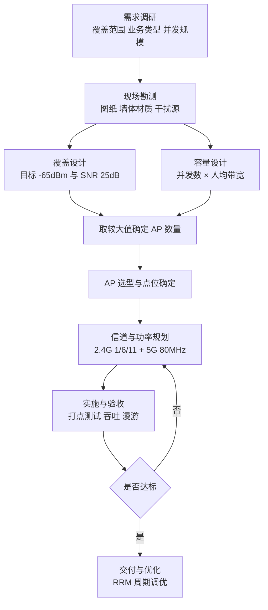

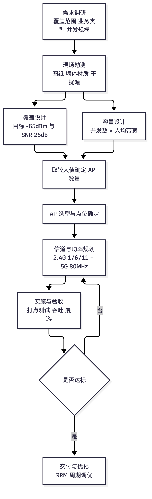


### 易错点与排错
1. **AP 数量不能只看覆盖**：会议室、报告厅等人群密集区容量需求远大于覆盖需求，必须做容量算例验证。
2. **功率不是越大越好**：功率过大导致同频干扰扩大、边缘用户占用空口时间长、整体容量下降，这是"信号好但网速差"的常见根因。
3. **2.4G 只有 1/6/11 三个非重叠信道**，密集部署时必然同频复用，因此应通过 Band Steering 把终端尽量赶到 5G。
4. **AP 间距经验值必须结合墙体衰减修正**：办公室隔断多时 5G 间距可能要缩到 12~15m。
5. 规划阶段就要考虑**PoE 供电预算**：AirEngine 5761 系列在不同速率下功耗不同，交换机 PoE 总功率不足会导致部分 AP 反复重启。

---

## 7.2 容量设计与完整算例

### 考点定位
容量计算是省赛方案题的"硬计算题"，评分严格按公式与中间结果给分。常见失分点：漏乘并发率、把理论速率当有效吞吐、忽略单 AP 关联用户数上限。

### 原理精讲
容量设计有三个必须分清的层次：

1. **用户规模**：总人数 → **并发用户数 = 总人数 × 并发率**。并发率是"同时在线的比例"，办公场景通常 50%~70%，会议室/报告厅短时可达 80%~100%。
2. **带宽需求**：每用户带宽需求取决于业务：网页办公 1~2Mbps、高清视频会议 2~4Mbps、4K 视频/直播 8~25Mbps、VR/AR 50Mbps 以上。设计时应给出"平均值 + 峰值"两档，按峰值预留。
3. **单 AP 承载能力**：这是最容易算错的地方。单 AP 的能力有三重限制：
   - **理论空口速率**：由标准决定，如 802.11ac 2×2 80MHz 为 866Mbps，802.11ax（Wi-Fi 6）2×2 80MHz 为 1201Mbps。
   - **有效吞吐（Throughput）**：由于 802.11 是共享介质、采用 CSMA/CA 竞争，实际有效吞吐通常只有理论值的 **50%~65%**，高密场景因竞争加剧可能降到 40% 以下。
   - **关联用户数上限**：单射频建议不超过 50~60 个活跃用户（高密场景 30~40），超过后管理帧与竞争开销急剧上升，用户体验断崖式下降。

因此工程上通常并行计算两个约束：**带宽约束下的 AP 数** 与 **用户数约束下的 AP 数**，取较大者，再乘以冗余系数（覆盖率不足、边缘区域、故障备份）得到最终 AP 数量。

### 关键概念对照表

| 业务类型 | 单用户带宽需求 | 并发率参考 | 备注 |
|---|---|---|---|
| 网页与邮件办公 | 1~2Mbps | 50%~70% | 突发性强 |
| 高清视频会议 | 2~4Mbps（双向） | 视会议安排 | 需低时延与 QoS |
| 1080P 视频流 | 4~8Mbps | 20%~40% | 下行占主导 |
| 4K 视频/直播 | 15~25Mbps | 20%~40% | 对空口要求高 |
| VR/AR | ≥ 50Mbps | 100% | 需 Wi-Fi 6/7 与专用 AP |
| 物联网终端 | < 0.5Mbps | 高（常在线） | 关注连接数与省电 |

| 标准/规格 | 理论速率 | 有效吞吐参考 | 单射频建议用户数 |
|---|---|---|---|
| 802.11n 2×2 40MHz | 300Mbps | 120~180Mbps | 25~30 |
| 802.11ac 2×2 80MHz | 866Mbps | 400~550Mbps | 40~50 |
| 802.11ax 2×2 80MHz | 1201Mbps | 600~750Mbps | 50~60 |
| 802.11ax 4×4 160MHz | 4800Mbps | 2000~2800Mbps | 80~100（高密特种 AP） |

### 完整算例
**题目**：某企业报告厅需覆盖 500 人的会议场景，业务以高清视频会议（人均 4Mbps）与网页办公（人均 2Mbps）为主，峰值时约 60% 人员同时在线并使用网络。现场层高 4m，无隔断。采用 AirEngine 5761（双频，802.11ax 2×2，5G 80MHz），试计算所需 AP 数量。

**解答步骤**：
1. **并发用户数**：500 × 60% = **300 个并发用户**。
2. **人均带宽取值**：视频会议 4Mbps 与办公 2Mbps 同时存在，按最不利情况取 **4Mbps/人**（若两类业务叠加，可取加权值 3Mbps，此处保守取 4Mbps）。
3. **总带宽需求**：300 × 4Mbps = **1200Mbps**。
4. **单 AP 有效吞吐**：AirEngine 5761 的 5G 射频 802.11ax 2×2 80MHz 理论 1201Mbps，按 50% 有效吞吐折算 ≈ **600Mbps**（报告厅高密场景取下限）。
5. **带宽约束下的 AP 数**：1200 ÷ 600 = **2 台**。
6. **用户数约束下的 AP 数**：单射频建议承载 50 人（高密场景取保守值），则 300 ÷ 50 = **6 台**。
7. **取较大值**：6 台。
8. **冗余与双频分担**：按 20% 冗余向上取整，并考虑 2.4G 分流一部分低速率终端 → 最终部署 **8 台**，按每台覆盖约 60 人设计。
9. **信道规划**：8 台 AP 分两组蜂窝交错，2.4G 使用 1/6/11 循环复用；5G 采用 36/44/52/60 等非重叠信道，相邻 AP 不同信道。
10. **验收指标**：每个座位点实测信号 ≥ -65dBm，SNR > 25dB，单用户下行速率 ≥ 20Mbps，同屏并发测试丢包率 < 1%。

**结论**：该报告厅建议部署 8 台 AirEngine 5761，采用 5G 为主载频、2.4G 辅助覆盖，开启频段引导与负载均衡，峰值并发按 300 用户、人均 4Mbps 设计。

### 华为设备配置
```bash
[AC6805] wlan
[AC6805-wlan-view] rrm-profile name rrm-hd                 # 高密场景的容量相关参数
[AC6805-wlan-rrm-prof-rrm-hd] sta-load-balance dynamic enable      # 开启动态负载均衡
[AC6805-wlan-rrm-prof-rrm-hd] sta-load-balance dynamic start-threshold 30  # 单射频超过 30 用户开始均衡
[AC6805-wlan-rrm-prof-rrm-hd] sta-load-balance dynamic gap-threshold 10    # 两射频用户数差超过 10 触发引导
[AC6805-wlan-rrm-prof-rrm-hd] band-steer enable             # 频段引导，双频终端优先上 5G
[AC6805-wlan-rrm-prof-rrm-hd] band-steer balance            # 均衡模式
[AC6805-wlan-view] ssid-profile name ssid-hd
[AC6805-wlan-ssid-prof-ssid-hd] max-sta-number 60           # 单 VAP 最大接入用户数，防止单点过载
[AC6805-wlan-view] traffic-profile name tp-hd
[AC6805-wlan-traffic-prof-tp-hd] rate-limit client down 20480   # 单用户下行 20Mbps，保障公平性
[AC6805-wlan-traffic-prof-tp-hd] rate-limit vap up 800000        # 单 VAP 上行总限速，抑制异常流量
<AC6805> display station all | count                        # 统计在线用户数
<AC6805> display radio all                                  # 查看各射频用户数与信道利用率
<AC6805> display ap performance ap-id 1                     # 查看单 AP 负载
```

### 示意图


### 易错点与排错
1. **不能拿理论速率算容量**：866Mbps 的 AP 不可能带 866Mbps 的业务，有效吞吐要打 5~6 折甚至更低。
2. **并发率不是 100%**：报告厅满座但不会人人同时上网，取 60% 是工程惯例；漏乘并发率会导致 AP 数量虚高。
3. **用户数约束常被忽略**：本例中用户数约束（6 台）大于带宽约束（2 台），说明高密场景的瓶颈是"连接数"而非"带宽"，这是重要结论。
4. 单 AP 承载能力与终端能力有关：大量 802.11n 老终端接入会显著拉低整机吞吐（低速终端占用空口时间更长）。
5. 验收时若实测速率远低于设计值，先看 `display radio all` 的信道利用率与干扰，再看是否有限速模板误配（如 `rate-limit client down` 设得过小）。

---

## 7.3 WLAN 勘测与 WLAN Planner 工具

### 考点定位
勘测是方案题中"体现工程素养"的部分，常见考法是区分现场勘测与模拟勘测的适用场景，以及 WLAN Planner 的输入输出。省赛可能要求描述"没有图纸时如何勘测"这类实操性问题。

### 原理精讲
WLAN 勘测分为两类，二者不是替代关系而是**先模拟、后现场验证**的配合关系：

**模拟勘测（Predictive / 仿真勘测）**：使用软件（华为 **WLAN Planner**）在建筑图纸上建立墙体模型，按材质设置衰减值，放置 AP 后仿真计算信号强度、SNR、速率与干扰分布。它的优点是**零成本、可反复调整、适合方案投标阶段**；缺点是精度依赖墙体模型的准确性，无法反映现场实际干扰源与家具布局。

**现场勘测（On-site / 实测勘测）**：带真实 AP 到现场，按拟定点位临时布放，用测试软件沿规划路径打点测量信号强度、SNR、吞吐与漫游表现。它的优点是**真实可信**，能发现所有仿真无法预料的干扰；缺点是耗时耗力，通常只在实施阶段与验收阶段做。现场勘测又分为**被动勘测**（只测量，不关联，用于了解干扰与覆盖）与**主动勘测**（关联到 AP 并测量真实吞吐与漫游，用于验收）。

**华为 WLAN Planner 的标准使用流程**：
1. **新建项目并导入图纸**：导入建筑平面图（支持 PNG/JPG/DXF 等），按图纸标尺进行**比例校准**（这一步错了，后面全部失真）。
2. **绘制区域与墙体**：用工具画出覆盖区域（Region）并指定业务类型，绘制墙体并选择材质，系统按材质自动赋衰减值。
3. **AP 选型与布放**：从华为 AP 型号库中选择（AirEngine 5761/6761/8760 等），按覆盖或容量目标自动布放，或手工拖放。
4. **仿真计算**：运行仿真，输出**信号强度热图（Signal Strength）**、**SNR 热图**、**速率热图（Data Rate）**、**干扰热图**。
5. **迭代优化**：根据热图调整 AP 数量、位置、朝向与功率，直到满足 -65dBm 与 SNR > 25dB 的目标。
6. **输出报告**：导出 AP 点位图、AP 数量清单与型号、信道与功率规划建议、**AP 配置建议（可直接对照在 AC 上下发）**、材料清单与工程报价参考。

**现场勘测的实操要点**：选择业务低峰期（避开其他 AP 满载时段）；测试点位要覆盖"最难覆盖点"（角落、会议室深处、楼梯间）；每个点位至少测量 RSSI、SNR 与吞吐三项；漫游测试要用真实业务（如语音通话）边走边测，并用 `display station roam-track` 与抓包记录时延。

### 关键概念对照表

| 对比项 | 模拟勘测（WLAN Planner） | 现场勘测 |
|---|---|---|
| 是否需要到现场 | 不需要 | 必须 |
| 依赖条件 | 准确图纸与墙体材质 | 真实 AP 与测试终端 |
| 成本 | 低 | 高（人力与时间） |
| 精度 | 中（模型依赖） | 高（真实环境） |
| 主要产出 | 热图、点位、AP 清单、配置建议 | 实测数据、验收报告 |
| 适用阶段 | 方案设计、投标 | 实施、验收、问题定位 |
| 能否发现隐藏干扰 | 不能 | 能 |

| WLAN Planner 输出 | 内容 | 用途 |
|---|---|---|
| 信号强度热图 | RSSI 分布（dBm） | 判断覆盖是否达标 |
| SNR 热图 | 信噪比分布 | 判断能否跑高阶 MCS |
| 速率热图 | 预期协商速率 | 评估业务可用性 |
| 干扰热图 | 同频干扰分布 | 指导信道规划 |
| AP 点位图与清单 | 型号、数量、位置 | 采购与施工 |
| 配置建议 | 信道、功率、RRM 参数 | 直接指导 AC 配置 |

### 华为设备配置
```bash
# WLAN Planner 输出的规划结果需要落到 AC 上，典型映射如下
[AC6805] wlan
[AC6805-wlan-view] ap-group name office
[AC6805-wlan-ap-group-office] radio 0
[AC6805-wlan-group-radio-office/0] radio-2g-profile r2-plan   # 对应规划中的 2.4G 信道与速率方案
[AC6805-wlan-group-radio-office/0] rrm-profile rrm-plan       # 对应规划中的自动调优策略
[AC6805-wlan-group-radio-office/0] quit
[AC6805-wlan-ap-group-office] radio 1
[AC6805-wlan-group-radio-office/1] radio-5g-profile r5-plan   # 对应规划中的 5G 80MHz 方案
[AC6805-wlan-group-radio-office/1] rrm-profile rrm-plan
# 规划中标注为固定信道/固定功率的 AP，在 AP 视图下单独覆盖下发
[AC6805-wlan-view] ap-id 5 type-id 65 ap-mac 00e0-fc12-3460
[AC6805-wlan-ap-5] radio 1
[AC6805-wlan-ap-5-radio-1] channel 80mhz 44                  # 按规划固定 5G 信道
[AC6805-wlan-ap-5-radio-1] eirp 17                           # 按规划固定发射功率
<AC6805> display radio all                                    # 核对实际信道与功率是否与规划一致
<AC6805> display ap all                                       # 核对 AP 点位对应关系（按 ap-name 命名区分楼层）
```

### 示意图
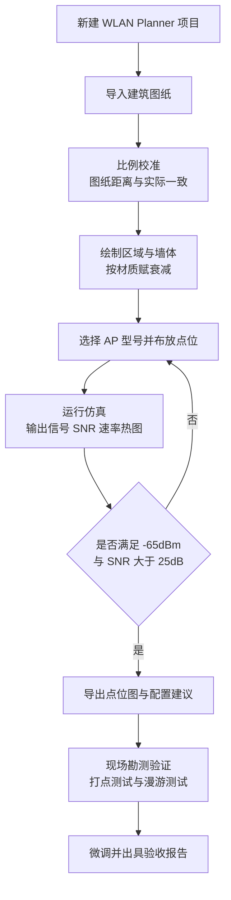

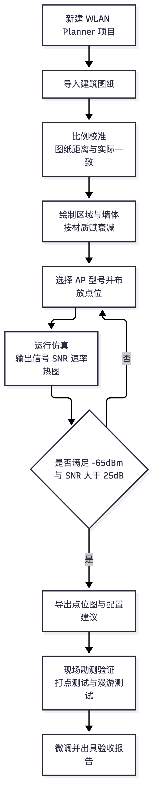


### 易错点与排错
1. **比例校准错误是仿真失真的第一大原因**：图纸比例不对，墙体位置与 AP 间距全部错位，热图毫无参考价值。
2. **墙体材质必须按实际填写**：把混凝土墙当成石膏板墙，仿真结果会乐观 10~20dB。
3. **模拟勘测不能替代现场勘测**：仿真无法发现现场已有的干扰 AP、微波炉、金属货架，验收必须以实测为准。
4. 现场勘测应在**业务低峰期**进行，否则测量的干扰与负载数据不可复现。
5. WLAN Planner 的 AP 型号库需与采购型号一致，不同型号的天线增益与方向图差异会显著影响覆盖仿真结果。

---

## 7.4 常见故障分类排查与决策树

### 考点定位
【真题·排错】的核心战场，也是省赛实操的主要形式。评分关注"分类是否正确、顺序是否合理、命令是否准确"。题目通常给 2~3 个现象描述，要求逐一给出排查路径。

### 原理精讲
WLAN 故障可以归入五大类，每类的排查入口完全不同，**先分类再排查**是效率最高的方法：

1. **STA 搜不到 SSID**：属于"广播与射频层"问题。可能原因：AP 未上线（AP 侧问题）、VAP 未生成（模板未绑定）、SSID 被设为隐藏（`hide-ssid`）、射频被关闭或信道不合法（国家码错误）、终端只支持 5G 而 AP 只开 2.4G（频段不匹配）、SSID 名称含终端不支持的特殊字符。排查入口是 `display vap ssid all` 与 `display radio all`。
2. **STA 搜到但连不上**：属于"关联与认证层"问题。可能原因：密码错误、加密方式不匹配（终端只支持 WPA2 而网络只开 WPA3）、达到 `max-sta-number` 上限、STA 在黑名单中、802.1X 认证失败、安全模板与终端能力不兼容（如强制 PMF 而终端不支持）。排查入口是 `display station online-fail-record all`。
3. **连上但无法上网**：属于"网络层"问题。可能原因：`service-vlan` 未在 AC/核心创建、VLANIF 无地址、DHCP 分配失败、网关路由缺失、DNS 不可达、ACL 或防火墙策略拦截、Portal 认证未通过、本地转发模式下交换机未放通业务 VLAN。排查入口是"看 STA 是否拿到 IP（`display station all` 的 IP 字段）"与"能否 ping 通网关"。
4. **网速慢**：属于"空口质量层"问题。可能原因：SNR 低（干扰）、信道利用率高（用户过多）、协商速率低（终端能力或低速率开启）、限速模板误配、上下行不对称、AC 转发性能瓶颈（隧道转发）。排查入口是 `display station assoc-info`（看速率与 SNR）与 `display radio all`（看利用率）。
5. **频繁掉线/漫游异常**：属于"覆盖与漫游层"问题。可能原因：覆盖边缘信号不足导致反复重连、漫游参数过激导致乒乓漫游、Deauth 攻击、AP 掉线（供电或链路问题）、AC 与 AP 隧道抖动。排查入口是 `display station roam-track` 与 `display ap all` 的状态变化历史。
6. **AP 掉线**：属于"AP 在线稳定性"问题。可能原因：PoE 供电不足或网线质量差、上行链路丢包、CAPWAP 保活超时、AP 版本异常反复重启、AC 主备切换。排查入口是 `display ap all` 与 `display ap online-fail-record all`。

### 关键概念对照表

| 现象 | 优先排查层 | 首查命令 | 高频根因 |
|---|---|---|---|
| 搜不到 SSID | 射频/VAP | `display vap ssid all` | VAP 未绑定、SSID 隐藏、频段不匹配 |
| 搜到连不上 | 认证/容量 | `display station online-fail-record all` | 密码错、加密不兼容、超最大用户数 |
| 连上不能上网 | 网络层 | `display station all`（看 IP） | 业务 VLAN 未创建、DHCP 失败、ACL |
| 网速慢 | 空口质量 | `display station assoc-info` | SNR 低、信道利用率高、限速误配 |
| 频繁掉线 | 覆盖/漫游 | `display station roam-track` | 覆盖不足、乒乓漫游、Deauth 攻击 |
| AP 掉线 | AP 在线性 | `display ap all` | PoE 不足、链路丢包、版本异常 |

### 华为设备配置
```bash
<AC6805> display station all                              # 1. 先确认 STA 是否在线、IP 与 VLAN
<AC6805> display station online-fail-record all            # 2. 连不上时查看失败原因
<AC6805> display vap ssid all                              # 3. 搜不到 SSID 时确认 VAP 是否生成
<AC6805> display radio all                                 # 4. 确认射频信道、带宽、利用率与用户数
<AC6805> display station assoc-info sta-mac 0011-2233-4455  # 5. 网速慢时看 RSSI/SNR/协商速率
<AC6805> display station roam-track sta-mac 0011-2233-4455  # 6. 漫游异常时看轨迹与时间
<AC6805> display ap all                                    # 7. AP 掉线时看状态
<AC6805> display ap online-fail-record all                 # 8. AP 反复上线失败看原因
<AC6805> display ap performance ap-id 1                    # 9. 确认 AP 是否过载
<AC6805> display wlan config-advice ap-id 1                # 10. 部分版本可给出配置优化建议
<AC6805> display ip routing-table                          # 11. 业务不通时确认回程路由
<AC6805> terminal monitor                                  # 12. 开启终端显示（调试前必须执行）
<AC6805> terminal debugging
<AC6805> debugging wlan mac all                            # 13. 观察 STA 关联过程（谨慎，用完立即关闭）
<AC6805> undo debugging all                                # 14. 关闭调试，避免 CPU 过载
```

### 示意图
```mermaid
flowchart TD
  F0["用户报障"] --> F1{"现象分类"}
  F1 -->|"搜不到 SSID"| A1["display vap ssid all"]
  A1 --> A2{"VAP 是否生成"}
  A2 -->|"否"| A3["检查模板引用与射频状态"]
  A2 -->|"是"| A4["检查 SSID 是否隐藏<br/>终端频段能力是否匹配"]
  F1 -->|"搜到连不上"| B1["display station online-fail-record all"]
  B1 --> B2{"失败原因"}
  B2 -->|"密钥错误"| B3["核对密码与加密方式"]
  B2 -->|"认证失败"| B4["检查 802.1X 与 RADIUS"]
  B2 -->|"超过最大用户数"| B5["调整 max-sta-number 或做负载均衡"]
  F1 -->|"连上不能上网"| C1["display station all 看是否拿到 IP"]
  C1 --> C2{"是否有 IP"}
  C2 -->|"否"| C3["检查业务 VLAN 与 DHCP"]
  C2 -->|"是"| C4["ping 网关 检查 ACL 与回程路由"]
```

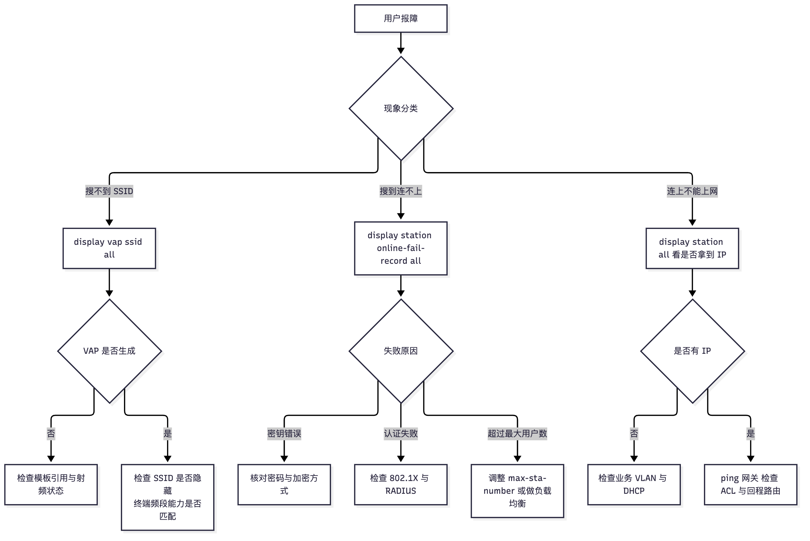

```mermaid
flowchart TD
  D1["网速慢 / 频繁掉线"] --> D2["display station assoc-info"]
  D2 --> D3{"RSSI 与 SNR 是否达标"}
  D3 -->|"RSSI 低于 -70dBm"| D4["覆盖不足：增加 AP<br/>或调整点位与功率"]
  D3 -->|"SNR 低于 25dB"| D5["干扰问题：display radio all<br/>调整信道或排查干扰源"]
  D3 -->|"均达标"| D6{"信道利用率是否过高"}
  D6 -->|"是"| D7["容量问题：负载均衡<br/>频段引导 限制低速率"]
  D6 -->|"否"| D8["检查限速模板与 AC 转发性能<br/>display ap performance"]
  D1 --> D9["display station roam-track"]
  D9 --> D10{"漫游是否频繁或超时"}
  D10 -->|"乒乓漫游"| D11["调整 smart-roam 阈值"]
  D10 -->|"漫游时延大"| D12["启用 802.11r 与 PMK 缓存"]
```

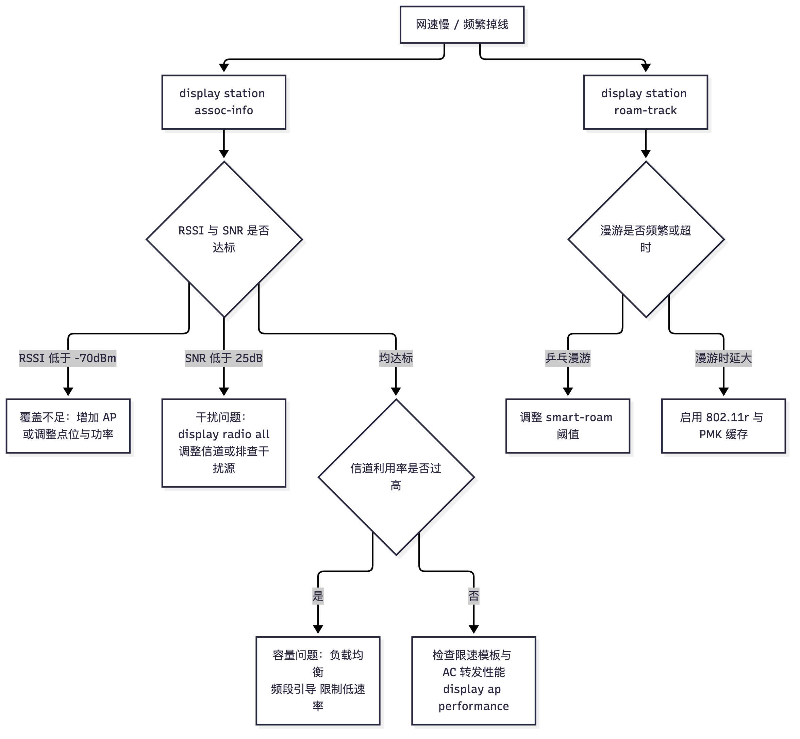


### 易错点与排错
1. **先分类后排查**：不要一上来就 `debugging`，先按现象定位到"射频/VAP、认证、网络、空口质量"中的哪一层。
2. **`debugging` 必须配合 `terminal monitor` 与 `terminal debugging`**，否则屏幕上什么都看不到；用完立即 `undo debugging all`，生产设备上长时间开调试可能导致 CPU 冲高、AP 掉线。
3. **"搜不到 SSID"要先区分是单个终端还是所有终端**：只有个别终端搜不到，多半是终端频段或驱动问题；所有终端都搜不到，才是 AC/AP 侧问题。
4. **"连上不能上网"第一步看 STA 有没有拿到 IP**，这一步能把问题域从"无线问题"缩小到"地址问题"或"路由问题"。
5. 漫游类问题必须先证明"发生过漫游"，用 `display station roam-track` 而不是猜。

---

## 7.5 空口抓包、诊断工具与 WLAN 优化手段清单

### 考点定位
本考点考查"高级排错手段"与"优化清单"，属于拉开分差的题目。常见问法：如何在不影响业务的情况下抓取空口报文？有哪些优化手段可以提升高密场景体验？要求能列出 5 条以上并说明原理。

### 原理精讲
**空口抓包与诊断**在华为体系中有三种手段：

1. **AP 内置抓包（AirEngine 系列）**：AP 支持把指定 STA 的报文镜像到指定目的地址/端口，或直接在 AP 上抓包并保存为文件（pcap）后导出分析。这与"搬一台笔记本到现场"相比，优点是能抓到**空口原始帧**（含管理帧、Beacon、Deauth），并且不影响用户位置；缺点是需要在 AP 视图下操作，且对 AP 性能有一定开销，抓包时间要控制。
2. **射频 Ping（AP Ping / Radio Ping）**：从 AP 的射频侧发起探测，用于判断"AP 与 STA 之间是否存在空口问题"，可作为空口链路质量与丢包的独立验证手段。
3. **频谱分析（Spectrum Analysis）**：AirEngine 频谱 AP 或支持该功能的 AP 可以扫描非 802.11 干扰源（微波炉、无绳电话、蓝牙、摄像头），输出频谱图与干扰源类型，定位"信号好但速率低"的疑难问题。在 iMaster NCE-Campus 上可以图形化查看。

**WLAN 优化手段清单**（必须能背，考试要求列 5 条以上并说明原理）：

| 优化手段 | 配置位置 | 原理 | 适用场景 |
|---|---|---|---|
| 功率调整（EIRP） | AP 视图/射频模板 | 降低过覆盖，减少同频干扰，提升整体容量 | 高密部署、干扰严重 |
| 信道调整（DCA） | RRM 模板 | 避免同频复用距离过近，动态避开干扰 | 信道拥堵、外部干扰 |
| 频段引导（Band Steering） | RRM 模板 | 把双频终端引到 5G，缓解 2.4G 拥塞 | 双频终端占多数 |
| 负载均衡（Load Balance） | RRM 模板 | 按用户数/流量在射频间分流，避免单 AP 过载 | 会议室、报告厅 |
| 限制低速率 | 射频模板 | 低速终端占用空口时间过长，关闭低速率可提升整机效率 | 2.4G 高密、覆盖边缘 |
| 关闭低效协议 | 射频模板 | 关闭 802.11b、关闭 TKIP/WEP，减少保护开销 | 老终端已淘汰的网络 |
| Airtime 调度 | RRM/流量模板 | 按空口占用时间而非报文数调度，保障公平性 | 高低速终端混合 |
| 限制最大接入数 | SSID 模板 | 防止单 VAP/单射频过载 | 高密场景 |
| 智能漫游 | RRM 模板 | 及时把终端从弱信号 AP 引走 | 语音、移动场景 |
| 802.11k/v/r | RRM/安全模板 | 缩短扫描、主动引导、快速密钥协商 | 语音与实时业务 |
| 关闭低效 SSID | VAP 配置 | 每个 radio VAP 数量越少，Beacon 开销越小 | 多 SSID 场景 |
| 合理频宽 | 射频模板 | 2.4G 用 20MHz，5G 用 80MHz，平衡容量与干扰 | 通用 |

**Airtime 调度**值得单独说明：传统 WLAN 的竞争机制对所有终端"一视同仁"，一个 1Mbps 的老终端发一个 1500 字节报文占用的空口时间，是一个 866Mbps 终端的 800 多倍，这会严重拖累整机吞吐。Airtime 公平调度按"占用空口时间"来分配机会，让高速终端获得更多报文机会，从而提升整体效率——这是高密优化的关键机制之一。

### 关键概念对照表

| 诊断手段 | 能看到什么 | 是否需要中断业务 | 使用成本 |
|---|---|---|---|
| AP 内置抓包 | 空口原始帧、管理帧、数据帧 | 不需要 | 中（占用 AP 资源） |
| 射频 Ping | 空口链路可达性与丢包 | 不需要 | 低 |
| 频谱分析 | 非 802.11 干扰源与能量分布 | 需要 AP 支持 | 中高（专业 AP） |
| `debugging wlan` | 协议交互过程（关联、认证、握手） | 不需要但影响 CPU | 高（生产慎用） |
| 网管平台（iMaster NCE） | 全网 KPI、告警、健康度 | 不需要 | 低（推荐） |

| 优化目标 | 首选手段 | 次选手段 |
|---|---|---|
| 覆盖不足 | 增加 AP、调整点位 | 提高功率、改用高增益天线 |
| 同频干扰 | 降低功率、DCA 信道调整 | 关闭部分 AP 的 2.4G 射频道 |
| 容量不足 | 频段引导 + 负载均衡 | 增加 AP、限制单 AP 用户数 |
| 低速终端拖累 | 关闭低速率、Airtime 调度 | 单独开一个兼容 SSID 隔离老终端 |
| 漫游体验差 | 802.11r + PMF | 智能漫游阈值调优 |
| 语音质量差 | QoS/优先级映射 + WMM | 专用语音 SSID 与 VLAN |

### 华为设备配置
```bash
[AC6805] wlan
[AC6805-wlan-view] ap-id 1
# AirEngine AP 支持空口抓包：在 AP 视图下开启抓包，可按 STA MAC 过滤并导出 pcap 文件分析
# 具体命令随版本差异较大，以对应版本产品文档为准；抓包时长建议控制在数分钟内并及时停止
[AC6805-wlan-ap-1] quit
[AC6805-wlan-view] rrm-profile name rrm-opt                 # 优化参数集中管理
[AC6805-wlan-rrm-prof-rrm-opt] calibrate auto-channel-select enable     # DCA 自动信道
[AC6805-wlan-rrm-prof-rrm-opt] calibrate auto-txpower-select enable     # TPC 自动功率
[AC6805-wlan-rrm-prof-rrm-opt] band-steer enable            # 频段引导
[AC6805-wlan-rrm-prof-rrm-opt] sta-load-balance dynamic enable          # 动态负载均衡
[AC6805-wlan-rrm-prof-rrm-opt] smart-roam enable            # 智能漫游
[AC6805-wlan-view] radio-2g-profile name r2-opt
[AC6805-wlan-radio-2g-prof-r2-opt] channel 20mhz 1 6 11     # 2.4G 只保留三个非重叠信道
[AC6805-wlan-radio-2g-prof-r2-opt] undo dot11bg supported-rate 1 2 5.5 11  # 限制低速率
[AC6805-wlan-view] traffic-profile name tp-voice            # 语音业务 QoS 保障
[AC6805-wlan-traffic-prof-tp-voice] rate-limit client down 4096  # 语音终端下行限速，防止单终端打满空口
# 语音优先级：通过 WMM 队列与 DSCP 映射实现（命令名随版本差异，如 priority-map 相关配置）
# 实施要点：AC、AP 上行交换机与核心设备需同步信任该 DSCP 优先级，否则无线侧标记在无线侧即被丢弃
[AC6805-wlan-view] ap-group name office
[AC6805-wlan-ap-group-office] radio 0
[AC6805-wlan-group-radio-office/0] rrm-profile rrm-opt
[AC6805-wlan-group-radio-office/0] radio-2g-profile r2-opt
<AC6805> display radio all                                  # 查看优化后的信道、功率与利用率
<AC6805> display station all                                # 查看终端分布是否均衡到 5G
<AC6805> display ap performance ap-id 1                     # 确认 AP 负载与资源占用
```

### 示意图
```mermaid
flowchart TD
  O0["网络体验问题"] --> O1{"是覆盖问题还是容量问题"}
  O1 -->|"覆盖不足"| O2["增加 AP 或调整点位<br/>适度提高功率"]
  O1 -->|"容量不足"| O3["频段引导 + 负载均衡<br/>限制单 AP 用户数"]
  O1 -->|"干扰严重"| O4["DCA 信道调整<br/>降低功率 频谱分析定位干扰源"]
  O1 -->|"低效终端拖累"| O5["限制低速率<br/>Airtime 调度"]
  O1 -->|"漫游体验差"| O6["802.11r + PMF<br/>智能漫游阈值调优"]
  O2 --> O7["验证：display radio all 与实测打点"]
  O3 --> O7
  O4 --> O7
  O5 --> O7
  O6 --> O7
```

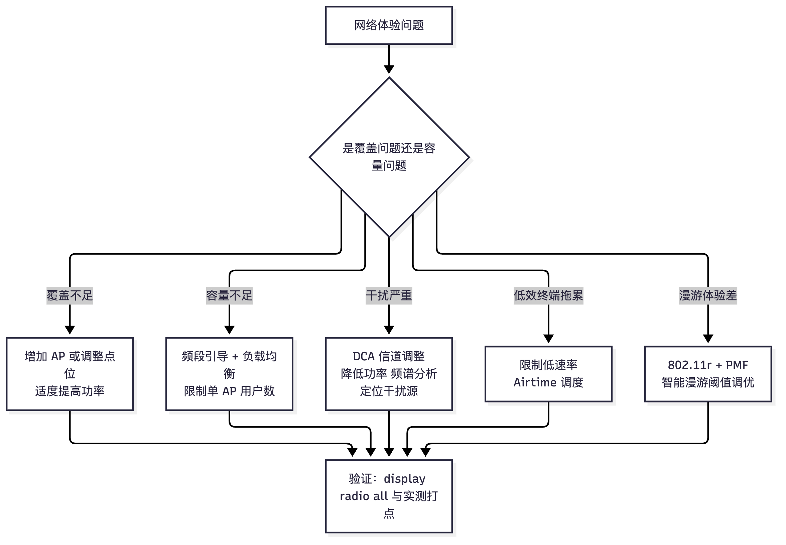


### 易错点与排错
1. **优化不是"全都开"**：802.11r 与 PMF 开启后老终端可能无法连接，必须结合终端普查结果决定。
2. **降低功率不一定降低覆盖质量**：在高密场景中降低功率反而提升整体体验，因为同频干扰减少，SNR 上升。
3. **关闭低速率会缩小覆盖边缘**：如果业务需要覆盖到远处（如仓库、室外），关闭低速率可能让边缘终端无法关联，需要权衡。
4. **抓包文件要控制时长与大小**：长时间抓包会占用 AP 闪存并影响转发性能，建议按需抓取并在完成后立即停止。
5. **优化前后必须有量化对比**：记录优化前的 SNR、信道利用率、平均速率、漫游时延，优化后复测同一指标，否则无法证明优化有效。

---

## 7.6 章节7真题精练

### 考点定位
本章真题包含方案计算、规划流程、排错分类与优化手段，其中【真题·排错】与【真题·实验】必考，且排错题按"分类正确、顺序合理、命令准确"三点给分。

### 真题精练

**Q1.【真题·单选】** WLAN 覆盖设计中，通常要求主要业务区域的信号强度不低于多少？
A. -55dBm  B. -65dBm  C. -75dBm  D. -85dBm

> **答案：B**
> **解析**：工程惯例是主要业务区目标 ≥ -65dBm，覆盖边缘可放宽到 -70dBm（最低 -75dBm）。-55dBm 属于过覆盖，会带来同频干扰与容量下降；-75dBm 以下会导致低速率与连接不稳定。

**Q2.【真题·多选】** 以下哪些属于 WLAN 覆盖设计时需要重点考虑的现场因素？
A. 墙体材质与厚度  B. 天花板高度与安装条件  C. 现有干扰源（微波炉、其他 AP）  D. 交换机的品牌  E. 家具与货架的布局

> **答案：A、B、C、E**
> **解析**：交换机的品牌不影响射频覆盖计算，属于设备选型与运维范畴；A、B、C、E 都直接改变射频传播或干扰环境，必须在勘测阶段量化。

**Q3.【真题·填空】** 某会议室 200 人，并发率 80%，人均带宽需求 4Mbps，则总带宽需求为 ______ Mbps；单 AP 有效吞吐按 500Mbps 计算，仅从带宽角度至少需要 ______ 台 AP。

> **答案：640；2**
> **解析**：200 × 80% × 4Mbps = 640Mbps；640 ÷ 500 ≈ 1.28，向上取整为 2 台。注意实际还须校验用户数约束（160 用户 ÷ 50 = 4 台），最终应取 4 台，说明高密场景下"连接数"往往先于"带宽"成为瓶颈。

**Q4.【真题·判断】** 华为 WLAN Planner 属于模拟勘测工具，其仿真结果可以完全替代现场勘测。

> **答案：错误**
> **解析**：模拟勘测依赖图纸与墙体模型的准确性，无法反映现场实际干扰源、家具布局与安装条件，因此只能用于方案设计阶段。实施与验收必须做现场勘测（打点测试），二者是"先仿真、后实测验证"的配合关系。

**Q5.【真题·简答】** 请列举至少 5 种 WLAN 优化手段，并说明各自的原理与适用场景。

> **答案与解析**：
> 1. **功率调整（EIRP/TPC）**：降低过覆盖 AP 的发射功率，减少同频干扰范围，提升整体 SNR 与容量；适用于高密办公区。
> 2. **信道调整（DCA）**：动态为 AP 分配干扰最小的信道，避免同频复用距离过近；适用于信道拥堵、存在外部干扰的网络。
> 3. **频段引导（Band Steering）**：把支持双频的终端优先引导到 5G，缓解 2.4G 拥塞；适用于双频终端为主的场景。
> 4. **负载均衡（Load Balance）**：按用户数或流量在同频/跨频射频间分流，避免单 AP 过载；适用于会议室、报告厅。
> 5. **限制低速率**：关闭 1/2/5.5/11Mbps 等低速率，避免低速终端长时间占用空口；适用于老终端已淘汰的 2.4G 网络。
> 6. **Airtime 空口时间调度**：按占用空口时间而非报文数分配竞争机会，提升高低速终端混合场景的整体效率。
> 7. **智能漫游 + 802.11k/v/r**：引导终端及时切换到更优 AP 并缩短切换时延；适用于语音与移动业务。

**Q6.【真题·单选】** 用户反馈"信号满格但网速很慢"，最应该优先检查的指标是？
A. 信号强度 RSSI  B. 信噪比 SNR 与信道利用率  C. AP 的 IP 地址  D. AC 的 License 数量

> **答案：B**
> **解析**："信号满格"说明 RSSI 没有问题，网速慢通常来自噪声或拥塞：SNR 低于 25dB 时终端只能使用低阶 MCS，信道利用率过高则意味着空口竞争激烈。A 已经被现象排除；C、D 与单用户速率无直接关系。

**Q7.【真题·排错】** 现象：某办公区 STA 可以成功关联并获取 10.10.101.x 的地址，但无法访问内网服务器与互联网，网关也 ping 不通。AC 采用隧道转发，业务 VLAN 101。请给出排查步骤。

> **答案与解析**（按顺序给分）：
> 1. **确认 STA 侧信息**：`display station all` 查看 STA 的 IP、VLAN、所属 AP 是否与预期一致；若 IP 是 169.254.x.x 说明 DHCP 失败。
> 2. **确认 AC 侧 VLAN 与接口**：`display vlan 101` 与 `display ip interface brief` 确认 VLAN 101 已创建、VLANIF 101 已配置地址且状态 Up。隧道转发下 AC 必须为 STA 网关。
> 3. **确认 DHCP 配置**：`display ip pool name <池名>` 查看地址池是否耗尽、网关是否指向 VLANIF 101；确认全局 `dhcp enable` 已开启。
> 4. **确认转发模式一致性**：`display vap-profile name <VAP名>` 查看 `forward-mode`；若为本地转发，业务报文不经 AC，需检查接入交换机上行口是否 Trunk 放通 VLAN 101。
> 5. **确认三层可达与路由**：在 AC 上 `ping` 内网服务器；`display ip routing-table` 检查是否存在到服务器网段的回程路由，必要时查看是否缺少静态路由或 OSPF 未发布该网段。
> 6. **确认策略与 ACL**：检查 AC 上是否配置了限制该网段的 ACL、是否启用了 Portal 认证而用户未通过认证（`display station all` 的认证状态）。
> 7. **确认物理与二层**：在接入交换机上 `display mac-address` 确认 STA 的 MAC 是否学到、处于哪个 VLAN，排除 VLAN 打错标签的问题。

**Q8.【真题·实验】** 实验要求：某高密报告厅部署 8 台 AirEngine 5761，需完成以下优化配置：2.4G 仅使用 1/6/11 信道且关闭低速率、5G 使用 80MHz、开启自动信道与自动功率调优、开启动态负载均衡与频段引导、单射频超过 30 用户开始均衡、单 VAP 最大接入 60 用户。请写出关键配置（含注释）。

> **答案与解析**：
```bash
<AC6805> system-view
[AC6805] wlan
[AC6805-wlan-view] rrm-profile name rrm-hd                  # 高密优化模板
[AC6805-wlan-rrm-prof-rrm-hd] calibrate auto-channel-select enable   # 自动信道选择
[AC6805-wlan-rrm-prof-rrm-hd] calibrate auto-txpower-select enable   # 自动功率选择
[AC6805-wlan-rrm-prof-rrm-hd] sta-load-balance dynamic enable        # 动态负载均衡
[AC6805-wlan-rrm-prof-rrm-hd] sta-load-balance dynamic start-threshold 30  # 30 用户起均衡
[AC6805-wlan-rrm-prof-rrm-hd] sta-load-balance dynamic gap-threshold 10    # 用户数差 10 触发引导
[AC6805-wlan-rrm-prof-rrm-hd] band-steer enable             # 频段引导
[AC6805-wlan-rrm-prof-rrm-hd] band-steer balance            # 均衡模式
[AC6805-wlan-rrm-prof-rrm-hd] smart-roam enable             # 智能漫游（报告厅内移动也要及时切换）
[AC6805-wlan-view] radio-2g-profile name r2-hd
[AC6805-wlan-radio-2g-prof-r2-hd] channel 20mhz 1 6 11      # 2.4G 只使用三个非重叠信道
[AC6805-wlan-radio-2g-prof-r2-hd] undo dot11bg supported-rate 1 2 5.5 11  # 关闭低速率
[AC6805-wlan-view] radio-5g-profile name r5-hd
[AC6805-wlan-radio-5g-prof-r5-hd] channel 80mhz 36 44 52 60  # 5G 80MHz 频宽
[AC6805-wlan-view] ssid-profile name ssid-hd
[AC6805-wlan-ssid-prof-ssid-hd] ssid HUAWEI-HD
[AC6805-wlan-ssid-prof-ssid-hd] max-sta-number 60            # 单 VAP 最大 60 用户
[AC6805-wlan-view] ap-group name hall
[AC6805-wlan-ap-group-hall] regulatory-domain-profile CN
[AC6805-wlan-ap-group-hall] radio 0
[AC6805-wlan-group-radio-hall/0] radio-2g-profile r2-hd
[AC6805-wlan-group-radio-hall/0] rrm-profile rrm-hd
[AC6805-wlan-group-radio-hall/0] vap-profile vap-hd wlan 1
[AC6805-wlan-group-radio-hall/0] quit
[AC6805-wlan-ap-group-hall] radio 1
[AC6805-wlan-group-radio-hall/1] radio-5g-profile r5-hd
[AC6805-wlan-group-radio-hall/1] rrm-profile rrm-hd
[AC6805-wlan-group-radio-hall/1] vap-profile vap-hd wlan 1
[AC6805-wlan-ap-group-hall] quit
[AC6805] save
```
> 验证与调优：`display radio all` 核对 8 台 AP 的 2.4G 信道是否在 1/6/11 中交错分配、5G 信道是否互不重叠；`display station all` 检查用户是否被均衡到各 AP；`display ap performance ap-id x` 确认单 AP 负载未超阈值；用打点测试确认覆盖边缘仍 ≥ -65dBm、SNR > 25dB。

### 易错点与排错
- **容量题的三个必查项**：并发率、有效吞吐折算、用户数约束，缺任一项都会被扣分。
- **排错题必须写命令**，只写"检查 VLAN"不给分，应写成"用 `display vlan 101` 确认 VLAN 已创建"。
- 优化类题目要答"原理 + 适用场景 + 验证方法"三要素，只列名称得分有限。
- 关闭低速率与限制功率都可能缩小有效覆盖，必须结合覆盖目标权衡，答题时要体现出这种"权衡"意识。
