# B1-数通HCIE上-OSPF高级与ISIS

> **所属**：华为 ICT 大赛网络赛道 · 国赛 · 数通 方向 · HCIE 层
> **内容**：OSPF 高级特性与优化、IS-IS 协议与 IPv6 集成
> **真题说明**：本册真题依据华为 ICT 大赛历年公开赛题方向、华为认证考试真题回忆与官方教材例题整理改写，用于自测训练；正式参赛请以大赛官方考试大纲与题库为准。

---

# 数通-HCIE-章节1-OSPF高级特性与优化

## 1.1 LSA 全类型深度剖析

### 考点定位

LSA（Link State Advertisement，链路状态通告）是 OSPF 的"原子事实"，也是国赛选择、填空、简答、排错四类题型的共同底座。高频考法有三类：**给一个 Link State ID 问是哪种 LSA**（尤其 `10.1.1.1` 与 `10.1.1.0` 的分辨）、**问某区域里应不应该出现某类 LSA**、**问 Type4/Type5/Type7 的产生者与传播范围**。分值通常占 OSPF 部分的 30% 以上。最经典的陷阱是把 Link State ID 与"网段地址"混为一谈，以及误认为 Type5 由 ABR 产生。

### 原理精讲

**为什么需要多种 LSA？** OSPF 的设计目标是把"网络拓扑"与"外部路由"分层描述，让不同区域只承载自己需要的信息，从而压缩 LSDB（Link State Database，链路状态数据库）规模、缩短 SPF（Shortest Path First，最短路径优先）计算时间。如果全网络用同一种 LSA 描述一切，那么任何一台路由器的链路抖动都会导致全网所有路由器重算，区域划分就失去意义。因此 OSPF 用"**谁产生、在哪个范围泛洪、描述什么**"三个维度把 LSA 切成 7 类（外加 OSPFv3 的 Type8/Type9 与 MPLS 相关的 Type10/Type11）。

**Type1 Router LSA（路由器 LSA）**：每台路由器为**每个所属区域**产生一条（不是每台一条！跨 3 个区域的路由器产生 3 条 Type1）。Link State ID = 该路由器的 Router ID。它描述"我在这个区域里有哪些链路、每条链路的类型、开销、对端"。链路类型有四种：Point-to-point（Type=1）、Transit（Type=2，连到 DR 的网络）、Stub Network（Type=3，网段上无邻居）、Virtual Link（Type=4）。**关键字段**：V 位（Virtual Link Endpoint，置 1 表示本路由器是虚连接端点）、E 位（External，置 1 表示本路由器是 ASBR）、B 位（Border，置 1 表示本路由器是 ABR）。**注意**：Type1 在**本区域内**泛洪，不出区域。

**Type2 Network LSA（网络 LSA）**：由**广播/NBMA 网络上的 DR（Designated Router，指定路由器）**产生，Link State ID = **DR 接口的 IP 地址**（不是网络号！这是最常考的陷阱）。它描述"本广播网段上有哪些路由器与我建立了 Full 邻接"。**为什么由 DR 产生？** 因为广播网段上 n 台路由器若两两建立邻接会产生 n(n-1)/2 条链路，而 DR 代表整个网段形成"伪节点（Pseudonode）"，链路上只需 n 条描述，SPF 树中该网段变成一个节点。**Transit 网段与 Stub 网段的判定**：接口上是否至少存在一个 Full 状态的邻居——有邻居则是 Transit（DR 产生 Type2，其他路由器用 Type1 的 Transit 链路指向 DR），无邻居则是 Stub Network（用 Type1 的 Stub 链路直接描述网段）。

**Type3 Summary LSA（网络汇总 LSA）**：由 **ABR（Area Border Router，区域边界路由器）**产生，用于把**一个区域内的路由（含 Type1/Type2 算出的网段、以及本区域学到的 Type3）通告到相邻的另一个区域**。Link State ID = **目的网段的网络地址**（如 `10.1.1.0`），掩码放在 LSA 的 Network Mask 字段。**为什么叫"距离矢量式"？** 因为 Type3 不携带拓扑，只携带"目标网段 + ABR 到达该网段的度量"，邻居区域的路由器无法验证这个度量的真实性，只能相信 ABR——这与 RIP 的距离矢量思想完全一致，也是区域间防环必须靠拓扑约束（骨干区域规则）的原因。**必须记牢**：Type3 只在**区域之间**逐区域传播，**不会**穿过一个非骨干区域继续传播（水平分割）。

**Type4 ASBR Summary LSA（ASBR 汇总 LSA）**：由 **ABR** 产生，Link State ID = **ASBR 的 Router ID**（注意不是网段！），用于告诉其他区域"如何到达某个 ASBR"。**为什么必须有 Type4？** 因为 Type5 中不含"产生者的位置信息"，只有 Advertising Router 字段。本区域内路由器可以通过 Type1/Type2 算出到达该 Router ID 的路径，但**其他区域**的路由器只靠 Type5 无法知道 ASBR 在哪，所以由 ABR 补一条 Type4 充当"ASBR 的位置指路牌"。**特殊规则**：如果 ASBR 本身就是 ABR（同一台设备既做 ABR 又做 ASBR），它所在的区域不需要 Type4（因为它在本区域有 Type1，其他区域由它自己作为 ABR 直接产生 Type4）。

**Type5 AS External LSA（自治系统外部 LSA）**：由 **ASBR（Autonomous System Boundary Router，自治系统边界路由器）**产生，描述引入 OSPF 域的外部路由（如静态路由、直连、BGP、RIP、IS-IS 引入）。Link State ID = **外部目的网段的网络地址**。**关键字段**：E 位（External Metric Type，0 = E2，1 = E1）、Forwarding Address（FA，转发地址）、External Route Tag、Metric。**Type5 在全 OSPF 域（所有普通区域与骨干区域）泛洪，但不进入 Stub / Totally Stub 区域**。

**Type7 NSSA External LSA（NSSA 外部 LSA）**：由 **NSSA（Not-So-Stubby Area，非完全末梢区域）内的 ASBR** 产生，Link State ID = 外部目的网段的网络地址。它的字段结构与 Type5 几乎一致，多了一个 **P 位（Propagate bit，传播位）**。**为什么需要 Type7？** 因为 Stub 区域不允许 Type5 进入（否则外部路由会引入大量 LSA，失去末梢区域的意义），但实际组网中末梢区域内部又常常存在需要引入外部路由的设备（例如分支路由器挂了另一条出口）。于是 RFC 3101 定义 NSSA：允许 Type7 在 NSSA 内泛洪，再由 **NSSA 的 ABR（同时是转换器 Translator）**把 Type7 **转换**成 Type5 通告到骨干区域。**这条转换链是 NSSA 的核心机制，必须能画出完整流程**。

**Type7 → Type5 转换的三个判据**（缺一不可）：

1. **P 位必须置 1**：P 位只在 NSSA 内部泛洪时使用，若 ASBR 引入时 P=0，ABR 不转换（用于"这条外部路由只允许在本 NSSA 内部使用"）。**P 位默认置 1**（当引入时的 FA 为 0.0.0.0 时）。若引入时指定了非 0 的 Forwarding Address，则 P 位默认置 0，此时路由**不会**被转换出 NSSA（这是国赛高频考点，很多选手不知道 FA 会"关掉" P 位）。
2. **转换器必须是该 NSSA 的 ABR**：且接口上不能配置 `nssa suppress-forwarding-address` 之类的抑制动作。
3. **存在多个转换器时的选举**：同一 NSSA 有多个 ABR 时，Router ID 最大者（华为实现中按 Router ID 最大者优先）成为转换器，避免重复转换产生重复 Type5。

**Forwarding Address 的作用与取值规则**：FA 是"去往外部目的地的下一跳 IP"。FA ≠ 0.0.0.0 时，OSPF 路由器会**在 OSPF 域内先算出到达 FA 的最优路径，然后以 FA 为下一跳转发外部流量**，从而避开 ASBR 造成的次优路径（"绕行 ASBR"问题）。FA 的取值规则（引入时）：

- 引入的路由的**出接口已使能 OSPF 且网络类型为 Broadcast/NBMA/P2MP** 时，FA = **该出接口的 IP 地址**；
- 出接口网络类型为 **P2P / P2MP**（P2P）时，FA = **0.0.0.0**；
- 出接口未使能 OSPF，或接口被 `silent-interface` 抑制时，FA = 0.0.0.0（全部流量绕行 ASBR）。

> **记忆口诀**：**"广播写自己，点对点写零"**。

OSPFv3 在原 7 类基础上新增：**Type8 Link LSA**（描述本链路的前缀与链路本地地址，只在链路上泛洪，不参与 SPF）、**Type9 Intra-Area-Prefix LSA**（把 IPv6 前缀从 Router LSA 中剥离出来，一个路由器可产生多条）。这不是国赛重点，但选择题偶尔出现。

### 关键概念对照表

**表 1-1-1 七类 LSA 超大对照表（国赛必背）**

| 类型 | 名称 | Link State ID | 产生者 | 泛洪范围 | 携带核心信息 | 备注 |
|---|---|---|---|---|---|---|
| Type1 | Router LSA | 产生者的 Router ID | 区域内每台路由器（每个区域一条） | 仅本区域 | 链路类型（P2P/Transit/Stub/Virtual）、链路开销、V/E/B 位 | 不出区域；有 V 位说明是虚连接端点 |
| Type2 | Network LSA | **DR 接口的 IP 地址** | 广播/NBMA 网段的 DR | 仅本区域（DR 所在区域） | 本网段的掩码、与本网段相连（Full）的路由器列表 | 伪节点；无 DR 的网络（P2P/P2MP）不产生 |
| Type3 | Summary LSA | **目的网段的网络地址** | ABR | 区域之间（逐区域，不穿非骨干区域） | 目的网段掩码、ABR 到该网段的度量（距离矢量） | 度量不累加拓扑，仅累加 ABR 报告的"到网段距离" |
| Type4 | ASBR Summary LSA | **ASBR 的 Router ID** | ABR | 区域之间（除 ASBR 所在区域外） | 到 ASBR 的度量（= 到该 Router ID 的最短路径开销） | 只为其他区域"指路"，不含网段 |
| Type5 | AS External LSA | 外部目的网段的网络地址 | ASBR | 全 OSPF 域（Stub/完全末梢区内不泛洪） | 度量类型 E1/E2、度量值、Forwarding Address、External Tag | 不由 ABR 产生；不进入 Stub/NSSA 的 Type5 通道 |
| Type7 | NSSA External LSA | 外部目的网段的网络地址 | NSSA 内的 ASBR | 仅本 NSSA 内 | 与 Type5 同，另含 **P 位** | 由 NSSA ABR 转换为 Type5 后才出区域 |
| Type8 | Link LSA（v3） | 接口的 Link-Local 地址相关 | 每台路由器（每条链路） | 仅本链路 | 链路本地地址、本链路前缀 | 不参与 SPF |
| Type9 | Intra-Area-Prefix LSA（v3） | 与 Router LSA 或 DR 关联 | 路由器/DR | 仅本区域 | IPv6 前缀与掩码长度 | v3 把前缀从 Type1 中剥离 |

**表 1-1-2 LSA 与"谁需要它"的对应关系（排错用）**

| 路由器角色 | 需要哪些 LSA 才能算出完整路由 | 缺少时会出现的现象 |
|---|---|---|
| 区域内路由器 | Type1、Type2（本区域） | 区域内路由缺失 |
| 区域间路由器（非 ABR） | Type1、Type2、Type3 | 其他区域路由缺失 |
| 需要访问 ASBR 的路由器 | 上述 + Type4 + Type5 | Type5 在 LSDB 里但路由表不生成（因无 Type4 无法计算可达性） |
| NSSA 内路由器 | 上述 + Type7 | 本 NSSA 引入的外部路由缺失 |
| 骨干区域路由器 | 全部类型（除 Type7 需转换后以 Type5 出现） | — |

**表 1-1-3 LSA 老化与刷新定时器默认值**

| 参数 | 默认值 | 说明 |
|---|---|---|
| LSA Age 最大值（MaxAge） | 3600 s | 达到后重新泛洪该 LSA 通告失效 |
| LSA 刷新时间（LSRefreshTime） | 1800 s | 产生者周期刷新，达到 1800 s 重新产生并泛洪 |
| LSA 组步长（Group Pacing） | 240 s（华为默认 `lsa-group-pacing`） | 老化检查周期 |
| InfTransDelay | 1 s | 接口上泛洪 LSA 的传输延迟，加入 Age |
| DoNotAge 位 | 默认不置位 | 用于 `demand-circuit` 按需电路，置位后 LSA 不老化 |

### 华为设备配置

```bash
# 拓扑：R1 为 ASBR（引入静态路由），R2 为 ABR，R3 为 NSSA 内 ASBR
# 设备：AR6120 / NE40E，VRP V300 及以上

# ============ R1：ABR/ASBR，引入外部路由并观察 LSA 类型 ============
system-view                                    // 进入系统视图
sysname R1                                     // 修改设备名
ospf 1 router-id 1.1.1.1                       // 创建 OSPF 进程 1，显式指定 Router ID
 area 0.0.0.0                                  // 进入区域 0 视图
  network 10.0.1.0 0.0.0.255                   // 宣告互联网段（反掩码）
 area 0.0.0.1                                  // 进入区域 1 视图
  network 10.0.2.0 0.0.0.255                   // 宣告另一侧网段，本机成为 ABR
 quit                                          // 退出区域视图
 import-route static type 1 tag 100            // 引入静态路由为 E1，打 Tag 100
 import-route direct type 2                    // 引入直连路由为 E2（默认类型）
 default-route-advertise always type 2         // 无论本地有无默认路由都产生 Type5 默认路由
 filter-policy ip-prefix DENY_10 export        // 引入时过滤，控制 Type5 生成范围
 default-cost 10                               // 向 Stub/NSSA 区域下发的默认路由开销（默认值 1）
 quit                                          // 退出 OSPF 视图

# ============ 查看 LSA 的必备命令 ============
display ospf lsdb router                         // 查看 Type1（可加 verbose 看链路细节）
display ospf lsdb network                        // 查看 Type2，注意 Link State ID 是 DR 接口 IP
display ospf lsdb summary                        // 查看 Type3 与 Type4（华为归为一类展示）
display ospf lsdb asbr                           // 仅查看 Type4 ASBR Summary LSA
display ospf lsdb ase                            // 仅查看 Type5 AS External LSA
display ospf lsdb nssa                           // 仅查看 Type7 NSSA External LSA
display ospf lsdb verbose                        // 显示 LSA 全部字段（含 FA、Tag、P 位）
display ospf lsdb router 2.2.2.2 verbose         // 查看指定 Router ID 的 Type1 详细字段
display ospf lsdb brief                          // 只看 LSA 数量与类型汇总
reset ospf process                               // 重置 OSPF 进程（排错时强制重新收敛，慎用）

# ============ R3：NSSA 内 ASBR，观察 Type7 与 P 位 ============
system-view
ospf 1 router-id 3.3.3.3
 area 0.0.0.1
  nssa                                         // 将区域 1 配置为 NSSA（区域内所有设备都要配）
  network 10.0.2.0 0.0.0.255                   // 宣告接口进 NSSA
 import-route static                           // 引入静态路由，产生 Type7（P 位默认 1）
 quit
display ospf lsdb nssa verbose                   // 检查 P 位是否置 1、FA 是否为 0.0.0.0

# ============ R1（NSSA 的 ABR）：配置 Type7 转换行为 ============
system-view
ospf 1
 area 0.0.0.1
  nssa translator-always                       // 强制本机始终作为 7 转 5 转换器（多 ABR 场景用）
  nssa suppress-forwarding-address             // 转换时把 FA 置 0，避免域内为 FA 单独建路
 quit
```

### 示意图

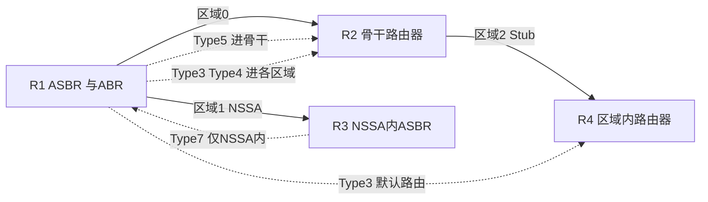

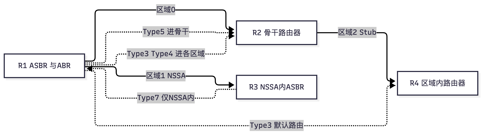


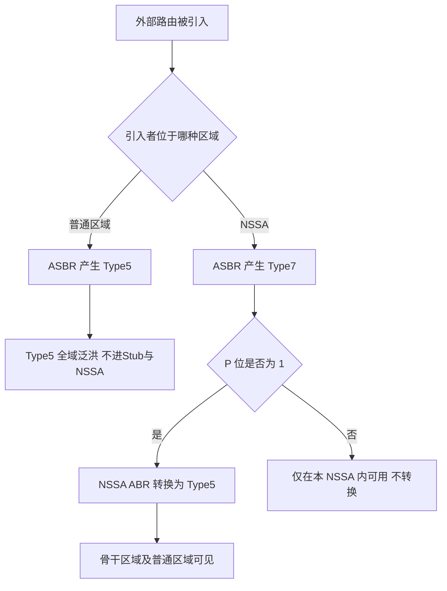

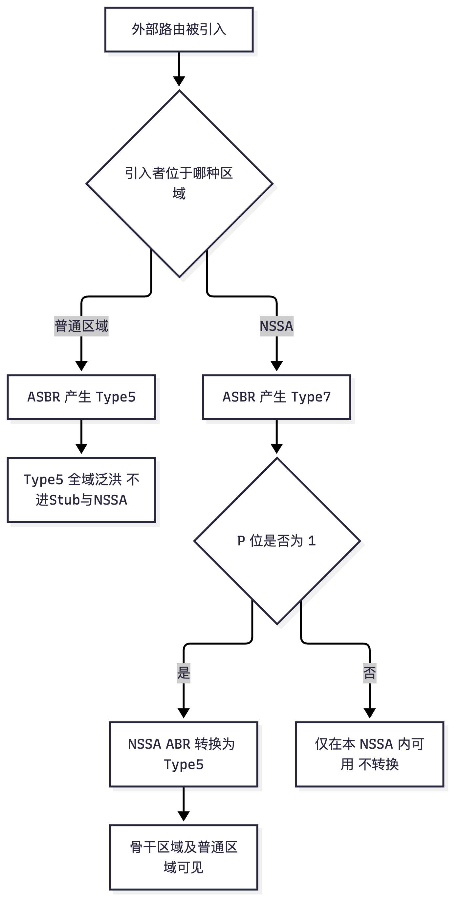


### 真题精练

**Q1.【真题·单选】** 某广播网段的 DR 接口 IP 为 10.1.1.2，网段地址为 10.1.1.0/24。该网段对应的 Type2 Network LSA 的 Link State ID 是？

A. 10.1.1.0  B. 10.1.1.1  C. 10.1.1.2  D. 0.0.0.0

> **答案：C**
> **解析**：Type2 Network LSA 的 Link State ID 是**DR 接口的 IP 地址**，不是网段地址。A 是"看起来合理"的最大干扰项——很多选手把 LSA 的"描述对象是网段"与"Link State ID 是网段"混为一谈。网段掩码放在 LSA 的 Network Mask 字段中，而不是 Link State ID 里。D 是 Type5 默认路由场景下的常见取值。

**Q2.【真题·多选】** 关于 Type4 ASBR Summary LSA，下列说法正确的有？（多选）

A. 由 ABR 产生，Link State ID 是 ASBR 的 Router ID
B. 用于让其他区域的路由器知道如何到达 ASBR
C. 如果 ASBR 与 ABR 是同一台设备，则不需要由它自己再产生 Type4
D. Type4 只在 ASBR 所在区域内泛洪

> **答案：ABC**
> **解析**：Type4 的产生者是 ABR、Link State ID 是 ASBR 的 Router ID、作用是"给 ASBR 指路"，A、B 正确；当同一台设备既是 ABR 又是 ASBR 时，它在本区域内有 Type1 可直接算出到自己的路径，无需再由自己产生 Type4（其他区域则由它作为 ABR 产生），C 正确。D 错：Type4 恰恰是为了**其他区域**服务的，它在整个 OSPF 域内泛洪（Stub 类区域除外），只在 ASBR 自己的区域内"不需要"。

**Q3.【真题·判断】** Type5 AS External LSA 由 ABR 产生并在整个 OSPF 自治系统内泛洪，因此 Stub 区域中也会存在 Type5。

> **答案：错误**
> **解析**：Type5 由 **ASBR** 产生（不是 ABR），在全 OSPF 域泛洪，但 **Stub / Totally Stub 区域为了压缩 LSDB 明确禁止 Type5 进入**；NSSA 也不允许 Type5 进入（只允许 Type7）。ABR 在这里的作用不是"产生 Type5"，而是"拦住 Type5 并代之以一条 Type3 默认路由"。

**Q4.【真题·填空】** 在 NSSA 场景中，Type7 转换为 Type5 的必要条件之一是 Type7 的 ________ 位必须置 1；若在 NSSA 内的 ASBR 上引入路由时指定了非 0 的 ________，则该位默认置 0，路由将不会转换出 NSSA。

> **答案：P（Propagate，传播位）；Forwarding Address（转发地址，FA）**
> **解析**：这是 NSSA 最容易被忽略的联动关系。华为实现中，引入时若 FA = 0.0.0.0，P 位默认置 1；若指定了具体 FA，P 位默认置 0。可以通过 `display ospf lsdb nssa verbose` 观察 P 位实际取值。

**Q5.【真题·多选】** 在 OSPF 域内，Forwarding Address（FA）取值为 0.0.0.0 的典型场景包括？（多选）

A. 引入路由的出接口网络类型为 Point-to-Point
B. 引入路由的出接口未使能 OSPF
C. 引入路由的出接口网络类型为 Broadcast 且已使能 OSPF
D. 引入路由的出接口被 `silent-interface` 抑制

> **答案：ABD**
> **解析**：FA 的作用是让域内路由器绕过 ASBR 直接转发，前提是"这个下一跳在 OSPF 域内可达"。P2P 接口上不存在"多路由器共享的下一跳"概念，故 FA = 0（A 对）；接口未使能 OSPF 时该地址在域内不可路由，只能绕行 ASBR，故 FA = 0（B 对）；接口被 silent 抑制时同理（D 对）。C 是 FA = 该接口 IP 的典型场景（口诀"广播写自己"）。

**Q6.【真题·简答】** 为什么 OSPF 需要专门定义 Type4 LSA？请从其"解决什么问题"的角度说明，并说明什么情况下某个区域看不到 Type4。

> **答案**：Type5 只携带"外部目的网段 + 度量 + 产生者的 Router ID"，**不携带产生者（ASBR）在网络中的位置**。ASBR 所在区域内的路由器可以通过本区域 Type1/Type2 计算出到该 Router ID 的最短路径，因此本区域不需要额外信息；但**其他区域**的路由器无法用本区域的拓扑到达该 Router ID，于是由 ABR 产生 Type4（Link State ID = ASBR 的 Router ID，度量 = ABR 到该 ASBR 的最短路径开销），充当"ASBR 的位置指路牌"。路由器只有同时拥有 Type4 与 Type5，才能算出外部路由的完整下一跳。**看不到 Type4 的情况**：① 本区域就是 ASBR 所在区域（有 Type1 直达，无需 Type4）；② 本区域是 Stub / Totally Stub / NSSA 等末梢区域（Type4 被 ABR 拦截）；③ 该路由器本身就是 ASBR（自己知道自己）。

**Q7.【真题·排错】** 某 NSSA 区域内的 R3 引入了静态路由 `192.168.100.0/24`，R3 本地 `display ospf lsdb nssa` 能看到该 Type7，但骨干区域的 R2 上没有这条路由。请给出完整的排查思路与最可能的原因。

> **答案**：排查思路按"转换链的三要素"逐项验证：
> ① **检查 P 位**：在 R3 上执行 `display ospf lsdb nssa verbose`，看该 Type7 的 P 位是否为 1。若为 0（常见原因：引入时配置了 `import-route static forwarding-address x.x.x.x` 指定了非 0 FA，导致 P 位默认置 0），则 ABR 不会转换。
> ② **检查转换器**：在 NSSA 的 ABR（R1）上执行 `display ospf lsdb nssa` 与 `display ospf abr-asbr`，确认本机是否被选为转换器。若该 NSSA 有多个 ABR，只有 Router ID 最大者做转换，其余不转；若怀疑选举异常，可用 `nssa translator-always` 强制。
> ③ **检查 ABR 是否抑制了转换**：确认接口上是否误配 `nssa suppress-forwarding-address`（该命令会把 FA 置 0，但仍会转换，一般不是根因）或 `filter-policy export` 把该外部路由过滤掉了。
> ④ **检查骨干侧是否收到 Type5**：在 R2 上 `display ospf lsdb ase verbose`，若根本没有该 LSA，问题在转换环节；若 LSA 存在但路由表没有，转去查"路由不加表"清单（如 Type5 的 FA 在域内不可达、下一跳递归失败）。
> 最可能的原因：**引入时指定了非 0 的 Forwarding Address 导致 P 位置 0，或该 NSSA 存在多个 ABR 且本机不是转换器**。

**Q8.【真题·实验】** 在三台 AR6120 组成的链式拓扑中，要求：区域 1 为 NSSA，R3（区域 1 内）引入静态路由 `172.16.1.0/24`，保证骨干区域 R2 能学到该路由且为 E2 类型，同时要求 R1 始终作为转换器。请写出关键配置。

> **答案**：
> ```bash
> # R3（NSSA 内 ASBR）
> ospf 1 router-id 3.3.3.3
>  area 0.0.0.1
>   nssa                                  // 区域内所有设备必须都配 nssa，否则邻接无法建立
>   network 10.0.2.0 0.0.0.255
>  import-route static type 2              // 引入为 E2，P 位默认置 1（未指定 FA）
> # R1（NSSA 的 ABR，同时连接区域 0）
> ospf 1 router-id 1.1.1.1
>  area 0.0.0.1
>   nssa
>   nssa translator-always                 // 强制本机作为 7 转 5 转换器
>   network 10.0.2.0 0.0.0.255
> # 验证
> display ospf lsdb nssa verbose            // 确认 P 位为 1
> display ospf lsdb ase                     // 在 R1 与 R2 上确认 Type5 已生成
> display ip routing-table 172.16.1.0       // 确认路由存在且 Protocol 为 O_ASE（E2）
> ```
> **要点**：`nssa` 必须在该区域内**所有** OSPF 设备上配置，否则 Hello 报文的 N 位（NSSA 标志）不匹配，邻接卡在 ExStart 或无法建立；`type 2` 决定最终 Type5 的度量类型；`translator-always` 用于多 ABR 时锁定转换器。

### 易错点与排错

| 易错点 | 正确结论 |
|---|---|
| 把 Type2 的 Link State ID 记成网段地址 | **是 DR 接口的 IP 地址** |
| 以为 Type4 由 ASBR 产生 | **由 ABR 产生**，Link State ID 是 ASBR 的 Router ID |
| 以为 Type5 由 ABR 产生 | **由 ASBR 产生**，ABR 只做"拦截 + 汇总" |
| 认为 Type3 携带完整拓扑 | Type3 是**距离矢量**式，只带"网段 + 度量"，不带拓扑 |
| 以为指定 FA 也能正常转换 Type7 | 指定非 0 FA 会使 **P 位默认置 0**，路由不转换出 NSSA |
| 认为一个路由器只产生一条 Type1 | **每个区域一条**，跨 3 区域即 3 条 |
| 把 P2P 网段的 FA 记成接口地址 | P2P 时 FA = **0.0.0.0** |

常用排错命令：

```bash
display ospf lsdb                                  // 全类型 LSA 总览
display ospf lsdb brief                            // 各类型 LSA 条数统计（快速判断"是不是没收到"）
display ospf lsdb ase verbose                      // 看 Type5 的 FA/Tag/度量类型
display ospf lsdb nssa verbose                     // 看 Type7 的 P 位
display ospf abr-asbr                              // 查看本区域内的 ABR 与 ASBR 识别结果
display ospf routing                              // OSPF 自己算出的路由表（与 IP 路由表对比定位问题）
display ospf interface GigabitEthernet0/0/0       // 看接口的 DR/BDR、网络类型、区域 ID
```

---

## 1.2 四种特殊区域对比与 NSSA 转换机制

### 考点定位

特殊区域是国赛"送分与送命并存"的考点：选择题考"某区域内能看到哪些 LSA"，简答题考"ABR 如何产生默认路由"，排错题考"Area 配置为 Stub 后邻居起不来"。分值约占 OSPF 部分的 20%。**最大陷阱**：① 认为 Totally Stub 区域里连 Type3 都没有（实际上有一条 Type3 默认路由 `0.0.0.0`）；② 认为 NSSA ABR 一定产生默认路由（实际只有配置 `default-route-advertise` 才产生）。

### 原理精讲

**为什么要定义特殊区域？** 在 OSPF 层次化设计中，末梢区域（Stub Area）里往往只有少量路由器且**只有一个出口**。对这类区域而言，"到达其他区域和外部世界的详细路由"毫无价值——因为无论目标在哪，出口只有一个。如果把这些 LSA 全部灌进去，会带来两个代价：LSDB 变大（内存）、拓扑变化时 SPF 反复重算（CPU）。于是 OSPF 用"**用一条默认路由替换大量明细路由**"的思路定义特殊区域，本质是**用路由精度换资源占用**。

**Stub 区域（末梢区域）**：**拒绝 Type4、Type5**，允许 Type1、Type2、Type3。ABR 会向该区域注入一条 **Type3 默认路由（0.0.0.0/0）**，其度量默认为 **1**，可用 `default-cost` 修改（**注意**：`default-cost` 必须在**该区域的 ABR** 上配置，配置在区域内普通路由器上无效）。区域内的路由器因此拥有"区域内 + 区域间 + 一条默认"三类路由。**限制**：Stub 区域内**不能有 ASBR**（因为 ASBR 要产生 Type5，而 Type5 被禁止——实际上华为设备在 Stub 区域内无法引入外部路由，`import-route` 不生效或不产生 LSA）。

**Totally Stub 区域（完全末梢区域）**：在 Stub 基础上进一步**拒绝 Type3**（除 ABR 自己下发的默认路由），只允许 Type1、Type2 和一条 Type3 默认路由。配置方式：**区域内路由器配 `stub`，ABR 上配 `stub no-summary`**。为什么是这种"两侧不对称"的配置？因为 `no-summary` 的含义是"我作为 ABR 不再把 Type3 明细送进去"，这是 ABR 的行为；区域内路由器只需知道"这是末梢区域"以便拒绝 Type4/5。**记忆法**：`no-summary` 只配在 ABR 上。

**NSSA（Not-So-Stubby Area，非完全末梢区域）**：拒绝 Type4、Type5，允许 Type1、Type2、Type3，**新增允许 Type7**。它解决了 Stub 区域的根本缺陷：Stub 内不能引入外部路由。NSSA 内允许存在 ASBR 引入路由，产生的 Type7 在区域内部泛洪；需要出区域时由 NSSA 的 ABR（转换器）转为 Type5。**NSSA 的默认路由产生方式有三种**（这是国赛极高频考点）：

1. **完全由 ABR 强制产生**：NSSA 的 ABR 上配置 `nssa default-route-advertise`，无条件产生一条 Type7 默认路由（`default-route-advertise` 不带 `always` 时需本地存在默认路由才产生）。
2. **NSSA 内 ASBR 产生**：NSSA 内 ASBR 引入了一条外部默认路由（`import-route static` 引入 `0.0.0.0/0`），产生 Type7 默认路由。**注意**：这条默认路由不会被转换器转为 Type5（因为它是默认路由且需防环，RFC 3101 有专门规定），它只在 NSSA 内部生效。
3. **ABR 通过 Type3 下发**：在某些场景 ABR 也可向 NSSA 下发 Type3 默认路由（华为实现中 NSSA ABR 默认不产生 Type3 默认路由，需 `default-route-advertise` 的 NSSA 版本）。

**Totally NSSA（完全非完全末梢区域）**：在 NSSA 基础上由 ABR 拒绝 Type3 明细（只注入 Type3 默认路由），区域内允许 Type1、Type2、Type7。配置：**区域内配 `nssa`，ABR 配 `nssa no-summary`**。**注意**：`nssa no-summary` 会让 ABR 同时产生 **Type3 默认路由**（给区域内路由器指向 ABR）——所以 Totally NSSA 区域内会同时存在 Type3 默认路由与 Type7。这是极易答错的细节。

**`default-cost` 与 `default-route-advertise` 的分工**：

- `default-cost`：控制 **ABR 向 Stub/NSSA 区域下发的 Type3 默认路由的度量**，默认值 **1**。只影响默认路由开销，不影响其他 LSA。
- `default-route-advertise`：控制 **ABR/ASBR 是否产生默认路由 LSA 以及以什么度量类型产生**。`always` 表示无论本地有无默认路由都产生；`type 1|2` 指定 Type5/Type7 的度量类型；`cost` 指定度量值。

### 关键概念对照表

**表 1-2-1 四种特殊区域全方位对照（国赛必背）**

| 对比项 | Stub 末梢区域 | Totally Stub 完全末梢 | NSSA 非完全末梢 | Totally NSSA 完全非完全末梢 |
|---|---|---|---|---|
| 区域内路由器配置 | `stub` | `stub` | `nssa` | `nssa` |
| ABR 配置 | `stub` | `stub no-summary` | `nssa` | `nssa no-summary` |
| 允许 Type1 | ✅ | ✅ | ✅ | ✅ |
| 允许 Type2 | ✅ | ✅ | ✅ | ✅ |
| 允许 Type3（明细） | ✅ | ❌（仅默认） | ✅ | ❌（仅默认） |
| 允许 Type3（默认 0.0.0.0） | ✅ 由 ABR 产生 | ✅ 由 ABR 产生 | ❌ 默认不产生（需 `default-route-advertise`，且为 Type7） | ✅ 由 ABR 产生 |
| 允许 Type4 | ❌ | ❌ | ❌ | ❌ |
| 允许 Type5 | ❌ | ❌ | ❌ | ❌ |
| 允许 Type7 | ❌ | ❌ | ✅ 本区域泛洪 | ✅ 本区域泛洪 |
| 区域内可否有 ASBR | ❌ 不可以 | ❌ 不可以 | ✅ 可以 | ✅ 可以 |
| 默认路由产生方式 | ABR 产生 Type3 默认 | ABR 产生 Type3 默认 | ① ABR `nssa default-route-advertise`（Type7）② 内部 ASBR 引入默认路由（Type7） | ABR 产生 Type3 默认（同时可产生 Type7 默认） |
| 默认路由默认度量 | 1（`default-cost` 可改） | 1 | 1 | 1 |
| 典型应用 | 单出口分支 | 单出口、规模小的分支 | 分支内部还有第二个出口/需引入外部路由 | 分支内部需引入外部路由且不想学明细 |
| 关键设备要求 | 区域内**所有**设备必须配 `stub` | 同左 | 区域内**所有**设备必须配 `nssa` | 同左 |
| 与骨干的连通性 | 虚连接不能穿越 | 虚连接不能穿越 | 虚连接不能穿越 | 虚连接不能穿越 |

**表 1-2-2 Type7 → Type5 转换规则速查**

| 判据 | 规则 | 验证命令 |
|---|---|---|
| P 位 | 必须为 1 才转换；引入时 FA = 0 则 P 默认 1，FA ≠ 0 则 P 默认 0 | `display ospf lsdb nssa verbose` |
| 转换器身份 | 必须是该 NSSA 的 ABR；多个 ABR 时 Router ID 最大者当选 | `display ospf lsdb nssa`（看 Translator 标记） |
| 默认路由特例 | NSSA 内 ASBR 产生的 Type7 默认路由**不**转为 Type5（防环），只在 NSSA 内有效 | 骨干侧 `display ospf lsdb ase` 无 0.0.0.0 |
| FA 传递 | 转换时默认传递原 FA；配 `nssa suppress-forwarding-address` 后 FA 置 0 | `display ospf lsdb ase verbose` |
| 度量类型 | Type5 继承 Type7 的 E1/E2 类型与度量值 | `display ospf routing` |
| Tag 传递 | External Route Tag 原样传递 | `display ospf lsdb ase verbose` |

**表 1-2-3 特殊区域相关命令默认值**

| 命令/参数 | 默认值 | 生效设备 |
|---|---|---|
| `default-cost` | 1 | Stub/NSSA 区域的 ABR |
| `default-route-advertise` | 不产生（需显式配置） | ABR/ASBR |
| `default-route-advertise cost` | 继承引入路由的度量 | ABR/ASBR |
| `default-route-advertise type` | 2（E2） | ABR/ASBR |
| `nssa translator-always` | 不配置（按 Router ID 选举） | NSSA 的 ABR |
| `nssa suppress-forwarding-address` | 不配置（FA 原样传递） | NSSA 的 ABR |

### 华为设备配置

```bash
# ============ 场景一：Totally Stub 区域 ============
# R1 为 ABR（连接区域 0 与区域 1），R2 为区域 1 内路由器，R2 为唯一出口

# --- R1（ABR）---
system-view
sysname R1
ospf 1 router-id 1.1.1.1
 area 0.0.0.0
  network 10.0.0.0 0.0.0.255
 area 0.0.0.1
  stub no-summary                          // 关键：ABR 侧配 no-summary，只下发 Type3 默认路由
  network 10.0.1.0 0.0.0.255
  default-cost 20                          // 向该区域下发的默认路由开销改为 20（默认 1）
 quit

# --- R2（区域内路由器）---
system-view
sysname R2
ospf 1 router-id 2.2.2.2
 area 0.0.0.1
  stub                                     // 区域内路由器只配 stub（绝对不能配 no-summary）
  network 10.0.1.0 0.0.0.255
 quit

# --- 验证 ---
display ospf lsdb brief                     // R2 上应只有 Type1/Type2 与一条 Type3（0.0.0.0）
display ospf lsdb summary                   // 查看是否有 0.0.0.0 的 Type3 默认路由
display ospf routing                        // 查看 O_IA 默认路由及其开销
display ip routing-table 0.0.0.0            // 确认默认路由加表

# ============ 场景二：Totally NSSA 区域 ============
# R1 为 ABR，R3 为 NSSA 内 ASBR（引入静态路由）

# --- R1（ABR）---
system-view
ospf 1 router-id 1.1.1.1
 area 0.0.0.1
  nssa no-summary                          // NSSA + 不下发 Type3 明细，同时产生 Type3 默认路由
  network 10.0.1.0 0.0.0.255
  nssa default-route-advertise always      // 可选：ABR 再产生一条 Type7 默认路由
  nssa translator-always                   // 锁定本机为 7 转 5 转换器
 quit

# --- R3（NSSA 内 ASBR）---
system-view
ospf 1 router-id 3.3.3.3
 area 0.0.0.1
  nssa                                     // 区域内所有设备统一配 nssa
  network 10.0.1.0 0.0.0.255
 import-route static type 2 cost 30        // 引入静态路由，E2，度量 30
 quit

# --- 验证关键点 ---
display ospf lsdb nssa verbose               // 确认 Type7 的 P 位 = 1、FA = 0.0.0.0
display ospf lsdb summary                    // Totally NSSA 内应能看到 ABR 下发的 Type3 默认路由
display ospf lsdb ase                        // 在 R1/骨干设备上确认 Type5 已生成
display ospf lsdb brief                      // 区域内 LSA 类型统计，确认没有 Type4/Type5
display ospf error                           // 特殊区域配置不一致时会打印区域类型不匹配的告警
```

### 示意图

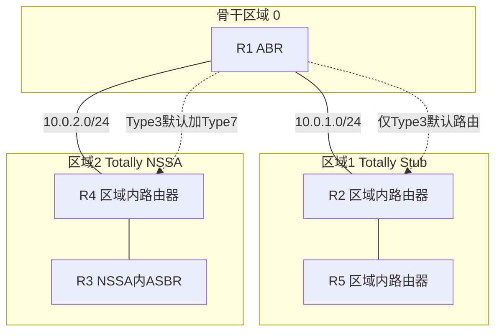

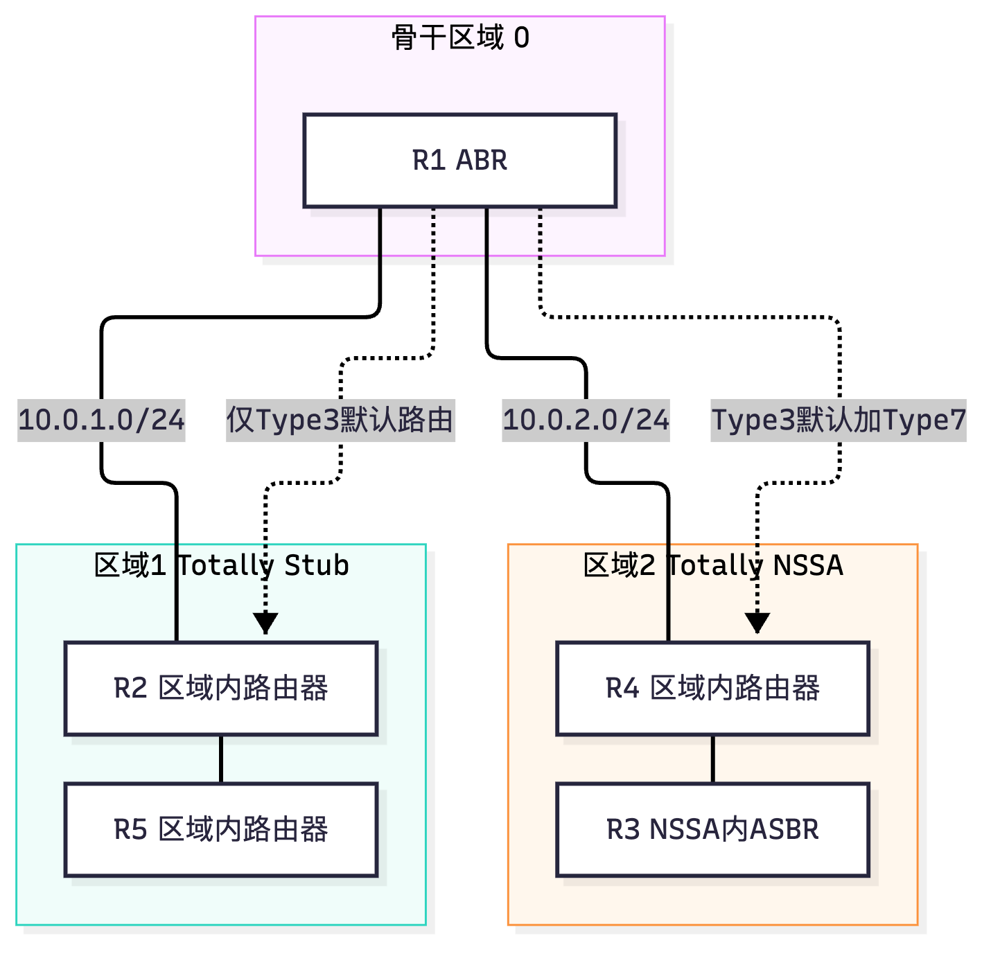


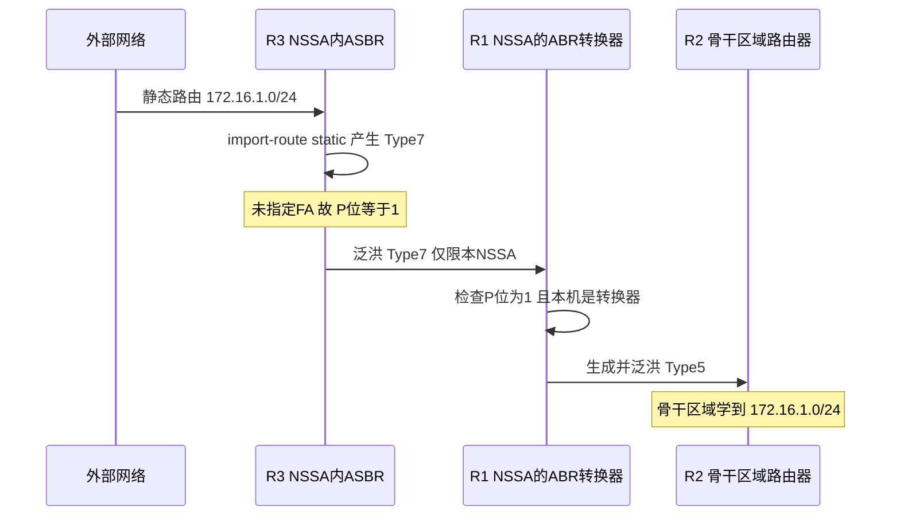

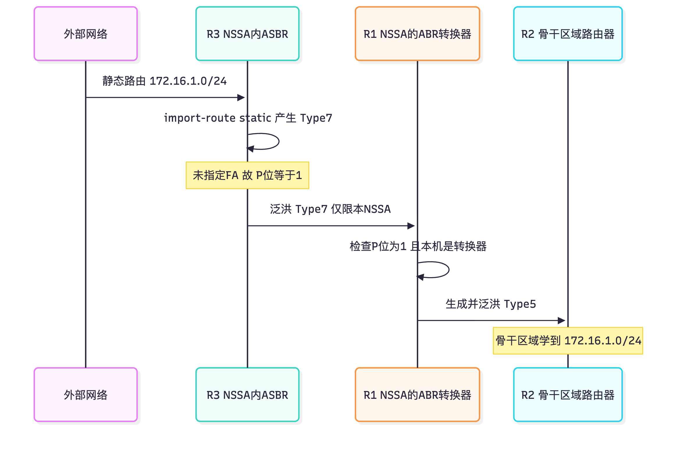


### 真题精练

**Q1.【真题·单选】** 在 Totally Stub 区域内的路由器上执行 `display ospf lsdb brief`，最可能看到下列哪组 LSA 类型？

A. Type1、Type2、Type3（多条明细）、Type4、Type5
B. Type1、Type2、Type3（仅 0.0.0.0 一条）
C. Type1、Type2、Type7
D. Type1、Type2、Type3（多条明细）

> **答案：B**
> **解析**：Totally Stub 区域由 ABR 使用 `stub no-summary` 抑制 Type3 明细，只保留**一条描述默认路由的 Type3**（Link State ID = 0.0.0.0），因此区域内只有 Type1、Type2 与这一条 Type3。A 是普通区域的形态（但普通区域通常也不会有 Type4/Type5 明细那么多）；C 是 NSSA 的形态；D 是**普通 Stub 区域**的形态，与 Totally Stub 只差 `no-summary`。

**Q2.【真题·多选】** 关于 NSSA 区域默认路由的产生方式，下列描述正确的有？（多选）

A. NSSA 的 ABR 上配置 `nssa default-route-advertise` 可以产生一条 Type7 默认路由
B. NSSA 内的 ASBR 引入一条外部默认路由后会产生 Type7 默认路由
C. NSSA 内 ASBR 产生的 Type7 默认路由会被转换器转换为 Type5 通告到骨干区域
D. 配置 `nssa no-summary` 时，ABR 会向该区域下发 Type3 默认路由

> **答案：ABD**
> **解析**：A、B 是 NSSA 默认路由的两种标准来源。C 错：RFC 3101 明确规定，**NSSA 内 ASBR 产生的 Type7 默认路由不会被转换为 Type5**（避免骨干区域被 NSSA 内部的默认路由劫持，属于防环设计），它只在本 NSSA 内生效。D 对：`no-summary` 的作用就是"不再下发 Type3 明细，改为下发默认路由"，因此 Totally NSSA 区域内会**同时**出现 Type3 默认路由与 Type7 外部路由。

**Q3.【真题·判断】** 某区域配置为 Stub 区域后，该区域内的路由器上仍然可以执行 `import-route static` 引入外部路由，只是引入的路由不会传播到区域外。

> **答案：错误**
> **解析**：Stub 区域**不能存在 ASBR**。原因链：Stub 区域禁止 Type5，而 `import-route` 的本质是产生 Type5，路由器一旦成为 ASBR 就必须产生 Type5——这与 Stub 的定义直接冲突。因此 Stub 区域内引入外部路由**不生效**（华为实现中相关 LSA 不生成，路由也不会被 OSPF 发布）。若区域内确实需要引入外部路由，必须把区域类型改为 **NSSA**。

**Q4.【真题·填空】** Totally Stub 区域的 ABR 上需要配置命令 ________；ABR 向 Stub/NSSA 区域下发的 Type3 默认路由，其度量默认值为 ________，可通过命令 ________ 修改。

> **答案：`stub no-summary`；1；`default-cost <值>`**
> **解析**：`no-summary` 必须且只能配置在 ABR 上（描述 ABR 的下发行为）；区域内普通路由器只配 `stub`。`default-cost` 的生效位置同样只在 ABR 上，配在区域内普通路由器上没有任何作用——这是实验题中最常见的失分点。

**Q5.【真题·简答】** 对比 Stub 区域与 NSSA 区域的异同，并说明"如果某分支区域内部存在两条出口（一条走总部、一条走本地互联网），应选择哪种区域类型，为什么"。

> **答案**：**相同点**：两者都拒绝 Type4、Type5，都允许 Type1、Type2、Type3，都用于末梢（单出口或少出口）场景，且都必须在该区域**所有** OSPF 设备上配置相同的区域类型。**不同点**：Stub 区域**禁止存在 ASBR**（因为 Type5 被禁），NSSA **允许存在 ASBR**，只是其产生的 Type5 被替换为 Type7，由 NSSA 的 ABR 转换为 Type5 后传出。**选型结论**：应选择 **NSSA**。因为"本地互联网出口"意味着分支内部需要引入一条外部路由（或默认路由），即分支内存在 ASBR 角色，Stub 区域无法承载 ASBR；而 NSSA 允许内部 ASBR 产生 Type7，使本地出口在分支内生效，同时又不把大量 Type4/Type5 灌入分支，兼顾了资源优化与功能需求。若分支内不需要学习总部明细路由，可进一步用 Totally NSSA（`nssa no-summary`）。

**Q6.【真题·排错】** 某工程师把区域 1 配置为 Stub：ABR（R1）上配置了 `stub no-summary`，区域内 R2 上配置了 `stub no-summary`。配置完成后 R1 与 R2 的邻居关系无法建立（卡在 ExStart）。请分析原因并给出修正。

> **答案**：原因：`no-summary` 是**ABR 侧的专属行为参数**，它会改变 Hello 报文中 E 位（ExternalRoutingCapability）以外的行为，但真正的问题在于**华为设备不允许在非 ABR 上配置 `no-summary`**：R2 不是 ABR（它只属于区域 1），在它上面配置 `stub no-summary` 会导致该设备的区域参数与 ABR 通告的参数不一致，Hello 报文中的区域类型理解出现分歧，邻接建立失败。修正方法：**在 R2 上删除 `no-summary`，只保留 `stub`**。排查手段：`display ospf error` 会看到"区域类型不匹配（Area type mismatch）"类计数增长；`display ospf interface` 可查看两侧的区域类型与选项位。补充：Stub/NSSA 场景下**区域内所有设备的区域类型必须完全一致**，否则无法建立邻接，这是配置类题目的第一检查项。

**Q7.【真题·多选】** 下列关于特殊区域中虚连接（Virtual Link）的说法，正确的有？（多选）

A. 虚连接不能穿越 Stub 区域
B. 虚连接不能穿越 NSSA 区域
C. 虚连接可以穿越 Totally Stub 区域，只要两端是 ABR
D. 虚连接必须配置在 ABR 上，且必须穿过一个非骨干区域

> **答案：ABD**
> **解析**：虚连接需要一个"中转区域"来承载，中转区域必须能正常传递 Type1/Type2/Type3（尤其是 Type1，因为虚连接本质是被当作一条 P2P 链路来处理）。**Stub / Totally Stub / NSSA / Totally NSSA 都不能作为虚连接的中转区域**（它们限制了 LSA 类型，Type1 在某些情况下也不完整，且默认路由的存在会导致路由不可预期），因此 A、B 对、C 错。D 对：虚连接的两端必须是 ABR（且其中一端必须与骨干区域相连），它穿过的是一个**非骨干区域**——这正是虚连接存在的意义。

**Q8.【真题·实验】** 请写出一套完整配置，使区域 2 成为 Totally NSSA：区域内 R4 引入静态路由 `192.168.50.0/24`（要求骨干侧看到为 E1、度量 50），ABR 为 R1，且要求 R1 一定作为 7 转 5 转换器。

> **答案**：
> ```bash
> # R1（ABR）
> ospf 1 router-id 1.1.1.1
>  area 0.0.0.0
>   network 10.0.0.0 0.0.0.255
>  area 0.0.0.2
>   nssa no-summary                       // Totally NSSA：抑制 Type3 明细并下发默认路由
>   network 10.0.2.0 0.0.0.255
>   nssa translator-always                // 确保本机做转换器
>  quit
> # R4（NSSA 内 ASBR）
> ospf 1 router-id 4.4.4.4
>  area 0.0.0.2
>   nssa                                  // 区域内设备统一 nssa
>   network 10.0.2.0 0.0.0.255
>  import-route static type 1 cost 50     // E1 度量 50，未指定 FA 故 P 位为 1
>  quit
> # 验证
> display ospf lsdb nssa verbose           // P 位 = 1，FA = 0.0.0.0
> display ospf lsdb ase verbose            // 骨干侧 Type5：E1，Metric 50
> display ospf routing 192.168.50.0        // 确认度量类型与开销
> ```
> **要点**：`type 1` 决定骨干侧看到 E1（E1 会在整个路径上累加内部开销）；`cost 50` 指定引入时的初始度量；若误写 `forwarding-address`，P 位会变 0，路由将不转换。

### 易错点与排错

| 易错点 | 正确结论 |
|---|---|
| 认为 Totally Stub 里没有 Type3 | 有**一条** Type3 默认路由（0.0.0.0/0） |
| 认为 `default-cost` 可配在任意设备 | 只在 **Stub/NSSA 区域的 ABR** 上生效 |
| 认为 NSSA 一定有默认路由 | 必须显式配 `nssa default-route-advertise` 或内部 ASBR 引入默认路由 |
| 认为 Type7 默认路由会转成 Type5 | **不会**，RFC 3101 明确规定（防环） |
| 在非 ABR 上配 `no-summary` | 错误配置，会导致邻接无法建立 |
| 区域内只在一台设备上配 `stub`/`nssa` | 必须**所有**设备一致，否则邻接失败 |
| 认为 NSSA 内 ASBR 的 Type7 会传到其他 NSSA | 不会，Type7 只在本 NSSA 内泛洪 |

---

## 1.3 OSPF 防环机制详解

### 考点定位

防环是 HCIE 层"考原理"的代表性考点，常以简答、多选形式出现，也常作为排错题的理论基础（例如"为什么这条 Type3 路由是次优的"）。高频问法：**区域间为什么不会出现环路**、**Type5 靠什么防环**、**DN 位是干什么用的**。国赛还常把防环与 MPLS VPN 场景结合考查（PE-CE 之间跑 OSPF 时 Type3 的 DN 位设置）。

### 原理精讲

OSPF 的防环设计不是"一个机制"，而是**四层机制的叠加**，理解时必须按"哪一层可能出环、用什么约束"的框架来记。

**第一层：区域内防环 —— 靠 SPF 算法本身**。区域内所有路由器拥有**完全一致**的 LSDB（拓扑数据库），每台路由器独立用 Dijkstra 算法在自己的"最短路径树"上计算，**树结构天然无环**。这是链路状态协议最根本的优势，也是它比距离矢量协议（RIP）收敛快、无环路的原因。所以区域内不需要额外的防环机制。

**第二层：区域间防环 —— 骨干区域规则 + 水平分割**。区域之间传递的是 Type3（距离矢量式），既然度量不能被验证，逻辑上就可能出环。OSPF 用两条硬规则杜绝：

1. **骨干区域（Area 0）必须连续且所有非骨干区域必须与骨干区域直接相连**。区域间的路由必须"上骨干、走骨干、下骨干"，形成严格的**两级层次**（two-level hierarchy）。这是一条**拓扑约束**，从结构上排除了"区域 A → 区域 B → 区域 A"的横向环路。
2. **区域间水平分割（Inter-Area Split Horizon）**：ABR **不会把从一个非骨干区域学到的 Type3 再通告回骨干区域以外的另一个非骨干区域**；也不会把从骨干区域学到的 Type3 通告回骨干区域。具体规则：
   - ABR 把**骨干区域**学到的 Type3 → 通告给所连的非骨干区域（下行）；
   - ABR 把**非骨干区域**学到的 Type3 → 通告给骨干区域（上行）；
   - ABR **不会**把非骨干区域 A 学到的 Type3 直接通告给非骨干区域 B（必须经骨干绕行）。

**为什么必须"经骨干绕行"？** 因为骨干区域是全网的"路由中转枢纽"，所有区域间的路径都经过它，路径上必然经过至少一个 ABR，且每次跨区域都要重新计算，度量信息不会被反复"加码"形成正反馈。如果不强制绕骨干，A、B 两个区域之间的 ABR 可能互相通告对方的 Type3，产生"我以为你近、你以为我近"的**相互欺骗**，最终形成环路或次优路径。

**第三层：域外防环 —— Type5 的"两次可用性检查"**。Type5 描述的外部路由与 OSPF 域内拓扑是**松耦合**的，因此 OSPF 要求路由器在做 Type5 转发决策前完成两道检查：

1. **可达性检查（ASBR 可达）**：通过 Type1/Type2（本区域）或 Type4（其他区域）算出到 ASBR 的最短路径，确认 ASBR 可达；
2. **FA 检查（FA 可达）**：若 Type5 的 FA ≠ 0.0.0.0，则必须在 OSPF 域内算出到 FA 的最优路径，并且该路径**必须不经过产生该 LSA 的 ASBR 所在的那条路由**（否则会形成"为了到外面而绕到外面"的循环）。

**为什么这两道检查能防环？** 因为 Type5 本身只说"外面有个网段"，不说"怎么出去"。如果直接按 ASBR 转发，而 ASBR 又是通过 OSPF 学到这条外部路由的（形成了"引入自己学到的路由"的循环），就会出环。可达性检查把"ASBR/FA 必须是自己能算出来的 OSPF 域内地址"作为**入库门槛**，从根本上切断了循环。这就是"Type5 路由在 LSDB 里但路由表里没有"最常见的原因——**ASBR 不可达或 FA 不可达**。

**第四层：MPLS VPN 场景的 DN 位防环**。在 MPLS L3VPN 中，PE 与 CE 之间常用 OSPF，而 PE 之间通过 MP-BGP 传递 VPN 路由。这里存在一个真实的环路风险：

- **PE1 从 CE1（Site 1）学到 OSPF 路由 → 引入 MP-BGP → 传给 PE2 → PE2 把它作为 Type3（或 Type5）通告给 CE2（Site 2）**；
- **CE2 如果属于同一个 OSPF 域（同区域/同域 ID），又会把这条 LSA 通告回 PE1**，PE1 以为 CE 侧有更优路径，形成"绕一圈又回来"的环路。

**RFC 4577 的解法**：PE 在把从 MP-BGP 学到的路由以 Type3（Summary LSA）形式通告给 CE 时，**在 LSA 的 Options 字段中设置 DN 位（Downward Bit，向下位）**。DN 位含义是"**这条 LSA 是从更高级别（骨干/MP-BGP）向下通告到本区域的**"。当 PE 再次从 CE 侧收到一条带 DN 位的 Type3 时，它**不会**把这条 Type3 重新引入 MP-BGP（即不作为 VPN 路由发布）。这样"BGP → OSPF → BGP"的回灌通道被切断。同理，**Type5 在 RFC 4577 中也定义了 DN 位**，用于 PE-CE 使用 OSPF 且外部路由场景。

**关键结论**：`capability vpn-instance-capability simple` 与 `dn-bit-check` 是华为设备上与 DN 位相关的两个开关。默认情况下华为设备在 VPN 实例中会检查 DN 位（`dn-bit-check enable`）；若关闭检查，则可能出现路由回灌导致的环路或次优。**特别提醒**：当 OSPF 进程绑定到 VPN 实例且使用 `vpn-instance-capability simple`（无 sham-link 的简化组网）时，设备的 DN 位检查行为与标准组网不同，此时**需要根据组网决定是否关闭 DN 位检查**，关闭后必须确保 BGP 侧有正确的防环机制（如 SoO、AS 路径）。

**Type3 的另一个防环细节 —— 不把 Type3 通告回自己学来的方向**：ABR 从区域 1 学到某条 Type3 后，不会把它再通告回区域 1（这是最基本的行为）。但要注意：ABR 会把自己**从区域 0 学到的** Type3 通告给区域 1，也会把自己**从区域 1 学到的** Type3 通告给区域 0——如果两个区域之间有多台 ABR，可能出现"两台 ABR 互相学习对方的 Type3 后都通告给骨干"，此时靠**度量比较 + SPF 的唯一性**保证不环，且骨干区域的连续性原则确保路径不会在两个非骨干区域之间直接穿梭。

### 关键概念对照表

**表 1-3-1 四层防环机制对照**

| 层次 | 面对的问题 | 防环机制 | 失效后果 | 检查命令 |
|---|---|---|---|---|
| 区域内 | 拓扑环路 | SPF 最短路径树天然无环 + 全区域 LSDB 一致 | 不会发生（LSDB 不一致属于邻接问题） | `display ospf lsdb`、`display ospf peer` |
| 区域间 | Type3 距离矢量式度量可被"欺骗" | ① 骨干区域连续、非骨干必须直连骨干 ② 区域间水平分割（非骨干之间不直接互告） | 次优路径、路由回环 | `display ospf abr-asbr`、`tracert` |
| 域外 | Type5 与域内拓扑松耦合 | ① ASBR 可达性检查（Type1/Type4）② FA 可达性检查（且路径不得经 ASBR 回环） | Type5 在 LSDB 但**不加表** | `display ospf lsdb ase`、`display ospf routing` |
| MPLS VPN | PE-CE 与 MP-BGP 之间路由回灌 | **DN 位（Downward Bit）**：PE 下行通告时置位；PE 收到带 DN 位的 LSA 不再回灌 BGP | 路由环路、次优路径 | `display ospf lsdb summary verbose`（看 DN 位）、`display bgp vpnv4 vpn-instance x routing-table` |

**表 1-3-2 区域间 Type3 传播规则速查**

| 学到的位置 | ABR 是否通告到区域 0 | 是否通告到其他非骨干区域 |
|---|---|---|
| 本区域（Type1/Type2 算出） | ✅ 通告到区域 0（以及其他所有区域） | ✅ |
| 区域 0（Type3） | ❌ 不回灌区域 0 | ✅ 通告到所连非骨干区域 |
| 非骨干区域 A（Type3） | ✅ 通告到区域 0 | ❌ **不通告**到非骨干区域 B（水平分割） |

**表 1-3-3 DN 位相关字段与配置**

| 项目 | 说明 |
|---|---|
| DN 位位置 | Type3（Summary LSA）与 Type5（AS External LSA）的 Options 字段中（OSPFv2 中为 0x80 位的高位扩展） |
| 置位者 | MPLS VPN 场景下的 **PE**（把从 MP-BGP 学到的路由下发到 CE 侧时置位） |
| 收到 DN 位时的动作 | 不再把该 LSA 对应的路由重新引入 MP-BGP（防回灌） |
| 华为相关命令 | `dn-bit-check enable`（默认开启检查）、`dn-bit-set`（控制是否置位）、`vpn-instance-capability simple`（简化组网） |
| Sham-Link 场景 | 需要通过 sham-link 恢复 MP-BGP 与 OSPF 路由的优先级比较，否则会出现"永远走 BGP"的次优 |

### 华为设备配置

```bash
# ============ 场景一：MPLS L3VPN 中 PE-CE 运行 OSPF，观察与控制 DN 位 ============
# 设备：NE40E（PE），AR6120（CE），VRP V300

# --- PE 侧 ---
system-view
sysname PE1
ip vpn-instance VPNA                          // 创建 VPN 实例
 ipv4-family                                  // 进入 IPv4 地址族
  route-distinguisher 100:1                   // 配置 RD（区分不同 VPN 的相同网段）
  vpn-target 100:1 export-extcommunity        // 导出 RT
  vpn-target 100:1 import-extcommunity        // 导入 RT
 quit
interface GigabitEthernet0/0/1
 ip binding vpn-instance VPNA                 // 接口绑定 VPN 实例
 ip address 10.1.1.1 255.255.255.0
ospf 100 vpn-instance VPNA router-id 1.1.1.1  // OSPF 多实例：绑定 VPN 实例
 vpn-instance-capability simple                // 简化组网模式（无 sham-link 时必须显式配置）
 dn-bit-check disable                          // 关闭 DN 位检查（简化模式下按组网需要）
 dn-bit-set disable                            // 关闭 DN 位置位（防止 CE 侧路由被误判）
 import-route bgp                              // 把 BGP 学到的 VPN 路由引入 OSPF 下发给 CE
 area 0.0.0.0
  network 10.1.1.0 0.0.0.255
 quit
# --- 查看 DN 位 ---
display ospf 100 lsdb summary verbose          // 查看 Type3 的 Options 字段中 DN 位
display ospf 100 vpn-instance VPNA lsdb        // 查看 VPN 实例内的 LSDB

# ============ 场景二：验证域外防环（ASBR 可达性 + FA 可达性） ============
# 制造故障：在 ASBR 上把引入的出接口 silent 掉，观察 Type5 是否还能加表
system-view
ospf 1
 silent-interface GigabitEthernet0/2/0         // 抑制接口，导致 FA 不可达
 quit
display ospf lsdb ase verbose                  // 确认 Type5 仍在 LSDB
display ospf routing                           // 观察 OSPF 计算路由中是否还有该外部路由
display ip routing-table 172.16.1.0            // 确认路由表是否加表（预期：不加表）
display ospf spf-tree                          // 查看 SPF 树，确认 FA 是否可达（部分版本支持）

# ============ 场景三：区域间水平分割验证 ============
# 三区域拓扑 0 - 1 - 2（区域1与区域2间由同一台ABR连接），观察Type3是否直接互告
display ospf lsdb summary                      // 在区域2内路由器上确认明细路由均来自骨干侧ABR
display ospf abr-asbr verbose                  // 确认ABR身份与区域归属
tracert 10.9.9.9                               // 观察实际路径是否经骨干区域绕行
```

### 示意图

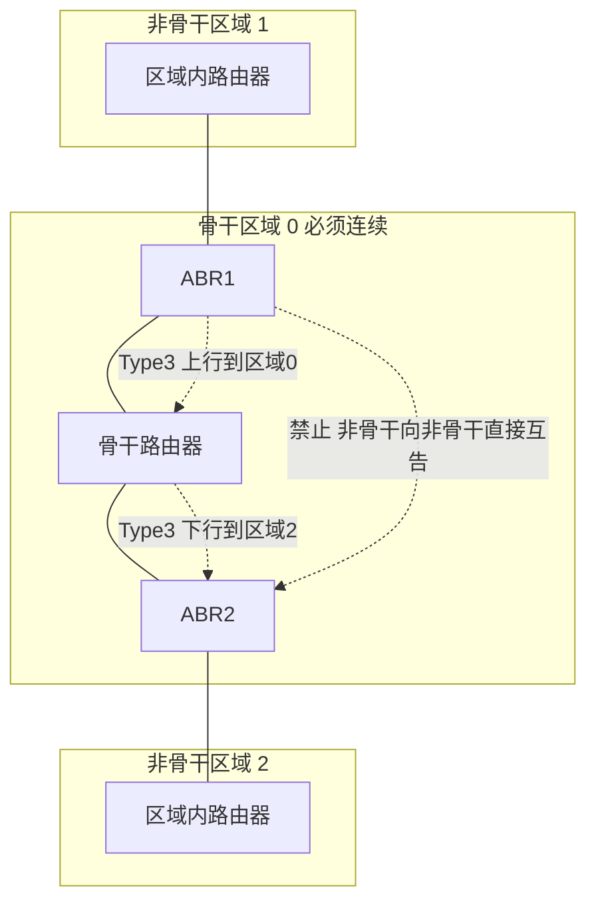

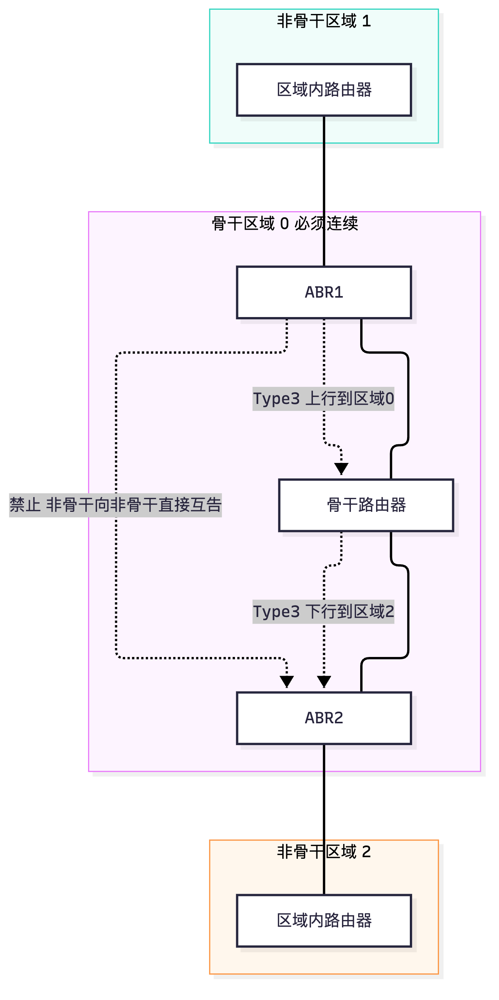


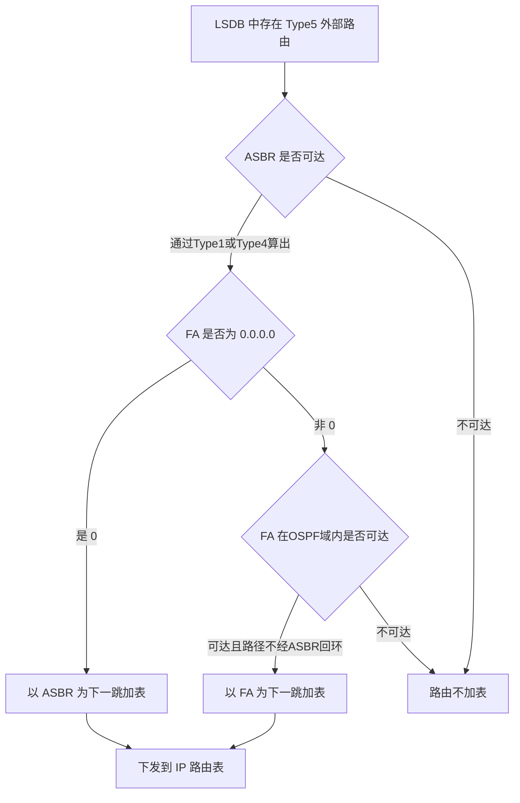

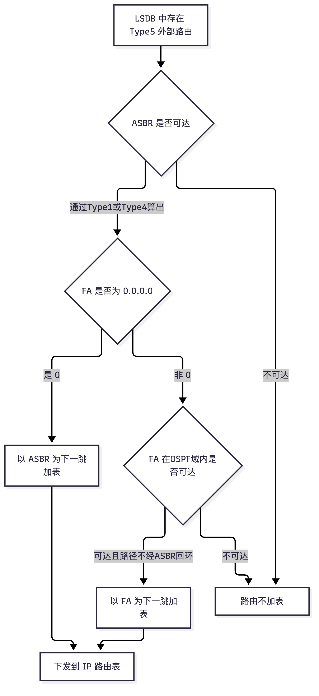


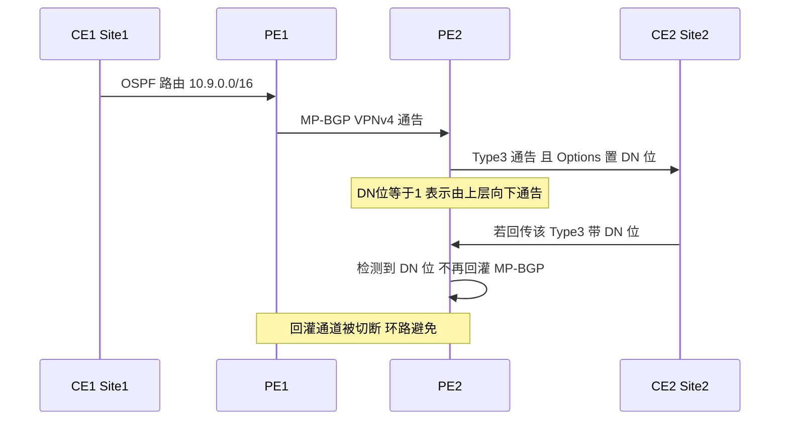

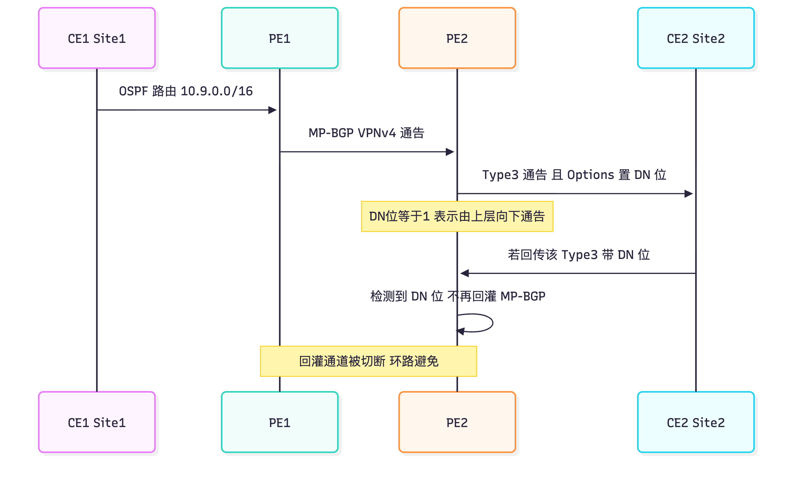


### 真题精练

**Q1.【真题·单选】** OSPF 区域间路由（Type3）能够避免环路的最根本原因是？

A. Type3 中携带了完整的拓扑信息，可以独立运行 SPF
B. OSPF 强制骨干区域连续且非骨干区域必须与骨干区域直接相连，形成两级层次结构
C. ABR 会对 Type3 的度量值做反向抑制
D. Type3 只在同一区域内泛洪，不会跨区域

> **答案：B**
> **解析**：Type3 是**距离矢量**式的（A 错，它不带拓扑）；OSPF 不存在 Type3 度量反向抑制机制（C 错）；Type3 的定义就是**跨区域**传播（D 错）。真正的防环基石是**骨干区域连续 + 非骨干区域必须直接连接骨干**这一拓扑约束，配合区域间水平分割（非骨干区域之间不直接互告路由，必须经骨干绕行）。

**Q2.【真题·多选】** 下列关于 OSPF 防环机制的描述，正确的有？（多选）

A. 区域内依靠 SPF 算法生成的树形结构天然无环
B. ABR 不会把从非骨干区域 A 学到的 Type3 直接通告给非骨干区域 B
C. Type5 路由必须在 ASBR 可达且 FA 可达（若 FA 非 0）时才能加入路由表
D. MPLS VPN 场景下 DN 位用于防止 OSPF 路由被重新引入 MP-BGP 造成回灌

> **答案：ABCD**
> **解析**：四个选项分别对应区域内的 SPF 防环、区域间水平分割、域外双检查、VPN 场景 DN 位，全部正确。这道题就是防环机制的标准考法，务必形成"四层防环"的完整记忆框架。

**Q3.【真题·判断】** 在 MPLS L3VPN 场景中，PE 从 MP-BGP 学到 VPN 路由后以 Type3 通告给 CE 时会把 DN 位置 1；PE 若再从 CE 侧收到带 DN 位的 Type3，则不会把它重新引入 MP-BGP。

> **答案：正确**
> **解析**：这正是 RFC 4577 定义的 DN 位机制。DN 位（Downward Bit）的含义是"这条 LSA 是从上层（MP-BGP/骨干）向下通告的"，PE 收到带 DN 位的 LSA 时不再回灌 BGP，从而切断"BGP → OSPF → BGP"的环路。默认华为设备开启 DN 位检查（`dn-bit-check enable`）。

**Q4.【真题·填空】** OSPF 域外路由（Type5）加表前必须通过两道可达性检查：一是通过 Type1/Type2 或 ________ 确认 ________ 可达；二是当 Forwarding Address 不为 0.0.0.0 时，确认 ________ 在 OSPF 域内可达。

> **答案：Type4（ASBR Summary LSA）；ASBR；Forwarding Address（FA）**
> **解析**：很多"Type5 在 LSDB 里但不加表"的故障都是这两道检查未通过。特别注意 FA 非 0 时，若 FA 地址在 OSPF 域内不可路由（例如接口未宣告、被 silent 抑制、或 FA 指向的是 BGP 侧地址），该外部路由同样不会加表。

**Q5.【真题·简答】** 为什么 OSPF 规定"虚连接不能穿越 Stub 区域"，请结合虚连接的工作原理说明。

> **答案**：虚连接（Virtual Link）的本质是：**在两个 ABR 之间，把穿越一个非骨干区域的一条 IP 路径，虚拟成一条属于骨干区域的 P2P 链路**。它的工作原理要求：① 两端 ABR 通过该区域内的 **Type1** 计算出彼此的 Router ID 可达性；② 虚连接被当作骨干区域的链路参与 SPF，需要区域内能正常传递 **Type3**（区域间路由）以为虚连接端点提供路由支撑。而 **Stub 区域禁止 Type4/Type5、Totally Stub 更是只保留一条 Type3 默认路由**，导致：① 区域内设备的 LSDB 不完整，虚连接端点之间的可达性计算与区域间路由计算都会受到默认路由的干扰；② Stub 区域用于"末梢"语义，把一个用于中转骨干流量的虚连接压在上面，与该区域的设计意图（压缩资源）直接冲突。因此 OSPF 明确规定虚连接的中转区域必须是**普通区域（非 Stub/NSSA 类）**。

**Q6.【真题·排错】** 某 OSPF 域中，R2 的 LSDB 里能看到 `display ospf lsdb ase` 输出的 `172.16.1.0/24`（由 ASBR R5 产生），但 `display ip routing-table` 中没有这条路由。请列出至少四种可能原因及验证方法。

> **答案**：
> ① **ASBR 不可达**：R2 无法算出到 R5 的 Router ID 的路径。验证：`display ospf lsdb summary`（或 `display ospf lsdb asbr`）看是否缺 Type4；若 R5 与 R2 不在同一区域且没有 Type4，则 Type5 无法加表。
> ② **FA 不可达**：Type5 的 FA 非 0，但该地址在 OSPF 域内不可路由。验证：`display ospf lsdb ase verbose` 查看 FA 值，再用 `display ip routing-table <FA>` 检查是否有对应路由；常见原因是引入出接口被 `silent-interface` 抑制或未宣告进 OSPF。
> ③ **被过滤策略拦截**：`filter-policy import` 在 R2 上过滤了该外部路由。验证：`display ospf routing`（OSPF 计算出的路由里有）对比 `display ip routing-table`（没有），即可判断是"OSPF 算出来了但被过滤"还是"根本没算出来"。
> ④ **路由被其他协议优选**：同前缀的静态路由或 BGP 路由优先级更高（OSPF 外部路由优先级默认 150）。验证：`display ip routing-table 172.16.1.0 verbose` 查看各协议候选与最终优选原因。
> ⑤ **接口/下一跳递归失败**：下一跳所在接口被 shutdown 或 IP 被删除。验证：`display ip routing-table <下一跳>`。
> ⑥ **`import-route` 侧问题**：ASBR 上的 Type5 存在但 `cost`/`type` 配置导致度量超出范围（极少见），或 Tag 被用于过滤。

**Q7.【真题·多选】** 下列关于区域间水平分割（Inter-Area Split Horizon）的描述，正确的有？（多选）

A. ABR 把自己所在非骨干区域学到的 Type3 通告到骨干区域
B. ABR 把从骨干区域学到的 Type3 通告到所连的非骨干区域
C. ABR 把从非骨干区域 A 学到的 Type3 直接通告给非骨干区域 B
D. 水平分割的目的是防止两个非骨干区域之间形成路由环路或"相互欺骗"的次优路径

> **答案：ABD**
> **解析**：A（上行）、B（下行）都是正常行为；C 是**禁止的**（必须经骨干绕行），这正是水平分割的核心含义；D 是其目的。可以这样记：**"非骨干区域的路由只能从骨干区域获得，不能横向从另一个非骨干区域获得。"**

**Q8.【真题·简答】** 某工程师为了避免区域间次优路径，把两台 ABR 之间的接口都划入了区域 0。请问这种做法解决了什么问题？如果骨干区域被意外分割（不连续），会产生什么后果、如何补救？

> **答案**：**解决的问题**：让两台 ABR 之间的链路成为骨干区域内链路，一方面缩短了骨干区域的物理路径，另一方面使 Type3 的"上行 → 骨干 → 下行"路径更短更直接，避免流量绕行。同时，骨干区域内部的链路参与区域内 SPF 计算（度量精确累加，不是距离矢量的估计值），选路结果更优。**骨干不连续的后果**：非骨干区域的路由无法跨区域传播到另一个非骨干区域，导致部分区域之间**完全不通**（不是环路，而是"路由黑洞"）；同时本应经骨干绕行的流量可能因默认路由而绕远甚至丢失。**补救方法**：用**虚连接（Virtual Link）**穿过一个普通区域把两段骨干"接起来"——在两端 ABR 上配置 `vlink-peer <对端 Router ID>`，中转区域必须是普通区域（不能是 Stub/NSSA 类）。配置后需验证：`display ospf vlink` 看到虚连接状态为 Full。

### 易错点与排错

| 易错点 | 正确结论 |
|---|---|
| 认为 Type3 有独立防环机制 | Type3 靠**拓扑约束 + 水平分割**，自身不带拓扑 |
| 认为骨干不连续会产生环路 | 主要后果是**区域间不通（黑洞）**，而非环路 |
| 认为虚连接可穿越任何区域 | 只能穿越**普通区域**，不能穿越 Stub/Totally Stub/NSSA/Totally NSSA |
| 把 DN 位与 P 位混淆 | DN 位属于 **MPLS VPN 防回灌**；P 位属于 **NSSA Type7 转换** |
| 认为 FA 只影响下一跳、不影响加表 | FA 不可达会直接导致**路由不加表** |
| 关闭 DN 位检查后不做其他防环 | 必须用 SoO / AS 路径 / RT 等手段兜底 |

---

## 1.4 OSPF 路由计算全过程与 E1/E2 选路

### 考点定位

这是最能体现 HCIE 深度的一节，也是国赛**计算题与选路推断题**的主战场。典型问法：给一个带度量标注的拓扑，问"某路由器上到某网段的路由下一跳是哪个、度量多少、协议标记是什么"；或者给两条 E1/E2 路由问"优选哪条"。**核心陷阱**：① 认为 E2 的度量会累加内部开销（实际不会，E2 默认只取外部度量）；② 认为 E1 与 E2 比较时先看度量类型再看度量（实际 E1 **永远优先于** E2）；③ 混淆 Type3 的度量累加方式。

### 原理精讲

OSPF 的路由计算是**分三个阶段、由不同 LSA 驱动**的过程，三个阶段相互独立、层层叠加。

**阶段一：区域内路由计算（Intra-Area，O 标记）**。路由器用本区域的 Type1、Type2 构建**有向图**：Type1 的每条链路是图的边（权重 = 链路开销），Type2 描述的广播网段是图中的"伪节点"。然后以自己为根运行 **Dijkstra（SPF）算法**，得到一棵**最短路径树（SPT，Shortest Path Tree）**。树中每个"Stub Network 链路"和"Transit 网段"都成为一条区域内路由，度量 = 从根到该网段路径上所有链路开销之和。**关键点**：区域内路由的度量是**逐跳累加的真实开销**，因此是"最可信"的路由。**开销计算公式**：接口开销 = `参考带宽 / 接口带宽`，华为默认参考带宽 **100 Mbit/s**（即 `bandwidth-reference 100`）。例如 GE 接口开销 = 100/1000 = 0.1 → 取整为 **1**；10GE 接口开销同样为 **1**（因为最小值为 1）；100M 接口开销 = **1**；E1（2.048M）接口需要手动配置开销。**注意**：由于 10GE 与 GE 的默认开销都是 1，高带宽链路无法体现优势，生产环境必须用 `bandwidth-reference 10000`（或更高，如 40000）重新标定。

**阶段二：区域间路由计算（Inter-Area，O_IA 标记）**。路由器利用 **Type3** 计算到其他区域的网段：

- Type3 中携带的度量 = **ABR 到达该网段的距离**（这个距离由 ABR 自己算好后填进去）；
- 本路由器到该网段的总度量 = **本路由器到产生该 Type3 的 ABR 的开销 + Type3 中的度量**；
- 因此 Type3 路由的度量 = "**到 ABR 的区域内距离（精确） + ABR 报告的域内/域间距离（估计）**"。

**为什么说 Type3 是距离矢量式？** 因为 Type3 中的度量是 ABR "说"的，邻居无法验证它是否真实。这带来一个重要后果：**如果多条 Type3 描述同一网段（多个 ABR 都通告），路由器会比较"本机到各 ABR 的开销 + 各 Type3 度量"，取最小者**。这与 RIP 的"跳数"思想一致，只是度量更细。

**Type3 的派生规则（ABR 的行为）**：ABR 会把一个网段的 Type3 通告到多个区域，**每个区域的度量要根据该区域的接口开销重新计算**。例如 ABR 有区域 0 与区域 1 两个接口，区域 1 中某网段在 ABR 上到达的开销为 10（区域 1 内累加），则 ABR 向区域 0 通告的 Type3 度量为 10；反之向区域 1 通告区域 0 中网段的 Type3 时，度量 = 区域 0 侧累加值。**这就是"同一个网段在不同区域里度量不同"的原因**。

**阶段三：域外路由计算（External，O_ASE / O_NSSA 标记）**。ASBR 引入外部路由后，产生的 Type5 携带**度量类型（E1/E2）与外部度量**。OPSF 定义了两种度量类型，这是国赛**必考**内容：

- **E1（External Type 1，第一类外部路由）**：总度量 = **外部度量 + OSPF 域内到达 ASBR 的开销**。也就是说 E1 的度量会**在域内传播时逐跳累加**（准确说是"外部度量 + 本机到 ASBR 的内部开销"），因此 E1 让外部路由与内部路由**可比**，适合"希望外部路径也参与内部选路对比"的场景。
- **E2（External Type 2，第二类外部路由）**：总度量 = **外部度量**（默认不累加内部开销）。**默认类型**。E2 还细分为两种子情形：① **不带 FA 的 E2**（FA = 0），全 OSPF 域内所有路由器看到的度量都相同，因此**下一跳各不相同但度量相同**；② **带 FA 的 E2**，路由器会比较"到 ASBR 的内部开销"来打破平局（OSPF 规定：两条 E2 路由度量相同时，比较到 ASBR/FA 的内部开销，小者优先）。

**E1 与 E2 的比较规则（必须背熟的三条）**：

1. **E1 永远优先于 E2**，与度量大小无关。这是 OSPF 规范规定的，很多选手误以为"E2 度量更小就选 E2"。
2. **同为 E1**：比较总度量（外部 + 内部），小者优先。
3. **同为 E2**：先比较外部度量，小者优先；**外部度量相同**时，比较到 ASBR（或 FA）的**内部开销**，小者优先。

**P2P 与 Broadcast 的开销是否影响 E2？** 不影响 E2 的度量值，但影响它的**下一跳**与平局打破。因此"E2 路由的度量在所有路由器上一样，但下一跳可能不同"。

**E1/E2 的典型工程用法**：

- **E1** 用于"希望外部路由与内部路由比较"的场景，如双出口按带宽选路；
- **E2**（默认）用于"外部路由的优先级只由外部度量决定"的场景，如引入 BGP 路由时希望按 MED/Local Preference 决定，而不被 OSPF 内部开销干扰。

**三类路由的优先级（Preference，华为默认值）**：

| 协议 | 华为默认优先级 | 说明 |
|---|---|---|
| Direct（直连） | 0 | 最高 |
| OSPF 区域内 | 10 | `O` |
| OSPF 区域间 | 10 | `O_IA`，与区域内同优先级 |
| OSPF 外部（AS External） | **150** | `O_ASE` / `O_NSSA` |
| IS-IS | 15 | `ISIS` |
| Static | 60 | 手工配置 |
| RIP | 100 | — |
| OSPFv3 | 10 / 150 | 与 OSPFv2 一致 |
| BGP | 255（EBGP 选路时另有 MED/AS 路径比较） | 实际 EBGP 生效优先级为 255 |

**重要推论**：**OSPF 外部路由（150）比静态路由（60）优先级低**——这意味着如果同前缀有一条静态路由，OSPF 外部路由不会加表；而 **OSPF 区域内/区域间路由（10）比静态路由（60）优先级高**，会覆盖静态路由。这是"路由不加表"类排错题的经典原因。

### 关键概念对照表

**表 1-4-1 三阶段路由计算对照**

| 阶段 | 输入 LSA | 计算方法 | 度量来源 | 路由表标记 | 度量精确性 |
|---|---|---|---|---|---|
| 区域内 | Type1、Type2 | Dijkstra（SPF） | 逐跳链路开销累加 | `O` | 精确（真实累加） |
| 区域间 | Type3 | 距离矢量式累加 | 本机到 ABR 开销 + ABR 报告的度量 | `O_IA` | 部分（依赖 ABR 报告） |
| 域外 | Type5、Type7 | 度量类型判定 + 可达性检查 | E1：外部 + 内部；E2：仅外部 | `O_ASE`、`O_NSSA` | 取决于类型 |

**表 1-4-2 E1 / E2 度量对比（高频）**

| 对比项 | E1（External Type 1） | E2（External Type 2） |
|---|---|---|
| 总度量公式 | 外部度量 + 到 ASBR 的内部开销 | 外部度量（默认不累加） |
| 是否累加内部开销 | ✅ 累加 | ❌ 不累加 |
| 是否受 OSPF 内部拓扑变化影响 | ✅ 影响度量与选路 | ❌ 度量不变（但下一跳会变） |
| 度量相同情况下的比较 | 无（直接比总度量） | 比到 ASBR/FA 的内部开销 |
| 与另一类型比较 | **E1 永远优先** | 永远次于 E1 |
| 默认配置 | 需显式 `type 1` | **默认** |
| 路由表标记 | `O_ASE`（Preference 150） | `O_ASE`（Preference 150） |
| 典型场景 | 双出口按内部带宽选路 | 由外部度量（BGP MED 等）决定选路 |

**表 1-4-3 选路算例（用于自我推演）**

拓扑：R1 --(开销 10)-- R2 --(开销 20)-- R3(ASBR) -- 外部网络 172.16.1.0/24
R1 到 R2 的链路开销 10，R2 到 R3 的链路开销 20。R3 引入外部路由，外部度量 30。

| 度量类型 | R1 上该路由的总度量 | 计算过程 |
|---|---|---|
| E1 | 10 + 20 + 30 = **60** | 外部 30 + 内部（R1→R2→R3 = 30） |
| E2 | **30** | 只取外部度量 30（不累加 30 的内部开销） |
| E2（外部度量也是 30，另一条来自 R4 的 E2） | 比较到 ASBR 的内部开销：到 R3 为 30，到 R4 为 15 → **选 R4** | 外部度量相同，比内部开销 |

**表 1-4-4 华为 OSPF 默认开销计算表**

| 接口带宽 | 默认参考带宽 100 Mbit/s 下的开销 | 备注 |
|---|---|---|
| 10 Mbit/s（Ethernet） | 10 | — |
| 100 Mbit/s（FE） | 1 | — |
| 1000 Mbit/s（GE） | 1 | 公式值 0.1，取整为 1 |
| 10 GE | 1 | 公式值 0.01，取整为 1（**无法区分**） |
| 40 GE / 100 GE | 1 | 同上，**必须调大参考带宽** |
| 2.048 Mbit/s（E1/串口） | 需手工配置（如 `ospf cost 48`） | 公式值 48.8，取整 48 |

参考带宽调整命令：`bandwidth-reference 10000`（单位 Mbit/s，需在 **OSPF 进程视图**配置，且域内**所有设备必须一致**，否则选路混乱）。

### 华为设备配置

```bash
# ============ 场景：E1/E2 度量类型对选路的影响实验 ============
# 拓扑：R1--(10)--R2--(20)--R3(ASBR) 引入 172.16.1.0/24 外部度量 30
#       R4 为另一台 ABR/ASBR，R1--(5)--R4 且 R4 也引入同一网段

# --- R1（观察者）---
system-view
sysname R1
interface GigabitEthernet0/0/0
 ip address 10.0.12.1 255.255.255.0
 ospf cost 10                                 // 手工指定接口开销（覆盖默认值）
interface GigabitEthernet0/0/1
 ip address 10.0.14.1 255.255.255.0
 ospf cost 5                                  // 到 R4 的开销更小
ospf 1 router-id 1.1.1.1
 bandwidth-reference 10000                    // 调整参考带宽，使 10GE 与 GE 能区分（域内需一致）
 area 0.0.0.0
  network 10.0.12.0 0.0.0.255
  network 10.0.14.0 0.0.0.255
 quit

# --- R3（ASBR）：分别演示 E1 与 E2 ---
system-view
sysname R3
ip route-static 172.16.1.0 255.255.255.0 NULL0   // 制造一条静态路由用于引入
ospf 1 router-id 3.3.3.3
 import-route static type 1 cost 30               // 引入为 E1，外部度量 30
 quit
display ospf lsdb ase verbose                     // 查看 Type5 的 Metric Type 与 Metric 字段
display ospf routing 172.16.1.0                   // 查看 OSPF 计算出的路由与度量

# --- 改判为 E2 再对比 ---
system-view
ospf 1
 undo import-route static                         // 先删除原引入
 import-route static type 2 cost 30               // 改为 E2，外部度量 30
 quit
display ospf lsdb ase verbose                     // 确认 E 位由 1 变为 0（E2）
display ospf routing 172.16.1.0                   // 对比 R1 上度量变化（E2 不累加内部开销）

# --- R1 上验证选路结果 ---
display ip routing-table 172.16.1.0 verbose       // 查看最终优选的路由、协议、优先级、度量
display ospf routing 172.16.1.0 verbose           // 查看 OSPF 内部的路由表与下一跳列表
display ospf lsdb ase verbose                     // 查看所有 Type5，比较度量与 FA

# ============ 区域间 Type3 度量累加验证 ============
display ospf lsdb summary verbose                 // 查看 Type3 的 Metric 字段（由 ABR 填入）
display ospf routing 10.9.9.0 verbose             // 查看 O_IA 路由的度量：本机到 ABR + Type3 度量
tracert 10.9.9.9                                  // 实际路径验证
```

### 示意图

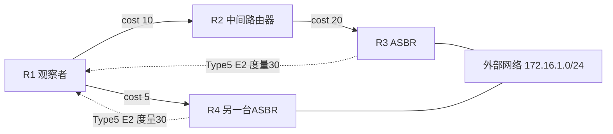

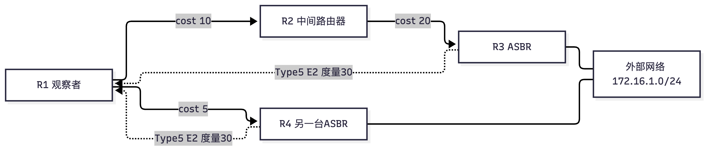


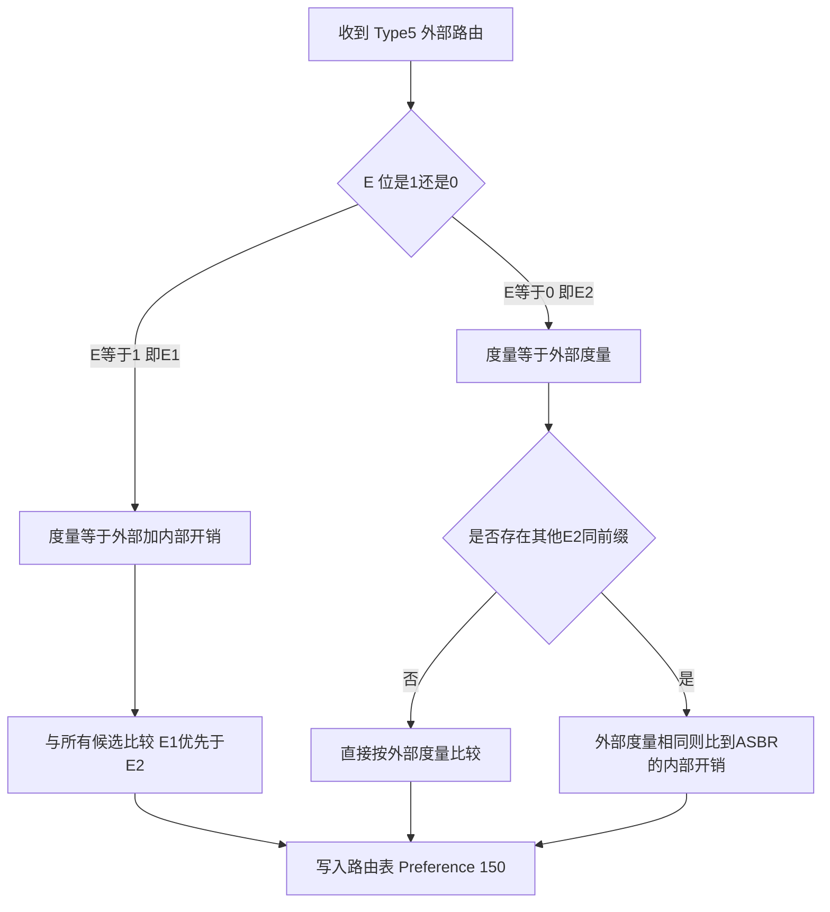

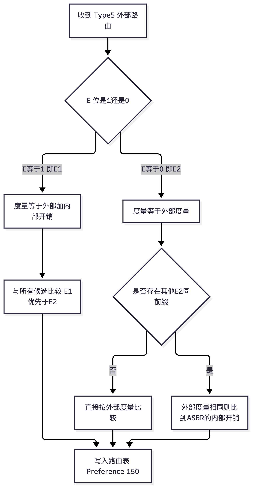


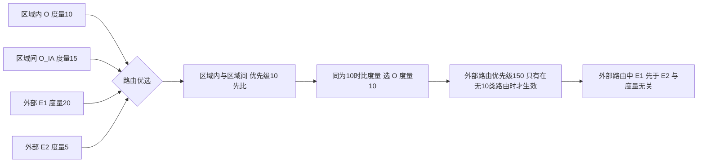

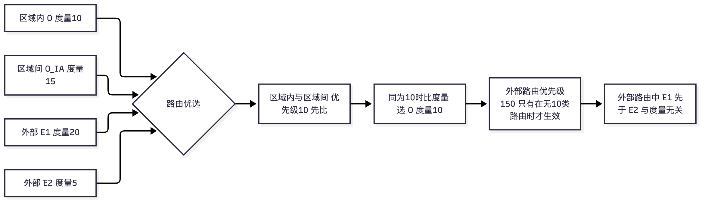


### 真题精练

**Q1.【真题·单选】** 拓扑：R1--(开销 10)--R2--(开销 20)--R3，R3 为 ASBR 引入外部路由 `172.16.1.0/24`，外部度量 30。若该路由为 E2，则 R1 上该路由的度量是？

A. 30  B. 60  C. 50  D. 10

> **答案：A**
> **解析**：E2 的度量**只取外部度量**，不累加 OSPF 域内开销，因此 R1 与 R2、R3 上看到的度量都是 30。B（60）是 **E1** 的结果（30 外部 + 30 内部）。这是最经典的对比陷阱：题干中只要出现 "E2"，答案就是外部度量本身。

**Q2.【真题·单选】** 某路由器同时收到两条到达 `10.9.0.0/16` 的 OSPF 外部路由：一条为 E1、度量 100，另一条为 E2、度量 10。该路由器优选哪条？

A. E2，因为度量更小
B. E1，因为 E1 永远优先于 E2
C. 两条形成等价路由，负载分担
D. 需要比较到 ASBR 的内部开销后决定

> **答案：B**
> **解析**：OSPF 规范明确规定 **E1 优先于 E2，与度量无关**。度量比较只在**同类型内部**进行：同为 E1 比总度量；同为 E2 先比外部度量、再比到 ASBR 的内部开销。D 是 E2 之间平局时的规则，不能跨类型使用。

**Q3.【真题·填空】** 华为设备 OSPF 默认参考带宽为 ________ Mbit/s，此时 GE 接口的默认开销为 ________，10GE 接口的默认开销为 ________，因此在 10GE 组网中必须使用命令 ________ 重新标定。

> **答案：100；1；1；`bandwidth-reference`（如 `bandwidth-reference 10000`）**
> **解析**：公式为"接口开销 = 参考带宽 / 接口带宽"，且最小值取 1。100/1000 = 0.1 → 1；100/10000 = 0.01 → 1，导致 GE 与 10GE 无法区分，链路选路可能选到低带宽链路。该命令配置在 **OSPF 进程视图**，且域内所有设备必须保持一致。

**Q4.【真题·多选】** 关于 OSPF 三类路由的计算，下列说法正确的有？（多选）

A. 区域内路由用 Dijkstra 算法计算，度量是所有链路开销的累加
B. 区域间路由（Type3）的度量 = 本机到 ABR 的开销 + Type3 中携带的度量
C. 两条 E2 路由的外部度量相同时，比较到 ASBR 的内部开销，小者优先
D. OSPF 外部路由的默认优先级为 150，低于静态路由的 60

> **答案：ABCD**
> **解析**：四项均正确。特别强调 D：OSPF 外部路由（`O_ASE`/`O_NSSA`）默认优先级 **150**，**高于** RIP（100）、**低于**静态路由（60）与 IS-IS（15）。因此"同前缀有静态路由时 OSPF 外部路由不加表"是正常现象，不是故障；而 OSPF 区域内/区域间路由（10）则会覆盖静态路由。

**Q5.【真题·简答】** 请解释"为什么 ABR 向不同区域通告同一个网段的 Type3 时，度量值可能不同"，并说明这一特性对选路的影响。

> **答案**：Type3 中的度量是"**ABR 到达该网段的距离**"，而不是网段本身的属性。ABR 通常连接多个区域，它到同一个目标网段在不同区域的"观察位置"不同：例如 ABR 通过区域 1 的接口学到网段 X（区域 1 内累加开销为 5），则它向区域 0 通告 X 时度量为 5；而 ABR 自身位于区域 0 的接口开销为 20，则它向区域 2 通告区域 0 内的网段 Y 时，度量为"区域 0 内的累加值"。**本质原因**：ABR 对每个区域都要**独立运行一次 SPF**（每个区域维护独立的 LSDB 与 SPT），因此对同一目标的"距离"在不同区域内本来就是不同的数值。**对选路的影响**：① 同一网段在多个区域的域内路由器上表现出不同的 O_IA 度量，从而影响跨区域流量的入口选择；② 多 ABR 场景下，远端路由器会比较"到各 ABR 的开销 + 各 Type3 度量"，从而实现多出口的负载与备份；③ 在 ABR 上配置 `abr-summary cost` 可以把汇总后的 Type3 度量**固定为指定值**，从而人为引导选路（工程上常用）。

**Q6.【真题·排错】** 某网络从 R1 到 `172.16.1.0/24` 有两条路径：经 R2（OSPF 内部开销 30）与经 R4（OSPF 内部开销 15），R2 与 R4 都引入了该外部网段（E2，外部度量均为 20）。工程师期望流量走 R4，但实际 `display ip routing-table` 显示下一跳是 R2。请分析可能原因。

> **答案**：按"E2 平局规则"排查（E2 外部度量相同 → 比到 ASBR 的内部开销，小者优先，即应选 R4）：
> ① **确认两条路由的度量类型与外部度量是否真的一致**：`display ospf lsdb ase verbose` 看两条 Type5 的 Metric Type 与 Metric。若 R2 侧实际是 **E1**（比如配置了 `type 1`），则按"E1 优先"规则必然选 R2——这是最常见原因。
> ② **确认到 ASBR 的内部开销计算是否正确**：`display ospf routing <ASBR Router ID>` 或 `display ip routing-table` 查看 R1 到 R2、R4 的实际 OSPF 开销。若 R1 到 R4 的路径被 `ospf cost` 或参考带宽差异"抬高"，则内部开销可能实际大于 R2。
> ③ **确认 FA 是否影响比较**：若 R2 的 Type5 带 FA 而 R4 不带，FA 会影响下一跳递归与内部开销的比较基准，需用 `display ospf lsdb ase verbose` 逐条核对。
> ④ **确认是否有其他协议的路由抢占**：`display ip routing-table 172.16.1.0 verbose` 查看全部候选。
> ⑤ **确认是否配置了 `filter-policy import` 或 `ospf cost` 手工值**导致预期路径被改变。
> 最可能原因：**R2 侧被配成了 E1（或两条并非都是 E2）**，或者**到 R4 的内部开销被手工 `ospf cost` 调大**。

**Q7.【真题·多选】** 下列哪些情况会导致 OSPF 路由的度量在传播过程中发生变化？（多选）

A. 区域内路由经过多跳传播
B. 区域间路由（Type3）经过 ABR 转发
C. E2 路由经过多台路由器转发
D. E1 路由经过多台路由器转发

> **答案：ABD**
> **解析**：区域内路由每经过一跳就累加一次链路开销（A 对）；Type3 在不同 ABR 上被人为赋予不同度量（B 对）；E1 的总度量 = 外部度量 + 到 ASBR 的内部开销，因此不同路由器看到的值不同（D 对）；**E2 的度量在域内传播时保持不变**（只有下一跳会变），这是 E2 最显著的特征（C 错）。

**Q8.【真题·实验】** 请设计一个实验，用华为设备验证"E2 路由的外部度量相同、内部开销不同时优选内部开销小的路径"，并给出关键配置与验证命令。

> **答案**：
> ```bash
> # 拓扑：R1 为观察者，R2 与 R4 均为 ASBR，均引入 172.16.1.0/24（E2，cost 20）
> # R1->R2 的开销 30（经两跳），R1->R4 的开销 15（直连）
> # --- R1 ---
> ospf 1 router-id 1.1.1.1
>  area 0.0.0.0
>   network 10.0.0.0 0.0.0.255
> # --- R2（远端 ASBR）---
> ospf 1 router-id 2.2.2.2
>  import-route static type 2 cost 20          // E2，外部度量 20
>  area 0.0.0.0
>   network 10.0.0.0 0.0.0.255
>  quit
> # --- R4（近端 ASBR）---
> ospf 1 router-id 4.4.4.4
>  import-route static type 2 cost 20          // 与 R2 完全相同的外部度量
>  area 0.0.0.0
>   network 10.0.0.0 0.0.0.255
>  quit
> # --- 验证 ---
> display ospf lsdb ase verbose                 // 两条 Type5 的 Metric 都是 20、Type 都是 2
> display ospf routing 172.16.1.0 verbose       // 应显示下一跳指向 R4（内部开销更小）
> display ip routing-table 172.16.1.0 verbose   // 确认最终优选结果与 Preference 150
> ```
> **要点**：若把 R2 的引入改为 `type 1`，则结果会翻转为选 R2（E1 优先）；若把 R4 侧的接口 `ospf cost` 手工调大到 40，则结果也会翻转——这两个对照实验能彻底理解 E1/E2 的选路逻辑。

### 易错点与排错

| 易错点 | 正确结论 |
|---|---|
| 认为 E2 度量会累加内部开销 | **不累加**，只取外部度量 |
| 认为 E2 度量小就优先于 E1 | **E1 永远优先** |
| 认为 OSPF 外部路由优先级高于静态路由 | 相反：外部 150 > 静态 60，会被静态覆盖 |
| 认为 GE 与 10GE 默认开销不同 | 默认参考带宽 100 下**都是 1** |
| 认为 Type3 度量是"目标网段的固有属性" | 是 **ABR 到该网段的距离**，随区域不同而不同 |
| 认为 `bandwidth-reference` 可以逐台设备随意配置 | 域内**必须一致**，否则选路混乱 |

常用排错命令：

```bash
display ospf routing verbose                   // OSPF 内部路由表（含度量、下一跳、类型）
display ip routing-table <网段> verbose         // 最终路由表（看优选原因与各协议候选）
display ospf lsdb ase verbose                  // Type5 全字段（Metric Type/Metric/FA/Tag）
display ospf interface <接口>                   // 接口开销、网络类型、DR/BDR 状态
display ospf spf-tree                          // SPF 树（部分 VRP 版本支持）
display ospf nexthop                           // 下一跳表
display ospf cumulative                        // OSPF 统计信息
```

---

## 1.5 虚连接 Virtual Link 的使用场景与限制

### 考点定位

虚连接是"听起来简单、考起来狠"的考点。常见问法：**什么场景必须用虚连接**、**虚连接能不能穿越 Stub/NSSA**、**虚连接两端的设备角色要求**、**虚连接与认证的关系**。国赛还喜欢考"用虚连接修复骨干不连续之后，为什么路由还是次优"（虚连接路径不参与物理最短路径，会形成次优）。

### 原理精讲

**虚连接（Virtual Link）是什么？** 它是**两个 ABR 之间通过一个非骨干区域建立的一条逻辑上的骨干区域（Area 0）点对点链路**。逻辑上，这条链路属于 Area 0；物理上，报文的真实转发路径穿过中间那个非骨干区域。

**为什么需要它？** 因为 OSPF 有一条硬性拓扑要求：**所有非骨干区域必须与骨干区域（Area 0）直接相连，且骨干区域必须连续**。现实组网中这条要求常被破坏：

1. **骨干区域被分割**：两个 Area 0 片段被一个非骨干区域隔开（常见于网络合并、链路故障）；
2. **区域没有直连骨干**：某个非骨干区域的一台 ABR 只能连到另一个非骨干区域，无法直接连 Area 0（常见于三级分层设计失误）。

这两种情况的后果都是"**路由不通或次优**"（不是直接环路），而虚连接是最常用的**逻辑修补**手段。

**虚连接的工作原理（必须讲清楚）**：

1. **前提**：两端必须是 **ABR**，且其中至少一端与 Area 0 有真实连接（否则虚连接两端都无法为对方提供到骨干的路径，毫无意义）。实际上标准做法是：**一台真正连接 Area 0 的 ABR（"锚点"）** 与 **一台未连接 Area 0 但需要挂到骨干的 ABR** 之间建立虚连接。
2. **路由可达性**：虚连接要工作，两端 ABR 必须能通过**中转区域内的区域内路由**互相到达对方的 **Router ID**。因此中转区域内必须能算出到对方 Router ID 的区域内路由（靠 Type1）。**这就是为什么中转区域必须是普通区域**：Stub 只允许一条默认路由，NSSA 有 Type7 与 P 位干扰，都会破坏"通过区域内路由精确到达对方 Router ID"这个前提。
3. **虚连接被当作 Area 0 的 P2P 链路**：建立后，两端 ABR 的接口列表中会出现一个 `Vlink` 类型接口（`display ospf vlink`），它的开销 = 中转区域内两端之间的**最短路径开销**。虚连接参与 Area 0 的 SPF 计算。
4. **虚连接接口的 MTU 默认为 0**，网络类型为 P2P（无 DR 选举，无 Type2）。
5. **虚连接的 Hello/Dead 定时器**：默认 Hello **10 s**、Dead **40 s**——**注意：与普通 P2P 接口不同**。OSPF 规范规定虚连接使用 **10/40**，而普通 P2P 接口使用 **10/40**（OSPFv2 中 P2P 也是 10/40；广播型也是 10/40），但部分教材提到虚连接固定为 10/40 且不可更改——**在华为设备上虚连接的定时器不可单独配置**，继承中转区域接口的配置。

**虚连接的关键限制（考试必考）**：

| 限制 | 说明 |
|---|---|
| 中转区域必须是**普通区域** | 不能穿越 Stub / Totally Stub / NSSA / Totally NSSA。原因：Stub 抑制 Type4/Type5，Totally Stub 抑制 Type3 明细，NSSA 有 Type7 转换与默认路由干扰，这些都会破坏"通过区域内路由精确到达对端 Router ID"与后续的区域间路由计算 |
| 两端必须都是 **ABR** | 因为虚连接的语义是"把骨干延伸到对方" |
| **至少一端**必须真实连接 Area 0 | 否则虚连接只是"两个都不通骨干的设备连在一起"，无法实现骨干延伸 |
| 中转区域内**必须有到对端 Router ID 的区域内路由** | 通常要求中转区域内的接口都宣告进 OSPF，且不能只依赖默认路由 |
| 不能穿越**多个**区域 | 虚连接只能穿过一个中转区域。若要跨两个区域，需要分段建立（A-B 与 B-C 分别建） |
| 虚连接上的**认证** | 虚连接两端可以配置认证（`vlink-peer <id> authentication-mode md5 ...`），**必须两端一致**；同时中转区域自身的区域认证/接口认证也会影响虚连接的报文 |
| **不产生 Type2** | 虚连接是 P2P，不选 DR，因此不会在该区域产生 Network LSA（虚连接自身属于 Area 0 的逻辑链路） |

**虚连接的次优路径问题**：虚连接提供的是"逻辑上的骨干链路"，但物理流量仍走中转区域。因此可能出现：**Area 0 内的最短路径经过虚连接**，但物理上要绕到中转区域再回来，形成次优。工程上应优先通过**物理链路修复骨干连续性**（增加直连），虚连接只是权宜之计。

**虚连接与认证的交互（高级考点）**：虚连接报文穿过的中转区域接口可能配置了区域认证或接口认证，虚连接本身的认证是**额外一层**。若中转区域启用了区域认证，则虚连接的 OSPF 报文也要满足该区域的认证要求；若在 `vlink-peer` 上又配置了认证，则两层都要通过。排错时如果看到 "Authentication failure"，要检查**两处认证**。

### 关键概念对照表

**表 1-5-1 虚连接使用场景对照**

| 场景 | 是否需要虚连接 | 典型配置 | 备注 |
|---|---|---|---|
| 骨干区域被非骨干区域分割 | ✅ 需要 | 两段骨干的 ABR 之间建虚连接 | 最经典场景 |
| 某区域无 ABR 直连骨干 | ✅ 需要 | 该区域的 ABR 与真正的骨干 ABR 建虚连接 | 常见于三级分层设计 |
| 骨干区域物理连续但希望冗余 | ⚠️ 可用 | 一般用物理链路冗余，虚连接只作备份 | 不推荐作为主用 |
| 中转区域是 Stub/NSSA | ❌ 不可以 | 先把中转区域改成普通区域 | 考试高频陷阱 |
| 两端都是区域内普通路由器 | ❌ 不可以 | 必须是 ABR | — |
| 两端都是 ABR 但都不连骨干 | ❌ 无意义 | 至少一端真实连 Area 0 | — |

**表 1-5-2 虚连接接口特性**

| 特性 | 取值/说明 |
|---|---|
| 接口类型 | `Vlink`（`display ospf vlink` 可见） |
| 所属区域 | **Area 0**（逻辑上） |
| 网络类型 | P2P（无 DR/BDR，无 Type2） |
| 接口开销 | 中转区域内两端之间的最短路径开销（自动计算） |
| MTU | 0（不参与 MTU 检查） |
| Hello / Dead | 继承中转区域接口的配置（通常 10 s / 40 s） |
| 认证 | 需在 `vlink-peer` 上单独配置，且两端一致 |
| 是否产生 Type1 | 是，两端 ABR 的 Area 0 Type1 中会出现 Virtual Link 类型链路 |
| 是否产生 Type2 | 否 |

**表 1-5-3 骨干不连续的两种补救方式对比**

| 方式 | 优点 | 缺点 | 适用场景 |
|---|---|---|---|
| 物理链路直连（把链路划入 Area 0） | 路径最优、无逻辑开销、可承载大流量 | 需要物理资源与工程施工 | 永久性修复、首选 |
| 虚连接（Virtual Link） | 无需新增物理链路，配置简单，可临时恢复 | 路径可能次优、依赖中转区域稳定性、排错复杂、中转区域故障会连带虚连接中断 | 临时抢救、无物理资源时的过渡方案 |

### 华为设备配置

```bash
# ============ 场景：骨干区域被区域 1 分割，R1 与 R3 均为 ABR ============
# 拓扑：Area0(R1) -- Area1(R2) -- Area0(R3)
#       R1 的 Router ID 1.1.1.1，R3 的 Router ID 3.3.3.3
#       区域 1 为普通区域（不能是 Stub/NSSA）

# --- R2（中转区域内的普通路由器）---
system-view
sysname R2
ospf 1 router-id 2.2.2.2
 area 0.0.0.1                                 // 区域 1 为普通区域
  network 10.0.12.0 0.0.0.255                 // 宣告到 R1 的网段
  network 10.0.23.0 0.0.0.255                 // 宣告到 R3 的网段
 quit
# 注意：R2 上不能配置 stub / nssa，否则虚连接无法建立

# --- R1（真实连接 Area 0 的 ABR，虚连接的锚点）---
system-view
sysname R1
ospf 1 router-id 1.1.1.1
 area 0.0.0.0
  network 10.0.0.0 0.0.0.255                  // 真实的骨干网段
 area 0.0.0.1
  network 10.0.12.0 0.0.0.255                 // 与 R2 相连的区域内网段
  vlink-peer 3.3.3.3                          // 建立到 R3 Router ID 的虚连接
   authentication-mode md5 cipher Huawei@123   // 虚连接认证（可选，两端必须一致）
  quit
 quit

# --- R3（未直连骨干的 ABR，虚连接另一端）---
system-view
sysname R3
ospf 1 router-id 3.3.3.3
 area 0.0.0.1
  network 10.0.23.0 0.0.0.255                 // 与 R2 相连的区域内网段
  vlink-peer 1.1.1.1                          // 对称配置，指向 R1 的 Router ID
   authentication-mode md5 cipher Huawei@123   // 与 R1 保持一致
  quit
 area 0.0.0.2
  network 10.0.30.0 0.0.0.255                 // R3 下挂的非骨干区域 2
 quit

# --- 验证与排错 ---
display ospf vlink                              // 查看虚连接状态（应为 Full）与开销
display ospf peer                               // 查看邻居，虚连接邻居的 Interface 显示为 Vlanif/Vlink 相关字段
display ospf interface                          // 确认接口列表中出现 Vlink 类型接口
display ospf lsdb router 1.1.1.1 verbose        // 查看 Area 0 的 Type1 中是否有 Virtual Link 链路
display ospf error                              // 认证失败/区域不匹配会在此计数

# --- 常见错误：在中转区域上误配 stub ---
system-view
ospf 1
 area 0.0.0.1
  stub                                         // 错误！虚连接会立即中断
 quit
display ospf vlink                              // 观察虚连接状态变为 Down
```

### 示意图

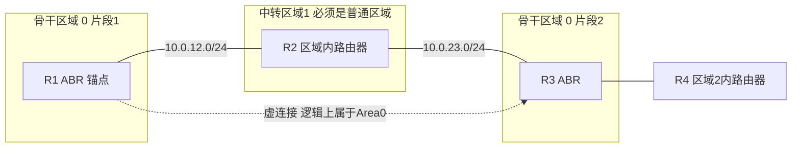

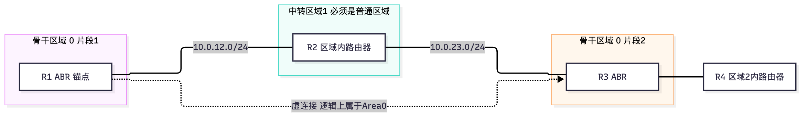


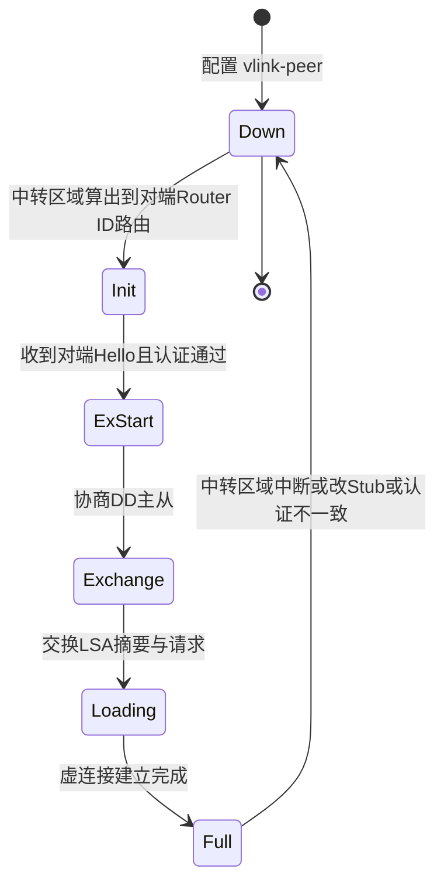

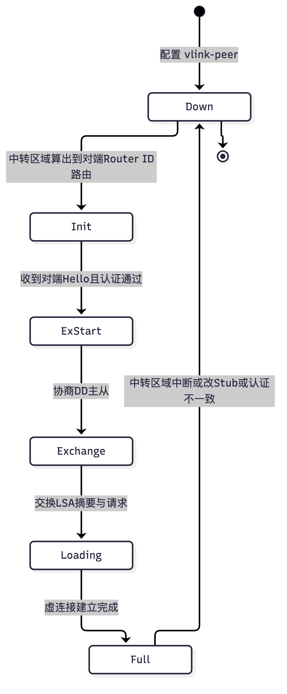


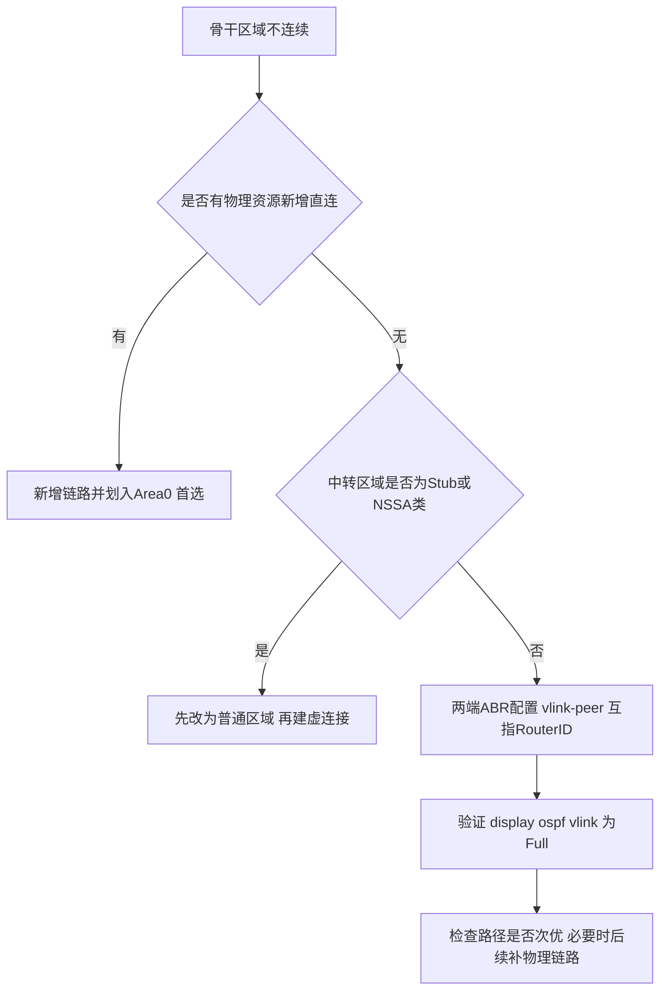

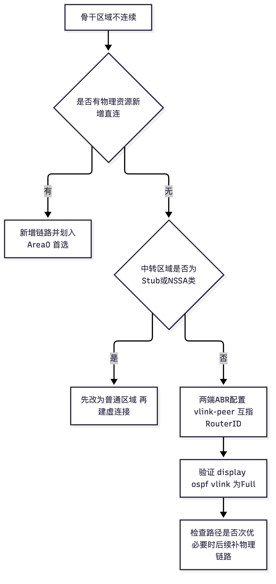


### 真题精练

**Q1.【真题·单选】** 建立 OSPF 虚连接时，对两端设备与中转区域的要求是？

A. 两端可以是任意 OSPF 路由器，中转区域可以是 Stub 区域
B. 两端必须是 ABR，中转区域必须是普通区域
C. 两端必须是 ASBR，中转区域必须是 NSSA 区域
D. 只要两个区域 ID 相同即可建立虚连接

> **答案：B**
> **解析**：虚连接的语义是"把骨干区域逻辑延伸到对端"，因此两端必须是 **ABR**（区域边界路由器），且至少一端真实连接 Area 0。中转区域必须是**普通区域**：Stub/Totally Stub 抑制了 Type3/Type4/Type5、NSSA 有 Type7 与默认路由干扰，都会破坏虚连接"通过区域内路由精确到达对端 Router ID"的前提。

**Q2.【真题·多选】** 关于虚连接的描述，正确的有？（多选）

A. 虚连接在网络类型上等价于一条 P2P 链路，不选举 DR/BDR
B. 虚连接接口属于 Area 0，其开销为中转区域内两端之间的最短路径开销
C. 虚连接可以穿越 Stub 区域，只要两端是 ABR 且认证一致
D. 虚连接上可以配置 MD5 认证，但必须与对端一致

> **答案：ABD**
> **解析**：A、B 是虚连接的接口特性（P2P、属于 Area 0、开销自动取中转区域最短路径开销）；D 正确，`vlink-peer` 上可配置认证。C 错：**虚连接绝对不能穿越 Stub 区域**，这是 OSPF 的硬性规定。

**Q3.【真题·判断】** 用虚连接修复骨干不连续后，流量在物理上一定走最短路径，不会出现次优。

> **答案：错误**
> **解析**：虚连接只是**逻辑上**把骨干连起来，物理报文仍要穿过中转区域。SPF 计算把虚连接当成 Area 0 的链路，若虚连接的开销（= 中转区域内两端最短路径开销）小于物理绕行路径的开销，流量就会被引导到"绕中转区域"的路径上，形成**次优甚至绕远**。工程上应优先用物理链路修复骨干连续性，虚连接仅作过渡。

**Q4.【真题·填空】** 虚连接的配置命令是 ________，参数为对端的 ________；建立后可用命令 ________ 查看虚连接状态与开销。

> **答案：`vlink-peer <router-id>`；Router ID；`display ospf vlink`**
> **解析**：注意参数是**对端的 Router ID**，不是接口 IP。这是最常见的配置错误之一。虚连接必须**两端对称配置**，只配一端无法建立。

**Q5.【真题·简答】** 某个三级分层网络中，区域 3 的 ABR（R9）只能连接到区域 2，无法直连 Area 0。工程师用虚连接解决了问题。请说明：(1) 虚连接应建立在哪两台设备之间；(2) 如果不建虚连接会有什么后果；(3) 为什么中转区域里的每台设备都要把接口宣告进 OSPF。

> **答案**：(1) 应建立在 **R9（区域 3 的 ABR，未直连骨干）** 与 **某台真实连接 Area 0 的 ABR** 之间——但前提是这两台设备同在**同一个中转区域**内（也就是那台真实连骨干的 ABR 也必须属于区域 2）。若 R9 与任何连骨干的 ABR 都不在同一区域，则需要**分段建立**多条虚连接，或调整区域归属。(2) 不建虚连接的后果：区域 3 的路由**无法传播到骨干**、骨干与其他区域的路由也无法正常传播到区域 3，出现**区域间不通（路由黑洞）**——注意这通常不是"环路"而是"不通"或"次优"。(3) 因为虚连接要求两端能通过**中转区域内的区域内路由**精确到达对方的 Router ID。若中转区域内某些网段未宣告进 OSPF，就可能出现"路径靠默认路由兜底"或"到对端 Router ID 的路由来自区域外"的情况，虚连接会建立失败或状态不稳定。因此中转区域内所有相关接口都必须正确宣告。

**Q6.【真题·排错】** 工程师按标准步骤配置了虚连接，但 `display ospf vlink` 显示状态一直为 `Down`。请列出至少四种可能原因与验证命令。

> **答案**：
> ① **中转区域被配成了 Stub/NSSA**：`display ospf interface` 或 `display current-configuration configuration ospf` 查看区域类型；`display ospf error` 是否有区域类型不匹配计数。修正：删除 `stub`/`nssa`。
> ② **`vlink-peer` 参数写错（写成接口 IP 而不是 Router ID）**：`display ospf brief` 查看本机与对端 Router ID，核对配置。
> ③ **两端 Router ID 不可达**：中转区域内没有到对端 Router ID 的区域内路由（例如某些接口未 `network` 宣告、接口被 `silent-interface` 抑制）。验证：`display ip routing-table <对端Router ID>`、`display ospf routing`。
> ④ **认证不一致**：`vlink-peer` 上的 `authentication-mode` 与对端不一致，或中转区域的区域认证未满足。验证：`display ospf error` 查看 "Authentication failure" 计数。
> ⑤ **一端未配置虚连接**（虚连接必须两端对称）：`display current-configuration configuration ospf` 在两台设备上分别检查。
> ⑥ **中转区域链路中断或 MTU/网络类型异常**：`display ospf peer` 查看中转区域内的邻居是否正常。
> ⑦ **Router ID 冲突**：两台设备 Router ID 相同会导致各种异常，`display ospf brief` 核对。

**Q7.【真题·多选】** 下列关于虚连接的认证描述，正确的有？（多选）

A. 虚连接上的认证通过 `vlink-peer <id> authentication-mode` 配置
B. 虚连接认证必须与对端一致，否则状态无法到达 Full
C. 若中转区域启用了区域认证，虚连接报文还需同时满足该区域的认证要求
D. 虚连接认证与中转区域认证是互斥的，只能启用其中一个

> **答案：ABC**
> **解析**：A、B 正确。C 正确：虚连接的 OSPF 报文物理上穿过中转区域，因此中转区域的接口认证/区域认证仍然适用（这是"两层认证"的概念）。D 错误：两者可以同时存在，需要同时通过。

**Q8.【真题·简答】** 为什么"虚连接不能穿越 Stub 区域"？请从虚连接的工作原理与 Stub 区域的 LSA 限制两个角度回答。

> **答案**（见 1.3 防环一节相关真题，此处从"LSA 限制"角度补充）：虚连接要求两端 ABR 通过中转区域的 **Type1** 计算到对方 Router ID 的区域内路由，并且要求中转区域能够正常承载区域间路由（Type3）以保证虚连接端点之外的路由可达。Stub 区域：① **禁止 Type4/Type5**，区域内 LSDB 不完整；② **不产生 Type2 的部分场景**与 **默认路由的强制存在**（ABR 必下发 Type3 默认路由）会干扰虚连接的路由计算与可达性判断——虚连接需要的是"精确的区域内路径"，而不是"兜底的默认路由"。Totally Stub 更极端，只保留一条 Type3 默认路由，连区域间明细都没有，虚连接建立后也会导致大量路由不可达。因此规范要求中转区域必须是普通区域。

### 易错点与排错

| 易错点 | 正确结论 |
|---|---|
| `vlink-peer` 写接口 IP | 必须写**对端 Router ID** |
| 只在一端配置虚连接 | 必须**两端对称** |
| 认为虚连接可以穿越任意区域 | 只能穿越**普通区域** |
| 认为虚拟连接会选举 DR | 虚连接是 **P2P**，无 DR/BDR |
| 认为虚连接能保证最优路径 | 可能造成**次优或绕远** |
| 忽略两层认证 | 中转区域认证 + 虚连接认证**都要通过** |

```bash
display ospf vlink                              // 虚连接状态、开销、认证模式
display ospf peer                               // 邻居状态（含虚连接邻居）
display ospf interface                          // 接口列表（可见 Vlink 类型接口）
display ospf brief                              // 本机 Router ID、区域信息
display ospf error                              // 认证失败、区域不匹配等错误计数
display current-configuration configuration ospf // 查看 OSPF 全部配置（核对两端一致性）
```

---

## 1.6 OSPF 快速收敛技术

### 考点定位

快速收敛是 HCIE 的"工程实践"考点，国赛常以多选、简答、配置题形式出现。高频问法：**BFD 在 OSPF 中如何联动**、**智能定时器解决什么问题**、**PRC/ISPF 与 Full SPF 的区别**、**LFA FRR 的前提条件**。分值不低，且很多选手只会背名词不会讲机制。

### 原理精讲

**OSPF 的收敛慢在哪里？** 传统 OSPF 有三处"时间开销"：

1. **故障检测慢**：依赖 Hello 机制，广播/P2P 网络下 Dead Interval = **40 s**（4 × Hello 10 s），也就是最坏要 40 s 才发现邻居失效。这是最大的一环。
2. **LSA 泛洪慢**：默认 OSPF 对 LSA 的产生与泛洪有**速率限制**（`lsa-generation-interval` 默认 5 s？—— 华为默认 `lsa-arrival-interval` 1000 ms、`lsa-generation-interval` 5000 ms 等），LSA 产生需要等待定时器。
3. **SPF 计算慢**：每次拓扑变化都全量重算 SPF，且 SPF 有**抑制定时器**（`spf-schedule-interval` 默认 5 s，智能定时器可自适应）。

**技术一：BFD（Bidirectional Forwarding Detection，双向转发检测）联动**。BFD 是一个独立的轻量级检测协议，**不依赖任何路由协议**，通过周期性发送极短的探测报文（默认 **1000 ms** 间隔、**3** 次检测倍数，即约 **3 s** 检出，最小可配到 3×10 ms = 30 ms）在**毫秒级**发现链路故障。OSPF 与 BFD 联动的机制是：BFD 会话状态由 Up 变为 Down 时，**通知 OSPF 立即把该邻居置为失效**（不等 Dead 定时器超时），触发 LSA 重新产生与 SPF 重算。**配置要点**：

- OSPF 全局使能 BFD：`ospf 1` 下 `bfd all-interfaces enable`（对所有接口生效）或接口下 `ospf bfd enable`（单接口）；
- BFD 会话参数可在接口下调整：`bfd min-tx-interval 100`、`bfd min-rx-interval 100`、`bfd detect-multiplier 3`；
- **注意**：BFD 会话建立需要两端都使能，且 OSPF 的 BFD 默认要求**两端 OSPF 接口同时开启**，否则会话无法建立（只配一侧不生效）。
- 华为设备上还有 `bfd all-interfaces enable` 与 `bfd all-interfaces min-tx-interval ...` 的批量配置形式。

**技术二：智能定时器（Smart Timer）**。OSPF 的多个定时器改为"**指数退避**"式的自适应机制：当网络稳定时使用较长的间隔（省 CPU），当拓扑频繁变化时缩短间隔（快速响应）。相关命令：

| 命令 | 作用 | 华为默认值 |
|---|---|---|
| `spf-schedule-interval` | SPF 计算的最小间隔/最大间隔/保持时间 | 5 s（智能定时器未启用时） |
| `spf-schedule-interval intelligent-timer <max> <start> <hold>` | 启用智能定时器：最大间隔、初始间隔、保持时间 | 常见推荐 `intelligent-timer 5000 50 200`（ms） |
| `lsa-generation-interval` | 同一 LSA 两次产生之间的最小间隔 | 5000 ms |
| `lsa-arrival-interval` | 收到同一 LSA 的最小处理间隔 | 1000 ms |
| `lsa-group-pacing` | LSA 老化检查周期 | 240 s |

**智能定时器的三个参数含义**：`max-interval`（最大间隔，稳定后上限）、`start-interval`（初始间隔，事件发生后的第一次等待）、`hold-interval`（保持时间，累积增量）。机制是：事件发生时按 `start` 计算，若期间又有事件则间隔按 `hold` 增加，直到 `max` 为止——既避免"每次抖动都算一次 SPF"，又保证持续变化时不会等太久。

**技术三：LSA 快速泛洪（Flooding 优化）**。华为提供多种加速手段：

- `flash-flood`：拓扑变化时**立即泛洪**指定的 LSA（默认只有部分类型立即泛洪），减少泛洪定时器带来的延迟。可配 `flash-flood lsa-count <n> [ max-timer <t> ]` 控制每次立即泛洪的 LSA 数量上限与最大等待时间；
- **LSA 快速老化（`lsa-maxage`）**：显式把 LSA 置为 MaxAge 以加速删除；
- **`ospf trans-delay`**：接口上泛洪 LSA 的传输延迟，默认 1 s，可减小以提高泛洪速度（但过小可能造成丢包重传）。

**技术四：PRC（Partial Route Calculation，部分路由计算）与 ISPF（Incremental SPF，增量 SPF）**。

- **Full SPF**：拓扑变化 → 重建整棵 SPT → 重算所有路由。开销 O(N log N)。
- **ISPF（增量 SPF）**：只重算**受影响的子树**（从变化点往下），复用未变化的部分。适用于**叶子节点变化**（如某条 Stub 网段的增减）。
- **PRC（部分路由计算）**：**拓扑不变、只有叶节点（网段）变化时**，不需要重跑 SPF，只重新计算路由表项。典型场景：引入/撤销一条外部路由、某网段的掩码变化。
- 华为命令：`ospf 1` 下 `spf-schedule-interval` 与 `ispf enable`（部分版本用 `undo spf-schedule-interval` 或 `partial-spf`）——**具体命令随 VRP 版本不同**，常见为 `ospf 1` → `ispf enable`。**当 ISPF 无法处理时自动回退到 Full SPF**。

**技术五：LFA FRR（Loop-Free Alternate Fast Reroute，无环备用下一跳快速重路由）**。传统 OSPF 收敛必须等邻居失效、重算 SPF、更新转发表，需要数百毫秒到数秒。**FRR 的思路是"提前算好备份路径"**：在链路正常时就为每条路由预先计算一个"**无环备用下一跳**"（LFA），一旦主链路故障，**转发表直接切换到备份下一跳**，无需等待控制面收敛，切换时间可做到 **50 ms 以内**。

**LFA 的"无环"条件**（核心公式，考试常考）：对路由器 S 到目的 D 的主下一跳 N，N 要成为 S 的 LFA，必须满足：

```
Distance(N, D) < Distance(N, S) + Distance(S, D)
```

即"邻居 N 到目的 D 的距离"必须**小于**"N 到 S 的距离 + S 到 D 的距离"。若等式成立（相等），则该路径可能形成环路，**不能**作为 LFA。

**LFA 的求解方式**：默认使用"**链路保护（Link Protection）**"——即只保护直连链路故障，不保护中间节点故障；可通过 `frr` 配置启用**节点保护（Node Protection）**（要求更严格）。华为 LFA 相关命令：

```bash
ospf 1
 frr                                          // 使能 OSPF FRR（LFA）
  loop-free-alternate                         // 使用 LFA 计算无环备用下一跳
  tiebreaker router-id                        // 多个候选 LFA 时的优选规则
```

**LFA 的局限**：在**环形拓扑、单归接入、某些汇聚结构**中可能不存在 LFA（称为 "LFA 不可用"）。此时可用 **RLFA（Remote LFA）**（通过 MPLS LDP 隧道到达远端 PQ 节点）或 **Ti-LFA（Topology-Independent LFA，基于 SR）** 解决。

**技术六：其他手段**：

- **降低 Hello/Dead 定时器**：把 Hello 从 10 s 改为 3 s、Dead 从 40 s 改为 12 s（**注意两端必须一致**），可缩短检测时间，但会增加 CPU 与带宽开销；BFD 是更好的选择。
- **`ospf cost` 与 `bandwidth-reference` 合理规划**：避免因度量错误导致选到低带宽链路。
- **接口去抖动（`carrier-delay`）**：避免接口物理抖动引起的频繁拓扑变化。

### 关键概念对照表

**表 1-6-1 OSPF 定时器与快速收敛相关默认值（必背）**

| 参数 | 华为默认值 | 说明 |
|---|---|---|
| Hello Interval（广播/P2P） | 10 s | NBMA 为 30 s，P2MP 为 30 s（华为 P2MP 默认 30 s） |
| Dead Interval（广播/P2P） | 40 s | 4 × Hello；NBMA 为 120 s |
| 虚连接 Hello/Dead | 继承中转区域（通常 10 s / 40 s） | 不可单独配置 |
| `trans-delay`（接口 LSA 传输延迟） | 1 s | 加入 LSA Age |
| `spf-schedule-interval` | 5 s | 智能定时器未启用时 |
| `lsa-generation-interval` | 5000 ms | 同一 LSA 两次产生的最小间隔 |
| `lsa-arrival-interval` | 1000 ms | 收到同一 LSA 的最小处理间隔 |
| `lsa-group-pacing` | 240 s | 老化检查周期 |
| LSA MaxAge | 3600 s | — |
| LSA 刷新（LSRefreshTime） | 1800 s | — |
| BFD 默认发送/接收间隔 | 1000 ms | `bfd min-tx-interval` 可改 |
| BFD 默认检测倍数 | 3 | 最坏检出约 3 s |
| BFD 最小可配间隔（部分平台） | 3 ms（发送）/ 10 ms（接收） | 视平台而定 |

**表 1-6-2 收敛技术对比**

| 技术 | 解决的问题 | 加速对象 | 典型收敛时间 | 关键配置 |
|---|---|---|---|---|
| BFD 联动 | 故障检测慢（40 s） | 故障检测阶段 | 3 s（默认）～ 30 ms（调优） | `bfd all-interfaces enable` |
| 智能定时器 | SPF 计算频繁/不及时 | SPF 调度 | 50~5000 ms 自适应 | `spf-schedule-interval intelligent-timer` |
| Flash-Flood | LSA 泛洪延迟 | 泛洪阶段 | 毫秒级 | `flash-flood` |
| ISPF | 全量 SPF 开销大 | SPF 计算范围 | 显著降低 CPU | `ispf enable` |
| PRC | 纯叶节点变化仍跑 SPF | 路由计算 | 几乎无 SPF 开销 | 随 ISPF 自动启用 |
| LFA FRR | 转发面切换慢 | 转发切换 | < 50 ms | `frr` + `loop-free-alternate` |
| 缩短 Hello/Dead | 检测慢（粗粒度） | 故障检测 | 12 s（3×4） | 两端一致修改 |

**表 1-6-3 ISPF / PRC / Full SPF 适用场景**

| 变化类型 | 是否触发 SPF | 使用机制 | 说明 |
|---|---|---|---|
| 某条 Stub 网段新增/删除 | 不触发 | **PRC** | 拓扑未变，只更新叶节点 |
| 外部路由引入/撤销 | 不触发 | **PRC** | 只影响 Type5/Type7 |
| Type3 增加（区域间路由变化） | 不触发 SPF 主干 | PRC / 部分 SPF | 只更新区域间路由表 |
| 某条链路开销变化（拓扑改变） | 触发 | **ISPF**（增量） | 只重算受影响子树 |
| 路由器失效（节点消失） | 触发 | ISPF（可能回退 Full SPF） | 影响面大时回退 |
| 区域内多节点同时失效 | 触发 | **Full SPF** | 增量收益不足，全量重算 |

**表 1-6-4 LFA 条件与命令**

| 项目 | 说明 |
|---|---|
| LFA 无环条件 | `Distance(N, D) < Distance(N, S) + Distance(S, D)` |
| 保护类型 | 默认链路保护（Link Protection）；可扩展节点保护 |
| 多个候选 LFA | 按 `tiebreaker` 规则优选（router-id / lowest-cost 等） |
| LFA 不可用时 | 使用 RLFA（Remote LFA）或 Ti-LFA（基于 SR） |
| 使能命令 | `ospf 1` → `frr` → `loop-free-alternate` |
| 验证命令 | `display ospf frr`、`display ip routing-table <网段> verbose`（看 Backup NextHop） |

### 华为设备配置

```bash
# ============ 场景：AR6120 / NE40E 上配置 OSPF 全套快速收敛 ============

system-view
sysname R1

# --- 1. BFD 联动：毫秒级故障检测 ---
bfd                                          // 进入 BFD 全局视图
 quit
interface GigabitEthernet0/0/0
 ip address 10.0.12.1 255.255.255.0
 ospf bfd enable                             // 接口级使能 OSPF BFD（需两端都配）
 bfd min-tx-interval 100                     // 本端最小发送间隔 100 ms
 bfd min-rx-interval 100                     // 本端最小接收间隔 100 ms
 bfd detect-multiplier 3                     // 检测倍数 3，最坏 300 ms 检出
 quit

ospf 1 router-id 1.1.1.1
 bfd all-interfaces enable                   // OSPF 进程级批量使能 BFD（推荐，覆盖全部接口）
 bfd all-interfaces min-tx-interval 100      // 批量设置 BFD 发送间隔
 bfd all-interfaces min-rx-interval 100      // 批量设置 BFD 接收间隔
 bfd all-interfaces detect-multiplier 3      // 批量设置检测倍数

 # --- 2. 智能定时器：SPF 自适应调度 ---
 spf-schedule-interval intelligent-timer 5000 50 200
                                              // 最大 5000 ms，初始 50 ms，保持增量 200 ms
 lsa-generation-interval 1000                // 同一 LSA 两次产生最小间隔 1000 ms（加快 LSA 刷新）
 lsa-arrival-interval 500                    // 收到同一 LSA 最小处理间隔 500 ms
 lsa-arrival-interval intelligent-timer 1000 100 100
                                              // 或用智能定时器形式（视版本支持）
 lsa-group-pacing 60                         // 老化检查周期缩短为 60 s（默认 240 s）

 # --- 3. LSA 快速泛洪 ---
 flash-flood lsa-count 10 max-timer 100      // 拓扑变化立即泛洪，单次最多 10 条，最长等待 100 ms
 quit

# --- 4. ISPF / PRC ---
ospf 1
 ispf enable                                 // 使能增量 SPF，叶节点变化时自动用 PRC
 quit

# --- 5. LFA FRR ---
ospf 1
 frr                                         // 进入 FRR 视图
  loop-free-alternate                        // 使能 LFA 无环备用下一跳计算
  tiebreaker router-id lowest-cost           // 多候选时的优选顺序
  quit
 quit

# --- 6. 可选：缩短 Hello/Dead（不推荐替代 BFD，仅作补充） ---
interface GigabitEthernet0/0/0
 ospf timer hello 3                          // Hello 改为 3 s（两端必须一致）
 ospf timer dead 12                          // Dead 改为 12 s（必须为 Hello 的 4 倍）
 quit

# ============ 验证命令 ============
display ospf brief                            // 查看 OSPF 进程参数与使能状态
display ospf bfd session all                  // 查看 OSPF 关联的 BFD 会话状态
display bfd session all verbose               // 查看 BFD 会话详情（含本地/远端标识、间隔）
display ospf frr                              // 查看 FRR 使能状态与 LFA 计算结果
display ospf interface GigabitEthernet0/0/0   // 查看接口定时器与 BFD 状态
display ip routing-table 10.9.9.0 verbose     // 查看备份下一跳（Backup NextHop）是否生成
display ospf spf-statistics                   // 查看 SPF 计算次数统计（验证 ISPF 效果）
```

### 示意图

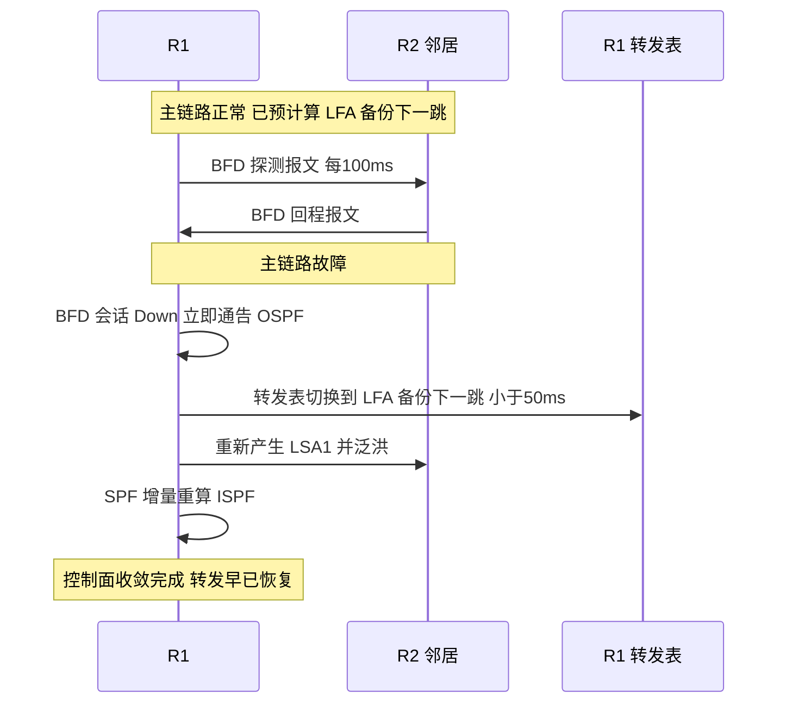

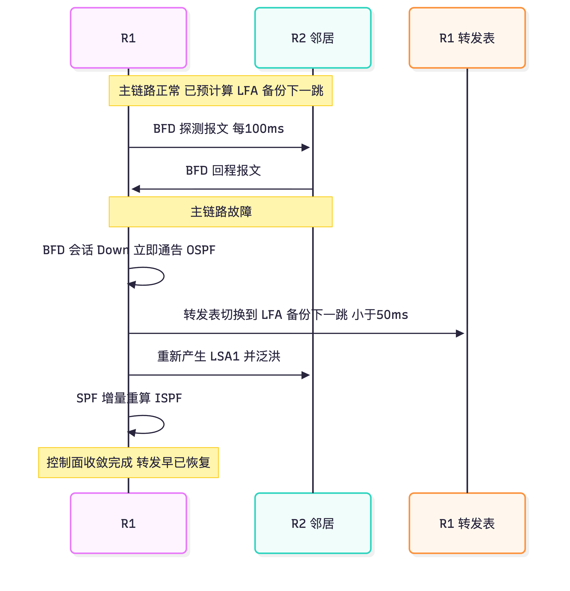


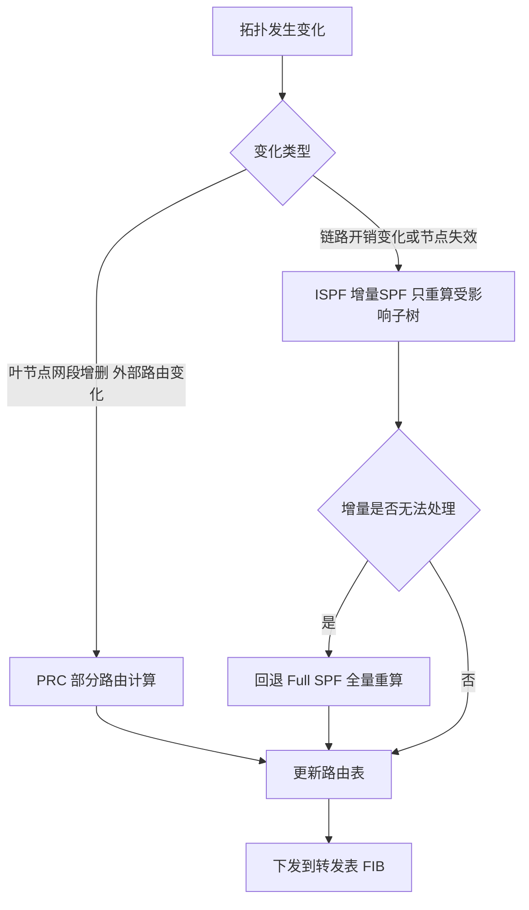

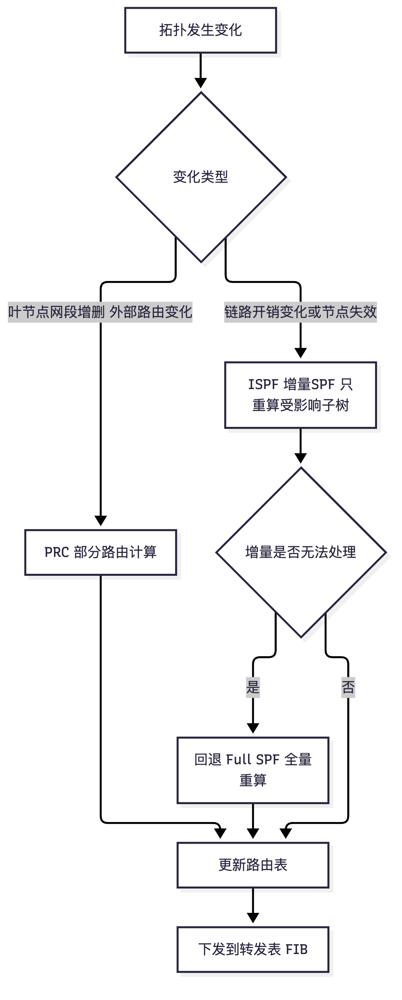


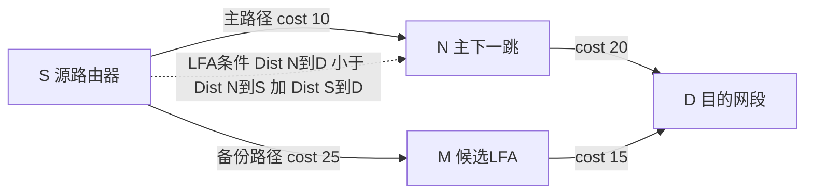


### 真题精练

**Q1.【真题·单选】** 华为设备上 OSPF 广播型接口的 Hello 与 Dead 定时器默认值分别为？

A. 10 s 与 40 s  B. 30 s 与 120 s  C. 5 s 与 20 s  D. 10 s 与 30 s

> **答案：A**
> **解析**：广播型与 P2P 型接口默认 Hello **10 s**、Dead **40 s**（Dead = 4 × Hello）。**NBMA 与 P2MP 接口默认 Hello 30 s、Dead 120 s**，这是 B 选项的来源。两端定时器必须一致，否则邻居无法建立（`display ospf error` 会显示 "Hello timer mismatch" 类计数）。

**Q2.【真题·多选】** 下列关于 OSPF 与 BFD 联动的描述，正确的有？（多选）

A. BFD 独立于路由协议，不依赖 OSPF 的 Hello 机制
B. OSPF 中 `bfd all-interfaces enable` 可以对进程内所有接口批量使能 BFD
C. BFD 会话 Down 后 OSPF 立即将邻居置为失效，不必等待 Dead 定时器超时
D. 只需在一端配置 BFD 即可建立会话

> **答案：ABC**
> **解析**：A、B、C 均为 BFD 联动的标准机制。D 错：**BFD 会话需要两端都使能**才能建立（BGP 的 BFD 有单臂回声模式，但 OSPF 联动要求双向），这是实验题常见失分点。

**Q3.【真题·填空】** 华为设备 OSPF 的 `spf-schedule-interval` 默认值为 ________ 秒；启用智能定时器的命令形式为 `spf-schedule-interval intelligent-timer` 后需给出 ________、________、________ 三个参数。

> **答案：5；最大间隔（max-interval）、初始间隔（start-interval）、保持时间（hold-interval）**
> **解析**：默认 5 s 意味着拓扑变化后 SPF 最多要等 5 s 才计算，这对快速收敛是明显瓶颈。三个参数的单位是**毫秒**，例如 `intelligent-timer 5000 50 200` 表示最大 5000 ms、初始 50 ms、保持增量 200 ms。

**Q4.【真题·多选】** 下列哪些情况会触发 OSPF 的 **PRC（部分路由计算）** 而非 Full SPF？（多选）

A. 区域内新增一条 Stub 网段
B. 引入一条新的外部路由
C. 某条链路的开销发生变化
D. 撤销一条已有的 Type5 外部路由

> **答案：ABD**
> **解析**：PRC 适用于**拓扑不变、只有叶节点（网段/外部路由）变化**的场景：A、B、D 都属于此类。C（链路开销变化）会改变最短路径树的**结构**，必须触发 SPF——若影响范围小可用 ISPF 增量计算，若影响大则回退 Full SPF。

**Q5.【真题·简答】** 解释 LFA（Loop-Free Alternate）的无环条件，并说明为什么"距离相等"的路径不能作为 LFA。

> **答案**：设源路由器为 S，目的网段为 D，主下一跳为 N，则 N 可以作为 S 到 D 的无环备用下一跳的条件是：

```
Distance(N, D) < Distance(N, S) + Distance(S, D)
```

含义是：从邻居 N 出发去往 D 的距离，必须**严格小于**"N 回到 S 的距离 + S 到 D 的距离"。**为什么不能相等？** 因为若取等号，说明 N 到 D 的最优路径**恰好经过 S**（即 N 认为"去 D 最好先回 S"）。此时如果 S 把流量交给 N 作为备份，N 会立刻把流量送回 S——S 又交给 N，形成**微环路（micro-loop）**，备份路径失效甚至造成环路。LFA 的核心思想就是"**备份下一跳不能是依赖我才能到达目的地的邻居**"，取严格小于（而非小于等于）正是为了排除这一情形。

**Q6.【真题·排错】** 某网络部署了 OSPF FRR（LFA），但 `display ip routing-table <某网段> verbose` 中没有显示 Backup NextHop。请分析可能原因。

> **答案**：
> ① **FRR 未正确使能**：确认 `ospf 1` 下已配置 `frr` 与 `loop-free-alternate`，用 `display ospf frr` 检查状态。
> ② **拓扑中不存在满足 LFA 条件的备用下一跳**：这是最常见原因。例如**单归接入（只有一个上游邻居）**、**环形拓扑**中，邻居到目的地的路径必然经过本机，会导致所有邻居都不满足 `Distance(N,D) < Distance(N,S) + Distance(S,D)`，即"**LFA 不可用**"。验证方法：画拓扑手工代入 LFA 公式逐邻居验证。
> ③ **备用路径的实际代价过大或不可达**：候选下一跳的接口未使能 OSPF，或度量被 `ospf cost` 手工设置得过高导致无收益（某些实现会放弃收益为负/为零的 LFA）。
> ④ **目的网段本身是直连或区域内叶子节点**：部分平台对直连网段与某些特殊路由不生成 LFA。
> ⑤ **版本特性差异**：需确认该 VRP 版本支持 LFA（部分老版本仅支持 `ip frr` 的手工备份）。
> ⑥ **`tiebreaker` 配置导致候选被排除**：检查优选规则是否把所有候选都过滤掉了。
> 若确认是"拓扑不支持 LFA"，解决方案是引入 **RLFA（Remote LFA，通过 MPLS LDP 隧道保护）** 或升级到支持 **Ti-LFA（基于 SRv6/SR-MPLS）** 的方案。

**Q7.【真题·多选】** 关于 OSPF 智能定时器（Smart Timer），下列说法正确的有？（多选）

A. 网络稳定时使用较长的间隔以减少 CPU 消耗
B. 拓扑频繁变化时自动缩短间隔以加快响应
C. 智能定时器只能用于 SPF 调度，不能用于 LSA 的产生与接收
D. `spf-schedule-interval intelligent-timer 5000 50 200` 中 5000 是最大间隔（单位 ms）

> **答案：ABD**
> **解析**：A、B、D 正确。C 错：华为设备上 `lsa-generation-interval`、`lsa-arrival-interval` **同样支持智能定时器形式**（如 `lsa-arrival-interval intelligent-timer 1000 100 100`），只是不同版本支持程度略有差异。

**Q8.【真题·实验】** 请写出在 NE40E 上为 OSPF 配置"BFD 检测（100 ms × 3）+ 智能 SPF 定时器 + Flash-Flood + ISPF + LFA FRR"的完整命令，并给出验证命令。

> **答案**：
> ```bash
> system-view
> ospf 1 router-id 1.1.1.1
>  bfd all-interfaces enable                    // 全接口使能 OSPF BFD
>  bfd all-interfaces min-tx-interval 100       // BFD 发送间隔 100 ms（两端需匹配）
>  bfd all-interfaces min-rx-interval 100       // BFD 接收间隔 100 ms
>  bfd all-interfaces detect-multiplier 3       // 检测倍数 3 → 最坏 300 ms 检出
>  spf-schedule-interval intelligent-timer 5000 50 200
>                                               // 智能 SPF：最大 5000 ms、初始 50 ms、增量 200 ms
>  lsa-generation-interval 1000                 // LSA 产生间隔缩短到 1000 ms
>  flash-flood lsa-count 10 max-timer 100       // 拓扑变化立即泛洪，单次≤10 条，等待≤100 ms
>  ispf enable                                  // 增量 SPF + PRC
>  frr                                          // 进入 FRR 视图
>   loop-free-alternate                         // 使能 LFA
>   tiebreaker router-id lowest-cost            // LFA 优选规则
>   quit
>  quit
> # 验证
> display ospf bfd session all                   // BFD 会话应为 Up，间隔与倍数正确
> display bfd session all verbose                // 详细会话信息
> display ospf frr                               // LFA 使能与计算结果
> display ip routing-table 10.9.9.0 verbose      // 观察 Backup NextHop 字段
> display ospf spf-statistics                    // SPF 计算次数（ISPF 生效后应显著减少）
> display ospf interface GigabitEthernet0/0/0    // 接口定时器与 BFD 状态
> ```
> **注意**：BFD/Down 检测间隔必须**两端匹配**（按较大者协商），否则会话起不来；`flash-flood` 的 `lsa-count` 与 `max-timer` 过小可能引起泛洪风暴，需按网络规模调优。

### 易错点与排错

| 易错点 | 正确结论 |
|---|---|
| 只在一端配 BFD | OSPF 的 BFD 需**两端都使能** |
| 认为 NBMA/P2MP 默认 Hello 也是 10 s | 是 **30 s / 120 s** |
| 认为 PRC 用于链路开销变化 | PRC 只用于**叶节点（网段/外部路由）变化**；开销变化用 ISPF |
| 认为 LFA 在所有拓扑都可用 | 环形/单归拓扑常**无 LFA**，需 RLFA/Ti-LFA |
| 认为 LFA 条件可以取等号 | 必须**严格小于**，否则形成微环路 |
| 以为 `spf-schedule-interval` 越短越好 | 过短会引起 SPF 风暴，应使用**智能定时器**自适应 |

```bash
display ospf bfd session all                   // OSPF 关联的 BFD 会话
display bfd session all verbose                // BFD 会话详情
display ospf frr                               // FRR/LFA 状态
display ospf spf-statistics                    // SPF 计算次数（判断是否频繁重算）
display ospf error                             // 定时器不匹配、认证失败等
display ospf interface                         // 各接口定时器与网络类型
display cpu-usage                              // 判断 SPF 是否造成 CPU 冲高
```

---

## 1.7 OSPF 路由汇总与过滤

### 考点定位

汇总与过滤是**实验题与排错题的双重高频点**，也是"命令会敲但不知道在哪生效"的典型代表。国赛常考：**`abr-summary` 与 `asbr-summary` 的区别**、**`not-advertise` 的作用**、**`filter-policy import` 与 `export` 分别在什么位置生效**、**`filter-lsa-out` 与 `filter-policy` 的区别**。这是最容易"配了不生效"的一节。

### 原理精讲

**为什么需要汇总与过滤？** 两个动机：① **缩小 LSDB 与路由表规模**（汇总：多条明细变一条），② **控制路由传播范围与安全**（过滤：不该让别人知道的别传出去，不该学的别学进来）。但 OSPF 的汇总与过滤有一个与 BGP 完全不同的特点：**LSA 是在区域内泛洪的拓扑信息，不能像 BGP 那样"逐邻居"精细控制**——因此 OSPF 的过滤手段都有明确的"生效位置"，配错位置就等于没配。

**一、路由汇总（Summarization）**

**（1）域间路由汇总 `abr-summary`**：配置在 **ABR** 上，作用是把**本区域内的多条区域内路由（Type1/Type2 算出的网段）**汇总成一条 **Type3** 通告到**其他区域**。

```bash
ospf 1
 area 0.0.0.1
  abr-summary 10.1.0.0 255.255.0.0            // 把区域1内的明细汇总为 10.1.0.0/16 通告出去
  abr-summary 10.1.0.0 255.255.0.0 cost 100   // 指定汇总路由的度量（覆盖自动计算值）
  abr-summary 10.1.0.0 255.255.0.0 not-advertise // 抑制：不向其他区域通告该汇总（用于过滤）
```

**关键细节（考试重点）**：

- `abr-summary` 的**生效方向是"从该区域向外"**：配置在 `area 0.0.0.1` 下，表示"把区域 1 内的明细汇总后通告到其他区域（含区域 0）"。
- 汇总的**触发条件是"至少有一条明细存在"**：若区域 1 内 10.1.0.0/16 的所有明细都被撤销，汇总路由也会消失（聚合路由不会凭空存在）。
- **`not-advertise` 的作用**：不是"只汇总不细化"，而是**抑制该汇总路由的通告**（连同被汇总的明细一起不向其他区域通告），常用于做**区域级路由过滤**。这与"只做汇总"是两个不同的语义，极易混淆。
- **`cost` 参数**：指定汇总路由的度量。若不指定，ABR 取被汇总明细中的**最大开销**作为汇总路由的度量（华为实现）。手工指定 `cost` 可以人为引导选路。
- **汇总路由的"黑洞"风险**：汇总掩码**覆盖了实际不存在的网段**时，若外部流量命中该汇总且明细网段不存在，会被 ABR 丢弃（黑洞）。因此汇总应尽量**精确覆盖**。华为设备可用 **`abr-summary ... suppress`（部分版本）或 `discard-route`** 思路规避，但根本上应靠规划。
- **`abr-summary` 只对"本区域内的明细"生效**，不影响区域间的 Type3（Type3 的再汇总需要 `abr-summary` 在新区域上重新生效，或使用 `asbr-summary` 类似的域间汇总机制）。

**（2）域外路由汇总 `asbr-summary`**：配置在 **ASBR** 上，作用是把**引入的外部路由（Type5/Type7）**汇总成一条 **Type5** 通告出去。

```bash
ospf 1
 asbr-summary 172.16.0.0 255.255.0.0           // 把引入的 172.16.x.0/24 明细汇总为 172.16.0.0/16
 asbr-summary 172.16.0.0 255.255.0.0 cost 200 type 1 // 指定度量与度量类型
 asbr-summary 172.16.0.0 255.255.0.0 not-advertise    // 抑制该汇总路由通告
 asbr-summary 172.16.0.0 255.255.0.0 tag 300   // 为汇总路由打 Tag，便于远端过滤
```

**关键细节**：

- `asbr-summary` 配置在**产生 Type5 的那台 ASBR 上**（即"引入点"），而不是 ABR 上。
- **`asbr-summary` 只汇总 Type5/Type7，不汇总 Type3**。若要汇总 Type3，用 `abr-summary`。
- **NSSA 场景**：NSSA 内的 ASBR 汇总产生的是 **Type7**，由转换器转为 Type5 后仍保持汇总（掩码不变）。
- 汇总路由的默认度量类型继承被汇总的明细（除非用 `type` 显式指定）。
- **注意 `not-advertise` 在 `asbr-summary` 上的语义**同样为"抑制通告"，可用于屏蔽一组外部路由。

**（3）汇总与过滤的"生效位置"总览（国赛必背）**

| 需求 | 命令 | 生效设备 | 生效方向 |
|---|---|---|---|
| 把本区域明细汇总成 Type3 发到其他区域 | `abr-summary` | **ABR** | 从配置的区域向**外**（含 Area 0） |
| 把引入的外部路由汇总成 Type5 | `asbr-summary` | **ASBR** | 从 ASBR 向整个 OSPF 域 |
| 控制"哪些外部路由可以被引入" | `filter-policy export` + `import-route` | **ASBR** | 引入时过滤（影响 Type5 生成） |
| 控制"哪些路由被下发到路由表" | `filter-policy import` | **任意路由器** | 从 OSPF 路由表到 IP 路由表（本地生效） |
| 控制"某接口上泛洪哪些 LSA" | `filter-lsa-out` | **任意路由器（接口）** | 出接口方向，阻止 LSA 从该接口发出 |
| 控制"进入本区域的 Type3" | `filter-policy import` 或区域过滤（部分版本支持 `area ... filter`） | ABR | 从 LSDB 到路由表 |

**二、路由过滤（Filtering）**

**（1）`filter-policy import`（导入过滤）**：把 OSPF 算出的路由与 IP 路由表之间的"通道"做过滤——**只影响本机是否把该路由加入 IP 路由表，不影响 LSDB，也不影响邻居**。

```bash
ip ip-prefix DENY_172 index 10 deny 172.16.1.0 24    // 定义前缀列表：拒绝 172.16.1.0/24
ip ip-prefix DENY_172 index 20 permit 0.0.0.0 0 less-equal 32 // 其余全部允许（必须写！）
ospf 1
 filter-policy ip-prefix DENY_172 import       // 导入过滤：本机不加 172.16.1.0/24 到路由表
```

**关键点**：`filter-policy import` **只对本机生效**，邻居仍然拥有完整路由；且由于不影响 LSA，LSA 依旧在 LSDB 中。**验证方法**：`display ospf routing` 有该路由、`display ip routing-table` 没有——说明是导入过滤生效。

**（2）`filter-policy export`（导出过滤）**：在 **ASBR** 上使用，控制**哪些路由可以被引入（生成 Type5）**。它不是"逐邻居过滤"，而是"从引入源到 OSPF 域的门槛"。

```bash
ospf 1
 import-route static                          // 先引入静态路由
 filter-policy ip-prefix ALLOW_ONLY export    // 再过滤：只有匹配的才真正生成 Type5
```

**关键点**：`filter-policy export` 必须与 `import-route` **配合使用**；单独配置 `export` 而不配置 `import-route` 没有任何意义（因为 OSPF 不会自动引入外部协议路由）。此外，`export` 过滤的对象是**被引入的路由**，不包含 OSPF 自身的区域内/区域间路由。

**（3）`filter-lsa-out`（接口级 LSA 过滤）**：配置在**接口**上，控制**哪些 LSA 不能从该接口发出**。它直接作用于 LSA 泛洪层面，因此会造成"邻居的 LSDB 与事实不符"——这是**危险操作**，必须谨慎。

```bash
interface GigabitEthernet0/0/0
 ospf filter-lsa-out all                      // 阻止所有 LSA 从该接口发出（设备级隔离，慎用）
 ospf filter-lsa-out summary                  // 阻止 Type3（Summary LSA）从该接口发出
 ospf filter-lsa-out ase                      // 阻止 Type5（AS External LSA）从该接口发出
 ospf filter-lsa-out nssa                     // 阻止 Type7（NSSA External LSA）从该接口发出
```

**关键点**：

- `filter-lsa-out` 是**按 LSA 类型**过滤（不是按前缀），因此**无法精确到"只过滤某条路由"**。若需按前缀过滤，应使用 `filter-policy` 或区域级过滤器。
- 它会导致**本设备与邻居的 LSDB 不一致**，可能造成路由黑洞与不可预期行为，**生产环境避免使用**。
- 部分 VRP 版本支持在 `filter-lsa-out` 后带 `acl` 参数实现更细粒度控制，但主流考试只考类型粒度。

**（4）区域级过滤（华为 `area ... filter` / `filter-policy ip-prefix ... import` 的配合）**：华为部分版本支持在 ABR 上对"进入某区域的 Type3"做过滤（类似 `abr-summary` 的过滤思路），但**不改变 LSA 的泛洪**，只影响路由计算。考试中若遇到"某区域不应学到某网段"，标准答案是：**在 ASBR/ABR 侧用 `filter-policy export` 或 `abr-summary not-advertise` 从源头抑制**，而不是在接收侧过滤。

**三、必须记住的三个"作用范围"结论**

1. **`filter-policy import` 只影响本机路由表**，不影响 LSA，不影响邻居。
2. **`filter-policy export` 在 ASBR 上影响 Type5/Type7 的生成**，属于"源头过滤"，全网有效。
3. **`filter-lsa-out` 影响接口上的 LSA 泛洪**，会导致 LSDB 不一致，属于"危险手段"，只在特定隔离场景使用。

### 关键概念对照表

**表 1-7-1 汇总与过滤命令对照（国赛必背）**

| 命令 | 配置位置 | 作用对象 | 是否影响 LSA/邻居 | 典型用途 |
|---|---|---|---|---|
| `abr-summary <网段> <掩码>` | ABR 的**区域视图** | 本区域明细 → 一条 Type3 | 影响（LSA 变化，邻居可见汇总） | 域间汇总 |
| `abr-summary ... not-advertise` | ABR 的区域视图 | 抑制汇总路由通告 | 影响（明细也不通告） | 区域级过滤 |
| `asbr-summary <网段> <掩码>` | **ASBR 的进程视图** | 引入的 Type5 → 一条 Type5 | 影响 | 域外汇总 |
| `asbr-summary ... not-advertise` | ASBR 进程视图 | 抑制外部汇总通告 | 影响 | 外部路由过滤 |
| `filter-policy ip-prefix <名> import` | 任意路由器进程视图 | OSPF 路由 → 本机 IP 路由表 | **不影响** LSA 与邻居 | 本机不收某路由 |
| `filter-policy ip-prefix <名> export` | **ASBR 进程视图** | 引入源 → Type5 生成 | 影响（源头过滤） | 控制引入范围 |
| `ospf filter-lsa-out <类型>` | **接口视图** | 指定类型 LSA 的出接口泛洪 | 影响（造成 LSDB 不一致） | 设备级隔离（慎用） |
| `import-route <协议> [type/cost/tag/route-policy]` | ASBR 进程视图 | 引入外部路由 | 影响（生成 Type5） | 引入 |
| `default-route-advertise` | ASBR/ABR 进程视图 | 产生 Type5/Type7 默认路由 | 影响 | 下发默认 |

**表 1-7-2 五个参数速查**

| 参数 | 适用命令 | 含义 | 默认 |
|---|---|---|---|
| `cost <值>` | `abr-summary`、`asbr-summary`、`default-route-advertise`、`import-route` | 指定汇总/默认/引入路由的度量 | 汇总取明细最大值；引入取原路由度量 |
| `type 1\|2` | `asbr-summary`、`import-route`、`default-route-advertise` | 度量类型（E1/E2） | **2（E2）** |
| `tag <值>` | `asbr-summary`、`import-route` | 外部路由标记，用于远端过滤 | 0 |
| `not-advertise` | `abr-summary`、`asbr-summary` | 抑制该汇总路由的通告 | 不抑制 |
| `route-policy <名>` | `import-route`、`default-route-advertise` | 按策略精细化控制引入/默认路由 | 无 |

**表 1-7-3 排错定位矩阵（路由表 vs LSDB）**

| `display ospf routing` | `display ip routing-table` | 判断结论 |
|---|---|---|
| 有 | 有 | 正常 |
| 有 | 无 | **本机 `filter-policy import` 过滤**，或优先级被其他协议抢占（外部 150 vs 静态 60） |
| 无 | 无 | 上游没发（源头 `export` 过滤 / `abr-summary not-advertise` / LSA 未生成）或本机 `filter-lsa-out` 导致 LSDB 缺失 |
| 无（但 LSDB 有该 LSA） | 无 | Type5 的可达性检查未通过（ASBR/FA 不可达）或区域类型限制 |

**表 1-7-4 汇总常见陷阱**

| 陷阱 | 现象 | 正确做法 |
|---|---|---|
| 汇总掩码覆盖不存在的网段 | 流量被 ABR 黑洞丢弃 | 汇总尽量精确；考虑在 ASBR 上配置指向 NULL0 的防环黑洞路由 |
| 期望 `not-advertise` "只藏明细、保留汇总" | 汇总也不见了 | `not-advertise` 是**抑制整条汇总通告**，两者同时消失 |
| 在 ASBR 上用 `abr-summary` 汇总外部路由 | 不生效 | 外部路由汇总用 **`asbr-summary`** |
| 在 ABR 上用 `asbr-summary` 汇总区域间路由 | 不生效 | 区域间汇总用 **`abr-summary`** |
| `filter-policy export` 单独配置无 `import-route` | 无效果 | `export` 只对"被引入的路由"生效 |
| 期望 `filter-lsa-out` 精确定位某前缀 | 过滤粒度是"LSA 类型"，做不到 | 按前缀过滤请用 `filter-policy` / 汇总 |

### 华为设备配置

```bash
# ============ 场景：NE40E/AR6120 上的汇总与过滤完整示例 ============
# R1 为 ABR（连接 Area0 与 Area1），R2 为 ASBR（引入静态与直连路由）

# --- R1（ABR）：域间汇总 + 导入过滤 ---
system-view
sysname R1
ip ip-prefix DENY_TEST index 10 deny 10.1.5.0 24      // 拒绝一条测试网段
ip ip-prefix DENY_TEST index 20 permit 0.0.0.0 0 less-equal 32 // 其余放行（前缀列表末尾隐含 deny，必须显式放行）
ospf 1 router-id 1.1.1.1
 area 0.0.0.0
  network 10.0.0.0 0.0.0.255                    // 骨干互联
 area 0.0.0.1
  network 10.0.1.0 0.0.0.255                    // 区域1互联
  abr-summary 10.1.0.0 255.255.0.0              // 汇总区域1内的 10.1.x.0/24 为 10.1.0.0/16
  abr-summary 10.1.0.0 255.255.0.0 cost 50      // 指定汇总路由度量 50（覆盖默认的最大值）
  abr-summary 10.2.0.0 255.255.0.0 not-advertise // 10.2.0.0/16 明细与汇总都不向其他区域通告
  default-cost 10                               // 若区域1是Stub/NSSA，调整默认路由开销
 filter-policy ip-prefix DENY_TEST import       // 本机不把 10.1.5.0/24 加入 IP 路由表（不影响邻居）
 quit
display ospf lsdb summary                       // 确认 10.1.0.0/16 的 Type3 已生成
display ospf routing                            // OSPF 内部路由表（含被导入过滤的路由）
display ip routing-table                        // 最终路由表（对比找出被过滤的路由）

# --- R2（ASBR）：域外汇总 + 导出过滤 ---
system-view
sysname R2
ip ip-prefix ALLOW_EXT index 10 permit 172.16.0.0 16  // 仅允许 172.16.0.0/16 段
ip ip-prefix ALLOW_EXT index 20 deny 0.0.0.0 0 less-equal 32 // 其余拒绝
route-policy RP_IMPORT permit node 10           // 定义引入策略
 if-match ip-prefix ALLOW_EXT                   // 匹配前缀列表
 apply tag 200                                   // 为引入路由打 Tag 200
ospf 1 router-id 2.2.2.2
 import-route static route-policy RP_IMPORT     // 引入静态路由并按策略打 Tag
 import-route direct type 1 cost 20             // 引入直连路由为 E1，度量 20
 asbr-summary 172.16.0.0 255.255.0.0            // 汇总为 172.16.0.0/16
 asbr-summary 172.16.0.0 255.255.0.0 cost 100 type 1 tag 300 // 指定度量/类型/Tag
 asbr-summary 172.17.0.0 255.255.0.0 not-advertise // 抑制该外部网段通告
 filter-policy ip-prefix ALLOW_EXT export       // 源头过滤：只有匹配的才生成 Type5
 quit
display ospf lsdb ase verbose                    // 查看 Type5 的度量、类型、Tag、FA
display ospf lsdb brief                          // 确认 LSA 数量（汇总后应显著减少）

# --- 接口级 LSA 过滤（危险操作，仅演示） ---
interface GigabitEthernet0/0/1
 ospf filter-lsa-out ase                          // 禁止 Type5 从该接口发出（会造成邻居 LSDB 缺失）
 display ospf interface GigabitEthernet0/0/1      // 查看接口 OSPF 参数
 quit
# 恢复
interface GigabitEthernet0/0/1
 undo ospf filter-lsa-out                         // 撤销接口级 LSA 过滤
 quit
```

### 示意图

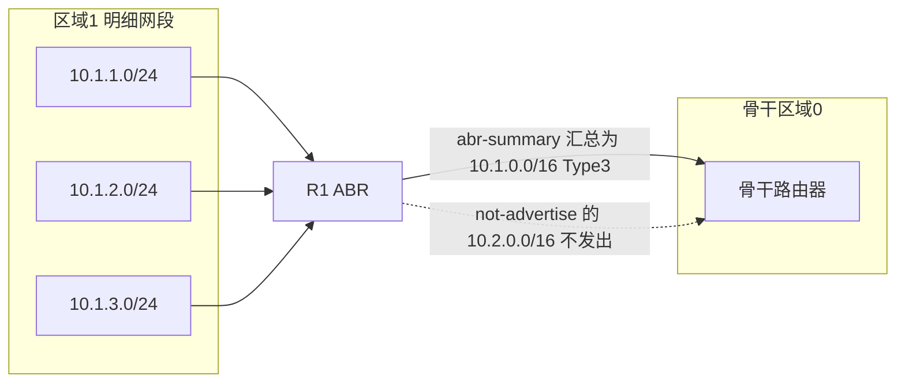

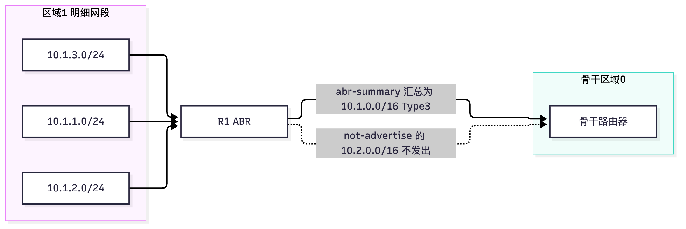


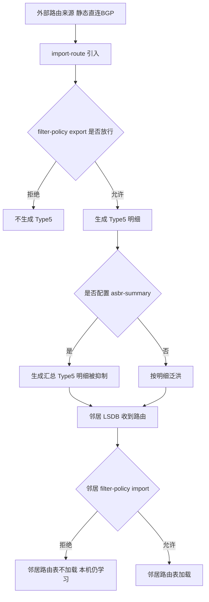

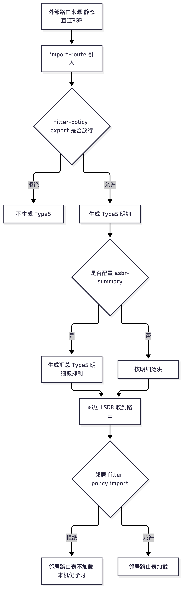


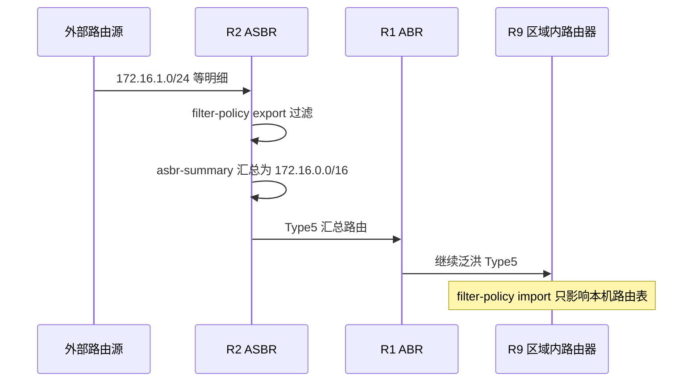

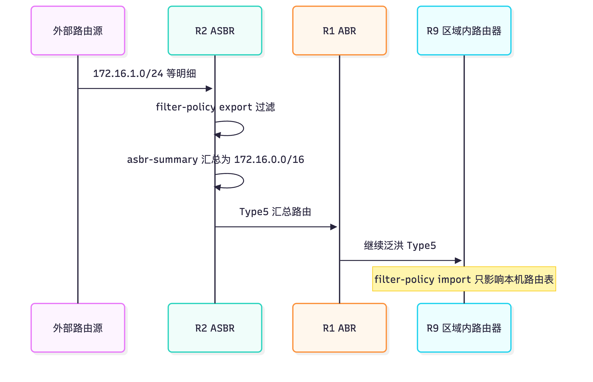


### 真题精练

**Q1.【真题·单选】** 需要把引入 OSPF 的多条外部路由汇总成一条通告出去，应在哪台设备、哪个视图下配置什么命令？

A. ABR 的区域视图下配置 `abr-summary`
B. ASBR 的进程视图下配置 `asbr-summary`
C. 任意路由器的接口视图下配置 `filter-lsa-out`
D. ABR 的进程视图下配置 `filter-policy export`

> **答案：B**
> **解析**：外部路由（Type5/Type7）的汇总必须在**产生它们的 ASBR** 上用 **`asbr-summary`**（进程视图）。A 是**域间**（Type3）汇总的位置与命令；C 是 LSA 泛洪过滤；D 是引入过滤，均不能实现"外部路由汇总"。

**Q2.【真题·单选】** 在 ABR 上配置 `area 0.0.0.1` 下的 `abr-summary 10.1.0.0 255.255.0.0 not-advertise`，其效果是？

A. 只通告汇总路由 10.1.0.0/16，不通告明细
B. 既不通告汇总路由，也不通告被汇总的明细
C. 仅在区域 1 内部可见该汇总
D. 保留明细、抑制汇总路由的通告

> **答案：B**
> **解析**：`not-advertise` 的语义是"**抑制该汇总路由的通告**"，且在抑制汇总的同时，**被汇总的明细也不会以明细形式通告出去**。因此最终效果是本区域内的这组网段**不向其他区域通告**。D 描述反了（它抑制的是汇总，不是明细；但结果是两者都不出现）。A 是**不带** `not-advertise` 时的效果。这是 `abr-summary` 最容易被误解的参数。

**Q3.【真题·判断】** `filter-policy import` 在 OSPF 中配置后，本机不再把被过滤的路由加入路由表，同时邻居也不会收到该路由。

> **答案：错误**
> **解析**：`filter-policy import` **只影响本机的路由表加载**，不改变 LSA 的泛洪，也不影响邻居的 LSDB 与路由表。验证方法：本机 `display ospf routing` 中**有**该路由（OSPF 已算出），但 `display ip routing-table` 中**没有**（被导入过滤拦住）。若要"从源头不让别人知道"，应使用 `filter-policy export`（ASBR）或 `abr-summary ... not-advertise`（ABR）。

**Q4.【真题·填空】** 在 ASBR 上控制"哪些引入的路由才能真正生成 Type5"的命令是 ________；而在接口上按 LSA 类型阻止 LSA 发出的命令是 ________，它会导致本机与邻居的 ________ 不一致。

> **答案：`filter-policy ip-prefix <名> export`（或 `filter-policy acl/route-policy export`）；`ospf filter-lsa-out <类型>`；LSDB（链路状态数据库）**
> **解析**：前者必须与 `import-route` 配合使用；后者作用于 LSA 泛洪层，粒度是"LSA 类型"而非"前缀"，属于危险操作，可能造成路由黑洞。

**Q5.【真题·简答】** 请说明 `abr-summary` 与 `asbr-summary` 在配置位置、汇总对象、生成的 LSA 类型、以及在 Stub/NSSA 场景下的差异。

> **答案**：

| 对比项 | `abr-summary` | `asbr-summary` |
|---|---|---|
| 配置设备 | **ABR** | **ASBR** |
| 配置视图 | **区域视图**（`area x.x.x.x` 下） | **进程视图**（`ospf 1` 下） |
| 汇总对象 | 本区域内的**区域内明细**（Type1/Type2 算出的网段） | **引入的外部明细**（Type5/Type7） |
| 生成 LSA | **Type3**（Summary LSA） | **Type5**（NSSA 内为 **Type7**） |
| 作用方向 | 从配置的区域向**外**（含 Area 0 与其他区域） | 从 ASBR 向**整个 OSPF 域** |
| Stub/NSSA 差异 | Stub 区域：Type3 被抑制，汇总不生效（只留默认路由）；NSSA 区域：Type3 可正常汇总 | NSSA 内 ASBR 汇总出的是 Type7，由转换器转 Type5 后保持汇总掩码 |
| `cost` 默认 | 取被汇总明细中的**最大开销** | 继承被汇总明细的度量 |
| `not-advertise` 效果 | 抑制汇总路由连同明细一起不通告 | 抑制该外部汇总路由不通告 |

**Q6.【真题·排错】** 工程师在 ASBR 上配置了 `import-route static` 与 `filter-policy ip-prefix RP export`，期望只引入 `172.16.0.0/16` 段，但发现所有静态路由都被引入了。请分析原因并给出修正方案。

> **答案**：最可能原因是 **IP 前缀列表（`ip ip-prefix`）的匹配逻辑用错**，具体分为两类：
> ① **前缀列表默认行为是"未匹配则拒绝"（末尾隐含 deny）**，但工程师往往只写了 `permit 172.16.0.0 16`，**没有写后续的 `deny` 或多余的 `permit`**——按此逻辑只有 172.16.0.0/16 被允许，**其余应被拒绝**，所以这不解释"全部被引入"。真正的常见错误是**只写了 `deny` 没写 `permit`，或者写出了 `permit 0.0.0.0 0 less-equal 32` 这条"放行全部"的规则**，导致过滤形同虚设。请检查 `display ip ip-prefix RP` 的输出。
> ② **`filter-policy export` 与 `import-route` 的顺序/配套问题**：确认 `filter-policy export` 与 `import-route` 在同一 `ospf` 进程下，且**过滤策略是在引入时生效**。若工程师把 `filter-policy` 配成了 `import`，则只影响本机路由表，不会限制 Type5 生成——这时邻居会看到全部外部路由，本机也照样生成 LSA。
> ③ **`route-policy` 未正确绑定**：若同时使用了 `route-policy` 与 `filter-policy`，两者是**逻辑与**关系，需确认 `route-policy` 中 `if-match` 的 ip-prefix 名称拼写正确，且 `apply` 动作不会意外放行。
> **修正方案**：
> ```bash
> display ip ip-prefix RP                        // 先看前缀列表实际内容
> ip ip-prefix RP index 10 permit 172.16.0.0 16  // 精确允许目标网段
> ip ip-prefix RP index 20 deny 0.0.0.0 0 less-equal 32 // 显式拒绝其余（可选，末尾隐含 deny）
> ospf 1
>  filter-policy ip-prefix RP export             // 确认导出过滤已绑定
>  import-route static                           // 引入与过滤配套
> quit
> reset ospf process                             // 重新引入以生效（慎用，会短暂中断）
> display ospf lsdb ase verbose                  // 验证只剩目标网段的 Type5
> ```

**Q7.【真题·多选】** 关于 `ospf filter-lsa-out` 命令，下列说法正确的有？（多选）

A. 配置在接口视图下，作用于该接口出方向的 LSA 泛洪
B. 可以按 LSA 类型（summary / ase / nssa / all）过滤
C. 可以精确过滤掉某一个前缀对应的 LSA
D. 使用后可能造成本机与邻居的 LSDB 不一致，属于危险操作

> **答案：ABD**
> **解析**：A、B、D 正确。C 错：`filter-lsa-out` 的粒度是 **LSA 类型**，无法按前缀精确过滤（LSA 的粒度是"一条 LSA"，而一条 Type3 只描述一个网段，理论上"一条一前缀"，但命令并不能按前缀匹配，只能按类型）。若需按前缀过滤，应使用 `filter-policy` 或 `abr-summary not-advertise`。

**Q8.【真题·实验】** 请设计一套配置，使 ABR（R1）向骨干区域通告的 `10.1.0.0/16` 汇总路由度量为 50、不向骨干通告 `10.2.0.0/16`，同时在 R2（区域内路由器）上不使用 `10.1.5.0/24` 这条路由（但 LSDB 中保留）。

> **答案**：
> ```bash
> # --- R1（ABR）---
> system-view
> ospf 1 router-id 1.1.1.1
>  area 0.0.0.1
>   network 10.0.1.0 0.0.0.255
>   abr-summary 10.1.0.0 255.255.0.0 cost 50      // 汇总并指定度量 50
>   abr-summary 10.2.0.0 255.255.0.0 not-advertise // 抑制该网段向其他区域通告
>  quit
> # --- R2（区域内路由器）---
> system-view
> ip ip-prefix DENY_105 index 10 deny 10.1.5.0 24  // 拒绝该前缀
> ip ip-prefix DENY_105 index 20 permit 0.0.0.0 0 less-equal 32 // 其余放行
> ospf 1 router-id 2.2.2.2
>  filter-policy ip-prefix DENY_105 import          // 导入过滤：本机不加表，LSDB 不受影响
>  area 0.0.0.1
>   network 10.0.1.0 0.0.0.255
>  quit
> # --- 验证 ---
> display ospf lsdb summary verbose                 // R1 上确认 10.1.0.0/16 度量为 50
> display ospf lsdb summary                         // R2 上确认 10.2.0.0/16 的 Type3 不存在
> display ospf routing | include 10.1.5             // R2 的 OSPF 路由表中有该路由
> display ip routing-table | include 10.1.5         // R2 的 IP 路由表中没有该路由
> ```
> **要点**：`abr-summary` 在 ABR 的区域视图；`cost` 决定汇总度量；`not-advertise` 抑制该组路由；`filter-policy import` 只影响本机路由表，与"LSDB 保留"的要求完全吻合。

### 易错点与排错

| 易错点 | 正确结论 |
|---|---|
| 在 ASBR 上用 `abr-summary` 汇总外部路由 | 外部路由汇总用 **`asbr-summary`** |
| 认为 `not-advertise` 只藏明细保留汇总 | **汇总与明细都不通告** |
| 认为 `filter-policy import` 影响邻居 | 只影响**本机路由表** |
| 单独配 `filter-policy export` 不配 `import-route` | **不生效**，`export` 只作用于被引入的路由 |
| 期望 `filter-lsa-out` 按前缀过滤 | 只能按 **LSA 类型**过滤 |
| 汇总掩码覆盖不存在的网段 | 造成**黑洞**，应精确汇总或配 NULL0 兜底 |
| 忘记前缀列表末尾隐含 deny | 只写 `permit` 时其余会被拒绝；只写 `deny` 时全部被拒绝 |

```bash
display ospf lsdb summary verbose              // 查看 Type3 汇总路由的度量与掩码
display ospf lsdb ase verbose                  // 查看 Type5 的度量、类型、Tag
display ospf routing                           // OSPF 算出的路由（判断是否被 import 过滤）
display ip routing-table                       // 最终路由表（对比定位过滤点）
display ip ip-prefix <名>                       // 查看前缀列表实际内容（排错第一步）
display route-policy <名>                       // 查看路由策略内容
display ospf brief                             // 查看 OSPF 进程与区域配置摘要
```

---

## 1.8 OSPF 认证进阶

### 考点定位

认证属于"必考小题"：单选题考认证类型与字段，多选考 Keychain 的优势，判断题考"认证能否防止重放"。国赛偶有配置题（要求配置区域认证 + Keychain 并说明注意事项）。**核心陷阱**：把"简单认证（明文）"与"MD5 认证"的字段混淆，以及认为认证只在接口上配置（区域认证同样重要）。

### 原理精讲

OSPF 认证的目的是**防止非法路由器加入 OSPF 域并注入伪造的 LSA**。认证可以配置在**区域级**或**接口级**：

- **区域认证**：在 `area` 视图下配置，作用于该区域内**所有**参与 OSPF 的接口；
- **接口认证**：在接口视图下配置，**优先级高于区域认证**（同一接口两者都有时，接口认证生效）。

**三种认证类型**：

**（1）Null 认证（Type 0）**：不认证，**默认**。OSPF 报文的 Authentication Type 字段为 0。

**（2）简单认证（Simple Password / 明文认证，Type 1）**：密码以**明文**形式放在 OSPF 报文的认证字段中（8 字节）。任何能抓包的人都能看到密码，**安全性极低**，仅适合实验环境。配置：`authentication-mode simple cipher <密码>`。

**（3）MD5 认证（Type 2）**：使用 MD5 算法对 OSPF 报文做摘要。OSPFv2 的 MD5 认证有两种工作方式：
  - **MD5 认证（RFC 2328 扩展，认证类型 2）**：报文末尾附加一个 **16 字节**的 MD5 摘要，同时报文的认证字段携带 **Key ID、认证数据长度、加密序列号（Cryptographic Sequence Number）**。这个**序列号是防重放的关键**——接收方会记录已收到的最大序列号，拒收序列号更小（或重复）的报文。
  
  **注意**：OSPFv2 中基于 RFC 2328 的 MD5 认证**存在已知的重放攻击风险**（序列号是 32 位非单调，且某些实现会重置），因此生产环境更推荐使用 **Keychain**。

**（4）Keychain（密钥链）认证**：Keychain 是一种**密钥管理框架**，它把"密钥 + 有效期 + 算法"组织成一条链，**支持密钥自动轮换**（到期自动切换到下一个密钥），从而实现"定期更换密钥而不中断业务"。OSPF/IS-IS/BGP/RIP 都可以引用 Keychain。**Keychain 的优势**：① 密钥可按时间自动轮换，降低长期使用同一密钥的风险；② 支持多种算法（MD5、SHA-1、HMAC-SHA-256 等）；③ 轮换时可通过"发送用新密钥 + 接收同时接受新旧密钥"实现平滑过渡，不中断邻居。

**华为 Keychain 配置要点**：

```bash
keychain KC_OSPF mode absolute                // 创建 Keychain，模式为绝对时间（absolute）
 key-id 1                                     // 定义密钥 ID 1
  algorithm md5                               // 算法 MD5（可选 hmac-sha256 等）
  key-string cipher Huawei@123                // 密钥（cipher 表示以密文形式保存）
  send-lifetime utc 00:00 2024-01-01 00:00 2025-01-01 // 发送有效期
  receive-lifetime utc 00:00 2024-01-01 00:00 2025-01-01 // 接收有效期
 key-id 2
  algorithm md5
  key-string cipher Huawei@456
  send-lifetime utc 00:00 2025-01-01 00:00 2026-01-01
  receive-lifetime utc 00:00 2024-12-31 00:00 2026-01-01 // 接收有效期可比发送期长，实现平滑过渡
```

**Keychain 的关键机制**：`send-lifetime` 决定"当前用哪个密钥发送"，`receive-lifetime` 决定"能接受哪些密钥"。平滑轮换的做法是：**新密钥开始发送之前，先让对端的 receive-lifetime 覆盖新密钥**，避免切换瞬间认证失败。

**认证的两端一致性要求（高频考点）**：

- **认证类型必须一致**（都配 MD5 或都配 simple）；
- **密钥必须一致**；
- **Key ID 必须匹配**（在 Keychain 与多密钥场景下尤其重要）；
- **区域认证与接口认证的优先级**：接口认证覆盖区域认证，若两端一个用区域认证、一个用接口认证但密码相同，仍可建立（因为最终生效的认证类型与密钥一致）。但若密码不同则无法建立。
- **虚连接的认证**需要单独在 `vlink-peer` 上配置，且中转区域的区域/接口认证也会生效（"两层认证"）。

**认证不通过的现象**：邻居无法建立，`display ospf error` 中的 "Authentication failure" 计数持续增长；`display ospf peer` 显示邻居一直在 Init/Down；抓包可见 "OSPF Authentication Failure"。

**一个重要细节**：**认证只保护 OSPF 报文的"身份"，不保护数据的机密性**（简单认证与 MD5 都是如此）。MD5 认证只保证"报文未被篡改且来自持有密钥的对端"，**不做加密**。因此不要把 OSPF 认证当成加密手段，也不要用它承载机密信息。

### 关键概念对照表

**表 1-8-1 三种（四类）认证方式对比**

| 对比项 | Null（Type 0） | 简单认证（Type 1） | MD5（Type 2） | Keychain |
|---|---|---|---|---|
| 密码是否明文传输 | — | ✅ 明文（可被抓包看到） | ❌ 传摘要（16 字节） | ❌ 传摘要 |
| 认证字段内容 | 无 | 8 字节明文密码 | Key ID + 数据长度 + 加密序列号 + 16 字节摘要 | 同 MD5（算法可换） |
| 防重放 | ❌ | ❌ | ⚠️ 有序列号机制但存在风险 | ✅ 配合密钥轮换更安全 |
| 密钥轮换 | — | 手工改 | 手工改（会中断） | ✅ **自动轮换，可平滑过渡** |
| 支持算法 | — | — | MD5 | MD5 / SHA-1 / HMAC-SHA-256 等 |
| 安全性 | 无 | 极低 | 中 | **高** |
| 推荐场景 | 实验 | 不推荐 | 可用 | **生产环境推荐** |
| 配置位置 | 默认 | 区域或接口 | 区域或接口 | 区域或接口（引用 Keychain 名） |

**表 1-8-2 区域认证与接口认证对比**

| 对比项 | 区域认证 | 接口认证 |
|---|---|---|
| 配置视图 | `area x.x.x.x` | `interface xxx` |
| 作用范围 | 该区域内**所有** OSPF 接口 | **仅该接口** |
| 优先级 | 低 | **高**（接口认证覆盖区域认证） |
| 典型用途 | 统一管理整个区域的安全策略 | 个别接口特殊处理（如与第三方对接） |
| 命令示例 | `authentication-mode md5 cipher xxx` | `ospf authentication-mode md5 1 cipher xxx` |

**表 1-8-3 认证相关的默认值与字段**

| 项目 | 取值 |
|---|---|
| 默认认证类型 | **Null（Type 0）**，不认证 |
| OSPFv2 认证字段长度 | 8 字节 |
| MD5 摘要长度 | 16 字节 |
| 简单认证密码长度 | 最多 8 字节 |
| MD5 Key ID 范围 | 1~255 |
| Keychain key-id 范围 | 0~2147483647（实际常用 1~） |
| 认证失败告警 | `display ospf error` 的 Authentication failure 计数 |

### 华为设备配置

```bash
# ============ 场景一：区域认证 + 接口认证 ============

# --- R1：区域 0 使用 MD5 区域认证 ---
system-view
sysname R1
ospf 1 router-id 1.1.1.1
 area 0.0.0.0
  authentication-mode md5 cipher Huawei@123     // 区域认证：区域内所有接口生效
  network 10.0.0.0 0.0.0.255
 quit

# --- R2：同一区域使用相同的区域认证 ---
system-view
sysname R2
ospf 1 router-id 2.2.2.2
 area 0.0.0.0
  authentication-mode md5 cipher Huawei@123     // 必须与 R1 完全一致
  network 10.0.0.0 0.0.0.255
 quit

# --- 接口认证（优先级高于区域认证）---
interface GigabitEthernet0/0/1
 ip address 10.0.1.2 255.255.255.0
 ospf authentication-mode md5 1 cipher Huawei@456 // 接口认证：Key ID 1，独立密码
 quit

# --- 简单认证（仅实验，不推荐生产）---
interface GigabitEthernet0/0/2
 ospf authentication-mode simple cipher Huawei@789 // 明文认证，可被抓包看到密码
 quit

# ============ 场景二：Keychain 自动轮换认证（推荐） ============

# --- 定义 Keychain ---
keychain KC_OSPF mode absolute                   // 创建 Keychain，absolute 表示绝对时间模式
 key-id 1                                        // 第一个密钥
  algorithm md5                                  // 算法：MD5（也可用 hmac-sha256）
  key-string cipher Huawei@2024                  // 密钥内容（密文保存）
  send-lifetime utc 00:00 2024-01-01 00:00 2024-07-01 // 发送有效期（半年）
  receive-lifetime utc 00:00 2024-01-01 00:00 2024-07-15 // 接收期略长，便于平滑过渡
 key-id 2                                        // 第二个密钥（轮换后的密钥）
  algorithm md5
  key-string cipher Huawei@2025
  send-lifetime utc 00:00 2024-07-01 00:00 2025-01-01
  receive-lifetime utc 00:00 2024-06-15 00:00 2025-01-15 // 提前接收，保证切换不中断
 quit

# --- OSPF 引用 Keychain ---
ospf 1
 area 0.0.0.0
  authentication-mode keychain KC_OSPF           // 区域级引用 Keychain
  network 10.0.0.0 0.0.0.255
 quit
# 或接口级引用
interface GigabitEthernet0/0/1
 ospf authentication-mode keychain KC_OSPF        // 接口级引用（优先级更高）
 quit

# ============ 场景三：虚连接认证 ============
ospf 1
 area 0.0.0.1
  vlink-peer 3.3.3.3                             // 虚连接对端 Router ID
   authentication-mode md5 cipher Huawei@Vlink   // 虚连接认证（两端必须一致）
   quit
 quit

# ============ 验证与排错 ============
display ospf peer                                // 邻居状态（认证失败会卡在 Init/Down）
display ospf error                               // Authentication failure 计数（关键指标）
display ospf interface GigabitEthernet0/0/1      // 查看接口认证模式
display keychain KC_OSPF                         // 查看 Keychain 的密钥与有效期
display current-configuration configuration ospf  // 核对两端配置一致性
```

### 示意图

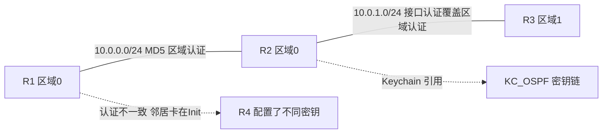

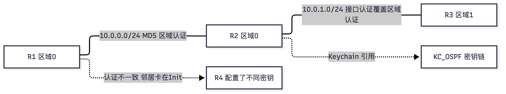


```mermaid
sequenceDiagram
    participant R1 as R1
    participant R2 as R2
    R1->>R2: Hello 带认证字段 KeyID1 摘要
    R2->>R2: 查本地 Keychain 计算摘要比对
    alt 摘要一致
        R2->>R1: Hello 认证通过
        Note over R1,R2: 邻居状态推进到 2-Way
    else 摘要不一致
        R2->>R1: 丢弃报文并计数 Authentication failure
        Note over R1,R2: 邻居无法建立 一直 Init 或 Down
    end
    Note over R1,R2: KeyID1 发送期结束 自动切换 KeyID2
    R1->>R2: Hello 带 KeyID2
    R2->>R2: 接收期同时覆盖 KeyID1 与 KeyID2
    Note over R1,R2: 平滑过渡 邻居不中断
```

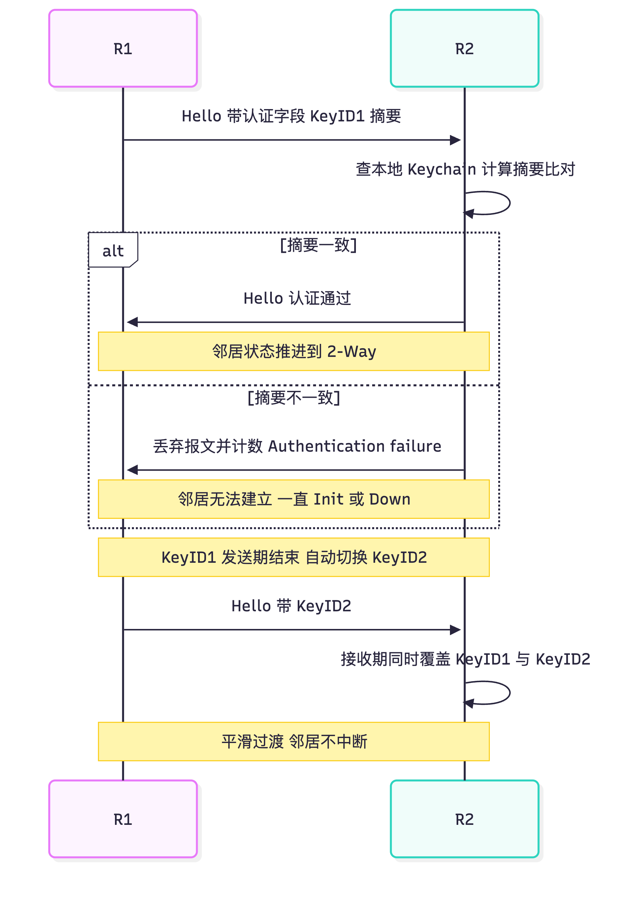


```mermaid
stateDiagram-v2
    [*] --> Null: 默认不认证
    Null --> Simple: 配置 simple
    Null --> MD5: 配置 md5 直接
    Simple --> MD5: 升级为MD5
    MD5 --> Keychain: 升级为Keychain自动轮换
    Keychain --> MD5: 回退为固定密钥
    MD5 --> [*]: 删除认证回到Null
```

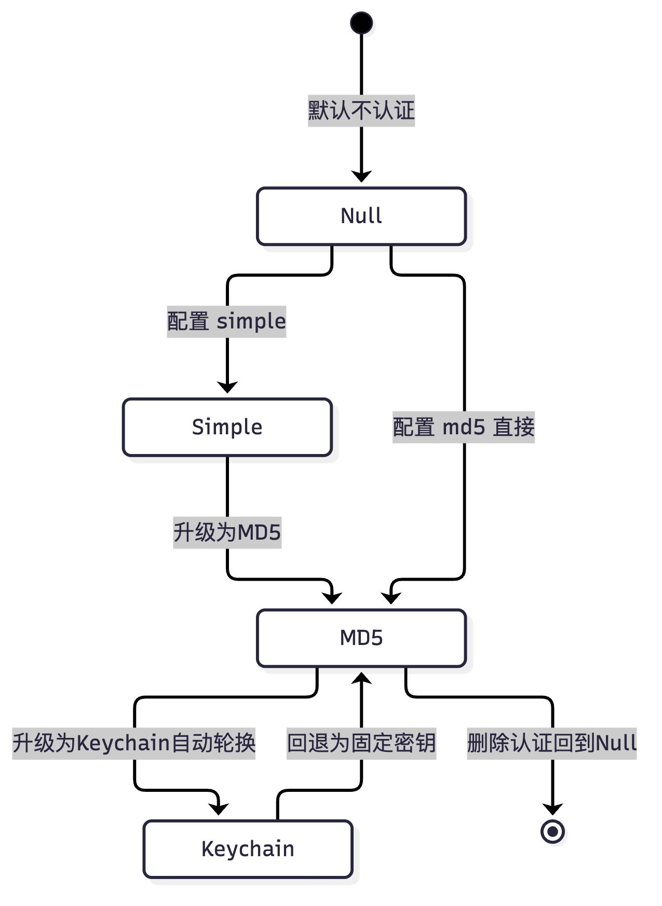


### 真题精练

**Q1.【真题·单选】** 华为设备上 OSPF 默认的认证方式是？

A. 简单认证  B. MD5 认证  C. Null 认证（不认证）  D. Keychain 认证

> **答案：C**
> **解析**：OSPFv2 默认认证类型为 **Null（Type 0）**，即不认证。这也意味着**如果一个区域中部分设备配置了认证、部分没配，未配置的设备将无法建立邻接**——因为报文认证类型不匹配。这点在"网络合并"场景中很常见。

**Q2.【真题·多选】** 关于 OSPF 的简单认证（Simple Password）与 MD5 认证，下列说法正确的有？（多选）

A. 简单认证的密码以明文形式出现在报文中，可被抓包直接看到
B. MD5 认证不在报文中传输明文密码，而是传输摘要
C. MD5 认证报文中包含 Key ID 与加密序列号
D. MD5 认证会对整个报文内容做加密，防止窃听

> **答案：ABC**
> **解析**：A、B、C 均正确。D 错：MD5 认证只做**完整性校验与身份验证**（防篡改、防伪造），**不提供加密**——报文载荷仍是明文，任何抓包者都能看到 OSPF 报文内容。OSPF 认证不能当加密使用。

**Q3.【真题·判断】** 在同一个接口上同时配置了区域认证与接口认证时，接口认证优先生效。

> **答案：正确**
> **解析**：接口认证的优先级高于区域认证。当接口上同时存在两者时，以接口认证为准。这也带来一个实践建议：**统一用区域认证管理，避免混用**，混用会导致排错困难（"为什么这台设备用区域认证能通、那台不行"）。

**Q4.【真题·填空】** OSPF 有三种认证类型：Null 认证（类型 ________）、简单认证（类型 ________）、MD5 认证（类型 ________）；其中简单认证的密码最长 ________ 字节，MD5 摘要长度为 ________ 字节。

> **答案：0；1；2；8；16**
> **解析**：这些数值是选择题的高频考点。补充：OSPFv2 认证字段本身为 **8 字节**，MD5 认证时该字段用于携带 Key ID、认证数据长度与加密序列号，摘要放在报文尾部（16 字节）。

**Q5.【真题·简答】** 相比固定的 MD5 认证，Keychain 认证有哪些优势？请说明 Keychain 是如何实现"密钥轮换不中断业务"的。

> **答案**：**优势**：① **自动轮换**：密钥可按预设的 `send-lifetime` 到期自动切换，无需人工逐台设备修改，降低运维成本与人为失误；② **支持多种算法**（MD5 / SHA-1 / HMAC-SHA-256 等），可按安全要求选择；③ **可平滑过渡**：通过把 `receive-lifetime` 设置得比 `send-lifetime` **更长且相互重叠**，对端在新密钥开始发送之前就已经能够接收新密钥，切换瞬间不会出现"我发新密钥、你只认旧密钥"的认证失败；④ **降低长期密钥泄露风险**：定期更换密钥，即使某个密钥泄露影响面也有限。**轮换不中断的原理**：Keychain 维护多条 `key-id`，每条有自己的发送期与接收期。**发送**时使用"当前时间落在 send-lifetime 内"的那条密钥；**接收**时只要密钥的 receive-lifetime 覆盖当前时间就接受。因此在两个密钥的接收期重叠区间内，新旧密钥都能被验证通过，切换过程对邻居**完全透明**。工程做法：新密钥的 `receive-lifetime` **提前**于其 `send-lifetime` 生效，旧密钥的 `receive-lifetime` **延后**于其 `send-lifetime` 结束。

**Q6.【真题·排错】** 两台路由器之间的 OSPF 邻居一直无法建立，`display ospf error` 显示 Authentication failure 计数持续增长。请列出排查步骤。

> **答案**：
> ① **核对认证类型**：`display current-configuration configuration ospf` 与 `display ospf interface` 检查两端是 simple、md5 还是 keychain，**类型必须一致**（一个配 simple 一个配 md5 一定不通）。
> ② **核对密钥内容**：注意华为设备上密码以 `cipher` 保存时显示为密文，**必须用 `display current-configuration` 逐字符核对原文**，或统一使用 `cipher` 明文输入后保存。密钥大小写、特殊字符都敏感。
> ③ **核对 Key ID**：MD5 多密钥场景下 Key ID 必须匹配（`ospf authentication-mode md5 <key-id> cipher <pwd>`）。
> ④ **核对生效位置**：确认是配在区域视图还是接口视图。若一端配了区域认证、另一端配了接口认证，虽然密码相同也可能因为"接口认证覆盖区域认证"的规则在两个不同接口上表现不一致。用 `display ospf interface <接口>` 查看实际生效的认证模式。
> ⑤ **检查虚连接场景的两层认证**：若故障发生在虚连接上，除 `vlink-peer` 的认证外，**中转区域的区域认证/接口认证也要满足**。
> ⑥ **检查 Keychain 有效期**：`display keychain <名>` 查看当前时间是否落在 `send-lifetime` 与 `receive-lifetime` 内。若发送期与接收期不重叠（配置失误），认证会失败。
> ⑦ **抓包确认**：抓取 OSPF 报文，看 Authentication Type 字段与 Key ID 是否与本地一致。

**Q7.【真题·多选】** 下列关于 OSPF 认证的描述，正确的有？（多选）

A. 认证的作用是防止非法设备加入 OSPF 域并注入伪造 LSA
B. 区域认证配置在 `area` 视图下，接口认证配置在接口视图下
C. 认证可以防止 OSPF 报文内容被第三方窃听
D. 虚连接的认证需要在 `vlink-peer` 上单独配置，且必须与对端一致

> **答案：ABD**
> **解析**：A 是认证的目的；B 是配置位置；D 是虚连接认证的要求。C 错：无论简单认证还是 MD5 认证，都**不提供加密**，报文内容仍可被窃听（OSPF 本身也没有加密机制，机密性需靠链路层或 IPSec 等手段）。

**Q8.【真题·实验】** 请在 AR6120 上配置一套 Keychain 认证方案：密钥半年轮换一次，算法为 MD5，并说明如何验证轮换是否生效。

> **答案**：
> ```bash
> system-view
> # 定义 Keychain：两个 key-id，每个半年
> keychain KC_OSPF mode absolute
>  key-id 1
>   algorithm md5
>   key-string cipher Huawei@H1                   // 上半年的密钥
>   send-lifetime utc 00:00 2024-01-01 00:00 2024-07-01 // 1月1日到7月1日发送
>   receive-lifetime utc 00:00 2024-01-01 00:00 2024-07-20 // 接收期延长20天，覆盖切换窗口
>  key-id 2
>   algorithm md5
>   key-string cipher Huawei@H2                   // 下半年的密钥
>   send-lifetime utc 00:00 2024-07-01 00:00 2025-01-01
>   receive-lifetime utc 00:00 2024-06-10 00:00 2025-01-20 // 提前20天开始接收
>  quit
> # OSPF 区域引用
> ospf 1 router-id 1.1.1.1
>  area 0.0.0.0
>   authentication-mode keychain KC_OSPF          // 区域级引用
>   network 10.0.0.0 0.0.0.255
>  quit
> # 验证
> display keychain KC_OSPF                          // 查看当前生效（active）的密钥与时间区间
> display ospf peer                                 // 邻居状态应保持 Full
> display ospf error                                // Authentication failure 计数不应增长
> display ospf interface GigabitEthernet0/0/0       // 确认接口认证模式为 keychain
> ```
> **轮换验证方法**：① `display keychain KC_OSPF` 在切换前后分别执行，观察 active key-id 的变化；② 在切换窗口内持续 `ping`，不应出现丢包；③ 观察 `display ospf error` 的 Authentication failure 计数保持为 0。**注意**：有些平台需要 `keychain` 的 key-id 的 `send-lifetime`/`receive-lifetime` 使用 **UTC 时间**，需确认设备时钟准确（建议配置 NTP）。

### 易错点与排错

| 易错点 | 正确结论 |
|---|---|
| 认为 MD5 认证加密了报文 | 只做**摘要与身份校验**，不加密 |
| 认为认证只在接口配 | **区域认证**也是标准手段，接口认证优先级更高 |
| 忘记虚连接的"两层认证" | 中转区域认证 + `vlink-peer` 认证都要通过 |
| Keychain 发送期与接收期不重叠 | 会导致**轮换时刻认证失败** |
| 认为简单认证"够用" | 密码明文传输，**极不安全** |
| 忽略设备时钟 | Keychain 基于 UTC 时间，**时钟不准会导致认证失败** |

```bash
display ospf peer                              // 邻居状态
display ospf error                             // 认证失败等错误计数（关键）
display ospf interface <接口>                   // 接口实际生效的认证模式
display keychain <名>                           // Keychain 密钥与有效期
display current-configuration configuration ospf // 核对两端配置
display clock                                   // 检查设备时钟（Keychain 依赖）
```

---

## 1.9 OSPF 与 MPLS / BGP 联动

### 考点定位

本节是**国赛压轴题**的常客：MPLS L3VPN 中 PE-CE 运行 OSPF 时，路由如何在 OSPF 与 MP-BGP 之间双向传递、如何避免环路与次优、Sham-Link 为什么存在。常见考法：简答（Sham-Link 的作用）、多选（路由回灌与防环）、排错（VPN 内 OSPF 路由丢失）。这一节把 OSPF 与 MPLS/BGP 打通，是 HCIE 的"综合能力"考点。

### 原理精讲

**一、为什么 OSPF 要和 MPLS/BGP 联动？**

在 MPLS L3VPN（BGP/MPLS IP VPN，RFC 4364）中，**PE（Provider Edge，运营商边缘设备）** 与 **CE（Customer Edge，用户边缘设备）** 之间需要交换客户私网路由。CE 侧通常运行 OSPF（或 IS-IS/BGP/静态），PE 侧则通过 **MP-BGP（Multiprotocol BGP）** 的 **VPNv4 地址族** 在骨干网中传递 VPN 路由。因此 PE 必须完成两件事：

1. **从 CE 侧学到的 OSPF 路由 → 引入 MP-BGP**（`import-route ospf` 或 `import-route ospf ... route-policy`）；
2. **从 MP-BGP 学到的 VPN 路由 → 以 OSPF 形式通告给 CE**（`import-route bgp` 在 OSPF 进程中）。

这个"双向引入"是 VPN 场景下 OSPF 的核心工作模式，也是**环路风险的来源**。

**二、OSPF 多实例与 VPN 实例绑定**

PE 需要为每个 VPN 维护**独立的路由表与独立的 OSPF 进程**，华为设备通过 `ospf <进程号> vpn-instance <VPN名>` 实现：

```bash
ospf 100 vpn-instance VPNA router-id 1.1.1.1
```

**站点内的 OSPF 进程与站点外的 OSPF 进程是隔离的**——这就是"**VPN 实例下的多进程**"的含义。若两个 VPN 都需要 OSPF，则创建两个进程（如 `ospf 100 vpn-instance VPNA` 与 `ospf 200 vpn-instance VPNB`）。**注意**：同一台 PE 上不同 VPN 实例的 OSPF 进程可以复用相同的 Router ID，因为它们在彼此隔离的实例中（但为便于排错，通常仍建议使用不同 Router ID）。

**三、防环：DN 位与路由回灌**

如前文 1.3 所述，PE 把 MP-BGP 学到的路由以 Type3 形式下发给 CE 时，会设置 **DN 位**。CE 若把这条 LSA 又传回 PE（同一 OSPF 域），PE 检测到 DN 位后**不再把该路由重新引入 MP-BGP**。

**为什么会有回灌？** 因为 PE 与 CE 运行 OSPF 时，**PE 是 ABR 的角色**（它一边是 OSPF 域内的 CE 侧，一边是 MP-BGP"外部"）。当 PE1 从 CE1 学到路由传到 PE2、PE2 下发给 CE2 时，如果 CE1 与 CE2 属于**同一个 OSPF 域（相同区域）**，CE2 侧的路由可能被再次传回 PE1，PE1 会认为"CE 侧也能到达该网段，且度量可能更优"，于是重新引入 MP-BGP——**形成环路**。DN 位是切断这条回路的机制。

**四、Sham-Link（伪链路）**

**问题背景**：在 MPLS L3VPN 中，假设 Site 1 与 Site 2 属于**同一个 OSPF 区域**，且两个 Site 之间有**一条后门链路（Backdoor Link）**（例如客户自己拉的专线，直接连接两个 Site）。此时：

- **经 VPN 骨干的路径**：CE1 → PE1 →（MPLS 骨干）→ PE2 → CE2。这条路径在 OSPF 眼里是 **Type3（区域间）**路由（因为 PE 把 MP-BGP 路由作为 Type3 下发），优先级 **10**，但计算出来的度量是"PE 报告的"。
- **经后门链路的路径**：CE1 →（后门直连）→ CE2。这条路径是 **Type1（区域内）**路由，度量是真实累加的。

**问题**：OSPF 的规则是"**区域内路由永远优先于区域间路由**"（两者优先级都是 10，但 OSPF 内部先比路由类型：O > O_IA）。因此 **CE1 会优选后门链路**，即使后门链路带宽很小、延迟很高。这就是**次优路径**问题——客户花大价钱买了 VPN 骨干，流量却走了后门。**更严重的是**：如果后门链路故障，流量才会切换到骨干，但切换需要等待 OSPF 收敛。

**Sham-Link 的解法**：在两个 PE 之间建立一条**逻辑上的 OSPF 区域内链路**（"伪链路"），使"经骨干的路径"变成**区域内路由（Type1）**，从而与后门链路在**同类型**下比较度量，让 OSPF 按真实度量选择最优路径。

**Sham-Link 的实现要点**：

1. **两端 PE 上创建 Sham-Link**（需要一对 **/32 的 Loopback 地址**，这两个地址必须**通过 MP-BGP 互相可达**，且**不能被引入到客户 VPN 的 OSPF 中**）；
2. Sham-Link 的**开销可手工指定**（`sham-link cost`），从而"调节"骨干路径的吸引力；
3. Sham-Link 上的**认证必须与客户 OSPF 区域一致**；
4. Sham-Link 只在 **PE 之间**建立，CE 完全感知不到；
5. **Sham-Link 的地址必须与客户地址空间隔离**——通常用运营商内部的地址（例如 `x.x.x.x/32`），并通过 RT 传递。

**Sham-Link 的代价与限制**：配置复杂（需要额外的 Loopback 与 MP-BGP 传递）、排错困难；若 Sham-Link 配置错误（如地址被误引入客户 OSPF），会造成"客户路由被劫持"的严重问题。因此只在"**同区域 + 后门链路**"的场景使用。

**五、其他联动要点**

- **LSA 抑制**：在 PE 上可以用 `filter-policy export` 或 `import-route ospf ... route-policy` 控制哪些 OSPF 路由被引入 BGP，避免把不需要的 LSA 传到骨干。
- **域 ID（Domain ID）**：在 OSPF 与 BGP 的交互中，`domain-id` 用于标识**同一个 OSPF 域**。默认情况下 PE 会为每个 VPN 实例自动生成一个 Domain ID（基于进程号/区域），若两个 Site 的 OSPF 域需要被视为同一个域（例如为了让 Type3 路由在 Site 之间正确传递并支持 Sham-Link），需要**手工配置一致的 `domain-id`**。`domain-id` 有 4 种格式（如 `0.0.0.1`、`1.1.1.1:1`、`0000:0000:0000:0000`、十进制 `100`）。**Domain ID 不同会导致 Type3 在 Site 之间被视为来自不同域，影响路由优选与跨站点区域间路由的传播。**
- **`vpn-instance-capability simple`**：当客户 OSPF 域不使用 Sham-Link 时，PE 上需要配置该命令，使 PE 的 OSPF 行为按"简化模式"处理（否则 PE 会期望存在 Sham-Link，导致路由计算异常）。配置该命令后还需按需设置 `dn-bit-check disable` / `dn-bit-set disable`。
- **BGP 与 OSPF 的优先级**：在 PE 上，MP-BGP 学到的 VPN 路由与从 CE 学到的 OSPF 路由会进行比较（通过 `domain-id` 与路由优先级）。典型现象："**同前缀路由优选 OSPF 还是 BGP**"取决于路由优先级与度量。

### 关键概念对照表

**表 1-9-1 OSPF 与 BGP/MPLS 联动关键配置与作用**

| 配置 | 位置 | 作用 |
|---|---|---|
| `ip vpn-instance VPNA` | PE 全局 | 创建 VPN 实例（含 RD/RT） |
| `ip binding vpn-instance VPNA` | PE 接口 | 接口绑定 VPN 实例 |
| `ospf 100 vpn-instance VPNA router-id x.x.x.x` | PE | 创建绑定到 VPN 实例的 OSPF 多进程 |
| `import-route ospf 100` | PE 的 BGP 视图 | 把 OSPF 路由引入 MP-BGP |
| `import-route bgp` | PE 的 OSPF 视图 | 把 BGP 路由以 Type3/Type5 形式下发给 CE |
| `vpn-instance-capability simple` | PE 的 OSPF 视图 | 简化组网模式（不使用 Sham-Link 时必须） |
| `dn-bit-check disable` / `dn-bit-set disable` | PE 的 OSPF 视图 | 控制 DN 位检查/置位（配合简化模式） |
| `sham-link <src> <dst> cost <n>` | PE 的 OSPF 区域视图 | 建立 Sham-Link，消除后门链路的次优 |
| `domain-id <值>` | PE 的 OSPF 视图 | 标识同一 OSPF 域，影响跨 Site 路由处理 |
| `route-distinguisher` / `vpn-target` | PE 的 VPN 实例 | RD 区分相同前缀，RT 控制导入导出 |

**表 1-9-2 后门链路 vs Sham-Link 路径对比**

| 对比项 | 无 Sham-Link | 有 Sham-Link |
|---|---|---|
| 经骨干路径的路由类型 | **Type3（区域间，O_IA）** | **Type1（区域内，O）** |
| 后门链路的路由类型 | Type1（区域内，O） | Type1（区域内，O） |
| OSPF 优选规则 | **区域内优先于区域间** → 必选后门 | 同类型比较度量 → **按真实度量选择** |
| 结果 | **次优（走带宽小的后门）** | 最优（走度量更优的路径） |
| 配置复杂度 | 低 | 高（需 Loopback + MP-BGP 传递 + 认证） |
| 故障切换 | 后门故障才切到骨干 | 按度量正常切换 |

**表 1-9-3 Domain ID 取值格式与含义**

| 格式 | 示例 | 说明 |
|---|---|---|
| IP 地址格式 | `domain-id 0.0.0.1` | 用点分十进制表示，兼容性最好 |
| AS 号:编号 格式 | `domain-id 1:1` | — |
| IPv6 格式 | `domain-id 0000:0000:0000:0001` | 用于 v3 场景 |
| 十进制格式 | `domain-id 100` | 直接指定数值 |
| 默认行为 | 未配置时由设备自动生成 | **跨设备可能不同，导致路由处理不一致，建议显式配置** |

**表 1-9-4 VPN 场景 OSPF 常见故障与现象**

| 现象 | 可能原因 | 排查命令 |
|---|---|---|
| CE 侧学不到其他 Site 的路由 | PE 上 `import-route bgp` 未配或 RT 不匹配 | `display bgp vpnv4 vpn-instance VPNA routing-table`、`display ospf lsdb summary` |
| 骨干侧学不到 CE 路由 | PE 上 `import-route ospf` 未配或 route-policy 过滤 | `display bgp vpnv4 vpn-instance VPNA routing-table`（PE 侧） |
| 流量走后门链路（次优） | 未配 Sham-Link | `display ospf routing`（看路由类型 O vs O_IA）、`tracert` |
| PE 上 OSPF 邻居起不来 | VPN 实例绑定错误 / `vpn-instance-capability` 未配 | `display ospf peer`、`display ospf error` |
| 路由回灌导致环路 | DN 位被关闭且无其他防环机制 | `display ospf lsdb summary verbose`（看 DN 位） |

### 华为设备配置

```bash
# ============ 场景：NE40E 作为 PE，AR6120 作为 CE，MPLS L3VPN + OSPF ============

# --- PE1：VPN 实例 + OSPF 多进程 + 双向引入 ---
system-view
sysname PE1
ip vpn-instance VPNA                              // 创建 VPN 实例
 ipv4-family
  route-distinguisher 100:1                       // RD：区分不同 VPN 的相同前缀
  vpn-target 100:1 export-extcommunity            // 导出 RT
  vpn-target 100:1 import-extcommunity            // 导入 RT
  apply-label per-instance                        // 标签分配方式（按需）
 quit

interface LoopBack0
 ip address 1.1.1.1 255.255.255.255               // PE 的 MPLS LSR-ID 来源
interface GigabitEthernet0/0/1
 ip binding vpn-instance VPNA                     // 面向 CE 的接口绑定 VPN 实例
 ip address 10.1.1.1 255.255.255.0

ospf 100 vpn-instance VPNA router-id 1.1.1.1      // OSPF 进程绑定 VPN 实例（多实例隔离）
 vpn-instance-capability simple                   // 不使用 Sham-Link 时必须配置简化模式
 dn-bit-check disable                             // 关闭 DN 位检查（按组网需要）
 dn-bit-set disable                               // 关闭 DN 位置位
 domain-id 0.0.0.1                                // 显式指定 Domain ID，保证各 PE 一致
 import-route bgp                                 // 把 BGP 学到的 VPN 路由以 Type3/Type5 下发给 CE
 area 0.0.0.0
  network 10.1.1.0 0.0.0.255                      // 宣告到 CE 的网段
 quit
 quit

# --- PE1：把 OSPF 路由引入 MP-BGP ---
bgp 100
 peer 2.2.2.2 as-number 100                       // 与对端 PE 建立 IBGP
 peer 2.2.2.2 connect-interface LoopBack0         // 用 Loopback 建邻居
 ipv4-family vpnv4                                // 进入 VPNv4 地址族
  peer 2.2.2.2 enable                             // 使能 VPNv4 能力
  peer 2.2.2.2 route-policy RP_BGP export         // 可选：出口策略
 quit
 ipv4-family vpn-instance VPNA                    // 进入 VPN 实例地址族
  import-route ospf 100                           // 把 OSPF 100 的路由引入 BGP
 quit
 quit
display bgp vpnv4 vpn-instance VPNA routing-table // 查看 VPN 实例的 BGP 路由表（验证引入）
display ospf 100 vpn-instance VPNA lsdb           // 查看 VPN 实例内的 OSPF LSDB

# ============ Sham-Link 配置（消除后门链路次优） ============
# 前置条件：两个 PE 各有一个 /32 Loopback 通过 MP-BGP 互通，且不被引入客户 OSPF
interface LoopBack100
 ip binding vpn-instance VPNA                      // Sham-Link 源地址所在接口
 ip address 192.168.255.1 255.255.255.255

ospf 100 vpn-instance VPNA router-id 1.1.1.1
 area 0.0.0.0
  sham-link 192.168.255.1 192.168.255.2 cost 100   // 本端 192.168.255.1 到对端 192.168.255.2
  authentication-mode md5 cipher Huawei@Sham       // Sham-Link 认证需与客户区域一致
  quit
 quit
# --- 对端 PE2 对称配置 ---
# ospf 100 vpn-instance VPNA
#  area 0.0.0.0
#   sham-link 192.168.255.2 192.168.255.1 cost 100
#   authentication-mode md5 cipher Huawei@Sham

# --- 验证 Sham-Link ---
display ospf 100 vpn-instance VPNA sham-link       // 查看 Sham-Link 状态（应为 Full）
display ospf 100 vpn-instance VPNA routing         // 查看 CE 侧路由类型（O 而非 O_IA）
display ospf 100 vpn-instance VPNA interface       // 查看 Sham-Link 接口与开销
tracert -vpn-instance VPNA 10.2.2.2                // 验证实际转发路径
```

### 示意图

```mermaid
flowchart LR
    CE1["CE1 Site1"] ---|"10.1.1.0/24"| PE1["PE1 NE40E"]
    PE1 ===|"MPLS 骨干 VPNv4"| PE2["PE2 NE40E"]
    PE2 ---|"10.2.2.0/24"| CE2["CE2 Site2"]
    CE1 -.->|"后门链路 Backdoor"| CE2
    PE1 -.->|"Sham-Link 逻辑区域内链路"| PE2
```

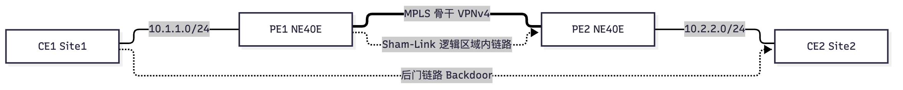


```mermaid
sequenceDiagram
    participant CE1 as CE1 Site1
    participant PE1 as PE1
    participant PE2 as PE2
    participant CE2 as CE2 Site2
    CE1->>PE1: OSPF 路由 10.9.0.0/16
    PE1->>PE1: import-route ospf 引入BGP
    PE1->>PE2: MP-BGP VPNv4 通告 带RT与RD
    PE2->>CE2: import-route bgp 以Type3下发
    Note over PE2: 设置 DN 位 表示由上层向下通告
    CE2->>CE2: 学习到骨干侧路由
    Note over CE1,CE2: 若存在后门链路 区域内O优于区域间O_IA 需Sham-Link修正
```

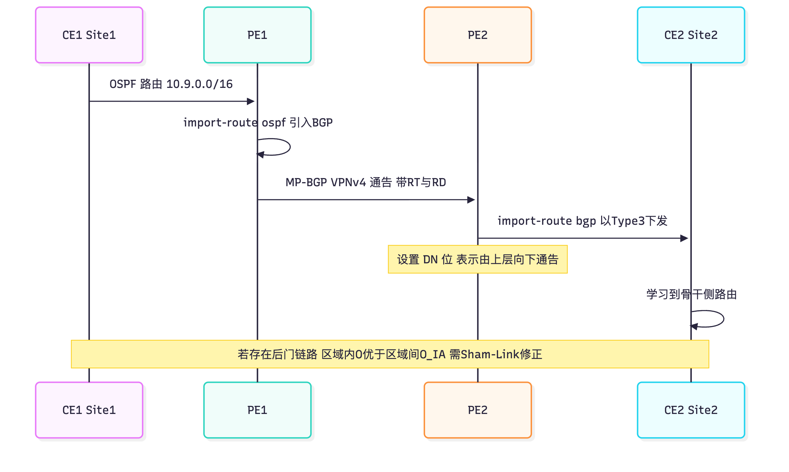


```mermaid
flowchart TD
    A["Site1与Site2同属一个OSPF区域"] --> B{"是否存在后门链路"}
    B -->|"否"| C["Type3经骨干 正常转发 无需Sham-Link"]
    B -->|"是"| D{"是否配置Sham-Link"}
    D -->|"否"| E["区域内路由优先 流量走带宽小的后门 次优"]
    D -->|"是"| F["PE间建立Sham-Link 骨干路径变为区域内"]
    F --> G["同类型比较度量 按cost选择最优路径"]
```

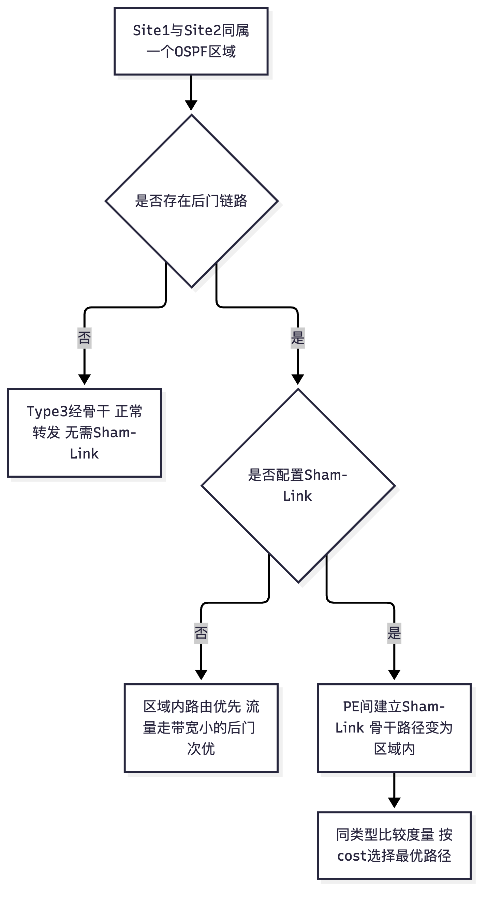


### 真题精练

**Q1.【真题·单选】** 在 MPLS L3VPN 中，Site 1 与 Site 2 属于同一 OSPF 区域且存在后门链路，导致流量优选后门。解决该次优问题的标准手段是？

A. 在 CE 上配置 `ospf cost` 调大后门链路开销
B. 在两个 PE 之间配置 Sham-Link
C. 在 PE 上配置 `import-route bgp` 的度量类型为 E1
D. 把 Site 2 改成 Stub 区域

> **答案：B**
> **解析**：问题根源是"**区域内路由（后门，Type1）永远优先于区域间路由（经骨干，Type3）**"，这是路由类型层面的优选，**与度量大小无关**。因此 A 无效（调大开销也只影响同类比较，后门仍是区域内）。C 是把 BGP 路由以 E1 下发，会变成**外部路由**（优先级更低），更不可能优选。D 与问题无关。**Sham-Link 的作用正是把"经骨干的路径"提升为区域内路由（Type1）**，从而在同类型下按真实度量比较。

**Q2.【真题·多选】** 关于 Sham-Link，下列说法正确的有？（多选）

A. Sham-Link 建立在两个 PE 之间，CE 无法感知
B. Sham-Link 需要两个 PE 各有一个 /32 地址，且该地址要能通过 MP-BGP 互相可达
C. Sham-Link 的地址应被引入到客户 VPN 的 OSPF 中，以便 CE 学习
D. Sham-Link 上可以配置开销（cost）来调节路径吸引力

> **答案：ABD**
> **解析**：A、B、D 正确。C 错：Sham-Link 的 /32 地址**绝不能**被引入客户 VPN 的 OSPF——它们属于运营商内部地址空间，若被引入会造成客户路由被劫持或异常，这是 Sham-Link 配置中最严重的错误。

**Q3.【真题·判断】** 在 PE 上把从 CE 学到的 OSPF 路由引入 MP-BGP 的命令是 `import-route ospf`，把 MP-BGP 路由引入 OSPF 下发给 CE 的命令是 `import-route bgp`；前者配置在 BGP 视图下，后者配置在 OSPF 视图下。

> **答案：正确**
> **解析**：这是"双向引入"的标准配置位置。注意：`import-route ospf <进程号>` 在 BGP 的 **VPN 实例地址族**（`ipv4-family vpn-instance xxx`）下配置；`import-route bgp` 在 **OSPF 进程视图**下配置。若只配一侧，CE 与其他 Site 之间就会单向不通。

**Q4.【真题·填空】** 在 PE 上配置 OSPF 与 VPN 实例绑定的命令是 `ospf <进程号> ________ <VPN名>`；当客户组网不使用 Sham-Link 时，必须在 OSPF 视图下配置 ________，否则 PE 的 OSPF 行为会按期待 Sham-Link 的模式处理，导致路由计算异常。

> **答案：`vpn-instance`；`vpn-instance-capability simple`**
> **解析**：`vpn-instance-capability simple` 是 PE-CE 场景下的关键命令，它告诉设备"本 VPN 实例的 OSPF 不使用 Sham-Link"，从而采用简化处理逻辑。配套的还有 `dn-bit-check disable`、`dn-bit-set disable` 等。

**Q5.【真题·简答】** 请解释 MPLS L3VPN 中 `domain-id` 的作用，并说明"两个 Site 的 `domain-id` 配置不一致"可能造成什么后果。

> **答案**：`domain-id` 的作用是**标识一组属于同一个 OSPF 域的 Site**。在 PE 上，从 CE 学到的 OSPF 路由被引入 MP-BGP 时，会携带 Domain ID（通过 BGP 扩展团体属性传递）；对端 PE 收到后，依据 Domain ID 判断"这条路由是否来自与本地 CE 相同的 OSPF 域"，进而决定它应该以 **Type3（区域间，同域）** 还是 **Type5（外部，异域）** 的形式下发给 CE。**配置不一致的后果**：
> ① 本应作为**同域（Type3）**传递的路由被当成**异域**处理，改以 **Type5** 下发，导致 CE 侧看到的路由类型错误，度量与优选结果都发生变化（例如原本应优选骨干的路径变成外部路由，优先级降到 150）；
> ② 影响 **Sham-Link 的生效**：Sham-Link 要求两端 Site 属于同一 OSPF 域，Domain ID 不一致会导致 Sham-Link 建立后路由仍不正确；
> ③ 可能出现**跨 Site 的路由环回或丢失**（因为域判断错误导致 LSA 被错误地转换/传播）。
> **建议**：显式配置所有 PE 上该 VPN 实例的 `domain-id` 为一致的值（如 `0.0.0.1`），不要依赖自动生成。

**Q6.【真题·排错】** MPLS L3VPN 组网中，CE1 能学到本 Site 路由，但学不到 CE2（另一个 Site）的路由。请给出完整的排查思路。

> **答案**：按"数据流方向"逐段排查（从 CE2 到 CE1）：
> ① **CE2 → PE2 的 OSPF 邻接是否正常**：`display ospf peer`（PE2 的 VPN 实例内）确认与 CE2 是 Full。
> ② **PE2 是否把 OSPF 路由引入 BGP**：`display bgp vpnv4 vpn-instance VPNA routing-table`（PE2）确认有 CE2 的路由项；若无，检查 `import-route ospf <进程号>` 与 `route-policy` 过滤。
> ③ **RT 是否匹配**：`display ip vpn-instance VPNA verbose`（PE2 与 PE1），确认 PE2 的 **export RT** 包含在 PE1 的 **import RT** 中（`vpn-target` 配置）。RT 不匹配是"路由传不过去"的第一大原因。
> ④ **PE 之间的 VPNv4 邻居是否建立**：`display bgp vpnv4 all peer`（PE2），确认与 PE1 的邻居为 Established；若无，检查 `peer x.x.x.x enable`、`connect-interface`、AS 号。
> ⑤ **PE1 是否把 BGP 路由引入 OSPF**：`display ospf 100 vpn-instance VPNA lsdb summary`（PE1）确认有对应的 Type3；若没有，检查 `import-route bgp` 与 `domain-id`。
> ⑥ **CE1 是否实际收到并加表**：`display ospf lsdb summary`（CE1）看 LSDB，`display ip routing-table` 看是否被 `filter-policy import` 或优先级问题拦截。
> ⑦ **DN 位与防环机制**：确认 PE 侧的 `dn-bit-check` / `dn-bit-set` 配置与组网匹配，避免因防环机制误拦。
> ⑧ **标签与转发面**：`display mpls lsp`、`display fib vpn-instance VPNA` 确认外层标签与私网标签正确，避免"控制面有路由但转发不通"。

**Q7.【真题·多选】** 下列关于 `vpn-instance-capability simple` 的描述，正确的有？（多选）

A. 配置后 PE 的 OSPF 按"不使用 Sham-Link"的简化模式处理
B. 通常需要配合 `dn-bit-check disable` 与 `dn-bit-set disable` 使用
C. 该命令配置在 OSPF 进程视图下
D. 配置该命令后 PE 会自动建立 Sham-Link

> **答案：ABC**
> **解析**：A、B、C 正确。D 错：`vpn-instance-capability simple` 恰恰是**声明"不使用 Sham-Link"**，配置后 PE 不会去期待/建立 Sham-Link。若组网确实需要 Sham-Link，则**不应**配置该命令。

**Q8.【真题·简答】** 请说明在 PE-CE 运行 OSPF 的场景下，为什么"路由回灌（BGP → OSPF → BGP）"会造成环路，以及设备是如何避免它的。

> **答案**：**回灌过程**：PE1 从 CE1 学到网段 X 后引入 MP-BGP，通告给 PE2；PE2 以 Type3 形式下发给 CE2（假设 CE1 与 CE2 属于同一 OSPF 域）；CE2 侧的路由器（或 CE2 与 CE1 通过后门链路直连时）会把这条 Type3 继续在 OSPF 域内传播，**最终又回到 PE1**。PE1 看到"从 CE 侧学到的 X（Type3）"，若认为它比本地已有的路由更优（例如度量更小），就会**再次把它引入 MP-BGP**，形成 BGP → OSPF → BGP 的循环；更糟的是 PE1 可能把这条"绕回来的路由"当作更优路径，导致流量在两个 Site 之间反复穿梭。**避免机制**：
> ① **DN 位（Downward Bit）**：PE 把 MP-BGP 路由以 Type3 下发给 CE 时**置 DN 位**；PE 再从 CE 侧收到**带 DN 位**的 Type3 时，**不再把它引入 MP-BGP**。这从机制上切断了回灌通道（RFC 4577 定义）。
> ② **Domain ID**：通过 Domain ID 判断路由是否来自同域，进而以正确的类型（Type3/Type5）处理，避免同域路由被当成"外部新路由"重复引入。
> ③ **路由策略**：在 PE 上用 `import-route ospf ... route-policy` 过滤掉不应引入的路由（例如带特定 Tag 的路由），作为兜底手段。
> ④ **`vpn-instance-capability simple` + DN 位开关的合理搭配**：简化模式下需按组网实际决定是否关闭 DN 位检查，关闭后必须依赖路由策略等手段兜底。

### 易错点与排错

| 易错点 | 正确结论 |
|---|---|
| 认为调大后门链路 cost 就能解决次优 | 路由**类型**优先（O > O_IA），必须用 Sham-Link |
| 把 Sham-Link 的 /32 地址引入客户 OSPF | 严重错误，会导致客户路由异常 |
| 只配单向引入（只配一侧 `import-route`） | 必须**双向**引入 |
| 认为 RT 不匹配会报错 | 只会**静默不通**，必须手工核对 |
| 忽略 `domain-id` 的显式配置 | 自动生成可能不一致，导致路由类型错误 |
| 认为关闭 DN 位检查没有副作用 | 会削弱防环能力，必须有路由策略兜底 |

```bash
display bgp vpnv4 vpn-instance <VPN名> routing-table  // VPN 实例的 BGP 路由表
display ip vpn-instance <VPN名> verbose               // VPN 实例的 RD/RT 配置
display ospf <进程号> vpn-instance <VPN名> lsdb        // VPN 内 OSPF LSDB
display ospf <进程号> vpn-instance <VPN名> sham-link   // Sham-Link 状态与开销
display ospf <进程号> vpn-instance <VPN名> routing     // VPN 内 OSPF 路由（看 O vs O_IA）
display bgp vpnv4 all peer                            // VPNv4 邻居状态
display mpls lsp                                      // MPLS 标签路径
display fib vpn-instance <VPN名>                       // VPN 实例的转发表（转发面验证）
```

---

## 1.10 OSPFv3 与 OSPFv2 差异对比

### 考点定位

IPv6 已是国赛固定内容，OSPFv3 的差异是选择题与填空题的高频来源。常考：**OSPFv3 的 Router ID 格式**、**链路本地地址的使用**、**Type8/Type9 LSA**、**认证机制的变化**、**OSPFv3 是否基于链路（per-link）而非网段（per-subnet）**。分值中等但拿分容易，属于"必须全对"的题目。

### 原理精讲

**OSPFv3（RFC 5340）是为 IPv6 重新设计的 OSPF 版本**，它不是"在 OSPFv2 上打了 IPv6 补丁"，而是**独立协议**（协议号 **89**，与 OSPFv2 相同；IP 协议号相同但报文格式不同）。OSPFv2 与 OSPFv3 可以**在同一设备上并行运行**，互不干扰。

**核心差异（必须逐条掌握）**：

**（1）运行基础从"网段"变为"链路"**。OSPFv2 是 **per-subnet（按网段）** 运行的：接口的 IP 地址决定了它属于哪个网段、是否与邻居在同网段。OSPFv3 是 **per-link（按链路）** 运行的：**邻居关系基于链路本身建立**，同一链路上的两台路由器**即使 IPv6 地址不在同一前缀内也能建立邻接**（P2P 场景）。这也是为什么 OSPFv3 的邻居发现使用**链路本地地址（Link-Local Address，FE80::/10）**。

**（2）使用链路本地地址**。OSPFv3 的所有报文都**以链路本地地址作为源地址**发送（除虚连接外，虚连接使用全局地址），下一跳也优先使用链路本地地址。好处：① 路由器之间通信不依赖全局地址的配置正确性；② 拓扑变化时（如重编号）不需要重新建立邻接；③ 提高安全性（链路本地地址不参与路由转发，天然隔离）。

**（3）Router ID 与 Area ID 仍是 32 位**。**重要**：OSPFv3 的 **Router ID 仍然是 32 bit 的点分十进制格式（如 1.1.1.1）**，不是 IPv6 地址！Area ID 也仍然是 32 bit。这是最经典的考点——很多选手误以为 OSPFv3 用 IPv6 地址做 Router ID。**自动选举方式**：若未手工指定，OSPFv3 会自动从本机接口的 IPv4 地址中选（若无 IPv4 地址，则必须手工指定 Router ID），华为设备上建议**始终手工指定**。

**（4）LSA 类型的变化**：

| LSA | OSPFv2 | OSPFv3 | 变化 |
|---|---|---|---|
| Router LSA | Type1 | **Type1** | **不再携带前缀**（前缀移到 Type9）；新增 R 位（多拓扑） |
| Network LSA | Type2 | **Type2** | 同样不携带前缀（前缀在 Type9 中） |
| Inter-Area-Prefix | Type3 | **Type3** | 名字改为 "Inter-Area-Prefix LSA"，携带前缀 + 前缀长度 |
| Inter-Area-Router | Type4 | **Type4** | 改名为 "Inter-Area-Router LSA" |
| AS-External | Type5 | **Type5** | 携带前缀；新增 **F 位**（Forwarding Address 有效） |
| NSSA External | Type7 | **Type7** | 携带前缀 |
| **Link LSA** | 无 | **Type8** | 新增：描述本链路的链路本地地址与链路前缀，**只在链路上泛洪，不参与 SPF** |
| **Intra-Area-Prefix LSA** | 无 | **Type9** | 新增：把 IPv6 前缀从 Router LSA/Network LSA 中剥离出来单独描述 |

**为什么要把前缀从 Type1/Type2 中剥离？** 因为 OSPFv3 是 per-link 运行的，**Router LSA 描述的是"路由器与哪些邻居相连"这个纯拓扑信息**，而"这台路由器/这条链路上有哪些 IPv6 前缀"是另一类信息。分离后：① 拓扑变化与前缀变化解耦，前缀变化不再触发拓扑相关的处理（有利于 **PRC**）；② 一条链路上有多条前缀时表述更清晰；③ 多拓扑（MT）场景下不同拓扑可以有不同前缀集合。

**（5）认证机制的变化**。OSPFv2 的认证**内置在 OSPF 报文的认证字段中**（Null/Simple/MD5）；OSPFv3 则**把认证交给 IPsec（AH/ESP）**——OSPFv3 协议本身**不定义认证字段**，而是依赖 IPv6 的 IPSec 扩展头（RFC 4552），或使用 **IPv6 的 AH/ESP**。**注意**：华为 VRP 的 OSPFv3 实现中提供了 `authentication-mode` 命令（部分版本/平台通过 IPSec 实现），但**标准 OSPFv3 不携带认证字段**，这是与 v2 的根本差异。

**（6）报文格式与选项变化**：
- OSPFv3 的 Hello 报文**不再包含** Network Mask 字段（因为不需要按网段匹配），改为携带 **Interface ID**；
- **Options 字段扩展到 24 bit**，新增 **R 位**（Router 支持多拓扑，用于 MT）、**V6 位**（OSPFv3 标识）；
- 报文头部长度从 24 字节变化（v2 为 24 字节，v3 为 16 字节的公共头部 + 各报文自身字段）；
- **LSA 的 Link State ID 语义变化**：v3 中 Type3 的 Link State ID 变为"**前缀所在链路的 DR 或 Router 的标识**"（不再单纯是网段地址），前缀本身放在 LSA 的 body 中。

**（7）多拓扑（Multi-Topology, MT）**：OSPFv3 原生支持多拓扑（通过 R 位与 MT-ID），可为 IPv4/IPv6 或其他拓扑维护独立的 SPF 计算。这与 IS-IS 的 MT 扩展对应。

**（8）配置命令的差异**：OSPFv3 在华为设备上使用独立的 `ospfv3` 进程，接口下通过 `ospfv3 <进程号> area <区域号>` 使能。

**（9）虚连接**：OSPFv3 同样支持虚连接（`vlink-peer`），但虚连接上使用**全局地址**（链路本地地址无法跨区域路由）。

**（10）OSPFv3 的 SPF**：与 v2 相同（Dijkstra），但计算时把 Type9 的前缀信息合并到树上。

### 关键概念对照表

**表 1-10-1 OSPFv2 与 OSPFv3 全面对比（必背）**

| 对比项 | OSPFv2 | OSPFv3 |
|---|---|---|
| 标准 | RFC 2328 | RFC 5340 |
| 支持网络层 | IPv4 | IPv6（主干），亦可扩展支持 IPv4（AF 扩展） |
| 运行基础 | **per-subnet（按网段）** | **per-link（按链路）** |
| 邻居建立条件 | 接口 IP 在同一网段、掩码一致 | 同链路即可（P2P 下前缀可不同） |
| 报文源地址 | 接口 IPv4 地址 | **链路本地地址（FE80::/10）** |
| Router ID | 32 bit 点分十进制 | **32 bit 点分十进制（同样！）** |
| Area ID | 32 bit | **32 bit** |
| 协议号 | IP 协议号 89 | IP 协议号 **89** |
| 认证 | 内置认证字段（Null/Simple/MD5），认证类型 0/1/2 | **移交给 IPsec（AH/ESP）**，协议本身不定义认证字段 |
| Hello 报文 Network Mask | **有** | **无**（改为 Interface ID） |
| Options 字段 | 8 bit | **24 bit**，新增 R 位（多拓扑） |
| LSA 类型 | Type1~Type5（+Type7） | Type1~Type5、Type7 + **Type8（Link）、Type9（Intra-Area-Prefix）** |
| Type1/Type2 是否携带前缀 | **携带** | **不携带**（前缀在 Type9 中） |
| Type3 内容 | 网段地址 + 掩码 + 度量 | **前缀 + 前缀长度 + 度量**（Link State ID 语义变化） |
| 多拓扑支持 | 无（需靠进程隔离） | **原生支持（MT-ID + R 位）** |
| 虚连接 | 支持（`vlink-peer`） | 支持，但使用**全局地址**（非链路本地） |
| 下发默认路由 | `default-route-advertise` | 同样支持（Type3/Type5 中前缀为 ::/0） |
| 华为配置入口 | `ospf <进程号>` | **`ospfv3 <进程号>`** |
| 接口使能 | `ospf <进程号> area <区域>`（区域视图下 `network`） | 接口下 `ospfv3 <进程号> area <区域>` |
| 与 v2 共存 | — | **可在同一设备并行运行，互不影响** |

**表 1-10-2 OSPFv3 的 9 类 LSA 速查**

| 类型 | 名称 | 作用 | 泛洪范围 | 是否参与 SPF |
|---|---|---|---|---|
| Type1 | Router LSA | 描述路由器的链路（拓扑），不携带前缀 | 本区域 | ✅ |
| Type2 | Network LSA | 描述广播网段上的路由器成员（拓扑） | 本区域 | ✅ |
| Type3 | Inter-Area-Prefix LSA | 区域间前缀（ABR 产生） | 区域间 | ✅ |
| Type4 | Inter-Area-Router LSA | 到 ASBR 的路径 | 区域间 | ✅ |
| Type5 | AS-External LSA | 外部前缀（含 F 位） | 全域 | ✅ |
| Type7 | NSSA External LSA | NSSA 内的外部前缀 | 本 NSSA | ✅ |
| Type8 | **Link LSA** | 本链路的链路本地地址与链路前缀 | **仅本链路** | ❌ |
| Type9 | **Intra-Area-Prefix LSA** | 区域内前缀（从 Type1/Type2 剥离） | 本区域 | ✅（用于路由） |

**表 1-10-3 OSPFv3 相关华为命令速查**

| 操作 | 命令 |
|---|---|
| 创建 OSPFv3 进程 | `ospfv3 1 router-id 1.1.1.1` |
| 接口使能 OSPFv3 | 接口下 `ospfv3 1 area 0.0.0.0` |
| 设置接口开销 | 接口下 `ospfv3 cost 10` |
| 配置区域类型 | `ospfv3 1` → `area 0.0.0.1` → `stub` / `nssa` |
| 引入外部路由 | `ospfv3 1` → `import-route direct` |
| 虚连接 | `area x` → `vlink-peer <router-id>` |
| 查看邻居 | `display ospfv3 peer` |
| 查看 LSDB | `display ospfv3 lsdb` |
| 查看路由 | `display ospfv3 routing` |
| 查看接口 | `display ospfv3 interface` |
| 查看 IPv6 路由表 | `display ipv6 routing-table` |

### 华为设备配置

```bash
# ============ 场景：AR6120 上部署 OSPFv3（IPv6） ============
system-view
sysname R1

# --- 全局使能 IPv6 ---
ipv6                                          // 全局开启 IPv6 转发能力（必须）
interface GigabitEthernet0/0/0
 ipv6 enable                                  // 接口使能 IPv6
 ipv6 address 2001:DB8:12::1 64               // 配置全局单播地址（自动生成链路本地地址）
 ospfv3 1 area 0.0.0.0                        // 接口使能 OSPFv3 并加入区域（注意不是在区域视图 network）
 ospfv3 cost 10                               // 设置 OSPFv3 接口开销
 quit

interface LoopBack0
 ipv6 enable
 ipv6 address 2001:DB8:1::1 128
 ospfv3 1 area 0.0.0.0                        // 环回口同样需要使能
 quit

# --- OSPFv3 进程 ---
ospfv3 1 router-id 1.1.1.1                    // Router ID 仍是 32 bit 点分十进制格式
 bandwidth-reference 10000                    // 参考带宽（与 v2 相同概念）
 area 0.0.0.0
  # 注意：OSPFv3 使用接口使能方式，区域视图下不需要 network 命令
 quit

# --- 查看链路本地地址（OSPFv3 报文源地址）---
display ipv6 interface GigabitEthernet0/0/0   // 可见 Link-Local Address (FE80::...)

# --- 引入外部路由（IPv6 静态路由） ---
ipv6 route-static 2001:DB8:99:: 64 NULL0      // 制造一条 IPv6 静态路由
ospfv3 1
 import-route static type 2 cost 30            // 引入为 E2（默认为 E2）
 quit

# --- 特殊区域（OSPFv3 同样支持） ---
ospfv3 1
 area 0.0.0.1
  stub no-summary                              // Totally Stub（ABR 侧）
  # nssa no-summary                           // 或 Totally NSSA
 quit

# ============ 验证命令 ============
display ospfv3 peer                            // OSPFv3 邻居（状态应为 Full）
display ospfv3 interface GigabitEthernet0/0/0  // 接口参数、开销、DR/BDR
display ospfv3 lsdb                            // 全类型 LSA（可见 Type8/Type9）
display ospfv3 lsdb router                      // Type1（不含前缀）
display ospfv3 lsdb intra-area-prefix           // Type9（区域内前缀）
display ospfv3 lsdb link                        // Type8（链路 LSA）
display ospfv3 routing                          // OSPFv3 计算出的路由
display ipv6 routing-table                      // IPv6 路由表
display ospfv3 error                            // OSPFv3 错误计数

# ============ OSPFv2 与 OSPFv3 在同一设备并行运行 ============
ospf 1 router-id 1.1.1.1                       // IPv4 的 OSPFv2 进程（独立）
 area 0.0.0.0
  network 10.0.0.0 0.0.0.255
 quit
# 两者互不影响：OSPFv2 用 IPv4 地址建邻居，OSPFv3 用链路本地地址建邻居
display ospf peer                              // v2 邻居
display ospfv3 peer                            // v3 邻居
```

### 示意图

```mermaid
flowchart LR
    R1["R1 OSPFv3"] ---|"FE80:: link-local 建邻居"| R2["R2 OSPFv3"]
    R1 ---|"2001:DB8:12::/64"| R2
    R1 ---|"同时运行 OSPFv2 10.0.12.0/24"| R2
    R1 -.->|"Type8 Link LSA 仅本链路"| R2
    R1 -.->|"Type9 区域内前缀"| R2
```

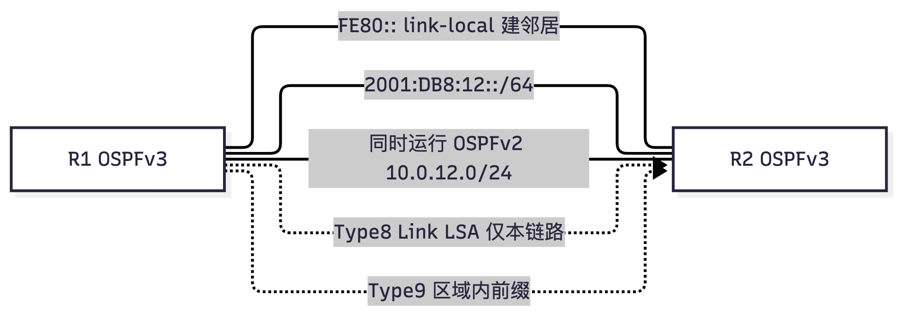


```mermaid
flowchart TD
    A["接口使能 OSPFv3"] --> B["生成链路本地地址 FE80::"]
    B --> C["发送 Hello 源地址为链路本地地址"]
    C --> D["邻居建立 基于链路而非网段"]
    D --> E["Type1 Type2 只描述拓扑 不带前缀"]
    E --> F["Type9 单独描述区域内前缀"]
    D --> G["Type8 描述链路本地地址与链路前缀"]
    F --> H["SPF 计算 拓扑加前缀合并"]
    G --> I["不参与 SPF"]
```

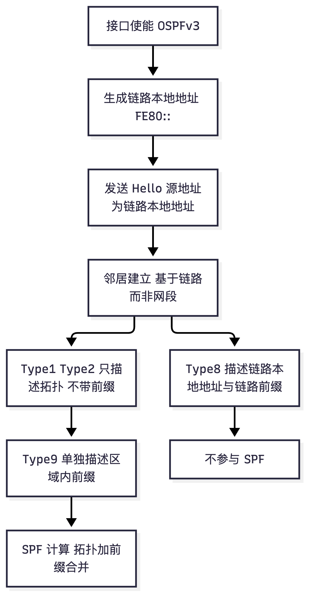


```mermaid
mindmap
  root((OSPFv3 差异))
    运行基础
      按链路 per-link
      链路本地地址
      RouterID 仍为32位
    报文
      Hello 无 Network Mask
      Options 24bit 含 R 位
      协议号 89
    认证
      交给 IPsec
      协议无认证字段
    LSA
      新增 Type8 Link
      新增 Type9 Prefix
      Type1 不带前缀
    特性
      原生多拓扑 MT
      与 v2 并行运行
```

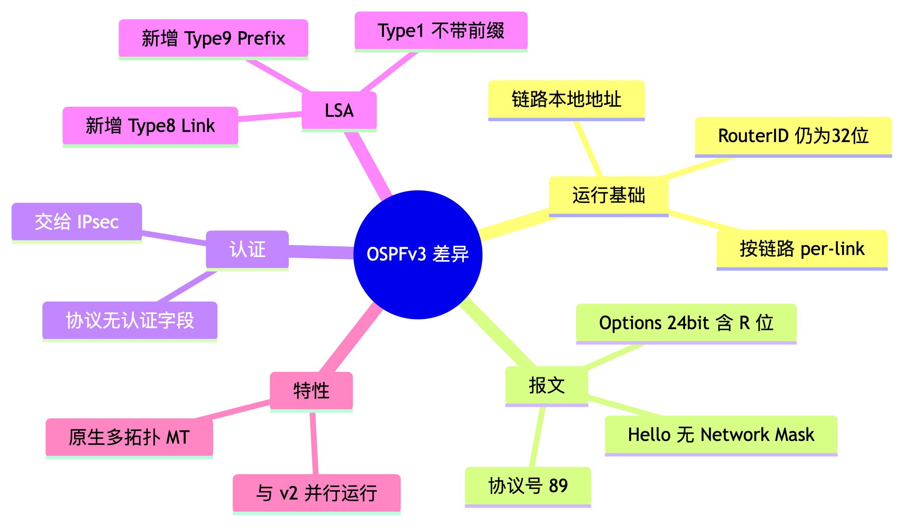


### 真题精练

**Q1.【真题·单选】** OSPFv3 的 Router ID 格式是？

A. 128 bit 的 IPv6 地址  B. 32 bit 的点分十进制格式  C. 64 bit 的 EUI-64 格式  D. 可变长度的字符串

> **答案：B**
> **解析**：OSPFv3 的 **Router ID 与 Area ID 仍然是 32 bit 点分十进制格式**（如 `1.1.1.1`），不是 IPv6 地址。这是最经典的考点，很多选手想当然地认为"IPv6 协议就应该用 IPv6 地址做标识"。若未手工配置，OSPFv3 会自动从本机 IPv4 地址中选取；若设备无 IPv4 地址则必须手工指定。

**Q2.【真题·多选】** 相比 OSPFv2，OSPFv3 的新增特性包括？（多选）

A. 新增 Type8 Link LSA 与 Type9 Intra-Area-Prefix LSA
B. 报文使用链路本地地址作为源地址
C. 支持原生多拓扑（Multi-Topology）
D. 使用 IPv6 地址作为 Router ID

> **答案：ABC**
> **解析**：A、B、C 正确。D 错：Router ID 仍为 32 bit 点分十进制（见上一题）。

**Q3.【真题·判断】** OSPFv3 与 OSPFv2 不能在同一台设备上同时运行。

> **答案：错误**
> **解析**：OSPFv2 与 OSPFv3 是**两个独立协议**（虽然 IP 协议号都是 89），可以在同一台路由器上**并行运行、互不影响**。它们各自维护独立的进程、LSDB 与路由表。这在"IPv4/IPv6 双栈过渡"场景中非常常见。

**Q4.【真题·填空】** OSPFv3 把原来 OSPFv2 中 Type1/Type2 携带的 IPv6 前缀剥离出来，由 ________ 类型的 LSA（名称：________ LSA）单独描述；而描述链路本地地址与链路前缀的是 ________ 类型的 LSA（名称：________ LSA），它只在 ________ 内泛洪且不参与 SPF。

> **答案：Type9；Intra-Area-Prefix（区域内前缀）；Type8；Link（链路）；本链路**
> **解析**：这两个新增 LSA 是 OSPFv3 的标志性特征。Type8 Link LSA 描述"本链路上这台路由器的链路本地地址与本链路的前缀"，**只在链路上泛洪**（不跨路由器传播），且**不参与 SPF 计算**；Type9 则是区域内前缀的载体，参与路由计算。

**Q5.【真题·简答】** 请说明 OSPFv3 为什么把"运行基础"从"按网段（per-subnet）"改为"按链路（per-link）"，并说明这一改变带来的两个好处。

> **答案**：**原因**：OSPFv2 的邻居关系建立在"接口 IP 在同一网段"这一前提上（Hello 报文携带 Network Mask 并要求匹配），这在 IPv6 环境下不合适：① IPv6 地址空间巨大，同一链路上不同设备可能使用不同前缀（尤其在 P2P 与过渡场景）；② IPv6 支持**一个接口配置多个地址**（多前缀），用"网段"来匹配邻居会产生歧义；③ IPv6 的链路本地地址天然提供"链路身份"，无需靠全局前缀判断邻居关系。因此 OSPFv3 改为**按链路运行**：邻居关系基于链路本身建立，报文以**链路本地地址**为源地址。**两个好处**：① **拓扑与前缀解耦**：Router LSA 只描述拓扑，前缀由 Type9 描述，前缀变化不再触发拓扑处理（配合 PRC 提升性能），且一条链路可以携带多个前缀而无歧义；② **配置与重编号更灵活**：路由器重编号（更换全局 IPv6 前缀）时不需要重建邻接关系，因为邻接依赖链路本地地址；同时 P2P 链路上两端前缀不同也能正常建立邻居（有利于过渡与实验环境）。

**Q6.【真题·多选】** 关于 OSPFv3 的认证，下列说法正确的有？（多选）

A. OSPFv3 协议本身不定义认证字段，认证依赖 IPsec（AH/ESP）
B. OSPFv2 的认证是内置在 OSPF 报文中的（Null/Simple/MD5）
C. OSPFv3 可以像 OSPFv2 一样在协议报文中携带明文密码
D. 部分厂商实现（含华为 VRP）提供了配置命令以支持 OSPFv3 的认证能力

> **答案：ABD**
> **解析**：A、B、D 正确。C 错：OSPFv3 标准中**没有**明文密码的认证字段（这是与 v2 的根本差异），认证依赖 IPsec 或厂商扩展实现。

**Q7.【真题·排错】** 在某 AR6120 上配置 OSPFv3 后，`display ospfv3 peer` 看不到邻居。请给出排查思路。

> **答案**：
> ① **接口是否使能 OSPFv3**：确认接口下配置了 `ospfv3 1 area 0.0.0.0`（**注意 OSPFv3 用接口使能，而不是区域视图 `network`**），用 `display ospfv3 interface` 检查。很多人沿用 OSPFv2 的习惯去配 `network`，导致 OSPFv3 根本没在接口上跑起来。
> ② **Router ID 是否配置且唯一**：`display ospfv3 brief` 查看 Router ID。若设备只有 IPv6 地址而无 IPv4 地址，**必须手工配置 Router ID**，否则进程无法正常工作。
> ③ **IPv6 是否使能且链路本地地址正常**：`display ipv6 interface <接口>` 确认有 `FE80::` 地址。若接口未 `ipv6 enable`，OSPFv3 无法收发报文。
> ④ **Hello/Dead 定时器与网络类型是否一致**：`display ospfv3 interface` 核对两端的 Hello 间隔；P2P 与广播型的默认值不同（P2P 10/40，广播 10/40；NBMA/P2MP 30/120）。
> ⑤ **区域 ID 是否一致**：两端必须在同一区域（同一链路上）。
> ⑥ **认证/IPsec 配置**：若启用了 IPsec，需核对 SA 配置；否则报文会被丢弃。
> ⑦ **二层与链路可达性**：`display ipv6 neighbors` 确认链路层互通。
> ⑧ **错误计数**：`display ospfv3 error` 查看是否有 "Area mismatch"、"Hello timer mismatch" 等计数。

**Q8.【真题·填空】** 华为设备上创建 OSPFv3 进程的命令是 ________，接口使能 OSPFv3 的命令是 ________，查看 OSPFv3 链路状态数据库的命令是 ________。

> **答案：`ospfv3 1 router-id 1.1.1.1`；`ospfv3 1 area 0.0.0.0`（在接口视图下）；`display ospfv3 lsdb`**
> **解析**：注意与 OSPFv2 的区别：OSPFv2 用 `ospf 1` + `area` 视图下 `network` 宣告；OSPFv3 用 `ospfv3 1` + **接口下** `ospfv3 1 area x`。这是配置题最容易错的地方。

### 易错点与排错

| 易错点 | 正确结论 |
|---|---|
| 认为 OSPFv3 的 Router ID 是 IPv6 地址 | 仍是 **32 bit 点分十进制** |
| 在 OSPFv3 中用 `network` 命令宣告 | OSPFv3 用**接口使能**（`ospfv3 1 area x`） |
| 认为 OSPFv3 报文里能抓到明文密码 | 标准 OSPFv3 **无认证字段** |
| 认为 Type1 携带 IPv6 前缀 | Type1 只描述拓扑，前缀在 **Type9** |
| 认为 Type8 参与 SPF | Type8 **只在链路上泛洪且不参与 SPF** |
| 认为两个版本不能共存 | 可以**并行运行** |

```bash
display ospfv3 peer                            // OSPFv3 邻居
display ospfv3 interface                       // 接口使能状态、开销、DR/BDR
display ospfv3 lsdb                            // 全类型 LSA（含 Type8/Type9）
display ospfv3 lsdb intra-area-prefix          // 重点查看 Type9
display ospfv3 lsdb link                       // 重点查看 Type8
display ospfv3 routing                         // OSPFv3 路由
display ipv6 routing-table                     // 最终 IPv6 路由表
display ipv6 interface                         // 链路本地地址是否生成
display ospfv3 error                           // 错误计数
```

---

## 1.11 OSPF 排错总清单

### 考点定位

排错是国赛的"实操题"主体，也是最能拉开差距的部分。【真题·排错】的题目往往只给现象（邻居起不来 / 路由没有 / 路由次优），要求你给出完整的判断链路。本节把 OSPF 排错整理成**三张清单**：邻居类、LSA 类、路由表类。**这张清单本身就是答案模板**，考试时按清单逐项排查即可拿满分。

### 原理精讲

**排错的方法论：按"分层 + 分段"来定位。** OSPF 排错可以严格按"**邻居 → LSDB → 路由表 → 转发表**"四层递进：

1. **第一层：邻居能建立吗？** 邻居建立不起来，后面一切都无从谈起。→ 查"邻居清单"。
2. **第二层：LSDB 里有没有正确的 LSA？** 邻居通了但 LSA 缺失，说明是 LSA 生成/泛洪/过滤问题。→ 查"LSA 清单"。
3. **第三层：路由表里有没有正确的路由？** LSA 有了但路由没有，说明是路由计算或路由加载（优先级/过滤）问题。→ 查"路由表清单"。
4. **第四层：转发通不通？** 路由有了但 ping 不通，说明是转发面问题（ARP、接口、ACL、MTU、下一跳递归）。

**这个顺序不能乱**：很多选手一上来就 `display ip routing-table`，发现没路由就去改配置，结果查了半天发现是邻居根本没起来。**"先邻居、再 LSDB、后路由表"是唯一正确的顺序。**

---

**清单一：邻居关系建立失败（按状态定位）**

OSPF 邻居状态机：`Down → Attempt → Init → 2-Way → ExStart → Exchange → Loading → Full`。**不同状态卡住代表不同问题**，这是排错题的核心抓手：

| 卡住的状态 | 含义 | 常见原因 |
|---|---|---|
| **Down** | 没收到任何 Hello | ① 接口未使能 OSPF（未 `network` 宣告/未加入区域）② 物理/链路故障 ③ 接口被 `silent-interface` 抑制 ④ 多播被 ACL 拦截 ⑤ 组播地址被过滤（OSPF 用 224.0.0.5 / 224.0.0.6）⑥ 两端不在同一网段（v2） |
| **Init** | 收到对端 Hello 但对端没看到我 | ① **单向连通**（如链路单向故障、ACL 单向拦截）② 一端配置了认证、另一端没配（对端丢弃我的报文）③ 对端接口被 silent ④ 多播回程不通 |
| **2-Way** | 双方能看到彼此，但未进入主从协商 | ① **广播网络上两台路由器都是 DR-Other（DROther）**，不需要建立 Full（正常现象）② 网络类型不匹配（一端 broadcast 一端 p2p）③ 手工配置了 `ospf dr-priority 0` 导致无法成为 DR/BDR（DROther 之间维持在 2-Way 是正常的）④ **MTU 不一致导致协商失败**（通常表现为卡在 ExStart，但部分实现表现为 2-Way） |
| **ExStart** | 开始主从协商（DD 报文） | ① **MTU 不一致**（最经典！DD 报文中的 MTU 字段不匹配，华为默认开启 MTU 检查）② **Router ID 冲突**（两端 Router ID 相同，无法决定主从）③ 多播可达但单播不通（DD 报文后续以单播发送）④ 两端接口网络类型不一致 |
| **Exchange** | 交换 DD 摘要 | ① DD 报文被丢弃（MTU/ACL）② **Router ID 冲突** ③ LSDB 过大导致交换超时 ④ 接口错误（大量 CRC 导致丢包）|
| **Loading** | 请求缺失的 LSA | ① LSR/LSU 报文丢失 ② 对端 LSA 已老化（MaxAge）③ 大量 LSA 请求导致超时 |
| **Full**（但不通） | 邻接正常 | 转去查 LSDB 与路由表 |

**ExStart 卡住的三大经典原因（必背）**：
1. **MTU 不一致**：华为设备默认在 DD 报文中携带接口 MTU 并做比较，不一致则邻居停在 ExStart。解决：两端 MTU 改为一致，或用 `ospf mtu-ignore` 忽略 MTU 检查（**不推荐**，因为会造成后续转发问题）。
2. **Router ID 冲突**：两台设备配置了相同 Router ID。解决：修改其中一台的 Router ID 并 `reset ospf process`。
3. **单播不可达**：DD/LSR/LSU 后续以单播方式发送，若单播路由不可达（例如掩码配置错误导致对端地址不在直连网段），会卡住。

**其他邻居类问题**：

| 现象 | 原因 | 命令 |
|---|---|---|
| 邻居反复 Up/Down | 链路抖动、Hello 丢失、CPU 过高 | `display ospf peer`、`display logbuffer`、`display cpu-usage` |
| 邻居数量对不上 | `silent-interface`、网络类型不匹配、P2MP 配置缺失 | `display ospf interface` |
| 出现 "Hello timer mismatch" | Hello/Dead 不一致（**两端必须完全相同**） | `display ospf error` |
| 出现 "Area mismatch" | 两端区域 ID 不同（区域 ID 必须一致） | `display ospf error` |
| 出现 "Authentication failure" | 认证类型/密钥/Key ID 不一致 | 见 1.8 节 |
| 出现 "Option mismatch"（如 E 位/N 位） | 一端是 Stub/NSSA、另一端是普通区域 | `display ospf error` |

---

**清单二：LSA 不生成 / 不泛洪**

| 现象 | 原因 | 排查命令 |
|---|---|---|
| ASBR 引入了外部路由但 **Type5 不存在** | ① `import-route` 未配置或协议写错 ② `filter-policy export` 把路由过滤了 ③ 被引入的路由在本地路由表中不存在（**OSPF 只能引入"活跃"的路由**！）④ 引入的路由与 OSPF 已有路由前缀相同（同前缀不重复引入）⑤ 路由被 `route-policy` 拒绝 | `display ospf lsdb ase`、`display ip routing-table`（确认被引入路由活跃）、`display ip-prefix`、`display route-policy` |
| **Type5 存在但区域内看不到** | 区域是 Stub/Totally Stub/NSSA（Type5 被禁） | `display ospf interface`（看区域类型）、`display current-configuration configuration ospf` |
| **Type7 存在但没转成 Type5** | ① P 位为 0（引入了非 0 FA）② 本机不是转换器（多个 ABR）③ `abr-summary not-advertise` 或 `filter-policy export` 过滤 | `display ospf lsdb nssa verbose`、`display ospf lsdb ase` |
| **Type2 不存在** | 该网段无 Full 邻居（是 Stub 网段，用 Type1 的 Stub 链路描述） | `display ospf peer`、`display ospf lsdb router verbose` |
| **Type3 不存在** | 该网段没有在 ABR 上被"学到了"（区域内无此路由）、或 `abr-summary not-advertise` 抑制 | `display ospf routing`（ABR 上是否有该路由）、`display ospf lsdb summary` |
| **Type4 不存在** | 本区域就是 ASBR 所在区域（正常）、或区域为末梢型、或 ASBR 不可达 | `display ospf abr-asbr` |
| **LSA 存在但数量异常少** | ① 配了 `filter-lsa-out`（接口级 LSA 过滤）② 汇总生效（`abr-summary`/`asbr-summary` 把明细合并） | `display ospf interface`（看 filter-lsa-out）、`display current-configuration configuration ospf` |
| **LSA 频繁刷新** | 链路抖动、接口 flapping、`ospf cost` 与带宽变化（如 `bandwidth-reference` 不一致导致开销跳变） | `display ospf lsdb`（看 LSA 序号增长）、`display logbuffer` |
| **LSA 一直处于 MaxAge** | 产生者已删除该 LSA（正常老化）、或产生者不可达 | `display ospf lsdb verbose`（看 Age 字段） |

**特别强调的两条**：
- **OSPF 只能引入"活跃路由"**：`import-route static` 只对**已经存在于路由表中**的静态路由生效。若静态路由因接口 Down 或被其他协议抢占而不在路由表中，OSPF 不会引入它。这是"配了 import-route 但没 Type5"的第一大原因。
- **同前缀不重复引入**：若 OSPF 已经通过区域间/区域内学到了某前缀，ASBR 再引入同前缀的外部路由，OSPF 会**优先保留内部路由**（因为内部优先级 10 < 外部 150），此时 Type5 可能仍会生成，但路由表里不会有它。

---

**清单三：路由不加表（LSDB 有，但路由表没有）**

| 现象 | 原因 | 排查命令 |
|---|---|---|
| OSPF 路由表有、IP 路由表没有 | ① **`filter-policy import` 过滤** ② **优先级被抢占**（外部路由 150 > 静态 60；区域内 10 < 静态 60 时会覆盖静态）③ **下一跳不可达**（递归失败）④ 接口 Down | `display ospf routing`（对比）、`display ip routing-table verbose`（看各协议候选与优选原因） |
| Type5 在 LSDB 但 OSPF 路由表也没有 | ① **ASBR 不可达**（缺 Type4 或区域内路由不通）② **FA 不可达**（FA 非 0 但域内无路由）③ 度量类型/度量异常 | `display ospf lsdb ase verbose`、`display ospf lsdb summary`、`display ospf routing` |
| 区域间路由缺失 | ① 骨干不连续 ② ABR 未正确宣告 ③ `abr-summary not-advertise` ④ 虚连接未建立 | `display ospf abr-asbr`、`display ospf vlink`、`display ospf lsdb summary` |
| 路由存在但 ping 不通 | ① ARP 未解析 ② ACL 拦截 ③ MTU 问题（大包不通）④ 单向路由（对端无回程路由）⑤ MPLS/隧道封装问题 | `display arp`、`display acl`、`ping -s <大包>`、`tracert` |
| 出现等价路由但实际只走一条 | ① `maximum load-balancing` 未配或值太小（**华为默认值为 1，即不做负载分担！**）② 两条路由的度量不同 ③ 接口类型不支持 | `display ip routing-table verbose`（看是否为等价）、`display current-configuration`（查 maximum load-balancing） |
| 路由频繁切换 | 链路抖动、度量震荡、BFD 误报 | `display logbuffer`、`display ip routing-table verbose` |

**特别强调：华为 OSPF 等价路由负载分担**：华为设备上 `maximum load-balancing` 的**默认值随产品与版本不同**：在部分 VRP 版本中 OSPF 的默认值为 **1**（不做负载分担），需要显式配置（如 `maximum load-balancing 8`）。**这是"两条等价路由为什么只走一条"的标准答案。**

### 关键概念对照表

**表 1-11-1 邻居状态机与故障定位表（排错题答题模板）**

| 状态 | 是否正常 | 卡住此状态的判断思路 |
|---|---|---|
| Down | 初始 | 接口未使能 OSPF、物理不通、silent-interface、多播被拦 |
| Attempt | NBMA 特有 | NBMA 网络未手工指定邻居 |
| Init | 异常 | 单向通信、认证不一致（对端丢弃我的报文） |
| 2-Way | **广播网络上 DROther 之间是正常的** | 若期望 Full 却停在 2-Way：网络类型不匹配、DR 选举问题、MTU（部分实现） |
| ExStart | 异常 | **MTU 不一致**、**Router ID 冲突**、单播不通 |
| Exchange | 异常 | DD 丢失、Router ID 冲突、LSDB 过大超时 |
| Loading | 异常 | LSR/LSU 丢失、LSA 已老化 |
| Full | 正常 | 转查 LSDB 与路由表 |

**表 1-11-2 三张清单速查（打印出来背）**

| 类别 | 关键检查项 | 首选命令 |
|---|---|---|
| 邻居 | 接口使能、区域一致、网络类型、定时器、MTU、Router ID、认证、silent | `display ospf peer`、`display ospf interface`、`display ospf error` |
| LSA | 引入路由是否活跃、区域类型、P 位、转换器、filter-policy、filter-lsa-out、汇总 | `display ospf lsdb brief`、`display ospf lsdb ase/nssa verbose`、`display ospf abr-asbr` |
| 路由表 | filter-policy import、优先级、ASBR/FA 可达性、下一跳递归、负载分担 | `display ospf routing`、`display ip routing-table verbose`、`display ospf lsdb` |
| 转发 | ARP、ACL、MTU、单向路由、隧道 | `display arp`、`tracert`、`ping -s`、`display acl` |

**表 1-11-3 OSPF 常用排错命令总表**

| 命令 | 用途 |
|---|---|
| `display ospf peer` | 邻居状态（第一站） |
| `display ospf peer verbose` | 邻居详情（DR/BDR、定时器、认证、Area） |
| `display ospf interface` | 接口 OSPF 参数（区域、网络类型、开销、DR/BDR） |
| `display ospf error` | 各类错误计数（认证、区域、定时器、选项） |
| `display ospf brief` | 进程摘要（Router ID、区域、进程参数） |
| `display ospf lsdb` / `lsdb brief` | LSDB 全览 / 分类统计 |
| `display ospf lsdb router/network/summary/asbr/ase/nssa verbose` | 分类查看 LSA 全字段 |
| `display ospf routing` | OSPF 计算出的路由（与 IP 路由表对比） |
| `display ospf abr-asbr` | ABR/ASBR 识别结果 |
| `display ospf vlink` | 虚连接状态 |
| `display ospf bfd session all` | BFD 会话 |
| `display ospf frr` | FRR/LFA 状态 |
| `display ospf spf-statistics` | SPF 计算次数 |
| `display ip routing-table verbose` | 最终路由表与优选原因 |
| `display ip ip-prefix <名>` | 前缀列表内容（排错必查） |
| `display route-policy <名>` | 路由策略内容 |
| `display logbuffer` | 日志（邻居 Up/Down 记录） |
| `reset ospf process` | 重置进程（**慎用**，会短暂中断） |
| `debugging ospf packet hello` | 调试 Hello 报文（**生产慎用**） |

### 华为设备配置

```bash
# ============ OSPF 排错的标准执行序列（按四层递进） ============

# --- 第一层：邻居 ---
display ospf peer                               // 邻居状态总览（重点看 State 列）
display ospf peer verbose                       // 邻居详情：Area、DR/BDR、定时器、认证模式
display ospf interface                          // 接口是否使能、区域、网络类型、开销
display ospf error                              // 错误计数（认证/区域/定时器/选项）
display ospf brief                              // 本机 Router ID 与进程参数

# --- 第二层：LSDB ---
display ospf lsdb brief                         // 各类 LSA 数量（快速发现"某类为 0"）
display ospf lsdb router verbose                // Type1 明细（V/E/B 位、链路类型）
display ospf lsdb network                       // Type2（确认 Link State ID 是 DR 接口 IP）
display ospf lsdb summary verbose               // Type3/Type4（含度量与掩码）
display ospf lsdb ase verbose                   // Type5（含 Metric Type/Metric/FA/Tag）
display ospf lsdb nssa verbose                  // Type7（重点看 P 位）
display ospf abr-asbr                           // ABR/ASBR 识别（判断 Type4 是否应该存在）

# --- 第三层：路由表 ---
display ospf routing                            // OSPF 内部路由表
display ospf routing <网段> verbose              // 指定路由的详细计算信息与下一跳列表
display ip routing-table                        // 最终 IP 路由表
display ip routing-table <网段> verbose          // 优选原因、各协议候选、Backup NextHop
display ip ip-prefix <名>                        // 前缀列表（判断过滤是否误伤）
display route-policy <名>                        // 路由策略内容

# --- 第四层：转发面 ---
display arp                                     // ARP 表（下一跳是否解析成功）
display fib <网段>                               // FIB 表项
tracert <目的地址>                               // 实际路径（验证是否次优/环路）
ping -s 1472 <目的地址>                          // 大包测试（验证 MTU 问题）

# ============ 典型故障的定向修复 ============
# 故障1：邻居卡 ExStart（MTU 不一致）
display interface GigabitEthernet0/0/0 | include MTU   // 查看本端 MTU
# 对端同样查看；若不一致，统一为一致值：
interface GigabitEthernet0/0/0
 mtu 1500                                        // 两端统一 MTU
 quit
# 或（不推荐，仅应急）忽略 MTU 检查
ospf 1
 area 0.0.0.0
  network 10.0.0.0 0.0.0.255
 quit
interface GigabitEthernet0/0/0
 ospf mtu-ignore                                  // 忽略 MTU 检查（会造成后续转发隐患）
 quit

# 故障2：Router ID 冲突
display ospf brief                                // 查看本机 Router ID（两端相同即为冲突）
ospf 1 router-id 1.1.1.1                          // 修改其中一台的 Router ID
reset ospf process                                // 重置进程使新 Router ID 生效（慎用）

# 故障3：等价路由不做负载分担
display ip routing-table verbose                  // 确认是否为等价路由
ospf 1
 maximum load-balancing 8                         // 华为默认可能为 1，需显式配置为 8（视平台上限）
 quit

# 故障4：外部路由不加表（FA 不可达）
display ospf lsdb ase verbose                     // 查看 FA 值
display ip routing-table <FA地址>                  // 确认 FA 是否可达
ospf 1
 silent-interface GigabitEthernet0/0/2             // 若误配 silent 导致 FA 不可达
 undo silent-interface GigabitEthernet0/0/2        // 撤销
 quit
```

### 示意图

```mermaid
flowchart TD
    A["OSPF 故障现象"] --> B["第一步 查邻居"]
    B --> C{"邻居是否 Full"}
    C -->|"否"| D["按状态定位 Down Init 2Way ExStart Exchange Loading"]
    C -->|"是"| E["第二步 查 LSDB"]
    E --> F{"所需 LSA 是否存在"}
    F -->|"否"| G["查 LSA 生成 泛洪 过滤 区域类型"]
    F -->|"是"| H["第三步 查路由表"]
    H --> I{"路由是否加表"}
    I -->|"否"| J["查 filter-policy import 优先级 可达性 递归"]
    I -->|"是"| K["第四步 查转发面 ARP ACL MTU"]
    K --> L["定位并修复"]
```

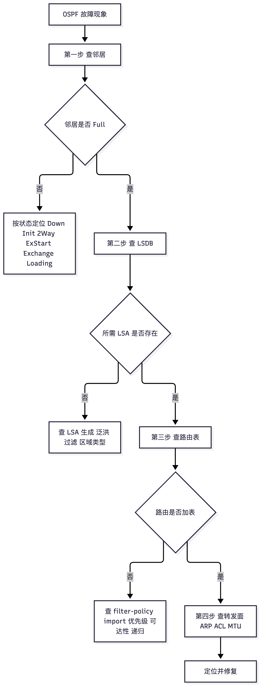


```mermaid
stateDiagram-v2
    [*] --> Down
    Down --> Init: 收到对端Hello
    Init --> TwoWay: 双向看到彼此
    TwoWay --> ExStart: 主从协商开始
    ExStart --> Exchange: MTU一致且RouterID不冲突
    Exchange --> Loading: 交换DD摘要完成
    Loading --> Full: 补齐缺失LSA
    Full --> [*]
    ExStart --> Down: MTU不一致或RouterID冲突
    TwoWay --> Down: 定时器超时
    note right of ExStart
        MTU不一致
        RouterID冲突
        单播不可达
    end note
```

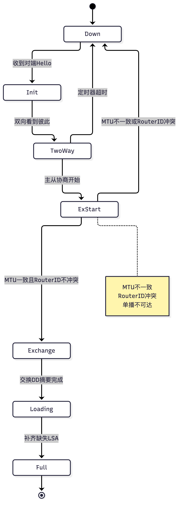


```mermaid
flowchart LR
    L1["第一层 邻居"] --> L2["第二层 LSDB"]
    L2 --> L3["第三层 路由表"]
    L3 --> L4["第四层 转发表"]
    L1 --- C1["display ospf peer"]
    L2 --- C2["display ospf lsdb"]
    L3 --- C3["display ip routing-table verbose"]
    L4 --- C4["display arp 与 tracert"]
```

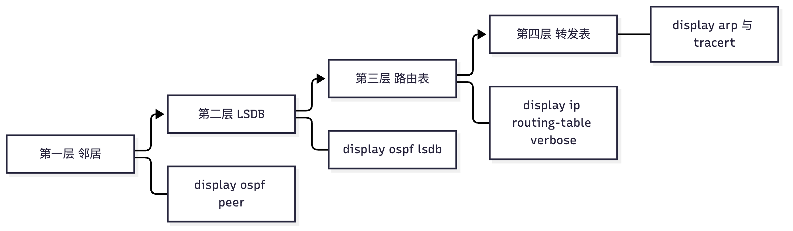


### 真题精练

**Q1.【真题·排错】** 两台 AR6120 直连，接口 MTU 分别为 1500 与 1400，OSPF 邻居一直卡在 ExStart 状态。请说明原因并给出两种解决方法（含各自风险）。

> **答案**：**原因**：OSPF 在 ExStart 阶段通过 DD（Database Description，数据库描述）报文进行主从协商，华为设备默认在 DD 报文中携带并比较**接口 MTU**。当两端 MTU 不一致时，DD 报文被拒绝，邻居无法进入 Exchange 状态，因此**一直卡在 ExStart**。这是"卡在 ExStart"最经典的原因，另外两个常见原因是 **Router ID 冲突** 与 **单播不可达**。
> **解决方法一（推荐）**：**统一两端接口 MTU**。
> ```bash
> interface GigabitEthernet0/0/0
>  mtu 1500                                     // 两端统一为相同值
> ```
> 风险：需要两端同时修改，修改瞬间可能引起短暂中断；若链路中间设备（如传输设备）无法承载 1500，会造成大包丢弃。
> **解决方法二（应急，不推荐）**：在接口上**忽略 MTU 检查**。
> ```bash
> interface GigabitEthernet0/0/0
>  ospf mtu-ignore                              // 忽略 DD 报文中的 MTU 比较
> ```
> 风险：**MTU 检查存在的意义就是避免"邻接建立成功但大包不通"的黑洞**。忽略后邻接可以建立，但两端 MTU 差异仍然存在，超过较小 MTU 的报文会被丢弃（表现为"ping 小包通、大包不通"），且问题更难排查。因此 `mtu-ignore` 只能在应急场景使用，事后仍需统一 MTU。
> **验证**：`display ospf peer` 确认邻居进入 Full；`ping -s 1472 <对端>` 验证大包是否可通。

**Q2.【真题·排错】** 某 ASBR 上配置了 `import-route static`，但 `display ospf lsdb ase` 看不到任何 Type5。请列出至少五种可能原因。

> **答案**：
> ① **被引入的静态路由不在本地路由表中**：OSPF **只能引入"活跃（active）"路由**。若静态路由指向的接口 Down、或下一跳不可达、或被其他协议（如 OSPF 内部路由优先级 10 < 静态 60 时静态会被覆盖）抢占而不在路由表中，则无法被引入。验证：`display ip routing-table` 确认该静态路由是否存在。
> ② **`filter-policy export` 把路由过滤了**：验证 `display ip ip-prefix <名>` 与 `display route-policy <名>`，注意前缀列表末尾隐含 deny 的规则。
> ③ **`route-policy` 中 `if-match` 条件过严或 `apply` 缺失**：验证 `display route-policy <名>`。
> ④ **引入的协议写错**：例如静态路由写成了 `import-route direct`，或 `import-route static` 但静态路由用的是其他协议（如 `ip route-static` 之外的方式）。
> ⑤ **该前缀与 OSPF 已有路由前缀相同**：OSPF 不会为同前缀重复生成外部 LSA（或生成了但被内部路由优选）。
> ⑥ **进程/区域限制**：该设备所在区域为 Stub 区域（**Stub 区域不能有 ASBR，`import-route` 不生效**）；或配置在错误的 OSPF 进程/视图下。
> ⑦ **配置未提交或需重置**：某些情况下需要 `reset ospf process` 使引入生效（慎用）。
> ⑧ **设备资源或限制**：极少见，LSA 数量达到上限。
> **首选排查顺序**：`display ip routing-table`（路由是否活跃）→ `display ip ip-prefix`（过滤）→ `display current-configuration configuration ospf`（区域类型与进程）→ `display ospf lsdb brief`（是否真的没有 LSA）。

**Q3.【真题·排错】** 某路由器的 LSDB 中存在 `172.16.1.0/24` 的 Type5，`display ospf routing` 中也能看到它，但 `display ip routing-table` 中没有。请给出至少四种原因。

> **答案**：
> ① **`filter-policy import` 在本机过滤**：这是"OSPF 路由表有、IP 路由表没有"的最典型原因。验证：`display ip ip-prefix <名>` 与 `display route-policy <名>`；本机 `display ospf routing` 有该路由即证明 LSA 与计算都正常，只是被拦在路由表之外。
> ② **优先级被其他协议抢占**：OSPF 外部路由（`O_ASE`/`O_NSSA`）默认优先级 **150**，会被**静态路由（60）**、**IS-IS（15）**、**直连（0）**、**OSPF 内部路由（10）** 等抢占。验证：`display ip routing-table 172.16.1.0 verbose` 查看所有候选与优选原因。
> ③ **下一跳不可达（递归失败）**：Type5 的下一跳（ASBR 或 FA）无法解析，路由无法加表。验证：`display ip routing-table <下一跳>`、`display arp`。
> ④ **出接口 Down 或被删除**：验证 `display interface brief`。
> ⑤ **`display ospf routing` 中是"计算的候选"而非最终决策**：注意 `display ospf routing` 展示的是 OSPF 协议内部的路由表，它包含协议认为可用的路由，但最终加表还取决于优先级比较与 `filter-policy import`。
> ⑥ **黑洞路由存在**：若配置了指向 NULL0 的同前缀路由（优先级更高），则会抢占。

**Q4.【真题·多选】** 下列哪些原因会导致 OSPF 邻居一直停留在 Init 状态？（多选）

A. 链路单向故障，只有一端能收到对端的 Hello
B. 一端配置了认证，另一端未配置认证
C. 两端接口的 MTU 不一致
D. 一端接口被 `silent-interface` 抑制

> **答案：AB**
> **解析**：Init 状态的含义是"**我收到了对端的 Hello，但对端的 Hello 里没有我的 Router ID**"——即**单向可见**。A（单向故障）与 B（认证不一致导致对端丢弃我的报文，我看不到对方对我的确认）都属于此类。C（MTU 不一致）会导致卡在 **ExStart**（Init 已过）；D（silent-interface）会让本端完全不发 Hello，对端根本看不到我，对端表现为 **Down**，本端不建立邻居（不是 Init）。**注意区分**：`silent-interface` 抑制的是"接口不收发 OSPF 报文"，本端不会发出 Hello，因此对端是 Down 而非 Init。

**Q5.【真题·排错】** 某网络存在两条到达 `10.9.9.0/24` 的等价 OSPF 路由（同度量、同类型），但 `display ip routing-table` 显示只有一条转发表项，流量也只走一条链路。请分析原因并给出解决命令。

> **答案**：**原因**：华为设备上 OSPF 的**等价路由负载分担数量 `maximum load-balancing` 默认值可能为 1**（不做负载分担），具体默认值随产品与 VRP 版本不同。若为 1，则即使存在多条等价路由，也只有一条被放入转发表。**验证**：
> ```bash
> display ip routing-table 10.9.9.0 verbose      // 观察是否列出多条等价下一跳，以及实际加表数量
> display current-configuration configuration ospf // 查看是否配置了 maximum load-balancing
> ```
> **解决**：
> ```bash
> ospf 1
>  maximum load-balancing 8                      // 允许最多 8 条等价路由参与负载分担（视平台上限）
>  quit
> display ip routing-table 10.9.9.0 verbose       // 验证多条下一跳均加表
> ```
> **补充**：若两条路由**度量并不相同**（例如一个是 E1 一个是 E2，或内部开销不同），则不是等价路由，OSPF 会按规则优选，此时需要先解决"为什么不等价"。可用 `display ospf routing 10.9.9.0 verbose` 查看每条路由的实际度量。

**Q6.【真题·简答】** 请完整描述"OSPF 排错的四层递进方法论"，并说明为什么这个顺序不能颠倒。

> **答案**：**四层递进**：
> **第一层 —— 邻居是否建立**（`display ospf peer`）：邻居建立是所有 OSPF 功能的前提。若邻居不是 Full，则应先按状态机定位（Down / Init / 2-Way / ExStart / Exchange / Loading 各有对应原因），此时**不应继续往下查**。
> **第二层 —— LSDB 是否正确**（`display ospf lsdb brief` 及分类查看）：邻居 Full 后，检查"应该有的 LSA 有没有、不该有的有没有"。Type1/Type2 缺失指向区域内问题；Type3 缺失指向 ABR 与区域配置；Type4/Type5 缺失指向 ASBR 与引入；Type7 与 P 位指向 NSSA 转换；LSA 数量异常指向汇总与 `filter-lsa-out`。
> **第三层 —— 路由是否加表**（`display ospf routing` 对比 `display ip routing-table verbose`）：用"OSPF 路由表有、IP 路由表无"来判定是**导入过滤**还是**优先级抢占**；用"两张表都没有"来判定是**LSA 缺失或可达性检查失败**。
> **第四层 —— 转发是否通畅**（`display arp`、`tracert`、`ping -s`）：控制面都正常但业务不通，则查 ARP 解析、ACL、MTU（大包不通）、单向路由、隧道封装等转发面问题。
> **为什么不能颠倒**：因为 OSPF 是一个**层层依赖**的协议——没有邻居就没有 LSA 交换，没有 LSA 就没有路由计算，没有路由就没有转发。如果跳过邻居直接查路由表，看到"没有路由"就去改引入或汇总配置，**不仅解决不了问题，还可能破坏原本正确的配置**，把单一故障变成多重故障。只有严格按"邻居 → LSDB → 路由表 → 转发表"的顺序，才能保证每一步的结论都建立在前一步已验证的基础上，这也是国赛排错题评分的关键——**阅卷看的是你的推理链条是否严密，而不是你最终改对了哪个参数**。

**Q7.【真题·多选】** 关于 `display ospf error` 输出中的常见计数，下列说法正确的有？（多选）

A. "Authentication failure" 表示两端认证类型/密钥不一致
B. "Area mismatch" 表示两端区域 ID 不一致
C. "Hello timer mismatch" 表示 Hello/Dead 间隔不一致
D. "MTU mismatch" 计数增长时，邻居通常能正常进入 Full

> **答案：ABC**
> **解析**：A、B、C 正确。D 错：MTU 不一致会导致邻居**无法进入 Full**（卡在 **ExStart**），这正是 `display ospf error` 中该计数增长时的典型现象。补充：`display ospf error` 是排错的"第二站"（第一站是 `display ospf peer`），它能直接把问题分类到"认证 / 区域 / 定时器 / 选项 / MTU"等具体原因上。

**Q8.【真题·排错】** 某网络从 R1 到 `10.9.9.0/24` 有两条路径，`display ip routing-table` 显示流量走的是 R2（开销 30），而工程师期望走 R4（开销 15）。请列出至少四种可能原因及验证方法。

> **答案**：
> ① **R2 侧的路径被配置为 E1，R4 侧为 E2**（或反之）：E1 永远优先于 E2。验证：`display ospf lsdb ase verbose` 对比两条 Type5 的 Metric Type。
> ② **到 R4 的内部开销实际比预期大**：可能是 `ospf cost` 手工配置、`bandwidth-reference` 不一致、或接口实际带宽与预期不符（例如此处 10GE 被当成 GE）。验证：`display ospf interface`（各接口 cost）、`display ospf routing`（到 ASBR 的度量）。
> ③ **FA（Forwarding Address）差异**：若 R4 的 Type5 带非 0 的 FA 而该 FA 在域内不可达，则该路由不加表，于是只剩 R2。验证：`display ospf lsdb ase verbose` 对比 FA，再 `display ip routing-table <FA>` 检查可达性。
> ④ **过滤策略误伤**：R4 侧的路由被本机 `filter-policy import` 过滤，或 R4 的 ASBR 上被 `filter-policy export` / `asbr-summary not-advertise` 抑制。验证：`display ip ip-prefix`、`display route-policy`、`display ospf lsdb ase`（对比 R2/R4 是否都有 LSA）。
> ⑤ **路由类型不同（区域内 vs 区域间 vs 外部）**：若 R4 的路径是区域间（O_IA，优先级 10）而 R2 是外部（150），实际会优选 R4，与本现象相反；反之若 R2 是 O_IA 而 R4 是 O_ASE，则选 R2 是**正常行为**。验证：`display ip routing-table verbose`（看 Protocol 列）。
> ⑥ **R4 的邻居未 Full 或 LSA 未收到**：验证 R1 上 `display ospf peer`（与 R4 的邻接）与 `display ospf lsdb brief`。
> ⑦ **等价路由未做负载分担**：若两条路由实际等价，默认 `maximum load-balancing` 可能为 1，只显示一条。验证：`display ip routing-table verbose` 是否列出多条等价下一跳。
> **首选排查顺序**：`display ospf lsdb ase verbose`（比较度量类型与 FA）→ `display ip routing-table <网段> verbose`（看全部候选与优选原因）→ `display ospf interface`（核对接口开销）。

### 易错点与排错

| 易错点 | 正确结论 |
|---|---|
| 一上来就查路由表 | 必须**先查邻居**，再 LSDB，再路由表，最后转发表 |
| 把 2-Way 一律当故障 | 广播网络上 **DROther 之间停在 2-Way 是正常的** |
| 认为 Init 是"没收到 Hello" | Init 表示**收到了对端 Hello 但对端没看到我**（单向） |
| 认为 MTU 不一致会导致 Init | 会导致卡在 **ExStart** |
| 认为 `import-route` 一定能引入 | 只引入**活跃路由**，且不会重复引入同前缀内部路由 |
| 忘记 OSPF 外部路由优先级 150 | 会被静态（60）、IS-IS（15）抢占 |
| 认为等价路由一定负载分担 | 华为 `maximum load-balancing` 默认可能为 **1** |
| 用 `reset ospf process` 当万能药 | 会造成**全网短暂中断**，只应在必要时使用 |

---

# 数通-HCIE-章节2-IS-IS协议与IPv6集成

## 2.1 IS-IS 起源、发展与协议定位

### 考点定位

本节是"背景题"，但国赛常以单选/填空形式考查 IS-IS 的历史包袱如何影响今天的实现：**为什么 IS-IS 用 NSAP 地址**、**集成 IS-IS（Integrated IS-IS）是什么意思**、**IS-IS 的协议号**、**为什么 IS-IS 比 OSPF 更容易扩展**。分值不高但属于"必须知道的常识"。

### 原理精讲

**IS-IS（Intermediate System to Intermediate System，中间系统到中间系统）最初不是为 IP 设计的。** 它诞生于 **ISO（International Organization for Standardization，国际标准化组织）** 制定的 **OSI（Open Systems Interconnection，开放系统互联）** 协议族，是为 **CLNP（Connectionless Network Protocol，无连接网络协议）** 这种网络层协议服务的**链路状态路由协议**。在 OSI 术语中：

- **ES（End System，端系统）** = 主机；
- **IS（Intermediate System，中间系统）** = 路由器；
- IS-IS 就是"路由器到路由器"的路由协议。

**为什么 IS-IS 今天还能用于 IP 网络？** 因为 **RFC 1195** 定义了 **Integrated IS-IS（集成 IS-IS）**：在同一个 IS-IS 进程中**同时承载 CLNP 与 IP（以及后来的 IPv6）路由信息**。集成 IS-IS 通过**新的 TLV（Type-Length-Value，类型-长度-值）** 携带 IP 前缀与可达性信息（如 TLV 128/130/132 携带 IPv4 信息，TLV 232/236 携带 IPv6 信息），从而在不破坏原有协议框架的前提下支持 IP。**这就是"双栈（dual stack）协议"的含义**：一个 IS-IS 进程可以同时发布 IPv4 与 IPv6 路由。**注意术语**：现在说"IS-IS"通常指的就是"集成 IS-IS"，因为纯 CLNP 的 IS-IS 已经基本不用了。

**IS-IS 的协议特征（与 OSPF 对比的立足点）**：

| 特征 | IS-IS | OSPF |
|---|---|---|
| 网络层承载 | **直接在数据链路层之上**（CLNS/NLPID 或 Ethertype 0xFEFE），**不依赖 IP** | 依赖 IP（IP 协议号 89） |
| 报文类型 | 9 种 PDU（LSP、CSNP、PSNP、IIH 等，按 L1/L2/P2P 细分） | 5 种（Hello、DD、LSR、LSU、LSAck） |
| 扩展方式 | **TLV 机制**（加新功能 = 加新 TLV，向后兼容） | LSA 类型（加新功能 = 新增 LSA 类型，改动较大） |
| 地址格式 | NSAP（含 NET） | IP 地址 + Router ID |
| 区域划分 | **区域边界在链路上**（路由器整体属于一个区域） | **区域边界在路由器上**（ABR 连接多个区域） |
| 扩展性 | 单区域可支持上千台路由器 | 单区域一般建议 ≤ 50~100 台 |

**为什么 IS-IS 的扩展性更好？** 三个原因：① **TLV 机制**使得新功能可以"插件式"加入，老设备收到不认识的 TLV 会**忽略而不报错**，因此协议演进不会导致不兼容；② **IS-IS 的 LSP 是"一个路由器一个 LSP（或分片）"**，不像 OSPF 有 7 类 LSA 的复杂交互，LSDB 结构与 SPF 计算都更简单；③ **IS-IS 直接跑在二层**，不依赖 IP，因此不怕 IP 层的问题（如 IP 地址被攻击、IP 路由震荡），且天然支持多协议。**这些特性使 IS-IS 成为大型运营商骨干网（尤其是承载 MPLS、SR 的骨干）的首选 IGP**——这也是华为设备上 IS-IS 与 MPLS/SR 结合紧密的原因。

**IS-IS 的协议号与封装**：
- 在**广播网络（以太网）**上：IS-IS PDU 直接封装在以太网帧中，**Ethertype = 0xFEFE**（部分文档写 0x8878 用于某些扩展），使用**组播 MAC 地址**：**Level-1 用 `01-80-C2-00-00-14`，Level-2 用 `01-80-C2-00-00-15`**（这是高频考点）；
- 在 **P2P 链路（PPP）** 上：使用 **NLPID（Network Layer Protocol ID）= 0x83**（CLNP 的 NLPID）；
- **链路层协议号**：`0xFEFE`（以太网上的 IS-IS）。

**IS-IS 的三个层次**（详见 2.3）：Level-1（区域内）、Level-2（骨干/区域间）、Level-1-2（同时属于两者的路由器）。

**IS-IS 在今天的定位**：
- **大型运营商骨干**：承载 MPLS L3VPN、Segment Routing（SR-MPLS/SRv6），与 BGP 配合；
- **数据中心**：部分大型 DCI（Data Center Interconnect）网络；
- **企业网**：较少（企业网 OSPF 更常见）；
- **国赛考点**：IS-IS 必考，重点在层次化结构、度量、路由泄露、与 OSPF 的对比。

### 关键概念对照表

**表 2-1-1 OSI 术语与 IP 术语对照**

| OSI 术语 | IP 术语 | 说明 |
|---|---|---|
| ES（End System） | 主机（Host） | 端系统 |
| IS（Intermediate System） | 路由器（Router） | 中间系统 |
| 区域（Area） | 区域（Area） | 概念类似但边界位置不同 |
| Level-1（L1） | 区域内（Intra-Area） | 类似 OSPF 的非骨干区域 |
| Level-2（L2） | 骨干（Backbone） | 类似 OSPF 的 Area 0 |
| Level-1-2（L1/2） | ABR 的角色 | 但机制完全不同（边界在链路上） |
| NSAP | IP 地址 | IS-IS 的地址体系 |
| NET | Router ID + Area ID 的组合 | NSAP 的一种特殊形式 |
| CLNP | IP | OSI 的网络层协议 |
| DIS | DR | 指定中间系统 vs 指定路由器，机制不同 |
| LSP | LSA | 链路状态 PDU vs 链路状态通告 |
| PDU | 报文（Packet） | 协议数据单元 |

**表 2-1-2 IS-IS 与 OSPF 的"设计哲学"对比**

| 维度 | IS-IS | OSPF |
|---|---|---|
| 设计初衷 | 为 OSI/CLNP 设计，后来集成 IP | 为 IP 设计 |
| 承载方式 | 直接跑在二层，不依赖 IP | 跑在 IP 之上（协议号 89） |
| 扩展机制 | TLV（向后兼容好） | LSA 类型（演进改动大） |
| 区域边界 | **链路上**（路由器整体属于一个区域） | **路由器上**（ABR 属于多个区域） |
| 地址体系 | NSAP/NET（较复杂） | IP 地址（直观） |
| 复杂度 | 相对简单（9 种 PDU，层次少） | 相对复杂（5 种报文 + 7 类 LSA） |
| 单区域规模 | 大（千台级） | 中（建议 ≤ 50~100） |
| 现网典型应用 | 运营商骨干、MPLS/SR 承载 | 企业网、园区网 |

**表 2-1-3 关键数值与标识速查**

| 项目 | 取值 |
|---|---|
| 以太网 Ethertype | **0xFEFE** |
| PPP 的 NLPID | **0x83** |
| L1 组播 MAC | **01-80-C2-00-00-14** |
| L2 组播 MAC | **01-80-C2-00-00-15** |
| P2P 组播 MAC（部分实现） | 01-80-C2-00-00-15（或使用单播） |
| IPv4 TLV（TLV 128/130/132） | IP 内部可达性、IP 外部可达性、IP 接口地址 |
| IPv6 TLV | **TLV 232（IPv6 Interface Address）、TLV 236（IPv6 Reachability）** |
| 支持 IPv6 的 RFC | RFC 5308（IS-IS for IPv6） |
| IS-IS 度量 TLV | 窄度量：TLV 2/128/130 中的 6 bit 字段；宽度量：**TLV 22（Extended IS Reachability）** 中的 24 bit 或 32 bit |

### 华为设备配置

```bash
# ============ 场景：NE40E 上启用集成 IS-IS（IPv4） ============
system-view
sysname R1

# --- 1. 配置 NET（必须先有 NET 才能启动 IS-IS） ---
isis 1                                          // 创建 IS-IS 进程 1
 is-level level-2                              // 设置本机为 Level-2（骨干路由器）
 network-entity 49.0001.0000.0000.0001.00      // 配置 NET：区域 49.0001 + SystemID + NSEL 00
 cost-style wide                                // 使用宽度量（推荐，必须全网一致）
 quit

# --- 2. 接口使能 IS-IS ---
interface GigabitEthernet0/0/0
 ip address 10.0.12.1 255.255.255.0
 isis enable 1                                  // 接口使能 IS-IS 进程 1
 isis circuit-level level-2                     // 该接口建立 Level-2 邻接（骨干链路）
 isis cost 10                                   // 设置接口开销（宽度量下为 32 bit 值）
 quit

interface LoopBack0
 ip address 1.1.1.1 255.255.255.255
 isis enable 1                                  // 环回口使能 IS-IS，用于发布 Router ID 对应的 /32 路由
 quit

# --- 3. 查看 ---
display isis peer                              // IS-IS 邻居（含 Level 与状态）
display isis lsdb                              // 链路状态数据库（LSP 列表）
display isis route                             // IS-IS 计算出的路由
display isis brief                             // 进程摘要（NET、Level、度量类型）
display isis interface                         // 接口 IS-IS 参数
display isis error                             // 错误计数

# ============ 对比：OSPF 的等价配置（体会差异） ============
ospf 1 router-id 1.1.1.1                       // OSPF 用 IP 地址作 Router ID
 area 0.0.0.0
  network 10.0.12.0 0.0.0.255                  // OSPF 在区域视图下用 network 宣告
 quit
```

### 示意图

```mermaid
flowchart LR
    subgraph OSI["OSI 世界"]
        ES1["ES 主机"] --- IS1["IS 中间系统"]
        IS1 --- IS2["IS 中间系统"]
    end
    subgraph IP["IP 世界"]
        H1["Host 主机"] --- RT1["Router 路由器"]
        RT1 --- RT2["Router 路由器"]
    end
    IS1 -.->|"术语一一对应"| RT1
    IS2 -.->|"术语一一对应"| RT2
    ES1 -.->|"术语对应"| H1
```


```mermaid
flowchart TD
    A["IS-IS 历史"] --> B["ISO 为 CLNP 设计"]
    B --> C["纯 OSI 环境使用"]
    A --> D["RFC 1195 集成 IS-IS"]
    D --> E["TLV 携带 IPv4 信息 TLV128 130 132"]
    D --> F["TLV 携带 IPv6 信息 TLV232 236"]
    E --> G["单进程双栈 同时发布 v4 与 v6"]
    F --> G
    G --> H["运营商骨干 MPLS 与 SR 首选 IGP"]
```


```mermaid
pie title IS-IS 与 OSPF 现网应用场景占比示意
    "运营商骨干 IS-IS" : 45
    "企业园区 OSPF" : 40
    "数据中心其他" : 15
```


### 真题精练

**Q1.【真题·单选】** IS-IS 最初是为下列哪种网络层协议设计的路由协议？

A. IP  B. CLNP  C. IPX  D. AppleTalk

> **答案：B**
> **解析**：IS-IS 由 ISO 为 OSI 协议族设计，服务于 **CLNP（Connectionless Network Protocol，无连接网络协议）**。后来 RFC 1195 定义了 **Integrated IS-IS（集成 IS-IS）**，通过新增 TLV 使其能够同时承载 IP 与 CLNP 路由，才使 IS-IS 在 IP 网络中广泛使用。

**Q2.【真题·填空】** IS-IS 在以太网上直接封装在以太网帧中，其 Ethertype 为 ________；在 PPP 链路上使用的 NLPID 为 ________；Level-1 与 Level-2 使用的组播 MAC 地址分别为 ________ 与 ________。

> **答案：0xFEFE；0x83；01-80-C2-00-00-14；01-80-C2-00-00-15**
> **解析**：这四个数值是选择题的固定考点。IS-IS 最独特之处就是**不依赖 IP**（对比 OSPF 依赖 IP 协议号 89），因此它可以承载多种网络层协议。

**Q3.【真题·判断】** 集成 IS-IS（Integrated IS-IS）指的是"同时运行 OSPF 与 IS-IS 两种协议"。

> **答案：错误**
> **解析**：集成 IS-IS 指的是**同一个 IS-IS 进程中同时承载 CLNP 与 IP（IPv4/IPv6）路由信息**，通过新增 TLV（如 TLV 128/130/132 用于 IPv4，TLV 232/236 用于 IPv6）实现，而不是"同时运行两种路由协议"。它体现的是 IS-IS 的**多协议承载能力**。

**Q4.【真题·多选】** 相比 OSPF，IS-IS 被认为扩展性更好的原因包括？（多选）

A. 采用 TLV 机制，新增功能向后兼容，老设备忽略不认识的 TLV
B. 只有一种链路状态 PDU（LSP）结构，LSDB 与 SPF 更简单
C. 直接运行在数据链路层之上，不依赖 IP
D. 拥有比 OSPF 更丰富的 LSA 类型

> **答案：ABC**
> **解析**：A、B、C 都是 IS-IS 扩展性好的原因。D 错：IS-IS **没有 OSPF 那样的 7 类 LSA**，它用**统一的 LSP + 不同 TLV**来表达所有信息，这正是它简单的体现（OSPF 才有多类型 LSA）。

**Q5.【真题·简答】** 为什么 IS-IS 能同时支持 IPv4 与 IPv6，而 OSPF 需要分成 OSPFv2 与 OSPFv3 两个相对独立的协议？请从协议设计角度说明。

> **答案**：**IS-IS 的答案在于 TLV 机制**。IS-IS 的 LSP 本质上是"**类型-长度-值**"的容器：协议只规定了 TLV 的封装格式与处理规则，具体"携带什么信息"由 TLV 类型定义。因此：① 支持 IPv4 只需定义 **TLV 128（IP Internal Reachability）、TLV 130（IP External Reachability）、TLV 132（IP Interface Address）**；② 支持 IPv6 只需定义 **TLV 232（IPv6 Interface Address）、TLV 236（IPv6 Reachability）**（RFC 5308）；③ **不识别的 TLV 会被直接忽略而不报错**，因此协议演进天然向后兼容。同一个 IS-IS 进程可以在同一个 LSP 中同时携带 v4 与 v6 的 TLV，实现"单进程双栈"，甚至可以**单拓扑（single topology）**共用一棵 SPF 树。**OSPF 的困难**：OSPF 的链路状态信息是由**固定格式的 LSA 类型**表达的（Type1 用固定字段描述链路、Type3 用固定字段描述网段），IPv4 与 IPv6 的地址长度、语义都不同，无法用同一套 LSA 字段承载。因此在 OSPFv2 上"打补丁"不如**重新设计一个 OSPFv3**（RFC 5340），两者成为相对独立的协议（虽然可以在同一设备并行运行，但要各自维护进程与 LSDB）。**结论**：TLV 的可扩展设计让 IS-IS 天然多协议，LSA 的固定设计让 OSPF 必须分版本。

**Q6.【真题·简答】** 请说明"为什么大型运营商骨干网更倾向使用 IS-IS 而不是 OSPF"，至少给出三点理由。

> **答案**：① **扩展性与稳定性**：TLV 机制使协议演进（如 SR 扩展、Flex-Algo）可以平滑引入；单区域（Level-2）可支撑上千台路由器，适合骨干扁平化的大规模组网；LSP 刷新与 SPF 计算的开销相对可控。② **不依赖 IP**：IS-IS 直接跑在二层，其报文不受 IP 层故障（如 IP 地址攻击、IP 层 ACL 误配、IP 路由震荡）影响，也不需要在骨干内部为 IGP 报文专门规划 IP 可达性；在骨干网这种"只跑 MPLS 转发"的环境里，IS-IS 的这种"脱耦"特性非常契合。③ **与 MPLS/SR 结合成熟**：IS-IS 的 TLV 机制非常适合携带 MPLS 标签信息（TLV 22 扩展、TLV 135 扩展 IP 可达性）与 Segment Routing 信息（SR-Capabilities TLV 242、SR-Algorithm、SID/Label Binding TLV 149），华为设备上 IS-IS + SR-MPLS/SRv6 是标准组合；而 OSPF 承载 SR 需要 OSPF 扩展（RFC 8665），生态上不如 IS-IS 广泛。④ （补充）**区域边界在链路上**的设计使 IS-IS 的 L1/L2 结构比 OSPF 的"ABR 挂多区域"更清晰，减少了 ABR 处的 LSDB 与计算负担。

### 易错点与排错

| 易错点 | 正确结论 |
|---|---|
| 认为 IS-IS 是为 IP 设计的 | 最初为 **CLNP（OSI）** 设计，后经 RFC 1195 集成 IP |
| 认为集成 IS-IS 是"跑两个协议" | 是**一个进程承载多协议**（TLV 区分） |
| 混淆 Ethertype 与 NLPID | 以太网 **0xFEFE**；PPP 的 NLPID **0x83** |
| 认为 IS-IS 有 7 类 LSA | IS-IS 用**统一的 LSP + TLV** |
| 认为 IS-IS 依赖 IP 才能工作 | IS-IS **不依赖 IP**，直接跑在二层 |

```bash
display isis brief                             // 进程摘要（NET、Level、cost-style）
display isis peer                              // 邻居
display isis lsdb                              // LSP 数据库
display isis route                             // IS-IS 路由
display isis interface                         // 接口参数（circuit-level、cost）
display isis error                             // 错误计数
```

---

## 2.2 IS-IS 与 OSPF 全面对比

### 考点定位

这是国赛**必考的大题**：给一张表或多选题，要求比较 IS-IS 与 OSPF 的协议层次、报文类型、区域划分、路由器类型、度量方式、扩展性。分值高（常在 5~10 分）、覆盖面广。**核心区分点**：**区域边界在链路上 vs 在路由器上**、**L1/L2 vs 区域0/非骨干**、**DIS vs DR**、**宽度量 vs 开销**。

### 原理精讲

**一、协议层次与承载方式**

OSPF 是"**IP 之上的协议**"：OSPF 报文封装在 IP 报文中（IP 协议号 **89**），因此 OSPF 需要先有 IP 可达性才能建立邻居（尽管直连情况下不需要路由）。IS-IS 是"**二层之上的协议**"：IS-IS PDU 直接封装在数据链路层帧中（以太网 Ethertype **0xFEFE**），**不需要 IP 头**。这带来两个后果：① IS-IS 报文不能被 IP 层的 ACL 直接过滤（需要用链路层过滤）；② IS-IS 天然支持多协议（因为它根本不关心网络层是什么协议）。

**二、报文类型**

| OSPF（5 种） | IS-IS（9 种） |
|---|---|
| Hello | **IIH（IS-IS Hello）**：分 L1 LAN IIH、L2 LAN IIH、P2P IIH 三种 |
| DD（Database Description） | **SNP 家族**：CSNP（Complete Sequence Number PDU）+ PSNP（Partial Sequence Number PDU），各分 L1/L2 |
| LSR（Link State Request） | 由 PSNP 承担（请求缺失的 LSP） |
| LSU（Link State Update） | **LSP（Link State PDU）**：分 L1 LSP、L2 LSP |
| LSAck（Link State Acknowledgment） | 由 PSNP 承担（确认收到 LSP） |

**计数**：OSPF 有 5 种报文类型；IS-IS 有 9 种 PDU（3 种 IIH + 2 种 LSP（L1/L2）+ 4 种 SNP（L1/L2 CSNP/PSNP））。**注意**：不同教材对"9 种"的拆分略有差异，通常按"PDU 类型 × Level"统计。

**IS-IS 的三类关键 PDU 的作用**：

- **IIH（IS-IS Hello PDU）**：建立与维持邻接。**L1 LAN IIH** 用于 L1 邻接、**L2 LAN IIH** 用于 L2 邻接、**P2P IIH** 用于 P2P 链路上的邻接（P2P IIH 不区分 L1/L2，通过 P2P 三次握手机制协商）。
- **LSP（Link State PDU）**：承载链路状态信息（相当于 OSPF 的 LSA 集合）。包含 **LSP ID、Sequence Number、Remaining Lifetime（剩余生存时间）、Checksum、ATT/P/OL 位、TLV**。**LSP 有分片机制**：当一个 LSP 装不下所有信息时，用多个 LSP 分片（LSP ID 的 Fragment 部分递增）。
- **CSNP（Complete Sequence Number PDU）**：包含 LSDB 中**所有 LSP 的摘要（LSP ID + Sequence + Remaining Lifetime + Checksum）**。在**广播网络**上由 **DIS 周期性发送**（默认 **10 s**）；在 **P2P 链路上由两端各自发送一次**（建立邻接后）。
- **PSNP（Partial Sequence Number PDU）**：包含**部分 LSP 的摘要**。作用有两个：① **请求**缺失或过期的 LSP（类似 OSPF 的 LSR）；② **确认**收到的 LSP（类似 OSPF 的 LSAck）。在 P2P 链路上用于确认与请求；在广播网络上由非 DIS 路由器在发现 LSDB 不同步时发送。

**三、区域划分方式（最根本的差异）**

**OSPF**：**区域边界在路由器上**。一台 ABR 可以同时属于多个区域（每个接口属于一个区域），它维护**每个区域的独立 LSDB**，并在区域之间做 Type3 汇总。**路由器的"身份"是随接口变化的**——同一台路由器在一个接口上是区域 1 的成员，在另一个接口上是区域 0 的成员。

**IS-IS**：**区域边界在链路上**。**一台 IS-IS 路由器整体只属于一个区域**（由 NET 中的 Area ID 决定），它的**所有接口都属于同一个区域**。L1/L2 的区分是通过**接口的 circuit-level** 与**邻居的 Level** 决定的：

- **Level-1 路由器**：只与同区域的 L1 邻居建立 L1 邻接，只维护 L1 LSDB（区域内）；
- **Level-2 路由器**：只建立 L2 邻接，维护 L2 LSDB（骨干）；
- **Level-1-2 路由器**：**同时**建立 L1 与 L2 邻接，**同时维护 L1 与 L2 两套 LSDB**（可以理解为"一台设备同时是 L1 路由器与 L2 路由器"）。它是连接 L1 区域与 L2 骨干的桥梁，**同时具有 ATT 位置位的能力**（向 L1 区域下发默认路由）。

**关键结论**：**OSPF 的"区域"是路由器的属性（接口决定成员关系），IS-IS 的"区域"是路由器的属性（整机）而"Level"是链路的属性**。这句话要反复体会。

**四、路由器类型**

| OSPF 路由器类型 | IS-IS 对应 | 说明 |
|---|---|---|
| 区域内路由器（Internal） | **Level-1 路由器** | 只在 L1 区域内 |
| 骨干路由器（Backbone Router） | **Level-2 路由器** | 只在 L2 骨干 |
| ABR（Area Border Router） | **Level-1-2 路由器**（部分功能） | 但机制不同：ABR 用 Type3 汇总，L1-2 用 ATT 位下发默认路由 |
| ASBR（AS Boundary Router） | **Level-2 路由器 + 引入外部路由** | IS-IS 中引入外部路由通常由 L2 路由器完成（也可 L1 引入，但 L1 的外部路由 TLV 处理不同） |
| DR/BDR | **DIS**（无 BDR） | 见 2.6 节 |

**五、度量方式**

**OSPF**：接口开销 = 参考带宽 / 接口带宽（默认参考 100 Mbit/s），**16 bit**（范围 1~65535）。**度量只有一种**（开销），E1/E2 是外部路由的度量类型。

**IS-IS**：**三种度量**，这是 IS-IS 独有的设计：

1. **默认度量（Default Metric）**：即通常说的"开销"，可配 **窄度量（narrow，6 bit，范围 1~63）** 或 **宽度量（wide，32 bit，范围 1~16777214）**；
2. **延迟度量（Delay Metric）**：历史上预留，**实现中基本不用**；
3. **开销度量（Expense Metric）**：历史上预留，**实现中基本不用**；
4. **差错度量（Error Metric）**：历史上预留，**实现中基本不用**。

**实际只用"默认度量"**，其他三种是 OSI 时代的遗产（很多文档会提"IS-IS 支持四种度量"，考试时要注意区分**"协议定义的四种"与"实际使用的默认度量"**）。

**为什么必须用宽度量？** 因为 **6 bit 窄度量的最大值只有 63**，这在现代网络中远远不够：① 无法表达高速接口（10GE、100GE）与低速接口的差异（如果 GE 配 10，那 100GE 只能配到 63 就封顶了）；② 在 TE（Traffic Engineering）与 SR 场景中，需要携带更大的度量值以及**带宽、亲和属性等扩展信息**（这些都依赖 **TLV 22 Extended IS Reachability**，它使用 **24 bit 或 32 bit** 的度量字段）；③ 宽度量支持更大范围（31 bit 有效值，最大 16777214），可以精细表达链路代价。**结论**：现网必须使用宽度量（`cost-style wide`），而且**同一 IS-IS 域内所有设备的度量类型必须一致**（否则度量无法正确比较，导致选路混乱）。

**六、扩展性对比**

| 维度 | IS-IS | OSPF |
|---|---|---|
| 单区域规模 | 千台级（L2 骨干可很大） | 建议 ≤ 50~100 台/区域 |
| LSDB 结构 | 统一 LSP + TLV | 7 类 LSA |
| 泛洪效率 | LSP 分片 + CSNP/PSNP 机制高效 | LSA 泛洪 + 组步长 |
| 新功能引入 | TLV（向后兼容） | 新 LSA 类型（改动较大） |
| 多协议支持 | 原生（TLV） | 分版本（v2/v3） |
| 多拓扑 | **MT TLV（229/222/235/237）** | OSPFv3 原生 MT；OSPFv2 靠多进程 |
| 与 MPLS/SR 结合 | 成熟（TLV 22/135/149/242） | OSPF 也支持（RFC 8665）但生态稍弱 |

### 关键概念对照表

**表 2-2-1 IS-IS 与 OSPF 全面对比总表（国赛必背）**

| 对比项 | IS-IS | OSPF |
|---|---|---|
| 协议来源 | ISO（OSI），RFC 1195 集成 IP | IETF，RFC 2328（v2）/ RFC 5340（v3） |
| 承载层次 | **直接封装在二层**（Ethertype 0xFEFE） | **IP 之上**（IP 协议号 89） |
| 报文种类 | **9 种 PDU**（3 种 IIH + 2 种 LSP + 4 种 SNP） | **5 种**（Hello/DD/LSR/LSU/LSAck） |
| 链路状态载体 | **LSP + TLV** | **LSA（7 类）** |
| 区域边界位置 | **在链路上**（路由器整机属于一个区域） | **在路由器上**（ABR 属于多个区域） |
| 层次 | **Level-1 / Level-2 / Level-1-2** | **骨干区域 0 / 非骨干区域 + ABR/ASBR** |
| 骨干区域规定 | L2 骨干必须连续（与 OSPF 类似） | Area 0 必须连续 |
| 区域内路由器 | L1 路由器 | 区域内路由器 |
| 骨干路由器 | L2 路由器 | 骨干路由器 |
| 边界路由器 | **L1-2 路由器**（用 **ATT 位**下发默认路由） | **ABR**（用 **Type3** 汇总） |
| 外部路由引入点 | L2 路由器（通常）或 L1 | **ASBR** |
| 指定设备 | **DIS**（无 BDR，可抢占，选举基于接口优先级 + MAC） | **DR/BDR**（不可抢占，选举基于优先级 + Router ID） |
| 广播网络优化 | DIS 发送 CSNP（周期 10 s），伪节点由 DIS 的 System ID + 伪节点标识（非 0）表示 | DR 产生 Type2 LSA，伪节点由 DR 的接口 IP 表示 |
| 度量 | **默认度量**（窄 6 bit / **宽 32 bit**），另有 3 种历史度量（基本不用） | **开销**（16 bit，参考带宽计算） |
| 度量默认类型 | 窄度量（narrow）为默认，**现网必须改宽度量** | 只有一种，开销 = 参考带宽/带宽 |
| 度量最大值 | 窄 63；**宽 16777214** | 65535 |
| 认证 | 接口级（Hello PDU 中携带认证 TLV 10）、区域级（LSP 中携带）、域级 | 接口级、区域级；Null/Simple/MD5/Keychain |
| 多协议支持 | **原生**（TLV 承载 v4/v6/CLNP） | 分 OSPFv2 / OSPFv3 |
| 多拓扑 | MT TLV（229/222/235/237） | OSPFv3 原生 MT；OSPFv2 靠多进程 |
| IPv6 支持 | **同一进程**（TLV 232/236） | 独立进程 **OSPFv3** |
| 扩展性 | 好（TLV 向后兼容） | 中（新 LSA 类型改动大） |
| 典型应用 | 运营商骨干、MPLS/SR | 企业园区、数据中心 |

**表 2-2-2 报文与 PDU 对应关系**

| 功能 | IS-IS | OSPF |
|---|---|---|
| 邻居发现与保活 | IIH（L1 LAN / L2 LAN / P2P） | Hello |
| 数据库摘要交换 | CSNP（完整序列号 PDU） | DD（Database Description） |
| 请求缺失信息 | PSNP（部分序列号 PDU） | LSR |
| 传递链路状态 | LSP（Link State PDU） | LSU + LSA |
| 确认收到 | PSNP | LSAck |

**表 2-2-3 路由器类型对照**

| IS-IS 类型 | 支持的邻接 | 维护的 LSDB | OSPF 对应 | 关键行为 |
|---|---|---|---|---|
| Level-1 | 仅 L1 | 仅 L1 LSDB | 区域内路由器 | 通过最近的 L1-2 路由器（ATT 位）走默认路由出区域 |
| Level-2 | 仅 L2 | 仅 L2 LSDB | 骨干路由器 | 参与骨干路由，可引入外部路由 |
| Level-1-2 | L1 + L2 | **两套 LSDB** | ABR（近似） | 在 L1 LSP 中置 **ATT 位**，向 L1 区域注入默认路由；把 L1 路由泄露到 L2 需要用 **route leak** |

### 华为设备配置

```bash
# ============ 场景：三台设备构成 L1 区域 + L2 骨干 ============
# R1：Level-1（区域内）
# R2：Level-1-2（边界）
# R3：Level-2（骨干）

# --- R1（Level-1 路由器）---
system-view
sysname R1
isis 1
 is-level level-1                               // 整机为 L1 路由器
 network-entity 49.0001.0000.0000.0001.00       // 区域 49.0001，SystemID 0000.0000.0001，NSEL 00
 cost-style wide                                // 宽度量（全网必须一致）
 quit
interface GigabitEthernet0/0/0
 ip address 10.0.12.1 255.255.255.0
 isis enable 1
 isis circuit-level level-1                     // 该接口只建立 L1 邻接
 quit

# --- R2（Level-1-2 路由器，区域边界）---
system-view
sysname R2
isis 1
 is-level level-1-2                             // 整机同时具有 L1 与 L2 能力
 network-entity 49.0001.0000.0000.0002.00       // 属于区域 49.0001（整机只属于一个区域）
 cost-style wide
 quit
interface GigabitEthernet0/0/0
 ip address 10.0.12.2 255.255.255.0
 isis enable 1
 isis circuit-level level-1                     // 面向 R1 的接口建立 L1 邻接
 quit
interface GigabitEthernet0/0/1
 ip address 10.0.23.2 255.255.255.0
 isis enable 1
 isis circuit-level level-2                     // 面向 R3 的接口建立 L2 邻接
 quit

# --- R3（Level-2 路由器，骨干）---
system-view
sysname R3
isis 1
 is-level level-2                               // 整机为 L2 路由器
 network-entity 49.0002.0000.0000.0003.00       // 骨干可用不同区域 ID（L2 中区域 ID 不参与 SPF）
 cost-style wide
 quit
interface GigabitEthernet0/0/1
 ip address 10.0.23.3 255.255.255.0
 isis enable 1
 isis circuit-level level-2
 quit

# --- 验证 ---
display isis peer                               // 邻居的 Level（L1 / L2 / L1L2）
display isis lsdb                               // 分别查看 L1 与 L2 的 LSDB
display isis lsdb level-1                       // 只看 L1 LSDB
display isis lsdb level-2                       // 只看 L2 LSDB
display isis route                              // IS-IS 路由表
display isis route level-1                      // L1 路由
display isis route level-2                      // L2 路由
display isis interface                          // 各接口的 circuit-level 与开销
display isis brief                              // 进程信息（NET、Level、度量类型）
```

### 示意图

```mermaid
flowchart LR
    subgraph L1AREA["Level-1 区域 49.0001"]
        R1["R1 L1 路由器"]
        R2["R2 L1-2 路由器"]
    end
    subgraph L2BONE["Level-2 骨干"]
        R3["R3 L2 路由器"]
        R4["R4 L2 路由器"]
    end
    R1 ---|"L1 邻接"| R2
    R2 ---|"L2 邻接"| R3
    R3 ---|"L2 邻接"| R4
    R2 -.->|"ATT 位置位 向L1下发默认路由"| R1
```


```mermaid
flowchart TD
    A["IS-IS 路由器类型"] --> B["Level-1 只维护L1 LSDB"]
    A --> C["Level-2 只维护L2 LSDB"]
    A --> D["Level-1-2 同时维护两套LSDB"]
    B --> E["通过ATT位学默认路由出区域"]
    C --> F["参与骨干与外部引入"]
    D --> G["置ATT位 连接L1与L2"]
    G --> H["L1路由默认不进L2 需route leak"]
```


```mermaid
flowchart TB
    subgraph OSPFM["OSPF 区域边界在路由器上"]
        A1["Area 0"] --- ABR["ABR 同时属于多区域"]
        ABR --- A2["Area 1"]
    end
    subgraph ISIS["IS-IS 区域边界在链路上"]
        I1["L1 区域整机"] --- I2["L1-2 路由器整机属于一个区域"]
        I2 --- I3["L2 骨干"]
    end
```


### 真题精练

**Q1.【真题·单选】** IS-IS 与 OSPF 在区域划分上最根本的差异是？

A. IS-IS 只有两个区域，OSPF 可以有多个区域
B. IS-IS 的区域边界在链路上（一台路由器整机属于一个区域），OSPF 的区域边界在路由器上（ABR 可属于多个区域）
C. IS-IS 的区域必须连续，OSPF 的区域可以任意划分
D. IS-IS 的区域用 IP 地址标识，OSPF 用 Area ID 标识

> **答案：B**
> **解析**：这是 IS-IS 与 OSPF 最关键的区别。**IS-IS 的一台路由器整机只属于一个区域**（由 NET 中的 Area ID 决定），层次靠 **Level（L1/L2）** 区分，而 Level 是**接口（链路）的属性**；**OSPF 的一台 ABR 可以同时属于多个区域**（每个接口属于一个区域），维护多套 LSDB。A、C、D 均不正确。

**Q2.【真题·多选】** 下列属于 IS-IS PDU 的有？（多选）

A. L1 LAN IIH  B. CSNP  C. PSNP  D. LSP  E. DD 报文

> **答案：ABCD**
> **解析**：IS-IS 的 PDU 包括三种 **IIH**（L1 LAN IIH、L2 LAN IIH、P2P IIH）、两种 **LSP**（L1/L2）、四种 **SNP**（L1/L2 的 CSNP 与 PSNP）。E（DD 报文）是 **OSPF** 的报文类型（Database Description），IS-IS 中没有 DD，其功能由 **CSNP** 承担。

**Q3.【真题·填空】** IS-IS 的默认度量在窄度量模式下长度为 ________ bit，最大值为 ________；在宽度量模式下长度为 ________ bit（实际有效 31 bit），最大值为 ________；现网中必须使用宽度量的原因是 ________。

> **答案：6；63；32；16777214；6 bit 窄度量最大值仅 63，无法表达高速链路代价，也无法承载 TE/SR 所需的扩展信息（依赖 TLV 22 的 24/32 bit 度量字段）**
> **解析**：这是 IS-IS 度量的核心考点。补充：改变度量类型使用 `cost-style wide`（也可 `cost-style wide compatible` 兼容模式），**必须全网一致**。

**Q4.【真题·判断】** IS-IS 中 Level-1-2 路由器会把自己从 Level-1 区域学到的路由自动发布到 Level-2 骨干区域，与 OSPF 的 ABR 行为一致。

> **答案：错误**
> **解析**：**IS-IS 中 L1 路由默认不会自动进入 L2 骨干**（这是与 OSPF ABR 行为的**重要差异**）。OSPF 的 ABR 会主动把区域内的 Type1/Type2 汇总为 Type3 通告到骨干；而 IS-IS 的 L1-2 路由器**默认只把 L1 的 ATT 位（下发默认路由）用于"L1 出区域"，并不把 L1 明细泄露到 L2**。若确实需要把 L1 明细发布到 L2，必须显式配置 **route leak（路由泄露）**（华为命令：`import-route isis level-1 into level-2` 或 `isis 1` → `import-route isis level-1 into level-2`）。同样，L2 明细默认也不进 L1（需要 `import-route isis level-2 into level-1`）。这一机制的存在是为了**避免 L1 区域的明细路由污染骨干的 LSDB**，保持骨干的稳定与轻量。

**Q5.【真题·多选】** 下列关于 IS-IS 与 OSPF 度量方式的比较，正确的有？（多选）

A. OSPF 的开销由参考带宽与接口带宽计算得到，默认参考带宽 100 Mbit/s
B. IS-IS 协议定义了默认度量、延迟度量、开销度量、差错度量四种，但实际只使用默认度量
C. IS-IS 的窄度量最大值 63，宽度量最大值 16777214
D. OSPF 的开销字段长度与 IS-IS 宽度量相同，都是 32 bit

> **答案：ABC**
> **解析**：A、B、C 正确。D 错：**OSPF 的开销字段是 16 bit**（范围 1~65535），而 IS-IS 宽度量是 **32 bit**（有效 31 bit，最大 16777214），两者长度不同。

**Q6.【真题·简答】** 请从"协议承载层次"和"扩展机制"两个角度，解释为什么 IS-IS 比 OSPF 更容易支持新特性（如 SR、多拓扑）。

> **答案**：**从承载层次看**：IS-IS **直接封装在数据链路层之上**（以太网 Ethertype 0xFEFE），PDU 中不包含 IP 头，因此：① IS-IS 不需要关心网络层跑的是 IPv4、IPv6 还是 CLNP，**协议本身与网络层解耦**——加一种新协议只需新增一组 TLV；② IS-IS 报文不受 IP 层机制（IP 头选项、IP 分片、IP ACL）的影响，行为稳定可预测；③ 在只跑 MPLS 转发的骨干中，IS-IS 不需要为自身报文规划 IP 可达性，部署更简单。**从扩展机制看**：IS-IS 的 LSP 本质是 **TLV 容器**，"携带什么信息"完全由 TLV 类型决定：① 新增功能 = 新增 TLV 类型，**不识别的 TLV 被忽略而不报错**，因此新老设备可以混跑，协议演进天然向后兼容（这是 SR、Flex-Algo、MT 等特性能够平滑引入的根本原因——例如 SR 只需新增 SR-Capabilities TLV 242、SID/Label Binding TLV 149 等）；② 一个 LSP 内可以同时容纳 IPv4 TLV（128/130/132）、IPv6 TLV（232/236）、MT TLV（229/222/235/237）、TE TLV（22/134/135），**多种信息共存互不干扰**，因此"单进程双栈""多拓扑"都是自然的扩展而不是重构。**而 OSPF**：链路状态信息由**固定格式的 LSA 类型**表达（Type1 的字段是固定的：链路类型、链路 ID、链路数据、度量），IPv6 与 SR 需要的信息无法塞进原有字段，只能**新增 LSA 类型**（OSPFv3 的 Type8/Type9、OSPF 的 Opaque LSA Type9/10/11），改动面大、兼容性处理复杂，这也是 OSPF 必须分 v2/v3 的根本原因。

### 易错点与排错

| 易错点 | 正确结论 |
|---|---|
| 认为 IS-IS 的区域边界与 OSPF 一样在路由器上 | IS-IS **边界在链路上**，整机属于一个区域 |
| 认为 L1-2 会自动把 L1 路由发布到 L2 | **默认不会**，需要 **route leak** |
| 认为 IS-IS 的度量也有多种选择 | 协议定义 4 种，**实际只用默认度量** |
| 认为 IS-IS 的 DD 报文对应 CSNP | 功能上对应，但 **IS-IS 没有 DD 报文** |
| 认为 OSPF 开销与 IS-IS 宽度量位宽相同 | OSPF **16 bit**，IS-IS 宽度量 **32 bit** |

```bash
display isis peer                              // 邻居与 Level
display isis lsdb level-1 / level-2            // 分别查看两套 LSDB
display isis route level-1 / level-2           // 分别查看 L1/L2 路由
display isis interface                         // circuit-level 与 cost
display isis brief                             // 进程与度量类型
```

---

## 2.3 IS-IS 层次化结构详解

### 考点定位

层次化结构是理解 IS-IS 全部特性（ATT 位、路由泄露、防环）的基础，国赛常以单选、多选、简答形式考查。高频问法：**L1、L2、L1-2 各自的邻接与 LSDB 行为**、**L1 路由如何出区域**、**骨干区域必须连续吗**、**L1-2 路由器如何避免成为单点**。**核心陷阱**：认为 L1-2 会转发 L1 到 L2 的明细路由（实际默认只下发默认路由）。

### 原理精讲

**IS-IS 的两个层次**：

- **Level-1（L1）**：**区域内**路由。L1 路由器只与本区域（Area ID 相同）内的 L1 邻居建立 L1 邻接，只维护 **L1 LSDB**。L1 LSDB 里只有本区域的拓扑与路由信息。
- **Level-2（L2）**：**区域间/骨干**路由。L2 路由器与 L2 邻居建立 L2 邻接，维护 **L2 LSDB**。L2 LSDB 里包含所有 L2 路由器（可能来自不同区域）的 LSP。
- **Level-1-2（L1-2）**：**同时**运行 L1 与 L2，**同时维护两套独立的 LSDB**，并在**不同接口**上分别建立 L1 或 L2 邻接（同一接口上也可以同时建立 L1 与 L2 邻接——此时该接口的 `circuit-level` 为 `level-1-2`，会在一条链路上同时发出 L1 与 L2 的 IIH）。

**L1 路由器如何访问区域外？——ATT 位与默认路由**

这是 IS-IS 最精巧的设计之一：

1. **L1-2 路由器在与 L1 区域相连的接口上，向 L1 邻居发送的 L1 LSP 中把 `ATT` 位（Attached bit，连接位）置 1**。ATT 位的含义是"**我（这台 L1-2 路由器）连接着 L2 骨干**"。
2. **L1 路由器在 L1 LSDB 中发现带有 ATT 位置 1 的 LSP 时，会生成一条指向该 L1-2 路由器的默认路由（0.0.0.0/0），下一跳是该 L1-2 路由器的 System ID**。这条默认路由的**度量**取决于实现：华为设备上默认路由的开销通常取"到该 L1-2 路由器的最短路径开销"或"固定值"，具体以设备实现为准。
3. L1 路由器因此不需要知道区域外的任何明细路由，只要有默认路由就能把出区域的流量交给最近的 L1-2 路由器。**这是 IS-IS 版的"末梢区域"思想，但它是默认行为而不是需要配置的特殊区域。**

**多台 L1-2 路由器时的选路**：若一个 L1 区域连接了多台 L1-2 路由器，L1 路由器会比较"到各 L1-2 路由器的开销"（**注意：不是比较默认路由的度量，而是比较到 ATT 位置位的路由器的距离**），选择最近的 L1-2 路由器。若不希望某台 L1-2 被优选，可以调整接口开销，或用 `attached-bit avoid-learning` 等命令干预。

**L1-2 路由器的 ATT 位控制命令**：华为设备上可配置 `set-attached-bit`（强制置位）或 `set-attached-bit avoid` 等（具体命令随版本），也可通过 `attached-bit advertise` 控制是否发布 ATT 位。

**L1 路由如何进入 L2？——路由泄露（Route Leak）**

**默认行为**：L1-2 路由器**不会**把 L1 区域内的明细路由发布到 L2 骨干（只通过 ATT 位让 L1 用默认路由出区域）。**这是有意为之的设计**：

- **好处**：L2 骨干的 LSDB 保持轻量（只含 L2 信息与必要的汇总），L1 区域的拓扑变化不会引起骨干的 SPF 重算；
- **代价**：L2 中的路由器**无法知道 L1 区域的明细路由**，因此从 L2 侧（或其他 L1 区域）访问某个 L1 区域内的明细网段时，只能依赖"最接近的 L1-2 路由器"转发，容易造成**次优路径**（详见 2.9 节路由泄露）。

**当需要把 L1 明细发布到 L2 时**，必须显式配置路由泄露：

```bash
isis 1
 import-route isis level-1 into level-2        // 把 L1 路由泄露到 L2
 filter-policy ip-prefix xxx export            // 通常配合过滤，只泄露必要的前缀
```

**同理**，L2 明细默认也不进 L1（因为 L1 用默认路由就够），需要时配置：

```bash
isis 1
 import-route isis level-2 into level-1        // 把 L2 路由泄露到 L1（谨慎，会破坏 L1 的"末端"特性）
```

**路由泄露必须配合过滤**：否则会把大量明细灌入另一层，失去层次化的意义，且可能引起**环路与次优**（见 2.9 节的 up/down 位与防环）。

**骨干的连续性与 L1/L2 的关系**：

- **L2 骨干必须连续**（与 OSPF 的 Area 0 要求类似），因为 L2 承担区域间的路由中转；
- **L1 区域之间必须通过 L2 骨干互访**（不能直接互访），这与 OSPF 的"非骨干区域必须经骨干绕行"思想一致；
- **L1 区域可以有多台 L1-2 路由器**，形成冗余出口（对比 OSPF 的多 ABR）；
- **L1-2 路由器如果只有一台，就是单点故障**；因此生产环境通常部署两台以上，并通过调整度量实现主备或负载。

**L1/L2 与 OSPF 的对应关系（要能说清"像但不一样"）**：

| IS-IS | OSPF | 相似点 | 关键差异 |
|---|---|---|---|
| L1 区域 | 非骨干区域 | 都是区域内路由 | IS-IS 的 L1 出区域靠 **ATT 位 + 默认路由**；OSPF 靠 **ABR 的 Type3 汇总** |
| L2 骨干 | Area 0 | 都是中转枢纽 | IS-IS 的 L2 LSDB 中**看不到 L1 明细**（除非 route leak）；OSPF 的 Area 0 能看到 ABR 汇总的 Type3 |
| L1-2 路由器 | ABR | 都连接两个层次 | L1-2 **整机属于一个区域**；ABR **属于多个区域** |

**IS-IS 的一条重要规则**：**L2 LSDB 中的 LSP 的 Area ID 不参与 L2 的 SPF 计算**。也就是说，L2 骨干中的路由器可以属于**不同的区域 ID**（例如 R3 的 NET 是 49.0002.xxx，R4 的 NET 是 49.0003.xxx），但它们仍然可以建立 L2 邻接并正常计算路由——因为 L2 是基于"Level"而不是"Area ID"来匹配邻居的。**这一点与 OSPF 完全不同**（OSPF 中同一区域的路由器必须 Area ID 相同）。**注意**：L1 邻接**必须** Area ID 相同（L1 是按区域匹配的）。

### 关键概念对照表

**表 2-3-1 L1 / L2 / L1-2 行为对照（必背）**

| 对比项 | Level-1 | Level-2 | Level-1-2 |
|---|---|---|---|
| 建立的邻接 | 仅 L1（需同 Area ID） | 仅 L2（Area ID 可不同） | **L1 + L2 同时** |
| 维护的 LSDB | 仅 L1 LSDB | 仅 L2 LSDB | **两套独立 LSDB** |
| 路由表 | L1 路由 + 指向 L1-2 的默认路由 | L2 路由（含外部引入） | L1 + L2 路由 |
| ATT 位 | 不置（L1 路由器不产生 ATT 位） | 不适用 | 在 **L1 LSP 中置 ATT 位** |
| 出区域方式 | **靠 ATT 位学到的默认路由** | 本身就是骨干 | 两个方向都由本机处理 |
| 可否引入外部路由 | 可以但不推荐（TLV 处理不同） | **通常在此引入** | 可以 |
| OSPF 对应 | 区域内路由器 | 骨干路由器 | ABR（近似，机制不同） |
| 配置命令 | `is-level level-1` | `is-level level-2` | `is-level level-1-2` |

**表 2-3-2 L1 路由泄露到 L2 的命令与效果**

| 命令 | 位置 | 效果 | 注意事项 |
|---|---|---|---|
| `import-route isis level-1 into level-2` | `isis` 进程视图 | 把 L1 LSDB 中的路由以 **TLV 128（IP Internal Reachability）** 形式发布到 L2 LSP 中 | 必须配合 `filter-policy export` 只泄露必要前缀 |
| `import-route isis level-2 into level-1` | `isis` 进程视图 | 把 L2 路由发布到 L1 | 慎用，会破坏 L1 的末端特性 |
| `filter-policy ip-prefix <名> export` | `isis` 进程视图 | 对泄露的路由做过滤 | 泄露必须过滤，否则 LSDB 膨胀 |
| `import-route isis level-1 into level-2 route-policy <名>` | `isis` 进程视图 | 用路由策略精细控制泄露 | 常用于只泄露汇总路由 |

**表 2-3-3 IS-IS 层次与 OSPF 层次的"同名不同义"提示**

| 说法 | IS-IS 中的含义 | OSPF 中的含义 |
|---|---|---|
| "区域" | 路由器**整机**所属的区域（由 NET 的 Area ID 决定），仅 L1 邻接需要匹配 | **接口**所属的区域，ABR 可以属于多个 |
| "骨干区域" | **Level-2**，没有特定的 Area ID 要求（L2 中 Area ID 不参与计算） | **Area 0**，必须连续且必须用 ID 0 |
| "边界路由器" | L1-2 路由器（置 ATT 位，下发默认路由） | ABR（产生 Type3，做汇总） |
| "ASBR" | L2 路由器引入外部路由（概念对应） | ASBR（产生 Type5） |

### 华为设备配置

```bash
# ============ 场景一：L1 区域 + L2 骨干，验证 ATT 位与默认路由 ============
# R1（L1）、R2（L1-2）、R3（L2）

# --- R2（L1-2，边界路由器）---
system-view
sysname R2
isis 1
 is-level level-1-2                            // 整机 L1-2
 network-entity 49.0001.0000.0000.0002.00      // Area ID 49.0001（L1 侧区域）
 cost-style wide
 # --- 控制 ATT 位发布（可选）---
 attached-bit advertise                        // 允许发布 ATT 位（默认允许）
 # attached-bit avoid-learning                 // 若作为 L1 侧时避免学习到 ATT 默认路由（视版本）
 quit
interface GigabitEthernet0/0/0                  // 面向 R1（L1 区域）
 ip address 10.0.12.2 255.255.255.0
 isis enable 1
 isis circuit-level level-1                     // 只建 L1 邻接
 quit
interface GigabitEthernet0/0/1                  // 面向 R3（L2 骨干）
 ip address 10.0.23.2 255.255.255.0
 isis enable 1
 isis circuit-level level-2                     // 只建 L2 邻接
 quit

# --- R1（L1 路由器）验证默认路由 ---
display isis lsdb level-1 verbose               // 查看 ATT 位（Attached 字段为 1）
display isis route                              // 应看到 0.0.0.0/0 的默认路由指向 R2
display isis route verbose                      // 查看默认路由的来源与度量

# ============ 场景二：路由泄露（L1 明细发布到 L2） ============
# 需求：L2 骨干需要知道 L1 区域内的 10.1.0.0/16 汇总

# --- R2（L1-2）上配置泄露 + 过滤 ---
system-view
ip ip-prefix LEAK_L1 index 10 permit 10.1.0.0 16      // 只允许泄露汇总网段
ip ip-prefix LEAK_L1 index 20 deny 0.0.0.0 0 less-equal 32 // 其余不泄露
isis 1
 import-route isis level-1 into level-2                // 关键：把 L1 路由泄露到 L2
 filter-policy ip-prefix LEAK_L1 export                 // 泄露时过滤，避免明细灌入骨干
 quit

# --- 验证泄露结果 ---
display isis lsdb level-2 verbose                // 在 R3 上查看是否出现 10.1.0.0/16
display isis route                               // R3 的路由表应能看到 L1 网段
display ip ip-prefix LEAK_L1                      // 确认过滤策略内容

# ============ 场景三：L2 明细泄露到 L1（谨慎使用） ============
isis 1
 import-route isis level-2 into level-1         // 把 L2 路由发布到 L1
 filter-policy ip-prefix LEAK_L2 export          // 务必过滤，否则 L1 失去末端特性
 quit
```

### 示意图

```mermaid
flowchart LR
    subgraph L1A["L1 区域 49.0001"]
        R1["R1 L1"]
        R2["R2 L1-2"]
    end
    subgraph L2A["L2 骨干"]
        R3["R3 L2"]
        R4["R4 L2"]
    end
    R1 ---|"L1 邻接"| R2
    R2 ---|"L2 邻接"| R3
    R3 ---|"L2 邻接"| R4
    R2 -.->|"ATT位为1 向L1通告"| R1
    R1 -.->|"学到默认路由 0.0.0.0/0"| R2
```


```mermaid
flowchart TD
    A["L1 路由器需要访问区域外"] --> B["L1 LSDB 中发现 ATT位为1 的LSP"]
    B --> C["生成默认路由指向该 L1-2 路由器"]
    C --> D["流量交给最近的 L1-2"]
    D --> E{"L2 是否有 L1 的明细路由"}
    E -->|"默认没有"| F["可能次优 需 route leak"]
    E -->|"配置了 route leak"| G["L2 可见明细 选路更优"]
```


```mermaid
sequenceDiagram
    participant R1 as R1 L1路由器
    participant R2 as R2 L1-2路由器
    participant R3 as R3 L2路由器
    R1->>R2: L1 LAN IIH 建立L1邻接
    R2->>R1: L1 LSP 携带 ATT位等于1
    R1->>R1: 发现ATT位 生成默认路由指向R2
    R2->>R3: L2 LAN IIH 建立L2邻接
    R2->>R3: L2 LSP 仅含L2信息
    Note over R2: 默认不泄露L1明细
    R2->>R3: 配置route leak后 TLV128携带L1汇总
    Note over R3: L2 LSDB 出现L1网段
```


### 真题精练

**Q1.【真题·单选】** IS-IS 的 Level-1 路由器如何获得到达其他区域的路由？

A. 通过 L1-2 路由器通告的 Type3 等价路由
B. 通过 L1-2 路由器在 L1 LSP 中设置的 ATT 位，学习到一条默认路由
C. 通过手工配置静态路由
D. 通过 L1 LSDB 中的跨区域 TLV

> **答案：B**
> **解析**：IS-IS 中 L1 路由器出区域靠的是 **ATT 位（Attached bit）**：L1-2 路由器在与 L1 区域相连的接口发出的 L1 LSP 中把 ATT 位置 1，L1 路由器据此生成一条指向该 L1-2 路由器的**默认路由**。A 是 OSPF 的机制（IS-IS 没有"Type3 等价物"在 L1 中自动出现，只有 route leak 才能带来明细）。C、D 不是标准机制。

**Q2.【真题·多选】** 关于 IS-IS 的路由泄露（Route Leak），下列说法正确的有？（多选）

A. 默认情况下 L1 区域的路由不会发布到 L2 骨干
B. 配置 `import-route isis level-1 into level-2` 可以把 L1 路由泄露到 L2
C. 路由泄露应配合 `filter-policy export` 只泄露必要的前缀或汇总路由
D. 路由泄露的目的是让 L1 路由器不再需要默认路由

> **答案：ABC**
> **解析**：A 是默认行为（IS-IS 有意保持 L2 骨干轻量）；B 是泄露命令；C 是必须的配套措施（否则 LSDB 膨胀、失去层次化意义）。D 错：路由泄露的目的是**让 L2 侧（或其他区域）能看到 L1 的明细，从而避免次优路径**；L1 路由器仍然依赖 ATT 位学到的默认路由出区域，泄露不会取消默认路由机制。

**Q3.【真题·判断】** IS-IS 的 Level-2 邻接要求两端路由器的 Area ID 必须相同，否则无法建立邻接。

> **答案：错误**
> **解析**：**L2 邻接不要求 Area ID 相同**。L2 骨干中的路由器可以属于不同的区域（NET 中的 Area ID 不同），仍然能建立 L2 邻接并正常计算路由——因为 L2 是基于 **Level** 匹配邻居的，**Area ID 不参与 L2 的 SPF 计算**。相反，**L1 邻接必须 Area ID 相同**（L1 是按区域匹配的）。这是 IS-IS 与 OSPF 的重要差异之一。

**Q4.【真题·填空】** IS-IS 中一台路由器整机属于一个区域，该区域由 ________ 中的 ________ 部分决定；连接 L1 区域与 L2 骨干的路由器称为 ________ 路由器，它在 L1 LSP 中设置 ________ 位，使 L1 路由器学到一条 ________ 路由。

> **答案：NET（网络实体名称）；Area ID（区域标识）；Level-1-2；ATT（Attached bit，连接位）；默认（0.0.0.0/0）**
> **解析**：这几个空串起了 IS-IS 层次化的核心逻辑。注意 NET 的结构详见 2.4 节。

**Q5.【真题·简答】** 请说明"IS-IS 默认不把 L1 路由发布到 L2"这一设计的好处与代价，以及在什么场景下必须配置路由泄露。

> **答案**：**设计的好处**：① **保持 L2 骨干的 LSDB 轻量与稳定**：L2 骨干只承载骨干拓扑与必要信息，L1 区域内部的网段变化、链路抖动**不会引起骨干的 SPF 重算**，这对大型网络的稳定性极其重要；② **降低 L2 路由器的内存与 CPU 压力**（LSDB 小、SPF 范围小）；③ **逻辑分层清晰**：L1 区域的"内部事务"不外泄，L2 只负责"区域间中转"。**设计的代价**：① **L2 侧（或其他 L1 区域）看不到 L1 的明细路由**，因此从外部访问 L1 区域内的具体网段时，只能依赖"最靠近目的 L1-2 路由器"转发，可能造成**次优路径**（例如 L2 上的流量先走到离自己近的 L1-2 路由器，再穿回 L2 到另一个 L1-2 路由器，最后才进 L1 区域）；② **多 L1-2 场景下的出口选择可能不够精细**。**必须配置路由泄露的场景**：① **多归属（multi-homing）的 L1 区域**：同一 L1 区域通过两台 L1-2 路由器连接到 L2，且 L2 侧需要按明细前缀选择最佳的入口（例如不同前缀通过不同的 L1-2 进入）；② **L1 区域内部存在需要被骨干精确寻址的关键网段**（如服务器网段、环回口地址），希望骨干按最优路径直达；③ **MPLS/SR 场景**：需要为 L1 区域内的节点发布 SID/Label 或 TE 信息，必须把相关前缀泄露到 L2；④ **跨区域的策略路由/流量工程**需求。**注意**：泄露时必须用 `filter-policy export`（或 `route-policy`）限制范围，通常**只泄露汇总路由或少数关键前缀**，绝不能把 L1 全部明细灌入 L2，否则既失去分层意义，又可能引入次优与环路风险。

**Q6.【真题·排错】** 某 IS-IS 网络中，L1 区域内的 R1 无法访问 L2 骨干中的环回口地址。请给出排查思路。

> **答案**：
> ① **检查 L1-2 路由器是否存在且邻接正常**：在 L1 区域内的路由器上 `display isis peer`，确认能看到与 L1-2 路由器的 **L1 邻接状态 Up**。若没有 L1 邻接，说明区域 ID 不匹配（L1 要求 Area ID 相同）或接口未使能 IS-IS。
> ② **检查 ATT 位是否置位**：在 R1 上 `display isis lsdb level-1 verbose`，查找 L1-2 路由器产生的 LSP 的 **ATT 位是否为 1**。若为 0（可能被 `attached-bit` 相关命令关闭，或该 L1-2 路由器实际没有 L2 邻接），则 R1 学不到默认路由。
> ③ **检查 R1 是否有默认路由**：`display isis route` 与 `display ip routing-table` 确认是否存在指向 L1-2 路由器的 `0.0.0.0/0`。若没有，问题就在 ATT 位或 L1-2 的 L2 侧邻接。
> ④ **检查 L1-2 路由器的 L2 侧邻接**：在 R2 上 `display isis peer` 确认 L2 邻接 Up；若 L2 侧断了，某些实现会停止发布 ATT 位（否则会造成黑洞）。
> ⑤ **检查 L2 骨干是否有到目的的路由**：在 L2 路由器上 `display isis route` 确认目的环回口已发布（通常需在环回口上 `isis enable`，且该地址是 L2 路由器的接口地址）。
> ⑥ **检查路由泄露与过滤**：若 R1 需要访问的是**其他 L1 区域的明细**而非骨干地址，则需要检查 L1-2 上是否配置了 `import-route isis level-1 into level-2` 与相应的 `filter-policy`。
> ⑦ **检查是否有过滤策略误伤**：`display ip ip-prefix`、`display route-policy`、接口上的 `isis filter-policy`。
> ⑧ **检查 error 计数**：`display isis error` 查看是否有认证失败、Level 不匹配等。

### 易错点与排错

| 易错点 | 正确结论 |
|---|---|
| 认为 L1-2 会自动把 L1 明细发布到 L2 | **默认不会**，仅通过 ATT 位下发默认路由 |
| 认为 L2 邻接要求 Area ID 相同 | L2 **不要求**；L1 要求相同 |
| 认为 L1 路由器能学到区域外明细 | 只有默认路由（除非配了 L2→L1 泄露） |
| 路由泄露不做过滤 | 会造成 LSDB 膨胀与次优，**必须过滤** |
| 认为 ATT 位可以随意关闭 | 关闭后 L1 无法出区域（除非有其他出口机制） |
| 认为 L1-2 与 ABR 完全等价 | 机制差异大：**整机属一个区域 vs 接口属多区域** |

```bash
display isis peer                              // 邻居 Level 与状态
display isis lsdb level-1 verbose              // 查看 ATT 位
display isis lsdb level-2 verbose              // L2 LSDB（看泄露结果）
display isis route                             // IS-IS 路由（含默认路由）
display isis route verbose                     // 路由详细信息（来源、度量）
display isis interface                         // circuit-level
display isis error                             // 错误计数
display ip ip-prefix <名>                       // 泄露过滤策略
```

---

## 2.4 NSAP 与 NET 地址详解

### 考点定位

NET 地址是 IS-IS 配置的"第一道门槛"，国赛常以**填空、判断、配置题**形式考查：**NET 各字段的长度**、**System ID 的长度与要求**、**NSEL 必须是什么值**、**一台路由器最多能配几个 NET**。分值中等但极其容易丢分（多一位少一位就全错）。

### 原理精讲

**NSAP（Network Service Access Point，网络服务访问点）** 是 OSI 体系中的**网络层地址**，地位相当于 IP 网络中的"IP 地址"（更准确地说，相当于"IP 地址 + 端口"的组合，因为 NSAP 包含了标识服务的部分）。

**NSAP 的结构（两大部分）**：

```
NSAP = IDP + DSP
       ├─ IDP（Initial Domain Part，初始域部分）
       │    ├─ AFI（Authority and Format Identifier，授权与格式标识）1 字节
       │    └─ IDI（Initial Domain Identifier，初始域标识）可变长度
       └─ DSP（Domain Specific Part，域特定部分）
            ├─ HODSP（High Order DSP，高位域特定部分）可变长度，用于划分区域
            ├─ System ID（系统标识）6 字节
            └─ NSEL（NSAP Selector，NSAP 选择符）1 字节
```

**各字段详解**：

1. **AFI（1 字节，2 位十六进制数）**：标识地址的授权机构与格式。IS-IS 中常用 **49**（本地管理，相当于"私有地址"，无需向国际机构申请，非常适合实验与企业自用）。其他常见值：**47** 表示该地址来自 ISO 分配（`47.0005` 等）。**AFI 为 49 时，IDI 长度为 0**（即 `49` 后面直接是区域部分），这是最常见的配置形式。
2. **IDI**：初始域标识，AFI = 49 时不存在。
3. **HODSP（区域部分）**：用于标识 IS-IS 的**区域**。长度可变（1~12 字节不等，通常为 2 字节或更多）。**在 NET 中称为 Area ID**。例如 `49.0001` 中，`0001` 就是 Area ID（2 字节）。它可以更长，如 `49.0001.0002`（此时区分为 `0001.0002`）。
4. **System ID（6 字节，12 位十六进制数）**：唯一标识一台 IS-IS 路由器。**必须全网唯一**！通常从接口 IP 或环回口 IP 转换而来（例如 `10.0.0.1` → `0100.0000.0001`）或者手工规划。**格式要求**：必须是 6 字节，写成 `XXXX.XXXX.XXXX` 的形式（每 2 字节一个点分隔），例如 `0000.0000.0001`。
5. **NSEL（1 字节）**：NSAP 选择符，相当于"端口/服务标识"。**在 IS-IS 的 NET 中，NSEL 必须为 00**（表示"这是一个路由器本身，而不是某个上层服务"）。**这是高频考点**：NET 的结尾**必须是 `.00`**。

**NET（Network Entity Title，网络实体名称）**：当 NSAP 的 **NSEL = 00** 时，这个 NSAP 就称为 **NET**。也就是说：

```
NET = NSAP（当 NSEL = 00 时）
```

**为什么 IS-IS 需要 NET 而不是普通的 IP 地址？** 因为 IS-IS 是从 OSI 世界来的协议，它需要一个"OSI 网络层地址"来标识自己并参与 SPF 计算。NET 就承担了"Router ID + Area ID"的双重角色：**Area ID 决定所属区域，System ID 唯一标识路由器**。即使在纯 IP 环境中，IS-IS 也必须配置 NET 才能启动。

**NET 的构成规则（考试必背）**：

- **最少 8 字节，最多 20 字节**（NSAP 总长度范围）。典型配置为 **10 字节**：`49.0001.0000.0000.0001.00`（1 字节 AFI + 2 字节 Area ID + 6 字节 System ID + 1 字节 NSEL = 10 字节）；
- **Area ID 长度可变**（1~13 字节减去 System ID 与 NSEL 的 7 字节），只要**同一区域内所有路由器的 Area ID 部分完全一致**即可；
- **System ID 固定 6 字节**；
- **NSEL 固定 1 字节，且必须为 00**；
- **书写格式**：每 2 个十六进制字符为一"字节组"，**用点分分隔**，例如 `49.0001.0000.0000.0001.00`。也可以写成不带点的形式（如 `49000100000000000100`），但华为设备推荐点分形式以增强可读性。

**NET 配置举例与解析**：

`network-entity 49.0001.0000.0000.0001.00`

| 部分 | 值 | 长度 | 含义 |
|---|---|---|---|
| AFI | `49` | 1 字节 | 本地管理（私有），IDI 为空 |
| Area ID | `0001` | 2 字节 | 区域 49.0001 |
| System ID | `0000.0000.0001` | 6 字节 | 路由器唯一标识 |
| NSEL | `00` | 1 字节 | 必须为 00（表示 NET） |

**一台路由器可以配置多个 NET 吗？** **可以！** IS-IS 允许一台路由器配置**最多 3 个 NET**，用途是**区域迁移（平滑割接）**：例如把路由器从区域 49.0001 迁移到 49.0002 时，可以**临时同时配置两个 NET**，使它在过渡期间同时被两个区域接受，等所有设备迁移完成后再删除旧 NET。**注意**：多 NET 时，**所有 NET 的 System ID 必须相同**（因为是同一台路由器），只有 Area ID 可以不同。

**System ID 的常见生成方式**：

1. **从环回口 IP 转换**：`10.0.0.1` → `0100.0000.0001`（把点去掉，补足 12 位十六进制数）。这是最常用的方法，能保证唯一性且易读。
2. **从接口 IP 转换**：同理，但接口 IP 变化时 System ID 也需变化，不推荐。
3. **手工规划**：按设备编号规划（如 `0000.0000.0001`、`0000.0000.0002`）。

**华为设备上配置 NET 的命令与注意事项**：

```bash
isis 1
 network-entity 49.0001.0000.0000.0001.00      // 配置 NET
```

- **修改 NET 需要重启 IS-IS 进程**（或删除后重新配置）才能生效；
- **同一区域内的 NET，其 Area ID 部分必须完全一致**，否则无法建立 L1 邻接（会报 "Area mismatch" 类错误）；
- **System ID 冲突**会导致严重的 LSDB 混乱（两台路由器互相认为对方是自己），必须避免；
- **NSEL 必须为 00**，若配成其他值，设备会报错或无法启动 IS-IS。

**NET 与 Router ID 的类比**：

| OSPF | IS-IS |
|---|---|
| Router ID（32 bit 点分十进制） | System ID（6 字节 = 48 bit） |
| Area ID（32 bit） | Area ID（NET 中的可变长部分） |
| 不需要额外地址（用 IP 地址） | 需要 NET（NSAP 格式） |
| Router ID 必须唯一 | System ID 必须唯一 |
| ABR 属于多个区域 | 一台路由器配多个 NET 可临时属于多个区域 |

### 关键概念对照表

**表 2-4-1 NET 各字段详解（必背）**

| 字段 | 长度 | 取值要求 | 说明 |
|---|---|---|---|
| AFI | 1 字节 | 常用 **49** | 49 = 本地管理（私有），无需申请；47 = ISO 分配 |
| IDI | 0 或可变 | AFI=49 时为空 | 初始域标识 |
| Area ID（HODSP） | 可变（通常 1~13 字节） | 同区域必须一致 | 标识 IS-IS 区域 |
| System ID | **固定 6 字节** | **全网唯一** | 标识路由器（类比 OSPF 的 Router ID） |
| NSEL | **固定 1 字节** | **必须为 00** | 00 表示 NET（路由器本身） |
| **NET 总长** | **8~20 字节** | 典型 10 字节 | NSAP 的长度范围 |

**表 2-4-2 NET 配置示例解析**

| NET 配置 | AFI | Area ID | System ID | NSEL | 总字节数 |
|---|---|---|---|---|---|
| `49.0001.0000.0000.0001.00` | 49 | 0001 | 0000.0000.0001 | 00 | 10 |
| `49.0001.0000.0000.0002.00` | 49 | 0001 | 0000.0000.0002 | 00 | 10 |
| `49.0002.0000.0000.0003.00` | 49 | 0002 | 0000.0000.0003 | 00 | 10 |
| `49.0001.0002.0000.0000.0001.00` | 49 | 0001.0002 | 0000.0000.0001 | 00 | 11 |
| `47.0005.80ff.f800.0000.0108.00` | 47 | 0005 | 80ff.f800.0000（示例） | 00 | 12 |

**表 2-4-3 多 NET 的使用场景**

| 场景 | 配置 | 说明 |
|---|---|---|
| 区域迁移（平滑割接） | 同时配置新旧两个 NET | System ID 必须相同，Area ID 不同；过渡期后删除旧 NET |
| 设备更换（保留 System ID） | 新设备配置相同 NET | 保证 LSDB 中的身份连续，但需避免同时在线冲突 |
| 单台设备需要被两个区域接受 | 同上 | 注意会产生两套 L1 邻接行为，需谨慎 |

**表 2-4-4 System ID 常见生成方式**

| 方式 | 示例 | 优点 | 缺点 |
|---|---|---|---|
| 环回口 IP 转换 | `10.0.0.1` → `0100.0000.0001` | 唯一性好、易读、易排错 | 需规划环回口地址 |
| 接口 IP 转换 | `10.1.1.1` → `0101.0100.0001`（示例） | 简单 | 接口 IP 变化需重配 |
| 手工编号 | `0000.0000.0001` | 灵活 | 需人工保证唯一 |

### 华为设备配置

```bash
# ============ 场景一：使用 NET 中的 System ID 由环回口 IP 转换 ============
# 环回口 IP 10.0.0.1 → System ID 0100.0000.0001
system-view
sysname R1
interface LoopBack0
 ip address 10.0.0.1 255.255.255.255
 quit
isis 1
 is-level level-2
 network-entity 49.0001.0100.0000.0001.00     // AFI 49 + Area 0001 + SystemID（由10.0.0.1转换）+ NSEL 00
 cost-style wide
 quit

# ============ 场景二：平滑区域迁移（配置两个 NET） ============
# 把 R2 从区域 49.0001 迁移到 49.0002
system-view
sysname R2
isis 1
 network-entity 49.0001.0000.0000.0002.00     // 旧区域的 NET（迁移期间保留）
 network-entity 49.0002.0000.0000.0002.00     // 新区域的 NET（System ID 必须与旧 NET 相同！）
 cost-style wide
 quit
# 迁移完成后删除旧 NET：
isis 1
 undo network-entity 49.0001.0000.0000.0002.00 // 删除旧 NET
 quit

# ============ 场景三：错误配置示例（考试常考） ============
# 错误1：NSEL 不为 00
# network-entity 49.0001.0000.0000.0001.01     // 错误！NSEL 必须为 00
# 错误2：System ID 长度不对（应为 6 字节 = 12 位十六进制数）
# network-entity 49.0001.0000.0001.00          // 错误！System ID 只有 4 字节
# 错误3：同区域 Area ID 不一致
# R3 配成 49.0002.xxxx 而 R1/R2 是 49.0001.xxxx  → L1 邻接无法建立

# ============ 验证命令 ============
display isis brief                              // 查看 NET、System ID、Level、度量类型
display isis lsdb                               // LSDB（LSP ID 由 System ID + 伪节点 + 分片号组成）
display isis peer                               // 邻居（含 System ID 与 Level）
display isis interface                          // 接口参数
display isis error                              // 区域不匹配等错误
```

### 示意图

```mermaid
flowchart LR
    subgraph NSAP["NSAP 结构"]
        IDP["IDP 初始域部分"]
        DSP["DSP 域特定部分"]
    end
    IDP --> AFI["AFI 1字节 如 49"]
    IDP --> IDI["IDI 可变 AFI49时为空"]
    DSP --> HODSP["HODSP 即 Area ID 可变长"]
    DSP --> SYSID["System ID 6字节 全网唯一"]
    DSP --> NSEL["NSEL 1字节 必须为00"]
    HODSP --> NET["NET 等于 NSEL为00 的 NSAP"]
    SYSID --> NET
    NSEL --> NET
```


```mermaid
flowchart TD
    A["配置 NET 49.0001.0000.0000.0001.00"] --> B["解析 AFI 等于49 本地管理"]
    B --> C["Area ID 等于 0001 决定L1区域"]
    C --> D["System ID 等于 0000.0000.0001 唯一标识路由器"]
    D --> E["NSEL 等于 00 表示NET"]
    E --> F["IS-IS 进程启动 生成 LSP ID"]
    F --> G["LSP ID 等于 SystemID 加 伪节点标识 加 分片号"]
```


```mermaid
flowchart LR
    R1["R1 NET 49.0001.0000.0000.0001.00"] ---|"L1 邻接 AreaID相同"| R2["R2 NET 49.0001.0000.0000.0002.00"]
    R2 ---|"L2 邻接 AreaID可不同"| R3["R3 NET 49.0002.0000.0000.0003.00"]
    R1 -.->|"AreaID 0001"| A1["区域 49.0001"]
    R2 -.->|"AreaID 0001"| A1
    R3 -.->|"AreaID 0002 仅用于L2"| A2["区域 49.0002"]
```


### 真题精练

**Q1.【真题·单选】** 下列 NET 配置中，语法正确的是？

A. `49.0001.0000.0000.0001.01`
B. `49.0001.0000.0000.0001.00`
C. `49.0001.0000.0001.00`
D. `49.0001.0000.0000.0001`

> **答案：B**
> **解析**：A 的 NSEL 是 `01`，**NSEL 必须为 00**；C 的 System ID 只有 4 字节（应为 6 字节）；D 缺少 NSEL（NET 必须包含 1 字节 NSEL）。只有 B 完全符合：AFI(49) + Area ID(0001) + System ID(0000.0000.0001) + NSEL(00)。

**Q2.【真题·填空】** 在 NET `49.0001.0000.0000.0001.00` 中，AFI 为 ________，Area ID 为 ________，System ID 为 ________（长度 ________ 字节），NSEL 为 ________（必须为 ________）。NET 的总长度为 ________ 字节。

> **答案：49；0001；0000.0000.0001；6；00；00；10**
> **解析**：逐字段拆解是必考的基本功。补充：NSAP 的总长度范围是 **8~20 字节**，其中最典型的配置是 10 字节。

**Q3.【真题·判断】** 一台 IS-IS 路由器只能配置一个 NET，配置多个会导致进程无法启动。

> **答案：错误**
> **解析**：IS-IS 允许一台路由器配置**最多 3 个 NET**，常用于**区域迁移（平滑割接）**。**注意**：多个 NET 的 **System ID 必须相同**（因为是同一台路由器），只有 Area ID 可以不同。

**Q4.【真题·多选】** 关于 IS-IS 的 System ID，下列说法正确的有？（多选）

A. 长度为 6 字节
B. 全网必须唯一
C. 通常由环回口 IP 地址转换而来
D. 可以与另一台路由器的 System ID 相同，只要它们的 Area ID 不同

> **答案：ABC**
> **解析**：A、B、C 正确。D 错：**System ID 必须全网唯一**，与 Area ID 无关——即使在不同的区域，System ID 冲突也会导致严重的 LSDB 混乱（LSP ID 无法区分，两台路由器互相覆盖对方的 LSP）。

**Q5.【真题·简答】** 请说明 NET 与 OSPF 的 Router ID + Area ID 之间的对应关系，并解释"为什么 IS-IS 必须配置 NET 才能启动"。

> **答案**：**对应关系**：
> | NET 字段 | OSPF 对应 | 作用 |
> |---|---|---|
> | Area ID（HODSP） | Area ID | 标识所属区域（决定 L1 邻接的匹配） |
> | System ID（6 字节） | Router ID（32 bit） | 唯一标识路由器，用于 LSP ID 与 SPF 计算 |
> | NSEL（必须 00） | 无对应 | 标识"这是路由器本身"，而不是某个上层服务 |
> **为什么必须配置 NET**：IS-IS 是**源自 OSI 世界的协议**，它使用 **NSAP（OSI 网络层地址）** 来标识网络实体，而不是 IP 地址。IS-IS 的 LSP 用 **LSP ID** 标识（LSP ID = System ID + 伪节点标识 + 分片号），SPF 计算也基于 System ID。因此在纯 IP 环境中运行时，IS-IS 仍需要一个"OSI 地址身份"来生成 LSP ID、参与 SPF、建立邻接，这个身份就是 **NET**。**没有 NET，IS-IS 进程无法确定自己的 LSP ID，也就无法生成 LSP、无法建立有意义的邻接**，所以设备会拒绝启动 IS-IS（华为设备上未配置 NET 时 IS-IS 进程不可用）。这是 IS-IS 从 OSI 继承下来、无法去除的"历史包袱"，也是它与 OSPF（直接用 IP 地址作 Router ID）在配置上的第一大差异。

**Q6.【真题·排错】** 某工程师把 R3 的 NET 配置为 `49.0002.0000.0000.0003.00`，而同一区域内的 R1、R2 配置的是 `49.0001.xxxx.xxxx.xxxx.00`。R3 与 R2 之间无法建立 L1 邻接，但 R3 与 L2 骨干中的 R4（NET 为 `49.0002.0000.0000.0004.00`）能建立 L2 邻接。请解释原因。

> **答案**：**原因**：IS-IS 的 **L1 邻接要求两端 Area ID 相同**。R1、R2 的 Area ID 是 `0001`（即区域 49.0001），而 R3 的 Area ID 是 `0002`（区域 49.0002），因此 R2 与 R3 之间**不能建立 L1 邻接**（会报 Area mismatch 类错误）。**而 L2 邻接不要求 Area ID 相同**——L2 是基于 Level 匹配邻居的，Area ID 不参与 L2 的 SPF 计算，因此 R3 与 R4（虽然 Area ID 是 0002，与 R2 不同）可以正常建立 L2 邻接。**这个现象说明**：① L1 是"区域内部"概念，必须严格同区域；② L2 是"骨干"概念，跨区域存在，因此不检查 Area ID。**修正方案**：若 R3 本应属于区域 49.0001，则把 NET 改为 `49.0001.0000.0000.0003.00`（注意 System ID 保持不变）；若 R3 确实属于新区域 49.0002，则需确认网络设计意图（是否在做区域迁移）。**排查命令**：`display isis peer`（看邻居 Level）、`display isis error`（看区域不匹配计数）、`display isis brief`（核对 NET）。

### 易错点与排错

| 易错点 | 正确结论 |
|---|---|
| NSEL 配成 00 以外的值 | **必须为 00** |
| System ID 写成 4 字节或 8 字节 | **固定 6 字节**（12 位十六进制数，点分为三组） |
| 认为一台设备只能配一个 NET | 最多 **3 个**（用于区域迁移） |
| 多 NET 时 Area ID 相同 | 多 NET 的**目的就是 Area ID 不同**，但 System ID 必须相同 |
| 认为 System ID 可以重复 | **全网唯一**，重复会导致 LSP 混乱 |
| 认为 L2 邻接也要 Area ID 相同 | L2 **不要求**；L1 才要求 |

```bash
display isis brief                             // NET、System ID、Level
display isis peer verbose                      // 邻居详情（Area、System ID）
display isis lsdb                              // LSP ID 结构（System ID + 伪节点 + 分片）
display isis error                             // 区域不匹配等错误
display current-configuration configuration isis // 核对 NET 配置
```

---

## 2.5 IS-IS 的 PDU 类型、邻接建立与 LSDB 同步

### 考点定位

本节是国赛的**时序与流程题**主战场：要求画出/描述 IS-IS 邻接建立与 LSDB 同步的过程，判断某个 PDU 的作用，或定位"邻接建立了但 LSDB 不同步"的故障。高频考点：**三种 IIH 的区分**、**P2P 三次握手**、**CSNP/PSNP 的作用**、**广播网络由 DIS 发 CSNP、P2P 由两端各发一次**。

### 原理精讲

**一、IS-IS 的 9 种 PDU（按 Level 与网络类型细分）**

| PDU 类型 | 全称 | 使用场景 | 作用 |
|---|---|---|---|
| **L1 LAN IIH** | Level-1 LAN IS-IS Hello PDU | 广播网络（以太网）L1 | 建立与维持 L1 邻接，选举 DIS |
| **L2 LAN IIH** | Level-2 LAN IS-IS Hello PDU | 广播网络 L2 | 建立与维持 L2 邻接，选举 DIS |
| **P2P IIH** | Point-to-Point IS-IS Hello PDU | P2P 链路 | 建立与维持 P2P 邻接（不区分 L1/L2） |
| **L1 LSP** | Level-1 Link State PDU | L1 | 承载 L1 链路状态信息（TLV） |
| **L2 LSP** | Level-2 Link State PDU | L2 | 承载 L2 链路状态信息（TLV） |
| **L1 CSNP** | Level-1 Complete SNP | L1 | 完整 LSDB 摘要（DIS 周期发送） |
| **L2 CSNP** | Level-2 Complete SNP | L2 | 完整 LSDB 摘要（DIS 周期发送） |
| **L1 PSNP** | Level-1 Partial SNP | L1 | 部分 LSP 摘要（请求 + 确认） |
| **L2 PSNP** | Level-2 Partial SNP | L2 | 部分 LSP 摘要（请求 + 确认） |

**二、三种 IIH 的区别（高频考点）**

| 对比项 | L1 LAN IIH | L2 LAN IIH | P2P IIH |
|---|---|---|---|
| 使用网络 | 广播（以太网） | 广播 | P2P（PPP、HDLC、P2P 以太网） |
| 是否含 **LAN ID / 优先级 / DIS** 字段 | ✅ 有 | ✅ 有 | ❌ **无**（P2P 不选 DIS） |
| 是否含 **本地 Circuit ID** | ✅ | ✅ | ✅ |
| 组播 MAC | 01-80-C2-00-00-14 | 01-80-C2-00-00-15 | 01-80-C2-00-00-15 |
| 关键字段 | Priority、LAN ID（DIS 的 System ID + 伪节点号） | 同 L1 | Local Circuit ID、P2P 邻接状态 |
| Hello 默认间隔 | **10 s** | **10 s** | **10 s** |
| Hello 保持倍数（Hold Time） | **3 倍**（30 s） | 3 倍（30 s） | 3 倍 |
| 是否支持三次握手 | 不适用（广播） | 不适用 | **支持（P2P 三次握手）** |

**关键点**：**LAN IIH（L1/L2）中包含"优先级"与"LAN ID"字段，P2P IIH 中没有**——因为广播网络上需要选 DIS，P2P 不需要。这个差异是判断"某设备为何不选 DIS"或"为何 P2P 邻居建立方式不同"的关键。

**三、P2P 邻接建立（三次握手）**

在 **P2P 链路上**，IS-IS 使用**三次握手（3-way handshake）**来建立邻接，目的是**确认双向可达**（避免单向链路导致的"我 Up 你 Down"的问题）：

1. **R1 发送 P2P IIH**，其中携带 **"邻接状态 TLV"（TLV 240，P2P Three-Way Adjacency TLV）**，状态为 **Down**（表示"我还不知道你是否能收到我"）；
2. **R2 收到后发送 P2P IIH**，TLV 240 中携带 **R1 的 System ID + 状态 Init**（表示"我收到了你的 Hello，但还不确定你能收到我"）；
3. **R1 再发 P2P IIH**，TLV 240 中携带 **R2 的 System ID + 状态 Up**（表示"我收到了你的 Hello，双向确认"）；
4. R2 收到后也把状态置为 Up，**邻接建立完成（Up，对应 OSPF 的 Full）**。

**三步握手的本质**：**状态字段"Up"只有在"我在对方的 Hello 里也看到了自己"之后才被置位**，从而确保双向可达。（对比：OSPF 在 P2P 上只有 Two-Way 检查，没有 IS-IS 这种显式的三次握手 TLV。）

**四、广播网络上的邻接建立与 LSDB 同步（重点）**

广播网络（以太网）上的流程：

1. **发现与建立邻接**：路由器周期性发送 **LAN IIH**（L1 或 L2，取决于接口的 circuit-level）。收到对方 Hello 且参数匹配（Area ID、Level、认证、MTU 等）后，邻接状态置为 **Up**。
2. **选举 DIS**（见 2.6 节）：优先级最高者（优先级相同时 MAC 地址最大者）成为 DIS。
3. **LSDB 同步 —— 由谁说？**：
   - **DIS 周期性发送 CSNP**（默认**每 10 s** 一次），CSNP 中包含**整个 LSDB 中所有 LSP 的摘要**（LSP ID + Sequence Number + Remaining Lifetime + Checksum）。
   - **非 DIS 路由器**收到 CSNP 后，比较其中的摘要与自己 LSDB 的差异：
     - 若自己**缺少**某个 LSP，或**自己的 LSP 版本更旧**（Sequence Number 更小），则发送 **PSNP** 向 DIS **请求**该 LSP；
     - 若自己的 LSP **更新**（Sequence Number 更大），则**主动发送该 LSP** 给 DIS（DIS 会更新自己的 LSDB）。
   - DIS 收到 PSNP 请求后，以 **LSP** 回应（或按需泛洪）。
4. **LSP 的泛洪与确认**：
   - 在广播网络上，**LSP 的泛洪由收到 LSP 的路由器重新发送给 DIS**（DIS 再泛洪），或直接组播；
   - **PSNP 用于确认**收到的 LSP（类似 OSPF 的 LSAck）。在广播网络上，**非 DIS 路由器**在收到 LSP 后发送 PSNP 作为确认（这也是为什么 CSNP 由 DIS 发、PSNP 由非 DIS 发）。
5. **P2P 链路上的 LSDB 同步（与广播不同）**：
   - **没有 DIS**，因此**两端各自发送一次 CSNP**（在邻接建立为 Up 之后立即发送，之后不再周期发送）；
   - 收到 CSNP 后，用 **PSNP 请求**缺失的 LSP，用 **PSNP 确认**收到的 LSP；
   - **P2P 链路上 LSP 泛洪是"收到即转发"**（泛洪给除入接口外的所有接口），效率较高。

**五、LSP 的关键字段**

| 字段 | 说明 |
|---|---|
| **LSP ID** | 由 **System ID（6 字节）+ 伪节点标识（1 字节）+ 分片号（1 字节）** 组成。伪节点标识为 **0** 表示"这是路由器自己产生的 LSP"；非 0 表示"这是 DIS 为广播网段产生的伪节点 LSP"。分片号从 0 开始递增 |
| **Sequence Number** | LSP 的版本号（32 bit），每次更新递增；**用于判断新旧** |
| **Remaining Lifetime** | 剩余生存时间（默认 **1200 s**，即 20 分钟），递减到 0 时 LSP 过期 |
| **Checksum** | LSP 校验和，**用于判断 LSP 是否变化**（与 Sequence Number 一起构成 CSNP 摘要的核心） |
| **ATT 位** | Attached bit，L1-2 路由器置位 |
| **P 位** | Partition bit（分区位），历史上用于指示区域分裂（**现代实现中基本不用**） |
| **OL 位** | Overload bit（过载位），置位后该路由器**不承载中转流量**（只用于自身直连路由） |
| **TLV** | 携带具体信息（区域地址、IS 邻居、IP 接口地址、IP 可达性、认证、协议支持等） |

**重要**：**判断两个 LSP 是否相同，是比较 `LSP ID + Sequence Number + Checksum`（再加 Remaining Lifetime）**——这就是 CSNP/PSNP 中携带的"摘要"内容。**这是"为什么 CSNP 不携带完整 LSP"的答案**：摘要足够判断差异，避免占用带宽。

**LSP 刷新定时器**：默认 **900 s（15 分钟）** 刷新一次（华为默认 `lsp-refresh-interval 900`），而 Remaining Lifetime 默认 **1200 s**。刷新间隔必须小于生存时间，否则 LSP 会先过期再刷新，导致不必要的泛洪。

**六、TLV 分类速查**

| TLV 号 | 名称 | 携带信息 |
|---|---|---|
| 1 | Area Addresses | 本路由器的区域地址（Area ID 列表） |
| 2 | IS Neighbors（IS Reachability） | 邻接的邻居（窄度量，6 bit cost） |
| 6 | IS Neighbors（Extended，部分实现） | — |
| 8 | Padding | 填充（用于 P2P 链路上探测 MTU 或占位） |
| 10 | Authentication Information | 认证信息（接口级/区域级/域级） |
| **22** | **Extended IS Reachability** | **宽度量（24/32 bit cost）、TE 参数、邻接信息** |
| 128 | IP Internal Reachability | IPv4 内部可达性（窄度量） |
| 129 | Protocols Supported | 支持的协议（IPv4/IPv6/CLNP 的 NLPID） |
| 130 | IP External Reachability | IPv4 外部可达性（窄度量） |
| 132 | IP Interface Address | IPv4 接口地址 |
| **135** | **Extended IP Reachability** | **IPv4 前缀与宽度量（32 bit cost），现网主流** |
| 137 | Hostname | 主机名（便于排错显示） |
| 229 | Multi-Topology | 多拓扑标识 |
| **232** | **IPv6 Interface Address** | **IPv6 接口地址** |
| **236** | **IPv6 Reachability** | **IPv6 前缀可达性** |
| 240 | P2P Three-Way Adjacency | P2P 三次握手的邻接状态 |
| 242 | Router Capability（SR Capabilities） | 路由器能力（含 SR 能力） |

### 关键概念对照表

**表 2-5-1 IS-IS 九种 PDU 速查（必背）**

| PDU | 简称 | 使用网络 | Level | 主要作用 |
|---|---|---|---|---|
| Level-1 LAN IIH | L1 IIH | 广播 | L1 | L1 邻接与 DIS 选举 |
| Level-2 LAN IIH | L2 IIH | 广播 | L2 | L2 邻接与 DIS 选举 |
| Point-to-Point IIH | P2P IIH | P2P | L1/L2 通用 | P2P 邻接（含三次握手 TLV） |
| Level-1 LSP | L1 LSP | 全部 | L1 | L1 链路状态 |
| Level-2 LSP | L2 LSP | 全部 | L2 | L2 链路状态 |
| Level-1 CSNP | L1 CSNP | 广播（DIS 发）/P2P（各发一次） | L1 | 完整 LSDB 摘要 |
| Level-2 CSNP | L2 CSNP | 同上 | L2 | 完整 LSDB 摘要 |
| Level-1 PSNP | L1 PSNP | 全部（非 DIS 发） | L1 | 请求 + 确认 |
| Level-2 PSNP | L2 PSNP | 同上 | L2 | 请求 + 确认 |

**表 2-5-2 IIH 默认定时器（必背）**

| 网络类型 | Hello 间隔 | Hold Time（保持时间） |
|---|---|---|
| 广播（以太网） | **10 s** | **30 s**（3 倍） |
| P2P | **10 s** | **30 s**（3 倍） |
| 可通过 `isis timer hello <秒> [level-1\|level-2]` 修改 | — | 自动为 3 倍，可用 `isis timer holding-multiplier` 调整 |
| CSNP 发送间隔（DIS） | **10 s** | 可通过 `isis timer csnp <秒>` 修改 |
| LSP 刷新间隔 | **900 s** | `lsp-refresh-interval` |
| LSP Remaining Lifetime | **1200 s** | 默认值（可通过 `timer lsp-max-age` 调整） |

**表 2-5-3 IS-IS 与 OSPF 的邻接/LSDB 同步对比**

| 环节 | IS-IS | OSPF |
|---|---|---|
| 邻接建立（P2P） | P2P 三次握手（带 TLV 240 状态） | Two-Way 检查 |
| 邻接建立（广播） | LAN IIH 交互，邻接状态 Up | Hello 交互，状态机 Down→Init→2-Way→ExStart→Exchange→Loading→Full |
| 数据库摘要 | **CSNP** | **DD 报文** |
| 请求缺失 | **PSNP** | **LSR** |
| 传递 LSP | **LSP** | **LSU** |
| 确认 | **PSNP** | **LSAck** |
| 广播网络上谁发摘要 | **DIS 周期发 CSNP（10 s）** | DR/BDR 与邻居互发 DD |
| P2P 上摘要 | **两端各发一次 CSNP** | 双向 DD 交换 |
| 邻接状态命名 | Up / Initializing / Down | Down/Init/2-Way/ExStart/Exchange/Loading/Full |

### 华为设备配置

```bash
# ============ 场景：广播网络 + P2P 网络的 IS-IS 邻接与 LSDB 同步 ============

system-view
sysname R1
isis 1
 is-level level-2
 network-entity 49.0001.0000.0000.0001.00
 cost-style wide
 # --- 定时器调整（可选）---
 timer hello 10                                  // Hello 间隔 10 s（默认）
 timer holding-multiplier 3                      // 保持时间倍数 3（默认，Hold = 30 s）
 timer csnp 10                                   // DIS 发送 CSNP 的间隔（默认 10 s）
 timer lsp-max-age 1200                          // LSP 剩余生存时间（默认 1200 s）
 timer lsp-refresh 900                           // LSP 刷新间隔（默认 900 s）
 quit

# --- 广播网络接口（以太网）---
interface GigabitEthernet0/0/0
 ip address 10.0.12.1 255.255.255.0
 isis enable 1
 isis circuit-level level-2                      // 该接口建 L2 邻接（广播网络上会选 DIS）
 isis dis-priority 100                           // DIS 优先级（默认 64，越大越优先）
 quit

# --- P2P 网络接口（把以太网改成 P2P 类型，或使用串口）---
interface GigabitEthernet0/0/1
 ip address 10.0.13.1 255.255.255.0
 isis enable 1
 isis circuit-type p2p                           // 把接口网络类型改为 P2P（不选 DIS，使用三次握手）
 isis ppp-negotiation 3-way                      // 部分版本：显式启用 P2P 三次握手
 quit

# ============ 验证邻接与 LSDB 同步 ============
display isis peer                                // 邻居状态（Up / Initializing / Down）与 Level
display isis peer verbose                        // 邻居详情（含邻接的 PDU 类型、Circuit ID）
display isis lsdb                                // LSDB 中的 LSP 列表（LSP ID、Seq、Lifetime、Checksum）
display isis lsdb verbose                        // LSP 详情（含 TLV）
display isis lsdb local                          // 本机产生的 LSP
display isis interface                           // 接口的 circuit-level、DIS 信息、定时器
display isis interface verbose                   // 接口详情（含 DIS、Circuit ID、Hello 定时器）
display isis statistics                          // 各类 PDU 的收发统计（判断同步是否正常）
display isis error                               // 错误计数
```

### 示意图

```mermaid
sequenceDiagram
    participant R1 as R1 非DIS
    participant DIS as R2 DIS
    participant R3 as R3 非DIS
    R1->>R2: L2 LAN IIH 建立L2邻接
    R2->>R1: L2 LAN IIH 邻接Up
    R3->>R2: L2 LAN IIH 建立L2邻接
    Note over R2: 优先级最高 成为DIS
    R2->>R1: CSNP 完整LSDB摘要 每10秒
    R2->>R3: CSNP 完整LSDB摘要
    R1->>R2: PSNP 请求缺失的LSP
    R2->>R1: LSP 回应请求
    R1->>R2: PSNP 确认收到
    Note over R1,R3: LSDB 同步完成
```


```mermaid
sequenceDiagram
    participant A as R1 P2P
    participant B as R2 P2P
    A->>B: P2P IIH 含TLV240 邻接状态Down
    B->>A: P2P IIH 含TLV240 状态Init 指向R1
    A->>B: P2P IIH 含TLV240 状态Up 指向R2
    Note over A,B: 双向确认 邻接Up
    A->>B: CSNP 仅一次
    B->>A: CSNP 仅一次
    A->>B: PSNP 请求缺失LSP
    B->>A: LSP
    B->>A: PSNP 确认
    Note over A,B: P2P无DIS 两端各发一次CSNP
```


```mermaid
flowchart TD
    A["IS-IS 邻居状态"] --> B["Down 未收到Hello"]
    B --> C["Initializing 收到Hello但未双向确认"]
    C --> D["Up 双向确认完成"]
    D --> E["广播网络 选举DIS"]
    D --> F["P2P 三次握手完成"]
    E --> G["DIS周期发CSNP 非DIS用PSNP请求"]
    F --> H["两端各发一次CSNP 用PSNP确认"]
    G --> I["LSDB同步"]
    H --> I
```


### 真题精练

**Q1.【真题·单选】** IS-IS 中用于在广播网络上由 DIS 周期性发送、包含整个 LSDB 摘要的 PDU 是？

A. LSP  B. CSNP  C. PSNP  D. LAN IIH

> **答案：B**
> **解析**：**CSNP（Complete Sequence Number PDU）** 包含 LSDB 中**所有 LSP 的摘要**（LSP ID + Sequence Number + Remaining Lifetime + Checksum），在**广播网络上由 DIS 周期性发送（默认 10 s）**；在 **P2P 链路上由两端各发送一次**（邻接建立后）。A（LSP）是承载链路状态的 PDU；C（PSNP）是部分摘要，用于请求与确认；D（LAN IIH）是 Hello。

**Q2.【真题·多选】** 关于 IS-IS 的 P2P IIH 与 LAN IIH 的差异，下列说法正确的有？（多选）

A. LAN IIH 中包含优先级（Priority）与 LAN ID 字段，P2P IIH 中没有
B. P2P IIH 支持三次握手机制（通过 TLV 240 携带邻接状态）
C. L1 LAN IIH 与 L2 LAN IIH 使用的组播 MAC 地址不同
D. P2P IIH 也区分 Level-1 与 Level-2 两种类型

> **答案：ABC**
> **解析**：A、B、C 正确。D 错：**P2P IIH 不区分 L1/L2**（只有一种 P2P IIH），因为 P2P 链路上的 Level 由接口的 `circuit-level` 与 P2P 三次握手机制协商决定，不需要两套 Hello。补充：L1 LAN IIH 用 `01-80-C2-00-00-14`，L2 LAN IIH 用 `01-80-C2-00-00-15`。

**Q3.【真题·填空】** IS-IS 的 LSP ID 由 ________、________、________ 三部分组成；其中伪节点标识为 ________ 时表示这是路由器自身产生的 LSP，非 0 时表示这是 ________ 产生的伪节点 LSP。

> **答案：System ID（6 字节）；伪节点标识（1 字节）；分片号（1 字节）；0；DIS（指定中间系统）**
> **解析**：LSP ID 的这三段结构是理解 IS-IS LSDB 的关键。伪节点标识非 0 时，该 LSP 描述的是一个"广播网段"（伪节点），由该网段的 DIS 产生——这与 OSPF 的 Type2 Network LSA（由 DR 产生）思想一致，但 IS-IS 的伪节点是**独立的 LSP**，而 OSPF 的 Type2 是**独立的 LSA 类型**。

**Q4.【真题·判断】** 在 IS-IS 的 P2P 链路上，CSNP 与广播网络上一样由一端周期性发送。

> **答案：错误**
> **解析**：**P2P 链路上没有 DIS**，因此 CSNP 由**两端各自在邻接建立为 Up 后发送一次**（不是周期发送）。这是 P2P 与广播网络在 LSDB 同步机制上的重要差异。广播网络则由 **DIS 周期性发送 CSNP（默认 10 s）**。

**Q5.【真题·简答】** 请完整描述 IS-IS 在广播网络上的 LSDB 同步过程（从邻接建立到 LSDB 一致），并说明 CSNP 与 PSNP 各自的作用。

> **答案**：**同步过程**：
> ① **邻接建立**：各路由器周期性发送 LAN IIH（L1 或 L2，取决于接口 circuit-level）。收到对方的 Hello 且参数匹配（**Area ID（仅 L1 需要）、Level、认证、MTU、协议支持等**）后，邻接状态置为 **Up**。
> ② **DIS 选举**：所有邻接建立后，按**接口优先级（默认 64，越大越优先）**选举 DIS；优先级相同时比较 **MAC 地址（大者优先）**。DIS 是该广播网段的"代言人"（见 2.6 节）。
> ③ **DIS 周期发送 CSNP**：DIS 每 **10 s** 发送一次 CSNP，其中包含**整个 LSDB 中所有 LSP 的摘要**（LSP ID + Sequence Number + Remaining Lifetime + Checksum）。
> ④ **非 DIS 比对并请求**：非 DIS 路由器收到 CSNP 后，逐条比对自己的 LSDB：
>    - 若**自己缺少某 LSP**，或自己的副本**更新鲜度更低**（Sequence Number 更小），则发送 **PSNP** 请求该 LSP；
>    - 若**自己的 LSP 更新**（Sequence Number 更大），则主动把该 LSP 发送给 DIS。
> ⑤ **DIS 回应 LSP**：DIS 收到 PSNP 后，以 **LSP** 回应（或直接泛洪该 LSP），非 DIS 收到后更新自己的 LSDB。
> ⑥ **LSP 泛洪与确认**：新产生或更新的 LSP 在网络上泛洪；收到 LSP 的**非 DIS 路由器发送 PSNP 作为确认**（所以 PSNP 在广播网络上主要由非 DIS 发出，兼具"请求"与"确认"两个用途）。
> ⑦ **最终一致**：经过若干轮交互，所有路由器的 LSDB 达到一致。
> **CSNP 的作用**：**完整数据库摘要**，让邻居快速发现自己缺失或过期的 LSP，是"**批量对账**"机制（DIS → 其他路由器，周期性）。
> **PSNP 的作用**：**部分摘要**，双向使用——**请求**（非 DIS 向 DIS 请求缺失的 LSP，类似 OSPF 的 LSR）与**确认**（收到 LSP 后回送确认，类似 OSPF 的 LSAck）。**PSNP 不包含完整 LSDB**，只包含关心的那部分 LSP 的摘要。

**Q6.【真题·排错】** 某 IS-IS 广播网络中，R1 与 R2 的邻接状态为 Up，但 R1 的 LSDB 中缺少一条 R2 应该发布的 LSP。请给出排查思路。

> **答案**：
> ① **确认 R2 是否真的产生了该 LSP**：在 R2 上 `display isis lsdb local`（或 `display isis lsdb verbose`）查看本机 LSP 列表中是否有对应 TLV/网段。若 R2 自己都没有，则问题在 R2 的配置（接口未 `isis enable`、网络未发布、被 `filter-policy` 过滤、`import-route` 未配置等）。
> ② **确认 DIS 是否正常发 CSNP**：在 R1 上 `display isis statistics` 查看 **CSNP 的接收计数**是否在增长。若为 0，说明 DIS 未发 CSNP 或 R1 收不到（组播被过滤、二三层问题）。
> ③ **确认 R1 是否发出了 PSNP 请求**：`display isis statistics` 看 PSNP 发送计数。若 R1 没发请求，说明 R1 没有察觉差异（可能 CSNP 中的摘要与 R1 的 LSDB 被认为"一致"，即 Sequence/Checksum 相同但内容不同——这种情况极少，通常是 LSP 被错误复制）。
> ④ **确认 LSP 的确认与重传**：IS-IS 在广播网络上依赖 PSNP 确认 LSP，若确认丢失会导致泛洪重传。检查 `display isis error` 与接口统计（丢包、CRC）。
> ⑤ **检查 LSP 的分片与 MTU**：若 R2 的 LSP 过大需要分片，而链路上 MTU 不一致可能导致部分分片被丢。检查 `display interface` 的 MTU 与丢包计数。
> ⑥ **检查认证**：**接口级认证失败会导致 IIH 被丢弃（邻接起不来）**；但**区域级/域级认证失败会导致 LSP 被丢弃而邻接仍为 Up**！这是"邻接 Up 但 LSDB 不同步"的经典原因。检查 `display isis error` 中的认证失败计数，以及两端的 `area-authentication-mode` 与 `domain-authentication-mode` 配置。
> ⑦ **检查 overload 位**：若 R2 处于 Overload 状态（OL 位为 1），它不会被用作中转，但自身的直连路由仍应发布；需确认是否影响了预期。
> ⑧ **检查 `display isis lsdb` 的 Remaining Lifetime**：若某 LSP 的 Remaining Lifetime 接近 0（未及时刷新），会出现抖动式的"有/无"。检查 `lsp-refresh-interval` 配置。
> **最可能原因（按概率排序）**：① R2 侧配置问题导致 LSP 未生成；② **区域级/域级认证不一致导致 LSP 被静默丢弃（邻接却是 Up）**；③ 组播/二层丢包导致 CSNP/PSNP 交互异常。

### 易错点与排错

| 易错点 | 正确结论 |
|---|---|
| 认为 P2P IIH 也分 L1/L2 | P2P IIH **只有一种** |
| 认为 P2P 上 CSNP 是周期发送 | P2P 上**两端各发一次**；广播上由 DIS 周期发 |
| 把 CSNP 与 LSP 混淆 | CSNP 只含**摘要**，LSP 含**完整信息** |
| 认为 PSNP 只用于请求 | PSNP 兼具**请求 + 确认** |
| 认为接口认证失败不影响 LSDB | 接口认证失败 → 邻接起不来；**区域/域认证失败 → 邻接 Up 但 LSP 被丢** |
| 忽略 LSP 的 Remaining Lifetime | 默认 1200 s，刷新 900 s，刷新间隔必须小于生存时间 |

```bash
display isis peer                              // 邻居与状态
display isis peer verbose                      // 邻居详情（PDU 类型、Circuit ID）
display isis lsdb                              // LSDB（LSP ID/Seq/Lifetime/Checksum）
display isis lsdb local                        // 本机 LSP
display isis statistics                        // 各类 PDU 收发计数（同步诊断关键）
display isis interface verbose                 // DIS、Circuit ID、定时器
display isis error                             // 认证/参数不匹配等错误
```

---

## 2.6 DIS 与 OSPF DR 的区别

### 考点定位

DIS 与 DR 的对比是国赛的"辨析题"经典：**选举方式**、**是否可抢占**、**有无备份**、**伪节点的表示方式**、**泛洪机制的差异**。常以多选、判断、简答出现。**最大陷阱**：把 DIS 当 DR 记（认为不可抢占、有备份 BDR）。

### 原理精讲

**一、为什么广播网络上需要"指定设备"？**

在广播网络（以太网）上，如果有 n 台路由器两两建立邻接，会产生 **n(n-1)/2** 条邻接关系，每台路由器要描述 n-1 个邻居——**LSDB 与 SPF 的复杂度呈平方增长**。因此 IS-IS 与 OSPF 都引入了"**指定设备**"的概念：由一台设备代表整个网段，形成"**伪节点（Pseudonode）**"，链路上只需 n 条描述（每台设备描述到伪节点的一条链路），复杂度降为线性。

**二、DIS 的选举机制（与 DR 的三大差异）**

| 对比项 | IS-IS DIS | OSPF DR/BDR |
|---|---|---|
| 选举依据 | **接口优先级（默认 64，越大越优先）**；相同则比较 **MAC 地址（大者优先）** | 接口优先级（默认 1，越大越优先）；相同则比较 **Router ID（大者优先）** |
| **是否可抢占** | **可抢占！** 新加入的路由器若优先级更高，会**立即成为 DIS**（原 DIS 退位） | **不可抢占**。DR 一旦选出，除非 DR 失效或重启，否则不会被抢占（BDR 会接替） |
| **是否有备份** | **没有备份**。DIS 失效后需要**重新选举**，期间有一定中断 | **有 BDR（Backup Designated Router）**，DR 失效时 BDR 立即接替，中断更小 |
| 选举范围 | 每个**广播网段（链路）**各自选举 | 每个**广播网段**各自选举 |
| 选举时机 | 邻接建立后即可选举；**新设备加入会触发重新选举** | 在 2-Way 状态后选举；之后不再重新选举（除非 DR/BDR 失效） |
| 优先级为 0 | `isis dis-priority 0` 表示**不参与 DIS 选举** | `ospf dr-priority 0` 表示**不参与 DR/BDR 选举** |
| 默认优先级 | **64** | **1** |
| 伪节点的表示 | 伪节点由 **DIS 的 System ID + 非 0 伪节点标识（1 字节）** 组成，形成**独立的 LSP** | 伪节点由 **DR 的接口 IP 地址**作为 Link State ID 的 **Type2 Network LSA** 表示 |
| 建立 Full 的对象 | **所有路由器都与 DIS 建立邻接**（广播网络上 IS-IS 路由器之间**全部建立 Up 邻接**） | DROther 之间停留在 **2-Way**，只与 DR/BDR 建立 Full |
| 泛洪机制 | 所有路由器把 LSP 发往 DIS（组播），DIS 再泛洪；PSNP 用于确认 | DROther 通过 224.0.0.6 发给 DR/BDR，DR 用 224.0.0.5 泛洪 |

**三、"可抢占"是 DIS 最重要的特性**

**IS-IS 的 DIS 是可抢占的**：当一台新的路由器加入广播网络，且它的**接口优先级高于当前 DIS**（或优先级相同但 MAC 地址更大）时，它会**立即成为新的 DIS**，原 DIS 立刻退位。这意味着：

- **优点**：可以让"性能更强/位置更优"的设备成为 DIS（例如把核心设备的优先级调高，它一接入就成为 DIS）；
- **缺点**：**DIS 切换会导致伪节点 LSP 的重新生成与泛洪**（因为伪节点 LSP 的 LSP ID 与产生者变了），可能造成**短暂的 LSDB 波动**。因此**生产环境应尽量固定 DIS**（显式配置优先级，且避免频繁插拔设备）。

对比 OSPF：**DR 不可抢占**，一旦选出就稳定（除非失效）；这带来的好处是**稳定**、坏处是"新加入的高性能设备无法自动成为 DR"（需要人工干预或等 DR 失效）。

**四、"无 BDR"的后果**

OSPF 有 BDR，DR 失效时 BDR 立即升为 DR（且原 DROther 会选新 BDR），**中断时间短**。IS-IS **没有 BDR**：DIS 失效后，网络上的路由器**重新选举**（等待 Hold Time 超时 + 重新选举 + 重新同步 LSDB），**收敛时间更长**。因此在 IS-IS 网络中，**DIS 的稳定性尤为重要**——可以通过提高非 DIS 设备的优先级来"预留"接管能力，但不能像 OSPF 那样有无缝的 BDR 接替。

**五、邻接建立方式的差异（容易忽略但很重要）**

**OSPF 广播网络上**：DROther 之间建立 **2-Way** 邻接（不交换 LSA），只与 DR/BDR 建立 **Full**。这样设计是为了减少邻接数量。

**IS-IS 广播网络上**：**所有路由器之间都建立 Up 邻接**（包括非 DIS 之间）！这是 IS-IS 与 OSPF 的重要差异。为什么？因为 IS-IS 的 LSDB 同步依赖 CSNP/PSNP 机制，且 LSP 泛洪是"**链路上所有路由器都参与**"（收到 LSP 后转发给 DIS，DIS 再泛洪），不需要像 OSPF 那样用 2-Way 来省邻接。这也是为什么 IS-IS 在某些场景下邻居数量比 OSPF 多（但每条邻接的开销小）。

**六、伪节点的表示（细节考点）**

- **IS-IS**：DIS 为广播网段产生一个**伪节点 LSP**，其 **LSP ID 中的伪节点标识部分为 1**（如 `0000.0000.0002.01-00`，其中 `.01` 是伪节点标识，`-00` 是分片号）。其他路由器在自己的 LSP 中通过 TLV 2/TLV 22 描述"我连接到这个伪节点"。
- **OSPF**：DR 产生 **Type2 Network LSA**，Link State ID = **DR 的接口 IP 地址**（不是网段地址！），其他路由器在 Type1 中用 **Transit 链路**指向 DR。

**对比记忆法**：**IS-IS 的伪节点是"一个伪节点 ID"，OSPF 的伪节点是"DR 的接口 IP"**。

**七、DIS 与 DR 的适用网络**

两者都只用于**广播网络（Broadcast）** 与 **NBMA 网络**。在 **P2P 网络**上：
- IS-IS：**不选 DIS**，使用 P2P 三次握手；
- OSPF：**不选 DR/BDR**，网络类型为 P2P。

### 关键概念对照表

**表 2-6-1 DIS 与 DR 全方位对比（必背）**

| 对比项 | IS-IS DIS | OSPF DR/BDR |
|---|---|---|
| 选举依据 | 接口优先级（**默认 64**）→ MAC 地址（大者优先） | 接口优先级（**默认 1**）→ Router ID（大者优先） |
| **可抢占** | ✅ **可抢占** | ❌ **不可抢占** |
| 是否有备份 | ❌ **无 BDR** | ✅ **有 BDR** |
| 优先级 0 的含义 | 不参与 DIS 选举 | 不参与 DR/BDR 选举 |
| 伪节点表示 | DIS 的 **System ID + 非 0 伪节点标识**（独立 LSP） | DR 的**接口 IP 地址**（Type2 LSA 的 Link State ID） |
| 非指定设备之间的邻接 | **Up（全部建立）** | **2-Way（不建 Full）** |
| 泛洪方式 | 所有路由器发往 DIS，DIS 泛洪 | DROther 发给 DR/BDR（224.0.0.6），DR 泛洪（224.0.0.5） |
| DIS/DR 失效的收敛 | 需**重新选举**（无备份），收敛较慢 | **BDR 立即接替**，收敛快 |
| 配置命令 | `isis dis-priority <值>`（接口下） | `ospf dr-priority <值>`（接口下） |
| 适用网络 | 广播、NBMA | 广播、NBMA |
| P2P 网络上 | 不选 DIS | 不选 DR/BDR |

**表 2-6-2 伪节点对比**

| 对比项 | IS-IS 伪节点 | OSPF 伪节点 |
|---|---|---|
| 产生者 | DIS | DR |
| 表示形式 | 伪节点 LSP（LSP ID 伪节点标识非 0） | Type2 Network LSA |
| 标识符 | DIS 的 System ID + 伪节点号（1） | DR 的接口 IP 地址 |
| 其他路由器的描述方式 | 在 TLV 2/TLV 22 中描述到伪节点的连接 | 在 Type1 中用 Transit 链路描述 |
| 作用 | 把广播网段简化为一个"虚拟节点"参与 SPF | 同左 |

**表 2-6-3 DIS 选举的触发条件与稳定性建议**

| 触发条件 | 说明 |
|---|---|
| 新的邻接建立且优先级更高 | 立即抢占成为 DIS |
| 优先级相同但 MAC 地址更大 | 抢占 |
| 当前 DIS 失效（Hold Time 超时） | 重新选举 |
| 接口优先级被修改 | 立即重新选举 |
| **生产建议** | ① 显式配置所有设备的 `isis dis-priority`，避免依赖默认值；② 让核心/汇聚设备优先级更高；③ 避免频繁插拔；④ 因为无 BDR，DIS 上承载的伪节点 LSP 丢失会立即引起全网 LSP 重算，因此 DIS 的稳定性比 OSPF 更重要 |

### 华为设备配置

```bash
# ============ 场景：广播网络上控制 DIS 选举 ============

# --- R1（期望成为 DIS，优先级设为最高）---
system-view
sysname R1
isis 1
 is-level level-2
 network-entity 49.0001.0000.0000.0001.00
 cost-style wide
 quit
interface GigabitEthernet0/0/0
 ip address 10.0.12.1 255.255.255.0
 isis enable 1
 isis circuit-level level-2
 isis dis-priority 127                            // DIS 优先级 127（最大），默认 64，越大越优先
 quit

# --- R2（不参与 DIS 选举）---
system-view
sysname R2
isis 1
 is-level level-2
 network-entity 49.0001.0000.0000.0002.00
 cost-style wide
 quit
interface GigabitEthernet0/0/0
 ip address 10.0.12.2 255.255.255.0
 isis enable 1
 isis circuit-level level-2
 isis dis-priority 0                              // 优先级 0：不参与 DIS 选举（但仍建立邻接）
 quit

# --- R3（默认优先级 64，与 R1 的 127 不冲突）---
interface GigabitEthernet0/0/0
 isis dis-priority 64                             // 默认值，可不配
 quit

# ============ 验证 DIS 选举结果 ============
display isis interface GigabitEthernet0/0/0 verbose  // 查看 DIS 是谁、优先级、Circuit ID
display isis peer verbose                             // 邻居详情（含 DIS 信息）
display isis lsdb                                     // 查看伪节点 LSP（LSP ID 中伪节点标识非 0）
display isis lsdb verbose | include Pseudo            // 查看伪节点相关信息（视版本输出）
display isis interface                                // 各接口的 DIS 状态

# ============ 演示 DIS 的可抢占性 ============
# 步骤1：R2（优先级 0）与 R1（127）在网，R1 是 DIS
# 步骤2：把 R3 的优先级改为 127 并与 R1 比较 MAC（假设 R3 的 MAC 更大）
interface GigabitEthernet0/0/0
 isis dis-priority 127                            // R3 加入后因 MAC 更大而抢占成为新 DIS
 quit
display isis interface GigabitEthernet0/0/0 verbose  // 观察 DIS 变为 R3（可抢占验证）
display isis lsdb                                     // 观察伪节点 LSP 的 LSP ID 变化（DIS 更换导致新的伪节点 LSP）
```

### 示意图

```mermaid
flowchart TB
    subgraph LAN["广播网络 10.0.12.0/24"]
        DIS["R1 DIS 优先级127"]
        R2["R2 优先级0 不参与选举"]
        R3["R3 优先级64"]
        PSEUDO["伪节点 LSP R1 SystemID 加 01"]
    end
    R1["R1"] --- DIS
    R2 --- DIS
    R3 --- DIS
    DIS -.->|"产生"| PSEUDO
    R2 -.->|"所有路由器之间均建立Up邻接"| R3
```


```mermaid
stateDiagram-v2
    [*] --> 邻接建立
    邻接建立 --> 选举DIS: 比较优先级再比MAC
    选举DIS --> DIS运行: 优先级最高者当选
    DIS运行 --> 重新选举: 新设备优先级更高 可抢占
    重新选举 --> DIS运行: 新DIS产生新伪节点LSP
    DIS运行 --> 重新选举: 当前DIS失效 无BDR需重选
```


```mermaid
flowchart LR
    OSPF["OSPF 广播网络"] --> O1["DR 不可抢占"]
    OSPF --> O2["有 BDR 备份"]
    OSPF --> O3["DROther 之间 2-Way"]
    OSPF --> O4["伪节点为 DR 接口IP Type2"]
    ISIS["IS-IS 广播网络"] --> I1["DIS 可抢占"]
    ISIS --> I2["无 BDR"]
    ISIS --> I3["所有路由器之间 Up"]
    ISIS --> I4["伪节点为 LSP ID 含非0伪节点号"]
```


### 真题精练

**Q1.【真题·单选】** 关于 IS-IS 的 DIS 与 OSPF 的 DR，下列说法正确的是？

A. 两者都不可抢占
B. DIS 可抢占，DR 不可抢占；且 DIS 没有备份，DR 有 BDR 备份
C. 两者都必须有备份设备
D. DIS 的选举依据是 Router ID，DR 的选举依据是 MAC 地址

> **答案：B**
> **解析**：**DIS 可抢占**（优先级更高者一加入就成为 DIS），**DR 不可抢占**（一旦选出就稳定，除非失效）；**IS-IS 没有 BDR**，DIS 失效需重新选举，而 OSPF 有 BDR 可以立即接替。C 错（IS-IS 无备份）；D 错（DIS 依据**优先级 + MAC 地址**，DR 依据**优先级 + Router ID**）。

**Q2.【真题·多选】** 下列属于 IS-IS DIS 与 OSPF DR 差异的有？（多选）

A. 默认优先级不同（DIS 默认 64，DR 默认 1）
B. 广播网络上非指定设备之间的邻接状态不同（IS-IS 为 Up，OSPF 为 2-Way）
C. 伪节点的标识方式不同（IS-IS 用 System ID + 伪节点号，OSPF 用 DR 接口 IP）
D. IS-IS 与 OSPF 在 P2P 网络上也都要选举指定设备

> **答案：ABC**
> **解析**：A、B、C 都是真实差异。D 错：**P2P 网络上两者都不选举指定设备**——IS-IS 用 P2P 三次握手，OSPF 把网络类型设为 P2P（不选 DR/BDR）。

**Q3.【真题·判断】** IS-IS 的 DIS 与 OSPF 的 DR 一样，都需要一台备份设备（BDR）来保证可靠性。

> **答案：错误**
> **解析**：**IS-IS 没有 BDR**。DIS 失效后，网络上的路由器需要重新选举 DIS，并重新同步伪节点相关的 LSP，收敛时间比 OSPF 的"BDR 立即接替"更长。因此**DIS 的稳定性对 IS-IS 网络尤其重要**，工程上应显式配置优先级并避免频繁变更。

**Q4.【真题·填空】** IS-IS 的 DIS 选举依据是接口的 ________，默认值为 ________；优先级相同时比较 ________，________ 者优先。OSPF 的 DR 选举在优先级相同时比较 ________，________ 者优先。

> **答案：优先级（`isis dis-priority`）；64；MAC 地址；大；Router ID；大**
> **解析**：这是最容易混淆的两个"平局规则"。记忆方法：**IS-IS 是二层协议，所以比 MAC；OSPF 是三层协议，所以比 Router ID**。另外注意默认优先级：**DIS 是 64，DR 是 1**。

**Q5.【真题·简答】** 请解释"IS-IS 广播网络上所有路由器之间都建立 Up 邻接，而 OSPF 广播网络上 DROther 之间只建立 2-Way"这一差异的原因，并说明各自的优缺点。

> **答案**：**OSPF 的做法（DROther 之间 2-Way）**：目的是**减少邻接数量与 LSA 交换量**。在 OSPF 中，DROther 之间不需要直接交换 LSA——它们把 LSA 发给 DR/BDR（224.0.0.6），由 DR 汇总后用 224.0.0.5 泛洪给所有路由器。因此 DROther 之间的 Full 邻接是**冗余的**，停在 2-Way 可以显著降低 CPU 与内存开销（n 台设备时邻接数从 n(n-1)/2 降到约 n 条 Full）。**IS-IS 的做法（全部 Up）**：IS-IS 的 LSDB 同步与泛洪机制不同——它依赖 **CSNP/PSNP** 机制由 DIS 周期对账，且 LSP 的泛洪在链路上是"所有路由器参与转发"。IS-IS 没有采用"只与 DIS 建 Full"的做法，因此**所有邻接都建立到 Up**。**优缺点对比**：
> - **OSPF 的优点**：大广播域下邻接数量少、开销小、扩展性较好；**缺点**：DROther 之间的可达性检查只在 2-Way 完成，某些依赖 Full 邻接的快速检测（如 BFD 联动）需要在 DR/BDR 关系上部署。
> - **IS-IS 的优点**：邻接关系简单统一（所有邻接都是 Up），**任意两台路由器之间都有直接的邻接关系，故障检测与 BFD 部署更直接**，LSDB 同步路径也更直接（不依赖 DIS 中转所有信息）；**缺点**：邻接数量多（n 台设备有 n(n-1)/2 条 Up 邻接），在超大广播域下会消耗较多资源。**注意**：这也是为什么 IS-IS 的单区域规模虽然大，但**广播域规模仍需控制**（否则邻接数量会成为瓶颈），工程上常通过把网络划分为更多 P2P 链路来优化。

**Q6.【真题·排错】** 某 IS-IS 广播网络中，一台新接入的路由器 R5 一上线就成为 DIS，导致全网出现短暂的 LSDB 波动。请分析原因并给出避免措施。

> **答案**：**原因**：IS-IS 的 **DIS 是可抢占的**。R5 接口的 DIS 优先级（`isis dis-priority`）**高于**当前 DIS，或者优先级相同但 **MAC 地址更大**，因此它在邻接建立后**立即抢占成为新 DIS**。DIS 更换会导致**伪节点 LSP 的产生者变化**（LSP ID 中的 System ID 与伪节点标识都变了），旧伪节点 LSP 被撤销、新伪节点 LSP 被泛洪，从而引起**全网 LSDB 更新与 SPF 重算**，表现为短暂波动。**避免措施**：
> ① **显式规划并配置所有设备的 `isis dis-priority`**，不要依赖默认值 64——把核心设备设为高优先级（如 127），接入设备设为低优先级（如 10）或 **0**（不参与选举）。
> ```bash
> interface GigabitEthernet0/0/0
>  isis dis-priority 0                    // 接入设备不参与 DIS 选举
> ```
> ② **把核心/汇聚设备的优先级固定为最高（127）**，确保它们在任何情况下都是 DIS；接入设备接入后无法抢占。
> ③ **避免在运行中的广播网络上频繁插拔设备**；如需扩容，应在维护窗口进行，或先调整优先级再接入。
> ④ **考虑用 P2P 链路替代大型广播域**：把交换机替换为直连的 P2P 链路（`isis circuit-type p2p`），从根本上消除 DIS 选举与伪节点带来的波动。
> ⑤ **监控与验证**：`display isis interface verbose` 确认 DIS 身份稳定；`display isis lsdb` 观察伪节点 LSP 是否频繁变化；`display logbuffer` 查看 DIS 切换记录。

### 易错点与排错

| 易错点 | 正确结论 |
|---|---|
| 认为 DIS 与 DR 一样不可抢占 | **DIS 可抢占** |
| 认为 IS-IS 有 BDR | **没有 BDR** |
| 把 DIS 平局规则记成 Router ID | 是 **MAC 地址**（大者优先） |
| 把 DR 平局规则记成 MAC | 是 **Router ID**（大者优先） |
| 认为 IS-IS 广播网络上非 DIS 之间是 2-Way | 全部是 **Up** |
| 认为优先级 0 表示不建立邻接 | 优先级 0 只是**不参与 DIS 选举**，仍建立邻接 |

```bash
display isis interface verbose                 // DIS 是谁、优先级、Circuit ID
display isis peer                              // 邻居状态（广播网络上应全为 Up）
display isis lsdb                              // 伪节点 LSP（LSP ID 伪节点标识非 0）
display isis lsdb verbose                      // LSP 中的伪节点信息与 TLV
display isis statistics                        // CSNP/PSNP 收发计数
display isis error                             // 错误计数
```

---

## 2.7 IS-IS 度量与网络类型

### 考点定位

度量与网络类型是配置题与选路题的组合考点。高频问法：**窄度量与宽度量的区别与迁移**、**为什么必须用宽度量**、**开销类型（cost-style）的取值**、**IS-IS 支持哪些网络类型及其默认行为**。分值中等，但"窄转宽"的操作是实验题常见要求。

### 原理精讲

**一、IS-IS 的度量体系**

IS-IS 协议定义了**四种度量**（来自 OSI 时代的设计）：

| 度量类型 | 英文 | 现状 |
|---|---|---|
| **默认度量** | Default Metric | **实际使用**（就是我们说的"开销"） |
| 延迟度量 | Delay Metric | 预留，**实现中基本不用** |
| 开销度量 | Expense Metric | 预留，**实现中基本不用** |
| 差错度量 | Error Metric | 预留，**实现中基本不用** |

**结论**：**现网只使用"默认度量"**。考试中若问"IS-IS 支持几种度量"，答案是"协议定义了四种，实际使用一种（默认度量）"——这种"问了才知道考点"的题目必须答完整。

**二、窄度量（Narrow Metric）**

- **长度：6 bit**（在 TLV 2 "IS Neighbors"、TLV 128 "IP Internal Reachability"、TLV 130 "IP External Reachability" 中）；
- **取值范围：1~63**（0 保留，表示"不可达/不参与"）；
- **默认使用窄度量**（`cost-style narrow` 是历史的默认值）；
- **开销计算方法**：华为设备上默认所有接口开销为 **10**（这与 OSPF 不同！OSPF 是按带宽计算，IS-IS 默认固定 10，需要手工规划）。**注意**：不同厂商/版本的默认值可能不同（有的默认 10，有的按带宽），考试时以"默认值需手工规划/可手工配置"为准，重点是**取值范围 1~63**。

**窄度量的致命问题**：**最大值只有 63**。举例：
- 若把 GE 接口开销设为 10，那么一条路径经过 6 跳就达到 60，接近上限；
- 若想用开销表达带宽差异（例如 10GE 设 1、GE 设 10、100M 设 100），**100 已经超过 63 的上限**，根本无法配置；
- **无法支持 TE（流量工程）与 SR**：这些特性需要在 TLV 22（Extended IS Reachability）中携带 **24 bit 或 32 bit** 的度量，以及带宽、亲和属性等扩展信息，窄度量无法承载。

**三、宽度量（Wide Metric）**

- **长度：32 bit**（在 **TLV 22 "Extended IS Reachability"** 与 **TLV 135 "Extended IP Reachability"** 中）；
- **取值范围：1~16777214**（实际有效 31 bit；0 与其他几个值有特殊含义）；
- **启用命令**：`cost-style wide`（在 `isis` 进程视图下）；
- **优势**：① 范围大，可精细表达不同带宽链路的代价；② 支持 **TE 与 SR**（TLV 22/135 是 TE/SR 的基础）；③ 支持 **IPv6 的宽度量 TLV 236**；④ 度量一致性好，便于与 BGP 的 MED 等属性协同。

**宽度量的开销规划建议**：常用的做法是"**按带宽反比设置**"，例如：
- 100GE → 1
- 10GE → 10
- GE → 100
- 100M → 1000
（或者用参考带宽公式计算：`cost = 参考带宽 / 链路带宽`，与 OSPF 类似的思路，但 IS-IS 需要手工配置或使用 TE 度量。）

**四、cost-style（开销类型）的取值与迁移**

| cost-style | 含义 | 使用场景 |
|---|---|---|
| `narrow` | 只使用窄度量（TLV 2/128/130），6 bit | 历史默认；仅用于极小型网络或兼容老设备 |
| `wide` | 只使用宽度量（TLV 22/135/236） | **现网推荐**；TE/SR 必需 |
| `wide-compatible`（部分版本写作 `compatible`） | 同时发送窄度量与宽度量 TLV，接收时优先使用宽度量 | **迁移期使用**：新旧设备混跑，逐步过渡 |
| `transition`（部分版本） | 按需转换 | 特定迁移场景 |

**迁移步骤（窄 → 宽）**：
1. **先在所有设备上配置 `cost-style wide-compatible`**（同时发两种 TLV），使新旧设备都能理解（此时老设备读窄度量，新设备读宽度量）；
2. 确认所有设备都支持宽度量且邻接稳定；
3. **逐台（从边缘到核心）改为 `cost-style wide`**，观察邻接与路由；
4. 全部改完后验证 `display isis lsdb verbose` 中不再有 TLV 2/128/130（或只有 TLV 22/135）。

**重要提醒**：**同一 IS-IS 域内所有设备的 cost-style 必须一致（或处于兼容模式）**，否则度量无法正确比较，可能出现"两台设备都认为自己的路径最优"导致的路由不一致与次优甚至环路。**这是实验题最常见的失分点。**

**五、IS-IS 的网络类型**

IS-IS 支持的网络类型（华为设备）：

| 网络类型 | 说明 | 是否选 DIS | 邻接建立 |
|---|---|---|---|
| **广播（Broadcast）** | 以太网默认类型 | ✅ 选 DIS | LAN IIH，所有路由器之间 Up |
| **P2P（Point-to-Point）** | PPP/HDLC/串口，或把以太网改为 P2P | ❌ 不选 | P2P IIH + 三次握手 |
| **NBMA** | 帧中继、ATM 等（现代网络已少用） | ✅ 选 DIS（需手工指定邻居或广播模拟） | 需手工配置 |
| **P2MP（Point-to-Multipoint）** | 部分实现支持 | 视实现 | 视实现 |

**华为设备上常用的网络类型配置**：

```bash
interface GigabitEthernet0/0/0
 isis circuit-type p2p                          // 把以太网接口改为 P2P 类型（不选 DIS）
 isis circuit-level level-2                     // 建立 L2 邻接
```

**P2P 网络的关键优势**：
- **不选举 DIS**，因此没有伪节点 LSP，**LSDB 更小、拓扑更简单**；
- **收敛更快**（不需要 DIS 选举与 CSNP 周期对账）；
- **支持 P2P 三次握手**，避免单向链路导致的邻接状态不一致；
- **推荐在核心/骨干的长连接上使用 P2P 类型**（尤其点对点直连的光纤链路），这也是运营商的常见做法。

**注意**：把以太网接口配成 `circuit-type p2p` 后，该接口**不进行 DIS 选举**，且**可以建立 P2P 邻接**（要求两端配置一致，否则可能出现一端 LAN 一端 P2P 的不匹配，导致邻接建立失败）。

**六、接口开销与相关默认值**

| 参数 | 华为默认值 | 命令 |
|---|---|---|
| 接口开销（窄/宽） | 10（需按规划调整） | `isis cost <值> [level-1\|level-2]` |
| DIS 优先级 | 64 | `isis dis-priority <值> [level-1\|level-2]` |
| Hello 间隔 | 10 s | `isis timer hello <秒> [level-1\|level-2]` |
| Hello 保持倍数 | 3（即 Hold = 30 s） | `isis timer holding-multiplier <值>` |
| CSNP 间隔 | 10 s | `isis timer csnp <秒> [level-1\|level-2]` |
| LSP 刷新间隔 | 900 s | `timer lsp-refresh <秒>` |
| LSP 最大生存时间 | 1200 s | `timer lsp-max-age <秒>` |
| 链路开销类型 | narrow（历史默认） | `cost-style wide` |

### 关键概念对照表

**表 2-7-1 窄度量与宽度量对比（必背）**

| 对比项 | 窄度量（Narrow） | 宽度量（Wide） |
|---|---|---|
| 位宽 | **6 bit** | **32 bit**（有效 31 bit） |
| 取值范围 | **1~63** | **1~16777214** |
| 承载 TLV | TLV 2（IS Neighbors）、TLV 128（IP Internal）、TLV 130（IP External） | **TLV 22（Extended IS Reachability）**、**TLV 135（Extended IP Reachability）**、TLV 236（IPv6） |
| 是否支持 TE/SR | ❌ 不支持 | ✅ **支持** |
| 是否支持 IPv6 前缀的可达性 | 需借助扩展 | ✅ TLV 236 |
| 默认 | 历史默认（`cost-style narrow`） | **现网必须启用（`cost-style wide`）** |
| 启用命令 | `cost-style narrow` | `cost-style wide` |
| 迁移模式 | — | `cost-style wide-compatible`（同时发两种） |
| 开销规划 | 受限（最大 63） | 灵活（按带宽反比等策略） |

**表 2-7-2 IS-IS 网络类型对比**

| 网络类型 | DIS | 邻接建立 | 典型链路 | 命令 |
|---|---|---|---|---|
| 广播（Broadcast） | ✅ 选 DIS | LAN IIH，全部 Up | 以太网、交换机组网 | 默认 |
| P2P | ❌ 不选 | P2P IIH + 三次握手 | PPP/HDLC/直连光纤 | `isis circuit-type p2p` |
| NBMA | ✅ 选 DIS | 需手工指定或广播模拟 | 帧中继、ATM | `isis circuit-type nbma` + 手工邻居 |
| P2MP | 视实现 | 视实现 | 特殊组网 | 视版本 |

**表 2-7-3 cost-style 取值与迁移**

| 取值 | 发送的 TLV | 接收时的处理 | 适用阶段 |
|---|---|---|---|
| `narrow` | TLV 2/128/130 | 只用窄度量 | 历史/极小网络 |
| `wide` | TLV 22/135/236 | 只用宽度量 | **现网标准** |
| `wide-compatible` | 同时发窄 + 宽 | 优先宽度量 | **迁移过渡期** |
| `transition` | 转换模式 | 视版本 | 特定迁移 |

**表 2-7-4 影响 IS-IS 选路的度量相关项**

| 项 | 说明 |
|---|---|
| 接口开销 `isis cost` | 最重要；默认 10，需按规划设置 |
| 度量类型（窄/宽） | 决定开销的取值范围与精度 |
| L1 到 L2 的默认路由度量 | 由 ATT 位机制决定，通常取到 L1-2 路由器的距离 |
| 路由泄露后的度量 | 泄露的路由在目标层保留原度量（或按策略调整） |
| 外部路由引入的度量 | `import-route` 时可用 `cost` 指定 |
| 过载位（OL 位） | 置位后不承载中转流量，影响选路结果 |

### 华为设备配置

```bash
# ============ 场景一：配置宽度量并规划接口开销 ============
system-view
sysname R1
isis 1
 is-level level-2
 network-entity 49.0001.0000.0000.0001.00
 cost-style wide                                 // 必须：启用宽度量（全网一致）
 timer lsp-refresh 900                           // LSP 刷新间隔 900 s（默认）
 timer lsp-max-age 1200                          // LSP 最大生存时间 1200 s（默认）
 quit

# --- 按带宽反比规划开销（宽度量下意义明确）---
interface GigabitEthernet0/0/0                    // GE 链路
 ip address 10.0.12.1 255.255.255.0
 isis enable 1
 isis circuit-level level-2
 isis cost 100                                    // GE → 100
 quit
interface GigabitEthernet0/0/1                    // 10GE 链路
 ip address 10.0.13.1 255.255.255.0
 isis enable 1
 isis circuit-level level-2
 isis cost 10                                     // 10GE → 10（比 GE 优）
 quit
interface GigabitEthernet0/0/2                    // 100GE 链路
 ip address 10.0.14.1 255.255.255.0
 isis enable 1
 isis circuit-level level-2
 isis cost 1                                      // 100GE → 1（最优）
 quit
# 注意：L1 与 L2 可以分别配置开销
interface GigabitEthernet0/0/0
 isis cost 100 level-1                            // L1 侧开销
 isis cost 50 level-2                             // L2 侧开销（可不同）
 quit

# ============ 场景二：窄度量到宽度量的平滑迁移 ============
# 步骤1：全网设备先改为兼容模式
isis 1
 cost-style wide-compatible                      // 同时发送窄度量与宽度量 TLV
 quit
# 步骤2：确认邻接与路由稳定后，逐台改为纯宽度量
isis 1
 cost-style wide                                 // 逐台切换（建议先从边缘设备开始）
 quit
# 步骤3：验证
display isis lsdb verbose                         // 确认 LSP 中主要使用 TLV 22/135
display isis brief                                // 确认 cost-style 为 wide
display isis route verbose                        // 确认路由度量符合预期
display isis peer                                 // 确认邻接未中断

# ============ 场景三：网络类型配置（广播 vs P2P） ============
# --- 骨干直连链路推荐 P2P ---
interface GigabitEthernet0/0/1
 ip address 10.0.13.1 255.255.255.0
 isis enable 1
 isis circuit-type p2p                            // 改为 P2P：不选 DIS，使用三次握手
 isis circuit-level level-2
 isis cost 10
 quit

# --- 园区接入保持广播（默认）---
interface GigabitEthernet0/0/0
 isis enable 1
 isis circuit-level level-1                       // 广播网络上建立 L1 邻接
 isis dis-priority 64                             // 默认优先级
 quit

# ============ 验证命令 ============
display isis brief                                 // cost-style、Level、NET
display isis interface                             // 各接口的网络类型、开销、DIS
display isis interface verbose                     // 详细信息（含 circuit-type、DIS、定时器）
display isis lsdb verbose                          // LSP 中的 TLV（判断窄/宽）
display isis route verbose                         // 路由度量与来源
display isis peer                                  // 邻接状态
```

### 示意图

```mermaid
flowchart LR
    A["窄度量 narrow"] --> A1["6 bit"]
    A --> A2["范围 1 到 63"]
    A --> A3["TLV 2 128 130"]
    B["宽度量 wide"] --> B1["32 bit"]
    B --> B2["范围 1 到 16777214"]
    B --> B3["TLV 22 135 236"]
    B --> B4["支持 TE 与 SR"]
    A -.->|"迁移需兼容模式"| C["wide-compatible 同时发两种"]
    C -.-> B
```


```mermaid
flowchart TD
    A["规划 IS-IS 度量"] --> B{"是否需要 TE 或 SR"}
    B -->|"是"| C["必须 cost-style wide"]
    B -->|"否"| D{"网络规模与链路带宽差异"}
    D -->|"大 需区分带宽"| C
    D -->|"小 带宽接近"| E["可用窄度量 但最大值仅63"]
    C --> F["按带宽反比设置 isis cost"]
    F --> G["GE 100 10GE 10 100GE 1"]
    G --> H["验证 display isis route verbose"]
```


```mermaid
sequenceDiagram
    participant E as 全网设备
    participant N as 新设备 支持宽
    participant O as 老设备 仅窄
    Note over E: 阶段1 全网配置 wide-compatible
    E->>E: 同时发送 TLV2 与 TLV22
    N->>O: 老设备只读窄度量
    N->>N: 新设备优先读宽度量
    Note over E: 阶段2 逐台切换为 wide
    E->>E: 从边缘到核心依次切换
    Note over E: 阶段3 全网纯宽度量 迁移完成
```


### 真题精练

**Q1.【真题·单选】** IS-IS 窄度量的取值范围是？

A. 1~15  B. 1~63  C. 1~255  D. 1~65535

> **答案：B**
> **解析**：窄度量是 **6 bit**，取值范围 **1~63**（0 保留）。这个上限太小，是**必须迁移到宽度量**的根本原因。对比：宽度量 32 bit（有效 31 bit），范围 **1~16777214**；OSPF 的开销是 16 bit，范围 1~65535。

**Q2.【真题·多选】** 下列关于 IS-IS 宽度量的说法正确的有？（多选）

A. 宽度量使用 TLV 22（Extended IS Reachability）与 TLV 135（Extended IP Reachability）
B. 宽度量支持 TE（流量工程）与 SR（Segment Routing）
C. 启用宽度量的命令是 `cost-style wide`
D. 宽度量只能用于 IPv4，IPv6 必须使用窄度量

> **答案：ABC**
> **解析**：A、B、C 正确。D 错：**IPv6 也使用宽度量**（TLV 236 IPv6 Reachability 中的度量同样是宽格式），而且宽度量是支持 TE/SR 的前提（TLV 22/135 是这些特性的载体）。

**Q3.【真题·判断】** IS-IS 协议定义了默认度量、延迟度量、开销度量、差错度量四种度量类型，但实际网络只使用默认度量。

> **答案：正确**
> **解析**：这是 IS-IS 从 OSI 时代继承的设计：四种度量是为不同业务需求预留的（延迟敏感、费用敏感等），但**实现中只使用默认度量**（即通常说的"开销"）。考试时要能区分"协议定义的四种"与"实际使用的一种"。

**Q4.【真题·填空】** IS-IS 从窄度量迁移到宽度量时，为避免新旧设备混跑期间的度量不一致，应先把全网设备配置为 `cost-style ________`，然后再逐台改为 `cost-style ________`。同一 IS-IS 域内所有设备的度量类型必须 ________。

> **答案：wide-compatible（兼容模式）；wide；一致**
> **解析**：`wide-compatible` 模式会**同时发送窄度量与宽度量 TLV**，使老设备能读窄度量、新设备能读宽度量，从而实现平滑过渡。**全网度量类型不一致是最危险的配置错误之一**，会导致选路结果不一致、次优甚至环路。

**Q5.【真题·简答】** 请说明"为什么现代 IS-IS 网络必须使用宽度量"，至少给出三点理由，并说明开销规划的常见做法。

> **答案**：**三点理由**：① **窄度量最大值仅 63，无法表达现代链路的代价差异**。现代网络存在 100M、GE、10GE、100GE 等多种带宽，若要用开销体现差异（例如 100GE=1、10GE=10、GE=100），100 就已经超出 63 的上限，根本无法配置；跨多跳累加后更容易达到上限（导致大量等价路径出现，选路失去意义）。② **TE（流量工程）与 SR（Segment Routing）依赖宽度量**。MPLS TE 需要 TLV 22（Extended IS Reachability）携带 **24/32 bit** 的度量以及**最大/预留带宽、亲和属性（Admin Group）、SRLG** 等扩展信息；SR-MPLS/SRv6 也需要在 TLV 22/135 中携带 SID/Label 与算法信息。这些都必须使用宽格式，窄度量无法承载。③ **精度与一致性**。宽度量提供 31 bit 有效范围，可以精确表达链路代价、支持"按带宽反比" "按延迟" "按策略" 等精细的度量模型，也便于与 BGP 的 MED 等属性协同；同时宽度量在 IPv4（TLV 135）与 IPv6（TLV 236）中使用同一格式，度量模型统一。**开销规划的常见做法**：
> - **按带宽反比设置**（最常用）：`cost = 参考带宽 / 链路带宽`。例如参考带宽取 100 Gbit/s：100GE → 1、10GE → 10、GE → 100、100M → 1000。这样 SPF 会自动优选高带宽路径。
> - **按延迟/成本设置**：跨城域或跨运营商链路可以按实测延迟或费用设置较高开销，避免流量走"看起来带宽高但延迟大"的链路。
> - **按业务层次设置**：核心—汇聚—接入可用递增的开销，形成清晰的层次结构，同时便于通过局部调整实现主备切换。
> - **L1 与 L2 分别设置**：`isis cost <值> level-1` 与 `isis cost <值> level-2` 可以不同，从而在两个层次上实现不同的选路策略（例如 L2 骨干更倾向于走高带宽链路，L1 区域内部按实际距离）。
> - **全网统一 cost-style**：所有设备必须使用相同的 `cost-style`（`wide` 或过渡期的 `wide-compatible`），否则度量无法比较。

**Q6.【真题·排错】** 某 IS-IS 网络中，两台相邻路由器之间的链路在拓扑上更短（两跳可到目的），但流量却走了另一条 4 跳的路径。请分析可能原因。

> **答案**：
> ① **度量类型不一致（最常见）**：部分设备配置了 `cost-style wide`，部分仍是 `narrow`（或处于 `wide-compatible`），导致度量值无法正确比较——宽度量下的值（如 100）在窄度量设备的眼里可能被截断或忽略，从而计算出错误的路径。验证：`display isis brief` 逐台核对 `cost-style`。② **接口开销配置不合理**：虽然跳数少，但每跳的开销可能很大（例如 2 跳的路径上是 GE 接口 `isis cost 100`，而 4 跳的路径上都是 100GE 接口 `isis cost 1`，总开销 200 vs 4，自然走 4 跳）。IS-IS 是**按开销选路而不是按跳数**，这是完全正常的行为。验证：`display isis route <前缀> verbose` 与 `display isis interface` 逐条核对开销。③ **路由泄露导致的路由类型差异**：若一条路径上的前缀是通过 `import-route isis level-1 into level-2` 泄露来的（可能被赋予了汇总后的度量），另一条是原生 L2 路由，两者度量口径不同，可能造成次优。验证：`display isis lsdb verbose` 查看 LSP 中的 TLV 与度量来源。④ **L1/L2 层次差异**：L1 路由与 L2 路由在路由表中的优选顺序不同（IS-IS 优先区域内路由），可能造成"看起来更近的 L1 路径"竞争不过 L2 路径（或反之）。验证：`display isis route` 看路由的 Level 标记。⑤ **过载位（OL 位）**：某台中间路由器被置为 Overload（例如配置了 `set-overload` 或 LSP 满了），其他路由器会绕开它，导致路径变长。验证：`display isis lsdb verbose` 查看 LSP 的 OL 位；`display isis interface` 是否配了 overload。⑥ **路由过滤或策略**：某条路径上的前缀被 `filter-policy` 过滤，只剩另一条。验证：`display ip ip-prefix`、`display route-policy`。⑦ **ATT 位与默认路由的干扰**：L1 路由器可能因 ATT 位学到默认路由而走了非最优的 L1-2 出口。验证：`display isis lsdb level-1 verbose` 看 ATT 位，`display isis route` 看默认路由与明细路由的关系。

### 易错点与排错

| 易错点 | 正确结论 |
|---|---|
| 认为窄度量最大值是 255 | 是 **63**（6 bit） |
| 认为 IS-IS 默认使用宽度量 | 历史默认是 **narrow**，现网必须显式 `cost-style wide` |
| 全网 cost-style 不一致 | 会导致**选路不一致/次优/环路**，必须一致 |
| 认为 IS-IS 按跳数选路 | 按**开销**选路（与 OSPF 类似） |
| 认为 IS-IS 接口开销按带宽自动计算 | 华为默认固定 **10**，需**手工规划** |
| 认为 IPv6 只能用窄度量 | IPv6 也用**宽度量**（TLV 236） |
| 把以太网一律当广播用 | 骨干直连链路推荐改为 **P2P**（不选 DIS，收敛更快） |

```bash
display isis brief                             // cost-style、Level、NET
display isis interface                         // 接口网络类型、开销、DIS
display isis interface verbose                 // 详情（circuit-type、DIS、定时器）
display isis lsdb verbose                      // LSP 中的 TLV（窄/宽判断）
display isis route verbose                     // 路由度量与来源
display isis peer                              // 邻接状态
display isis error                             // 参数不匹配等错误
```

---

## 2.8 IS-IS 快速收敛

### 考点定位

快速收敛是国赛的"工程实现"考点，与 OSPF 部分形成对照。高频问法：**BFD 与 IS-IS 的联动方式**、**PRC 与 ISPF 在 IS-IS 中的体现**、**LSP 快速泛洪机制**、**智能定时器**。答题时要注意 IS-IS 的术语（LSP 泛洪、CSNP 间隔）与 OSPF（LSA 泛洪、SPF 调度）的对应。

### 原理精讲

IS-IS 的收敛慢点与 OSPF 类似，但具体机制和命令不同：

**一、故障检测：BFD 联动**

与 OSPF 一样，IS-IS 默认依赖 Hello 机制（Hello **10 s**，Hold Time **30 s**，即最坏 30 s 才发现邻居失效）。**BFD 联动**可以把检测时间降到毫秒级：

- IS-IS 支持**接口级**与**进程级**的 BFD 使能；
- 华为命令：`isis 1` 下 `bfd all-interfaces enable`（进程级）或接口下 `isis bfd enable`（接口级）；
- **注意**：**IS-IS 的 BFD 可以配置为"只对特定 Level 生效"**（`bfd all-interfaces enable level-1` 等），因为 IS-IS 有 L1/L2 两套邻接，可能需要分别控制；
- BFD 会话参数（`min-tx-interval`、`min-rx-interval`、`detect-multiplier`）在接口下配置，两端需匹配。

**二、SPF 计算优化：PRC 与 ISPF 在 IS-IS 中的体现**

IS-IS 的 SPF 优化比 OSPF 更"天然"，因为它的 LSP 结构本身就区分了**拓扑信息**与**前缀信息**：

- **拓扑信息**：TLV 2（IS Neighbors）/ TLV 22（Extended IS Reachability）描述"我与哪些邻居相连、开销多少"；
- **前缀信息**：TLV 128/130/135/236 描述"我有哪些 IP/IPv6 前缀可达"。

**因此**：
- **当只有前缀变化时（如新增一个网段、引入一条外部路由），拓扑信息不变 → 不需要重跑 SPF，只需做 PRC（Partial Route Calculation，部分路由计算）**；
- **当拓扑变化时（链路开销变化、邻居增减）→ 需要 SPF 重算**，可用 **ISPF（Incremental SPF，增量 SPF）** 只重算受影响的子树；
- 华为命令：`isis 1` 下 `ispf enable`（部分版本为 `undo spf-schedule-interval` 相关或 `partial-spf`）。

**IS-IS 的天然优势**：由于 LSP 中拓扑与前缀天然分离（TLV 类型不同），**PRC 的适用面比 OSPF 更广**，前缀的变化几乎不触发 SPF，这也是 IS-IS 在大规模网络中稳定的重要原因。**注意**：这也是 IS-IS 多拓扑（MT）能够实现的基础——不同拓扑可以有不同的 SPF 树，前缀归属于不同拓扑。

**三、LSP 快速泛洪**

IS-IS 的 LSP 泛洪机制本身比较高效（收到即转发，广播网络上通过 DIS 扩散），但仍可通过以下方式加速：

- **`flash-flood`**：拓扑变化时立即泛洪指定数量的 LSP，不必等待泛洪定时器。华为命令：`isis 1` 下 `flash-flood [ lsp-count <n> ] [ max-timer <t> ]`，控制单次立即泛洪的 LSP 数量与最大等待时间；
- **缩短 CSNP 间隔**：广播网络上 DIS 的 CSNP 间隔默认 10 s，缩短可以更快对账（代价是带宽与 CPU）。命令：接口下 `isis timer csnp <秒>`；
- **缩短 LSP 刷新间隔**（`timer lsp-refresh`）需谨慎——过短会导致泛洪风暴，通常保持默认 900 s；
- **调整 LSP 产生的最小间隔**（`timer lsp-generation <最大间隔> <初始间隔> <增量>`，视版本），类似 OSPF 的 `lsa-generation-interval`。

**四、智能定时器**

IS-IS 支持**智能定时器**（与 OSPF 类似），自适应调节 SPF 与 LSP 的产生间隔：

```bash
isis 1
 spf-schedule-interval intelligent-timer 5000 50 200   // SPF 智能定时器（部分版本支持）
 timer lsp-generation 5 1 2                            // LSP 产生间隔：最大5s 初始1s 增量2s（视版本）
```

**智能定时器的三个参数**（与 OSPF 相同含义）：`max-interval`（最大间隔）、`start-interval`（初始间隔）、`hold-interval`（增量/保持时间）。**注意**：不同 VRP 版本对 IS-IS 智能定时器的支持程度不同，考试时以"支持智能定时器，参数含义与 OSPF 类似"为准。

**五、其他 IS-IS 特有的收敛相关机制**

- **LSP 快速老化（`timer lsp-max-age`）**：当需要快速撤销某条 LSP 时，可显式设置较短的生存时间；
- **Overload 位（OL 位）的合理使用**：在设备升级/维护时置 OL 位，可使该设备**只被用于直连路由，不承载中转流量**，从而避免维护期间的流量黑洞；这是"计划性收敛"的手段；
- **ATT 位与路由泄露的收敛影响**：ATT 位的变化会引起 L1 路由器默认路由的变化，因此 L1-2 路由器的 L2 侧故障会同时影响 L1 区域的默认路由，需要考虑**多 L1-2 部署**来提高可用性；
- **PRC/ISPF + 宽度量 + P2P 接口**：这三者组合是运营商 IS-IS 网络的标准收敛优化配置。

**六、IS-IS 收敛与 OSPF 收敛的对照**

| 环节 | IS-IS | OSPF |
|---|---|---|
| 故障检测 | Hello 10 s / Hold 30 s；BFD 联动 | Hello 10 s / Dead 40 s；BFD 联动 |
| 故障检测时间 | **30 s**（默认） | **40 s**（默认） |
| 数据库对账 | CSNP（DIS 每 10 s）/ PSNP | DD 交换 + LSA 泛洪 |
| LSP/LSA 产生抑制 | `timer lsp-generation` | `lsa-generation-interval` |
| 快速泛洪 | `flash-flood` | `flash-flood` |
| 部分路由计算 | **PRC（天然支持，因拓扑与前缀分离）** | PRC（叶节点变化时） |
| 增量 SPF | `ispf enable` | `ispf enable` |
| 智能定时器 | `spf-schedule-interval intelligent-timer`（视版本） | `spf-schedule-interval intelligent-timer` |
| FRR | IS-IS 也支持 LFA FRR（`frr` + `loop-free-alternate`） | 同 |

**IS-IS 的一个默认优势**：**故障检测时间默认 30 s（Hold = 3 × 10 s），比 OSPF 的 40 s（Dead = 4 × 10 s）更短**，这是因为 IS-IS 的 Hold Time 倍数是 3 而不是 4。这是选择题的细节考点。

### 关键概念对照表

**表 2-8-1 IS-IS 定时器默认值（必背）**

| 参数 | 默认值 | 命令 |
|---|---|---|
| Hello 间隔（广播/P2P） | **10 s** | `isis timer hello <秒>` |
| Hold Time 倍数 | **3**（Hold = 30 s） | `isis timer holding-multiplier <值>` |
| **故障检测时间（默认）** | **30 s** | — |
| CSNP 间隔（DIS，广播网络） | **10 s** | `isis timer csnp <秒>` |
| LSP 刷新间隔 | **900 s** | `timer lsp-refresh <秒>` |
| LSP 最大生存时间（Remaining Lifetime） | **1200 s** | `timer lsp-max-age <秒>` |
| LSP 产生间隔（智能定时器，视版本） | 视配置 | `timer lsp-generation <max> <start> <hold>` |
| DIS 优先级 | **64** | `isis dis-priority <值>` |
| 接口开销 | **10** | `isis cost <值>` |
| BFD 默认发送/接收间隔 | 1000 ms（视平台） | `bfd min-tx-interval` / `min-rx-interval` |
| BFD 默认检测倍数 | 3 | `bfd detect-multiplier` |

**表 2-8-2 IS-IS 快速收敛手段对照**

| 手段 | 解决的问题 | 命令 | 效果 |
|---|---|---|---|
| BFD 联动 | 故障检测慢（30 s） | `bfd all-interfaces enable` / `isis bfd enable` | 毫秒~秒级检测 |
| 智能定时器 | SPF/LSP 产生间隔固定 | `spf-schedule-interval intelligent-timer` / `timer lsp-generation` | 自适应加快 |
| Flash-Flood | LSP 泛洪延迟 | `flash-flood` | 立即泛洪 |
| ISPF | 全量 SPF 开销 | `ispf enable` | 增量重算 |
| PRC | 前缀变化触发 SPF | 天然支持（拓扑与前缀分离） | 几乎无 SPF 开销 |
| 缩短 CSNP 间隔 | 广播网络对账慢 | `isis timer csnp <秒>` | 更快同步（代价带宽） |
| P2P 接口 | 消除 DIS 与伪节点 | `isis circuit-type p2p` | 拓扑简单、收敛快 |
| LFA FRR | 转发面切换慢 | `frr` + `loop-free-alternate` | < 50 ms 切换 |
| Overload 位 | 计划性维护引起黑洞 | `set-overload` | 只承载直连路由 |

**表 2-8-3 IS-IS 与 OSPF 收敛默认值对照**

| 项目 | IS-IS | OSPF |
|---|---|---|
| Hello 间隔 | 10 s | 10 s（广播/P2P）；30 s（NBMA/P2MP） |
| 邻居失效时间 | **30 s**（Hold 3 倍） | **40 s**（Dead 4 倍） |
| 数据库对账周期 | CSNP 10 s（DIS） | LSA 泛洪 + LSA 组步长 240 s |
| LSP/LSA 刷新 | 900 s | 1800 s |
| LSP/LSA 生存时间 | 1200 s | MaxAge 3600 s |
| SPF 默认调度 | 视版本（通常较小） | 5 s（未启用智能定时器时） |

### 华为设备配置

```bash
# ============ 场景：NE40E 上配置 IS-IS 全套快速收敛 ============
system-view
sysname R1

# --- 1. BFD 联动 ---
interface GigabitEthernet0/0/0
 ip address 10.0.12.1 255.255.255.0
 isis enable 1
 isis circuit-level level-2
 bfd min-tx-interval 100                        // BFD 发送间隔 100 ms（两端需匹配）
 bfd min-rx-interval 100                        // BFD 接收间隔 100 ms
 bfd detect-multiplier 3                        // 检测倍数 3 → 最坏 300 ms
 quit

isis 1
 is-level level-2
 network-entity 49.0001.0000.0000.0001.00
 cost-style wide
 bfd all-interfaces enable                      // 进程级使能 BFD（覆盖全部接口）
 bfd all-interfaces min-tx-interval 100         // 批量设置发送间隔
 bfd all-interfaces min-rx-interval 100         // 批量设置接收间隔
 bfd all-interfaces detect-multiplier 3         // 批量设置检测倍数
 # bfd all-interfaces enable level-2            // 也可只对某个 Level 使能

 # --- 2. 智能定时器与 LSP 产生间隔 ---
 spf-schedule-interval intelligent-timer 5000 50 200
                                                // SPF 智能定时器：最大 5000 ms 初始 50 ms 增量 200 ms
 timer lsp-generation 5 1 2                     // LSP 产生间隔：最大 5 s 初始 1 s 增量 2 s（视版本支持）
 timer lsp-refresh 900                          // LSP 刷新间隔（默认 900 s，不建议改小）
 timer lsp-max-age 1200                         // LSP 生存时间（默认 1200 s）

 # --- 3. LSP 快速泛洪 ---
 flash-flood lsp-count 10 max-timer 100         // 变化时立即泛洪，单次≤10 条，等待≤100 ms
 quit

# --- 4. 缩短广播网络的 CSNP 间隔（加快对账） ---
interface GigabitEthernet0/0/0
 isis timer csnp 5                              // CSNP 间隔改为 5 s（默认 10 s，需权衡带宽）
 isis timer hello 3                             // Hello 改为 3 s（两端必须一致）
 isis timer holding-multiplier 3                // Hold = 9 s（3 × 3 s），加快故障检测
 quit

# --- 5. ISPF / PRC ---
isis 1
 ispf enable                                    // 使能增量 SPF（前缀变化时自动 PRC）
 quit

# --- 6. LFA FRR ---
isis 1
 frr                                            // 进入 FRR 视图
  loop-free-alternate                           // 使能 LFA 无环备用下一跳
  quit
 quit

# --- 7. 计划性维护：Overload 位 ---
isis 1
 set-overload                                   // 置 OL 位：本机只承载直连路由，不中转流量
 # set-overload on-startup 300                  // 或启动后 300 s 内保持 overload
 quit

# ============ 验证命令 ============
display isis peer                                // 邻接状态
display isis bfd session all                      // IS-IS 关联的 BFD 会话
display bfd session all verbose                   // BFD 会话详情
display isis interface verbose                    // 接口定时器、DIS、circuit-type
display isis lsdb verbose                         // LSP 中的 TLV（含 OL 位）
display isis route verbose                        // 路由与备份下一跳
display isis frr                                  // FRR/LFA 状态（视版本）
display isis statistics                           // PDU 收发统计（CSNP/PSNP/LSP）
display isis spf-statistics                       // SPF 计算次数（ISPF 效果）
```

### 示意图

```mermaid
sequenceDiagram
    participant R1 as R1
    participant R2 as R2
    participant FIB as R1 转发表
    Note over R1,R2: 正常运行 已预计算 LFA
    R1->>R2: BFD 探测 每100ms
    R2->>R1: BFD 回程
    Note over R1,R2: 链路故障
    R1->>FIB: BFD Down 立即切换备份下一跳 小于50ms
    R1->>R2: 立即泛洪新 LSP flash-flood
    R1->>R1: ISPF 增量重算 前缀变化只做 PRC
    Note over R1: 控制面收敛完成 转发早已恢复
```


```mermaid
flowchart TD
    A["IS-IS 拓扑或前缀变化"] --> B{"变化类型"}
    B -->|"仅前缀变化 TLV128 130 135 236"| C["PRC 部分路由计算 不跑SPF"]
    B -->|"邻接或开销变化 TLV2 22"| D["需要SPF 用 ISPF 增量重算"]
    D --> E{"增量是否可处理"}
    E -->|"是"| F["只重算受影响子树"]
    E -->|"否"| G["Full SPF 全量重算"]
    C --> H["更新路由表 下发FIB"]
    F --> H
    G --> H
```


```mermaid
flowchart LR
    A["故障检测慢 30s"] --> B["BFD 联动 毫秒级"]
    C["LSP 泛洪慢"] --> D["flash-flood 立即泛洪"]
    E["SPF 全量重算"] --> F["ISPF 加 PRC"]
    G["定时器固定"] --> H["智能定时器 自适应"]
    I["广播域 DIS 波动"] --> J["改为 P2P 接口"]
    B --> K["收敛时间大幅缩短"]
    D --> K
    F --> K
    H --> K
    J --> K
```


### 真题精练

**Q1.【真题·单选】** IS-IS 中邻居失效的默认检测时间（Hold Time）是多少？

A. 10 s  B. 30 s  C. 40 s  D. 120 s

> **答案：B**
> **解析**：IS-IS 的 Hello 间隔默认 **10 s**，Hold Time 默认是 Hello 的 **3 倍**，即 **30 s**。对比 OSPF：Hello 默认 10 s、Dead 默认 **40 s**（4 倍）。这个"3 倍 vs 4 倍"的差异是选择题的高频细节。

**Q2.【真题·多选】** 下列关于 IS-IS 与 BFD 联动的描述，正确的有？（多选）

A. 可以用 `bfd all-interfaces enable` 在 IS-IS 进程下批量使能 BFD
B. IS-IS 的 BFD 可以只对特定 Level（L1 或 L2）使能
C. BFD 会话 Down 后 IS-IS 立即将邻接置为失效，无需等待 Hold Time
D. BFD 只需在一端配置即可建立会话

> **答案：ABC**
> **解析**：A、B、C 正确。B 是 IS-IS 特有的能力（因为它有 L1/L2 两套邻接，需要分别控制）。D 错：BFD 会话需要**两端都使能**。

**Q3.【真题·填空】** IS-IS 的 LSP 刷新间隔默认是 ________ 秒，LSP 的最大生存时间（Remaining Lifetime）默认是 ________ 秒；广播网络上 DIS 发送 CSNP 的间隔默认是 ________ 秒。

> **答案：900；1200；10**
> **解析**：这三个数值必须记牢。注意逻辑关系：**LSP 刷新间隔（900 s）必须小于最大生存时间（1200 s）**，否则 LSP 会先过期再被刷新，导致不必要的泛洪与路由抖动。

**Q4.【真题·判断】** IS-IS 与 OSPF 一样，所有前缀的变化都会触发 SPF 全量重算。

> **答案：错误**
> **解析**：IS-IS 的 LSP 中**拓扑信息（TLV 2/22）与前缀信息（TLV 128/130/135/236）是分离的**，因此**纯前缀变化不会触发 SPF 重算，只需做 PRC（部分路由计算）**。这是 IS-IS 相比 OSPF 的一个天然优势（OSPF 也支持 PRC，但适用条件更受限）。拓扑变化时可用 ISPF 增量重算。

**Q5.【真题·简答】** 请对比 IS-IS 与 OSPF 在"故障检测"与"数据库同步"两个环节的机制差异，并说明各自对收敛时间的影响。

> **答案**：**故障检测环节**：
> - **IS-IS**：Hello 间隔 **10 s**，Hold Time 为 Hello 的 **3 倍 = 30 s**，即最坏 30 s 发现邻居失效。
> - **OSPF**：Hello 间隔 10 s（广播/P2P），Dead Interval 为 Hello 的 **4 倍 = 40 s**，即最坏 40 s 发现失效。
> - **影响**：IS-IS 的默认失效检测比 OSPF **快 10 s**。两者都可以通过 **BFD 联动**把检测时间缩短到毫秒级（BFD 默认 1000 ms × 3 = 3 s，可调至 100 ms × 3 = 300 ms 甚至更短）。**BFD 是两者最有效的收敛优化手段**。
> **数据库同步环节**：
> - **IS-IS**：广播网络上由 **DIS 周期性发送 CSNP（默认 10 s）**，非 DIS 用 **PSNP 请求/确认**；P2P 链路上两端各发送一次 CSNP。这种"**周期对账 + 局部请求**"的机制使 LSDB 同步高效，且**只要 CSNP 摘要（LSP ID + Sequence + Checksum）不同就会触发同步**，不需要全量交换。
> - **OSPF**：邻居进入 ExStart 后通过 **DD 报文**交换摘要，再用 **LSR/LSU/LSAck** 补齐缺失的 LSA。初始同步完成后，靠**LSA 的直接泛洪**维持一致（没有周期性的全库对账机制，但有 LSA 的周期刷新 1800 s）。
> - **影响**：IS-IS 的 CSNP 周期对账在一次交互中就能发现所有差异，**同步速度快**（尤其在 LSDB 差异较大时优势明显）；OSPF 依赖泛洪，在丢包时需要靠重传与 LSA 老化机制恢复，恢复路径更长。这也是 IS-IS 在大型网络中收敛表现较好的原因之一。

**Q6.【真题·排错】** 某 IS-IS 网络中，链路故障后收敛时间长达数秒。请列出至少五种可用的收敛优化措施及对应命令。

> **答案**：
> ① **部署 BFD 联动**（最有效）：
> ```bash
> isis 1
>  bfd all-interfaces enable
>  bfd all-interfaces min-tx-interval 100
>  bfd all-interfaces min-rx-interval 100
>  bfd all-interfaces detect-multiplier 3
> ```
> 把 30 s 的检测时间降到 300 ms。
> ② **启用 Flash-Flood 加速 LSP 泛洪**：
> ```bash
> isis 1
>  flash-flood lsp-count 10 max-timer 100
> ```
> ③ **启用 ISPF 与利用 PRC**：
> ```bash
> isis 1
>  ispf enable
> ```
> 前缀变化不跑 SPF，拓扑变化只做增量。
> ④ **启用智能定时器**（视版本）：
> ```bash
> isis 1
>  spf-schedule-interval intelligent-timer 5000 50 200
>  timer lsp-generation 5 1 2
> ```
> ⑤ **把广播接口改为 P2P**（消除 DIS 与伪节点的重新选举）：
> ```bash
> interface GigabitEthernet0/0/0
>  isis circuit-type p2p
> ```
> ⑥ **缩短 Hello/Hold 与 CSNP 间隔**（权衡带宽与 CPU）：
> ```bash
> interface GigabitEthernet0/0/0
>  isis timer hello 3
>  isis timer holding-multiplier 3
>  isis timer csnp 5
> ```
> ⑦ **部署 LFA FRR**（转发面 50 ms 内切换，不等控制面收敛）：
> ```bash
> isis 1
>  frr
>   loop-free-alternate
> ```
> ⑧ **使用宽度量并合理规划开销**，避免因度量震荡导致的路径反复切换。
> **排错顺序建议**：先用 BFD 解决"检测慢"，再用 flash-flood/ISPF/智能定时器解决"计算与泛洪慢"，最后用 FRR 解决"转发切换慢"。**注意**：缩短定时器必须**两端一致**，且需评估 CPU 与带宽开销。

### 易错点与排错

| 易错点 | 正确结论 |
|---|---|
| 把 IS-IS 的失效时间记成 40 s | 是 **30 s**（Hold = 3 × Hello） |
| 只在一端配 BFD | 需**两端**都配 |
| 认为 IS-IS 前缀变化也要跑 SPF | 前缀变化走 **PRC**（拓扑与前缀 TLV 分离） |
| 把 LSP 刷新间隔（900 s）与生存时间（1200 s）记反 | 刷新 **900 s** < 生存 **1200 s** |
| 随意缩短 LSP 刷新间隔 | 会造成泛洪风暴，一般保持默认 900 s |
| 忽略 CSNP 间隔的调整 | 广播网络上可通过 `isis timer csnp` 加速对账 |

```bash
display isis peer                              // 邻接状态
display isis bfd session all                   // BFD 会话
display isis interface verbose                 // 定时器与 DIS
display isis lsdb verbose                      // LSP 中的 TLV（OL 位等）
display isis statistics                        // PDU 收发统计
display isis route verbose                     // 路由与备份下一跳
display bfd session all verbose                // BFD 详情
```

---

## 2.9 路由泄露 Route Leak 与区域间防环

### 考点定位

路由泄露是 IS-IS 的**压轴级考点**，也是国赛"次优路径成因"分析的核心。高频问法：**为什么默认不泄露**、**泄露的 up/down 位是什么**、**泄露会造成什么次优与环路**、**如何正确配置泄露**。分值高、难度大，属于拉开差距的题目。

### 原理精讲

**一、默认不泄露的设计回顾**

如 2.3 节所述，IS-IS 默认**不把 L1 明细发布到 L2**，L1 路由器靠 **ATT 位 + 默认路由**出区域。这一设计的核心目的是：

- **L2 骨干保持轻量**：骨干只承载 L2 拓扑与必要信息；
- **L1 区域内部变化不扰动骨干**：L1 内的链路抖动不会引起骨干 SPF 重算。

**二、不泄露带来的问题：次优路径**

**问题场景**：一个 L1 区域通过**两台 L1-2 路由器**（R2、R3）连接到 L2 骨干；同时 L2 骨干上还有 L4 需要访问 L1 区域内的某个明细网段。

**没有路由泄露时**：
- L4 只知道"要通过 L2 到达 L1 区域某网段"，但**不知道具体该走 R2 还是 R3**（因为 L2 LSDB 中没有 L1 的明细）；
- L4 会把流量发给"离自己最近的 L1-2 路由器"（例如 R3）的**默认路由**——但这个"最近的 L1-2"是相对于**L4 自己**计算的，可能与"目的地所在的 L1 区域内部位置"不匹配；
- 结果：流量先到 R3，R3 发现目的网段实际在 L1 区域的另一侧（更靠近 R2），于是 R3 又把流量在 L1 区域内转发到目的——**流量绕行（次优）**。

**更严重的情况**：如果流量从**另一个 L1 区域**过来，次优会更加明显（跨两个 L1 区域时可能出现"绕一大圈"）。

**三、路由泄露的两个方向与 up/down 位**

IS-IS 的路由泄露有两个方向：

| 方向 | 命令 | 效果 | 风险 |
|---|---|---|---|
| **L1 → L2（up）** | `import-route isis level-1 into level-2` | 把 L1 明细发布到 L2 骨干，让骨干能精确寻址 L1 内部 | 骨干 LSDB 变大；可能造成骨干侧的路由选择变化 |
| **L2 → L1（down）** | `import-route isis level-2 into level-1` | 把 L2 明细发布到 L1 区域 | **风险更高**：会破坏 L1 的"末端"特性，可能导致 L1 路由器不再使用默认路由，出现次优甚至环路 |

**up/down 位（Up/Down Bit）** 是 IS-IS 为**路由泄露防环**而设计的机制，存在于 **TLV 128/130（窄度量）与 TLV 135（宽度量）** 中：

- **Up/Down 位的含义**：标识这条路由的"**发布方向**"。
  - **Down 位（置 1，即 "down"）**：表示这条路由是从**更高层次（L2）向下泄露到更低层次（L1）** 的；
  - **Up 位（置 0，即 "up"）**：表示这条路由是**原生**的（L1 路由，或从 L1 向上泄露到 L2 的路由）。
- **防环规则**：
  - **一条带 Down 位的路由不能再被"向上"泄露回 L2**。也就是说：L2 路由泄露到 L1（置 Down 位）后，如果这台路由器又执行 `import-route isis level-1 into level-2`，**它不会把这条带 Down 位的路由再泄露回 L2**——否则就形成"L2 → L1 → L2"的环路。
  - **等价地**：路由器在把 L1 路由泄露到 L2 时，**跳过那些 Down 位为 1 的路由**。

**这个机制的本质**：**用一位标记记录"路由已经下行过"这一事实**，从而禁止它再上行，切断跨层次的环路。这与 OSPF 的 DN 位（MPLS VPN 场景）思想完全一致——都是"**用一个位标记方向，禁止反向回灌**"。

**四、泄露导致的次优路径（Route Leak 的"次优"问题）**

即使配置了路由泄露并且 up/down 位正确防环，**泄露本身仍可能带来次优路径**，原因是：

**场景**：R2 是 L1-2 路由器，同时配置了：
- `import-route isis level-1 into level-2`（L1 → L2 泄露）
- `import-route isis level-2 into level-1`（L2 → L1 泄露）

**次优的具体机制**：

1. L1 区域内的网段 X（原生 L1 路由）被 R2 泄露到 L2，在 L2 中它的度量为 **R2 到 X 的 L1 内部开销**；
2. 同时 L2 中的某些网段 Y 被泄露到 L1，L1 路由器学到了 Y 的明细路由；
3. 现在考虑 L1 区域内的某台路由器 R1 要访问 X（其实 X 就在它自己的区域里）——**正常应该走 L1 内部最优路径**。但如果 X 的 L1 路由在 R1 上的度量不如"经 R2 绕到 L2 再回来"的路径，就可能出现**"出区域再回来"的次优**。这种情况在**泄露未加过滤**时尤其容易出现。
4. **更典型的次优**：L1 路由器学到了 L2 泄露下来的路由后，**原本用于"默认路由出区域"的机制被明细路由替代**，可能选择一条"看起来更短"但实际绕远的路径（例如经另一台 L1-2 路由器出区域再回来）。

**五、正确配置路由泄露的原则**

| 原则 | 说明 |
|---|---|
| **必须配合过滤** | 泄露时必须用 `filter-policy export` 或 `route-policy` 限制前缀范围，**通常只泄露汇总路由或少数关键前缀**（如环回口、服务器网段） |
| **优先只做单向（L1 → L2）** | **L1 → L2 泄露**用于让骨干精确寻址 L1 内部，风险相对可控；**L2 → L1 泄露风险高**，会破坏 L1 的末端特性，应尽量避免或严格过滤 |
| **泄露汇总而非明细** | 在 L1-2 路由器上先把 L1 明细汇总，再泄露汇总路由，可显著减小骨干 LSDB |
| **避免多台 L1-2 同时泄露同一前缀** | 多台 L1-2 泄露同一前缀会造成 L2 中出现多条等价/次优路由，应通过过滤明确"由哪台泄露哪些前缀" |
| **关注 up/down 位** | 确认设备正确设置了 Down 位（华为默认行为正确），避免"泄露回灌"形成环路 |
| **验证度量** | 泄露后必须核对路由度量，确保不会因度量口径不同造成次优 |
| **监控 LSP 数量** | `display isis lsdb` 观察 LSP 数量变化，确认泄露没有导致 LSDB 膨胀 |

**六、防环机制总览（IS-IS 的区域间防环）**

| 机制 | 作用 |
|---|---|
| **L1/L2 分层 + 骨干连续** | 拓扑约束，跨区域必须经 L2 |
| **ATT 位 + 默认路由** | L1 出区域的标准方式，避免 L1 学习所有外部明细 |
| **up/down 位** | 防止"L2 → L1 → L2"回灌环路 |
| **泄露时的过滤策略** | 限制泄露范围，减少次优与 LSDB 膨胀 |
| **Overload 位（OL）** | 防止过载设备被用作中转，避免黑洞 |
| **P 位（Partition bit）** | 历史上的区域分裂指示（现代基本不用） |

### 关键概念对照表

**表 2-9-1 路由泄露双向对照**

| 对比项 | L1 → L2（up） | L2 → L1（down） |
|---|---|---|
| 命令 | `import-route isis level-1 into level-2` | `import-route isis level-2 into level-1` |
| 目的 | 让 L2 骨干精确寻址 L1 内部，消除次优 | 让 L1 学习 L2 明细（**通常不需要**） |
| 对 L1 的影响 | 无（L1 仍靠 ATT 位默认路由） | **破坏 L1 的末端特性**，L1 需维护更多路由 |
| 对 L2 的影响 | **L2 LSDB 变大** | 无 |
| 风险 | 中等（LSDB 膨胀、可能影响骨干选路） | **高（可能引起次优与环路）** |
| up/down 位 | 泄露的路由置 **Up（0）** | 泄露的路由置 **Down（1）** |
| 推荐度 | **在必要时使用（配过滤）** | **尽量避免；如必须，严格过滤** |

**表 2-9-2 up/down 位规则速查**

| 情形 | up/down 位 | 可否再泄露 |
|---|---|---|
| 原生 L1 路由 | Up（0） | ✅ 可泄露到 L2 |
| 原生 L2 路由 | Up（0）（L2 内部） | ✅ 可泄露到 L1（但泄露后置 Down） |
| L1 → L2 泄露的路由 | Up（0） | 在 L2 中是普通路由 |
| **L2 → L1 泄露的路由** | **Down（1）** | ❌ **不能再泄露回 L2**（防环） |
| 带 Down 位的路由被 L1 路由器收到 | Down（1） | ❌ 不再上行 |

**表 2-9-3 泄露配置与过滤组合**

| 配置 | 位置 | 作用 |
|---|---|---|
| `import-route isis level-1 into level-2` | `isis` 进程视图 | 触发 L1 → L2 泄露 |
| `import-route isis level-2 into level-1` | `isis` 进程视图 | 触发 L2 → L1 泄露 |
| `filter-policy ip-prefix <名> export` | `isis` 进程视图 | 对**所有对外发布的路由**（含泄露）做过滤 |
| `import-route isis level-1 into level-2 route-policy <名>` | `isis` 进程视图 | 只对泄露做精细过滤（推荐） |
| `isis summary <网段> <掩码> level-1-2` | `isis` 进程视图 | 对泄露的路由做汇总 |
| `isis filter-policy ip-prefix <名> import` | `isis` 进程视图 | 控制本机学习哪些 IS-IS 路由（只影响本机路由表） |

**表 2-9-4 泄露常见故障与现象**

| 现象 | 原因 | 排查命令 |
|---|---|---|
| L2 中看不到 L1 明细 | 未配置泄露，或 `filter-policy export` 过滤过严 | `display isis lsdb level-2 verbose`、`display ip ip-prefix` |
| 配置泄露后 L2 LSDB 暴涨 | 未做过滤/汇总，泄露了全部 L1 明细 | `display isis lsdb`（LSP 数量）、`display isis lsdb verbose` |
| 出现"出区域再回来"的次优路径 | 双向泄露未过滤，L1 学到了 L2 泄露的明细并优先使用 | `display isis route verbose`、`tracert` |
| 路由环路 | up/down 位未正确工作（极少，通常是配置或实现问题） | `display isis lsdb verbose` 查看 TLV 中的 up/down 位 |
| 某些前缀在 L1 中丢失 | L2 → L1 泄露未配置，而 L1 需要这些明细 | `display isis route`、`display isis lsdb level-1 verbose` |

### 华为设备配置

```bash
# ============ 场景：多 L1-2 场景下的路由泄露（正确做法） ============
# 拓扑：L1 区域内网段 10.1.1.0/24、10.1.2.0/24；R2、R3 为 L1-2
# 需求：让 L2 骨干知道 L1 区域的汇总路由（10.1.0.0/16），消除次优

# --- R2（L1-2，只泄露汇总路由）---
system-view
sysname R2
ip ip-prefix LEAK_L1 index 10 permit 10.1.0.0 16     // 只允许泄露汇总网段
ip ip-prefix LEAK_L1 index 20 deny 0.0.0.0 0 less-equal 32 // 其余拒绝（显式写出更清晰）
isis 1
 is-level level-1-2
 network-entity 49.0001.0000.0000.0002.00
 cost-style wide
 # --- 先汇总，再泄露（推荐顺序）---
 summary 10.1.0.0 255.255.0.0 level-1-2               // 在 L1-2 上把 L1 明细汇总为 10.1.0.0/16
 import-route isis level-1 into level-2                // 触发 L1 → L2 泄露
 import-route isis level-1 into level-2 route-policy RP_LEAK
                                                       // 或用 route-policy 精细控制
 filter-policy ip-prefix LEAK_L1 export                // 泄露时的过滤（兜底）
 quit
route-policy RP_LEAK permit node 10                    // 定义泄露策略
 if-match ip-prefix LEAK_L1                            // 只匹配汇总网段
 apply cost 50                                          // 可为泄露路由指定度量
 quit

# --- R3（另一台 L1-2）：只泄露自己"负责"的前缀，避免重复 ---
system-view
sysname R3
ip ip-prefix LEAK_L1B index 10 permit 10.2.0.0 16     // 明确划分各自负责的网段
ip ip-prefix LEAK_L1B index 20 deny 0.0.0.0 0 less-equal 32
isis 1
 is-level level-1-2
 network-entity 49.0001.0000.0000.0003.00
 cost-style wide
 import-route isis level-1 into level-2 route-policy RP_LEAK_B
 filter-policy ip-prefix LEAK_L1B export
 quit

# ============ 验证泄露结果 ============
display isis lsdb level-2 verbose                     // 在 L2 路由器上查看是否出现 10.1.0.0/16
display isis route verbose                            // 查看路由度量与来源
display isis lsdb                                     // 观察 LSP 数量变化（判断是否膨胀）
display ip ip-prefix LEAK_L1                           // 确认过滤策略
display route-policy RP_LEAK                           // 确认路由策略

# ============ 场景：验证 up/down 位防环 ============
# 在 L1-2 路由器上同时配置双向泄露（仅用于观察，生产不推荐）
isis 1
 import-route isis level-1 into level-2                // L1 → L2
 import-route isis level-2 into level-1                // L2 → L1（泄露的路由带 Down 位）
 quit
display isis lsdb verbose | include Down               // 查看 TLV 中 up/down 位的状态
# 结论：带 Down 位的 L2 路由不会再被泄露回 L2，环路被切断

# ============ 次优路径的修复（反向泄露的替代方案） ============
# 若 L1 需要访问其他 L1 区域的明细而出现次优，优先考虑的方案：
# 方案1：在 L2 侧做汇总，让 L1 仍然使用默认路由（最推荐）
isis 1
 summary 10.9.0.0 255.255.0.0 level-2                  // 在 L1-2 上汇总 L2 侧前缀
 quit
# 方案2：严格过滤的 L2 → L1 泄露（仅泄露必要的关键前缀）
isis 1
 import-route isis level-2 into level-1 route-policy RP_DOWN
 filter-policy ip-prefix ONLY_KEY export
 quit
```

### 示意图

```mermaid
flowchart LR
    subgraph L1A["L1 区域 49.0001 有明细 10.1.x.0/24"]
        R1["R1 L1"]
        R2["R2 L1-2"]
        R3["R3 L1-2"]
    end
    subgraph L2A["L2 骨干"]
        R4["R4 L2"]
        R5["R5 L2"]
    end
    R1 --- R2
    R1 --- R3
    R2 --- R4
    R3 --- R5
    R4 --- R5
    R2 -.->|"route leak 只泄露汇总 10.1.0.0/16"| R4
    R4 -.->|"默认无泄露时 R4 只能靠最近L1-2 可能次优"| R2
```


```mermaid
flowchart TD
    A["L2 路由泄露到 L1"] --> B["TLV135 中 up/down 位置为 Down 即1"]
    B --> C{"该路由器是否执行 L1到L2 泄露"}
    C -->|"是"| D["检查 up/down 位"]
    D --> E["带 Down 位的路由被跳过"]
    E --> F["不会泄露回 L2 环路被切断"]
    C -->|"否"| G["无影响"]
    A --> H["L1 路由器学到 L2 明细"]
    H --> I{"是否过滤"}
    I -->|"不过滤"| J["可能放弃默认路由 产生次优"]
    I -->|"严格过滤"| K["只保留关键前缀 风险可控"]
```


```mermaid
sequenceDiagram
    participant L1R as L1 区域内路由器
    participant L12 as L1-2 路由器
    participant L2R as L2 骨干路由器
    L1R->>L12: L1 LSP 携带 10.1.1.0/24 明细
    Note over L12: 默认不泄露 只置ATT位
    L12->>L1R: 通告默认路由
    Note over L2R: L2 看不到 10.1.1.0/24 可能次优
    L12->>L12: 配置 route leak 加过滤
    L12->>L2R: TLV135 携带 10.1.0.0/16 up位等于0
    Note over L2R: 骨干精确寻址 次优消除
```


### 真题精练

**Q1.【真题·单选】** IS-IS 中把 L1 区域的路由发布到 L2 骨干的命令是？

A. `import-route isis level-2 into level-1`
B. `import-route isis level-1 into level-2`
C. `redistribute l1 to l2`
D. `summary level-1 level-2`

> **答案：B**
> **解析**：路由泄露的命令格式是 `import-route isis level-X into level-Y`，含义是"把 level-X 的路由引入到 level-Y"。因此 **L1 → L2 是 `import-route isis level-1 into level-2`**。A 是反方向（L2 → L1）。C、D 不是华为 VRP 的命令。

**Q2.【真题·多选】** 关于 IS-IS 的 up/down 位，下列说法正确的有？（多选）

A. up/down 位用于防止路由泄露引起的跨层次环路
B. 从 L2 泄露到 L1 的路由，其 Down 位被置 1
C. 带 Down 位的路由不能再被泄露回 L2
D. up/down 位存在于 TLV 22（Extended IS Reachability）中

> **答案：ABC**
> **解析**：A、B、C 正确。D 错：up/down 位存在于**前缀可达性 TLV** 中，即 **TLV 128/130（窄度量）** 与 **TLV 135（Extended IP Reachability，宽度量）**，而不是 TLV 22（TLV 22 描述的是 IS 邻居的拓扑可达性，不含路由前缀的 up/down 位）。

**Q3.【真题·判断】** 配置 `import-route isis level-2 into level-1` 后，L1 路由器会学到 L2 的明细路由，从而提高转发效率，因此这是推荐的常规配置。

> **答案：错误**
> **解析**：**L2 → L1 泄露是高风险操作**。它会破坏 L1 区域的"末端"特性：① L1 路由器不再单纯依赖默认路由，需要维护大量 L2 明细路由（内存与 CPU 开销上升）；② 可能出现"**出区域再回来**"的次优路径；③ 若过滤不当，可能与 L1 → L2 泄露形成跨层次的路由振荡（虽然有 up/down 位防环，但次优仍会发生）。**正确做法**：优先用 **L1 → L2 泄露**（让骨干精确寻址 L1），并配合汇总与过滤；**L2 → L1 泄露只在确实必要时使用，且必须严格过滤**（只泄露关键前缀）。

**Q4.【真题·填空】** IS-IS 默认情况下 L1 区域的路由**不会**发布到 L2，L1 路由器通过 L1-2 路由器设置的 ________ 位学到一条 ________ 路由出区域；当需要让 L2 骨干精确寻址 L1 内部时，必须配置 ________，并配合 ________ 限制泄露范围。

> **答案：ATT（Attached bit，连接位）；默认（0.0.0.0/0）；路由泄露（`import-route isis level-1 into level-2`）；过滤策略（`filter-policy export` / `route-policy`）**
> **解析**：这四个空串起了 IS-IS 层次化与路由泄露的核心逻辑。**过滤是必须的**——不过滤的泄露会让骨干 LSDB 膨胀并引起次优。

**Q5.【真题·简答】** 请解释"IS-IS 的路由泄露为什么会引起次优路径"，并给出至少三种避免次优的工程做法。

> **答案**：**引起次优的原因**：
> ① **度量口径不一致**：泄露到 L2 的 L1 路由携带的度量是"L1-2 路由器到该前缀的 L1 内部开销"，而 L2 中其他路由的度量是"L2 内部的累加开销"。两种口径的路由在 L2 中直接比较，可能出现"看起来更短实际绕远"的选择。特别是**多台 L1-2 同时泄露同一前缀**时，L2 路由器会比较"到各 L1-2 的距离 + 泄露的 L1 内部度量"，但由于 L2 侧不知道 L1 区域的完整拓扑，这个比较是近似的。
> ② **双向泄露导致的"出区域再回来"**：若同时配置了 L1 → L2 与 L2 → L1 泄露，L1 路由器可能学到一条"经 L2 绕行"的明细路由，且该路由的度量优于 L1 区域内的原路径，从而出现"L1 → L1-2 → L2 → 另一 L1-2 → L1"的绕行。这种情况在**未过滤泄露**时最容易发生。
> ③ **汇总与泄露的组合不当**：在 L1-2 上先泄露明细再汇总（或只汇总不泄露），会导致 L2 中同时存在"明细"与"汇总"，汇总路由的度量与明细不匹配时会造成黑洞或次优。
> **避免次优的工程做法**：
> 1. **只做单向泄露（L1 → L2），并只泄露汇总路由**：在 L1-2 上用 `summary` 先把 L1 明细汇总为一条（或少数几条），再用 `import-route isis level-1 into level-2 route-policy` 只泄露汇总。这样 L2 中只有少量路由，度量为"到 L1-2 的距离 + 固定值"，选路稳定。
> 2. **明确划分多台 L1-2 各自泄露的前缀**：用 `filter-policy ip-prefix` 或 `route-policy` 让每台 L1-2 只泄露自己"负责"的前缀，避免同一前缀被多台设备泄露导致 L2 中出现多条等价/近似路由。
> 3. **避免 L2 → L1 泄露；必须使用时严格过滤**：只泄露少数**关键前缀**（如服务器网段、环回口），并且要评估它在 L1 中是否会与原路径竞争造成次优。更好的替代方案是在 L2 侧做汇总，让 L1 继续使用默认路由。
> 4. **用度量引导（`apply cost`）**：在泄露策略中为泄露的路由指定度量（如 `apply cost 50`），使其与 L2 内部路由的度量口径尽量一致，减少"口径差"引起的次优。
> 5. **验证与监控**：泄露后必须用 `display isis route verbose`、`tracert` 验证实际路径，用 `display isis lsdb` 观察 LSP 数量是否异常增长。

**Q6.【真题·排错】** 工程师在 L1-2 路由器 R2 上配置了 `import-route isis level-1 into level-2`，但 L2 骨干中的 R4 仍然看不到 L1 区域的前缀。请给出排查思路。

> **答案**：
> ① **确认命令位置正确**：`import-route isis level-1 into level-2` 必须配置在 **`isis` 进程视图**下（不是区域视图、不是接口视图）。验证：`display current-configuration configuration isis`。
> ② **检查过滤策略是否把路由拦掉了**：这是最常见原因。`filter-policy ip-prefix <名> export` 与 `import-route ... route-policy <名>` 都会作用于泄露的路由。注意 **IP 前缀列表末尾隐含 deny**——若只写了 `permit 10.1.0.0 16` 而没有后续规则，其余前缀都会被拒绝；反之若写了 `deny` 而忘了 `permit`，则全部被拒绝。验证：`display ip ip-prefix <名>` 与 `display route-policy <名>`。
> ③ **确认 R2 的 L1 LSDB 中确实有这些前缀**：`display isis lsdb level-1 verbose` 查看 L1 LSP 中是否有目标前缀的 TLV。若 R2 自己都没学到，则问题在 L1 侧（接口未 `isis enable`、Level 不匹配等）。
> ④ **确认 R2 与 R4 的 L2 邻接正常**：`display isis peer` 确认 L2 邻接为 Up。若 L2 侧邻接断了，泄露的 LSP 传不出去。
> ⑤ **确认度量类型（cost-style）一致**：若 R2 使用 `wide` 而 R4 是 `narrow`（或反之），泄露路由的 TLV 形式可能不被对端识别（TLV 135 与 TLV 128/130 不同）。验证：`display isis brief`（两端核对 `cost-style`）。**这是非常隐蔽但常见的故障**。
> ⑥ **检查 `summary` 是否把明细抑制了**：若配置了 `summary 10.1.0.0 255.255.0.0 level-1-2`，L1-2 会用汇总路由替代明细，此时 L2 中看到的是汇总而不是明细。确认这是否是预期行为。
> ⑦ **检查 R4 侧是否有 import 过滤**：`isis filter-policy ip-prefix <名> import` 会在 R4 上把学到的路由拦在路由表外（但 LSDB 中仍有）。验证：对比 R4 的 `display isis lsdb level-2 verbose`（LSP 中是否有该前缀）与 `display isis route`（路由表中是否有）。
> ⑧ **检查认证**：**区域级/域级认证不一致会导致 LSP 被静默丢弃**（邻接仍是 Up），此时 L2 LSDB 中会缺少 R2 的 LSP 片段。验证：`display isis error` 的认证失败计数，核对 `area-authentication-mode` 与 `domain-authentication-mode`。
> ⑨ **检查 up/down 位**：若该前缀曾被 L2 → L1 泄露过（带 Down 位），则不会再被泄露回 L2。验证：`display isis lsdb verbose` 查看 TLV 135 中的 up/down 位。

### 易错点与排错

| 易错点 | 正确结论 |
|---|---|
| 泄露不做过滤 | **必须过滤**，否则 LSDB 膨胀且引起次优 |
| 认为 L2 → L1 泄露是推荐配置 | **高风险**，尽量避免；优先 L1 → L2 |
| 把 up/down 位记在 TLV 22 中 | 在 **TLV 128/130/135** 中 |
| 认为带 Down 位的路由可以再泄露回 L2 | **不可以**（防环核心规则） |
| 只汇总不泄露或只泄露不汇总 | 需**组合使用**：先 `summary` 再泄露，或泄露时只放汇总 |
| 忽略 cost-style 一致性 | 不一致会导致泄露的 TLV 无法被识别 |
| 多台 L1-2 泄露同一前缀 | 会造成 L2 中多条路由与次优，应**明确分工** |

```bash
display isis lsdb level-1 verbose              // L1 LSDB（确认前缀存在）
display isis lsdb level-2 verbose              // L2 LSDB（确认泄露结果）
display isis route verbose                     // 路由度量与来源（判断次优）
display isis brief                             // cost-style 核对
display ip ip-prefix <名>                       // 过滤策略（排错第一步）
display route-policy <名>                       // 路由策略
display isis error                             // 认证与参数错误
tracert <目的地址>                              // 验证实际路径
```

---

## 2.10 IS-IS 认证机制

### 考点定位

IS-IS 认证分**三个层次**（接口、区域、域），这是与 OSPF（只有接口与区域两层）的重要差异，也是选择题与配置题的常考点。高频问法：**三个层次的认证分别作用于什么 PDU**、**认证失败现象的区别**、**认证 TLV 号**。

### 原理精讲

**一、IS-IS 的三个认证层次**

| 层次 | 配置位置 | 作用对象（PDU） | 效果 |
|---|---|---|---|
| **接口级认证（Interface/Hello Authentication）** | **接口视图** | **IIH（Hello PDU）** | 认证失败 → **邻接无法建立**（邻居起不来） |
| **区域级认证（Area Authentication）** | **`isis` 进程视图**（作用于该路由器的 L1 LSP） | **L1 LSP、L1 CSNP、L1 PSNP** | 认证失败 → **邻接能建立，但 L1 LSP 被丢弃，L1 LSDB 不同步** |
| **域级认证（Domain Authentication）** | **`isis` 进程视图**（作用于 L2 LSP） | **L2 LSP、L2 CSNP、L2 PSNP** | 认证失败 → **邻接能建立，但 L2 LSP 被丢弃，L2 LSDB 不同步** |

**这是 IS-IS 认证最重要的考点**：**接口认证失败导致邻接起不来；区域/域认证失败则邻接正常但 LSDB 不同步**。这一差异在排错题中是"邻接 Up 但路由不全"的经典原因。

**二、认证信息的承载：TLV 10**

IS-IS 的认证信息通过 **TLV 10（Authentication Information）** 携带，TLV 10 的结构包含：

| 字段 | 说明 |
|---|---|
| **认证类型（Authentication Type）** | 1 = 明文密码（Simple）；54 = **HMAC-MD5**；其他值表示不同算法 |
| **认证值（Authentication Value）** | 明文密码，或摘要（16 字节），或 HMAC 摘要 |
| 长度 | 根据类型而定 |

**IS-IS 支持的认证算法**（华为设备常见）：

- **简单认证（明文）**：`simple`，密码明文放在 TLV 10 中（可被抓包看到）；
- **MD5 认证**：`md5`，使用 **HMAC-MD5**（认证类型 54）；
- **Keychain**：引用 Keychain 实现密钥自动轮换（与 OSPF 类似）；
- 部分版本支持 **HMAC-SHA-256** 等更强算法。

**三、认证的方向性**

IS-IS 的认证可以配置为**发送**和**接收**分别控制（部分实现）：可以只发送认证（要求别人验证我）或只接收验证（我验证别人）。华为设备上通常配置后即双向生效，两端必须一致。

**四、认证配置不一致的典型现象**

| 配置不一致的情况 | 现象 |
|---|---|
| 接口认证不一致 | 邻接**无法建立**（卡在 Initializing 或 Down），`display isis error` 有认证失败计数 |
| 区域认证不一致（L1） | 邻接 **Up**，但 L1 LSDB 中缺少对方的 LSP；`display isis route` 缺少对方发布的路由 |
| 域认证不一致（L2） | 邻接 **Up**，但 L2 LSDB 不同步；骨干路由缺失 |
| 一端配了认证、一端没配 | 未配的一端丢弃带认证 TLV 的 PDU（或反之），效果同"不一致" |

**五、认证的强度建议**

- **简单认证（明文）**：仅实验使用，**极不安全**（抓包即得密码）；
- **MD5（HMAC-MD5）**：生产可用，但固定密钥长期使用有风险；
- **Keychain**：**推荐**，支持密钥自动轮换，可实现平滑过渡；
- **注意**：IS-IS 认证**不提供加密**，只提供身份验证与完整性校验。

### 关键概念对照表

**表 2-10-1 IS-IS 三层认证对照（必背）**

| 对比项 | 接口级认证 | 区域级认证 | 域级认证 |
|---|---|---|---|
| 英文 | Interface/Hello Authentication | Area Authentication | Domain Authentication |
| 配置视图 | **接口视图** | **`isis` 进程视图** | **`isis` 进程视图** |
| 作用 PDU | **IIH（Hello）** | **L1 LSP、L1 CSNP/PSNP** | **L2 LSP、L2 CSNP/PSNP** |
| 认证失败现象 | **邻接建立失败** | 邻接 Up，**L1 LSDB 不同步** | 邻接 Up，**L2 LSDB 不同步** |
| 影响范围 | 单条链路/接口 | 整个 L1 区域 | 整个 L2 域（骨干） |
| 华为命令（示例） | `isis authentication-mode md5 cipher xxx`（接口下） | `area-authentication-mode md5 cipher xxx`（进程下） | `domain-authentication-mode md5 cipher xxx`（进程下） |
| 承载 TLV | TLV 10 | TLV 10（在 L1 LSP 中） | TLV 10（在 L2 LSP 中） |

**表 2-10-2 认证类型与取值**

| 认证类型 | 取值 | 说明 | 安全性 |
|---|---|---|---|
| 明文（Simple） | 1 | 密码明文放在 TLV 10 | 极低 |
| **HMAC-MD5** | **54** | 摘要方式，不传明文 | 中 |
| Keychain | — | 引用密钥链，支持自动轮换 | **高** |
| HMAC-SHA-256（部分版本） | 视实现 | 更强算法 | 高 |

**表 2-10-3 IS-IS 与 OSPF 认证对比**

| 对比项 | IS-IS | OSPF |
|---|---|---|
| 认证层次 | **三层：接口、区域、域** | **两层：接口、区域** |
| 承载方式 | TLV 10（在 PDU 中） | 报文头认证字段 + 报文尾摘要 |
| 明文认证 | ✅ simple（类型 1） | ✅ simple（类型 1） |
| MD5 | ✅ HMAC-MD5（类型 54） | ✅ MD5（类型 2） |
| Keychain | ✅ 支持 | ✅ 支持 |
| 区域认证失败现象 | 邻接 Up 但 L1 LSDB 不同步 | 邻接无法建立（区域认证作用于 Hello 的认证字段） |
| 加密能力 | ❌ 不加密（仅认证） | ❌ 不加密 |

**注意上表最后第二行的差异**：OSPF 的区域认证实际上也是作用于 Hello 报文的（因为区域认证会应用到该区域内的所有接口），因此 OSPF 区域认证不一致会导致**邻接建立失败**；而 IS-IS 的区域认证作用于 **L1 LSP**（不发 Hello 里），所以邻接能建立但 LSDB 不同步。**这个差异是高频考点，必须分清。**

### 华为设备配置

```bash
# ============ 场景一：三层认证的完整配置 ============

# --- R1 ---
system-view
sysname R1

# --- 接口级认证（作用于 IIH）---
interface GigabitEthernet0/0/0
 ip address 10.0.12.1 255.255.255.0
 isis enable 1
 isis circuit-level level-2
 isis authentication-mode md5 cipher Huawei@Hello   // 接口认证：作用于 IIH，两端必须一致
 quit

# --- 区域级认证（作用于 L1 LSP）与域级认证（作用于 L2 LSP）---
isis 1
 is-level level-1-2
 network-entity 49.0001.0000.0000.0001.00
 cost-style wide
 area-authentication-mode md5 cipher Huawei@Area     // 区域认证：作用于 L1 LSP/CSNP/PSNP
 domain-authentication-mode md5 cipher Huawei@Domain // 域认证：作用于 L2 LSP/CSNP/PSNP
 quit

# --- R2（对端）：三层认证必须与 R1 完全一致 ---
system-view
sysname R2
interface GigabitEthernet0/0/0
 ip address 10.0.12.2 255.255.255.0
 isis enable 1
 isis circuit-level level-2
 isis authentication-mode md5 cipher Huawei@Hello
 quit
isis 1
 is-level level-1-2
 network-entity 49.0001.0000.0000.0002.00
 cost-style wide
 area-authentication-mode md5 cipher Huawei@Area
 domain-authentication-mode md5 cipher Huawei@Domain
 quit

# ============ 场景二：使用 Keychain 实现自动轮换 ============
keychain KC_ISIS mode absolute                        // 创建 Keychain
 key-id 1
  algorithm md5                                       // 算法（也可 hmac-sha256，视版本）
  key-string cipher Huawei@2024                       // 密钥
  send-lifetime utc 00:00 2024-01-01 00:00 2024-07-01 // 发送有效期
  receive-lifetime utc 00:00 2024-01-01 00:00 2024-07-20 // 接收期延长，平滑过渡
 key-id 2
  algorithm md5
  key-string cipher Huawei@2025
  send-lifetime utc 00:00 2024-07-01 00:00 2025-01-01
  receive-lifetime utc 00:00 2024-06-10 00:00 2025-01-20
 quit

interface GigabitEthernet0/0/0
 isis authentication-mode keychain KC_ISIS            // 接口级引用 Keychain
 quit
isis 1
 area-authentication-mode keychain KC_ISIS            // 区域级引用
 domain-authentication-mode keychain KC_ISIS          // 域级引用
 quit

# ============ 验证与排错 ============
display isis peer                                     // 邻接状态（接口认证失败会卡住）
display isis lsdb                                     // LSDB（区域/域认证失败会不同步）
display isis error                                    // 认证失败计数（关键指标）
display isis interface GigabitEthernet0/0/0 verbose    // 接口认证模式
display keychain KC_ISIS                               // Keychain 密钥与有效期
display current-configuration configuration isis        // 核对三层认证配置一致性
display clock                                          // Keychain 依赖设备时钟
```

### 示意图

```mermaid
flowchart TD
    A["IS-IS 认证三个层次"] --> B["接口级认证 作用于 IIH Hello"]
    A --> C["区域级认证 作用于 L1 LSP"]
    A --> D["域级认证 作用于 L2 LSP"]
    B --> E["认证失败 邻接建立失败"]
    C --> F["认证失败 邻接Up但L1 LSDB不同步"]
    D --> G["认证失败 邻接Up但L2 LSDB不同步"]
```


```mermaid
sequenceDiagram
    participant R1 as R1
    participant R2 as R2
    R1->>R2: IIH 带TLV10 接口认证
    alt 接口认证一致
        R2->>R2: 校验通过 邻接推进到Up
        R1->>R2: L1 LSP 带区域认证TLV10
        alt 区域认证一致
            R2->>R2: 接受LSP 更新L1 LSDB
        else 区域认证不一致
            R2->>R2: 丢弃LSP 计数增长
            Note over R1,R2: 邻接仍为Up 但LSDB不同步
        end
    else 接口认证不一致
        R2->>R2: 丢弃IIH 邻接无法建立
    end
```


```mermaid
flowchart LR
    OSPF["OSPF 区域认证"] --> O1["作用于Hello认证字段"]
    O1 --> O2["不一致则邻接无法建立"]
    ISIS["IS-IS 区域认证"] --> I1["作用于L1 LSP的TLV10"]
    I1 --> I2["不一致则邻接Up但LSDB不同步"]
```


### 真题精练

**Q1.【真题·单选】** IS-IS 的接口级认证作用于哪种 PDU？

A. LSP  B. CSNP  C. IIH（Hello PDU）  D. PSNP

> **答案：C**
> **解析**：IS-IS 的**接口级认证（Hello Authentication）作用于 IIH（IS-IS Hello PDU）**，因此认证不一致时**邻接无法建立**。而**区域级认证作用于 L1 LSP/CSNP/PSNP**、**域级认证作用于 L2 LSP/CSNP/PSNP**，这两层认证不一致时**邻接可以建立但 LSDB 不同步**。

**Q2.【真题·多选】** 关于 IS-IS 的三层认证，下列说法正确的有？（多选）

A. 接口认证配置在接口视图下，作用于 Hello PDU
B. 区域认证配置在 isis 进程视图下，作用于 L1 LSP
C. 域认证配置在 isis 进程视图下，作用于 L2 LSP
D. 区域认证失败会导致邻接无法建立

> **答案：ABC**
> **解析**：A、B、C 正确。D 错：**IS-IS 的区域认证作用于 L1 LSP，因此区域认证失败时邻接仍然可以建立（因为 Hello 通过了），但 L1 LSDB 会不同步**。这与 **OSPF 的区域认证不同**——OSPF 的区域认证会应用到 Hello 报文上，因此 OSPF 区域认证不一致会导致邻接无法建立。这个"同名不同效"的差异是高频考点。

**Q3.【真题·判断】** IS-IS 的认证信息通过 TLV 10 携带，MD5 认证在 IS-IS 中的认证类型值为 54。

> **答案：正确**
> **解析**：IS-IS 的认证 TLV 是 **TLV 10（Authentication Information）**；其中**明文认证的类型值为 1，HMAC-MD5 的类型值为 54**。这两个数值是填空题的常考内容。

**Q4.【真题·填空】** IS-IS 的认证分为三个层次：接口级认证作用于 ________ PDU；区域级认证作用于 ________ 的 LSP；域级认证作用于 ________ 的 LSP。

> **答案：IIH（Hello）；L1（Level-1）；L2（Level-2）**
> **解析**：这个层次划分是 IS-IS 认证的核心。记忆要点：**接口认证管"能不能成为邻居"，区域/域认证管"能不能交换链路状态"**。

**Q5.【真题·简答】** 某 IS-IS 网络中，工程师在部分设备上配置了区域认证，但忘记在其他设备上配置。请描述会出现的现象，并说明如何定位与修复。

> **答案**：**现象**：
> ① **邻接状态正常**：由于区域认证作用于 **L1 LSP**（不作用于 Hello PDU），因此**所有邻接都能建立为 Up**，`display isis peer` 看起来一切正常；
> ② **L1 LSDB 不同步**：未配置认证（或认证不匹配）的路由器的 L1 LSP 会被配置了认证的路由器**丢弃**，因此 `display isis lsdb level-1` 中会**缺少部分路由器的 LSP**（尤其是那些认证不一致的设备发布的 LSP）；
> ③ **路由缺失**：由于 LSP 缺失，`display isis route` 中会缺少对应的路由（表现为"某些网段不通"）；
> ④ **错误计数增长**：`display isis error` 中的**认证失败计数**会持续增长；
> ⑤ **可能出现 LSP 频繁重传**：因为发送方收不到确认（PSNP），会反复泛洪。
> **定位方法**：
> - `display isis error` 查看认证失败计数（第一站）；
> - `display isis lsdb level-1` 对比各路由器看到的 LSP 列表，找出"缺失的是谁发布的 LSP"；
> - `display current-configuration configuration isis` 在**所有设备**上核对 `area-authentication-mode` 与 `domain-authentication-mode` 的配置与密码；
> - `display isis interface verbose` 核对接口认证（排除接口认证的干扰）。
> **修复方案**：统一所有设备的区域认证配置（类型、密码、Key ID 必须完全一致）：
> ```bash
> isis 1
>  area-authentication-mode md5 cipher Huawei@Area
>  quit
> ```
> 修改后观察 `display isis error` 计数停止增长、`display isis lsdb` 中 LSP 补齐、`display isis route` 路由恢复。**注意**：若密码通过 `cipher` 方式保存，配置文件中显示为密文，需确保所有设备输入的是**同一个明文**。

**Q6.【真题·多选】** 相比简单认证（明文），使用 Keychain 的优势包括？（多选）

A. 支持密钥自动轮换，无需逐台修改
B. 可以通过设置接收期与发送期的重叠实现平滑过渡，不中断邻接
C. 支持多种算法（如 MD5、HMAC-SHA-256）
D. 可以对 IS-IS 报文内容进行加密，防止窃听

> **答案：ABC**
> **解析**：A、B、C 是 Keychain 的标准优势。D 错：**Keychain 与所有 IS-IS 认证机制一样，只提供身份验证与完整性校验，不提供加密**。IS-IS 报文内容仍可被抓包看到。

### 易错点与排错

| 易错点 | 正确结论 |
|---|---|
| 认为区域认证失败会导致邻接起不来 | IS-IS 区域认证作用于 **LSP**，邻接仍 Up 但 **LSDB 不同步** |
| 把 IS-IS 与 OSPF 的区域认证效果混同 | OSPF 区域认证作用于 Hello → 邻接失败；**IS-IS 区域认证作用于 L1 LSP** |
| 把认证 TLV 记成别的号 | 是 **TLV 10** |
| 把 MD5 认证类型值记错 | IS-IS 的 **HMAC-MD5 为 54**，明文为 **1** |
| 认为认证可以加密 | **不加密**，只做认证与完整性校验 |
| 忽略 Keychain 的时钟依赖 | Keychain 基于 **UTC 时间**，需保证设备时钟准确 |

```bash
display isis peer                              // 邻接状态
display isis lsdb                              // LSDB 是否同步（区域/域认证失败会缺 LSP）
display isis error                             // 认证失败计数（关键）
display isis interface verbose                 // 接口认证模式
display keychain <名>                           // Keychain 状态与有效期
display current-configuration configuration isis // 核对三层认证
display clock                                   // Keychain 依赖
```

---

## 2.11 IS-IS 支持 IPv6：单拓扑与多拓扑

### 考点定位

本节是国赛 IPv6 与 IS-IS 结合的核心考点，也是"次优路径成因"分析的高难度题目。高频问法：**TLV 232/236 的作用**、**单拓扑与多拓扑的区别**、**IPv4/IPv6 拓扑不一致为什么会导致次优**、**MT TLV 是哪几个**。分值高、难度大。

### 原理精讲

**一、IS-IS 支持 IPv6 的两种模式**

由于 IS-IS 是 TLV 驱动的协议，它可以**在同一个 IS-IS 进程中同时承载 IPv4 与 IPv6**。具体有两种拓扑模式：

**（1）单拓扑（Single Topology，ST）**

- **IPv4 与 IPv6 共用同一棵 SPF 树**（同一份拓扑）；
- 实现方式：在 LSP 中同时携带 IPv4 的 TLV（128/130/132/135）与 IPv6 的 TLV（232/236），**拓扑部分（TLV 2/22）只有一份**，SPF 只计算一次，然后把 IPv4 与 IPv6 的前缀分别挂到同一棵树上；
- **要求**：**IPv4 与 IPv6 的拓扑必须完全一致**——即**每条链路上 IPv4 与 IPv6 同时可达或同时不可达**，且**度量一致**；
- **问题**：现实网络中 IPv4 与 IPv6 的部署往往不一致（例如部分链路只跑 IPv4、部分链路只跑 IPv6，或同一链路上 v4/v6 的度量策略不同），此时单拓扑会**强制用同一棵拓扑树为两种协议选路**，导致**某一协议的次优路径**。

**（2）多拓扑（Multi-Topology，MT）**

- **IPv4 与 IPv6 各自维护独立的拓扑与 SPF 树**（各自一套 TLV 2/22 的拓扑信息）；
- 实现方式：在 LSP 中通过 **MT TLV（TLV 229 "Multi-Topology"）** 标识拓扑 ID，并配合 **MT IS Reachability TLV（TLV 222）**、**MT IPv4 Reachability TLV（TLV 235）**、**MT IPv6 Reachability TLV（TLV 237）** 分别描述不同拓扑的邻居与前缀；
- **拓扑 ID（MT-ID）**：**0 = 标准 IPv4 拓扑**，**2 = IPv6 单拓扑/标准 IPv6 拓扑**（RFC 5120 定义；1 保留给 IPv4 的"in-band management"等用途）；
- **优点**：**允许 IPv4 与 IPv6 的拓扑与度量完全独立**，即使某些链路只支持一种协议，各协议也能计算出各自的最优路径，**从根本上消除次优**；
- **配置**：华为设备上通过 `ipv6 enable topology ipv6`（或类似命令）显式启用 MT。

**二、TLV 232 与 TLV 236 详解（必背）**

| TLV | 名称 | 作用 | 内容 |
|---|---|---|---|
| **TLV 232** | **IPv6 Interface Address** | 发布路由器**接口的 IPv6 地址** | 一个或多个 IPv6 地址（通常是链路本地地址与全局地址） |
| **TLV 236** | **IPv6 Reachability** | 发布**IPv6 前缀可达性** | 前缀、前缀长度、度量（宽度量）、up/down 位、外部/内部标识 |

**注意区分**：
- **TLV 232 = "我有哪些 IPv6 接口地址"**（类似 OSPFv3 中链路地址的描述，对应 IPv4 的 TLV 132 IP Interface Address）；
- **TLV 236 = "哪些 IPv6 前缀是可达的、代价多少"**（对应 IPv4 的 TLV 135 Extended IP Reachability）；
- 这两个 TLV 是 IS-IS 支持 IPv6 的**最关键扩展**（RFC 5308），也是选择题的高频考点。

**三、IPv4/IPv6 拓扑不一致导致的次优路径（核心考点）**

**场景**：单拓扑模式下，网络中有 3 台路由器 R1 - R2 - R3 串联，同时 R1 - R3 之间有一条直连链路：

- **R1-R3 直连链路：只配置了 IPv6 地址（未配置 IPv4）**——即 IPv4 拓扑上这条链路不存在；
- **R1-R2-R3 路径：IPv4 与 IPv6 都可用，但度量较大**；
- 在**单拓扑**模式下，IS-IS 只有**一棵 SPF 树**。由于 R1-R3 链路在拓扑 TLV（TLV 2/22）中会被发布（只要接口使能了 IS-IS，即使只有 IPv6 地址，拓扑信息也会被发布），SPF 树可能把 R1-R3 当成一条可用路径。但由于 **IPv4 在这条链路上不可用**，IPv4 流量走这条路径会**丢包**（或被迫回退），而 IPv6 流量则正常走这条更优的路径。**反过来**，如果 R1-R3 链路只有 IPv4 没有 IPv6，则 IPv6 流量会受到同样的影响。

**更常见的次优场景**：**同一链路上 IPv4 与 IPv6 的度量配置不同**。例如：

- 某链路在 IPv4 上被配置为 `isis cost 100`（低优先级），但在 IPv6 上希望是 `isis cost 10`（高优先级）；
- **单拓扑**下只有一个度量值（因为拓扑 TLV 只有一份），两种协议被迫使用同一个度量 → **其中一种协议的选路必然不是最优**；
- **多拓扑**下可以为不同拓扑配置不同的度量（`isis ipv6 cost` 等），从根本上解决。

**结论（必背）**：
- **单拓扑适用于 IPv4 与 IPv6 拓扑完全一致的网络**（同一批链路、同样的度量策略）；
- **多拓扑适用于 IPv4 与 IPv6 拓扑或度量不一致的网络**（现代双栈网络的实际常态）；
- **当两种协议的拓扑不一致时，若使用单拓扑，必然导致某一协议的次优路径（甚至不可达）**；
- **华为设备的实践建议**：在双栈 IS-IS 网络中**优先启用多拓扑**（显式配置），以保证两种协议各自的最优路径。

**四、MT 相关 TLV 速查（考试重点）**

| TLV | 名称 | 作用 |
|---|---|---|
| **229** | **Multi-Topology（MT）** | 声明本路由器支持的拓扑 ID 列表 |
| **222** | **MT IS Reachability** | 描述**特定拓扑**下的 IS 邻居可达性（含该拓扑的度量） |
| **235** | **MT IPv4 Reachability** | 描述**特定拓扑**下的 IPv4 前缀可达性 |
| **237** | **MT IPv6 Reachability** | 描述**特定拓扑**下的 IPv6 前缀可达性 |
| 232 | IPv6 Interface Address | IPv6 接口地址（**不区分拓扑**） |
| 236 | IPv6 Reachability（标准拓扑） | 单拓扑模式下的 IPv6 前缀 |
| 135 | Extended IP Reachability | IPv4 前缀（标准拓扑） |

**五、华为设备上的配置**

**单拓扑（默认行为，部分版本需显式配置）**：

```bash
isis 1
 ipv6 enable                                     // 在 IS-IS 进程中使能 IPv6
 ipv6 enable topology standard                   // 使用标准（单）拓扑：IPv4 与 IPv6 共用一棵 SPF 树
```

**多拓扑（推荐）**：

```bash
isis 1
 ipv6 enable topology ipv6                       // 为 IPv6 启用独立拓扑（多拓扑模式）
```

**接口上使能 IPv6**：

```bash
interface GigabitEthernet0/0/0
 ipv6 enable
 ipv6 address 2001:DB8:12::1 64
 isis ipv6 enable 1                              // 接口使能 IS-IS IPv6
 isis ipv6 cost 10                               // IPv6 的接口开销（多拓扑下可独立设置）
 isis circuit-level level-2
```

**注意命令差异**：
- `isis enable 1` 使能 IPv4；
- `isis ipv6 enable 1` 使能 IPv6；
- **两者都需要配置**（除非使用了自动使能特性）；
- `isis cost` 与 `isis ipv6 cost` 分别设置 IPv4 与 IPv6 的开销（在多拓扑下意义明确）。

### 关键概念对照表

**表 2-11-1 单拓扑与多拓扑对比（必背）**

| 对比项 | 单拓扑（Single Topology, ST） | 多拓扑（Multi-Topology, MT） |
|---|---|---|
| SPF 树数量 | **1 棵**（IPv4/IPv6 共用） | **每拓扑 1 棵**（IPv4、IPv6 各自独立） |
| 拓扑 TLV | TLV 2/22（标准拓扑） | TLV 222（MT IS Reachability）+ TLV 229（MT） |
| 前缀 TLV | IPv4: TLV 135；IPv6: TLV 236 | IPv4: TLV 235；IPv6: TLV 237 |
| 度量 | **两种协议共用**同一度量 | **各拓扑可独立配置度量** |
| 适用场景 | IPv4 与 IPv6 拓扑**完全一致** | IPv4 与 IPv6 拓扑或度量**不一致** |
| 次优风险 | **拓扑不一致时必然次优（甚至不可达）** | 无（各自最优） |
| 配置 | `isis ipv6 enable topology standard` | `isis ipv6 enable topology ipv6`（MT-ID 2） |
| 拓扑 ID | 0（标准拓扑） | **0 = IPv4 标准拓扑；2 = IPv6 标准拓扑** |
| 资源开销 | 低（1 棵 SPF） | 略高（2 棵 SPF） |
| 推荐度 | 仅当拓扑完全一致 | **双栈网络推荐** |

**表 2-11-2 IPv6 相关 TLV 速查（必背）**

| TLV | 名称 | 内容 | 是否区分拓扑 |
|---|---|---|---|
| **232** | **IPv6 Interface Address** | IPv6 接口地址 | ❌ 不区分 |
| **236** | **IPv6 Reachability** | IPv6 前缀可达性（标准拓扑） | ❌（用于标准拓扑） |
| **229** | **Multi-Topology** | 支持的拓扑 ID 列表 | — |
| **222** | **MT IS Reachability** | 某拓扑下的邻居可达性 | ✅ 按拓扑 |
| **235** | **MT IPv4 Reachability** | 某拓扑下的 IPv4 前缀 | ✅ 按拓扑 |
| **237** | **MT IPv6 Reachability** | 某拓扑下的 IPv6 前缀 | ✅ 按拓扑 |
| 129 | Protocols Supported | 支持的协议（含 IPv6 的 NLPID） | — |
| 137 | Hostname | 主机名 | — |

**表 2-11-3 IS-IS IPv6 与 OSPFv3 对比**

| 对比项 | IS-IS（IPv6） | OSPFv3 |
|---|---|---|
| 进程 | **与 IPv4 同一进程**（可单/多拓扑） | **独立进程** |
| 承载 IPv6 的机制 | TLV 232/236（+ MT TLV 222/229/235/237） | 独立协议，自身报文 |
| 拓扑模式 | 单拓扑 / **多拓扑（原生支持）** | 原生多拓扑（MT-ID） |
| 邻居建立基础 | 链路（与 v4 共用或独立） | 链路（per-link） |
| 认证 | TLV 10 | 依赖 IPsec |
| 配置入口 | `isis 1` → `ipv6 enable` + 接口 `isis ipv6 enable 1` | `ospfv3 1` + 接口 `ospfv3 1 area x` |

**表 2-11-4 次优路径成因速查（IPv4/IPv6 场景）**

| 成因 | 现象 | 解决 |
|---|---|---|
| 单拓扑 + IPv4/IPv6 链路不一致 | 某协议走了"拓扑上存在但该协议不可用"的链路，导致次优或丢包 | 改用**多拓扑** |
| 单拓扑 + 两种协议度量策略不同 | 某协议的选路不是最优 | 改用**多拓扑**，分别配置 `isis cost` / `isis ipv6 cost` |
| 接口只使能了一种协议 | 该协议的拓扑缺少这条链路（多拓扑下正常） | 确认是否需要双栈使能；或接受并启用 MT |
| IPv6 未在接口使能 `isis ipv6 enable` | IPv6 前缀未发布 | 补配接口命令 |
| cost-style 非 wide | IPv6 的 TLV 236 使用宽格式，窄度量下可能异常 | 全网 `cost-style wide` |

### 华为设备配置

```bash
# ============ 场景一：单拓扑（IPv4 与 IPv6 共用拓扑） ============
system-view
sysname R1
ipv6                                            // 全局使能 IPv6
isis 1
 is-level level-2
 network-entity 49.0001.0000.0000.0001.00
 cost-style wide
 ipv6 enable                                     // IS-IS 进程内使能 IPv6
 ipv6 enable topology standard                   // 使用标准（单）拓扑：共用一棵 SPF 树
 quit
interface GigabitEthernet0/0/0
 ip address 10.0.12.1 255.255.255.0
 ipv6 enable
 ipv6 address 2001:DB8:12::1 64
 isis enable 1                                   // 使能 IPv4
 isis ipv6 enable 1                              // 使能 IPv6（两者都要）
 isis circuit-level level-2
 isis cost 10                                    // 单拓扑下这个度量对 v4 与 v6 都生效
 quit

# ============ 场景二：多拓扑（推荐用于双栈网络） ============
system-view
sysname R2
isis 1
 is-level level-2
 network-entity 49.0001.0000.0000.0002.00
 cost-style wide
 ipv6 enable
 ipv6 enable topology ipv6                       // 为 IPv6 启用独立拓扑（MT，拓扑 ID 2）
 quit
interface GigabitEthernet0/0/0
 ip address 10.0.12.2 255.255.255.0
 ipv6 enable
 ipv6 address 2001:DB8:12::2 64
 isis enable 1
 isis ipv6 enable 1
 isis circuit-level level-2
 isis cost 100                                   // IPv4 拓扑的开销
 isis ipv6 cost 10                               // IPv6 拓扑的开销（多拓扑下可独立设置！）
 quit

# ============ 场景三：验证多拓扑与 TLV ============
display isis lsdb verbose                         // 查看 LSP 中的 TLV（应出现 222/229/235/237）
display isis lsdb verbose | include 232           // 查看 IPv6 接口地址 TLV
display isis lsdb verbose | include 236           // 查看 IPv6 可达性 TLV（单拓扑时）
display isis lsdb verbose | include Topology      // 查看多拓扑 TLV 信息（视版本输出格式）
display isis route ipv6                           // IS-IS 计算的 IPv6 路由
display ipv6 routing-table                        // 最终 IPv6 路由表
display isis interface verbose                    // 接口的 IS-IS 与 IS-IS IPv6 状态
display isis peer                                 // 邻接状态
display isis brief                                // 进程信息（含拓扑模式）

# ============ 场景四：验证拓扑不一致导致的次优（实验设计） ============
# 设计：R1-R3 直连链路只配 IPv6；R1-R2-R3 配双栈
# 在单拓扑模式下观察 IPv4 选路（可能出现次优或不可用）
# 切换为多拓扑后观察 IPv4 与 IPv6 各自的最优路径
interface GigabitEthernet0/0/1                    // R1-R3 直连
 ipv6 enable
 ipv6 address 2001:DB8:13::1 64                   // 只配 IPv6，不配 IPv4
 isis enable 1
 isis ipv6 enable 1
 isis cost 1                                      // 单拓扑下这个度量会影响 IPv4 的 SPF！
 quit
# 结论：单拓扑时 IPv4 的 SPF 会认为经 R1-R3 的路径开销为 1（最优），
#       但该链路无 IPv4 地址，IPv4 流量会受影响（次优或不通）。
#       改为 ipv6 enable topology ipv6 后，IPv4 与 IPv6 各自独立计算，问题消除。
```

### 示意图

```mermaid
flowchart TB
    subgraph ST["单拓扑 共用一棵SPF树"]
        S1["IPv4 与 IPv6 共享拓扑 TLV2 与 TLV22"]
        S1 --> S2["一棵SPF树"]
        S2 --> S3["前缀分别挂载 TLV135 与 TLV236"]
        S3 --> S4["拓扑不一致时必然次优"]
    end
    subgraph MT["多拓扑 各自一棵SPF树"]
        M1["TLV229 声明拓扑 加 TLV222 邻居"]
        M1 --> M2["IPv4 拓扑0 一棵树"]
        M1 --> M3["IPv6 拓扑2 一棵树"]
        M2 --> M4["TLV235 IPv4前缀"]
        M3 --> M5["TLV237 IPv6前缀"]
    end
```


```mermaid
flowchart LR
    R1["R1"] ---|"双栈 cost 100"| R2["R2"]
    R2 ---|"双栈 cost 100"| R3["R3"]
    R1 ---|"仅IPv6 cost 1"| R3
    R1 -.->|"单拓扑 共用拓扑 导致IPv4次优"| R3
```


```mermaid
flowchart TD
    A["双栈 IS-IS 网络"] --> B{"IPv4 与 IPv6 拓扑是否完全一致"}
    B -->|"完全一致 且度量相同"| C["可用单拓扑 共用SPF"]
    B -->|"不一致 或度量策略不同"| D["必须使用多拓扑"]
    D --> E["isis ipv6 enable topology ipv6"]
    E --> F["IPv4 拓扑0 与 IPv6 拓扑2 各自计算"]
    F --> G["分别配置 isis cost 与 isis ipv6 cost"]
    G --> H["消除次优 各自最优"]
```


### 真题精练

**Q1.【真题·单选】** IS-IS 中用于发布 IPv6 前缀可达性的 TLV 是？

A. TLV 232  B. TLV 236  C. TLV 229  D. TLV 222

> **答案：B**
> **解析**：**TLV 236（IPv6 Reachability）** 用于发布 **IPv6 前缀的可达性**（前缀、长度、度量、up/down 位）。A（TLV 232）是 **IPv6 Interface Address**，用于发布**接口的 IPv6 地址**；C（TLV 229）是 **Multi-Topology**，用于声明支持的拓扑；D（TLV 222）是 **MT IS Reachability**，用于描述特定拓扑下的邻居。这四个 TLV 号必须分清。

**Q2.【真题·多选】** 关于 IS-IS 的单拓扑与多拓扑，下列说法正确的有？（多选）

A. 单拓扑下 IPv4 与 IPv6 共用一棵 SPF 树
B. 多拓扑下通过 TLV 229 声明拓扑，TLV 235/237 分别携带 IPv4/IPv6 前缀
C. 当 IPv4 与 IPv6 的拓扑或度量不一致时，使用单拓扑会导致某一协议的次优路径
D. 多拓扑只能用于 IPv6，IPv4 必须使用单拓扑

> **答案：ABC**
> **解析**：A、B、C 正确。D 错：多拓扑可以同时为 IPv4（拓扑 0）与 IPv6（拓扑 2）服务，**两种协议都可以在各自的拓扑中独立计算**（虽然实践中主要目的是为 IPv6 提供独立拓扑）。

**Q3.【真题·判断】** 在 IS-IS 单拓扑模式下，如果某条链路上只配置了 IPv6 地址而没有 IPv4 地址，不会对 IPv4 的选路产生任何影响。

> **答案：错误**
> **解析**：恰恰相反。**单拓扑模式下 IPv4 与 IPv6 共用同一棵 SPF 树**，而 SPF 树是基于**拓扑 TLV（TLV 2/22）** 构建的——只要接口使能了 IS-IS，拓扑信息就会被发布，**SPF 树会认为这条链路可用**（且使用该链路的度量）。因此即使该链路上没有 IPv4 地址，IPv4 的 SPF 仍可能把这条链路当作最优路径，导致 **IPv4 流量走了"IPv4 实际不可用"的链路**——表现为**次优甚至丢包**。这是单拓扑最典型的故障，**必须使用多拓扑**（`ipv6 enable topology ipv6`）来解决。

**Q4.【真题·填空】** IS-IS 的多拓扑特性通过 TLV ________ 声明所支持的拓扑；其中拓扑 ID ________ 表示标准 IPv4 拓扑，拓扑 ID ________ 表示 IPv6 拓扑。启用 IPv6 独立拓扑的命令是 `ipv6 enable topology ________`。

> **答案：229（Multi-Topology）；0；2；ipv6**
> **解析**：RFC 5120 定义了 MT-ID 的分配：**0 = 标准 IPv4 拓扑，2 = IPv6 标准拓扑**（1 保留）。华为命令为 `ipv6 enable topology ipv6`（启用 IPv6 独立拓扑）；若要使用单拓扑则配 `ipv6 enable topology standard`。

**Q5.【真题·简答】** 请解释"为什么 IPv4/IPv6 拓扑不一致时，IS-IS 单拓扑会导致次优路径"，并说明多拓扑如何解决这个问题。要求结合 TLV 说明。

> **答案**：**单拓扑次优的成因**：单拓扑模式下，IS-IS 只维护**一份拓扑信息**（TLV 2 "IS Neighbors" 与 TLV 22 "Extended IS Reachability"），并据此计算**唯一一棵 SPF 树**。IPv4 前缀（TLV 135）与 IPv6 前缀（TLV 236）都挂在这棵树上。因此：① **拓扑层面**：SPF 树无法区分"这条链路 IPv4 可用但 IPv6 不可用"或反之——只要接口使能了 IS-IS，拓扑 TLV 就会发布这条链路，SPF 就会把它当作可用路径；② **度量层面**：拓扑 TLV 中只有**一个度量值**，无法为 IPv4 与 IPv6 分别设置（例如无法做到"IPv4 走低优先级链路、IPv6 走高优先级链路"）。于是当两种协议的实际拓扑或度量策略不一致时，SPF 树必然只能对其中一种协议最优，另一种协议就会**次优**（走绕远的路），甚至**不可达/丢包**（走了该协议实际不可用的链路）。**多拓扑的解决方式**：多拓扑通过四个 TLV 实现拓扑隔离：
> - **TLV 229（Multi-Topology）**：声明本路由器支持的拓扑 ID 列表（如拓扑 0 与拓扑 2）；
> - **TLV 222（MT IS Reachability）**：描述**特定拓扑**下的 IS 邻居可达性以及**该拓扑专属的度量**；
> - **TLV 235（MT IPv4 Reachability）**：携带**特定拓扑**下的 IPv4 前缀；
> - **TLV 237（MT IPv6 Reachability）**：携带**特定拓扑**下的 IPv6 前缀。
> 这样，路由器会为**每个拓扑独立维护邻居表并独立运行 SPF**：IPv4 在拓扑 0 中只看到 IPv4 可用的链路（度量可用 `isis cost` 设置），IPv6 在拓扑 2 中只看到 IPv6 可用的链路（度量可用 `isis ipv6 cost` 设置）。**结果**：两种协议各自在自己真实的拓扑上计算最优路径，**从根本上消除次优**。华为设备上的配置是 `isis 1` 下的 **`ipv6 enable topology ipv6`**（启用 IPv6 独立拓扑），并在接口上分别配置 `isis cost`（IPv4）与 `isis ipv6 cost`（IPv6）。

**Q6.【真题·排错】** 某双栈 IS-IS 网络中，IPv6 流量正常但 IPv4 流量出现"绕远"甚至部分目的地不通。请给出排查思路。

> **答案**：
> ① **确认拓扑模式**：在相关设备上 `display isis brief` 与 `display current-configuration configuration isis`，确认 IPv6 使用的是 **`topology standard`（单拓扑）** 还是 **`topology ipv6`（多拓扑）**。若是单拓扑，则**高度怀疑是 IPv4/IPv6 拓扑不一致导致的次优**，这是首要原因。
> ② **检查是否存在"只跑一种协议"的链路**：逐台设备 `display isis interface verbose` 与 `display ip interface brief` / `display ipv6 interface brief`，找出**只使能了 IPv6（未配 IPv4 地址或未 `isis enable`）** 的链路。若存在这样的链路且开启单拓扑，即可确认故障机制。
> ③ **检查 LSP 中的 TLV**：`display isis lsdb verbose` 查看 LSP 中是否同时存在 TLV 135（IPv4 前缀）与 TLV 236（IPv6 前缀）以及拓扑 TLV 的形态。若看到 TLV 222/229/235/237，说明已启用多拓扑。
> ④ **对比路由**：`display isis route ipv4`（或 `display isis route`）与 `display isis route ipv6`，对比同一目的地两种协议选出的下一跳与度量。若 IPv4 选择了"经只跑 IPv6 的链路"的方向，即为次优。
> ⑤ **检查接口度量配置**：`display isis interface verbose` 核对 `isis cost` 与 `isis ipv6 cost` 的值。单拓扑下 `isis ipv6 cost` 可能不生效（或用错命令），导致 IPv4 与 IPv6 被迫共享度量。
> ⑥ **检查 cost-style**：`display isis brief` 确认全网 `cost-style wide`（TLV 236 使用宽格式，度量类型不一致会影响 IPv6 路由）。
> ⑦ **验证与修复**：若确认为单拓扑导致的次优，**修复方案是启用多拓扑**：
> ```bash
> isis 1
>  ipv6 enable topology ipv6        // 改为多拓扑
> ```
> 并在接口上按需分别配置 `isis cost` 与 `isis ipv6 cost`。修改后重新验证两种协议的路由与 `tracert` 路径。**注意**：切换拓扑模式会引起**全网 LSP 变化与 SPF 重算**，建议在维护窗口进行，并确保**全网设备统一配置**（否则会出现单/多拓扑混用导致的邻接与路由异常）。

### 易错点与排错

| 易错点 | 正确结论 |
|---|---|
| 把 TLV 232 与 236 的用途搞反 | **232 = 接口地址**，**236 = 前缀可达性** |
| 认为单拓扑对 IPv4/IPv6 都没有影响 | 拓扑不一致时**必然次优/丢包** |
| 把 MT-ID 记错 | **0 = IPv4，2 = IPv6** |
| 认为多拓扑只能有一个协议使用 | IPv4 与 IPv6 都可各自独立拓扑 |
| 接口只配 `isis enable` 就以为 IPv6 生效 | 还需 **`isis ipv6 enable`** |
| 单/多拓扑混配 | 会导致邻接与路由异常，**全网必须统一** |
| 忽略 `isis ipv6 cost` | 多拓扑下需用它独立设置 IPv6 度量 |

```bash
display isis brief                             // 拓扑模式（standard / ipv6）
display isis lsdb verbose                      // TLV 232/236 与 MT TLV 222/229/235/237
display isis route ipv6                        // IS-IS 的 IPv6 路由
display ipv6 routing-table                     // IPv6 路由表
display isis interface verbose                 // 接口的 v4/v6 使能状态与开销
display isis peer                              // 邻接状态
display ipv6 interface brief                   // 接口 IPv6 地址
```

---

## 2.12 IS-IS 与 MPLS / BGP / SR 结合

### 考点定位

本节是 HCIE 的"综合应用"考点，国赛常以简答、多选出现：**IS-IS 如何为 MPLS 提供标签分发基础**、**IS-IS 与 BGP 的分工**、**SR-MPLS 在 IS-IS 中的扩展 TLV**。分值中等，属于"懂原理就能答"的题目。

### 原理精讲

**一、IS-IS 在 MPLS 网络中的角色**

在 MPLS 网络中，**IGP（IS-IS 或 OSPF）负责提供"到各 LSR 环回口的可达性"**，这是建立 LDP（Label Distribution Protocol，标签分发协议）会话与 BGP 邻居的基础：

1. **IS-IS 发布各路由器的环回口地址（/32）**：环回口作为 **LSR-ID（Label Switch Router ID）** 与 **BGP Router ID** 的来源，必须在 IGP 中发布且全网可达；
2. **LDP 依赖 IGP 的路由建立会话**：LDP 使用 **UDP 646** 发现邻居、**TCP 646** 建立会话；LDP 的 FEC（Forwarding Equivalence Class）映射需要 IGP 提供的路由表；
3. **BGP 依赖 IGP 提供下一跳可达性**：MP-BGP 邻居通常用环回口建立，需要 IGP 保证环回口互通。

**关键实践**：
- **环回口必须 `isis enable`**（且通常是 /32 或 /128）；
- **`cost-style wide`**：MPLS TE 与 SR 都依赖**宽度量**（TLV 22/TLV 135 中的 24/32 bit 度量）；
- **IS-IS 的 LSP 中携带的 TLV 22（Extended IS Reachability）** 是 **MPLS TE** 的基础（携带最大/预留带宽、亲和属性、SRLG 等）。

**二、IS-IS 与 BGP 的分工**

| 协议 | 负责范围 | 说明 |
|---|---|---|
| **IS-IS** | **域内（IGP）**：AS 内部的路由与可达性 | 提供环回口可达性、为 LDP/SR 提供 FEC、为 BGP 提供下一跳可达性 |
| **BGP** | **域间（EGP）**：AS 之间或大规模网络的路由策略 | 承载互联网路由、VPN 路由（MP-BGP VPNv4/VPNv6）、EVPN 等 |
| **配合方式** | IS-IS 提供"路"，BGP 提供"策略与跨域路由" | IGP 不应承载大量外部路由，否则 SPF 与 LSDB 压力过大 |

**重要原则**：**IGP 只承载内部前缀与环回口，不引入互联网路由**。BGP 承载外部路由，靠 **IGP 提供下一跳可达性**（`next-hop-self` 或 IGP 覆盖）。这是"IGP + BGP"的标准分工，也是国赛简答题的常见考点。

**三、Segment Routing（SR）在 IS-IS 中的扩展**

**Segment Routing（分段路由）** 是一种源路由机制，通过 **SID（Segment Identifier，段标识）** 列表指导转发，**无需 LDP 或 RSVP-TE**（SR-MPLS）或基于 SRv6 SID。IS-IS 是 SR 的主要承载 IGP 之一，相关扩展 TLV：

| TLV | 名称 | 作用 |
|---|---|---|
| **242** | **Router Capability（含 SR Capabilities）** | 声明路由器能力，包含 **SR-Capabilities Sub-TLV**（SRGB，Segment Routing Global Block）、**SR-Algorithm**、**SID/Label Range** |
| **149** | **SID/Label Binding TLV** | 绑定前缀与 SID/Label（用于 Prefix-SID 通告） |
| **22** | Extended IS Reachability | 携带邻接的 **Adjacency-SID**（Adj-SID Sub-TLV）与 TE 参数 |
| **135** | Extended IP Reachability | 携带 **Prefix-SID Sub-TLV**（前缀 SID） |
| **236** | IPv6 Reachability（配合 TLV 22） | SRv6 场景下携带 **SRv6 Locator 与 End SID** |

**SR 的关键概念（考点）**：

- **SRGB（Segment Routing Global Block）**：全局段标识块，默认常为 `16000-23999`（各厂商/配置不同），Prefix-SID 在此范围内分配；
- **Prefix-SID**：为前缀分配的全局 SID，全网一致，用于指导"按最短路径转发到该前缀"；
- **Adj-SID**：为邻接分配的本地 SID，用于显式指定"走这条邻接"；
- **SR-Algorithm**：算法 ID，**0 = 最短路径优先（SPF）**，其他值表示 Flex-Algo 等；
- **IS-IS 承载 SR 的优势**：TLV 机制天然适合扩展（只需新增 Sub-TLV），且 IS-IS 在骨干网中广泛部署。

**华为设备上的 SR-MPLS 配置骨架**：

```bash
segment-routing mpls                            // 全局使能 SR-MPLS
isis 1
 cost-style wide                                 // SR 必须使用宽度量
 network-entity 49.0001.0000.0000.0001.00
 ipv6 enable topology ipv6                       // 若需 SRv6 则启用
 segment-routing mpls                            // 在 IS-IS 进程内使能 SR-MPLS
  global-block 16000 23999                       // 配置 SRGB
 quit
interface LoopBack0
 ip address 1.1.1.1 255.255.255.255
 isis enable 1
 isis prefix-sid index 1                         // 为环回口分配 Prefix-SID（index 1 → SID 16001）
 quit
```

**四、IS-IS 与 MPLS L3VPN**

在 MPLS L3VPN 中，IS-IS 通常扮演**骨干 IGP** 的角色：
- **PE 之间的环回口**由 IS-IS 发布，用于建立 MP-BGP VPNv4 邻居与 LDP/SR 隧道；
- **PE-CE 之间**可以运行 OSPF/IS-IS/BGP/静态（客户侧协议），通过 **VPN 实例**隔离；
- **IS-IS 本身不感知 VPN**（它只提供骨干可达性），VPN 路由由 **MP-BGP** 承载；
- 若 PE-CE 也运行 IS-IS，则需要为每个 VPN 创建 IS-IS 多实例（`isis 100 vpn-instance VPNA`），并通过 **`domain-id`** 与 **路由引入**（`import-route isis`）实现互通（与 OSPF 场景类似）。

**五、IS-IS 与 SRv6**

**SRv6（Segment Routing over IPv6）** 使用 IPv6 地址作为 SID（**Locator + Function** 结构）。IS-IS 承载 SRv6 时需要：
- **TLV 236（IPv6 Reachability）** 中携带 **SRv6 Locator TLV**（发布 Locator 前缀）；
- **TLV 22 或新增 TLV** 中携带 **End SID / End.X SID**（节点/邻接的 SRv6 SID）；
- 需要启用 IPv6 拓扑（多拓扑，`ipv6 enable topology ipv6`）。

**六、IS-IS 与 MPLS/SR 联动实践要点**

| 要点 | 说明 |
|---|---|
| 全网 `cost-style wide` | TE 与 SR 必需 |
| 环回口必须发布 | LSR-ID、BGP Router ID、Prefix-SID 的载体 |
| 一致的 SRGB | 全网 SRGB 应一致，否则 Prefix-SID 语义不同 |
| SR-Algorithm | 默认 0（SPF）；Flex-Algo 需额外发布算法与度量 |
| MT 与 SR 结合 | SRv6 与 IPv6 需要 IPv6 拓扑 |
| 与 BGP 配合 | IGP 只承载内部前缀；外部路由交给 BGP |

### 关键概念对照表

**表 2-12-1 IS-IS 在 MPLS/SR 中的角色与相关 TLV**

| 用途 | 依赖的 IS-IS TLV | 说明 |
|---|---|---|
| 环回口可达性（LSR-ID / BGP Router ID） | TLV 132（v4 接口地址）、TLV 135（v4 前缀）、TLV 232/236（v6） | 环回口必须发布 |
| MPLS TE | **TLV 22（Extended IS Reachability）** 中的 TE 子 TLV | 带宽、亲和属性、SRLG |
| SR-MPLS Prefix-SID | **TLV 135 / TLV 236** 中的 Prefix-SID 子 TLV；**TLV 149（SID/Label Binding）** | 全局 SID |
| SR-MPLS Adj-SID | **TLV 22** 中的 Adj-SID 子 TLV | 本地邻接 SID |
| SR 能力与 SRGB | **TLV 242（Router Capability）** 中的 SR-Capabilities 子 TLV | 声明支持 SR 与 SRGB |
| SRv6 Locator | **TLV 236** 中的 SRv6 Locator 子 TLV | IPv6 Locator |
| SR 算法 | TLV 242 中的 SR-Algorithm 子 TLV | 0 = SPF |

**表 2-12-2 IS-IS 与 BGP 的分工**

| 对比项 | IS-IS（IGP） | BGP（EGP） |
|---|---|---|
| 承载范围 | AS 内部 | AS 之间 / 大规模策略路由 |
| 承载内容 | 内部前缀、环回口 | 互联网路由、VPN 路由、EVPN |
| 收敛速度 | 快（秒级，可优化到毫秒） | 相对慢（策略复杂） |
| 扩展性 | LSDB 规模受限 | 支持海量路由（百万级） |
| 典型配置 | `isis 1` + 接口使能 | `bgp 100` + `peer`/`ipv4-family` |
| 配合关系 | 为 BGP 提供**下一跳可达性** | 为 IGP 提供**跨域路由** |

**表 2-12-3 SR 关键概念**

| 概念 | 说明 |
|---|---|
| SID | Segment Identifier，段标识 |
| SRGB | Segment Routing Global Block，全局段标识块（常见 16000-23999） |
| Prefix-SID | 前缀 SID，全网一致，指示"按最短路径到该前缀" |
| Adj-SID | 邻接 SID，本地有效，指示"走指定邻接" |
| SR-Algorithm | 算法 ID，0 = SPF |
| SR-MPLS | 基于 MPLS 标签的 SR |
| SRv6 | 基于 IPv6 地址（Locator+Function）的 SR |
| TLV 242 | Router Capability（含 SR-Capabilities 子 TLV） |
| TLV 149 | SID/Label Binding |

**表 2-12-4 IS-IS + MPLS/SR 配置检查清单**

| 检查项 | 命令 | 期望结果 |
|---|---|---|
| cost-style | `display isis brief` | `wide` |
| 环回口已发布 | `display isis route` | 有 /32 或 /128 路由 |
| LDP 会话 | `display mpls ldp session` | Operational |
| SR 使能 | `display isis segment-routing`（视版本） | 已使能，SRGB 正确 |
| Prefix-SID | `display isis route verbose` | 前缀带有 SID |
| BGP 邻居 | `display bgp peer` | Established |
| MT（SRv6） | `display isis brief` | `topology ipv6` |

### 华为设备配置

```bash
# ============ 场景：NE40E 上 IS-IS + MPLS LDP + SR-MPLS + BGP ============
system-view
sysname PE1

# --- 1. 全局使能 MPLS 与 SR ---
mpls lsr-id 1.1.1.1                             // MPLS LSR-ID（通常用环回口地址）
mpls                                           // 全局使能 MPLS
 mpls ldp                                      // 使能 LDP
 quit
segment-routing mpls                            // 全局使能 SR-MPLS

# --- 2. IS-IS 基础配置（提供环回口可达性）---
isis 1
 is-level level-2
 network-entity 49.0001.0000.0000.0001.00
 cost-style wide                                 // TE/SR 必需：宽度量
 # --- SR-MPLS 使能 ---
 segment-routing mpls                            // 在 IS-IS 进程内使能 SR-MPLS
  global-block 16000 23999                      // 配置 SRGB（全网应一致）
  quit
 quit

interface LoopBack0
 ip address 1.1.1.1 255.255.255.255
 isis enable 1                                   // 环回口必须发布（LSR-ID 与 BGP Router ID 来源）
 isis prefix-sid index 1                         // 为环回口分配 Prefix-SID（SID = 16000 + 1 = 16001）
 quit

interface GigabitEthernet0/0/0
 ip address 10.0.12.1 255.255.255.0
 isis enable 1
 isis circuit-level level-2
 isis cost 10
 mpls                                           // 接口使能 MPLS
 mpls ldp                                       // 接口使能 LDP
 quit

# --- 3. BGP（承载域间/VPN 路由）---
bgp 100
 router-id 1.1.1.1                               // BGP Router ID 通常与 MPLS LSR-ID 一致
 peer 2.2.2.2 as-number 100                      // IBGP 邻居（对端 PE 的环回口）
 peer 2.2.2.2 connect-interface LoopBack0        // 用环回口建邻居（依赖 IS-IS 提供可达性）
 ipv4-family unicast
  peer 2.2.2.2 enable
  peer 2.2.2.2 next-hop-local                    // 下一跳改为自己，避免依赖对端 IGP
  network 1.1.1.1 255.255.255.255                // 发布环回口（也可用 import-route direct）
 quit
 quit

# ============ 验证 MPLS/SR 与 IS-IS 的联动 ============
display isis brief                                // cost-style、NET、SR 使能状态
display isis route verbose                        // 环回口路由与 Prefix-SID
display isis lsdb verbose                         // LSP 中的 TLV 22/135/242/149（SR 相关）
display mpls ldp session                          // LDP 会话状态（Operational）
display mpls lsp                                  // MPLS 标签交换路径
display segment-routing prefix-sid                // Prefix-SID 与 SRGB（视版本）
display bgp peer                                  // BGP 邻居状态（Established）
display bgp routing-table                         // BGP 路由表
```

### 示意图

```mermaid
flowchart LR
    subgraph IGP["IS-IS 域内"]
        PE1["PE1 环回 1.1.1.1"] ---|"cost 10"| P1["P1 骨干"]
        P1 --- PE2["PE2 环回 2.2.2.2"]
    end
    PE1 -.->|"IS-IS 提供环回口可达性"| P1
    PE1 -.->|"LDP 或 SR 建立标签隧道"| PE2
    PE1 -.->|"MP-BGP VPNv4 承载VPN路由"| PE2
    CE1["CE1"] --- PE1
    CE2["CE2"] --- PE2
```


```mermaid
flowchart TB
    A["IS-IS 承载 SR-MPLS"] --> B["TLV 242 Router Capability"]
    B --> B1["SR-Capabilities 子TLV"]
    B --> B2["SRGB 如 16000 到 23999"]
    B --> B3["SR-Algorithm 0 表示SPF"]
    A --> C["TLV 135 Extended IP Reachability"]
    C --> C1["Prefix-SID 子TLV"]
    A --> D["TLV 22 Extended IS Reachability"]
    D --> D1["Adj-SID 子TLV"]
    D --> D2["TE 参数 带宽与亲和属性"]
    A --> E["TLV 149 SID Label Binding"]
```


```mermaid
flowchart LR
    IGP["IS-IS IGP"] -->|"提供下一跳可达性"| BGP["BGP EGP"]
    IGP -->|"提供 FEC 与 LSR-ID"| LDP["LDP 或 SR"]
    LDP -->|"建立标签隧道"| MPLS["MPLS 转发面"]
    BGP -->|"跨域与VPN路由"| MPLS
    IGP -.->|"原则 IGP只承载内部前缀"| BGP
```


### 真题精练

**Q1.【真题·单选】** 在 MPLS 网络中，IS-IS 的主要作用是？

A. 分发 MPLS 标签
B. 提供各 LSR 环回口的可达性，为 LDP/SR 与 BGP 提供基础
C. 承载互联网路由
D. 做 VPN 路由的隔离

> **答案：B**
> **解析**：IS-IS 作为 **IGP**，职责是提供**域内可达性**（尤其是各路由器的**环回口地址**，用作 LSR-ID 与 BGP Router ID）。**标签分发**由 LDP 或 SR 完成（A 错）；**互联网路由**由 BGP 承载（C 错）；**VPN 隔离**由 VPN 实例（RD/RT）与 MP-BGP 完成（D 错）。

**Q2.【真题·多选】** 下列关于 IS-IS 承载 SR-MPLS 的描述，正确的有？（多选）

A. SR 能力通过 TLV 242（Router Capability）中的 SR-Capabilities 子 TLV 声明
B. Prefix-SID 携带在 TLV 135（IPv4）或 TLV 236（IPv6）中
C. Adj-SID 携带在 TLV 22（Extended IS Reachability）中
D. SR 可以使用窄度量，不需要宽度量

> **答案：ABC**
> **解析**：A、B、C 正确。D 错：**SR 与 MPLS TE 都要求使用宽度量（`cost-style wide`）**，因为 TLV 22/135 中的度量字段是 24/32 bit，窄度量无法承载。

**Q3.【真题·判断】** 在 MPLS 网络中，IGP（如 IS-IS）应当把互联网路由也引入进来，以减少 BGP 的负担。

> **答案：错误**
> **解析**：这恰恰是**反面做法**。IGP 应当**只承载内部前缀与环回口**，把海量外部路由交给 **BGP** 承载。若把互联网路由引入 IGP：① LSDB 会急剧膨胀（IS-IS 的 LSP 数量剧增，可能触发频繁分片）；② SPF 计算与路由收敛变慢；③ 任何外部路由抖动都会引起 IGP 全网重算，严重危害网络稳定性。**正确分工**：IGP 提供下一跳可达性，BGP 承载外部路由。

**Q4.【真题·填空】** IS-IS 中承载 SR 能力与 SRGB 的 TLV 是 ________（名称：________）；承载 Prefix-SID 的 TLV 是 ________（IPv4 场景）与 ________（IPv6 场景）；承载 Adj-SID 的 TLV 是 ________（名称：________）。

> **答案：242；Router Capability（路由器能力）；135（Extended IP Reachability）；236（IPv6 Reachability）；22；Extended IS Reachability（扩展 IS 可达性）**
> **解析**：这组 TLV 是 IS-IS 承载 SR 的核心。记忆要点：**能力与 SRGB 在 242，前缀 SID 在 135/236，邻接 SID 在 22，前缀与 SID 的绑定可在 149**。

**Q5.【真题·简答】** 请说明"IS-IS + BGP"在大型网络中的分工原则，并解释为什么必须这样分工。

> **答案**：**分工原则**：
> - **IS-IS（IGP）**：负责 **AS 内部（域内）** 的路由与可达性。具体包括：① 发布各路由器**环回口地址**（作为 MPLS LSR-ID、BGP Router ID、SR Prefix-SID 的载体）；② 为 **LDP/SR** 提供 FEC 与下一跳可达性；③ 为 **BGP 邻居**（通常用环回口建立）提供底层可达性；④ 为 BGP 路由的**下一跳**提供递归解析依据。
> - **BGP（EGP）**：负责 **AS 之间（域间）** 与大规模网络的路由与策略。具体包括：① 承载互联网路由（可达百万级前缀）；② 承载 **MP-BGP VPNv4/VPNv6** 路由（MPLS L3VPN）；③ 承载 **EVPN**（数据中心）；④ 通过丰富的属性（AS_PATH、MED、Local_Pref、Community 等）实现**策略路由与流量工程**。
> - **边界**：**IGP 只承载内部前缀与环回口；BGP 承载外部路由**。二者通过"IGP 为 BGP 提供下一跳可达性"衔接。
> **为什么必须这样分工**：
> ① **规模与扩展性**：IS-IS 的 LSDB 需要全网同步（每台路由器都保存全部 LSP），**SPF 计算量与 LSDB 规模强相关**。互联网路由数量巨大且在不断增长，如果引入 IGP，LSDB 会爆炸式膨胀（LSP 分片剧增），SPF 计算变慢，内存与 CPU 不堪重负。而 **BGP 采用增量更新与路径矢量机制**，天然适合承载海量路由（且不需要全网同步）。
> ② **稳定性**：IGP 的**任何一条外部路由抖动都会触发全网 SPF 重算**（尤其在没有 PRC/ISPF 优化时），会严重影响内部流量的稳定性；BGP 的路由变化只影响相关路由，且有路由衰减（dampening）、MRAI 等抑制机制。**把抖动隔离在 BGP 层，是保护 IGP 稳定性的关键。**
> ③ **策略能力**：IGP 只按度量选路（单一维度），无法表达复杂的路由策略；**BGP 提供丰富的属性和策略工具**，可以按 AS 路径、团体属性、MED、Local_Pref 等做精细控制，这是运营商与企业出口的刚性需求。
> ④ **职责清晰、便于排错**：IGP 管"通不通"，BGP 管"走哪条、给谁走"，职责分离使故障定位与运维更简单。

**Q6.【真题·多选】** 在部署 IS-IS + SR-MPLS 时，下列哪些是必须满足的前置条件？（多选）

A. 全网 `cost-style wide`（宽度量）
B. 各路由器的环回口必须在 IS-IS 中发布
C. 全网 SRGB 应保持一致
D. 必须同时部署 LDP，SR 才能工作

> **答案：ABC**
> **解析**：A、B、C 都是 SR-MPLS 的必要条件（宽度量承载 TLV 22/135 的度量与 SID 子 TLV；环回口是 Prefix-SID 的载体；SRGB 一致才能保证 Prefix-SID 的全局语义）。D 错：**SR 的设计目的之一就是替代 LDP**（无需 LDP 即可分发标签），因此不需要同时部署 LDP。实际上 SR 与 LDP 可以共存（用于互操作过渡），但并非必须。

### 易错点与排错

| 易错点 | 正确结论 |
|---|---|
| 认为 IS-IS 负责分发标签 | **LDP 或 SR** 负责，IS-IS 只提供可达性 |
| 把互联网路由引入 IGP | **严禁**，会导致 LSDB 膨胀与全网抖动 |
| 忘记发布环回口 | LSR-ID/BGP Router ID/Prefix-SID 都依赖它 |
| SR 使用窄度量 | **必须 `cost-style wide`** |
| 全网 SRGB 不一致 | Prefix-SID 语义不同，转发会出错 |
| 认为 SR 必须依赖 LDP | SR **不需要 LDP** |

```bash
display isis brief                             // cost-style 与 SR 使能
display isis route verbose                     // 环回口与 Prefix-SID
display isis lsdb verbose                      // TLV 22/135/236/242/149
display mpls ldp session                       // LDP 会话
display mpls lsp                               // 标签路径
display bgp peer                               // BGP 邻居
display segment-routing prefix-sid             // Prefix-SID（视版本）
```

---

## 2.13 IS-IS 输出解读与排错总清单

### 考点定位

本节是实操排错的"模板库"，与 1.11 节（OSPF 排错）形成对照。国赛排错题要求你能**从 `display` 输出中读出关键信息并据此定位故障**。掌握本节，等于掌握了 IS-IS 排错题的标准答案框架。

### 原理精讲

**IS-IS 排错的方法论：仍然按"邻居 → LSDB → 路由表 → 转发表"四层递进**，但每一层的具体检查项与 OSPF 不同。

---

**一、`display isis peer` 输出解读**

```
Peer information for ISIS(1)
------------------------------
System Id     Interface          Circuit Id        State HoldTime Type     PRI
0000.0000.0002 GE0/0/0           0000.0000.0002.01 Up    27s      L2       64
```

| 字段 | 含义 | 排错要点 |
|---|---|---|
| **System Id** | 对端路由器的 System ID | 应唯一；若发现两台设备 System ID 相同（或自己看到自己），说明**配置冲突** |
| **Interface** | 本端接口 | 确认接口正确 |
| **Circuit Id** | 链路标识（P2P 时为本地 Circuit ID；广播网络上是 DIS 的 System ID + 伪节点号） | 广播网络上若 Circuit Id 指向的设备不是 DIS，说明选举异常；P2P 与广播的识别方式不同 |
| **State** | 邻接状态：**Up / Initializing / Down** | **Up** 正常；**Initializing** 表示已收到 Hello 但未双向确认（**单向通信、P2P 三次握手未完成、认证不一致**）；**Down** 表示未收到 Hello（**接口未使能、Area/Level 不匹配、认证失败、物理不通**） |
| **HoldTime** | 保持时间倒计时 | 应持续刷新；若不断下降说明 Hello 丢失 |
| **Type** | 邻接的 Level：**L1 / L2 / L1L2** | 与预期不符说明 `circuit-level` 或 `is-level` 配置错误 |
| **PRI** | 对端接口的 DIS 优先级 | 用于判断 DIS 选举 |

---

**二、`display isis lsdb` 输出解读**

```
                        Database information for ISIS(1)
                        --------------------------------
Level-2 Link State Database
LSPID                 Seq Num      Checksum      Holdtime      Length  ATT/P/OL
---------------------------------------------------------------
0000.0000.0001.00-00  0x00000005   0x1a2b        1150          122     0/0/0
0000.0000.0002.00-00  0x00000007   0x3c4d        1180          156     0/0/0
0000.0000.0002.01-00  0x00000003   0x5e6f        1170          98      0/0/0
```

| 字段 | 含义 | 排错要点 |
|---|---|---|
| **LSPID** | LSP 标识，格式为 `SystemID.伪节点.分片号-00` | 伪节点非 0（如 `.01`）表示**DIS 产生的伪节点 LSP**；分片号非 0 表示 LSP 分片（信息量大） |
| **Seq Num** | 序列号，表示 LSP 版本 | 越大越新；若两台设备互相"覆盖"对方的 LSP，说明 **System ID 冲突** |
| **Checksum** | 校验和 | 与 Seq Num 一起用于判断 LSP 是否变化（CSNP 摘要的核心） |
| **Holdtime** | 剩余生存时间 | 不断递减；若短暂出现后消失，说明 LSP 过期或被撤销 |
| **Length** | LSP 长度 | 接近 MTU 上限时说明需要分片 |
| **ATT/P/OL** | ATT 位 / P 位 / OL 位 | **ATT=1** 表示该设备是 L1-2 且连接骨干；**OL=1** 表示设备过载（不承载中转流量）；P 位现代基本不用 |

**特别提示**：`display isis lsdb` 会**分别显示 Level-1 与 Level-2 的数据库**（L1-2 路由器有两段输出）。排错时必须明确"我要看的是哪一层"。

---

**三、`display isis route` 输出解读**

```
Route information for ISIS(1)
------------------------------
Flags: D-Direct, A-Added to URT, L-Advertised in LSPs, S-Overloaded
       I-Intra-area, E-External, R-Redistributed
       N-Not Advertised, P-Partition-Repair

ISIS(1) Level-2 Forwarding Table
---------------------------------
Destination        Metric  NextHop      Interface  Flags
10.0.12.1/32       10      10.0.12.1    GE0/0/0    D L
10.0.23.0/24       20      10.0.23.2    GE0/0/1    A L
0.0.0.0/0          10      10.0.12.2    GE0/0/0    A L
```

| 字段/Flag | 含义 | 排错要点 |
|---|---|---|
| **Destination** | 目的前缀 | — |
| **Metric** | 度量 | 核对是否符合开销规划；异常时检查 `isis cost` 与 `cost-style` |
| **NextHop** | 下一跳 | 核对是否最优 |
| **Interface** | 出接口 | — |
| **D（Direct）** | 直连路由 | 本机接口地址 |
| **A（Added to URT）** | **已加入单播路由表** | **若某路由没有 A 标志，说明它没有进入 IP 路由表**（可能被过滤或优先级抢占）——这是关键排错点！ |
| **L（Advertised in LSPs）** | 已在本机 LSP 中发布 | 若预期发布却没有 L，说明被 `filter-policy` 过滤或配置问题 |
| **S（Overloaded）** | 该路由指向**过载设备** | 说明路径经过了置 OL 位的设备 |
| **I（Intra-area）** | 区域内路由（L1） | — |
| **E（External）** | 外部路由（引入的） | — |
| **R（Redistributed）** | 被重新发布的路由 | — |
| **N（Not Advertised）** | 未发布 | 与泄露/过滤相关 |
| **P（Partition-Repair）** | 分区修复路由 | 历史机制 |

**这是 IS-IS 排错中最有用的一个命令**：**用 Flags 判断"为什么路由没加表"（缺 A）或"为什么没发布出去"（缺 L）**。

---

**四、`display isis interface` 输出解读**

```
Interface information for ISIS(1)
---------------------------------
Interface       Id      IPV4.State   IPV6.State   MTU  Type  DIS
GE0/0/0         001     Up           Up           1497 P2P   --
GE0/0/1         002     Up           Down         1497 L1L2  001
```

| 字段 | 含义 | 排错要点 |
|---|---|---|
| **Id** | 接口的 Circuit ID | 用于 LSP 中的邻居描述 |
| **IPV4.State / IPV6.State** | IPv4/IPv6 的 IS-IS 状态 | **若某协议显示 Down，说明该协议未在接口正确使能**（常见：只配了 `isis enable` 未配 `isis ipv6 enable`） |
| **MTU** | 接口 MTU | 两端应一致 |
| **Type** | 接口的 circuit-level/type：**L1 / L2 / L1L2 / P2P** | 与对端不匹配会导致邻接失败 |
| **DIS** | DIS 的 Circuit ID（若本机是 DIS 则显示自己的 Id） | 广播网络上必须有一个 DIS |

---

**五、`display isis error` 输出解读**

常见错误计数与含义：

| 错误计数 | 含义 | 原因 |
|---|---|---|
| **Authentication failure** | 认证失败 | 三层认证类型/密码不一致 |
| **Area mismatch** | 区域不匹配 | L1 邻接要求 Area ID 一致 |
| **Level mismatch** | Level 不匹配 | 两端 `circuit-level` 或 `is-level` 不匹配 |
| **MTU mismatch** | MTU 不一致 | 两端 MTU 不同（IS-IS 会在 IIH 中比较） |
| **Protocol supported mismatch** | 支持的协议不匹配 | 一端未使能 IPv6 等 |
| **System ID conflict / duplicate** | System ID 冲突 | 两台设备配置了相同 NET 的 System ID |
| **LSP error** | LSP 处理错误 | LSP 格式/校验问题 |
| **Sequence number error** | 序列号错误 | LSP 异常 |

---

**六、IS-IS 排错清单（三张表）**

**清单 A：邻接建立失败**

| 状态 | 含义 | 常见原因 |
|---|---|---|
| **Down** | 未收到对方 IIH | ① 接口未 `isis enable` ② Area ID 不匹配（L1）③ **Level 不匹配**（一端 L1 一端 L2，或 circuit-level 与 is-level 冲突）④ 认证失败（接口级）⑤ 物理/二层不通 ⑥ 组播被过滤（IS-IS 用组播 MAC）⑦ 一端是 P2P 一端是广播（`circuit-type` 不匹配） |
| **Initializing** | 收到对方 Hello 但未双向确认 | ① **单向通信** ② **P2P 三次握手未完成**（一端不支持或配置问题）③ 认证不一致（部分场景）④ 组播回程不通 |
| **Up 但不稳定** | 邻接反复 Up/Down | ① 链路抖动 ② Hello 丢失（拥塞/CPU 高）③ 定时器不匹配（`isis timer hello` 两端必须一致）④ BFD 误报 |
| **Up 但对方没看到我** | 单边 Up | 单向链路问题，检查两端的 `display isis peer` |

**清单 B：LSA/LSP 不生成或不泛洪（对应 IS-IS 的 LSP）**

| 现象 | 原因 | 排查命令 |
|---|---|---|
| 本机 LSP 中没有某接口的外汇/前缀 | ① 接口未 `isis enable`（或未 `isis ipv6 enable`）② 接口被 `isis filter-policy` 过滤 ③ 该接口是 silent（`isis silent`）④ 网络类型配置问题 | `display isis lsdb local verbose`、`display isis interface` |
| LSP 未泛洪到邻居 | ① 邻接未 Up ② 认证失败（区域/域级认证导致 LSP 被丢）③ `filter-lsa-out` 类过滤（OSPF 特有，IS-IS 无直接对应，但有 `filter-policy`）④ 链路 MTU 问题导致大 LSP 分片丢失 | `display isis lsdb`（对端）、`display isis error`、`display isis statistics` |
| 邻接 Up 但 LSDB 不同步 | **区域级/域级认证不一致**（最经典）② LSP 被过滤 ③ 链路丢包 | `display isis error`（认证计数）、`display isis lsdb` |
| L2 中没有 L1 明细 | **默认行为**（未配置 route leak） | `display isis lsdb level-2`、`display current-configuration configuration isis` |
| L1 中缺少 L2 明细 | 默认行为（L1 用默认路由）；若确需明细需配置 L2→L1 泄露 | 同上 |
| 引入了外部路由但没有 LSP | ① `import-route` 未配 ② 被 `filter-policy export` 过滤 ③ 被引入路由不在路由表中（**只引入活跃路由**） | `display isis lsdb verbose`、`display ip routing-table`、`display ip ip-prefix` |

**清单 C：路由不加表**

| 现象 | 原因 | 排查命令 |
|---|---|---|
| `display isis route` 有但 IP 路由表没有（**缺 A 标志**） | ① `isis filter-policy import` 过滤 ② 优先级被其他协议抢占（IS-IS 默认优先级 **15**，低于直连 0、OSPF 10，高于静态 60？——注意：**IS-IS 的优先级 15 高于静态 60**，所以 IS-IS 会覆盖静态；被直连与 OSPF 区域路由抢占）③ 下一跳不可达/递归失败 ④ 接口 Down | `display ip routing-table verbose`、`display isis route verbose`、`display ip ip-prefix` |
| 等价路由不做负载分担 | `maximum load-balancing` 默认值限制（华为默认可能为 1） | `display ip routing-table verbose`、`display current-configuration` |
| 出现次优路径（+2.9 节） | ① 度量配置不当 ② cost-style 不一致 ③ route leak 未过滤 ④ **IPv4/IPv6 单拓扑不一致** ⑤ OL 位设备被绕开 ⑥ ATT 位与多 L1-2 | `display isis route verbose`、`tracert`、`display isis brief` |
| 路由频繁抖动 | ① 链路 flapping ② LSP 刷新间隔与生存时间配置不当 ③ 度量震荡 ④ 认证问题导致 LSP 反复重传 | `display logbuffer`、`display isis lsdb`（Seq 变化）、`display isis statistics` |
| ping 不通但路由存在 | ① ARP/ND 未解析 ② ACL ③ MTU（大包不通）④ 单向路由 ⑤ MPLS 标签问题 | `display arp`、`display ipv6 neighbors`、`ping -s`、`display mpls lsp` |

**重要补充：IS-IS 的默认优先级是 15**（优于 OSPF 的 10？——**不对**：OSPF 区域内/区域间是 **10**，IS-IS 是 **15**，因此**同前缀时 OSPF 区域路由会优于 IS-IS**）。IS-IS 优于静态路由（60）、RIP（100）、OSPF 外部路由（150）。这个优先级关系是选路题的细节考点，详见 1.4 节的优先级表。

### 关键概念对照表

**表 2-13-1 IS-IS 核心 display 命令速查（必背）**

| 命令 | 用途 | 输出关注点 |
|---|---|---|
| `display isis peer` | 邻接状态 | State（Up/Initializing/Down）、Type（L1/L2） |
| `display isis peer verbose` | 邻接详情 | Circuit Id、定时器、认证 |
| `display isis lsdb` | 链路状态数据库 | LSPID、Seq、Holdtime、ATT/P/OL |
| `display isis lsdb verbose` | LSP 详情 | TLV（含 22/135/236/242） |
| `display isis lsdb local` | 本机产生的 LSP | 确认本机发布内容 |
| `display isis lsdb level-1` / `level-2` | 按 Level 查看 | L1-2 场景必用 |
| `display isis route` | IS-IS 路由表 | **Flags（A/L）**、Metric、NextHop |
| `display isis route verbose` | 路由详情 | 度量来源、备份下一跳 |
| `display isis interface` | 接口参数 | Type、DIS、IPv4/IPv6 State |
| `display isis interface verbose` | 接口详情 | Circuit Id、定时器、认证 |
| `display isis error` | 错误计数 | 认证/区域/Level/MTU 不匹配 |
| `display isis statistics` | PDU 统计 | CSNP/PSNP/LSP 收发计数（同步诊断） |
| `display isis brief` | 进程摘要 | NET、Level、**cost-style**、拓扑模式 |
| `display isis bfd session all` | BFD 会话 | 会话状态与参数 |
| `display current-configuration configuration isis` | 配置核查 | 核对一致性 |
| `display ip routing-table` | 最终路由表 | 与 `display isis route` 对比 |
| `display logbuffer` | 日志 | 邻接 Up/Down 历史 |

**表 2-13-2 `display isis route` 的 Flags 排错映射（核心）**

| 缺哪个 Flag | 含义 | 排查方向 |
|---|---|---|
| 缺 **A**（未加入 URT） | 路由没进 IP 路由表 | `isis filter-policy import`、优先级抢占、下一跳递归失败 |
| 缺 **L**（未在 LSP 中发布） | 路由没被本机发布 | 接口未使能、`filter-policy export`、泄露未配置 |
| 有 **S** | 路径经过过载设备 | 检查对端 `set-overload` 配置 |
| 有 **E** | 外部路由 | 检查 `import-route` 与过滤 |
| 有 **N** | 未通告 | 与泄露/过滤相关 |

**表 2-13-3 IS-IS 与 OSPF 排错对照**

| 排错环节 | IS-IS | OSPF |
|---|---|---|
| 邻居状态 | Up / Initializing / Down（3 种） | Down/Init/2-Way/ExStart/Exchange/Loading/Full（7 种） |
| 卡点特征 | Initializing = 单向或三次握手未完成 | Init = 单向；ExStart = MTU/Router ID |
| 数据库命令 | `display isis lsdb`（LSP） | `display ospf lsdb`（LSA） |
| 路由命令 | `display isis route`（**有 A/L Flags**） | `display ospf routing` |
| 错误命令 | `display isis error` | `display ospf error` |
| 认证失败现象 | 接口认证→邻接失败；**区域/域认证→邻接 Up 但 LSDB 不同步** | 认证失败→邻接失败（含区域认证） |
| 统计命令 | `display isis statistics`（CSNP/PSNP/LSP 计数） | `display ospf cumulative` |

**表 2-13-4 IS-IS 常见故障速查表（背下来即答案模板）**

| 现象 | 最可能原因 | 首选命令 |
|---|---|---|
| 邻接 Down | Level/Area 不匹配、接口未使能、接口认证失败 | `display isis error`、`display isis interface` |
| 邻接 Initializing | 单向通信、P2P 三次握手未完成 | `display isis peer verbose`（两端对比） |
| 邻接 Up 但 LSDB 不同步 | **区域/域认证不一致** | `display isis error`、`display isis lsdb` |
| L2 看不到 L1 明细 | 未配 route leak（默认行为） | `display isis lsdb level-2` |
| 路由不加表（缺 A） | import 过滤、优先级抢占 | `display isis route verbose`、`display ip routing-table verbose` |
| 路由未发布（缺 L） | 接口未使能、export 过滤 | `display isis lsdb local verbose` |
| 次优路径 | 度量、cost-style、route leak、单拓扑 | `display isis route verbose`、`tracert`、`display isis brief` |
| 路由抖动 | LSP 刷新/生存时间、链路 flapping、认证 | `display isis lsdb`（Seq 变化）、`display logbuffer` |
| DIS 频繁切换 | 优先级默认值、新设备可抢占 | `display isis interface verbose` |
| IPv6 路由缺失 | 接口未 `isis ipv6 enable`、拓扑模式 | `display isis interface`、`display isis brief` |

### 华为设备配置

```bash
# ============ IS-IS 排错的标准执行序列（四层递进） ============

# --- 第一层：邻接 ---
display isis peer                                // 邻接状态（Up/Initializing/Down）与 Level
display isis peer verbose                        // 邻接详情（Circuit Id、定时器）
display isis interface                           // 接口 IS-IS 状态（IPv4/IPv6 State、Type、DIS）
display isis interface verbose                   // 接口详情
display isis error                               // 错误计数（认证/区域/Level/MTU）
display isis brief                               // NET、Level、cost-style、拓扑模式

# --- 第二层：LSDB ---
display isis lsdb                                // 全部 LSP（L1 与 L2 分别显示）
display isis lsdb level-1 verbose                // L1 LSDB 详情（ATT 位、TLV）
display isis lsdb level-2 verbose                // L2 LSDB 详情（route leak 结果）
display isis lsdb local verbose                  // 本机 LSP（确认发布内容）
display isis statistics                          // CSNP/PSNP/LSP 收发计数（同步诊断）
display isis bfd session all                     // BFD 会话状态

# --- 第三层：路由表 ---
display isis route                               // IS-IS 路由表（重点看 A 与 L 标志）
display isis route verbose                       // 路由详情（度量、来源、备份下一跳）
display isis route ipv6                          // IPv6 路由（双栈场景）
display ip routing-table                         // 最终 IP 路由表（对比定位）
display ip routing-table <网段> verbose           // 优选原因与其他协议候选
display ipv6 routing-table                       // 最终 IPv6 路由表
display ip ip-prefix <名>                         // 前缀列表（过滤排错第一步）
display route-policy <名>                         // 路由策略

# --- 第四层：转发表 ---
display arp                                      // IPv4 邻居解析
display ipv6 neighbors                           // IPv6 邻居解析
display fib <网段>                                // FIB 表项
display mpls lsp                                 // MPLS 标签路径（MPLS 场景）
tracert <目的地址>                                // 实际路径
ping -s 1472 <目的地址>                           // 大包测试（MTU）

# ============ 典型故障的定向修复 ============
# 故障1：邻接 Down（Level 不匹配）
display isis interface verbose                    // 查看本端 Type（L1/L2/L1L2/P2P）
# 对端同样查看；修正为一致：
interface GigabitEthernet0/0/0
 isis circuit-level level-2                       // 两端 circuit-level 必须匹配
 quit
isis 1
 is-level level-1-2                               // 若需要 L1 与 L2 都要参与，用 L1-2
 quit

# 故障2：邻接 Up 但 LSDB 不同步（区域/域认证不一致）
display isis error                                // 认证失败计数增长
display current-configuration configuration isis   // 核对认证配置
isis 1
 area-authentication-mode md5 cipher Huawei@Area   // 统一区域认证
 domain-authentication-mode md5 cipher Huawei@Domain
 quit

# 故障3：路由不加表（缺 A 标志）
display isis route verbose                        // 确认有路由但无 A
display ip routing-table <网段> verbose            // 查看优选原因
isis 1
 undo filter-policy ip-prefix DENY import          // 若为 import 过滤，撤销
 quit
# 若为优先级问题，可调整 IS-IS 优先级（谨慎）：
isis 1
 priority 10                                       // 修改 IS-IS 路由优先级（默认 15）
 quit

# 故障4：等价路由不做负载分担
isis 1
 maximum load-balancing 8                          // 允许 8 条等价路由（默认可能为 1）
 quit
display ip routing-table <网段> verbose            // 验证多下一跳

# 故障5：IPv4 次优（单拓扑导致）
display isis brief                                // 查看拓扑模式
isis 1
 ipv6 enable topology ipv6                         // 改为多拓扑
 quit
display isis route verbose                        // 重新验证
```

### 示意图

```mermaid
flowchart TD
    A["IS-IS 故障现象"] --> B["第一步 display isis peer"]
    B --> C{"邻接是否 Up"}
    C -->|"Down"| D["查 Level Area 接口使能 接口认证"]
    C -->|"Initializing"| E["查单向通信 与 P2P 三次握手"]
    C -->|"Up"| F["第二步 display isis lsdb"]
    F --> G{"LSP 是否齐全"}
    G -->|"缺 LSP"| H["查区域域认证 过滤 import-route route leak"]
    G -->|"齐全"| I["第三步 display isis route"]
    I --> J{"是否缺 A 标志"}
    J -->|"缺 A"| K["查 import 过滤 优先级 下一跳递归"]
    J -->|"有 A"| L["第四步 转发面 ARP ACL MTU"]
    L --> M["定位并修复"]
```


```mermaid
flowchart LR
    DBG["display isis route 的 Flags"] --> A1["A 表示已加入单播路由表"]
    DBG --> L1["L 表示已在 LSP 中发布"]
    DBG --> S1["S 表示路径经过过载设备"]
    DBG --> E1["E 表示外部路由"]
    DBG --> N1["N 表示未通告"]
    A1 -.->|"缺 A 查 import 过滤与优先级"| FIX1["修复方向"]
    L1 -.->|"缺 L 查接口使能与 export 过滤"| FIX2["修复方向"]
```


```mermaid
flowchart TD
    subgraph FOUR["IS-IS 四层排错"]
        L1["第一层 邻接 peer"]
        L2["第二层 LSDB lsdb"]
        L3["第三层 路由 route"]
        L4["第四层 转发表 arp fib"]
    end
    L1 --> L2 --> L3 --> L4
    L1 --- C1["Up Initializing Down"]
    L2 --- C2["LSP 与 TLV 与 ATT OL"]
    L3 --- C3["Flags A 与 L"]
    L4 --- C4["tracert 与 ping -s"]
```


### 真题精练

**Q1.【真题·排错】** 某 IS-IS 邻居状态一直停留在 **Initializing**。请列出至少四种可能原因，并说明如何区分。

> **答案**：
> ① **单向通信**：一端能收到对端的 IIH，但反方向不通（光纤单芯故障、ACL 单向拦截、端口单向错包）。区分方法：**在两端分别执行 `display isis peer`**——若 A 能看到 B（Initializing）而 B 完全看不到 A（无该邻居），即为单向故障。
> ② **P2P 三次握手未完成**：P2P 链路上 IS-IS 通过 TLV 240 携带邻接状态做三次握手（Down → Init → Up）。若一端不支持或不响应三次握手（例如一端被配成了广播类型 `circuit-type` 不匹配，或设备版本差异），状态会停在 Initializing。区分方法：用 `display isis interface verbose` 核对两端的网络类型是否为 P2P（或都用广播），并用抓包查看 IIH 中的 TLV 240。
> ③ **认证不一致**：部分实现中，接口认证失败会表现为邻接停在 Initializing（而不是 Down）。区分方法：`display isis error` 查看认证失败计数是否增长，并核对 `isis authentication-mode`。
> ④ **组播回程不通**：IS-IS 在广播网络上使用组播 MAC（L1: `01-80-C2-00-00-14`，L2: `01-80-C2-00-00-15`）。若交换机或中间设备过滤了这些组播地址，可能出现一端收到、一端收不到。区分方法：检查中间设备的组播/ACL 配置，抓包观察 IIH 是否双向。
> ⑤ **定时器（Hello 间隔）不匹配**：两端 `isis timer hello` 不一致时，可能表现为邻接建立困难或反复抖动，部分场景表现为 Initializing。区分方法：`display isis interface verbose` 两端对比 Hello 与 Hold 值。
> ⑥ **MTU 不匹配**：IS-IS 在 IIH 中比较 MTU，不一致可能导致三次握手无法完成。区分方法：`display interface` 对比两端 MTU。
> **排查顺序建议**：先在**两端同时**执行 `display isis peer`（判断是否单向）→ `display isis error`（认证/Level/MTU）→ `display isis interface verbose`（类型与定时器）→ 抓包（TLV 240 三次握手状态）。

**Q2.【真题·排错】** 在某路由器上执行 `display isis route` 可以看到 `10.9.9.0/24`，但 `display ip routing-table` 中没有这条路由。请结合 Flags 说明原因与排查方法。

> **答案**：**关键线索是 Flags**：`display isis route` 输出中的 **A（Added to URT，已加入单播路由表）** 标志表示该路由**是否已被加入 IP 路由表**。若该路由**没有 A 标志**，说明 IS-IS 已经算出了它但**没有成功加入路由表**。**可能原因**：
> ① **`isis filter-policy import` 过滤**：本机配置了导入过滤，把该前缀拦在路由表之外（LSDB 与 IS-IS 路由表中仍有）。验证：`display ip ip-prefix <名>`、`display current-configuration configuration isis`。
> ② **优先级被其他协议抢占**：IS-IS 默认优先级 **15**。同前缀若存在**直连（0）** 或 **OSPF 区域内/区域间（10）** 路由，则 IS-IS 路由不会加表。（注意：IS-IS（15）**优于**静态（60）、RIP（100）、OSPF 外部（150）。）验证：`display ip routing-table 10.9.9.0 verbose` 查看所有候选与优选原因。
> ③ **下一跳不可达／递归失败**：下一跳地址无法解析（出接口 Down、ARP 失败）。验证：`display ip routing-table <下一跳>`、`display arp`。
> ④ **接口状态异常**：`display interface brief` 确认出接口 Up。
> ⑤ **黑洞路由**：存在指向 NULL0 的同前缀静态路由（优先级 60 > IS-IS 15？——**注意**：静态是 60，IS-IS 是 15，**IS-IS 更优**，所以这种情况不会抢占；但若是**直连或 OSPF 区域路由**才会抢占）。需要具体核对优先级。
> ⑥ **`maximum load-balancing` 限制**：若是等价路由中的一条，可能因默认负载分担数为 1 而未全部加表（但至少会有一条加表，与此现象可能不符）。
> **排查顺序**：`display isis route verbose`（确认是否为缺 A）→ `display ip routing-table <网段> verbose`（看优选原因）→ `display ip ip-prefix`（过滤）→ `display arp`（下一跳）。

**Q3.【真题·单选】** 在 `display isis route` 输出中，Flags 字段的 **A** 表示？

A. 该路由是直连路由
B. 该路由已加入单播路由表（URT）
C. 该路由已在本机 LSP 中发布
D. 该路由经过过载设备

> **答案：B**
> **解析**：**A = Added to URT（已加入单播路由表）**；**D = Direct（直连）**；**L = Advertised in LSPs（已在 LSP 中发布）**；**S = Overloaded（经过过载设备）**。掌握这几个 Flags 是 IS-IS 排错的关键——**缺 A 说明没加表，缺 L 说明没发布**。

**Q4.【真题·填空】** IS-IS 的邻居状态有 ________、________、________ 三种；其中 ________ 表示已收到对端 Hello 但未完成双向确认。IS-IS 在 `display isis route` 中用 ________ 标志表示路由未加入单播路由表（缺失时），用 ________ 标志表示路由未在 LSP 中发布。

> **答案：Up；Initializing；Down；Initializing；A（Added to URT）；L（Advertised in LSPs）**
> **解析**：IS-IS 的邻居状态比 OSPF 少（只有 3 种），但"Initializing"这一状态是 IS-IS 特有的，含义是"**单向或三次握手未完成**"，是排错题的高频考点。

**Q5.【真题·排错】** 某双栈 IS-IS 网络中，IPv4 路由正常但 IPv6 路由完全缺失。请给出排查思路。

> **答案**：
> ① **确认接口是否使能 IS-IS IPv6**：`display isis interface`（或 `verbose`）查看 **IPv6.State** 是否为 Up。常见错误是只配了 `isis enable 1`（IPv4）而**忘记配 `isis ipv6 enable 1`**。验证与修复：
> ```bash
> interface GigabitEthernet0/0/0
>  ipv6 enable
>  isis ipv6 enable 1
> ```
> ② **确认 IS-IS 进程内是否使能 IPv6**：`display isis brief` 与 `display current-configuration configuration isis`，确认配置了 **`ipv6 enable`**（进程级）。
> ③ **确认全局与接口的 IPv6 是否使能**：`display ipv6 interface brief` 确认接口有 IPv6 地址（含链路本地地址）。若全局未 `ipv6`，接口 IPv6 不生效。
> ④ **确认拓扑模式**：`display isis brief` 查看是 `topology standard`（单拓扑）还是 `topology ipv6`（多拓扑）。若为多拓扑，需确认 IPv6 拓扑（MT-ID 2）正常建立；若为单拓扑，则依赖 IPv4 拓扑的连通性。
> ⑤ **检查 LSDB 中的 IPv6 TLV**：`display isis lsdb verbose` 查看是否有 **TLV 232（IPv6 Interface Address）** 与 **TLV 236（IPv6 Reachability）**（或 MT 场景下的 **TLV 237**）。若没有，说明 IPv6 前缀未被发布。
> ⑥ **检查 cost-style**：`display isis brief` 确认 `wide`（TLV 236 使用宽格式度量，若两端 cost-style 不一致会导致 IPv6 路由异常）。
> ⑦ **检查认证**：区域/域认证不一致会导致 LSP 被丢，进而 IPv6 前缀缺失。`display isis error`。
> ⑧ **检查路由过滤**：`isis filter-policy ipv6-prefix <名> import/export`（注意 IPv6 需要单独的 IPv6 前缀列表）是否过度过滤。
> ⑨ **检查最终路由表**：`display isis route ipv6` 与 `display ipv6 routing-table` 对比，判断是"IS-IS 没算出来"还是"算出来没加表"。

**Q6.【真题·简答】** 请完整描述 IS-IS 排错的"四层递进"方法，并说明与 OSPF 排错在命令与判据上的主要差异。

> **答案**：**IS-IS 四层递进排错**：
> **第一层 —— 邻接**：`display isis peer`（状态 Up / **Initializing** / Down）、`display isis error`（认证/区域/Level/MTU 计数）、`display isis interface`（IPv4/IPv6 State、Type、DIS）、`display isis brief`（NET、Level、cost-style、拓扑模式）。**判据**：Down = 没收到 Hello（Level/Area 不匹配、接口未使能、接口认证失败、物理不通）；Initializing = 收到但未双向确认（单向通信、P2P 三次握手未完成）。
> **第二层 —— LSDB**：`display isis lsdb`（LSPID、Seq、Holdtime、ATT/P/OL）、`level-1/level-2 verbose`（分类查看与 TLV）、`local verbose`（本机发布内容）、`display isis statistics`（CSNP/PSNP/LSP 计数）。**判据**：邻接 Up 但 LSDB 不同步 → **区域级/域级认证不一致**（IS-IS 特有）；L2 无 L1 明细 → 默认行为（未配 route leak）。
> **第三层 —— 路由表**：`display isis route`（**看 Flags 的 A 与 L**）、`display ip routing-table verbose`（优选原因）。**判据**：缺 **A** → 没加表（import 过滤、优先级抢占、下一跳递归失败）；缺 **L** → 没发布（接口未使能、export 过滤）。
> **第四层 —— 转发表**：`display arp` / `display ipv6 neighbors`、`display fib`、`tracert`、`ping -s`。
> **与 OSPF 排错的主要差异**：
> | 差异点 | IS-IS | OSPF |
> |---|---|---|
> | 邻接状态数 | 3 种（Up/Initializing/Down） | 7 种（含 ExStart/Exchange/Loading） |
> | 典型卡点 | **Initializing**（单向/三次握手） | **ExStart**（MTU/Router ID 冲突） |
> | 数据库命令 | `display isis lsdb`（LSP） | `display ospf lsdb`（LSA） |
> | 路由命令 | `display isis route`（**带 A/L Flags，判据更直观**） | `display ospf routing` |
> | 认证失败现象 | **接口认证→邻接失败；区域/域认证→邻接 Up 但 LSDB 不同步** | 认证失败→邻接建立失败（区域认证也作用于 Hello） |
> | 层次化差异 | L1/L2 边界在链路上；需考虑 ATT 位与 route leak | 区域边界在路由器上；需考虑 Type3 汇总与虚连接 |
> | 度量类型 | 需检查 **cost-style**（窄/宽）一致性 | 需检查参考带宽与开销 |
> | 双栈差异 | **需检查单拓扑/多拓扑** | 需检查 OSPFv2/OSPFv3 进程 |
> **结论**：两者的排错**框架相同（四层递进）**，但**具体判据与命令不同**。IS-IS 排错的优势在于 `display isis route` 的 Flags 提供了"是否加表/是否发布"的直接线索；难点在于**层次（L1/L2）、认证（三层）、度量（窄/宽）、拓扑（单/多）** 四个维度的配置一致性检查。

### 易错点与排错

| 易错点 | 正确结论 |
|---|---|
| 把邻接停在 Initializing 当成"没收到 Hello" | Initializing = **收到了但对端没确认**（单向/三次握手） |
| 只看 `display isis lsdb` 不分类看 L1/L2 | L1-2 路由器有**两套 LSDB**，必须分别查看 |
| 忽略 `display isis route` 的 A/L Flags | **缺 A = 没加表，缺 L = 没发布**，是最有用的判据 |
| 把 IS-IS 优先级记成 150 或 100 | IS-IS 默认优先级 **15** |
| 忘记检查 cost-style 一致性 | 窄/宽不一致会导致度量错误与选路异常 |
| 双栈场景不检查单/多拓扑 | 单拓扑 + 拓扑不一致必然次优 |
| 忽略区域/域认证的"隐性"故障 | 邻接 Up 但 LSDB 不同步，是最难查的故障之一 |

```bash
display isis peer                              // 邻接
display isis lsdb                              // LSDB（分 Level）
display isis route                             // 路由（看 A/L Flags）
display isis interface                         // 接口（Type、DIS、v4/v6 State）
display isis error                             // 错误计数
display isis statistics                        // PDU 统计
display isis brief                             // NET、cost-style、拓扑模式
display ip routing-table verbose               // 最终路由表与优选原因
display ip ip-prefix <名>                       // 过滤策略
tracert <目的地址>                              // 实际路径
```

---

## 附录：本册高频数值速查（考前 10 分钟必看）

| 项目 | 数值 | 归属 |
|---|---|---|
| OSPF Hello / Dead（广播、P2P） | 10 s / 40 s | 章节1 |
| OSPF Hello / Dead（NBMA、P2MP） | 30 s / 120 s | 章节1 |
| OSPF 参考带宽默认值 | 100 Mbit/s | 章节1 |
| OSPF 接口开销范围 | 1~65535（16 bit） | 章节1 |
| OSPF LSA MaxAge / 刷新时间 | 3600 s / 1800 s | 章节1 |
| OSPF LSA 组步长 | 240 s | 章节1 |
| OSPF `spf-schedule-interval` 默认 | 5 s | 章节1 |
| OSPF `lsa-generation-interval` / `lsa-arrival-interval` | 5000 ms / 1000 ms | 章节1 |
| OSPF `default-cost` 默认 | 1 | 章节1 |
| OSPF 默认认证类型 | Null（Type 0） | 章节1 |
| OSPF 认证类型值 | Null 0 / Simple 1 / MD5 2 | 章节1 |
| OSPF 简单认证密码长度 / MD5 摘要 | 8 字节 / 16 字节 | 章节1 |
| OSPF 优先级 | 直连 0 / OSPF 内部 10 / IS-IS 15 / 静态 60 / RIP 100 / OSPF 外部 150 / BGP 255 | 章节1、2 |
| OSPFv3 协议号 | 89（与 v2 相同） | 章节1 |
| IS-IS Ethernet Ethertype | 0xFEFE | 章节2 |
| IS-IS PPP NLPID | 0x83 | 章节2 |
| IS-IS L1 / L2 组播 MAC | 01-80-C2-00-00-14 / 01-80-C2-00-00-15 | 章节2 |
| IS-IS Hello / Hold | 10 s / 30 s（3 倍） | 章节2 |
| IS-IS CSNP 间隔（DIS） | 10 s | 章节2 |
| IS-IS LSP 刷新 / 生存时间 | 900 s / 1200 s | 章节2 |
| IS-IS DIS 优先级默认 | 64 | 章节2 |
| IS-IS 接口开销默认 | 10 | 章节2 |
| 窄度量 / 宽度量范围 | 1~63（6 bit）/ 1~16777214（32 bit） | 章节2 |
| NET 总长度范围 | 8~20 字节（典型 10） | 章节2 |
| System ID / NSEL 长度 | 6 字节 / 1 字节（NSEL 必须 00） | 章节2 |
| 一台路由器可配 NET 数量 | 最多 3 个 | 章节2 |
| IS-IS 认证 TLV | TLV 10 | 章节2 |
| IS-IS 认证类型值 | 明文 1 / HMAC-MD5 54 | 章节2 |
| IPv6 TLV | TLV 232（接口地址）/ TLV 236（可达性） | 章节2 |
| MT TLV | 229（MT）/ 222（MT IS Reach）/ 235（MT IPv4）/ 237（MT IPv6） | 章节2 |
| MT-ID | 0 = IPv4，2 = IPv6 | 章节2 |
| SR TLV | 242（Router Capability）/ 149（SID Label Binding）/ 22（Adj-SID）/ 135、236（Prefix-SID） | 章节2 |
| IS-IS 邻居状态 | Up / Initializing / Down | 章节2 |
| IS-IS route Flags | A（已加表）/ L（已发布）/ D（直连）/ S（过载） | 章节2 |
| LDP 端口 | UDP 646（发现）/ TCP 646（会话） | 章节2 |
