# B10-安全HCIE下-入侵防御与安全架构

> **所属**：华为 ICT 大赛网络赛道 · 国赛 · 安全 方向 · HCIE 层
> **内容**：入侵防御与未知威胁防御、企业安全架构与等级保护、云安全与虚拟化安全
> **真题说明**：本册真题依据华为 ICT 大赛历年公开赛题方向、华为认证考试真题回忆与官方教材例题整理改写，用于自测训练；正式参赛请以大赛官方考试大纲与题库为准。

---

# 安全-HCIE-章节5-入侵防御与未知威胁防御

## 5.1 IPS 检测技术三大流派：误用检测、异常检测、协议分析与状态检测

### 考点定位

本考点在理论卷中以单选/多选/填空出现，占 **3~6 分**，但它是全部 IPS 题的"总纲"：检测率、误报率、性能开销、能否防御未知威胁，全部要从三大流派的原理推导出来。高频陷阱有三个：① 把"基于异常"说成"能检测未知威胁且零误报"（异常检测恰恰是误报之王）；② 认为"协议分析只是语法校验"（它同时做状态跟踪，是抗规避的根基）；③ 认为 NIP 只用一种流派（真实产品是**三流派混合 + 信誉/情报辅助**）。

### 原理精讲

IPS（Intrusion Prevention System，入侵防御系统）的本质是一个**判定函数**：输入是流经的报文/流，输出是"放行 / 阻断 / 告警 / 改写"。判定函数的构造方式，就是"检测技术流派"。

**① 基于签名的误用检测（Signature-based / Misuse Detection）**。原理：把已知攻击的**特征**（一段字节序列、一个正则表达式、一组协议字段取值）预先编译成特征库，报文/流在**模式匹配引擎**里与特征逐条比对，命中即告警或阻断。华为的实现要点是"**预处理 + 多模式匹配（如 Aho-Corasick 自动机）+ 规则约束**"：单一模式匹配会漏掉"同一攻击变体出现在不同偏移"的情况，因此高效实现会把成千上万条特征编译成状态机，一次扫描匹配全部特征，把复杂度从 O(特征数 × 报文长) 降到接近 O(报文长)。其**优势**是准确率高、误报率低、可解释（命中哪条签名一目了然）、性能可控；**劣势**是**只能检测"见过的"攻击**——0day、变种、混淆后的载荷全部漏过，且特征库大小与性能成反比，需要持续升级。这解释了为什么"特征库更新（License 有效期）"是 IPS 部署的必检项。

**② 基于异常的检测（Anomaly-based / Behavior-based）**。原理：先为"正常"建立基线（协议字段取值分布、流量速率、连接频率、包长分布、行为序列），运行期计算偏差，超过阈值即判异常。建立基线的方法有统计模型、机器学习/聚类、甚至神经网络。其**优势**是**理论上能发现未知威胁与新型变种**（因为判据是"不正常"而不是"像某个已知攻击"）；**劣势**是**误报率高、基线漂移、可解释性差**：业务变更、促销流量、审计扫描都会让基线失效；攻击者也可以通过"低慢小"（Low and Slow，如每 5 分钟一次、每次 1 个请求）长期停留在阈值之下。因此异常检测在真实产品中几乎不单独做阻断动作，而更多用于**告警与威胁评分**，或与沙箱、态势感知结合做二次判定。

**③ 基于协议分析与状态检测（Protocol Analysis / Stateful Inspection）**。原理：把报文按协议**解码**（Ethernet → IP → TCP/UDP → HTTP/DNS/SMB…），校验协议语法与字段合法性，同时维护**状态机**：TCP 三次握手/序号/窗口是否合法、HTTP 请求与响应是否成对、DNS 查询 ID 是否匹配、FTP 控制与数据通道关系等。它解决两个关键问题：一是**规避**——攻击者把攻击载荷拆进多个分片、用大小写变形、用 `%uXXXX` 编码、插入垃圾字节，只要 IPS 停在"逐包匹配"就会被绕过；协议分析会先**重组再匹配**（详见 5.3 节），让规避失效。二是**上下文**——只有先解析出"这是什么协议、处于会话什么阶段"，才能给出"这条 HTTP 响应里带 PE 文件、且目标是非白名单站点"这种高层判据。其**优势**是抗规避能力强、能支撑应用层判据、是另两种流派的"底座"；**劣势**是**协议解码器本身可能成为漏洞面**（历史上大量 IPS 被"解码器溢出"打穿），且无法解析加密流量（需要 TLS 解密或元数据检测配合）。

**为什么真实产品必须"三流派混合"？** 把三者的能力/代价函数放在一起看就清楚了：签名流准确但不认得新东西，异常流认得新东西但太吵，协议分析给判据与抗规避但独自不做"恶意判定"。因此华为 NIP/USG 的入侵防御采用：**协议分析做底座（解码、重组、状态跟踪）→ 签名匹配做第一判定（已知威胁，高置信阻断）→ 异常/信誉/情报做补充判定（未知威胁与 C&C，多以告警或"反病毒 + 沙箱"联动处置）**，再由管理员用阈值、白名单、例外把误报压到可接受水平。这也是 5.5 节"检测率与误报率权衡"的根本原因。

### 关键概念对照表

| 维度 | 基于签名的误用检测 | 基于异常的检测 | 基于协议分析与状态检测 |
|---|---|---|---|
| 判据来源 | 已知攻击特征库（字节序列/正则/字段取值） | 正常行为基线 + 偏差阈值 | 协议语法与状态机合法性 |
| 核心技术 | 多模式匹配（Aho-Corasick 类自动机）、规则约束 | 统计模型、聚类、机器学习 | 协议解码、流重组、状态跟踪 |
| 检测未知威胁 | **不能**（0day/变种漏过） | 理论上**能** | 不单独判定，但为判定提供抗规避上下文 |
| 误报率 | 低 | **高**（基线漂移、业务变更即误报） | 中（解码失败的报文常按策略处置） |
| 漏报来源 | 特征库未覆盖、混淆/变形/加密 | 低慢小攻击、阈值内攻击 | 加密流量、私有协议、解码器不支持 |
| 性能开销 | 与特征库规模正相关，可硬件加速 | 与建模与统计窗口相关，通常较高 | 解码与重组开销大（尤其 TCP 乱序） |
| 抗规避能力 | 弱（不改写就容易被拆包绕过） | 中 | **强**（重组后检测） |
| 可解释性 | 强（命中签名 ID） | 弱（给出评分/偏差） | 强（解码字段可见） |
| 华为落地位置 | NIP/USG 的 IPS 签名库、反病毒特征库 | 异常流量检测、暴力破解/扫描行为检测、信誉评分 | NIP/USG 的协议解码引擎 + 流重组 + 应用识别 |
| 典型商用叫法 | 误用检测、特征检测 | 异常检测、行为检测、UEBA | 协议分析、状态检测、深度包检测 DPI |

| 三类检测能力在威胁场景中的表现 | 已知攻击 | 0day/变种 | 加密流量 | 低慢小 | 结论 |
|---|---|---|---|---|---|
| 纯签名 IPS | 可阻断 | 漏 | 漏 | 部分可（看行为签名） | 必须升级特征库 |
| 纯异常检测 | 可（但吵） | 可（有告警） | 可（流量行为） | 难 | 只能告警，不宜直接阻断 |
| 签名 + 协议分析 | 可阻断 | 漏 | 需解密或元数据 | 部分可 | 主流商用形态 |
| 三流派 + 沙箱/情报 | 可阻断 | 沙箱可判定 | 元数据 + 情报 | 行为 + 情报 | 华为 HiSec 闭环形态 |

### 华为设备配置

```bash
# ===== USG6000E 上加载/查看入侵防御能力（V600R007）=====
system-view
display version                                         // 确认型号与 VRP 版本，判断是否支持 IPS/反病毒（部分型号需 License）
display license                                         // 查看 License 状态与到期时间；IPS 特征库升级依赖有效 License

# ===== 通过升级中心更新特征库（需可达升级服务器或离线导入）=====
update configure                                        // 进入升级配置视图（Web 上对应 系统 > 升级中心）
 server domain  update.huaweicloud.com                  // 指定特征库升级服务器域名（以实际部署的升级服务器为准）
 quit                                                   // 退出升级配置视图
update now ips                                          // 立即升级 IPS 特征库
update now av                                           // 立即升级反病毒特征库
display update status                                   // 查看各类特征库当前版本与升级结果

# ===== 启用内容安全（Profile 方式，供安全策略引用）=====
profile type ips name IPS_PROFILE_1                     // 创建 IPS 配置文件
 description anti-threat-default                        // 描述：默认抗威胁配置
 signature-set action block                              // 设置签名集命中后的动作：阻断（可选 alert 仅告警）
 signature-set severity high action block                // 高严重级别签名一律阻断（优先级高于上面的统一动作）
 signature-set category "Botnet" action block            // 按签名分类设置动作，如僵尸网络类直接阻断
 signature-set category "Scan" action alert              // 扫描类先告警观察，避免误阻断内部漏扫系统
 exception signature id 12345                           // 为指定签名 ID 配置例外（例外的优先级最高，用于压制误报）
 quit

profile type protocol-identification name APP_ID_1      // 应用识别配置文件（协议分析流派的落地形态）
 quit

# ===== 在安全策略中引用（内容安全必须由策略触发）=====
security-policy
 rule name trust_to_untrust_ips
  source-zone trust
  destination-zone untrust
  source-address 10.1.1.0 24
  action permit
  profile ips IPS_PROFILE_1                             // 引用 IPS 配置文件：匹配该策略的流量进入 IPS 检测
  profile protocol-identification APP_ID_1              // 引用应用识别配置：先识别应用再检测
 quit

# ===== 查看与排错 =====
display ips signature statistics                        // 查看签名命中统计，判断是否真的在检测
display ips signature pre-defined id 12345              // 查看某条预定义签名的详情（分类、严重级别、动作）
display firewall session table verbose                  // 查看会话，确认流量命中哪条策略、关联了哪些 Profile
display engine information                              // 查看各业务处理引擎状态，确认 IPS 引擎正常加载
```

### 示意图

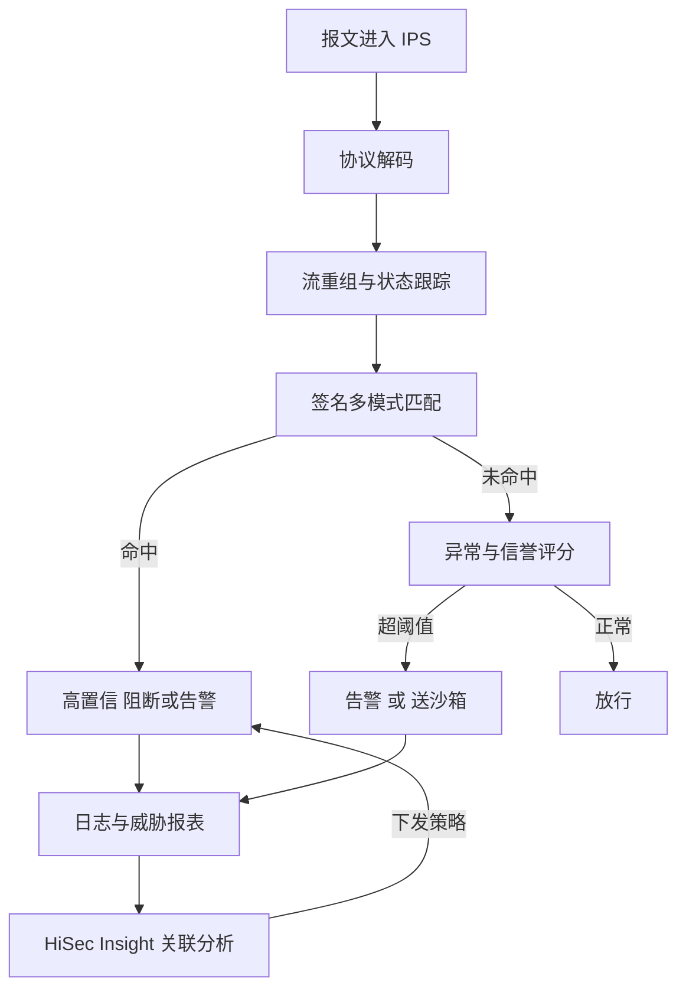

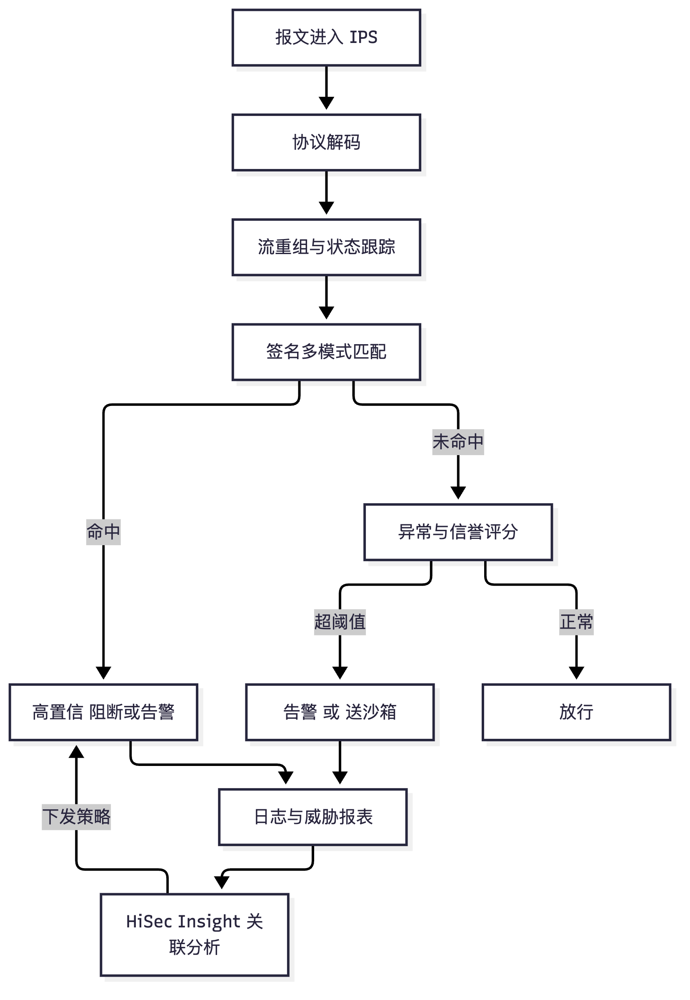


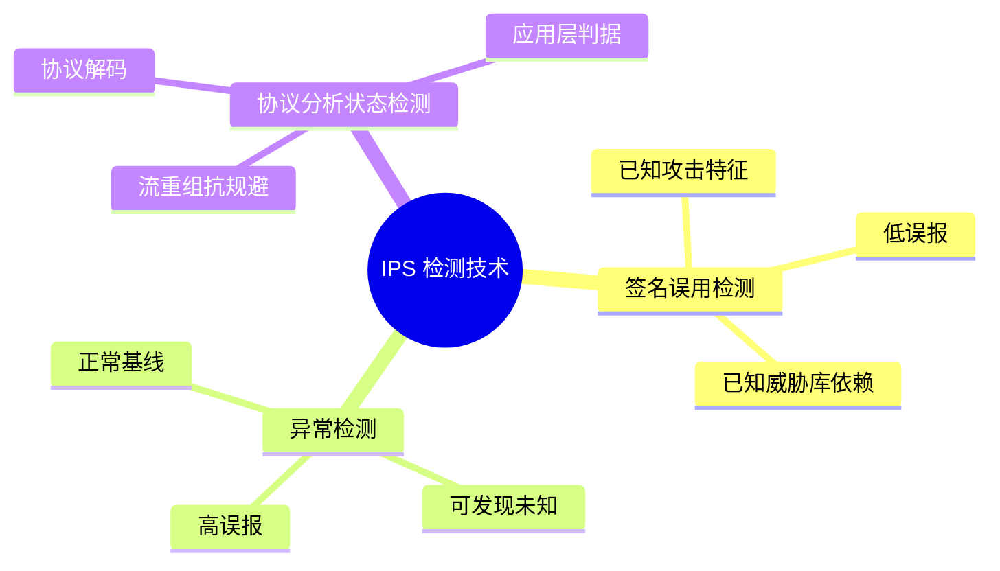

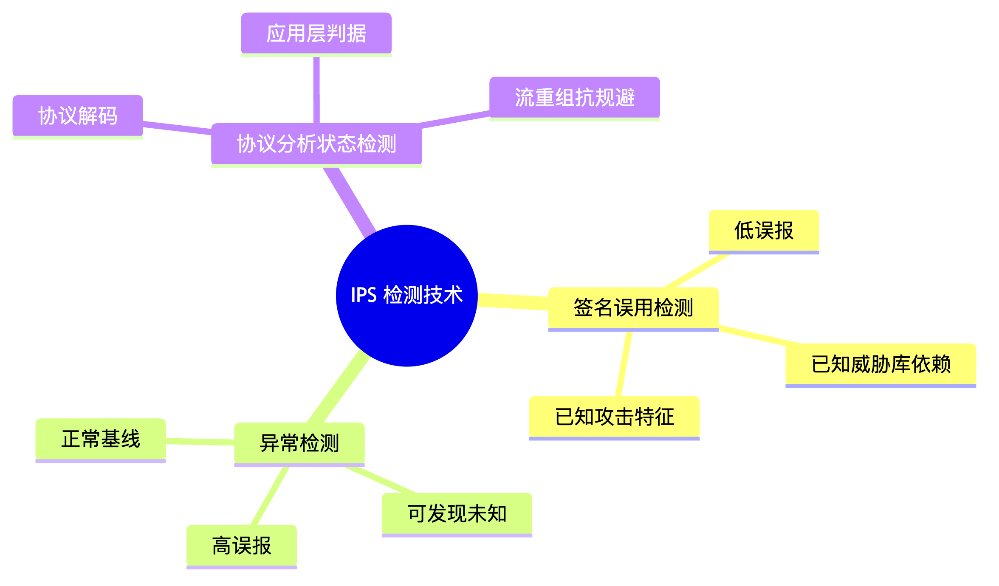


### 真题精练

**Q1.【真题·单选】** 某企业部署了 IPS，特征库已升级到最新，但内部一台主机仍被 0day 漏洞利用成功。从检测技术原理分析，最根本的原因是？
A. IPS 的吞吐性能不足，报文被丢弃未检测
B. 基于签名的误用检测只能匹配已知攻击特征，对无特征的新漏洞无能为力
C. IPS 部署在旁路，无法阻断
D. 特征库版本号显示最新但实际未生效

> **答案：B**
> **解析**：题干已明确"特征库最新"，说明排除 D；也说明部署与性能都没暴露问题（A、C 均为"设备层面"原因，且题干未给相关线索）。签名检测的判据是"已知攻击特征"，0day 没有特征，因此必然漏报，这是签名流的原理性缺陷。要覆盖这类威胁，必须依靠异常检测 + 沙箱 + 情报的闭环（5.6 节）。

**Q2.【真题·多选】** 关于基于异常的检测技术，下列说法正确的有？
A. 理论上可以发现未知威胁与攻击变种
B. 误报率通常高于基于签名的误用检测
C. 建立并持续维护正常的流量/行为基线是必要前提
D. 因为能发现未知威胁，所以最适合直接用作阻断判据
E. "低慢小"攻击可以长期隐藏在阈值之下，导致漏报

> **答案：ABCE**
> **解析**：D 是典型错误——异常检测的高误报决定了它不能直接阻断，否则业务会被大规模误杀；实践中它以告警、评分、二次判定为主。A、B、C、E 都是异常检测的固有特征：判据是"偏离基线"，故能发现新东西（A）、必然吵（B）、必须建模（C）、阈值型判据天然可被低慢小绕过（E）。

**Q3.【真题·判断】** 协议分析与状态检测的核心价值只在于校验协议字段是否合法，与抗规避无关。

> **答案：错误**
> **解析**：协议分析的两大价值是**抗规避**与**提供高层判据**。攻击者通过 IP 分片重叠、TCP 分段乱序、编码变形、多态变形来让"逐包匹配"失效；协议分析先解码、再**按目标系统的重组语义还原完整数据流**，在重组后的数据上匹配签名，从原理上消除规避空间。此外，先识别应用与协议阶段，才能写出"HTTP 响应中携带 PE 文件且下载源为新注册域名"这类判据。

**Q4.【真题·填空】** 华为 NIP/USG 的入侵防御在工程实现上采用协议分析做________、签名匹配做________、异常与信誉情报做________的组合方式，以兼顾准确率、未知威胁覆盖与抗规避能力。

> **答案：底座（解码/重组/状态跟踪）；第一判定（高置信阻断）；补充判定（告警或联动处置）**
> **解析**：这是理解"为什么真实产品不是单流派"的标准答题口径。协议分析提供上下文与抗规避，签名给高置信结论，异常/情报补覆盖未知与 C&C，最后由白名单与例外压制误报。

**Q5.【真题·简答】** 请从"漏报来源"和"误报来源"两个角度，对比签名检测与异常检测，并说明华为 NIP 为什么要把二者组合使用。

> **答案**：
> **① 签名检测的漏报来源**：特征库未覆盖（0day、私有协议攻击）、攻击载荷被混淆/编码/加密、变形与多态使特征串改变、分片与乱序导致逐包匹配看不到完整载荷。**误报来源**：特征写得过于宽泛（例如只匹配一个常见字符串）、正常业务流量恰好包含该字节序列、编码/压缩/二进制文件误命中。
> **② 异常检测的漏报来源**：阈值设置过宽、基线被污染（训练期就包含攻击流量）、低慢小攻击长期处于阈值内、加密流量无法做内容层建模。**误报来源**：业务变更/促销/新上线应用使基线漂移、周期性批量任务与扫描、统计窗口过短导致抖动、模型对少数业务（新协议、长连接）缺乏样本。
> **③ 组合使用的原因**：签名检测"准而不全"，异常检测"全而不准"。把协议分析作为共同底座，用签名做高置信阻断，用异常/信誉做未知威胁与 C&C 的告警与评分，再叠加沙箱对可疑文件做动态判定，可以在**可接受的误报率**下显著提升未知威胁的发现率；同时用白名单、例外与阈值调整把误报压到运营可承受的水平。这就是华为 HiSec 闭环防御的设计哲学：**多源检测 + 单点闭环处置 + 持续调优**。

**Q6.【真题·排错】** 网络中出现大量 IPS 误报，业务部门投诉某 OA 系统的正常上传被阻断。请给出排错与处置步骤。

> **答案**：
> ① **定位命中来源**：`display ips signature statistics` 找出高频命中的签名 ID，再用 `display ips signature pre-defined id <id>` 查看其分类、严重级别与默认动作，确认是"真攻击"还是"误命中"。
> ② **确认策略绑定关系**：`display firewall session table verbose` 查看该业务流命中的安全策略与关联 Profile，确认是 IPS 还是反病毒/URL 过滤在动作。
> ③ **取证**：在测试环境用同一文件复现，或在设备上开启签名告警（将 `signature-set action` 临时改为 alert）观察是否只告警不阻断，判断"文件内容确实含可疑特征"还是"特征过宽"。
> ④ **处置（优先级从高到低）**：为该业务源/目的地址配置 IPS 例外（`exception`）；对确认无风险的签名 ID 关闭或降级为告警；仅在必要范围内放宽到"按分类 alert"。**不要**为了省事整体关闭 IPS 或直接把动作设为 alert。
> ⑤ **验证与回归**：`display ips signature statistics` 观察误报签名命中是否归零，业务是否恢复；同时检查是否有真实攻击被顺带放过（对比命中总量与威胁报表）。
> ⑥ **长效**：把该业务加入白名单/例外清单并记录变更审批；开启特征库自动升级但**先在测试设备验证**再上生产，避免新版特征库引入新误报。

### 易错点与排错

1. **以为"上了 IPS 就防未知威胁"**：IPS 主体是签名检测，未知威胁要靠沙箱 + 异常 + 情报闭环，答题时必须分层表述。
2. **把异常检测等同于零误报的 AI**：任何基于基线的判据都有漂移与误报，考试中"异常检测可直接阻断且无误报"一定是错项。
3. **忽略 License 与特征库版本**：`display license`、`display update status` 必须列入部署检查清单，未升级的特征库等于没有 IPS。
4. **Profile 建了但没在安全策略里引用**：内容安全靠**安全策略引用 Profile** 触发，只建 Profile 不引用等于没配。
5. **例外与分类动作的优先级记错**：**例外（exception）> 单签名动作 > 分类动作 > 签名集统一动作**，排错时先看有没有例外在"反着来"。
6. **排错命令**：`display ips signature statistics`（命中统计）、`display ips signature pre-defined id <id>`（签名详情）、`display firewall session table verbose`（会话与 Profile 关联）、`display update status`（特征库版本）、`display engine information`（引擎加载状态）。

---

## 5.2 IPS 部署方式深入：串接 Inline、旁路 IDS、旁路引流与混合部署

### 考点定位

本考点是**国赛设计题与排错题的高频落点**，占 **5~10 分**：考题常给一个"既要能阻断、又不能让链路成为单点、还要能应对加密流量"的场景，让你选部署方式并说明理由。高频陷阱：① 认为"旁路 IDS 能阻断"（不能，除非配合阻断设备）；② 认为"串接部署时延一定会让业务不可用"（要会算时延与给数据）；③ 忽略"旁路引流"的引流方式差异（策略路由/镜像/分光 + 旁路阻断）。

### 原理精讲

部署方式的本质差异只有一句话：**报文是否必须"穿过"检测设备**。穿过的能阻断但有单点与时延；不穿过的不能阻断但零侵入。

**① 串接 Inline（在线部署，亦称"串联/直路"）**。检测设备作为转发路径上的一跳，报文进入 → 检测 → 放行/丢弃/改写 → 从另一接口转发。**能力**：可实时阻断、可改写（如剥离恶意附件、URL 重定向）、可做 NAT/策略/应用识别，是唯一的"真正 IPS"形态。**代价**：① **单点风险**——设备故障或断电即断网，因此必须配 **Bypass（电口硬件旁路/光口光旁路 OBP）** 或双机热备（对应 B8 分册的 HRP）；② **时延**——串接时延取决于硬件与开启的检测功能，安全设备串接通常引入**数十微秒级**时延，开启深度内容检测（IPS + 反病毒 + 沙箱联动）后单包处理时延可上升到**百微秒量级**，且会随特征库规模、并发流数上升；③ **性能瓶颈**——吞吐、并发连接、新建速率三项必须满足峰值需求，并保留余量（建议按峰值的 1.5~2 倍选型）。放行位置也很关键：串接在**互联网出口**保护南北向，串接在**数据中心核心之间**保护东西向（安全资源池形态见 7.4 节）。

**② 旁路 IDS（离线侦听，Port Mirror / SPAN / TAP）**。用交换机的镜像口或分光器把流量**复制**一份给检测设备，检测设备只收不发（其接口不参与转发，报文的收发接口通常配置为"只听"）。**能力**：只告警，**不能阻断**（它拿到的报文已经是副本，丢弃副本不影响真实流量）。**优势**：零侵入、零时延、零单点风险、部署快，适合"先看清再治理"的初期阶段与合规审计场景。**劣势**：无阻断能力、镜像口可能丢包（高负载时镜像口拥塞会导致漏检，这是重要的排错线索）、需要额外的镜像端口与带宽规划。**考试要点**：题目一旦出现"要求阻断"，旁路 IDS 必须被排除，或必须补一个"旁路阻断"组件。

**③ 旁路引流 + 旁路阻断（Deploy by Traffic Redirection）**。这是旁路 IDS 的升级形态：检测设备不串在正向路径上，而是通过**引流**让它看到完整会话，并在判定为恶意后**主动干预**。常见的两种实现：
- **流量复制 + 旁路阻断（IDS + 阻断器 / 华为 NIP 的旁路部署 + 与防火墙联动）**：检测设备从镜像口收包分析，判定恶意后向**防火墙/交换机/终端**下发阻断指令（通过 API、Syslog 联动、或发送 TCP RST 伪造复位包）。华为的典型做法是 **NIP 旁路部署 + 与 USG 联动下发黑名单**，或 **HiSec Insight 联动 USG 下发动态黑名单**。优点是零侵入、不影响转发；缺点是**阻断存在时间差**（检测延迟 + 下发延迟，通常秒级），对"一击即走"的攻击（如单包漏洞利用、快速横向扫描）来不及。
- **策略路由 / PBR / 服务链引流（Redirect 到检测设备再回注）**：由上游设备用策略路由或 **SFC（Service Function Chaining，服务功能链）** 把**指定流量**（如所有 HTTP/HTTPS、只针对服务器区、只针对某个应用）牵引到检测设备，检测设备检测后**再转发回原路径**。这实际上是"部分流量的串接"：既有阻断能力（流量真的穿过了），又把影响面限制在选定流量上，兼顾了性能与风险。缺点是引流设备与回注路径必须严谨设计（**来回路径一致**，否则会出现非对称丢包与检测不完整）。

**④ 混合部署（Inline + Bypass + 旁路）**。现网几乎都是混合：核心出口串接 **USG6000E/USG12000（含 IPS 能力）**做实时阻断，旁挂 **NIP 或 HiSec Insight 探针**做旁路深度分析（尤其是加密流量元数据与内部东西向），配合 **AntiDDoS** 做流量清洗，沙箱做文件动态判定，最后由 HiSec Insight 统一关联与下发策略。这样"能阻断的地方用串接，需要广度覆盖的地方用旁路，需要零侵入的地方用镜像"。

**时延与阻断能力的量化对比（答题必须能说出来）**：

| 对比项 | 串接 Inline | 旁路 IDS | 旁路引流 + 旁路阻断 | 混合部署 |
|---|---|---|---|---|
| 报文是否穿过设备 | 是 | 否（收副本） | 引流部分穿过 / 阻断器不穿过 | 视流量而定 |
| 阻断能力 | 强、实时（毫秒内） | **无** | 中（秒级时间差，看转发路径） | 强 |
| 转发时延增加 | 数十微秒起，开内容检测后百微秒量级 | **0** | 引流流量等同于串接；未引流流量 0 | 按流量分配 |
| 单点风险 | **高**（需 Bypass 或双机） | 无 | 低（设备故障只影响检测，不影响转发） | 中（关键路径仍串接） |
| 故障影响面 | 全网中断 | 只丢检测能力 | 只丢检测/阻断能力 | 关键路径中断，其余降级 |
| 加密流量 | 需 TLS 解密或元数据检测 | 元数据检测（无需解密） | 同旁路 | 组合 |
| 典型产品/形态 | USG6000E/USG12000 串接、NIP 串接 | 交换机镜像口 + NIP/探针 | NIP 旁路 + 与 USG 联动、HiSec Insight 联动 | 出口串接 + 内网旁路 + 沙箱 |
| 适用场景 | 出口边界、必须阻断 | 初期摸底、合规审计、内网监测 | 大流量出口、不希望引入单点 | 现网标准形态 |

### 关键概念对照表

| 部署方式 | 数据流关键节点 | 丢包/漏检风险点 | 排错第一命令 |
|---|---|---|---|
| 串接 Inline | 上游设备 → 检测设备入接口 → 检测引擎 → 出接口 → 下游设备 | 设备 CPU/会话表满、Bypass 未启用、会话未同步 | `display firewall session table` / `display hrp state` |
| 旁路 IDS | 上游设备镜像口 → 检测设备监听口（单向） | 镜像口拥塞丢包、镜像未包含双向流量、接口被误配成转发 | `display interface` 看镜像口丢包计数 |
| 旁路引流 | 上游 PBR/SFC → 检测设备 → 回注原路径 | 回注路径与原路径不一致、引流规则未覆盖双向 | `display policy-based-route` / 路由表对照 |
| 旁路阻断 | 镜像流量 → 检测判定 → API/Syslog 下发 → 防火墙/交换机执行 | 下发通道不通、下发动作不生效、时间差内攻击已完成 | 联动日志 + 防火墙黑名单表项 |

### 华为设备配置

```bash
# ===== 形态 A：串接 Inline（USG6000E 串接在出口，并配置 Bypass 与双机）=====
system-view
interface GigabitEthernet1/0/1                          // 上行接 ISP/出口路由器
 ip address 200.1.1.2 30                                // 上行互联地址
bypass enable interface GigabitEthernet1/0/1 GigabitEthernet1/0/2
                                                        // 配置电口 Bypass：设备掉电/故障时 GE1/0/1 与 GE1/0/2 物理直通，避免断网
hrp enable                                              // 串接场景强烈建议双机热备，消除单点（详见 B8 分册）
hrp interface GigabitEthernet1/0/0 remote 10.1.1.2      // 心跳接口
display bypass interface                                // 查看 Bypass 状态与触发条件

# ===== 形态 B：旁路 IDS（NIP 旁路监听，交换机侧做镜像）=====
# 交换机（S5731/S6730）侧：把被监测流量镜像到连接 NIP 的端口
system-view
observe-port 1 interface GigabitEthernet0/0/24          // 定义观察口（连接 NIP 的监听口），从该口复制流量
interface GigabitEthernet0/0/1                          // 被监测的上行口
 port-mirroring observe-port 1 inbound                  // 镜像入方向流量到观察口
 port-mirroring observe-port 1 outbound                 // 镜像出方向流量，保证会话双向完整（只镜像单向会漏掉响应体）
 quit
# NIP 侧：监听口只收不发，不参与转发
system-view
interface GigabitEthernet1/0/1
 no ip address                                          // 监听口不配 IP，避免误参与转发
 quit
display interface GigabitEthernet1/0/1                  // 关注 input 方向的丢包计数，判断镜像是否过载丢包

# ===== 形态 C：旁路引流 + 旁路阻断（NIP 旁路 + 与 USG 联动下发黑名单）=====
# 上游交换机用策略路由把"服务器区访问互联网"的流量牵引到 NIP 检测后回注
system-view
acl number 3001
 rule 5 permit ip source 10.10.10.0 0.0.0.255 destination any
 traffic classifier REDIRECT_NIP operator or
  if-match acl 3001
 traffic behavior REDIRECT_NIP
  redirect ip-nexthop 10.1.1.100                         // 把匹配流量重定向到 NIP 的入接口地址（引流）
 traffic policy REDIRECT_NIP
  classifier REDIRECT_NIP behavior REDIRECT_NIP
 interface GigabitEthernet0/0/1
  traffic-policy REDIRECT_NIP inbound                    // 在上行口入方向应用引流策略
 quit
# NIP/USG 侧：检测到恶意后把源 IP 加入动态黑名单（示例为 USG 上手工验证联动结果）
system-view
firewall blacklist enable                               // 使能黑名单功能
firewall blacklist ip 10.10.10.66 timeout 3600          // 把判定为恶意的源 IP 加入黑名单 1 小时（实际由联动接口自动下发）
display firewall blacklist                              // 查看黑名单表项与剩余时间
display firewall session table source 10.10.10.66       // 验证该源的新会话是否被拒绝

# ===== 混合部署：出口串接 + 内网旁路 + 沙箱联动 =====
display ips signature statistics                        // 串接设备上的签名命中情况
display av file-reputation statistics                   // 反病毒文件信誉统计（与沙箱联动的基础能力）
```

### 示意图

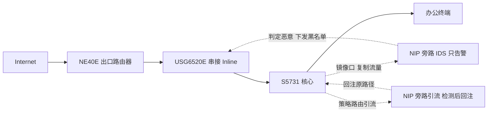

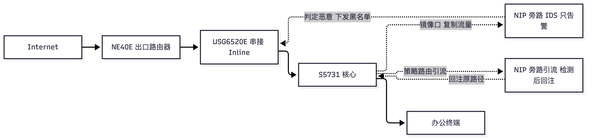


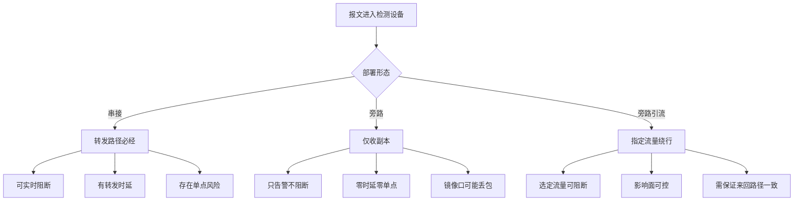

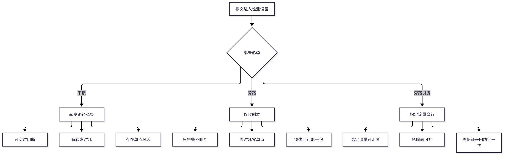


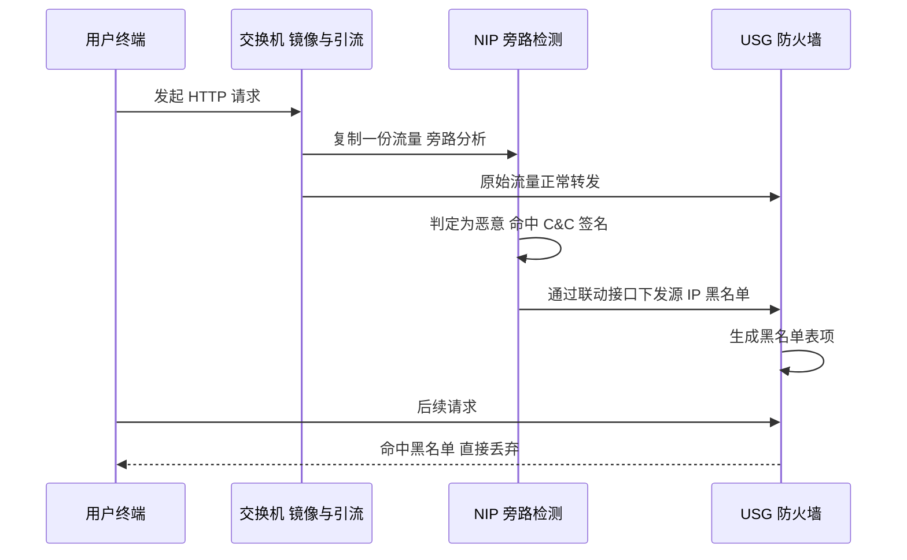

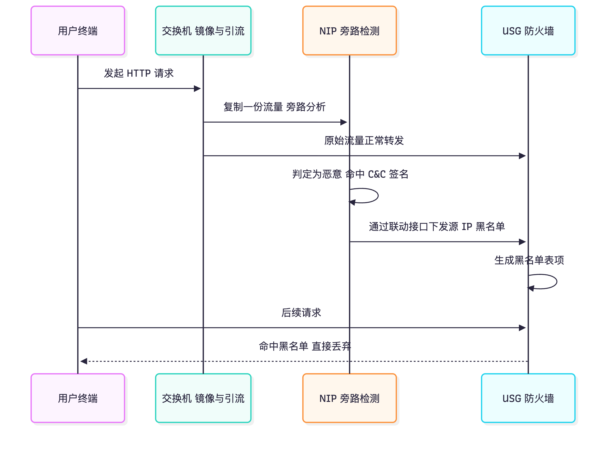


### 真题精练

**Q1.【真题·单选】** 某企业出口带宽 10Gbps，要求对互联网访问做入侵检测与阻断，同时领导强调"绝不允许安全设备故障导致断网"。在只能选一种主要部署方式的前提下，最合理的方案是？
A. 旁路 IDS 部署，命中后告警人工处理
B. 串接 Inline 部署 + Bypass + 双机热备
C. 旁路引流部署，仅对 HTTP 流量引流
D. 只在终端上装杀毒软件，不部署网络侧设备

> **答案：B**
> **解析**：要求包含"阻断"，故 A 被排除（旁路 IDS 无阻断能力）；C 只覆盖 HTTP，无法满足"互联网访问"的整体要求，且旁路引流的阻断有时间差；D 与题目要求的网络侧检测阻断不符。B 用 Bypass 解决设备故障断网（物理直通），用双机热备解决设备级单点与状态连续性，是唯一同时满足"可阻断 + 不断网"的答案。

**Q2.【真题·多选】** 与串接 Inline 部署相比，旁路 IDS 部署的优势包括？
A. 不增加转发时延
B. 不引入转发路径上的单点故障
C. 可以直接阻断攻击流量
D. 部署对现网影响小，适合先做安全摸底
E. 可以通过镜像口观察加密流量的元数据而不需要解密

> **答案：ABDE**
> **解析**：C 是旁路 IDS 的**固有缺陷**而非优势（它只能告警）。A、B、D 是"零侵入"带来的直接收益；E 也正确——旁路探针可以基于 TLS 握手元数据（证书、SNI、JA3 指纹）做检测，无需解密，这是旁路形态在加密时代的独特价值。

**Q3.【真题·判断】** 旁路引流部署中，只要引流策略配置正确，就不需要关心回注路径，检测设备转发即可。

> **答案：错误**
> **解析**：旁路引流的本质是"部分流量的串接"，因此**必须保证被引流流量的去程与回程都经过检测设备**（或至少保证会话双向可被检测设备看到），否则会出现：检测设备只看到单向流量导致签名无法命中（例如只在响应体里的特征）、回注路径不对称导致 TCP 序列号/状态异常、上游设备因非对称流量丢弃报文。排错时第一步就是对 `display policy-based-route` 的结果与路由表，确认引流与回注覆盖了双向。

**Q4.【真题·填空】** 串接部署的三大代价是：引入转发________、形成路径上的________、以及构成________瓶颈；因此工程上必须配置________或双机热备，并按峰值业务的 1.5~2 倍进行选型。

> **答案：时延；单点故障；性能（吞吐/并发/新建）**
> **解析**：这是设计题的评分要点。Bypass 属于"填空后的补充答案"（故障直通），若题干问"如何消除单点"则答 **Bypass（电口/光旁路）+ 双机热备 + 多链路**。

**Q5.【真题·简答】** 请说明"旁路 IDS"与"旁路引流 + 旁路阻断"在保护效果上的本质差异，并各举一个适合的场景。

> **答案**：
> **① 本质差异在"报文是否穿过检测设备"**。旁路 IDS 只拿到副本，丢弃副本不影响真实转发，因此**只能告警、不能阻断**；旁路引流则把指定流量真正牵引到检测设备再回注，被引流流量是"穿过的"，因此**具备实时阻断能力**；而"旁路阻断"（IDS + 阻断器/联动下发黑名单）虽然不穿过，但通过外部执行点间接阻断，**存在秒级时间差**。
> **② 保护效果**：旁路 IDS = 可视 + 事后审计；旁路引流 = 可视 + 实时阻断（但只覆盖被引流流量）；旁路阻断 = 可视 + 近实时阻断（有时间差，对"一击即走"攻击无效）。
> **③ 适用场景举例**：旁路 IDS 适合**内部东西向流量摸底**或**合规审计**（不希望在任何业务路径上引入风险）；旁路引流 + 阻断适合**大流量出口**（例如 40G/100G 出口，串接成本与风险高）或**只对服务器区出访做管控**的场景，把高价值流量引入检测，其余流量直通。
> **④ 补充（得分点）**：无论哪种旁路形态，都要关注镜像/引流是否覆盖**双向流量**，否则检测不完整；同时旁路的检测结论要能被真正的执行点（防火墙/交换机/EDR）消费，才构成闭环。

**Q6.【真题·排错】** 某企业把 NIP 旁路部署在核心交换机镜像口上，运行一周后发现大量攻击告警，但实际业务并未受影响；同时安全团队发现"某些攻击怎么都检测不到"。请分析可能原因并给出处置。

> **答案**：
> ① **"告警多但业务无影响"是旁路 IDS 的正常表现**：它只能告警，不阻断，因此攻击告警与业务受影响与否没有必然关系。**不能据此认为系统正常**，需要确认这些告警对应的真实威胁是否已经造成影响（查终端侧与服务器侧日志），并把关键告警通过联动下发到防火墙/EDR 做处置。
> ② **"某些攻击检测不到"的排查方向**：
>   - **镜像只覆盖单向**：只镜像了 inbound，导致只在响应体/回程载荷中的特征无法命中。排错：`display interface` 核对镜像配置，确认 `port-mirroring ... inbound` 与 `outbound` 都配了。
>   - **镜像口过载丢包**：`display interface GigabitEthernet1/0/1` 看 input 丢包计数是否持续增长；若丢包，需要降低镜像范围（只镜像关键网段/VLAN）、使用更高带宽镜像口或改用分光器。
>   - **镜像未覆盖目标网段**：策略路由/DHCP Snooping 等导致部分流量不经该端口，需扩容镜像范围到核心上行与服务器区网关。
>   - **检测项未开启**：确认 NIP 上 IPS 特征库版本、已启用的签名分类，以及是否因为只选了少量分类而漏掉攻击类型。
>   - **加密流量**：HTTPS 内容无法直接检测，需要元数据检测或部署解密。
> ③ **处置与验证**：修正镜像范围与方向 → 观察丢包计数归零 → 用已知攻击样本（测试环境）验证能否命中 → 把高置信告警接入联动通道下发黑名单 → 建立"告警—处置—验证"闭环台账。

### 易错点与排错

1. **把"旁路"当"能阻断"**：只要题干要求阻断，答案必须落到串接或旁路引流/联动阻断，并说明时间差。
2. **忘记 Bypass 与双机**：串接题不谈单点消除，直接丢一半分；Bypass 只对电口/光口特定形态有效，且**掉电直通不等于故障检测**（软件死机时可能需要 IP-Link/BFD 触发切换）。
3. **镜像口丢包**：`display interface` 的丢包计数是旁路排错的第一现场证据，务必会看。
4. **引流不考虑回注**：来回路径不一致是旁路引流最典型的故障，排错先对策略路由与路由表。
5. **忽略流量方向与区域**：串接设备的入/出接口必须分属正确安全区域，否则策略不匹配，表现为"设备装了但流量没进检测引擎"。
6. **排错命令合集**：`display bypass interface`、`display hrp state`、`display firewall session table verbose`、`display interface | include input`（看丢包）、`display policy-based-route`（引流）、`display firewall blacklist`（联动结果）。

---

## 5.3 IPS 的检测维度：流检测、报文检测、重组后检测与规避技术

### 考点定位

本考点是**理论与排错的交界点**，占 **4~8 分**，也是区分"背过书"与"真懂"的分水岭。命题方式：给一个"IPS 未检出某攻击"的现象，让你从分片、TCP 分段、编码变形、多态、加密五个方向推理。高频陷阱：① 认为"IPS 逐包匹配就够了"；② 分不清 IP 分片重组与 TCP 流重组；③ 认为"编码变形只影响字符串匹配"（它同时影响协议解析与文件还原）。

### 原理精讲

IPS 的"检测维度"就是**检测在数据流的哪一层/哪个阶段做**。层次越高，可见信息越完整、抗规避越强，但资源开销越大、时延越高。

**① 报文检测（Packet-based）**。逐个报文独立匹配，不看上下文。特点：开销最小、可直接硬件加速、时延最低；但**无法看到被拆分到多个报文中的完整载荷**，也**无法判断方向与协议阶段**。它适合做粗筛（如 IP 黑名单、常见单包攻击特征、速率阈值），单独使用极易被规避。

**② 流检测（Flow-based）**。看的是**流的统计特征**而非载荷内容：五元组、包数、字节数、包长分布、方向比例、持续时间、每秒包数/字节数、TCP 标志位组合、TLS 握手元数据（SNI、证书、JA3/JA3S）。特点：**对加密流量依然有效**（这是它最大的价值——不必解密）、开销小、可做大规模统计；但**看不到内容**，因此只能给出"可疑"而不是"确定"，且对"内容正常但行为恶意"的场景（如正常协议承载 C&C）依赖情报与行为模型。华为的 **HiSec Insight 与防火墙的异常流量检测**大量使用流检测维度。

**③ 重组后检测（Reassembly-based）**。这是内容检测的正确姿势：先把报文按协议**还原成完整的数据流/文件**，再在还原结果上做签名匹配、反病毒扫描、文件信誉与沙箱判定。包含两件事：
- **IP 分片重组（Fragment Reassembly）**：把 IP 分片按偏移拼成一个完整 IP 报文。关键判据是**偏移、MF（More Fragments）标志、长度**是否合法：重叠分片、微小分片（Tiny Fragment，如首片仅 8 字节使 TCP 头被切分）、分片超时（默认重组等待时间到期即丢弃）都是攻击手法。**"以谁的重组结果为准"是规避的核心**：如果 IPS 与目标主机对重叠分片的处理策略不同（有的取先到、有的取后到、有的按 RFC 791 允许任意），攻击者就能让 IPS 看到"无害"版本、让主机看到"恶意"版本——这就是 **IDS/IPS 插入与规避（Insertion & Evasion）** 的经典原理。
- **TCP 流重组（Stream Reassembly）**：按序列号把 TCP 段排好序、去重、处理乱序/重传/重叠，还原出应用层字节流。攻击者用**段重叠（overlapping segments）**、**乱序发送**、**小段拆分（每段 1 字节）**、**TTL 到期丢弃**等手法制造"IPS 与主机看到不同字节流"的分歧。因此成熟 IPS 必须实现**目标操作系统指纹识别（Target-based Reassembly）**，按目标主机的实际重组语义（Windows/Linux/Cisco 各有差异）来重组，才能与主机看到的字节流一致。

**④ 应用层解码与规范化检测（Normalization）**。在重组后的字节流上再做协议解析（HTTP/DNS/SMB/SMTP/FTP 等），并做**规范化**：URL 解码（`%20`、`%u0020`、双重编码 `%2520`）、大小写归一、路径归一（`/a/../b` → `/b`）、HTTP 头折行处理、压缩还原（gzip/deflate）、字符集转换、Unicode 归一。规范化的目的就是让"同一语义的攻击"只对应一种检测形态，从而消除编码变形规避。

**⑤ 文件还原与内容检测**。从流量中**还原出文件**（HTTP/FTP/SMB/SMTP/POP3/IMAP 承载），计算哈希做信誉查询，做病毒特征扫描，必要时送沙箱引爆。这一步是 5.6 节沙箱闭环的入口，也是"编码变形/压缩炸弹/多层嵌套压缩"攻击的战场——攻击者会把恶意载荷塞进多层压缩包、加密压缩包（密码藏在邮件正文）或大文件尾部，考验的是**还原深度与资源限制**（必须限制还原文件大小、层数、超时，否则 IPS 会被"压缩炸弹"打死，这是重要的 DoS 风险）。

**经典规避技术全景（必须能列出并说明 IPS 的应对）**：

| 规避手法 | 具体做法 | 为什么能绕过"逐包匹配" | IPS 的应对 |
|---|---|---|---|
| IP 分片重叠 | 发送重叠偏移的分片，前片无害、后片恶意，不同系统取不同片 | IPS 与主机重组结果不一致 | 实施严格分片重组 + 目标系统指纹 + 异常分片（重叠/微小片）直接告警丢弃 |
| 微小分片 | 首片仅 8 字节，把 TCP 头切到第二个分片 | 无法解析出端口无法匹配应用特征 | 先重组再解析，禁止对不完整首片做应用层判定 |
| TCP 分段重叠/乱序 | 重叠序列号携带不同内容，乱序发送 | 逐包匹配看到"无害段"，主机看到"恶意段" | 按序列号重组 + 目标 OS 语义 + 重叠冲突告警 |
| 编码变形 | URL 编码、双重编码、Unicode、大小写混排、插入 NUL/多余空格 | 特征字符串不再字面出现 | 应用层规范化后再匹配 |
| 压缩/嵌套压缩 | gzip/deflate、多层 ZIP/RAR | 特征被压在里面 | 解压再检测（限制层数与膨胀比） |
| 多态与变形病毒 | 每次感染改变自身编码/加密密钥，只保留解密循环不变 | 字节特征每次都变 | 检测解密循环与行为（异常检测）+ 沙箱动态行为 |
| 加密与隧道 | HTTPS/TLS、DNS 隧道、ICMP 隧道、DoH | 内容不可见 | 流检测 + 元数据（SNI/证书/JA3）+ TLS 解密 + 情报 |
| 慢速与分散 | 低慢小、把攻击拆到长时间/多会话 | 阈值与窗口内看似正常 | 长周期行为分析、跨会话关联（态势感知） |

### 关键概念对照表

| 检测维度 | 输入单位 | 可见信息 | 开销 | 抗规避 | 加密流量可用性 |
|---|---|---|---|---|---|
| 报文检测 | 单个报文 | 报文头 + 本包载荷 | 最低 | 弱 | 仅头部/元数据 |
| 流检测 | 一条流 | 统计特征、包长分布、TLS 元数据 | 低 | 中（不依赖内容） | **可用** |
| 重组后检测 | 一条完整流/一个文件 | 完整字节流与文件内容 | 高 | **强** | 需解密 |
| 应用层规范化 | 已重组流 | 归一化后的协议语义 | 高 | 强 | 需解密 |
| 文件还原 + 沙箱 | 还原文件 | 文件真实行为 | 最高（异步） | 最强 | 需解密或端侧 |

| 重组类型 | 关键字段 | 异常判据 | 默认行为与注意点 |
|---|---|---|---|
| IP 分片重组 | Identification、Flags(MF/DF)、Fragment Offset、Total Length | 偏移重叠、末片 MF=1、总长超限、分片超时 | 重组有超时定时器（超时未齐即丢弃，可被用于"慢速分片"攻击）；DF=1 时不得分片 |
| TCP 流重组 | Seq、Ack、Window、Flags、MSS | 重叠序列号内容冲突、Seq 跳变、极小段 | 必须按**目标 OS 语义**处理重叠；仅靠 Seq 排序不足以抗规避 |
| 应用层归一化 | URL 编码、Content-Encoding、Content-Type、字符集 | 双重编码、超长编码、异常压缩比 | 归一化顺序错误会引入新规避面（先解码还是先查特征，各厂商实现不同） |

### 华为设备配置

```bash
# ===== 在 USG6000E 上确认与调整检测相关能力 =====
system-view
display ips signature category                         // 查看签名分类清单（用于按分类设动作，减小误报与开销）
display ips signature pre-defined                      // 查看预定义签名条目数与概要

# ===== 反病毒配置（重组与文件还原能力的主要使用者）=====
profile type av name AV_PROFILE_1
 file-type http-request block                          // HTTP 上传方向检出病毒即阻断
 file-type http-response block                          // HTTP 下载方向检出病毒即阻断
 file-type ftp block                                    // FTP 文件传输方向阻断
 file-type smtp alert                                   // 邮件方向先告警，避免误拦业务邮件（可按需改为 block）
 file-type pop3 block                                   // POP3 下载邮件附件阻断
 file-type imap block                                   // IMAP 阻断
 scan-mode all                                          // 扫描模式：all 表示全部支持的协议与方向
 max-file-size 10240                                    // 单文件还原上限 10MB，防止超大文件/压缩炸弹拖垮设备（按业务调整）
 unpack-level 3                                         // 压缩包解压层数上限，防止多层嵌套压缩绕过检测（层数过高消耗 CPU）
 quit

# ===== 与安全策略绑定（必须由策略引用才生效）=====
security-policy
 rule name trust_to_untrust_av
  source-zone trust
  destination-zone untrust
  action permit
  profile av AV_PROFILE_1                               // 引用反病毒配置，触发文件还原与扫描
 quit

# ===== 观察与验证 =====
display av file-reputation statistics                  // 查看文件信誉查询统计（命中率低说明还原或联动有问题）
display av signature version                           // 查看病毒特征库版本
display firewall session table verbose                  // 确认会话命中的策略与 Profile
display ips signature statistics                       // 查看 IPS 命中统计（含被分片/重组影响的检出情况）
```

### 示意图

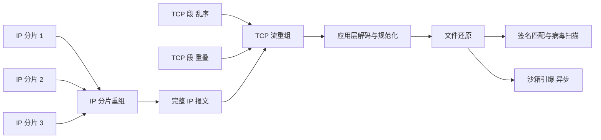

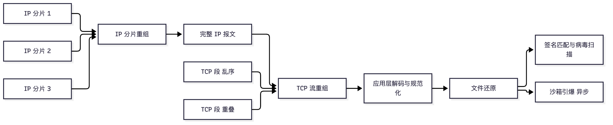


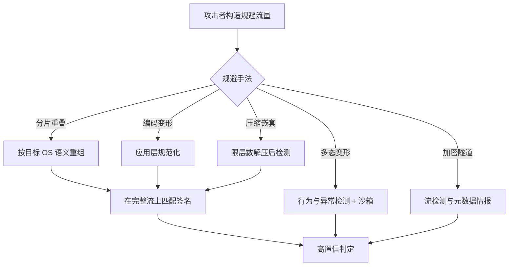

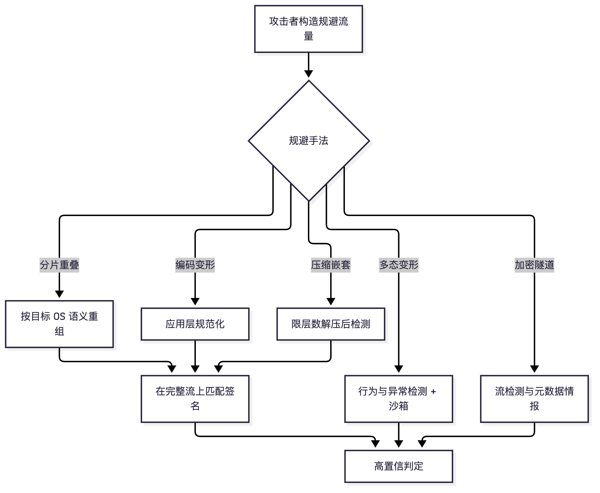


### 真题精练

**Q1.【真题·单选】** 攻击者发送两个 IP 分片，第一片包含正常的 HTTP 请求，第二片包含攻击载荷，且两片偏移重叠。目标服务器采用了"后到分片覆盖先到分片"的重组策略，而 IPS 采用了"先到优先"。最可能的后果是？
A. IPS 与服务器都判定为攻击，攻击失败
B. IPS 看到完整攻击载荷并阻断
C. IPS 看到的是无害内容而放行，服务器却按恶意内容执行，攻击成功
D. 两个分片都会被 IPS 丢弃，服务器收不到任何数据

> **答案：C**
> **解析**：这是 IDS/IPS 插入与规避（Insertion & Evasion）的经典模型：**IPS 与目标主机的重组语义不一致**时，攻击者可以让两者看到不同的字节流。IPS 先到优先 → 看到无害内容 → 放行；服务器后到优先 → 看到恶意载荷 → 执行。解决方法是**基于目标操作系统指纹的重组**（Target-based Reassembly）+ 对重叠分片直接告警/丢弃。

**Q2.【真题·多选】** 下列哪些规避手法会同时影响"协议解析"与"内容匹配"？
A. URL 双重编码 `%2520`
B. 多层嵌套压缩包
C. 大小写混排
D. TLS 加密
E. 正常的 HTTP 分块传输编码（chunked）

> **答案：ABD**
> **解析**：A 双重编码既让特征串不字面出现（影响内容匹配），又可能让 URL 解析出错误路径（影响协议解析）；B 压缩既隐藏内容，又要求先解压才能解析内部协议；D 加密同时遮蔽内容与协议语义。C 大小写混排主要影响内容匹配（HTTP 方法名与头部字段名大小写不敏感，攻击者借此绕过特征），对协议解析影响有限（规范本身大小写不敏感）。E 是 HTTP/1.1 标准特性，不是规避手法（虽然历史上曾被用于混淆，但正规实现会正确解码分块）。

**Q3.【真题·判断】** 只要 IPS 做了 TCP 流重组，就一定不会出现"IPS 与主机看到不同字节流"的问题。

> **答案：错误**
> **解析**：TCP 流重组只解决"按序列号排序"的问题；**重叠段的取舍策略**在不同操作系统/不同协议栈实现中不一致（有的保留旧数据、有的用新数据覆盖、有的按 BSD 规则部分覆盖）。因此仅做通用重组仍可能被规避，必须实现**目标操作系统指纹识别**并按目标的语义重组，同时对"重叠序列号内容冲突"这种异常直接告警。

**Q4.【真题·填空】** IP 分片重组依赖的三个关键字段是________、________、________；其中用于标记"后面还有分片"的是________标志。

> **答案：Identification（标识）、Flags（标志，含 MF/DF）、Fragment Offset（片偏移）**；**MF（More Fragments）**
> **解析**：同一原始 IP 报文的所有分片共享同一 Identification 与源/目的 IP 及协议号；Fragment Offset 以 8 字节为单位指出该片在原始报文中的位置；MF=1 表示后面还有分片，MF=0 且偏移非 0 表示末片。这些字段也是判"异常分片"（末片 MF=1、偏移重叠、总长溢出）的依据。

**Q5.【真题·简答】** 请说明"报文检测""流检测""重组后检测"三者的适用边界，并解释为什么加密流量普及后"流检测 + 元数据"变得更重要。

> **答案**：
> **① 报文检测**：适合做无状态粗筛（IP/端口黑名单、单包攻击、速率与标志位异常），开销最低、可硬件加速；不适合需要跨包语义的检测（拆分载荷、文件内容）。
> **② 流检测**：适合做统计与行为判定（扫描、爆破、DDoS、隧道、异常外联、TLS 元数据），对加密流量依然有效；不适合判定具体载荷内容（给不出"确凿证据"，只能给可疑度）。
> **③ 重组后检测**：适合做内容与文件级判定（签名匹配、病毒扫描、沙箱还原），是精确判定的唯一可靠基础；成本最高，且对加密流量必须配合解密。
> **④ 为什么加密后流检测更重要**：TLS 1.3 普及（默认前向保密、握手元数据减少）、DoH/DoT 让 DNS 也可加密，内容型检测的可见面被大幅压缩；而"不 decrypt 也能看"的流特征（连接的目标域名/SNI、证书主体与签发者、JA3/JA3S 指纹、上下行字节比、连接时长与周期性、心跳包规律）恰好是 C&C、挖矿、数据外传的强判据。因此工程实践从"内容为王"转向"**元数据 + 行为 + 情报**"，流检测从辅助手段升级为主力手段；同时在高价值边界（如服务器区出口）仍然部署 TLS 解密以保留内容检测能力。

**Q6.【真题·排错】** 某 IPS 上线后，管理员用公开的测试工具（如发送含分片的攻击样本）测试，发现部分样本"设备没反应"。请给出完整的排查思路。

> **答案**：
> ① **先确认流量是否真的进入检测引擎**：`display firewall session table verbose` 看会话是否命中带 Profile 的策略；若流量走了别的策略（更靠前的 permit 无 Profile 规则）或走了直通/硬件快转路径，就不会被检测。
> ② **确认签名是否存在且启用**：`display ips signature pre-defined id <id>` 或按关键字检索分类；确认特征库版本 `display update status`，并确认该签名动作不是被例外（exception）覆盖。
> ③ **确认规避型样本是否被正确处理**：分片/乱序类样本要求 IPS 有严格重组与目标 OS 指纹；若设备对不完整首片直接放行、或重组超时太短以致"慢速分片"样本被丢弃未检测，就会表现为"没反应"。可开启重组异常告警观察。
> ④ **确认样本本身是否真的恶意**：部分公开测试样本依赖特定服务端环境（如需要目标存在漏洞的 Web 服务响应），在测试环境中可能不触发，属于"假阴性"的测试设计问题。
> ⑤ **确认检测方向与位置**：上传与下载方向的动作配置可能不同（如反病毒只 block 了 http-response），导致单向样本未被拦截。
> ⑥ **验证与结论**：改用设备厂商提供的签名验证工具或已知可复现样本核对；逐项排除后在"攻击被设备本身前置处理（异常分片直接丢弃）"与"签名未覆盖"之间做结论，并记录改进项（升级特征库、开启严格重组、调整例外）。

### 易错点与排错

1. **混淆 IP 分片重组与 TCP 流重组**：前者在 IP 层、按 Identification/Offset，后者在 TCP 层、按 Seq；两者都要先做，顺序是 IP 先、TCP 后。
2. **认为"做了重组就万事大吉"**：重叠语义依赖目标 OS，必须做目标指纹。
3. **忽略资源限制的双刃性**：解压层数、还原文件大小上限太小会被绕过，太大则可能被"压缩炸弹"DoS，答题要写"两端权衡"。
4. **把 chunked、gzip 等正常特性当攻击**：规范化是"正确解码"，不是"一律阻断"。
5. **测试样本不触发就断言设备故障**：先排除流量未进引擎、签名未启用、例外覆盖三个常见原因。
6. **排错命令**：`display firewall session table verbose`、`display ips signature statistics`、`display ips signature pre-defined id <id>`、`display av signature version`、`display update status`。

---

## 5.4 签名/特征库的结构与自定义签名

### 考点定位

本考点在国赛中以**简答 + 实验（Web 界面配置）**为主，占 **4~6 分**。最高频的考法：给出一个业务特征（例如某内部应用的登录请求固定包含某字符串），要求你描述如何写自定义签名、并说明**风险与验证方法**。陷阱：① 认为自定义签名越宽越好；② 忽略自定义签名对性能的影响；③ 不知道自定义签名的动作、方向、匹配范围如何设置；④ 升级特征库后自定义签名的去留问题。

### 原理精讲

**特征库的组成**。华为（及主流厂商）的入侵防御特征库不是"一堆字符串"，而是结构化的条目集合，每条签名包含以下要素：

| 要素 | 含义 | 考试要点 |
|---|---|---|
| 签名 ID / 名称 | 唯一标识与可读名（如 `Huawei-IPS-xxxx`） | 排错与例外配置都靠 ID |
| 协议与方向 | 适用协议（TCP/UDP/ICMP/HTTP/DNS…）与匹配方向（请求/响应/双向） | 方向配错 = 永远不命中 |
| 分类（Category） | 如 Botnet、Exploit、Scan、Malware、Web Attack | 可按分类批量设动作，是减少误报的关键粒度 |
| 严重级别（Severity） | High/Medium/Low（信息级） | 高级别默认阻断，低级别默认告警 |
| 匹配内容（Pattern/Regular Expression） | 字节序列或正则，可带偏移、长度、深度约束 | "深度/偏移约束"决定性能与误报 |
| 上下文条件 | 会话状态、应用识别结果、文件类型、URL、请求方法、HTTP 头字段 | 组合条件能极大降低误报 |
| 动作（Action） | Alert（告警）/ Block（阻断）/ 其他（如重置连接） | 例外优先级最高 |
| 元数据 | CVE 编号、参考链接、受影响系统、更新时间 | 编写报告与定级依据 |

**先匹配谁：应用识别（协议分析）是签名的前置条件。** 华为设备先做**应用识别与协议解析**（前 4~7 层解码），再在已识别应用的流量上跑对应签名。这解释了两件事：① 未识别为 HTTP 的流量不会去匹配 HTTP 签名；② 加密流量必须先解密或改用元数据类签名。

**自定义签名的思路（四步法）**：
1. **取样与提取**：抓包（Wireshark）拿到"合法请求"与"攻击请求"两组样本，找出**只在攻击样本中出现、在正常业务中不出现**的稳定特征。优先选择**语义强**的特征（特定命令、特定参数名 + 特定值、特定路径 + 特定方法），避免选"常见字符串"（如 `id=`、`login`）。
2. **收敛匹配范围**：用协议 + 方向 + 请求方法 + URL 前缀 + 头部字段把匹配空间压到最小；能用 `Content-Type`、`User-Agent`、`Host` 限定的就不要只匹配 body 字符串。
3. **设定动作与严重级别**：**第一次上线一定用 Alert（告警）跑一段时间**，观察命中主体（是不是只有攻击源）、评估误报，再改为 Block。严重级别按影响定（可导致 RCE/数据泄露 = High）。
4. **验证与上线**：用样本回放验证命中（可用设备自带的签名测试/诊断功能或测试环境），再正式启用；同时加入变更记录与回归计划。

**自定义签名的风险（简答必答点）**：
- **误报风险**：特征过宽会命中正常业务；正则写得不严谨（如未锚定、用了贪婪匹配、忽略了编码变形）会造成大量误报或漏报。
- **性能风险**：正则（尤其回溯型正则）比字面量匹配贵得多，宽泛正则在大流量下会显著抬高 CPU，甚至成为 DoS 载体；**每条自定义签名都要评估"匹配频度"**。
- **维护风险**：自定义签名不受厂商特征库升级覆盖，需要自己维护；若特征库升级后官方新增了同类签名，会出现重复命中与动作冲突。
- **规避风险**：自写签名往往只针对"当前样本形态"，攻击者稍作编码变形就绕过；因此自定义签名只应作为**补充**（针对内部私有应用/内部资产），而不是替代官方特征库。
- **合规与可见性**：自定义签名命中也要记录日志并纳入统一告警平台，否则会成为"影子检测"。

**什么时候值得写自定义签名？** ① 检测**内部私有协议/自研应用**的异常（厂商特征库不可能覆盖）；② 检测**内网已知的特定敏感操作**（如某运维系统的批量导出接口被非授权调用）；③ 对已知攻击的**定向加固**（在官方签名基础上增加更严格的上下文约束，降低误报）。反之，公网已知漏洞攻击应当依赖厂商特征库更新，不要自造。

### 关键概念对照表

| 匹配元素 | 语法/形式 | 作用 | 误报影响 |
|---|---|---|---|
| 协议 | TCP/UDP/ICMP/HTTP/DNS 等 | 限定解码器 | 过宽导致跨协议误命中 |
| 方向 | request / response / both | 只关心上传或下载一侧 | 配错则不命中或误命中 |
| 内容 | 字面字节序列（Content） | 精确匹配 | 低，但易被编码变形绕过 |
| 正则 | PCRE 风格正则 | 灵活匹配变体 | 中~高，且性能开销大 |
| 偏移/深度 | Offset / Depth / Distance / Within | 限定匹配位置与窗口 | 过松增加误报，过紧漏报 |
| 上下文 | 应用、文件类型、URL、方法、头字段 | 缩小匹配空间 | **显著降低误报** |
| 动作 | Alert / Block | 决定处置 | 首次上线必须 alert 观察 |
| 严重级别 | High/Medium/Low | 决定默认动作优先级 | 定级错误会引发误阻断或漏处置 |

| 对比项 | 官方预定义签名 | 自定义签名 |
|---|---|---|
| 覆盖范围 | 公开漏洞与通用攻击 | 内部私有应用、定向场景 |
| 更新方式 | 厂商特征库升级（需 License） | 自行维护 |
| 质量保证 | 经过厂商验证与误报治理 | 依赖自测 |
| 性能 | 经过优化 | 需自行评估（正则尤其） |
| 是否有 CVE 元数据 | 有 | 无 |
| 正确用法 | 主力检测能力 | 补充与定向加固 |

### 华为设备配置

```bash
# ===== 方式 A：CLI 查看与管理签名（USG6000E / NIP，V600R007）=====
system-view
display ips signature pre-defined id 12345              // 查看预定义签名 12345 的分类、协议、方向、严重级别、动作
display ips signature user-defined                     // 查看全部自定义签名（含用户新建条目）
display ips signature category                         // 查看分类清单，供自定义签名归类使用

# ===== 方式 B：Web 界面自定义签名操作路径（国赛实验常考操作顺序）=====
# 路径：策略 > 内容安全 > 入侵防御 > 签名 > 自定义签名 > 新建
# 1) 基本信息：名称 my_app_export_abuse、分类 Custom、严重级别 High
# 2) 协议与方向：选择 HTTP，方向 request（只关心上传/请求方向）
# 3) 匹配条件（逐项添加，顺序即匹配顺序）：
#    - 匹配 URL：/api/v1/report/export                       // 限定到具体接口路径
#    - 匹配方法：POST                                          // 限定请求方法
#    - 匹配内容："export_all=true"                             // 语义强的关键参数
#    - 匹配上下文：请求头 Referer 不包含 trusted.example.com   // 用上下文把匹配空间压到最小
# 4) 动作：Alert（首次上线只告警）；关联的 IPS 配置文件里再统一改为 Block
# 5) 提交后在"策略 > 内容安全 > 入侵防御 > 配置文件"中把该签名加入 IPS_PROFILE_1
# 6) 验证：在"监控 > 日志 > 威胁日志"中按签名名称过滤，确认命中来源与频次

# ===== 方式 C：通过配置文件与安全策略使其生效 =====
system-view
profile type ips name IPS_PROFILE_1
 signature-set action alert                              // 统一动作先告警，便于观察自定义签名的表现
 exception signature id 12345                           // 例外优先级最高，可用于压制确认的误报
 quit
security-policy
 rule name trust_to_dmz_custom
  source-zone trust
  destination-zone dmz
  action permit
  profile ips IPS_PROFILE_1                              // 引用后自定义签名才参与检测
 quit

# ===== 验证与性能观察 =====
display ips signature statistics                        // 观察自定义签名的命中计数与趋势
display cpu-usage                                       // 大流量下观察 CPU 占用变化，评估正则签名的性能代价
display memory-usage                                    // 观察内存（重组缓存与文件还原缓存主要吃内存）
display logbuffer | include IPS                         // 在日志缓冲区中检索 IPS 相关记录
```

### 示意图

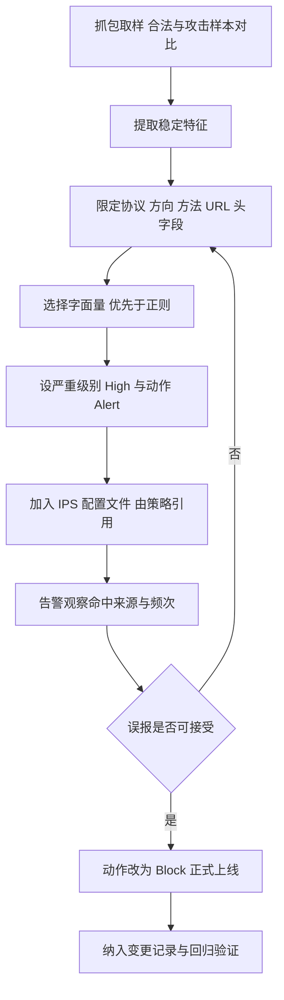

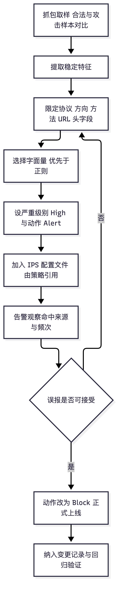


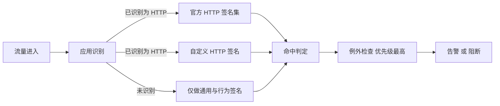

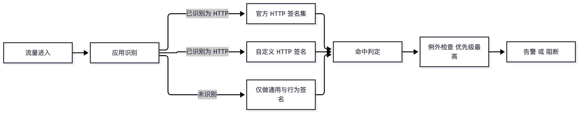


### 真题精练

**Q1.【真题·多选】** 编写自定义 IPS 签名时，为降低误报，下列做法正确的有？
A. 优先使用强语义特征（特定接口路径 + 特定参数 + 特定值）
B. 尽量只匹配 body 中常见的单词以扩大覆盖面
C. 用协议、方向、请求方法、URL 前缀、请求头字段缩小匹配空间
D. 首次上线把动作设为 Alert 观察一段时间
E. 用贪婪正则匹配任意长度的内容以兼容各种变体

> **答案：ACD**
> **解析**：B 与 E 都会显著抬高误报并带来性能开销。E 尤其危险：宽泛的贪婪正则不仅误报多，回溯型正则在高速流量下会急剧消耗 CPU，甚至可被构造成 DoS。A、C、D 是"取样 → 收敛范围 → 先告警后阻断"的标准方法论。

**Q2.【真题·判断】** 自定义签名一旦创建就与厂商预定义签名具有同等的质量保证，可以直接设为阻断动作上线。

> **答案：错误**
> **解析**：自定义签名由管理员自测，缺少厂商侧的多环境验证与误报治理，也没有 CVE 元数据支撑定级；直接阻断极易造成业务中断。正确做法是先 Alert 观察、评估命中主体与频次，必要时先加例外或只在特定源/目的网段生效，验证通过后再改 Block。

**Q3.【真题·填空】** 华为 IPS 配置文件中的动作优先级从高到低依次为：________ > ________ > ________ > ________。

> **答案：例外（exception）> 单签名（按签名 ID 设置的动作）> 分类（按 category 设置的动作）> 签名集统一动作**
> **解析**：这一优先级是排错的核心。当"某签名配了阻断却仍被放行"或"某签名被例外放过"时，必须按此顺序检查各层设置。

**Q4.【真题·简答】** 请列举"值得编写自定义签名"与"不值得编写自定义签名"的场景各两个，并说明理由。

> **答案**：
> **值得写的场景**：① **内部私有协议/自研应用**——厂商特征库不可能覆盖，只能自定义（例如自研运维协议的异常命令序列）；② **内部敏感操作的定向检测**——如某报表系统"批量导出全部客户数据"的接口被非授权账户调用，可用 URL + 参数 + 来源上下文组合成签名，是高价值内部威胁检测点；③ （补充）对公开漏洞攻击做**更严格的上下文加固**，把官方签名过宽的匹配再收紧。
> **不值得写的场景**：① **公网已知漏洞攻击**——厂商特征库更新更快、验证更充分，自造等于重复劳动且覆盖率更低；② **通用 Web 攻击（SQL 注入、XSS 等）**——已有成熟签名集与 WAF 能力，自造正则极易误报；③ （补充）**依赖加密载荷内容的检测**——除非有解密或元数据方案，否则写了也不命中。
> **理由总结**：自定义签名的价值定位是"**补齐厂商覆盖不到的私有面**"与"**对高价值内部操作定向加强**"，其成本是自测、维护与性能评估，因此使用边界应当清晰。

**Q5.【真题·排错】** 管理员写了一条自定义签名用于检测内部违规导出，动作设为 Alert。上线三天后威胁日志里零命中，但手工复现时该操作确实发生了。请给出排查步骤。

> **答案**：
> ① **确认流量是否被该策略覆盖**：`display firewall session table verbose` 查看违规操作会话命中的策略名，若走的是更靠前的策略（无 Profile）或走了公网出口的其他策略，则不会进入该签名。
> ② **确认签名是否真的启用**：检查签名是否已被加入 `IPS_PROFILE_1`，且该 Profile 被业务流经的策略引用；同时检查是否被 `exception` 覆盖。
> ③ **确认匹配条件过严**：URL 是"精确匹配"还是"前缀匹配"、是否带查询串；方法是否写成小写或被设备视为大小写敏感；Content 是否因请求被 gzip 压缩/分块（chunked）而无法字面匹配；Referer 上下文条件是否与真实请求不符。逐条用抓包样本比对。
> ④ **确认协议识别结果**：若流量被识别为 HTTPS（加密），HTTP 签名无法匹配，需要解密或改用元数据/审计类手段（如数据库审计、堡垒机日志）。
> ⑤ **验证方式**：在测试环境重放同一请求并开启更宽的匹配条件（临时去掉上下文）定位是哪一条条件挡住了；确认后再逐条加回。
> ⑥ **结论**：此类"零命中"九成出在"策略未引用 / 条件过严 / 加密不可见"三处；修复后复查日志并按需改 Block。

### 易错点与排错

1. **只建签名不引用 Profile 与策略**：自定义签名必须经"IPS 配置文件 → 安全策略"两级引用才生效。
2. **动作优先级记反**：例外 > 单签名 > 分类 > 统一动作；"阻断不生效"先查例外。
3. **方向配反**：只检测 request 时，响应体里的特征永远不命中；同理反病毒要分别配上传与下载方向。
4. **正则滥用**：宽泛回溯正则既误报又吃 CPU，优先字面量 + 上下午文约束。
5. **忽略加密**：HTTP 签名对 HTTPS 无效，这是"零命中"最常见的原因之一。
6. **排错命令**：`display ips signature user-defined`、`display ips signature statistics`、`display firewall session table verbose`、`display cpu-usage`、`display logbuffer | include IPS`。

---

## 5.5 IPS 的性能与调优：吞吐、时延、并发与误报权衡

### 考点定位

本考点常在**设计题与多选/简答**中出现，占 **4~8 分**。核心是三组权衡：**性能 vs 检测深度**、**检测率 vs 误报率**、**安全强度 vs 业务连续性**。高频陷阱：① 把"标称吞吐"当"开启全功能后的吞吐"（厂商标称通常是最简转发/大包条件下的理想值）；② 认为"白名单是偷懒"（它是运维必需且是等保与实战的常规手段）；③ 忽略**新建连接速率**与**并发连接数**这两个独立指标。

### 原理精讲

**必须先分清四个性能指标（考试常拿来出多选题）**：
- **吞吐量（Throughput，bps）**：单位时间可处理的数据量。关键点：**实测吞吐与包长强相关**——小包（64/128 字节）时 CPU/查表/检测的单位开销被放大，吞吐会显著低于大包（1518 字节）条件。因此选型与验收必须问"多少字节包长下、开启哪些功能时的吞吐"。
- **时延（Latency，μs/ms）**：单包处理引入的延迟。串接设备引入的时延会叠加到业务 RTT 上，对时延敏感业务（数据库同步、VoIP/视频、交易系统）影响明显。
- **并发连接数（Concurrent Sessions）**：设备会话表容量，受内存约束。长连接、P2P、大量 NAT 场景会快速消耗；会话表满的表现是"新连接建不起来、丢包"，是典型的隐性故障。
- **新建连接速率（New Sessions per Second，CPS）**：每秒可建立的新连接数。它对"秒杀、抢购、压测、爬虫、扫描"最敏感，**是最容易被忽略但最容易被打穿的指标**——SYN Flood 与扫描攻击本质上就是消耗 CPS。

**关键认知：开启内容安全功能后，这些指标全部会下降。** 原因是数据路径从"快速转发"变成"完整解码 + 重组 + 匹配 + 还原"：
- 只做转发/ACL：走快转路径，指标接近线速。
- 开启应用识别 + IPS：需要解码与多模式匹配，吞吐下降，时延上升，CPU 随特征库规模上升。
- 再叠加反病毒 + 文件还原 + 沙箱联动：需要缓存与拼装文件、计算哈希、发起外网请求，对内存与 CPU 压力最大，且沙箱是**异步**的（不阻塞转发，但有排队与超时）。

**检测率与误报率的权衡（ROC 视角）**。任何检测系统都有一对指标：检测率（TPR）与误报率（FPR）。把判据收紧（阈值降低、特征更激进）→ 检测率上升但误报上升；放宽 → 误报下降但漏报上升。工程上不可能同时最优，只能选**工作点**，并用以下手段把"工作点"整体向左上移动（同误报下更高检测率）：
1. **分层判定**：低置信判据只告警、高置信判据才阻断。签名（高置信）直接阻断，异常/行为（低置信）只告警或送沙箱二次判定。
2. **上下文收敛**：用应用识别、URL 分类、资产重要性、用户身份收敛判据范围。例如"外网到内网服务器的 SMB 流量"直接阻断（正常业务不需要），而内网内 SMB 只做检测。
3. **资产与角色白名单**：对已知安全的业务系统、漏扫设备、备份服务器、监控平台配置例外，避免"每天被自己的运维工具打一遍"。
4. **情报与信誉加权**：结合 IP/域名/文件信誉与威胁情报，把"业务行为 + 情报命中"组合成高置信结论，降低单判据的阈值压力。
5. **持续调优闭环**：告警 → 研判 → 加例外/改动作 → 复测。误报治理是运营工作，不是一次性配置。

**白名单与例外的配置原则（重要且常考）**：
- **最小范围**：白名单必须限定到"源 + 目的 + 服务 + 时间（必要时）+ 具体签名"，禁止整网段整签名放行。
- **有期限与责任人**：临时例外设置超时（例如 7 天）与审批记录，避免"临时变永久"。
- **可审计**：所有例外都要打日志，并纳入定期复核（每月/每季度）。
- **区分层级**：能做成"例外签名"就不要放开整个签名集；能按地址放行就不要整区域放行。
- **不要用白名单替代根因分析**：如果误报来自业务本身的行为异常（例如业务被入侵后确实在做异常外联），白名单会把真实威胁一起放过——这是实战中非常危险的错误。

**容量与部署调优要点**：
- 选型按**峰值业务 × 1.5~2 倍**，并明确"开启全部安全功能"的实测值。
- 关注**会话保持时间**与**长连接**：可调整会话老化时间（`firewall session aging-time`）以平衡内存与业务。
- 采用**分流**：把大流量区（如数据中心东西向）交给独立安全资源池，出口交给防火墙串接，避免"一台设备扛全网"。
- 开启**硬件加速/快转**：对已信任的流（如内网同区域、大流量备份链路）走快转或直接不检测，把有限算力留给真正需要检测的流量。
- **优化签名集**：关掉与本地无关的签名分类（例如设备不跑某操作系统/中间件的漏洞签名），既降 CPU 又降误报。
- **监控三项基础指标**：`display cpu-usage`、`display memory-usage`、会话表使用率；再监控特征库加载状态与引擎状态。

### 关键概念对照表

| 指标 | 单位 | 影响因素 | 被打穿的表现 | 查看命令 |
|---|---|---|---|---|
| 吞吐量 | bps/pps | 包长、开启的功能、特征库规模 | 丢包、时延抖动、业务卡顿 | `display interface` |
| 时延 | μs/ms | 解码深度、重组、文件还原 | 业务响应变慢、RTT 上升 | 抓包对比时延 |
| 并发连接数 | 条 | 会话表容量、老化时间、NAT 规模 | 新连接建不上、SYN 无响应 | `display firewall session table` |
| 新建连接速率 | CPS | CPU 与查表效率、策略条数 | 秒杀/压测时大规模超时 | 会话数增长速度 |
| 检测率 TPR | % | 签名覆盖、重组质量、情报 | 漏报真实攻击 | `display ips signature statistics` |
| 误报率 FPR | % | 特征宽窄、基线、业务变更 | 业务被误阻断、告警疲劳 | 威胁日志与工单统计 |

| 调优手段 | 收益 | 代价/风险 | 使用建议 |
|---|---|---|---|
| 关闭无关签名分类 | 降 CPU、降误报 | 覆盖变窄 | 按现网资产（OS/中间件）裁剪 |
| 精确例外（源+目的+服务+签名） | 消除已确认误报 | 管理成本、可能放过真威胁 | 必须限期 + 审批 + 复核 |
| 已信任流走快转/免检 | 提吞吐、降时延 | 该方向失去检测 | 仅用于低风险内部高带宽流 |
| 提高异常检测阈值 | 降误报 | 漏掉低慢小 | 只用于告警类判据 |
| TLS 解密 | 恢复内容检测 | 性能与合规成本、证书管理 | 仅高价值边界部署 |
| 分流/安全资源池 | 全局性能提升 | 架构复杂度、引流路径设计 | 数据中心与大出口首选 |

### 华为设备配置

```bash
# ===== 性能监控：把四项指标纳入巡检 =====
display cpu-usage                                       // 查看各任务 CPU 占用，重点看 ips/av/session 相关任务
display cpu-usage history                               // 查看 CPU 历史曲线，判断是否与业务峰值同步
display memory-usage                                    // 查看内存占用，重组缓存与文件还原最吃内存
display firewall session table                          // 查看会话条数，接近规格上限即为风险
display firewall session statistics                     // 查看会话统计（新建速率、老化相关计数）
display interface GigabitEthernet1/0/1                  // 查看接口收发速率、丢包与错包计数

# ===== 会话老化与容量调优（按业务特性调整）=====
system-view
firewall session aging-time tcp 1800                    // TCP 会话老化时间，缺省 600s（10 分钟），长连接业务可适当延长
firewall session aging-time udp 120                     // UDP 会话老化时间，缺省 30s（按业务调整）
firewall session link-state check                       // 使能会话链路状态检查，链路故障时快速老化，避免黑洞
firewall session synchronization enable                 // 双机场景下开启会话同步（配合 HRP）

# ===== 白名单与例外（精确到源+目的+服务+签名）=====
profile type ips name IPS_PROFILE_1
 exception signature id 12345 source 10.1.1.50          // 只为特定内网主机（如漏扫平台）设置该签名例外，不要整网段放行
 signature-set category "Scan" action alert              // 扫描类统一降级为告警，避免漏扫与资产盘点被误阻断
 quit

# ===== 策略层面缩小检测范围（把算力留给高价值流量）=====
security-policy
 rule name trust_internal_bypass
  source-zone trust
  destination-zone trust
  source-address 10.1.0.0 16
  destination-address 10.1.0.0 16
  action permit
  // 内网同区域互访不引用内容安全 Profile，走精简路径以降低时延，
  // 东西向检测交给旁路探针与安全资源池（详见 7.4 与 7.7 节）
 rule name trust_to_untrust_full
  source-zone trust
  destination-zone untrust
  action permit
  profile ips IPS_PROFILE_1
  profile av AV_PROFILE_1                               // 出口方向开启完整内容检测
 quit

# ===== 特征库与引擎状态（性能与检测能力的基础）=====
display update status                                   // 各特征库版本与升级时间
display ips signature statistics                        // 命中统计，用于评估签名集裁剪效果
display engine information                              // 引擎加载与工作状态
```

### 示意图

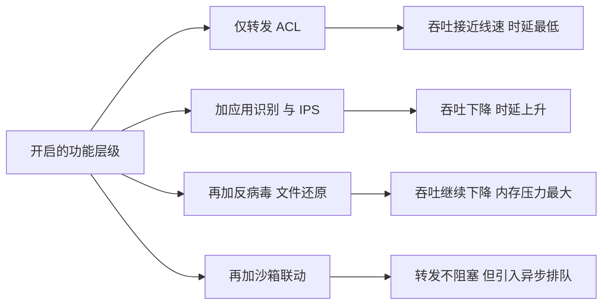

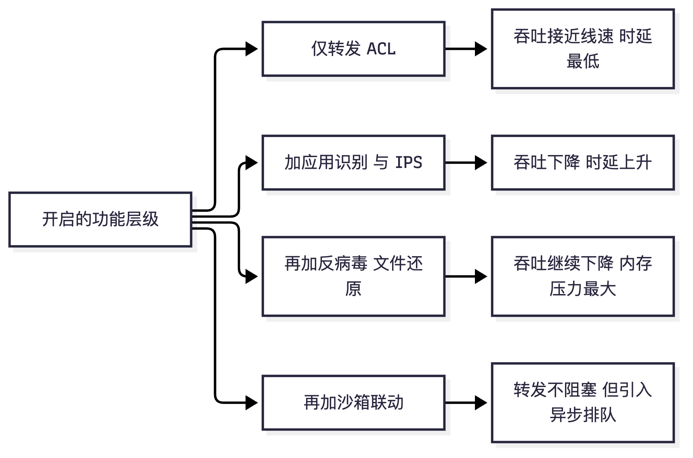


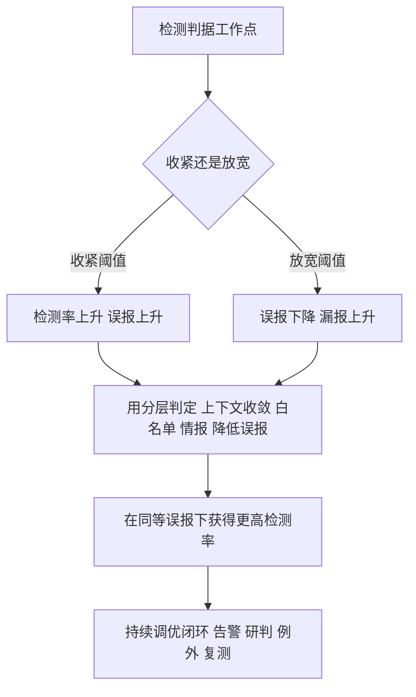

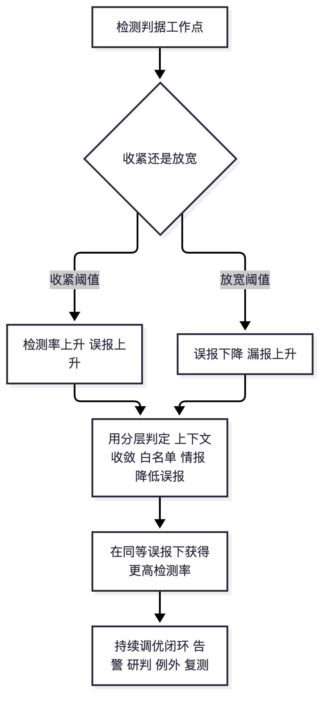


### 真题精练

**Q1.【真题·多选】** 关于安全设备的性能指标，下列说法正确的有？
A. 标称吞吐量通常在 1518 字节大包、开启功能最少的条件下测得，开启内容安全后实测值会明显下降
B. 并发连接数与会话表内存容量相关，长连接与 NAT 场景消耗更快
C. 新建连接速率（CPS）只影响端口扫描，与业务无感
D. 小包（64 字节）条件下的吞吐通常低于大包条件
E. 时延对时延敏感业务（数据库同步、VoIP）比吞吐量更关键

> **答案：ABDE**
> **解析**：C 错误——CPS 直接决定秒杀、抢购、压测、爬虫等场景能否建连，SYN Flood 的本质也是打爆 CPS。A、B、D、E 都是选型与验收的必答点：包长、开启功能、会话容量、时延敏感业务四个维度必须分别评估。

**Q2.【真题·判断】** 为了降低误报，最省事的办法是关闭 IPS 或把所有签名动作改成 Alert。

> **答案：错误**
> **解析**：关闭 IPS 或全部降级为 Alert 等于放弃阻断能力，属于"用安全换清净"，在等保与实战中不成立（等保要求入侵防范具备阻断能力，实战中攻击会直接成功）。正确做法是：分层判定（高置信阻断、低置信告警）、上下文收敛判据、精确例外（限源/目的/服务/签名/期限）、资产白名单与情报加权，形成可审计、可复核的误报治理闭环。

**Q3.【真题·填空】** 白名单/例外配置的四条原则是：范围________、设置________、动作可________、定期________。

> **答案：最小（精确到源+目的+服务+签名）；有效期（超时自动失效）；审计（记录日志与审批）；复核（定期清理）**
> **解析**：实战中"临时例外变永久、范围过大、无人复核"是安全设备被绕过的主要人为原因。考试答这四条即可得分；若能补充"不得用白名单掩盖业务侧已被入侵的异常行为"则为加分项。

**Q4.【真题·简答】** 某企业出口 5Gbps，USG6520E 开启 IPS + 反病毒后业务偶发卡顿。请给出至少五条调优措施并说明原理。

> **答案**：
> ① **裁剪签名集**：关闭与现网无关的签名分类（如本网不使用的操作系统/中间件漏洞签名），减少无效匹配，直接降 CPU 与时延，同时降低误报。
> ② **缩小检测范围**：仅对"内网→互联网"与"互联网→DMZ/服务器"等有价值方向引用内容安全 Profile；内网同区域大流量互访走精简路径（东西向交给旁路探针/安全资源池），把算力集中到边界。
> ③ **精确例外与降级**：对漏扫平台、备份系统、监控平台等"天生行为像攻击"的资产设置精确例外；对扫描类等低风险分类统一降级为告警。
> ④ **调整会话老化与容量**：按业务特性调整 TCP/UDP 老化时间，避免长连接堆积导致会话表接近上限（表满会导致新连接失败，表现为"偶发卡顿"）；同时监控 `display firewall session table` 使用率。
> ⑤ **限制文件还原规模**：设置 `max-file-size` 与 `unpack-level`，避免大文件与压缩炸弹长时间占用内存与 CPU；对非必要协议关闭文件还原。
> ⑥ **架构分流（扩容与解耦）**：如仍不足，采用"出口串接 + 数据中心安全资源池"分流，或升级到 USG12000 系列；沙箱联动改为**异步 + 超时放行或阻断策略按业务定**，避免文件排队拖慢体验。
> ⑦ （补充）**验证方法**：用 `display cpu-usage history`、`display memory-usage`、`display interface` 在调整前后对比，量化收益，而不是凭感觉。

**Q5.【真题·排错】** 某日早晨 9 点，大量用户反馈"网页打不开、需要反复刷新"，同时安全设备 CPU 与内存均正常。你会优先怀疑什么？如何验证？

> **答案**：
> ① **优先怀疑会话表耗尽或新建速率打满**（CPU/内存正常不代表会话表不满）：表现就是"新连接建不起来、老连接还活着"，与题干高度吻合。
> ② **验证**：`display firewall session table` 看总会话数是否接近规格上限；`display firewall session statistics` 看新建速率；`display firewall session table verbose` 抽查是否有大量异常会话（同一源大量连接到不同目的 = 扫描或蠕虫；大量半开连接 = SYN Flood）。
> ③ **进一步定位**：`display firewall session table source <可疑IP>` 找出异常源；结合 IPS 日志与威胁日志确认是否被入侵主机发起连接风暴。
> ④ **临时处置**：对异常源下发黑名单（`firewall blacklist ip x.x.x.x timeout 3600`）、必要时调整老化时间加速回收、对确认的攻击流用安全策略阻断。
> ⑤ **根因与整改**：定位被感染主机并隔离处置；评估是否需要扩容（并发与 CPS 规格）或调整架构（分流）；把"会话表使用率"加入监控告警（如 70% 预警）。

### 易错点与排错

1. **用标称吞吐选型**：必须问清包长与开启功能，按峰值 1.5~2 倍留余量。
2. **只盯 CPU 不盯会话表**：会话表满导致"业务卡但 CPU 正常"，是最典型的误判。
3. **白名单范围过大**：整网段、整签名、无期限的例外是审计与实战中的重大风险点。
4. **用"全部改成告警"降误报**：丧失阻断能力，等保与实战均不合格。
5. **忽略文件还原的资源上限**：上限过小会漏检，过大则可能被压缩炸弹/超大文件拖垮，必须双端权衡。
6. **排错命令**：`display firewall session table`、`display firewall session statistics`、`display firewall session table verbose`、`display cpu-usage history`、`display memory-usage`、`display interface`、`display ips signature statistics`。

---

## 5.6 未知威胁防御：沙箱原理、APT 杀伤链与闭环防御架构

### 考点定位

本考点是**国赛安全方向分值最高的知识点之一**（合计 **8~15 分**），且几乎必然以**时序图/架构图描述题**或**综合设计题**出现。必考内容：① 沙箱的原理与"为什么必须异步"；② 文件动态检测的四步流程（还原 → 引爆 → 行为分析 → 信誉回写）；③ APT 杀伤链各阶段的防御点；④ C&C 通信检测手法；⑤ **华为 HiSec Insight + 沙箱 + 防火墙联动的闭环防御架构**。陷阱：① 认为沙箱能实时阻断；② 认为"沙箱只能检测可执行文件"（实际支持文档、脚本、快捷方式、宏等）；③ 把沙箱当成"万能"，忽略反沙箱对抗与情报回写。

### 原理精讲

**一、沙箱（Sandbox）的原理与"为什么必须异步"**

沙箱是一个**隔离的、可监控的、可回滚的虚拟执行环境**。当设备从流量中还原出文件（或终端上报文件）后，把文件在沙箱里"引爆"（执行或打开），通过内核/系统调用监控、API Hook、行为规则引擎观察它做了什么：创建了什么进程、写了哪些注册表/文件、发起了哪些网络连接、是否尝试提权/持久化/加密文件、是否篡改浏览器设置等。样本的真实恶意行为**无法伪装**（它可以伪装文件特征，但要达成目的就必须有真实行为），这是沙箱相对静态特征检测的最大优势。

为什么沙箱在架构上**必须与转发路径解耦（异步）**？因为引爆需要在虚拟环境中执行样本并观察数十秒到数分钟，这个时间远大于业务可容忍的转发时延（毫秒级）。因此工程实现只能是：**转发路径上先"放行或挂起"，文件副本异步送沙箱；沙箱出结论后，通过信誉回写与联动下发，对"后续"访问该文件/IP/域名的行为做阻断**。这是"**时间差**"的根源，也是所有沙箱类方案的共同局限（对"一次性下载即执行"的攻击，只能事后处置已感染主机）。

因此沙箱的**处置策略**必须由业务决定：常见三种——① **先放行后追溯**（不影响业务，但有一次风险敞口，适合普通办公）；② **挂起等待**（体验差、不现实）；③ **分级**：可疑度高的直接阻断，中低可疑度的先放行并沙箱分析，出结论后回写（推荐）。

**二、文件动态检测流程（必须能画时序图）**

**文件还原 → 沙箱引爆 → 行为分析 → 信誉回写**，四步加两个"辅助环节"（取证留样与联动处置）：

1. **文件还原**：IPS/防火墙在会话中识别协议（HTTP/FTP/SMTP/SMB/POP3/IMAP），解析传输编码（chunked、gzip），拼装完整文件，计算 **MD5/SHA-1/SHA-256**。注意：还原要处理"分块、断点、压缩、嵌套压缩、超大文件"，并且**先查本地缓存与信誉库**——如果哈希已在缓存中判为恶意/安全，则无需重复送沙箱（这是性能关键）。
2. **沙箱引爆**：文件被投递到沙箱集群（多引擎：Windows 各版本、Office/WPS、PDF 阅读器、Android、Linux 等），在受控网络中执行。关键工程细节：**网络模拟**（伪造 DNS/HTTP 响应以诱导样本外联，观察 C&C 地址）、**反逃避**（对抗"检测到虚拟机就休眠"的样本：随机延迟、模拟真实用户操作、环境指纹伪装）、**多引擎并行**（不同环境结论可能不同）、**超时与队列管理**。
3. **行为分析**：收集行为并打分。典型恶意行为证据：进程注入、创建自启动项/服务、修改 hosts、释放子文件、加密大量文件、连接新注册域名、使用 DGA（Domain Generation Algorithm，域名生成算法）域名、发起扫描、下载后续载荷、绕过 UAC。输出为**结论 + 家族/家族归类 + 行为标签 + IOC（Indicators of Compromise，失陷指标）**。
4. **信誉回写**：把结论写入**文件信誉库（哈希）+ IP/域名信誉库 + IOC 情报库**，并**下发到执行点**：防火墙动态黑名单（阻断 C&C 地址与下载源）、IPS 新增本地签名（哈希或行为特征）、终端 EDR 隔离文件、邮件网关拦截同族样本。同时把样本、行为报告、IOC 归档留证（取证与溯源）。
5. **辅助：闭环与运营**：HiSec Insight 汇总全网告警与情报，做关联分析（例如"同一 C&C 被多台主机访问"），生成处置工单（SOAR 剧本自动下发），并统计检测效果用于调优。

**三、APT（Advanced Persistent Threat，高级持续性威胁）杀伤链与各阶段防御点**

APT 的特征是"**高级**（定制化 0day/社工）、**持续**（长期潜伏）、**威胁**（有明确目标与数据窃取目的）"。用杀伤链（Cyber Kill Chain）拆成七个阶段，每个阶段都有对应防御点，这是简答题的标准框架：

| 阶段 | 攻击者动作 | 防御点（华为方案对应能力） | 关键检测信号 |
|---|---|---|---|
| 1 侦察 Reconnaissance | 收集资产、邮箱、员工信息、漏洞 | 减少暴露面、关闭不必要服务、社工意识培训、外部攻击面管理 | 外部扫描与信息收集告警（AntiDDoS/情报） |
| 2 武器化 Weaponization | 制作带漏洞利用的文档/木马 | 难以在网络侧阻断（发生在攻击者侧），靠情报预警与漏洞管理 | 漏洞情报（CVE 预警） |
| 3 投递 Delivery | 钓鱼邮件、水坑攻击、U 盘、供应链 | 邮件安全（反垃圾/反病毒/沙箱）、URL 过滤、Web 防护（WAF）、终端管控 | 可疑附件、新注册域名、异常下载 |
| 4 利用 Exploitation | 触发漏洞、执行 payload | IPS/虚拟补丁、终端 EDR、漏洞修复、最小权限 | 漏洞利用签名命中、异常进程创建 |
| 5 安装 Installation | 落地持久化（服务/计划任务/启动项） | EDR 行为检测、HSS 主机安全、应用白名单、文件完整性监控 | 自启动项新增、服务创建、注册表异常 |
| 6 命令与控制 C2 | 与 C&C 服务器通信（隐蔽信道） | 防火墙出站管控、IPS 的 C&C 签名、DNS 安全、流检测 + 情报、TLS 元数据 | 心跳周期性、DGA 域名、JA3 异常、非工作时间外联 |
| 7 目标达成 Actions | 横向移动、提权、数据窃取、破坏 | 微隔离、东西向检测、数据库审计、DLP、UEBA、备份与容灾 | 横向 SMB/WMI/PsExec、大批量数据外传、异常账户行为 |

**四、C&C 通信检测（实战高频）**

C&C（Command and Control）检测的核心是"**在加密与隐蔽信道下，用元数据与行为找规律**"：
- **周期性心跳**：固定间隔（如每 60s±抖动）的小包外联，上下行字节比极不对称（请求小、响应小），连接时长一致。
- **域名特征**：DGA 生成的随机字符串域名、超长域名、异常 TLD、新注册域名（NRD）、与已知恶意家族关联的域名、Fast Flux（快速更换 IP）、域名解析到云主机/廉价 VPS。
- **TLS 元数据**：**JA3/JA3S 指纹**与已知恶意工具（Cobalt Strike、Metasploit 默认配置）匹配、自签名证书、证书主体与访问域名不一致、SNI 缺失、TLS 版本/加密套件异常（老旧或非常规）。
- **协议异常**：DNS 隧道（大量 TXT/NULL 记录、超长子域、高频同域查询）、ICMP 隧道（大 payload、高频）、HTTP 隧道（大量 POST 到单一 URL、Cookie 异常长/base64 特征）。
- **情报命中**：目的 IP/域名命中威胁情报（华为 HiSec Insight 的情报库、第三方情报）——这是最直接的高置信判据。
- **行为关联**：同一内网主机同时访问多个可疑地址、主机在非工作时间外联、服务器主动外联（服务器不应主动访问互联网）。

**五、华为 HiSec Insight + 沙箱 + 防火墙的闭环防御架构（核心必背）**

华为的企业级闭环可以概括为"**一个大脑、两类探针、三类执行点、一条情报链**"：
- **一个大脑**：**HiSec Insight 态势感知**——收集全网日志与流量元数据（Firewall/IPS/沙箱/EDR/HSS/云服务），做关联分析与威胁评分，输出"资产—威胁—情报"三张图，并作为统一处置下发中心。
- **两类探针**：**旁路流量探针（NIP/探针）**做深度检测与元数据提取；**主机/终端探针（EDR/HSS）**做进程与行为检测（端侧能看到网络侧看不到的东西）。
- **三类执行点**：**边界防火墙（USG6000E/USG12000）**执行黑名单与策略封锁；**IPS/NIP** 执行签名阻断；**EDR/交换机/微隔离**执行端侧隔离与东西向封锁。
- **一条情报链**：沙箱与探针产生 IOC（哈希、IP、域名、JA3）→ 写入信誉/情报库 → 由 HiSec Insight 统一下发到执行点 → 执行结果与命中情况回流 → 形成"检测—判定—处置—验证—调优"的闭环。

这条链的**关键价值**在于"**一次发现，全网免疫**"：任一探针发现新型恶意文件，其哈希、C&C 域名/IP 会在秒级到分钟级同步到所有执行点，阻断后续传播。反过来，**闭环失效的三大常见原因**是：① IOC 下发通道不通（API/联动配置错误）；② 情报质量差（误报回写导致误封）；③ 执行点未消费（策略未引用、黑名单未使能）。

### 关键概念对照表

| 检测手段 | 检测对象 | 时效性 | 覆盖未知威胁 | 主要局限 |
|---|---|---|---|---|
| 病毒特征扫描 | 文件字节特征 | 实时 | 不能 | 变形/加密样本漏过 |
| 文件信誉（哈希） | 文件哈希 | 实时（查库） | 依赖库更新 | 需联网查库、隐私与性能 |
| 沙箱动态分析 | 文件真实行为 | 异步（数十秒~分钟） | **能** | 有时间差、可被反沙箱对抗 |
| 流量异常/行为 | 流统计与行为 | 近实时 | 部分能 | 误报高 |
| 威胁情报 | IP/域名/哈希/JA3 | 实时 | 依赖情报源 | 情报时效与准确性 |

| 沙箱处置策略 | 业务影响 | 安全效果 | 适用场景 |
|---|---|---|---|
| 先放行后追溯 | 无 | 有一次敞口，事后处置 | 普通办公、下载量大 |
| 可疑即阻断 | 有误拦风险 | 最好 | 高价值服务器、财务/研发核心区 |
| 分级处置（推荐） | 小 | 好 | 大多数企业：高可疑阻断、中低放行送检 |

| 反沙箱对抗手法 | 手法说明 | 对抗措施 |
|---|---|---|
| 环境检测 | 检测虚拟机指纹、CPU 核数、磁盘大小、驱动、用户名 | 环境指纹伪装、随机化配置 |
| 时间延迟 | 休眠数分钟后再行动，超过沙箱观察窗口 | 延长观察时间、加速时间（Hook 时间函数） |
| 交互依赖 | 需要鼠标点击/滚动才触发 | 模拟真实用户交互 |
| 网络依赖 | 无网络就不行动 | 网络模拟（伪造 DNS/HTTP 响应） |
| 多阶段下载 | 首阶段无害，下载后才恶意 | 多阶段串联分析、网络模拟中允许受控外联 |

### 华为设备配置

```bash
# ===== 一、防火墙侧：文件还原 + 沙箱联动（USG6000E，V600R007）=====
system-view
# 1) 配置与沙箱/HiSec Insight 的联动通道（以 API/联动服务器方式对接，地址按现网填写）
#    Web 路径：系统 > 联动 > 沙箱/态势感知 配置服务器地址、端口与密钥
# 2) 反病毒配置中启用文件还原与沙箱送检
profile type av name AV_PROFILE_SANDBOX
 scan-mode all                                          // 全协议全方向扫描
 file-type http-request block                            // 上传方向命中病毒阻断
 file-type http-response block                           // 下载方向命中病毒阻断
 max-file-size 20480                                    // 单文件还原上限 20MB（沙箱送检的文件通常需更大上限）
 unpack-level 4                                         // 压缩包解压层数上限 4 层
 sandbox enable                                          // 使能沙箱检测：可疑文件异步送沙箱引爆
 quit

security-policy
 rule name trust_to_untrust_sec
  source-zone trust
  destination-zone untrust
  action permit
  profile av AV_PROFILE_SANDBOX                          // 引用后才会触发文件还原与沙箱送检
  profile ips IPS_PROFILE_1
 quit

# ===== 二、沙箱结论回写后的执行动作（防火墙动态黑名单）=====
firewall blacklist enable                               // 使能黑名单，联动下发的 IOC 会写入此处
firewall blacklist ip 203.0.113.66 timeout 86400        // 手工验证：封禁沙箱判定为 C&C 的地址 24 小时
firewall blacklist domain malware-c2.example timeout 86400
                                                        // 封禁恶意域名（DNS 请求命中即阻断）
display firewall blacklist                              // 查看黑名单表项、来源与剩余时间

# ===== 三、验证闭环是否生效（排错必做）=====
display av file-reputation statistics                   // 文件信誉查询与沙箱送检统计，命中率低说明通道有问题
display ips signature statistics                        // 沙箱回写的本地签名是否在命中
display logbuffer | include SANDBOX                     // 检索沙箱相关日志（送检、结论、回写）
display firewall session table destination 203.0.113.66 // 验证 C&C 地址的新会话是否被阻断
```

```text
# ===== 四、HiSec Insight 侧关键操作路径（界面操作，国赛实验常考顺序）=====
# 1) 资产管理：资产 > 资产列表 > 导入/自动发现，标注资产重要级别（核心/重要/一般）
# 2) 日志接入：系统 > 数据源 > 新增数据源，接入 USG/NIP/沙箱/EDR 的 Syslog 或 API 数据
# 3) 情报库更新：情报 > 威胁情报 > 订阅与更新（IP/域名/文件哈希/JA3）
# 4) 关联分析规则：分析 > 关联分析 > 新建规则，例如
#      "同一源 IP 在 5 分钟内命中 C&C 情报 >= 3 次" → 生成高级威胁事件
#      "服务器主动外联新注册域名且上传流量 > 10MB" → 疑似数据外传
# 5) 处置下发：响应 > 联动处置 > 新建联动策略，目标为 USG/NIP/EDR，动作为下发黑名单/隔离主机
# 6) 闭环验证：态势 > 威胁事件 > 查看事件处置状态（已下发/已执行/已验证），核对执行点日志
```

### 示意图

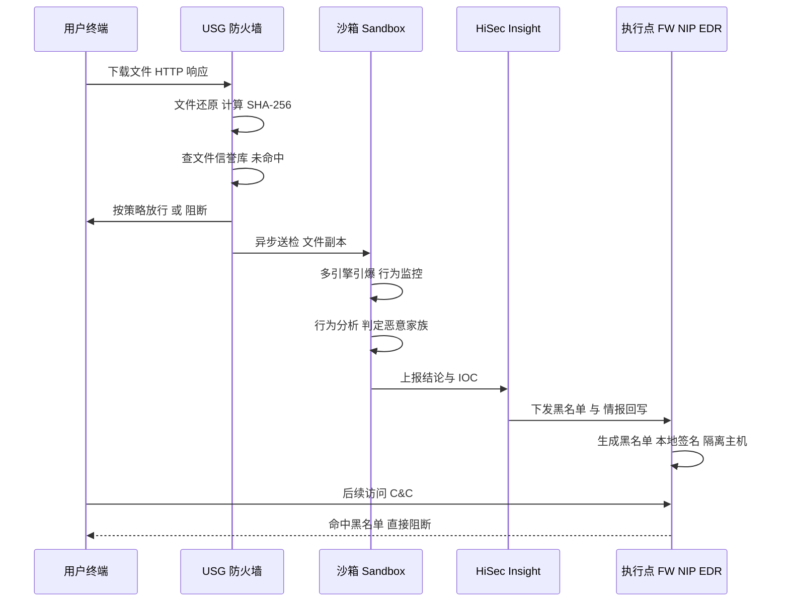

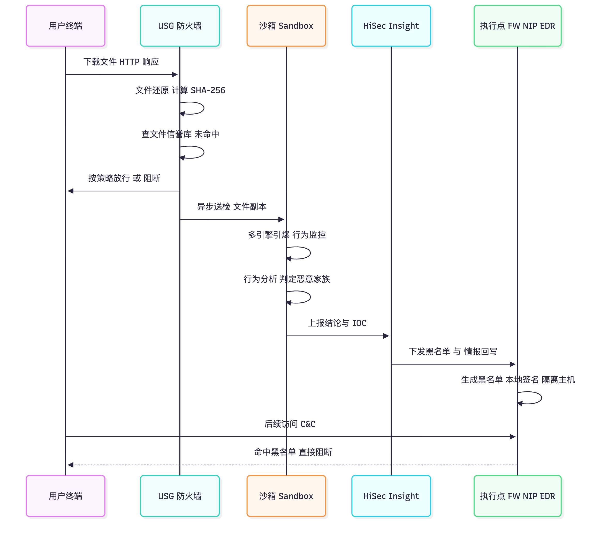


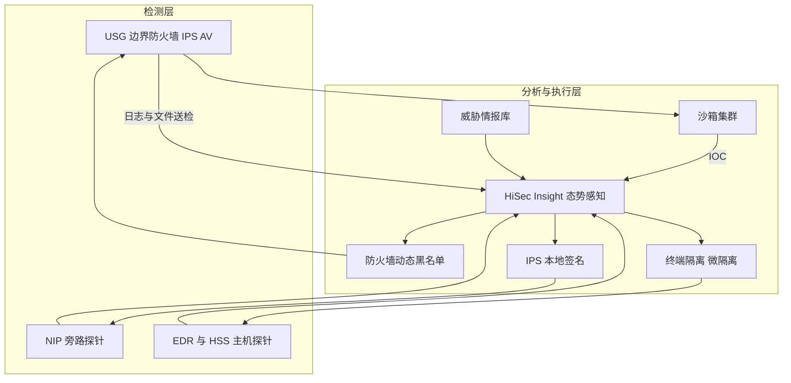

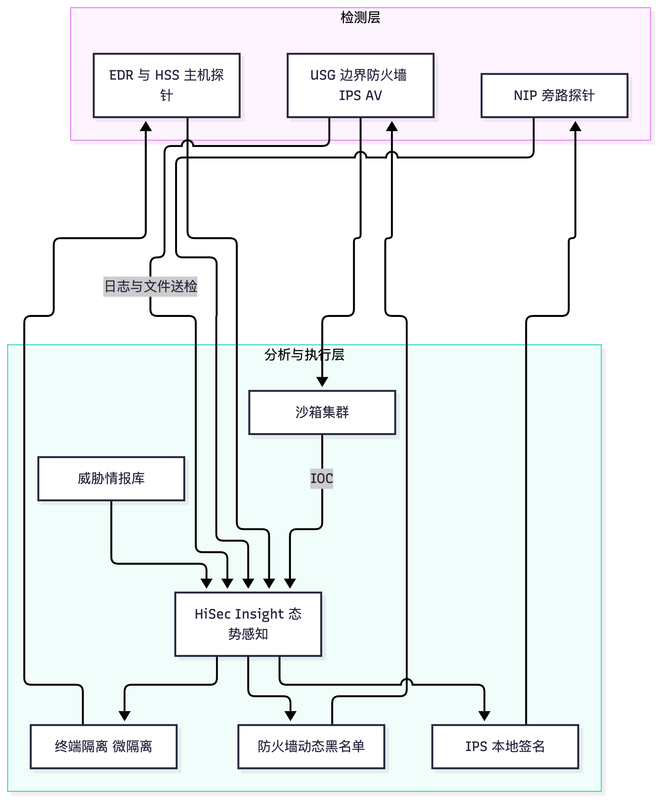


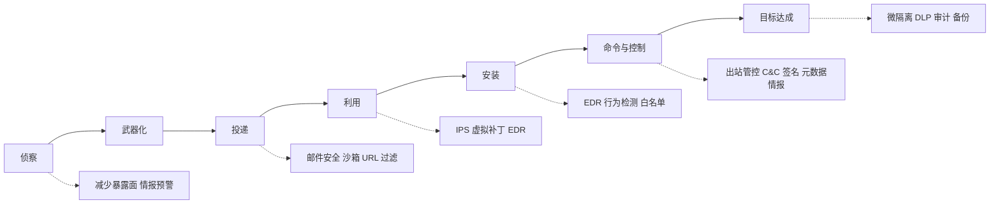

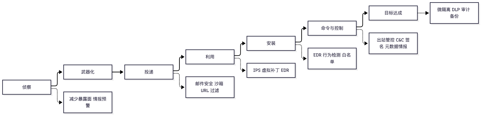


### 真题精练

**Q1.【真题·单选】** 沙箱检测在架构上必须与转发路径解耦（异步执行），其根本原因是？
A. 沙箱设备价格昂贵，只能部署一台
B. 沙箱需要执行样本并观察数十秒至数分钟的行为，远超业务可容忍的转发时延
C. 沙箱无法解析 HTTP 协议，必须离线处理
D. 异步设计可以避免占用带宽

> **答案：B**
> **解析**：沙箱的价值来自"真实执行 + 观察行为"，观测窗口是秒到分钟级，而转发时延要求是毫秒级，两者存在数量级差距，因此只能在转发路径外异步执行，再用信誉回写与联动下发对后续行为阻断。代价是**存在时间差**（对一次性下载即执行的攻击只能事后处置），这正是沙箱方案必须配合"分级处置 + 终端 EDR"的原因。

**Q2.【真题·多选】** 文件动态检测的完整流程包含下列哪些环节？
A. 文件还原与哈希计算
B. 沙箱引爆与行为监控
C. 行为分析与恶意家族判定
D. IOC/信誉回写并下发到执行点
E. 在转发路径上阻塞等待沙箱结论后再转发

> **答案：ABCD**
> **解析**：E 与异步设计矛盾（会严重破坏业务体验，仅对极高可疑度流量或严格场景才可能采用"可疑即阻断"的分级策略，而不是默认阻塞等待）。A、B、C、D 构成标准闭环；答题时应补充"送检前先查本地缓存与信誉库以避免重复送检""处置结果要回流验证"这两个工程要点。

**Q3.【真题·判断】** 沙箱只能检测 Windows 可执行文件（.exe），对文档、脚本、快捷方式无效。

> **答案：错误**
> **解析**：现代沙箱支持多引擎、多平台：Windows 各版本、Office/WPS 文档（含宏）、PDF、脚本（JS/VBS/PowerShell）、快捷方式（LNK）、压缩包、Android/Linux 样本等。APT 攻击恰恰大量使用**恶意文档 + 宏 + 脚本**做初始投递，因此文档类样本的支持是沙箱能力的关键指标。

**Q4.【真题·填空】** APT 杀伤链中，检测"主机与 C&C 服务器通信"属于第________阶段（填阶段名），该阶段常用的三类检测依据是________、________、________。

> **答案：命令与控制（C2/Command and Control）**；**周期性心跳与流量行为特征、域名/证书等 TLS 元数据特征（含 JA3 指纹）、威胁情报命中（IOC）**
> **解析**：C2 阶段是防守方最有优势的阶段——攻击者无论用什么载荷，都必须与外部通信。因此"出站管控 + 元数据检测 + 情报"是最有效的组合。答题时补一句"加密普及后内容不可见，元数据与情报成为主力判据"则为加分点。

**Q5.【真题·设计】** 请画出（并文字描述）华为"HiSec Insight + 沙箱 + 防火墙"联动闭环防御架构，说明各组件职责与数据流走向。

> **答案**：
> **① 分层描述**：
> - **检测层**：边界 **USG6000E/USG12000**（IPS + 反病毒 + 文件还原）、内网 **NIP 旁路探针**（深度检测与元数据）、**EDR/HSS 主机探针**（进程与行为）。
> - **分析层**：**沙箱集群**（文件动态引爆与行为分析）、**HiSec Insight 态势感知**（日志汇聚、关联分析、威胁评分、统一处置下发）、**威胁情报库**（IP/域名/哈希/JA3）。
> - **执行层**：防火墙动态黑名单、IPS 本地签名、交换机/微隔离与终端隔离。
> **② 数据流**：探针与防火墙把日志/告警/元数据上报 HiSec Insight（Syslog/API）→ 防火墙把还原出的可疑文件异步送沙箱 → 沙箱输出结论与 IOC 并上报 HiSec Insight → HiSec Insight 结合情报做关联分析生成高级威胁事件 → 通过联动接口向执行点下发处置（黑名单/签名/隔离）→ 命中与执行结果回流 HiSec Insight 验证 → 未命中则触发人工研判与调优。
> **③ 闭环价值与关键点**：实现"一次发现、全网免疫"；成功的关键是 **IOC 下发通道可用、情报质量可控、执行点确实消费规则**；同时要认识到沙箱有时间差，必须配合终端侧检测与事件响应（SOAR 剧本）才能闭环。
> **④ 排错要点**：查 `display av file-reputation statistics`（送检是否发生）、`display firewall blacklist`（黑名单是否写入）、HiSec Insight 上事件处置状态（是否下发成功/执行成功）。

**Q6.【真题·排错】** 企业已部署沙箱联动，但安全团队反馈"沙箱几乎没有检出过任何恶意文件，而同时 EDR 却发现了多台主机被木马感染"。请分析原因并给出整改。

> **答案**：
> ① **送检通道未生效**：最常见原因。检查反病毒 Profile 是否使能沙箱（`sandbox enable`）、是否被安全策略引用、联动服务器地址/密钥/网络可达性是否正确。验证：`display av file-reputation statistics` 若送检计数长期为 0，即通道未生效。
> ② **送检被"前序动作"截断**：若某文件已被低版本反病毒特征库判为"安全"或已被缓存为白，则不再送沙箱；也可能因为 `max-file-size` 太小，木马文件超限未还原（很多木马 > 10MB）。
> ③ **协议与方向未覆盖**：木马可能通过 HTTPS、邮件、U 盘、共享目录（SMB）进入；若只覆盖 HTTP 且未部署解密，则网络侧根本还原不到文件（这解释"EDR 能发现、网络侧不能"——端侧天然能看到落地文件）。
> ④ **样本被反沙箱对抗**：样本检测到虚拟环境即休眠或不行动，导致沙箱结论为"无恶意"。需评估沙箱的反逃避能力（环境伪装、模拟交互、延长观察、网络模拟）。
> ⑤ **告警未接入**：沙箱有检出但结论只落在本地日志，未上报 HiSec Insight / 未进入告警流程，表现为"没检出"。
> ⑥ **整改建议**：修正联动与策略引用 → 提高还原上限、扩展协议覆盖并对高价值边界做 TLS 解密 → 开启沙箱反逃避能力并增加多引擎 → 把沙箱结论接入统一告警与 SOAR 剧本自动处置 → 建立"客户端 EDR + 网络侧沙箱"的双向互补机制，并每季度做一次"投放已知恶意样本"的验证演练。

### 易错点与排错

1. **说"沙箱实时阻断"**：沙箱是异步的，只能事后阻断后续访问；一次敞口是固有代价。
2. **忘了先查缓存与信誉**：工程实现必须"先本地缓存/信誉，再送沙箱"，否则性能与成本不可接受。
3. **只做网络侧不做端侧**：网络侧看不到落地文件与本地行为，端侧看不到未落地的横向与出站异常，二者互补，缺一必被绕过。
4. **忽略输出（IOC 回写）**：沙箱的核心产出是 IOC 与信誉，不下发到执行点等于白做。
5. **把 APT 拆解只背阶段名**：必须能对每阶段说出**具体防御能力与检测信号**（见对照表），这是设计题得分点。
6. **排错命令/操作**：`display av file-reputation statistics`、`display firewall blacklist`、`display logbuffer | include SANDBOX`、`display ips signature statistics`、HiSec Insight 的"威胁事件—处置状态"页面。

---

## 5.7 威胁情报体系与勒索软件、挖矿、横向移动专项检测

### 考点定位

本考点在国赛中以**多选/填空/简答**为主，占 **5~8 分**。必会概念：威胁情报的来源分层、**STIX/TAXII** 的含义与作用、情报在防火墙/IPS 上的落地方式；勒索软件的加密行为特征与"备份优先"的防护思路；挖矿与横向移动的检测信号。陷阱：① 把"情报"等同于"IP 黑名单"；② 不知道 STIX 是"表示格式"、TAXII 是"传输协议"；③ 把勒索软件的防护重点放在"杀毒"而不是"备份与恢复"。

### 原理精讲

**一、威胁情报（Threat Intelligence）的来源分层**

| 层级 | 来源 | 特征 | 落地用法 |
|---|---|---|---|
| 战略情报 | 行业报告、监管通报、厂商年度报告 | 面向决策，非机器可读 | 安全规划、预算与优先级 |
| 运营情报 | 厂商情报订阅、CERT/CNVD 通告、同行业共享（ISAC） | 半结构化，含 TTP 与 IOC | 制定检测规则、应急响应 |
| 战术情报 | IOC（IP/域名/URL/文件哈希）、JA3 指纹 | 机器可读、时效短 | 直接下发黑名单与检测规则 |
| 技术情报 | TTP（Tactics, Techniques and Procedures，战术技术与过程）、检测规则（YARA/Snort 规则） | 可复用、时效长 | 编写检测规则、ATT&CK 对标 |

**情报的关键属性是"时效（Time-to-Live）"**：IP 与域名类 IOC 的半衰期可能只有数小时到数天（攻击者快速更换），文件哈希半衰期较长，而 TTP 与技术情报半衰期最长。因此工程上必须做**情报生命周期管理**：自动过期、置信度分级、来源加权、误报回写。**"把所有情报都当阻断依据"是最典型的错误**——低置信情报应只告警，高置信且与本地资产相关时才阻断。

**二、STIX 与 TAXII**

- **STIX（Structured Threat Information Expression，结构化威胁信息表达）**：一种**描述威胁情报的标准化数据格式**（基于 JSON），用 SDO（域对象，如 Indicator、Malware、Threat Actor、Campaign、Attack Pattern、Relationship）与 SRO（关系对象）把"谁、用什么、打谁、怎么打"结构化表达。作用：**让不同厂商/平台的情报可以互操作**，避免"每家一个格式"。
- **TAXII（Trusted Automated Exchange of Intelligence Information，可信自动化情报交换）**：**传输层协议**（基于 HTTPS 的 RESTful API，含 Collections/Channels 模型），定义情报的**发布与订阅方式**（Collection = 请求-响应式拉取；Channel = 发布-订阅式推送）。作用：让情报可以在组织间/平台间自动交换。
- **一句话记忆**：**STIX 管"怎么描述"，TAXII 管"怎么传输"**；两者常与 **ATT&CK**（对手战术技术知识库，用于把 IOC 上升到 TTP 层面的检测）配合使用。

**三、情报在防火墙/IPS 上的落地方式**

1. **静态黑名单**：把高置信 IP/域名写入 `firewall blacklist` 或安全策略的地址组（适用于数量小、变更慢）。
2. **动态黑名单 + 联动下发**：由 HiSec Insight/沙箱/第三方平台通过 API、Syslog 联动自动写入，带 TTL 自动过期（适用于数量大、时效短）。
3. **情报库订阅（本地情报引擎）**：设备本地加载情报库，直接匹配目的 IP/域名/URL/文件哈希/JA3（无需外部查询，性能好，适合大流量）。
4. **云端查询（信誉云）**：把哈希/URL 送云端查询信誉（华为的**云端信誉服务**），优点是最新，缺点是需联网与隐私考量。
5. **DNS 安全/URL 过滤联动**：对恶意域名在 DNS 查询阶段即阻断（比 IP 阻断更早更有效，因为攻击者换 IP 比换域名难）。
6. **与 SIEM/SOAR 联动**：情报进入 SIEM 做关联分析，由 SOAR 剧本自动执行封禁、隔离、取证，并回写处置结果。

**四、勒索软件专项**

**攻击链（典型）**：初始访问（钓鱼邮件/暴露的 RDP/VPN 弱口令/漏洞利用）→ 建立立足点（下载器、Cobalt Strike）→ 提权与凭证窃取（Mimikatz 类）→ **横向移动**（SMB/WMI/PsExec/RDP）→ **数据窃取（双重勒索）** → 删除/破坏备份 → 批量加密（投放勒索载荷）→ 索要赎金。

**加密行为特征（检测要点）**：
- **文件系统行为**：短时间内大量文件被改写，**文件扩展名批量变更**、出现统一后缀、生成大量勒索说明文件（README/RECOVER）；文件熵值（信息熵）骤增（加密后近似随机）。
- **进程与 API 行为**：调用加密 API（Windows CryptoAPI/CNG）、大量文件句柄操作、删除卷影副本（`vssadmin delete shadows`）、禁用恢复功能、修改引导配置。
- **网络行为**：与 C&C 通信（窃取数据、获取密钥）、内网 SMB/445 与 RDP/3389 扫描与爆破、对多台主机同时发起文件共享写操作（蠕虫式传播）。
- **账户行为**：使用域管账户异常登录、批量创建账户、异常时间操作。

**检测与防护手段**：
1. **入口收敛**：关闭/加固公网暴露的 RDP/VPN/数据库端口，MFA，及时修补漏洞（防"打进来"）。
2. **网络侧**：IPS 签名（漏洞利用与 C&C）、沙箱（恶意下载）、邮件安全、DNS/URL 过滤（防投放与回连）。
3. **端侧**：EDR 行为检测（进程链、加密行为、卷影删除）、HSS 主机安全、应用白名单、**最小权限与域管账户管控**（防止一次性全网沦陷）。
4. **横向移动阻断**：微隔离/东西向策略（禁止终端之间 SMB/RDP 随意互访）、限制共享、禁用不必要协议。
5. **备份与恢复（最关键）**：**3-2-1 原则**（3 份副本、2 种介质、1 份离线/异地）；备份**不可被在线凭据访问**（防勒索软件删除备份）；**定期做恢复演练**（未演练的备份不算备份）；关键系统做快照与不可变存储（WORM）。
6. **应急处置**：隔离受感染主机与网段 → 保留取证样本 → 从干净备份恢复 → 全网排查同类 IOC → 修改所有相关凭据（勒索软件常窃取凭据）→ 复盘。

**答题金句**：**勒索软件的防护重点不是"不被加密"，而是"被加密后能快速恢复"**——因为绝对防御不现实，而恢复能力决定业务连续性。

**五、挖矿与横向移动检测**

| 场景 | 检测信号 | 检测位置与手段 |
|---|---|---|
| 挖矿（Cryptomining） | 长时间高 CPU/GPU 占用、连接矿池常用端口（3333/4444/5555/7777/8888/9999/14444 等，**端口非固定，仅作线索**）、周期性 stratum 协议心跳、访问已知矿池域名、DNS 查询矿池域名、非工作时间持续外联、内网横向传播挖矿脚本 | IPS 挖矿签名、流检测（长连接 + 周期心跳）、DNS 安全、EDR 进程行为、HSS 资源占用告警 |
| 横向移动（Lateral Movement） | 内网大量 445/135/139/3389/5985 连接、单源对多目的（一对多扫描）、PsExec/WMI/PowerShell Remoting 特征、异常账户登录（同账户多地登录、非工作时间、域管账户）、SMB 写入可执行文件、远程服务创建 | 旁路探针 + 态势感知关联、EDR 进程链、Windows 事件日志（4624/4625/4688/7045）、微隔离策略告警 |
| 暴力破解 | 单源对单目的固定端口高频失败登录、多账户轮询、成功后立刻横向 | IPS 暴力破解签名、认证日志、态势感知关联 |

**关键认知**：横向移动是 APT 与勒索软件的**共同必经阶段**，也是防守方"东西向检测"的核心场景。南北向边界设备看不到东西向流量，必须依靠**旁路探针 + 主机探针 + 微隔离**。这也是 5.2 节混合部署与 7.5 节微隔离的实战意义。

### 关键概念对照表

| 概念 | 全称 | 定位 | 作用 | 常见考点 |
|---|---|---|---|---|
| STIX | Structured Threat Information Expression | **格式**（JSON） | 标准化描述威胁情报对象与关系 | 与 TAXII 的区分 |
| TAXII | Trusted Automated Exchange of Intelligence Information | **传输协议**（HTTPS/REST） | 情报的发布与订阅（Collection/Channel） | 与 STIX 的区分 |
| ATT&CK | Adversarial Tactics, Techniques and Common Knowledge | **知识库** | 把 IOC 上升到 TTP，指导检测覆盖 | 用于检测能力评估 |
| IOC | Indicators of Compromise | 失陷指标 | IP/域名/哈希/JA3，机器可读、时效短 | 生命周期管理 |
| TTP | Tactics, Techniques and Procedures | 战术技术与过程 | 攻击行为模式，时效长 | 检测规则编写 |
| YARA | — | 文件特征匹配规则语言 | 描述恶意文件族特征 | 沙箱/取证常用 |

| 勒索软件防护层次 | 措施 | 说明 |
|---|---|---|
| 预防 | 漏洞修补、关闭暴露面、MFA、邮件安全、IPS/沙箱 | 降低被入侵概率 |
| 检测 | EDR 行为、文件熵/扩展名批量变更、C&C 情报、横向移动告警 | 尽早发现 |
| 阻断 | 微隔离、限制 SMB/RDP、黑名单、账户最小权限 | 限制扩散 |
| 恢复 | 3-2-1 备份、离线/不可变副本、恢复演练 | **业务连续性根本** |
| 应急 | 隔离、取证、恢复、改密、复盘 | 减少损失与复发 |

### 华为设备配置

```bash
# ===== 一、情报落地：黑名单与 DNS 安全（USG6000E）=====
system-view
firewall blacklist enable                               // 使能动态黑名单，供情报联动写入
firewall blacklist ip 198.51.100.23 timeout 86400       // 高置信恶意 IP，24 小时后自动过期（时效管理）
firewall blacklist domain pool.malware.example timeout 86400
                                                        // 恶意域名：设备在 DNS 应答阶段即可阻断解析
display firewall blacklist verbose                      // 显示黑名单来源、命中次数与剩余时间（验证情报是否被消费）

# ===== 二、DNS 安全与 URL 过滤（阻断恶意域名解析，早于 IP 阻断）=====
profile type dns-filter name DNS_SEC_1
 # Web 路径：策略 > 内容安全 > DNS 过滤，勾选"恶意域名/僵尸网络/挖矿"等分类
 quit
profile type url-filter name URL_SEC_1
 # Web 路径：策略 > 内容安全 > URL 过滤，阻断"恶意软件/钓鱼/挖矿"分类，其余允许
 quit
security-policy
 rule name trust_to_untrust_dns
  source-zone trust
  destination-zone untrust
  action permit
  profile dns-filter DNS_SEC_1                          // 引用 DNS 过滤，恶意域名在解析阶段被阻断
  profile url-filter URL_SEC_1                          // 引用 URL 过滤
 quit

# ===== 三、挖矿与横向移动检测（IPS 分类动作 + 出站管控）=====
profile type ips name IPS_PROFILE_MINER
 signature-set category "Cryptomining" action block      // 挖矿类签名直接阻断（业务几乎无正常需求）
 signature-set category "Trojan" action block            // 木马类阻断
 signature-set category "BruteForce" action block        // 暴力破解类阻断（防止横向爆破）
 signature-set category "C&C" action block               // 命令与控制类阻断
 quit

# ===== 四、东西向横向移动管控（策略 + 微隔离思路）=====
security-policy
 rule name deny_terminal_to_terminal_smb
  source-zone trust
  destination-zone trust
  source-address 10.1.1.0 24                            // 办公终端网段
  destination-address 10.1.1.0 24
  service smb                                            // 445/139：终端之间禁止 SMB 互访，切断勒索横向
  action deny
 rule name permit_server_to_terminal_admin
  source-zone trust
  destination-zone trust
  source-address 10.1.2.0 24                            // 运维/堡垒机网段
  destination-address 10.1.1.0 24
  service rdp                                            // 仅允许堡垒机通过 RDP 运维
  action permit
 quit
display security-policy statistics rule deny_terminal_to_terminal_smb
                                                        // 查看该规则的命中次数：命中激增往往意味着横向移动尝试

# ===== 五、验证与排错 =====
display firewall session table destination 198.51.100.23 // 验证 C&C 会话是否被阻断
display dns-filter statistics                           // DNS 过滤命中统计（恶意域名解析阻断次数）
display ips signature statistics                        // 挖矿/木马/爆破类签名命中情况
```

### 示意图

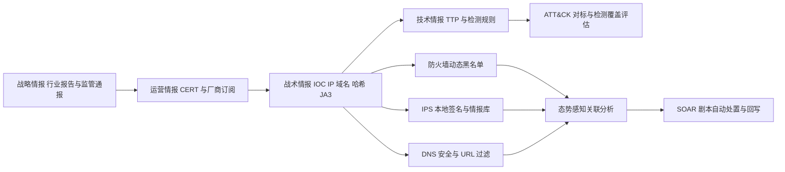

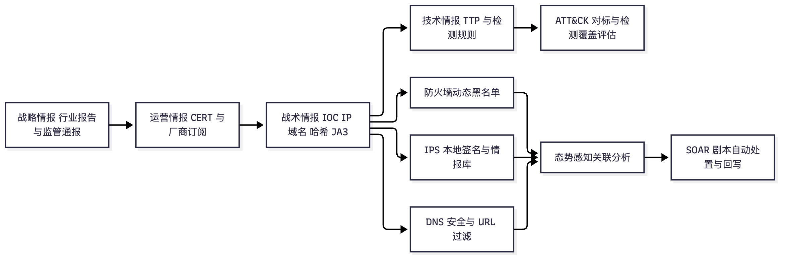


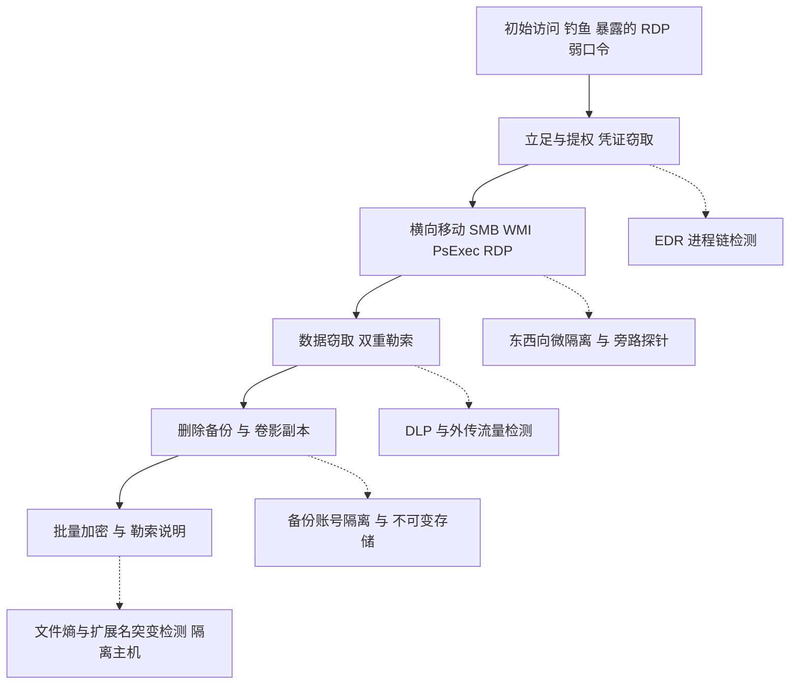

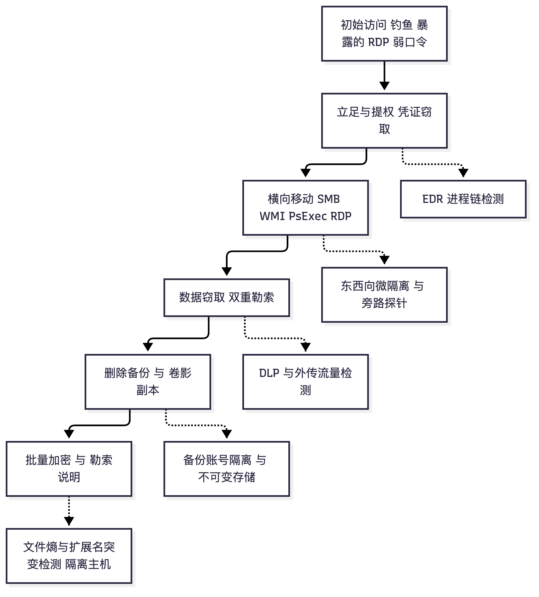


### 真题精练

**Q1.【真题·单选】** 关于 STIX 与 TAXII，下列说法正确的是？
A. STIX 是情报传输协议，TAXII 是情报描述格式
B. STIX 是情报描述格式，TAXII 是情报交换的传输协议
C. 两者都是华为私有标准
D. STIX 用于加密情报，TAXII 用于签名情报

> **答案：B**
> **解析**：STIX（Structured Threat Information Expression）解决"情报怎么用统一格式描述"；TAXII（Trusted Automated Exchange of Intelligence Information）解决"情报怎么自动交换"，基于 HTTPS 的 RESTful 接口，含 Collection（拉取）与 Channel（推送）模型。两者都是国际通用标准，不是厂商私有。

**Q2.【真题·多选】** 威胁情报在防火墙/IPS 上的常见落地方式包括？
A. 静态黑名单（地址组/安全策略）
B. 动态黑名单，通过联动接口自动下发并带 TTL 过期
C. 设备本地加载情报库，直接匹配 IP/域名/哈希/JA3
D. 云端信誉查询（送哈希或 URL 到云服务查询）
E. 所有情报不分置信度一律设为阻断

> **答案：ABCD**
> **解析**：E 是典型错误。情报有置信度与时效差异，低置信情报只应告警，否则会造成大量误封（例如共享 CDN IP 被列入低置信情报会导致大面积业务不可用）。工程上还要做情报来源加权、TTL 过期、误报回写与定期评估。

**Q3.【真题·判断】** 勒索软件防护的重点是部署最强的杀毒软件，只要杀毒软件不漏报，就不会被加密。

> **答案：错误**
> **解析**：勒索软件的初始访问常依赖社工、弱口令、暴露面与 0day，且有反检测与快速加密特性，绝对防御不现实。正确思路是"纵深防御 + 以恢复能力为底线"：入口收敛与漏洞修补、网络与端侧检测（EDR 行为、文件熵/扩展名突变、C&C 情报）、微隔离限制横向、以及 **3-2-1 备份 + 离线/不可变副本 + 定期恢复演练**。答题必须写出"备份与恢复"这一层。

**Q4.【真题·填空】** 勒索软件加密行为的三个文件系统层检测特征是：短时间内________、________、________。

> **答案：大量文件被改写（写操作激增）；文件扩展名批量变更或出现统一后缀；生成大量勒索说明文件（并常伴随卷影副本被删除）**
> **解析**：文件熵值骤增（内容近似随机）与"删除卷影副本/禁用恢复"也是极强信号。端侧 EDR 与主机安全（HSS）是发现这类行为的主力，网络侧只能通过 C&C 与横向移动间接发现。

**Q5.【真题·简答】** 请说明横向移动检测为什么必须依赖东西向可见性，并给出三种检测手段与两种阻断手段。

> **答案**：
> **① 为什么依赖东西向**：横向移动发生在内网主机与主机之间（SMB/WMI/RDP/WinRM 等），这些流量**不经过边界设备**（出口防火墙只看南北向），因此边界 IPS/防火墙看不到；同时横向移动常使用"合法工具做非法事"（Living off the Land，如 PsExec、PowerShell），特征弱、必须靠行为与关联才能发现。
> **② 三种检测手段**：a) **旁路流量探针 + 态势感知关联**（内网一对多连接、445/135/3389 扫描、异常 SMB 写入）；b) **主机/终端探针（EDR/HSS）**看进程链与命令行（`psexec`、`wmic /node:`、远程服务创建）；c) **Windows 事件日志与账户行为**（4624/4625 登录、4688 进程创建、7045 服务安装；同账户多地登录、非工作时间登录、域管账户异常）。
> **③ 两种阻断手段**：a) **微隔离/东西向安全策略**——默认拒绝终端之间的 SMB/RDP，仅按业务白名单放行（见 7.5 节）；b) **终端隔离与账户处置**——EDR 隔离受感染主机、禁用被盗账户、强制改密、限制域管账户使用与跳板机运维。

**Q6.【真题·排错】** 某企业内部多台服务器出现 CPU 持续 100%，并周期性访问同一境外 IP 的 4444 端口；安全设备有该 IP 的情报但未阻断。请分析原因并给出处置。

> **答案**：
> ① **现象研判**：高 CPU + 周期性连接固定端口 + 命中情报 = 高度疑似**挖矿木马**（矿池协议 stratum 常用非标准端口），需同时核查是否存在横向传播（是否有其他主机访问同一 IP、是否有统一进程/脚本）。
> ② **"有情报但未阻断"的可能原因**：a) 情报未配置**自动下发**到设备（只导入平台未联动）；b) 情报置信度低被设置为仅告警；c) 黑名单条目已过期或被例外覆盖；d) 服务器到该 IP 的流量走了**不经检测设备的路径**（同网段直连、策略路由绕过、安全策略更靠前 permit 且无 Profile）；e) DNS/IP 直连：攻击者用 IP 直连绕过域名类情报。
> ③ **验证**：`display firewall blacklist` 查条目；`display firewall session table destination <恶意IP>` 看会话是否存在与命中策略；查看策略走向确认流量是否经设备。
> ④ **处置**：立即在黑名单加入该 IP 与端口级策略（`firewall blacklist ip ... timeout ...` + 针对端口的 deny 策略）→ 用 EDR/HSS 定位并终止挖矿进程、清理持久化（计划任务/服务/启动项）→ 排查横向传播路径并修补（弱口令、暴露的 Redis/Docker API 等常见挖矿入口）→ 修复情报联动的自动下发与置信度策略。
> ⑤ **长效**：把"情报自动下发 + TTL + 命中验证"纳入运营流程；对 4444/3333 等异常端口建立出站审计与告警。

### 易错点与排错

1. **STIX/TAXII 混淆**：格式 vs 传输，是最常见的一分题失分点。
2. **情报不分级使用**：低置信情报直接阻断会引发大面积误封（尤其 CDN、云主机共享 IP）。
3. **忽略情报 TTL**：IOC 会快速失效，动态黑名单必须带过期时间，并定期核对来源。
4. **勒索软件只谈杀毒**：必须覆盖"预防—检测—阻断—恢复—应急"五层，且强调 3-2-1 备份与恢复演练。
5. **挖矿端口当铁证**：矿池端口只是线索，最终要结合进程、域名、行为与情报综合判定。
6. **排错命令**：`display firewall blacklist verbose`、`display firewall session table destination <ip>`、`display dns-filter statistics`、`display ips signature statistics`、`display security-policy statistics rule <name>`。

---

## 5.8 高级威胁分析实战：基于日志与告警的威胁研判五例

### 考点定位

本考点对应国赛的**综合分析与排错题**，占 **5~10 分**。命题方式：给一段告警日志/会话表/事件描述，要求你判断"是什么攻击、处于哪个阶段、属于误报还是真实威胁、下一步怎么处置"。核心能力是**把零散信号串成攻击链**。以下五例覆盖最高频的场景，每例都给出"研判结论 + 依据 + 处置动作"，可直接作为答题模板背诵。

### 原理精讲

**威胁研判的四步法（通用答题框架）**：
1. **定性**：这是哪一类威胁（扫描/爆破/漏洞利用/木马/C&C/横向移动/数据外传/挖矿/勒索）？给出最可能的判断与备选。
2. **定阶段**：对应杀伤链的哪一阶段，攻击者下一步会做什么？
3. **定置信**：证据是否充分？是否存在业务合理解释（误报）？需要什么补充证据（主机日志、进程、账户、资产归属）？
4. **定处置**：短期处置（阻断/隔离/改密）→ 中期排查（同 IOC 全量检索、横向排查）→ 长期整改（策略、架构、流程）。**必须写"验证闭环"**：处置后如何确认成功（黑名单命中、主机清理、无新增告警）。

**研判的铁律**：**"单一信号不定性，多个独立信号交叉印证"**——例如"命中 C&C 情报"+"非工作时间"+"服务器主动外联"+"进程为临时目录中的可疑程序"四条同时成立，才能高置信定性；只有一条时，优先考虑误报。

**五个高频研判案例（案例本身即考点）**：

**案例 1：内网主机大规模横向扫描**
- 信号：IPS 告警"某内网主机 10.1.1.66 在 2 分钟内对 10.1.2.0/24 的 445、135、3389 发起 800+ 次连接尝试"；`display firewall session table source 10.1.1.66` 显示大量短时会话、对不同目的地址且多为 SYN 无响应。
- 研判：**横向移动侦察阶段**（攻击者已获得一台主机控制权，正在寻找下一跳目标），或**蠕虫式传播**（勒索/挖矿蠕虫）。高置信（一对多、多端口、短时间、非业务行为）。
- 干扰项：资产盘点/漏扫平台也会一对多扫描 → 需核对源资产归属与扫描时间窗（漏扫通常有排期与固定源）。**排错第一步就是核对资产与变更记录**。
- 处置：**立即隔离该主机**（EDR 隔离/交换机端口 shutdown/微隔离拒绝其全部出向）→ 取证（内存、进程、计划任务、启动项、账户）→ 排查其最近的入口（邮件、下载、漏洞、弱口令）→ 全网检索同一 IOC → 修补入口并加强东西向策略。

**案例 2：疑似 C&C 心跳外联**
- 信号：防火墙日志显示 10.1.1.88 每 60 秒访问 `update-cdn.example.com`（解析到 203.0.113.66），每次上传约 1.2KB、下载约 800B；该域名注册仅 12 天；JA3 指纹与某远控工具默认配置一致。
- 研判：**C&C 通信（第 6 阶段）**，主机高度疑似已失陷。四条独立证据（周期性 + 字节比失衡 + 新注册域名 + JA3 命中）交叉印证。
- 干扰项：软件自动更新也有周期性 → 但更新通常访问已知厂商域名、证书合法、字节量更大且随版本变化；本例域名新注册 + JA3 命中，排除正常更新。
- 处置：封禁该域名与 IP（DNS 过滤 + 黑名单）→ 隔离主机 → 用 EDR 定位进程与持久化 → 提取样本送沙箱 → 把哈希与 JA3 回写情报 → 排查同网段其他主机是否访问同域名（很可能已多点沦陷）。

**案例 3：服务器对外的异常数据外传**
- 信号：数据库服务器 10.2.2.10 在凌晨 2 点向境外 IP 上传 3.8GB 数据；该服务器此前从不主动外联；上传使用 HTTPS 且 SNI 为空；同一时段该账户有异常登录（多地域）。
- 研判：**数据窃取（第 7 阶段）**，前置应有横向移动与提权（需回溯日志找第 5、6 阶段痕迹）。高置信（服务器主动外联 + 大流量 + 非工作时间 + 账户异常 + 无 SNI 的隐蔽信道）。
- 处置：**优先止损**（阻断外传、在线取证、评估数据泄露范围与合规上报义务）→ 修改相关账户凭据（攻击者已掌握）→ 回溯 30 天日志找初始入口（重点：暴露的 VPN/数据库/运维接口）→ 加固（服务器出站白名单、数据库审计、DLP）。

**案例 4：挖矿木马（含横向传播）**
- 信号：多台服务器 CPU 100%，均连接同一境外 IP 的 4444 端口；进程为 `/tmp/.x/kinsing`；存在计划任务与 `redis` 弱口令登录记录。
- 研判：**挖矿木马 + 通过 Redis 未授权访问横向传播**（攻击链：暴露的 Redis → 写 SSH key/计划任务 → 下载挖矿程序 → 横向扫描再感染）。
- 处置：终止进程与计划任务、删除恶意文件、**修复根因（Redis 加认证 + 禁止公网暴露 + 绑定内网 + 重命名危险命令）**、全量排查同网段、封禁矿池 IP 与域名、把 IOC 下发到情报与黑名单。**不要只杀进程不修根因**（会立刻复发）——这是排错题的常见失分点。

**案例 5：加密流量下的可疑行为（无内容可见）**
- 信号：某终端在 1 小时内访问 47 个不同域名，其中 32 个为 7 天内新注册、且域名长度为 20~30 位随机字符串（疑似 DGA）；TLS 证书均为自签名；访问时间集中在深夜；无对应业务系统记录。
- 研判：**DGA 域名 + C&C 通信**，终端疑似被植入远控。在无解密条件下，判据完全来自**元数据**（NRD、域名随机性、自签名证书、时间分布、无业务对应）。
- 处置：DNS 层阻断可疑域名类别 → 用 EDR 在端侧定位进程与行为（端侧能看到网络侧看不到的）→ 提取样本送沙箱 → 情报回写与全网阻断 → 复查该终端的历史下载与邮件记录找入口。

**贯穿五例的"必答加分项"**：① 区分"告警"与"事件"（单条告警需关联成事件才有处置价值）；② 处置要写"止损—取证—根因—加固—验证"的完整链条；③ 具体到命令与界面路径（黑名单、隔离、情报回写）；④ 说明误报排除的方法（资产核对、变更记录、业务确认）。

### 关键概念对照表

| 案例 | 核心信号 | 杀伤链阶段 | 最高优先级处置 | 常见误报来源 |
|---|---|---|---|---|
| 横向扫描 | 一对多、多端口、短时间 | 侦察/横向移动 | 隔离主机 | 漏扫平台、资产盘点、监控拨测 |
| C&C 心跳 | 周期性 + 元数据 + 情报 | 命令与控制 | 封禁 + 隔离 + 情报回写 | 软件自动更新、心跳类业务 |
| 数据外传 | 服务器主动外联 + 大流量 + 非工作时段 | 目标达成 | 阻断 + 取证 + 合规上报 | 备份、日志上云、CDN 回源 |
| 挖矿 | 高 CPU + 矿池连接 + 定时任务 | 目标达成（获利） | 清进程 + **修根因** | 正常高负载业务、压测 |
| 加密流量可疑 | DGA/NRD + 自签名 + 时间分布 | 命令与控制 | DNS 阻断 + 端侧定位 | 广告 SDK、遥测、CDN 多域名 |

| 处置动作 | 作用 | 注意点 |
|---|---|---|
| 黑名单封禁 IP/域名 | 快速止损 | 带 TTL；核对是否共享 IP 避免误封 |
| EDR/交换机隔离主机 | 阻断横向与回连 | 隔离前尽量保留内存与连接证据 |
| 账户改密与禁用 | 夺回控制权 | 勒索/APT 常窃取凭据，必须全量重置相关凭据 |
| 情报回写与全网检索 | 一次发现全网免疫 | 需验证执行点确实消费了 IOC |
| 根因修复 | 防止复发 | 挖矿/勒索的最大失分点：只清理不修根因 |

### 华为设备配置

```bash
# ===== 研判取证常用命令（USG6000E / NIP）=====
display firewall session table source 10.1.1.66          // 查看可疑主机的全部会话，判断扫描/外联行为
display firewall session table verbose                   // 查看会话详情（命中策略、关联 Profile、NAT 前后地址）
display firewall blacklist verbose                       // 查看黑名单来源与命中次数，验证封禁是否被消费
display security-policy statistics rule <rule-name>      // 查看某条策略/deny 规则的命中次数，判断管控是否生效
display logbuffer | include <keyword>                    // 在日志缓冲区检索关键告警（如 IP、域名、签名名）
display ips signature statistics                         // 查看签名命中分布，定位攻击类型
display av file-reputation statistics                    // 查看文件信誉与沙箱送检统计
display cpu-usage                                        // 排查挖矿/异常负载时结合主机侧数据使用

# ===== 快速处置命令（示例：封禁 C&C 并保留取证）=====
system-view
firewall blacklist enable
firewall blacklist ip 203.0.113.66 timeout 604800        // 封禁 C&C 地址 7 天（覆盖事件处置周期）
firewall blacklist domain update-cdn.example timeout 604800
                                                        // 同时封禁域名，防止攻击者换 IP 继续通信
display firewall blacklist verbose                       // 确认下发成功并开始命中
quit

# ===== 加固：服务器出站白名单（数据外传防护）=====
security-policy
 rule name server_outbound_whitelist
  source-zone trust
  destination-zone untrust
  source-address 10.2.2.0 24                             // 服务器网段
  destination-address-set ALLOWED_UPDATE_SERVERS          // 只允许访问白名单（更新源、备份源）
  action permit
 rule name server_outbound_default_deny
  source-zone trust
  destination-zone untrust
  source-address 10.2.2.0 24
  action deny                                            // 其余出站一律拒绝：服务器不应主动访问互联网
 quit
```

### 示意图

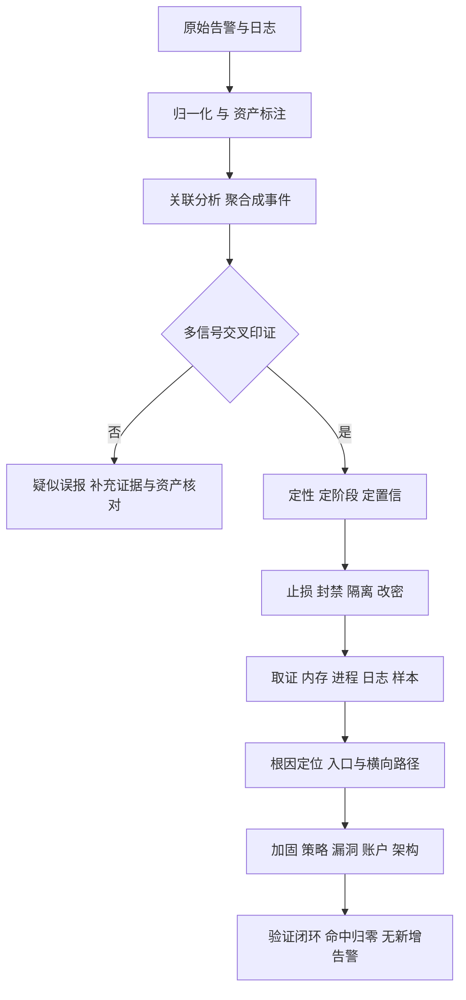

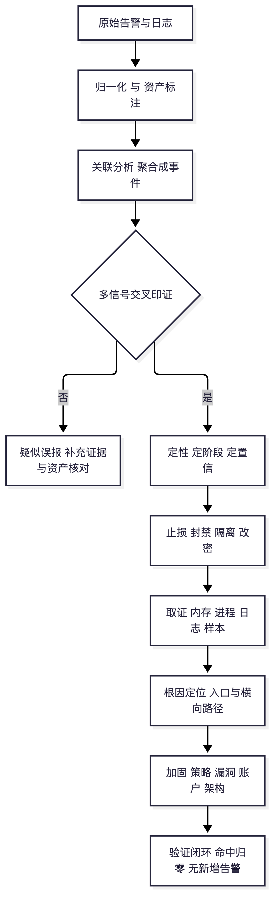


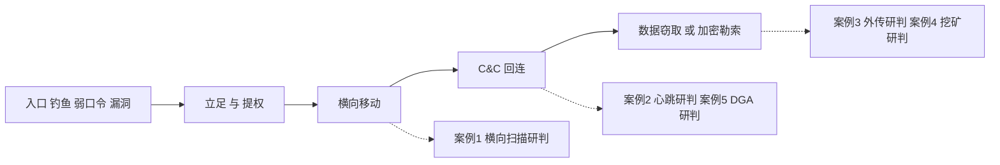

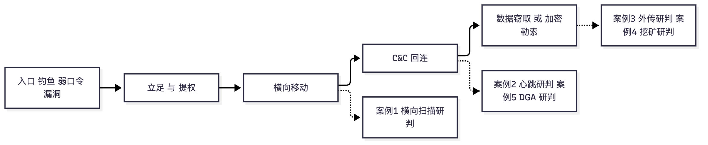


### 真题精练

**Q1.【真题·排错】** 告警显示内网主机 10.1.1.66 在 2 分钟内对 10.1.2.0/24 的 445/135/3389 发起 800+ 连接尝试。请写出你的完整研判与处置流程。

> **答案**：
> ① **核对资产与变更**（排除误报）：确认 10.1.1.66 的资产归属与负责人；查询是否有漏扫/资产盘点任务排期（漏扫通常有固定源与时间窗）。若为扫描器，记录并加例外；若不是，进入下一步。
> ② **研判定性**：一对多 + 多端口 + 短时间 + 大量无响应 SYN = **横向移动侦察**（或蠕虫式传播），高置信。对应杀伤链第 7 阶段前的横向移动。
> ③ **取证**：`display firewall session table source 10.1.1.66` 拉全量会话；在主机侧检查进程链、计划任务、启动项、服务、账户与近期登录（结合 EDR/HSS 与 Windows 事件 4688/7045）。
> ④ **止损**：EDR 隔离该主机或交换机端口 shutdown / 微隔离拒绝其出向；保留内存与网络连接证据后再断网（顺序可按取证要求调整）。
> ⑤ **根因**：回溯其入口（近期邮件附件、下载、漏洞利用告警、弱口令登录），确定初始感染途径。
> ⑥ **横向排查**：用同一 IOC（C&C、哈希、进程名）全网检索，确认是否有多台主机已沦陷（横向扫描通常意味着攻击者已在寻找下一跳，往往已有多点）。
> ⑦ **加固与验证**：修补入口漏洞、收敛暴露面、强化东西向策略（禁止终端间 445/3389）；处置后复查该源是否还有扫描行为、`display security-policy statistics` 观察 deny 规则命中趋势是否回落。

**Q2.【真题·简答】** 某数据库服务器在凌晨向境外 IP 上传 3.8GB 数据，且同一账户出现多地登录。请判断威胁类型、说明依据，并给出止损与合规考量。

> **答案**：
> ① **威胁类型**：**数据窃取（杀伤链目标达成阶段）**，且极可能已发生数据泄露；账户多地登录说明**凭据已被窃取/滥用**，属于账号失陷。
> ② **依据**：服务器角色决定它**不应主动访问互联网**（异常方向）；3.8GB 大流量上传（异常量级）；凌晨 2 点（异常时间）；SNI 为空的 HTTPS（隐蔽信道特征）；账户多地登录（异常身份行为）。五条独立信号交叉印证，高置信。
> ③ **止损**：立即阻断外传（黑名单 + 出站策略）→ 隔离/在线取证（保留内存、连接、进程、数据库审计记录）→ 禁用并强制改密相关账户（含关联的运维账号与服务账号）→ 评估是否已被植入后门并清理。
> ④ **合规考量**：依据《网络安全法》《数据安全法》《个人信息保护法》及行业监管要求，若涉及个人信息或重要数据，需**评估泄露范围、按规定时限向监管机构与受影响个人报告**，并保留取证记录；涉及关基行业的还需按行业主管部门要求上报（详见 6.8 节）。
> ⑤ **根因与整改**：回溯入口（暴露的数据库/运维接口/VPN 弱口令/钓鱼）→ 服务器出站白名单（默认拒绝）→ 数据库审计与 DLP → 特权账号管理与跳板机 → 定期做外传流量基线监控与告警。

**Q3.【真题·多选】** 多台服务器 CPU 100% 且连接同一境外 IP 的 4444 端口，排查中发现 Redis 存在未授权访问记录并留有计划任务。下列处置正确的有？
A. 终止挖矿进程、删除恶意文件与计划任务
B. 修复根因：Redis 启用认证、禁止公网暴露、绑定内网地址
C. 封禁矿池 IP 与域名，并把 IOC 下发到情报库与黑名单
D. 只重启受影响服务器，观察一段时间再说
E. 全网排查同网段主机与同类弱口令暴露面

> **答案：ABCE**
> **解析**：D 是最典型的错误处置——只重启不修根因（Redis 未授权访问仍在），会立刻复发；且拖延期间挖矿持续消耗资源、攻击者可能已植入后门。A、B、C、E 构成"清进程—修根因—封 IOC—全量排查"的完整链条。补充得分点：对同网段其他 Redis/暴露服务做专项排查，并检查是否存在数据窃取或横向移动痕迹。

**Q4.【真题·填空】** 威胁研判的四步法是：________、________、________、________；其铁律是"单一信号不定性，________"。

> **答案：定性（是什么威胁）；定阶段（杀伤链哪一步）；定置信（证据是否充分、是否误报）；定处置（止损—取证—根因—加固—验证）**；**多个独立信号交叉印证**
> **解析**：这是所有"给日志做研判"类题目的答题骨架。在此基础上，若能补充"核对资产与变更记录以排除漏扫/备份/更新类误报"，以及"处置后必须验证闭环（黑名单命中、主机清理、无新增告警）"，即可拿满分。

**Q5.【真题·设计】** 请为一家有 5000 名员工、含研发与财务核心数据的企业设计"面向高级威胁检测与响应"的技术方案框架，要求覆盖检测、分析、处置、恢复四个维度。

> **答案**：
> ① **检测层（多源探针）**：边界 **USG6000E/USG12000** 串接部署（IPS + 反病毒 + 文件还原 + 沙箱联动 + DNS/URL 过滤）；内网 **NIP 旁路探针**覆盖东西向（横向移动、C&C）；**EDR/HSS** 覆盖终端与服务器行为；**邮件安全**覆盖钓鱼与恶意附件；核心数据库侧部署**数据库审计**；财务/研发区可对高价值流量做 TLS 解密。
> ② **分析层**：**HiSec Insight 态势感知**汇聚全部日志与元数据，做资产建模、关联分析、威胁评分、情报比对；**沙箱**做文件动态判定；**威胁情报库**（IP/域名/哈希/JA3/STIX-TAXII 接口）持续更新；建立**ATT&CK 覆盖度评估**，明确哪些技术点已有检测能力。
> ③ **处置层**：**SOAR 剧本**自动执行典型响应（封禁 IOC、隔离主机、禁用账户、邮件撤回）；联动执行点为防火墙黑名单、IPS 本地签名、EDR 隔离与微隔离；对财务/研发核心区采用**微隔离**（默认拒绝终端间横向），并对服务器出站实施**白名单**。
> ④ **恢复层**：核心数据 **3-2-1 备份 + 离线/不可变副本**、定期**恢复演练**、关键系统快照；建立分级应急预案与演练机制（含勒索软件专项演练）；事件后必须完成"根因修复 + 凭据全量重置 + 情报回写"。
> ⑤ **支撑**：等保三级要求对标（见 6.3 节）、安全运营流程与值班、指标（MTTD/MTTR）度量与持续调优。

### 易错点与排错

1. **单信号定性**：一条 C&C 情报告警就断言主机失陷，忽略软件更新、遥测、CDN 等正常解释。
2. **跳过资产核对**：漏扫平台、备份系统、监控拨测是三大误报来源，必须先核对。
3. **处置只写"封 IP"**：必须包含取证、根因、加固与验证，否则综合题只得基础分。
4. **忽略横向排查**：APT 与蠕虫往往已多点沦陷，只处理单点必然复发。
5. **不写合规**：涉及个人信息与重要数据泄露时，报告义务是设计与简答题的得分点。
6. **排错命令**：`display firewall session table source <ip>`、`display firewall session table verbose`、`display firewall blacklist verbose`、`display security-policy statistics rule <name>`、`display logbuffer | include <kw>`、`display ips signature statistics`。

---

# 安全-HCIE-章节6-企业安全架构与等级保护

## 6.1 企业安全架构方法论：纵深防御、零信任与边界模型的对比

### 考点定位

本考点是**章节 6 全部设计题的思想基础**，占 **5~8 分**，理论与设计题都会考。必考：① 纵深防御（Defense in Depth）的分层与"为什么单层防御不够"；② **零信任与传统边界模型的对比表**（高频多选题）；③ 零信任的核心原则（永不信任、始终验证；最小权限；假设失陷）；④ 华为方案中零信任的落地形态（**SDP** 与**微隔离**）。陷阱：① 认为"零信任 = 不要防火墙/不要边界"（零信任是重构信任模型，不是取消边界）；② 认为"上了 VPN 就是零信任"（传统 VPN 是"接入即信任整段网络"，与零信任相反）。

### 原理精讲

**一、为什么需要"架构"而不是"堆设备"**

安全建设最常见的问题是"**设备堆叠**"：出口放了防火墙，内网放了 IPS，终端装了杀毒，但一旦攻击者用一个钓鱼邮件拿到一台内网主机的权限，就能在内网"畅通无阻"——因为内网被视为"可信区"，横向没有任何控制。原因在于**单点防御的失效概率是相乘的**：假设每层防御被绕过的概率是 30%，5 层纵深防御全部被绕过的概率是 0.3^5 ≈ 0.24%；而只有 1 层时就是 30%。这就是纵深防御的数学本质：**不追求某一层绝对可靠，而是让攻击者必须连续突破多层、每层都留下痕迹**。

同时，纵深防御还隐含两个工程收益：① **时间**——每层都能提供检测与延迟，给防守方争取响应时间（MTTD/MTTR 是运营核心指标）；② **冗余**——某一层因配置错误或 0day 失效时，其他层仍能兜底（例如 IPS 被加密流量绕过，但 EDR 仍在端侧发现异常进程）。

**二、纵深防御的分层模型（考试要能按层说出"放什么设备、拦什么威胁"）**

| 层次 | 部署位置与典型设备 | 主要拦截的威胁 | 典型技术手段 |
|---|---|---|---|
| 物理层 | 机房、机柜、门禁、监控 | 物理入侵、设备被盗、破坏 | 门禁与视频、机柜锁、双路供电 |
| 网络边界层 | 互联网出口，**USG6000E/USG12000**、**AntiDDoS** | 扫描探测、DDoS、非法接入、漏洞利用 | 安全策略、NAT、IPS、AntiDDoS 清洗、VPN |
| 网络内层 | 核心/汇聚，**NIP 旁路**、交换机 ACL、微隔离 | 横向移动、内部扫描、蠕虫传播 | 东西向策略、VLAN 隔离、微隔离、流量探针 |
| 应用层 | 服务器区前，**WAF**、负载均衡、API 网关 | Web 攻击（SQL 注入/XSS）、API 滥用、爬虫 | WAF 规则、CC 防护、API 鉴权限流 |
| 主机/终端层 | 服务器与终端，**EDR**、**HSS 企业主机安全**、HIPS | 木马、勒索、提权、持久化、0day 利用 | 行为检测、应用白名单、补丁管理、基线核查 |
| 数据层 | 数据库与文件服务，**数据库审计**、**DLP**、加密 | 数据窃取、越权访问、批量导出、明文泄露 | 分类分级、加密与脱敏、审计、DLP、备份 |
| 身份与访问层 | 认证中心，IAM/4A、MFA、堡垒机 | 凭据窃取、越权、账号滥用 | 单点登录、MFA、最小权限、特权账号管理 |
| 管理与运营层 | **HiSec Insight**、SOC/SIEM、SOAR | 检测盲区、响应迟缓、配置漂移 | 集中日志、关联分析、编排响应、脆弱性管理 |

**"一个中心三重防护"与纵深防御的关系**：等保 2.0 的"一个中心（安全管理中心）、三重防护（安全通信网络、安全区域边界、安全计算环境）"本质是**纵深防御在合规语言下的表达**：计算环境（主机/应用/数据）→ 区域边界（南北向管控）→ 通信网络（链路与传输安全）→ 管理中心（统一管控与审计）。答题时能把两者对应起来，是拿高分的关键（详见 6.3 节）。

**三、传统边界模型 vs 零信任（Zero Trust）**

传统模型的核心假设是"**内网可信、外网不可信**"，因此实现方式是"**边界加固 + 内网放开**"：防火墙把内网整个划为 trust 区，内网之间的访问几乎全通。这在"员工在办公室、服务器在机房、数据不出内网"的时代尚可，但今天的现实是：云与移动办公让资产不在边界内、BYOD 与远程办公让设备不可控、供应链与外包让"内部人员"边界模糊、APT 与勒索证明"**攻击者一旦进入内网就等于进入了信任区**"。因此零信任提出：**网络位置不构成信任依据，任何访问都必须经过身份验证与授权**。

| 对比维度 | 传统边界模型 | 零信任模型 |
|---|---|---|
| 信任假设 | 内网可信，外网不可信 | **永不信任，始终验证**（内外一视同仁） |
| 信任判据 | 网络位置（IP/网段/区域） | 身份 + 设备状态 + 上下文（时间/地点/行为/风险评分） |
| 访问粒度 | 网段级（进内网即通） | **应用级/资源级最小权限**，逐次授权 |
| 架构重心 | 边界网关（防火墙、VPN） | **控制平面与数据平面分离**（SDP 控制器 + 网关） |
| 内网横向 | 默认放开，横向畅通 | **微隔离**：默认拒绝，按业务白名单放行 |
| 身份验证 | 一次认证（登录即长期有效） | 持续验证、动态授权、可随时撤销 |
| 加密 | 边界加密，内网常明文 | **全链路加密**（含内网东西向） |
| 终端要求 | 弱（只要能连网） | **强（设备合规检查作为准入条件）** |
| 对失陷的假设 | 默认内网不会被攻破 | **假设已失陷（Assume Breach）**，按最小爆炸半径设计 |
| 典型技术 | 防火墙、VPN、NAT、ACL | **SDP、微隔离、IAM/MFA、UEBA、持续风险评估** |
| 运维体验 | 部署简单，策略粗放 | 策略精细、需要身份与资产治理基础 |
| 适用场景 | 传统园区、边界清晰的场景 | 多云/混合云、远程与移动办公、外包与供应链、关基 |

**必须澄清的三个误区**：
1. **零信任不是"取消边界/不要防火墙"**：它仍然使用防火墙、网关等执行点，只是把"信任依据"从位置改为身份与上下文；边界从"一道墙"变成"围绕每个资源的动态围栏"。
2. **零信任不是单一产品**：它是一套架构与治理体系，包含身份、设备、网络、应用、数据、运营六个支柱；华为对应的落地能力是 **SDP（软件定义边界）+ 微隔离 + IAM/MFA + 终端合规 + HiSec Insight 持续评估**。
3. **零信任不等于"全部加密 + 全部 MFA"**：落地必须"**分级分域、按风险分级**"，否则体验与成本不可承受；通常做法是先对**高价值资产（核心数据、特权运维、远程访问）**落地零信任，再逐步扩展。

**四、华为方案中的零信任落地：SDP 与微隔离**

**SDP（Software Defined Perimeter，软件定义边界）**基于"**黑云/暗云**"思想：资源默认对未授权者**完全不可见**（端口不响应、IP 不可探测），只有通过控制器认证并授权的用户/设备才能"看到"并连接资源。其架构遵循**控制平面与数据平面分离**：
- **SDP 控制器（Controller）**：负责身份认证、设备合规校验、动态授权与策略下发（可对接 IAM/AD/LDAP、MFA、终端合规状态）。它是"发钥匙的人"。
- **SDP 网关/连接器（Gateway/Connector）**：位于资源侧，只接受控制器授权过的连接；未授权流量一律丢弃（默认拒绝，不暴露端口）。它是"门"。
- **SDP 客户端（Client）**：位于用户侧，先与控制器完成双向认证（可用**SPA 单包授权**：客户端用一次性凭证发送一个加密的 UDP 单包，网关校验通过后才"开门"，这样网关在未授权时对外完全无响应，天然抗扫描）。
- 数据流：用户（Client）→ 通过 SPA 与应用控制器认证 → 控制器校验身份/设备/上下文 → 下发授权策略与一次性令牌 → Client 与 Gateway 建立加密隧道 → **只能访问被授权的特定应用**（不是整个网段）。

**SDP 与传统 VPN 的本质差异（高频考点）**：

| 对比项 | 传统 VPN | SDP |
|---|---|---|
| 暴露面 | VPN 网关端口对全网开放，可被扫描与爆破 | 网关对未授权者**隐没**（SPA），无响应不可探测 |
| 授权粒度 | 通常"接入即获得某网段访问权" | **应用级最小权限**，按用户/设备/上下文逐次授权 |
| 信任模型 | 认证通过即长期信任 | **持续验证**，上下文变化即重评估、可即时撤销 |
| 横向风险 | 接入后可横向访问网段内其他资源 | 只能访问授权应用，横向基本被封死 |
| 设备合规 | 弱校验或无 | 强制校验（补丁、杀毒状态、是否越狱/Root），不合规即拒绝或降权 |
| 典型攻击 | 凭据填充、暴力破解、已泄露凭据登录 | SPA 抗扫描；需同时突破身份 + 设备 + 上下文三层 |

**微隔离（Micro-segmentation）**：把东西向访问控制粒度从"网段/VLAN"下推到"**工作负载（主机/容器）之间**"，原则是**默认拒绝 + 按业务白名单放行**。实现方式有：主机/容器侧代理（软件定义）、防火墙/交换机策略（网络侧）、混合（如华为防火墙虚拟系统 + 微隔离控制器统一编排）。它的价值是**限制爆炸半径**：即使一台主机被攻陷，也几乎无法横向移动到其他主机，直接抑制勒索软件与 APT 的扩散。微隔离的落地难点不在技术而在**业务流量梳理**（必须先看清东西向依赖关系，否则误封业务），因此通常按"**先监控、后告警、再阻断**"三步走。

### 关键概念对照表

| 方法论 | 核心思想 | 解决问题 | 主要局限 |
|---|---|---|---|
| 纵深防御 | 多层独立防御，单层失效不致全盘失守 | 单点失效、攻击门槛低 | 设备堆叠不等于纵深，需统一运营 |
| 零信任 | 永不信任、始终验证、最小权限、假设失陷 | 内网横向、远程接入、内部威胁 | 依赖身份与资产治理基础，落地成本高 |
| 边界防护（防火墙为主） | 划区隔离 + 策略管控 | 南北向非法访问 | 对加密流量、内部横向、0day 能力有限 |
| 主动防御/威胁狩猎 | 假设失陷，主动搜索潜伏威胁 | 长期潜伏的 APT、告警疲劳 | 强依赖人员能力与数据质量 |

| 零信任支柱 | 关键能力 | 华为对应组件/能力 |
|---|---|---|
| 身份 | 统一身份、MFA、特权账号管理、动态授权 | IAM/4A、MFA、堡垒机、SDP 控制器 |
| 设备 | 设备合规检查、终端安全基线 | EDR、终端准入、HSS |
| 网络 | 微隔离、加密、动态策略执行 | USG 虚拟系统、微隔离控制器、SDP 网关 |
| 应用 | 应用级访问控制、WAF、API 防护 | WAF、API 网关、SDP 应用授权 |
| 数据 | 分类分级、加密、DLP、审计 | DLP、数据库审计、加密与脱敏 |
| 运营 | 持续评估、关联分析、自动响应 | HiSec Insight、SOAR |

### 华为设备配置

```bash
# ===== 一、纵深防御落地：边界串接 + 内网旁路 + 管理区隔离（USG6000E）=====
system-view
firewall zone trust                                     // 办公区安全区域
 add interface GigabitEthernet1/0/2                     // 下行接办公区核心交换机
firewall zone untrust                                   // 互联网安全区域
 add interface GigabitEthernet1/0/1                     // 上行接出口路由器
firewall zone dmz                                       // DMZ 区域（对外发布服务器）
 add interface GigabitEthernet1/0/3                     // 接 DMZ 交换机
firewall zone name mgmt zone-id 50                      // 自定义管理区（zone-id 必须唯一且非保留值）
 add interface GigabitEthernet1/0/4                     // 管理口独立物理接口，与管理终端同区
firewall zone name production zone-id 60                // 自定义生产区（与办公网严格隔离）
 add interface GigabitEthernet1/0/5                     // 接生产网交换机
 quit

# ===== 二、默认拒绝：显式 deny 作为兜底（等保"最小授权"要求）=====
security-policy
 rule name default_deny_all
  action deny                                            // 所有未显式允许的流量一律拒绝，这是零信任"默认拒绝"的基础
 rule name permit_office_to_internet
  source-zone trust
  destination-zone untrust
  source-address 10.1.1.0 24
  action permit
  profile ips IPS_PROFILE_1                              // 办公区出网做入侵防御
 rule name permit_mgmt_to_devices
  source-zone mgmt
  destination-zone local                                 // 管理终端只能访问设备自身（local），不能穿越到业务区
  service https
  service ssh                                            // 只允许 HTTPS 与 SSH 管理，禁用 telnet/http
  action permit
 rule name deny_production_to_office
  source-zone production
  destination-zone trust
  action deny                                            // 生产区禁止主动访问办公区：限制爆炸半径的关键策略
 quit
display security-policy rule all                         // 查看策略顺序：规则自上而下匹配，兜底 deny 必须在最后
```

```text
# ===== 三、零信任落地要点（SDP + 微隔离 + 动作为先监控后阻断）=====
# 1) SDP 侧（控制器 + 网关 + 客户端三者协同）：
#    - 控制器对接 IAM/LDAP 做身份认证，对接 EDR 做设备合规校验，开启 MFA
#    - 网关启用 SPA（单包授权）：默认对所有端口不响应，仅放行通过 SPA 校验的客户端
#    - 授权策略按"用户组 + 设备合规状态 + 目标应用 + 时间段"定义，粒度为应用而非网段
# 2) 微隔离侧（东西向）：
#    - 第一步：全量采集东西向流量，生成业务依赖图（只监控不阻断）
#    - 第二步：生成白名单策略并下发为告警，观察误报
#    - 第三步：切换为阻断模式，默认拒绝同网段互访，仅放行业务依赖
# 3) 与防火墙协同：微隔离控制器把策略翻译为 USG 的安全策略/虚拟系统策略统一下发与审计
```

### 示意图

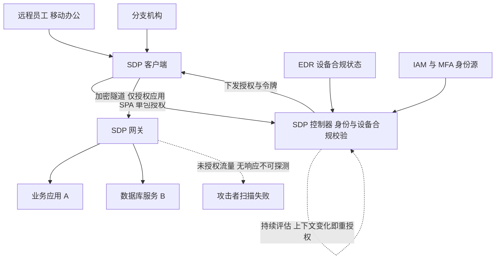

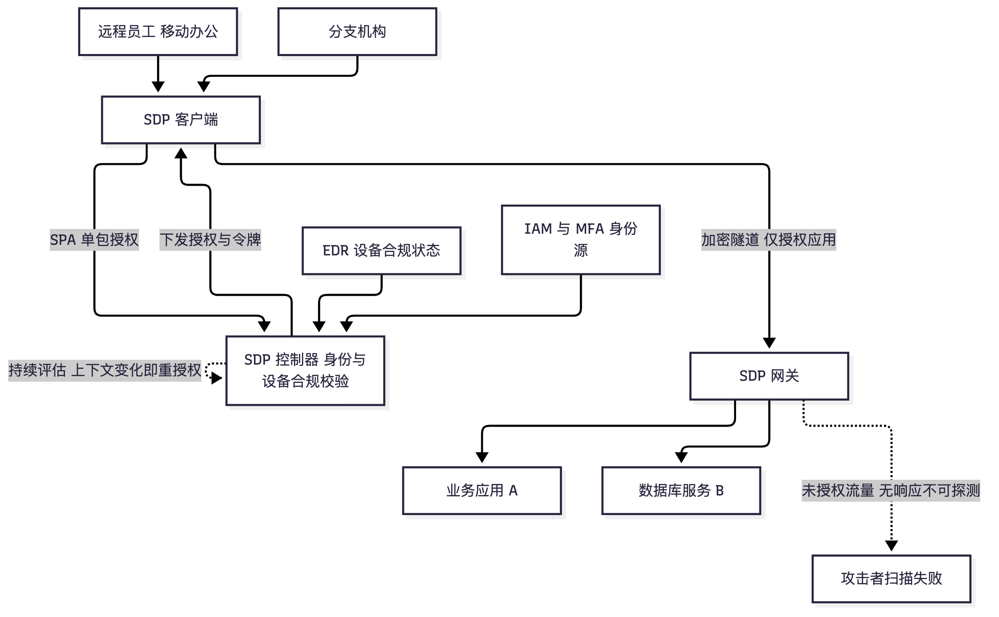


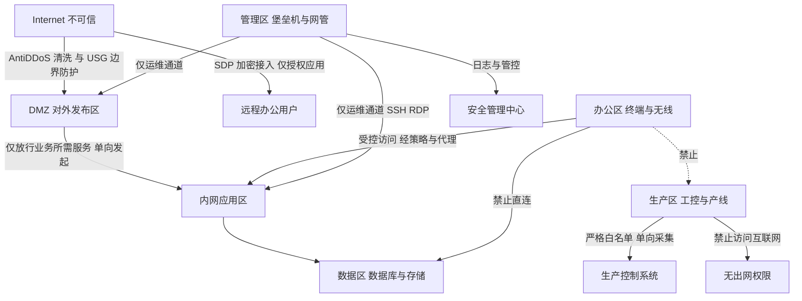

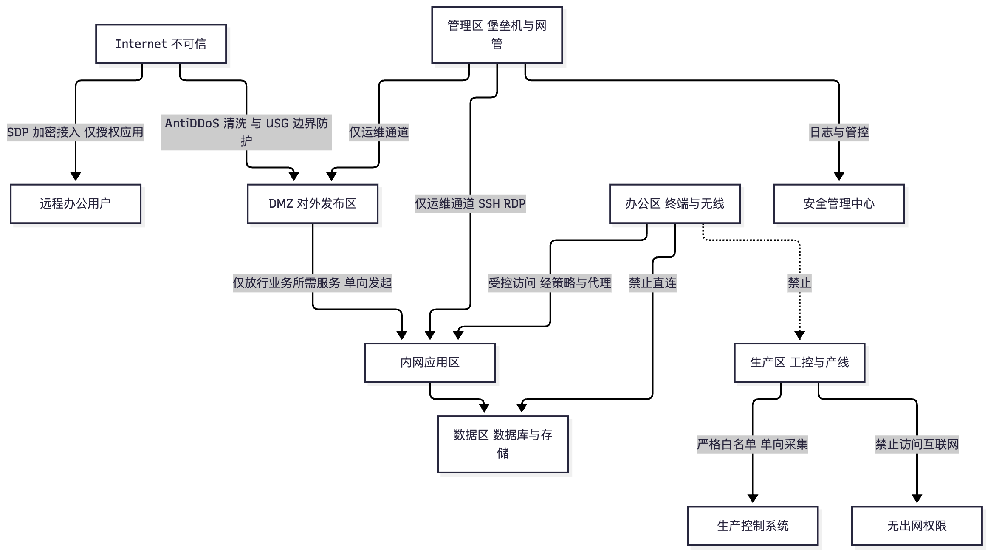


### 真题精练

**Q1.【真题·多选】** 关于零信任模型与传统边界模型，下列说法正确的有？
A. 零信任认为网络位置（内网/外网）不能作为信任依据，任何访问都要验证
B. 零信任意味着不再需要防火墙与边界设备
C. 传统 VPN 通常是"认证接入后即可访问某网段"，与零信任的最小权限原则相悖
D. 零信任强调"假设失陷"，要求按最小爆炸半径设计东西向控制
E. 零信任只适用于云环境，传统园区无法落地

> **答案：ACDE**
> **解析**：B 是典型误区——零信任改变的是信任判据与授权粒度，防火墙、网关依然是必需的策略执行点（甚至更多、更动态）。E 也错误：零信任对传统园区同样适用，常见落地顺序是先覆盖远程访问与特权运维，再扩展到内网微隔离。

**Q2.【真题·判断】** SDP 的"控制平面与数据平面分离"是指控制器负责身份认证与授权决策，网关负责按授权转发业务数据，未授权流量在网关侧一律丢弃。

> **答案：正确**
> **解析**：这正是 SDP 的核心架构。补充要点：网关通常启用 **SPA（Single Packet Authorization，单包授权）**，在客户端未通过校验前对所有端口不响应，使网关在互联网上"隐没"（黑云），从根本上抑制扫描与暴力破解；控制器可对接 IAM 与 EDR，实现"身份 + 设备合规 + 上下文"的动态授权而不仅是账号密码。

**Q3.【真题·填空】** 纵深防御的数学本质是：若每层防御被绕过的概率为 p，n 层独立防御全部被绕过的概率为________；因此纵深防御不要求某一层绝对可靠，而是要求各层________。

> **答案：p 的 n 次方（p^n）**；**相互独立且能力互补（任一层失效时仍有其他层兜底，并留下检测痕迹）**
> **解析**：若各层不独立（例如都依赖同一特征库、同一厂商、同一管理通道），则 p^n 的假设不成立——这是"设备堆叠 ≠ 纵深防御"的原因。真正的纵深要求不同层次使用不同判据（签名 / 行为 / 身份 / 数据），避免共因失效。

**Q4.【真题·简答】** 为什么"内网默认可信"的边界模型在今天不再成立？请从至少四个维度说明，并给出零信任的对应改进。

> **答案**：
> ① **资产位置变化**：业务上云、混合云、SaaS 让"内网"边界消失，资产可能在任何位置，按位置授权失效 → 零信任改为按身份与上下文授权，与资产位置解耦。
> ② **接入方式变化**：移动办公、BYOD、外包与供应链接入让不可控设备进入内网 → 零信任加入设备合规校验（补丁、杀毒、是否 Root/越狱）与最小权限。
> ③ **威胁形态变化**：APT 与勒索软件证明"进入内网即获得信任"会造成全线横向扩散 → 零信任以微隔离默认拒绝东西向、假设失陷并限制爆炸半径。
> ④ **身份可信度下降**：凭据窃取与钓鱼使"账号密码"不再等于"合法用户" → 零信任要求 MFA + 持续验证 + 动态撤销 + 特权账号管控。
> ⑤ （补充）**合规驱动**：《网络安全法》《数据安全法》《个人信息保护法》与等保 2.0 都要求最小授权、访问控制与审计溯源，零信任的"逐次授权 + 全量审计"天然满足这些要求。

**Q5.【真题·设计】** 某企业有 300 名研发人员需要远程访问代码仓库与测试环境，此前使用 IPSec VPN，出现过"员工 VPN 账号泄露后攻击者进入内网横向扫描"的事件。请设计改造方案并说明关键控制点。

> **答案**：
> ① **接入方式改造**：以 **SDP** 替代"全网段 VPN"接入——部署 SDP 控制器 + 网关 + 客户端；网关启用 **SPA**，对外不暴露端口；授权粒度改为**应用级**（只允许访问代码仓库 HTTPS 端口与指定测试环境地址，不再下发整个网段路由）。
> ② **身份与设备双因子准入**：控制器对接 IAM/AD 并强制 **MFA**；对接 EDR 检查终端合规（磁盘加密、补丁、杀毒运行、无高危漏洞），不合规终端拒绝接入或降权（只读）；离职/异常账号即时撤销。
> ③ **权限最小化与特权管控**：按项目组划分角色，研发人员只能访问本项目仓库；生产环境访问一律经**堡垒机**并全程录像，禁止研发终端直连生产。
> ④ **东西向与内网控制**：对代码仓库与测试环境实施**微隔离**（默认拒绝，仅放行必要端口与来源）；从架构上保证"即使某终端失陷，也只能访问其被授权的少数应用"。
> ⑤ **持续检测与响应**：把 SDP 网关、EDR、防火墙日志接入 **HiSec Insight**，对"非工作时间大量拉取代码""单账号多地登录""越权访问尝试"建立关联规则；配合 SOAR 剧本自动禁用账号与隔离终端。
> ⑥ **验证与验收**：用泄露凭据复测（应无法接入或只能访问被授权应用）、扫描 SDP 网关（应不可探测）、核查微隔离策略命中（应能看到 deny 命中记录），并评估对研发体验的影响（克隆速度、构建效率）。

### 易错点与排错

1. **把零信任当成"买一个产品"**：它是身份、设备、网络、应用、数据、运营六支柱的体系，必须能说出华为对应的落地组件。
2. **认为零信任要拆掉防火墙**：防火墙是零信任的策略执行点之一，只是策略从"网段级"变为"应用级 + 动态"。
3. **混淆 SDP 与 VPN**：VPN 暴露网关端口、授权到网段；SDP 隐没网关、授权到应用，且带设备合规校验。
4. **纵深防御只答"多买设备"**：必须强调"不同判据、相互独立、能力互补"，否则共因失效。
5. **微隔离忘记"先监控后阻断"**：直接阻断极易误封业务，标准路径是"采集依赖 → 告警验证 → 阻断"。
6. **排错命令**：`display security-policy rule all`（策略顺序与命中）、`display firewall zone`（安全区域与接口归属）、`display security-policy statistics rule <name>`（命中验证）、`display firewall session table verbose`（会话实际走哪条策略）。

---

## 6.2 安全域划分与边界设计

### 考点定位

本考点是**设计题的落地骨架**，几乎每道"企业安全方案设计题"都要先答安全域划分，占 **5~10 分**。必须能画出典型企业安全域架构并说明"各区域之间部署什么设备、流量怎么走"。陷阱：① 分区只按"内网/外网"两分法；② 忘记**管理区**独立成域（等保强制要求管理流量与业务流量分离）；③ DMZ 与内网应用区混在一起（对外发布的服务器直接放内网）；④ 忽略生产区（OT/工控）与办公区的严格隔离。

### 原理精讲

**一、安全域（Security Zone / Security Domain）的定义与划分原则**

安全域是"**具有相同安全保护需求、彼此信任级别相近、受统一安全策略管理**的网络与系统集合"。华为防火墙的 `firewall zone` 是安全域的**技术映射**：接口加入区域，策略按"源区域 → 目的区域"匹配。划分安全域的价值在于把"逐条 IP 策略"变成"区域间策略"，大幅降低策略数量与运维复杂度，并使"访问控制"与"业务拓扑"解耦。

**划分原则（考试可直接背）**：
1. **等级保护原则**：按信息资产的重要程度与受破坏后的影响划分，不同等级资产置于不同域，**高等级资产不得置于低等级域**。
2. **业务相似性原则**：同类业务、同类用户、同类数据放同一域（如办公终端、对外 Web、数据库）。
3. **最小授权与默认拒绝**：域间默认拒绝，按业务需要显式放行；域内也应按需做微隔离。
4. **纵深防御与边界收敛**：域间必须有关卡（防火墙/ACL/代理），不得存在"跨域直通"的旁路；**域边界数量要收敛**，避免网状互联导致策略爆炸（域间访问应尽量"经核心/经代理"而非任意直连）。
5. **流量与访问路径可控可审计**：所有跨域访问必须经过可控节点，便于审计、限速与检测。
6. **管理流量独立**：管理区（网管、堡垒机、日志平台）必须独立成域，只允许受控终端通过受控通道访问被管设备（等保"安全管理中心"要求）。
7. **易于扩展与变更**：按"业务功能"而非"物理位置"划分，避免因物理搬迁导致策略重写。

**二、典型企业安全域架构（必须能默画）**

以一家"有互联网业务 + 办公网 + 生产网 + 运维管理"的制造企业为例，通常划分为 **6~8 个域**：

| 安全域 | 典型内容 | 信任级别 | 域间边界设备 | 关键策略 |
|---|---|---|---|---|
| 互联网接入区（untrust） | 出口路由器、AntiDDoS、ISP 链路 | 不可信 | AntiDDoS 清洗中心 → USG | 只放行必要服务；DDoS 清洗；出站审计 |
| DMZ 对外发布区 | Web 服务器、反向代理、邮件网关、对外 DNS | 低（半可信） | USG（边界）/WAF | 互联网只能访问 DMZ 的 80/443；**DMZ 不得主动访问内网数据库**，需要时经代理与严格白名单 |
| 内网应用区 | 业务系统中间件、API 服务、应用服务器 | 中 | 内部防火墙/USG 虚拟系统 + WAF | 只接受来自 DMZ（经代理）与办公区的必要访问；服务器出站默认拒绝 |
| 数据区 | 数据库、文件存储、备份系统 | **高** | 内部防火墙 + 数据库审计 | 只有应用区特定主机可访问特定端口；禁止办公终端直连；审计全量 SQL |
| 办公区 | 有线/无线终端、打印、会议、OA 客户端 | 低~中 | USG + 微隔离 + 上网行为管理 | 只允许访问应用区与互联网；**禁止访问生产区**；终端间微隔离 |
| 生产区（OT/工控） | SCADA、PLC、DCS、工业交换机 | **最高（可用性优先）** | 工业防火墙 + 单向隔离/网闸 | 与办公网**物理或逻辑强隔离**；数据单向采集；禁止互联网访问；变更须审批 |
| 管理区 | 网管平台、堡垒机、日志/SOC、漏洞扫描 | **最高** | USG（严格策略）+ 堡垒机 | 只有管理终端可访问；管理流量与业务流量分离；操作全程审计录像 |
| 外联/合作伙伴区 | 专线对接、VPN 接入、供应商接入 | 低（半可信） | USG + SDP/VPN 网关 | 最小权限、按需开通、会话审计、限时有效 |

**三、域间流量走向与设备部署（答题必须写出"谁到谁、过什么设备、做什么检查"）**

- **互联网 → DMZ**：AntiDDoS 清洗 → USG 边界（安全策略 + IPS + 反病毒 + URL 过滤）→ WAF（应用层防护）→ 反向代理 → Web 服务器。**Web 服务器不直接访问互联网**（需经代理），且**不允许直连数据库**。
- **互联网 → 内网应用区**：**禁止直达**。必须先到 DMZ，再由 DMZ 的应用代理/API 网关联络内网服务，实现"**双向不可直连**"的价值：即使 DMZ 被攻破，攻击者也不能直接横向进入内网。
- **办公区 → 内网应用区**：经 USG 内部策略（可虚拟系统隔离），只放行业务端口与必要协议；配置应用识别与内容安全；对访问做认证（如 SSO/CASB 代理）与审计。
- **办公区 → 互联网**：经 USG 出口，做 IPS、URL 过滤、DLP 出站检查、带宽与行为管理；**DLP 在此处拦截敏感数据外发**。
- **内网应用区 → 数据区**：只允许应用服务器到数据库的特定端口（如 3306/1521/1433），双向来源绑定（源 IP + 目的 IP + 端口），并开启数据库审计与加密。
- **管理区 → 各区域设备**：只允许管理终端经堡垒机，用 SSH/HTTPS 等加密协议，禁用 telnet/http；所有操作审计；管理区流量与业务流量走独立 VLAN/链路（等保"安全通信网络"要求）。
- **办公区 ↔ 生产区**：**禁止双向直连**；若需采集生产数据，用**单向隔离装置或工业防火墙**做单向放行（只允许生产区向外推送数据，禁止外部主动访问生产区）。
- **外联区 → 内网**：经 SDP/VPN 网关 + 严格策略，只开放到具体应用与端口，会话全审计，并设置有效期。

**四、边界设计的四个量化与工程要点**
1. **边界收敛与"陪跑"**：域间访问尽量经少数核心节点（如"办公区 → 应用区"只经一对内部防火墙），避免"任何区域都能连任何区域"形成网状；对确实需要的跨域访问用代理或应用网关中转。
2. **双向策略与状态**：策略要写清方向（谁主动发起），并利用状态检测只放行回程；对确实需要双向发起的（如心跳），用带宽与频率限制防滥用。
3. **旁路与绕行检查**：设计时要专门排查"绕行路径"——双出口、无线直连、4G/5G 备份链路、运维专线、云上直连，这些都是安全域失效的常见原因（考试中"找出方案漏洞"类题目常考）。
4. **可运维性**：区域命名规范（与 `firewall zone` 一致）、策略命名规范（`源_目的_业务_序号`）、策略注释与责任人、定期策略清理（无用策略是等保测评与实战中的常见扣分项）。

### 关键概念对照表

| 域间访问对 | 是否允许 | 经过设备 | 检查内容 | 常见错误 |
|---|---|---|---|---|
| 互联网 → DMZ | 允许（仅必要端口） | AntiDDoS、USG、WAF | IPS、反病毒、WAF 规则、CC 防护 | 放行全端口、DMZ 服务器开管理端口对外 |
| 互联网 → 内网应用区 | **禁止直接** | —（须经 DMZ 代理） | — | 用端口映射把内网应用暴露到公网 |
| DMZ → 内网数据区 | **默认禁止** | 如需，经代理 + 内部防火墙 | 源/目的绑定、审计 | DMZ 服务器可直连数据库（最常见漏洞） |
| 办公区 → 互联网 | 允许 | USG | IPS、URL 过滤、DLP、行为管理 | 无 DLP，敏感数据随意外发 |
| 办公区 → 内网应用区 | 允许（按业务） | USG/虚拟系统 | 应用识别、认证、审计 | 全通或端口全开 |
| 办公区 → 数据区 | **默认禁止** | — | — | 为方便运维直接放开 3306/1433 |
| 办公区 ↔ 生产区 | **禁止直连** | 工业防火墙/单向隔离 | 单向放行、协议白名单 | 用一条 VLAN 打通"方便管理" |
| 管理区 → 各域 | 允许（受控） | 堡垒机 + USG | 强认证、加密协议、审计录像 | 管理口与业务口混用、telnet 管理 |

| 设备/能力 | 部署位置 | 承担职责 |
|---|---|---|
| AntiDDoS | 互联网接入区（旁路或串接清洗） | 流量清洗、SYN Flood 与 CC 防护 |
| USG6000E/USG12000 | 互联网边界、域间边界 | 安全策略、NAT、IPS/AV、VPN、微隔离策略执行 |
| WAF | DMZ 前（串接或反向代理模式） | Web 攻击防护、CC 防护、API 防护 |
| NIP 旁路 | 核心/域间镜像点 | 东西向深度检测、横向移动发现 |
| 工业防火墙 | 生产区与办公区之间 | 工业协议白名单、单向放行 |
| 堡垒机（4A） | 管理区 | 特权运维统一入口、强认证、审计录像 |
| HiSec Insight | 管理区 | 全网日志汇聚、关联分析、统一处置 |

### 华为设备配置

```bash
# ===== 一、按安全域规划安全区域与接口（USG6000E）=====
system-view
firewall zone untrust zone-id 5                         // 互联网接入区（系统预定义区域，zone-id 固定）
 add interface GigabitEthernet1/0/1                     // 上行接 AntiDDoS/出口路由器
firewall zone dmz zone-id 10                            // DMZ 对外发布区
 add interface GigabitEthernet1/0/2                     // 接 DMZ 交换机（Web/邮件/反向代理）
firewall zone trust zone-id 15                          // 办公区
 add interface GigabitEthernet1/0/3                     // 接办公区核心交换机
firewall zone name app zone-id 40                       // 自定义内网应用区
 add interface GigabitEthernet1/0/4                     // 接应用区交换机
firewall zone name data zone-id 45                      // 自定义数据区（等级最高）
 add interface GigabitEthernet1/0/5                     // 接数据区交换机
firewall zone name mgmt zone-id 50                      // 自定义管理区
 add interface GigabitEthernet1/0/6                     // 接网管/堡垒机/日志平台
firewall zone name production zone-id 60                // 自定义生产区（工控）
 add interface GigabitEthernet1/0/7                     // 接工业防火墙/生产网
 quit
display firewall zone                                   // 核对各区域包含的接口与 zone-id

# ===== 二、域间策略：按"业务所需 + 来源绑定 + 默认拒绝"编写 =====
security-policy
 rule name inet_to_dmz_web
  source-zone untrust
  destination-zone dmz
  destination-address 172.16.10.10 32                    // 只暴露具体 Web 服务器地址
  service http                                            // 仅 80
  service https                                           // 仅 443
  action permit
  profile ips IPS_PROFILE_1                              // 边界做入侵防御
  profile av AV_PROFILE_1                                // 反病毒
 rule name dmz_to_app_api
  source-zone dmz
  destination-zone app
  source-address 172.16.10.20 32                         // DMZ 反向代理地址，精确绑定
  destination-address 10.10.20.30 32                     // 只允许访问特定 API 服务器
  service https
  action permit
 rule name office_to_app_business
  source-zone trust
  destination-zone app
  source-address 10.1.0.0 16
  destination-address 10.10.20.0 24
  service http
  service https
  action permit
 rule name office_to_data_deny
  source-zone trust
  destination-zone data
  action deny                                            // 办公区禁止直接访问数据区（必须经应用层）
 rule name app_to_data_db
  source-zone app
  destination-zone data
  source-address 10.10.20.0 24
  destination-address 10.10.30.0 24
  service mysql                                           // 只放行数据库端口，源与目的双向绑定
  action permit
 rule name office_to_production_deny
  source-zone trust
  destination-zone production
  action deny                                            // 办公区与生产区禁止直连
 rule name mgmt_to_all_ssh
  source-zone mgmt
  destination-zone app
  source-address 10.10.50.0 24                           // 管理区（堡垒机）网段
  service ssh
  service https
  action permit                                          // 管理区仅用加密协议访问被管设备
 rule name default_deny
  action deny                                            // 兜底默认拒绝，必须放在最后
 quit

# ===== 三、区域间做 NAT 与服务器出站管控（防止 DMZ/应用区被当跳板）=====
nat-policy
 rule name dmz_no_snat_outbound
  source-zone dmz
  destination-zone untrust
  action no-nat                                           // 不为其做源 NAT，配合策略直接拒绝其主动出网
 quit
display nat-policy rule all                              // 核对 NAT 规则顺序与命中情况
```

```text
# ===== 四、生产区与办公区的隔离设计（工程要点）=====
# 1) 物理/逻辑隔离优先：生产网使用独立交换机与链路，与办公网无二层互通；
#    若因成本必须共用物理链路，则用严格的 VLAN + 工业防火墙策略隔离。
# 2) 数据采集方向单一：只允许生产区 → 采集服务器方向主动推送（或由采集机单向读取），
#    禁止办公/互联网主动访问生产区任何设备。
# 3) 工业协议白名单：工业防火墙按 Modbus/OPC/IP 等协议与寄存器范围放行，
#    而不是按 IP 端口全放，避免"打通端口即全通"。
# 4) 补丁与运维：生产区补丁与变更必须走审批与离线方式，禁止直接连互联网升级。
```

### 示意图

```mermaid
flowchart TB
    INET["Internet"] --> ADD["AntiDDoS 清洗"]
    ADD --> FW["USG6000E 边界防火墙"]
    FW --> DMZ["DMZ 对外发布区 Web 与反向代理"]
    FW --> OFFICE["办公区 有线与无线终端"]
    DMZ -->|经代理 精确绑定| APP["内网应用区"]
    OFFICE -->|按业务放行 应用识别与审计| APP
    APP -->|仅数据库端口 双向绑定| DATA["数据区 数据库与备份"]
    MGMT["管理区 堡垒机与日志平台"] -->|SSH HTTPS 全程审计| APP
    MGMT -->|受控运维| DMZ
    MGMT -->|日志汇聚| SIEM["HiSec Insight 安全管理中心"]
    IOT["生产区 SCADA 与 PLC"] -->|单向推送 白名单| COLLECT["采集服务器"]
    OFFICE -.禁止直连.-> IOT
    APP -.禁止直连.-> DATA
    DMZ -.禁止主动访问内网.-> APP
```

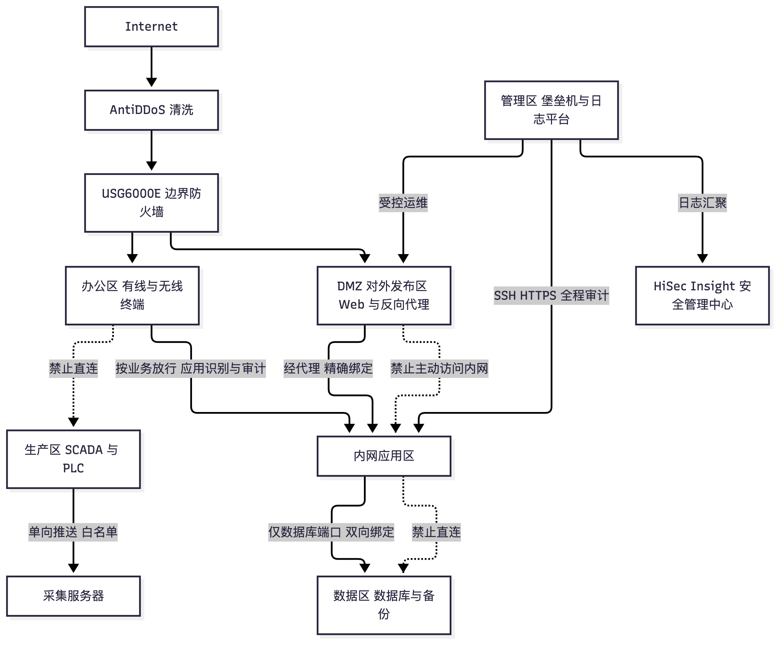


```mermaid
flowchart LR
    A["安全域划分"] --> B["按等级保护定级"]
    A --> C["按业务相似性聚合"]
    A --> D["默认拒绝 最小授权"]
    A --> E["边界收敛 消除绕行"]
    A --> F["管理流量独立成域"]
    B --> G["高等级资产不得置于低等级域"]
    E --> H["排查双出口 无线直连 4G 备份 运维专线"]
    F --> I["堡垒机 强认证 审计录像"]
```

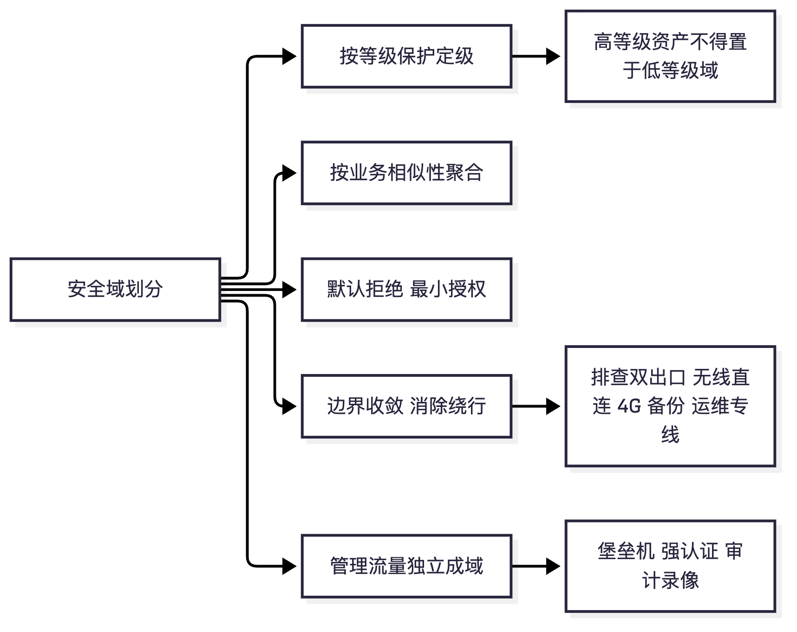


### 真题精练

**Q1.【真题·多选】** 关于企业安全域划分，下列做法正确的有？
A. 按信息资产重要程度与信任级别划分，高等级资产不放在低等级域
B. 管理流量与业务流量分离，管理区独立成域
C. 为方便运维，允许办公终端直接访问数据库的 3306 端口
D. 域间默认拒绝，按业务需要显式放行并绑定源与目的
E. 为避免策略复杂，应尽量减少域的数量，把所有内网划为一个 trust 域

> **答案：ABD**
> **解析**：C 违反最小授权，数据区应只允许应用区特定主机的数据库端口（并且经审计）；E 是"边界模型"的典型误区——域过少会让内部横向畅通无阻，与零信任和等保要求相悖（但也确实不宜过度细分，应"按业务与等级适度划分"）。A、B、D 是划分原则的直接体现。

**Q2.【真题·判断】** DMZ 中的 Web 服务器被攻陷后，最危险的后续动作是它能够直接访问内网数据库；因此设计中必须保证 DMZ 到内网数据区默认拒绝，仅允许经代理的必要访问。

> **答案：正确**
> **解析**：DMZ 是"半可信"区域，暴露在互联网面前，被攻陷概率最高。若它可直连数据库，攻击者即可直接从 DMZ 拿到数据，纵深防御形同虚设。标准设计是"**双向不可直连**"：互联网只能访问 DMZ 的对外服务端口，DMZ 只能经反向代理/API 网关访问内网应用，且源/目的/端口精确绑定并全程审计。

**Q3.【真题·填空】** 典型企业安全域至少应包含：互联网接入区、________、内网应用区、________、办公区、生产区、________；其中等保要求________必须独立成域，管理流量与业务流量分离。

> **答案：DMZ 对外发布区；数据区；管理区**；**管理区（安全管理中心）**
> **解析**：注意"数据区"与"管理区"是最容易被漏掉的两个域。数据区等级最高（只允许应用区特定主机访问），管理区承载堡垒机、网管与日志平台，是等保"一个中心"的物理落点。

**Q4.【真题·排错】** 某企业已完成安全域划分与策略配置，但在一次渗透测试中，测试人员从办公网一台主机成功访问了生产网的 PLC 管理界面。请分析可能原因。

> **答案**：
> ① **绕行路径未排查**：最常见的原因是存在**未被策略覆盖的路径**——如办公网与生产网在某台交换机上共用 VLAN、通过无线 AP 桥接、通过 4G/5G 备份路由器直连、或通过第三方运维专线互通。
> ② **策略顺序错误**：安全策略自上而下匹配，若前面存在一条更宽泛的 permit 规则（如"trust → any permit"或"any → any permit"用于临时调试未删除），生产区的 deny 规则永远不会被匹配。用 `display security-policy rule all` 核对顺序。
> ③ **区域划分错误**：生产网接口被误加入 trust 或 app 区，导致"办公区 → 生产区"实际是"同区域"或"另一条已放行的域间策略"，策略自然命中允许规则。用 `display firewall zone` 核对接口归属。
> ④ **网关/旁路设备**：生产网可能还接有其他出口设备（如工控厂商的远程运维网关）自带放行规则，绕过主防火墙。
> ⑤ **NAT 与地址转换干扰**：经过 NAT 后源地址被改写，导致基于源地址的策略失配而落到宽松规则上。
> ⑥ **整改**：删除冗余 permit 规则并复核策略生成流程；用 `display firewall session table verbose` 复现该访问并核对命中的策略名；补上链路级排查（画全物理与逻辑连接图，含无线、4G、专线）；对生产区增加工业防火墙与单向隔离做二次兜底；把"绕行路径审计"纳入变更管理。

**Q5.【真题·设计】** 请为一家拥有对外电商网站、内部 ERP、财务系统与生产线的制造企业画出（并文字描述）安全域架构，说明各域之间部署什么设备与流量走向。

> **答案**：
> ① **划分**：互联网接入区、DMZ 对外发布区（电商 Web、反向代理、支付回调接口）、内网应用区（ERP/CRM/订单）、数据区（订单库、财务库、备份）、办公区（有线/无线终端）、生产区（SCADA/PLC/工业交换机）、管理区（网管、堡垒机、日志与态势感知）。
> ② **设备部署**：互联网侧 **AntiDDoS + USG6000E/USG12000** 串接（IPS/AV/URL 过滤）；DMZ 前部署 **WAF**；DMZ 与内网之间由 USG 策略隔离，内网侧部署 **NIP 旁路探针**做东西向检测；数据区部署**数据库审计**；办公区出口部署上网行为管理 + DLP；生产区与办公区之间部署**工业防火墙/单向隔离**；管理区部署**堡垒机 + HiSec Insight**。
> ③ **流量走向**：互联网 → AntiDDoS → USG（清洗+检测）→ WAF → DMZ Web；DMZ 只经反向代理访问内网应用区的 API（**禁止直连数据库**）；办公区终端经 USG 访问内网应用（端口与业务绑定），经出口访问互联网（DLP 拦截敏感外发）；内网应用区只允许特定主机访问数据区数据库端口（审计全量 SQL）；管理区经堡垒机以 SSH/HTTPS 运维各域设备，全程录像；生产区数据经单向白名单推送到采集服务器，办公区与互联网**禁止主动访问生产区**。
> ④ **配套**：全网日志接入 HiSec Insight 做关联分析；办公区终端间做微隔离（禁止 445/3389 互访）；电商大促期间对 DMZ 加 CC 防护与弹性扩容；远程运维使用 **SDP** 替代传统 VPN。
> ⑤ **验证**：渗透测试重点验证"DMZ 是否能进内网""办公区是否能到生产区""管理口是否暴露在业务网";并用策略命中统计确认 deny 规则确实在拦截。

### 易错点与排错

1. **漏掉管理区与数据区**：分区答题只写"内外网 + DMZ"必然丢分。
2. **DMZ 与内网直连**：这是设计题最经典的失分点，必须写"经代理/API 网关 + 源目绑定"。
3. **策略顺序问题**：冗余 permit 规则会让 deny 失效；排错第一件事是 `display security-policy rule all` 看顺序。
4. **绕行路径**：双出口、无线桥接、4G 备份、运维专线、云专线是分区失效的高频原因，必须在设计中主动排查。
5. **生产区按端口放行**：工控协议必须做协议级白名单（功能码/寄存器范围），不能只放 IP+端口。
6. **排错命令**：`display firewall zone`、`display security-policy rule all`、`display security-policy statistics rule <name>`、`display firewall session table verbose`（看实际命中）、`display nat-policy rule all`。

---

## 6.3 等级保护 2.0 深入：一个中心三重防护与全流程

### 考点定位

本考点是国赛安全方向**合规类题的绝对核心**，占 **8~12 分**，且是设计题的评分主线（设计方案必须对标等保）。必考：① 等保 2.0 与 1.0 的差异（对比表）；② **"一个中心、三重防护"的完整落地映射**；③ 安全通用要求十大类控制点；④ **定级—备案—建设整改—测评—监督检查全流程**；⑤ 三级等保的具体技术要求清单。陷阱：① 把等保当"买设备过测评"（等保是"管理制度 + 技术措施 + 持续运营"）；② 混淆"安全通用要求"与"扩展要求"（云计算、移动互联、物联网、工业控制、大数据）；③ 记错定级流程顺序与各环节主体。

### 原理精讲

**一、等保 2.0 与等保 1.0 的差异（高频对比题）**

《信息安全技术 网络安全等级保护基本要求》（GB/T 22239-2019）是等保 2.0 的标志性标准。它与 1.0（GB/T 22239-2008）的差异可归纳为"**一个中心、三重防护、五个扩展、法律升级**"：

| 对比维度 | 等保 1.0（2008 版） | 等保 2.0（2019 版） | 说明 |
|---|---|---|---|
| 保护对象 | 以信息系统（主机、网络、应用）为主 | **扩展至云计算、移动互联、物联网、工业控制、大数据**等新形态 | 增加了 5 类扩展要求 |
| 技术要求结构 | 物理、网络、主机、应用、数据 五方面 | **安全物理环境、安全通信网络、安全区域边界、安全计算环境、安全管理中心** + 管理要求 | 从"五方面"改为"一个中心三重防护" |
| 管理中心 | 无独立的"管理中心"概念，管理要求单独成章 | **明确提出"安全管理中心"**（系统管理、审计管理、安全管理、集中管控） | 等保 2.0 的最大结构性变化 |
| 定级对象 | 信息系统 | **基础信息网络、云计算平台/系统、物联网、工业控制系统、大数据**等均可作为定级对象 | 定级颗粒度更细 |
| 级别设置 | 1~5 级 | 1~5 级（**三级以上为监督重点**） | 与 1.0 一致 |
| 测评要求 | 基本要求 + 测评要求 | 基本要求 + **测评要求 + 安全设计技术要求** | 新增安全设计技术要求（GB/T 25070） |
| 法律地位 | 部门规章与标准驱动 | **《网络安全法》第 21 条明确"网络安全等级保护制度"为法定制度** | 从"标准"升级为"法定义务" |
| 关注重点 | 合规达标 | **合规 + 实战（攻防演练）+ 数据安全 + 供应链** | "实战化"与"动态防御"导向 |
| 密码要求 | 泛泛提及加密 | 明确要求**商用密码应用安全性评估（密评）** | 与《密码法》衔接 |

**二、"一个中心、三重防护"的完整落地映射（必背，可直接作为设计题目录）**

**一个中心 = 安全管理中心**，包含四类管理：
- **系统管理**：对系统管理员的操作进行管控（账号、权限、操作审计）；
- **审计管理**：集中的日志与审计（**日志留存不少于 6 个月**，等保三级明确要求）；
- **安全管理**：安全策略、安全配置、漏洞与补丁的统一管理；
- **集中管控**：对分散设备/系统的统一监控、统一策略下发、统一告警处置。

**三重防护 = 安全通信网络 + 安全区域边界 + 安全计算环境**（外加以安全物理环境为底座）。

| 层面 | 等保三级主要技术要求 | 华为落地组件/手段 |
|---|---|---|
| 安全物理环境 | 机房出入控制、防盗防破坏、防雷防火防水、温湿度控制、电力供应、电磁防护 | 门禁与视频、机柜锁、UPS 与双路供电、动环监控 |
| 安全通信网络 | 网络架构（划分区域、关键节点冗余、带宽保障）、通信传输（**完整性 + 保密性**）、可信验证 | 安全域划分、双机热备（HRP）、**IPSec VPN/国密 TLS**、设备可信启动 |
| 安全区域边界 | 边界防护、**访问控制**、入侵防范（IPS）、恶意代码防范、**安全审计**、可信验证 | **USG6000E/USG12000** 策略、**NIP/IPS**、反病毒、日志与审计 |
| 安全计算环境 | 身份鉴别（**双因素**）、访问控制、安全审计、入侵防范、恶意代码防范、**可信验证**、数据完整性/保密性/备份恢复、剩余信息保护、个人信息保护 | **EDR/HSS**、堡垒机 + MFA、数据库审计、加密与脱敏、备份系统、终端基线 |
| 安全管理中心 | 系统管理、审计管理、安全管理、**集中管控** | **HiSec Insight / eSight / 日志审计平台**、堡垒机、统一策略管理 |
| 安全管理制度 | 安全策略、管理制度、制定与发布、评审与修订 | 制度文件体系、评审记录 |
| 安全管理机构 | 岗位设置、人员配备、授权与审批、沟通与合作、审核与检查 | 安全组织架构、岗位职责、审批流程 |
| 安全管理人员 | 人员录用、离岗、考核、安全意识教育与培训、外部人员访问管理 | 背景审查、保密协议、培训记录、离岗流程 |
| 安全建设管理 | 定级与备案、安全方案设计、产品采购与外包开发、工程实施、测试验收、系统交付、等级测评、服务供应商选择 | 定级报告、方案评审、验收报告、测评报告 |
| 安全运维管理 | 环境管理、资产管理、介质管理、设备维护、漏洞与风险管理、网络与系统安全管理、恶意代码防范、配置管理、密码管理、变更管理、备份与恢复、安全事件处置、应急预案与演练、外包运维管理 | 运维制度、漏洞管理流程、变更单、应急演练记录、备份验证 |

**三、定级—备案—建设整改—测评—监督检查全流程（含责任主体与产出物）**

| 阶段 | 主要工作 | 责任主体 | 关键产出物 | 常见考点 |
|---|---|---|---|---|
| 1 定级 | 确定定级对象 → 按"受侵害的客体 + 侵害程度"确定等级（1~5 级）→ 专家评审 → 主管部门审核 | 运营使用单位（公安/主管部门监督） | 定级报告 | **定级是运营使用单位的责任**；三级以上需专家评审与主管部门核准 |
| 2 备案 | 到公安机关备案（三级以上需提交定级报告、专家评审意见等） | 运营使用单位 → 公安机关 | 备案证明 | 备案是**强制**要求；跨省/跨地区系统按属地管理 |
| 3 建设整改 | 按对应级别的基本要求做安全设计与建设/整改，落实技术与管理措施 | 运营使用单位 + 集成商 | 安全方案、整改报告 | 建设整改必须**对标基本要求逐条落实**，不是"买设备" |
| 4 等级测评 | 由**有资质的测评机构**按测评要求测评，出具测评报告（结论：优/良/中/差或符合/基本符合/不符合） | 测评机构（运营使用单位委托） | 等级测评报告 | **三级系统每年至少测评一次**；发现问题须整改复测 |
| 5 监督检查 | 公安机关与主管部门定期监督检查，运营使用单位持续运营与整改 | 公安机关/主管部门 | 检查记录、整改通知 | 三级以上为监督重点；不整改可被处罚 |

**四、三级等保的具体技术要求清单（设计题直接引用）**

- **身份鉴别**：**双因素认证**（密码 + 令牌/生物/证书）；登录失败处理（限制次数、锁定、超时退出）；远程管理须加密。
- **访问控制**：按最小权限授权；**主体与客体**绑定（用户-角色-资源）；默认拒绝无权限访问；重要主体客体设置安全标记。
- **安全审计**：覆盖每个用户与重要安全事件；审计记录含日期时间、用户、事件类型、结果等；**审计记录保护（防删除/防篡改）**；**日志留存不少于 6 个月**。
- **入侵防范**：遵循最小安装；关闭非必要服务与端口；**入侵检测与阻断（IPS）**；漏洞修补（定期评估与及时修补）；对重要服务器做行为监控。
- **恶意代码防范**：主机与网络双层防恶意代码（**EDR + 网关反病毒/沙箱**）；特征库及时更新。
- **可信验证**（等保 2.0 新增）：对通信设备、计算设备的**引导程序、系统程序**做可信验证（可信启动/动态度量）。
- **数据完整性**：传输与存储的完整性校验（MAC/数字签名/校验和）。
- **数据保密性**：**重要数据加密存储与传输**（商用密码算法，如 SM2/SM3/SM4）。
- **数据备份恢复**：**本地备份 + 异地/离线备份**；定期**恢复演练**（提供演练记录）。
- **剩余信息保护**：鉴别信息与敏感数据所在存储空间被释放或再分配前须完全清除。
- **个人信息保护**：仅采集必要个人信息、明示同意、访问控制与审计。

**五、实战视角的补充（拿高分的关键）**：等保测评通过 ≠ 安全。近年护网行动中，"过了等保三级"的系统仍被攻破的常见原因是：**策略长期无人复核（存在宽泛 permit）、日志留存但无人分析、漏洞发现后未及时修复、账号权限过大、供应链软件带毒、备份未做恢复演练**。因此答题时应写"**合规 + 运营**"：等保解决"底线达标"，而实战需要"持续监测 + 主动狩猎 + 快速响应"（见 6.7 节 SOC 与 6.8 节攻防演练）。

### 关键概念对照表

| 等保级别 | 定级依据（受侵害客体） | 监管强度 | 测评频率（三级以上） |
|---|---|---|---|
| 一级 | 公民、法人合法权益（一般损害） | 自主保护 | 不强制测评 |
| 二级 | 公民、法人合法权益（严重损害）或社会秩序（一般损害） | 指导 | 建议定期（多数地方要求两年一次） |
| 三级 | 社会秩序与公共利益（严重损害）或国家安全（一般损害） | **监督检查重点** | **每年至少一次** |
| 四级 | 社会秩序与公共利益（特别严重）或国家安全（严重损害） | 强制监督检查 | 每年至少一次（要求更严） |
| 五级 | 国家安全（特别严重损害） | 专门管控 | 按国家专门要求 |

| 控制点类别 | 技术部分（5 类） | 管理部分（5 类） |
|---|---|---|
| 具体类目 | 安全物理环境、安全通信网络、安全区域边界、安全计算环境、安全管理中心 | 安全管理制度、安全管理机构、安全管理人员、安全建设管理、安全运维管理 |

| 五个扩展要求 | 适用对象 | 典型要求 |
|---|---|---|
| 云计算安全扩展 | 云服务商与云租户 | 责任共担、虚拟化隔离、镜像与快照保护、虚拟机迁移安全 |
| 移动互联安全扩展 | 移动终端与移动应用 | 终端管控（MDM）、无线接入安全、应用加固 |
| 物联网安全扩展 | 感知层/网络层/应用层 | 感知节点物理防护、感知层网关、数据汇聚安全 |
| 工业控制系统安全扩展 | 工控系统 | 可用性优先、协议白名单、单向隔离、补丁与变更严管 |
| 大数据安全扩展 | 大数据平台 | 数据分类分级、脱敏、溯源、防泄露 |

### 华为设备配置

```bash
# ===== 一、对标"安全区域边界—访问控制"：最小授权 + 默认拒绝 =====
system-view
security-policy
 rule name permit_business_explicit                      // 明确放行业务，源/目的/服务三项绑定（等保"最小授权"）
  source-zone trust
  destination-zone app
  source-address 10.1.1.0 24
  destination-address 10.10.20.30 32
  service https
  action permit
 rule name default_deny_all                              // 默认拒绝（等保要求"未被允许的即拒绝"）
  action deny
 quit

# ===== 二、对标"安全区域边界—安全审计"：日志外发与留存（不少于 6 个月）=====
system-view
info-center enable                                       // 使能信息中心（日志功能）
info-center loghost 10.10.50.100                         // 日志服务器地址（管理区的日志审计/SOC 平台）
info-center loghost 10.10.50.100 facility local5         // 指定 facility，便于日志平台分类解析
info-center source default channel loghost log level informational
                                                         // 发送 informational 及以上级别日志，覆盖安全事件
info-center logbuffer size 1024                          // 本地日志缓冲区条数，便于应急时本地取证
 quit
display info-center                                      // 查看日志输出配置
display logbuffer                                        // 查看本地日志缓冲

# ===== 三、对标"安全通信网络—通信传输"：管理员登录与传输加密 =====
system-view
stelnet server enable                                    // 使能 SSH 服务（替代 telnet，满足"远程管理加密"）
ssh user admin authentication-type password
ssh user admin service-type stelnet
 undo telnet server enable                               // 关闭 telnet 明文管理（等保测评常见扣分项）
 undo http server enable                                 // 关闭 HTTP 明文 Web 管理，使用 HTTPS
 http secure-server enable                               // 使能 HTTPS 管理
 aaa                                                    // 进入 AAA 视图配置强口令策略
  local-user admin password irreversible-cipher Helloworld@123
                                                          // 使用不可逆加密保存口令（irreversible-cipher）
  local-user admin privilege level 15
  local-user admin service-type ssh https
  local-user admin idle-timeout 10                       // 空闲 10 分钟自动注销（等保"登录超时退出"）
  quit
 quit

# ===== 四、对标"安全管理中心—集中管控"：SNMP 与 syslog 上报到统一平台 =====
system-view
snmp-agent                                              // 使能 SNMP
snmp-agent sys-info version v3                          // 使用 SNMPv3（支持认证与加密，v1/v2c 明文团体名不符合要求）
snmp-agent group v3 NMS_GROUP privacy                   // 创建 v3 用户组，privacy 表示认证 + 加密
snmp-agent usm-user v3 nmsuser group NMS_GROUP
snmp-agent usm-user v3 nmsuser authentication-mode sha2-256
snmp-agent usm-user v3 nmsuser privacy-mode aes128
 quit
display snmp-agent usm-user                              // 核对 SNMPv3 用户配置
```

### 示意图

```mermaid
flowchart TB
    subgraph CENTER["一个中心 安全管理中心"]
        SM["系统管理 账号与权限"]
        AU["审计管理 日志留存不少于 6 个月"]
        MIX["安全管理 与 集中管控 统一监控下发"]
    end
    subgraph P1["安全通信网络"]
        C1["区域划分与冗余"]
        C2["传输完整性与保密性 国密加密"]
    end
    subgraph P2["安全区域边界"]
        B1["边界防护与访问控制"]
        B2["入侵防范 IPS 与恶意代码防范"]
        B3["安全审计"]
    end
    subgraph P3["安全计算环境"]
        E1["双因素身份鉴别"]
        E2["访问控制与最小权限"]
        E3["数据完整性与保密性 备份恢复"]
        E4["可信验证"]
    end
    PHY["安全物理环境 门禁 供电 消防"] --> P1
    CENTER --> P1
    CENTER --> P2
    CENTER --> P3
```

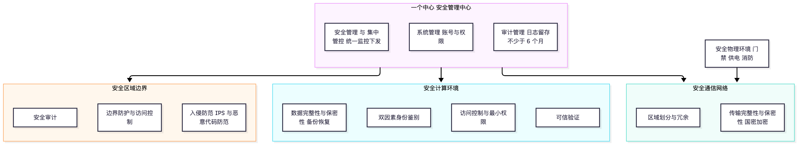


```mermaid
flowchart LR
    S1["1 定级 运营使用单位组织专家评审"] --> S2["2 备案 公安机关备案"]
    S2 --> S3["3 建设整改 对标基本要求逐条落实"]
    S3 --> S4["4 等级测评 有资质机构 三级每年一次"]
    S4 -->|发现不符合项| S3
    S4 --> S5["5 监督检查 公安与主管部门"]
    S5 -->|整改要求| S3
    S5 --> S6["持续运营 监测 响应 审计与优化"]
```

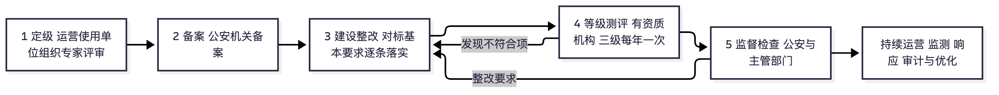


### 真题精练

**Q1.【真题·多选】** 与等保 1.0 相比，等保 2.0 的主要变化包括？
A. 技术要求结构变为"安全物理环境、安全通信网络、安全区域边界、安全计算环境、安全管理中心"
B. 明确提出"安全管理中心"（一个中心、三重防护）
C. 扩展到云计算、移动互联、物联网、工业控制、大数据五类扩展要求
D. 取消了定级与备案要求，改为自愿测评
E. 由《网络安全法》确立为法定制度

> **答案：ABCE**
> **解析**：D 错误——等保 2.0 不仅保留定级与备案，而且因《网络安全法》第 21 条而**成为法定义务**，三级以上系统每年至少测评一次并接受监督检查。A、B、C、E 都是等保 2.0 的标志性变化。

**Q2.【真题·判断】** 只要通过了等保三级测评，就说明系统的安全防护能力足以抵御实战攻击。

> **答案：错误**
> **解析**：等保是"**基线合规**"，解决"有没有做、做到没做到位"的问题；实战攻击还涉及策略有效性、漏洞响应速度、账号权限治理、供应链风险、检测与响应能力等。护网中大量"已过等保"的系统被攻破，原因通常是宽泛策略长期未复核、日志无人分析、漏洞未及时修复、权限过大、备份未演练。因此正确表述是"**等保达标是底线，实战需要持续运营与主动防御**"。

**Q3.【真题·填空】** 等保 2.0 的技术要求可概括为"一个中心、三重防护"，其中"一个中心"指________，"三重防护"指________、________、________；此外还有五类扩展要求，分别是云计算、________、物联网、________和________。

> **答案：安全管理中心**；**安全通信网络、安全区域边界、安全计算环境**；**移动互联**、**工业控制**、**大数据**
> **解析**：安全管理中心包含系统管理、审计管理、安全管理、集中管控四类能力；等保三级要求**日志留存不少于 6 个月**、身份鉴别采用**双因素**、重要数据传输与存储加密（商用密码）、本地与异地备份并做恢复演练。

**Q4.【真题·简答】** 请完整描述等级保护的实施流程，并说明每个环节的责任主体与关键产出。

> **答案**：
> ① **定级**：运营使用单位确定定级对象（信息系统/云平台/物联网/工控/大数据等），按"受侵害客体 + 侵害程度"确定 1~5 级；三级以上需组织**专家评审**并经主管部门审核。产出：定级报告。责任主体：运营使用单位。
> ② **备案**：到公安机关备案（三级以上提交定级报告、评审意见等材料），取得备案证明。责任主体：运营使用单位 → 公安机关。
> ③ **建设整改**：依据对应级别的基本要求（技术 + 管理十大类）进行安全设计与建设整改，逐条落实控制点。产出：安全方案、整改报告、验收材料。责任主体：运营使用单位（可委托集成商）。
> ④ **等级测评**：委托**有资质的测评机构**按测评要求开展测评，出具测评报告并给出结论；**三级以上系统每年至少测评一次**，不符合项须整改并复测。责任主体：测评机构（运营使用单位委托）。
> ⑤ **监督检查**：公安机关与行业主管部门开展监督检查（三级以上为重点），对问题下达整改要求并跟踪落实。责任主体：公安机关/主管部门。
> ⑥ **持续运营**：监测预警、漏洞与配置管理、应急响应与演练、审计与优化，形成"合规 + 实战"的闭环。

**Q5.【真题·设计】** 某企业的三级系统（含对外 Web 与内部数据）需要整改以通过等保三级测评。请列出整改清单，并说明每项对应的等保控制点。

> **答案**：
> ① **安全区域边界**：划分安全域（互联网接入/DMZ/应用/数据/办公/管理），域间策略默认拒绝、最小授权并绑定源与目的；部署 **USG6000E** 串接做访问控制与边界防护；部署 **IPS** 做入侵防范；部署**反病毒/沙箱**做恶意代码防范；开启**日志外发**满足安全审计（留存 ≥ 6 个月）。
> ② **安全通信网络**：关键节点双机热备（**HRP**）与链路冗余；管理流量与业务流量分离；远程管理使用 **SSH/HTTPS**（禁用 telnet/http）；重要数据传输使用国密算法加密（SM2/SM3/SM4）。
> ③ **安全计算环境**：服务器与终端部署 **EDR/HSS**；管理员登录采用**双因素认证**（堡垒机 + MFA）；按最小权限授权、禁止共享账号；数据库部署**审计**与加密存储；**本地 + 异地备份**并每半年做一次**恢复演练**并留存记录；剩余信息保护（下线磁盘数据清除）；个人信息最小采集与授权。
> ④ **安全管理中心**：部署**日志审计/态势感知（HiSec Insight）**做集中管控；统一账号与权限管理；统一策略下发与配置核查；统一漏洞与补丁管理。
> ⑤ **安全管理（五个方面）**：安全管理制度（策略、制度、评审）、安全管理机构（岗位与审批）、安全管理人员（录用/离岗/培训）、安全建设管理（定级备案、方案评审、采购与外包管理、测试验收、测评）、安全运维管理（资产管理、漏洞与配置管理、变更管理、备份恢复、应急演练、外包运维管理）。
> ⑥ **补充（实战加分）**：宽泛策略清理与季度复核、漏洞修复 SLA（高危 7 天内）、供应链软件来源与完整性校验、每年至少一次应急演练与攻防演练参与，形成"合规达标 + 实战有效"的双目标。

### 易错点与排错

1. **流程顺序错**：定级 → 备案 → 建设整改 → 测评 → 监督检查，**备案在建之前**，很多考生会写反。
2. **责任主体错**：定级与备案是**运营使用单位**的事，测评由**有资质机构**做，监督由**公安/主管部门**做。
3. **混淆技术要求与管理要求**：技术 5 类（物理环境/通信网络/区域边界/计算环境/管理中心）+ 管理 5 类（制度/机构/人员/建设/运维），共十大类。
4. **忘记扩展要求**：云计算、移动互联、物联网、工业控制、大数据五类，答设计题时按业务形态选对应扩展。
5. **等保 = 买设备**：必须答"制度 + 技术 + 运营"三位一体，并给出日志留存 6 个月、双因素、备份演练等硬指标。
6. **验证命令/操作**：`display info-center`（日志外发）、`display logbuffer`（本地日志）、`display security-policy rule all`（策略最小化核查）、`display ssh server status`（SSH 是否启用）、`display current-configuration | include telnet`（确认 telnet 已关闭）。

---

## 6.4 密码法与商用密码应用安全性评估（密评）

### 考点定位

本考点是**新增高频内容**，占 **4~6 分**，常与等保、数据安全结合出题（设计题中也常要求"重要数据加密"）。必考：① 密评的**四个维度**；② 国密算法（SM2/SM3/SM4/SM9）的用途与对应国际算法；③ 国密改造要点（证书、协议、算法套件、设备支持）。陷阱：① 把密评与等保测评混为一谈（密评是独立评估，依据《密码法》与商用密码应用安全性评估标准）；② 搞错 SM2/SM3/SM4 的用途；③ 认为"用了 HTTPS 就满足密码要求"。

### 原理精讲

**一、《密码法》与密评的法律定位**

《中华人民共和国密码法》（2020 年 1 月 1 日施行）把密码分为**核心密码、普通密码、商用密码**三类：核心密码与普通密码用于保护国家秘密（由国家密码管理部门管理），**商用密码**用于保护不属于国家秘密的信息（公民、法人和其他组织可依法使用）。密码法的核心制度包括：**商用密码应用安全性评估（简称"密评"）**、商用密码产品检测认证、关键信息基础设施的密码应用要求等。**法律要求**：法律、行政法规和国家有关规定要求使用商用密码进行保护的关键信息基础设施，其运营者应当**使用商用密码并开展商用密码应用安全性评估**（即"三同步"：同步规划、同步建设、同步运行）。

**密评与等保的关系**：等保解决"安全控制措施是否到位"，密评解决"**密码是否用对了、用够了、用合规了**"。二者互补：等保三级明确要求"重要数据传输与存储的保密性/完整性"，而**怎么实现（用什么算法、密钥怎么管、协议是否真加密）**由密评来评价。因此合规体系常表述为"**等保 + 密评**"双达标。

**二、密评的四个维度（必背）**

密评围绕 GB/T 39786《信息安全技术 信息系统密码应用基本要求》展开，评价维度是：

| 维度 | 含义 | 评价要点（考点） | 常见不符合项 |
|---|---|---|---|
| **合规性** | 使用的密码算法、密码技术、密码产品和密码服务是否符合法律法规与国家标准 | 必须使用**国家密码管理部门认可的算法与产品**（如 SM 系列商用密码算法）；产品需有**商用密码产品认证证书** | 使用自研/未认证算法与产品；使用国际算法替代应使用的国密算法 |
| **正确性** | 密码算法、协议、密钥管理、密码产品与服务的**使用方式是否正确** | 加密模式是否恰当（如不用 ECB）、随机数来源是否合格、密钥生命周期管理是否规范、协议实现是否有缺陷 | 自研协议、IV 复用、密钥硬编码、随机数用时间戳 |
| **有效性** | 密码保障措施**是否真正发挥了预期作用**（不能是"摆设"） | 是否覆盖了需要保护的业务与数据、是否真的加密（而不是只做 Base64）、密钥是否可被非授权获取、是否可被旁路绕过 | 只在部分链路加密、密钥与密文同机存放、数据库字段"加密"实为编码 |
| **主动性/适应性（合规应用）** | 密码应用是否与业务**同步规划、建设、运行**，并能在新技术（云、移动、物联网）场景下持续满足要求 | 是否"三同步"、是否有密钥管理体系与应急预案、是否随业务变化评估更新 | 上线后补做加密、无密钥管理流程、无应急与轮换机制 |

**三、国密算法（必须记住用途与对标）**

| 国密算法 | 类型 | 典型用途 | 对标国际算法 | 关键参数 |
|---|---|---|---|---|
| SM1 | 分组密码（**硬件实现**，算法不公开） | 智能 IC 卡、加密机 | AES（硬件形态） | 分组 128 位 |
| SM2 | **非对称/椭圆曲线公钥算法** | 数字签名、密钥交换、证书（替代 RSA/ECDSA） | RSA / ECDSA | 推荐曲线 256 位；签名与加密均可 |
| SM3 | **密码杂凑（哈希）算法** | 完整性校验、消息摘要、证书指纹 | SHA-256 | 输出 **256 位** |
| SM4 | **分组密码（对称）** | 数据加密、链路加密、无线加密 | AES | 分组 **128 位**，密钥 **128 位** |
| SM9 | 标识密码（基于身份的密码） | 基于身份的加密与签名（免证书体系） | IBE | 标识即公钥 |
| ZUC（祖冲之） | 序列密码 | 移动通信（4G/5G）空口加密与完整性 | — | 3GPP 采用 |

**四、国密改造要点（工程落地清单）**

1. **算法替换**：把 RSA/ECDSA 签名改为 **SM2**、SHA-256 改为 **SM3**、AES 改为 **SM4**；TLS 套件改为**国密套件**（`ECC_SM4_SM3`、`ECDHE_SM4_SM3` 等），即"**国密 TLS/双证书体系**"（签名证书 + 加密证书分离，这是国密 TLS 的特点）。
2. **协议与设备支持**：Web 服务器与网关需支持国密 TLS（GMSSL/TLCP）；**负载均衡、WAF、VPN、防火墙**需支持国密算法套件；浏览器/客户端需支持国密（或使用国密网关做"国密 → 国际"转换）。
3. **密钥管理**：使用**符合要求的密钥管理系统（KMS）或密码机（HSM）**，密钥生成使用合格随机源；密钥分级（主密钥/数据密钥）、分域存储、定期轮换、双人分段保管、销毁有记录。
4. **证书体系**：部署**国密 CA** 签发 SM2 证书，建立证书生命周期管理（颁发、更新、吊销、CRL/OCSP）；证书有效期与用途严格定义。
5. **改造难点与顺序**：难点在**兼容性**（老客户端不支持国密）与**性能**（国密算法在无硬件加速时性能低于部分国际算法）；推荐采用"**国密网关 + 双证书**"方式，对外支持国密、对内兼容存量系统；改造顺序通常为"内部管理系统 → 对外门户 → 核心交易系统"。
6. **验证方法**：用抓包确认协商的是国密套件；用 `openssl s_client -cipher` 类工具或设备命令核验证书为 SM2；核查密钥存放位置与访问权限；留存密码应用方案与评估报告。

### 关键概念对照表

| 对比项 | 等保测评 | 密评（商用密码应用安全性评估） |
|---|---|---|
| 依据 | 《网络安全法》+ GB/T 22239 等 | 《密码法》+ GB/T 39786 等 |
| 评价对象 | 安全控制措施（技术 + 管理十大类） | 密码应用的合规性、正确性、有效性 |
| 结论形式 | 符合/基本符合/不符合（分数与等级） | 符合/基本符合/不符合（含分项扣分） |
| 关注重点 | 有没有做、做得是否全 | 密码用得对不对、够不够、是否有效 |
| 测评机构 | 网络安全等级保护测评机构 | 商用密码应用安全性评估机构 |
| 二者关系 | 互补，合规上常要求"双达标" | 等保中的加密要求由密评细化评价 |

| 场景 | 密码应用要求 | 推荐算法 |
|---|---|---|
| 数据传输（HTTPS/VPN） | 保密性 + 完整性 + 身份真实性 | 国密 TLS（SM2 证书 + SM4 加密 + SM3 校验） |
| 数据存储（数据库/文件） | 敏感字段加密 + 完整性 | SM4 加密 + SM3/HMAC 校验 |
| 身份鉴别 | 数字证书/令牌 | SM2 签名验证 |
| 电子签名/印章 | 不可否认性 | SM2 签名 |
| 完整性校验（日志/固件） | 防篡改 | SM3 |

### 华为设备配置

```bash
# ===== 一、在 USG6000E 上配置国密 IPSec VPN（传输加密 + 完整性）=====
system-view
ipsec proposal GM_PROPOSAL                               // 创建 IPSec 提议
 esp encryption-algorithm sm4                             // 加密算法使用 SM4（国密对称算法）
 esp authentication-algorithm sm3                         // 完整性校验使用 SM3（国密杂凑算法）
 quit
ike proposal 10                                          // 创建 IKE 提议
 encryption-algorithm sm4                                 // IKE 阶段也使用 SM4
 authentication-algorithm sm3                             // 使用 SM3
 dh group14                                               // DH 组（国密场景可选 SM2 密钥交换，按设备与版本支持情况配置）
 quit
pki realm GM_REALM                                       // 创建 PKI 域（对接国密 CA）
 rsa local-key-pair create                                // 生成本地密钥对（国密场景应使用 SM2 密钥对，按设备版本命令为准）
 ca id 1
  quit
 quit
display ipsec proposal                                   // 核对提议算法（必须显示 SM4/SM3）
display ike proposal                                     // 核对 IKE 提议算法

# ===== 二、管理员登录与 Web 管理的强密码与加密要求 =====
system-view
stelnet server enable                                    // 管理通道必须加密
ssh server authentication-type password
ssh server publickey rsa                                 // 按需支持证书认证
http secure-server enable                                // Web 管理使用 HTTPS
 undo http server enable                                 // 关闭明文 HTTP 管理
 quit

# ===== 三、密码相关核查命令（密评现场常用）=====
display ipsec sa                                        // 查看 IPSec SA 使用的算法，确认国密算法生效
display pki certificate ca realm GM_REALM                // 查看 CA 证书（核对签发者与算法）
display pki certificate local realm GM_REALM             // 查看本地证书（核对公钥算法与有效期）
display current-configuration | include sm4              // 全局检索国密算法配置，形成配置证据清单
```

```text
# ===== 四、密评整改工程清单（非设备侧，答题要点）=====
# 1) 密码应用方案：明确"哪些数据/链路/身份需要密码保护"，逐项给出算法与密钥管理方式。
# 2) 产品合规：使用的密码产品须具备商用密码产品认证证书（密码机、网关、USB Key 等）。
# 3) 密钥管理：密钥生成（合格随机源）、存储（HSM/KMS、分域）、使用（最小权限）、
#    轮换（定期）、归档、销毁（有记录、双人操作）。
# 4) 证书体系：国密 CA、双证书（签名证书 + 加密证书）、生命周期管理与吊销机制。
# 5) 三同步：密码应用与业务同步规划、同步建设、同步运行，变更后重新评估。
# 6) 证据留存：配置截图、抓包证明（协商国密套件）、密钥管理制度与操作记录。
```

### 示意图

```mermaid
flowchart TB
    A["密评四个维度"] --> B["合规性 算法与产品是否符合国标与认证"]
    A --> C["正确性 使用方式与密钥管理是否正确"]
    A --> D["有效性 是否真正发挥作用不可绕过"]
    A --> E["同步性 与业务同步规划建设运行"]
    B --> F["SM2 SM3 SM4 与认证产品"]
    C --> G["密钥生命周期与协议实现"]
    D --> H["覆盖全部需保护的数据与链路"]
    E --> I["变更后重新评估 持续合规"]
```

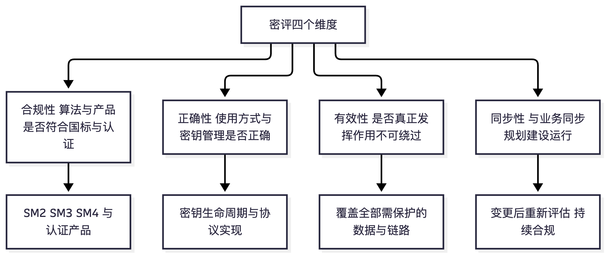


```mermaid
flowchart LR
    P["业务系统"] -->|国密 TLS 双证书| GW["国密网关 或 支持国密的负载均衡"]
    GW --> APP["应用服务器"]
    APP -->|SM4 加密存储 SM3 校验| DB["数据库"]
    CA["国密 CA 签发 SM2 证书"] --> GW
    CA --> APP
    HSM["密码机 KMS 密钥管理"] --> GW
    HSM --> APP
    HSM --> DB
```

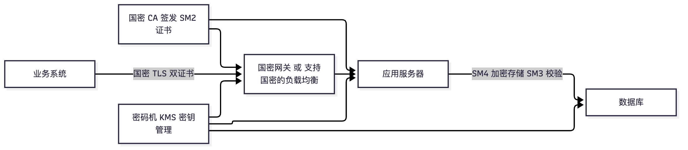


### 真题精练

**Q1.【真题·单选】** 下列国密算法与用途对应正确的是？
A. SM2 用于对称加密，SM4 用于数字签名
B. SM3 是哈希算法，输出 256 位摘要，用于完整性校验
C. SM4 是非对称算法，密钥长度 2048 位
D. SM9 是分组密码，替代 AES

> **答案：B**
> **解析**：SM2 是**椭圆曲线公钥算法**（签名/密钥交换/加密），SM4 是**分组对称密码**（分组与密钥均 128 位，替代 AES），SM3 是**哈希算法**（输出 256 位，替代 SHA-256），SM9 是**标识密码**（基于身份，免证书体系）。A、C、D 均为典型混淆项。

**Q2.【真题·多选】** 商用密码应用安全性评估（密评）的四个维度包括？
A. 合规性（算法与产品是否符合法律法规和标准）
B. 正确性（使用方式与密钥管理是否正确）
C. 有效性（是否真正发挥作用、覆盖必要范围）
D. 经济性（密码改造的投入产出比）
E. 与业务同步规划、建设、运行的同步性

> **答案：ABCE**
> **解析**：密评关注"合规、正确、有效"以及密码应用与业务的同步性，不评价"经济性"（D 不是密评维度，虽然在工程中有成本考量）。答题时可补充一句："密评与等保测评互补，合规上常要求双达标。"

**Q3.【真题·判断】** 系统在传输层使用了国际通用的 AES-256 加密，因此已经满足商用密码应用安全性评估中关于数据保密性的要求。

> **答案：错误**
> **解析**：密评的**合规性**维度要求使用国家密码管理部门认可的**商用密码算法与产品**（SM 系列），在应使用商用密码保护的场景中使用 AES 等国际算法会被判定为不符合。此外还需同时满足正确性（密钥管理、模式选择）与有效性（真正加密、覆盖必要数据），"用了加密"不等于"密评通过"。

**Q4.【真题·填空】** 国密 TLS 与通用 TLS 的一个显著差异是采用________证书体系，即________证书与________证书分离；其常用国密密码套件形如________。

> **答案：双证书**；**签名证书**；**加密证书**；**ECC_SM4_SM3（或 ECDHE_SM4_SM3）**
> **解析**：国密 TLS（GMSSL/TLCP）采用签名与加密分离的双证书体系，签名证书用于身份认证与签名，加密证书用于密钥交换；密码套件以 SM4 做对称加密、SM3 做完整性、SM2 做身份与密钥交换（部分套件用 ECDHE 做密钥交换）。

**Q5.【真题·设计】** 某三级系统计划做国密改造以通过密评，请给出改造方案与关键验证手段。

> **答案**：
> ① **范围界定**：梳理需要密码保护的对象——用户身份鉴别、管理通道、数据传输（对外 HTTPS、远程接入 VPN、内部系统间调用）、数据存储（数据库敏感字段、文件、备份介质）、日志与固件完整性。
> ② **算法与协议**：身份与管理通道改用 **SM2 证书 + 国密 TLS（双证书）**；数据传输用国密 IPSec/国密 TLS（**SM4 加密 + SM3 完整性 + SM2 身份**）；存储用 **SM4 加密 + SM3/HMAC 完整性校验**；日志与固件用 **SM3** 做防篡改校验。
> ③ **产品与密钥**：选用具备**商用密码产品认证**的设备（国密网关、密码机/HSM、USB Key）；建立 **KMS 密钥管理体系**：合格随机源生成、分级分域存储、最小权限使用、定期轮换、双人分段保管、销毁留记录。
> ④ **改造路径与兼容**：采用"**国密网关 + 双证书**"模式，对外提供国密能力，对内兼容存量不支持国密的客户端；按"管理系统 → 对外门户 → 核心交易"分批改造；每批改造后做回归测试。
> ⑤ **验证手段**：抓包确认协商的密码套件为 `*_SM4_SM3`；用 `display ipsec sa`/`display pki certificate local` 核对算法与证书公钥类型；核查密钥不在配置文件与代码中硬编码；检查数据库敏感字段为密文且访问受控；核查备份介质加密与恢复演练记录；留存"密码应用方案 + 配置证据 + 操作制度"三类材料。
> ⑥ **同步性要求**：新业务上线时同步完成密码应用规划与评估（三同步），变更后重新评估。

### 易错点与排错

1. **算法用途记混**：SM2 非对称、SM3 哈希、SM4 对称、SM9 标识密码，是必考一分题。
2. **把密评当等保**：两者依据、机构、结论都不同，合规上"双达标"。
3. **"用了加密"就满足要求**：缺合规（算法/产品未认证）、正确（密钥硬编码、ECB 模式）、有效（只加密部分链路、密钥与密文同机）三项中的任一项都会不符合。
4. **忘三同步**：密码应用必须与业务同步规划、建设、运行。
5. **改造忽略兼容性**：老客户端不支持国密时要用国密网关转换，不能一刀切导致业务中断。
6. **验证命令**：`display ipsec sa`、`display ike sa`、`display pki certificate local realm <realm>`、`display current-configuration | include sm`。

---

## 6.5 数据安全与个人信息保护：分类分级、DLP 与合规

### 考点定位

本考点是**近年国赛的重点新增方向**，占 **5~8 分**，与等保、密评、云安全结合出综合题。必考：① 数据分类分级的原则与方法；② 数据全生命周期（采集、传输、存储、使用、共享、销毁）的安全措施；③ **DLP 的原理（内容识别 + 策略 + 响应）与三种部署形态对比**；④ GDPR 与《个人信息保护法》的要点对比。陷阱：① 把 DLP 当成"关键字过滤"；② 只答"加密"而不答分级与权限；③ 忽略数据出境与告知同意义务。

### 原理精讲

**一、数据分类分级**

**分类**是"按业务属性/来源分"（如客户数据、财务数据、研发数据、运营数据、人事数据），**分级**是"按泄露/篡改/破坏后的影响程度分"（如公开、内部、秘密、机密，或 1~4 级）。

**分级原则**：① 依据影响对象（国家安全、公共利益、组织利益、个人权益）与影响程度；② 就高不就低（同一数据符合多个级别时取最高）；③ 动态调整（业务与合规变化时重新定级）；④ 全生命周期一致（同一数据在采集、存储、使用、共享、销毁各环节的级别一致，但保护措施可按环节加强）。

**分级后要做什么（这才是得分点）**：为每一级定义**访问权限（谁能访问）、加密要求（是否加密、用什么算法）、审计要求、留存与销毁要求、共享审批要求**。这样"分级"才落地为"差异化保护"。

**重要数据与个人信息**：按《数据安全法》，数据分为**一般数据、重要数据、核心数据**；重要数据目录由行业主管部门制定。个人信息按《个人信息保护法》分为**一般个人信息**与**敏感个人信息**（生物识别、宗教信仰、特定身份、医疗健康、金融账户、行踪轨迹，以及不满十四周岁未成年人信息）。**敏感个人信息需单独同意 + 更严格保护**。

**二、数据全生命周期安全（六阶段，答题框架）**

| 阶段 | 主要风险 | 安全措施 | 华为/通用落地点 |
|---|---|---|---|
| 采集 | 超范围采集、未告知同意、来源不合规 | 最小必要、明示同意、来源合法、采集日志 | 应用侧策略 + 隐私声明 + 接口鉴权 |
| 传输 | 窃听、篡改、中间人 | 加密（国密 TLS/IPSec）、完整性校验、双向认证 | 国密网关、IPSec VPN、mTLS |
| 存储 | 明文泄露、越权访问、介质丢失 | 加密存储（SM4）、分级权限、脱敏、备份加密、介质管控 | 数据库加密/透明加密、KMS/密码机、备份加密 |
| 使用 | 越权、批量导出、内部泄露、共享滥用 | 最小权限、动态授权、水印、审计、DLP、UEBA | 堡垒机、数据库审计、DLP、态势感知 |
| 共享/交换 | 违规外发、接口滥用、第三方风险 | 白名单共享、接口鉴权限流、脱敏、合同约束、出境评估 | API 网关、DLP、数据交换平台 |
| 销毁 | 数据残留、介质未清除 | 彻底删除、介质消磁/粉碎、销毁记录 | 剩余信息保护、介质管理制度 |

**三、DLP（Data Loss Prevention，数据防泄漏）的原理与部署**

**原理三要素**：
1. **识别（内容识别）**：判断"这是不是敏感数据"。技术手段包括：**关键字/正则**（身份证号、银行卡号、手机号）、**文档指纹（Document Fingerprinting，对机密文档生成指纹并匹配内容片段）**、**精确数据匹配（EDM，把结构化数据如员工表/客户表入库做精确比对）**、**机器学习/分类器**（对非结构化文档做语义分类）、**文件属性与标签**（密级标签、文件类型）、**图像 OCR**（截图/扫描件中的敏感内容）。
2. **策略（Policy）**：定义"谁、在什么通道、对什么数据、做什么动作"。按**用户/用户组、数据级别、通道（邮件/Web/IM/USB/打印/剪贴板）、时间**组合，动作可为审计、告警、阻断、加密、加水印、需审批。
3. **响应（Response）**：阻断传输、弹窗告警、通知管理员与本人、记录审计日志、触发审批流（如"外发需上级审批"）、对文件加密或加水印（事后追责）。

**三种部署形态对比（考点）**：

| 部署形态 | 位置/方式 | 能管控的通道 | 优势 | 劣势 |
|---|---|---|---|---|
| **网络 DLP（网关型）** | 互联网出口串接或旁路，与防火墙/代理联动 | 邮件、HTTP/HTTPS 上传、FTP、IM 文件传输 | 集中部署、覆盖所有出网流量、无需终端 | 看不到加密流量（需解密）、看不到离线渠道（USB/打印）、对内部流转无感 |
| **终端 DLP（端点型）** | 终端/服务器安装代理 | USB、打印、剪贴板、本地文件、截屏、离线场景 | 覆盖离线与终端本地通道、可精细控制 | 需要全覆盖装机、终端性能与兼容性、员工抵触 |
| **存储 DLP（发现型/扫描型）** | 对文件服务器、数据库、对象存储做扫描 | 静态数据发现与治理 | 能发现"沉睡的敏感数据"、支撑分类分级 | 非实时、需定期扫描与人工确认 |

**关键认知**：三类必须**配合使用**（网络管"发出去"、终端管"拷出去/打出来"、存储管"存在哪"）；且**DLP 的效果取决于识别准确率与策略精细度**，粗放的关键字策略会造成大量误报与业务投诉，因此上线应遵循"**先审计（只记录）→ 后告警 → 再阻断（先小范围）**"的路径。

**必须指出的能力边界**：① **加密流量**——HTTPS 上传的文件对网络 DLP 不可见，需要 TLS 解密（涉及隐私与性能成本）；② **碎片化外传**——攻击者/内鬼把文件分片、改名、压缩或转为图片（截图外发）可绕过内容识别（需图像识别与行为分析配合）；③ **云盘与个人邮箱**——需保留出站通道管控与 API 对接（CASB 思路）；④ **DLP 不能替代权限治理**——最重要的仍是"不该有权限的人拿不到数据"。

**四、GDPR 与《个人信息保护法》要点**

| 要点 | GDPR（欧盟） | 《个人信息保护法》（中国） |
|---|---|---|
| 生效时间 | 2018 年 5 月 | 2021 年 11 月 1 日 |
| 适用范围 | 处理欧盟境内数据主体个人数据（含域外效力） | 境内处理自然人个人信息；特定情形具域外效力 |
| 合法性基础 | 同意、合同必要、法定义务、重大利益、公共任务、正当利益 | 同意、合同/人力资源管理必要、法定义务、公共卫生事件、公共利益报道、已公开信息等 |
| 同意要求 | 明确、具体、可撤回；敏感数据需显式同意 | **知情同意**；敏感个人信息需**单独同意**并告知必要性与影响 |
| 个人权利 | 访问、更正、删除（被遗忘权）、可携带、反对自动化决策 | 知情决定、查阅复制、更正补充、删除、可携带、解释说明与拒绝自动化决策 |
| 数据出境 | 充分性认定、SCC、BCR 等机制 | **安全评估、认证、标准合同**三条路径 + 告知与单独同意 |
| 责任与罚则 | 最高 2000 万欧元或全球营业额 4% 取高 | 最高 5000 万元或上一年度营业额 5% 取高；可责令暂停/终止服务 |
| 跨境与本地化 | 强调跨境传输合规 | 关键信息基础设施运营者与达量处理者的**本地化存储**要求 |
| 数据保护影响评估 | DPIA（高风险处理须做） | **个人信息保护影响评估（PIA）**，记录至少保存 3 年 |

**共同的落地要点**：最小必要原则、目的限制、存储期限限制、告知与同意管理、个人权利响应机制（如"删除权"要有技术实现路径）、数据泄露报告（GDPR 72 小时内；我国要求立即采取补救并通知监管部门与个人）、委托处理与第三方管理（数据处理协议）、以及日志与审计留证。

### 关键概念对照表

| DLP 识别技术 | 适用数据类型 | 准确率 | 误报风险 | 说明 |
|---|---|---|---|---|
| 关键字/正则 | 身份证、手机、银行卡等有固定格式的数据 | 中 | 中（格式匹配容易误命中测试数据） | 最基础，必须结合校验位与上下文 |
| 文档指纹 | 机密文档、合同、设计图纸 | 高 | 低 | 对"已知机密文档"效果最好 |
| 精确数据匹配 EDM | 客户名单、员工表等结构化数据 | 高 | 低 | 需维护数据库并定期更新 |
| 机器学习分类 | 非结构化文档、邮件正文 | 中~高 | 中 | 需训练与调优 |
| 文件标签/属性 | 已分级打标的数据 | 高 | 低 | 依赖分类分级治理先行 |
| OCR 图像识别 | 截图、扫描件、照片 | 中 | 中 | 对抗"截图外发"的关键补充 |

| 通道 | 网络 DLP | 终端 DLP | 管控建议 |
|---|---|---|---|
| 邮件外发 | 可 | 一般不管 | 网络 DLP 主责 + 审批流 |
| Web/网盘上传 | 可（HTTPS 需解密） | 可（终端可见文件） | 网络 + 终端双管 |
| USB 拷出 | 不可 | **可** | 终端 DLP 主责 + 端口管控 |
| 打印/截屏 | 不可 | **可** | 终端 DLP + 水印 |
| 内部文件共享 | 部分 | 可 | 权限治理 + 审计为主 |
| 静态存量数据 | 不可 | 不可 | 存储 DLP 扫描发现 |

### 华为设备配置

```bash
# ===== 一、USG6000E 上配置 DLP（内容安全 Profile，实现网络侧数据外发管控）=====
system-view
profile type dlp name DLP_PROFILE_1                      // 创建 DLP 配置文件
 rule name id_card_detect                                // 规则 1：身份证号识别（给出明确规则名便于审计）
  keyword regular-expression "\d{17}[\dXx]"               // 正则匹配 18 位身份证号（末位可为 X）
  action block                                           // 命中即阻断外发
  severity high                                          // 高严重级别，纳入高优告警
 rule name bank_card_detect                              // 规则 2：银行卡号识别
  keyword regular-expression "\d{16,19}"
  action alert                                            // 银行卡号先告警，避免误伤财务正常业务（需结合上下文）
 rule name confidential_doc_fingerprint                  // 规则 3：文档指纹（对机密设计图纸/合同）
  file-fingerprint "RND-Confidential"                     // 引用已导入的文档指纹库（Web 界面导入指纹源文档）
  action block
  severity high
 rule name source_code_leak                              // 规则 4：源代码外发
  file-type "c;cpp;java;py;go;js"                         // 按文件扩展名识别源代码类文件
  action alert                                            // 先告警，观察研发正常外发行为后再收紧
  severity medium
 quit

# 注：DLP 规则的识别能力依赖特征/指纹库导入，需在 Web 界面"策略 > 内容安全 > DLP > 指纹库"中导入并更新。

# ===== 二、在安全策略中引用 DLP（只在"出网方向"启用，避免内部流转被误拦）=====
security-policy
 rule name office_to_internet_dlp
  source-zone trust
  destination-zone untrust
  source-address 10.1.0.0 16
  action permit
  profile dlp DLP_PROFILE_1                              // 出网流量做数据防泄漏检查
  profile url-filter URL_SEC_1                           // 同时限制高危外发通道（网盘/个人邮箱分类）
 quit

# ===== 三、配合数据库审计与访问控制（数据使用阶段）=====
# 数据库审计通常由独立设备（数据库审计系统）或服务实现：镜像数据库流量、解析 SQL、
# 记录"谁在什么时候用什么账号执行了什么语句、影响多少行"，并对高危语句（如全表导出）告警。

# ===== 四、验证与调优 =====
display dlp statistics                                   // 查看 DLP 命中统计（按规则名查看命中分布）
display firewall session table verbose                   // 查看会话命中的策略与 Profile，确认 DLP 已参与
display logbuffer | include DLP                          // 检索 DLP 日志，核对是"真泄露"还是"误报"
```

### 示意图

```mermaid
flowchart TD
    D["数据分类分级"] --> L1["公开"]
    D --> L2["内部"]
    D --> L3["秘密"]
    D --> L4["机密"]
    L3 --> P1["访问权限 按角色最小授权"]
    L3 --> P2["加密要求 传输与存储加密"]
    L3 --> P3["审计要求 全量操作留痕"]
    L4 --> P4["审批共享 与外发管控 DLP"]
    L4 --> P5["脱敏使用 与水印溯源"]
    L3 --> P6["留存与销毁 期限与介质管理"]
```

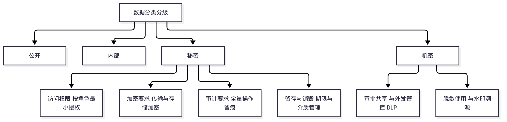


```mermaid
flowchart LR
    U["终端与用户"] -->|邮件 网盘 上传| NDLP["网络 DLP 出网管控"]
    U -->|USB 打印 截屏| EDLP["终端 DLP 端点管控"]
    FS["文件服务器 与 对象存储"] --> SDLP["存储 DLP 扫描发现"]
    NDLP --> POL["统一策略与审计平台"]
    EDLP --> POL
    SDLP --> POL
    POL --> R["响应 阻断 告警 审批 加密与水印"]
    R --> REC["审计留证 与 合规报告"]
```

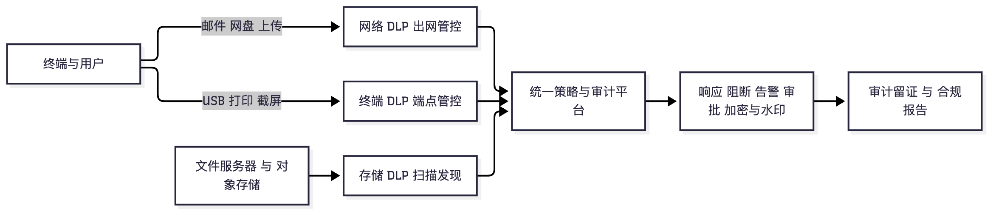


### 真题精练

**Q1.【真题·多选】** 关于数据防泄漏（DLP），下列说法正确的有？
A. DLP 的核心三要素是内容识别、策略定义与响应动作
B. 网络 DLP 可以管控 USB 拷贝与本地打印行为
C. 终端 DLP 能覆盖离线场景与终端本地通道
D. 文档指纹技术适合保护已知的机密文档
E. 部署 DLP 应遵循"先审计、后告警、再阻断"的渐进路径

> **答案：ACDE**
> **解析**：B 错误——USB 与打印属于终端本地通道，网络 DLP（网关型）看不到这些行为，必须由终端 DLP 管控，这也是"三类 DLP 需配合使用"的原因（网络管"发出去"、终端管"拷出去/打出来"、存储管"存在哪"）。

**Q2.【真题·判断】** DLP 只能通过关键字匹配来识别敏感数据，因此对于加密压缩包与图片外发无能为力，这是无法改善的固有局限。

> **答案：错误**
> **解析**：前半句错误——除关键字/正则外，DLP 还有文档指纹、精确数据匹配（EDM）、机器学习分类、文件标签与 OCR 图像识别等多种识别技术，组合使用可大幅提升覆盖率。后半句也过于绝对：加密压缩包确实难以内容识别（需配合解压密码探测、行为分析与终端侧检测），图片可通过 OCR 识别，配合水印与 UEBA 行为分析可缓解，但不能说"无法改善"。正确表述是"**加密与碎片化外传是 DLP 的难点，需要多技术组合与权限治理共同应对**"。

**Q3.【真题·填空】** 数据全生命周期通常划分为采集、________、存储、________、共享交换、销毁六个阶段；其中"使用"阶段最核心的安全措施是________与________。

> **答案：传输；使用**；**最小权限（访问控制/动态授权）**；**审计（全量操作留痕与高危行为告警）**
> **解析**：使用阶段是数据泄露发生最多的环节（内部人员越权、批量导出）。除最小权限与审计外，还可答脱敏、水印、DLP、UEBA 行为分析。注意"分级"是所有阶段的前提：没有分类分级，保护措施就无从差异化。

**Q4.【真题·简答】** 请对比 GDPR 与《个人信息保护法》在"合法基础/同意""数据出境""罚则"三方面的差异。

> **答案**：
> ① **合法基础与同意**：GDPR 提供六项合法性基础（同意、合同必要、法定义务、重大利益、公共任务、正当利益），同意须自由给出、具体、知情且可随时撤回；敏感数据需显式同意。《个人信息保护法》以"知情同意"为核心，同时列举合同/人力资源管理必要、法定义务等情形；**敏感个人信息（生物识别、医疗健康、金融账户、行踪轨迹、不满十四周岁未成年人信息）需单独同意**并告知必要性与影响。
> ② **数据出境**：GDPR 主要依靠"充分性认定、标准合同条款（SCC）、约束性公司规则（BCR）"等机制；我国《个人信息保护法》规定三条路径——**通过安全评估、经专业机构认证、订立标准合同**，并且向境外提供个人信息须履行**告知 + 单独同意**义务；关键信息基础设施运营者与达到规定数量的处理者还有**境内存储**要求（《数据安全法》对重要数据同样有出境安全评估要求）。
> ③ **罚则**：GDPR 最高 2000 万欧元或全球年度营业额 4%（取高）；《个人信息保护法》最高 5000 万元或上一年度营业额 5%（取高），并可由监管部门责令暂停相关业务或停业整顿、吊销许可，直接责任人员亦可能被处罚。此外我国法律还强调"个人信息保护影响评估（PIA）记录至少保存 3 年"。
> ④ **共同落地要点**：最小必要、目的限制、存储期限限制、个人权利响应（查阅/更正/删除/可携带）、泄露报告机制、委托处理与第三方管理。

**Q5.【真题·设计】** 某企业担心"研发图纸与客户名单被内部人员外发"。请设计数据防泄漏方案，并说明如何降低误报对业务的影响。

> **答案**：
> ① **治理先行（分类分级）**：先对数据分类分级，把研发图纸定为"机密"、客户名单定为"秘密"，明确责任人、访问权限、加密与审计要求；没有分级，DLP 策略无从精细化。
> ② **识别技术组合**：研发图纸用**文档指纹**（对设计文件生成指纹，既覆盖原文也覆盖片段复制）；客户名单用**精确数据匹配（EDM）**（将客户表入库做精确比对，避免关键字误报）；同时对身份证/银行卡号等用正则并加校验位；对截图外发补充 **OCR 识别**。
> ③ **三类 DLP 协同**：**网络 DLP** 部署在出口串接，管控邮件/网盘/HTTP 上传（对高价值通道可做 TLS 解密）；**终端 DLP** 管控 USB、打印、剪贴板、截屏与离线场景，并对机密文件强制加密/水印；**存储 DLP** 定期扫描文件服务器与共享目录，发现"沉睡的敏感数据"并推动收敛权限。
> ④ **策略与响应分阶段**：**第一阶段只审计**（记录所有命中，不阻断），用两周到一个月的数据评估误报来源；**第二阶段对高置信规则（文档指纹、EDM）告警并通知本人**；**第三阶段对确认为真泄露的通道阻断，并接入外发审批流**（如"客户名单外发需部门负责人 + 安全审批"）。
> ⑤ **降低误报的关键做法**：用文档指纹/EDM 替代宽泛关键字；把策略限定到**特定用户组 + 特定通道 + 特定数据级别**；设置**白名单与例外**（如财务对银行的正常报送）并带有效期；提供**自助申诉通道**（员工可反馈误报，安全团队快速调整）；建立**按月复核**的规则治理机制。
> ⑥ **配套与其他措施**：最小权限与账号治理（不该有权的人拿不到数据，这是根本）；数据库与文件访问审计；UEBA 检测"非工作时间批量下载、离职前集中导出"等异常行为；离职流程中的权限即时回收；与法务/合规联动，确保满足《数据安全法》《个人信息保护法》要求（含个人信息处理的告知同意与影响评估）。

### 易错点与排错

1. **只答技术不答治理**：数据安全必须是"分类分级 + 权限 + 加密 + 审计 + DLP + 合规"的组合。
2. **DLP = 关键字过滤**：必须写出文档指纹、EDM、机器学习、OCR、文件标签等多种识别技术。
3. **忘记通道覆盖差异**：USB/打印只有终端 DLP 能管，网络 DLP 看不到；加密流量需解密。
4. **一步到位开阻断**：会造成大量业务投诉，正确路径是"审计 → 告警 → 阻断"。
5. **忽略出境与告知同意**：涉及个人信息与重要数据出境时必须做安全评估/标准合同/认证，并履行告知与单独同意。
6. **排错命令/操作**：`display dlp statistics`（命中分布）、`display firewall session table verbose`（确认 DLP 参与检测）、`display logbuffer | include DLP`（日志核对）、Web 界面"策略 > 内容安全 > DLP"中核对指纹库版本与规则启用状态。

---

## 6.6 安全管理体系：策略、组织、人员、建设、运维五个方面

### 考点定位

本考点对应等保"管理要求"的五个方面，占 **3~5 分**，多以多选题或设计题的一个段落出现。很多考生只答技术不答管理，导致设计题丢分。必记：五个方面的名称、每个方面的核心要求、以及"管理要求与技术要求的对应关系"。陷阱：① 把"安全管理机构"与"安全管理人员"混为一谈；② 忘记"安全建设管理"中包含定级备案与测评；③ 认为管理要求"无关紧要"（等保测评中管理部分占比接近一半）。

### 原理精讲

**为什么管理要求与技术同等重要？** 因为绝大多数真实的安全事件根因是"**人为与流程**"：弱口令、权限长期不回收、变更无审批、补丁无人跟踪、离职人员账号未禁用、外包人员无管控、应急预案从未演练。技术措施只能降低概率，管理措施决定"技术措施是否被正确使用与持续维护"。等保测评中，管理要求（制度、机构、人员、建设、运维）与技术要求各占相当比重，且管理类不符合项往往更难整改（需要组织与流程变革）。

**五个方面详解**：

**① 安全管理制度**：形成"**安全策略（总纲）→ 管理制度（分领域）→ 操作规程（具体步骤）→ 记录表单（执行证据）**"的四层文件体系；明确制定、发布、评审（定期，如每年）、修订（业务或威胁变化时）的流程与责任人。**考点**：制度不能只写不评审，要有"评审记录"作为测评证据。

**② 安全管理机构**：设立**网络安全领导机构**（如网络安全委员会）与**安全管理部门**，明确**岗位设置**（安全主管、系统管理员、网络管理员、安全管理员、审计员——**重要岗位应职责分离，管理员与审计员不得兼任**）、人员配备、授权与审批流程（如重大变更、特权申请、数据外发审批）、内外部沟通合作（与监管、兄弟单位、应急响应中心）、定期审核检查（自查与内审）。

**③ 安全管理人员**：覆盖"**进、用、出**"全周期——**录用**（背景审查、签署保密协议）、**在岗**（安全意识教育与技能培训，每年至少一次；关键岗位技能考核）、**离岗**（权限即时回收、资产归还、保密义务提醒）、**外部人员访问管理**（审批、登记、陪同、限制范围、离场检查）。**考点**：外部人员（外包、运维、厂商）管理是实战与测评的高频扣分项。

**④ 安全建设管理**：覆盖系统从生到交付的全过程——**定级与备案**、**安全方案设计**（依据等级要求，含密码应用与产品选型）、**产品采购与外包开发**（安全性与合规性要求、供应商资质、源代码与供应链安全）、**工程实施**（施工与监理、安全控制）、**测试验收**（安全性测试、渗透测试、整改）、**系统交付**（文档、培训、安全服务承诺）、**等级测评**、**服务供应商选择**（资质、服务协议与保密条款）。

**⑤ 安全运维管理**：日常运营的制度化——环境管理（机房进出、温湿度、电力）、资产管理（资产清单与责任人，含软件资产）、介质管理（涉密介质与移动介质管控）、设备维护（维保、备件）、**漏洞与风险管理**（定期扫描、风险评估、修复跟踪与 SLA）、网络与系统安全管理（账号权限、日志审计、配置备份）、恶意代码防范、密码管理（密钥与口令管理）、**变更管理**（申请-评审-审批-实施-验证-回滚）、**备份与恢复**（策略、验证、演练）、**安全事件处置**（分级、报告、处置、复盘）、**应急预案与演练**（每年至少一次，含桌面推演与实战演练）、外包运维管理（权限、审计、退出交接）。

**与技术措施的映射（答题用）**：制度 → 策略配置流程与审计要求；机构 → 权限分离与审批（对应堡垒机与账号管理）；人员 → MFA 与账号生命周期；建设 → 安全域设计与产品选型（等保对标）；运维 → 日志留存、漏洞管理、备份演练、应急响应（对应 SOC 与态势感知）。

### 关键概念对照表

| 管理方面 | 核心要求 | 测评关键证据 | 常见不符合项 |
|---|---|---|---|
| 安全管理制度 | 四层文件体系 + 定期评审修订 | 制度文件、发布记录、评审记录 | 有制度无评审、制度与实操不符 |
| 安全管理机构 | 领导机构 + 岗位设置 + 职责分离 + 审批流程 | 组织架构文件、岗位职责、审批单据 | 管理员与审计员兼任、无审批留痕 |
| 安全管理人员 | 录用审查、培训、离岗管理、外部人员管理 | 保密协议、培训记录、离岗交接单、外部人员登记表 | 无培训记录、外部人员无登记与陪同 |
| 安全建设管理 | 定级备案、方案设计、采购与外包、测试验收、测评 | 定级报告、备案证明、方案评审、验收报告、测评报告 | 未定级备案、外包无安全条款、未做渗透测试 |
| 安全运维管理 | 资产、介质、漏洞、变更、备份、应急、外包运维 | 资产清单、漏洞台账、变更单、备份验证与演练记录 | 备份无恢复演练、变更无审批、漏洞无跟踪 |

| 岗位 | 主要职责 | 职责分离要求 |
|---|---|---|
| 安全主管 | 统筹安全策略与资源、对外联络 | 不直接执行日常运维 |
| 系统管理员 | 服务器与系统运维 | 不得兼任审计员 |
| 网络管理员 | 网络与安全设备运维 | 不得兼任审计员 |
| 安全管理员 | 策略配置、漏洞与安全事件管理 | 与审计员分离 |
| 审计员 | 日志审计与合规检查 | **独立于管理员**，只读权限 |

### 华为设备配置

```bash
# ===== 一、权限分离与账号生命周期（对应"安全管理机构/人员"）=====
system-view
aaa
 local-user admin password irreversible-cipher Helloworld@123
  local-user admin privilege level 15                    // 超级管理员（仅限极少数人持有）
  local-user admin service-type ssh https
  local-user admin idle-timeout 10                       // 空闲 10 分钟自动退出
 local-user netops password irreversible-cipher Netops@12345
  local-user netops privilege level 3                    // 网络运维账号：只给必要的操作级别，禁止 15 级
  local-user netops service-type ssh
 local-user auditor password irreversible-cipher Audit@12345
  local-user auditor privilege level 1                   // 审计账号：低权限只读，与管理员分离（职责分离）
  local-user auditor service-type ssh
 quit
display local-user                                       // 核对账号、权限级别与服务类型

# ===== 二、命令级别与操作审计（对应"安全运维管理"的分级授权）=====
system-view
 command-privilege level 3 view system                   // 把 system 视图命令降级或限定，控制低权限账号能做什么
user-interface vty 0 4                                    // 进入 VTY 用户界面
 acl 2001 inbound                                         // 只允许管理区网段登录设备（ACL 2001 定义管理网段）
 authentication-mode aaa                                   // 使用 AAA 认证，禁止 password 明文模式
 protocol inbound ssh                                      // 仅允许 SSH 接入，禁止 telnet
 quit
display user-interface                                    // 核对 VTY 配置（认证方式、ACL、协议）
display acl 2001                                          // 核对管理网段白名单

# ===== 三、配置备份与变更留痕（对应"变更管理/备份"）=====
system-view
# 1) 定期备份配置文件到 FTP/SFTP 服务器（可用定时任务或网管平台统一备份）
# 2) 变更前备份：save 命令或使用 display current-configuration 归档对比
display current-configuration                            // 导出当前配置作为变更前后对比基线
display startup                                          // 查看下次启动使用的配置文件
# 3) 配置自动备份（部分版本支持，配置到管理区服务器）
#    Web 路径：系统 > 配置文件管理 > 自动备份，设置备份周期与服务器
```

```text
# ===== 四、管理制度落地清单（答题模板，按五方面展开）=====
# 1) 安全管理制度：制定《网络安全管理办法》《账号与权限管理规定》《数据分类分级管理规定》
#    《安全事件应急预案》等；每年评审一次并留存评审记录。
# 2) 安全管理机构：成立网络安全领导小组；设安全主管、系统管理员、网络管理员、
#    安全管理员、审计员；明确职责分离与审批流程（重大变更、特权申请、数据外发）。
# 3) 安全管理人员：入职背景审查与保密协议；每年至少一次安全培训与考核；
#    离岗当日回收权限与资产；外部人员（外包/厂商）审批、登记、陪同、范围限制。
# 4) 安全建设管理：定级备案 → 安全方案设计与评审 → 产品采购与外包安全条款 →
#    工程实施与监理 → 测试验收（含渗透测试） → 交付培训 → 等级测评。
# 5) 安全运维管理：资产台账与责任人；介质与移动存储管控；漏洞扫描与修复 SLA
#    （高危 7 天内）；变更管理（申请-评审-审批-实施-验证-回滚）；备份与恢复演练；
#    日志留存不少于 6 个月；安全事件分级处置与复盘；每年至少一次应急演练。
```

### 示意图

```mermaid
flowchart TB
    M["安全管理体系五个方面"] --> M1["安全管理制度 四层文件体系"]
    M --> M2["安全管理机构 岗位与职责分离"]
    M --> M3["安全管理人员 录用 在岗 离岗"]
    M --> M4["安全建设管理 定级到测评"]
    M --> M5["安全运维管理 日常运营制度化"]
    M1 --> T["与技术措施映射"]
    M2 --> T
    M3 --> T
    M4 --> T
    M5 --> T
    T --> T1["策略配置与审计要求"]
    T --> T2["堡垒机与账号权限"]
    T --> T3["MFA 与账号生命周期"]
    T --> T4["安全域设计与等保对标"]
    T --> T5["日志留存 漏洞管理 备份演练 应急响应"]
```

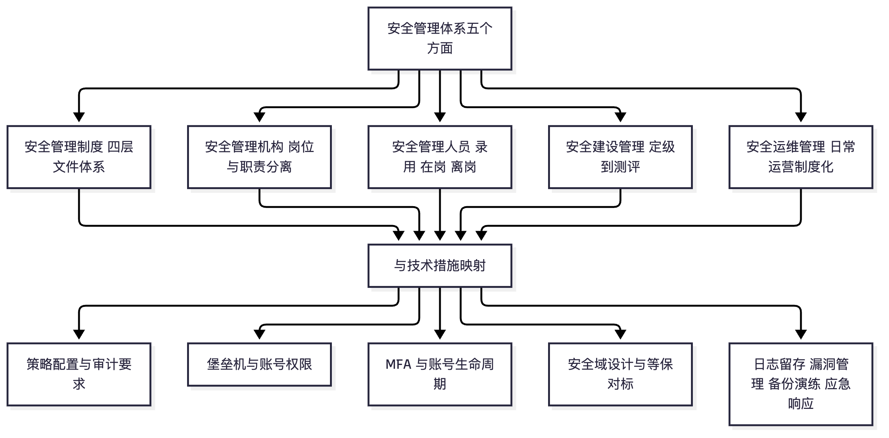


### 真题精练

**Q1.【真题·多选】** 安全管理体系的五个方面包括？
A. 安全管理制度
B. 安全管理机构
C. 安全管理人员
D. 安全建设管理
E. 安全运维管理
F. 安全产品采购预算管理

> **答案：ABCDE**
> **解析**：等保管理要求固定为制度、机构、人员、建设、运维五个方面（F 不是独立方面，产品采购属于"安全建设管理"中的内容之一）。技术部分则对应物理环境、通信网络、区域边界、计算环境、管理中心五类，合计十大类控制点。

**Q2.【真题·判断】** 为节省人力，系统管理员可以同时兼任审计员，只要在制度文件中写明即可。

> **答案：错误**
> **解析**：等保明确要求**重要岗位职责分离**，管理员与审计员必须由不同人员担任，且审计员应具备独立性与只读权限，否则审计无法起到监督作用（管理员可以同时"操作并掩盖"）。这是测评中的常见不符合项。

**Q3.【真题·填空】** 安全运维管理中，**变更**应遵循"申请—________—审批—实施—________—回滚"的流程；**漏洞管理**应对高危漏洞设定修复时限，通常要求________天内完成修复；日志留存不少于________个月。

> **答案：评审；验证**；**7（高危，具体以企业 SLA 为准）**；**6**
> **解析**：变更管理与漏洞管理是运维管理中最容易被实战打穿的两项：未经评审的变更常引入配置漏洞（如临时放开的宽泛策略），未及时修复的漏洞是护网中被利用的主要入口。日志留存 6 个月是等保三级的硬性要求。

**Q4.【真题·简答】** 为什么说"管理要求与技术措施同等重要"？请结合真实事件的常见根因说明。

> **答案**：
> ① **技术措施由人使用与维护**：防火墙策略再强，若长期无人复核、随意放开宽泛 permit，防护即失效；IPS 特征库若不升级，等同于没有检测能力。
> ② **真实事件的根因多为管理缺陷**：常见根因包括——弱口令与默认口令、离职/转岗人员账号未回收、权限长期过大且无审批、补丁与漏洞无人跟踪、外包与厂商接入无管控、变更无评审引入配置漏洞、备份从未做恢复演练（出事才发现备份不可用）、应急预案从未演练（事件时手足无措）。
> ③ **管理决定"持续性"**：技术措施是一次性投入，而威胁与业务持续变化，只有制度化的评审、培训、审计、演练才能保证安全能力持续有效（这也是等保强调"持续运营"的原因）。
> ④ **合规要求**：等保测评中管理要求占相当比重，且管理类不符合项（如无培训记录、无演练记录、无审批留痕）整改难度更大，需要组织与流程支持。
> ⑤ **结论**：正确的表述是"**技术是骨架、管理是灵魂**"——技术把攻击门槛提高，管理保证门槛不下滑。

### 易错点与排错

1. **只答技术不答管理**：设计题必须包含管理五方面的段落，否则分数上限受限。
2. **岗位职责分离记不清**：管理员与审计员必须分离，审计员只读。
3. **建设管理漏项**：定级备案、方案评审、采购与外包、测试验收（含渗透测试）、测评都要写。
4. **运维管理漏"演练"**：备份要"验证/演练"，应急要"演练并留记录"，这是测评必看证据。
5. **忽略外部人员管理**：外包与厂商接入的审批、登记、范围限制、离场检查是高频扣分点。
6. **验证命令/操作**：`display local-user`（账号与权限级别）、`display user-interface`（VTY 认证与 ACL）、`display acl 2001`（管理网段白名单）、变更前后用 `display current-configuration` 做差异对比归档。

---

## 6.7 安全运营中心（SOC）建设：SIEM、SOAR 与运营流程

### 考点定位

本考点是**国赛设计题与简答题的高频内容**，占 **5~8 分**。必考：① SOC 的组成（人、流程、技术）；② **SIEM 与 SOAR 的概念与区别**；③ 安全运营成熟度模型的分级；④ **SOC 运营流程图**（必须能画）；⑤ 关键指标 MTTD/MTTR。陷阱：① 把 SIEM 与 SOAR 混为一谈（SIEM 侧重采集与关联分析，SOAR 侧重编排与自动化响应）；② 认为 SOC = 买一套平台（SOC 的核心是人与流程）。

### 原理精讲

**一、SOC（Security Operations Center，安全运营中心）的组成**

SOC 是"**人 + 流程 + 技术**"三位一体的组织与能力体系，目标是把分散的安全数据转化为**可处置的安全事件**，并以最快速度完成检测、响应与恢复。

- **人**：一线监控值班（7×24 或按业务时段）、二线分析（威胁研判、狩猎）、三线响应与取证（应急）、以及安全开发与工程（平台与规则维护）。关键能力是**研判能力**（把告警变成事件、把事件定性）与**响应能力**（止损、取证、恢复）。**这是 SOC 最难也最贵的一环**，平台只是工具。
- **流程**：事件分级标准、工单流转、升级与通报机制、应急预案与演练、以及与业务/法务/公关的协同流程。流程决定"发现之后能不能动起来"。
- **技术**：日志采集与存储（**SIEM/日志审计**）、流量与终端检测（NIP/EDR/HSS）、威胁情报、**SOAR 编排自动化**、资产与漏洞管理、态势感知（**HiSec Insight**）可视化与处置下发。

**二、SIEM 与 SOAR**

**SIEM（Security Information and Event Management，安全信息与事件管理）**：核心能力是**采集、归一化、存储、关联分析与告警**。工作方式：把防火墙、IPS、WAF、EDR、服务器、应用、数据库、身份系统等日志统一接入 → 解析归一为统一字段（源IP、目的IP、用户、动作、结果、资产、时间）→ 用**关联规则**（Correlation Rule）把多条低价值日志聚合成高价值事件 → 通过仪表盘、告警、报表呈现。SIEM 解决"**看得见、看得全、能关联**"。其难点是**日志源的完整性与规则质量**：没有关键日志（如认证日志、进程创建日志）就无法关联；规则写得不好则告警泛滥（告警疲劳）或漏报。

**SOAR（Security Orchestration, Automation and Response，安全编排自动化与响应）**：核心能力是**编排（Orchestration）+ 自动化（Automation）+ 响应（Response）**。它把"响应动作"封装为可编排的能力（**Playbook 剧本**），在事件触发时自动或半自动执行一系列动作，实现"**分钟级响应**"。典型动作包括：查询情报、封禁 IP/域名（下发防火墙黑名单）、隔离主机（EDR）、禁用/重置账号（IAM）、提取样本送沙箱、发送通知（邮件/IM/工单）、生成报告与留证。SOAR 的价值：① 缩短 MTTR（把人工 30~60 分钟的流程压缩到分钟级）；② 降低对一线人员经验的依赖（把专家经验固化为剧本）；③ 保证动作一致性（每次处置都按同一标准执行）。

**关键区分（必考）**：**SIEM 负责"发现与关联"（Detection），SOAR 负责"处置与编排"（Response）**。二者是互补关系：SIEM 产出事件 → SOAR 消费事件并执行剧本 → 执行结果回流 SIEM/HiSec Insight 形成闭环。没有 SIEM 的 SOAR 没有输入，没有 SOAR 的 SIEM 只能"告警靠人跑"。

**三、安全运营成熟度模型（答题可用五级）**

| 级别 | 特征 | 关键能力 | 衡量指标示例 |
|---|---|---|---|
| L1 被动响应 | 出事才处理，无专职团队 | 基本运维与故障处理 | 事件发现依赖外部通报 |
| L2 基础监控 | 有日志与告警平台，有人值班 | 集中日志、规则告警、人工处置 | 告警量、值班覆盖率 |
| L3 流程化运营 | 有流程、分级、工单与 SLA | 事件分级、工单流转、定期复盘 | MTTD、MTTR、工单闭环率 |
| L4 主动防御 | 有威胁情报、狩猎与自动化 | 情报驱动检测、威胁狩猎、SOAR 剧本 | 狩猎发现占比、自动化处置率 |
| L5 智能自适应 | 自适应风险驱动、持续优化 | 动态策略、智能编排、攻击面管理 | 风险收敛速度、演练成绩 |

**四、SOC 运营流程（必须能画）**

标准运营闭环：**资产与日志接入 → 检测告警 → 关联分析与研判 → 分级与工单 → 响应处置（含自动化） → 恢复与验证 → 复盘与优化 → 回到检测规则与策略**。核心要点：① **每一步都要有明确责任人、时限（SLA）与留痕**；② **必须闭环**——缺少"复盘与优化"就会重复踩坑；③ **自动化优先用于高置信、低风险、可回退的动作**（如封禁单个恶意 IP），高风险动作（如断开生产网络）应保留人工确认；④ **误报治理**是日常工作的主要部分（统计误报率并持续压降）。

**五、关键指标（必须记住并会解释）**
- **MTTD（Mean Time To Detect，平均检测时间）**：从攻击发生到被发现的时间。降低手段：更多数据源、更好的规则、情报与狩猎。
- **MTTR（Mean Time To Respond/Recover，平均响应/恢复时间）**：从发现到完成处置的时间。降低手段：SOAR 自动化、预案与演练、权限与工具就绪。
- 其他常用：告警总量、**真/误报比（误报率）**、事件闭环率、自动化处置率、资产覆盖率（日志接入占比）、剧本执行成功率。

**六、SOC 建设的现实建议（拿分点）**：① **先有数据再有平台**——评估日志源覆盖（关键：认证、进程、网络、数据库、应用），缺日志的检测规则毫无意义；② **先定流程再上工具**——没有分级与升级机制，平台只会制造更多告警；③ **从高价值场景切入**（如"外网暴力破解成功""服务器外联 C&C""批量数据导出"），先做 5~10 个高质量剧本，见到效果再扩展；④ **把演练当作验收**（红蓝对抗检验 MTTD/MTTR，而不是看平台截图）。

### 关键概念对照表

| 对比项 | SIEM | SOAR |
|---|---|---|
| 核心目标 | 发现与关联（Detection） | 处置与编排（Response） |
| 主要功能 | 日志采集、归一化、存储、关联规则、告警、报表 | Playbook 编排、动作执行、审批、留证、报告 |
| 输入 | 各类日志与告警 | SIEM/态势感知的事件、人工下发任务 |
| 输出 | 高价值事件与告警 | 执行动作与处置结果（回流） |
| 关键技术 | 关联分析、UEBA、情报比对 | API 集成、剧本引擎、审批流、可回退设计 |
| 典型价值 | 看得全、能关联、可追溯 | 响应快、一致性强、降低人力依赖 |
| 常见问题 | 日志缺失、规则差导致告警疲劳 | 集成不全会"空转"、自动化误动作风险 |

| Playbook 剧本要素 | 说明 | 示例（"主机外联 C&C"剧本） |
|---|---|---|
| 触发条件 | 事件类型与置信条件 | 命中 C&C 情报且同一源 5 分钟内 ≥3 次 |
| 信息富化 | 自动补充上下文 | 查资产归属、责任人、历史告警、沙箱结论、情报详情 |
| 判定与分支 | 按条件走不同路径 | 高置信 → 自动封禁；中置信 → 人工确认 |
| 执行动作 | 具体的联动动作 | 防火墙封 IP/域名、EDR 隔离主机、禁用账号 |
| 通知与工单 | 通知与留痕 | 通知责任人、创建工单、记录时间线 |
| 验证与回滚 | 确认效果与可回退 | 验证黑名单命中、确认业务正常、必要时回滚 |
| 复盘与优化 | 更新规则与剧本 | 分析是否误报、优化阈值与规则 |

### 华为设备配置

```bash
# ===== 一、日志接入 SIEM/HiSec Insight 的基础配置（USG6000E）=====
system-view
info-center enable
info-center loghost 10.10.50.100                         // SiEM/日志平台地址（管理区）
info-center loghost 10.10.50.100 port 514                // 默认 syslog 端口 514，按平台要求调整
info-center source default channel loghost log level informational
                                                          // 发送 informational 及以上日志（覆盖安全事件）
info-center format uni                                    // 使用统一格式便于平台解析（按平台要求选择）
info-center timestamp precise                             // 精确时间戳，便于跨设备关联分析
 quit
display info-center                                      // 核对日志输出配置
display logbuffer | include SESSION                      // 本地检索会话类日志，验证日志内容是否足够关联

# ===== 二、配置与态势感知/管理平台的联动（用于统一处置下发）=====
system-view
# 1) 联动通道：Web 路径 系统 > 联动 > 态势感知/第三方平台，配置地址、端口与密钥
# 2) 允许平台下发黑名单：确保 firewall blacklist enable 已开启，且平台账号有下发权限
firewall blacklist enable                                // SOAR/HiSec Insight 自动下发 IOC 的前提
display firewall blacklist                               // 查看自动下发的黑名单条目（来源字段可区分自动/手工）
 quit

# ===== 三、SOAR 联动动作的接口准备（工程要点）=====
# 1) 防火墙：开放 RESTful API/北向接口用于下发黑名单与查询会话（按版本支持情况配置）
# 2) EDR/HSS：开放隔离主机与查询进程的 API
# 3) IAM/AD：开放账号禁用与口令重置的 API（必须有审批与审计）
# 4) 所有自动化动作必须：可审计（记录操作者与来源）、可回退（有解封/解除隔离流程）、
#    高风险动作需二次确认（如断开生产区网络）
```

### 示意图

```mermaid
flowchart LR
    S1["资产与日志接入"] --> S2["检测 告警产生"]
    S2 --> S3["关联分析与研判"]
    S3 --> S4{"是否为真实事件"}
    S4 -->|误报| S9["误报治理 调整规则与例外"]
    S4 -->|真实| S5["分级与工单派发"]
    S5 --> S6["响应处置 人工 或 SOAR 剧本"]
    S6 --> S7["恢复与验证 确认业务与威胁消除"]
    S7 --> S8["复盘与优化 更新规则 剧本 架构"]
    S8 --> S2
    S9 --> S2
```

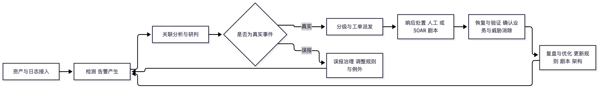


```mermaid
flowchart TB
    subgraph TECH["技术层"]
        SIEM["SIEM 日志与关联分析"]
        SOAR["SOAR 编排与自动化响应"]
        TI["威胁情报"]
        EDR["EDR 与 NIP 检测"]
    end
    subgraph PROC["流程层"]
        CLS["事件分级与 SLA"]
        IR["应急预案与演练"]
        WF["工单与升级机制"]
    end
    subgraph PEOPLE["人员层"]
        L1["一线 监控值班"]
        L2["二线 威胁研判与狩猎"]
        L3["三线 应急响应与取证"]
    end
    EDR --> SIEM
    TI --> SIEM
    SIEM --> SOAR
    SOAR --> L1
    CLS --> WF
    WF --> L2
    L2 --> L3
    IR --> L3
```


### 真题精练

**Q1.【真题·单选】** 关于 SIEM 与 SOAR 的区别，下列说法正确的是？
A. SIEM 负责编排与自动化响应，SOAR 负责日志采集与关联
B. SIEM 侧重日志采集与关联分析（发现），SOAR 侧重剧本编排与自动化处置（响应）
C. 两者是同一种产品的不同叫法
D. SOAR 可以完全替代安全运营人员

> **答案：B**
> **解析**：SIEM 解决"看得见、能关联"（Detection），SOAR 解决"动得快、动作一致"（Response），二者互补：SIEM 产出事件 → SOAR 消费并执行剧本 → 结果回流形成闭环。D 错误——SOAR 只能自动化**高置信、可回退**的动作，研判与高风险决策仍需要人。

**Q2.【真题·多选】** 建设 SOC 时，下列做法正确的有？
A. 先盘点并确保关键日志源（认证、进程、网络、数据库、应用）完整接入，再谈规则与平台
B. 先定义事件分级、SLA、升级与通报流程，再考虑工具选型
C. 先针对高价值场景落地少量高质量剧本（如 C&C 外联、暴力破解成功、批量导出），再逐步扩展
D. 为了体现自动化能力，把所有响应动作都设为全自动、无需人工确认
E. 定期通过红蓝对抗演练检验 MTTD 与 MTTR，并据结果优化规则与剧本

> **答案：ABCE**
> **解析**：D 是错误的激进做法——高风险动作（如断开生产网络、批量禁用账号）必须保留人工确认或至少支持快速回滚，否则一次误判就可能造成生产事故。A、B、C、E 是 SOC 建设"数据 → 流程 → 场景 → 验证"的正确顺序。

**Q3.【真题·判断】** 只要部署了 SIEM 平台并接入全部日志，就能显著降低 MTTD，因此 SOC 的核心是平台选型。

> **答案：错误**
> **解析**：日志接入只是前提。MTTD 的决定因素还包括：**检测规则的质量与覆盖面**（规则少而粗会漏报）、**告警可信度**（告警疲劳会让人忽略真事件）、**威胁情报的时效**、**分析与狩猎能力**（人的因素）。SOC 的核心是"人 + 流程 + 技术"，平台只是工具；缺乏流程与人员时，日志越多，告警越多，反而降低运营效率。

**Q4.【真题·填空】** 安全运营的两个核心指标是________与________；前者衡量"多久发现"，后者衡量"多久处置完成"；降低后者的主要手段是________与________。

> **答案：MTTD（Mean Time To Detect，平均检测时间）**；**MTTR（Mean Time To Respond/Recover，平均响应/恢复时间）**；**SOAR 剧本自动化**；**预案与定期演练（以及工具与权限就绪）**
> **解析**：MTTD 靠"数据 + 规则 + 情报 + 狩猎"降低；MTTR 靠"自动化 + 流程 + 演练 + 权限预授权"降低。二者是 SOC 成效最直接的量化证据，也是护网复盘中必看的指标。

**Q5.【真题·设计】** 请为一家中型企业设计 SOC 运营流程，写出一个典型 Playbook 剧本，并说明如何避免自动化误动作。

> **答案**：
> ① **运营流程（闭环）**：资产与日志接入 → 检测告警（SIEM 规则 + 情报 + EDR/NIP）→ 关联分析与研判（一线初判、二线深挖）→ 分级与工单派发（按资产重要性与威胁置信度分级，设定 SLA）→ 响应处置（低风险高置信自动执行、高风险人工确认）→ 恢复与验证（业务恢复、威胁消除、黑名单命中确认）→ 复盘与优化（更新规则、剧本、架构与资产台账），形成持续改进闭环。
> ② **典型 Playbook："主机外联 C&C"**：
> - 触发：SIEM 检测到内网主机命中 C&C 情报（5 分钟内 ≥3 次）且资产重要级别为"重要"以上；
> - 富化：自动查询资产归属与责任人、历史 30 天告警、目的 IP/域名的情报详情、该主机是否存在可疑进程（EDR）；
> - 判定分支：证据充分（情报 + 行为 + 资产敏感）→ 自动执行止损；证据不足 → 生成工单要求二线在 30 分钟内确认；
> - 执行动作：下发防火墙黑名单（IP+域名，带 TTL）、EDR 隔离主机、保留内存与网络连接证据、通知责任人并创建工单；
> - 验证与回滚：验证黑名单命中与主机已隔离、业务无影响；若确认误报则一键解封并记录原因；
> - 优化：若为误报，修订情报置信度阈值或增加业务白名单，并复盘剧本步骤。
> ③ **避免自动化误动作的机制**：a) **风险分级**——只对"高置信 + 低业务影响 + 可回退"的动作自动化（封单个恶意 IP、隔离单台终端），对生产网络断开、批量账号禁用等必须人工二次确认；b) **预演与灰度**——剧本先在测试环境验证，再对非核心资产灰度；c) **TTL 与回滚**——所有封禁带过期时间与一键解封；d) **双人复核与审计**——自动化动作记录触发规则、执行者（系统）、时间与结果，可追溯；e) **白名单保护**——VIP 资产、核心业务系统、管理网段默认不参与自动隔离；f) **定期演练**——通过红队投放模拟攻击验证剧本的实际效果与副作用。

### 易错点与排错

1. **SIEM/SOAR 混淆**：SIEM = 发现与关联，SOAR = 编排与响应，必须能各举三个功能。
2. **SOC = 平台**：必须答"人 + 流程 + 技术"，并强调研判能力。
3. **只答技术不答指标**：MTTD/MTTR、误报率、闭环率、自动化处置率是成效证据。
4. **流程不闭环**：缺少复盘与优化环节，问题会重复发生。
5. **自动化无边界**：高风险动作必须人工确认 + 可回退 + 白名单保护。
6. **验证操作**：`display info-center`（日志是否外发）、`display logbuffer`（本地日志内容是否够用）、`display firewall blacklist`（自动下发是否成功）、SIEM 上核查日志源接入状态与规则命中率。

---

## 6.8 关键信息基础设施保护与实战攻防演练

### 考点定位

本考点占 **5~8 分**，是"合规 + 实战"交叉的高分区域。必考：① 关键信息基础设施（CII）的认定与保护要求；② 护网行动（实战攻防演练）的组织方式与红蓝紫队分工；③ 攻击队常见手法与防守方检测/响应要点（**这是简答与排错题的直接考点**）；④ 演练评分逻辑（为什么"扣分制"决定防守策略）。陷阱：① 把 CII 与等保混为一谈（CII 是在等保基础上的**重点保护**，要求更高）；② 只答技术不答组织与报告义务；③ 认为演练是"技术比拼"，忽略管理与人因（社工、弱口令、供应链）。

### 原理精讲

**一、关键信息基础设施（CII）保护**

**定义与认定**：《关键信息基础设施安全保护条例》（2021 年 9 月 1 日施行）规定，CII 是指"公共通信和信息服务、能源、交通、水利、金融、公共服务、电子政务、国防科技工业等重要行业和领域的，以及其他一旦遭到破坏、丧失功能或者数据泄露，可能严重危害国家安全、国计民生、公共利益的网络设施、信息系统"。认定由**保护工作部门**（行业主管）依据认定规则负责，并**通知运营者**。

**与等保的关系**：CII 是"**在网络安全等级保护制度基础上的重点保护**"——即 CII 运营者首先必须落实等保要求（通常三级以上），再叠加更严格的要求。CII 的额外要求要点：
1. **专门安全管理机构**与**主要负责人负总责**（安全保护措施与关键岗位人员安全背景审查）。
2. **三同步**：安全技术措施与主体工程同步规划、同步建设、同步使用。
3. **年度检测评估**：**每年至少一次**网络安全检测评估（可自行或委托），并报送结果；发生重大变化时重新评估。
4. **数据与个人信息保护**：境内存储（本地化），出境需安全评估。
5. **容灾与应急**：制定应急预案并**定期演练**；发生重大网络安全事件时**按规定报告**（不得瞒报迟报）。
6. **供应链安全**：采购网络产品和服务可能影响国家安全的，应通过**网络安全审查**。
7. **监测预警与信息共享**：接入国家/行业监测预警平台，参与信息共享。
8. **责任与处罚**：违规可被责令改正、警告、罚款（最高可达数百万元级别），并对直接负责人员处罚。

**二、实战攻防演练（护网行动）的组织方式**

**目标与形式**：由监管/主管部门组织，以"**实战化、体系化、常态化**"为原则，在规定周期内（通常 1~3 周）由**攻击队**对参演单位的真实系统发起授权攻击，**防守队**负责监测、发现、阻断与处置，**裁判/组织方**根据规则评分。核心价值是**暴露真实短板**（比纸面测评更接近实战）。

**评分逻辑（决定防守策略的核心认知）**：多数演练采取"**攻击得分、防守扣分**"的模式——攻击队拿到靶标系统权限、拿到敏感数据得分；防守方**被攻破即扣分**，而**发现并处置攻击、上报有效成果可加分**。这意味着防守的正确策略是：① **守住关键靶标**（核心业务系统、数据）比"抓很多小攻击"更重要；② **必须上报**（有价值的情报与处置过程可得分，不报等于白干）；③ **避免低级失分**（弱口令、暴露面、宽泛策略、日志缺失、系统被拿下）。

**红蓝紫队分工**：

| 队伍 | 角色 | 主要工作 | 关键能力 |
|---|---|---|---|
| 红队（攻击队） | 模拟真实攻击者 | 信息收集、漏洞利用、社工、权限维持、横向移动、数据获取 | 漏洞挖掘、免杀、社工、隐蔽隧道 |
| 蓝队（防守队） | 保护与响应 | 资产梳理、暴露面收敛、监测告警、研判处置、溯源反制 | 检测规则、流量分析、应急响应、日志研判 |
| 紫队（协调/裁判） | 组织与提升 | 制定规则、监控演练过程、评估双方表现、复盘并推动改进 | 组织协调、攻防知识、复盘能力 |

**三、攻击队常见手法与防守方检测/响应要点（高频考点，逐条能对上）**

| 攻击手法 | 典型做法 | 防守方检测要点 | 防守方响应要点 |
|---|---|---|---|
| 信息收集与暴露面扫描 | 子域枚举、指纹识别、GitHub/网盘泄露凭据、招聘与社交信息 | 外部资产测绘与暴露面清单、异常扫描告警（AntiDDoS/WAF 日志） | **资产梳理与暴露面收敛**（下线无用系统、关闭非必要端口）、敏感信息清理 |
| 弱口令与暴力破解 | VPN/SSO/数据库/中间件默认口令、撞库 | 认证失败次数与频度、异地/异常时间登录、成功后行为突变 | 强口令策略 + **MFA**、账号锁定、异常登录阻断、封禁源 IP |
| 漏洞利用（含 0day/Nday） | 边界设备（VPN/防火墙/邮件网关）与 Web 应用漏洞 | IPS 签名与虚拟补丁告警、WAF 规则、异常进程与命令执行 | 紧急补丁/虚拟补丁、临时策略封堵、隔离受影响设备、厂商通告跟踪 |
| 钓鱼与社工 | 仿冒邮件、二维码、IM 传文件、伪装运维人员电话 | 邮件安全（沙箱/沙箱联动）、终端 EDR 行为、用户举报 | 邮件撤回、封禁发件域名、终端隔离与取证、全员预警与培训 |
| 权限维持与免杀 | Webshell、计划任务、服务、注册表、合法工具（LOLBins） | 文件与进程监控、Webshell 检测、异常外联、基线核查 | 清除持久化、封禁 C&C、溯源入口、加固账号 |
| 横向移动 | PsExec/WMI/WinRM、RDP、SMB、漏洞横向、利用域管 | 内网一对多连接、445/3389 异常、事件日志 4624/4688/7045、EDR 进程链 | **微隔离**、限制终端间互访、隔离失陷主机、重置凭据 |
| 隐蔽隧道与外传 | DNS/ICMP 隧道、云盘与合法服务中转、加密 C2、域前置 | 流检测（周期性、字节比、长域名）、TLS 元数据（JA3/SNI）、情报命中 | DNS 层阻断、出站白名单、DLP 拦截、封禁 IOC |
| 供应链与第三方 | 利用运维/外包账号、软件更新通道、共享平台 | 第三方账号行为审计、软件来源与完整性校验、变更监控 | 第三方权限最小化与限期、紧急核查供应链、暂停风险接入 |

**四、防守方的关键抓手（答题金句级要点）**
1. **资产与暴露面**是防守的起点：**"你不知道的资产就是攻击者的入口"**——先做全量资产梳理（含影子资产、云上资产、废弃系统、测试环境），再下线/收敛无关暴露面。
2. **边界设备是重点被攻击对象**（VPN、防火墙、邮件网关、堡垒机、WAF），必须优先打补丁、改默认口令、开启 MFA，并限制管理接口的来源。
3. **日志与检测覆盖**决定能否被发现：认证日志、进程创建、网络连接、Web 访问、数据库审计五类缺一不可（对应 6.7 节 SOC）。
4. **快处快报**：发现攻击后先**止损**（隔离/封禁/改密）再深挖；同时**按规则上报**（有效情报与处置能得分）。
5. **演练即检验 MTTD/MTTR**：把演练视为 SOC 与应急预案的"实战验收"，演练后必须复盘并落实到规则、策略与流程的变更。
6. **避免低级失分**：弱口令、默认口令、暴露的 RDP/数据库、telnet 管理、长期不用的账号、未删除的测试账号、宽泛 permit 策略——这些是每年演练中最常见的丢分点。

### 关键概念对照表

| 对比项 | 等保（等级保护） | CII 保护 |
|---|---|---|
| 依据 | 《网络安全法》+ GB/T 22239 等 | 《关键信息基础设施安全保护条例》 |
| 对象 | 各类网络与信息系统（按级别） | 认定范围内的关键行业领域系统 |
| 关系 | 普遍义务（法定制度） | **等保基础上的重点保护** |
| 主管 | 公安机关监督，行业主管指导 | **保护工作部门（行业主管）**认定与监督，公安指导 |
| 检测评估 | 三级以上每年测评一次 | **每年至少一次检测评估**并按期报送 |
| 数据要求 | 重要数据加密与备份 | **境内存储**、出境安全评估、个人信息保护更严 |
| 供应链 | 采购安全要求 | 可能影响国家安全的须通过**网络安全审查** |
| 人员要求 | 岗位与培训 | **专门安全管理机构 + 关键岗位背景审查 + 主要负责人负总责** |
| 报告义务 | 事件处置与报告 | 重大事件**按规定报告**，不得瞒报迟报 |

| 演练阶段 | 时间 | 防守方重点动作 |
|---|---|---|
| 备战期 | 演练前 1~3 个月 | 资产梳理与暴露面收敛、漏洞清零、策略收紧与复核、日志与监测就绪、应急预案与剧本演练、人员分工与值班表 |
| 演练期 | 通常 1~3 周 | 7×24 监控、快速研判与止损、封禁与隔离、**按规则上报成果**、每日战报与复盘 |
| 复盘期 | 演练后 1~2 周 | 统计 MTTD/MTTR 与失分点、根因分析、规则与策略优化、整改计划与责任人、下一年度预案修订 |

### 华为设备配置

```bash
# ===== 一、备战期：暴露面收敛与边界加固（USG6000E）=====
system-view
display firewall session table                          // 盘点当前活跃会话，发现不该存在的对外服务
display security-policy rule all                        // 复核策略：清理宽泛 permit 与临时调试规则（常见的演练失分点）
firewall blacklist enable                                // 使能黑名单，便于演练期快速封禁
# 关闭不必要的对外服务与管理面暴露
undo http server enable                                  // 关闭明文 HTTP 管理
http secure-server enable                                // 只保留 HTTPS 管理
acl 2001                                                // 管理面访问白名单
 rule 5 permit source 10.10.50.0 0.0.0.255               // 只允许管理区段访问设备
 rule 10 deny                                            // 其余全部拒绝（含互联网）
 quit
user-interface vty 0 4
 acl 2001 inbound                                         // 管理登录必须命中白名单
 authentication-mode aaa
 protocol inbound ssh
 quit
display acl 2001                                         // 核对管理面白名单
display ssh server status                                // 确认 SSH 服务已启用、telnet 已关闭

# ===== 二、演练期：快速研判与止损（逐条可执行）=====
display firewall session table source 10.1.1.66          // 1) 定位可疑源主机的全部连接
display ips signature statistics                         // 2) 查看攻击类型分布（利用/扫描/爆破）
display firewall blacklist verbose                       // 3) 确认自动化/人工封禁是否已生效
system-view
firewall blacklist ip 203.0.113.66 timeout 86400         // 4) 封禁攻击源（带 TTL，便于演练后清理）
firewall blacklist domain malicious.example timeout 86400// 5) 同时封禁恶意域名
quit
display logbuffer | include <attack-ip>                  // 6) 检索该 IP 的全部历史日志形成时间线
display security-policy statistics rule deny_malicious    // 7) 验证拦截规则是否在命中

# ===== 三、面向演练的核查清单（用命令取证）=====
display version                                          // 版本与补丁情况（边界设备漏洞是重点攻击目标）
display cpu-usage                                        // 异常负载（可能被植入挖矿或遭受 DoS）
display memory-usage
display firewall session statistics                       // 新建速率与会话统计（判断是否存在扫描或连接风暴）
display interface | include input                        // 接口丢包（判断是否遭受流量型攻击）
display info-center                                      // 日志是否正常外发到 SOC（检测覆盖的基础）
```

```text
# ===== 四、演练组织与流程要点（非命令，答题模板）=====
# 1) 组织：成立演练指挥部（指挥 + 监测组 + 研判组 + 处置组 + 溯源组 + 保障组），
#    明确值班表、通讯录、上报路径与决策权限（谁能封禁、谁能断网）。
# 2) 备战：资产与暴露面梳理 → 漏洞清零 → 策略复核 → 监测与日志就绪 →
#    应急预案与 SOAR 剧本演练 → 第三方与外包账号清理 → 全员钓鱼演练与培训。
# 3) 演练期：7×24 监控；告警分级（高置信立即止损）；按规则上报有效成果；
#    每日战报（攻击手法、处置动作、得失分项、待办）。
# 4) 复盘：统计 MTTD/MTTR 与失分点，逐项根因分析，形成整改清单（责任人 + 时限），
#    并把经验固化为检测规则、SOAR 剧本与制度修订。
# 5) 合规：涉及 CII 的重大安全事件须按规定向保护工作部门与公安机关报告，不得瞒报迟报。
```

### 示意图

```mermaid
flowchart TB
    CII["关键信息基础设施保护"] --> O1["专门安全管理机构 主要负责人负总责"]
    CII --> O2["三同步 规划 建设 使用"]
    CII --> O3["每年至少一次检测评估与报送"]
    CII --> O4["数据境内存储 出境安全评估"]
    CII --> O5["应急预案与定期演练"]
    CII --> O6["供应链网络安全审查"]
    CII --> O7["监测预警与信息共享"]
    CII --> O8["重大事件按规定报告"]
```


```mermaid
flowchart LR
    subgraph RED["红队 攻击"]
        R1["信息收集"] --> R2["弱口令与漏洞利用"]
        R2 --> R3["权限维持"]
        R3 --> R4["横向移动"]
        R4 --> R5["数据获取与靶标控制"]
    end
    subgraph BLUE["蓝队 防守"]
        B1["资产与暴露面收敛"] --> B2["监测与告警"]
        B2 --> B3["研判与止损"]
        B3 --> B4["溯源与加固"]
        B4 --> B5["上报与复盘"]
    end
    subgraph PURPLE["紫队 协调与提升"]
        P1["规则制定与过程监控"] --> P2["效果评估与复盘"]
        P2 --> P3["推动蓝队规则与策略优化"]
    end
    RED -.->|攻击行为产生告警| B2
    BLUE -.->|处置结果与失误点| P2
    PURPLE -.->|优化建议| B1
```


### 真题精练

**Q1.【真题·多选】** 关于关键信息基础设施（CII）保护，下列说法正确的有？
A. CII 是在网络安全等级保护制度基础上的重点保护
B. CII 运营者应设置专门安全管理机构，并对关键岗位人员进行安全背景审查
C. CII 运营者每年至少开展一次网络安全检测评估并报送结果
D. CII 与等保完全无关，是两套独立的制度
E. 采购可能影响国家安全的网络产品和服务，应通过网络安全审查

> **答案：ABCE**
> **解析**：D 错误——《关键信息基础设施安全保护条例》明确 CII 是"在网络安全等级保护制度的基础上"实行重点保护，即先满足等保（通常三级以上），再叠加更严格的要求（年度检测评估、数据境内存储、供应链审查、报告义务等）。

**Q2.【真题·判断】** 在实战攻防演练中，防守方只要成功拦截了大量攻击流量就一定能拿高分。

> **答案：错误**
> **解析**：多数演练采取"**攻击得分、防守扣分**"的评分逻辑：**靶标系统被攻破、敏感数据被获取会直接扣分**，而被拦截的"小规模扫描"通常不计分或计分很低。因此防守策略的核心是**守住关键靶标**（核心业务与数据）、**避免低级失分**（弱口令、暴露面、宽泛策略），同时**按规则上报**有效的发现与处置成果（可加分）。盲目追求"拦截数量"不如聚焦关键资产与快速响应。

**Q3.【真题·填空】** 实战攻防演练中，红队负责________，蓝队负责________，紫队负责________；防守方降低失分的两个关键抓手是________与________。

> **答案：模拟攻击（进攻与突破）**；**监测发现与响应处置（防守）**；**组织协调、过程监控、评估复盘与推动改进**
> **解析**：两个关键抓手可答：① **资产与暴露面收敛**（"你不知道的资产就是攻击者的入口"）；② **日志与检测覆盖 + 快速止损上报**（能发现、能处置、能上报）。也可补充"边界设备专项加固（VPN/防火墙/邮件网关）"与"弱口令与 MFA 治理"。

**Q4.【真题·简答】** 请列举演练中攻击队常用的五种手法，并对应给出防守方的检测与响应要点。

> **答案**：
> ① **信息收集与暴露面扫描**：子域枚举、指纹识别、从代码托管/网盘/社交平台搜集泄露凭据。检测：外部资产测绘、异常扫描与探测告警。响应：下线废弃系统与非必要端口、清理外泄敏感信息、收敛对外暴露面。
> ② **弱口令与暴力破解**（VPN/SSO/数据库/中间件）：检测靠认证失败频度与异地/异常时间登录、登录成功后行为突变。响应：强制强口令 + **MFA**、账号锁定、封禁源 IP、排查是否已成功登录（成功登录才是真事件）。
> ③ **钓鱼与社工**：仿冒邮件、二维码、IM 传马。检测靠邮件安全与沙箱联动、EDR 行为、用户举报通道。响应：邮件撤回、封禁发件域名与 IOC、隔离终端取证、全员预警与针对性培训。
> ④ **漏洞利用（含边界设备 0day/Nday）**：检测靠 IPS 签名/虚拟补丁、WAF 规则、异常进程与命令执行。响应：紧急补丁或虚拟补丁、临时策略封堵、隔离受影响设备、跟踪厂商通告。
> ⑤ **横向移动与权限维持**：PsExec/WMI/WinRM/RDP、计划任务与服务、Webshell、合法工具滥用。检测靠内网一对多连接、445/3389 异常、Windows 事件 4624/4688/7045、EDR 进程链。响应：**微隔离**限制东西向、隔离失陷主机、清除持久化、**重置相关凭据**（攻击者常已窃取凭据）、封禁 C&C。
> ⑥ （补充）**隐蔽隧道与数据外传**：DNS/ICMP 隧道、加密 C2、云盘中转。检测靠流检测（周期性与字节比）、TLS 元数据（JA3/SNI）、情报命中。响应：DNS 层阻断、出站白名单、DLP 拦截、IOC 全网下发。

**Q5.【真题·设计】** 某单位为迎接演练，请给出"备战期—演练期—复盘期"三阶段的防守工作方案（含组织、技术、流程三方面）。

> **答案**：
> ① **组织**：成立演练指挥部，下设监测组、研判组、处置组、溯源组、保障组；明确值班表（7×24）、通讯方式、上报路径与**决策权限**（谁能封禁、谁能断网、谁批准隔离生产系统）；指定对外发言人，避免多头报告。
> ② **备战期（技术）**：全量资产梳理（含影子资产、云资产、测试环境）与暴露面收敛（下线无用系统、关闭非必要端口、管理面白名单）；漏洞扫描与高危漏洞清零、边界设备（VPN/防火墙/邮件网关/堡垒机/WAF）专项加固与补丁、默认口令与弱口令治理 + **MFA**；安全策略复核（清理宽泛 permit 与临时规则）；日志与监测就绪（认证、进程、网络、Web、数据库五类日志接入 SIEM，规则与情报就绪）；部署/验证 SOAR 剧本与应急预案。
> ③ **备战期（流程）**：全员钓鱼演练与安全培训；第三方与外包账号清理与最小化授权；制定并演练"应急预案 + 升级流程 + 取证规范"；准备工具与权限（预授权的封禁与隔离操作路径）。
> ④ **演练期**："监测 → 研判 → 止损 → 上报 → 溯源"流水线作业；高置信告警立即止损（隔离主机、封禁 IOC、禁用账号、重置凭据）；按规则**及时上报**有效成果；每日战报统计攻击手法、处置动作、得失分与待办事项；保持与指挥部和业务方的同步，避免处置动作影响业务。
> ⑤ **复盘期**：统计 **MTTD/MTTR**、统计失分点与未发现/未处置的事件；逐项根因分析（资产盲区？规则缺失？权限过大？流程卡点？）；形成整改清单（责任人 + 时限）；把经验固化为检测规则、SOAR 剧本、安全域策略与制度修订；完成下一年度预案与培训计划。涉及 CII 的重大事件按规定报告，不得瞒报迟报。

### 易错点与排错

1. **把 CII 与等保视为两套无关制度**：CII 是等保基础上的重点保护，必须先满足等保再叠加。
2. **演练只谈拦截数量**：必须理解"攻击得分、防守扣分"的评分逻辑，聚焦关键靶标与低级失分。
3. **忘记上报**：按规则上报有效发现与处置成果可得分，"发现了不报"等于零分。
4. **处置顺序错**：先止损（隔离/封禁/改密）再深挖取证；但需在隔离前尽量保留关键证据（内存、连接、日志）。
5. **忽略凭据重置**：攻击者一旦获得凭据，只封 IP 不清除凭据与持久化，会立刻复攻。
6. **核查命令**：`display security-policy rule all`（策略复核）、`display version`（补丁情况）、`display firewall session table`（异常会话）、`display ips signature statistics`（攻击类型）、`display acl 2001`（管理面白名单）、`display info-center`（日志外发）。

---

## 6.9 企业安全方案设计题专训（2 道综合设计题 + 标准答案框架）

### 考点定位

本考点对应国赛安全方向的**压轴综合题**，单题分值可达 **15~25 分**，是决定名次的关键。命题形式通常是"给定企业背景（行业、规模、业务、合规要求）— 要求完成安全域划分、设备选型、策略设计、等保对标、实施与运维规划"。**评分要点固定为五个维度**：① 架构与分区是否合理；② 设备选型与部署方式是否匹配业务与性能；③ 策略设计是否符合最小授权与纵深防御；④ 是否对标等保（技术 + 管理）与合规（密评、数据保护）；⑤ 是否有运营与应急（不是"交钥匙就完事"）。下面给出两道完整题目与标准答案框架，**框架本身即可作为考场答题模板**。

### 原理精讲

**综合设计题的四步答题法（通用，务必按此组织答案）**：
1. **需求与现状分析**：先提取题目给的关键信息（业务系统、用户规模、合规要求、网络现状、痛点），明确"保护对象、保护等级、合规底线"三个结论。**这一步是得分起点**，很多考生直接开始堆设备导致答非所问。
2. **总体架构设计**：安全域划分 → 域间边界与设备部署 → 南北向/东西向检测与阻断 → 管理中心与运营体系。**先画图再列文字**（题目要求"设计"，图能直接拿架构分）。
3. **分项设计**：边界防护（含 DDoS/IPS/AV/沙箱）、访问控制与远程接入（零信任/SDP）、数据安全（分类分级 + DLP + 加密 + 审计 + 备份）、主机与终端（EDR/HSS + 基线）、安全运营（SIEM/SOAR + 流程 + 指标）。
4. **合规与落地**：逐条对标等保（技术十大类 + 管理五方面）、密评（若涉商用密码）、数据合规（个保法/数据安全法）；给出实施阶段划分（先收敛暴露面与补短板，再建设平台，最后运营优化）、验收标准与风险控制。

**答题的三个加分习惯**：① **写出具体产品型号**（USG6510E/USG6520E/USG12000、NIP、AntiDDoS、HiSec Insight、EDR、WAF、SDP、HSS、CFW）而不是"部署防火墙"；② **写出量化指标**（日志留存 ≥6 个月、高危漏洞 7 天内修复、备份 3-2-1、MTTR ≤30 分钟、边界设备按峰值 1.5~2 倍选型）；③ **写出验证办法**（渗透测试、恢复演练、演练检验 MTTD/MTTR）。

### 关键概念对照表

| 题目给出的关键信息 | 应推出的设计结论 |
|---|---|
| "面向公众的 Web 业务" | 需要 DMZ + WAF + AntiDDoS + 边界 IPS/AV + 服务器出站白名单 |
| "研发人员需远程访问代码库" | 用 SDP 替代传统 VPN（应用级授权 + 设备合规 + MFA） |
| "含大量个人信息/客户数据" | 分类分级 + 加密存储（国密）+ 数据库审计 + DLP + 出境评估 |
| "生产网/工控系统" | 生产区独立域 + 工业防火墙/单向隔离 + 不上互联网 + 变更严管 |
| "三级系统 / 关基行业" | 等保三级对标 + 年度测评 + 日志 6 个月 + 双因素 + 异地备份；涉 CII 叠加年度检测评估与报告义务 |
| "运维外包 / 第三方接入" | 第三方专用接入域 + 堡垒机 + 最小权限 + 限期 + 全程审计 |
| "性能与时延敏感（交易类）" | 串接选型按峰值 1.5~2 倍、关键链路双机 + Bypass、按需分流检测 |
| "预算有限、要分步实施" | 按"暴露面收敛 → 关键防护 → 检测响应 → 运营优化"分期，并说明每期收益 |

### 真题精练

**Q1.【真题·设计】** 某省级三甲医院计划整体升级网络安全防护，现状与需求如下：
- 业务系统：HIS（医院信息系统，核心）、LIS（检验）、PACS（影像）、电子病历、对外预约挂号 Web 与微信小程序、互联网医院。
- 网络：互联网出口 1Gbps，内网约 3000 台终端（门诊/住院/医技/行政），一个数据中心（含 HIS 数据库与影像存储），两个分院通过专线互联。
- 合规：HIS 等核心系统定为**等保三级**，涉及大量患者个人信息（含敏感个人信息），属于行业**关键信息基础设施**相关单位。
- 痛点：曾发生勒索软件导致部分科室停诊；互联网出口仅有基础防火墙；终端杀毒老旧；无集中日志与安全运营团队（仅 1 名兼职管理员）。

请完成：① 安全域划分与架构图；② 关键设备选型与部署方式（说明理由）；③ 核心策略设计要点；④ 等保三级与合规对标清单；⑤ 分期实施计划与验收标准。

> **答案（标准答案框架）**：
> **① 安全域划分与架构**
> 划分为 7 个域：**互联网接入区**（出口路由器 + AntiDDoS + USG 边界）、**DMZ 对外服务区**（预约挂号 Web、互联网医院前置、反向代理、WAF）、**内网业务应用区**（HIS/LIS/PACS/电子病历的应用服务器）、**核心数据区**（HIS 数据库、影像存储、备份）、**终端接入区**（门诊/住院/医技/行政终端，按科室再细分）、**管理区**（网管、堡垒机、日志与态势感知平台）、**分院互联区**（专线对接两个分院）。
> 架构原则：**核心数据区等级最高**（只允许业务应用区特定主机访问特定端口，且全量数据库审计）；**DMZ 禁止主动访问内网**（对外服务经反向代理/API 网关到内网，源/目的/端口精确绑定）；**终端接入区**内部按科室做微隔离（禁止终端之间 445/3389 互访，这是勒索软件横向的关键阻断点）；**管理区独立成域**，只允许管理终端经堡垒机以 SSH/HTTPS 运维，管理流量与业务流量分离；**分院互联区**通过 IPSec 专线/VPN + 严格策略，只放行 HIS/LIS 的必要流量。
> **② 关键设备选型与部署方式**
> - 出口边界：**AntiDDoS**（清洗 DDoS/CC，医疗预约高峰与挂号抢号常遭攻击）+ **HiSecEngine USG6510E/USG6520E**（串接，按出口峰值 1.5~2 倍选型，开启 IPS + 反病毒 + URL 过滤 + DLP，配置**双机热备 HRP + 光/电 Bypass**，避免设备故障导致全院停诊）。**理由**：医疗业务中断代价极高，必须"可阻断 + 不中断"。
> - DMZ：**WAF** 防护预约挂号与互联网医院（Web 攻击 + CC + API 防护）；反向代理实现"外网不可直达内网"。
> - 内网：**NIP 旁路探针**部署在核心交换机镜像口，覆盖东西向（横向移动、C&C、勒索传播）；**微隔离**在终端接入区落地（先监控后阻断）。
> - 数据中心：**数据库审计**（HIS 数据库全量 SQL 审计，尤其批量导出与越权访问）；**存储与备份加密**、**本地 + 异地/离线备份（3-2-1）**，并每半年做恢复演练。
> - 主机与终端：服务器与终端部署 **EDR/HSS**（行为检测、勒索行为识别、隔离处置），统一补丁与基线管理。
> - 远程运维与第三方（厂商运维工程师）：**SDP** 或 VPN + **堡垒机**（强认证 + 审批 + 全程录像），第三方账号限期、最小权限。
> - 管理区：**HiSec Insight 态势感知 + SIEM/SOAR**，汇聚全网日志做关联分析与自动化处置（封 IOC、隔离主机）。
> **③ 核心策略设计要点**
> - **默认拒绝 + 最小授权**：策略绑定源 IP、目的 IP、服务、用户/时间；禁止"any-any permit"；季度复核清理。
> - **DMZ 策略**：互联网只能访问 DMZ 的 80/443；DMZ → 内网仅允许经反向代理到指定 API，**禁止 DMZ → 数据库**。
> - **数据区策略**：只允许应用区特定服务器访问 HIS 数据库端口；终端区任何主机**禁止直连数据库**。
> - **终端区策略**：禁止终端之间 SMB(445/139)/RDP(3389) 互访（防勒索横向）；上网流量做 URL 过滤 + DLP + 应用识别；医疗设备（如 PACS 客户端、监护仪）单独网段并做"只允许必要协议"的严格策略（避免影响医疗设备稳定性）。
> - **分院策略**：只放行 HIS/LIS 必要端口，双向绑定并限速；分院出口不直接上网，统一经总院出口（或按分院实际上网需求单独设立策略与检测）。
> - **管理面策略**：管理接口只允许管理区访问（ACL + SSH/HTTPS），关闭 telnet/http，堡垒机审计。
> - **出站策略**：服务器出站白名单（默认拒绝），阻断服务器主动访问互联网（防 C&C 与数据外传）。
> **④ 等保三级与合规对标清单**
> - 技术要求：**安全通信网络**（域划分、关键节点冗余、管理流量分离、重要数据传输加密——患者隐私数据用国密算法）；**安全区域边界**（访问控制、IPS 入侵防范、反病毒/沙箱、**日志审计留存 ≥6 个月**）；**安全计算环境**（**双因素身份鉴别**、最小权限、安全审计、漏洞与补丁、恶意代码防范、数据完整性与保密性、**本地 + 异地备份并做恢复演练**、剩余信息保护、个人信息保护）；**安全管理中心**（系统/审计/安全/集中管控，HiSec Insight + 堡垒机 + 日志平台）；**安全物理环境**（机房门禁与动环）。
> - 密码合规（**密评**）：敏感数据存储与传输使用 SM2/SM3/SM4，管理通道与对外服务采用国密 TLS（双证书），密钥由密码机/KMS 管理，留存密码应用方案与评估报告。
> - 数据合规（**个保法/数据安全法**）：患者信息分类分级（敏感个人信息单独同意与更严格保护）、最小必要采集、访问审计、境内存储、出境（如涉及）安全评估、个人信息保护影响评估（PIA）记录留存 ≥3 年。
> - 关基要求：设置**专门安全管理机构**、关键岗位背景审查、**每年至少一次检测评估并报送**、应急预案与定期演练、重大事件按规定报告、供应链安全审查。
> - 管理要求：制度、机构、人员（培训与离岗）、建设（定级备案/方案评审/采购与外包/测试验收/测评）、运维（资产、介质、漏洞 SLA、变更、备份演练、应急、外包运维管理）。
> **⑤ 分期实施计划与验收标准**
> - **第一期（1~2 个月，止血）**：资产与暴露面梳理；关闭互联网暴露的非必要端口与远程管理面；边界设备补丁与口令/MFA 加固；关键数据备份落地（含离线副本）并完成一次恢复演练；终端 EDR 全量部署。**收益**：直接降低勒索与入侵风险。
> - **第二期（2~4 个月，建能力）**：安全域划分与策略重构；DMZ 与 WAF 建设；NIP 旁路与东西向检测；数据库审计；日志集中与态势感知上线；微隔离"监控模式"运行。
> - **第三期（3~6 个月，强运营）**：微隔离切换阻断模式；SOAR 剧本落地（C&C 外联、勒索行为、批量导出）；SOC 值班与流程建立；密评与等保三级测评、整改；全员意识培训与钓鱼演练。
> - **验收标准**：等保三级测评**符合/基本符合**且无高风险项；密评符合；渗透测试中"DMZ 不能进内网""终端不能横向到数据区"；勒索专项演练中 **MTTD ≤10 分钟、MTTR ≤30 分钟**且可从备份恢复业务；日志完整率 ≥95%；关键策略无宽泛 permit；备份恢复演练成功率 100%。

**Q2.【真题·设计】** 某大型制造企业集团要进行安全架构设计，现状与需求如下：
- 业务：总部（研发、财务、人力、行政、市场）+ 3 个生产基地（MES/SCADA/PLC 产线）+ 2 个海外销售办事处；对外有官网、B2B 订单平台、供应商门户。
- 网络：总部双出口（主备 ISP）共 2Gbps；生产基地与总部通过专线互联；海外办事处走互联网 VPN 接入；正在推进"业务上云"（部分 ERP 与 CRM 迁移到公有云）。
- 合规：核心业务系统等保三级；涉及研发数据（商业机密）、客户与员工个人信息；属于行业重点监管单位。
- 痛点：曾发生"研发图纸外泄"疑似内部人员所为；生产网与办公网曾因临时打通而出现蠕虫传播；云上资产缺乏统一安全管控与日志。

请完成：① 安全域划分与架构图（含云上部分）；② 设备选型与部署（含生产网与云）；③ 核心策略设计（含数据防泄漏与东西向管控）；④ 等保与数据合规对标；⑤ 安全运营与实施建议。

> **答案（标准答案框架）**：
> **① 安全域划分与架构（含云）**
> 总部：**互联网接入区**（双出口 + AntiDDoS + 边界 USG）、**DMZ**（官网、B2B 订单、供应商门户 + WAF）、**办公区**（按部门细分，研发单独成域）、**研发专域**（研发终端与代码库/图纸服务器，权限最严、外发管控最强）、**内网应用区**（ERP/CRM/HR/财务）、**数据区**（数据库与文件存储、备份）、**管理区**（网管、堡垒机、日志与态势感知）、**生产区**（MES/SCADA/PLC，三个基地一致）、**外联区**（供应商与海外办事处接入）。
> 云上：**云边界区**（云防火墙 CFW + WAF + AntiDDoS）、**云主机区**（HSS 主机安全）、**云数据区**（数据库安全 + 加密 + 备份）、**云管理区**（态势感知 SA 统一纳管）。**关键**：本地与云上采用一致的域划分与策略基线，日志统一汇聚到总部 SIEM/HiSec Insight（或云上 SA + 本地平台对接），实现"**混合云统一管控**"。
> 架构原则：**生产区与办公区严格隔离**（历史痛点的直接整改）；**研发专域**独立且强管控；**DMZ 不可直达内网**；**外联区只允许到具体应用**；**云上按责任共担模型明确边界**（见 7.1 节）。
> **② 设备选型与部署（含生产网与云）**
> - 总部出口：**AntiDDoS + USG6520E 双机热备（HRP）** 串接（2Gbps 双出口按峰值 1.5~2 倍选型），开启 IPS + 反病毒 + 沙箱联动 + URL 过滤 + **DLP**；双出口做链路负载与故障切换。
> - DMZ：**WAF** + 反向代理；对 B2B 平台增加 API 防护与限流。
> - 内网：**NIP 旁路探针**（核心镜像）+ **微隔离**（办公终端之间、服务器之间）。
> - 研发专域：独立防火墙/虚拟系统做策略隔离 + **DLP（终端 + 网络双管，含文档指纹）** + 图纸服务器加密与水印 + USB/打印管控 + 外发审批；研发终端禁用公网直连（经受控代理）。
> - 生产区：**工业防火墙/单向隔离装置**（按协议与功能码白名单放行），生产网**禁止访问互联网**，只允许单向推送数据到采集服务器；生产网与办公网**禁止直连**（消除本次痛点）。
> - 云上：**CFW（云防火墙）** 做南北向与 VPC 间访问控制、**WAF** 保护 Web 业务、**AntiDDoS** 抗流量攻击、**HSS 企业主机安全**做主机防护与基线、**数据库安全**与**态势感知 SA** 做统一监测；云上资产通过 **SDP** 或专线/VPN 做运维接入（不使用公网暴露的管理端口）。
> - 管理区：**堡垒机 + HiSec Insight + SIEM/SOAR**；所有第三方（供应商、云厂商、外包）统一经外联区 + 堡垒机接入，限期授权、全程审计。
> **③ 核心策略设计**
> - **默认拒绝 + 最小授权**：所有域间策略绑定源/目的/服务/用户；季度复核；禁止 any-any。
> - **办公区**：可访问内网应用与互联网（IPS/URL 过滤/DLP），**禁止访问生产区**；终端之间微隔离（禁 445/139/3389 互访）。
> - **研发专域**：只允许访问研发代码库与必要服务；**禁止访问互联网**（经代理出网）与**禁止访问生产区/财务系统**；所有外发（邮件/网盘/IM/USB/打印）经 DLP 审核，机密图纸用文档指纹规则**阻断外发**。
> - **DMZ**：互联网只访问 80/443；DMZ 经反向代理访问内网指定 API；DMZ 禁止访问数据库与生产区。
> - **数据区**：只允许应用区特定主机访问；终端与 DMZ 一律禁止直连；全量 SQL 审计；重要字段加密（国密 SM4）。
> - **生产区**：只允许对采集服务器**单向推送**；禁止任何入向主动访问；工业防火墙按协议白名单（Modbus/OPC 等）而非"端口全放"；变更需审批并离线实施。
> - **海外办事处**：**SDP** 接入（应用级授权 + MFA + 设备合规），只开放其业务所需应用，禁止访问生产区与核心数据区；会话全审计。
> - **云上**：VPC 间默认拒绝、安全组最小化；云主机出站白名单；对象存储禁止公网可读；快照与镜像权限受控；云上管理端口不对公网开放。
> - **出站与数据外发**：服务器出站白名单；DLP 覆盖邮件/网盘/IM/USB/打印；数据库导出需审批与审计；对大批量导出建立 UEBA 告警。
> **④ 等保与数据合规对标**
> - 等保三级（技术）：安全通信网络（域划分、双出口冗余、管理流量分离、国密传输加密）；安全区域边界（访问控制、IPS、反病毒/沙箱、日志 ≥6 个月）；安全计算环境（双因素、最小权限、审计、漏洞与补丁、数据完整性与保密性、本地 + 异地备份与恢复演练、个人信息保护）；安全管理中心（集中管控、统一审计）；安全物理环境。
> - 等保三级（管理）：制度、机构（职责分离）、人员（培训与离岗）、建设（定级备案/方案评审/采购与外包/测试验收/测评）、运维（资产、介质、漏洞 SLA、变更、备份演练、应急、外包运维管理）。
> - 密评：重要数据与个人信息传输存储采用 SM2/SM3/SM4；管理通道与对外服务用国密 TLS；密钥由 KMS/密码机管理；留存密码应用方案与评估报告。
> - 数据合规：数据分类分级（研发图纸=机密、客户与员工个人信息分一般/敏感）；最小必要与告知同意；敏感个人信息单独同意；访问审计与留痕；境内存储、出境走安全评估/标准合同/认证三路径之一；PIA 记录留存 ≥3 年；数据泄露报告机制。
> - 云合规：明确**责任共担**边界（云厂商负责"云的安全"，租户负责"云中的安全"）；云上等保按**云计算安全扩展要求**落地；云上日志接入统一平台，满足审计与取证要求。
> **⑤ 安全运营与实施建议**
> - **运营**：建立 SOC（人 + 流程 + 技术），Mi 日志统一汇聚（本地 + 云），部署 SIEM + SOAR，落地 5~10 个高价值剧本（C&C 外联、勒索行为、批量导出、暴力破解成功、未授权设备接入）；定义 MTTD/MTTR 目标（如 MTTD ≤10 分钟、MTTR ≤30 分钟）并按季度度量。
> - **零信任演进**：先对"远程接入（海外办事处/居家办公）+ 特权运维"落地 SDP 与 MFA，再对研发专域与生产区做微隔离，逐步扩展到数据层。
> - **实施分期**：一期（1~2 月）资产梳理 + 暴露面收敛 + 生产/办公隔离整改 + 备份与演练；二期（2~4 月）总部域划分与策略重构 + DMZ/WAF + NIP + DLP 上线（先审计）；三期（3~6 月）云上安全建设 + 微隔离阻断 + SOC/SOAR + 密评与等保测评；四期（持续）运营优化 + 演练 + 供应链与第三方治理。
> - **验证**：渗透测试（重点验证生产区不可达、研发数据不可外发）、勒索与数据外泄专项演练、备份恢复演练、DLP 误报率评估（目标真报率与误报率可接受）、等保与密评测评结论。
> - **风险控制**：所有阻断类变更先告警观察后阻断（微隔离、DLP）；生产区任何变更走审批与回滚预案；关键链路（出口）保持双机 + Bypass，避免安全建设影响业务连续性。

### 易错点与排错

1. **先堆设备后谈需求**：必须先分析业务与合规（保护对象、等级、痛点），再选型；否则架构与题目不符。
2. **漏"生产区/工控"与"云上"**：这两块是近年设计题的必考加分项（工控要单向隔离与协议白名单，云上要责任共担与统一纳管）。
3. **忘合规段落**：等保（技术 + 管理）、密评、数据合规（个保法/数据安全法）三类必须至少各写一条硬指标。
4. **策略只写"放行/拒绝"**：必须写"源 + 目的 + 服务 + 用户/时间 + Profile + 默认拒绝"，并说明关键 deny 规则（如终端间 445、DMZ 到数据库）。
5. **没有实施分期与验证**：设计方案必须给阶段、责任与验收标准，并写"先审计后阻断"的落地路径。
6. **忽略业务连续性**：医疗/制造/交易场景必须写双机 + Bypass + 变更审批 + 回滚，否则会被判"方案不可落地"。

---

# 安全-HCIE-章节7-云安全与虚拟化安全

## 7.1 云安全责任共担模型与云环境威胁

### 考点定位

本考点是云安全部分的**总纲**，占 **4~6 分**，云安全设计题的第一步就必须写清责任边界。必考：① **IaaS/PaaS/SaaS 下云厂商与租户的责任边界对照表**（高频多选）；② 云环境特有的五类威胁（虚拟化逃逸、虚拟机侧信道、API 滥用、配置错误导致数据泄露、多租户隔离失效）。陷阱：① 认为"上云后安全由云厂商负责"（责任共担：厂商负责"云的安全"，租户负责"云中的安全"）；② 把"配置错误"当成小问题（它是云上数据泄露的**头号原因**）；③ 混淆虚拟化逃逸与侧信道攻击的原理。

### 原理精讲

**一、责任共担（Shared Responsibility）模型**

云安全的基本原则是"**安全责任由云服务商与云租户共同承担**"，但**分担比例随服务模式（IaaS/PaaS/SaaS）而变化**：服务越上层（越托管），厂商承担越多，租户承担越少。华为云的表述是"**云服务商负责云平台自身的安全（Security OF the Cloud），租户负责云上业务与数据的安全（Security IN the Cloud）**"。

| 层次/责任项 | IaaS（如 ECS/EVS/VPC） | PaaS（如 RDS/DCS/中间件） | SaaS（如企业邮箱/协同办公） |
|---|---|---|---|
| 物理机房与硬件 | **厂商** | **厂商** | **厂商** |
| 虚拟化平台/Hypervisor | **厂商** | **厂商** | **厂商** |
| 宿主机与云平台网络 | **厂商** | **厂商** | **厂商** |
| 云平台基础设施安全（边界防护/AntiDDoS 基础能力） | **厂商**（租户可选增强） | 厂商 | 厂商 |
| 虚拟网络（VPC/子网/安全组/ACL） | **租户** | 租户（部分由平台约束） | 厂商（租户仅做配置） |
| 虚拟机操作系统（补丁/加固/账号） | **租户** | 厂商（平台代管）/租户（自建） | 厂商 |
| 中间件与数据库引擎（版本/补丁） | **租户**（自建自管） | **厂商** | 厂商 |
| 应用代码与配置 | **租户** | **租户** | 厂商（定制部分租户） |
| **数据**（分类分级/加密/备份/访问控制） | **租户** | **租户** | **租户**（多数 SaaS 中数据安全仍主要归租户） |
| 身份与访问管理（IAM/账号/MFA） | **租户**（用平台 IAM 能力自我配置） | 租户 | 共享（租户配置用户与权限） |
| 日志与审计 | 共享（平台提供能力，租户负责开启与分析） | 共享 | 共享 |
| 合规资质（平台侧认证） | **厂商** | 厂商 | 厂商 |

**必须记住的三条结论**：
1. **数据安全责任永远在租户**（无论 IaaS/PaaS/SaaS）——这是云安全考试最常考的一句话。厂商提供加密、备份、审计等**能力**，但"是否开启、如何配置、密钥谁管"由租户决定。
2. **服务模式越上层，租户责任越少，但对"配置与数据"的责任不变**。SaaS 场景下租户仍需管理自己的账号权限、数据导出与合规使用。
3. **责任共担不等于责任模糊**：落地时必须形成**责任矩阵文件**（RACI），逐项写明谁负责、谁审批、谁审计，避免出事互相推诿——这也是云等保测评的关注点。

**二、云环境的安全威胁（五类，必须能解释原理）**

**① 虚拟化逃逸（VM Escape）**：攻击者从**虚拟机内部**突破隔离边界，获得**宿主机（Hypervisor）或其他虚拟机**的控制权（例如通过虚拟化平台的漏洞、设备模拟漏洞、共享目录/剪贴板逃逸、嵌套虚拟化配置错误）。危害等级最高（一台 VM 失陷可波及同宿主机上的所有租户 VM）。防御：及时修补虚拟化平台与宿主机、**关闭不必要的设备模拟与共享功能**（剪贴板、拖拽、USB 重定向）、限制 VM 内提权路径、宿主机与业务网隔离、使用支持安全隔离增强的虚拟化技术、对虚拟机迁移（热迁移）链路加密与鉴权。检测：监控宿主机异常（异常进程、异常驱动加载、异常 API 调用）、平台告警、虚拟机异常重启/快照操作。

**② 虚拟机侧信道（Side-channel）**：通过**共享资源的时间/功耗/缓存等物理特性**推断其他虚拟机的信息，典型如 **Cache 侧信道**（利用共享 CPU 缓存的访问时间差窃取密钥）、**Flush+Reload / Prime+Probe**、内存去重（memory deduplication）与跨 VM 的缓存争用。特点：不破坏隔离机制本身，而是"**隔墙偷听**"，隐蔽性极强，多用于密码学密钥与敏感数据窃取。防御：**关闭内存去重（KSM 类）**、CPU 亲和性绑定（避免与不可信 VM 共享物理核/缓存）、关闭高精度计时器访问、采用可信执行环境（TEE/机密计算）、对高敏感业务使用独占宿主机或专用硬件。

**③ API 滥用与凭据泄露**：云的一切操作都通过 API/控制台完成，因此**AK/SK（Access Key/Secret Key）泄露、Token 泄露、API 未鉴权、越权调用**成为云上最常见的入侵方式（典型场景：代码仓库里硬编码 AK/SK → 攻击者拿到后创建大量 ECS 挖矿、导出对象存储数据）。防御：**最小权限 IAM 策略**（禁止 `*:*`）、AK/SK 定期轮换与安全存放（KMS/凭据管理系统）、使用**临时凭据（STS Token）**替代长期密钥、开启**多因素认证**、API 调用审计与异常告警（如异地调用、批量创建资源）、代码仓库密钥扫描。检测：API 调用日志（云审计服务）+ 行为基线（非工作时间、异常地域、批量创建/删除）。

**④ 配置错误导致数据泄露**：云上泄露事件的**头号原因**。典型：对象存储（OBS/S3）**桶权限设为公共读写**、数据库/Redis/Elasticsearch **开放公网且无认证**、安全组放行 `0.0.0.0/0` 到 22/3389/6379、快照与镜像被设置为公共、日志桶公开可读、K8s Dashboard 暴露公网无认证。防御：**基线配置核查（CSPM 云安全配置管理）**、安全组最小化、对象存储默认私有 + 访问日志、定期配置审计与自动修复、上线前配置评审（IaC 扫描）。检测：配置基线扫描报告、云审计日志中的权限变更事件、公网暴露面扫描。

**⑤ 多租户隔离失效**：云平台通过 Hypervisor、VPC、安全组、网络虚拟化实现隔离；一旦隔离机制被绕过或配置错误（如 VPC 对等连接过宽、共享 VPC 权限过大、安全组引用过宽、容器之间无网络策略），就会出现**跨租户/跨业务访问**。防御：使用平台的隔离能力（VPC/子网/安全组/网络 ACL）并**按最小连通原则配置**；对多租户场景启用独占资源或专属主机；定期审计 VPC 对等与共享关系；容器侧启用 NetworkPolicy。

**三、云安全的"三个特殊性"（答题升华点）**
① **边界消失**：传统"内网/外网"边界在云上不再成立，访问控制必须靠身份（IAM）、策略（安全组/网络 ACL）与微隔离；
② **API 即攻击面**：所有管理动作都通过 API，凭据安全与调用审计成为核心；
③ **配置即安全**：云上"安全"很大程度上等价于"配置正确"，因此 **CSPM（云安全配置管理）+ 持续合规检查**是云安全的必需品（对应华为云的安全治理与态势感知能力）。

### 关键概念对照表

| 威胁 | 原理 | 典型表现 | 主要防御手段 | 检测手段 |
|---|---|---|---|---|
| 虚拟化逃逸 | 从 VM 内突破到宿主机或其他 VM | 宿主机被控、同宿主机 VM 被横向 | 平台补丁、关闭设备模拟与共享、宿主机隔离 | 宿主机异常监控、平台告警 |
| 虚拟机侧信道 | 利用共享缓存/时间去重等推断信息 | 密钥被窃、无异常日志 | 关闭内存去重、CPU 绑定、机密计算 | 极难检测，以预防为主 |
| API 滥用 | 凭据泄露或越权调用云 API | 批量创建 ECS 挖矿、导出 OBS 数据 | 最小权限、STS 临时凭据、密钥轮换、MFA | 云审计日志 + 行为基线告警 |
| 配置错误 | 权限/网络配置过宽或错误 | 存储桶公开、数据库暴露公网 | CSPM 基线核查、默认私有、自动修复 | 配置扫描报告、暴露面扫描 |
| 多租户隔离失效 | 隔离机制绕过或配置过宽 | 跨业务/跨租户访问 | VPC/安全组最小化、独占资源、NetworkPolicy | 访问日志与连通性审计 |

| 服务模式 | 租户必须自行负责的最小集合 | 常被误认为厂商负责的事项 |
|---|---|---|
| IaaS | OS 加固与补丁、安全组、应用与数据、IAM、日志开启 | 数据加密是否开启、安全组是否过宽 |
| PaaS | 应用代码与配置、数据、账号权限、日志与备份策略 | 数据库版本与补丁（引擎由平台管，但配置由租户管） |
| SaaS | 账号与权限、数据导出与共享、合规使用、终端安全 | 数据是否被加密、审计日志是否留存 |

### 华为设备配置

```bash
# ===== 一、云上边界防护基础配置（华为云 CFW 云防火墙的操作路径与要点）=====
# 华为云控制台路径：安全 > 云防火墙 CFW
# 1) 开启"互联网边界防护"：为 EIP 绑定防护，默认拒绝入向，仅放行业务端口
# 2) 配置"VPC 间防护"（东西向）：默认拒绝 VPC 之间的互访，按业务显式放行
# 3) 开启入侵防御（IPS）：选择防护模式（观察/拦截），建议先"观察"再"拦截"
# 4) 开启访问控制策略：按源/目的/端口/应用/用户维度定义，禁止 0.0.0.0/0 放行管理端口
# 5) 开启日志：流量日志与攻击日志接入 LTS（云日志服务）或态势感知 SA

# ===== 二、传统数据中心侧对接云专线/云上 VPC 的边界配置（USG6000E，混合云场景）=====
system-view
interface GigabitEthernet1/0/1
 ip address 10.100.1.1 30                               // 与云专线/VPN 网关互联地址
firewall zone name cloud zone-id 70                     // 自定义"云上资源区"（与本地内网分区隔离）
 add interface GigabitEthernet1/0/1
 quit
security-policy
 rule name local_to_cloud_business
  source-zone trust
  destination-zone cloud
  source-address 10.1.0.0 16                            // 本地办公/业务网段
  destination-address 172.16.0.0 16                      // 云上 VPC 网段
  service https                                          // 只放行业务端口，禁止 ping/管理协议穿越
  action permit
  profile ips IPS_PROFILE_1                              // 混合云链路同样做入侵防御（东西向延伸）
 rule name cloud_to_local_deny
  source-zone cloud
  destination-zone trust
  action deny                                            // 云上资源默认不得反向访问本地内网（防云上被攻陷后回打本地）
 rule name default_deny_all
  action deny
 quit

# ===== 三、云上运维接入（不使用公网暴露管理端口）=====
# 推荐方案：云专线/VPN + 堡垒机（或 SDP）+ MFA；管理端口仅允许堡垒机网段
# 反例（必须避免）：安全组放行 0.0.0.0/0 的 22/3389/6379/9200

# ===== 四、核查命令与操作（混合云排错）=====
display firewall session table destination 172.16.1.10   // 查看本地到云上资源的会话与命中策略
display ipsec sa                                         // 若使用 IPSec VPN 对接云上，核对 SA 状态与算法
display security-policy statistics rule cloud_to_local_deny
                                                         // 核对反向访问是否真被拒绝（命中计数应增长）
```

### 示意图

```mermaid
flowchart TB
    subgraph VENDOR["云服务商责任 云的安全"]
        V1["物理机房与硬件"]
        V2["虚拟化平台 Hypervisor"]
        V3["云平台网络与基础设施"]
        V4["平台合规资质"]
    end
    subgraph TENANT["租户责任 云中的安全"]
        T1["VPC 子网 安全组 网络 ACL"]
        T2["操作系统补丁与加固"]
        T3["应用代码与配置"]
        T4["数据分类分级 加密 备份 访问控制"]
        T5["IAM 账号权限与 MFA"]
        T6["日志开启 审计与监控"]
    end
    subgraph SHARED["共担与按模式变化"]
        S1["中间件与数据库引擎 IaaS 租户管 PaaS 厂商管"]
        S2["日志与审计能力 平台提供 租户使用"]
        S3["SaaS 场景 租户仅管账号权限与数据使用"]
    end
    VENDOR --> SHARED
    TENANT --> SHARED
```


```mermaid
flowchart TD
    C["云环境主要威胁"] --> C1["虚拟化逃逸 从 VM 突破到宿主机"]
    C --> C2["虚拟机侧信道 共享缓存与时间去重"]
    C --> C3["API 滥用 凭据泄露与越权调用"]
    C --> C4["配置错误 存储桶公开 数据库暴露"]
    C --> C5["多租户隔离失效 VPC 与安全组过宽"]
    C1 --> D1["平台补丁 关闭设备模拟 宿主机隔离"]
    C2 --> D2["关闭内存去重 CPU 绑定 机密计算"]
    C3 --> D3["最小权限 STS 临时凭据 密钥轮换 MFA"]
    C4 --> D4["CSPM 基线核查 默认私有 自动修复"]
    C5 --> D5["最小连通 独占资源 NetworkPolicy"]
```


### 真题精练

**Q1.【真题·单选】** 某企业把业务迁移到 IaaS 云主机后发生了数据泄露，原因是数据库端口对公网开放且无认证。按照云安全责任共担模型，该事件的责任主体是？
A. 云服务商，因为数据库运行在云上
B. 租户，因为虚拟网络、操作系统、安全组与应用配置属于租户责任范围
C. 双方各承担一半
D. 由监管部门认定

> **答案：B**
> **解析**：IaaS 模式下，云服务商负责"云的安全"（机房、硬件、Hypervisor、平台网络），租户负责"云中的安全"（VPC/安全组、OS 补丁与加固、应用与配置、数据、IAM、日志）。"数据库端口对公网开放且无认证"属于租户侧的**网络安全组与系统配置**问题，责任在租户。这也是云上数据泄露的头号原因（配置错误）。

**Q2.【真题·多选】** 关于服务模式与责任边界，下列说法正确的有？
A. 服务模式越上层（SaaS），租户承担的安全责任通常越少
B. 数据安全责任始终由租户承担，无论 IaaS/PaaS/SaaS
C. PaaS 模式下数据库引擎的版本与补丁一般由云服务商负责，但数据库的账号权限与数据仍由租户负责
D. IaaS 模式下宿主机与 Hypervisor 的安全由租户负责
E. 责任共担需要通过责任矩阵（RACI）明确到项，避免权责模糊

> **答案：ABCE**
> **解析**：D 错误——IaaS 下宿主机与 Hypervisor 属云平台基础设施，由云服务商负责；租户负责虚拟机内部（OS 及以上）。A、B、C、E 都是责任共担模型的核心结论，其中"数据安全责任始终在租户"是最常考的表述。

**Q3.【真题·判断】** 虚拟化逃逸与虚拟机侧信道攻击都是利用虚拟化平台的软件漏洞实现跨虚拟机访问，二者原理相同。

> **答案：错误**
> **解析**：两者原理不同。**虚拟化逃逸**是利用虚拟化平台/设备模拟的漏洞**主动突破隔离边界**，直接获得宿主机或其他 VM 的控制权（软件漏洞驱动）；**侧信道攻击**不破坏隔离机制，而是通过**共享物理资源的时间/功耗/缓存等旁路信息**（如 Cache 争用、内存去重）**推断**其他 VM 的敏感数据（如密钥），隐蔽性更强、更难检测。防御手段也不同：逃逸靠补丁与关闭设备模拟；侧信道靠关闭内存去重、CPU 绑定、机密计算。

**Q4.【真题·填空】** 云安全责任共担模型可概括为"云服务商负责________的安全，租户负责________的安全"；云上数据泄露的头号原因是________。

> **答案：云本身（云平台与基础设施，Security OF the Cloud）**；**云中业务与数据（Security IN the Cloud）**；**配置错误（如对象存储公开、数据库暴露公网）**
> **解析**：前两空是标准表述。第三空的答案要具体，常见配置错误包括：OBS/S3 桶公共读写、数据库/Redis/ES 开放公网无认证、安全组放行 0.0.0.0/0 到管理端口、快照镜像公共、K8s Dashboard 无认证暴露。防御靠 **CSPM 基线核查 + 默认私有 + 持续合规检查**。

**Q5.【真题·排错】** 安全团队发现云上某台 ECS 在凌晨批量创建了 50 台按量付费实例，并把对象存储中的数据下载到境外 IP。请给出研判与处置。

> **答案**：
> ① **研判**：典型的 **AK/SK 泄露导致的 API 滥用**（云上最常见入侵方式）。高置信依据：非工作时间、批量创建资源（挖矿/刷量特征）、对象存储数据被下载到境外（数据外泄）、操作主体为程序的 AK/SK 而非人工控制台操作。
> ② **应急处置（止损优先）**：立即**禁用/轮换泄露的 AK/SK**并停用相关子用户；删除异常创建的实例；限制/冻结受影响的对象存储桶策略（改为私有并检查是否有公共读权限）；封禁异常外联 IP；对被下载数据评估范围并按合规要求上报（涉及个人信息/重要数据时）。
> ③ **溯源**：查**云审计服务（CTS）**日志，确定 AK/SK 的**首次异常使用时间、来源 IP、调用的 API 列表**，回推凭据泄露路径（代码仓库硬编码、CI/CD 变量泄露、本地配置文件、镜像或快照内含密钥、被钓鱼的运维终端）。
> ④ **根因修复**：全面清理代码与镜像中的硬编码密钥并做密钥扫描；改用 **STS 临时凭据 + 最小权限 IAM 策略**（禁止 `*:*`）；开启 **MFA** 与敏感操作二次确认；对高风险 API（创建实例、导出数据、修改存储策略）建立告警与审批；开启云审计与态势感知 SA 的异常行为检测。
> ⑤ **验证**：确认旧凭据失效、新策略下无法再执行批量创建与数据导出、告警能在同样行为下触发（可做受控测试）。

### 易错点与排错

1. **"上云 = 安全外包"**：数据安全责任永远在租户，必须能按 IaaS/PaaS/SaaS 说出边界。
2. **只答"配置错误"不举例**：要具体到"对象存储公共读写、数据库暴露公网、安全组 0.0.0.0/0、快照公共"。
3. **混淆逃逸与侧信道**：一个是突破隔离，一个是旁路推断。
4. **忽略 API 凭据风险**：云上入侵的主流入口是 AK/SK 泄露，答题必须提"最小权限 + STS 临时凭据 + 轮换 + 审计告警"。
5. **混合云忘记反向访问控制**：云上被攻陷后回打本地内网是常见路径，本地与云之间必须双向最小放行。
6. **排错命令/操作**：`display firewall session table destination <云上地址>`、`display ipsec sa`、`display security-policy statistics rule cloud_to_local_deny`、云控制台的**云审计（CTS）日志**与**态势感知 SA 告警**。

---

## 7.2 华为云安全服务体系与云安全服务全景图

### 考点定位

本考点占 **5~8 分**，考法以"服务名称 + 职责 + 适用场景"的匹配题为主，并会要求**画出云安全服务全景图**。必须记住六个以上服务：**AntiDDoS、WAF、HSS（企业主机安全）、CFW（云防火墙）、数据库安全、态势感知 SA**，并知道它们与本地设备（USG/NIP/HiSec Insight）的对应关系。陷阱：① 把 WAF 与 CFW 的职责搞混（WAF 管应用层 Web 攻击，CFW 管网络层/东西向边界）；② 认为"上了云平台自带的基础防护就足够"（基础防护有上限，高级防护需按需开通）；③ 忽略**云日志服务（LTS）与云审计（CTS）**在合规与溯源中的作用。

### 原理精讲

**一、华为云安全服务的分层体系**

按"**边界 → 网络 → 主机 → 应用 → 数据 → 管理与运营 → 安全治理**"分层理解，每层都有对应服务（这也是全景图的结构）：

| 层次 | 服务 | 解决的问题 | 关键能力 | 与本地产品对应 |
|---|---|---|---|---|
| 边界防护 | **AntiDDoS**（DDoS 高防/流量清洗） | 大流量攻击、CC 攻击导致业务不可用 | 流量清洗（SYN Flood/UDP Flood/CC）、近源清洗、弹性防护、黑白名单 | 本地 **AntiDDoS** 清洗设备 |
| 网络边界 | **CFW（云防火墙）** | 云上南北向与 VPC 间（东西向）访问控制与入侵防御 | 互联网边界防护、VPC 间防护、IPS 入侵防御、访问控制策略、流量与攻击日志 | 本地 **USG6000E/USG12000** |
| 网络边界 | **NAT 网关 / 弹性公网 IP 管理** | 出向访问与暴露面控制 | SNAT/DNAT、出向白名单 | 本地 NAT 与出口策略 |
| 应用安全 | **WAF（Web 应用防火墙）** | Web 攻击（SQL 注入/XSS/文件上传/命令执行）、CC、爬虫、API 滥用 | 规则防护、CC 防护、精准访问控制、IP 信誉、网页防篡改 | 本地 **WAF** |
| 应用安全 | **漏洞扫描 / 主机漏洞管理** | 资产漏洞发现 | 周期性扫描与报告、修复建议 | 本地漏扫系统 |
| 主机安全 | **HSS（企业主机安全 / 主机安全服务）** | 主机层面的入侵、病毒、勒索、基线不合规 | 资产管理、**病毒查杀（反勒索/反挖矿）**、入侵检测（暴力破解/Webshell/反弹 Shell）、**基线检查与配置核查**、文件完整性、漏洞管理 | 本地 **EDR/HSS** |
| 容器安全 | **容器安全服务** | 镜像与容器运行时风险 | 镜像扫描、运行时防护、K8s 合规检查 | 本地容器安全平台 |
| 数据安全 | **数据库安全服务（DBSS）/ 数据加密 / KMS** | 数据库审计、敏感数据加密、密钥管理 | 数据库审计与风险告警、透明加密、密钥托管 | 本地数据库审计、密码机/KMS |
| 数据安全 | **数据安全中心 DSC / DLP 能力** | 数据分类分级与防泄漏 | 敏感数据识别、分级打标、水印溯源 | 本地 **DLP** |
| 管理与运营 | **态势感知 SA（Situational Awareness）** | 云上统一威胁检测、关联分析与响应 | 资产与威胁可视化、威胁情报、自动化响应、合规报告 | 本地 **HiSec Insight** |
| 管理与运营 | **云日志服务 LTS** | 日志集中存储与检索（满足留存 ≥6 个月） | 日志采集、检索、分析、长期存储 | 本地日志审计平台 |
| 管理与运营 | **云审计服务 CTS** | 云上操作行为留痕（谁在何时调用了什么 API） | 操作记录、事件追踪、合规审计 | 本地运维审计/堡垒机日志 |
| 安全治理 | **安全云脑/安全治理中心** | 统一安全治理与合规 | 安全评分、合规基线、风险总览、统一策略 | HiSec Insight 的治理视图 |
| 身份与访问 | **IAM / 统一身份认证 / MFA** | 身份与权限治理 | 用户与权限管理、策略、临时凭据 STS | 本地 4A/堡垒机 + IAM |

**二、三个服务的关系辨析（高频考点）**

- **AntiDDoS vs WAF vs CFW**：
  - **AntiDDoS** 解决"**量大**"——流量型与应用层 CC 攻击导致**不可用**（关注可用性），在**流量入口**做清洗；
  - **WAF** 解决"**应用层内容攻击**"——SQL 注入、XSS、Webshell 上传等，在 **HTTP/HTTPS 层**做解析与规则匹配（关注应用安全）；
  - **CFW** 解决"**网络访问控制与入侵防御**"——南北向与 VPC 间的东西向策略、IPS 检测（关注网络边界与连通性控制）。
  **典型组合**：DDoS 攻击进来先经 AntiDDoS 清洗 → 应用层攻击由 WAF 拦截 → 网络层非法访问与横向连接由 CFW 管控。
- **HSS vs 态势感知 SA**：HSS 是**主机侧探针与防护**（单机视角：进程、文件、基线、病毒），SA 是**云上统一分析与运营大脑**（全局视角：把 CFW/HSS/WAF/AntiDDoS 的日志与告警做关联分析与响应）。前者产生数据，后者消费数据并下发处置。
- **CFW vs 安全组**：安全组是**主机/网卡级的分布式有状态防火墙**（随实例走、不经过独立设备、策略按实例维度），CFW 是**边界与 VPC 间的集中式防护**（能做 IPS、日志、统一策略、跨 VPC 编排）。二者**配合使用**：安全组做实例级微隔离，CFW 做边界与集中检测。

**三、云安全服务全景图（答题结构）**

全景图按"**一个中心（态势感知/安全治理）+ 三道防线（边界/网络/主机）+ 两类支撑（身份、数据）+ 一套基础（日志与审计）**"组织：
- 入口最外层：**AntiDDoS**（可用性）；
- 边界：**CFW**（访问控制 + IPS + VPC 间东西向）；
- 应用：**WAF**（Web 与 API 防护）；
- 主机与容器：**HSS + 容器安全**；
- 数据：**DBSS/KMS/数据安全中心**；
- 身份：**IAM + MFA + STS**；
- 中心：**态势感知 SA**（统一检测、关联分析与响应），底座是 **LTS 日志 + CTS 审计**。

**四、云安全落地的三个实务要点（加分项）**
1. **必开清单**：① 存储桶默认私有 + 访问日志；② 安全组最小化（禁止 0.0.0.0/0 管理端口）；③ 开启 CTS 与 LTS 并配置留存（≥6 个月）；④ MFA 覆盖控制台高权限账号；⑤ AK/SK 清理与轮换；⑥ 主机 HSS 全覆盖；⑦ 定期基线核查（CSPM）。
2. **成本与效果平衡**：AntiDDoS 高防按需弹性购买、WAF 按域名/带宽计费、SA 按流量与日志量计费，方案设计时应说明"基础防护 + 高防弹性"的组合策略。
3. **与本地联动**：混合云场景必须打通"本地 HiSec Insight ↔ 云上 SA"，实现**统一情报与统一处置**（本地封禁与云上封禁同步），否则会出现"云上发现了但本地不知道"的割裂。

### 关键概念对照表

| 服务 | 防护对象 | 层次 | 典型威胁 | 与相邻服务的区别 |
|---|---|---|---|---|
| AntiDDoS | 公网 IP/带宽 | 流量层 | SYN Flood、UDP Flood、CC | 关注可用性，不做内容解析 |
| CFW | VPC/子网/实例 | 网络层（含 L3-L7 策略与 IPS） | 非法访问、横向移动、漏洞利用 | 管"谁能连谁"，含 IPS；不专门解析 Web 语义 |
| WAF | 域名/Web 应用 | 应用层（HTTP/HTTPS） | SQL 注入、XSS、Webshell、爬虫 | 专门解析 HTTP 语义与规则匹配 |
| HSS | 云主机/容器主机 | 主机层 | 病毒、勒索、挖矿、暴力破解、Webshell | 端侧探针，能看到进程与文件 |
| 数据库安全 DBSS | 云数据库 | 数据层 | 越权访问、批量导出、SQL 注入后的数据窃取 | 解析 SQL 与审计，不做网络阻断 |
| 态势感知 SA | 云上全部资产 | 管理与运营 | 高级威胁、APT、多源关联 | 只做分析与响应编排，不直接承载流量 |
| LTS / CTS | 日志与操作记录 | 支撑 | 合规审计与溯源 | 不做检测，提供数据基础 |

| 混合云对应关系 | 本地产品 | 云上服务 |
|---|---|---|
| 边界防火墙 | USG6000E/USG12000 | CFW |
| 入侵防御 | NIP / USG 的 IPS | CFW 的 IPS + SA 检测 |
| 主机安全 | EDR / HSS | HSS 企业主机安全 |
| Web 防护 | WAF | WAF |
| DDoS 清洗 | AntiDDoS | AntiDDoS 高防 |
| 态势感知 | HiSec Insight | 态势感知 SA |
| 日志与审计 | 日志审计平台 / 堡垒机 | LTS / CTS |

### 华为设备配置

```text
# ===== 华为云控制台操作路径（云安全服务开通与配置，按顺序执行）=====
# 1) AntiDDoS（DDoS 防护）
#    路径：安全 > DDoS 防护 > 购买实例（选择高防/原生）> 绑定弹性公网 IP
#    配置：清洗阈值与黑洞阈值（按业务带宽设置）；开启 CC 防护（针对 Web 业务）；
#          配置 IP 黑白名单；开启告警通知（流量超阈值、进入清洗、进入黑洞）
# 2) CFW（云防火墙）
#    路径：安全 > 云防火墙 > 开启防护
#    配置：互联网边界防护（绑定 EIP，默认拒绝入向，仅放行业务端口）；
#          VPC 间防护（默认拒绝，按业务放行）；开启 IPS（先"观察"再"拦截"）；
#          配置访问控制策略（源/目的/端口/应用/用户）；开启日志（接入 LTS/SA）
# 3) WAF
#    路径：安全 > Web 应用防火墙 > 添加域名（CNAME 接入或独享模式）
#    配置：开启基础防护（SQL 注入/XSS/命令执行等）；开启 CC 防护（按业务设置阈值）；
#          配置精准访问控制（IP/地域/UA/频率）；开启网页防篡改；配置告警
# 4) HSS（企业主机安全）
#    路径：安全 > 企业主机安全 > 开启防护（选择 ECS 批量绑定）
#    配置：开启病毒查杀（含勒索/挖矿防护）、入侵检测（暴力破解/Webshell/反弹 Shell）、
#          基线检查（等保基线一键核查）、文件完整性监控、漏洞管理；开启告警通知
# 5) 态势感知 SA
#    路径：安全 > 态势感知 > 开启（选择专业版）
#    配置：接入 CFW/HSS/WAF/AntiDDoS 日志与告警；开启威胁情报；
#          配置自动化响应（如命中 C&C 自动封禁 EIP）；配置合规报告与定期报表
# 6) 日志与审计
#    路径：管理与监管 > 云日志服务 LTS：创建日志组与日志流，采集各类日志，设置留存 ≥6 个月
#    路径：管理与监管 > 云审计 CTS：开启追踪器，记录所有 API 操作，用于溯源与合规
```

### 示意图

```mermaid
flowchart LR
    ADD["AntiDDoS 清洗"] --> CFW["CFW 云防火墙 含 IPS"]
    SG["安全组与 ACL 微隔离"] --> CFW
    CFW --> WAF["WAF 与 漏洞扫描"]
    WAF --> HSS["HSS 与 容器安全"]
    HSS --> DBSS["数据库安全"]
    KMS["KMS 密钥管理"] --> DBSS
    IAM["IAM MFA STS"] --> SA
    CFW --> SA["态势感知 SA"]
    WAF --> SA
    HSS --> SA
    ADD --> SA
    SA --> LTS["LTS 日志 与 CTS 云审计"]
```


### 真题精练

**Q1.【真题·单选】** 某企业云上 Web 业务遭受 SQL 注入攻击，同时业务带宽被 DDoS 流量占满。应优先启用哪些服务组合？
A. 仅启用 HSS
B. AntiDDoS 清洗流量 + WAF 拦截 SQL 注入
C. 仅启用 CFW
D. 仅开启云审计 CTS

> **答案：B**
> **解析**：DDoS 属于"可用性"问题，由 **AntiDDoS** 做流量清洗；SQL 注入属于**应用层内容攻击**，由 **WAF** 基于 HTTP 语义解析与规则匹配拦截。CFW 管网络访问控制与 IPS（可做部分应用层检测但不是 Web 语义专精），HSS 管主机侧，CTS 只做操作审计，均不能单独解决这两个问题（这是"三种服务职责区分"的典型考题）。

**Q2.【真题·多选】** 关于华为云安全服务，下列说法正确的有？
A. CFW 可提供 VPC 之间的东西向访问控制与入侵防御
B. HSS 提供主机侧病毒查杀、入侵检测与基线检查，并可与等保基线对标
C. WAF 与 AntiDDoS 都部署在流量入口，因此功能可以互相替代
D. 态势感知 SA 负责云上统一威胁检测、关联分析与自动化响应
E. 安全组与 CFW 是替代关系，启用 CFW 后应关闭安全组

> **答案：ABD**
> **解析**：C 错误——AntiDDoS 关注流量型攻击与可用性，WAF 关注应用层内容攻击，二者层次与判据不同；E 错误——安全组是实例级分布式有状态防火墙（随实例、策略按实例维度），CFW 是边界与 VPC 间的集中式防护，二者**互补**：安全组做细粒度微隔离，CFW 做集中策略、IPS 与日志。

**Q3.【真题·判断】** 云上只要开通了平台自带的基础防护能力，就无需额外购买云防火墙、主机安全等高级服务。

> **答案：错误**
> **解析**：云平台的基础防护（如基础 DDoS 防护、基础网络隔离、安全组）**有防护上限且能力有限**（例如基础 DDoS 防护通常有较低的黑洞阈值、无应用层 CC 精细化防护、无主机侧行为检测）。等保三级与实战要求还需要：CFW 做东西向管控与 IPS、HSS 做主机入侵与基线、WAF 做应用防护、SA 做统一运营、LTS/CTS 满足日志留存与审计。因此需要"**基础防护 + 按需高级服务**"的组合。

**Q4.【真题·填空】** 华为云安全服务中，负责流量清洗与 DDoS 防护的是________，负责 Web 应用层攻击防护的是________，负责主机侧入侵与病毒防护的是________，负责云上统一威胁分析与响应的是________。

> **答案：AntiDDoS**；**WAF**；**HSS（企业主机安全）**；**态势感知 SA**
> **解析**：还常考的补充：**CFW** 负责 VPC/边界访问控制与 IPS；**DBSS** 负责数据库审计；**KMS** 负责密钥管理；**LTS/CTS** 负责日志与操作审计。答题时能额外指出"本地对应产品"（USG/NIP/EDR/HiSec Insight）可加分。

**Q5.【真题·设计】** 请画出华为云安全服务全景图，并说明各服务之间的数据流与协同关系。

> **答案**：
> ① **分层结构**：**可用性防线** AntiDDoS → **网络防线** CFW（边界与 VPC 间、含 IPS）+ 安全组/网络 ACL（实例级微隔离）→ **应用防线** WAF + 漏洞扫描 → **主机与容器防线** HSS + 容器安全 → **数据与身份** DBSS/KMS/IAM（MFA、STS）→ **管理与运营中心** 态势感知 SA + LTS + CTS。
> ② **数据流**：各服务把日志与告警上报 **LTS**（统一日志）→ **SA** 汇聚 CFW/WAF/HSS/AntiDDoS 的日志与告警并比对威胁情报，做关联分析生成事件 → SA 通过自动化响应下发处置（封禁 EIP/域名、隔离主机、下发 CFW 策略）→ 处置结果与命中情况回流 SA；**CTS** 记录所有云上 API 操作，为溯源与合规提供依据。
> ③ **协同关系**：AntiDDoS 解决"打得进来吗"（可用性），CFW 解决"允许连吗"（连通性与网络层攻击），WAF 解决"请求合法吗"（应用层），HSS 解决"主机干净吗"（端侧），SA 解决"整体怎么看、怎么动"（运营）。四者层层递进、数据汇聚到 SA 形成闭环。
> ④ **混合云联动（加分）**：本地 **HiSec Insight** 与云上 **SA** 打通，统一情报库与处置下发，实现"本地封禁 = 云上封禁"，避免防护割裂；本地 **USG** 与云 **CFW** 使用一致的策略基线与命名规范，便于统一审计。

### 易错点与排错

1. **CFW 与 WAF 混淆**：CFW = 网络访问控制 + IPS（谁能连谁）；WAF = HTTP 语义层的攻击防护。
2. **AntiDDoS 与 WAF 混淆**：前者管可用性（量大），后者管应用层内容（打得准）。
3. **安全组与 CFW 当替代**：二者互补，安全组做实例级微隔离并随实例生效，CFW 做集中管控与检测。
4. **忘记日志与审计服务**：LTS（留存 ≥6 个月）与 CTS（API 操作留痕）是等保与溯源的必答项。
5. **忽略混合云统一运营**：本地方案必须说明与云上 SA 的联动，否则被判"防护割裂"。
6. **核查操作**：云控制台核对"存储桶访问权限是否为私有"、"安全组是否有 0.0.0.0/0 的管理端口"、"CTS 追踪器是否开启"、"HSS 是否全量覆盖"、"SA 是否已接入各服务日志"。

---

## 7.3 虚拟化安全：Hypervisor、vFW、安全资源池与 NFV 对比

### 考点定位

本考点占 **5~8 分**，是"云安全"与"网络安全"的交汇点，考试常问"安全资源池是什么、如何引流、与硬件设备有何区别"。必考：① Hypervisor 安全的要点；② **虚拟防火墙（vFW）** 的形态与特点；③ **安全资源池**的概念与价值；④ **NFV 形态与硬件设备的对比表**（高频）；⑤ **安全服务链（Service Chain）** 的概念与引流方式（与 7.6 节 SFC 呼应）。陷阱：① 认为"虚拟化安全设备性能与硬件相同"（实际受服务器资源与转发路径影响）；② 混淆"虚拟系统 VSYS"与"虚拟防火墙 vFW"（前者是同一台硬件上的逻辑隔离，后者是 NFV 形态的独立实例）；③ 不理解服务链"引流回注"的必要性。

### 原理精讲

**一、Hypervisor 安全**

Hypervisor（虚拟机监视器，如 KVM、Xen、VMware ESXi、华为的虚拟化平台）是虚拟化的信任根。它的安全要点：
1. **最小化攻击面**：关闭不使用的功能与服务（USB 重定向、剪贴板共享、嵌套虚拟化、调试接口），宿主机不做业务用途。
2. **补丁与加固**：Hypervisor 及其管理组件（管理平面）是最高价值的攻击目标，必须纳入最高优先级的补丁管理；管理平面（如 vCenter/管理节点）与业务网络**物理或逻辑隔离**，禁止暴露公网。
3. **信任链与完整性**：启用**安全启动（Secure Boot）**、镜像与快照完整性校验、宿主机配置基线核查（可用 HSS 的基线能力或专用工具）。
4. **访问控制与审计**：管理平面的强认证（MFA）、最小权限（谁能创建/删除/迁移虚拟机、谁能挂载镜像）、操作审计（谁在什么时候做了什么，对应云审计 CTS）。
5. **模板与镜像安全**：虚拟机模板/镜像必须"**干净基线**"（无默认口令、无预置密钥、补丁到位），并在上线前扫描；镜像仓库权限受控，**禁止把含密钥的镜像或快照公开**。
6. **虚拟机生命周期安全**：迁移（热迁移）链路加密与鉴权、快照与备份加密（快照可能包含内存中的凭据）、虚拟机删除时数据彻底清除（剩余信息保护）、防"**快照泄露**"（常见的数据泄露事故源）。

**二、虚拟防火墙（vFW）**

**vFW 是把防火墙功能以软件形态运行在虚拟化环境中的实例**，形态有三类：
- **纯软件 vFW（NFV 形态）**：在通用服务器/云主机上以虚拟机/容器形式运行的防火墙（如华为 USG 的虚拟化形态、云上的 CFW 本质也是虚拟化安全能力）；
- **虚拟系统 VSYS（同一硬件上的逻辑防火墙）**：一台物理 USG 通过 `vsys enable` 划分出多个逻辑防火墙，**共享硬件资源**但配置、路由、策略相互独立（适合多租户/多部门隔离，详见 B8 分册）；
- **混合**：物理防火墙 + 云上 vFW 统一编排（混合云统一策略）。

**vFW 的特点（对比硬件）**：部署快（分钟级）、弹性扩缩（随业务扩容）、按需付费、易于与编排平台集成；但**性能受宿主机资源与虚拟交换路径影响**（vSwitch 转发、CPU 中断开销），且**依赖底层平台安全**（若宿主机被攻破，vFW 也可被绕过），同时"同宿主机内的东西向流量可能不经过 vFW"（需用分布式防火墙或引流解决，这是最关键的工程陷阱之一）。

**三、安全资源池（Security Resource Pool）**

**安全资源池**是把多种安全能力（防火墙、IPS、WAF、负载均衡、沙箱等）以虚拟化/NFV 形态集中部署在一个**资源池**中，通过**引流（Traffic Steering）**把需要检测的流量牵引到资源池中的对应服务链上处理，处理后回注原路径。它是数据中心与云环境解决"安全设备扩展性差、部署周期长、资源利用率低"的主流方案。

**价值**：① **弹性**：按需创建/销毁安全实例，随业务扩缩；② **资源池化**：多业务共享硬件资源，提升利用率（避免每业务独占一台设备）；③ **快速部署**：新业务上线时分钟级开通安全能力；④ **统一编排**：与服务链/SDN 控制器协同，安全策略与业务拓扑解耦。

**关键工程点**：① **引流必须双向且对称**（回注路径与去程一致，否则丢包）；② **流量编排**要避免"绕行过长"导致时延变大；③ **资源池必须自身高可用**（多实例 + 负载分担 + 健康检查），否则资源池变成新的单点；④ **流量识别准确性**决定引流精度（引错流量既浪费资源又影响业务）。

**四、NFV 形态安全设备与硬件安全设备对比（必背表）**

| 对比维度 | 硬件安全设备（如 USG6000E/USG12000、独立 NIP） | NFV/虚拟化形态（vFW、安全资源池） |
|---|---|---|
| 性能 | **高**（专用芯片/硬件加速，吞吐与时延最优） | 中（受 CPU、内存、vSwitch 转发路径影响，整体低于同价位硬件） |
| 时延 | 低且稳定（微秒级） | 较高且波动（虚拟交换与调度引入抖动） |
| 弹性与扩展 | 差（需采购到货、上架、布线，扩容以月计） | **强**（分钟级创建，按需扩缩） |
| 部署速度 | 慢（采购+到货+实施） | **快**（模板化部署） |
| 成本结构 | 高 CapEx（一次性采购），低 OpEx | 低起步成本（按需付费，OpEx 为主），规模大时可能更高 |
| 单点风险 | 高（需双机 + Bypass） | 中（多实例冗余，但依赖宿主机与平台） |
| 与业务耦合 | 需物理串接与引流 | 与服务链/SDN 深度集成，易于编排 |
| 可靠性依赖 | 设备自身 | **宿主机、Hypervisor、虚拟网络**（平台故障即失效） |
| 运维 | 独立管理，升级需窗口 | 可与编排平台统一管理，但排错链路更长（跨虚拟化层） |
| 适用场景 | 出口边界、大流量关键路径、对时延敏感的业务 | 数据中心东西向、多租户、云上弹性业务、临时/测试环境 |

**选择原则（答题金句）**：**"南北向大流量与关键路径用硬件，东西向与弹性/多租户用虚拟化；二者通过统一编排协同"**。混合部署（硬件兜底 + 虚拟化弹性）是现实最优。

**五、安全服务链（Service Chain）的概念与引流方式**

**服务链**指"按业务策略定义一串有序的安全服务，让流量依次经过"，例如：`防火墙 → IPS → WAF → 负载均衡 → 服务器`。它的价值是把"安全能力的组合"从"物理串接的线缆关系"变成"**由控制器编排的逻辑顺序**"，可动态调整、按业务定制。

引流方式（与 7.6 节 SFC 相呼应）：
1. **策略路由（PBR）引流**：在网关/交换机上按 ACL 匹配把流量重定向到服务节点，简单通用，但策略分散、难维护。
2. **VLAN/VRF 引流**：把流量导入独立 VRF/VLAN，经服务节点后返回，适合较简单拓扑。
3. **SDN/OpenFlow 引流**：由控制器统一下发流表，按业务与安全策略动态编排（灵活但依赖 SDN 能力）。
4. **SFC（Service Function Chaining）**：在 VXLAN/NVGRE 等叠加网络中通过 **NSH（Network Service Header）** 携带服务路径信息，网络设备按 NSH 转发到各服务节点（标准化、可编排，详见 7.6）。
5. **代理模式**：显式代理（业务主动指向代理）或透明代理（流量被重定向），适合应用层服务（WAF/代理）。

**必须注意的回注与对称性**：引流后服务节点处理完必须**回流到原路径**（或后续服务节点），且**双向流量要经过同一链路顺序**，否则会出现 TCP 异常、检测不完整（例如只检测到单向流量，特征无法命中）。

### 关键概念对照表

| 概念 | 定义 | 隔离级别 | 典型场景 | 与相邻概念区别 |
|---|---|---|---|---|
| Hypervisor 安全 | 保护虚拟化平台与管理平面 | 平台级（信任根） | 所有虚拟化环境 | 是"底座"，被攻破则上层全失守 |
| 虚拟系统 VSYS | 单台物理设备上的多个逻辑防火墙 | 设备内逻辑隔离 | 多部门/多租户共享一台防火墙 | 共享硬件资源，性能共享 |
| 虚拟防火墙 vFW | 以软件/虚拟机形态存在的防火墙实例 | 实例级 | 云上 VPC 边界、资源池 | 独立实例，可弹性扩缩 |
| 安全资源池 | 多种安全能力的虚拟化集合 + 引流 | 池级 + 实例级 | 数据中心东西向防护 | 强调"集中部署 + 按需引流" |
| 服务链 Service Chain | 有序的安全服务序列与编排 | 逻辑编排 | 数据中心/云上业务防护 | 强调"顺序可编排" |

| 引流方式 | 实现 | 优点 | 缺点 |
|---|---|---|---|
| 策略路由 PBR | 网关按 ACL 重定向 | 简单、无需控制器 | 策略分散、易漏配、难维护 |
| VLAN/VRF 引流 | 导入独立 VRF/VLAN | 隔离清晰 | 拓扑改动大、扩展性差 |
| SDN/OpenFlow | 控制器统一下发流表 | 灵活、动态 | 依赖 SDN 能力与运维水平 |
| SFC + NSH | 叠加网络携带服务路径 | 标准化、可编排、与业务解耦 | 需支持 NSH 的设备与编排系统 |
| 代理模式 | 显式/透明代理 | 应用层处理能力强 | 性能开销、需处理证书 |

### 华为设备配置

```bash
# ===== 一、虚拟系统 VSYS（同一台 USG 上划分多租户逻辑防火墙）=====
system-view
vsys enable                                             // 使能虚拟系统功能（提示符切换为 VSYS 视图，注意上下文）
vsys name tenant_A                                      // 创建虚拟系统 tenant_A（逻辑上是一台独立防火墙）
 assign interface GigabitEthernet1/0/2                   // 把接口划给该虚拟系统（划走后根系统不可见，属正常）
 assign resource-class rclass_A                          // 绑定资源类（CPU/会话/策略数上限，保证多租户资源隔离）
 quit
vsys name tenant_B
 assign interface GigabitEthernet1/0/3
 assign resource-class rclass_B
 quit
switch vsys tenant_A                                     // 切换到 tenant_A 视图进行业务配置（提示符变为 VSYS_A[FW]）
display vsys                                             // 查看虚拟系统列表与资源占用（在根系统执行）

# ===== 二、虚拟系统内的资源类（保证关键租户不被挤占）=====
system-view
resource-class rclass_A
 resource-item class session number 200000               // 会话数上限 20 万
 resource-item class policy number 2000                  // 策略条数上限 2000
 quit

# ===== 三、服务链引流示例（交换机侧策略路由，把服务器区出访流量牵引到资源池）=====
system-view
acl number 3001
 rule 5 permit ip source 10.10.20.0 0.0.0.255 destination any
                                                        // 匹配需要检测的服务器网段流量
 traffic classifier TO_SEC_POOL operator or
  if-match acl 3001
 traffic behavior TO_SEC_POOL
  redirect ip-nexthop 10.10.99.10                        // 重定向到安全资源池的入口地址（引流）
 traffic policy TO_SEC_POOL
  classifier TO_SEC_POOL behavior TO_SEC_POOL
 interface GigabitEthernet0/0/1
  traffic-policy TO_SEC_POOL inbound                      // 在上行口入方向应用引流策略
 quit
display traffic policy user-defined TO_SEC_POOL          // 核对引流策略定义
display traffic-policy applied-record                    // 核对策略是否成功应用到接口

# ===== 四、资源池内的虚拟防火墙策略（以 USG 虚拟化形态为例）=====
# 在 vFW 实例内配置与物理设备一致的策略模型（zone + security-policy + Profile）：
system-view
firewall zone trust
 add interface GigabitEthernet1/0/1
firewall zone untrust
 add interface GigabitEthernet1/0/2
security-policy
 rule name vfw_trust_to_untrust
  source-zone trust
  destination-zone untrust
  action permit
  profile ips IPS_PROFILE_1
 rule name default_deny
  action deny
 quit
```

### 示意图

```mermaid
flowchart LR
    APP["业务服务器区"] -->|策略路由引流| POOLIN["安全资源池入口 负载均衡"]
    POOLIN --> VFW["虚拟防火墙 vFW"]
    VFW --> VIPS["虚拟 IPS 实例"]
    VIPS --> VWAF["虚拟 WAF 实例"]
    VWAF -->|处理完回注原路径| APP2["业务服务器区 继续转发"]
    SDNC["SDN 控制器 或 编排平台"] -->|下发服务链策略| POOLIN
    SDNC -->|下发引流规则| SW["交换机 与 网关"]
    SW -->|流量牵引| POOLIN
```


```mermaid
flowchart TB
    C["安全设备形态选择"] --> H["硬件设备"]
    C --> V["NFV 与虚拟化形态"]
    H --> H1["高性能 低时延 稳定"]
    H --> H2["扩展慢 成本高 需双机与 Bypass"]
    H --> H3["适合南北向大流量与关键路径"]
    V --> V1["弹性快 按需付费 易编排"]
    V --> V2["性能受平台影响 依赖宿主机安全"]
    V --> V3["适合东西向 多租户 云上业务"]
    H3 --> M["混合部署 硬件兜底 虚拟化弹性 统一编排"]
    V3 --> M
```


### 真题精练

**Q1.【真题·多选】** 与硬件安全设备相比，NFV/虚拟化形态安全设备的特点包括？
A. 部署与扩容速度快，可分钟级创建与弹性伸缩
B. 性能与时延通常优于同价位硬件设备
C. 依赖宿主机与 Hypervisor 的安全性，平台被攻破则防护失效
D. 成本结构以按需付费为主，起步成本低
E. 更容易与 SDN/编排平台集成，支持服务链动态编排

> **答案：ACDE**
> **解析**：B 错误——虚拟化形态受 CPU 调度、vSwitch 转发路径与资源争用影响，性能与时延**通常不及**专用硬件设备（尤其小包与深度内容检测场景）。这也解释了"南北向大流量关键路径用硬件、东西向与弹性业务用虚拟化"的选型原则。

**Q2.【真题·判断】** 虚拟系统（VSYS）与虚拟防火墙（vFW）是同一个概念，都是指以虚拟机形式运行的独立防火墙实例。

> **答案：错误**
> **解析**：**虚拟系统 VSYS** 是**同一台物理设备**上划分出的多个逻辑防火墙，**共享硬件资源**（CPU、内存、接口带宽），配置/路由/策略相互独立，通过资源类限制资源占用；**虚拟防火墙 vFW** 是**以软件/虚拟机形态独立运行**的防火墙实例（NFV 形态），有自己的资源配额，可部署在通用服务器或云上。两者都实现"多实例隔离"，但一个共享硬件、一个是独立实例，考试中常作为干扰项。

**Q3.【真题·填空】** 安全资源池部署中，把业务流量牵引到资源节点的过程称为________，其最关键的工程要求是保证流量________一致，否则会出现 TCP 异常与检测不完整。

> **答案：引流（Traffic Steering）**；**去程与回程（双向路径、回注路径与去程路径）**
> **解析**：引流方式包括策略路由、VLAN/VRF、SDN/OpenFlow、SFC（NSH）与代理模式。无论哪种方式，流量从资源池处理完都必须**回注到原转发路径**，且双向流量应经过**相同顺序**的服务链；非对称会导致 TCP 序号/状态异常、检测只看到单向载荷而漏掉只在响应体中的特征（与 5.2 节旁路引流的坑一致）。

**Q4.【真题·简答】** 请说明数据中心为什么采用"安全资源池 + 服务链"而不是"每台服务器前面串一台防火墙"。

> **答案**：
> ① **扩展性与成本**：数据中心东西向流量巨大、业务频繁上线变更，若每业务串接独立硬件设备，采购周期长（以月计）、端口与机架资源消耗大、资源利用率低（每台设备只为一条业务服务）；资源池把安全能力集中池化，多业务共享，按需创建实例，部署与扩容为分钟级。
> ② **灵活编排**：服务链让"流量经过哪些安全服务、按什么顺序"由控制器编排，而不是由线缆决定；业务新增/调整时只改策略不改布线（例如新业务需要"IPS + WAF"，直接编排即可）。
> ③ **弹性与高可用**：资源池内多实例负载分担 + 健康检查，单实例故障可快速切换/重建；硬件串接则需双机 + Bypass，成本高。
> ④ **边界收敛与可管理**：集中部署便于统一策略、统一日志与统一升级；分散串接会导致管理点爆炸、策略不一致、排错困难。
> ⑤ **代价与前提**：资源池引入引流与回注的复杂度（必须保证双向对称）、时延增加（需控制绕行长度）、以及"资源池自身不能成为单点"（需多实例与冗余）。同时宿主机安全成为新的信任根，必须强化 Hypervisor 安全与平台隔离。

**Q5.【真题·排错】** 某数据中心启用安全资源池后，部分业务出现"时通时断、大文件传输中断"，而资源池内各安全实例的 CPU 与内存都正常。请分析可能原因。

> **答案**：
> ① **来回路径不一致（最高概率）**：引流只做了单向（例如只把去程重定向到资源池），回程走原网关；或上下行在不同设备上引流，导致 TCP 报文往返路径不同、序列号/窗口状态异常。**表现**正是"时通时断、大文件传输中断"。核查：`display traffic policy user-defined` 与 `display traffic-policy applied-record` 核对引流规则覆盖的接口与方向；对比路由表确认回注路径。
> ② **回注配置缺失或错误**：资源池处理完未正确回注（下一跳错误、VLAN/VRF 未还原、回注口配置错误），流量在池内被丢弃。核查资源池节点的路由与回注接口配置、抓包确认回程是否发出。
> ③ **连接与会话不一致**：多台 vFW 实例负载分担时未做**会话同步**（或未按源地址哈希保持同流同设备），同一会话的不同报文被不同实例处理，导致状态丢失。核查负载均衡算法是否为源 IP 哈希/一致性哈希，并开启会话同步。
> ④ **健康检查与实例切换抖动**：资源池中的实例频繁被健康检查判定异常而切换，造成连接中断。核查健康检查间隔、超时与失败阈值，以及实例日志。
> ⑤ **MTU 与分片问题**：引流引入叠加封装（如 VXLAN/NSH）导致有效 MTU 减小，大包被丢弃且未正确分片（表现为"小文件正常、大文件失败"）。核查链路 MTU 与 MSS 调整（`tcp adjust-mss`）。
> ⑥ **处置**：先用抓包在"业务侧—引流设备—资源池—回注点"四处定位丢包位置；确认双向路径对称后，再依次核对回注、会话保持、健康检查与 MTU；修复后做长时间大流量回归测试。

### 易错点与排错

1. **VSYS 与 vFW 混淆**：VSYS 共享硬件（同机逻辑隔离），vFW 是独立 NFV 实例。
2. **认为虚拟化性能等于硬件**：必须能说出"受宿主机与 vSwitch 影响、时延抖动大"。
3. **引流忘回注**：与服务链相关的一切排错都要先查"双向是否对称"。
4. **资源池无高可用**：资源池自身需多实例 + 负载分担 + 健康检查，否则成为新单点。
5. **忽略平台信任根**：Hypervisor 被攻破则所有虚拟化防护失效，必须写平台加固与补丁。
6. **排错命令**：`display vsys`、`display traffic policy user-defined`、`display traffic-policy applied-record`、`display firewall session table verbose`、抓包核对回注与 MTU。

---

## 7.4 云原生安全：容器、镜像、K8s 与微服务东西向安全

### 考点定位

本考点是**近年国赛新增的高区分度内容**，占 **5~8 分**。必考：① 容器与虚拟机在安全模型上的差异；② **镜像安全（扫描、来源可信、最小化）**；③ **K8s 的安全机制**（认证、授权 RBAC、准入控制、网络策略 NetworkPolicy、Secrets、Pod 安全）；④ **微服务东西向安全与微隔离**。陷阱：① 认为"容器比虚拟机更安全"（容器共享内核，**隔离比 VM 弱**）；② 只知道"扫镜像"而不知道运行时防护；③ 认为"K8s 网络默认隔离"（**默认是全通的**，必须显式配置 NetworkPolicy）。

### 原理精讲

**一、容器与虚拟机安全模型差异（先讲清"为什么容器需要不同的安全思路"）**

**虚拟机**：每个 VM 有独立内核，通过 Hypervisor 做硬件级隔离，边界清晰但重（GB 级镜像、分钟级启动）。
**容器**：多个容器**共享宿主内核**，通过 namespaces（隔离视图：PID/NET/MNT/UTS/IPC/USER）与 cgroups（限制资源）实现隔离，轻量（MB 级、秒级启动）但**隔离强度弱于 VM**：内核漏洞、容器逃逸（privileged 容器、挂载宿主机目录、docker.sock 暴露、capabilities 过大）都会导致"容器逃逸到宿主机"。

因此容器安全的思路是"**纵深 + 全生命周期 + 供应链**"：
1. **构建阶段（镜像安全）**：使用**可信基础镜像**（官方/内部受控仓库，禁止 `latest` 与来源不明镜像）、**最小化镜像**（去掉编译工具、shell、包管理器，减小攻击面）、**镜像扫描**（CVE、恶意软件、敏感信息/密钥硬编码）、**镜像签名与完整性校验**、私有仓库权限与镜像拉取鉴权（避免投毒镜像）。
2. **分发与部署阶段**：镜像仓库访问控制与审计、K8s 准入控制（Admission Controller）拦截不合规 Pod（如 privileged、hostNetwork、hostPath 挂载、无资源限制、latest 标签）、基于策略的部署约束（Pod Security Standards/Pod Security Admission）。
3. **运行时阶段**：**运行时防护**（异常进程执行、容器内下载可执行文件、反弹 Shell、读写敏感目录、挖矿）、只读根文件系统、非 root 运行、drop 不必要 capabilities、seccomp/AppArmor 限制系统调用、限制容器间与容器到外网流量（NetworkPolicy + 出口策略）、逃逸检测（敏感挂载、docker.sock 暴露、特权容器）。
4. **编排与管理平面**：K8s API Server 不暴露公网、强认证（证书/OIDC/ServiceAccount Token）、**RBAC 最小权限**、开启审计日志、etcd 加密与访问控制、kubelet 只读端口关闭、Dashboard 不暴露。
5. **供应链**：CI/CD 流水线安全（凭据管理、构建环境隔离、构件签名 SBOM）、第三方依赖与基础镜像的漏洞跟踪。

**二、K8s 的关键安全机制（必记清单）**

| 机制 | 作用 | 关键配置要点 | 常见错误 |
|---|---|---|---|
| 认证（Authentication） | 确认"你是谁" | 客户端证书、ServiceAccount Token、OIDC 对接企业身份、禁用匿名访问 | 开放匿名访问、Token 长期不过期 |
| 授权（Authorization / RBAC） | 确认"你能做什么" | Role/ClusterRole + RoleBinding/ClusterRoleBinding，按最小权限；避免 `cluster-admin` 泛授权 | 给默认 ServiceAccount 过大权限、通配符 `*` |
| 准入控制（Admission Control） | 部署前的策略校验 | 拦截 privileged、hostPath、hostNetwork、无资源限制、latest 镜像、无标签镜像 | 未开启或规则过松 |
| 网络策略（NetworkPolicy） | **Pod 之间/命名空间之间的东西向隔离** | **默认拒绝 + 显式放行**；按命名空间/标签/端口控制；需 CNI 支持 | 以为"K8s 默认隔离"（**默认全通**） |
| Secrets 与配置 | 凭据管理 | Secrets 静态加密（etcd encryption）、RBAC 限制读取、用外部密钥管理（KMS/Vault）替代明文 | Secret 以 base64 明文存于 YAML/仓库 |
| 资源限制与配额 | 防止资源耗尽（DoS） | requests/limits、LimitRange、ResourceQuota | 无限制导致单 Pod 拖垮节点 |
| 审计（Audit） | 记录 API 操作 | 开启 API Server 审计日志并集中存储 | 未开启，事后无法溯源 |
| Pod 安全标准 | Pod 配置基线 | Restricted/Baseline 级别约束（非 root、只读根、禁特权） | 全部以 privileged 运行 |

**三、微服务东西向安全与微隔离**

微服务架构下，服务间调用（东西向）数量远大于南北向，传统边界防护看不到，因此必须：
1. **服务身份与 mTLS**：为每个服务发放身份（ServiceAccount/SPIFFE），服务间通信使用 **mTLS（双向 TLS）** 加密与双向认证；配合服务网格（Service Mesh，如 Istio）做统一身份、策略与遥测（这是"零信任"在微服务层的落地形态）。
2. **微隔离（Micro-segmentation）**：以**工作负载为粒度**定义允许的调用关系（哪个服务能调用哪个服务的哪个端口/接口），**默认拒绝**；实现方式包括 K8s NetworkPolicy、服务网格授权策略（AuthorizationPolicy）、主机侧分布式防火墙、以及安全资源池的东西向设备。
3. **API 安全**：API 网关做鉴权、限流、参数校验与审计；防止未授权调用与越权（水平/垂直越权）；对内部 API 同样要做鉴权（"内网调用不鉴权"是常见漏洞）。
4. **东西向检测**：旁路流量探针（NIP）+ 服务网格遥测 + 运行时安全（容器行为检测）三源结合，才能发现"服务被入侵后在集群内横向"的行为。

**四、微隔离落地的三步法（与服务链呼应）**：① **可视化**（采集东西向依赖，画出调用关系图）；② **策略生成与试运行**（生成白名单，先只告警）；③ **强制阻断**（切换为拒绝，保留例外与回滚）。这与 6.1 节"先监控后阻断"完全一致。

### 关键概念对照表

| 对比项 | 虚拟机 | 容器 |
|---|---|---|
| 隔离机制 | Hypervisor 硬件级隔离，独立内核 | namespaces + cgroups，**共享宿主内核** |
| 隔离强度 | 强 | 较弱（内核漏洞与配置错误可逃逸） |
| 启动与体积 | 分钟级、GB 级 | 秒级、MB 级 |
| 主要逃逸途径 | 虚拟化平台漏洞、设备模拟 | 特权容器、docker.sock 暴露、hostPath、capabilities 过大、内核漏洞 |
| 安全重点 | 平台补丁、设备模拟关闭、宿主机隔离 | 镜像供应链、准入控制、运行时防护、NetworkPolicy |

| 云原生安全阶段 | 主要风险 | 关键措施 | 华为/通用能力 |
|---|---|---|---|
| 构建 | 恶意/漏洞基础镜像、密钥硬编码 | 可信来源、最小化、镜像扫描、签名、SBOM | 容器安全服务的镜像扫描、CI/CD 集成 |
| 分发 | 仓库投毒、拉取未鉴权 | 私有仓库、权限与审计、镜像签名校验 | 镜像仓库访问控制 |
| 部署 | 特权 Pod、错误配置 | 准入控制、Pod 安全标准、资源限制 | K8s 准入策略 + 合规检查 |
| 运行 | 逃逸、挖矿、横向、反弹 Shell | 运行时防护、只读根、非 root、NetworkPolicy、mTLS | 容器安全运行时防护 + HSS |
| 编排平面 | API 暴露、RBAC 过宽、etcd 未加密 | 认证 + RBAC 最小权限 + 审计 + etcd 加密 | K8s 安全加固基线 |
| 供应链 | 依赖与构件污染 | 依赖扫描、构建隔离、凭据管理、构件签名 | 供应链安全治理 |

### 华为设备配置

```yaml
# ===== 一、K8s NetworkPolicy：默认拒绝 + 按业务显式放行（微隔离核心）=====
apiVersion: networking.k8s.io/v1
kind: NetworkPolicy
metadata:
  name: default-deny-all          # 先落地"默认拒绝"：命名空间内所有入向流量被拒绝
  namespace: prod
spec:
  podSelector: {}                 # 空选择器表示选中该命名空间内所有 Pod
  policyTypes:
    - Ingress                     # 只声明入向；生产建议同时声明 Egress 做出口管控
---
apiVersion: networking.k8s.io/v1
kind: NetworkPolicy
metadata:
  name: allow-web-to-api          # 再按业务显式放行：只允许 web 访问 api 的 8080
  namespace: prod
spec:
  podSelector:
    matchLabels:
      app: api                    # 被保护的目标：api 服务
  policyTypes:
    - Ingress
  ingress:
    - from:
        - podSelector:
            matchLabels:
              app: web            # 只允许带 app=web 标签的 Pod 访问
      ports:
        - protocol: TCP
          port: 8080              # 只放行 8080 端口，其余端口默认拒绝
```

```bash
# ===== 二、K8s 安全加固命令与核查（kubectl）=====
kubectl get pods -A -o wide                              # 盘点全部命名空间与 Pod（发现未受管工作负载）
kubectl get networkpolicy -A                             # 核查各命名空间是否已配置网络策略
kubectl auth can-i --list --as=system:serviceaccount:prod:default
                                                         # 核查默认 ServiceAccount 权限（避免过大权限）
kubectl get clusterrolebinding -o wide | grep cluster-admin
                                                         # 找出所有 cluster-admin 绑定（应仅极少人持有）
kubectl get pods -A -o jsonpath='{range .items[*]}{.metadata.name}{"\t"}{.spec.containers[*].securityContext.privileged}{"\n"}{end}'
                                                         # 检查是否存在 privileged 特权容器（应尽量为 false/空）
kubectl get secrets -A                                   # 盘点 Secret 分布，确认敏感凭据未以明文 YAML 存于仓库
kubectl logs -n kube-system <api-server-pod> | tail      # 查看 API Server 审计相关日志（需先开启审计策略）

# ===== 三、镜像扫描与运行时防护（以容器安全服务的操作路径为例）=====
# 华为云路径：安全 > 容器安全服务 > 镜像扫描：绑定镜像仓库，设置周期扫描与阻断策略
#             安全 > 容器安全服务 > 运行时防护：开启异常进程、反弹 Shell、逃逸检测、挖矿检测
# 本地/自建场景：在 CI 流水线中集成镜像扫描（构建即扫描，发现高危 CVE 直接失败退出），
#                并在运行时以只读根文件系统 + 非 root + drop capabilities 方式启动容器
```

```text
# ===== 四、安全容器启动基线（docker 示例，答题可引用要点）=====
# docker run --read-only \                    # 根文件系统只读，防止落地恶意文件
#   --user 1000:1000 \                        # 以非 root 用户运行
#   --cap-drop ALL --cap-add NET_BIND_SERVICE \  # 丢弃全部 capabilities，仅按需添加
#   --security-opt no-new-privileges \        # 禁止提权
#   --pids-limit 200 \                        # 限制进程数，抑制 fork 炸弹
#   --memory 512m --cpus 1 \                  # 资源限制，防单容器耗尽宿主机
#   --network app_net \                       # 使用自定义网络而非 host 网络
#   myapp:1.2.3                               # 使用固定版本镜像（禁止 latest）
```

### 示意图

```mermaid
flowchart TB
    subgraph BUILD["构建阶段"]
        B1["可信基础镜像"] --> B2["最小化镜像"]
        B2 --> B3["镜像扫描 CVE 与密钥"]
        B3 --> B4["镜像签名与入库"]
    end
    subgraph DEPLOY["部署阶段"]
        D1["准入控制 拦截特权与 latest"] --> D2["镜像拉取鉴权"]
        D2 --> D3["Pod 安全标准 非 root 只读根"]
    end
    subgraph RUN["运行阶段"]
        R1["运行时防护 异常进程与逃逸"] --> R2["NetworkPolicy 东西向默认拒绝"]
        R2 --> R3["mTLS 服务身份与加密"]
        R3 --> R4["出口管控 防 C&C 与挖矿"]
    end
    BUILD --> DEPLOY
    DEPLOY --> RUN
    RUN --> AUDIT["审计与遥测 接入 SIEM 与态势感知"]
```


```mermaid
flowchart LR
    GW["API 网关"] --> S1["服务 A"]
    S1 -->|mTLS 仅允许调用 B 的 8080| S2["服务 B"]
    S1 -.默认拒绝.-> S3["服务 C 未授权"]
    SM["服务网格 身份 策略 遥测"] --> S1
    SM --> S2
    NIP["旁路探针 东西向检测"] --> S1
    NIP --> S2
    NIP --> SIEM["SIEM 与态势感知 关联分析"]
```


### 真题精练

**Q1.【真题·单选】** 关于容器与虚拟机的安全模型，下列说法正确的是？
A. 容器拥有独立内核，隔离强度高于虚拟机
B. 容器共享宿主内核，隔离强度弱于虚拟机，特权容器与内核漏洞都可导致逃逸
C. 容器不需要关注镜像来源，因为容器是只读的
D. 容器默认的网络策略是拒绝所有流量，因此无需配置 NetworkPolicy

> **答案：B**
> **解析**：容器通过 namespaces 与 cgroups 实现隔离，**共享宿主内核**，因此隔离强度弱于虚拟机；典型逃逸途径包括 privileged 特权容器、docker.sock 暴露、hostPath 挂载宿主机目录、capabilities 过大与内核漏洞。C 错误（镜像供应链是容器安全的首要环节）；D 错误（**K8s 网络默认是全通的**，必须显式配置 NetworkPolicy 才能实现隔离）。

**Q2.【真题·多选】** 云原生安全中，镜像安全应包含哪些措施？
A. 使用可信来源的基础镜像，禁止使用来源不明的镜像
B. 镜像最小化（去除编译工具、shell 与包管理器以减小攻击面）
C. 镜像扫描（CVE 漏洞、恶意软件、硬编码密钥）
D. 镜像签名与完整性校验，私有仓库访问控制与审计
E. 只要镜像来自官方仓库，就不需要扫描与签名

> **答案：ABCD**
> **解析**：E 错误——官方镜像也会包含带漏洞的组件（基础镜像 CVE 很常见），且"官方"身份不能替代完整性校验（供应链投毒可能发生在传输或仓库环节）。镜像安全是"来源可信 + 最小化 + 扫描 + 签名 + 仓库管控"的组合，是容器安全的第一道也是最重要的防线。

**Q3.【真题·判断】** K8s 的 RBAC 只需要给集群管理员配置权限，普通用户与 ServiceAccount 默认权限很小，不存在风险。

> **答案：错误**
> **解析**：风险恰恰常在"默认配置"：默认 ServiceAccount 若被绑定过大角色（甚至 cluster-admin），任何使用该 SA 的 Pod 被攻陷都等于拿到集群权限；此外通配符授权（`*` 资源与动词）、cluster-admin 绑定泛滥、Token 长期有效、Secrets 可被广泛读取都是常见问题。正确做法是 **RBAC 最小权限 + 避免默认 SA 授权 + 定期审计 `kubectl auth can-i --list` 与 clusterrolebinding**。

**Q4.【真题·填空】** 微服务东西向安全的三项核心措施是：为服务建立身份并使用________实现加密与双向认证；通过________实现工作负载粒度的默认拒绝访问控制；通过________对内部 API 做鉴权限流与审计。

> **答案：mTLS（双向 TLS，配合服务网格/服务身份体系）**；**微隔离（如 K8s NetworkPolicy 或服务网格授权策略）**；**API 网关（含鉴权、限流、参数校验与审计）**
> **解析**：微服务架构下东西向调用量远超南北向，且传统边界设备看不到集群内部流量，因此必须"身份 + 隔离 + 检测"三管齐下；补充要点是"服务网格遥测 + 旁路探针 + 运行时安全"三源数据汇聚到 SIEM 做关联分析。

**Q5.【真题·排错】** 某企业 K8s 集群中一台 Pod 被入侵后，攻击者在集群内横向访问了数据库 Pod 并成功导出数据。请分析该集群可能存在的配置缺陷并给出整改措施。

> **答案**：
> ① **缺陷一：未配置 NetworkPolicy（或只配了极少策略）**。K8s 网络**默认全通**，任何 Pod 都能访问其他 Pod 与端口。整改：为所有命名空间落地"**默认拒绝**"策略（`podSelector: {}` + `policyTypes: [Ingress, Egress]`），再按业务调用关系显式放行；同时限制出向（Egress）以阻断横向与 C&C。
> ② **缺陷二：容器以特权方式运行或权限过大**（privileged、hostPath、capabilities 未收敛）。整改：启用准入控制与 Pod 安全标准，禁止特权容器与非必要挂载，容器以非 root 运行、根文件系统只读、drop 无用 capabilities。
> ③ **缺陷三：数据库 Pod 的凭据可被任意读取**（Secret 权限过大或在环境变量/配置文件中明文）。整改：收紧 Secret 的 RBAC（只有必要 SA 可读）、启用 etcd 静态加密、用外部 KMS 管理密钥，服务间调用使用 mTLS 与短时凭据。
> ④ **缺陷四：数据库未做网络层隔离与审计**。整改：数据库置于独立命名空间并只允许应用 SA 访问特定端口；开启数据库审计（记录谁执行了什么 SQL、影响行数），对大批量导出告警；对敏感字段加密。
> ⑤ **缺陷五：缺少运行时检测与横向可见性**。整改：开启容器运行时防护（异常进程、反弹 Shell、逃逸、挖矿），旁路探针覆盖集群东西向，日志接入 SIEM 做关联分析；配置"Pod 访问数据库且流量异常增大"的告警规则。
> ⑥ **验证**：用受控测试验证"被入侵 Pod 无法访问数据库 Pod"（NetworkPolicy 生效）、特权 Pod 被准入拦截、Secret 不可被越权读取、大批量导出能触发告警；并把整改纳入集群安全基线（CI/CD 中自动校验清单与策略）。

### 易错点与排错

1. **认为容器比 VM 安全**：共享内核，隔离更弱，逃逸风险更高。
2. **以为 K8s 网络默认隔离**：默认**全通**，必须显式配置 NetworkPolicy（含 Egress）。
3. **只扫镜像不管运行时**：镜像扫描是构建期，运行时防护（进程/逃逸/挖矿/反弹 Shell）必不可少。
4. **RBAC 通配符与 cluster-admin 泛滥**：必须最小权限并定期审计绑定。
5. **Secret 明文存放**：base64 不是加密，必须启用 etcd 加密或外部 KMS。
6. **排错命令**：`kubectl get networkpolicy -A`、`kubectl auth can-i --list --as=...`、`kubectl get clusterrolebinding -o wide | grep cluster-admin`、`kubectl get pods -A -o jsonpath=...privileged...`、`kubectl get secrets -A`。

---

## 7.5 SDN 与安全联动：控制器协同、SFC 服务功能链与流量编排

### 考点定位

本考点占 **4~6 分**，与 7.3 节服务链、7.4 节微隔离呼应。必考：① **SDN 控制器与安全设备的联动机制**（控制平面下发策略、安全设备上报事件）；② **SFC（Service Function Chaining，服务功能链）的原理与流量编排图**；③ NSH 的作用。陷阱：① 认为"SFC 只是策略路由的别名"（SFC 依赖叠加网络与 NSH 元数据，可实现业务链与拓扑解耦）；② 忽略分类器（Classifier）与 SFF（Service Function Forwarder）的角色分工。

### 原理精讲

**一、SDN 与安全联动的基本模型**

SDN 的核心是**控制与转发分离**：控制器（Controller）掌握全局拓扑与策略，通过南向接口（如 OpenFlow、NETCONF、PCEP、BGP-LS 等）向转发设备下发流表/策略，通过北向接口对上层应用开放能力。

安全联动的两种方向：
1. **控制器 → 安全设备（策略下发）**：控制器根据业务编排结果，自动在防火墙上创建/调整策略与引流规则（例如"新业务上线自动开通所需端口与安全服务链"），实现**策略与业务同步**，避免"业务上线了安全策略还没配"（这是人工运维时代最常见的安全缺口）。
2. **安全设备 → 控制器（事件驱动）**：安全设备（IPS/沙箱/态势感知/微隔离控制器）检测到威胁后，通过 API 通知控制器，由控制器**动态隔离受影响的工作负载**（改流表、切 VLAN、重定向到清洗路径）或**调整服务链**（把可疑流量强制引入沙箱/IPS 深度检测）。这就是"**安全驱动网络**"（Security-Driven Networking）。

**联动的三类落地形式**：① **统一策略编排**（控制器 + 安全控制器协同下发，如 iMaster NCE 与 HiSec 系列联动）；② **动态引流**（检测到风险把流量引入深度检测或阻断路径）；③ **自动隔离**（终端/工作负载级别的网络隔离，如微隔离控制器与交换机/防火墙协同）。关键要求是**接口标准化与权限最小化**（联动接口必须有认证、授权与审计，避免控制器被攻破后成为"全网策略改写器"）。

**二、SFC（服务功能链）原理**

SFC 的目标是把"**流量必须按序经过哪些安全/网络服务**"从物理布线中解耦，用**元数据**描述业务链。核心组件：
- **Classifier（分类器）**：入口设备，按业务策略识别流量（五元组、应用、用户、VLAN 等），为报文打上**服务链标识**（决定"走哪条链"）。
- **Service Function Forwarder（SFF，服务功能转发器）**：根据服务链标识把报文转发给链上的下一个**SF（Service Function，服务功能节点，如 vFW/vIPS/vWAF/负载均衡）**，并处理回程。SFF 可位于物理交换机/路由器或虚拟交换机中。
- **SF（Service Function）**：具体的安全或网络功能实例（虚拟防火墙、IPS、WAF、LB、沙箱代理等）。SF 通常对 SFC 无感知（通过代理或 NSH 传递上下文）。
- **SFC Proxy**：让不支持 NSH 的传统 SF 也能接入服务链（由代理在其前后封装/解封装 NSH）。
- **NSH（Network Service Header）**：SFC 的封装协议，携带 **SPI（Service Path Identifier，服务路径标识）** 与 **SI（Service Index，服务索引）**，报文每经过一个 SF，SI 递减，指示"下一个服务是谁"；同时可携带**元数据**（用户、租户、策略结果等），让后续 SF 复用前序判定结果（避免重复检测）。

**流量走向**：报文进入 Classifier → 识别业务并打 NSH（SPI 指定服务链，SI 为链长）→ SFF 按 SI 发给 SF1（如 vFW）→ SF1 处理后返回 SFF → SFF 按 SI-1 发给 SF2（如 IPS）→ … → 链尾由 SFF 剥离 NSH 并**回注到原转发路径**（或交给目的网络）。**关键点**：① 服务链的顺序可编排（"先防火墙再 IPS 再 WAF"或按业务不同）；② 双向流量应经同一服务链（或由 SFC 处理对称性）；③ NSH 让"链"与"物理位置"解耦，SF 可动态迁移与扩缩。

**三、SFC 与策略路由引流的关系与区别**

| 对比项 | 策略路由引流 | SFC |
|---|---|---|
| 表达方式 | ACL + 重定向（设备本地策略） | SPI/SI + NSH 元数据（业务链描述） |
| 编排粒度 | 按接口/ACL，分散配置 | 按业务/租户，集中编排 |
| 服务顺序 | 由多台设备的重定向串联隐式表达 | 由 SPI/SI 显式表达，可动态调整 |
| 上下文传递 | 无 | NSH 元数据可传递（前序检测结果可复用） |
| 扩展性 | 服务增加需改多处配置 | 改服务链定义即可 |
| 依赖 | 通用设备即可 | 需支持 SFC/NSH 的设备与编排系统 |
| 适用 | 中小规模、简单场景 | 数据中心、云、多业务多租户 |

### 关键概念对照表

| SFC 组件 | 职责 | 类比 |
|---|---|---|
| Classifier | 识别流量并打上服务链标识（选链） | 机场"值机柜台"决定你走哪条安检通道 |
| SFF | 按标识把报文转发给下一个服务节点并处理回程 | 通道上的"引导员" |
| SF | 实际的安全/网络功能（vFW/vIPS/vWAF/LB） | 通道上的"安检机" |
| SFC Proxy | 让不支持 NSH 的传统设备接入服务链 | "转接头" |
| NSH | 携带 SPI/SI 与元数据的封装协议 | "登机牌"（写明路线与已过环节） |

| 联动方向 | 触发方 | 动作 | 价值 |
|---|---|---|---|
| 策略下发 | SDN/编排控制器 | 在安全设备上创建/更新策略与服务链 | 策略与业务同步，消除人工遗漏 |
| 事件驱动隔离 | 安全设备/态势感知 | 控制器改写流表隔离工作负载 | 秒级隔离，限制爆炸半径 |
| 动态引流 | 安全设备检测结果 | 把可疑流量强制引入深度检测链 | 检测能力按需叠加 |
| 统一审计 | 双方 | 策略变更与处置动作集中留痕 | 合规与溯源 |

### 华为设备配置

```bash
# ===== 一、交换机侧 SDN/编排联动的基础配置（NETCONF/OpenFlow 使能，示意）=====
system-view
netconf                                                 // 进入 NETCONF 视图，使能 NETCONF 北向管理能力
 netconf server enable                                   // 开启 NETCONF 服务，供控制器下发配置
 quit
snetconf server enable                                   // （部分型号）使能 SSH 承载的 NETCONF，保证传输加密
display netconf server status                            // 核对 NETCONF 服务状态与端口

# ===== 二、SFC 引流的关键配置要素（以支持 SFC 的组网为例，概念性配置）=====
# 说明：不同产品与版本对 SFC/NSH 的命令支持差异较大，考试重点在"组件角色与数据流"，
#       下列命令体现配置要点（分类、路径、转发与回注），实机须以对应版本手册为准。
system-view
# 1) 定义服务功能节点（SF）：把虚拟防火墙/IPS 的接入地址登记为服务节点
service-function SF_FW type firewall ip 10.10.99.10      // 服务节点：虚拟防火墙
service-function SF_IPS type ips ip 10.10.99.11          // 服务节点：虚拟 IPS
# 2) 定义服务功能路径（SFP）：按顺序编排服务节点
service-function-path SFP_WEB index 1 service-function SF_FW
service-function-path SFP_WEB index 2 service-function SF_IPS
                                                         // 先经防火墙再到 IPS（顺序即 SI 递减顺序）
# 3) 定义分类器：哪些流量走哪条服务链
acl number 3001
 rule 5 permit tcp source 10.1.0.0 0.0.255 destination 10.10.20.0 0.0.0.255 destination-port eq 80
 quit
classifier CLS_WEB
 if-match acl 3001
 service-function-path SFP_WEB                            // 匹配的流量绑定服务链 SFP_WEB
 quit
# 4) 接口上应用分类器（入口引流点）
interface GigabitEthernet0/0/1
 classifier CLS_WEB inbound                               // 入方向识别并打上服务链标识
 quit
display service-function                                    // 查看服务功能节点状态
display service-function-path                               // 查看服务功能路径与其顺序
display classifier                                          // 查看分类器与绑定的服务链
```

### 示意图

```mermaid
flowchart LR
    C["业务流量入口"] --> CL["Classifier 分类器 打 SPI 与 SI"]
    CL --> SFF["SFF 服务功能转发器"]
    SFF -->|SI=3| SF1["SF1 虚拟防火墙"]
    SF1 --> SFF
    SFF -->|SI=2| SF2["SF2 虚拟 IPS"]
    SF2 --> SFF
    SFF -->|SI=1| SF3["SF3 虚拟 WAF"]
    SF3 --> SFF
    SFF -->|剥离 NSH 回注| OUT["原转发路径 或 目的网络"]
    CTL["SFC 编排控制器"] -->|下发服务链定义| SFF
    CTL -->|下发分类规则| CL
```


```mermaid
sequenceDiagram
    participant SDN as SDN 控制器
    participant FW as 防火墙 与 IPS
    participant SA as 态势感知 HiSec Insight
    participant EP as 交换机 与 微隔离执行点
    SDN->>FW: 下发新业务所需策略与服务链
    FW->>FW: 策略生效并开始检测
    FW->>SA: 上报检测事件与告警
    SA->>SA: 关联分析 确认高危事件
    SA->>SDN: 请求隔离受影响工作负载
    SDN->>EP: 下发流表 隔离该工作负载
    EP->>EP: 阻断其全部网络访问 仅保留取证通道
    EP->>SA: 回传处置结果
    SA->>FW: 同步 IOC 黑名单
```


### 真题精练

**Q1.【真题·单选】** SFC 中 NSH 报文头里的 SPI 与 SI 分别表示什么？
A. SPI 是安全策略索引，SI 是会话索引
B. SPI 是服务路径标识（决定走哪条服务链），SI 是服务索引（指示当前应经过的服务节点，逐跳递减）
C. SPI 是源端口标识，SI 是目的端口标识
D. SPI 是加密算法标识，SI 是完整性算法标识

> **答案：B**
> **解析**：NSH 的 **SPI（Service Path Identifier）** 标识一条服务功能路径（即"走哪条链"），**SI（Service Index）** 指示报文在链上的当前位置——报文每经过一个 SF，SI 递减，SFF 据此决定下一个服务节点；到链尾时剥离 NSH 并回注原路径。NSH 还可携带元数据，让后续 SF 复用前序检测结论。

**Q2.【真题·多选】** 关于 SFC 与策略路由引流的差异，下列说法正确的有？
A. SFC 用 SPI/SI 与 NSH 元数据显式表达服务链，策略路由用设备本地 ACL 重定向隐式串联
B. SFC 可在服务节点间传递上下文（如前序检测结果），策略路由通常不能
C. SFC 的服务顺序调整只需修改服务链定义，策略路由往往需要修改多处设备配置
D. SFC 不需要分类器，任何流量都会自动进入服务链
E. SFC 依赖支持 SFC/NSH 的设备与编排系统，策略路由对设备要求更低

> **答案：ABCE**
> **解析**：D 错误——SFC 必须有 **Classifier（分类器）** 识别流量并打上服务链标识，否则无法确定"哪些流量走哪条链"；未匹配的流量按普通转发处理。A、B、C、E 都是 SFC 相对策略路由的优势与前提。

**Q3.【真题·判断】** SDN 与安全设备联动的价值只是"让策略配置自动化"，与安全效果无关。

> **答案：错误**
> **解析**：联动有两个方向的直接安全价值：① **策略与业务同步**（新业务上线即自动开通必要策略，避免"业务先上线、安全策略后补"的窗口期，这是人工运维中最常见的暴露原因）；② **安全驱动网络**（检测到威胁后由控制器秒级隔离工作负载、动态引流到深度检测，显著缩短 MTTR、限制爆炸半径）。因此联动既提升效率也提升安全效果，但要注意联动接口必须认证、授权与审计，防止控制器成为"全网策略改写器"这一高价值攻击目标。

**Q4.【真题·填空】** SFC 的核心组件包括________（识别流量并选链）、________（按标识转发到下一个服务节点）、________（实际的安全功能实例）以及用于承载服务链信息的________协议。

> **答案：Classifier（分类器）**；**SFF（Service Function Forwarder，服务功能转发器）**；**SF（Service Function，服务功能节点）**；**NSH（Network Service Header）**
> **解析**：还需补充 **SFC Proxy**（让不支持 NSH 的传统设备接入服务链）。数据流要点是"Classifier 打标识 → SFF 按 SPI/SI 依次转发给 SF → 链尾剥离 NSH 回注原路径"，且**双向流量必须经过同一服务链**以保证检测完整与 TCP 正常。

**Q5.【真题·排错】** 某数据中心通过 SFC 编排"防火墙 → IPS → WAF"服务链，上线后部分业务访问出现 TLS 握手失败与连接重置，但直接绕过服务链访问正常。请分析原因。

> **答案**：
> ① **服务链顺序不合理**：WAF 通常需要解析 HTTP 语义，若 WAF 在加密流量之后（未解密）则无法工作，或 WAF 与 IPS 顺序导致一方改写了报文（如 IPS 阻断动作、TCP 重置），使后续节点收到不一致的流。核查服务链定义顺序与各节点的动作策略（是否有节点配置了"重置连接/丢弃"动作）。
> ② **非对称路径**：只对去程打了服务链，回程未经过同一链（或链上节点回程直接发往客户端），导致 TLS 握手报文与后续报文路径不一致而失败。整改：确保双向流经同一服务链（或由 SFF 正确处理回程），这是 SFC 部署最典型的问题。
> ③ **NSH 封装引入 MTU 问题**：NSH 封装使有效 MTU 减小，较大的 TLS 报文（含证书链）被丢弃或分片不当，表现为"小请求正常、握手失败"。整改：调整链路 MTU 或对 TCP 做 MSS 调整（`tcp adjust-mss`）。
> ④ **SF 不支持 NSH 且未配代理**：传统设备无法识别 NSH 封装，直接丢弃报文。整改：为传统 SF 配置 **SFC Proxy** 做封装/解封装。
> ⑤ **节点状态与健康检查**：某个 SF 实例故障或健康检查误判导致流量被送入黑洞。核查 `display service-function` 中各节点状态、SFF 的下一跳与实例健康检查。
> ⑥ **排错顺序**：先确认服务链定义与顺序 → 抓包确认双向是否走同一链 → 检查 MTU/MSS → 检查 SF 对 NSH 的支持与代理 → 检查实例健康状态；修复后回归验证。

### 易错点与排错

1. **把 SFC 当策略路由**：SFC 有 NSH 元数据、可传递上下文、可动态编排，与本地 ACL 重定向不同层次。
2. **漏掉 Classifier**：没有分类器就无法"选链"，流量不会进入服务链。
3. **忘记回注**：与 7.3 节一致，服务链处理完必须回注原路径且双向对称。
4. **NSH 的 MTU 开销**：叠加封装会减小有效 MTU，常导致"大包失败"，需 MSS 调整。
5. **联动接口安全**：控制器/API 是最高价值攻击目标，必须认证、授权、审计与最小权限。
6. **检查命令**：`display service-function`、`display service-function-path`、`display classifier`、`display traffic-policy applied-record`、抓包验证双向路径与 MTU。

---

## 7.6 华为 HiSec 解决方案全景与 SOAR 安全编排自动化响应

### 考点定位

本考点是章节 7 的**收口与最高分点**，占 **6~10 分**，几乎必然要求**画出 HiSec 体系架构图**（防火墙 + IPS + 沙箱 + 态势感知 + 终端 + 控制器）。同时必考：① HiSec 各组件与协同关系；② **SOAR 剧本（Playbook）的构成**与典型响应动作；③ SOAR 与防火墙/EDR 的联动方式。陷阱：① 把 HiSec 说成"一个产品"（它是**解决方案族**）；② 只背组件名不会说协同数据流；③ 剧本设计不含"验证与回滚"。

### 原理精讲

**一、HiSec 解决方案全景（华为企业安全体系）**

HiSec 是华为面向企业的一体化安全解决方案族，按"**检测 — 分析 — 处置 — 运营**"闭环组织，核心组件与职责如下：

| 层次 | 组件 | 职责 | 关键能力 |
|---|---|---|---|
| 边界与网络 | **HiSecEngine USG6000E / USG12000** 系列防火墙 | 安全策略、NAT、VPN、IPS、反病毒、URL 过滤、DLP、虚拟系统 | 串接执行点、内容安全、双机热备 |
| 入侵检测与防御 | **NIP（下一代入侵防御）** | 深度入侵检测与防御、应用识别、流与元数据检测 | 旁路/串接部署、签名检测、抗规避 |
| 高级威胁检测 | **沙箱（Sandbox）** | 文件动态引爆与行为分析 | 多引擎、反逃避、IOC 输出 |
| 未知威胁与本地检测 | **HiSec Insight 高级威胁分析系统（态势感知）** | 全网日志与流量元数据汇聚、关联分析、威胁评分、统一处置下发、情报管理 | 只进不出的"大脑"、AI 检测、IOC 库 |
| 终端与主机 | **EDR / HiSec Endpoint、HSS 企业主机安全** | 端点行为检测、病毒查杀、勒索防护、隔离处置、基线核查 | 端侧可见性、进程链、隔离 |
| 网络控制器与编排 | **iMaster NCE（含 Fabric/园区）与安全控制器** | 网络与安全策略统一编排、SFC 服务链、微隔离策略下发 | 策略与业务同步、动态引流 |
| 云上对应能力 | **CFW、HSS（云）、WAF、AntiDDoS、态势感知 SA** | 云上边界、主机、应用、流量与统一运营 | 混合云统一管控 |
| 管理与合规 | **日志审计平台 / eSight / 统一运维** | 日志留存（≥6 个月）、配置与资产管理、合规报表 | 等保与密评取证 |

**协同关系（数据流，必须能讲清）**：
1. **南北向检测**：USG（串接）做策略 + IPS/AV/DLP → 可疑文件异步送沙箱；
2. **东西向检测**：NIP（旁路）与 EDR 分别从网络侧和端侧发现横向与 C&C；
3. **汇聚分析**：USG、NIP、沙箱、EDR、HSS、云上 CFW/SA 的日志与告警统一上报 **HiSec Insight**，结合情报库做关联分析与威胁评分，形成"资产—威胁—情报"视图；
4. **闭环处置**：HiSec Insight 通过联动接口向 **USG/NIP/交换机/EDR/微隔离控制器** 下发处置（黑名单、签名、隔离、封端口），并把执行结果回流验证；
5. **策略编排**：需要调整网络路径时由 **iMaster NCE/安全控制器** 下发引流与服务链，让可疑流量进入深度检测或被隔离；
6. **终端协同**：网络侧看不到落地文件与本地行为，由 **EDR** 补齐；端侧发现的 IOC 回写情报库实现"一次发现、全网免疫"。

**二、SOAR 安全编排自动化响应**

**SOAR 三要素**：**编排（Orchestration，把多种安全能力与工具串成流程）、自动化（Automation，无需人工干预执行动作）、响应（Response，实际处置动作）**。落地载体是**剧本（Playbook）**。

**Playbook 的构成（必背七要素）**：
1. **触发条件（Trigger）**：事件类型 + 置信条件（如"命中 C&C 情报 ≥3 次且资产级别 ≥ 重要"）。
2. **信息富化（Enrichment）**：自动补充上下文——资产归属与责任人、历史告警、情报详情、沙箱结论、进程信息、账号信息。**富化是减少误判的关键**（没有上下文就自动封禁，风险极高）。
3. **判定与分支（Decision）**：按条件走不同路径（高置信自动处置 / 中低置信转人工）。
4. **执行动作（Action）**：调用具体能力接口执行处置。
5. **通知与工单（Notification & Ticketing）**：通知责任人、创建工单、记录时间线。
6. **验证（Verification）**：确认动作生效（黑名单命中、主机已隔离、账号已禁用、业务正常）。
7. **回滚与复盘（Rollback & Post-mortem）**：误报时一键回滚；演练后复盘并优化剧本。

**典型响应动作清单（与执行点对应）**：

| 响应动作 | 执行点/接口 | 适用场景 | 风险与注意 |
|---|---|---|---|
| 封禁 IP/域名（动态黑名单，带 TTL） | USG/CFW 黑名单接口、DNS 安全 | C&C、扫描源、暴力破解源 | 共享 IP 可能误封，需带 TTL 与白名单 |
| 下发 IPS 本地签名（哈希/特征） | NIP/USG 的 IPS 配置 | 新型样本的横向阻断 | 需验证不误伤业务 |
| 隔离终端/服务器 | EDR/HSS 隔离接口、微隔离控制器 | 主机确认失陷 | **生产系统隔离需谨慎**，保留取证通道 |
| 禁用账号/强制改密/撤销会话 | IAM/AD/SSO 接口 | 凭据泄露、账号滥用 | 影响面大，需审批与通知 |
| 封禁端口/协议（东西向策略） | 交换机 ACL、防火墙策略、NetworkPolicy | 横向移动（445/3389） | 必须先梳理业务依赖 |
| 邮件撤回/附件隔离 | 邮件安全网关 | 钓鱼邮件扩散 | 时效性要求高 |
| 提取样本送沙箱/取证留样 | 沙箱接口、取证平台 | 可疑文件 | 需控制送检量与隐私合规 |
| 情报回写与全网下发 | 情报库/态势感知 | 新型 IOC 扩散 | 需经置信度评估，防误报污染情报库 |

**三、SOAR 与防火墙/EDR 的联动机制**

联动的技术基础是**标准化接口 + 鉴权 + 审计**：
- **与防火墙**：通过 **RESTful API / 北向接口**下发黑名单条目、查询会话与策略命中（华为设备支持北向接口与 Syslog 联动，也有通过管理平台统一编排的方式）；也可用 **Syslog 触发**"检测设备告警 → 平台解析 → 调用 API 下发"的轻量联动。注意：**下发条目必须带 TTL**（自动过期），避免"永久黑名单"累积误封。
- **与 EDR**：通过 EDR 的 API 执行**主机隔离、进程终止、文件隔离、取证采集**；EDR 同时把端侧告警上报平台作为剧本触发源。关键点：**保留取证优先**（隔离前尽量采集内存与连接信息）、**白名单保护**（核心服务器、VIP 终端不参与自动隔离）。
- **闭环验证**：联动必须能**验证结果**——下发后查询黑名单是否写入并命中、主机是否失联（应为隔离而非彻底断网）、业务是否正常；验证失败要有告警与重试机制，否则会出现"以为封了其实没封"的假闭环（这是实战中最危险的失败模式）。

**四、SOAR 落地的工程要点（拿分点）**：① 从**高价值、低风险、可回退**的场景开始（C&C 外联、暴力破解成功、恶意文件下载）；② 自动化动作分级（L1 自动 / L2 需审批 / L3 仅建议）；③ 全流程留痕与审计（谁触发、执行了什么、结果如何）；④ 定期演练与剧本迭代；⑤ 与 6.7 节 SOC 的 MTTD/MTTR 指标挂钩，用数据证明价值。

### 关键概念对照表

| HiSec 组件 | 部署形态 | 核心输入 | 核心输出 | 与谁协同 |
|---|---|---|---|---|
| USG6000E/USG12000 | 串接边界/域间 | 全网流量 | 允许/阻断、内容检测结果、会话日志 | 沙箱（送检）、Insight（上报）、NCE（编排） |
| NIP | 旁路/串接 | 镜像或串接流量 | 入侵告警、元数据、本地签名 | Insight（上报与下发） |
| 沙箱 | 旁路异步 | 还原文件 | 行为结论、家族、IOC | USG（送检）、Insight（IOC 回写） |
| HiSec Insight | 管理区（只收不发） | 全组件日志与元数据 | 关联事件、威胁评分、处置下发 | 全部执行点 |
| EDR/HSS | 终端与服务器 | 端侧行为 | 进程与行为告警、隔离处置 | Insight、IAM |
| iMaster NCE/安全控制器 | 管理区 | 业务与安全策略 | 引流、服务链、微隔离策略 | USG、交换机、微隔离 |

| 自动化分级 | 动作示例 | 审批要求 | 适用条件 |
|---|---|---|---|
| L1 全自动 | 封单个恶意 IP/域名、创建工单、发送通知 | 无需审批 | 高置信 + 低影响 + 可回退 |
| L2 半自动（人工确认） | 隔离生产服务器、禁用域账号、封禁整个网段 | 需值班/主管确认 | 影响面较大或置信度中等 |
| L3 仅建议 | 修改安全域策略、下线业务、大规模凭据重置 | 需变更流程审批 | 高影响或不可快速回退 |

### 华为设备配置

```bash
# ===== 一、USG6000E 侧：为 SOAR 联动准备接口与黑名单能力 =====
system-view
firewall blacklist enable                                // 使能动态黑名单（SOAR 下发 IOC 的落点）
firewall blacklist ip 203.0.113.66 timeout 86400         // 示例：手工验证封禁（自动化时由平台调用接口下发）
firewall blacklist domain malware-c2.example timeout 86400
display firewall blacklist verbose                       // 核对来源（人工/自动）、命中次数与剩余时间
display firewall session table destination 203.0.113.66  // 验证命中后新会话是否被拒绝

# ===== 二、Syslog 上报（作为剧本触发源之一）=====
system-view
info-center enable
info-center loghost 10.10.50.100                         // HiSec Insight / SIEM / SOAR 平台地址
info-center loghost 10.10.50.100 port 514
info-center source default channel loghost log level informational
info-center timestamp precise                             // 精确时间戳，便于跨设备关联与时间线还原
 quit
display info-center                                      // 核对日志上报配置

# ===== 三、北向接口与联动账号的最小权限配置（要点，具体命令随版本）=====
# 1) 为联动平台创建独立账号（独立口令、独立权限、可审计、可快速禁用）
aaa
 local-user soar_api password irreversible-cipher Soar@12345
  local-user soar_api service-type api                    // 仅授予 API 服务类型（按版本支持情况）
  local-user soar_api privilege level 3                   // 只给完成联动所需的最低权限，禁止 15 级
 quit
# 2) 只允许联动平台地址访问管理接口（配合 ACL 白名单）
acl 2002
 rule 5 permit source 10.10.50.100 0.0.0.0               // 仅 SOAR/HiSec Insight 平台地址
 rule 10 deny
 quit
display acl 2002                                         // 核对联动访问白名单
```

```text
# ===== 四、HiSec Insight 侧关键操作路径（国赛实验常考顺序）=====
# 1) 资产管理：资产 > 资产列表 > 导入或自动发现，标注重要级别与责任人（联动处置的依据）
# 2) 数据源接入：系统 > 数据源 > 新增，接入 USG/NIP/沙箱/EDR/HSS/云上 SA 的 Syslog 或 API
# 3) 情报管理：情报 > 威胁情报 > 订阅与更新（IP、域名、文件哈希、JA3）
# 4) 关联分析规则：分析 > 关联分析 > 新建规则
#      规则示例 1：同一源 IP 在 5 分钟内命中 C&C 情报 >= 3 次 → 生成高级威胁事件
#      规则示例 2：服务器主动外联新注册域名且上传流量 > 10MB → 疑似数据外传
#      规则示例 3：内网主机对同网段 445 端口发起 > 100 次连接 → 疑似横向移动
# 5) 联动处置：响应 > 联动处置 > 新建策略，目标选 USG（下发黑名单）/EDR（隔离主机），
#      设置动作、TTL、生效范围与人工确认开关
# 6) 闭环验证：态势 > 威胁事件 > 查看处置状态（已下发 / 已执行 / 已验证），并核对执行点日志
```

### 示意图

```mermaid
flowchart TB
    subgraph BOUND["边界与网络执行"]
        FW["USG6000E 与 USG12000 防火墙 串接"]
        NIP["NIP 旁路与串接 IPS"]
        SW["交换机与微隔离执行点"]
    end
    subgraph ANA["分析与检测"]
        SB["沙箱 文件动态引爆"]
        HI["HiSec Insight 关联分析与统一处置"]
        TI["威胁情报库 IP 域名 哈希 JA3"]
    end
    subgraph EPO["终端与编排"]
        EDR["EDR 与 HSS 终端主机安全"]
        NCE["iMaster NCE 与安全控制器"]
        SOAR["SOAR 剧本编排与自动化响应"]
    end
    CLOUD["云上 CFW WAF HSS AntiDDoS SA"] --> HI
    FW -->|日志与告警| HI
    NIP --> HI
    EDR --> HI
    FW -->|可疑文件送检| SB
    SB -->|IOC 与结论| HI
    TI --> HI
    HI --> SOAR
    SOAR -->|黑名单 签名 隔离 微隔离| FW
    SOAR --> NIP
    SOAR --> EDR
    NCE -->|引流与服务链编排| FW
    FW -->|执行结果回流| HI
```


```mermaid
flowchart LR
    T["触发 命中 C&C 情报"] --> E["富化 资产 责任人 情报 沙箱 进程"]
    E --> D{"置信度判定"}
    D -->|高置信 低影响| A1["自动处置 封 IP 域名 隔离主机"]
    D -->|中低置信| A2["转人工研判 生成工单"]
    A1 --> V["验证 黑名单命中 主机已隔离 业务正常"]
    A2 --> V
    V -->|失败| R["回滚或重试 并告警"]
    V -->|成功| P["留证与复盘 更新规则与剧本"]
    R --> P
```


### 真题精练

**Q1.【真题·设计】** 请画出华为 HiSec 体系架构图（防火墙 + IPS + 沙箱 + 态势感知 + 终端 + 控制器），并说明闭环处置的数据流。

> **答案**：
> ① **架构分层**（答题时分四层画）：
> - **执行层**：**HiSecEngine USG6000E/USG12000**（串接边界，策略 + IPS + AV + DLP）、**NIP**（旁路/串接入侵防御）、交换机与微隔离执行点、**EDR/HSS**（终端与主机）。
> - **检测与分析层**：**沙箱**（文件动态引爆与行为分析）、**HiSec Insight 态势感知**（全量日志与元数据汇聚、关联分析、威胁评分、情报管理、统一处置下发）、**威胁情报库**。
> - **编排层**：**iMaster NCE/安全控制器**（引流、SFC 服务链、微隔离策略）、**SOAR**（剧本编排与自动化响应）。
> - **终端与云延伸**：EDR/HSS 补齐端侧可见性；云上 **CFW/WAF/HSS/AntiDDoS/态势感知 SA** 通过统一接入实现混合云一体化。
> ② **闭环数据流**：USG/NIP/EDR/HSS/云上服务把日志与告警上报 **HiSec Insight** → USG 把还原出的可疑文件异步送 **沙箱** → 沙箱输出结论与 **IOC** 并回写 Insight（结合情报库比对）→ Insight 关联分析生成高价值事件 → 通过 **SOAR 剧本**向执行点下发处置（USG 黑名单、NIP 本地签名、EDR 隔离主机、交换机封端口/微隔离）→ 需要调整路径时由 **NCE** 下发引流与服务链 → 执行结果回流 Insight 做**闭环验证** → 未命中或误报则触发人工研判与规则/剧本优化。
> ③ **关键设计点**：Insight 采用"只收不发（不承载业务流量）"的旁路分析定位；沙箱必须异步；IOC 下发必须带 TTL 且可回滚；EDR 与网络侧数据互补（网络看不到落地文件，终端看不到全网流量）；所有自动化动作必须留痕可审计。

**Q2.【真题·多选】** SOAR 剧本（Playbook）通常包含哪些要素？
A. 触发条件（事件类型与置信度阈值）
B. 信息富化（资产、责任人、情报、沙箱结论等上下文）
C. 判定分支（自动处置 / 转人工）
D. 执行动作（封禁、隔离、禁用账号等）与通知工单
E. 验证与回滚、复盘优化
F. 自动修改业务代码以修复漏洞

> **答案：ABCDE**
> **解析**：F 不属于安全响应剧本的范畴（修复代码属于研发流程与漏洞管理，需走变更与发布流程）。Playbook 的标准七要素为：触发、富化、判定分支、执行动作、通知与工单、验证、回滚与复盘。**"富化"与"验证回滚"是很多考生漏答的得分点**。

**Q3.【真题·判断】** SOAR 与防火墙/EDR 联动时，为实现"一次封禁永久有效"，下发的黑名单不应设置过期时间。

> **答案：错误**
> **解析**：动态黑名单**必须带 TTL（过期时间）**。原因：① 情报会失效（攻击者更换 IP/域名，旧 IOC 变"干净"）；② 共享 IP/CDN/云主机地址可能被复用，永久封禁会造成长期误封；③ 误报需要自动收敛而非人工逐个清理。正确做法是"带 TTL + 可一键解封 + 定期复核 + 白名单保护"，并在事件处置周期覆盖的前提下设置 TTL（如 7~30 天）。

**Q4.【真题·填空】** SOAR 的三要素是________、________、________；自动化动作按风险分为三级：________（可直接自动执行）、________（需人工确认）、________（仅提供建议）。

> **答案：编排（Orchestration）、自动化（Automation）、响应（Response）**；**L1 全自动**、**L2 半自动（人工确认）**、**L3 仅建议**
> **解析**：分级原则是"高置信 + 低影响 + 可回退"才允许全自动。典型 L1 动作：封单个恶意 IP/域名、生成工单、发送通知；典型 L2：隔离生产服务器、禁用域账号；典型 L3：修改安全域策略、下线业务、大规模凭据重置。

**Q5.【真题·排错】** 企业部署了 HiSec Insight + 沙箱 + 防火墙联动，但安全团队发现"平台上下发了黑名单，防火墙也提示成功，可主机仍在与 C&C 通信"。请给排查思路。

> **答案**：
> ① **核对下发是否真的落到设备上**：在防火墙上执行 `display firewall blacklist verbose`，确认条目是否存在、来源是否为自动下发、**剩余 TTL** 是否有效。若不存在 → 联动通道（API/账号权限/网络可达性）问题，或下发的对象是"云上 CFW"而实际流量走本地出口（**下发到了错误的执行点**）。
> ② **核对流量是否经过该防火墙**：`display firewall session table destination <C&C IP>` 查看会话是否存在、命中的是哪条策略、是否走了**未受检测的路径**（同网段直连、策略路由绕过、双出口中的另一条链路、4G 备份链路、云上直连）。**"设备说封了但流量不经过它"是假闭环的首要原因**。
> ③ **核对匹配顺序**：黑名单可能被更靠前的策略或 NAT 影响；域名类 IOC 只有在 DNS 解析经过设备时才生效（若主机使用 DoH 或直连 IP 则失效）；IP 类 IOC 对"域名解析到新 IP"的情况无效——**需要域名与 IP 同时封禁**。
> ④ **核对主机侧**：主机可能已建立长连接（黑名单通常只影响新会话），或已有多条 C&C 备用地址/域名（需结合 EDR 与 DNS 日志全量排查）；也可能存在多个失陷主机（只封了一台）。
> ⑤ **验证闭环机制**：检查平台的"处置状态"是否显示"已执行/已验证"，以及是否有执行结果回流。若平台只记录"下发成功"而不做**生效验证**（如会话是否被拒绝、命中计数是否增长），就会出现"假闭环"。
> ⑥ **整改**：a) 打通并验证联动通道（含账号权限与 ACL 白名单）；b) 统一下发到**所有**执行点（本地 USG + 云上 CFW + NIP + EDR）；c) 建立"下发 → 验证 → 告警 → 重试"的自动闭环校验；d) 对域名与 IP、IP 与 JA3 组合封禁；e) 定期做"受控 IOC 投放"演练验证闭环有效性。

### 易错点与排错

1. **把 HiSec 说成一个产品**：它是解决方案族（防火墙、NIP、沙箱、Insight、EDR/HSS、NCE/控制器、云上服务）。
2. **只背组件不说数据流**：架构图题必须配"上报 → 分析 → 下发 → 验证"的文字链路。
3. **剧本漏"富化"与"验证回滚"**：这是最常丢的两分。
4. **黑名单无 TTL**：会造成长期误封与情报污染。
5. **假闭环**：平台显示"下发成功"不等于"生效命中"；必须验证（`display firewall blacklist verbose` + 会话被拒 + 命中计数增长），且要确认流量真的经过该执行点。
6. **联动接口权限过大**：联动账号应独立、最小权限、来源 IP 白名单、可快速禁用，并留存操作审计。

---

## 7.7 云安全方案设计题专训与云安全排错运维要点

### 考点定位

本考点是章节 7 的**收口**：一道"给定上云场景设计安全方案"的综合设计题（**12~20 分**）+ 云安全运维排错要点清单。设计题评分维度与 6.9 节一致（架构、选型、策略、合规、运营），但**必须体现云特有内容**：责任共担、云原生服务选型（CFW/WAF/HSS/SA）、云原生安全（容器/K8s）、身份与凭据安全（IAM/MFA/STS）、配置基线（CSPM）、日志与审计（LTS/CTS）。**云上方案如果只写"部署防火墙 + IPS"而不提云服务与配置治理，会被判"不懂云"**。

### 原理精讲

**云安全方案设计的五个必答板块（考场模板）**：
1. **责任边界**：明确云厂商与租户的分工（IaaS/PaaS/SaaS 对照 + 责任矩阵 RACI），并指出"数据安全永远在租户"。
2. **架构与分区**：VPC/子网划分（**按业务与等级划分子网**，如 Web 层/应用层/数据层/管理层/公网出口层）、安全组与网络 ACL 最小化、VPC 间默认拒绝、公网暴露面收敛（仅必要 EIP，管理面不对公网开放）。
3. **服务选型与部署**：AntiDDoS（可用性）、CFW（边界与 VPC 间 + IPS）、WAF（Web/API）、HSS（主机）、DBSS/KMS（数据）、容器安全（镜像与运行时）、SA（统一运营）、LTS/CTS（日志与审计）；混合云场景再补本地 USG/NIP/HiSec Insight 与云上的联动。
4. **身份与凭据治理**：IAM 最小权限、禁用 `*:*`、MFA 覆盖高权限账号、**STS 临时凭据替代长期 AK/SK**、密钥轮换与扫描（防硬编码）、云审计 CTS 全量开启与异常调用告警。
5. **云原生与配置治理**：容器镜像扫描与最小化、K8s 准入控制与 NetworkPolicy 默认拒绝、服务间 mTLS、**CSPM 基线核查与自动修复**（存储桶私有、安全组收敛、快照/镜像权限）、数据分类分级与加密（国密）、备份与恢复演练。
6. **合规对标**：等保（云上按**云计算安全扩展要求**，日志 ≥6 个月、双因素、数据加密、备份）、密评（国密算法与密钥管理）、数据合规（分类分级、告知同意、出境评估、PIA 记录 ≥3 年）。
7. **运营与验证**：日志统一接入 SA/SIEM、SOAR 剧本、MTTD/MTTR 指标、定期渗透测试与配置核查、备份恢复演练、云上资产盘点（防影子资产）。

**云安全运维排错的"五查"清单（考试与实战通用）**：
1. **查配置**：安全组/网络 ACL/桶权限/快照与镜像权限是否过宽（**云上问题的第一来源**）。
2. **查凭据**：AK/SK 是否泄露或过期、是否有异常调用（CTS 日志）、是否使用了长期密钥。
3. **查日志与可见性**：CFW/HSS/WAF/AntiDDoS 日志是否开启并接入 SA；LTS 留存是否达标；是否因未开日志导致"无据可查"。
4. **查路径**：流量是否真的经过防护（公网直连、EIP 直连、VPC 对等绕过、内网互访不经 CFW、容器 hostNetwork）。
5. **查版本与基线**：主机与容器镜像是否存在未修补漏洞；HSS 是否覆盖全部主机；基线核查是否通过。

### 关键概念对照表

| 设计考点 | 云上必答内容 | 常见失分 |
|---|---|---|
| 分区 | 按业务与等级划分子网，管理面独立且不对公网开放 | 只写"VPC + 安全组"，不划层 |
| 暴露面 | 仅必要 EIP，管理端口不对公网，对象存储默认私有 | 允许 0.0.0.0/0 到 22/3389 |
| 凭据 | IAM 最小权限 + MFA + STS 临时凭据 + 轮换 + 扫描 | 忽略 AK/SK 泄露风险 |
| 数据 | 分类分级 + 加密（国密）+ KMS + 审计 + 备份演练 | 只写"加密"不写密钥管理 |
| 云原生 | 镜像扫描 + 准入控制 + NetworkPolicy + 运行时防护 | 完全不提容器/K8s |
| 运营 | SA 统一运营 + LTS/CTS + SOAR + MTTD/MTTR | 只写建设不写运营 |
| 合规 | 云等保扩展要求 + 密评 + 数据出境 | 只写"满足等保三级" |

| 排错场景 | 首要怀疑 | 核查动作 |
|---|---|---|
| 云上数据被下载 | AK/SK 泄露或桶权限公开 | CTS 查调用来源、核对桶策略、轮换密钥 |
| 主机被挖矿 | 安全组暴露 + 未打补丁 + 无 HSS | 查安全组规则、补丁与 HSS 覆盖、进程与出向连接 |
| 防护未生效 | 流量未经防护路径 | 查 EIP 绑定、VPC 对等、路由、CFW 防护对象 |
| 无日志可查 | 未开启日志或未接入 SA | 查 LTS/CTS 开启状态与采集配置 |
| 跨环境访问异常 | 安全组/ACL 过宽或过严 | 对比策略与业务依赖，先告警后阻断 |

### 华为设备配置

```bash
# ===== 一、混合云边界策略（本地 USG6000E 与云上 VPC 对接，最小放行）=====
system-view
firewall zone name cloud zone-id 70
 add interface GigabitEthernet1/0/1                       // 云专线/VPN 互联接口
firewall zone name mgmt zone-id 50
 add interface GigabitEthernet1/0/2                       // 管理口独立区域
 quit
security-policy
 rule name local_app_to_cloud_db
  source-zone trust
  destination-zone cloud
  source-address 10.10.20.30 32                            // 只允许特定应用服务器
  destination-address 172.16.30.10 32                      // 只允许访问云上指定数据库
  service mysql                                             // 只放行数据库端口
  action permit
  profile ips IPS_PROFILE_1                                 // 混合云链路做入侵防御
 rule name local_mgmt_to_cloud_deny
  source-zone mgmt
  destination-zone cloud
  action deny                                               // 管理面禁止穿越到云上业务区
 rule name cloud_to_local_deny
  source-zone cloud
  destination-zone trust
  action deny                                               // 云上资源默认不得反向访问本地内网
 rule name default_deny
  action deny
 quit

# ===== 二、云上运维接入（不使用公网暴露管理端口）=====
# 推荐：云专线/VPN + 堡垒机（或 SDP）+ MFA；安全组仅允许堡垒机网段访问 22/3389
# 反例：安全组放行 0.0.0.0/0 的 22/3389/6379/9200/27017（云上被入侵的头号原因）

# ===== 三、日志与审计核查（本地侧，混合云统一留存）=====
system-view
info-center enable
info-center loghost 10.10.50.100                           // 本地日志平台/SIEM
info-center source default channel loghost log level informational
 quit
display info-center                                         // 核对日志外发

# ===== 四、云上关键核查项（控制台操作清单，逐条核对）=====
# 1) 对象存储 OBS：桶权限是否为"私有"；是否开启访问日志；是否存在公共读写的桶
# 2) 安全组：是否存在 0.0.0.0/0 的高危端口（22/3389/3306/6379/9200/27017）
# 3) IAM：是否存在 *:* 策略；是否存在长期未轮换的 AK/SK；高权限账号是否开启 MFA
# 4) HSS：是否覆盖全部 ECS；病毒库与基线检查是否开启
# 5) CFW：是否开启互联网边界与 VPC 间防护；IPS 是否处于"拦截"模式；日志是否接入 SA
# 6) 态势感知 SA：是否接入各服务日志；是否开启威胁情报与自动化响应
# 7) CTS：追踪器是否开启；关键 API（创建实例、导出数据、修改桶策略）是否有告警
# 8) LTS：日志留存是否满足 6 个月；关键日志是否完整（认证、网络、主机、审计）
```

### 真题精练

**Q1.【真题·设计】** 某在线教育企业计划把业务从自建机房迁移到公有云：包含 Web 门户与视频播放、订单与用户数据库、后台管理系统、大数据分析集群；用户量约 200 万，业务有明显高峰（晚 19:00-22:00）。企业要求：通过等保三级测评、保护用户个人信息（含未成年人信息）、控制成本。请设计云安全方案。

> **答案（标准答案框架）**：
> **① 责任边界**：采用 IaaS（ECS/EVS/VPC）+ 部分 PaaS（RDS、OBS、大数据平台）。云厂商负责云平台与基础设施安全；企业负责 VPC/安全组、OS 与中间件、应用与配置、**数据安全（分类分级、加密、备份、访问控制）**、IAM 与日志开启。形成责任矩阵（RACI）备查。
> **② 架构与分区**：按业务分层划分子网——**公网出口层**（负载均衡 + EIP）、**Web 层**（门户与播放接口）、**应用层**（订单/用户/后台服务）、**数据层**（RDS 主备、OBS 存储、缓存）、**大数据层**（分析集群，独立子网）、**管理层**（跳板机/运维通道）。各层之间由安全组与网络 ACL 最小放行，VPC 内**默认拒绝**；VPC 间（如分析集群访问数据）单独策略；管理面**不对公网暴露**（经 VPN/专线 + 堡垒机 + MFA）。
> **③ 服务选型与部署**：**AntiDDoS**（视频与门户高防，应对流量攻击与高峰 CC）；**WAF**（门户与后台的 Web 攻击防护 + CC + 精准访问控制 + 网页防篡改）；**CFW**（互联网边界 + VPC 间东西向 + IPS + 访问控制策略 + 日志）；**HSS**（全部 ECS 的主机防护、病毒查杀、入侵检测、基线检查）；**数据库安全 DBSS**（订单与用户库的 SQL 审计与风险告警）；**KMS**（密钥托管的国密加密）；**容器安全**（若后台微服务化，做镜像扫描 + 运行时防护）；**态势感知 SA**（统一关联分析与响应）；**LTS/CTS**（日志留存 ≥6 个月与 API 操作审计）。
> **④ 关键策略与配置**：安全组禁止 `0.0.0.0/0` 访问 22/3389/3306/6379；**OBS 桶默认私有** + 访问日志（视频与课件防盗链、签名 URL）；数据库只允许应用层子网访问；后台管理系统**不对公网开放**（VPN/SDP + MFA）；IAM **最小权限**、禁用 `*:*`、高权限账号强制 MFA、使用 **STS 临时凭据**、定期轮换并扫描代码中的硬编码密钥；服务器出向白名单（防 C&C 与挖矿）。
> **⑤ 数据与个人信息保护**：数据分类分级（**未成年人信息属敏感个人信息**，需单独同意与更严格保护）；传输用国密 TLS、存储用 SM4 加密（KMS 管密钥）；最小必要采集与告知同意、用户权利响应机制（查询/更正/删除）；数据库审计与访问日志；备份遵循 **3-2-1**（跨可用区 + 异地/离线）、定期恢复演练；若涉及数据出境需走安全评估/标准合同/认证。
> **⑥ 等保三级对标（云上按云计算安全扩展要求）**：安全通信网络（分区、传输加密）、安全区域边界（CFW 访问控制 + IPS、WAF、日志 ≥6 个月）、安全计算环境（**双因素身份鉴别**、最小权限、审计、漏洞与补丁、恶意代码防范、数据完整性与保密性、本地 + 异地备份与演练、剩余信息保护、个人信息保护）、安全管理中心（SA + 日志平台集中管控）、安全物理环境（云厂商资质）；管理五方面（制度、机构、人员、建设、运维）。**密评**：国密算法 + 密码产品认证 + 密钥管理流程。
> **⑦ 成本控制与高峰应对**：AntiDDoS 采用"基础防护 + 高峰弹性高防"；带宽与计算按峰值弹性伸缩（晚高峰扩容）；日志按需分级存储（热数据短期、冷数据归档）；WAF 与 CFW 按业务规模选规格；避免为开发测试环境购买同等规格安全能力（用基线 + 安全组最小化覆盖）。
> **⑧ 运营与验证**：全部日志接入 SA/SIEM，落地 5~8 个剧本（AK/SK 异常调用、C&C 外联、暴力破解成功、批量数据导出、挖矿行为）；指标化运营（MTTD ≤10 分钟、MTTR ≤30 分钟）；每季度做配置基线核查（CSPM）与暴露面扫描；每半年做一次备份恢复演练与渗透测试；等保测评与密评按期完成。

**Q2.【真题·排错】** 某企业上云后发现"云上 ECS 的 CPU 持续 100%，并对外发起大量 6379 端口连接"，且"云防火墙上看不到任何攻击告警"。请给出排查与处置步骤。

> **答案**：
> ① **研判**：CPU 100% + 主动扫描 6379（Redis 端口）= 高度疑似**主机被入侵后植入挖矿程序并横向扫描 Redis**（常见的 Redis 未授权访问利用链）。"CFW 看不到告警"说明存在**可见性缺口**（这正是本条排错的核心）。
> ② **为什么 CFW 看不到**（逐项排查）：
> - **流量未经过 CFW**：CFW 只防护**已绑定的 EIP 与已开启的 VPC 间防护**；若 ECS 通过 NAT 网关出网而未在 CFW 中做对应配置，或**同 VPC/同子网内互访**（横向扫描 6379 很可能是内网互访）不走互联网边界防护，则不会产生告警。核查 VPC 间防护是否开启、NAT 出向是否纳入防护。
> - **IPS 处于"观察"模式**：只记录不拦截，且可能未开启对应签名分类。核查 CFW 的 IPS 模式与规则集。
> - **日志未开启或未接入 SA**：无日志自然无告警。核查 CFW 日志开关与 SA 数据源接入状态。
> - **流量被加密或非常规协议**：Redis 明文通常可检测，但若是通过跳板/隧道则可能绕过。
> ③ **主机侧排查**：查 HSS 是否覆盖该 ECS（未覆盖则无端侧告警）、进程与命令行、计划任务与启动项、SSH 授权 keys、Redis 配置（是否绑定 0.0.0.0、是否设置密码、是否暴露公网、是否被写入恶意键/模块）、镜像与容器是否含挖矿程序。
> ④ **应急处置**：隔离该 ECS（保留取证）→ 终止恶意进程与持久化项 → **修复根因**（Redis 设置强密码、绑定内网、禁止公网暴露、重命名危险命令、以低权限运行）→ 排查同 VPC/同子网其他主机是否已被横向感染（重点：6379 扫描的目标）→ 轮换该主机上的所有凭据（SSH Key、云 AK/SK、数据库口令）→ 封禁矿池地址与 IOC。
> ⑤ **可见性与流程整改**：开启 CFW 的 VPC 间防护与 IPS 拦截模式并接入 SA；开启 CTS 与 LTS 并配置关键 API 与异常连接告警；HSS 全量覆盖；建立"主机出向连接异常增多"与"CPU 长期高位"的告警规则；把"云上出向流量审计"纳入安全运营基线。
> ⑥ **验证**：确认恶意进程与持久化已清除、CPU 恢复正常、无新的 6379 扫描连接、告警在复现条件下可被触发。

### 易错点与排错

1. **云上方案只写"防火墙 + IPS"**：必须写云服务（CFW/WAF/HSS/SA/KMS/DBSS）、凭据治理与配置基线，否则被判"不懂云"。
2. **漏责任共担与合规**：责任边界、云等保扩展要求、密评、数据出境是必答项。
3. **忽略凭据安全**：AK/SK 泄露是云上入侵主流入口，必须有最小权限 + STS + 轮换 + 扫描。
4. **忘记配置治理**：桶权限、安全组、快照权限是最常见数据泄露原因，必须写 CSPM 与基线核查。
5. **可见性缺口**：VPC 内互访、NAT 出向、IPS 观察模式、日志未开是"看不到告警"的四大原因。
6. **核查清单**：`display info-center`（本地日志外发）、云控制台核对 OBS 权限/安全组/IAM MFA/HSS 覆盖/CFW 防护对象与 IPS 模式/SA 数据源/CTS 追踪器/LTS 留存，以及 `display firewall blacklist verbose` 与 `display firewall session table destination <ip>` 验证联动与命中。

---

## 本分册结语：国赛安全方向的答题与实验地图

- **技术主线**：**检测能力**（5.1~5.5：三流派、部署、维度与规避、签名、性能）→ **未知威胁与闭环**（5.6~5.8：沙箱、杀伤链、情报、勒索挖矿横向、威胁研判）→ **架构与合规**（6.1~6.6：纵深与零信任、安全域、等保、密评、数据安全、管理）→ **运营与实战**（6.7~6.9：SOC、演练、设计题）→ **云与虚拟化**（7.1~7.7：责任共担、云服务、虚拟化、云原生、SDN/SFC、HiSec 与 SOAR、设计题）。
- **四处必背到能默画**：① 文件动态检测时序与 HiSec Insight 闭环（5.6）；② 纵深防御分层与零信任 SDP 落地（6.1）；③ 企业安全域架构与流量走向（6.2）；④ HiSec 体系架构（7.6）。
- **三张"权衡表"必须能口述**：IPS 三流派对比（5.1）、部署方式时延与阻断对比（5.2）、NFV 与硬件设备对比（7.3）。
- **答题习惯**：给型号（USG6510E/USG6520E/USG12000、NIP、AntiDDoS、HiSec Insight、EDR/HSS、CFW、WAF、SA、SDP）、给量化指标（日志 ≥6 个月、备份 3-2-1、漏洞 7 天、MTTD/MTTR、选型 1.5~2 倍）、给验证办法（渗透测试、恢复演练、演练复盘、闭环命中验证）。
- **实验建议**：在 eNSP/真机上完成 USG 的安全策略 + IPS/AV Profile + 双机热备 + 虚拟系统 + 黑名单联动；用 HiSec Insight 或 SIEM 平台练习日志接入与关联规则；用公开的恶意样本（隔离环境）验证沙箱闭环；用 K8s 集群练习 NetworkPolicy 默认拒绝与镜像扫描。
