# B11-WLANHCIE上-空口射频与大型组网

> **所属**：华为 ICT 大赛网络赛道 · 国赛 · WLAN 方向 · HCIE 层
> **内容**：空口技术与射频优化、大型园区 WLAN 组网与高可靠性
> **真题说明**：本册真题依据华为 ICT 大赛历年公开赛题方向、华为认证考试真题回忆与官方教材例题整理改写，用于自测训练；正式参赛请以大赛官方考试大纲与题库为准。

---

# WLAN-HCIE-章节1-空口技术与射频优化

## 1.1 802.11 空口接入机制深入：DCF、PCF 与 EDCA 增强分布式信道访问

### 考点定位

本考点是 WLAN 方向国赛理论卷**分值最高、也是最容易失分**的机制题来源，通常以"给一张时序图判断 AIFS 值/AIFSN 值/CW 范围"或"计算某优先级 AC 的竞争窗口与退避时隙数"的形式出现，单题 4~8 分，且常与 1.5 节的容量算例、1.9 节的高密度参数清单联动出综合题。易错点集中在三处：① 把 DIFS 与 AIFS 的关系记反（**DIFS = AIFS[AC_BE]**，即 AIFS 不是另外一套定时器，而是 DIFS 的推广）；② 背不出 AIFSN 的四个取值（2/2/3/7，对应 AC_VO/AC_VI/AC_BE/AC_BK）；③ 不知道**同优先级的 CW 竞争是"按 AC 独立维护"还是"全网共用"**——答案是按接入类别独立维护，这是 EDCA 能区分优先级的根本原因。

### 原理精讲

**先讲清楚"为什么必须有一套仲裁机制"。** 802.11 使用免许可频谱，多个终端共享一个信道，且无线终端**无法在发送的同时侦听自己的信号**（半双工，自收发自干扰无法做冲突检测）。以太网可以用 CSMA/CD（Carrier Sense Multiple Access with Collision Detection，载波侦听多路访问/冲突检测）：边发边听，冲突了就立刻停并发 Jam 信号。无线做不到"边发边听"，只能靠"发之前先听、发之后要确认"来**避免**冲突，这就是 CSMA/CA（Collision Avoidance，冲突避免）。CSA/CA 的代价是效率低——侦听、退避、帧间间隔、确认帧全部要占用空口时间，这直接解释了后面 1.5 节"实际吞吐远低于标称速率"的根本原因。

**DCF（Distributed Coordination Function，分布式协调功能）是基础仲裁机制**，它由三件事构成：物理载波侦听（PHY CCA，检测信道能量是否超过 CCA 门限）、虚拟载波侦听（读帧里的 Duration/ID 字段设置 NAV，Network Allocation Vector，网络分配矢量）、以及"帧间间隔 + 随机退避"。

**帧间间隔是优先级的物理载体。** 802.11 定义了四种 IFS（Interframe Space，帧间间隔）。它们的长度关系是一条必须背死的数值链：

```
SIFS (16 μs @5GHz / 10 μs @2.4GHz)
  < Slot Time (9 μs @5GHz / 20 μs @2.4GHz)
  < PIFS = SIFS + Slot Time
  < DIFS = SIFS + 2 × Slot Time
  < EIFS = SIFS + DIFS + ACK时间(以最低速率发送)
```

**为什么这么设计？** 因为"等待时间越短，抢到信道的优先级越高"。SIFS 最短，所以**只有需要立即响应的帧才用 SIFS**：ACK、CTS、数据帧的应答、以及一个数据帧与其后续帧之间的间隔（这是"帧突发"与块确认的基础）。PIFS 居中，留给**点协调功能 PCF** 的 AP 使用，使 AP 能抢在所有普通终端之前拿到信道。DIFS 最长，是普通数据帧的竞争基准。EIFS 用于"上一帧收错了、我无法确定信道状态"时的额外等待。

数值验证：5GHz 下 SIFS=16 μs、Slot=9 μs，则 PIFS = 16+9 = **25 μs**，DIFS = 16+2×9 = **34 μs**；2.4GHz 下 SIFS=10 μs、Slot=20 μs，则 PIFS = 10+20 = **30 μs**，DIFS = 10+2×20 = **50 μs**。**同一台双频 AP 上 2.4G 的 DIFS 比 5G 长出 16 μs**，这也是 2.4G 效率低、时延抖动的结构性原因之一（不是唯一原因，但常被命题人做成选项）。

**PCF（Point Coordination Function，点协调功能）为什么被淘汰？** PCF 让 AP 充当"点协调器 PC"，在 CFP（Contention Free Period，无竞争期）内以轮询（Poll）方式逐个询问终端"你有没有数据要发"。它理论上能提供确定性时延，但工程上不可用：① 它必须与 DCF 共存，靠 Beacon 里的 CFP 参数划出无竞争期，一旦有终端没收到 Beacon 就会破坏整个无竞争期；② 轮询开销极大，终端多时轮询一轮的时间比数据本身还长；③ 它无法解决隐藏节点问题，且实现复杂、互通性差。**实际产品中 PCF 基本不部署**，命题时它通常只作为"对比项"出现。

**EDCA（Enhanced Distributed Channel Access，增强分布式信道访问）** 是 802.11e 引入、并被 WMM（Wi-Fi Multimedia）认证固化的机制，它是 **DCF 的优先级增强版**，而不是 PCF 的替代品。EDCA 的核心思想极其简洁：**把 DCF 的"一次竞争"复制成"四次并行的竞争"，用不同的 AIFS 和不同的 CW 范围给四类业务不同的抢占概率。**

EDCA 定义了四个接入类别 AC（Access Category）：

| AC 名称 | 用户优先级 UP | AIFSN | AIFS = SIFS + AIFSN×Slot | CWmin | CWmax | TXOP 上限（802.11n/ac） | 典型业务 |
|---|---|---|---|---|---|---|---|
| AC_VO（Voice） | 6, 7 | **2** | 5G: 16+18=34 μs；2.4G: 10+40=50 μs | **3**（即 2³-1） | 7 | 1.504 ms | 语音、VoWiFi |
| AC_VI（Video） | 4, 5 | **2** | 同 AC_VO | **7** | 15 | 3.008 ms | 视频会议、流媒体 |
| AC_BE（Best Effort） | 0, 3 | **3** | 5G: 16+27=43 μs；2.4G: 10+60=70 μs | **15** | 1023 | 0（即单帧） | 网页、邮件、普通数据 |
| AC_BK（Background） | 1, 2 | **7** | 5G: 16+63=79 μs；2.4G: 10+140=150 μs | **15** | 1023 | 0 | 后台备份、下载 |

**这张表是本章的第一号必背表**，三条结论必须能推出来：① **AIFSN 决定"谁先开始倒计时"**：AIFSN=2 的 AC_VO/AC_VI 等待时间等于 DIFS，而 AC_BE 的 AIFSN=3 比 DIFS 多等 1 个 Slot（9 μs），AC_BK 的 AIFSN=7 多等 5 个 Slot（45 μs）。② **CWmin 决定"倒计时起点有多随机"**：AC_VO 的 CWmin=3 意味着随机退避只从 {0,1,2,3} 里取值，平均等 1.5 个 Slot（13.5 μs）；AC_BE 的 CWmin=15 意味着从 0~15 取值，平均等 7.5 个 Slot（67.5 μs）。二者叠加，**AC_VO 抢到信道的概率远高于 AC_BE**——这就是 WMM 能保障语音的数学基础，而不是"贴个标签就优先"。③ **CW 是二进制指数退避 BEB（Binary Exponential Backoff）**：发送失败（未收到 ACK）时 CW 按 `CW = 2×CW + 1` 增长直到 CWmax，成功后回落到 CWmin。

> 一个常见误解需澄清：很多人以为 `CWmin=3` 表示"竞争窗口是 3"。准确说法是 **CWmin 是"时隙数的上界索引"**：退避计数器从区间 **[0, CW]** 中均匀取值，AC_VO 的 CWmin 参数写作 3，取值集合 {0,1,2,3} 共 4 个时隙。所以 AC_VO 的 CWmin 是 3、AC_BE 是 15，这正是 WMM 规定的 (aCWmin, aCWmax) 映射：802.11b/g 物理层下 AC_BE 为 (31,1023)，802.11a/n/ac 下为 (15,1023)，AC_VO 与 AC_VI 永远是 (3,7) 与 (7,15)。

**完整的 EDCA 退避过程（这是国赛要求"极细 + 配图"的第一处，必须能逐步复述）**：

1. **排队与分类**：上层帧进入 AP/STA 的发送队列，按 DSCP 或 802.1p 映射到四个 AC 之一，每个 AC 等价于一个"虚拟站点"（Virtual Station），拥有**独立的退避计数器、独立的 AIFS、独立的 CW**。这一步是理解 EDCA 的关键：一个终端内部有四个"虚拟终端"在互相竞争，同一终端内部不同 AC 之间也可能冲突（称为**内部冲突**或虚拟冲突），解决方式是**高优先级 AC 优先获得发送权，低优先级 AC 的退避计数器暂时冻结**，不产生真正的空口冲突。
2. **侦听与等待 AIFS**：若信道空闲，AC 必须连续空闲 **AIFS[AC]** 时长。AC_VO 等 34 μs，AC_BE 等 43 μs（5GHz）。这期间如果检测到任何帧（能量超 CCA 门限或解出有效前导），**AIFS 计时重新开始**。
3. **随机退避倒计时**：AIFS 结束后，从 [0, CW] 随机抽一个整数 N 作为退避时隙数，**每经过一个空闲 Slot Time（9 μs）且信道全程空闲，N 减 1**；一旦信道变忙，倒计时**暂停并保留当前值**（不是清零），等下一次信道连续空闲 AIFS 后继续从剩余值倒数。这一"冻结-续传"特性使退避具有记忆性，是 EDCA 公平性的重要来源。
4. **N=0 且信道仍空闲 → 发送**。若信道在 N=0 的瞬间变忙，则重新抽随机数（但 CW 按冲突处理增长）。
5. **等待应答**：短帧（如 QoS Null、块确认请求）或无 ACK 策略的帧发送后不等待；正常单播数据帧在 **SIFS（16 μs）** 后等待 ACK。收到 ACK → 本次传输成功，CW 回落到 CWmin，该 AC 的帧结束（或进入 TXOP 突发的下一帧）。
6. **失败重传**：在 ACK Timeout 内未收到 ACK，视为失败，执行 `CW = 2×CW + 1`（首次失败从 CWmin 变到 2×CWmin+1），重新执行步骤 2~5；重传次数达到 **dot11ShortRetryLimit（短帧重传上限，默认 7）** 或 **dot11LongRetryLimit（长帧重传上限，默认 4）** 后丢弃该帧并向上层报告。
7. **NAV 虚拟侦听叠加**：任何时刻收到 Duration/ID > 0 的非本机帧，都会设置 NAV，NAV 未归零前即使物理信道"看起来空闲"也不允许发送。NAV 是解决**隐藏节点**的软件手段，与第 8 步的 RTS/CTS 配合使用。
8. **隐藏节点与 RTS/CTS**：终端 A 与 C 都能和 AP 通信但互相听不到，A 发数据时 C 侦听不到，C 可能同时发送造成 AP 处冲突。解决方案是 A 先发 **RTS（Request To Send，请求发送）**，AP 用 SIFS 回 **CTS（Clear To Send，允许发送）**，CTS 里的 Duration 被 A 和 C 都能听到，C 据此设置 NAV 静默，冲突被转移到开销很小的 RTS 上。代价是每帧多出 RTS+CTS+2×SIFS 的开销，所以**只在长帧（超过 dot11RTSThreshold，默认 2347 字节即永不启用）或高冲突环境才开**。华为 AC 上可用 `rts-cts-mode` / `rts-cts-threshold` 控制（**以所用版本文档为准**）。

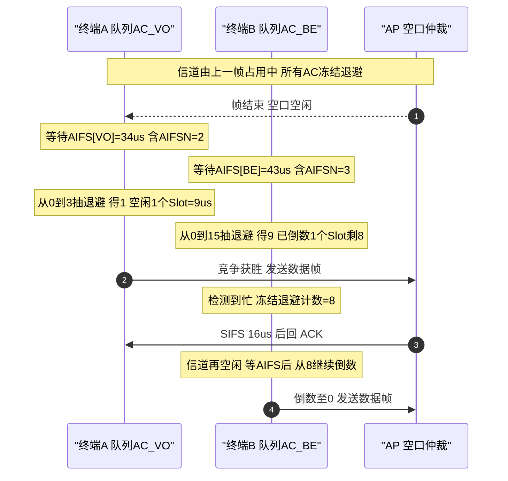

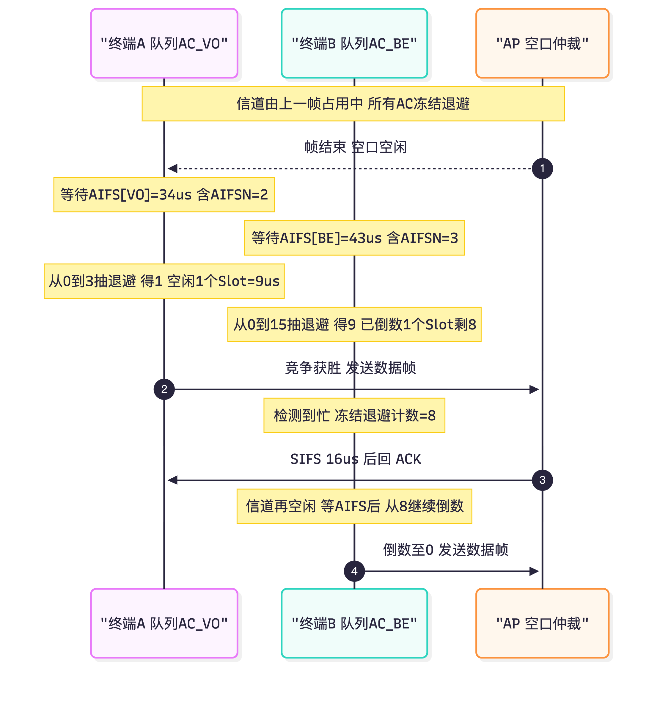


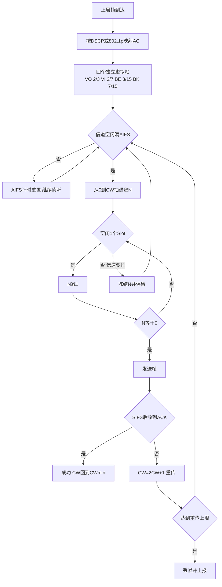

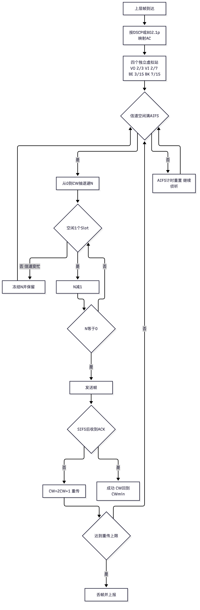


### 关键概念对照表

| 对比维度 | DCF | PCF | EDCA（802.11e/WMM） |
|---|---|---|---|
| 仲裁方式 | 分布式竞争 | 集中式轮询 | 分布式竞争 + 四队列优先级 |
| 帧间间隔 | 统一用 DIFS | AP 用 PIFS，终端用 SIFS 应答 | 每 AC 独立 AIFS（AIFSN=2/2/3/7） |
| 竞争窗口 | 单一 CW（CWmin/CWmax） | 无竞争（CFP 内） | 每 AC 独立 CW（3/7、7/15、15/1023） |
| 队列数量 | 1 | 1（轮询表） | 4（AC_VO/VI/BE/BK） |
| 优先级依据 | 无 | 轮询顺序 | AIFS + CWmin 双重差异 |
| 内部冲突处理 | 不适用 | 不适用 | 高优先级优先，低优先级冻结退避 |
| 是否实用 | 是（基础） | 否（几乎不部署） | 是（现代 WLAN 默认） |
| 时延确定性 | 差 | 理论好、实际差 | 语音可做到 <50 ms 端到端 |

| 定时器/参数 | 2.4 GHz | 5 GHz | 6 GHz | 说明 |
|---|---|---|---|---|
| Slot Time | 20 μs | 9 μs | 9 μs | 短时隙显著提升效率 |
| SIFS | 10 μs | 16 μs | 16 μs | 应答类帧专用 |
| PIFS = SIFS+Slot | 30 μs | 25 μs | 25 μs | PCF 用 |
| DIFS = SIFS+2×Slot | 50 μs | 34 μs | 34 μs | DCF 基准，等于 AIFS[BE] 的 802.11a/n/ac 口径 |
| EIFS | ≈SIFS+DIFS+ACK | ≈同 | ≈同 | 收帧出错后的额外等待 |
| ACK 发送速率 | 最低基本速率 | 最低基本速率 | 最低基本速率 | 常被设为 6 Mbps 以保可靠 |

### 华为设备配置

```bash
system-view                                          # 进入系统视图
sysname AC6805                                       # 命名设备，便于实验识别
wlan                                                 # 进入 WLAN 视图
 wmm-profile name wmm-hcie                           # 创建 WMM 模板（EDCA 参数载体）
  ac-vo                                             # 进入语音接入类别视图（AC_VO）
   aifsn 2                                          # 仲裁帧间间隔号，2 表示与 DIFS 等长（默认值）
   ecwmin 3                                         # 最小竞争窗口指数，3 即 CWmin=2^3-1=7 的指数口径
   ecwmax 7                                         # 最大竞争窗口指数
   txop-limit 1504                                  # TXOP 上限 1.504ms，语音典型值（单位微秒）
  ac-vi                                             # 进入视频接入类别视图（AC_VI）
   aifsn 2                                          # 视频与语音同为 2，靠 CW 区分
   ecwmin 3                                         # 视频 CWmin 指数
   ecwmax 7                                         # 视频 CWmax 指数
   txop-limit 3008                                  # TXOP 上限 3.008ms，视频典型值
  ac-be                                             # 进入尽力而为接入类别视图（AC_BE）
   aifsn 3                                          # 比 DIFS 多等 1 个 Slot
   ecwmin 4                                         # CWmin 指数 4 对应 CW=15
   ecwmax 10                                        # CWmax 指数 10 对应 CW=1023
   txop-limit 0                                     # 0 表示不限批量化、按单帧发送
  ac-bk                                             # 进入后台接入类别视图（AC_BK）
   aifsn 7                                          # 等待最长，优先级最低
   ecwmin 4                                         # CWmin 同 AC_BE
   ecwmax 10                                        # CWmax 同 AC_BE
  wmm enable                                         # 使能本 WMM 模板的 EDCA 功能（默认使能）
 quit                                                # 退出 WMM 模板视图
 # 说明：不同 VRP 版本 WMM 模板下 AC 参数的字段名与取值范围略有差异，以所用版本文档为准
 # ===== 关闭低效保护机制，减少空口开销（高密度场景常用）=====
 rrm-profile name rrm-hcie                          # 创建 RRM 射频管理模板
  dot11b-protect-mode disable                       # 关闭 802.11b 保护模式，避免全空口降速到 1/2/11Mbps
  rts-cts-mode disable                              # 关闭 RTS/CTS 强制握手，减少每帧 2×SIFS+2 帧开销
  # 若现场隐藏节点严重，可改为 rts-cts-mode cts-to-self 或按阈值触发
 quit                                                # 退出 RRM 模板视图
 # ===== 查看 EDCA 与空口统计 =====
display wlan wmm-profile name wmm-hcie               # 查看 WMM 模板下四个 AC 的实际参数
display wlan ap all radio                            # 查看各 AP 射频的信道、带宽、功率与利用率
display wlan ap name AP-01 radio 0 statistics        # 查看指定 AP 指定射頻的收发包与重传统计
display wlan wmm ac-statistics                       # 查看各接入类别的队列与丢弃统计（版本敏感）
```

### 示意图

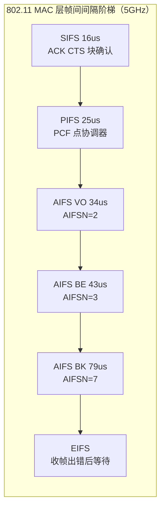

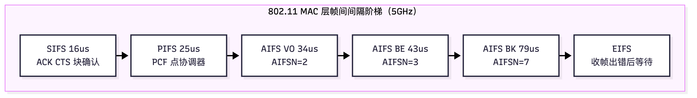


### 真题精练

**Q1.【真题·单选】** 在 5 GHz 频段，802.11ac 网络的 Slot Time 为 9 μs、SIFS 为 16 μs。则 DIFS 与 AIFS[AC_BE] 的长度分别是？
A. 25 μs 与 34 μs  B. 34 μs 与 43 μs  C. 34 μs 与 34 μs  D. 43 μs 与 43 μs

> **答案：B**
> **解析**：DIFS = SIFS + 2×Slot Time = 16 + 2×9 = **34 μs**。EDCA 中 AIFS[AC] = SIFS + AIFSN[AC]×Slot Time，AC_BE 的 AIFSN = 3，故 AIFS[AC_BE] = 16 + 3×9 = **43 μs**。选项 C 是常见错误——把"DIFS 等于 AIFS[BE]"当成了普适结论。该等式仅在 802.11a/g 的 DCF 与 EDCA 对比讨论中作为近似口径出现，在 EDCA 实际参数里 AC_BE 的 AIFSN 为 3，AIFS 会比 DIFS 多 1 个 Slot。选项 A 是 PIFS 与 DIFS；选项 D 是 2.4 GHz 下的 DIFS 口径（10+2×20=50 μs，也不是 43）。

**Q2.【真题·多选】** 关于 EDCA 的四个接入类别，下列说法正确的有？
A. AC_VO 与 AC_VI 的 AIFSN 均为 2，二者靠 CWmin 与 TXOP 上限区分
B. AC_BE 与 AC_BK 的 CWmin/CWmax 相同，仅 AIFSN 不同
C. 高优先级 AC 与低优先级 AC 在同一终端内竞争时会产生真实的空口冲突
D. 退避计数器在信道变忙时清回初值，信道空闲后重新抽取
E. AC_VO 的 TXOP 上限典型值为 1.504 ms

> **答案：ABE**
> **解析**：A 正确，AC_VO 与 AC_VI 的 AIFSN 都是 2，AC_VO 靠 CWmin=3（对比 7）与 TXOP 1.504 ms（对比 3.008 ms）取得更高抢占概率。B 正确，二者 CWmin/CWmax 均为 15/1023，差异只在 AIFSN（3 对 7）。C 错误，同一终端内部不同 AC 的竞争是**虚拟竞争**，由"高优先级先发、低优先级冻结退避"在本地解决，不会产生真实空口冲突。D 错误，这是最经典的错误选项——**退避计数器是"冻结并保留"**，不是清零重抽，这一记忆性正是 EDCA 公平性所在。E 正确。

**Q3.【真题·判断】** PCF 通过 AP 轮询提供无竞争传输，时延确定性优于 EDCA，因此现代高密度场馆部署中应优先启用 PCF 保障语音质量。

> **答案：错误**
> **解析**：PCF 的时延确定性只在理想条件下成立，实际部署中它有三个致命缺陷：① 依赖所有终端正确接收并遵从 Beacon 中的 CFP 参数，一旦有终端错失 Beacon 就会破坏整个无竞争期；② 轮询开销随终端数量线性增长，高密度下轮询一轮的时间可能超过数据本身所需时间；③ 互通性差、产品实现极少。现代 WLAN 保障语音质量的手段是 **EDCA/WMM 四队列 + 空口资源预留（ACM/TSPEC）+ Airtime 公平调度 + 高密度频段规划**，而不是 PCF。

**Q4.【真题·填空】** 802.11 中为解决隐藏节点问题而设计的控制帧握手是 \_\_\_\_ 与 \_\_\_\_；触发该握手的帧长门限参数是 \_\_\_\_，其默认值为 \_\_\_\_ 字节，表示默认情况下\_\_\_\_（启用/不启用）该机制。

> **答案**：RTS（Request To Send）；CTS（Clear To Send）；dot11RTSThreshold；2347；不启用
> **解析**：RTS/CTS 的价值是把"长数据帧的冲突"转化为"短控制帧的冲突"，代价是每帧新增 RTS、CTS 两帧以及 SIFS+CTS 的时间开销。默认门限 2347 字节大于 802.11 的最大 MSDU（2304 字节），因此**默认永不触发**。只有现场存在明显隐藏节点（例如长走廊两端、立柱遮挡）才手动降低门限或强制启用 `cts-to-self`，此时要接受吞吐下降的代价。

**Q5.【真题·简答】** 请完整描述一个 AC_VO 队列的数据帧在 EDCA 下的信道竞争与发送过程，要求写出所涉及的定时器名称与数值（5 GHz）。

> **答案要点**：
> ① 上层语音帧进入发送队列，按 DSCP（如 EF=46）映射到 **AC_VO**，该 AC 作为独立"虚拟站"维护自己的退避计数器、AIFS 与 CW。
> ② 信道空闲时等待 **AIFS[AC_VO] = SIFS + AIFSN×Slot = 16 + 2×9 = 34 μs**；若这期间检测到信道忙，AIFS 计时重新开始。
> ③ AIFS 结束后从 **[0, CW]** 均匀抽取退避时隙数 N，初始 CW = CWmin = 3，即 N ∈ {0,1,2,3}。
> ④ 每个空闲 **Slot Time = 9 μs** 使 N 减 1；若信道变忙，N **冻结并保留**，下一个空闲周期从剩余值继续；同时若收到他人的帧且 Duration > 0，按该值设置 **NAV**，NAV 未归零前不得发送。
> ⑤ N 减到 0 且信道仍空闲 → 发送数据帧。若此时信道变忙，需重新抽取随机数并按冲突增长 CW。
> ⑥ 发送结束后等待 **SIFS = 16 μs**，对端回 ACK（ACK 以最低基本速率发送以保证可靠）；在 ACK Timeout 内收到 ACK 即成功，**CW 回落到 CWmin=3**。
> ⑦ 未收到 ACK 视为失败，执行 **CW = 2×CW+1**（指数退避 BEB），重新执行 ②~⑥；连续失败达 dot11ShortRetryLimit（短帧，默认 7）或 dot11LongRetryLimit（长帧，默认 4）后丢帧。
> ⑧ 若该 AC 配了 **TXOP = 1.504 ms**，则取得一次 TXOP 后可在该时长内连续发送多帧（帧间只用 SIFS 分隔），无需重新竞争，显著降低语音的接入时延。

**Q6.【真题·排错】** 某会议室在启用 WMM 后，语音终端仍频繁出现"起话断续、单通"。用 Wireshark 抓空口包发现大量语音帧以 1 Mbps 速率发送、且每帧前都有 RTS/CTS。请分析原因并给出处置方案。

> **答案要点**：
> ① **根因一：802.11b 保护模式（protection mode）在起作用。** 当同一 AP 下存在 802.11b 老终端时，AP 会启用保护机制，与 802.11b 终端通信时全部降速到 1/2/5.5/11 Mbps，并且强制使用 RTS/CTS 或 CTS-to-self 让老终端听懂"信道被占用多久"。这解释了 1 Mbps 速率 + 每帧 RTS/CTS 的现象。**判据**：`display wlan ap all radio` 观察该射频下是否有 11b 速率终端关联；Wireshark 里看 Beacon 的 ERP/HT Protection 字段是否被置位。
> ② **根因二：若现场没有 11b 终端，则是 AP 的速率集被错误放开。** 检查 VAP 或射频模板是否允许 1/2/5.5/11 Mbps 作为基本速率（basic rate）；基本速率集会被用于管理帧、ACK 与广播帧，一旦含低速，则整个空口的"最慢公共速率"被拉低。处置：只把 **6/12/24 Mbps** 设为基本速率集，其余为支持速率集。
> ③ 同时检查是否人为开启了强制 RTS/CTS（`rts-cts-mode`）或把门限值调得过低，若无隐藏节点应关闭；多径严重但无隐藏节点时用 **cts-to-self** 代替 RTS/CTS，可省掉一个 SIFS 与一帧开销。
> ④ 验证命令：`display wlan ap name AP-01 radio 0 statistics`（看各速率占比与重传率）、`display wlan ap all radio`（看信道利用率与噪声）、清除保护模式后再抓包对比帧时长与速率分布。
> ⑤ 结论表述要到位：**"无线慢"多数不是 AP 功率问题，而是"最慢终端决定了全网空口效率"**，所以高密度语音场景必须清理低速率、关闭低效协议、必要时隔离或引导老终端。

**Q7.【真题·实验】** 在 AC6805 上完成如下任务：① 创建名为 `wmm-hcie` 的 WMM 模板，把 AC_VO 的 TXOP 上限设为 1504 μs；② 创建 RRM 模板关闭 802.11b 保护模式与强制 RTS/CTS；③ 给出验证 EDCA 参数是否生效的命令。请写出关键配置行。

> **答案要点**：
> ```bash
> system-view
> wlan
>  wmm-profile name wmm-hcie          # 创建 WMM 模板
>   ac-vo                             # 进入 AC_VO 视图
>    txop-limit 1504                  # TXOP 上限 1504 微秒（语音典型值）
>    aifsn 2                           # AIFSN=2，与 DIFS 等长
>    ecwmin 3                          # CWmin 指数 3 对应 CW=3
>    ecwmax 7                          # CWmax 指数 7 对应 CW=7
>   quit
>   wmm enable                        # 使能 EDCA
>  quit
>  rrm-profile name rrm-hcie          # 创建 RRM 模板
>   dot11b-protect-mode disable       # 关闭 802.11b 保护模式
>   rts-cts-mode disable              # 关闭强制 RTS/CTS
>  quit
>  # 模板创建后需被 VAP 模板引用并对 AP 下发才会真正生效
> # vap-profile 视图下：wmm-profile wmm-hcie / rrm-profile rrm-hcie（以所用版本文档为准）
> quit
> display wlan wmm-profile name wmm-hcie    # 验证 EDCA 参数
> display wlan rrm-profile name rrm-hcie    # 验证保护模式与 RTS/CTS 状态
> ```
> 评分要点：① 模板"创建 ≠ 生效"，必须被 VAP 模板引用并下发到 AP；② TXOP 单位是微秒；③ 参数名随版本差异较大，答题时应加一句"以所用版本文档为准"。

### 易错点与排错

1. **把 AIFS[AC_BE] 等同于 DIFS**：DIFS = SIFS+2Slot，AIFS[AC_BE] = SIFS+3Slot，**二者相差一个 Slot**。只有 802.11 原始 DCF 口径下 DIFS 才被称为"BE 的服务间隔"。
2. **以为退避计数器冲突后清零**：错。信道变忙时**冻结保留**而非清零，这是 EDCA/DCF 的关键设计。
3. **混淆 CWmin 与 CW 的值**：WMM 参数写作指数（ecwmin=3），实际窗口为 2³−1 = 7 个时隙（取值 {0..7}）；写作 3 时窗口取值 {0..3}。答题时要说清"指数口径"还是"时隙数口径"。
4. **误认为开了 WMM 就一定有 QoS**：WMM 只解决**空口侧**的优先级竞争，端到端还需要有线侧 DSCP 信任与队列调度（见 2.6 节）。空口高优先级 + 有线侧无差别丢弃 = 语音照样差。
5. **2.4 GHz 与 5 GHz 的定时器数值混用**：SIFS 10/16 μs、Slot 20/9 μs，算错一处全题皆错。**2.4G 的 Slot Time 是 5G 的两倍多**，这是双频 AP 上 2.4G 效率低的直接数值证据。
6. **排错命令**：`display wlan wmm-profile name <名称>`、`display wlan ap all radio`（利用率/噪声/信道）、`display wlan ap name <AP名> radio 0 statistics`（重传与速率分布）、`display wlan client verbose`（查看终端的 WMM/11k/11v/11r 能力协商结果）。

---

## 1.2 802.11n/ac/ax 关键技术逐项对比与 MCS 速率计算

### 考点定位

本考点是国赛理论卷的**计算题主战场**，几乎每套卷必有一道"给定 MCS/带宽/空间流/GI，求理论速率"或反向"给定速率求 MCS"的题目，单题 6~10 分；同时以多选形式考查 OFDM 与 OFDMA 的区别、MU-MIMO 上下行差异、BSS Coloring、TWT 等新机制。易错点有三：① **带宽翻倍速率翻倍，但空间流数翻倍要看 MCS 表口径**；② **GI 从 800 ns 缩短到 400 ns，速率的提升是"除以 3.6/3.2"这类精确系数关系，不是简单加 10%**；③ 把 **OFDMA（频分多用户）** 与 **MU-MIMO（空分多用户）** 混为一谈。

### 原理精讲

**先建立"速率是怎么算出来的"这条主线，所有代际差异都挂在这条主线上。**

一个空间流在某一时刻的物理层速率（PHY Rate）由四个因子相乘得到：

```
PHY Rate = 子载波数量 × 每子载波每符号携带比特数(由调制阶数决定) × 编码率 ÷ 符号时长
         = (数据子载波数 × 每子载波比特数 × 码率) / 符号时长(含GI)
```

这四个因子里：**数据子载波数**由带宽和代际决定（20 MHz 在 11n 下是 52 个数据子载波，11ac 是 52 个、11ax 是 234 个）；**每子载波比特数**由调制方式决定（BPSK=1、QPSK=2、16-QAM=4、64-QAM=6、256-QAM=8、1024-QAM=10、4096-QAM=12）；**码率**由 MCS 索引决定（1/2、2/3、3/4、5/6）；**符号时长**= OFDM 符号 3.2 μs + GI（800 ns 或 400 ns）。

**MCS（Modulation and Coding Scheme，调制与编码策略）索引就是把上面四个因子里后三个打包编号**。索引越大，调制阶数越高、码率越高、速率越高，但对 SNR 的要求也越高——这就是"近处用高 MCS、远处自动降到低 MCS"的原因，也是速率自适应（Rate Adaptation）的本质。

#### 802.11n（Wi-Fi 4，HT）关键参数

802.11n 的核心技术是 **MIMO（Multiple-Input Multiple-Output，多输入多输出）+ 信道绑定 40 MHz + 帧聚合（A-MPDU/A-MSDU）+ 短 GI 400 ns**。802.11n 的 MCS 表是 **MCS 0~7 为"等效单流"表（与 11a/g 速率一致），MCS 8~15 为双流**，最高 4 空间流（MCS 31），20 MHz 下 4 流 800 ns GI 最高 **300 Mbps**，40 MHz 下 4 流 400 ns GI 最高 **600 Mbps**。

| MCS 索引 | 调制方式 | 码率 | 20 MHz / 1SS / GI=800ns | 20 MHz / 1SS / GI=400ns | 40 MHz / 1SS / GI=800ns | 40 MHz / 1SS / GI=400ns |
|---|---|---|---|---|---|---|
| MCS 0 | BPSK | 1/2 | 6.5 Mbps | 7.2 Mbps | 13.5 Mbps | 15 Mbps |
| MCS 1 | QPSK | 1/2 | 13 Mbps | 14.4 Mbps | 27 Mbps | 30 Mbps |
| MCS 2 | QPSK | 3/4 | 19.5 Mbps | 21.7 Mbps | 40.5 Mbps | 45 Mbps |
| MCS 3 | 16-QAM | 1/2 | 26 Mbps | 28.9 Mbps | 54 Mbps | 60 Mbps |
| MCS 4 | 16-QAM | 3/4 | 39 Mbps | 43.3 Mbps | 81 Mbps | 90 Mbps |
| MCS 5 | 64-QAM | 2/3 | 52 Mbps | 57.8 Mbps | 108 Mbps | 120 Mbps |
| MCS 6 | 64-QAM | 3/4 | 58.5 Mbps | 65 Mbps | 121.5 Mbps | 135 Mbps |
| MCS 7 | 64-QAM | 5/6 | **65 Mbps** | **72.2 Mbps** | **135 Mbps** | **150 Mbps** |
| MCS 8~15 | 同 MCS 0~7 | 同 | ×2（双流） | ×2 | ×2 | ×2（即 40 MHz 双流 400ns = 300 Mbps） |
| MCS 16~23 | 同 MCS 0~7 | 同 | ×3（三流） | ×3 | ×3 | ×3 |
| MCS 24~31 | 同 MCS 0~7 | 同 | ×4（四流） | ×4 | ×4 | ×4（**40 MHz 四流 400ns = 600 Mbps**） |

**关键对照记忆**：MCS 7 / 20 MHz / GI=800 ns / 单流 = **65 Mbps**，这是所有 802.11n 速率计算的"锚点"。40 MHz 是 20 MHz 的 2.08 倍（因为 40 MHz 的数据子载波是 108 个，正好是 52 的 2.08 倍），所以 65×2.08 ≈ 135 Mbps。GI 从 800 ns 缩到 400 ns，符号时长从 4.0 μs 变成 3.6 μs，速率放大 **4.0/3.6 = 1.111 倍**，65×1.111 = 72.2 Mbps。

#### 802.11ac（Wi-Fi 5，VHT）关键参数

802.11ac 只工作在 5 GHz，核心技术是 **更宽的信道（80/160 MHz）+ 更高的调制（256-QAM）+ 更多空间流（最高 8 流）+ 下行 MU-MIMO + 更细的子载波划分**。802.11ac 的 MCS 是 **MCS 0~9**，MCS 8 是 256-QAM 3/4，MCS 9 是 256-QAM 5/6。

| MCS 索引 | 调制方式 | 码率 | 20 MHz / 1SS / 800ns | 40 MHz / 1SS / 800ns | 80 MHz / 1SS / 800ns | 160 MHz / 1SS / 800ns |
|---|---|---|---|---|---|---|
| MCS 0 | BPSK | 1/2 | 6.5 Mbps | 13.5 Mbps | 29.3 Mbps | 58.5 Mbps |
| MCS 3 | 16-QAM | 1/2 | 26 Mbps | 54 Mbps | 117 Mbps | 234 Mbps |
| MCS 5 | 64-QAM | 2/3 | 52 Mbps | 108 Mbps | 234 Mbps | 468 Mbps |
| MCS 7 | 64-QAM | 5/6 | 65 Mbps | 135 Mbps | 292.5 Mbps | 585 Mbps |
| MCS 8 | 256-QAM | 3/4 | 78 Mbps | 162 Mbps | 351 Mbps | 702 Mbps |
| MCS 9 | 256-QAM | 5/6 | **86.7 Mbps** | **200 Mbps** | **433.3 Mbps** | **866.7 Mbps** |

**必背锚点**：802.11ac 下"MCS 9 / 80 MHz / 单流 / 800 ns GI = **433.3 Mbps**"。三流 80 MHz = **1.3 Gbps**（即"Wave 1 1.3G"的来源）；三流 80 MHz + 400 ns GI = 1.3×1.111 ≈ **1.45 Gbps**；四流 80 MHz 400 ns = 1.733×1.111 ≈ **1.93 Gbps**；四流 160 MHz 400 ns ≈ **3.47 Gbps**（即"Wave 2 3.47G"）。这些标记数值是命题人最爱的选项。

#### 802.11ax（Wi-Fi 6，HE）关键参数

802.11ax 的根本变化不在峰值速率（相对 11ac 峰值仅提升约 37%，因为只多了 1024-QAM 与更密的子载波），而在于**从"每时刻服务一个用户"变成"每时刻服务多个用户"**。它的关键技术有四组：

**① OFDMA（Orthogonal Frequency Division Multiple Access，正交频分多址）。** 这是 802.11ax 与之前所有代际最本质的区别，必须讲透。**OFDM（Orthogonal Frequency Division Multiplexing，正交频分复用）是"复用"，OFDMA 是"多址"**：

| 对比项 | OFDM（11a/n/ac） | OFDMA（11ax/be） |
|---|---|---|
| 子载波分配 | 一次传输**独占全部**子载波 | 划分为多个 **RU（Resource Unit，资源单元）**，按需分配给不同用户 |
| 粒度 | 整个信道（20/40/80/160 MHz） | RU 粒度：26/52/106/242/484/996/1992/3984（2×996）个子载波 |
| 20 MHz 最大 RU 数 | 1 | **9 个 26-tone RU** |
| 并发用户 | 1（OFDM+MIMO 时靠空间流区分，仍是同一时频资源） | 最多 9（20 MHz）/ 37（80 MHz）/ 74（160 MHz） |
| 适用业务 | 大包、持续吞吐 | **小包、多用户、低时延**（VoIP、IoT、扫码、体感游戏） |
| 调度者 | 无（分布式竞争） | **AP 集中调度**（触发帧 Trigger Frame 分配 RU） |
| 效率收益来源 | 峰值速率 | **减少小包的空口竞争与帧开销** |

一句话总结："OFDM 让一个用户跑得快，OFDMA 让很多用户同时跑而不打架。"

**② 1024-QAM 与更密的子载波**：256-QAM 每子载波 8 bit，1024-QAM 每子载波 10 bit，单子载波提升 25%；同时 11ax 把 20 MHz 的数据子载波从 52 增到 234（子载波间隔从 312.5 kHz 缩到 78.125 kHz，符号时长从 3.2 μs 变成 12.8 μs），这两项叠加使 11ax 单流 80 MHz 的 MCS 11 达到约 **600.4 Mbps**（800 ns GI）/ **1201 Mbps**（160 MHz 800 ns GI 单流）。

| MCS 索引 | 调制方式 | 码率 | 20 MHz / 1SS / 800ns | 80 MHz / 1SS / 800ns | 160 MHz / 1SS / 800ns |
|---|---|---|---|---|---|
| MCS 0 | BPSK | 1/2 | 8.6 Mbps | 36.0 Mbps | 72.1 Mbps |
| MCS 4 | 16-QAM | 3/4 | 51.6 Mbps | 216.0 Mbps | 432.1 Mbps |
| MCS 5 | 64-QAM | 2/3 | 68.8 Mbps | 288.1 Mbps | 576.1 Mbps |
| MCS 7 | 64-QAM | 5/6 | 86.0 Mbps | 360.1 Mbps | 720.1 Mbps |
| MCS 9 | 256-QAM | 5/6 | 114.7 Mbps | 480.1 Mbps | 960.2 Mbps |
| MCS 11 | **1024-QAM** | **5/6** | **143.4 Mbps** | **600.4 Mbps** | **1200.4 Mbps** |

**③ BSS Coloring（BSS 着色）与空间复用。** 这是高密度场景最实用的 11ax 机制。在 11ax 之前，终端只要**听到**任何同频 802.11 前导，就判定"信道忙"并推迟发送（CCA 门限 −82 dBm 的"信号检测"）。在高密度场馆里，同一信道被大量 AP 复用，一台终端能听到很远处的 AP，于是**明明干扰很弱却不敢发**，空口效率被严重浪费。11ax 在 PHY 前导的 HE-SIG-A 域中增加了 **6 bit 的 BSS Color**（取值 1~63，0 表示关闭），发送端把自己的 BSS Color 标在帧上；接收端判断：**如果收到的是"同色"帧 → 视为同 BSS，正常推迟；如果是"异色"帧 → 只要其接收功率低于"异色 CCA 门限"（OBSS-PD level，典型 −72 ~ −62 dBm，比 −82 dBm 高出 10~20 dB），就可判定它干扰不足为惧，可以并行发送**。效果：把"物理上能听到就得让"变成"干扰大到会影响我解调才让"，从而显著提升空间复用率（Spatial Reuse）。

**④ TWT（Target Wake Time，目标唤醒时间）。** AP 与终端协商一个"约定唤醒时刻表"，终端只在约定时刻醒来收发（其余时间深度睡眠）。它解决两类问题：① **省电**（IoT 传感器电池寿命从数月延长到数年）；② **减少竞争**（大量终端被分散到不同 TWT 时隙，避免同时醒来抢信道）。TWT 有**单播 TWT**（AP 与单个终端协商）与**广播 TWT**（AP 为一组终端广播时隙表）两种模式。

**⑤ MU-MIMO 的上下行差异（高频考点）。** MU-MIMO（Multi-User MIMO，多用户多输入多输出）用**空间流**区分用户，与 OFDMA 用**子载波（频率）**区分用户形成互补。

| 维度 | 下行 MU-MIMO（DL MU-MIMO） | 上行 MU-MIMO（UL MU-MIMO） |
|---|---|---|
| 出现的标准 | 802.11ac Wave 2（仅下行） | **802.11ax 才引入** |
| 发送方 | AP（一个发射机发多个空间流给多个终端） | 多个终端同时发（各自发 1 个或少数空间流） |
| 信道信息获取 | AP 需通过 **NDP + Compressed Beamforming** 反馈获得各终端的信道状态 | AP 通过 **NDP + 触发帧（Trigger Frame）** 统一调度，各终端按分配的流数与功率同时发送 |
| 终端能力要求 | 终端需支持 MU-MIMO 接收（11ac Wave2 起） | 终端需支持 **HE Trigger-based PPDU**（11ax 起） |
| 关键约束 | 各终端空间流之和 ≤ AP 发射天线数 | **各终端的到达时间与频率必须严格对齐**（靠触发帧中的 timing/frequency offset 校正） |
| 典型增益 | 32 终端场景下平均吞吐可提升 2~3 倍 | 上行小包密集场景（如考场答题、扫码）显著降低竞争开销 |

**为什么下行 MU-MIMO 早于上行？** 因为下行只有 AP 一个发射者，时间/频率天然对齐，只需拿到信道信息；上行的多个终端是**独立时钟**的，必须由 AP 用触发帧做"同步发令枪"，同时对到达时间（±几百纳秒）、载波频率偏差、发射功率都做精确控制——这就是 11ax 才做到 UL MU-MIMO 的工程原因。

#### 802.11 关键代际对比总表

| 对比项 | 802.11n（Wi-Fi 4） | 802.11ac（Wi-Fi 5） | 802.11ax（Wi-Fi 6） | 802.11be（Wi-Fi 7） |
|---|---|---|---|---|
| 发布年份 | 2009 | 2013（Wave2: 2016） | 2021 | 2024 |
| 频段 | 2.4 / 5 GHz | 5 GHz | 2.4 / 5 / 6 GHz | 2.4 / 5 / 6 GHz |
| 最大信道带宽 | 40 MHz | 160 MHz | 160 MHz | **320 MHz** |
| 最高调制 | 64-QAM | 256-QAM | 1024-QAM | **4096-QAM** |
| 最大空间流 | 4 | 8（AP 侧） | 8 | **16** |
| 多址方式 | OFDM | OFDM | **OFDMA** | OFDMA + Multi-RU |
| 多用户技术 | 无 | 下行 MU-MIMO | 上/下行 MU-MIMO + OFDMA | 增强 MU-MIMO + MLO |
| 单流最高速率（典型） | 150 Mbps（40M/400ns） | 866.7 Mbps（160M/800ns） | 1200.4 Mbps（160M/800ns） | 约 2.4 Gbps（320M） |
| 理论峰值（单 AP） | 600 Mbps | 6.93 Gbps | 9.6 Gbps | **46 Gbps**（理论值） |
| 关键增益方向 | 峰值速率 | 峰值速率 + 下行多用户 | **多用户效率与密集部署** | **时延确定性 + 极高吞吐** |

### 关键概念对照表

| 计算公式 | 表达式 | 说明 |
|---|---|---|
| PHY 速率通式 | 数据子载波数 × 每子载波比特数 × 码率 ÷ 符号时长 | 符号时长 = 3.2 μs（11a/n/ac）+ GI；11ax 为 12.8 μs + GI |
| GI 缩短增益 | 4.0/3.6 ≈ **1.111**（11ac 与 11n 的 3.2+0.8 与 3.2+0.4） | 400 ns GI 相比 800 ns 提升约 11.1% |
| 带宽翻倍增益 | 40→80 MHz ≈ **×2**（11ac 的 80M 子载波约为 40M 的 2 倍） | 20→40 MHz 在 11n 下约 ×2.08 |
| 空间流叠加 | 速率 × 流数（同 MCS、同带宽、同 GI） | 4 流 80M 11ac 800ns = 433.3×4 ≈ 1733 Mbps |
| 理论峰值 | 单流速率 × 空间流数 | 11ax 8 流 160M 1024-QAM ≈ 9.6 Gbps |

### 华为设备配置

```bash
system-view                                    # 进入系统视图
wlan                                           # 进入 WLAN 视图
 radio-2g-profile name radio2g-hcie            # 创建 2.4G 射频模板
  channel 20mhz                                # 2.4G 固定 20MHz，禁止 40MHz 以免邻频重叠
  dot11n disable                               # 高密场景可关闭 11n 减少旧终端兼容开销（谨慎使用）
  # 2.4G 一般只用于覆盖与低速业务，不追求峰值速率
 quit
 radio-5g-profile name radio5g-hcie            # 创建 5G 射频模板
  channel 80mhz                                # 5G 使用 80MHz 绑定，吞吐与复用数的折中
  # 若 AP 密度高（如场馆），建议改回 40MHz 以增加可用非重叠信道数
  dot11ax enable                               # 使能 802.11ax（Wi-Fi 6）能力
  dot11be enable                               # 使能 802.11be（Wi-Fi 7）能力，需 AP 与版本均支持
  # 命令名与可用性以所用版本与 AP 型号文档为准
 quit
 rrm-profile name rrm-hcie                     # 创建射频管理模板
  ofdma enable                                 # 使能 OFDMA 调度（11ax 核心能力）
  twt enable                                   # 使能目标唤醒时间
  bss-color enable                             # 使能 BSS Coloring 空间复用
  # 部分版本由单独的 air-scan / spatial-reuse 相关命令控制，以所用版本文档为准
  band-steer enable                            # 使能频段引导（见 1.6 节）
  smart-roam enable                            # 使能智能漫游（802.11k/v 协同，见 2.5 节）
 quit
 vap-profile name office-vap                   # 创建 VAP 模板
  wmm-profile wmm-hcie                         # 引用 WMM 模板，决定 EDCA 参数
  radio-2g-profile radio2g-hcie                # 引用 2.4G 射频模板
  radio-5g-profile radio5g-hcie                # 引用 5G 射频模板
  rrm-profile rrm-hcie                         # 引用 RRM 模板
 quit
 # ===== 查看速率与能力协商结果 =====
display wlan ap name AP-01 radio 0             # 查看指定射频的信道 带宽 功率 协议能力
display wlan client verbose                    # 查看终端协商到的协议 带宽 空间流 MCS 与实际速率
display wlan ap all radio statistics           # 各信道利用率与干扰统计
```

### 示意图

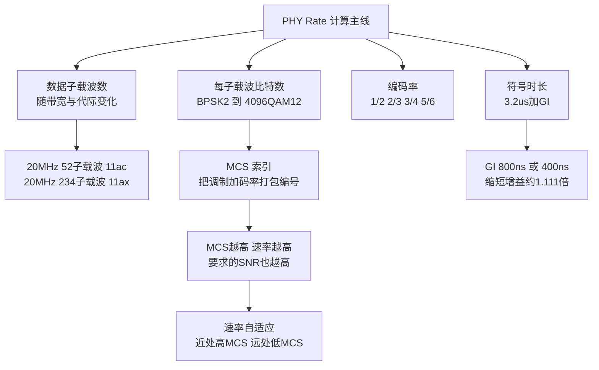

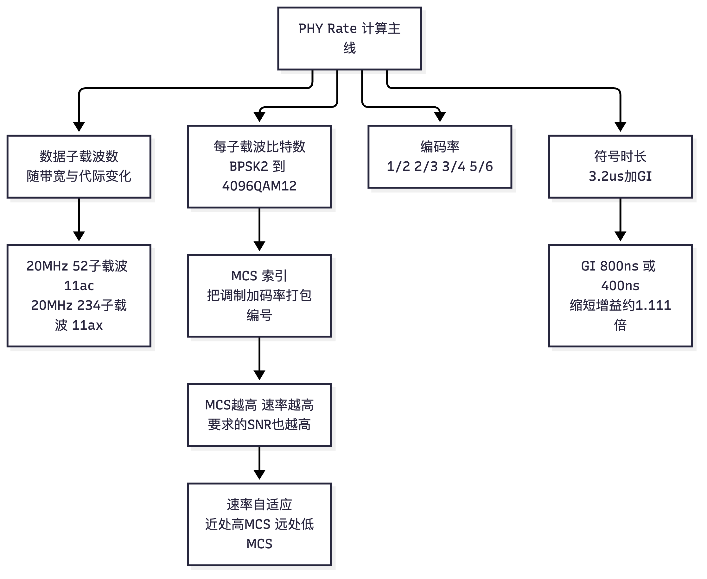


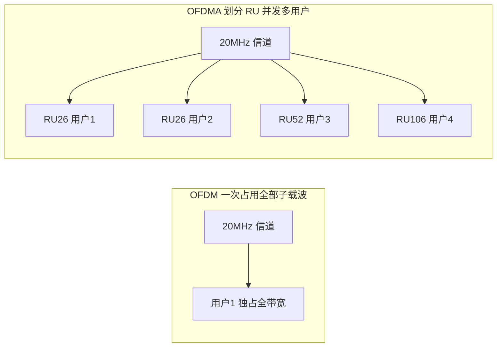

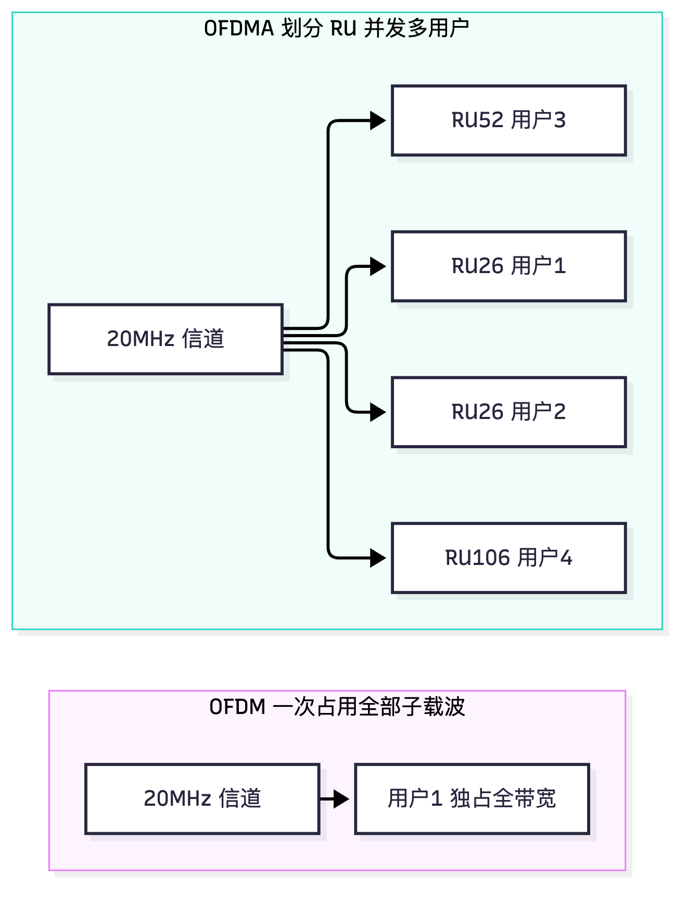


### 真题精练

**Q1.【真题·单选】** 某 802.11ac 终端与 AP 协商为 3 空间流、80 MHz 带宽、MCS 9、GI = 400 ns。其理论 PHY 速率为？
A. 1.3 Gbps  B. 1.45 Gbps  C. 1.73 Gbps  D. 2.6 Gbps

> **答案：B**
> **解析**：解题四步法：① 查表得 **80 MHz / 单流 / MCS 9 / GI=800 ns = 433.3 Mbps**；② GI 由 800 ns 改为 400 ns，符号时长 3.2+0.8=4.0 μs 变为 3.2+0.4=3.6 μs，增益 = 4.0/3.6 = **1.111**，单流变为 433.3×1.111 ≈ **481.4 Mbps**（即 80 MHz 单流 400 ns 的标准值 481.4 Mbps）；③ 乘空间流数 3：481.4×3 ≈ **1444 Mbps ≈ 1.45 Gbps**。选 B。A 是 3 流 80 MHz 800 ns 的值（433.3×3=1300）；C 是 4 流 80 MHz 800 ns 的值（433.3×4=1733）；D 是 6 流（11ac 终端最多 4 流，本身不成立）。

**Q2.【真题·单选】** 关于 802.11ax 的 OFDMA 与 802.11ac 的 OFDM，下列说法正确的是？
A. OFDMA 通过提高单用户的峰值速率来提升系统容量
B. OFDMA 把信道划分为多个 RU，AP 通过触发帧把 RU 分配给不同用户并发传输
C. 20 MHz 信道在 11ax 下最多可划分 4 个 RU
D. OFDMA 与 MU-MIMO 是同一种技术，只是名称不同

> **答案：B**
> **解析**：A 错，OFDMA 的收益主要来自**降低多用户小包场景的竞争与帧开销**，单用户峰值主要由调制阶数、带宽、空间流决定，11ax 相对 11ac 峰值仅提升约 37%。B 正确，AP 用 Trigger Frame 分配 RU 并指定各用户的 MCS、流数与功率。C 错，20 MHz 在 11ax 下可划分**最多 9 个 26-tone RU**（80 MHz 最多 37 个，160 MHz 最多 74 个）。D 错，OFDMA 用**频率（子载波/RU）**区分用户，MU-MIMO 用**空间流**区分用户，二者在 11ax 中可叠加使用。

**Q3.【真题·多选】** 关于 BSS Coloring 与 TWT，下列说法正确的有？
A. BSS Color 是 6 bit 字段，取值 0 表示关闭着色功能
B. 终端收到异色帧时，只要其接收功率低于异色 CCA 门限就可忽略并并行发送
C. TWT 只能用于省电，不能降低信道竞争
D. 802.11ax 之前，终端只要听到同频前导就判定信道忙，门限约为 −82 dBm
E. BSS Coloring 会增加同 BSS 内的干扰

> **答案：ABD**
> **解析**：A 正确，HE-SIG-A 中 BSS Color 为 6 bit，1~63 为有效值，0 表示不使用。B 正确，这正是空间复用的判据（OBSS-PD，异色包检测门限，典型 −72~−62 dBm）。C 错误，TWT 通过把大量终端分散到不同唤醒时隙，**同时**实现省电与降低竞争，这两个收益是一体的。D 正确，传统 CCA 的"信号检测"门限为 −82 dBm（20 MHz），一旦超过即判忙。E 错误，BSS Coloring 的作用恰恰是**区分"自己人"与"外人"**，减少不必要的退让，从而减少 OBSS 干扰对吞吐的影响，不会增加同 BSS 内干扰。

**Q4.【真题·填空】** 802.11ac 在 80 MHz、单空间流、MCS 9、GI = 800 ns 下的理论速率为 \_\_\_\_ Mbps；若改用 400 ns 短保护间隔，速率变为 \_\_\_\_ Mbps，提升比例约为 \_\_\_\_%。

> **答案**：433.3；481.4；11.1
> **解析**：802.11ac 的 OFDM 符号固定为 3.2 μs。GI=800 ns 时符号时长 4.0 μs，GI=400 ns 时 3.6 μs，速率放大 4.0/3.6 ≈ 1.111，433.3×1.111 ≈ 481.4 Mbps。**注意短 GI 的代价**：多径时延扩展较大的环境（大厂房、体育馆）使用 400 ns 会造成符号间干扰 ISI，重传率上升，反而更慢——所以"能开短 GI"不等于"应该开短 GI"。

**Q5.【真题·简答】** 请从"区分用户的方式"角度，对比 OFDMA 与 MU-MIMO，并说明二者在 802.11ax 中如何配合，以及上行 MU-MIMO 为什么到 11ax 才实现。

> **答案要点**：
> ① **区分维度不同**：OFDMA 在**频域**划分资源（RU，子载波组），每个用户在各自 RU 上用自己的 MCS 发送，用户的功率/速率可以互不相同；MU-MIMO 在**空域**划分资源（空间流），多个用户复用**同一时频资源**，靠信道矩阵的正交性区分。
> ② **适用场景不同**：OFDMA 对小包、多用户、低时延业务收益最大（语音、IoT、扫码）；MU-MIMO 对大包、持续吞吐场景收益最大（视频、下载）。二者**可叠加**：802.11ax 允许在一次 HE MU PPDU 中既划分多个 RU，又让某些 RU 上承载多个空间流给不同用户（即"OFDMA + MU-MIMO 联合调度"）。
> ③ **上行 MU-MIMO 晚至 11ax 的原因**：下行时发送方只有 AP 一个，各用户接收天然同步；上行时多个终端是**独立时钟的发射机**，要让它们同时到达 AP 且互不破坏正交性，必须同时满足：到达时间对齐（±数百 ns 内）、载波频率偏差可忽略、发射功率按 AP 指令精确设定。11ax 通过 **Trigger Frame** 下发 timing offset、frequency offset、发射功率与 RU/流分配，并引入 **HE TB PPDU（Trigger-Based PPDU）** 与大带宽长前导（HE-LTF）来支撑上行信道估计，才使上行 MU-MIMO 工程可行。
> ④ 结论句：**OFDMA 解决"频谱太多用户太少带宽浪费"，MU-MIMO 解决"空间自由度没被用起来"，11ax 把两者组合成"时-频-空"三维调度。**

**Q6.【真题·排错】** 某 802.11ax 高密办公区，AP 密度为每 30 个工位一台，全部使用 80 MHz 带宽。管理员发现开启 11ax 后终端 Ping 时延抖动反而增大、吞吐提升不明显，且 `display wlan ap all radio statistics` 显示多个 AP 的信道利用率长期在 65% 以上、重传率 25%。请分析并给出优化方案。

> **答案要点**：
> ① **根因**：80 MHz 在 5 GHz 上只有 4~6 个非重叠信道（中国区 5.15~5.35 GHz 与 5.725~5.85 GHz 可用，80 MHz 信道更少），AP 密度高时**同信道 AP 被迫重叠（OBSS 严重）**，大量时间浪费在 CCA 退让与重传上；802.11ax 的 BSS Coloring/OFDMA 收益在这么窄的频谱资源下无法发挥。
> ② **优化一：降带宽。** 把 5 GHz 从 80 MHz 改为 **40 MHz**，可用非重叠信道数翻倍，OBSS 重叠显著减少；高密场馆甚至用 20 MHz。原则是：**"频谱资源优先于单用户峰值速率"**。
> ③ **优化二：确认 11ax 特性真的生效。** 检查 `bss-color enable`、`ofdma enable` 是否已下发并真正生效（`display wlan ap name AP-01 radio 0` 查看能力位），且终端需支持 11ax；若 AP 是"11ax 芯片但配置里被降级为 11ac"，则收益自然不明显。
> ④ **优化三：治理低速率与低效协议。** 关闭 11b 保护模式、把最小接入速率提到 12 Mbps 或 24 Mbps，禁止 1/2/5.5/11 Mbps 作为基本速率。
> ⑤ **优化四：频段引导与负载均衡。** 开启 band steering 把终端尽量挤到 5 GHz（见 1.6 节），并设负载均衡门限避免单 AP 过载。
> ⑥ **验证**：调整后观察 `display wlan ap all radio statistics` 的**信道利用率（目标 <40%）、重传率（目标 <10%）、噪声底（目标 < −92 dBm）**，并用 `display wlan client verbose` 确认终端协商带宽与 MCS。

**Q7.【真题·设计】** 某高密教室需为本教室的 60 台终端（多为 2×2 11ax 笔记本与手机）提供教学互动（小包、突发、低时延）。请给出 5 GHz 的射频参数设计（带宽、空间流考量、关键特性开关、最小接入速率），并说明理由。

> **答案要点**：
> ① **带宽选 40 MHz（不用 80 MHz）**：60 台终端单 AP 承载时，瓶颈不是单用户峰值而是**多用户调度效率**；40 MHz 提供更多非重叠信道，降低同层 AP 的 OBSS 重叠，且 11ax 的 OFDMA 在 40 MHz 下仍有 18 个 26-tone RU 可分（远超 60 台终端在同一时刻的并发需求）。若教室之间距离远、干扰可控，可用 80 MHz 换取更高单用户峰值，但**必须做信道规划保证同信道 AP 物理隔离**。
> ② **空间流**：AP 侧选 4×4（如 AirEngine 6761），终端多为 2×2；下行可用 MU-MIMO 同时服务 2 台终端、OFDMA 兼顾更多小包终端。**不要指望 8 流 AP 带来 8 倍收益**，终端能力（2×2）与信道条件（多为 NLOS）决定实际流数。
> ③ **关键特性**：开启 `ofdma enable`（小包互动主收益）、`twt enable`（减少空闲终端竞争）、`bss-color enable`（降低邻教室干扰）、`wmm-profile` 保证互动业务映射到 AC_VI/AC_VO、`smart-roam enable`（教室间移动不粘滞）。
> ④ **最小接入速率 12 Mbps（或 24 Mbps）**：禁止 1/2/5.5/11 Mbps，避免个别弱信号终端把整个空口拖慢；同时开启低速率终端"踢除/引导"策略（`rate-limit` 或 smart-roam 的低速率踢除，版本相关）。
> ⑤ **Beacon 与 DTIM**：Beacon 间隔从默认 100 ms 提高到 **200 ms**（减少管理帧占用，60 台终端场景收益有限但无害）；DTIM 周期设为 **3**；若教室有休眠型终端（平板待机收推送）DTIM 不宜过大。
> ⑥ **验收指标**：信道利用率 < 40%，重传率 < 10%，单终端 TCP 吞吐 ≥ 100 Mbps，Ping 时延抖动 < 20 ms。

### 易错点与排错

1. **速率计算四步法漏步**：查表（MCS+带宽+GI）→ 改 GI（×1.111 或 ÷1.111）→ 乘流数 → 校对单位。**最常见的错是"先乘流数再改 GI"**，结果一样但容易在中间步骤用错基准值（比如把 11ax 的 600.4 当成 11ac 的值）。
2. **把 11n 的 40 MHz 增益当成精确 2 倍**：11n 的 40 MHz 是 108 个数据子载波、20 MHz 是 52 个，比值 **2.08**；11ac 的 80 MHz 相对 40 MHz 才是接近 2 倍。
3. **11ax 的符号时长记错**：11ax 子载波间隔 78.125 kHz、OFDM 符号 **12.8 μs**，GI 为 0.8/1.6/3.2 μs。若按 3.2 μs 去算 11ax 速率会全错。
4. **以为终端支持 11ax 就一定跑 OFDMA**：OFDMA 需要 AP 调度与终端支持 HE TB PPDU/HE MU PPDU，且**只有下行触发或上行触发场景才生效**；单终端独占信道时 OFDMA 无收益，测速软件测不到差别，不要据此判断"11ax 没生效"。
5. **BSS Color 冲突**：相邻 BSS 若被分配了相同 Color，空间复用收益丧失。华为 AC 支持自动分配，但也提供手动指定；规划时应保证同信道邻区 Color 不同。
6. **排错命令**：`display wlan client verbose`（协商协议/带宽/流数/MCS/速率）、`display wlan ap name <AP> radio 0`（射频能力与协议开关）、`display wlan ap all radio statistics`（利用率、重传、干扰）、`display wlan ap name <AP> radio 0 statistics`（速率分布直方图，判断是否被低速终端拖累）。

---

## 1.3 802.11be（Wi-Fi 7）新特性：4096-QAM、320 MHz、MLO、Multi-RU 与前导码打孔

### 考点定位

本考点是**近年国赛新增热点**，多以多选/简答/设计题形式出现，分值 4~8 分。考查重点不是算峰值速率（虽然常给 46 Gbps 这个数），而是**理解每个特性解决什么问题**：320 MHz 解决带宽上限，4096-QAM 解决频谱效率，MLO 解决"时延确定性"这个 Wi-Fi 历史顽疾，Multi-RU 解决资源分配粒度僵化，Preamble Puncturing 解决"一段被占全信道报废"。**MLO 的三种模式是必考内容。**

### 原理精讲

**① 4096-QAM：把每子载波比特数从 10 提到 12。** 1024-QAM 每子载波 10 bit，4096-QAM 为 12 bit，提升 20%。代价是**对 SNR 的要求提高约 5~6 dB**（4096-QAM 的星座点间距只有 1024-QAM 的约 1/4，等效 SNR 需求约 +6 dB）。这意味着 4096-QAM **只有在极近距离、视距 LOS、无干扰条件下才能用上**（典型有效距离 < 3~5 m），工程收益有限，但它是"峰值速率"的组成部分。

**② 320 MHz：把单信道带宽翻倍。** 6 GHz 频段提供 59 个 20 MHz 信道（中国已规划 6 GHz 频段用于 WLAN，具体可用范围以当地法规与所用设备国家码为准），足以支撑 320 MHz 绑定（约 16 个非重叠 20 MHz 组成一个 320 MHz 信道）。相对 11ax 的 160 MHz，子载波数翻倍，峰值近似翻倍。**注意代价**：320 MHz 下非重叠信道极少（6 GHz 全段仅 3 个 320 MHz 信道），高密场景几乎不会用。

**③ MLO（Multi-Link Operation，多链路操作）——这是 Wi-Fi 7 最有工程价值的特性，必须讲透。**

传统 Wi-Fi 中，一台 AP 与一台终端即便同时支持 2.4/5/6 GHz，也只会在**一个频段上建立一条链路**（称为"单链路操作"），其余射频只能用于扫描或作备用，且**切换频段 = 断链重连 = 时延尖峰**。MLO 允许 AP 与终端**同时在多个频段上建立多条链路**，并把它们聚合成一个逻辑实体，对上层表现为**一个 MAC 地址、一个 IP 连接**。

关键技术点是 MLO 引入了**多链路设备（MLD，Multi-Link Device）**概念：一台 MLD 有一个**上层 MAC 地址（MLD MAC Address）**，其下每条链路（Link）有各自的**链路 MAC 地址**。上层（IP 层、TCP 连接）只看到 MLD 地址，因此**数据可以在链路之间迁移而不断连接**——这就是 MLO 能实现"零切换时延"的根本原因。

MLO 的**三种模式**（必考）：

| 模式 | 英文 | 工作方式 | 优点 | 缺点/适用 |
|---|---|---|---|---|
| **同步多链路** | STR（Simultaneous Transmit and Receive） | 多条链路**同时**发送/接收，各链路独立竞争信道，用聚合/分流提升吞吐 | 吞吐叠加最明显，可做到"链路冗余 + 并行传输" | 需要终端具备多套射频与良好的自干扰抑制（同时收发会有带内泄漏），实现最难，功耗最高 |
| **异步多链路** | eMLSR / 非 STR（Enhanced Multi-Link Single Radio） | 只配备**一套射频**，同一时刻只在一**条**链路上收发，但可**快速切换**；AP 可在多条链路上同时向该终端发送前导，终端用"监听哪条链路先到"来降低时延 | 成本与功耗低，时延抖动小（因为不需重连就能换链路） | 吞吐不叠加；靠"多链路监听"降低时延 |
| **链路切换/备用链路** | Link Switching（也称 Non-STR 的被动模式） | 主链路承载业务，其余链路作为**备用**；主链路质量下降或拥塞时，业务在**不断连接**的前提下迁移到备用链路 | 可靠性最高，适合时延敏感业务（工业、VR、语音） | 不提升峰值吞吐；本质是"热备" |

补充说明考试常混的三组名词：**STR**（同时收发，真并行）、**Non-STR**（不能同时收发，只能时分复用多条链路）、**eMLSR**（增强型多链路单射频，属于 Non-STR 的一种典型实现，终端用单射频监听多条链路的前导，只有真正有数据时才切到那条链路）。答题时若说"MLO 就是把 2.4G+5G 速率加起来"，属于**只覆盖了 STR 模式且忽略了 eMLSR/链路切换**，扣分。

**④ Multi-RU（多资源单元）。** 11ax 中一个用户只能分配**一个 RU**，导致资源分配不灵活（例如某用户需要 300 个子载波，只能被分配 242 或 484 的 RU，浪费 184 或被迫升级到 484 而挤占他人）。11be 允许**把多个 RU 分配给同一个用户**（如 242+106，甚至 484+242），分配粒度更细，频谱利用率更高。约束是多个 RU 的组合要符合标准定义的组合表，且同一用户不能同时占用不连续的小 RU 组合（避免过度复杂的调度与 PAPR 问题）。

**⑤ Preamble Puncturing（前导码打孔）。** 11ax 的 160 MHz 信道中，只要**任意一个 20 MHz 子信道**被雷达（DFS）或强干扰占用，整个 160 MHz 就不可用，只能整体回退到 80 MHz，频谱浪费巨大。11be 允许**把被占用的 20 MHz 子信道"打孔"（置空）**，其余子信道继续作为 320/160/80 MHz 传输——即"160 MHz 中挖掉一块仍能传 140 MHz"。这在 6 GHz 与 5 GHz 与雷达/固定微波共存的场景下价值极高。代价是需要前导中指示被打孔的位置（在 U-SIG 中携带 puncturing 信息），且接收端必须支持解析。

**⑥ 其他 11be 特性**：**增强 MU-MIMO**（16 空间流）、**多 AP 协同（Multi-AP Coordination）**（AP 之间协调发送时机与波束，进一步降低 OBSS 干扰，如 Coordinated OFDMA、Coordinated Spatial Reuse）、**4096-QAM 的更高阶 MCS**、**更短的 GI 选项**。

### 关键概念对照表

| 特性 | 802.11ax | 802.11be | 解决的核心问题 |
|---|---|---|---|
| 最高调制 | 1024-QAM（10 bit/子载波） | **4096-QAM（12 bit/子载波）** | 频谱效率 +20%，但需 +6 dB SNR |
| 最大带宽 | 160 MHz | **320 MHz** | 单用户峰值速率上限 |
| 最大空间流 | 8 | **16** | 多用户空分复用能力 |
| RU 分配 | 每用户 1 个 RU | **Multi-RU 多 RU 聚合** | 资源分配粒度更细、利用更充分 |
| 抗干扰带宽管理 | 整段回退 | **前导码打孔** | 部分子信道被占用时仍可用其余带宽 |
| 多链路 | 单链路 | **MLO（STR / eMLSR / 链路切换）** | 时延确定性 + 吞吐叠加 + 无缝链路迁移 |
| 多 AP 协同 | 无 | **Coordinated OFDMA / Spatial Reuse** | 跨 AP 干扰协调 |
| 理论峰值 | 9.6 Gbps | **约 46 Gbps** | — |
| 官方定位 | 高密度效率 | **极高吞吐 + 低时延确定性** | — |

### 华为设备配置

```bash
system-view                                    # 进入系统视图
wlan                                           # 进入 WLAN 视图
 radio-6g-profile name radio6g-hcie            # 创建 6G 射频模板（Wi-Fi 7 主力频段）
  channel 160mhz mode auto                     # 6G 使用 160MHz 自动选信道；320MHz 视 AP 型号与法规
  dot11be enable                               # 使能 802.11be
  mlo enable                                   # 使能 MLO 多链路操作（命令与可用模式随版本差异大）
  # 部分版本在 AP 或独立视图下配置 MLO 链路集合与模式，以所用版本文档为准
 quit
 radio-5g-profile name radio5g-hcie            # 创建 5G 射频模板
  channel 80mhz mode auto                      # 5G 使用 80MHz 自动选信道
  dot11be enable                               # 5G 也开启 11be（MLO 需要多频段同时可用）
  preamble-puncturing enable                   # 使能前导码打孔，容忍部分子信道被 DFS 或干扰占用
  # 该开关的名称与默认状态随版本变化，以所用版本文档为准
 quit
 rrm-profile name rrm-hcie                     # 创建射频管理模板
  multi-ru enable                              # 使能 Multi-RU 聚合分配
  ofdma enable                                 # OFDMA 调度（11be 沿用并增强）
  bss-color enable                             # 空间复用着色
  bss-color auto                               # 自动分配 Color，避免邻区同色
 quit
 vap-profile name office-vap                   # 创建 VAP 模板
  radio-6g-profile radio6g-hcie                # 引用 6G 射频模板
  radio-5g-profile radio5g-hcie                # 引用 5G 射频模板
  rrm-profile rrm-hcie                         # 引用 RRM 模板
 quit
 # ===== 查看 11be 与 MLO 状态 =====
display wlan ap name AP-01 radio 2             # 查看 6G 射频的协议能力与带宽
display wlan client verbose                    # 查看终端是否以 MLD 方式接入 以及各链路状态
display wlan ap all radio statistics           # 查看前导码打孔是否生效与各信道占用情况
```

### 示意图

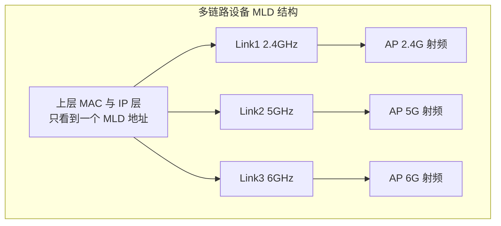

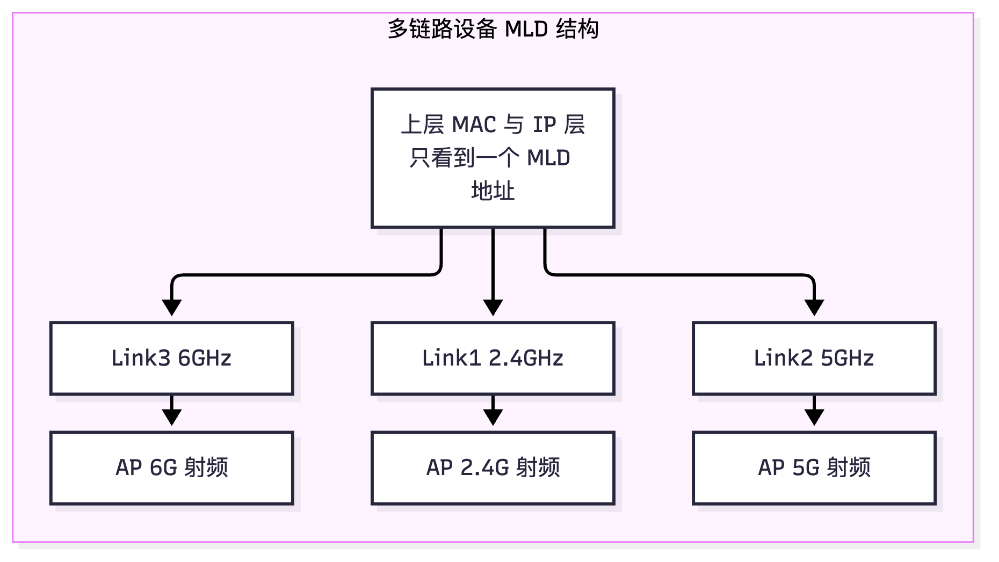


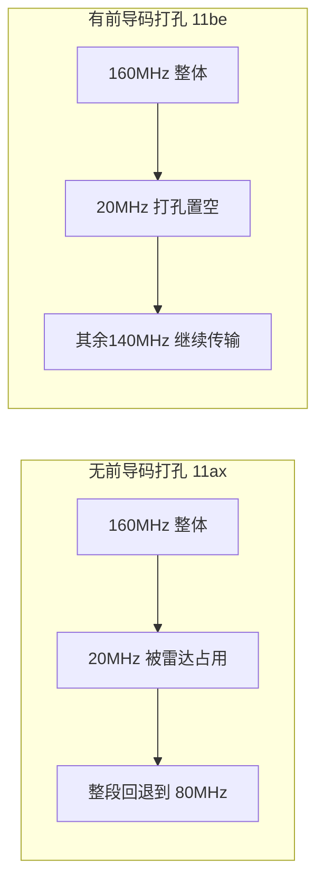

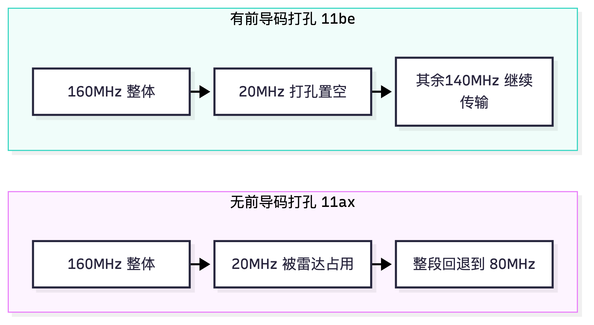


### 真题精练

**Q1.【真题·单选】** 关于 Wi-Fi 7 的 MLO，下列说法错误的是？
A. MLO 允许 AP 与终端同时在多个频段建立链路，并对外呈现为一个逻辑实体
B. STR 模式要求终端能同时在多条链路上收发，对射频与自干扰抑制要求最高
C. eMLSR 模式只配备一套射频，同一时刻只能在一**条**链路上收发，但可快速切换
D. MLO 的本质就是把多个频段的速率简单相加，只有 STR 一种实现

> **答案：D**
> **解析**：D 错误，这是最典型的错误选项。MLO 有三种模式：**STR**（同步多链路，真并行，吞吐叠加）、**eMLSR/Non-STR**（单射频多链路监听，快速切换，降低时延但不叠加吞吐）、**链路切换/备用链路**（热备式迁移，保障可靠性）。MLO 的核心价值是**用一个统一的 MLD MAC 地址屏蔽链路切换，让上层连接不断开**，从而消除传统漫游/换频段的时延尖峰——这比"速率相加"更本质。A、B、C 均为正确描述。

**Q2.【真题·多选】** 关于 802.11be 的 Preamble Puncturing（前导码打孔），下列说法正确的有？
A. 它允许在 320/160 MHz 信道中把被占用的 20 MHz 子信道置空，其余部分继续传输
B. 它主要解决 11ax 中"任意一个子信道被占即整段不可用"的频谱浪费问题
C. 被打孔的位置信息需要在前导中指示，接收端必须支持解析
D. 打孔后频谱效率一定高于不打孔，因此应默认开启
E. 它与 DFS 雷达检测配合时收益明显

> **答案：ABCE**
> **解析**：A、B、C 正确。D 错误，打孔会带来**功率谱密度约束与调度复杂度**问题：在部分法规下，非连续频谱的发射功率需要重新计算（功率受限），且调度器需要处理不连续 RU 分配；若现场没有子信道被占用，打孔反而可能降低可用发射功率。E 正确，5 GHz 的 DFS 信道一旦检测到雷达就要退出，打孔让 AP 只丢掉一个 20 MHz 而保住其余带宽，这是它最典型的收益场景。

**Q3.【真题·判断】** 4096-QAM 相比 1024-QAM 提升 20% 的每子载波比特数，且对 SNR 的要求基本不变，因此可以显著提升远距离用户的速率。

> **答案：错误**
> **解析**：4096-QAM 每子载波 12 bit，相对 1024-QAM 的 10 bit 提升 20%，这个数字正确；但**星座点间距显著缩小，对 SNR 要求提高约 5~6 dB**，只有在极近距离视距条件下才能稳定使用。远距离用户会被速率自适应降到 QPSK/16-QAM，**与 4096-QAM 无关**。这是"高效调制只在好信道有用"这一基本原理的再现。

**Q4.【真题·简答】** 请说明 MLO 三种模式的区别，并指出哪一种最适合"工业 AGV 控制与 VR 教学"这类时延敏感场景，为什么？

> **答案要点**：
> ① **STR（同步多链路）**：多套射频同时收发，吞吐可叠加，适合大带宽需求（8K 视频回传、高速下载）；缺点是需要良好的自干扰抑制、功耗最高。
> ② **eMLSR / Non-STR（异步多链路单射频）**：单射频在多条链路上快速切换收发，能显著降低时延抖动（因为不必重连即可换链路），成本功耗低，是终端侧最现实的 MLO 实现；吞吐不叠加。
> ③ **链路切换 / 备用链路**：主链路承载业务，其余链路热备，主链路劣化时业务**在不断连接的前提下**迁移。
> ④ **时延敏感场景首选"链路切换/备用链路"（或 eMLSR）**：工业 AGV 控制与 VR 教学的核心诉求是**时延确定性与不中断**，而不是峰值速率。链路切换模式提供了"无线侧的主备倒换"，配合 MLD 统一 MAC 地址，可在 **毫秒级**完成链路迁移且不触发 IP 层重连、不做完整 802.1X 重认证，从根本上消除传统"换 AP/换频段 = 断链 300 ms~数秒"的时延尖峰。
> ⑤ 补充：实际部署中三种模式往往组合使用——AP 侧多射频全开（支撑 STR），终端能力弱的用 eMLSR 兼容，关键业务流用链路切换保障。

**Q5.【真题·设计】** 某新建智慧工厂需部署 Wi-Fi 7 承载 AGV 控制（时延 <10 ms、抖动 <2 ms）与产线视频回传（每路 100 Mbps）。请给出频段选择、MLO 策略、带宽与关键特性设计，并说明理由。

> **答案要点**：
> ① **频段选择**：控制流走 **6 GHz（干净、无雷达 DFS 中断、无 2.4G 干扰）**，视频回传走 **5 GHz**，2.4 GHz 只用于扫码枪/IoT。理由是 5 GHz 存在 DFS 雷达退避导致信道中断，控制类业务不能接受这种"非计划中断"；6 GHz 无 DFS（部分地区仍有限制，以法规为准）且干扰源少。
> ② **MLO 策略**：控制终端启用 **MLO 链路切换模式**（6 GHz 主 + 5 GHz 备），视频终端可用 STR 提升吞吐。MLD 统一 MAC 保证链路迁移不触发 IP 层与认证层重建。
> ③ **带宽**：6 GHz 用 **80 MHz**（不用 320/160，因为工厂内 AP 密度高、需要更多非重叠信道 + 打孔容错），5 GHz 用 **80 MHz** 并开启 **preamble-puncturing** 以容忍局部干扰。
> ④ **关键特性**：接入 `ofdma enable`（AGV 指令是小包）、`multi-ru enable`（细粒度分配）、`twt enable`（传感器省电与错峰）、`bss-color enable`（降低车间金属反射导致的 OBSS 影响）、WMM 中把 AGV 控制流映射到 **AC_VO** 并在有线侧信任 DSCP（如 CS6/EF）。
> ⑤ **可靠性**：AP 采用**双网口/双上行链路**接入不同交换机，配合 AC 双机热备与 PoE 冗余供电；对时延最关键的区域做**双 AP 覆盖冗余**（同一位置两部 AP 不同信道），保证单 AP 故障时 MLO 可直接迁移。
> ⑥ **验收**：`display wlan client verbose` 确认 MLO 各链路状态；实测 AGV 控制报文端到端时延 P99 < 10 ms、抖动 < 2 ms；信道利用率 < 40%，重传率 < 5%。

### 易错点与排错

1. **把 MLO 简化成"速率叠加"**：只有 STR 模式吞吐叠加，eMLSR 与链路切换模式的收益是**时延与可靠性**。
2. **认为 320 MHz 一定更好**：320 MHz 在 6 GHz 全段只有 3 个非重叠信道，高密场景必然造成 OBSS 灾难。**高密用窄带、低密用宽带**是铁律。
3. **忘记 4096-QAM 的 SNR 代价**：+6 dB 的 SNR 需求意味着它只服务于几米内视距用户。
4. **把 Multi-RU 当成 MU-MIMO**：Multi-RU 是"一个用户用多个 RU"（频域聚合），MU-MIMO 是"多个用户共用同一时频资源"（空域正交）。
5. **忽略设备能力矩阵**：11be 的很多特性（320 MHz、16 流、Multi-RU、打孔）需要 **AP 芯片、终端芯片、AC 版本三方同时支持**。答题或方案设计时必须写明"需 AC6805/AirEngine 9700S 与 AirEngine 6761/8760 的相应版本支持，以所用版本文档为准"，否则方案不落地。
6. **排错命令**：`display wlan client verbose`（看 MLD MAC、各链路 RSSI 与速率）、`display wlan ap name <AP> radio 2`（6G 射频能力位）、`display wlan ap all radio statistics`（打孔与实际带宽占用）。

---

## 1.4 空口性能与容量理论：共享介质、空口效率与 Airtime 公平调度

### 考点定位

本考点是国赛**综合计算与设计题的核心**，典型问法是"某 AP 标称 X Mbps，实际能带多少并发用户"、"给出空口效率公式并计算"、"为什么高密场景要做 Airtime 公平"。单题 8~12 分，且常与 1.9 节的高密设计算例合并成一道大设计题。易错点：① 把标称速率直接除以用户数当作人均带宽；② 不知道 Airtime 公平与"每用户公平"的区别；③ 算不出"单帧空口时长"从而无法推出并发用户数。

### 原理精讲

**第一层：空口是"共享的半双工介质"，这一点决定了所有容量结论。**

一个 AP 下的所有终端（以及邻居 AP 的终端，只要信号能被听到）**共享同一个信道**，且**任意时刻只能有一个发射机**。因此 AP 的"标称 4.8 Gbps"不是"每个用户 4.8 Gbps"，而是"这个信道上所有用户和所有帧开销加起来每秒最多用掉 4.8 Gbps 的物理层时间"。**容量管理的本质是"时间（Airtime）管理"，不是"带宽管理"。**

**第二层：空口效率——为什么实际吞吐只有标称的 40%~60%。**

一次成功的单播数据帧交换，在空口上占用的时间由以下几部分构成：

```
T_frame = T_preamble + T_signal + T_data + SIFS + T_ACK + DIFS(或AIFS) + T_backoff
```

其中：
- **T_preamble + T_signal**：前导与信令字段，802.11ac 约 40~56 μs，802.11ax 因符号变长而增至约 **100~200 μs**（这也是 11ax 为提高效率引入 A-MPDU 聚合与 OFDMA 的原因——单帧开销变大了，必须靠聚合摊薄）。
- **T_data**：`数据比特数 ÷ PHY 速率`。
- **SIFS + T_ACK**：ACK 必须以最低基本速率发送（如 6 Mbps 时单帧约 44 μs），所以**每帧固定开销里有很大一块是 ACK**。
- **DIFS/AIFS + Backoff**：竞争开销，平均约 `AIFS + 平均退避时隙×SlotTime`，AC_BE 下约 43 + 7.5×9 ≈ **110 μs**。

举例：802.11ac，80 MHz，单流，MCS 9，800 ns GI（PHY 速率 433.3 Mbps），发送一个 **1500 字节（12000 bit）** 的帧：

```
T_data = 12000 / 433.3e6 = 27.7 μs
T_frame = 56(前导信令) + 27.7(数据) + 16(SIFS) + 44(ACK@6Mbps) + 43(AIFS) + 67.5(平均退避)
        ≈ 254 μs
有效载荷吞吐 = 12000 bit / 254 μs ≈ 47.2 Mbps
空口效率 = 47.2 / 433.3 ≈ 10.9%
```

**只有 10.9%！** 这个数字极其重要，它解释了为什么"无线测速只有标称的十分之一"是正常现象，也解释了**为什么真实网络中 1500 字节小帧的密集发送是空口杀手**。如果改用 **A-MPDU 聚合**（把 64 个帧聚合成一个 PPDU，共享一次前导、一次 SIFS、一次 ACK（Block ACK））：

```
请求聚合后的 T_data 总量 = 27.7 × 64 = 1773 μs（近似线性，实际略优）
T_aggregate = 56 + 1773 + 16 + 44 + 43 + 67.5 ≈ 2000 μs
有效载荷吞吐 = 12000×64 / 2000 μs = 768000/2000e-6 = 384 Mbps
空口效率 = 384 / 433.3 ≈ 88.6%
```

**聚合把效率从 10.9% 提到 88.6%（约 8 倍）**，这就是"帧聚合是 WLAN 吞吐最大功臣"的量化证明，也是华为 AC/AP 默认开启 A-MPDU（`amsdu enable` / `ampdu` 相关配置，版本相关）的原因。但聚合有代价：**聚合帧变长 → 一次冲突损失的时间变多 → 时延抖动变大**。所以**语音场景往往要限制聚合长度**（TXOP 上限 1.504 ms 就是为此）。

**第三层：并发用户数算例（国赛必考的完整算例）。**

题目设定：一台 802.11ax AP（AirEngine 6761），5 GHz，**80 MHz 带宽，4 空间流**，全部终端为 2×2 11ax 手机/笔记本，业务模型为：
- 每终端平均业务量：**2 Mbps 下行持续流量**（网页/视频混合）
- 每个下行数据帧平均 **1500 字节**，采用 A-MPDU 聚合，平均每 PPDU 聚合 **16 个 MPDU**
- 空口目标利用率上限：**60%**（留 40% 给重传、管理帧、Beacon、上行竞争）

**第一步：求单用户占用 Airtime。**

先算单 PPDU 的 PHY 速率。11ax 80 MHz 单流 MCS 11（1024-QAM 5/6）800 ns GI = **600.4 Mbps**。终端为 2×2，但受信道条件限制，实际协商到 **2 流 MCS 9**（保守取值，实际 NLOS 办公环境常见）：查表 80 MHz 单流 MCS 9 = 480.1 Mbps，2 流 = **960.2 Mbps**。

单 PPDU 聚合 16 个 1500 字节 MPDU：
```
有效载荷 = 16 × 1500 × 8 = 192000 bit
T_data = 192000 / 960.2e6 = 200 μs
```
加上帧开销（11ax 前导 ~120 μs、SIFS 16 μs、Block ACK ~60 μs@6Mbps、AIFS[BE] 43 μs、平均退避 67.5 μs）：
```
T_ppdu = 120 + 200 + 16 + 60 + 43 + 67.5 ≈ 507 μs
```
**每 2 Mbps 业务在空口上占用的时间**：一个 PPDU 携带 16×1500 字节 = 24000 字节 = 192 kbit，所以每秒钟 2 Mbps 的业务需要发送 `2e6 / 192000 ≈ 10.4` 个 PPDU/秒：
```
单用户 Airtime 占用 = 10.4 × 507 μs ≈ 5.28 ms/s = 0.528%
```

**第二步：用利用率上限反推并发用户数。**

可用 Airtime = 60%（0.6 s/s），则：
```
N = 0.60 / 0.00528 ≈ 113 台
```

**第三步：交叉校验（这一步是拿满分的关键——单看算例会得出"能带 113 台"的乐观结论，必须用其他约束打回来）。**

- **约束 A：OFDMA/调度开销与竞争放大。** 用户数越多，上行竞争与调度开销越大，且各终端的信道条件不同（弱信号终端会用低 MCS 占用大量 Airtime）。**实测经验**：办公开放区单 AP 的"舒适带机量"约 **30~50 台**（业务型），纯连接数可达 100+ 但体验下降。因此以"业务体验"为准，取 **40 台**作为设计值。
- **约束 B：下行竞争下的实际可用 Airtime。** 算例只算了数据帧本身，但终端上行 ACK/Block ACK、上行数据、Beacon（默认 100 ms 一次，约 300~500 μs）都要占时间。Beacon 的占用 = 5 μs/次 ÷ ... 实际约 **0.5% ~ 1%**；若开了 802.11k/v 邻居报告，管理帧占用会上升。
- **约束 C：频谱复用与同信道 AP 干扰。** 80 MHz 在 5 GHz 只有 4~6 个非重叠信道，如果每层楼有 20 个房间各一个 AP，则必然大量同信道重叠，实际可用 Airtime 会再被削掉 30%~50%。

**结论表述（答题模板）**："理论计算表明在 60% 利用率上限、2 Mbps/终端、聚合 16 帧的假设下，单 AP 可承载约 **113 台**终端；但考虑信道条件差异、上行与管理帧开销、同信道 AP 重叠等因素，**工程设计值取 40~50 台**，若为高密教室（终端密集、并发率高）建议降到 **25~30 台/AP** 并配合 OFDMA 与 TWT 优化。"——**给出两个数字（理论值 + 设计值）并解释差距，是这类题的得分点。**

**第四层：Airtime 公平调度（Airtime Fairness）。**

传统 802.11 的"公平"是**每用户等机会（per-user fairness）**：每个终端独立竞争，谁抢到谁发。问题在于：**低速终端发送同样一个帧要占用远多于高速终端的时间**。示例：1500 字节帧，在 6 Mbps 下需要 2000 μs，在 433 Mbps 下只需 27.7 μs，**相差 72 倍**。若一台 5 年前的老手机在下载，它每发一帧就"霸占"空口 2 ms，新终端只能等着——结果**一个慢用户把整个 AP 的吞吐拖垮**（俗称"低速终端拖累效应"）。

**Airtime 公平**把调度目标改为"**每个终端分到的空口时间大致相等**"，实现方式是 AP 在软件队列侧做**时间片轮转**：高速终端分到的时间片内可以发很多帧，低速终端分到同样时间片内只能发少数帧，从而**让高速终端不再被低速终端惩罚**。华为 AirEngine 系列 AP 与 AC 提供基于空口时间的调度与限速能力（如按 STA 的 Airtime 限速、`airtime-fair-schedule` 类特性，**命令名与可用性以所用版本文档为准**）。

**Airtime 公平的两个副作用必须知道**：① 低速终端的体验会变差（这是"有意为之"），若网络中有必须保障的远距离终端（如仓库扫码枪），要用**白名单/单独 SSID/单独 AP** 隔离；② 与"每用户带宽"的直觉冲突，客户常投诉"网速不公平"，需要提前沟通。

### 关键概念对照表

| 指标 | 定义 | 典型值/目标值 | 说明 |
|---|---|---|---|
| PHY 速率（标称） | 物理层调制编码决定的比特率 | 11ax 80M 2SS ≈ 1.2 Gbps | 只是"毛速率"，不含任何开销 |
| 空口效率 | 有效载荷吞吐 ÷ PHY 速率 | 单帧 1500 B：约 10%；聚合 16 帧：约 88% | 决定"为什么实测慢" |
| MAC 层吞吐 | 实际可用的有效载荷吞吐 | 标称的 40%~60%（单用户） | 受竞争、重传、管理帧影响 |
| 空口利用率（Channel Utilization） | 信道忙时间占比 | 设计目标 < 40%；>60% 告警 | 华为 AC 可查看 |
| 重传率 | 重传帧数 ÷ 总帧数 | 目标 < 10%；>20% 需优化 | 反映干扰与覆盖问题 |
| 噪声底（Noise Floor） | 信道背景噪声 | 目标 < −92 dBm；>−85 dBm 需排查 | 反映非 Wi-Fi 干扰 |
| Airtime | 一次传输占用空口的时间 | 单帧 1500 B@6Mbps ≈ 2000 μs | 容量管理的基本单位 |
| 聚合帧数（A-MPDU） | 单个 PPDU 内的 MPDU 数 | 默认自动，可到 64 个 | 效率 vs 时延的权衡 |

| 公平性模型 | 公平的对象 | 高速终端体验 | 低速终端体验 | 系统总吞吐 |
|---|---|---|---|---|
| 每用户公平（传统 DCF/EDCA） | 发送机会（帧数） | **被低速终端严重拖累** | 正常 | 差 |
| Airtime 公平 | 空口时间 | 好 | 变差（有意为之） | **好** |
| 每用户带宽限速 | 带宽（bit/s） | 好 | 好（只要不超限） | 中（可能浪费空口） |

### 华为设备配置

```bash
system-view                                          # 进入系统视图
wlan                                                 # 进入 WLAN 视图
 rrm-profile name rrm-hcie                          # 创建射频管理模板
  airtime-fair-schedule enable                      # 使能空口时间公平调度（命令名随版本差异）
  # 作用：按空口时间而非帧数分配发送机会，避免低速终端拖垮全网
 quit                                                # 退出模板视图
 vap-profile name office-vap                         # 进入 VAP 模板
  rate-limit client down 4000                       # 单终端下行限速 4 Mbps，防止个别终端占满空口
  rate-limit client up 2000                         # 单终端上行限速 2 Mbps
  # 限速单位通常为 kbps，具体语法以所用版本文档为准
  # 高密场景也可用基于 SSID 的整体限速，防止单一 SSID 挤占全部空口
 quit                                                # 退出 VAP 模板视图
 # ===== 帧聚合与效率相关（命令名随版本变化较大）=====
 # amsdu enable / ampdu 相关开关：默认开启，用于提升空口效率
 # 语音优先场景可限制聚合长度以控制时延抖动，以所用版本文档为准
 # ===== 查看空口效率与容量相关指标 =====
display wlan ap all radio statistics                 # 查看信道利用率 干扰 噪声
display wlan ap name AP-01 radio 0 statistics        # 查看收发包 重传 速率分布
display wlan client verbose                          # 查看单终端协商速率与实际流量
display wlan client traffic-statistics               # 查看各终端流量与空口占用（版本相关）
```

### 示意图

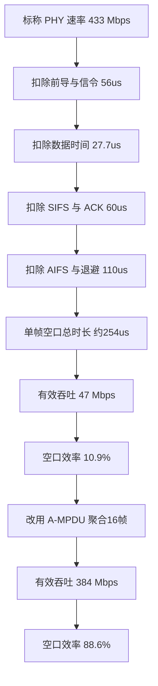

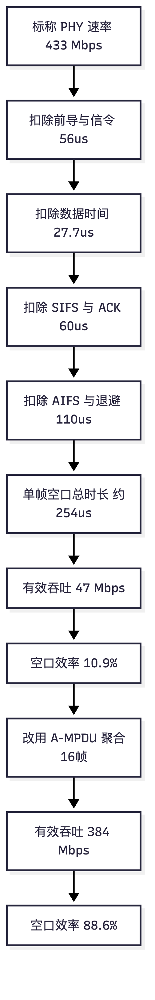


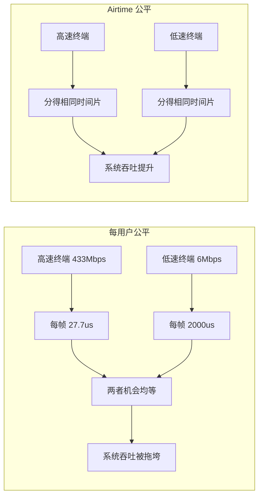

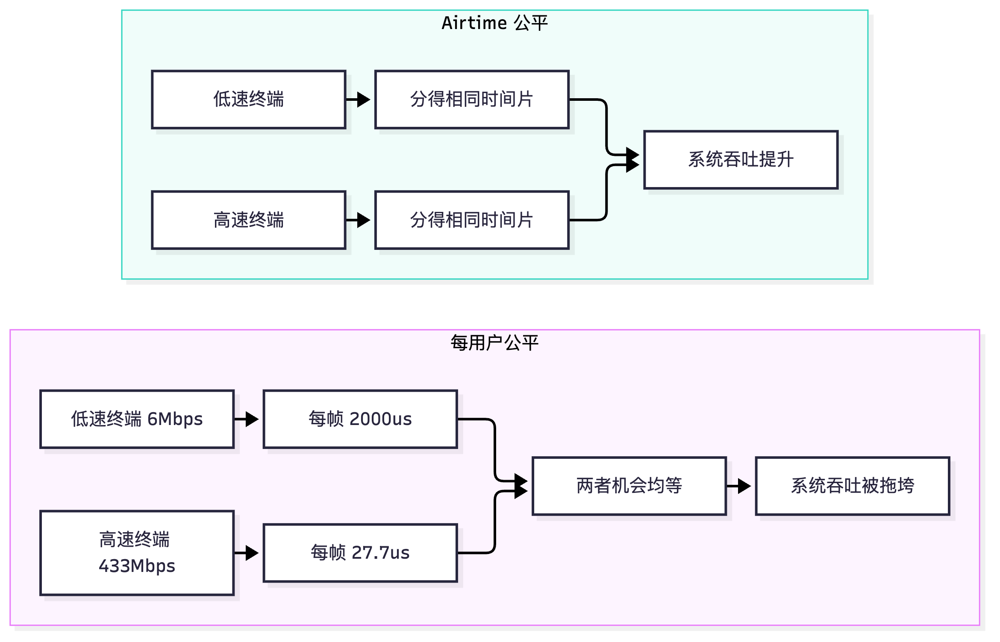


### 真题精练

**Q1.【真题·单选】** 某 AP 标称 PHY 速率为 1.2 Gbps，实测单终端 TCP 吞吐约 550 Mbps。最合理的解释是？
A. AP 硬件故障，应更换设备
B. 空口存在前导、帧间间隔、ACK、竞争退避等固定开销，加上 TCP 确认流与管理帧，MAC 层效率通常只有标称值的 40%~60%
C. 终端不支持 1.2 Gbps，只能跑 550 Mbps
D. 交换机端口带宽不足

> **答案：B**
> **解析**：这是"无线实测慢"的标准解释。**标称速率是 PHY 层毛速率**，不含前导/信令、SIFS、ACK、AIFS、退避、重传、Beacon、管理帧、TCP ACK 等开销，MAC 层有效吞吐通常为标称值的 40%~60%，单帧小包场景甚至只有 10%。A 无依据；C 部分可能是原因之一但不是主因（题目给的是"最合理"解释）；D 与 1.2 Gbps 相比，千兆口确实可能成为瓶颈，但题目未给出接口信息，且 550 Mbps 仍低于 1 Gbps。

**Q2.【真题·计算/简答】** 802.11ac，80 MHz，单空间流，MCS 9，GI = 800 ns，发送一个 1500 字节的数据帧。已知前导+信令 56 μs、ACK 以 6 Mbps 发送（含 SIFS 共 60 μs）、AIFS 43 μs、平均退避 67.5 μs。求：① 单帧占用的空口总时长；② 有效载荷吞吐；③ 空口效率；④ 若改用 A-MPDU 聚合 16 帧，效率提升到多少？并解释原因。

> **答案要点**：
> ① PHY 速率 = 433.3 Mbps；`T_data = 1500×8 / 433.3e6 = 27.7 μs`；
> `T_frame = 56 + 27.7 + 60 + 43 + 67.5 ≈ 254 μs`。
> ② 有效载荷吞吐 = `12000 bit / 254 μs ≈ 47.2 Mbps`。
> ③ 空口效率 = `47.2 / 433.3 ≈ 10.9%`。
> ④ 聚合 16 帧后：`T_data = 27.7×16 = 443 μs`，`T_agg = 56 + 443 + 60 + 43 + 67.5 ≈ 670 μs`，有效载荷 = `12000×16 = 192000 bit`，吞吐 = `192000/670e-6 ≈ 286.6 Mbps`，效率 = `286.6/433.3 ≈ 66.2%`。（若聚合 64 帧可达 88% 量级。）
> **原因**：前导/信令、SIFS、ACK、AIFS、退避这些**固定开销被分摊到了 16 倍的载荷上**，因此效率大幅提升。这解释了帧聚合（A-MPDU/A-MSDU）是现代 WLAN 吞吐最大功臣，以及为什么**运营商级 AP 必须开启聚合**。代价是聚合帧更长，一旦冲突或误码，重传代价更大、时延抖动上升，所以语音场景要限制聚合长度与 TXOP。

**Q3.【真题·简答】** 什么是 Airtime 公平调度？为什么高密度场景必须启用它？它的副作用是什么，如何规避？

> **答案要点**：
> ① 定义：传统 802.11 的公平是**每用户等发送机会**，而 Airtime 公平把调度目标改为**每个终端分到大致相等的空口时间**，由 AP 在队列侧按时间片轮转实现。
> ② 必要性：低速终端发送同样大小的帧，占用空口时间可达高速终端的 **70 倍以上**（1500 B 帧：6 Mbps 需约 2000 μs，433 Mbps 仅 27.7 μs）。若不做时间公平，少数低速终端会长期霸占空口，使**全网吞吐与高速终端体验急剧下降**（低速终端拖累效应）。
> ③ 副作用：**低速终端自身的体验会明显变差**（带宽被压缩），这正是设计意图；但对"必须保障的远距离终端"（仓库扫码枪、室外传感器）会造成业务受损。
> ④ 规避方式：把需要保障的低速终端**放入独立 SSID 或独立 AP/射频**，或对其做白名单/单独限速策略；同时对普通终端设置**最小接入速率**（12/24 Mbps）从源头减少低速帧；配合**智能漫游**让弱信号终端尽早换到更近的 AP。
> ⑤ 验证：`display wlan ap name <AP> radio 0 statistics` 观察速率分布是否改善，`display wlan client traffic-statistics` 观察各终端空口占用是否均衡。

**Q4.【真题·判断】** 单 AP 的带机量只取决于 AP 的 PHY 峰值速率，速率越高能带的用户越多。

> **答案：错误**
> **解析**：带机量由三重因素共同决定：① **空口时间预算**（一个信道每秒只有 1 s 可分配）；② **业务模型**（每终端平均带宽与并发率，看网页的用户与看 4K 直播的用户占用差几十倍）；③ **终端能力分布**（低速终端会放大 Airtime 占用）与**信道重叠/干扰**（同信道 AP 越多实际可用 Airtime 越少）。PHY 峰值速率只影响"单用户能跑多快"，未必提升"能带多少用户"——**OFDMA、TWT、Airtime 公平这些多用户效率机制对带机量的贡献往往大于峰值速率**。

**Q5.【真题·排错】** 某办公区投诉"网速忽快忽慢，一到下午就卡"。网管查看 `display wlan ap all radio statistics` 发现：信道利用率 78%、重传率 26%、噪声底 −88 dBm，且 `display wlan client verbose` 显示有 3 台终端协商速率仅 6~12 Mbps。请给出分析与优化方案。

> **答案要点**：
> ① **读数解读**：利用率 78% 远超 40% 的健康线，说明空口已被打满；重传率 26% 说明存在明显干扰或覆盖不足；噪声底 −88 dBm 偏高（正常应 < −92 dBm），提示存在**非 Wi-Fi 干扰源**（微波炉、无线摄像头、蓝牙耳机集中使用区，或邻频 Wi-Fi 泄漏）。
> ② **根因分析（三条并列）**：低速终端（6~12 Mbps）占用了大量 Airtime，拖累全网；非 Wi-Fi 干扰抬高噪声底导致重传；下午为业务高峰，流量本身增长。
> ③ **优化动作**：一是**清理低速率**——把最小接入速率提到 12/24 Mbps，关闭 802.11b 保护模式，开启 **Airtime 公平调度**；二是**治理干扰**——用频谱分析（AC 的频谱分析或外置频谱仪/笔记本网卡扫描）定位干扰源，把 AP 信道换到干净的 5 GHz 信道，2.4 GHz 只保留 1/6/11；三是**分流与扩容**——开启 **Band Steering** 把终端挤到 5 GHz，必要时增加 AP 或改小带宽（80 MHz → 40 MHz）以增加非重叠信道数；四是**限速与公平**——对单终端做上下行限速，避免个别终端打满空口。
> ④ **验证**：优化后利用率目标 < 40%，重传率 < 10%，噪声底 < −92 dBm，低速终端数量显著下降。

**Q6.【真题·设计】** 某图书馆阅览区（同时在线 300 人，主要是网页查询与文献下载，平均 1.5 Mbps/人，峰值并发率 60%）需做 AP 容量设计。请按"理论计算 + 设计取值"两步给出 AP 数量，并说明假设。

> **答案要点**：
> ① **业务需求**：峰值并发终端数 = 300 × 60% = **180 台**；总业务量 = 180 × 1.5 Mbps = **270 Mbps**。
> ② **单 AP 可用容量估算**：取 AirEngine 6761（4×4 11ax），80 MHz，实际 MAC 层可用吞吐（考虑竞争、重传、管理帧后）约为 300~400 Mbps（标称 4.8 Gbps 的 8% 左右，图书馆以中小包为主）。按 60% 利用率设计，**单 AP 有效承载 ≈ 200 Mbps**。
> ③ **按容量算**：270 ÷ 200 ≈ **1.35 → 需 2 个 AP**。
> ④ **按带机量/体验算（往往是决定性约束）**：单 AP 舒适带机量（业务型）约 40 台，180 ÷ 40 = **4.5 → 需 5 个 AP**。
> ⑤ **按覆盖算**：阅览区若为 800 m² 开放式空间，5 GHz 单 AP 覆盖半径约 15~20 m（开放区 LOS 可到 25 m），需 **4~6 个 AP** 保证边缘信号 ≥ −65 dBm。
> ⑥ **取值**：三种约束取最大 → **6 个 AP**，采用**梅花状交错布放**并做信道规划（5 GHz 用 36/44/52/60/100/108 或 40/48/56/64 等非重叠组合），相邻 AP 同信道需物理隔离 ≥ 25 m。
> ⑦ **参数设计**：5 GHz 80 MHz（干扰可控时）或 40 MHz（AP 密集时）；最小接入速率 12 Mbps；Beacon 200 ms；DTIM 3；开启 OFDMA/TWT/BSS Coloring/Band Steering/Airtime 公平；单终端下行限速 20 Mbps 防个别用户占满。
> ⑧ **验收**：单 AP 信道利用率 < 40%，重传率 < 10%，边缘 RSSI ≥ −65 dBm，单终端实测 ≥ 50 Mbps。

### 易错点与排错

1. **把标称速率当可用带宽**：这是国赛最常见的失分点。答题时必须点出"PHY 速率 ≠ MAC 吞吐 ≠ 用户感知带宽"三层关系与 40%~60% 的经验折扣。
2. **算 Airtime 时漏掉固定开销**：前导+信令、SIFS、ACK、AIFS、退避五项必须计入，尤其 11ax 前导显著变长（约 100~200 μs）。
3. **忘记管理帧与 Beacon 的占用**：Beacon 默认 100 ms 一次，加上 11k/v 邻居报告、探测响应等，管理帧可占 1%~5% 空口。
4. **只算下行不算上行**：实际业务（网页、视频、文件）是双向的，TCP ACK 与上行请求同样占空口；语音是双向对称的。
5. **"能带多少用户"只给一个数字**：应给"理论值 + 工程设计值"两个数字并解释差距，这是设计题的评分点。
6. **排错命令**：`display wlan ap all radio statistics`（利用率/干扰/噪声）、`display wlan ap name <AP> radio 0 statistics`（重传与速率分布）、`display wlan client verbose`（终端协商速率）、`display wlan client traffic-statistics`（空口占用分布，版本相关）。

---

## 1.5 射频优化：信道规划、功率规划、频段引导与负载均衡

### 考点定位

本考点以设计题与排错题为主，分值 6~10 分。考查形式通常为"给出楼宇平面图/干扰环境，做信道与功率规划"、"Band Steering 的取舍"、"Band Steering 与负载均衡的区别与配合"。易错点：① 把 **Band Steering（频段引导）** 与 **Load Balancing（负载均衡）** 混为一谈；② 认为"功率越大越好"或"功率越小越好"；③ 不知道 2.4 GHz 只有 **1/6/11** 三个真正非重叠信道，以及 5 GHz 的 DFS 信道限制。

### 原理精讲

**① 信道规划算法：先算"需要几个非重叠信道"，再排布。**

信道规划要同时满足两个约束：**同频复用距离最大化**（避免同信道 AP 互相听到导致 CCA 退让）与**邻频不重叠**（避免部分重叠造成持续干扰）。

- **2.4 GHz**：可用信道 1~13（中国允许 1~13），每信道 20 MHz 但信道间隔仅 5 MHz，因此**只有 1、6、11 三个信道互不重叠**。这是 2.4 GHz 的硬约束——无论怎么规划，最多只有 3 个非重叠信道。若必须使用 1~13 全部信道（部分场景为增加容量），则实际是"密集复用 + 邻频干扰取舍"，需评估现场隔离度。
- **5 GHz**：中国可用区间主要为 **5.150~5.350 GHz（信道 36/40/44/48/52/56/60/64）** 与 **5.725~5.850 GHz（信道 149/153/157/161/165）**。其中 **52~64（及部分 100~144，视法规）属于 DFS（Dynamic Frequency Selection，动态频率选择）信道**，AP 使用前必须做 **CAC（Channel Availability Check，信道可用性检查）60 s（气象雷达为 600 s）**，雷达事件发生时必须在 **200 ms 内**停止发射并在 **10 s 内**（部分法规 260 ms 内静默）离开该信道并重新选频。**DFS 会导致业务中断**，因此对时延敏感业务要尽量避开 DFS 信道或用 6 GHz。
- **6 GHz**：信道更多（59 个 20 MHz），无 DFS（部分地区仍有），是 Wi-Fi 6E/7 的主力容量频段。

**规划算法（工程上按四步走）**：

1. **确定复用模式**：由"楼层/区域需要多少非重叠信道"决定。例如 5 GHz 有 8 个非 DFS 信道（36/40/44/48/149/153/157/161），若每层需要 8 个 AP 覆盖，则每层可排一个 8 信道复用组（称为"8 色复用"），相邻 AP 不同信道。
2. **摆放与信道指派**：按蜂窝状（正六边形近似）交错布放，用**最小化同信道 AP 的接收信号强度差**为优化目标。同信道 AP 之间的 RSSI 应尽量低于 **−82 dBm**（CCA 信号检测门限），至少低于 **−75 dBm**。
3. **带宽选择**：带宽越宽速率越高但非重叠信道越少。原则：**低密用宽（80/160 MHz）、高密用窄（20/40 MHz）**。
4. **功率规划**：功率决定覆盖半径，也决定"能听到多少邻居 AP"。**原则是"覆盖够用即可、不求最大"**：一般以边缘目标 RSSI（如 −65 dBm 用于语音/视频，−70 dBm 用于普通数据）反推功率；同时在 **2.4 GHz 用比 5 GHz 更低的功率**（通常低 3~6 dB），因为 2.4 GHz 传播损耗小、干扰多，压低 2.4G 功率可促使用户更多使用 5 GHz。

**② Band Steering（频段引导）：原理与取舍。**

双频 AP 同时广播 2.4 GHz 与 5 GHz 的同一 SSID，终端默认会**优先选 2.4 GHz**（因为 2.4 GHz 信号更强、扫描发现更快）。结果是：5 GHz 空口空闲、2.4 GHz 拥塞——这是双频网络最常见的资源错配。

Band Steering 的实现手段有三类：
- **拒绝探测响应（Probe Suppression）**：AP 在 2.4 GHz 上收到终端的 Probe Request 时**不回 Probe Response**，only 在 5 GHz 上回应，诱导终端连到 5 GHz。缺点：终端可能反复探测，增加管理帧；对只支持 2.4 GHz 的老终端必须放行。
- **基于信号强度的引导**：仅当终端在 5 GHz 的 RSSI 高于门限（如 −70 dBm）时才引导，否则允许连 2.4 GHz（避免终端在 5 GHz 边缘信号太差反而更慢）。
- **基于负载的引导**：2.4 GHz 负载超过门限（如终端数 > 20 或利用率 > 50%）时启动引导，负载低时不干预（避免无谓的管理帧开销）。

**Band Steering 的取舍（必答）**：
- **收益**：5 GHz 频谱干净、非重叠信道多、支持更宽带宽与更高 MCS，引导后**吞吐与容量显著提升**，2.4 GHz 拥塞缓解。
- **代价一**：**引导会增加终端接入时延**（终端可能先尝试 2.4 GHz 被拒，再重试 5 GHz），首次接入时间从 ~1 s 增加到 2~3 s。
- **代价二**：**可能把终端推到信号更差的 5 GHz**，导致边缘覆盖体验下降甚至掉线（5 GHz 传播损耗比 2.4 GHz 大约高 6~8 dB）。因此**必须设置 RSSI 门限**，不能无条件引导。
- **代价三**：部分终端（尤其 IoT、老打印机、部分安卓机）**对"探测不回"行为兼容性差**，可能出现连不上或反复重连，需要**兼容性白名单**。
- **代价四**：会增加管理帧（探测请求）与 AP 的 CPU 开销。

**③ Load Balancing（负载均衡）：原理与门限。**

负载均衡解决的是"**同一频段内多台 AP 之间的终端数/流量不均**"问题：会议室里一台 AP 挤了 60 台终端，隔壁 AP 只有 5 台。华为的实现机制是：

1. AP 周期性通过 AC 交换**负载信息**（终端数、信道利用率、吞吐）。
2. 当某 AP 的负载超过**负载均衡起始门限**（如终端数 > 30 或利用率 > 50%），该 AP 开始**拒绝新终端的关联请求**（Association Response 返回 Status Code 17 "Association denied because AP is unable to handle additional associated STAs"），或返回带有候选 AP 列表的引导信息。
3. 终端收到拒绝后重新扫描并入网到负载较低的邻居 AP。
4. **负载均衡的差异门限（Gap）**：只有当"本 AP 负载 − 邻居最低负载 > 差异门限"时才拒绝，避免 AP 之间来回推诿（乒乓效应）。
5. **负载均衡只作用于"新接入"的终端**，已经在线的终端不会被强制迁移（避免业务中断）——所以它**不是**"把人赶走"，而是"让新来的人去别处"。

**Band Steering 与 Load Balancing 的区别（必背对照）**：

| 对比项 | Band Steering（频段引导） | Load Balancing（负载均衡） |
|---|---|---|
| 作用维度 | **跨频段**（2.4 GHz ↔ 5 GHz ↔ 6 GHz） | **同频段跨 AP** |
| 解决什么 | 双频终端全挤在 2.4 GHz | 同频段内 AP 之间终端数/流量不均 |
| 主要手段 | 2.4 GHz 不回探测响应、按 RSSI/负载引导 | 高负载 AP 拒绝新关联，引导到低负载 AP |
| 生效阶段 | 终端扫描/关联阶段 | 终端关联阶段（仅新接入） |
| 关键门限 | 5 GHz 的 RSSI 门限（如 −70 dBm）、负载门限 | 负载起始门限、负载差异门限（Gap） |
| 主要风险 | 边缘 5 GHz 体验下降、老终端兼容性差 | 乒乓效应、终端反复重连 |
| 对已在线终端 | 可配合智能漫游做主动迁移 | **不强制迁移** |

**④ 限制低速率与关闭低效协议。**

"网络慢"最常见的原因不是带宽不够，而是**个别低速终端拉低了全网空口的"最慢公共分母"**。三类动作：
- **设置最小接入速率（Minimum Access Rate）**：把 1/2/5.5/11 Mbps 从"基本速率集（Basic Rate Set）"中去掉，只保留 6/12/24 Mbps 作为基本速率。基本速率集用于管理帧、广播帧、ACK，一旦含 1 Mbps，**整个空口的 ACK 都要用 1 Mbps 发**，效率被彻底摧毁。
- **关闭 802.11b 保护模式**：现场无 11b 终端时关闭，避免全网降速。
- **关闭低效协议**：关闭 802.11b（有的场景连 802.11g 也关），关闭 40 MHz 在 2.4 GHz 的使用（2.4 GHz 用 40 MHz 会覆盖几乎整个频段，造成严重邻频干扰），必要时关闭 802.11n 的 2.4 GHz 高频宽。

**⑤ CCA 门限与动态调整。**

CCA（Clear Channel Assessment，空闲信道评估）门限决定 AP "多弱的信号才认为信道空闲"。默认 **−82 dBm**（信号检测，能解出有效前导）与 **−62 dBm**（能量检测 ED，无法解出前导时的能量门限）。**提高 CCA 门限**（例如调到 −72 dBm）会让 AP 忽略更弱的干扰、更积极地发送，从而提升空间复用率——这正是 802.11ax **BSS Coloring + OBSS-PD** 机制自动在做的事。但**门限调得过高会造成"我听不到别人、别人听得到我"的不对称，加剧隐藏节点与冲突**，所以工程上一般不做手动大改，而交给 11ax 的空间复用机制与 RRM 自动调整。

**⑥ RRM 射频调优：自动模式与手动模式。**

RRM（Radio Resource Management，射频资源管理）由 AP 的**射频调优**与 **AC 的 RRM 算法**共同完成。华为 AirEngine 的射频调优有四种启动方式：
- **自动调优（定时）**：AC 按固定周期（默认通常在凌晨低峰期）下发调优，AP 扫描邻居信息后由 AC 统一计算并下发最优信道与功率。
- **自动调优（按需/事件触发）**：检测到干扰、雷达事件、邻居 AP 数量变化时触发。
- **手动触发调优**：管理员通过命令或 iMaster NCE-Campus 一键触发。
- **手动固定**：对关键 AP 手工指定信道与功率（**调优时不参与**），适用于场馆主席台、手术室、精密测试区等需要固定空口环境的位置。

**调优算法要点**：AC 收集各 AP 的邻居信息（邻居 BSSID、RSSI、信道、负载），构建干扰矩阵，以"整体干扰最小 + 覆盖最优 + 负载均衡"为目标做信道指派与功率调整。**调优后的"乒乓"问题**：频繁调优会让终端频繁掉线重连，因此工程实践是**设定调优的时间窗口（业务低谷期）+ 调整阈值（只有改善超过 X% 才换信道）**。

### 关键概念对照表

| 频段 | 可用信道（中国区典型） | 非重叠信道数 | DFS 要求 | 20 MHz 传播特性 |
|---|---|---|---|---|
| 2.4 GHz | 1~13 | **3 个（1/6/11）** | 无 | 穿墙好、干扰多、仅 3 信道 |
| 5 GHz | 36/40/44/48、52/56/60/64、149/153/157/161/165 | 低功率段 4 个 + DFS 4 个 + 高频段 5 个 | 52~64 需要 DFS/CAC | 干扰较少、非重叠信道多 |
| 6 GHz | 约 59 个 20 MHz 信道 | 约 59（20 MHz）/7（160 MHz）/3（320 MHz） | 基本无 DFS | 干净、容量主力、穿透差 |

| 参数 | 常见默认/推荐值 | 高密推荐值 | 说明 |
|---|---|---|---|
| 2.4 GHz 信道 | 1/6/11 自动 | 固定 1/6/11 | 禁用 12/13 以避免邻频干扰 |
| 2.4 GHz 带宽 | 20 MHz | **20 MHz** | 禁用 40 MHz |
| 5 GHz 带宽 | 80 MHz | **40 MHz（高密）/20 MHz（超高密）** | 带宽与复用数成反比 |
| 2.4 GHz 功率 | 与 5G 相同 | **比 5G 低 3~6 dB** | 促使终端用 5 GHz |
| 最小接入速率 | 1 Mbps（默认基本速率含 1/2/5.5/11） | **12 或 24 Mbps** | 语音场景 ≥ 12 Mbps |
| 5 GHz 引导 RSSI 门限 | — | **−70 dBm** | 低于门限则不引导 |
| CCA 门限（信号检测） | −82 dBm | 借 11ax OBSS-PD 自动提升 | 不建议手动大改 |
| 调优周期 | 定时（深夜） | 定时 + 手动复核 | 避免业务高峰期调优 |

### 华为设备配置

```bash
system-view                                        # 进入系统视图
wlan                                               # 进入 WLAN 视图
 regulatory-domain-profile name cn-domain          # 创建射频域模板
  country-code cn                                   # 国家码 cn，决定可用信道与 EIRP 上限
 quit                                                # 退出
 radio-2g-profile name radio2g-hcie                # 创建 2.4G 射频模板
  channel 20mhz                                     # 2.4G 固定 20MHz，禁止 40MHz
  calibrate auto                                    # 该射频参与自动调优（信道与功率由 RRM 计算）
  # 若不希望被调优：使用固定信道 + 不参与调优的相关开关，以所用版本文档为准
 quit                                                # 退出
 radio-5g-profile name radio5g-hcie                # 创建 5G 射频模板
  channel 40mhz                                     # 5G 使用 40MHz（高密场景的容量与复用折中）
  calibrate auto                                    # 参与自动调优
 quit                                                # 退出
 rrm-profile name rrm-hcie                         # 创建射频管理模板
  band-steer enable                                 # 使能频段引导（Band Steering）
  band-steer 5g rssi-threshold -70                  # 5G 信号优于 -70dBm 才引导，避免边缘体验下降
  # 具体参数名与取值范围随版本差异较大，以所用版本文档为准
  smart-roam enable                                 # 使能智能漫游（配合 802.11k/v 做主动漫游引导）
  load-balance enable                               # 使能负载均衡
  load-balance start-threshold 30                   # 本 AP 关联终端超过 30 台后开始拒绝新关联
  load-balance gap 10                               # 与邻居最低负载差超过 10 台才拒绝，避免乒乓
  # 门限参数名与单位（终端数或百分比）随版本变化，以所用版本文档为准
 quit                                                # 退出
 vap-profile name office-vap                        # 进入 VAP 模板
  service-vlan vlan-id 10                           # 业务 VLAN
  rate-limit client down 20000                      # 单终端下行限速 20Mbps，防止个别终端占满空口
  # 最小接入速率通常在 SSID 模板或 VAP 模板下的速率集配置中设置，命令名随版本变化
 quit                                                # 退出
 ssid-profile name office-ssid                      # 进入 SSID 模板
  # 基本速率集与支持速率集的配置入口随版本不同（部分在 radio profile 下）
  # 目标：基本速率集仅保留 6/12/24 Mbps，去掉 1/2/5.5/11 Mbps
 quit                                                # 退出
 # ===== 手动触发一次射频调优 =====
wlan                                                 # 进入 WLAN 视图
 calibrate manual ap-group name default             # 手动对指定 AP 组触发调优（命令名随版本变化）
 # 调优耗时通常数分钟，建议在业务低谷期执行
 # ===== 查看射频规划与调优结果 =====
display wlan ap all radio                          # 查看各 AP 当前信道 带宽 功率 利用率
display wlan ap all neighbor                       # 查看邻居 AP 信息，判断同信道重叠情况
display wlan calibrate result                      # 查看调优结果与建议（版本相关）
```

### 示意图

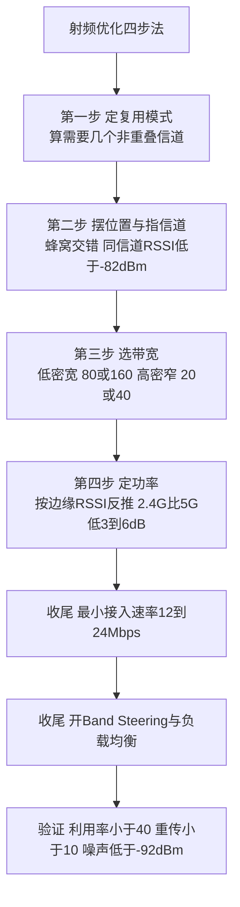

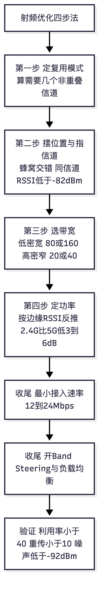


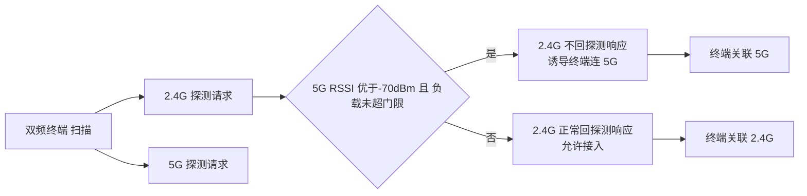

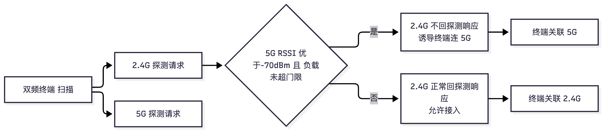


### 真题精练

**Q1.【真题·单选】** 关于 2.4 GHz 频段的信道规划，下列说法正确的是？
A. 中国区 1~13 信道全部互不重叠，可做 13 色复用
B. 只有 1、6、11 三个信道完全互不重叠，最多只能做 3 色复用
C. 使用 40 MHz 带宽可获得更多非重叠信道
D. 2.4 GHz 不需要信道规划，因为所有信道都可用

> **答案：B**
> **解析**：2.4 GHz 每个信道带宽 20 MHz，但相邻信道中心频率间隔仅 5 MHz，因此**只有 1/6/11 三个信道完全互不重叠**。A 错。C 错，40 MHz 在 2.4 GHz 几乎覆盖整个频段，会造成严重邻频干扰，**非重叠信道数变成 1 个**（等于没有规划空间），所以 2.4 GHz 必须用 20 MHz。D 错，正因只有 3 个非重叠信道，2.4 GHz 才必须做规划并把终端引导到 5 GHz。

**Q2.【真题·多选】** 关于 Band Steering（频段引导）与 Load Balancing（负载均衡），下列说法正确的有？
A. Band Steering 作用于跨频段选择，Load Balancing 作用于同频段跨 AP
B. Band Steering 常用手段之一是 AP 在 2.4 GHz 上不回 Probe Response
C. Load Balancing 会强制把已在线终端迁移到其他 AP
D. Band Steering 若不加 RSSI 门限，可能把终端推到信号更差的 5 GHz
E. Load Balancing 需要设置负载差异门限以避免 AP 之间乒乓推诿

> **答案：ABDE**
> **解析**：A、B、D、E 正确。C 错误，负载均衡**只作用于新接入的终端**（通过拒绝关联），不会强制迁移已在线终端——强制迁移会造成业务中断，需要依靠**智能漫游（802.11k/v/r）** 配合实现"主动引导切换"，这与负载均衡是两个不同机制。注意 D 是 Band Steering 最常见的实施错误：5 GHz 传播损耗比 2.4 GHz 高约 6~8 dB，无门限引导会造成边缘终端掉线。

**Q3.【真题·判断】** AP 发射功率越大越好，因为功率越大覆盖越广、信号越强、速率越高。

> **答案：错误**
> **解析**：功率过大会带来三重危害：① **加重 OBSS 干扰**：AP 能覆盖到很远，导致同信道邻区 AP 互相"听得太清楚"，频繁 CCA 退让，全网空口效率下降；② **上下行不对称**：终端发射功率受法规与电池限制（通常不超过 20 dBm，且多数手机在 15~18 dBm），AP 功率很大时会出现"AP 能喊到终端、终端喊不回 AP"的现象，表现为**终端显示信号满格但网速差、上行丢包**；③ **越区覆盖**造成漫游困难（终端"粘"在远处 AP 上）。因此功率规划的正确目标是**"覆盖刚好够用（边缘 RSSI 达到设计值）+ 同信道干扰最小"**，并常用"降低 2.4 GHz 功率、相对提高 5 GHz 功率"来引导终端。

**Q4.【真题·简答】** 请说明射频自动调优（RRM）的工作原理，以及为什么工程上要限制调优的时机与幅度。

> **答案要点**：
> ① **工作原理**：AP 在指定时间扫描各信道，收集邻居 BSSID、RSSI、信道号、负载（终端数/利用率）等信息并上报 AC；AC 构建**干扰矩阵与邻居关系图**，以"整体干扰最小、覆盖满足、负载相对均衡"为优化目标，为每个 AP 计算最优信道与发射功率；AC 把结果下发到 AP，AP 切换信道与功率。
> ② **触发方式**：定时调优（默认在业务低谷期，如凌晨）、事件触发（新 AP 加入、雷达事件、干扰突增）、手动触发（命令或 iMaster NCE-Campus）、以及关键 AP 的手动固定（不参与调优）。
> ③ **为什么限制时机**：AP 调优时会**切换信道并短暂中断业务**（通常几百毫秒到数秒），终端需要重新扫描与关联；在业务高峰期调优会造成大面积掉线与投诉，因此必须放在低谷期。
> ④ **为什么限制幅度**：若算法频繁更换信道，会出现"调优—干扰变化—再调优"的**振荡（乒乓）**，终端不断重连、体验极差。工程做法是设置**改善阈值**（新方案相对旧方案的收益必须超过一定比例才切换）与**调优冷却期**，并对核心区域 AP 采用**手动固定信道与功率**。
> ⑤ **验收**：调优后用 `display wlan ap all radio` 与 `display wlan ap all neighbor` 检查同信道邻居数量与 RSSI，确认同信道 AP 的 RSSI 低于 −75 ~ −82 dBm。

**Q5.【真题·排错】** 某双频网络用户投诉"手机显示 Wi-Fi 满格，但网页打开很慢，上传文件几乎失败"。观察发现该区域终端几乎全部连在 2.4 GHz，5 GHz 上终端数极少。请分析原因并给出解决方案。

> **答案要点**：
> ① **现象诊断**：这是典型的 **"2.4 GHz 拥塞 + 5 GHz 空闲"** 资源错配。判据：`display wlan ap all radio` 显示 2.4 GHz 利用率高（>50%）、5 GHz 利用率低（<10%）；`display wlan client verbose` 显示绝大多数终端在 2.4 GHz。
> ② **根因**：双频终端默认优先选 2.4 GHz；且如果 AP 的 **2.4 GHz 功率设得与 5 GHz 一样或更高**，2.4 GHz 的 RSSI 更强，终端更倾向于选它。此外若未开启 Band Steering，AP 不做任何引导。
> ③ **解决方案（五条）**：一是开启 **Band Steering** 并设置 5 GHz 引导 RSSI 门限（如 −70 dBm）；二是把 **2.4 GHz 发射功率降低 3~6 dB**（相对 5 GHz），从物理层改变终端的选择倾向；三是 **清理 2.4 GHz**：只保留 1/6/11，关闭 40 MHz，关闭 11b 保护模式，最小接入速率提到 12 Mbps 以上；四是开启 **智能漫游**，让已在线终端在 5 GHz 信号足够好时主动迁移；五是检查 5 GHz 是否存在 **DFS 雷达频繁退避**，若有则优先使用非 DFS 信道（36/40/44/48 与 149~165）。
> ④ **关于"上传几乎失败"**：这通常是**上下行不对称**的表现——AP 功率大、终端功率小，上行到达 AP 的 SNR 低，导致上行 MCS 低、重传高、甚至丢包。处置：降低 2.4 GHz 功率、引导到 5 GHz、检查 AP 上行口是否拥塞，并用 `display wlan ap name <AP> radio 0 statistics` 对比上下行重传率。

**Q6.【真题·设计】** 某 12 层办公楼，每层 20 个房间（单侧走廊，房间面积 30 m²），每层约 120 人，每人 1~2 台终端。请给出 5 GHz 的信道与带宽规划，并说明 AP 数量估算思路。

> **答案要点**：
> ① **AP 数量估算（三约束取大）**：a) 覆盖约束——走廊放装 AP 对房间内（隔一道砖墙）的穿透损耗约 10~15 dB，5 GHz 单 AP 有效覆盖走廊两侧约 4~6 个房间（约 20~25 m），每层 20 个房间约需 **4~5 台**；b) 容量约束——每层 120 人 × 1.5 台 = 180 台终端，按单 AP 舒适带机 40 台计需 **5 台**；c) 业务量约束——峰值并发 60% × 180 × 2 Mbps ≈ 216 Mbps，单 AP 有效 200 Mbps → 约 **2 台**。取最大 → **每层 5 台，共 60 台**。
> ② **带宽选择**：每层 5 台 AP 需要 5 个非重叠信道；5 GHz 可用非 DFS 信道有 36/40/44/48/149/153/157/161 共 8 个，**足够做 5 色复用并留余量**。因此可用 **80 MHz**（80 MHz 下 5 GHz 非重叠信道只剩约 4~5 个，恰好紧张）——**推荐用 40 MHz**，得到约 9~10 个非重叠信道，为相邻楼层错开留出空间。
> ③ **跨层信道规划**：单层 5 台 AP 用 36/44/52/60/100（或 36/40/44/48/149 视带宽而定）；**相邻楼层整体偏移**（如奇数层用 A 组、偶数层用 B 组），使上下层 AP 尽量不同信道，减少垂直方向泄漏。
> ④ **功率规划**：以房间内边缘 RSSI ≥ −70 dBm、走廊内 ≥ −60 dBm 为目标；2.4 GHz 功率比 5 GHz 低 3~6 dB。
> ⑤ **参数**：最小接入速率 12 Mbps；Beacon 200 ms；DTIM 3；开启 Band Steering（门限 −70 dBm）、负载均衡（起始 30 台、Gap 10）、Airtime 公平、OFDMA/TWT（11ax AP）。
> ⑥ **验收**：同信道邻居 RSSI < −75 dBm，信道利用率 < 40%，重传率 < 10%，单终端实测 ≥ 100 Mbps。

### 易错点与排错

1. **把 Band Steering 当负载均衡**：前者跨频段（纵向），后者同频段跨 AP（横向）。答题时用"纵向/横向"一句话区分最稳。
2. **以为负载均衡能"搬运"在线终端**：它只拒绝新关联，已在线终端要迁移必须靠智能漫游。
3. **功率规划写成"越大越好"或"越小越好"**：正确表述是"覆盖满足边缘 RSSI 设计要求 + 同信道干扰最小 + 上下行对称"。
4. **忽略 DFS 的影响**：52~64 等信道需 CAC 60 s，雷达事件会导致信道切换与业务中断，时延敏感业务应避开 DFS 信道。
5. **调优时间点选错**：调优必须放业务低谷期，且要设改善阈值防止乒乓。核心区域 AP 应手动固定信道与功率。
6. **排错命令**：`display wlan ap all radio`（信道/带宽/功率/利用率）、`display wlan ap all neighbor`（邻居与同信道重叠情况）、`display wlan client verbose`（终端所在频段与 RSSI）、`display wlan calibrate result`（调优建议，版本相关）。

---

## 1.6 干扰治理与频谱分析

### 考点定位

本考点以排错题与简答题为主，分值 4~8 分。考查"给出一组噪声/重传/利用率读数，判断干扰类型并给出处置"的能力。易错点：① 分不清**同频干扰**与**邻频干扰**的成因与现象；② 不知道哪些设备是 2.4 GHz 的典型非 Wi-Fi 干扰源；③ 不知道 DFS 雷达事件的处置流程与法规要求。

### 原理精讲

**① 干扰的三层分类。**

- **同频干扰（Co-channel Interference，CCI）**：两个 AP 使用**完全相同的信道**，互相能听到，导致 CCA 退让（时间上互相等待）与帧冲突（同时发送时接收端无法解调）。现象：**信道利用率高、重传率高、但噪声底正常**。这是高密度场景最主要的干扰类型。
- **邻频干扰（Adjacent Channel Interference，ACI）**：两个 AP 使用**部分重叠的信道**（如 2.4 GHz 的 1 与 3、5 GHz 的 36 与 40 在 20 MHz 配置下的频谱边缘）。OFDM 的频谱旁瓣会落入相邻信道，导致持续的底噪抬升。现象：**噪声底抬升（例如从 −95 dBm 抬到 −85 dBm）、重传率上升、即使信道利用率不高吞吐也差**。**关键结论：邻频干扰通常比同频干扰更"阴险"**，因为它表现为"噪声"而不是"忙"，容易被误判为设备故障。
- **非 Wi-Fi 干扰**：来自使用同一免许可频段的其他技术。2.4 GHz 的典型来源：**微波炉（2450 MHz，工作时可在 2.4 GHz 全段产生强干扰，占空比高）、蓝牙/ZigBee（跳频/扩频，干扰呈间歇性）、无线摄像头、无绳电话、无线麦克风、无线鼠标键盘、婴儿监视器、部分 4G/5G 室分泄漏**。5 GHz 的典型来源：**雷达（气象雷达、船用雷达，触发 DFS 退避）、室外微波链路、部分无线视频传输设备**。

**② 如何用数据区分三类干扰。**

| 现象组合 | 最可能的干扰类型 | 判据 |
|---|---|---|
| 利用率高 + 重传率高 + 噪声底正常 | **同频干扰（CCI）** | `display wlan ap all neighbor` 里有同信道邻居且 RSSI > −82 dBm |
| 利用率不高 + 重传率偏高 + 噪声底抬升 | **邻频干扰（ACI）** | 相邻信道有 AP 或强信号；噪声底比正常高 5~15 dB |
| 利用率不高 + 噪声底很高（> −85 dBm）+ 随机丢包 | **非 Wi-Fi 干扰** | 频谱分析显示非 802.11 波形；关掉某设备后噪声底下降 |
| 周期性中断 + 信道自动切换 | **DFS 雷达事件** | 日志出现雷达检测记录；AP 从 52~64 信道跳到其他信道 |

**③ 频谱分析工具的使用。**

- **AC/AP 内置频谱分析**：华为 AirEngine AP 支持频谱分析功能，可识别干扰类型（微波炉、蓝牙、无绳电话、微波、雷达、固定频段干扰等）并给出**干扰强度与占空比**。命令在 AP 或 RRM 视图下开启（**名称随版本差异大，以所用版本文档为准**）。
- **空口扫描与邻居扫描**：`display wlan ap all neighbor` 看邻居信道与 RSSI；`display wlan ap all radio statistics` 看利用率/干扰/噪声。
- **外置工具**：专业频谱仪（如 Rohde & Schwarz、Anritsu）、笔记本 + 支持监听模式的网卡 + Wireshark/Chanalyzer、以及华为 **WLAN Planner** 做规划阶段的干扰预估。
- **抓包分析**：用 AirEngine 内置抓包或镜像空口流量，统计重传帧、Beacon 丢失、ACK 缺失、管理帧风暴。

**④ DFS 雷达事件的完整处置。**

流程是：AP 在 DFS 信道上运行 → 检测到雷达脉冲 → **必须在规定时间内停止在该信道的发射**（FCC 要求 200 ms 内，ETSI 要求 260 ms 内）→ **在 10 s 内**（ETSI 为信道移动时间）离开该信道 → 选择新信道 → 在新信道上做 **CAC 60 s**（气象雷达相关信道为 **600 s**）确认无雷达 → 恢复业务。整个过程中该 AP 下的终端会短暂中断（通常几秒到一分钟）。

**工程要点**：① 对语音/工业控制等不能接受中断的业务，**避开 DFS 信道**；② 若必须使用 DFS，应保证同区域有其他非 DFS 信道的 AP 可以提供覆盖冗余（终端可漫游过去）；③ 记录雷达事件日志用于后续规划（若某信道雷达事件频繁，应永久避开）。

### 关键概念对照表

| 干扰源 | 频段/频率 | 影响特征 | 规避手段 |
|---|---|---|---|
| 微波炉 | 2.4 GHz（约 2450 MHz） | 工作时全段强干扰，占空比与加热周期同步 | 远离（≥10 m 且隔墙）或改用 5 GHz |
| 蓝牙/ZigBee | 2.4 GHz（跳频） | 间歇性干扰，噪声底起伏 | 5 GHz 承载业务；IoT 用独立信道/时隙 |
| 无绳电话/无线麦克风 | 2.4 GHz 或 5 GHz 特定频点 | 持续窄带干扰 | 换信道避开该频点 |
| 无线摄像头（模拟/数字） | 2.4 GHz 常见 | 持续高占空比，可能长时间霸占信道 | 5 GHz 化或换信道，必要时上报频率管理 |
| 雷达（气象/船用） | 5 GHz 部分信道（DFS） | 触发 DFS 退避，AP 强制换信道 | 避开 DFS 信道或用 6 GHz |
| 邻区同信道 AP | 同信道 | 利用率高 + 重传高 + 噪声正常 | 信道规划、降功率、BSS Coloring |
| 邻频 AP/设备 | 相邻信道 | **噪声底抬升** + 重传上升 | 只用非重叠信道（1/6/11 与 5G 非重叠组合） |

| 空口质量指标 | 健康值 | 告警值 | 采集命令（示例） |
|---|---|---|---|
| 信道利用率 | < 40% | > 60% | `display wlan ap all radio statistics` |
| 重传率 | < 10% | > 20% | `display wlan ap name <AP> radio 0 statistics` |
| 噪声底 | < −92 dBm | > −85 dBm | `display wlan ap all radio statistics` |
| 干扰率（Interference Rate） | < 10% | > 20% | RRM 模板可配门限触发告警 |
| 丢包率（空口） | < 1% | > 3% | 抓包或射频 Ping |
| 信噪比 SNR | > 25 dB | < 15 dB | `display wlan client verbose` |

### 华为设备配置

```bash
system-view                                          # 进入系统视图
wlan                                                 # 进入 WLAN 视图
 rrm-profile name rrm-hcie                          # 创建射频管理模板
  # ===== 干扰与空口质量门限（用于触发告警与调优）=====
  interference-threshold 20                          # 干扰率超过 20% 触发告警/调优（参数名随版本变化）
  noise-floor-threshold -85                          # 噪声底高于 -85dBm 触发告警
  # 具体参数名与单位以所用版本文档为准
  # ===== 频谱分析（AirEngine 系列 AP 支持）=====
  spectrum-analysis enable                           # 使能频谱分析，识别非 Wi-Fi 干扰源类型
  # 该功能会占用 AP 部分空口时间，建议按需开启（排障期间），长期开启需评估性能影响
 quit                                                # 退出模板视图
 radio-5g-profile name radio5g-hcie                 # 创建 5G 射频模板
  dfa enable                                         # 使能动态频率选择（DFS）自动避让雷达
  # 部分版本为 dfs enable 或默认开启，命令名以所用版本文档为准
  channel 36 40 44 48 149 153 157 161                # 限定候选信道集合，全部避开 DFS 信道
  # 限定信道集合可从根本上避免雷达事件造成的业务中断，但会减少可用信道数
 quit                                                # 退出
 # ===== 查看干扰与空口质量 =====
display wlan ap all radio statistics                 # 利用率 干扰率 噪声底 重传统计
display wlan ap all neighbor                         # 邻居AP列表 信道 RSSI 判断同频重叠
display wlan ap name AP-01 radio 0 spectrum         # 查看频谱分析结果（命令名与输出随版本变化）
display wlan ap all interference                     # 查看干扰源统计（版本相关）
display logbuffer | include RADAR                    # 检查是否有雷达事件记录（关键字随版本变化）
```

### 示意图

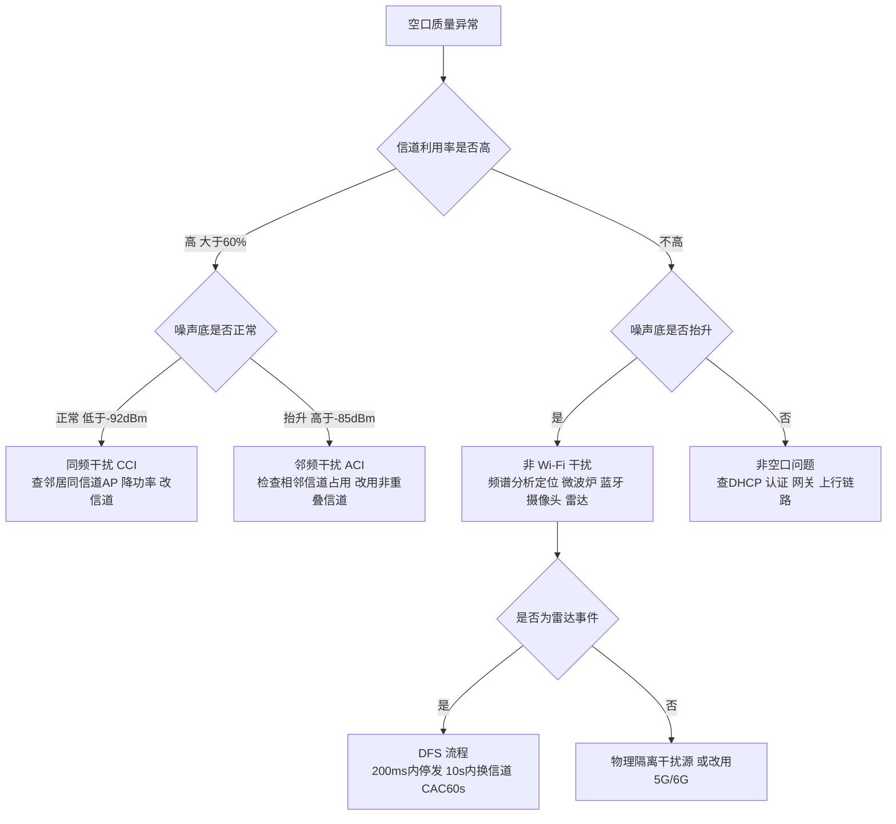

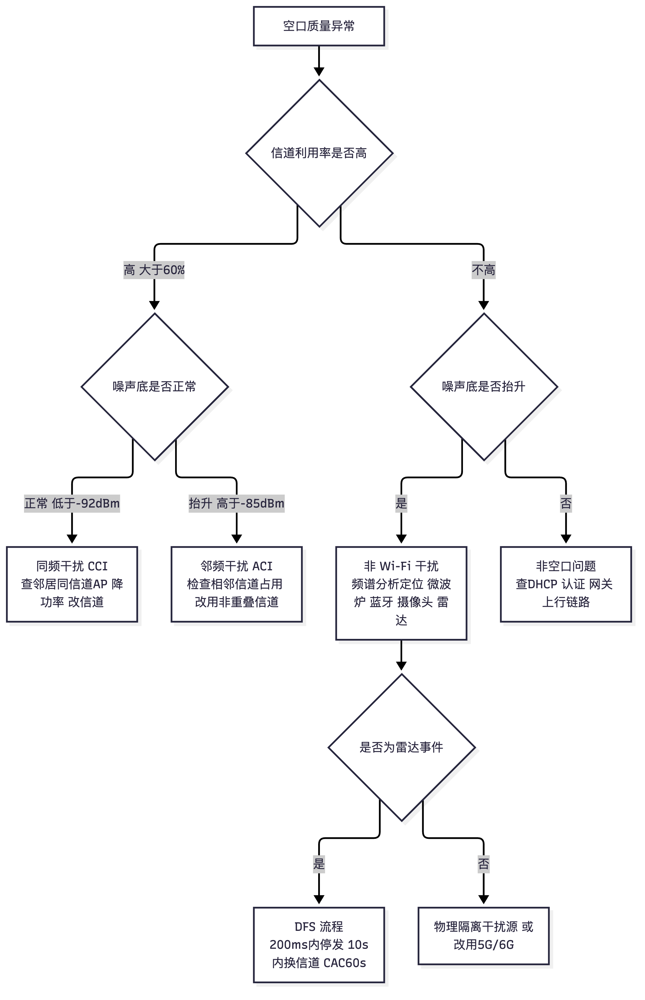


### 真题精练

**Q1.【真题·单选】** 某 AP 的 2.4 GHz 射频读数：信道利用率 28%、重传率 32%、噪声底 −84 dBm。最可能的干扰类型是？
A. 同频干扰  B. 邻频干扰  C. 负载过高  D. 终端故障

> **答案：B**
> **解析**：判据是**三个读数的组合**。利用率只有 28%（不高），说明信道时间上并不拥塞，排除 A 与 C；但重传率 32%（很高）且噪声底 −84 dBm（明显高于健康值 −92 dBm），说明接收质量被"底噪"破坏——这是**邻频干扰**的典型特征：OFDM 旁瓣能量落入本信道，抬升底噪使解调失败而重传。若是同频干扰，会表现为利用率高（因为要互相退让）。若是非 Wi-Fi 干扰，噪声底会更高且常伴随机丢包，需频谱分析确认（本选项未列出）。D 无依据。

**Q2.【真题·多选】** 下列哪些是 2.4 GHz 频段常见的非 Wi-Fi 干扰源？
A. 微波炉  B. 蓝牙耳机  C. 气象雷达  D. 无线摄像头  E. ZigBee 传感器

> **答案：ABDE**
> **解析**：A、B、D、E 均在 2.4 GHz 工作（微波炉在 2450 MHz，蓝牙/ZigBee 为 2.4 GHz 跳频/扩频，无线摄像头大量使用 2.4 GHz）。C 错误，气象雷达工作在 5 GHz 的部分频段（DFS 信道）以及 S/C/X 波段，是 5 GHz 的干扰源，不是 2.4 GHz 干扰源——这是常考的"频段对应"陷阱。

**Q3.【真题·判断】** 只要把 AP 都设置成不同的信道，就不会有干扰了。

> **答案：错误**
> **解析**：① 在 2.4 GHz 上，**物理上只有 1/6/11 三个非重叠信道**，AP 数量超过 3 个就必然同信道复用，"都设成不同信道"根本无法实现；② 即使 5 GHz 有更多信道，信道规划还受**功率、AP 密度、楼层间泄漏**影响，同信道 AP 只要 RSSI 高于 CCA 门限（约 −82 dBm）仍会互相退让；③ 干扰还包括**非 Wi-Fi 干扰**（微波炉、蓝牙、雷达），换信道无法完全规避。正确做法是"信道规划 + 功率规划 + 带宽选择 + 空间复用（BSS Coloring）+ 干扰源物理治理"的组合。

**Q4.【真题·简答】** 请描述 DFS 雷达事件的完整处置流程，并说明为什么时延敏感业务应避开 DFS 信道。

> **答案要点**：
> ① AP 工作在 DFS 信道（如 5 GHz 的 52/56/60/64，部分国家含 100~144）并持续做雷达检测。
> ② 检测到雷达脉冲后，AP **必须在 200 ms 内停止在该信道的发射**（ETSI 法规要求 260 ms 内），这是法规强制要求，不能配置规避。
> ③ AP 在 **10 s 内**（ETSI 的信道移动时间内）**离开该信道**，通告其下的终端，并选择一个新信道。
> ④ 在新信道上执行 **CAC（Channel Availability Check）60 s**（涉及气象雷达的信道为 **600 s**），确认无雷达后才开始发射 Beacon 与接受关联。
> ⑤ 整个过程中该 AP 覆盖范围内的终端会**中断服务**，时长从数秒到一分多钟（含 CAC 时更长）。
> ⑥ **为什么时延敏感业务要避开**：语音通话、工业控制、AGV、远程手术等业务无法接受这种"非计划的、由外部雷达触发的强制中断"，且中断时长不可预测（取决于雷达是否持续出现）。因此这类场景应**把 5 GHz 候选信道限定为非 DFS 信道（36/40/44/48/149/153/157/161），或使用 6 GHz 频段**；若必须使用 DFS 信道，应保证同区域有其他信道的 AP 提供覆盖冗余，让终端能漫游过去。

**Q5.【真题·排错】** 某办公楼每天中午 12:00—13:00 出现 Wi-Fi 明显卡顿，其他时段正常。查看读数：重传率从 8% 升到 35%，噪声底从 −95 dBm 升到 −80 dBm，信道利用率中等到偏高。请分析原因并给出处置方案。

> **答案要点**：
> ① **规律性时间 + 噪声底大幅抬升**是最重要的线索：这与"午休时间茶水间微波炉集中使用"高度吻合（微波炉在 2450 MHz 工作，泄漏可在 2.4 GHz 全段产生强干扰）。
> ② **验证方法**：用 AP 的**频谱分析**功能（`spectrum-analysis enable`）在午间观察干扰源类型与占空比；或临时关闭/移走可疑微波炉再复测噪声底；同时用 Wireshark 抓包看是否存在大量重传与低 MCS 帧。
> ③ **短期处置**：午间把该区域 2.4 GHz 业务引导到 5 GHz（开启 Band Steering 并将 2.4 GHz 功率降低），或调整 AP 位置远离茶水间（≥10 m 且隔墙）。
> ④ **长期处置**：茶水间/休息区附近的 AP 以 **5 GHz 为主载频**，2.4 GHz 只保留最低限度覆盖；微波炉设备做屏蔽或更换低泄漏型号；把 2.4 GHz 的最小接入速率提到 12 Mbps，减少低速重传的放大效应。
> ⑤ **注意区分**：若干扰来自**其他 Wi-Fi**（如隔壁公司），则噪声底不会这么高，而表现为信道利用率高；若来自**蓝牙/无线耳机集中使用**，噪声底会起伏而非稳定抬升。

**Q6.【真题·实验】** 请写出在 AC6805 上开启频谱分析、限定 5 GHz 候选信道为非 DFS 信道、并查看干扰与噪声读数的关键配置与命令。

> **答案要点**：
> ```bash
> system-view
> wlan
>  rrm-profile name rrm-hcie               # 创建/进入射频管理模板
>   spectrum-analysis enable               # 使能频谱分析，用于识别非 Wi-Fi 干扰源
>   noise-floor-threshold -85              # 噪声底超过 -85dBm 触发告警
>   interference-threshold 20              # 干扰率超过 20% 触发告警
>  quit
>  radio-5g-profile name radio5g-hcie      # 创建/进入 5G 射频模板
>   dfa enable                             # 使能 DFS 动态频率选择（避免雷达干扰）
>   channel 36 40 44 48 149 153 157 161    # 候选信道限定为非 DFS，避免雷达事件中断
>  quit
>  # 模板需被 VAP 模板引用并对 AP 下发才生效
> quit
> display wlan ap all radio statistics        # 查看利用率 干扰率 噪声底
> display wlan ap all neighbor                # 查看邻居与同信道重叠
> display wlan ap name AP-01 radio 0 spectrum # 查看频谱分析结果（命令随版本变化）
> display logbuffer | include RADAR           # 检查雷达事件记录
> ```
> 评分要点：① 频谱分析会占用空口时间，应说明"排障期间按需开启"；② 限定信道会减少可用信道数，需说明这是"以容量换稳定"的取舍；③ 所有命令名随版本差异较大，必须注明"以所用版本文档为准"。

### 易错点与排错

1. **把邻频干扰当同频干扰处理**：判据是"噪声底是否抬升"。邻频干扰下换一个"不相邻"的信道才有效，只在同频邻居间做调整没用。
2. **忘记 2.4 GHz 只有 3 个非重叠信道**：任何"2.4 GHz 容量优化"如果建立在"多设几个信道"上都是错的，唯一出路是引导到 5/6 GHz。
3. **把 5 GHz 的 DFS 干扰与 2.4 GHz 干扰源混淆**：雷达是 5 GHz 的干扰源，微波炉/蓝牙是 2.4 GHz 的。
4. **频谱分析长期开启**：频谱分析会占用 AP 的空口时间与 CPU，长期开启会降低性能，应"排障期开启、定位后关闭"。
5. **只看利用率不看噪声**：利用率低但吞吐差，往往就是噪声底抬升（邻频或非 Wi-Fi 干扰）。
6. **排错命令**：`display wlan ap all radio statistics`、`display wlan ap all neighbor`、`display wlan ap name <AP> radio 0 spectrum`、`display wlan ap all interference`、`display logbuffer`（查雷达与干扰告警）。

---

## 1.7 高密度场景部署与 5000 人体育馆设计算例

### 考点定位

本考点是国赛**设计题（压轴）**的主战场，分值 10~15 分，通常给出场馆规模与业务需求，要求给出"AP 数量 + 频段与信道规划 + 关键参数清单 + 验收指标"。易错点：① 把"人数"直接除以"单 AP 带机量"就完事，忽略**并发率、座位密度、上下行差异、场馆结构与覆盖**；② 忘记**高密度场景必须窄带宽、多信道、低功率**；③ 忽略**Beacon/DTIM/最小接入速率**等参数对高密场景的决定性影响。

### 原理精讲

**① 四类典型场景的 AP 布点差异（必背）。**

| 场景 | 空间与用户特征 | 布点方式 | 关键问题 |
|---|---|---|---|
| **体育馆/场馆看台** | 人极密集（1~2 人/m²），座位固定，多为上下行对称少量流量（发朋友圈、短视频、支付） | **定向天线（如 90°×30° 板状）从场地四周向看台覆盖**，或看台顶部侧向覆盖；**不用全向天线**（全向在密集人群中被人体吸收严重，覆盖极差） | 人体吸收导致衰减极大（可达 10~20 dB）、同信道复用距离短、上行噪声抬升（大量终端同时发射） |
| **报告厅/阶梯教室** | 300~800 人，座位固定，**下行大流量**（投屏、直播）或考试（上下行小包） | **吸顶 AP 沿天花纵向等间距布放**，或用定向天线从前方向后覆盖，**前排与后排信号差要控制** | 高并发同一时刻接入（上课同时上线）、Beacon 丢失、DHCP 风暴 |
| **普通教室** | 40~60 人，密度中等，互动教学（小包、低时延、双向） | 每间教室 **1 台放装 AP**（吸顶），相邻教室 AP 降功率避免穿墙互扰 | **穿墙干扰**是主要问题，需降功率 + 信道错开 + 窄带宽 |
| **办公开放区** | 密度低（5~10 m²/人），业务杂、持续吞吐 | **蜂窝状吸顶 AP 等间距布放**（间距 15~25 m），走廊补充覆盖 | 容量与覆盖兼顾；易出现"个别 AP 过载"需要负载均衡 |

**② 高密度场景的关键参数清单（必背，设计题直接抄）。**

| 参数 | 高密推荐值 | 理由 |
|---|---|---|
| 单 AP 并发终端数（设计上限） | **25~40 台**（业务型）；连接数可 60~100 但不保证体验 | 空口时间预算与体验平衡（见 1.4 节算例） |
| 5 GHz 带宽 | **20 MHz（超高密）/ 40 MHz（高密）** | 换取更多非重叠信道，降低 OBSS |
| 2.4 GHz | **只做覆盖兜底，20 MHz，功率比 5G 低 3~6 dB** | 2.4G 只有 3 个信道，无法承载容量 |
| 最小接入速率 | **12 / 24 Mbps**（禁用 1/2/5.5/11） | 防止低速终端拖垮空口 |
| Beacon 间隔 | **200 ms**（默认 100 ms） | 减少管理帧占用；代价是终端发现 AP 略慢、漫游判决稍慢 |
| DTIM 周期 | **3**（默认 1 或 2） | 减少广播/组播唤醒次数；代价是**休眠终端收推送延迟增加**（语音推送、对讲机需谨慎） |
| 终端最大关联数（AC/AP 限制） | 按 AP 型号设定，如 64~128 | 硬性限流，防止单 AP 被人群压垮 |
| 单终端限速 | 下行 4~20 Mbps | 防止个别终端占满空口 |
| 空口目标利用率 | **< 40%** | 留出重传与突发余量 |
| 重传率目标 | **< 10%** | 反映干扰与覆盖质量 |
| 开启特性 | OFDMA、TWT、BSS Coloring、Airtime 公平、Band Steering、智能漫游、负载均衡 | 都是为"多用户效率"服务 |
| 关闭/避免 | 802.11b 保护模式、强制 RTS/CTS、2.4G 40 MHz、11b 速率、DFS 信道（时延敏感） | 减少空口浪费与中断 |
| 认证方式 | 优先 **PSK/802.1X + 快速漫游**，避免 Portal（高密下 Portal 认证风暴） | Portal 在高密同时上线时会击穿认证服务器 |

**③ 5000 人体育馆完整设计算例（国赛必考，要求能默写思路与关键数字）。**

**题目**：某体育馆举办赛事，看台可容纳 5000 名观众（另有内场工作人员 200 人）。业务需求：观众以短视频上传/浏览、社交、支付为主，峰值并发率 70%，人均下行 3 Mbps、上行 2 Mbps；另有 50 路媒体回传（每路 8 Mbps 上行，固定机位）。要求给出 AP 数量、频段带宽与信道规划、关键参数清单、验收指标。

**第一步：需求量化。**

```
峰值并发终端 = 5000 × 70% = 3500 台（观众）+ 200 台（工作人员）≈ 3700 台
观众下行总量 = 3500 × 3 Mbps = 10500 Mbps = 10.5 Gbps
观众上行总量 = 3500 × 2 Mbps = 7000 Mbps = 7 Gbps
媒体回传 = 50 × 8 Mbps = 400 Mbps（上行）
峰值上行合计 ≈ 7.4 Gbps，下行合计 ≈ 10.5 Gbps
```
注意：**上行需求（7.4 Gbps）在高密场景经常成为瓶颈**，因为终端发射功率受限、上行 MCS 低、且大量终端同时竞争，实际上行效率远低于下行。

**第二步：单 AP 有效容量评估。**

场馆使用 **AirEngine 8760（高密场馆型，支持 4×4 或更高空间流，含定向/外接天线方案）**。取 5 GHz，**40 MHz**，考虑人体吸收与上行竞争后，实际可用 MAC 吞吐保守取值：
```
下行有效吞吐 ≈ 500 Mbps/AP（40MHz，4SS，实际 MAC 效率约 40%）
上行有效吞吐 ≈ 250 Mbps/AP（上行效率显著低于下行）
```
**为什么高密取下限值？** 因为场馆中人体吸收（10~20 dB）、大量终端并发竞争、邻区 OBSS 都会显著降低实际效率，按标称速率的 8%~12% 取值是工程惯例。

**第三步：按上行与下行分别计算 AP 数量。**

```
按下行：10500 Mbps ÷ 500 Mbps ≈ 21 台
按上行：7400 Mbps ÷ 250 Mbps ≈ 29.6 台 → 30 台
```

**第四步：按并发终端数（带机量）复核。**

```
3700 台 ÷ 单 AP 30 台（高密设计值）≈ 123 台
```
这一步给出的数字远大于容量计算结果——**说明该场景的约束不是"带机量"而是"上行容量"**。这是一个重要的答题点：**高密场景往往"不是连不上，而是带宽不够"**。

**第五步：按覆盖复核（不可忽略）。**

看台区若按每台 AP 覆盖约 200~300 m² 有效区域（考虑人体遮挡与定向天线），5000 人看台面积约 4000~6000 m²，需要 **20~30 台** AP。与容量计算的 30 台吻合。取 **每 200 名观众 1~1.5 台 AP** 的经验比例（对应 5000 人约 33~38 台）作为设计值。

**第六步：取值与冗余。**

```
取三种约束的最大值：max(21, 30, 30) = 30 台
考虑单 AP 故障冗余与场馆边缘覆盖 → 实际部署 36 台（冗余 20%）
分区：看台分 8 个区域，每区 4~5 台；内场 4 台；入口/通道 4 台
```

**第七步：频段与信道规划。**

```
5 GHz：36 台 AP 需要至少 36/复用度 个非重叠信道
  - 40 MHz 下 5 GHz 中国区可用的非重叠 40 MHz 信道约 5~6 个（含 DFS 8 个左右）
  - 若用 40 MHz 且只用非 DFS：约 4~5 个信道 → 复用度 36/5 ≈ 7，同信道 AP 距离会很近
  - 结论：改用 20 MHz 带宽！20 MHz 非 DFS 信道约 8 个 → 复用度 36/8 = 4.5，同信道 AP 可拉开距离
2.4 GHz：仅用于覆盖兜底与老终端，用 1/6/11 三信道，功率比 5G 低 6 dB
6 GHz（若有 6 GHz AP）：承载媒体的上行回传与部分高价值业务（无 DFS、频谱干净）
```

**关键结论（必须写进答案）**：**高密场馆必须把带宽从 80 MHz 降到 20 MHz**。原因是"复用距离"比"单用户峰值"重要得多：80 MHz 只有很少几个非重叠信道，36 台 AP 必然大量同信道重叠，利用率轻松突破 80%，重传率飙升，最终**每用户实际速率反而更低**。

**第八步：AP 布点与天线选型。**

- **看台**：采用**定向天线（水平 60°~90°、垂直 30°~60°）从看台后方或顶部向观众席投射**，每台 AP 覆盖一个纵向扇区；**严禁使用全向吸顶天线**（人体遮挡严重且同信道泄漏大）。
- **内场与通道**：全向吸顶 AP + 降功率。
- **媒体回传机位**：独立 SSID 绑定独立 AP 或独立射频，走 6 GHz 或独立 5 GHz 信道，避免与观众流量抢空口。
- **供电与上行**：AP 全部 PoE+ / PoE++ 供电，上行采用**多链路上行（2×10GE 或 25GE 到汇聚）**，汇聚双上行到核心，AC 采用 **AirEngine 9700S 双机热备或 AC 集群**（见第 2 章）。

**第九步：关键参数清单（照抄上表的高密列）+ 认证设计。**

- Beacon 200 ms、DTIM 3、最小接入速率 24 Mbps（观众 SSID）/12 Mbps（媒体 SSID）。
- 单终端限速下行 10 Mbps、上行 5 Mbps。
- 开启 OFDMA、TWT、BSS Coloring、Airtime 公平、Band Steering（门限 −65 dBm，因为场馆内 5 GHz 信号普遍较强）、智能漫游、负载均衡（起始 30 台，Gap 10）。
- **认证**：观众 SSID 用 **PSK**（高密下最稳）或 **Portal + 本地快速认证缓存**；**绝对避免 802.1X 与 Portal 造成 3700 台终端同时认证**（认证服务器会成为单点，且认证风暴会让 AP 的 CPU 打满）。媒体 SSID 用 PSK + MAC 白名单。
- **DHCP**：采用**短租期 + 大地址池 + DHCP 中继分布式部署**（每台汇聚交换机本地中继），避免集中式 DHCP 服务器成为瓶颈（详见第 2 章 2.6 节）。

**第十步：验收指标。**

```
单 AP 信道利用率 < 40%，峰值不超过 60%
空口重传率 < 10%
噪声底 < −92 dBm
单终端下行实测 ≥ 15 Mbps（并发场景）、上行 ≥ 5 Mbps
终端接入成功率 > 99%（含并发测试）
漫游切换 < 100 ms，丢包 < 1 包
媒体回传 50 路全部稳定，丢包 < 0.1%
```

### 关键概念对照表

| 场景 | AP 与人数比（经验值） | 天线类型 | 带宽 | 主要瓶颈 |
|---|---|---|---|---|
| 体育馆看台 | 1 AP / 150~250 人 | **定向（60°~90°）** | 20 MHz | 上行容量、人体吸收 |
| 报告厅（800 人） | 1 AP / 80~150 人 | 定向或吸顶阵列 | 20~40 MHz | 同时上下线、Beacon |
| 教室（50 人） | 1 AP / 教室 | 吸顶全向（低功率） | 40~80 MHz | 教室间穿墙干扰 |
| 办公开放区 | 1 AP / 30~50 人 | 吸顶全向 | 40~80 MHz | 个别 AP 过载、负载均衡 |
| 会展/展馆 | 1 AP / 100~200 人 | 定向 + 全向混合 | 20~40 MHz | 突发并发、临时布放 |

| 高密参数 | 默认值 | 高密推荐 | 副作用 |
|---|---|---|---|
| Beacon 间隔 | 100 ms | **200 ms** | 终端发现慢、漫游判决变慢 |
| DTIM 周期 | 1~2 | **3** | 休眠终端推送延迟增加 |
| 最小接入速率 | 1 Mbps | **12~24 Mbps** | 弱信号终端被拒（需沟通） |
| 带宽 | 80 MHz | **20~40 MHz** | 单用户峰值下降 |
| 单 AP 关联上限 | 型号默认 | 显式设定 64~128 | 超限终端无法接入 |
| 频谱分析 | 关 | **排障期开，定位后关** | 占用空口时间 |

### 华为设备配置

```bash
system-view                                        # 进入系统视图
wlan                                               # 进入 WLAN 视图
 ap-group name stadium-stand-a                     # 创建 AP 组（按看台分区划分）
  radio-5g-profile radio5g-stadium                 # 引用高密 5G 射频模板
  radio-2g-profile radio2g-stadium                 # 引用高密 2.4G 射频模板
  vap-profile audience-vap wlan 1                  # 引用观众业务 VAP
  vap-profile media-vap wlan 2                     # 引用媒体回传 VAP
 quit                                                # 退出
 radio-5g-profile name radio5g-stadium             # 高密 5G 射频模板
  channel 20mhz                                     # 关键：降到 20MHz 换取更多非重叠信道
  calibrate disable                                 # 场馆关键射频不参与自动调优，避免业务中断
  # 手动规划信道后固定，保证复用距离可控
  channel 36                                        # 手动指定信道（示例），实际按规划表逐台配置
 quit                                                # 退出
 radio-2g-profile name radio2g-stadium             # 高密 2.4G 射频模板
  channel 20mhz                                     # 2.4G 只用 20MHz
  eirp 9                                            # 2.4G 功率压低（示例值 9dBm），比 5G 低 6dB 左右
  # 具体功率值需按现场勘测与法规确定，以所用版本文档为准
 quit                                                # 退出
 rrm-profile name rrm-stadium                      # 场馆射频管理模板
  ofdma enable                                      # 使能 OFDMA 调度，提升小包多用户效率
  twt enable                                        # 使能 TWT（注意 DTIM/推送业务兼容性）
  bss-color enable                                  # 空间复用着色
  airtime-fair-schedule enable                      # 空口时间公平
  band-steer enable                                 # 频段引导
  band-steer 5g rssi-threshold -65                  # 场馆内 5G 信号强，门限提高到 -65dBm
  load-balance enable                               # 负载均衡
  load-balance start-threshold 30                   # 30 台起拒绝新关联
  smart-roam enable                                 # 智能漫游
 quit                                                # 退出
 vap-profile name audience-vap                     # 观众业务模板
  service-vlan vlan-id 100                          # 观众业务 VLAN
  rate-limit client down 10000                      # 单终端下行限速 10Mbps
  rate-limit client up 5000                         # 单终端上行限速 5Mbps
  # 单位通常为 kbps，以所用版本文档为准
  forward-mode tunnel                               # 观众业务可隧道转发集中管控
 quit                                                # 退出
 vap-profile name media-vap                        # 媒体回传模板
  service-vlan vlan-id 200                          # 媒体专用 VLAN
  forward-mode local                                # 媒体大流量走本地转发，避免隧道成为瓶颈
  # 本地转发需保证 AP 上行口放通对应 VLAN
 quit                                                # 退出
 # ===== 查看高密场景关键读数 =====
display wlan ap all radio statistics                 # 利用率 重传 噪声 干扰
display wlan ap all neighbor                         # 同信道邻居与 RSSI
display wlan client traffic-statistics               # 终端流量分布与限速是否生效
display station assoc-statistics                     # 关联成功率与失败原因统计
```

### 示意图

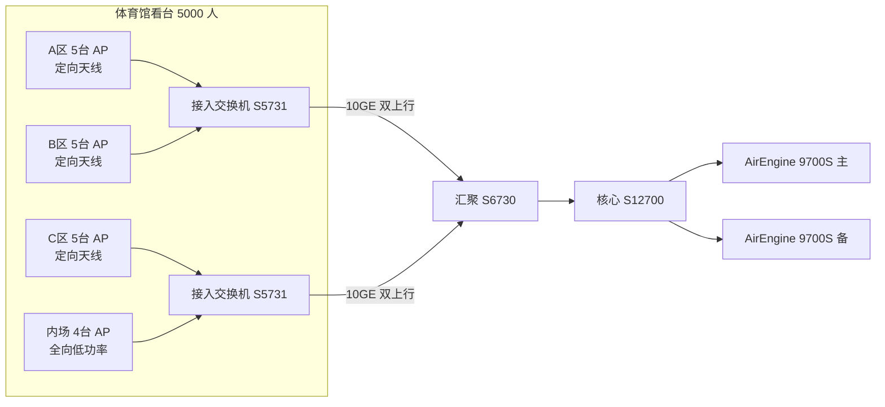

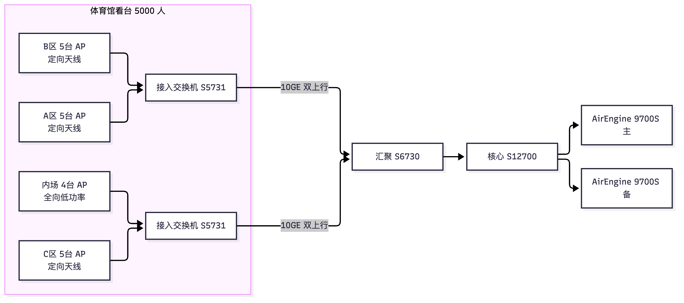


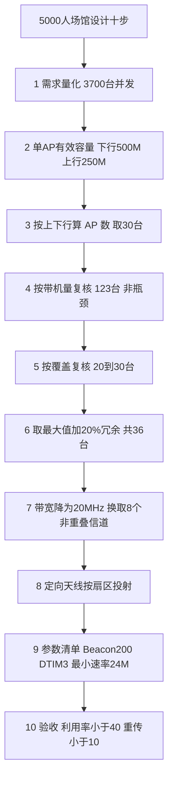

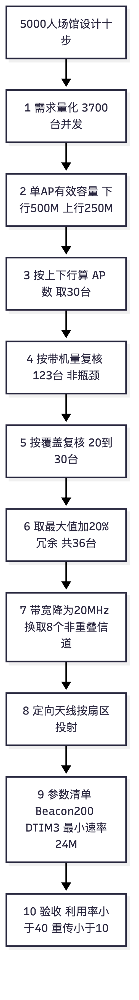


### 真题精练

**Q1.【真题·单选】** 5000 人体育馆设计方案中，5 GHz 频段带宽选择最合理的是？
A. 160 MHz，因为单用户速率最高
B. 80 MHz，业界主流配置
C. **20 MHz**，因为需要尽可能多的非重叠信道来支撑几十台 AP 的复用
D. 2.4 GHz 与 5 GHz 混用 40 MHz

> **答案：C**
> **解析**：高密场景的设计目标是**空口复用距离最大化**而非单用户峰值速率。160 MHz 在 5 GHz 几乎没有几个可用信道，36 台 AP 会造成极端 OBSS；80 MHz 也只有 4~5 个非重叠信道，仍不足；**20 MHz 可提供约 8 个（非 DFS）至 15 个以上（含 DFS）非重叠信道**，才能让 36 台 AP 以可接受的复用距离排布。D 错在 2.4 GHz 只有 3 个非重叠信道且 40 MHz 在 2.4G 上等于放弃规划。

**Q2.【真题·多选】** 高密度场馆场景下，下列参数设置合理的有？
A. Beacon 间隔由 100 ms 调整为 200 ms
B. DTIM 周期由 1 调整为 3
C. 最小接入速率设为 1 Mbps 以兼容所有终端
D. 关闭 802.11b 保护模式
E. 开启 OFDMA、TWT 与 BSS Coloring

> **答案：ABDE**
> **解析**：A 正确，减少管理帧占用空口。B 正确，减少广播/组播唤醒次数；但要说明副作用（休眠终端推送延迟增加，对讲/语音类业务需谨慎）。C 错误，1 Mbps 会让 ACK 与管理帧以最低速率发送，**整个空口效率被摧毁**，高密场景必须提高到 12~24 Mbps（代价是弱信号终端被拒，需要提前沟通）。D 正确。E 正确，三者都是为多用户效率服务，OFDMA 提升小包并发、TWT 减少无效竞争、BSS Coloring 提升空间复用。

**Q3.【真题·判断】** 高密度场馆应优先使用全向吸顶天线，因为可以覆盖更均匀。

> **答案：错误**
> **解析**：高密看台场景人体密集，**人体对 2.4/5 GHz 的衰减可达 10~20 dB**，全向天线的能量向四面八方辐射，真正到达观众的功率很低且被前排人体大量吸收，导致后排信号极差；同时全向天线会把信号泄漏到相邻区域，加剧 OBSS。正确做法是使用**定向天线（水平 60°~90°、垂直 30°~60°）从看台后方或顶部向观众席定向投射**，把能量集中到有人的方向，同时控制泄漏。内场、通道等低密区域才用全向吸顶 AP。

**Q4.【真题·简答】** 请说明为什么高密场景下"上行容量"常常比"下行容量"更早成为瓶颈，以及有哪些优化手段。

> **答案要点**：
> ① **终端发射功率受限**：受法规与电池限制，手机/平板的发射功率通常 15~18 dBm，远低于 AP（可达 20~27 dBm 甚至更高），因此上行到达 AP 的 SNR 明显低于下行到达终端的 SNR，**上行协商到更低的 MCS**，占用更多空口时间。
> ② **上行是"多对一"竞争**：下行只有 AP 一个发射者，可以靠 OFDMA/MU-MIMO 高效调度；上行是几百上千台终端**各自独立竞争并同时发射**，AP 处的噪声底被大量终端的发射抬高（上行噪声抬升，可达 5~15 dB），且无法完全消除竞争开销。
> ③ **上行冲突与重传放大**：终端彼此听不到（隐藏节点），冲突概率高于下行，重传进一步消耗空口。
> ④ **优化手段**：一是**用 OFDMA + 触发帧集中调度上行**（11ax 起），把随机竞争改为 AP 统一分配 RU；二是**开启 UL MU-MIMO** 让多终端同时同频发送；三是**提升上行效率参数**：提高上行最小速率、限制上行单终端速率、启用 Airtime 公平；四是**减少上行数据量**：应用侧优化（图片压缩、错峰上传）、单终端上行限速；五是**增加上行容量设施**：提高 AP 密度（但需权衡干扰）、把媒体回传等大上行业务放到**独立频段/独立 AP**（如 6 GHz）；六是**物理层改善**：优化 AP 天线朝向与下倾角，减少人体遮挡带来的上行损耗。

**Q5.【真题·设计】** 某 800 人报告厅，主要用于大型讲座直播（下行 4 Mbps/人）与现场互动（上行小包、低时延）。峰值并发率 90%。请给出 AP 数量计算过程与关键参数设计。

> **答案要点**：
> ① **需求量化**：并发终端 = 800 × 90% = **720 台**；下行总量 = 720 × 4 = **2880 Mbps**；上行以互动小包为主，按 0.5 Mbps/人估 = **360 Mbps**。
> ② **单 AP 有效容量**（Report hall，人体密集、视线良好）：取 5 GHz **40 MHz**，下行有效约 **500 Mbps**，上行有效约 **250 Mbps**。
> ③ **按容量算**：下行 2880 ÷ 500 ≈ **6 台**；上行 360 ÷ 250 ≈ **2 台**。
> ④ **按带机量算**：720 ÷ 30（高密设计值）= **24 台**。
> ⑤ **按覆盖算**：800 人报告厅约 600~800 m²，吸顶/定向覆盖约每台 100~150 m²（考虑人体遮挡）→ **6~8 台**。
> ⑥ **取值**：max(6, 2, 24) = **24 台**，加 20% 冗余 → **28~30 台**。**注意这里的决定因素是带机量而非带宽**，因为直播下行虽然单人体量大但 AP 密度必须足够高才能承载 720 台终端的并发竞争。
> ⑦ **关键参数**：5 GHz 用 **40 MHz**（报告厅面积集中、AP 间距小，若外场干扰大则降到 20 MHz）；2.4 GHz 仅兜底、功率低 6 dB；最小接入速率 **24 Mbps**；Beacon **200 ms**；DTIM **3**（若现场有互动终端需要实时推送，DTIM 降为 2）；开启 OFDMA、TWT、BSS Coloring、Airtime 公平、负载均衡（起始 25 台）、Band Steering（门限 −65 dBm）；单终端限速下行 10 Mbps/上行 3 Mbps。
> ⑧ **认证与地址**：直播场景建议 **PSK 或预共享 + MAC 白名单**，避免 720 台终端同时做 802.1X/Portal 认证造成认证风暴；DHCP 采用**短租期（1~2 小时）+ 本地中继 + 大地址池**。
> ⑨ **验收**：单 AP 利用率 < 40%，重传 < 10%，单终端下行实测 ≥ 20 Mbps，Ping 抖动 < 20 ms；直播 720 路并发无花屏。

**Q6.【真题·排错】** 某体育馆赛事期间，观众普遍反映"能连上 Wi-Fi 但几乎不能上网，朋友圈图片发不出去"。后台显示各 AP 的 2.4 GHz 利用率 90%+、5 GHz 利用率 35%，`display wlan ap all radio statistics` 显示 2.4 GHz 重传率 45%。请给出诊断与处置。

> **答案要点**：
> ① **诊断**：典型的**"终端全挤在 2.4 GHz"**问题。5 GHz 利用率仅 35% 说明容量有富余，2.4 GHz 利用率 90% + 重传 45% 说明 2.4 GHz 已被打爆。原因可能是未开启 Band Steering、或 2.4 GHz 功率远高于 5 GHz、或 5 GHz 上存在大量 DFS 退避导致实际可用信道少，使终端更难连上 5 GHz。
> ② **紧急处置（赛事中）**：立即把 2.4 GHz 的发射功率降低 6~10 dB（缩小 2.4 GHz 覆盖，迫使终端倾向 5 GHz）；开启或强化 **Band Steering**（门限设为 −65 dBm，因场馆内 5 GHz 信号较强）；提高 2.4 GHz 最小接入速率到 24 Mbps 并限制单终端速率，快速降低 2.4 GHz 的无谓占用。
> ③ **根因排查**：检查 5 GHz 候选信道是否被限定在很少的几个（尤其是否因雷达事件频繁退避）；检查 5 GHz 是否被误配为窄带宽且 AP 数不足；检查是否因 2.4 GHz 功率过高造成"5 GHz 覆盖空洞"（终端在 5 GHz 信号弱的地方只能连 2.4 GHz）。
> ④ **长期整改**：按 1.7 节算例重新做频段与信道规划，2.4 GHz 只保留覆盖兜底功能（功率比 5 GHz 低 6 dB、只开 1/6/11、20 MHz）；5 GHz 用 20 MHz 带宽增加非重叠信道；观众 SSID 关闭低速速率；对已在线终端启用**智能漫游**把它从 2.4 GHz 迁到 5 GHz。
> ⑤ **验证**：2.4 GHz 利用率降至 < 40%，5 GHz 利用率上升至 40%~60%，2.4 GHz 重传率降至 < 15%，终端上行业务恢复正常。

### 易错点与排错

1. **高密设计只算"人数 ÷ 单 AP 带机量"**：必须按"容量、带机量、覆盖"三约束取最大，并说明哪个是瓶颈。体育馆的瓶颈常是**上行容量**，报告厅常是**带机量**。
2. **忘记人体吸收与上行噪声抬升**：这是高密场景与普通办公区最大的物理差异，答题时必须提及。
3. **带宽选择写成"越宽越好"**：高密必须**窄带宽换信道数**，这是最容易被扣分的地方。
4. **Beacon/DTIM 只调不小**：Beacon 增大到 200 ms、DTIM 增大到 3 都有副作用（发现慢、推送延迟），答题要写出代价。
5. **忽略认证与 DHCP 的并发冲击**：几千台终端同时上线时，Portal/802.1X 认证与集中 DHCP 往往先崩，而不是空口先崩。高密场景应优先 PSK + 本地中继 DHCP。
6. **排错命令**：`display wlan ap all radio statistics`（分频段利用率/重传/噪声）、`display wlan ap all neighbor`、`display wlan client verbose`（终端所在频段与 RSSI/MCS）、`display wlan client traffic-statistics`（流量与限速）、`display station assoc-statistics`（关联成功率与失败原因）。

---

## 1.8 空口抓包、射频 Ping 与空口质量指标定位

### 考点定位

本考点通常以**实验题或排错题**形式出现，考查"会不会用华为工具做空口层的定位"，分值 4~8 分。易错点：① 不知道 AirEngine AP 支持**内置空口抓包**（无需外置网卡监听）以及抓包会消耗 AP 资源；② 不知道**射频 Ping**能测什么、不能测什么；③ 拿到利用率/噪声/重传/丢包四个指标不会**按链路顺序建模分析**。

### 原理精讲

**① AirEngine 内置空口抓包。**

华为 AirEngine 系列 AP 支持在 AP 本地对空口报文做抓包，并将 pcap 文件导出。相比"笔记本网卡监听模式抓包"，内置抓包有三个优势：**能抓到 AP 视角的上行帧**（包括终端发往 AP 的帧与重传帧）、不受监听网卡天线与驱动限制、可按**终端 MAC、帧类型、信道**过滤。代价是：**占用 AP 的 CPU 与内存**，长时间大流量抓包可能导致 AP 转发性能下降甚至丢包，因此必须**限定时间（数分钟）与过滤条件**，抓完立即停止并导出。

抓包在定位中的典型用途：确认终端是否发了 Probe Request / Association Request（判断是终端侧还是网络侧问题）、确认认证握手是否完成（EAPOL 帧数）、统计重传帧与 ACK 缺失、观察管理帧风暴（大量 Probe 或 Deauth）、分析漫游过程（Reassociation Request 的时序与耗时）。

**② 射频 Ping（Radio Ping）。**

"射频 Ping"是 AC/AP 提供的**空口链路诊断工具**，本质是让 AP 在**特定速率与空间流**上向目标终端发送测试帧并统计往返时间与丢包，或在特定信道上向邻居 AP 发测试帧。它能回答三类问题：
- **空口可达性与质量**：终端在某个 MCS/带宽下的丢包率与 RTT 分布。
- **覆盖验证**：在不同位置测得的丢包与 RTT，反推是否达到设计覆盖。
- **区分"空口问题"与"上层问题"**：如果射频 Ping 正常而业务不通，则问题在 DHCP/认证/网关/路由等上层。

**射频 Ping 的局限**：它是 AP 发起的测试流量，**不代表真实业务的双向对称性**（尤其上行方向终端发射能力未被充分验证）；且高负载时空口本已拥塞，射频 Ping 的丢包可能来自拥塞而非覆盖。

**③ 空口质量四指标与"链路顺序建模"（必背的分析框架）。**

| 指标 | 含义 | 健康值 | 异常时指向 |
|---|---|---|---|
| **信道利用率**（Channel Utilization） | 信道处于"忙"的时间占比 | < 40% | 高 → 同频干扰、终端过多、低速终端拖累、非 Wi-Fi 干扰 |
| **噪声底**（Noise Floor） | 信道背景噪声功率 | < −92 dBm | 高 → 邻频干扰、非 Wi-Fi 干扰（微波炉/蓝牙/雷达） |
| **重传率**（Retry Rate） | 重传帧数 ÷ 总帧数 | < 10% | 高 → 冲突/干扰/覆盖不足/上下行不对称 |
| **丢包率**（Packet Loss） | 未成功送达的帧占比 | < 1% | 高 → 重传耗尽、漫游掉线、上层拥塞 |

**分析必须按"从物理层到应用层"的顺序走**，这是拿满分的答题框架：

```
第 1 层 射频覆盖：终端 RSSI/SNR 是否达标（RSSI ≥ -65 ~ -70 dBm，SNR ≥ 25 dB）
第 2 层 空口质量：利用率、噪声底、重传率是否健康
第 3 层 接入与认证：关联成功率、认证耗时、IP 获取（DHCP）
第 4 层 转发与策略：VLAN/网关/ACL/NAT/转发模式
第 5 层 应用与端侧：DNS、服务器、终端自身问题
```

**④ 结合抓包与射频 Ping 的排错范式。**

- **现象：终端连不上** → 内置抓包看是否收到 Probe Request（没收到 = 终端或射频问题；收到了没回 = AP 侧配置/资源问题）；看 Association Request/Response 的 Status Code；看认证帧是否完成。
- **现象：连上了但不能上网** → 射频 Ping 测空口是否通；`display wlan client verbose` 看是否拿到 IP；查 DHCP 与网关、查 VAP 的转发模式与上行 VLAN 放通。
- **现象：时通时断** → 抓包看是否有 Deauth/Disassoc 帧（原因码指向什么，如 15 = 4-way handshake timeout、2 = previous auth invalid）；查漫游是否失败、是否低速率踢除、是否 AP 过载拒绝。
- **现象：速率低** → `display wlan ap name <AP> radio 0 statistics` 看速率分布与重传；`display wlan client verbose` 看协商 MCS/带宽/流数；判定是覆盖、干扰还是终端能力问题。

### 关键概念对照表

| 诊断手段 | 能回答的问题 | 局限/代价 |
|---|---|---|
| AP 内置空口抓包 | 帧级证据：是否发探测、关联/认证是否完成、重传与 Deauth 原因 | 占 AP CPU/内存，需限时限过滤 |
| 射频 Ping | 空口可达性、某 MCS/带宽下的丢包与 RTT | 不代表真实双向业务，高负载下结果受拥塞影响 |
| `display wlan client verbose` | 终端协商协议/带宽/流数/MCS/RSSI/SNR/所在 AP | 只是瞬时快照 |
| `display wlan ap all radio statistics` | 利用率/干扰率/噪声底/重传统计 | 粒度较粗，需结合邻居信息 |
| 频谱分析 | 非 Wi-Fi 干扰源类型与占空比 | 占空口时间，建议排障期开启 |
| 邻居扫描 | 同信道/邻信道 AP 与 RSSI | 仅 Wi-Fi 侧信息 |
| 外部频谱仪/监听网卡 | 精确频谱与第三方抓包 | 需额外设备与现场配合 |

### 华为设备配置

```bash
system-view                                        # 进入系统视图
wlan                                               # 进入 WLAN 视图
 # ===== AP 内置空口抓包（AirEngine 系列 AP 支持，命令名与参数随版本差异大）=====
 ap name AP-01                                      # 进入指定 AP 视图
  # 典型流程：指定抓包接口/射频、过滤条件、抓包文件与时长，然后启动
  # 下面为示意性命令结构，务必以所用版本文档的 AP 抓包章节为准
  # packet-capture radio 0 channel 36 duration 120 filter sta-mac 0024-xxxx-xxxx
  # packet-capture start / stop / export
  # 抓包期间 AP 转发性能会有下降，务必限定时长（建议 2~5 分钟）并及时停止导出
 quit                                                # 退出 AP 视图
 # ===== 射频 Ping（空口链路诊断，命令名随版本变化）=====
 wlan
  # 典型用途：让 AP 在指定速率下向目标发测试帧，统计丢包与 RTT
  # radio-ping ap name AP-01 sta-mac 0024-xxxx-xxxx rate 24 count 100
  # 结果解读：丢包率 < 1%、RTT 稳定说明空口链路正常，问题在上层
 quit                                                # 退出
 # ===== 空口质量四指标采集（最常用的四条）=====
display wlan ap all radio statistics                 # 利用率 干扰率 噪声底
display wlan ap name AP-01 radio 0 statistics        # 单射频收发包 重传 速率分布
display wlan client verbose                          # 终端 RSSI SNR MCS 带宽 流数
display station assoc-statistics                     # 关联成功率与失败原因
 # ===== 空口抓包相关的日志与告警 =====
display logbuffer                                    # 查看 Deauth 认证失败 雷达 干扰等日志
display trapbuffer                                   # 查看告警（利用率和干扰阈值告警）
```

### 示意图

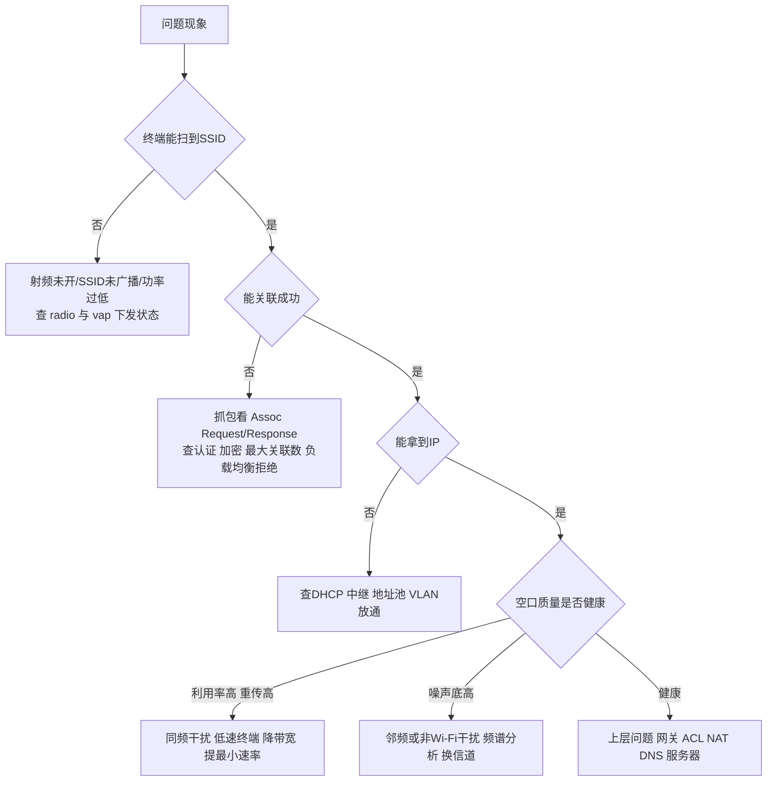

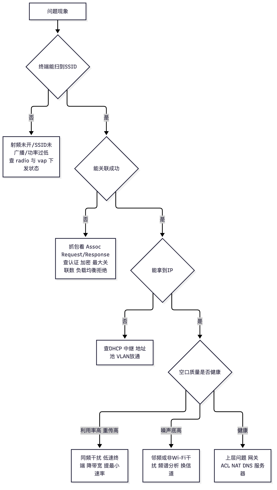


### 真题精练

**Q1.【真题·单选】** 关于 AirEngine AP 的内置空口抓包，下列说法正确的是？
A. 可以长期开启，不影响 AP 性能
B. 抓包占用 AP 的 CPU 与内存，应限定时长与过滤条件，抓完立即停止
C. 只能抓 AP 发往终端的下行帧，抓不到上行帧
D. 抓包文件只能在 AP 本地查看，无法导出分析

> **答案：B**
> **解析**：内置抓包的最大优势恰恰是**能抓到 AP 视角的上行帧**（C 错），并且支持导出 pcap 到外部用 Wireshark 分析（D 错）。但抓包会占用 AP 的 CPU 与内存，**长时间大流量抓包会降低 AP 转发性能甚至丢包**（A 错），因此必须限定时间（数分钟）与过滤条件（按 STA MAC、帧类型、信道），抓完立即停止并导出。这是实验题中常考的"操作规范"考点。

**Q2.【真题·多选】** 下列哪些指标可以用来区分"同频干扰"与"非 Wi-Fi 干扰"？
A. 信道利用率  B. 噪声底  C. 重传率  D. SSID 数量  E. 终端的 MAC 地址厂商

> **答案：ABC**
> **解析**：同频干扰表现为**利用率高 + 重传高 + 噪声底正常**（因为对方是合法的 802.11 信号，能量检不出来但会互相退让）；非 Wi-Fi 干扰表现为**噪声底显著抬升 + 重传高 + 利用率可能不高**。因此三者组合是判据。D 的 SSID 数量只能说明周围 Wi-Fi 数量，不能区分干扰类型（隐藏 SSID 与干扰源都不会出现在扫描列表里）。E 与干扰类型无关。

**Q3.【真题·判断】** 只要射频 Ping 不丢包，就说明用户上网慢的问题不是无线侧造成的。

> **答案：错误**
> **解析**：射频 Ping 是 AP 主动发起的小流量测试，**不能代表真实业务的负载特征**：① 真实场景是同信道大量终端并发竞争，Ping 时不拥塞、真业务时可能拥塞；② 射频 Ping 主要验证下行方向的可达性，**上行方向的终端发射能力、隐藏节点冲突、上行噪声抬升都没有被验证**；③ Ping 包小，不触发聚合与 OFDMA 调度，验证不到 MAC 层效率问题。因此"射频 Ping 正常"只能排除"空口完全不通/严重丢包"，**不能排除空口拥塞导致的慢**，必须结合利用率、重传率与终端协商速率综合判断。

**Q4.【真题·简答】** 某用户投诉"办公室 Wi-Fi 经常几秒钟断一次，然后自动恢复"。请写出你的空口定位步骤与使用的命令。

> **答案要点**：
> ① **第一步：确认覆盖与空口质量。** `display wlan client verbose` 看该终端所在 AP 的 RSSI/SNR/协商 MCS；`display wlan ap all radio statistics` 看所在射频的利用率、重传率、噪声底。若 RSSI < −70 dBm 或 SNR < 20 dB → 覆盖问题。
> ② **第二步：抓空口包看断线原因。** 用 AP 内置抓包（限定该终端 MAC、时长 2~3 分钟）观察是否有 **Deauthentication/Disassociation 帧**及**原因码（Reason Code）**：
> - Reason Code 15（4-Way Handshake Timeout）→ 密钥协商失败，常见于终端驱动兼容性、密钥更新周期过短、PMK 缓存不一致；
> - Reason Code 2（Previous auth no longer valid）→ 认证状态失效；
> - 由 AP 主动发起的 Deauth 且伴随"关联数超限/负载均衡拒绝"→ 需检查 `load-balance` 与最大关联数；
> - 大量 Deauth 且间隔规律（如每 5 分钟）→ 检查是否 **WIDS/WIPS 反制**（把正常终端误判为攻击而反制）。
> ③ **第三步：检查漫游与踢除策略。** 是否开启了"低速率终端踢除/老化"、智能漫游门限是否设置过激（导致终端反复被赶走）、是否存在**漫游粘滞与乒乓**（在两台 AP 之间反复切换）。
> ④ **第四步：检查非空口因素。** 认证服务器（RADIUS）不可达会导致周期性掉线重连；DTIM 周期过大导致休眠终端错过下行缓存；ARP/网关问题导致终端误判"无 Internet"而主动重连。
> ⑤ **第五步：验证。** 调整后复抓包确认 Deauth 消失，`display station assoc-statistics` 关联成功率 > 99%，终端 Ping 连续 10 分钟无中断。

**Q5.【真题·排错】** 某教室 AP 的读数：信道利用率 12%、重传率 8%、噪声底 −78 dBm、终端协商速率仅 24~36 Mbps（终端为 2×2 11ac，本应能协商到 400 Mbps+）。请分析原因并给出处置方向。

> **答案要点**：
> ① **关键异常是噪声底 −78 dBm**（健康值应 < −92 dBm），利用率与重传率都正常，说明**不是拥塞而是底噪破坏了解调质量**。
> ② **噪声底抬升 14 dB 的典型来源**：a) **邻频干扰**（相邻教室的 AP 使用了相邻信道且功率较高，OFDM 旁瓣落入本信道）；b) **非 Wi-Fi 干扰**（教室里的无线麦克风、无线投屏器、蓝牙音箱集中使用）；c) **同教室若有多个 AP 或射频同时工作**（如 2.4G 与 5G 距离过近）。
> ③ **对速率的影响机理**：底噪抬高使 SNR 下降，速率自适应（Rate Adaptation）为避免误码主动降 MCS 与带宽，因此协商速率从 400 Mbps+ 掉到 24~36 Mbps。**"信号强但速率低"就是 SNR 被噪声吃掉的典型表现。**
> ④ **定位手段**：开启 `spectrum-analysis enable` 做频谱分析，判断是 802.11 邻频还是非 Wi-Fi 干扰；`display wlan ap all neighbor` 检查相邻教室 AP 的信道与 RSSI；用 AP 内置抓包观察重传与低 MCS 帧的分布；必要时临时关闭相邻 AP 或无线麦克风做对照测试。
> ⑤ **处置方向**：把相邻教室 AP 改为**非重叠信道**（5 GHz 用 36/44/52/60 等错开，2.4 GHz 用 1/6/11）；**降低相邻 AP 的功率**以减少穿墙泄漏（教室场景这是最有效的动作）；把无线麦克风/投屏器改用 5 GHz 或专用频段；开启 **BSS Coloring** 提升空间复用容忍度；检查是否可把教室 AP 带宽从 80 MHz 降到 40 MHz 以减少被邻频覆盖的概率。

### 易错点与排错

1. **把抓包当"长期监控"**：内置抓包必须限时限过滤，长期开启会拖垮 AP。
2. **只看利用率不看噪声底**：利用率低但速率低、重传高，几乎都是噪声底问题（邻频或非 Wi-Fi 干扰）。
3. **射频 Ping 通过就断定"无线没问题"**：射频 Ping 不覆盖上行对称性与拥塞场景。
4. **不看 Deauth 原因码**：原因码是断线类问题的最强证据，必须记住常用几个（2、15、1、7、6）。
5. **把 WIDS/WIPS 反制误判为设备故障**：反制会让正常终端周期性掉线，排查时必须确认 WIDS 是否开启与是否有误判。
6. **排错命令**：`display wlan client verbose`、`display wlan ap all radio statistics`、`display wlan ap name <AP> radio 0 statistics`、`display station assoc-statistics`、`display logbuffer`、`display trapbuffer`。

---

# WLAN-HCIE-章节2-大型园区WLAN组网与高可靠性

## 2.1 大型园区 WLAN 的分层组网设计

### 考点定位

本考点是国赛**方案设计题的开篇**，通常要求"画出大型园区 WLAN 三层组网拓扑并说明各层职责、AC 部署位置选择"。分值 6~10 分。易错点：① 分不清 **AC 旁挂**与 **AC 直连（串联）** 的适用场景；② 不知道 AC 在大型园区中通常应部署在**核心层旁挂**而非汇聚层；③ 忽略 **AP 管理网段**与业务网段的分离规划。

### 原理精讲

**① 大型园区 WLAN 的三层组网结构。**

大型园区（多楼栋、多楼层、数千至数万 AP）的 WLAN 组网遵循与有线园区一致的**接入—汇聚—核心**三层结构，但增加了 AC 这个"旁挂控制面"：

- **接入层**：由 PoE 接入交换机（如 CloudEngine S5731 系列，支持 PoE/PoE+）组成，为 AP 提供**供电与接入**。每台接入交换机下挂若干 AP（通常 10~24 台，取决于端口数与 PoE 功率预算）。接入交换机需要放通 **AP 管理 VLAN**（AP 获取 IP 与 CAPWAP 上线）与**业务 VLAN**（本地转发时）。
- **汇聚层**：由汇聚交换机（如 CloudEngine S6730 系列）组成，负责**楼层/楼栋内的流量收敛**、VLAN 终结（若采用集中转发则汇聚只做二层透传，业务 VLAN 在核心或 AC 终结）、以及跨楼栋的**路由边界**。在大型园区中，汇聚层常作为 **AP 管理网段的三层网关**（AP 的 DHCP 中继与网关放在这里，避免核心层承担大量 AP 管理流量）。
- **核心层**：由高端交换机（如 CloudEngine S12700 系列）组成，负责**各汇聚区之间的高速转发**与**与 AC/DHCP/RADIUS/出口的互联**。核心层必须**双机（CSS/iStack 集群）** 保证可靠性。
- **AC 的位置**：AC 在控制面上管理 AP（CAPWAP 隧道），在数据面上可以承接业务流量（隧道转发）或只做控制（本地转发）。大型园区中 AC 通常**旁挂在核心层**，理由见下文。

**② AC 的三种部署位置对比（必考）。**

| 部署方式 | 拓扑位置 | 数据路径 | 优点 | 缺点与适用场景 |
|---|---|---|---|---|
| **旁挂（推荐）** | AC 旁挂在核心交换机（或汇聚）的一侧，与核心之间走三层路由；AP 的 CAPWAP 报文经核心转发到 AC | 隧道转发：业务流量 AP→AC→核心；本地转发：业务流量 AP→接入/汇聚→核心，不经过 AC | **不改变原有网络拓扑**（AC 故障不影响有线转发）；AC 可集中部署在机房便于维护；扩容只需增加 AC 而无需改动链路 | AC 与核心之间链路需承载全部隧道流量（需 10GE/25GE 互联与链路聚合）；业务路径可能绕行（需合理规划本地转发） |
| **直连（串联）** | AC 串接在核心与汇聚之间（AC 作为汇聚/核心之间的二层或三层节点） | 业务流量必然经过 AC | 数据路径直观、AC 可做集中策略与安全控制 | **AC 成为串联单点**（AC 故障则全楼层断网）；AC 的转发性能成为瓶颈；扩容需改动链路，**不推荐用于大型园区** |
| **集群（AC Cluster）** | 多台 AC 组成集群，旁挂在核心（详见 2.3 节） | 隧道可在集群内多台 AC 之间分布；业务流量按转发模式走 | **突破单台 AC 容量上限**、容量与可靠性兼得、AP 可在集群内重新归属 | 配置与排错复杂度高；需同型号同版本；需规划集群内互联网络 |

**结论（答题模板）**：**大型园区推荐"核心层旁挂 AC + AC 双机热备或 AC 集群"**，接入层只做 PoE 接入与二层透传，汇聚层做楼栋内收敛与 AP 管理网段网关，核心层做高速互联与 AC/DHCP/认证服务器接入。

**③ 转发模式的选择（与 2.6 节的混合部署策略呼应）。**

- **隧道转发（集中转发）**：AP 把业务报文封装在 CAPWAP 数据隧道里送到 AC，由 AC 解封装后进入业务 VLAN。优点是**策略集中、AP 位置无关、便于跨网段统一管控**；缺点是**AC 与核心之间的链路承载全部业务流量，AC 成为性能瓶颈与流量汇聚点**。
- **本地转发**：AP 本地把业务报文（带 VLAN Tag）直接送入接入交换机，AC 只处理 CAPWAP 控制隧道与管理流量。优点是**业务流量不经过 AC，路径短、时延低、AC 容量压力小**；缺点是**策略控制分散、AP 上行链路必须放通业务 VLAN、跨三层漫游时需要特别处理**。

大型园区的典型做法是**混合部署**：管理类/访客类业务用隧道转发集中管控，高带宽业务（视频监控、媒体、IoT 大数据）用本地转发（详见 2.6 节）。

**④ AP 管理网段的规划要点。**

- **独立 VLAN 与网段**：AP 管理网段必须与业务网段、用户网段分离（例如 AP 管理用 10.10.0.0/16 或按楼栋细分 10.10.<楼栋>.0/24）。
- **地址容量**：按"AP 数量 × 1.5~2"规划地址数（考虑备用与替换），并预留 DHCP 中继与 Option 43 的能力。
- **网关位置**：大型园区建议把 AP 管理网段的**三层网关放在汇聚层**（每楼栋一个 SVI），避免所有 AP 管理流量上核心，减轻核心压力。
- **DHCP 部署**：AP 管理地址建议由**汇聚交换机本地 DHCP 或分布式 DHCP 服务器**分配，通过 **Option 43** 下发 AC 的 IP 地址（见 HCIA 册的 AP 发现机制）。**不要把所有 AP 的 DHCP 集中在一台服务器上**，否则 DHCP 服务器故障或性能瓶颈会导致大规模 AP 无法上线。
- **AC 源接口**：AC 上必须配置 `capwap source interface` 指定 CAPWAP 源接口（通常为 Loopback 或与核心互连的 VLANIF），该地址必须**全网可达**且被 AP 能访问到。

**⑤ 各层职责速查（答题要点表）。**

| 层次 | 设备（示例） | 主要职责 | WLAN 相关关键配置 |
|---|---|---|---|
| 接入层 | S5731（PoE+） | AP 供电与二层接入 | 放通 AP 管理 VLAN；本地转发时放通业务 VLAN；PoE 功率预算 |
| 汇聚层 | S6730 | 楼栋内收敛、AP 管理网段网关、DHCP 中继 | AP 管理 SVI + DHCP 中继（Option 43 指向 AC）；上下行链路聚合 |
| 核心层 | S12700（CSS 集群） | 高速互联、AC/DHCP/RADIUS/出口接入 | 与 AC 互连的三层链路；VLAN/路由边界；策略 |
| 控制面 | AC6805 / AirEngine 9700S（旁挂） | AP 管理、射频管理、漫游、认证代理、QoS 策略 | capwap source interface、wlan 模板、VRRP+HSB、漫游组 |
| 服务面 | DHCP / RADIUS / Portal / DNS | 地址分配、认证、准入 | Option 43（AP 发现 AC）、RADIUS 冗余 |

### 关键概念对照表

| 对比维度 | 旁挂 AC | 直连（串联）AC | AC 集群 |
|---|---|---|---|
| AC 故障影响 | 仅影响 AP 管理与隧道转发业务（本地转发业务不受影响） | **全楼层断网** | 集群内其他 AC 接管，业务影响小 |
| 拓扑改动 | 不改动原有链路 | 需改动核心—汇聚链路 | 需新增集群互联网络 |
| 扩容方式 | 增加 AC 并做漫游组/集群 | 需更换设备或改链路 | 集群内加成员 |
| 隧道流量路径 | AP→接入→汇聚→核心→AC | AP→接入→AC | 集群内按归属 AC 分布 |
| 推荐度（大型园区） | **★★★★★** | ★（仅小型/特定场景） | ★★★★★（超大规模） |

| 项目 | 隧道转发 | 本地转发 | 混合部署 |
|---|---|---|---|
| 业务流量是否过 AC | 是 | 否 | 按业务区分 |
| AC 容量压力 | 大 | 小 | 中 |
| 策略集中度 | 高 | 低（分散在接入设备） | 中 |
| AP 上行需放通业务 VLAN | 否 | **是** | 部分 |
| 跨三层漫游 | 由 AC 处理，简单 | 需特别注意（见 2.4 节） | 混合处理 |
| 适用业务 | 管理、访客、普通办公 | 视频监控、媒体、IoT、大带宽 | 大型园区标准做法 |

### 华为设备配置

```bash
# ============ AC6805（旁挂核心，控制面）============
system-view                                          # 进入系统视图
sysname AC6805                                       # 命名
vlan batch 100 200                                   # 100 = AP 管理 VLAN，200 = AC 与核心互连 VLAN
interface GigabitEthernet0/0/1                       # AC 上行口（连核心）
 port link-type trunk                                # Trunk 模式
 port trunk allow-pass vlan 200                       # 只放通与核心的互连 VLAN（三层互连亦可直接配 IP）
 quit
interface Vlanif200                                  # AC 与核心互连的三层接口
 ip address 10.10.200.1 255.255.255.0                # AC 侧互连地址
 quit
interface LoopBack0                                  # 环回口，作为 CAPWAP 源接口
 ip address 10.10.200.254 255.255.255.255            # 稳定的环回地址，全网可达
 quit
capwap source interface loopback0                    # 指定 CAPWAP 源接口，AP 通过该地址与 AC 建隧道
wlan                                                 # 进入 WLAN 视图
 ap-group name campus-floor1                         # 创建 AP 组（按楼层/区域划分便于批量下发模板）
  # 引用各模板：vap-profile / radio-2g-profile / radio-5g-profile / rrm-profile 等
 quit
 # 说明：AC 上还需配置到 AP 管理网段的路由或由 OSPF 动态学习，保证 AC 能主动管理 AP

# ============ 核心交换机 S12700（CSS 集群）============
system-view
sysname CORE
vlan batch 100 200                                   # AP 管理 VLAN 与互连 VLAN
interface Vlanif200                                  # 与 AC 互连的三层接口
 ip address 10.10.200.2 255.255.255.0                # 核心侧互连地址
 quit
interface Vlanif100                                  # AP 管理网段网关（也可下移到汇聚层）
 ip address 10.10.100.1 255.255.255.0
 dhcp select relay                                    # 采用 DHCP 中继，由专用服务器分配地址
 dhcp relay server-ip 10.10.10.10                     # 指向 DHCP 服务器
 quit
 # 若由核心本地分配 AP 地址，则用 dhcp select global 并配置 option 43 指向 AC
 ip pool ap-pool
  network 10.10.100.0 mask 255.255.255.0
  gateway-list 10.10.100.1
  option 43 sub-option 1 ip-address 10.10.200.254     # 关键：告知 AP 的 AC 地址（CAPWAP 源接口地址）
 quit

# ============ 汇聚交换机 S6730（AP 管理网段网关方案）============
system-view
sysname AGG-1
vlan batch 100 300                                   # 100 = AP 管理，300 = 楼栋间互联
interface Vlanif100                                  # 本楼栋 AP 管理网段网关
 ip address 10.10.101.1 255.255.255.0
 dhcp select relay
 dhcp relay server-ip 10.10.10.10                     # 中继到 DHCP 服务器
 quit
interface GigabitEthernet0/0/24                      # 上行到核心
 port link-type trunk
 port trunk allow-pass vlan 100 300
 quit

# ============ 接入交换机 S5731（PoE 供电与接入）============
system-view
sysname ACC-1
vlan batch 100 10 20                                 # 100 = AP 管理，10/20 = 业务（本地转发时需要）
interface GigabitEthernet0/0/1                       # 接 AP 的端口
 port link-type trunk
 port trunk pvid vlan 100                             # AP 未打 Tag 的管理报文归入管理 VLAN
 port trunk allow-pass vlan 100 10 20                 # 放通管理 VLAN 与业务 VLAN（本地转发必需）
 poe enable                                           # 使能 PoE 供电
 quit
interface GigabitEthernet0/0/24                      # 上行到汇聚
 port link-type trunk
 port trunk allow-pass vlan 100 10 20
 quit
display poe interface                                 # 查看各端口 PoE 供电功率与状态（规划功率预算）
```

### 示意图

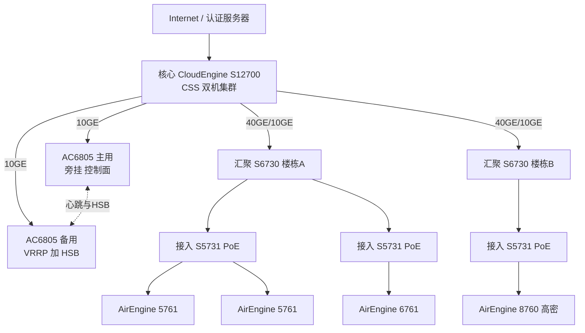

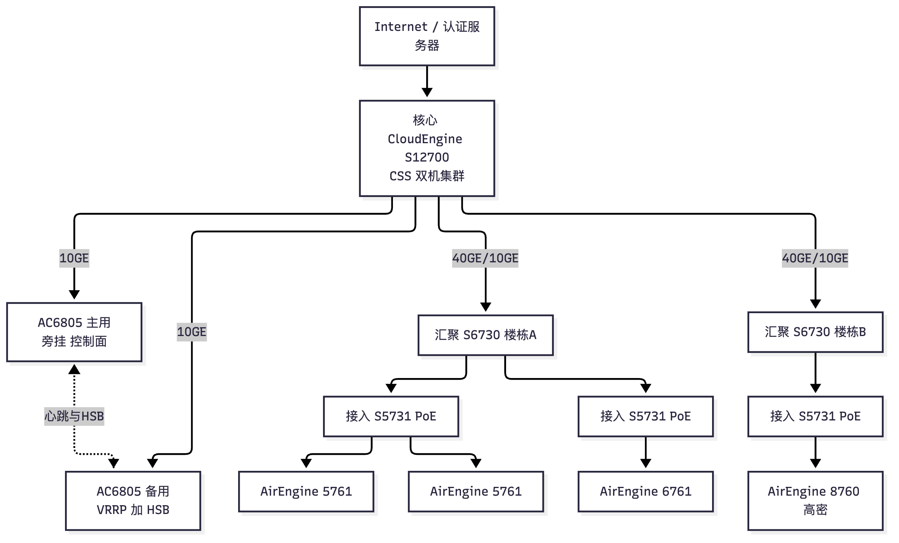


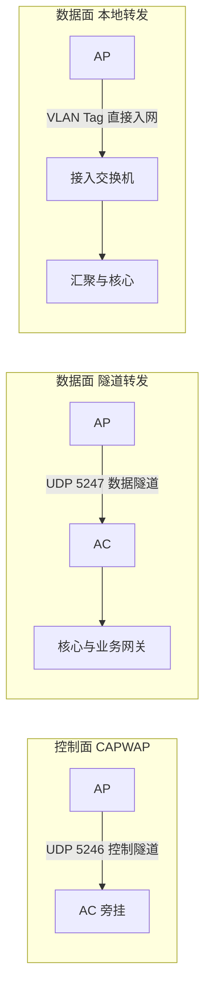

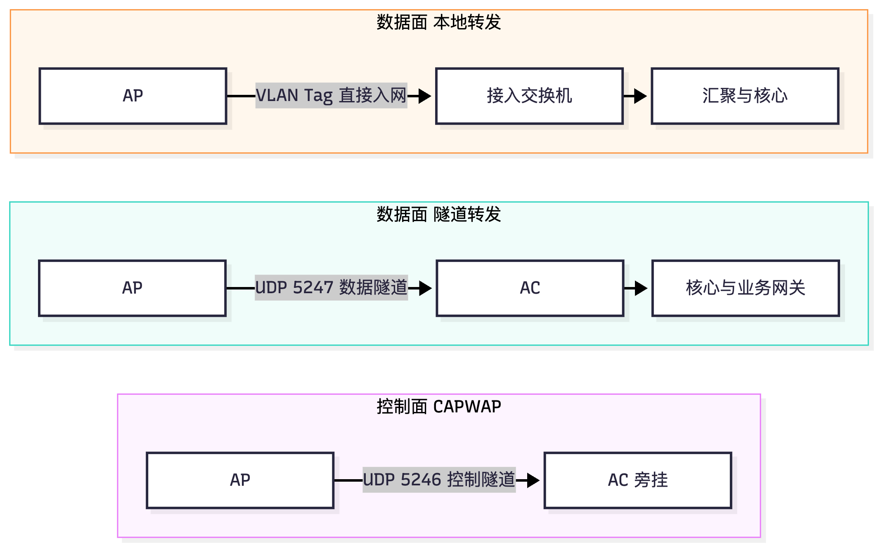


### 真题精练

**Q1.【真题·单选】** 某大型园区有 5000 台 AP、6 万终端，要求 AC 不成为单点且不成为数据瓶颈。最合理的 AC 部署方式是？
A. 单台高端 AC 直连串联在汇聚与核心之间
B. 两台 AC 旁挂在核心层，业务采用本地转发为主、隧道转发为辅
C. 每栋楼各部署一台 AC，业务全部隧道转发
D. 不部署 AC，AP 全部工作在 FAT 模式

> **答案：B**
> **解析**：A 错，串联部署使 AC 成为**单点故障与性能瓶颈**。C 错，每栋楼一台 AC 会增加管理复杂度且全部隧道转发会让 AC 成为流量汇聚点，扩容困难。D 错，5000 台 AP 用 FAT 模式无法统一管理与漫游。B 正确：**旁挂不改变原有拓扑、AC 故障不影响有线转发**；配合 `VRRP + HSB` 或 `AC 集群` 解决可靠性；**本地转发为主**让业务流量不经过 AC，从根本上消除 AC 成为数据瓶颈的问题，隧道转发只留给需要集中管控的业务。

**Q2.【真题·多选】** 关于大型园区 WLAN 的分层设计，下列说法正确的有？
A. 接入层负责 AP 的 PoE 供电与二层接入
B. 汇聚层可作为 AP 管理网段的三层网关与 DHCP 中继
C. 核心层应双机（CSS/iStack）部署以保证可靠性
D. AP 管理网段应与业务网段合并以简化规划
E. AC 的 CAPWAP 源接口地址必须全网可达

> **答案：ABCE**
> **解析**：D 错误，AP 管理网段**必须与业务网段分离**：① 安全上防止终端直接访问 AP 管理面；② 广播域与地址规划上互不干扰；③ 便于对 AP 管理流量做 QoS 与策略；④ 避免业务网段的 DHCP 风暴影响 AP 上线。A、B、C、E 均为标准做法。E 尤其重要：若 CAPWAP 源接口地址不可达，AP 无法与 AC 建立隧道，表现为 AP 一直处于 `Discovery` 或 `DTLS` 阶段。

**Q3.【真题·判断】** AC 采用直连（串联）部署在核心与汇聚之间是最可靠的方式，因为业务流量必然经过 AC，便于集中安全控制。

> **答案：错误**
> **解析**：串联部署的致命问题是**AC 成为网络单点**：AC 或 AC 所在链路故障会导致其下所有楼层/楼栋断网（不仅 WLAN，若同时承载有线转发则影响更大）；此外 AC 的转发性能与端口带宽会成为整个汇聚区的瓶颈，扩容需要改动物理链路。要"集中控制"并不需要串联——**旁挂 + 隧道转发**同样能让业务流量经过 AC 做策略控制，且 AC 故障时可通过 VRRP+HSB/集群快速接管，或让本地转发业务完全不受影响。因此大型园区推荐**旁挂**。

**Q4.【真题·简答】** 请说明隧道转发与本地转发的差异，并给出大型园区"混合部署"的策略建议与实现要点。

> **答案要点**：
> ① **差异**：隧道转发把业务报文封装在 CAPWAP 数据隧道（UDP 5247）送到 AC 再解封装入业务 VLAN，**业务流量经过 AC**；本地转发由 AP 直接把带 VLAN Tag 的业务报文送入接入交换机，**业务流量不经过 AC**，AC 只处理控制隧道与管理流量。
> ② **策略建议**：**管理类与访客类业务用隧道转发**（策略集中、便于审计与统一管控、AP 位置无关）；**高带宽与低时延业务用本地转发**（视频监控、媒体回传、IoT 大数据、大规模下载），避免 AC 与其上行链路成为瓶颈；**跨三层漫游要求高的业务**优先隧道转发（漫游由 AC 统一处理，简单可靠）。
> ③ **实现要点**：本地转发必须让 **AP 上行链路放通业务 VLAN**（接入、汇聚、核心全路径放通），否则业务不通；本地转发下 **DHCP 报文需要 AP 代为转发或由接入交换机处理**（视华为实现，部分版本支持 DHCP 报文上送 AC 或本地转发）；本地转发下 AP 需要感知业务 VLAN 的配置，通过 VAP 模板下发；跨三层漫游在本地转发下需要 AC 之间建立隧道或使用漫游组处理数据回程。
> ④ **验证**：隧道转发下 `display wlan ap name <AP> config` 或流量统计显示数据经 AC；本地转发下可在接入交换机镜像 AP 上行口，看到带业务 VLAN Tag 的报文未被 CAPWAP 封装。

**Q5.【真题·设计】** 某大型园区共 3 栋楼、每栋 15 层、每层 20 台 AP，总计 900 台 AP，终端约 1.5 万台。请给出 WLAN 组网设计方案（拓扑层次、AC 部署与数量、转发模式、AP 管理网段规划）。

> **答案要点**：
> ① **拓扑层次**：接入层 S5731（PoE+，每台接 12~20 台 AP）→ 汇聚层 S6730（每栋楼 1 对，做楼栋内收敛与 AP 管理网段网关）→ 核心层 S12700（CSS 双机集群，做楼栋间高速互联与 AC/服务器接入）。整网无环，接入双上行至汇聚、汇聚双上行至核心，配合 Eth-Trunk 与 STP/MSTP 防环。
> ② **AC 部署**：AC 旁挂核心层，采用 **AirEngine 9700S 或 AC6805 组成双机热备（VRRP + HSB）**；若需更大容量与更高可靠性，采用 **AC 集群**（3 台为典型，见 2.3 节）。按 900 台 AP 的规模，双机热备的容量足够（单台 9700S 的 AP 管理能力通常在数千台量级，**具体规格以所用型号与版本文档为准**）。
> ③ **转发模式**：**混合部署**——普通办公与访客业务隧道转发（集中管控、审计）；视频监控与媒体类业务本地转发（避免 AC 与核心链路成为瓶颈）。AP 上行链路需同时放通管理 VLAN 与业务 VLAN。
> ④ **AP 管理网段规划**：按楼栋细分，如 A 栋 `10.10.1.0/22`（容纳约 1024 个地址，覆盖 15×20=300 台 AP 并留余量）、B 栋 `10.10.2.0/22`、C 栋 `10.10.3.0/22`；**网关放在各楼栋汇聚交换机（SVI）**，DHCP 采用**汇聚本地中继 + 双 DHCP 服务器**；DHCP 中配置 **Option 43** 指向 AC 的 CAPWAP 源接口地址，并配置**主备两个 AC 地址**以保证可靠性。
> ⑤ **可靠性**：AC 双机热备（或集群）；核心 CSS 集群；汇聚双上行 + Eth-Trunk；DHCP 与 RADIUS 服务器双机；AP 采用双网口/双上行的型号用于关键区域。
> ⑥ **验收**：AP 上线率 100%，单 AP 上线时间 < 3 分钟；AC 主备倒换业务中断 < 3 秒；终端认证成功率 > 99%；跨楼栋漫游成功率 > 99%、切换时延 < 100 ms。

### 易错点与排错

1. **把 AC 串联当成"集中控制"的必要条件**：旁挂 + 隧道转发同样集中控制，且没有单点问题。
2. **AP 管理网段与业务网段合设**：会导致安全问题与地址/广播域冲突，规划时必须分离。
3. **忘记 CAPWAP 源接口的可达性**：AP 无法建立隧道时，第一件事就是确认 `capwap source interface` 配置的地址是否全网可达、Option 43 是否下发正确。
4. **本地转发忘了放通业务 VLAN**：现象是"AP 能上线、SSID 能连、但拿不到 IP 或不能上网"，这是本地转发最常见的故障。
5. **DHCP 集中单点**：数千台 AP 同时上线会打爆集中式 DHCP，应做分布式中继 + 服务器冗余。
6. **排错命令**：`display wlan ap all`（AP 状态与 IP）、`display capwap configuration`（CAPWAP 源接口配置）、`display wlan ap name <AP> config`（AP 实际下发的配置，验证本地转发 VLAN）、`display ip routing-table`（到 AP 网段路由）、`display dhcp relay all`（中继配置，交换机侧）。

---

## 2.2 AC 双机热备：VRRP + HSB 详细机制与倒换时序

### 考点定位

本考点是国赛 WLAN 方向**必考核心**，理论题以多选/简答形式考"HSB 备份内容与不能备份的内容、倒换时间、业务影响"，实验/排错题考"主备不同步的原因"。分值 8~12 分。易错点：① 把 **VRRP** 与 **HSB** 的职责搞混（VRRP 管"谁是主"，HSB 管"状态同步"）；② 不知道**哪些内容不能备份**（如 License、接口物理状态相关的配置、部分与硬件绑定的表项）；③ 不知道倒换时间量级（通常 **秒级**，如 1~3 秒）与业务影响（已建连接可能中断，需终端重连或漫游）。

### 原理精讲

**① 为什么需要 VRRP + HSB 两套机制？**

一句话区分：**VRRP 决定"谁是主用 AC"，HSB 决定"备用 AC 知道多少主用 AC 的状态"。**

- 只有 VRRP：主挂掉后备机会成为主，但它手里**没有 AP 的会话状态、没有终端的 PMK/密钥、没有 CAPWAP 隧道状态**，所有 AP 都必须重新发现 AC、重建 CAPWAP 隧道、终端重新认证——业务中断时间长（可到几十秒到数分钟）。
- 只有 HSB：状态同步了，但**没有机制告诉 AP 和网络"现在该找哪台 AC"**，AP 仍指向故障 AC 的地址。
- **两者配合**：VRRP 提供**统一的虚拟 IP（VIP）** 作为 AP 看到的 AC 地址；主用 AC 通过 HSB 把状态同步给备用 AC；主用故障时 VRRP 把 VIP 切到备用 AC（备用 AC 用 VIP 应答 ARP/发免费 ARP），备用 AC 立刻用已同步的状态继续服务 AP 与终端，AP **无需重新发现 AC**（因为它始终对着 VIP 说话）。

**② VRRP 在 AC 上的作用细节。**

AC 之间配置 VRRP 备份组，**VIP 必须与 `capwap source interface` 使用的地址一致或与之形成映射**（实践中常把 VIP 作为 AP 看到的 AC 地址：DHCP Option 43 下发 VIP，同时 AC 上 CapeWAP 源接口指向 VIP 所在的接口/环回）。工作过程：
1. 两台 AC 在互连网段上运行 VRRP，通过 VRRP 通告报文（组播 224.0.0.18，协议号 112）选举主备，优先级高者为主（默认 100，可调）。
2. 主用 AC 定时发送 VRRP 通告（默认 1 s），备用 AC 在 Master_Down_Interval（约 3×通告间隔 + Skew_Time）内未收到通告则认为主用故障。
3. 主用故障 → 备用升为主 → 用 VIP 发送**免费 ARP（Gratuitous ARP）** 刷新交换机与 AP 的 ARP/MAC 表 → 后续 AP 发往 VIP 的报文被送到新的主用 AC。
4. **抢占（Preempt）**：默认开启，原主用恢复后若优先级更高会抢回主角色——**在 AC 场景要谨慎使用抢占**（抢回会造成再次倒换与业务抖动），工程上常配置**延时抢占**（如 `vrrp vrid 1 preempt-mode timer delay 120`）让原主用稳定后再抢回。

**③ HSB（Hot Standby，热备份）的作用与机制。**

HSB 是华为 AC 之间的**状态同步协议**，它建立一条独立于业务的 **HSB 通道**（通常用一个专用 VLAN/接口 + 专用端口），把主用 AC 的关键状态实时/批量同步到备用 AC。HSB 的工作过程：

1. **建立 HSB 服务**：主备 AC 上分别配置对端 IP 与端口（`hsb-service`），并指定服务类型与源接口。
2. **绑定 VRRP**：`hsb-service-type ... vrrp ...` 把 HSB 与 VRRP 备份组关联，实现"**主备角色变化 → HSB 角色自动切换**"，无需人工干预。
3. **同步内容**：主用 AC 在状态变化时（如 AP 上线、终端关联、密钥协商完成、漫游发生）**实时同步**；同时周期性做**批量同步（batch backup）**兜底，保证不因单条消息丢失而不一致。
4. **倒换**：主用故障 → VRRP 切换 → 备用 AC 检测到 VRRP 角色变为主 → HSB 停止接收同步、开始以已同步的状态服务业务。

**④ HSB 备份的内容与不能备份的内容（必考，必须能列举）。**

| 类别 | 内容 | 是否备份 | 说明 |
|---|---|---|---|
| AP 状态 | AP 基本信息、AP 与 AC 的 CAPWAP 隧道状态、AP 归属的 AP 组 | **是** | 这是倒换后 AP 无需重新发现 AC 的关键 |
| 终端状态 | 终端关联信息（MAC、关联的 AP、VAP、QoS 信息） | **是** | 保证终端在线状态延续 |
| 安全状态 | **PMK/PMK 缓存**、密钥信息、802.1X 认证结果 | **是** | 使终端不必重新做完整认证，能快速恢复 |
| 漫游信息 | 漫游表项、家乡代理/外地代理关系 | **是** | 跨 AC 漫游在倒换后仍能正确转发 |
| 射频管理 | 射频调优结果、AP 信道与功率 | **是** | 避免倒换后重新调优造成抖动 |
| 配置数据 | WLAN 模板与 VAP 配置 | **部分/可选** | 通常两台 AC 采用**相同配置**（人工保证一致），HSB 主要同步**动态状态**；部分版本支持配置同步，但**工程上仍要求人工保证两机配置一致** |
| License | License 授权文件与授权数 | **否** | License 与设备序列号（ESN）绑定，**不可复制到备机**，因此备机必须有**独立且容量足够的 License** |
| 接口物理状态 | 接口 up/down、光模块信息、PoE 状态 | **否** | 属于本地硬件状态，无法同步 |
| 硬件/板卡信息 | 单板、风扇、电源状态 | **否** | 本地硬件信息 |
| 与硬件绑定的表项 | MAC 地址表（本地转发相关）、部分转发面表项 | **否** | 由网络重新学习 |

**⑤ 倒换时间与业务影响（必考）。**

- **倒换时间**：VRRP 检测到主用故障需要 **Master_Down_Interval ≈ 3×通告间隔 + Skew_Time**，默认通告 1 s 时约 **3~4 s**；加上 VRRP 状态切换、免费 ARP 扩散、HSB 角色切换，实际业务恢复时间通常在 **1~5 s**（可通过**降低 VRRP 通告间隔**（如 200 ms）或引入 **BFD for VRRP** 把检测时间压缩到 **毫秒级**，华为 AC 支持相关配置）。
- **业务影响**：① 若 HSB 同步完好，**AP 不会掉线**（不需要重新发现 AC），隧道在数秒内恢复；② **已建立的终端连接可能短暂中断**（几秒），TCP 连接通常能靠重传恢复，语音通话可能出现短促断续；③ 若 HSB 未同步或不完整，终端需要**重新认证**，中断时间显著延长（数十秒）；④ **本地转发的业务流量不受 AC 倒换影响**（因为不经过 AC），这是本地转发在可靠性上的天然优势。

**⑥ 主备模式 vs 负载分担。**

| 模式 | 工作方式 | 优点 | 缺点 | 适用 |
|---|---|---|---|---|
| **主备（Active/Standby）** | 仅主用 AC 服务全部 AP，备用只同步 | 简单、路径唯一、排错容易 | 资源利用率 50% | **AC 双机热备的标准形态（推荐）** |
| **负载分担（Active/Active）** | 两台 AC 各自服务一部分 AP（按 AP 组划分），同时互为备份 | 资源利用率高、容量翻倍 | 配置复杂（**AP 归属划分必须与 HSB/VRRP 规划严格对应**）、排错难度大 | 容量压力大且有经验团队维护时 |

负载分担的实现方式：按 **AP 组**或 **AP MAC 哈希**把 AP 分配到两台 AC；每台 AC 既是其归属 AP 的主用，又是另一部分 AP 的备用。**关键约束**：两台 AC 必须都配置对方的 HSB、都要有足够的 License 容量（因为故障时要接管全部 AP），且**VAP 与模板配置必须完全一致**。

### 关键概念对照表

| 对比项 | VRRP | HSB |
|---|---|---|
| 解决的问题 | 谁是主用（角色选举与切换） | 状态如何同步（信息一致性） |
| 报文/通道 | VRRP 通告（组播 224.0.0.18，协议号 112） | HSB 通道（专用接口/VLAN + 端口） |
| 关键参数 | 优先级（默认 100）、通告间隔（默认 1 s）、抢占 | 对端 IP/端口、服务类型、批量同步周期 |
| 故障检测时间 | 默认约 3~4 s（可用 BFD 压缩到毫秒级） | — |
| 是否可单独部署 | 可，但倒换后 AP 需重上线 | 可，但没有切换机制则无意义 |
| 与业务关系 | 决定 AP 报文送往哪台 AC | 决定新主用能否立即服务 |
| 配置要点 | VIP 与 CAPWAP 源接口一致；**延时抢占** | 必须与 VRRP 绑定；两机配置一致 |

| HSB 同步内容 | 是否同步 | 考试易错点 |
|---|---|---|
| AP 隧道与归属状态 | ✅ | 最常考"为什么倒换后 AP 不掉线" |
| 终端关联与 PMK/密钥 | ✅ | 保证终端无需重新认证 |
| 漫游表项 | ✅ | 跨 AC 漫游在倒换后仍可用 |
| License | ❌ | **与 ESN 绑定，备机必须自己有 License** |
| 接口物理状态/硬件状态 | ❌ | 无法跨设备同步 |
| WLAN 模板配置 | ⚠️ 通常人工保证一致 | 不能依赖同步，必须人工核对 |

### 华为设备配置

```bash
# ============ AC1（主用，AC6805，优先级 120）============
system-view
sysname AC1
vlan batch 100 200 300                          # 100 业务 200 AC互连(VRRP) 300 HSB专用通道
interface Vlanif200                             # VRRP 备份组所在接口
 ip address 10.10.200.1 255.255.255.0            # AC1 实地址
 vrrp vrid 1 virtual-ip 10.10.200.254            # 虚拟IP，作为 AP 看到的 AC 地址
 vrrp vrid 1 priority 120                        # 优先级高于备机（默认100），确保 AC1 为主
 vrrp vrid 1 preempt-mode timer delay 120        # 延时抢占 120 秒，避免原主恢复后立即抢回造成二次抖动
 quit
 vrrp vrid 1 track interface Vlanif300 reduce 30 # 跟踪 HSB 通道接口，通道故障则降优先级触发切换
 # 说明：track 相关语法以所用版本文档为准
 quit
interface Vlanif300                             # HSB 专用通道（也可用独立物理口/Eth-Trunk）
 ip address 10.10.300.1 255.255.255.0
 quit
capwap source interface vlanif200               # CAPWAP 源接口指向 VRRP 所在接口，AP 通过 VIP 访问 AC
hsb-service 0                                   # 创建 HSB 服务 0
 peer-address 10.10.300.2                        # 对端（AC2）HSB 通道地址
 port 10241                                      # HSB 服务端口（端口号以所用版本文档为准）
 quit
hsb-service-type access-controller hsb-service 0   # 把 HSB 服务类型绑定为 AC 状态同步
hsb-service-type access-controller vrrp vrid 1     # 与 VRRP 备份组绑定，实现主备角色自动跟随
wlan                                             # 进入 WLAN 视图
 # WLAN 模板与 VAP 配置需与 AC2 完全一致（建议手工逐条核对或用配置比对工具）
 # 双机热备的 WLAN 相关使能开关（命令名随版本差异大，以所用版本文档为准）
 # 例如开启 AP/终端/密钥状态同步与批量备份的相关开关
 quit
 # ===== 查看主备状态 =====
display vrrp                                     # 查看 VRRP 主备角色与状态
display vrrp brief                               # 简要查看备份组状态
display hsb-service 0                            # 查看 HSB 通道建立状态与对端信息
display hsb-service-type access-controller       # 查看 AC 状态同步的服务类型与绑定关系
display hsb statistics                           # 查看 HSB 报文收发统计，判断是否丢包
 # ============ AC2（备用，优先级默认 100）============
system-view
sysname AC2
vlan batch 100 200 300
interface Vlanif200
 ip address 10.10.200.2 255.255.255.0
 vrrp vrid 1 virtual-ip 10.10.200.254            # VIP 必须与 AC1 完全一致
 vrrp vrid 1 priority 100                        # 低于 AC1，作为备机
 quit
interface Vlanif300
 ip address 10.10.300.2 255.255.255.0
 quit
capwap source interface vlanif200
hsb-service 0
 peer-address 10.10.300.1                        # 指向 AC1
 port 10241
 quit
hsb-service-type access-controller hsb-service 0
hsb-service-type access-controller vrrp vrid 1
```

### 示意图

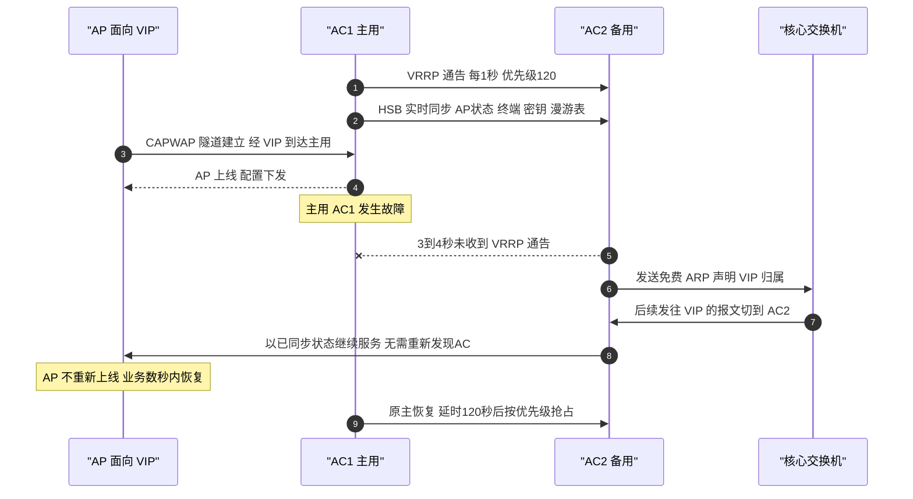

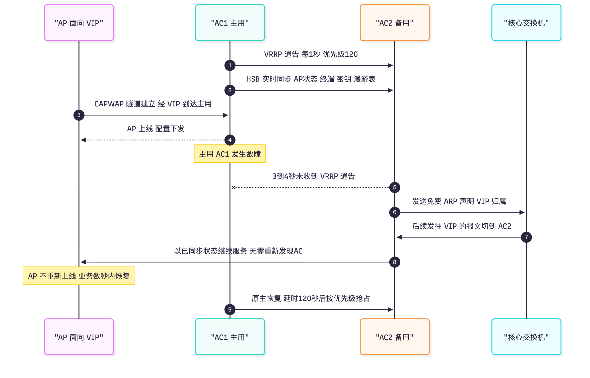


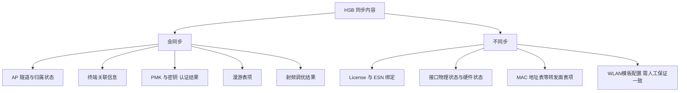

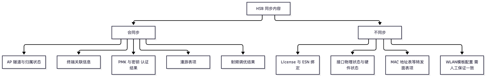


### 真题精练

**Q1.【真题·多选】** 关于 AC 双机热备中的 VRRP 与 HSB，下列说法正确的有？
A. VRRP 负责主备角色选举，HSB 负责状态同步
B. HSB 备份内容包含 AP 隧道状态、终端关联信息与 PMK，因此倒换后 AP 无需重新发现 AC
C. License 会通过 HSB 同步到备机
D. HSB 必须与 VRRP 备份组绑定，才能实现主备角色变化后自动切换同步方向
E. 备机即使没有 License 也能在倒换后接管全部 AP

> **答案：ABD**
> **解析**：C 错误，**License 与设备序列号（ESN）绑定，无法通过 HSB 同步**，因此备机必须**独立安装容量足够的 License**，这是实验与方案题的高频扣分点。E 错误，同理，备机 License 不足会导致倒换后部分 AP 无法上线（"能切过去但带不动"）。A、B、D 正确。D 尤其重要：若不绑定 VRRP，主备关系变化后 HSB 不会自动改变同步方向，会出现"两个都以为自己是备机"或"同步方向错误"的异常。

**Q2.【真题·单选】** AC 双机热备场景下，VRRP 默认通告间隔为 1 s，主用 AC 故障后备用 AC 大约在多长时间内检测到并触发切换？
A. 约 100 ms  B. 约 1 s  C. 约 3~4 s  D. 约 30 s

> **答案：C**
> **解析**：VRRP 的 Master_Down_Interval = `3 × Advertisement_Interval + Skew_Time`，通告间隔默认 1 s，Skew_Time = `(256 − Priority)/256` 秒（优先级 100 时约 0.6 s），因此默认约 **3~4 s**。A 是 VRRP 通告间隔量级（100 ms 需要显式配置）；D 更接近 STP/路由协议收敛时间。**若要压缩检测时间，应引入 BFD for VRRP**（可到毫秒级）或调小通告间隔（会增加 CPU 与带宽开销）。

**Q3.【真题·判断】** AC 双机热备倒换后，所有已关联的终端必须重新完成 802.1X 认证，因此必然中断数十秒。

> **答案：错误**
> **解析**：HSB 会同步 **PMK/PMK 缓存与认证结果**，因此倒换后备用 AC 掌握终端的认证状态与密钥，终端**不需要重新做完整的 802.1X/RADIUS 认证**，业务可在**数秒内**恢复。真正需要重新认证的场景是：① HSB 未同步或同步不完整；② 备机与主机的安全模板/密钥配置不一致；③ 终端本身也发生了漫游或链路中断。这一题的核心考点就是"HSB 备份密钥与认证状态"。

**Q4.【真题·简答】** 请写出 AC 双机热备的五条关键配置要求（含配置要点与原因）。

> **答案要点**：
> ① **两台 AC 必须同型号、同 VRP 版本、相同的 WLAN 模板与 VAP 配置**。原因：HSB 同步的是**动态状态**，配置必须人工保证一致；若模板/VLAN/安全策略不同，倒换后行为不同，会出现"AP 上线但业务不通"。
> ② **VRRP 的 VIP 必须与 AP 看到的 AC 地址一致（通常与 `capwap source interface` 指向的接口地址一致）**，且 DHCP Option 43 下发的是 VIP。原因：AP 只认一个地址，切换后才能透明地被新主用 AC 接管。
> ③ **HSB 通道必须独立于业务与 VRRP 通道**（独立 VLAN 或独立物理/逻辑接口），并具备冗余能力。原因：若 HSB 与业务共用链路，业务拥塞会造成状态同步延迟或丢包，导致"倒换后状态不全"。
> ④ **HSB 服务必须与 VRRP 备份组绑定**，并配置跟踪（track）与**延时抢占**。原因：绑定使主备角色变化自动同步方向；延时抢占避免原主恢复后立即抢回造成二次业务抖动。
> ⑤ **备机必须安装独立且容量足够的 License**。原因：License 与 ESN 绑定，无法通过 HSB 同步；备机 License 不足会导致倒换后无法接管全部 AP。
> ⑥ 补充：配置完成后必须**实测倒换**（在业务低谷期手动断主用或使用测试命令），验证倒换时间与业务恢复情况，并定期检查 `display hsb statistics` 确认同步无丢包。

**Q5.【真题·排错】** 某园区 AC 双机热备部署后，管理员手动重启主用 AC，发现 AP 大面积掉线并重新上线，历时约 3 分钟。倒换后 `display vrrp` 显示备机已成为 Master，`display hsb-service 0` 显示通道 up。请分析最可能的原因并给出排查步骤。

> **答案要点**：
> ① **首要怀疑：HSB 状态未真正同步成功（或同步不完整）。** `display hsb-service 0` 显示 up 只说明**通道可达**，不代表**同步内容完整**——必须看 `display hsb-service-type access-controller` 与 `display hsb statistics`，确认同步的服务类型已绑定、同步报文收发无丢包、同步表项数量正常。若同步曾中断（如中间网络在倒换前有闪断），备用 AC 手里的状态就是**过期的**，倒换后 AP 只能重新上线。
> ② **第二怀疑：两机的 WLAN 模板与 VAP 配置不一致。** 检查 `display current-configuration` 的 wlan 部分逐条比对；尤其关注安全模板（密钥/加密方式）、业务 VLAN、转发模式、AP 组归属。配置不一致会导致 AP 重新上线或上线后业务异常。
> ③ **第三怀疑：备机 License 不足。** 用 `display license` 查看备机的 AP 授权数是否 ≥ 全网 AP 数；不足时会出现"部分 AP 能上线、部分不能"。
> ④ **第四怀疑：AP 的 AC 地址指向实地址而非 VIP。** 若 DHCP Option 43 下发的是 AC1 的实地址（10.10.200.1）而不是 VIP（10.10.200.254），倒换后 AP 仍去找已故障的实地址，只能重新发现 AC。核对 `display current-configuration | include option 43`（在 DHCP 侧）与 AC 的 `capwap source interface`。
> ⑤ **第五怀疑：HSB 通道与业务共用链路导致同步报文丢失。** 检查 HSB 通道所在接口的流量与丢包，建议改为独立链路并启用链路聚合。
> ⑥ **修复与验证**：修正后先做**批量同步**（触发一次完整同步，命令随版本差异，以文档为准），确认同步表项数量与主用一致，再在业务低谷期实测倒换，验证倒换时间与业务恢复情况。

### 易错点与排错

1. **把 HSB 通道 up 当成"同步正常"**：通道可达 ≠ 同步完整，必须看服务类型绑定与同步统计。
2. **以为 License 能同步**：License 与 ESN 绑定，备机必须有独立授权，这是最高频的扣分点。
3. **忘记绑定 VRRP 与服务类型**：不绑定则主备角色变化后同步方向不切换。
4. **开启抢占却不设延时**：原主恢复立即抢回，造成二次业务抖动。
5. **两机配置不一致**：HSB 只同步动态状态，配置必须人工保证一致；建议开局时用配置比对逐条核对。
6. **排错命令**：`display vrrp` / `display vrrp brief`（角色）、`display hsb-service 0`（通道）、`display hsb-service-type access-controller`（服务绑定）、`display hsb statistics`（同步报文统计）、`display license`（授权数）、`display wlan ap all`（AP 上线状态与 IP）。

---

## 2.3 AC 集群（AC Cluster）技术

### 考点定位

本考点是**国赛进阶考点**，以简答/设计题为主，分值 6~10 分，常与 2.2 节双机热备合并出"对比题"。考查点：**集群相比双机热备的优势、集群内 AP 的归属与备份关系、集群的 CAPWAP 隧道建立与业务流量路径**。易错点：① 把 AC 集群当成"多台 AC 做 VRRP"；② 不知道集群内 AP 可以在 AC 之间**重新归属（迁移）**而无需 AP 重新上线；③ 说不清业务流量在集群内如何走。

### 原理精讲

**① AC 集群要解决什么问题？**

AC 双机热备有两个局限：**容量上限是单台 AC 的容量**（主备模式下备机闲置，负载分担模式下两台之和为上限），以及**AP 的归属是静态的**（预先划分好了归属哪台 AC，某台 AC 过载也不会自动均衡）。当园区规模超过单台 AC 的处理能力（AP 数、终端数、隧道数、吞吐），就需要**AC 集群**。

**AC 集群（AC Cluster）把多台 AC（典型 3 台，可更多）虚拟成一个"逻辑 AC 池"**：
- **统一管理**：管理员在集群的**主 AC（Master）**上配置一次，配置自动同步到所有成员 AC，不再需要逐台配置与人工比对。
- **容量叠加**：集群的总 AP 容量、终端容量、隧道容量是成员之和，突破单台上限。
- **AP 动态归属**：AP 上线时由主 AC 按**负载均衡算法**分配到某个成员 AC（称为该 AP 的**归属 AC/Home AC**）；当某台 AC 故障或过载时，AP 可以被**迁移到其他成员**而**不需要 AP 重新上线**（隧道在集群内重建，AP 侧感知很小）。
- **N+M 备份**：集群内任意一台 AC 故障，其上的 AP 由其他成员按备份关系接管；相比双机热备的 1:1 备份，集群可以用 **N+1 或 N+M** 方式提供冗余，**资源利用率更高**。

**② AC 集群的角色分工（必考）。**

| 角色 | 说明 | 关键点 |
|---|---|---|
| **主 AC（Master / Primary）** | 集群的管理者：负责配置下发与同步、AP 归属决策、集群状态维护、与备主进行状态同步 | 由集群选举产生；主 AC 故障时由备主接管 |
| **备 AC（Backup Master / Standby）** | 主 AC 的备份管理者，实时同步主 AC 的集群管理信息 | 保证集群管理面不中断 |
| **成员 AC（Member）** | 实际承载 AP 与业务流量的 AC | 每台成员都有自己的归属 AP 集合 |
| **归属 AC（Home AC）** | 某个 AP 所归属的成员 AC，负责该 AP 的 CAPWAP 会话、配置下发、业务处理 | AP 的"户籍" |
| **备份 AC（Backup AC）** | 为某 AP 指定的备用成员 AC（可为 1 台或多台），归属 AC 故障时接管 | 备份关系可由主 AC 按算法分配，也可指定 |

**③ 集群内 AP 的归属与备份关系。**

- **归属分配算法**：AP 首次上线时，主 AC 根据**各成员的负载**（已归属 AP 数、终端数、CPU/内存利用率、隧道数）选择负载最低或最合适的成员作为归属 AC。算法可以由管理员设定权重或指定 AP 组与成员的绑定关系。
- **备份关系**：为每个 AP 指定**备份 AC**（通常是另一台成员）。备份 AC 会持有该 AP 的**必要状态**（部分实现是全部状态同步，部分是精简状态），使归属 AC 故障时能快速接管。
- **AP 迁移（重归属）**：当归属 AC 过载或需要维护时，主 AC 可以把 AP 迁移到其他成员。**关键优势**：迁移过程中 AP **不需要重新发现 AC、不需要重新上线**，隧道在集群内部重建，终端业务中断时间远小于"AP 重新上线"。
- **为什么能做到"不重新上线"？** 因为集群对外呈现一个**统一的集群 IP/统一的管理地址**，AP 始终对着这个地址建立 CAPWAP 会话；集群内部由主 AC 决定该会话实际落在哪台成员上。AP 感知不到内核的迁移，因此不会触发 Discovery/Join 流程。

**④ 集群的 CAPWAP 隧道建立与业务流量路径（必考，必须能画图讲）。**

- **控制隧道**：AP 与集群统一地址建立 CAPWAP 控制隧道（UDP 5246）。集群内部，主 AC 把该 AP 的会话指派给某台成员，实际的控制报文由该成员 AC 终结（对外地址可以是集群地址，内部有一层转发/映射）。
- **数据隧道**：隧道转发模式下，业务数据封装在 CAPWAP 数据隧道（UDP 5247）中送到**归属 AC**，由归属 AC 解封装进入业务 VLAN。**数据隧道终结在归属 AC，而不是主 AC**——这是与"集群统一管理"容易混淆的地方：**集群统一的是管理面，数据面仍由各成员分担**。
- **集群内互联网络**：成员 AC 之间需要一张**互联网络（Cluster Interconnect）**，用于配置同步、AP 归属信息同步、备份状态同步与（某些实现下的）AP 迁移后的会话接续。该网络应使用独立的 VLAN/接口并对带宽与可靠性做保障（建议 10GE 及以上、双上行）。
- **集群与外部网络**：集群成员通常都与核心交换机三层互联（或通过一台成员作为"集群对外网关"）；AP 的 CAPWAP 流量经网络送达集群统一地址，再由集群内部转发到归属成员。

**⑤ AC 集群相比传统双机热备的优势（答题必列）。**

| 对比维度 | AC 双机热备 | AC 集群 |
|---|---|---|
| 容量上限 | 单台（主备）或两台之和（负载分担） | **成员之和，可线性扩展（N 台）** |
| 备份比例 | 1:1（备机闲置或半闲置） | **N+1 / N+M，资源利用率更高** |
| 配置管理 | 需逐台配置并人工保证一致 | **主 AC 配置一次，自动同步全部成员** |
| AP 归属 | 静态划分（按 AP 组/哈希） | **动态分配 + 可迁移，负载自动均衡** |
| AP 故障切换 | AP 由备机接管，通常需重新建立隧道 | **AP 可迁移，无需重新上线，中断更小** |
| 扩容 | 需重新规划归属与备份关系 | **新增成员加入集群即可扩容** |
| 复杂度 | 低 | 高（需集群互联网络、同型号同版本约束） |
| 适用规模 | 中小型园区（数百至上千 AP） | **大型/超大型园区（数千至数万 AP）** |

**⑥ 集群的约束条件（易错点）。**

- 成员 AC 通常要求**同型号、同 VRP 版本**（部分场景允许同系列不同型号但需确认支持矩阵，**以所用版本文档为准**）。
- 集群需要**独立的集群互联网络**，且网络质量要好（同步流量对时延与丢包敏感）。
- **License 不能跨成员共享**：每台成员都必须有足够的 License 容量，且要考虑**故障时接管其他成员 AP 所需的冗余授权**（否则接管时会出现 "License 不足" 而拒绝 AP）。
- 集群规模有上限（成员数与总 AP 数），需按产品规格规划。
- 集群的**升级与维护**需要按"逐台滚动"方式进行（先把某成员上的 AP 迁移到其他成员，再升级该成员），这依赖于 AP 迁移能力。

### 关键概念对照表

| 概念 | 含义 | 与双机热备的对应 |
|---|---|---|
| 集群统一地址 | 对外呈现的统一管理 IP，AP 面向该地址建隧道 | 对应 VRRP 的 VIP |
| 主 AC / 备主 | 集群管理面的主与备，负责配置同步与归属决策 | 对应双机热备的主/备 AC |
| 归属 AC（Home AC） | AP 实际归属的成员，终结其 CAPWAP 与业务 | 对应双机热备中"主用 AC 服务全部 AP" |
| 备份 AC | 归属 AC 故障时接管该 AP 的成员 | 对应双机热备中的备机 |
| 集群互联网络 | 成员间配置/状态/归属同步的专用网络 | 对应双机热备的 HSB 通道（但连接关系是 N×(N−1) 或通过主 AC 汇聚） |
| AP 迁移 | AP 从一个成员转由另一个成员服务，AP 不重新上线 | 双机热备无此能力 |

| 备份方式 | 冗余度 | 资源利用率 | AP 切换代价 | 适用规模 |
|---|---|---|---|---|
| 1:1 主备 | 高（1 台顶 1 台） | 50% | 中等（隧道重建，AP 不重上线） | 中小型 |
| 1:1 负载分担 | 高 | 100%（正常时） | 中等 | 中型 |
| N+1 集群 | 中高 | 高（约 N/(N+1)） | 低（AP 迁移，不重上线） | 大型 |
| N+M 集群 | 高 | 高 | 低 | 超大型 |

### 华为设备配置

```bash
# ============ AC 集群配置（3 台成员，AC6805 / AirEngine 9700S）============
# AC1（期望成为主 AC，priority 高）
system-view
sysname AC-CLUSTER-01
vlan batch 200 400                              # 200 = 业务/管理互连，400 = 集群互联专用
interface Vlanif200
 ip address 10.10.200.1 255.255.255.0
 quit
interface Vlanif400                             # 集群互联接口
 ip address 10.10.400.1 255.255.255.0
 quit
capwap source interface vlanif200               # CAPWAP 源接口（对外统一地址所在接口）
wlan
 ac-cluster                                     # 进入 AC 集群视图（命令视图名随版本差异，以所用版本文档为准）
  cluster-name campus-cluster                    # 集群名称，三台必须一致
  cluster-id 1                                   # 集群 ID
  cluster-priority 100                           # 集群优先级，高者成为主 AC
  member 10.10.400.1 10.10.400.2 10.10.400.3      # 声明集群成员（互联地址列表）
  # 部分版本通过 member ip-address 逐条添加，以所用版本文档为准
  quit
 quit
 #  说明：集群建立后，在主 AC 上配置的 WLAN 模板会自动同步到其他成员

# AC2、AC3 仅需配置集群基本信息（其余 WLAN 配置由主 AC 同步）
# AC2
 system-view
 sysname AC-CLUSTER-02
 vlan batch 200 400
 interface Vlanif200
  ip address 10.10.200.2 255.255.255.0
  quit
 interface Vlanif400
  ip address 10.10.400.2 255.255.255.0
  quit
 capwap source interface vlanif200
 wlan
  ac-cluster
   cluster-name campus-cluster                   # 必须与主 AC 一致
   cluster-id 1
   cluster-priority 90                           # 低于 AC1，作为备主或成员
   member 10.10.400.1 10.10.400.2 10.10.400.3
   quit
  quit

# ============ 查看集群状态 ============
display ac-cluster status                        # 查看集群成员与角色（命令名随版本变化）
display ac-cluster member                        # 查看成员列表与各成员负载
display ac-cluster ap-assign                     # 查看 AP 归属与备份关系（版本相关）
display wlan ap all                              # 查看 AP 上线状态与其归属 AC
display ac-cluster configuration-sync            # 查看配置同步状态（版本相关）
```

### 示意图

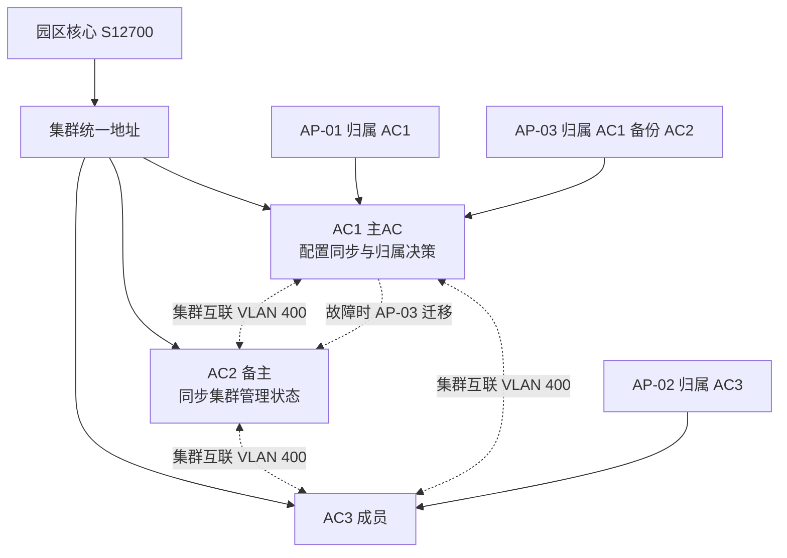

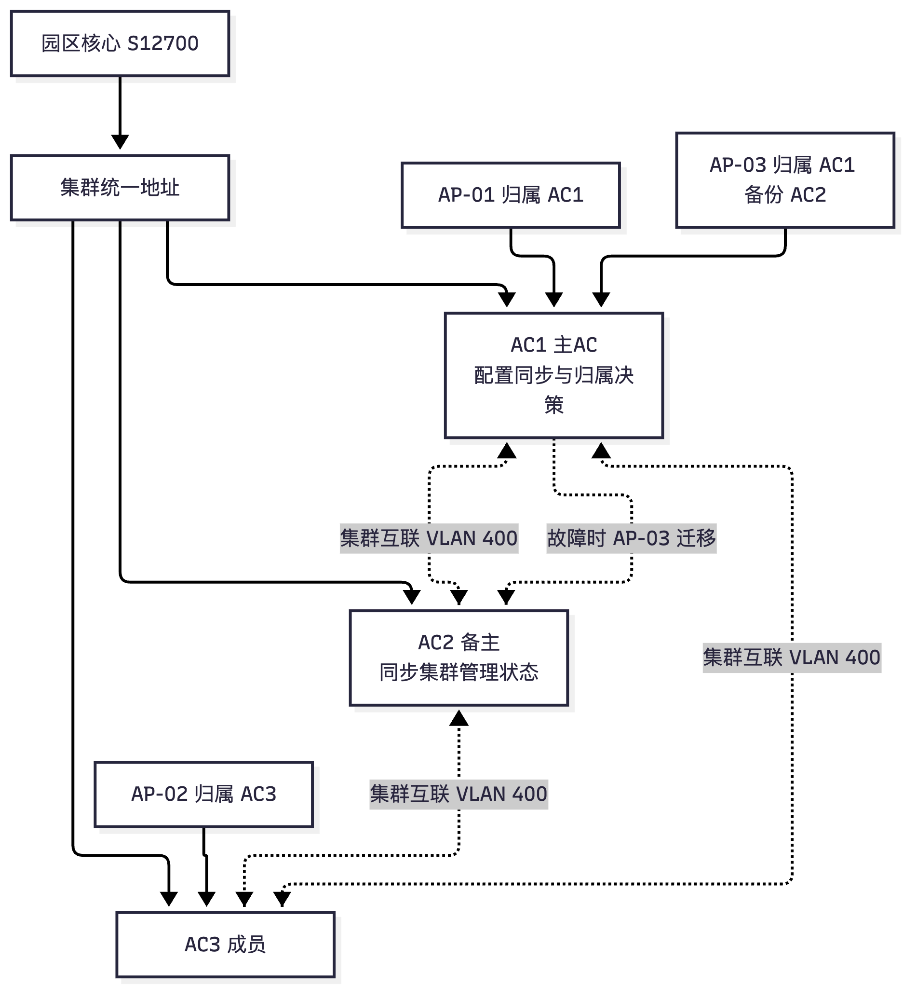


```mermaid
flowchart LR
    subgraph CTRL["控制面 统一"]
        AP["AP 面向集群统一地址"] -->|"UDP 5246 控制隧道"| MA["主AC 归属决策"]
        MA --> H["归属AC 终结控制会话"]
    end
    subgraph DATA["数据面 分担"]
        AP2["AP"] -->|"UDP 5247 数据隧道"| HOME["归属 AC 解封装"]
        HOME --> VLAN["业务 VLAN 与核心"]
    end
```

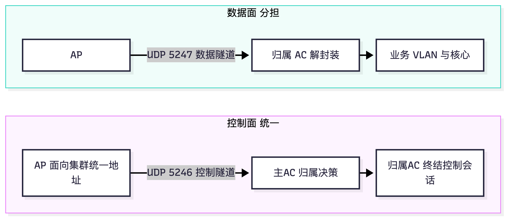


### 真题精练

**Q1.【真题·多选】** 关于 AC 集群相比 AC 双机热备的优势，下列说法正确的有？
A. 集群的总容量是各成员容量之和，可突破单台 AC 的容量上限
B. 集群采用 N+1 或 N+M 备份，资源利用率高于 1:1 主备
C. 集群只在主 AC 上配置一次，配置自动同步到所有成员
D. 集群中 AP 的归属是静态划分的，不能迁移
E. 集群中 AP 可在成员之间迁移，且不需要 AP 重新上线

> **答案：ABCE**
> **解析**：D 错误。AC 集群的核心优势之一就是 **AP 归属的动态分配与可迁移**：AP 首次上线由主 AC 按负载分配到某成员作为归属 AC；当归属 AC 过载或需要维护（升级、故障）时，主 AC 可把 AP 迁移到其他成员，**AP 不需要重新发现 AC、不需要重新上线**（因为 AP 始终面向集群统一地址建隧道）。A、B、C、E 均正确。

**Q2.【真题·单选】** 在 AC 集群中，隧道转发模式下业务数据隧道的终结位置是？
A. 主 AC（Master）
B. 备 AC（Backup Master）
C. **AP 的归属 AC（Home AC）**
D. 核心交换机

> **答案：C**
> **解析**：这是最容易混淆的考点。AC 集群**统一的只是管理面**（配置同步、归属决策、集群状态维护由主 AC 负责），**数据面仍由各成员分担**——业务数据隧道（UDP 5247）终结在 **AP 的归属 AC**，由归属 AC 解封装后进入业务 VLAN。若认为"所有数据都送到主 AC"，则主 AC 会成为瓶颈，集群也就失去了容量叠加的意义。

**Q3.【真题·判断】** 在 AC 集群中，只要有一台成员安装了足够的 AP License，其他成员就不需要 License。

> **答案：错误**
> **解析**：**License 与设备序列号（ESN）绑定，不能跨设备共享或同步**。集群中每台成员 AC 都必须安装**足以承载其归属 AP 数量**的 License；此外还必须考虑**冗余**——当某成员故障、其 AP 迁移到其他成员时，接管方必须有**剩余授权**能容纳这些额外 AP，否则会出现"接管了但 AP 因 License 不足无法上线"。因此集群规划时 License 总量应 ≥ 全网 AP 数，并按"N+M"原则预留冗余。

**Q4.【真题·简答】** 请说明 AC 集群中 AP 上线、归属分配、故障迁移的完整流程，并解释为什么 AP 迁移时不需要重新上线。

> **答案要点**：
> ① **AP 发现与建链**：AP 通过 DHCP Option 43/DNS/广播等方式发现 AC 地址，该地址是**集群对外统一地址**；AP 与该地址建立 CAPWAP 控制隧道（UDP 5246），完成 DTLS 与 Join。
> ② **归属分配**：集群的主 AC 收到 AP 的 Join 请求后，根据各成员的负载（归属 AP 数、终端数、CPU/内存/隧道利用率）与管理员设定的策略（AP 组绑定、权重），决定该 AP 的**归属 AC**，并在集群内通告该归属关系。
> ③ **建立数据面**：若为隧道转发，AP 与**归属 AC** 建立数据隧道（UDP 5247）；归属 AC 负责该 AP 的配置下发、射频管理、终端接入与业务转发。
> ④ **故障迁移**：归属 AC 故障（或管理员触发迁移、或过载需要均衡）时，主 AC（或备主）把该 AP 的会话迁移到预先指定的**备份 AC**；备份 AC 已通过集群同步持有该 AP 的必要状态，可直接接管。
> ⑤ **为什么不需要重新上线**：因为 AP 始终只与**集群统一地址**维持 CAPWAP 会话，AP 侧看不到会话在集群内部从哪台成员终结；迁移由集群内部完成状态接续，AP 不会感知到"AC 换了"，因此不会触发 Discovery/Join 的完整流程，业务中断远小于"AP 重新上线"。
> ⑥ **对比说明**：这正是集群相对双机热备的差异化优势——双机热备的倒换是"整机角色切换"，集群的迁移是"单 AP 会话级别迁移"，粒度更细、影响更小。

**Q5.【真题·排错】** 某园区部署了 3 台 AC 的集群，上线后发现：AC1 上的 AP 数为 800、AC2 为 750、AC3 仅 120；并且 AC3 上的一台 AP 反复在 AC1 与 AC3 之间迁移，出现业务抖动。请分析原因并给出解决方案。

> **答案要点**：
> ① **负载不均的可能原因**：a) **AP 归属被手工静态绑定**（如按 AP 组绑定了归属 AC），导致负载分配算法失效；b) 各成员的**可用 License 数不同**，主 AC 在分配时因 License 约束把 AP 集中到了 License 多的成员；c) 各成员的**集群互联地址/优先级配置不一致**，导致部分成员的负载信息未能正常上报，主 AC 只能按不完整信息决策。
> ② **反复迁移（乒乓）的可能原因**：a) **未设置迁移的滞后/阈值机制**（负载门限过高或过低，导致 AP 在两个成员间来回搬）；b) AC3 上报的负载信息**不准确或时断时续**（互联网络丢包、同步延迟），使主 AC 的决策反复变化；c) AC3 自身的 CPU/内存或通道资源存在瓶颈，接管后又迅速超载，触发再次迁移。
> ③ **排查步骤**：查看 `display ac-cluster status` 与 `display ac-cluster member` 确认成员角色与各成员负载上报是否正常；查看 `display ac-cluster ap-assign` 确认 AP 归属与备份关系，是否被静态绑定；`display license` 逐台确认授权数；检查集群互联 VLAN 的连通性、丢包与带宽（可用 `ping` 与接口统计）；查看是否有反复迁移的日志记录。
> ④ **解决方案**：一是**解除不必要的静态归属绑定**，改为动态分配并设定合理的负载权重；二是**统一各成员的 License 容量**（补齐 AC3 的授权），避免 License 成为分配约束；三是**设置迁移阈值与冷却时间**（避免乒乓），或把关键 AP 与所在成员静态绑定；四是**修复集群互联网络**（独立 VLAN、链路聚合、双上行、必要时提高带宽），保证负载信息与状态同步的实时性；五是若 AC3 硬件能力确实不足，应**减少其规划承载量**或从集群中移除，而不是让它长期承担与其能力不匹配的负载。
> ⑤ **验证**：观察一段时间后各成员 AP 数趋于均衡（差异在设定阈值内），无反复迁移日志，终端业务无抖动。

### 易错点与排错

1. **认为集群只能管理面统一、数据面也统一到主 AC**：数据面由归属 AC 分担，这是集群能扩容的根本。
2. **认为 License 可以集群共享**：不能，每台成员都要有独立授权，并预留接管冗余。
3. **忽略集群互联网络的独立性**：与业务共用链路会导致同步延迟与丢包，引发归属决策异常与 AP 乒乓迁移。
4. **把 AP 迁移与 AP 重新上线等同**：迁移粒度更细，AP 不重新上线；"AP 重新上线"通常意味着集群统一地址或状态接续出了问题。
5. **不做迁移阈值设计**：集群内没有滞后机制会出现 AP 反复迁移，业务抖动。
6. **排错命令**：`display ac-cluster status`、`display ac-cluster member`、`display ac-cluster ap-assign`、`display wlan ap all`（AP 归属）、`display license`（各成员授权）、`display logbuffer`（迁移与故障日志）。

---

## 2.4 跨 AC 三层漫游深入：漫游组、家乡代理与数据转发全过程

### 考点定位

本考点是**国赛最难、最易失分**的 WLAN 考点，通常以"画出跨 AC 三层漫游的数据转发全过程"或"排错：跨 AC 漫游后业务不通"的形式出现，分值 8~15 分。易错点：① 分不清 **家乡代理（HA）** 与 **外地代理（FA）** 的角色；② 说不清 **HA 与 FA 之间的隧道方向**（是 HA 把数据引到 FA，不是 FA 去 HA 取）；③ 不知道**漫游前后 STA 的 IP 如何保持不变**（靠 HA 做代理 ARP 与隧道回程）；④ 忘记**漫游组（Mobility Group）** 是跨 AC 漫游的前提。

### 原理精讲

**① 为什么要做跨 AC 三层漫游？**

HCIA 层已讲清二层漫游：STA 在同一广播域内的 AP 之间切换，IP 不变，网关不变。三层漫游是 STA 从**一个 AC 管理的、属于不同 IP 子网**的 AP，漫游到**另一台 AC 管理的、属于另一个 IP 子网**的 AP。此时若不做特殊处理，STA 换了子网就必须换 IP，所有 TCP 连接会断——这是不可接受的。华为的解决方法是**"家乡代理 + 外地代理 + 隧道回程"**，让 STA **保留原 IP**，由家乡代理把下行流量通过隧道送到外地代理，再转发给 STA。

**② 关键角色定义（必须背准）。**

| 角色 | 定义 | 承担的职责 |
|---|---|---|
| **HA（Home Agent，家乡代理）** | STA **漫游前**所关联的 AP 归属的 AC（也称家乡 AC）。STA 的 IP 地址属于 HA 侧的子网 | 保留 STA 的原 IP 与网关关系；**代理 STA 回应对其原 IP 的 ARP 请求**；把下行流量通过 AC 间隧道送入 FA |
| **FA（Foreign Agent，外地代理）** | STA **漫游后**所关联的 AP 归属的 AC（也称外地 AC） | 作为 STA 在漫游后的接入点；通过隧道从 HA 收到下行流量并转发给 STA；STA 的上行流量可经 FA 直接转发到网络（或送回 HA，视实现与转发模式） |
| **漫游组（Mobility Group）** | 一组相互信任、允许 STA 在其间漫游的 AC 集合 | 提供 AC 之间的信任关系与隧道建立基础；组内 AC 共享**同一个漫游组名称/ID 与密钥**（用于 AC 间隧道的安全） |
| **漫游组源接口** | 各 AC 用于建立漫游组隧道与通信的接口地址 | 必须**组内可达且唯一**；通常用 Loopback 或专用 VLAN 接口 |

**③ 漫游的前提条件（考试常考"为什么漫游失败"）。**

跨 AC 三层漫游要成功，必须同时满足：
1. **两台 AC 加入同一个漫游组**，配置相同的**漫游组名称与组 ID**，且配置一致的**漫游组密钥**（加密 AC 间隧道）。
2. 两台 AC 的**漫游组源接口地址互相可达**（通常二层可达或三层路由可达），UDP 端口放通。
3. 两台 AC 上的 **SSID 名称、安全模板（加密方式与密钥）、VAP 配置兼容**（同一 SSID 且安全参数一致）。
4. **STA 支持漫游**且漫游是由 STA 主动发起的（接入点切换由 STA 决定）。
5. STA 的原 IP 与 HA 侧子网匹配（否则 IP 保持无意义）；**HA 侧必须配置让 HA 代理 STA 的 ARP**。
6. 若为隧道转发，HA-FA 隧道承载下行数据；若为本地转发，跨三层漫游下数据回程需特别注意（**本地转发与三层漫游的组合是最容易出问题的**，见下文）。

**④ 跨 AC 三层漫游的完整过程（国赛要求"必须画图 + 极细"）。**

```mermaid
sequenceDiagram
    autonumber
    participant STA as "STA 原IP 10.1.1.100"
    participant AP1 as "AP1 归属AC-HA"
    participant HA as "AC-HA 家乡代理"
    participant FA as "AC-FA 外地代理"
    participant AP2 as "AP2 归属AC-FA"

    Note over STA,AP1: 漫游前 STA 经 AP1 接入 归属 AC-HA 网关 10.1.1.1
    STA->>AP2: 扫描发现 AP2 信号更强 发起 Reassociation
    AP2->>FA: 上报 STA 关联 请求漫游处理
    FA->>FA: 查漫游组 判断 STA 来自 HA
    FA->>HA: 漫游请求 携带 STA MAC 与原IP
    HA->>HA: 建立漫游表项 HA对应FA 保留STA原IP绑定
    HA->>FA: 漫游响应 同意 并建立 AC 间隧道
    FA->>AP2: 下发 STA 上下文 密钥与QoS
    Note over STA: STA 保持原IP 10.1.1.100 不变
    HA->>HA: 代答对 STA 原IP 的 ARP 请求 宣告可达
    Note over HA,FA: 下行数据 HA 封装 经隧道送到 FA 再给 STA
    Note over FA: 上行数据 FA 直接转发到网络或按配置送回HA
```

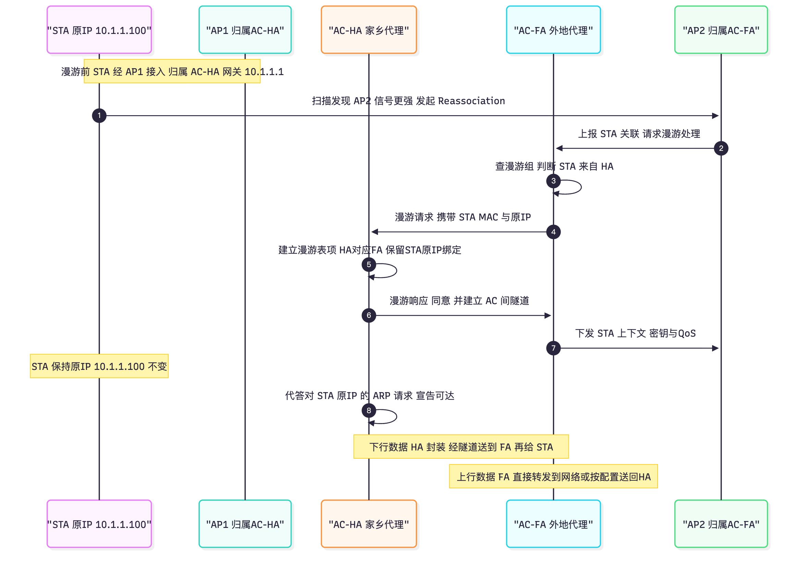


**逐步说明（答题时按此顺序写）**：

1. **漫游触发**：STA 在运动中发现 AP2 的信号质量优于当前 AP1（可用 802.11k 邻居报告加速发现），发起**重关联（Reassociation Request）**到 AP2。
2. **AP2 上报 FA**：AP2 把 STA 的关联信息（MAC、原 IP、安全上下文摘要）上报给其归属 AC（FA）。
3. **FA 识别归属**：FA 根据 STA 的原 IP 与漫游表判断该 STA 属于漫游组内的另一台 AC（HA），向 HA 发起**漫游请求**（在漫游组隧道内，报文携带 STA 的 MAC、原 IP、所属 VAP 等信息）。
4. **HA 建立漫游表项与隧道**：HA 校验请求（漫游组名称/ID/密钥一致、STA 在其下线记录中），建立**漫游表项（STA MAC ↔ FA 地址 ↔ 原 IP）**，并回应**漫游响应**；此时 HA 与 FA 之间建立（或复用）**AC 间隧道**（通常为 UDP 封装，端口按产品实现；**以所用版本文档为准**）。
5. **FA 完成接入**：FA 把 STA 的上下文（密钥、QoS、VLAN 策略）下发给 AP2，STA 完成接入。**STA 的 IP 不变**（因为它仍在使用原 IP 与原有网关）。
6. **HA 代答 ARP（IP 保持的关键）**：STA 的原 IP 属于 HA 侧子网，网关是 HA 侧的子网网关。当网络中的设备（如网关、其他主机）要访问 STA 的原 IP 时，会发 ARP 请求；**HA 代替 STA 应答**（代理 ARP），宣告"该 IP 在我这里"，从而把下行流量吸引到 HA。
7. **下行数据转发**：目的为 STA 原 IP 的报文到达 HA 侧网关 → 转发到 HA → HA 查漫游表得知 STA 在 FA 侧 → **由 HA 把报文封装进 AC 间隧道送到 FA** → FA 解封装后通过 AP2 送到 STA。
8. **上行数据转发**：STA 发出的报文源 IP 仍是原 IP，但物理上从 AP2 进入 FA。FA 的处理有两种方式：① **FA 直接把报文转发到网络**（依赖网络中已有 STA 原 IP 的路由，通常是 FA 侧把报文送回 HA 或让核心路由可达 HA 子网）——这就是**"三角路由"**，下行绕行 HA、上行直连，是非对称路径；② **FA 把上行报文也经隧道送回 HA**，由 HA 统一出口，路径对称但多一跳。**具体行为取决于产品实现与转发模式，答题时要说明"上行可由 FA 直接转出（三角路由）或经隧道回 HA（对称路径）"**。
9. **漫游返回**：STA 再漫游回原区域时，若回到 HA 下的 AP，则 HA 删除漫游表项，恢复正常接入；若漫游到第三台 AC，则同过程再建立 HA-FA' 的隧道。

**⑤ 本地转发与三层漫游的组合问题（高频考点）。**

如果配置成本地转发，STA 的业务报文由 AP 直接打 VLAN Tag 送接入交换机。这时 FA 侧的 AP 会把 STA 的报文打上**FA 侧的业务 VLAN**，而 STA 的 IP 属于 **HA 侧子网**——**VLAN 与 IP 子网不匹配**，网关无法正确转发，漫游后业务不通。

因此工程上有三种处理方式：① **跨 AC 三层漫游统一使用隧道转发**（最稳妥，尤其对需要漫游的业务 SSID）；② 采用**华为的本地转发漫游方案**（部分版本支持本地转发下的跨 AC 漫游，通过 AC 间隧道回送漫游流量或通过特定的 VLAN 规划让 FA 侧 AP 使用 HA 侧 VLAN 的隧道化承载，**能力与配置以所用版本文档为准**）；③ **在 FA 侧 AP 与 HA 侧子网之间打通二层通路**（例如把 HA 侧 VLAN 延伸/隧道到 FA 侧接入交换机），但这会扩大广播域并带来新的问题，一般不推荐。

**结论（答题模板）**：**"需要跨 AC 三层漫游的业务（如语音、移动办公）应采用隧道转发；本地转发适用于不漫游或仅在单 AC 内漫游的高带宽业务（视频监控、媒体）。"** 这与 2.1/2.6 节的混合部署策略一致。

### 关键概念对照表

| 对比项 | HA（家乡代理） | FA（外地代理） |
|---|---|---|
| 身份 | STA 漫游前归属的 AC | STA 漫游后归属的 AC |
| 掌握的 IP 子网 | **STA 原 IP 所在子网** | STA 当前物理接入所在子网 |
| 关键动作 | 建立漫游表项、**代理 ARP**、下行数据经隧道下发 | 接收隧道数据并转发给 STA、上报漫游请求 |
| 数据隧道角色 | 下行数据的**入口/封装方** | 下行数据的**出口/解封装方** |
| 隧道方向语义 | HA → FA（HA 主动把流量推向 FA） | FA 接收 |
| 漫游结束后 | 删除漫游表项（STA 回来时） | — |

| 概念 | 作用 | 配置要点 |
|---|---|---|
| 漫游组（Mobility Group） | 定义"允许互相漫游的 AC 集合"与信任关系 | 组名、组 ID、**组密钥**必须完全一致 |
| 漫游组源接口 | AC 间隧道的源地址 | 必须组内互相可达，建议用 Loopback |
| 漫游组隧道 | 承载漫游控制报文与（隧道转发下）数据报文 | 需放通对应 UDP 端口 |
| 漫游表项 | STA MAC ↔ 原 IP ↔ FA 地址 ↔ VAP | 由 HA 维护，是下行转发的依据 |
| 代理 ARP | HA 代 STA 应答 ARP，把下行流量吸引到 HA | 需要 HA 侧网关与 HA 的配合 |

### 华为设备配置

```bash
# ============ AC-HA（10.10.100.1，STA 原 IP 10.1.1.0/24 所在 AC）============
system-view
sysname AC-HA
vlan batch 100 200                                # 100 业务 200 与其他 AC 互连
interface Vlanif200
 ip address 10.10.200.1 255.255.255.0
 quit
interface LoopBack0                               # 漫游组源接口（推荐用 Loopback，稳定且唯一）
 ip address 10.10.200.254 255.255.255.255
 quit
wlan
 mobility-group name campus-mobility              # 创建漫游组（组名必须全网一致）
  member ip-address 10.10.200.254                 # 声明本机组内的 AC 地址（逐台添加）
  member ip-address 10.10.200.253                 # FA 侧的漫游组源接口地址
  # 部分版本用 mobility-group id 与 member 列表配置，以所用版本文档为准
  quit
 mobility-group name campus-mobility source loopback0   # 指定本 AC 的漫游组源接口
 # 说明：漫游组安全密钥（用于加密 AC 间隧道）相关配置项随版本差异大，
 #       需保证组内所有 AC 的密钥一致，具体命令以所用版本文档为准
 vap-profile name roaming-vap                     # 需要漫游的业务 VAP
  service-vlan vlan-id 100                        # HA 侧业务 VLAN（STA 原 IP 所属子网）
  forward-mode tunnel                             # 关键：跨 AC 三层漫游业务建议用隧道转发
  mobility-group campus-mobility                  # 该 VAP 启用跨 AC 漫游
  quit
 quit
 # ===== 查看漫游相关状态 =====
display wlan mobility-group all                  # 查看漫游组成员与状态
display wlan mobility-group name campus-mobility # 查看指定漫游组详情
display wlan roam-table                          # 查看漫游表项（STA MAC 与原IP 与 FA 对应关系）
display wlan client verbose                      # 查看终端当前关联与漫游状态

# ============ AC-FA（10.10.100.2，STA 漫游后接入侧）============
system-view
sysname AC-FA
vlan batch 110 200                                # 110 FA 侧业务 VLAN 200 互连
interface Vlanif200
 ip address 10.10.200.2 255.255.255.0
 quit
interface LoopBack0
 ip address 10.10.200.253 255.255.255.255
 quit
wlan
 mobility-group name campus-mobility              # 组名必须与 HA 完全一致
  member ip-address 10.10.200.254
  member ip-address 10.10.200.253
  quit
 mobility-group name campus-mobility source loopback0
 vap-profile name roaming-vap
  service-vlan vlan-id 110                        # FA 侧业务 VLAN（用于本地接入的 STA）
  forward-mode tunnel                             # 与 HA 保持一致
  mobility-group campus-mobility                  # 同一 SSID 必须启用同一漫游组
  quit
 # SSID 名称与安全模板必须与 HA 完全一致，否则 STA 不会认为这是同一个网络而不会漫游
 quit
```

### 示意图

```mermaid
flowchart TB
    CORE["核心交换机 S12700<br/>HA子网网关 10.1.1.1"] --> HA["AC-HA 10.10.200.254<br/>家乡代理"]
    CORE --> FA["AC-FA 10.10.200.253<br/>外地代理"]
    HA <-.->|"漫游组隧道<br/>控制与下行数据"| FA
    HA --> AP1["AP1 归属HA<br/>2.4G 5G 覆盖区A"]
    FA --> AP2["AP2 归属FA<br/>覆盖区B"]
    STA["STA 原IP 10.1.1.100<br/>漫游后仍用原IP"] -. "漫游前经AP1" .-> AP1
    STA -->|"漫游后经AP2"| AP2
```

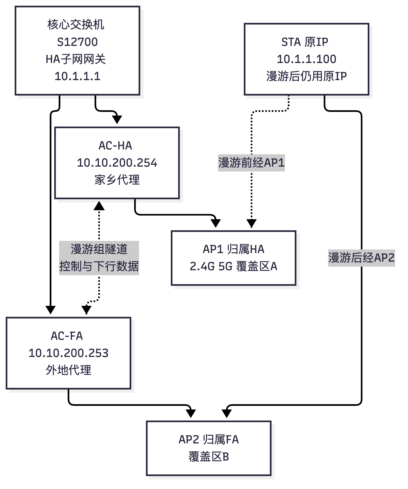


```mermaid
flowchart LR
    HOST["外部主机访问 10.1.1.100"] --> GW["HA侧网关 10.1.1.1<br/>ARP解析由HA代答"]
    GW --> HA["HA 查漫游表<br/>STA在FA侧"]
    HA -->|"封装进 AC间隧道"| FA["FA 解封装"]
    FA --> AP["AP2"]
    AP --> STA["STA 收到 源IP为对端 目的IP为原IP"]
    STA -->|"上行源IP为10.1.1.100"| AP
    AP --> FA
    FA -. "三角路由 可直接转发到网络" .-> NET["网络"]
    FA -. "或经隧道回送HA 对称路径" .-> HA2["HA"]
```

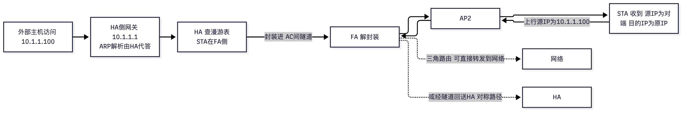


### 真题精练

**Q1.【真题·单选】** 跨 AC 三层漫游中，负责代理应答针对 STA 原 IP 的 ARP 请求、并把下行流量引入隧道的是？
A. FA（外地代理）  B. **HA（家乡代理）**  C. 核心交换机  D. STA 当前关联的 AP

> **答案：B**
> **解析**：STA 漫游后保留了原 IP，而原 IP 属于 **HA 侧子网**。网络中若有设备要访问该 IP，会发 ARP 请求，此时**由 HA 代替 STA 应答（代理 ARP）**，宣告该 IP 由 HA 服务，从而把下行流量吸引到 HA，HA 再查漫游表经 AC 间隧道把流量送到 FA，由 FA 转发给 STA。FA 的职责是接收隧道流量并转发给 STA、上报漫游请求，**不做代理 ARP**（它也不掌握原 IP 所在子网）。这是跨 AC 漫游最核心的机制考点。

**Q2.【真题·多选】** 跨 AC 三层漫游要成功，必须满足的条件包括？
A. 两台 AC 加入同一个漫游组，组名与组 ID 一致
B. 两台 AC 的漫游组源接口地址互相可达
C. 两台 AC 上的 SSID 名称与安全模板参数一致
D. 两台 AC 必须使用完全相同的硬件型号与软件版本
E. 需要 STA 支持并主动发起漫游

> **答案：ABCE**
> **解析**：D 错误。跨 AC 漫游（漫游组机制）并不强制要求两台 AC 同型号同版本（这与 **AC 集群** 的要求不同——集群通常要求同型号同版本，而漫游组只要求配置与协议互通）。但工程上仍建议同型号同版本以便配置一致与排错。A、B、C 是成功的必要配置条件；E 是常被忽略的一点：**漫游由 STA 决定并发起**，AC 只能通过 802.11k/v 等机制"建议"与"加速"，不能强制终端漫游（除智能漫游的踢除策略外）。

**Q3.【真题·判断】** 跨 AC 三层漫游后，STA 必须重新获取 IP 地址，否则无法通信。

> **答案：错误**
> **解析**：跨 AC 三层漫游的**核心目的就是保持 STA 的 IP 不变**，从而不断开上层 TCP 连接与业务。实现方式是"HA 代理 ARP + HA-FA 隧道回程"：STA 继续使用原 IP，HA 通过代理 ARP 让网络认为该 IP 仍可达并吸引下行流量，再经隧道送到 FA。若 STA 重新获取 IP，则本文所述机制没有存在意义。**注意**：如果漫游组未配置、或安全模板不一致导致 STA 无法漫游，STA 会退化为"断开重连 + 重新获取 IP"，用户会明显感知（视频中断、下载失败）。

**Q4.【真题·简答】** 请完整描述跨 AC 三层漫游中下行数据与上行数据的转发路径，并说明什么是"三角路由"及其优点与风险。

> **答案要点**：
> ① **下行路径**：外部主机 → 目的 IP 为 STA 的原 IP（属 HA 侧子网）→ 到达 HA 侧网关 → 网关 ARP 解析该 IP，由 **HA 代理应答** → 报文送到 HA → HA 查**漫游表项**（STA MAC ↔ 原 IP ↔ FA 地址）→ HA 把报文**封装进 AC 间隧道**（漫游组隧道，UDP 封装）→ 送到 **FA** → FA 解封装 → 通过 **AP2** 的 CAPWAP 隧道（隧道转发）或本地转发送到 STA。
> ② **上行路径**：STA 发出报文（源 IP 仍为原 IP）→ AP2 → FA。此时有两种实现：a) **FA 直接把报文转发到网络**（靠网络中"到 STA 原 IP 子网"的路由指向 HA 侧，或 FA 侧具备可达 HA 子网的路由），形成"下行绕 HA、上行直连"的非对称路径；b) **FA 把上行报文经隧道送回 HA**，由 HA 统一出口，路径完全对称但多一跳。
> ③ **三角路由**：指的是"下行经 HA 绕行、上行由 FA 直出"形成的不对称路径（拓扑上像一个三角形）。**优点**：上行不必绕行 HA，减少一跳时延与 HA 的负载。**风险**：a) 网络中若有**状态防火墙/防火墙的会话检查**，上下行不同路径会导致会话不对称而被丢弃；b) 若上行路径上的设备对源 IP 做**反欺骗检查（uRPF）**，来自 FA 子网却携带 HA 子网源 IP 的报文会被丢弃；c) 排错复杂度上升。因此**在部署了严格状态化安全设备的网络中，应通过配置让路径对称**（例如统一用隧道转发让上下行都经 HA，或在网络层保证两条路径都可达且不被安全检查丢弃）。
> ④ 补充：**跨 AC 三层漫游的业务建议使用隧道转发**，因为本地转发下 FA 侧 AP 会给 STA 的报文打上 FA 侧 VLAN，而 STA 的 IP 属于 HA 侧子网，**VLAN 与子网不匹配**会导致业务不通——这是排错题最常见的根因。

**Q5.【真题·排错】** 某园区部署了两台 AC 并用漫游组配置了跨 AC 漫游。用户反馈"走到 B 楼后 Wi-Fi 要断十几秒才恢复，而且恢复后原来的视频会议连接中断、需要重新加入"。请给出排查思路与解决方案。

> **答案要点**：
> ① **现象特征判断**："断十几秒 + 上层连接中断"说明 **STA 实际上没有完成跨 AC 漫游，而是断链重连并重新获取了 IP**（若漫游成功，业务应保持且 IP 不变）。因此排查重点是"为什么漫游没有成功"。
> ② **排查一：漫游组配置。** 用 `display wlan mobility-group all` 逐台确认：组名与组 ID 是否完全一致；`display wlan mobility-group name <组名>` 查看成员列表是否互为成员；**漫游组源接口是否互相可达**（`ping -a <本端源接口> <对端源接口>`）；源接口是否配置正确（建议 Loopback）；**组密钥是否一致**（不一致会导致隧道建立失败，命令随版本差异，以文档为准）。
> ③ **排查二：SSID 与安全模板一致性。** 逐条比对两台 AC 的 SSID 名称、安全模板（认证方式、加密方式、密钥/密码）、VAP 配置。**任何一处不一致都会让 STA 认为这是不同的网络而不漫游**。注意：SSID 大小写、隐藏设置、加密类型必须完全相同。
> ④ **排查三：转发模式。** `display wlan ap name <AP> config` 或 VAP 配置确认漫游业务的转发模式。若是**本地转发**，FA 侧 AP 会给 STA 报文打 FA 侧 VLAN，与 STA 原 IP 子网不匹配，**业务会不通或被迫重连**。应把漫游业务 VAP 改为**隧道转发**。
> ⑤ **排查四：AC 间隧道与端口。** 检查中间网络（防火墙/ACL）是否放通了 AC 之间的漫游组隧道与 CAPWAP 相关端口；用 `display wlan roam-table` 查看漫游表项是否建立（若为空，说明漫游未成功）；查看 AC 日志中是否有漫游请求被拒绝的记录。
> ⑥ **排查五：漫游优化特性是否启用。** 未启用 **802.11k**（邻居报告，STA 扫描慢）与 **802.11v**（BSS 转换管理，AC 不能引导切换）会导致 STA "粘"在原 AP 上直到信号极差才切换，切换过程更长。应开启 `smart-roam` 与 11k/11v（见 2.5 节）。
> ⑦ **解决方案**：修正漫游组配置（组名/ID/密钥/源接口）→ 统一 SSID 与安全模板 → 漫游业务改隧道转发 → 放通 AC 间隧道流量 → 开启 802.11k/v 与智能漫游并设置合理门限 → 开启 **802.11r 快速 BSS 转换**（若终端支持）把切换时间压缩到 50 ms 以内。
> ⑧ **验证**：用 `display wlan roam-table` 确认漫游表项生成；实测跨楼漫游时用持续 Ping 观察丢包数（目标 < 3 个包，切换时间 < 100 ms，开启 11r 后 < 50 ms）；确认漫游后 STA 的 IP 未变（`ipconfig`/`ifconfig` 对比）。

### 易错点与排错

1. **把 HA 与 FA 的职责写反**：HA 是**漫游前**的 AC，负责**代理 ARP 与下行隧道入口**；FA 是**漫游后**的 AC，负责**接收隧道流量与转发给 STA**。建议记成"HA 是老家（户口所在地），FA 是暂住地"。
2. **认为隧道方向是 FA→HA**：下行数据是 **HA→FA**（因为流量被代理 ARP 吸引到 HA，HA 再推给 FA）。
3. **忘记漫游组的组密钥**：组名/ID/成员/源接口都对了，但密钥不一致会导致隧道建立失败，漫游失败。
4. **跨 AC 漫游用本地转发**：VLAN 与 IP 子网不匹配，是最常见的"漫游后不通"根因。
5. **忽略 802.11k/v/r**：不做漫游优化，切换时间长、粘滞严重，即使漫游成功体验也差。
6. **排错命令**：`display wlan mobility-group all`、`display wlan mobility-group name <组名>`、`display wlan roam-table`、`display wlan client verbose`、`display wlan ap name <AP> config`、以及从 STA 侧持续 Ping 与 IP 对比。

---

## 2.5 漫游优化：802.11r/k/v、PMK 缓存与 OKC、漫游门限与粘滞客户端

### 考点定位

本考点以多选/简答/排错题为主，分值 6~10 分。高频考法：**802.11k/v/r 各自解决什么问题**、**PMK 缓存与 OKC 的对比**、**漫游门限设置与粘滞客户端（Sticky Client）的成因与治理**。易错点：① 把 802.11k（邻居报告）当成"主动引导切换"（那是 11v 的功能）；② 分不清 **PMK 缓存（单向）** 与 **OKC（双向派生）**；③ 不知道漫游门限设得过激会造成"乒乓漫游"。

### 原理精讲

**① 漫游慢在哪里？先明确三个耗时环节。**

一次完整的漫游（从 STA 决定切换到业务恢复）包含三段时间：
1. **发现与决策时间**：STA 需要扫描信道寻找候选 AP。**主动扫描**要逐个信道发 Probe Request 并等待响应，20 个信道可能耗时 1~2 秒；**被动扫描**要等 Beacon（默认 100 ms 一次），更慢。← **802.11k 优化这一段**。
2. **安全重认证时间（最大头）**：若使用 802.1X/WPA2-Enterprise，STA 到新 AP 需要重新做完整认证：**802.11 开放认证（2 帧）+ 关联（2 帧）+ EAP 交换（可能十余帧，含 RADIUS 往返）+ 4 次握手（4 帧）**，耗时可达 **数百毫秒到数秒**。← **802.11r 与 PMK 缓存/OKC 优化这一段**。
3. **网络侧更新与业务恢复时间**：新 AP/AC 更新转发表、ARP/网关更新、跨 AC 时的隧道建立与漫游表项更新。← **802.11v 与 AC 侧机制优化这一段**。

**② 802.11k：无线资源测量（Radio Resource Measurement）。**

作用：让 AP 向 STA 提供**邻居报告（Neighbor Report）**，列出同 SSID 的邻近 AP 的 BSSID、信道、以及"是否与当前 AP 同属一个 MD（Mobility Domain）"等信息，使 STA **不必全信道扫描**，只扫描报告中列出的少数信道，把扫描时间从 1~2 秒压缩到几十毫秒。

**关键澄清（必考）**：**802.11k 只提供信息，不决定"切到哪个 AP"，也不主动触发切换。** 决策仍由 STA 做（终端通常基于 RSSI/SNR 阈值与厂商算法）。所以"802.11k 能让 AP 主动把终端赶到更好的 AP"是**错的**——那是 802.11v。

**③ 802.11v：BSS 转换管理（BSS Transition Management）。**

作用：让**网络侧（AP/AC）可以向 STA 发起"建议切换"**（BSS Transition Management Request），携带候选 AP 列表（含 BSSID、信道、优先级），请求 STA 漫游到更合适的 AP；STA 可以接受（发 Response 确认）或拒绝。它还可以包含"**解除关联 imminent**"（Disassociation Imminent）字段，通知 STA"你即将被断开，请尽快切换"，从而实现**负载均衡的"礼貌驱逐"**而不是粗暴断链。

**关键澄清**：**802.11v 才是"网络主导的漫游引导"**，802.11k 是"给信息"。二者配合：11k 提供邻居列表 → 11v 主动建议 → STA 执行。

**④ 802.11r：快速 BSS 转换（Fast BSS Transition，FT）。**

作用：**把安全重认证的耗时降下来**。802.11r 的核心思想是：STA 在**首次认证（初始关联）**时就与网络协商好**主密钥（PMK-R0、PMK-R1）**，并生成层级化的密钥体系；漫游到新 AP 时，**不必重新与 RADIUS 做完整 EAP 认证**，而是通过"FT 握手"在**新旧 AP 之间（或经 DS）**交换信息，快速生成新的会话密钥。

802.11r 的**两种 FT 方式（必考）**：

| 方式 | 英文 | 交互路径 | 特点 |
|---|---|---|---|
| **Over-the-Air（空中方式）** | FT over the Air | STA 与**新 AP** 直接进行 FT 认证交换（新 AP 需从旧 AP 或其缓存获得 PMK-R0/R1） | **交互帧更少、更快**（不经过 DS），但对**新旧 AP 之间的密钥分发**有要求；通常与 AP 间密钥缓存配合 |
| **Over-the-DS（经分布式系统方式）** | FT over the DS | STA 把 FT 请求**经当前 AP 通过 DS（有线网络）转发给新 AP**，再由新 AP 回应 | 交互路径长一些（多一次经 DS 的往返），但**不要求新旧 AP 在无线侧互相听到**，适合新 AP 无法被 STA 直接发 FT 请求的场景 |

两者都避免了完整 EAP 认证，切换时间可从 **数百毫秒压缩到 50 ms 以内**，对**语音（VoWiFi）** 至关重要。

**⑤ PMK 缓存与 OKC：802.11r 之外的"轻量"加速手段。**

**PMK 缓存（PMK Caching，也称 PMKID Caching）**：
- 原理：STA 与 AP1 完成认证后得到 PMK（Pairwise Master Key），**STA 与 AP1 都缓存该 PMK 及其 PMKID**。STA 漫游到 AP2 时，在关联请求里带上 **PMKID**；若 AP2 恰好也缓存了该 PMK（**通常需要 AP1 与 AP2 属于同一 AC，或共享缓存**），则双方**跳过完整的 802.1X 认证**，直接进入 4 次握手。
- 特点：**单向**——只有"新旧 AP 共享同一缓存"时才有效。在**同一 AC 下的不同 AP** 场景有效（AC 可统一缓存）；**跨 AC** 场景通常无效（不同 AC 不共享缓存），除非配合漫游组做缓存同步。
- 属于 802.11i 的机制，**不需要终端支持 802.11r**，兼容性最好。

**OKC（Opportunistic Key Caching，机会密钥缓存）**：
- 原理：STA 与网络完成首次认证后，**AC（认证者）** 根据 PMK 派生出 **PMK-R0 与 PMK-R1** 并**缓存**；STA 漫游到新 AP 时，新 AP 向 **AC 请求**该 STA 的密钥材料（PMK-R1），若 AC 已有缓存则直接下发，**无需重新 RADIUS 认证**。
- 特点：**由 AC 集中管理密钥缓存，因此同一 AC（或同一漫游组）下的任意 AP 之间漫游都可加速**，不需要新旧 AP 之间共享缓存。比 PMK 缓存适用面更广，但**需要终端与新 AP 支持 OKC**（很多 Windows/安卓终端支持不完整，兼容性不如 PMK 缓存）。
- 与 802.11r 相比：OKC 是"厂商/标准扩展的密钥缓存"，**不做密钥层级派生与 FT 握手**，安全性略低于 11r（11r 有 PMK-R0/R1 层级与更强的密钥隔离），加速效果也不如 11r。

**对比表（必背）**：

| 对比项 | PMK 缓存（PMK Caching） | OKC（机会密钥缓存） | 802.11r（FT） |
|---|---|---|---|
| 标准归属 | 802.11i | 厂商扩展（Wi-Fi 联盟推广） | **802.11r**（2012 起） |
| 密钥缓存位置 | **AP（新旧 AP 都需缓存）** | **AC 集中缓存** | AC/AP 层级派生（PMK-R0/R1） |
| 跨 AP 生效范围 | 仅新旧 AP 共享缓存时（通常同 AC 内） | **同 AC 或同漫游组内的任意 AP** | 同 MD（Mobility Domain）内的 AP |
| 跨 AC 漫游 | 通常**不支持** | 需漫游组配合缓存同步 | 需同 MD 配置与 AC 间交互 |
| 是否需要终端支持 | 大部分 WPA2 终端支持 | 支持不完整（兼容性风险） | 需要终端支持 11r（新终端普遍支持） |
| 加速效果 | 跳过 802.1X，保留 4 次握手 | 跳过 802.1X 与部分密钥协商 | **最快（<50 ms），完整 FT 握手** |
| 安全性 | 中（PMKID 可被嗅探用于攻击） | 中 | **高（密钥层级隔离）** |
| 与 11r 关系 | 可与 11r 并存（11r 优先） | 可与 11r 并存 | 优先启用 |

**⑥ 漫游门限与粘滞客户端（Sticky Client）。**

**粘滞客户端**是指：STA 已经移动到离原 AP 很远、信号很差的位置（例如 RSSI < −75 dBm）、附近明显有更好的 AP，但**STA 仍"粘"在原 AP 上不切换**。原因：**漫游决策完全由终端厂商算法决定**——很多终端（尤其部分手机与笔记本）的漫游阈值设置得很"懒"（如 RSSI 低于 −80 dBm 才考虑切换，或要求新 AP 比当前 AP 强 10 dB 以上），导致终端一直待在劣质链路上：速率低、重传高、占用大量空口时间（低速终端拖累效应再次出现）。

**AC 侧的治理手段**：
1. **智能漫游（Smart Roaming）**：AC 持续监控终端信号质量，当终端的 RSSI 低于**漫游门限**（如 −70 dBm）且存在更优邻居 AP 时，主动**要求终端切换**（通过 802.11v BSS 转换管理请求，或对不支持 11v 的终端通过"低速率踢除/强制断链"迫使重连）。
2. **低速率终端踢除**：当终端协商速率低于门限（如 6 Mbps）且持续一段时间时，强制断开使其重新选择 AP。**要谨慎**：踢除会造成短暂断线，且若所有 AP 信号都差（覆盖空洞）会导致终端反复掉线。
3. **漫游门限的设定**：门限过高（如 −60 dBm）会导致**频繁切换（乒乓漫游）**；门限过低（如 −80 dBm）则起不到作用。工程常用值：**启动漫游门限 −70 ~ −75 dBm**，并设**滞后量（Hysteresis）**要求"目标 AP 比当前 AP 强 5~10 dB 才切"，避免乒乓。
4. **最小接入速率与频段引导配合**：从源头减少弱信号终端的比例。
5. **覆盖设计**：粘滞的根源往往是**覆盖设计不合理**（AP 间距过大、存在覆盖空洞、功率过高导致"一个 AP 覆盖太远"）。**降低 AP 功率、缩小单 AP 覆盖范围、增加 AP 密度**，反而能让终端更早被迫漫游——这是"功率越大越难漫游"的反直觉结论。

### 关键概念对照表

| 标准 | 全称 | 解决什么 | 谁主导 | 生效范围 |
|---|---|---|---|---|
| **802.11k** | Radio Resource Measurement | 提供邻居报告，**加速扫描** | STA 请求、AP 提供 | 同一 RRM 域 |
| **802.11v** | BSS Transition Management | **网络主动建议终端切换**、负载均衡引导、解除关联通知 | **网络（AP/AC）主导** | 同一 MD |
| **802.11r** | Fast BSS Transition | **快速安全重认证**（免完整 EAP），切换 < 50 ms | STA 与 AP 交互（Over-the-Air / Over-the-DS） | 同一 MD（Mobility Domain） |
| PMK 缓存 | PMK Caching | 跳过 802.1X，保留 4 次握手 | STA 与 AP（PMKID） | 新旧 AP 共享缓存（同 AC 内） |
| OKC | Opportunistic Key Caching | AC 集中缓存密钥，跳过 802.1X | AC 主导 | 同 AC/同漫游组内 |

| 指标 | 目标值 | 说明 |
|---|---|---|
| 漫游切换时间（无 11r） | < 150 ms | 含扫描、认证、关联 |
| 漫游切换时间（有 11r） | **< 50 ms** | 语音业务要求 |
| 漫游丢包 | ≤ 1~3 个包 | 用持续 Ping 测量 |
| 启动漫游门限 | −70 ~ −75 dBm | 过低不起作用，过高会乒乓 |
| 滞后量（Hysteresis） | 5~10 dB | 目标 AP 需比当前强这么多才切 |
| 邻居 RSSI 下限（候选 AP） | ≥ −70 dBm | 太弱的候选不切 |

### 华为设备配置

```bash
system-view                                        # 进入系统视图
wlan                                               # 进入 WLAN 视图
 rrm-profile name rrm-roaming                      # 创建射频管理模板（漫游相关）
  smart-roam enable                                 # 使能智能漫游（AC 监控信号并引导切换）
  smart-roam roam-threshold rssi -70                # 启动漫游的信号门限 -70dBm（参数名随版本变化）
  smart-roam check-interval 3                       # 检查周期（秒），过短会增加开销
  smart-roam hysteresis 5                           # 滞后量 5dB，避免乒乓漫游
  # 上述参数名与取值范围随版本差异较大，以所用版本文档为准
  dot11k enable                                     # 使能 802.11k 邻居报告，加速终端扫描
  dot11v enable                                     # 使能 802.11v BSS 转换管理，网络可主动引导
  # 部分版本由 smart-roam 统一控制 11k/11v 能力，命令以文档为准
  quit                                              # 退出
 vap-profile name roaming-vap                      # 进入 VAP 模板
  service-vlan vlan-id 100                          # 业务 VLAN
  forward-mode tunnel                               # 漫游业务建议隧道转发，简化跨三层漫游
  mobility-group campus-mobility                    # 关联漫游组
  quit                                              # 退出
 security-profile name roaming-sec                 # 安全模板（漫游加速的前提是安全参数一致）
  security wpa2 psk pass-phrase Huawei@123 aes      # WPA2-PSK + AES
  # 企业级场景可用 wpa2 dot1x，但必须开启 FT/OKC 才能保证漫游性能
  pmf enable                                        # 802.11w 管理帧保护（可选，增强安全）
  # ===== 快速漫游相关（802.11r）=====
  ft enable                                         # 使能 802.11r 快速 BSS 转换（命令名随版本差异）
  ft over-the-ds enable                             # 选择 Over-the-DS 方式（或 over-the-air，二者按现场取舍）
  ft mobility-domain 1                              # 配置移动域 ID，同一移动域内的 AP 可快速漫游
  # 关键：同一移动域内所有 AC 的域 ID 与密钥体系必须一致
  # 上述命令名与视图归属随版本差异很大，务必以所用版本文档为准
  quit                                              # 退出
 # ===== 低速率终端踢除（治理粘滞客户端的辅助手段）=====
 rrm-profile name rrm-roaming
  smart-roam low-rate-threshold 6                   # 协商速率低于 6Mbps 触发踢除（示例）
  # 踢除会造成短暂断线，覆盖存在空洞时应谨慎使用
  quit
 # ===== 查看漫游与终端信号状态 =====
display wlan client verbose                         # 查看终端RSSI SNR 协商速率 是否支持11k/v/r
display wlan roam-table                             # 查看漫游表项
display wlan mobility-group all                     # 查看漫游组状态
```

### 示意图

```mermaid
sequenceDiagram
    autonumber
    participant STA as "STA 支持11k/v/r"
    participant AP1 as "当前AP"
    participant AP2 as "目标AP"
    participant AC as "AC 与 RADIUS"

    STA->>AP1: 802.11k 邻居报告请求
    AP1->>STA: 邻居报告 候选BSSID 信道 优先级
    Note over STA: 只扫描报告中的少数信道 扫描时间从秒级降到毫秒级
    AP1->>STA: 802.11v BSS转换管理请求 建议切到AP2
    STA->>AP2: 802.11r FT 认证请求 Over-the-Air 或 Over-the-DS
    AP2->>AC: 获取 PMK-R1 或经DS与旧AP交互
    AC->>AP2: 下发密钥材料 无需重新RADIUS
    AP2->>STA: FT 响应 生成新会话密钥
    STA->>AP2: 重关联 完成
    Note over STA: 切换时间 小于50ms 丢包1到3个
```

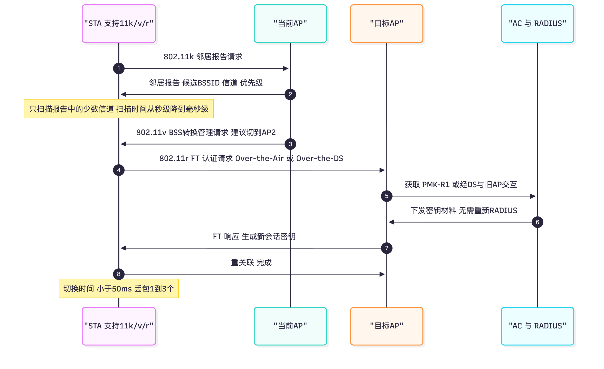


```mermaid
flowchart TD
    S["终端移动 信号变差"] --> D{"是否支持802.11v"}
    D -->|是| V["网络发BSS转换管理请求<br/>给候选AP列表"]
    V --> R{"终端是否接受"}
    R -->|是| F["执行切换 配合11r快速认证"]
    R -->|否| L["继续观察 或降低门限再发"]
    D -->|否| K{"协商速率是否过低"}
    K -->|是| K2["低速率踢除 强制重连"]
    K -->|否| W["粘滞 依赖终端自身算法"]
    L --> W
```

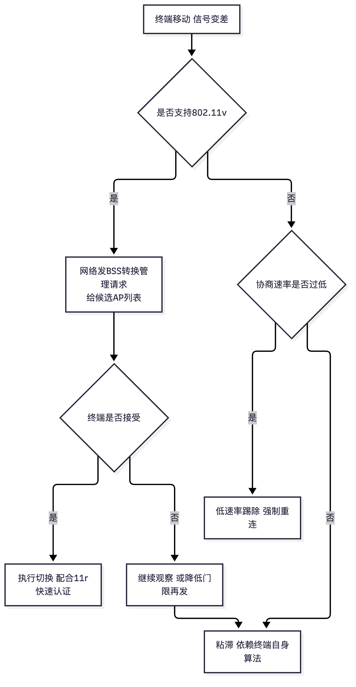


### 真题精练

**Q1.【真题·单选】** 在无线漫游优化中，"由网络侧主动向终端建议切换目标 AP"这一能力由哪个标准提供？
A. 802.11k  B. **802.11v**  C. 802.11r  D. 802.11w

> **答案：B**
> **解析**：**802.11v（BSS Transition Management）** 允许 AP/AC 向 STA 发送"BSS 转换管理请求"，携带候选 AP 列表与优先级，请求 STA 漫游到更合适的 AP，是**网络主导的漫游引导**机制。A 的 802.11k 只提供**邻居报告**（信息类），不主动触发切换；C 的 802.11r 解决**快速安全重认证**；D 的 802.11w 是**管理帧保护（PMF）**，用于防止 Deauth 攻击，与漫游引导无关。

**Q2.【真题·多选】** 关于 PMK 缓存与 OKC，下列说法正确的有？
A. PMK 缓存需要新旧 AP 都缓存该 STA 的 PMK 才有效
B. OKC 由 AC 集中缓存密钥，同一 AC 或同一漫游组内的 AP 之间漫游都可加速
C. OKC 的终端兼容性优于 PMK 缓存
D. 802.11r 的加速效果通常优于 PMK 缓存与 OKC
E. PMK 缓存与 OKC 在跨 AC 漫游场景下都无需任何额外配合即可生效

> **答案：ABD**
> **解析**：C 错误，**OKC 依赖终端支持，兼容性实际上不如 PMK 缓存**（很多 Windows/安卓终端对 OKC 支持不完整），因此现网常用 PMK 缓存作为"兼容性最好"的方案。E 错误，跨 AC 漫游时，**PMK 缓存通常无效**（不同 AC 不共享缓存）；**OKC 需要漫游组配合做密钥缓存同步**才能跨 AC 生效。A、B、D 正确。D 的补充说明：802.11r 通过 PMK-R0/R1 层级派生与 FT 握手，避免了完整 802.1X，且密钥隔离更安全，切换可做到 <50 ms。

**Q3.【真题·判断】** 漫游门限设置得越高（例如 −60 dBm），终端就越早漫游，因此用户体验一定越好。

> **答案：错误**
> **解析**：门限过高（如 −60 dBm）会导致**频繁切换（乒乓漫游）**：终端刚到 −61 dBm 就被引导切换，切过去后新 AP 信号也是 −62 dBm 左右，又被引导切回，造成信道反复切换、重认证开销累积、时延抖动与丢包，体验反而更差。正确的门限设定需要三个要素：**启动门限（常用 −70 ~ −75 dBm）+ 滞后量（目标 AP 需比当前强 5~10 dB）+ 检查周期（避免过于频繁评估）**。此外还要保证"存在更优邻居 AP"才触发（若周围所有 AP 信号都差，说明是覆盖空洞，应通过增加 AP 或调整功率来解决，而不是调门限）。

**Q4.【真题·简答】** 什么是粘滞客户端（Sticky Client）？请从"终端侧原因"与"网络侧治理"两个角度说明，并指出为什么"降低 AP 功率"有时反而能改善漫游。

> **答案要点**：
> ① **定义**：STA 已移动到距原 AP 较远、信号明显变差的位置（RSSI 可低于 −75 dBm），附近存在明显更优的 AP，但 STA **仍保持与原 AP 的关联不切换**，导致速率低、重传高、占用大量空口时间（低速终端拖累效应）。
> ② **终端侧原因**：漫游决策完全由终端厂商算法决定，很多终端阈值设置保守（如要求 RSSI 低于 −80 dBm 才考虑切换，或要求候选 AP 比当前 AP 强 10 dB 以上），且部分终端对 802.11k/v 支持不完整，导致决策既慢又保守。
> ③ **网络侧治理**：一是开启 **802.11k**（提供邻居报告，降低扫描开销，让终端更快发现候选）+ **802.11v**（网络主动建议切换，甚至用 Disassociation Imminent 礼貌驱逐）+ **802.11r**（降低安全重认证耗时）；二是**智能漫游**，AC 监控终端 RSSI，低于门限且存在更优邻居时主动引导；三是**低速率终端踢除**（协商速率长期低于门限则强制断链重连，需谨慎）；四是**优化覆盖设计**：合理降低 AP 功率、增加 AP 密度，使单 AP 覆盖范围适度缩小。
> ④ **为什么降低 AP 功率能改善漫游**：粘滞的一个重要成因是**原 AP 功率过高、覆盖过远**——STA 即使走到了别的区域，原 AP 的信号仍然"够用"（例如仍有 −65 dBm），终端的漫游算法就不会触发切换，而实际上它离原 AP 已很远、离新 AP 很近，用新 AP 能获得高得多的速率与容量。降低原 AP 功率后，STA 在原 AP 上的 RSSI 会更快下降到漫游阈值以下，从而**被迫尽早切换到更近的 AP**。代价是需要保证覆盖不出现空洞，因此必须与 AP 密度规划配合。

**Q5.【真题·排错】** 某医院部署 VoWiFi，护士反馈"边走边打电话时，经过两个病区之间会明显卡顿 1~2 秒，甚至偶尔掉话"。请分析原因并给出优化方案。

> **答案要点**：
> ① **根因分析**：语音对**漫游切换时间**极其敏感：一般认为切换中断 > 50 ms 就会出现可感知的断续，> 200 ms 可能掉话。1~2 秒的卡顿说明**发生了完整的安全重认证 + 可能重新获取 IP**，通常意味着：a) **未启用 802.11r（或终端不支持）**，漫游需要完整 EAP 重新认证（数百毫秒到数秒）；b) **未启用 802.11k**，STA 全信道扫描耗时 1~2 秒；c) 病区之间可能**跨 AC 或跨子网**，若是跨 AC 三层漫游配置不当（如本地转发），会断链重连；d) **漫游门限与覆盖设计不合理**，终端粘滞到信号极差才切换，切换时已无可靠链路。
> ② **排查手段**：`display wlan client verbose` 确认终端是否协商启用了 11k/v/r；`display wlan roam-table` 与漫游组状态确认跨 AC 漫游是否正常；用持续 Ping（10 次/秒）+ 抓包测量切换丢包数与时间；确认 AP 是否有跨 AC/跨子网的边界；`display wlan ap all neighbor` 检查病区间 AP 的信号重叠是否足够（重叠过少会导致切换时机太晚）。
> ③ **优化方案**：一是**开启 802.11r（FT）**，选择 Over-the-Air 或 Over-the-DS（病区间 AP 通常能互相听到，Over-the-Air 更快），并保证**同一移动域 ID** 与统一密钥配置；二是**开启 802.11k + 802.11v**，把扫描时间从秒级降到毫秒级，并让网络主动引导切换；三是**启用 PMK 缓存/OKC 作为兼容兜底**（对不支持 11r 的老终端）；四是**统一语音 SSID 用隧道转发**，确保跨 AC 漫游路径正确；五是**调整覆盖与门限**：保证病区之间 AP 信号有适当重叠（边界处两侧信号在 −65 ~ −70 dBm），设置漫游门限 −70 dBm、滞后量 5 dB，避免粘滞与乒乓；六是**语音 QoS 保障**：WMM 中语音映射到 AC_VO，有线侧信任 DSCP（EF/CS6）并做端到端队列保障（见 2.7 节）；七是若条件允许，**用 AC 集群或统一漫游域**把病区纳入同一移动域，减少跨域漫游。
> ④ **验收**：用持续 Ping 与语音质量测试仪测量，漫游切换丢包 ≤ 1~2 个包、切换时间 < 50 ms（11r 生效）、MOS ≥ 4.0、无掉话。

### 易错点与排错

1. **把 802.11k 当"主动引导切换"**：11k 只给邻居报告，11v 才主动建议，11r 才加速重认证。三者是"看、劝、快"的分工。
2. **认为 OKC 兼容性更好**：实际 PMK 缓存兼容性最好，OKC 依赖终端支持，现网常见"开了 OKC 没效果"。
3. **跨 AC 漫游依赖 PMK 缓存**：跨 AC 时 PMK 缓存通常无效，需 OKC + 漫游组同步，或使用 802.11r。
4. **漫游门限设得过高**：引起乒乓漫游，反而更差；必须配滞后量。
5. **忽略覆盖重叠度**：病区/楼层边界若两个 AP 信号重叠过少，STA 会在信号已经很差时才切换，切换成功率与质量都会下降。
6. **排错命令**：`display wlan client verbose`（终端 11k/v/r 能力与 RSSI）、`display wlan roam-table`、`display wlan mobility-group all`、`display wlan ap all neighbor`（邻区重叠情况）、终端侧持续 Ping 与抓包。

---

## 2.6 WLAN 与有线网络融合设计：VLAN、DHCP 与混合转发部署

### 考点定位

本考点以**设计题与排错题**为主，分值 6~10 分。高频问法："给出 VLAN 规划方案"、"DHCP 应该集中还是本地部署"、"隧道转发与本地转发如何在大型园区混合部署"、"AP 管理网段如何规划"。易错点：① 把 AP 管理 VLAN 与业务 VLAN 混在一起；② DHCP 全集中导致单点与性能瓶颈；③ 本地转发忘记放通业务 VLAN 全路径。

### 原理精讲

**① VLAN 规划：至少三类 VLAN 必须分离。**

| VLAN 类别 | 用途 | 规划建议 |
|---|---|---|
| **AP 管理 VLAN** | AP 获取 IP、与 AC 建立 CAPWAP 隧道 | 独立网段（按楼栋/楼层细分）；网关放汇聚层；DHCP 用本地中继 + 双服务器；Option 43 指向 AC |
| **业务 VLAN（STA）** | 终端业务流量 | 按业务类型与安全等级划分（办公、访客、语音、IoT、监控各自独立）；与 AP 管理 VLAN 严格分离 |
| **AC/网络设备互连 VLAN** | AC 与核心、AC 之间（HSB/集群/漫游组）的互连 | 独立网段；建议用三层互连 + 环回地址作为 CAPWAP/HSB/漫游组源接口 |
| （可选）**管理/带外 VLAN** | 网络设备自身管理 | 与业务、AP 管理均分离，最好带外 |

**规划原则（答题必列）**：① **一个 VLAN 一个子网**（避免超网与地址浪费）；② **AP 管理 VLAN 与业务 VLAN 物理或逻辑隔离**（安全 + 广播域隔离）；③ **业务 VLAN 按"安全等级 + 业务特征"划分**（语音、访客、IoT 分开，便于 QoS 与策略）；④ **每个业务 VLAN 的地址容量按"峰值并发终端数 × 1.2~1.5"规划**（考虑 DHCP 租期与漫游）；⑤ **VLAN 号段按楼栋/楼层规划**（如 A 栋 100~199，B 栋 200~299），便于运维与排错。

**② DHCP 部署位置：集中 vs 本地（分布式）。**

| 部署方式 | 架构 | 优点 | 缺点 | 适用 |
|---|---|---|---|---|
| **集中式 DHCP** | 全网由一台（或一对）中心 DHCP 服务器分配所有地址（AP 管理与业务） | 地址池统一管理、易审计、配置集中 | **单点与性能瓶颈**；DHCP 报文需要跨楼栋转发（增加核心与汇聚负担）；服务器故障影响全网 | 小型园区（数百 AP 以内） |
| **分布式（本地中继）** | 在**汇聚层**（或核心分层）配置 DHCP 中继，由就近的 DHCP 服务器（或汇聚交换机自身作 DHCP 服务器）分配本区域地址 | **就近分配、无跨区流量、性能分散、单点影响范围小** | 需要在多处配置 DHCP，地址池管理分散（可用 IPAM/NCE 统一管理） | **大型园区推荐** |
| **交换机本地 DHCP** | 汇聚/核心交换机作为 DHCP 服务器直接分配 | 部署简单、无外部依赖 | 交换机功能与容量有限、不便审计 | 中小型或临时场景 |
| **AP 侧/无 DHCP** | 不用 DHCP（静态 IP 或 IPv6 SLAAC） | — | 不适合大量终端 | 不推荐 |

**大型园区的推荐做法（答题模板）**：**AP 管理网段采用"汇聚层本地 DHCP 中继 + 双 DHCP 服务器（主备）"**，业务网段同样按区域分布式中继；对访客等需要集中控制的业务可用集中式 DHCP + DHCP Snooping 防私接。同时必须考虑：
- **DHCP 租期**：高密场景（体育馆、教室）用**短租期（1~2 小时）**，加快地址回收；办公场景可用 8~24 小时。
- **地址池容量**：按峰值并发 + 漫游余量规划，避免"漫游后 DHCP 分配不到地址"。
- **DHCP Snooping**：开启以防私接 DHCP 服务器（安全要求高的场景）。
- **Option 43**：AP 管理网段的 DHCP 必须下发 **Option 43 指向 AC 地址**（可用子选项同时下发主备 AC 地址）；这是 AP 自动发现 AC 的最常用方式。

**③ 隧道转发与本地转发的混合部署策略（必考）。**

决策矩阵：

| 业务/场景 | 推荐转发模式 | 理由 |
|---|---|---|
| 普通办公、访客、认证类业务 | **隧道转发** | 策略集中、便于审计与准入、AP 位置无关、跨三层漫游简单 |
| 语音（VoWiFi） | **隧道转发** | 端到端 QoS 与漫游一致性要求高；隧道转发让 AC 统一做 QoS 与漫游处理 |
| 视频监控、媒体回传、大文件下载 | **本地转发** | 大带宽业务不过 AC，避免 AC 与其上行链路成为瓶颈；时延更短 |
| IoT 数据（传感器/表计） | **本地转发**（或按厂商方案） | 数据量大但价值密度低，不必占用 AC 隧道资源 |
| 需要跨 AC 三层漫游的业务 | **隧道转发** | 本地转发下 VLAN 与 STA 原 IP 子网不匹配，跨三层漫游会不通 |
| 单 AC 内、不需要漫游的业务 | 本地转发 | 路径最短 |

**混合部署的实现要点**：① **按 VAP（SSID）区分转发模式**——同一个 AP 上可以有多个 VAP，各自的 `forward-mode` 可以不同；② **AP 上行链路必须同时放通 AP 管理 VLAN 与所有本地转发的业务 VLAN**（接入—汇聚—核心全路径，任何一跳漏放都会导致该业务不通）；③ **本地转发下 AC 仍需管理 AP**（控制隧道一直存在），并需要能下发 VLAN 相关配置给 AP；④ **隧道转发的容量规划**：AC 上行链路带宽必须 ≥ 所有隧道转发业务的总和，建议用 10GE/25GE 链路聚合；⑤ **QoS 一致性**：本地转发时 QoS 标记由 AP 直接打在有线报文中，接入交换机必须**信任并保留**这些标记，否则无线侧的优先级在有线侧被丢弃。

**④ AP 管理网段规划要点（与 2.1 节呼应，这里更细）。**

- **网段大小**：按"AP 数 × 1.5~2"规划。示例：一层 20 台 AP、一栋 15 层 = 300 台，规划 `10.10.<栋>.0/22`（1022 可用）足够并留出替换与扩容余量。
- **网关位置**：**汇聚层**（每栋一个 SVI），避免所有 AP 管理流量上核心。
- **DHCP**：汇聚本地中继 + 双服务器；Option 43 指向 AC 的 CAPWAP 源接口地址（建议同时下发主备 AC 地址）。
- **路由**：AC 与 AP 管理网段之间必须有路由（静态或 OSPF），保证 AC 能主动管理 AP 并接收 CAPWAP 报文。
- **安全**：AP 管理网段不应允许终端访问；可用 ACL 或安全区域限制；对 AP 做 MAC 认证或证书认证（`ap-auth-mode` 相关配置，**命令名随版本差异**）防止伪造 AP 上线。
- **QoS**：AP 管理网段的 CAPWAP 控制报文应给予较高优先级（避免管理通道拥塞导致 AP 掉线）。

### 关键概念对照表

| VLAN 类型 | 典型号段示例 | 网关位置 | DHCP 方式 | 是否下发 Option 43 |
|---|---|---|---|---|
| AP 管理 | 100/101…（按楼栋） | **汇聚层 SVI** | 汇聚本地中继 + 双服务器 | **是（指向 AC）** |
| 办公业务 | 110/111… | 核心或汇聚 | 分布式中继 | 否 |
| 访客业务 | 120… | 核心 | 集中式 + Snooping | 否 |
| 语音业务 | 130… | 核心/汇聚 | 分布式中继 | 否 |
| IoT/监控 | 140/150… | 汇聚 | 本地中继 | 否 |
| AC 互连 | 200 | AC 与核心互连 | 静态/无需 | 否 |
| HSB/集群/漫游组 | 300/400 | AC 之间 | 静态/无需 | 否 |

| 项目 | 集中式 DHCP | 分布式（本地中继） |
|---|---|---|
| 单点风险 | 高 | 低（影响范围限于本区） |
| 跨区流量 | 大（所有 DHCP 报文穿核心） | 小 |
| 管理复杂度 | 低 | 中（需 IPAM 统一管理） |
| 适用规模 | 小型 | **大型（推荐）** |
| 与 Option 43 | 需在集中服务器上配置 | 需在每个中继对应的地址池配置 |

### 华为设备配置

```bash
# ============ 核心交换机：业务 VLAN 与 DHCP 中继 ============
system-view
sysname CORE
vlan batch 100 101 110 120 130 140 200           # AP管理(按楼栋) 办公 访客 语音 IoT 互连
interface Vlanif110                              # 办公业务网关
 ip address 10.1.110.1 255.255.255.0
 dhcp select relay                                # 采用中继，由 DHCP 服务器分配
 dhcp relay server-ip 10.10.10.10                 # 主 DHCP 服务器
 dhcp relay server-ip 10.10.10.11                 # 备 DHCP 服务器（提高可靠性）
 quit
interface Vlanif120                              # 访客业务网关
 ip address 10.1.120.1 255.255.255.0
 dhcp select relay
 dhcp relay server-ip 10.10.10.10
 quit
 # DHCP Snooping：防止私接 DHCP 服务器（需在接入侧指定信任端口）
dhcp snooping enable                              # 全局使能 DHCP Snooping
interface GigabitEthernet1/0/1                    # 指向合法 DHCP 服务器/中继方向的上行口
 dhcp snooping trusted                            # 标记为信任端口，允许其下发 DHCP 应答
 quit
 # 说明：Snooping 的详细命令与视图随版本变化，以所用版本文档为准

# ============ 汇聚交换机：AP 管理网段网关与 Option 43 ============
system-view
sysname AGG-A
vlan batch 100 300
interface Vlanif100                              # 本楼栋 AP 管理网段网关
 ip address 10.10.1.1 255.255.252.0               # /22 网段，容纳约 300 台 AP 并留余量
 dhcp select relay
 dhcp relay server-ip 10.10.10.10                 # 中继到 DHCP 服务器
 quit
 # 若由汇聚本地分配 AP 地址（备选方案）：
 ip pool ap-pool-a
  network 10.10.1.0 mask 255.255.252.0
  gateway-list 10.10.1.1
  option 43 sub-option 1 ip-address 10.10.200.254   # 主 AC 的 CAPWAP 源接口地址
  option 43 sub-option 2 ip-address 10.10.200.253   # 备 AC 地址（子选项编号以所用版本文档为准）
  lease day 3                                       # AP 地址建议长租期，避免频繁续租
 quit
interface Vlanif100
 dhcp select global                                # 使用全局地址池（本地方案时启用）
 quit

# ============ 接入交换机：AP 端口与本地转发 VLAN 放通 ============
system-view
sysname ACC-A1
vlan batch 100 140                                # 100 = AP管理，140 = IoT/监控（本地转发）
interface GigabitEthernet0/0/1                    # 接 AP
 port link-type trunk
 port trunk pvid vlan 100                          # AP 未打 Tag 的管理报文归入 AP 管理 VLAN
 port trunk allow-pass vlan 100 140                # 关键：放通本地转发的业务 VLAN
 poe enable                                        # PoE 供电
 quit
interface GigabitEthernet0/0/24                   # 上行到汇聚
 port link-type trunk
 port trunk allow-pass vlan 100 140
 quit
display poe interface power                        # 查看 PoE 功率预算与已用功率

# ============ AC：转发模式与 CAPWAP 源接口 ============
system-view
sysname AC6805
capwap source interface loopback0                 # CAPWAP 源接口，必须与 Option 43 下发的地址一致
wlan
 vap-profile name office-vap                      # 办公业务：隧道转发
  service-vlan vlan-id 110
  forward-mode tunnel                              # 业务流量经 AC 集中处理
  quit
 vap-profile name iot-vap                         # IoT/监控：本地转发
  service-vlan vlan-id 140
  forward-mode local                               # 业务流量不经 AC，直接入接入交换机
  quit
```

### 示意图

```mermaid
flowchart TB
    DHCP["DHCP 主备服务器<br/>10.10.10.10 / 10.10.10.11"] --> CORE["核心 S12700<br/>业务VLAN网关与中继"]
    CORE --> AGG["汇聚 S6730<br/>AP管理网段网关<br/>本地中继 + Option43"]
    AGG --> ACC["接入 S5731 PoE<br/>放通 管理VLAN 与 本地转发业务VLAN"]
    ACC --> AP["AirEngine AP"]
    AP -->|"隧道转发 办公 语音"| AC["AC6805 旁挂<br/>策略与漫游统一"]
    AP -->|"本地转发 IoT 监控"| ACC
    AC --> CORE
```

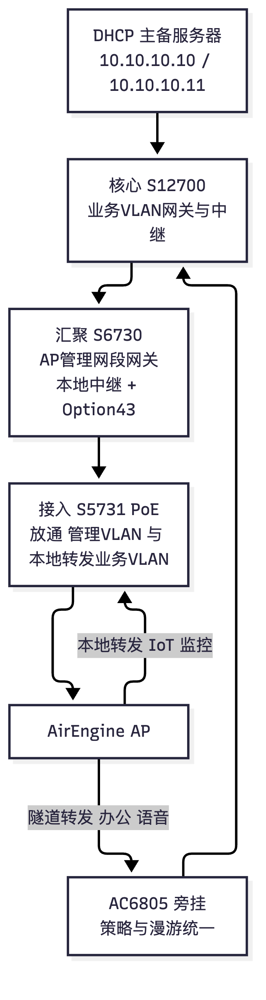


```mermaid
flowchart TD
    Q["业务该用哪种转发模式"] --> A{"是否需要跨AC三层漫游"}
    A -->|是| T["隧道转发"]
    A -->|否| B{"是否大带宽或低时延"}
    B -->|是| L["本地转发"]
    B -->|否| C{"是否需要集中准入与审计"}
    C -->|是| T
    C -->|否| L
    T --> T1["AC 与上行链路需 10GE 以上聚合"]
    L --> L1["AP 上行全路径放通业务 VLAN"]
```

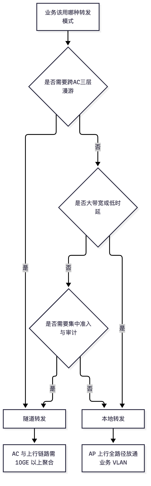


### 真题精练

**Q1.【真题·单选】** 大型园区中，AP 管理网段的 DHCP 部署方式最合理的是？
A. 全网由一台中心 DHCP 服务器集中分配
B. **在汇聚层配置 DHCP 中继，由就近的双 DHCP 服务器分配，并在地址池中通过 Option 43 下发 AC 地址**
C. 由 AC 直接为所有 AP 分配地址
D. 全部使用静态 IP

> **答案：B**
> **解析**：A 的问题是单点与性能瓶颈（数千台 AP 同时续租会打爆服务器），且 DHCP 报文跨楼栋穿核心。B 是推荐做法：**汇聚层本地中继**实现就近分配、无跨区流量、单点影响范围小；双服务器提高可靠性；**Option 43 是 AP 自动发现 AC 的标准方式**。C 不合适（AC 通常不承担全网 DHCP 职能，且 AC 故障会导致地址分配中断）。D 在数百台 AP 规模下不可维护。

**Q2.【真题·多选】** 关于隧道转发与本地转发的混合部署，下列说法正确的有？
A. 同一个 AP 上不同的 VAP 可以配置不同的转发模式
B. 本地转发业务要求 AP 上行链路（接入—汇聚—核心）全路径放通对应业务 VLAN
C. 本地转发下 AP 不再需要与 AC 建立 CAPWAP 控制隧道
D. 跨 AC 三层漫游的业务建议使用隧道转发
E. 隧道转发下 AC 的上行链路带宽必须能承载所有隧道转发业务的总流量

> **答案：ABDE**
> **解析**：C 错误，**无论哪种转发模式，AP 都必须与 AC 建立并维持 CAPWAP 控制隧道**（UDP 5246）——本地转发只是把**业务数据**（UDP 5247 数据隧道）改为本地直接入网，控制面依然由 AC 管理。A 正确，转发模式是按 VAP 配置的，这是混合部署的技术基础。B、D、E 均为关键实施要点，其中 B 是最常见的故障根因（漏放通某一跳导致本地转发业务不通）。

**Q3.【真题·判断】** AP 管理网段可以与业务网段使用同一个 VLAN，这样便于统一管理。

> **答案：错误**
> **解析**：AP 管理网段与业务网段必须**分离**，理由有四：① **安全**：避免终端直接访问 AP 管理面（可能被利用做攻击跳板）；② **广播域隔离**：业务网段的广播风暴/ARP 泛洪不应影响 AP 与 AC 的 CAPWAP 通信；③ **策略与 QoS**：AP 管理流量（CAPWAP 控制报文）需要独立的优先级保障，避免与业务流量争抢；④ **地址规划**：AP 地址需求与终端地址需求特征不同（租期、容量、Option 43 等），混在一起难以规划与排错。

**Q4.【真题·简答】** 请给出一个大型园区（3 栋楼、每栋 15 层、每层 20 台 AP）的 VLAN 与 DHCP 规划方案，并说明每一项的理由。

> **答案要点**：
> ① **AP 管理 VLAN**：每栋楼一个（如 A 栋 VLAN 100、B 栋 101、C 栋 102），对应网段 `10.10.1.0/22`、`10.10.2.0/22`、`10.10.3.0/22`。理由：每栋 300 台 AP，/22 提供 1022 个地址，满足"AP 数 × 1.5~2"的规划原则并留扩容余量；按楼栋划分便于故障隔离与排错。
> ② **AP 管理网段网关**：放在**各楼栋汇聚交换机**的 SVI 上。理由：避免所有 AP 管理流量上核心，减轻核心负担；DHCP 中继就近处理。
> ③ **AP 地址 DHCP**：**汇聚本地中继 + 双 DHCP 服务器（10.10.10.10 / 10.10.10.11）**，地址池中配置 **Option 43 指向 AC 的 CAPWAP 源接口地址（可同时下发主备地址）**，AP 地址租期取较长（如 3 天）。理由：就近分配、无跨区流量、双服务器消除单点；Option 43 是 AP 自动发现 AC 的标准方式。
> ④ **业务 VLAN**：按安全等级与业务特征划分——办公（VLAN 110，`10.1.110.0/24`）、访客（VLAN 120）、语音（VLAN 130）、IoT/监控（VLAN 140）；每栋楼可用 VLAN 号段区分（A 栋 110~119，B 栋 210~219…）。理由：便于按业务做 QoS 与安全策略；语音与 IoT 独立可避免相互影响。
> ⑤ **业务地址的 DHCP**：办公/语音用分布式中继（核心/汇聚），访客用集中式 + DHCP Snooping。理由：办公与语音需要在各区域就近快速获取地址（漫游后重新 DHCP 也要快）；访客集中便于审计与限速。
> ⑥ **互连 VLAN**：AC 与核心的互连用独立 VLAN 200（`10.10.200.0/24`）；HSB/集群/漫游组用独立 VLAN（300/400）。理由：管理与同步流量与业务隔离，避免相互影响。
> ⑦ **QoS 与安全**：AP 管理网段限制终端访问（ACL/安全区域）；CAPWAP 控制报文给予较高优先级；接入端口开启 DHCP Snooping（防私接）并限制端口 MAC 数（防私接交换机）。
> ⑧ **规划验证**：`display ip pool`（地址池使用率）、`display dhcp relay all`（中继配置）、`display wlan ap all`（AP 上线与地址）。

**Q5.【真题·排错】** 某园区新上线一批 AP，采用本地转发承载 IoT 业务。现象：AP 能正常上线、SSID 也能连上，但 IoT 终端始终拿不到 IP 地址。请给出排查步骤。

> **答案要点**：
> ① **明确转发模式**：先确认该 IoT 业务 VAP 的 `forward-mode` 是 local（本地转发）。本地转发下，IoT 终端的 DHCP 报文由 AP 直接以带 VLAN Tag 的普通以太网报文送入接入交换机，**不再经过 AC**，因此排查重点在**有线侧 VLAN 放通与 DHCP 可达性**。
> ② **排查一：AP 上行线路的 VLAN 放通**。这是最常见根因。逐跳检查：AP 接入端口（`port trunk allow-pass vlan`）、接入交换机上行口、汇聚交换机上下行口、核心侧。**任何一跳漏放 IoT 业务 VLAN，该业务就完全不通**。用 `display port vlan` 与 `display current-configuration interface` 逐台核对。
> ③ **排查二：AP 端口 PVID 与 VLAN 配置**。确认 AP 接入端口的 PVID 是 AP 管理 VLAN（保证 AP 管理报文不打 Tag 时归类正确），同时 allow-pass 里包含 IoT 业务 VLAN。
> ④ **排查三：DHCP 可达性**。IoT 业务 VLAN 的网关（SVI）是否已创建并 up；DHCP 中继是否配置且指向可达的服务器；`display dhcp relay all` 与 `display ip pool` 检查；从网关 Ping DHCP 服务器验证可达；必要时在接入交换机上做端口镜像抓包，确认是否看到带 IoT VLAN Tag 的 DHCP Discover 报文。
> ⑤ **排查四：AP 侧配置是否真正下发**。`display wlan ap name <AP> config` 查看 AP 实际生效的配置，确认业务 VLAN 相关配置已下发；同时确认 VAP 已绑定到该 AP 组并在射频上生效。
> ⑥ **排查五：VLAN 数量与资源限制**。部分接入交换机对 Trunk 允许的 VLAN 数或 VLAN 总数有限制，检查是否有"VLAN 未创建"导致报文被丢弃。
> ⑦ **解决方案与验证**：补齐全路径 VLAN 放通 → 确认 DHCP 中继与地址池 → 抓包验证 → IoT 终端成功获取地址；建议把"本地转发业务 VLAN 全路径放通"写入变更检查清单，避免重复故障。

### 易错点与排错

1. **AP 管理 VLAN 与业务 VLAN 混用**：安全与广播域问题。
2. **DHCP 全集中**：大型园区必然成为单点与瓶颈，必须分布式中继。
3. **忘记 Option 43**：AP 无法发现 AC，表现为 AP 一直处于 Discovery 状态。
4. **本地转发漏放通某一跳 VLAN**：现象是"AP 上线正常、SSID 能连、但拿不到 IP"，这是本地转发最典型的故障。
5. **忽略 CAPWAP 控制报文的 QoS**：管理通道拥塞会导致 AP 掉线（Echo 超时）。
6. **排错命令**：`display port vlan`（交换机 VLAN 放通）、`display dhcp relay all` / `display ip pool`（DHCP）、`display wlan ap all`（AP 上线）、`display wlan ap name <AP> config`（AP 生效配置）、`display capwap configuration`（CAPWAP 源接口）。

---

## 2.7 WLAN 的 QoS 保障：WMM 与空口/有线 QoS 映射

### 考点定位

本考点以简答与设计题为主，分值 4~8 分，常与语音业务设计题合并。高频考点：**WMM 四个 AC 与 802.1p/DSCP 的映射关系**、"端到端 QoS 需要哪些环节都信任标记"。易错点：① 以为"无线侧配了 WMM 就有 QoS"；② 不知道 **802.11e 与 WMM 的关系**（WMM 是 Wi-Fi 联盟对 802.11e 的认证子集）；③ 不知道有线侧不信任 DSCP 会让无线侧的优先级全部失效。

### 原理精讲

**① 802.11e 与 WMM 的关系。**

802.11e 是 IEEE 标准，定义了 **EDCA**（分布式优先级）与 **HCCA**（集中式混合协调，实际未普及），以及**业务流分类、TSPEC 资源预留**等机制。**WMM（Wi-Fi Multimedia）是 Wi-Fi 联盟基于 802.11e 的认证子集**，它只强制要求 EDCA 的四个 AC，不强制 TSPEC/HCCA。厂商产品（包括华为 AC/AP）通常说"支持 WMM"，在配置上就是 WMM 模板 + EDCA 参数 + AC 到队列的映射。**WMM-PS（省电）与 WMM-ACM（准入控制）是 WMM 的两个附加特性**：ACM 允许对某个 AC 做"准入控制"，即限制该 AC 的最大占用比例（对语音很有用，可防止语音流量挤爆空口）。

**② WMM 的四个 AC 与上层优先级映射（必背）。**

终端与 AP 之间通过 **802.11 帧的 QoS Control 字段**携带 **TID（Traffic Identifier，0~15）**，TID 与 **UP（User Priority，0~7）** 对应，UP 再映射到四个 AC：

| 以太网 802.1p（PCP，用户优先级） | 典型 DSCP | WMM 接入类别 | 802.11 TID | 典型业务 |
|---|---|---|---|---|
| 6（Voice / CS6） | EF（46）、CS6（48） | **AC_VO** | 6、7 | 语音、VoWiFi |
| 5（Video / CS5） | AF41（34）、CS5（40） | **AC_VI** | 4、5 | 视频会议、流媒体 |
| 4（Controlled Load） | AF31（26）、CS4（32） | AC_VI 或 AC_BE（视实现） | 4、5 / 0、3 | 受控负载业务 |
| 3、0（Best Effort / Default） | 0、CS0 | **AC_BE** | 0、3 | 网页、邮件、普通数据 |
| 2、1（Background） | CS1、AF11 | **AC_BK** | 1、2 | 后台备份、下载、日志上传 |

**映射的四个环节（端到端 QoS 的关键链条）**：

```
终端应用打标（DSCP/802.1p）
  → 无线侧映射到 WMM AC（AP 内的队列调度：EDCA + 空口时间公平）
  → AP 上行报文打标（CAPWAP 隧道转发时为内层报文保留标记；本地转发时直接打 802.1p）
  → 接入交换机信任标记（trust 802.1p / trust dscp）并映射到队列
  → 汇聚/核心按队列调度（PQ/WRR/WFQ）保障语音优先
  → AC（隧道转发时）对内层报文做 QoS 处理并保留标记
```

**任何一环不信任或重标记，端到端 QoS 就失效。** 最常见的错误是：无线侧把语音映射到 AC_VO，但**接入交换机没有配置 `trust upstream`/`trust dscp`**，把无线报文当作普通报文重标记为 0，结果语音照样排队。

**③ 为什么 WMM 需要 ACM（准入控制）。**

EDCA 只提供**相对的优先级**（高优先级更容易抢到信道），但不限制高优先级业务的**总量**。如果全网有 200 个语音终端同时通话，AC_VO 队列会占满空口，反而让所有语音都变差（拥塞）。**WMM-ACM** 允许管理员为某个 AC 设定**最大占用比例**与**准入条件**（如"AC_VO 最多占空口 60%，超出则拒绝新的语音流"），从而保护已建立的语音质量。华为 AC 上对应的能力通常在 WMM 模板或 QoS 相关视图中配置（**命令名随版本差异，以所用版本文档为准**）。

**④ 端到端语音保障的完整设计清单（答题直接使用）。**

| 环节 | 关键配置/措施 |
|---|---|
| 终端 | 应用/终端支持 WMM 并正确打标（部分终端默认把语音标记为 AC_VO） |
| 无线侧 | WMM 模板：AC_VO 的 AIFSN=2、CWmin=3、TXOP=1.504 ms；开启 WMM-ACM 限制 AC_VO 占比；开启 Airtime 公平；关闭低速率与 11b 保护模式 |
| 空口优化 | 语音 SSID 单独规划（可与数据 SSID 分离）、最小接入速率 ≥ 12 Mbps、漫游优化（11k/v/r）、限制聚合长度（控制时延抖动） |
| AP 上行 | **信任并保留**无线侧标记（本地转发时直接打 802.1p；隧道转发时保留内层 DSCP） |
| 接入交换机 | `trust upstream`/`trust dscp` 或基于 802.1p 的优先级映射；端口队列调度 |
| 汇聚/核心 | 队列调度（PQ/WRR/WFQ）、拥塞管理（WRED）；语音队列保障带宽 |
| AC | 隧道转发时保留内层 DSCP；对上行的 CAPWAP 报文做 QoS 处理；WMM 策略下发 |
| 上游网络 | 与 SIP 服务器/IMS 之间的路径也要保证 QoS（DSCP EF） |
| 容量 | 按语音并发数计算空口与带宽需求；单 AP 语音并发建议不超过 15~20 路 |

### 关键概念对照表

| 层级 | 标记字段 | 取值范围 | 映射目标 |
|---|---|---|---|
| 应用/终端 | DSCP | 0~63（6 bit） | 802.1p / WMM AC |
| 以太网 | 802.1p（PCP） | 0~7（3 bit，VLAN Tag 内） | 交换机队列 |
| 802.11 帧 | QoS Control 中的 TID | 0~15 | WMM AC（4 个队列） |
| WMM AC | AC_VO/VI/BE/BK | 4 个 | EDCA 参数（AIFSN/CW/TXOP） |
| 交换机 | 内部优先级 / 队列 | 通常 8 个队列 | 调度算法 |

| QoS 环节失配 | 现象 | 修复 |
|---|---|---|
| 交换机不信任 DSCP/802.1p | 语音与普通流量同等对待，忙时语音断续 | 端口配置 trust，或做优先级映射 |
| 无线侧未开 WMM | 语音无优先级，竞争激烈时质量差 | 启用 WMM 模板并下发 |
| AC_VO 无准入限制 | 语音终端过多时整体崩溃 | 启用 WMM-ACM 限制 AC_VO 占比 |
| 漫游未优化 | 移动中语音断续（切换丢包） | 开启 11k/v/r 与智能漫游 |
| 最小接入速率低 | 低速终端拖累，语音时延抖动大 | 提高最小接入速率并开启 Airtime 公平 |

### 华为设备配置

```bash
system-view                                        # 进入系统视图
wlan                                               # 进入 WLAN 视图
 wmm-profile name wmm-voice                        # 创建语音专用 WMM 模板
  ac-vo                                             # 语音接入类别
   aifsn 2                                          # AIFSN=2，等同 DIFS 长度，最高优先级
   ecwmin 3                                         # CWmin 指数，语音最小竞争窗口
   ecwmax 7                                         # CWmax 指数
   txop-limit 1504                                  # TXOP 上限 1504 微秒，语音典型值
   acm enable                                       # 使能该 AC 的准入控制，限制其最大空口占比
   acm-max-percent 60                               # AC_VO 最大占空口比例 60%（示例值，参数名随版本变化）
   quit                                             # 退出
  wmm enable                                         # 使能 WMM（EDCA）
  quit                                               # 退出
 vap-profile name voice-vap                         # 语音业务 VAP
  service-vlan vlan-id 130                          # 语音业务 VLAN
  wmm-profile wmm-voice                             # 引用语音 WMM 模板
  forward-mode tunnel                               # 语音建议隧道转发，AC 统一做 QoS 与漫游处理
  quit                                               # 退出
 # 说明：无线侧标记到有线侧 802.1p/DSCP 的映射关系，
 #       部分版本在 WMM 模板或 QoS 相关视图下通过 priority-map 类命令配置，
 #       具体命令名与视图以所用版本文档为准
 quit                                                # 退出 WLAN 视图

# ============ 接入交换机：信任无线侧的 QoS 标记（关键！）============
system-view
sysname ACC-A1
interface GigabitEthernet0/0/1                       # 连接 AP 的端口
 port link-type trunk
 port trunk pvid vlan 100
 port trunk allow-pass vlan 100 130
 trust upstream default                               # 信任报文携带的优先级（按默认映射表），
 # 或使用 trust dscp / trust 8021p（具体命令随产品与版本差异，以所用版本文档为准）
 quit
 # 说明：若端口不配置 trust，交换机会把无线侧标记重写或忽略，
 #       导致无线侧精心设置的优先级在有线侧完全失效——这是语音质量差的常见根因

# ============ 汇聚/核心：队列调度保障语音 ============
system-view
sysname CORE
# 典型的队列调度配置思路（命令与视图随产品版本差异较大，仅示意思路）：
# 1) 定义流分类（匹配 DSCP EF 或 802.1p 6）→ 流行为（保证带宽 + 优先调度）→ 流策略
# 2) 在核心与汇聚互联口、以及到语音服务器/IMS 的接口上应用流策略
# 3) 语音队列建议采用 PQ（优先队列）或高权重 WRR，并设置最小保证带宽
# 4) 同时配置 WRED 避免队列溢出时全局丢包
traffic classifier voice operator or                 # 定义语音流分类
 if-match dscp ef                                     # 匹配 DSCP EF（46）
 quit
traffic behavior voice                               # 定义语音流行为
 remark dscp ef                                       # 统一标记为 EF
 queue ef                                             # 进入 EF 队列（优先调度）
 quit
traffic policy voice-policy                          # 定义流策略
 classifier voice behavior voice                      # 关联分类与行为
 quit
interface GigabitEthernet1/0/1                        # 上行到 AC 或语音服务器方向
 traffic-policy voice-policy inbound                   # 应用流策略
 quit
 # 上述命令为思路示意，实际语法（traffic classifier / traffic behavior / traffic policy 的视图与参数）
 # 随 CloudEngine 版本差异较大，请以所用版本文档为准
```

### 示意图

```mermaid
flowchart LR
    APP["语音终端应用<br/>DSCP EF 46"] --> AC["无线侧 WMM<br/>映射到 AC_VO"]
    AC --> EDCA["EDCA 空口调度<br/>AIFSN2 CWmin3 TXOP1504"]
    EDCA --> UP["AP 上行报文<br/>保留 DSCP 或打 802.1p 6"]
    UP --> SW["接入交换机<br/>必须 trust 标记"]
    SW --> AGG["汇聚 队列调度"]
    AGG --> CORE2["核心 流策略<br/>EF 队列优先"]
    CORE2 --> SRV["语音服务器 IMS"]
```


### 真题精练

**Q1.【真题·单选】** 语音业务在 WMM 中应映射到哪个接入类别，其 TXOP 上限典型值为？
A. AC_BE，0 μs  B. AC_VI，3008 μs  C. **AC_VO，1504 μs**  D. AC_BK，0 μs

> **答案：C**
> **解析**：语音映射到 **AC_VO**（TID 6/7，对应 802.1p 6），TXOP 上限典型值为 **1504 μs**；视频映射到 **AC_VI**（TXOP 3008 μs）；普通数据 **AC_BE**；后台 **AC_BK**（通常 TXOP=0 表示不批量化）。注意：AC_VO 与 AC_VI 的 AIFSN 都是 2，靠 **CWmin（3 对 7）** 与 **TXOP（1504 对 3008）** 区分——TXOP 是"一次抢占后能连续占用的最长时间"，视频比语音长是因为视频帧更大、更需要批量化。

**Q2.【真题·多选】** 要保障 VoWiFi 的端到端质量，必须做到的有？
A. 无线侧启用 WMM，并把语音流量映射到 AC_VO
B. 接入交换机信任并保留无线侧携带的 QoS 标记
C. 开启 802.11k/v/r 与智能漫游，保证移动中切换快
D. 提高最小接入速率并开启 Airtime 公平调度，避免低速终端拖累
E. 只要无线侧配置了 WMM，有线侧无需任何配合

> **答案：ABCD**
> **解析**：E 是最典型的错误认识。WMM 只解决**空口侧**的优先级竞争，而语音报文必须经过"AP → 接入 → 汇聚 → 核心 → 语音服务器"的完整路径。若**接入交换机不信任标记**（未配置 `trust`），交换机会把无线侧精心设置的优先级重写或忽略，语音在有线侧与普通数据同等对待，拥塞时照样断续。A、B、C、D 分别对应"无线侧优先、有线侧信任、移动中不断、空口不被拖累"四个必要环节，缺一不可。

**Q3.【真题·判断】** WMM-ACM 的作用是给语音业务提供更高的优先级，让语音更容易抢到信道。

> **答案：错误**
> **解析**：WMM-ACM（Admission Control Mandatory，准入控制）的作用不是"提高优先级"，而是**限制某个 AC 的最大空口占用比例并在超限时拒绝新的业务流准入**。EDCA 已经提供了相对优先级（AC_VO 更容易抢到信道），但**不限制高优先级业务的总量**；当语音终端过多时，AC_VO 会占满空口，导致所有语音一起变差。ACM 通过"限制 AC_VO 占用上限 + 拒绝新语音流"来**保护已建立语音的质量**，这是它的真正价值。

**Q4.【真题·简答】** 请完整描述一个语音报文从终端发出到到达语音服务器的 QoS 处理链条，并指出每个环节最容易出错的地方。

> **答案要点**：
> ① **终端侧**：语音应用或终端把上行报文的 DSCP 标记为 EF（46），或 802.11 帧的 TID 置为 6/7。**易错**：部分终端默认不标记或标记错误，导致无线侧无法识别为语音。
> ② **无线侧（AP）**：AP 按 TID/UP 把报文映射到 **AC_VO**，使用 AIFSN=2、CWmin=3、TXOP=1504 μs 参与 EDCA 竞争，并可通过 ACM 限制 AC_VO 的最大占用比例。**易错**：未启用 WMM、WMM 模板未下发到 AP、AC_VO 参数被误改。
> ③ **AP 上行**：本地转发时 AP 直接把语音报文打成带 802.1p 6 的以太网帧；隧道转发时 AP 把内层报文的 DSCP 保留在 CAPWAP 隧道内。**易错**：隧道封装后 DSCP 被覆盖或未保留，导致外层无标记。
> ④ **接入交换机**：必须配置 **trust**（信任 DSCP 或 802.1p）并做优先级映射到高优先队列。**这是最容易出错的一环**——不配 trust，交换机就会重写标记，后面所有环节的保障全部失效。
> ⑤ **汇聚/核心**：按 DSCP/802.1p 做流分类与队列调度，语音进 PQ/EF 队列并设置最小保证带宽，同时用 WRED 防止队列溢出。**易错**：只在上行方向配了策略，下行方向未配；或队列拥塞时未做拥塞管理，语音与数据一起丢。
> ⑥ **AC**：隧道转发时对上行报文做 QoS 处理并保留内层标记；对 CAPWAP 控制报文给予较高优先级以免管理通道拥塞。**易错**：AC 上行口未信任内层标记。
> ⑦ **语音服务器/IMS 侧网络**：到 SIP 服务器/IMS 的路径也要保证 EF 队列。**易错**：只优化了接入侧，出口或数据中心侧拥塞导致语音抖动。
> ⑧ **容量与漫游**：按并发语音路数核算空口与带宽（单 AP 建议不超过 15~20 路），并开启 11k/v/r 保证移动中切换；启用 Airtime 公平与高最小接入速率避免低速终端拖累。
> ⑨ 结论句：**"QoS 是一条链，任何一环不信任标记或不做调度，整条链就断了。"**

### 易错点与排错

1. **以为 WMM 就是端到端 QoS**：WMM 只管空口，有线侧必须信任与调度。
2. **接入端口不配 trust**：语音质量差的头号根因。
3. **只配单向**：上行配了策略下行没配，或反之；语音是双向对称业务，两个方向都要保障。
4. **混淆 ACM 与优先级**：ACM 是"限流 + 准入"，不是"提优先级"。
5. **忘记 CAPWAP 控制报文的 QoS**：管理通道拥塞会造成 AP 掉线（Echo 超时），间接影响语音。
6. **排错命令**：`display wlan wmm-profile name <模板>`、`display wlan client verbose`（终端 QoS 能力）、交换机侧 `display traffic policy statistics` 与 `display qos queue statistics`（队列与丢包统计，命令随产品版本变化）、`display wlan ap name <AP> radio 0 statistics`（重传与速率分布）。

---

## 2.8 WLAN 与 IoT 融合

### 考点定位

本考点是**近年新增热点**，以简答/设计题为主，分值 4~6 分。高频考点：**AP 内置 IoT 插槽的承载方式（蓝牙/ZigBee/RFID）**、**IoT 与 Wi-Fi 的共存干扰**、"为什么 IoT 要与 Wi-Fi 业务分开规划"。易错点：① 认为 IoT 插槽只是"多了一个射频"（实际涉及供电、天线、协议网关与回传）；② 忽略 ZigBee/蓝牙与 Wi-Fi 都在 2.4 GHz 的共存问题。

### 原理精讲

**① 为什么用 AP 承载 IoT？**

园区 IoT（智能照明、门禁、环境传感、资产标签、电子价签、定位）通常使用 **BLE（蓝牙低功耗）、ZigBee、RFID、LoRa、UWB** 等短距技术。传统做法是每种业务单独部署网关与供电线路，导致**线缆多、点位乱、供电困难、维护成本高**。AP 内置 IoT 插槽的价值在于：**复用 AP 的供电（PoE）、回传（上行网络）与点位（天花）**，实现"一个点位、多种接入"，大幅降低部署成本。华为 AirEngine 系列 AP 提供 **IoT 插槽/扩展模块**，可插入 BLE、ZigBee 等模块（**具体支持的技术与模块型号随 AP 型号与版本不同，以所用版本文档为准**）。

**② IoT 插槽的承载方式与工作模式。**

- **物理形态**：AP 上的 **USB 形态 IoT 插槽**或**专用扩展槽**；插入 IoT 模块后，模块通过 AP 的 USB/内部总线与 AP 主控通信。
- **供电**：由 AP 通过 PoE 统一供电，需计入 **PoE 功率预算**（插了 IoT 模块的 AP 功耗上升，可能从 PoE+ 需求升级到 PoE++）。
- **回传**：IoT 模块采集的数据通过 **AP 上的 CAPWAP 隧道或独立通道上传给 IoT 平台/AC/服务器**。华为的方案通常是 AP 把 IoT 数据封装后送到 **AC（或直接送到 IoT 服务器）**，由平台统一解析（如定位数据、传感数据）。**(具体数据回传方式与平台对接方式随版本与方案不同，以所用版本文档为准。)**
- **工作模式**：IoT 模块通常有三种工作模式——**仅扫描/定位**（如 BLE 定位，只接收标签广播）、**双向通信**（如 ZigBee 组网，需要收发）、**透传**（把原始数据交给平台解析）。

**③ IoT 与 Wi-Fi 的共存干扰（必考）。**

| IoT 技术 | 频段 | 与 Wi-Fi 的干扰关系 |
|---|---|---|
| **BLE（蓝牙低功耗）** | 2.4 GHz（40 个 2 MHz 信道，其中 3 个广播信道） | **与 Wi-Fi 同频段**，使用**跳频**（每秒上千次跳频）；Wi-Fi 是宽带信号，BLE 跳频会周期性与 Wi-Fi 信道重叠造成干扰。BLE 发射功率低（通常 ≤ 10 dBm）、占空比小，干扰相对温和，但**大量 BLE 标签密集上报时会抬升 2.4 GHz 噪声底** |
| **ZigBee（802.15.4）** | 2.4 GHz（16 个信道，每信道 2 MHz，间隔 5 MHz） | **与 Wi-Fi 同频段**，ZigBee 的 11~26 信道与 Wi-Fi 1~11 信道大量重叠；ZigBee 采用 CSMA/CA 但参数不同，与 Wi-Fi 竞争时处于劣势（会大量重传）。**建议把 ZigBee 信道选在 Wi-Fi 未使用的频段**（如 Wi-Fi 只用 1/6/11 时，ZigBee 选 15/20/25/26 等） |
| **RFID（无源/有源）** | 低频/高频/超高频（UHF 860~960 MHz） | **与 Wi-Fi 频段不同**，基本无干扰；但有源 RFID 的部分频段（2.4 GHz）与 Wi-Fi 重叠 |
| **UWB** | 3.1~10.6 GHz（超宽带） | 与 5 GHz Wi-Fi 部分重叠（5.15~5.85 GHz 附近），UWB 功率极低（限值 −41.3 dBm/MHz）通常干扰可控，但高精度定位大量并发时需评估 |
| **LoRa / NB-IoT** | Sub-GHz（如 470/868/915 MHz） | 与 Wi-Fi 无干扰 |

**共存治理原则**：① **规划上分离**：IoT 与 Wi-Fi 业务尽量用不同信道/频段（Wi-Fi 主力走 5 GHz/6 GHz，2.4 GHz 让给 IoT）；② **参数协调**：ZigBee 信道避开 Wi-Fi 的 1/6/11；③ **功率控制**：IoT 模块功率按需设置，避免过大抬升噪声底；④ **独立 SSID/独立 AP**：IoT 业务不与用户业务共用 VAP，便于限速与隔离；⑤ **容量核算**：大量 IoT 标签的上报会占用 AP 的 CPU 与空口时间（尤其 BLE 扫描），需评估 AP 规格。

**④ IoT 部署的设计要点（答题模板）。**

- **选型**：确认 AP 型号是否支持所需 IoT 技术（插槽类型、模块型号），以及 AC 版本是否支持对应 IoT 功能。
- **供电**：核算总 PoE 功率（AP 基础功耗 + IoT 模块功耗 + 未来余量），必要时使用 PoE++ 交换机或外部供电。
- **回传与平台**：明确 IoT 数据送到哪个平台（iMaster NCE-Campus 的 IoT 管理能力或第三方平台），以及网络路径与端口放通。
- **安全**：IoT 设备通常安全能力弱，应**单独 VLAN + 单独 SSID/VAP + 严格 ACL**，限制其访问范围；开启 **DHCP Snooping** 与端口安全。
- **运维**：IoT 标签/传感器数量庞大，故障定位依赖平台侧可视化（如位置、在线状态、电量），需与运维流程结合。
- **验收**：IoT 设备在线率、上报成功率、定位精度（若为定位业务）、以及对 Wi-Fi 业务的影响（对比开启 IoT 前后的 2.4 GHz 噪声底与重传率）。

### 关键概念对照表

| 技术 | 频段 | 典型速率 | 供电/寿命 | 与 Wi-Fi 干扰 | 典型园区业务 |
|---|---|---|---|---|---|
| BLE | 2.4 GHz | 1~2 Mbps（BLE 5 可达 2 Mbps） | 纽扣电池数年 | **同频，跳频，干扰温和** | 定位、资产标签、门禁 |
| ZigBee | 2.4 GHz | 250 kbps | 电池数年 | **同频，与 Wi-Fi 竞争明显** | 智能照明、传感器、表计 |
| RFID（UHF 无源） | 860~960 MHz | — | 无源（读卡器供电） | **不同频，无干扰** | 资产管理、仓储 |
| RFID（有源 2.4G） | 2.4 GHz | — | 电池 | 同频 | 资产追踪 |
| UWB | 3.1~10.6 GHz | 数百 Mbps（短距） | 电池 | 与 5G Wi-Fi 部分重叠 | 高精度定位 |
| LoRa / NB-IoT | Sub-GHz / 授权频段 | 低 | 电池数年 | 无 | 室外表计、环境监测 |

| 部署要点 | 关键内容 |
|---|---|
| AP 选型 | 支持 IoT 插槽的 AirEngine 型号 + 对应模块 |
| 供电 | PoE+ / PoE++ 功率预算，含 IoT 模块功耗 |
| 回传 | IoT 数据经 AP 上行送到 IoT 平台，路径与端口放通 |
| 安全 | 独立 VLAN/VAP/SSID + ACL + DHCP Snooping |
| 干扰治理 | 2.4 GHz 让给 IoT；ZigBee 信道避开 Wi-Fi 1/6/11 |
| 验收 | IoT 在线率/上报成功率 + 对 Wi-Fi 的影响评估 |

### 华为设备配置

```bash
system-view                                          # 进入系统视图
wlan                                                 # 进入 WLAN 视图
 ap-group name iot-floor1                            # 创建 IoT 业务 AP 组
  # 引用 IoT 相关模板与 VAP（各版本命令差异大，以下为结构性示意）
  quit
 # ===== IoT 插槽/模块相关配置（命令名与视图随版本差异极大，务必以所用版本文档为准）=====
 ap name AP-IOT-01                                    # 进入指定 AP 视图
  # 典型配置结构（示意，非可直接使用的命令）：
  # iot-profile name iot-ble                            # 创建 IoT 模板
  #  module-type ble                                     # 指定模块类型为蓝牙
  #  work-mode scan                                      # 工作模式：扫描（定位场景）
  #  report-interval 30                                  # 上报周期（秒）
  #  server ip-address 10.10.60.10                       # IoT 平台地址
  #  quit
  # iot-profile iot-ble                                 # AP 下引用 IoT 模板
  quit                                                # 退出 AP 视图
 # 说明：IoT 模块的配置入口一般在 AP 视图或独立的 IoT 模板中，
 #       具体命令、参数与支持的模块类型请以所用版本的产品文档为准
 quit                                                  # 退出 WLAN 视图

# ===== IoT 业务网络隔离（VLAN/VAP）=====
system-view
vlan batch 160                                        # IoT 专用 VLAN
interface Vlanif160                                   # IoT 网关
 ip address 10.1.160.1 255.255.255.0
 dhcp select relay                                     # 中继到 DHCP（IoT 地址可长租期）
 dhcp relay server-ip 10.10.10.10
 quit
wlan
 vap-profile name iot-vap                              # IoT 业务 VAP（独立 SSID/VLAN）
  service-vlan vlan-id 160                             # 独立 VLAN，与用户业务隔离
  forward-mode local                                   # IoT 数据量大、价值密度低，建议本地转发
  rate-limit client down 1000                          # 单设备限速 1Mbps，防止异常设备占满空口
  rate-limit client up 1000
  quit
 # ===== 2.4G 射频规划为 IoT 让路（与 Wi-Fi 频段错开）=====
 radio-2g-profile name radio2g-iot
  channel 20mhz                                        # 2.4G 只 20MHz，减少占用带宽，给 ZigBee 留空隙
  eirp 9                                               # 降低 2.4G 功率，减少对 IoT 与邻区的干扰
  quit
 # 若 Wi-Fi 2.4G 仅使用 1/6/11，则 ZigBee 应规划在 15/20/25/26 等信道（在 IoT 平台侧配置）
```

### 示意图

```mermaid
flowchart TB
    AP["AirEngine AP<br/>PoE 供电 + 上行回传"] --> S1["Wi-Fi 射频<br/>2.4G 与 5G/6G"]
    AP --> S2["IoT 插槽 IoT 模块<br/>BLE ZigBee RFID"]
    S1 --> USR["用户终端<br/>手机 笔记本"]
    S2 --> DEV["IoT 设备<br/>标签 传感器 照明 门禁"]
    AP -->|"CAPWAP 或独立通道"| AC["AC 与 IoT 平台"]
    AC --> PLAT["iMaster NCE-Campus<br/>IoT 管理与定位"]
```

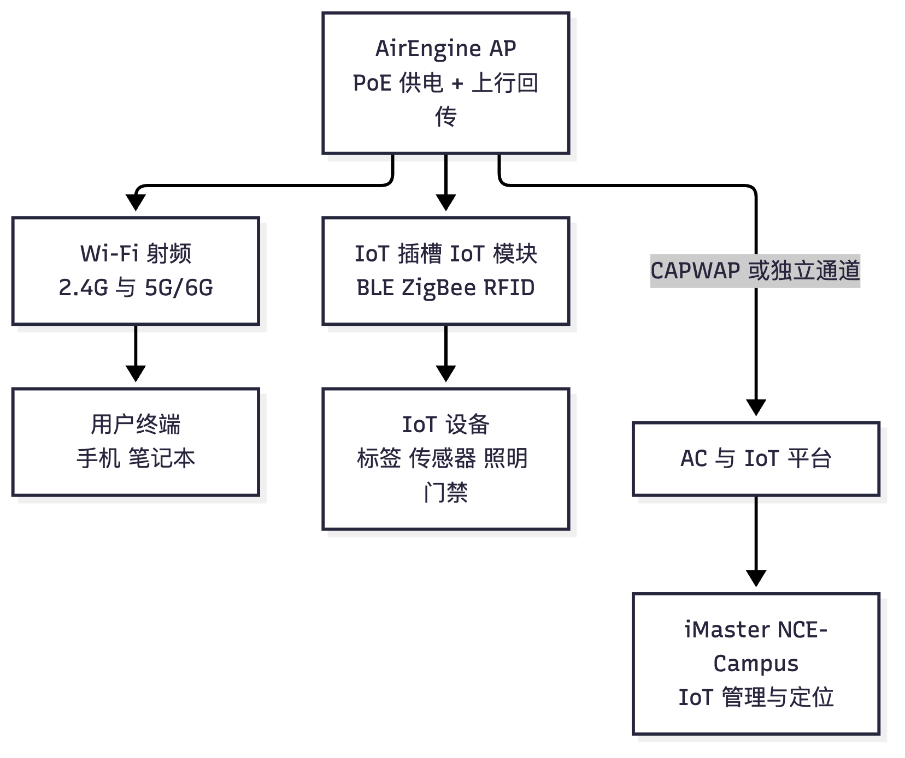


```mermaid
flowchart LR
    subgraph B24["2.4GHz 频谱共存"]
        W["Wi-Fi 1 6 11<br/>每信道20MHz"] --> C1["ZigBee 应避开<br/>选 15 20 25 26"]
        W --> C2["BLE 跳频<br/>干扰温和但抬底噪"]
    end
    subgraph B5["5GHz 与 UWB"]
        W5["Wi-Fi 5G<br/>非重叠信道多"] --> U["UWB 3.1到10.6GHz<br/>功率极低 影响可控"]
    end
```

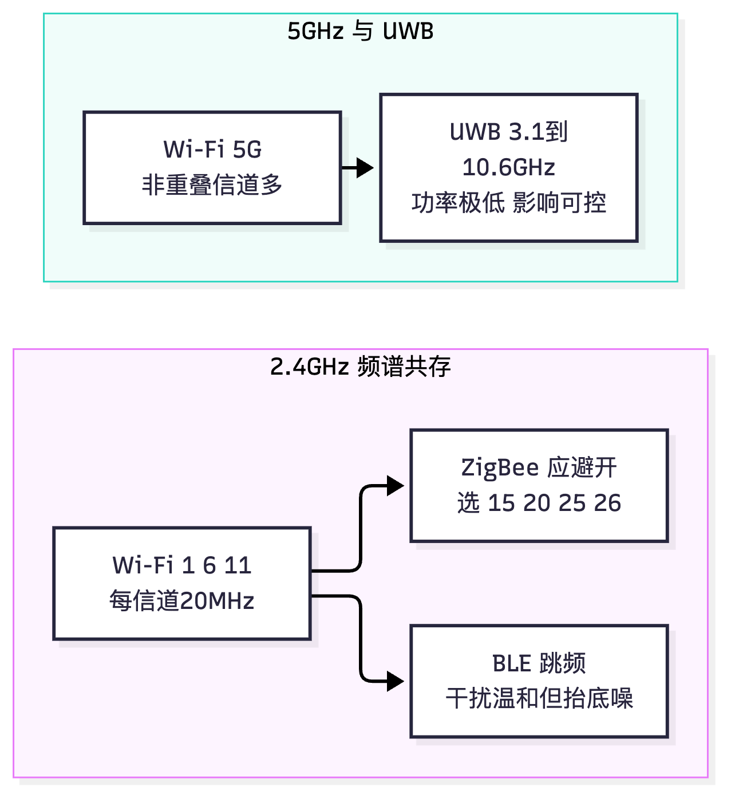


### 真题精练

**Q1.【真题·单选】** 在园区中同时部署 Wi-Fi 与 ZigBee 时，为减少相互干扰，最有效的做法是？
A. 把 ZigBee 信道设为 11，与 Wi-Fi 1 信道对齐
B. **让 Wi-Fi 2.4 GHz 仅使用 1/6/11，并把 ZigBee 信道规划到 15/20/25/26 等 Wi-Fi 未使用的频段**
C. 提高 ZigBee 发射功率使其抢占成功
D. 关闭 Wi-Fi 的 2.4 GHz 射频

> **答案：B**
> **解析**：ZigBee（802.15.4）在 2.4 GHz 有 16 个信道（11~26），每个 2 MHz 宽、间隔 5 MHz；Wi-Fi 每个信道 20 MHz。若 Wi-Fi 只用 1/6/11，则 ZigBee 的 **15/20/25/26** 这几个月于 Wi-Fi 信道间隙的位置受到的干扰最小。A 错（11 与 Wi-Fi 1 严重重叠）。C 错（提高功率会加剧对 Wi-Fi 的干扰，且 ZigBee 功率受法规限制）。D 过于绝对（很多场景 2.4 GHz Wi-Fi 仍需保留覆盖兜底），且关闭 Wi-Fi 2.4G 并非"减少相互干扰"的最佳方案（应在规划层错开）。

**Q2.【真题·多选】** 关于 AP 内置 IoT 插槽的部署，下列说法正确的有？
A. 可复用 AP 的 PoE 供电与上行回传，降低部署成本
B. 插入 IoT 模块后 AP 的功耗上升，需要重新核算 PoE 功率预算
C. IoT 业务应与用户业务使用独立的 VLAN/VAP/SSID 以便隔离与限速
D. IoT 插槽只是增加一个射频，对 AP 的其他资源没有影响
E. 需要确认 AP 型号与 AC 版本是否支持所需的 IoT 技术与模块

> **答案：ABCE**
> **解析**：D 错误。IoT 模块不仅带来射频，还会占用 AP 的 **CPU、内存、内部总线带宽与供电**，尤其 BLE 定位场景需要持续扫描并上报大量标签数据，会消耗可观的 AP 资源，因此**必须评估 AP 规格与容量**，而不是当作"免费的附加射频"。A、B、C、E 都是部署时必须考虑的因素，其中 E 尤其重要：**IoT 功能对 AP 型号与 AC 版本有强依赖，方案设计时必须写明"以所用版本文档为准"**。

**Q3.【真题·判断】** BLE 工作在 2.4 GHz，因此与 Wi-Fi 的干扰比 ZigBee 更严重。

> **答案：错误**
> **解析**：虽然两者都在 2.4 GHz，但干扰特征不同：**BLE 采用跳频（每秒上千次跳频）**且发射功率低（通常 ≤ 10 dBm）、单次传输时间极短，与 Wi-Fi 的碰撞是**偶发而短暂**的，对 Wi-Fi 的影响表现为轻微的底噪抬升与零星重传；**ZigBee 使用固定的 2 MHz 窄带信道并采用 CSMA/CA 竞争**，一旦其信道与 Wi-Fi 信道重叠，两者会**持续互相退让与碰撞**，ZigBee 因参数劣势会大量重传，对 Wi-Fi 的影响更持续。因此**在信道规划上 ZigBee 需要更谨慎地避开 Wi-Fi 信道**。

**Q4.【真题·设计】** 某智慧园区需要同时承载：办公 Wi-Fi（2000 人）、视频监控（300 路，每路 4 Mbps）、智能照明（ZigBee，1200 个节点）、资产定位（BLE 标签 5000 个）。请给出 WLAN 与 IoT 的融合设计方案。

> **答案要点**：
> ① **频段与业务分工**：办公 Wi-Fi 主力走 **5 GHz（80/40 MHz）+ 6 GHz**（若设备支持），2.4 GHz 只作覆盖兜底并**主要让给 IoT**；视频监控走 **5 GHz 低频段或独立 2.4 GHz 信道 + 本地转发**；ZigBee 规划在 **15/20/25/26 信道**（避开 Wi-Fi 1/6/11）；BLE 定位用 AP 的 IoT 模块（扫描模式）。
> ② **转发模式**：办公 Wi-Fi 用**隧道转发**（集中准入与审计、便于漫游）；视频监控与 IoT 数据用**本地转发**（大带宽、低价值密度，避免 AC 与核心链路成为瓶颈）。
> ③ **AP 选型与供电**：视频监控点与 IoT 密集区选用支持 IoT 插槽的 **AirEngine 系列 AP**，并核算 **PoE 功率预算**（AP 基础 + IoT 模块 + 余量），必要时使用 PoE++ 交换机；办公区可用标准放装型 AP。
> ④ **VLAN 与隔离**：办公（VLAN 110）、视频监控（140）、IoT（160）各自独立 VLAN 与 VAP；IoT 与监控 VLAN 配置严格 ACL，限制其仅能访问对应平台/服务器网段；开启 DHCP Snooping 与端口安全，防止私接。
> ⑤ **容量核算**：视频监控 300 路 × 4 Mbps = **1200 Mbps 上行**，需按上行容量规划 AP 数量与上行链路带宽（这部分不要占用 AC 隧道容量）；BLE 5000 标签的扫描上报需评估 AP 的 CPU 与上行带宽（按上报周期与报文大小估算），必要时**分级上报或降低上报频率**。
> ⑥ **IoT 平台与运维**：IoT 数据统一上送到 **iMaster NCE-Campus** 或第三方平台做可视化（在线状态、位置、电量、告警）；运维上按"设备类型 + 位置"分组管理。
> ⑦ **干扰治理与验收**：验收时对比开启 IoT 前后的 **2.4 GHz 噪声底与重传率**；ZigBee 网络自身的丢包率与重传率；BLE 定位精度（如 3~5 m）；Wi-Fi 业务的关键指标（利用率 < 40%、重传 < 10%）不受影响。
> ⑧ **风险提示**：所有 IoT 相关能力的支持范围（AP 型号、模块型号、AC 版本、平台版本）都必须以所用版本文档为准，方案中应明确列出依赖条件。

### 易错点与排错

1. **把 IoT 插槽当成"免费射频"**：会占用 AP 的 CPU、内存、供电与上行带宽，必须评估。
2. **忽略 PoE 功率预算**：插模块后功耗上升可能导致 PoE 供电不足（AP 反复重启或模块不工作）。
3. **ZigBee 信道不避开 Wi-Fi**：2.4 GHz 上两者的持续竞争会同时伤害两边。
4. **IoT 与用户业务共用 VLAN/VAP**：安全风险与限速困难。
5. **IoT 功能支持范围未核实**：AP 型号/模块/AC 版本任一处不支持，方案就无法落地。
6. **排错命令**：`display poe interface power`（供电预算）、`display wlan ap name <AP> radio 0 statistics`（IoT 开启前后 2.4G 噪声与重传对比）、`display wlan client verbose`（IoT 设备接入情况）、IoT 平台侧的在线率与上报统计。

---

## 2.9 大型 WLAN 故障排查：11 个典型案例

### 考点定位

本考点是国赛**排错题（实验卷）的集中体现**，通常给出故障现象，要求写出"定位命令 + 分析过程 + 解决方案"。分值 10~20 分，是拉开差距的关键。**答题结构固定**：现象 → 可能原因（按层排查）→ 定位命令与判据 → 解决方案 → 验证。以下 11 个案例覆盖国赛与现网最高频的故障场景，每个案例都给出了标准答题骨架。

### 原理精讲

**总原则：WLAN 故障必须"分层定位"。** 推荐的六层顺序（答题时按此展开，逻辑清晰不丢分）：

```
第1层 AP 与 AC 的 CAPWAP 通道：AP 能否发现 AC、隧道能否建立、AP 能否上线
第2层 射频与空口：射频是否开启、信道与功率、覆盖（RSSI/SNR）、干扰与利用率
第3层 接入与认证：终端能否关联、认证方式与服务器、密钥协商
第4层 地址与转发：VLAN 放通、DHCP、转发模式、网关与路由
第5层 可靠性与一致性：AC 主备/集群状态、配置一致性、License
第6层 上层与应用：DNS、服务器、终端自身
```

### 关键概念对照表

| 案例 | 一句话根因 | 首要定位命令 |
|---|---|---|
| 1 AC 主备不同步 | HSB 通道或服务绑定/配置不一致 | `display hsb-service 0`、`display hsb statistics` |
| 2 集群 AP 归属异常 | 静态绑定/负载信息上报异常/License 不均 | `display ac-cluster member`、`display ac-cluster ap-assign` |
| 3 跨 AC 漫游失败 | 漫游组配置/SSID 安全参数/本地转发 VLAN 不匹配 | `display wlan mobility-group all`、`display wlan roam-table` |
| 4 高密频繁掉线 | 空口拥塞 + 低速终端 + 负载均衡/踢除策略过激 | `display wlan ap all radio statistics` |
| 5 认证服务器不可达导致全网上线失败 | RADIUS 不可达/共享密钥错/端口未放通 | `display radius-server configuration`、AC 日志 |
| 6 AP 反复上线 | Option 43/AC 地址不一致、License 不足、DTLS 失败 | `display wlan ap all`、`display license` |
| 7 漫游粘滞 | 未启用 11k/v、漫游门限与覆盖设计不当 | `display wlan client verbose`、`display wlan ap all neighbor` |
| 8 语音质量差 | 空口无 WMM/有线不信任标记/漫游未优化 | `display wlan wmm-profile name <模板>`、交换机 trust 配置 |
| 9 AP 无法上线（跨三层） | CAPWAP 端口未放通、Option 43 错误、路由不可达 | `display capwap configuration`、防火墙策略 |
| 10 AP 供电不足导致重启/降级 | PoE 预算不足（IoT 模块加重） | `display poe interface power` |
| 11 关联成功但无网络 | 本地转发 VLAN 未全路径放通、DHCP 或网关问题 | `display wlan ap name <AP> config`、端口 VLAN |

### 华为设备配置

```bash
# ============ 案例 1：AC 主备不同步 ============
display vrrp                                          # 确认主备角色是否正确
display hsb-service 0                                 # 确认 HSB 通道是否 up、对端地址是否正确
display hsb-service-type access-controller            # 确认服务类型是否与 VRRP 绑定
display hsb statistics                                # 关键：查看同步报文收发与丢弃计数
display current-configuration | include hsb           # 核对两机 HSB 相关配置是否对称
 # 解决：修正 HSB 通道（独立 VLAN/链路）、绑定 VRRP、补齐配置一致性与 License，触发一次完整批量同步

# ============ 案例 2：AC 集群 AP 归属异常 ============
display ac-cluster status                             # 集群成员与角色
display ac-cluster member                             # 各成员负载上报是否正常
display ac-cluster ap-assign                          # AP 归属与备份关系（是否被静态绑定）
display license                                       # 逐台确认 AP 授权数是否充足
 # 解决：解除不必要的静态绑定、补齐 License、修复集群互联网络、设置迁移阈值避免乒乓

# ============ 案例 3：跨 AC 漫游失败 ============
display wlan mobility-group all                       # 漫游组是否建立、成员是否互为成员
display wlan mobility-group name campus-mobility      # 组详情（源接口、成员）
display wlan roam-table                               # 漫游表项是否生成（为空则漫游未成功）
display wlan client verbose                           # 终端是否支持 11k/v/r、当前 RSSI
ping -a 10.10.200.254 10.10.200.253                   # 漫游组源接口互相可达性
 # 解决：统一组名/ID/密钥、修正源接口、统一 SSID 与安全模板、漫游业务改隧道转发、开启 11k/v/r

# ============ 案例 4：高密下频繁掉线 ============
display wlan ap all radio statistics                  # 利用率/重传/噪声（判断是否拥塞或干扰）
display wlan client verbose                           # 终端 RSSI 与协商速率（是否有大量弱信号终端）
display wlan client traffic-statistics                # 各终端空口占用（找"害群之马"）
display logbuffer | include Deauth                     # 是否有被动踢除/负载均衡拒绝的记录
 # 解决：降带宽增加信道数、提高最小接入速率、开启 Airtime 公平、调整负载均衡与漫游门限、增加 AP

# ============ 案例 5：认证服务器不可达导致全网上线失败 ============
display radius-server configuration                   # RADIUS 服务器地址、端口、共享密钥
display radius-server statistics                      # 关键：是否有大量超时/拒绝
display aaa online-fail-record all                    # 上线失败记录与原因（版本相关）
ping -a <AC源地址> <RADIUS地址>                        # AC 到 RADIUS 的可达性
 # 解决：修复 RADIUS 可达性/共享密钥/端口放通；配置备用 RADIUS；将认证失败策略改为放行或降级
 #（生产环境通常要求"认证失败仍可上网"的逃生策略，避免全网上线失败）

# ============ 案例 6：AP 反复上线 ============
display wlan ap all                                   # 看 AP 状态是否在 Discovery/Join/Config 之间反复
display wlan ap name AP-01 info                       # 查看该 AP 的上线阶段与失败原因
display license                                      # 授权数是否不足（超授权 AP 会无法上线）
display capwap configuration                          # CAPWAP 源接口与端口配置
display logbuffer | include DTLS                       # DTLS 建立失败记录
 # 解决：统一 Option 43 与 AC 源接口地址、补齐 License、放通 UDP 5246/5247、检查 AP 与 AC 的版本兼容性

# ============ 案例 7：漫游粘滞 ============
display wlan client verbose                           # 终端 RSSI（很低但不切换）、是否支持 11k/v
display wlan ap all neighbor                          # 邻区信号重叠是否足够
display wlan rrm-profile name rrm-roaming             # 智能漫游与门限配置
 # 解决：开启 11k/v 与智能漫游、设置 -70dBm 门限与 5dB 滞后量、适度降低 AP 功率、增加 AP 密度

# ============ 案例 8：语音质量差 ============
display wlan wmm-profile name wmm-voice               # AC_VO 参数与 ACM 是否生效
display wlan client verbose                           # 终端协商的 QoS 与速率
display wlan ap name AP-01 radio 0 statistics         # 重传与速率分布
display traffic policy statistics interface GigabitEthernet1/0/1 inbound   # 交换机侧 QoS 统计（命令随产品版本变化）
 # 解决：启用 WMM 并映射语音到 AC_VO、接入端口 trust 标记、核心队列保障 EF、开启 11k/v/r

# ============ 案例 9：AP 无法上线（跨三层）============
display capwap configuration                          # AC 侧 CAPWAP 源接口
display ip routing-table <AP网段>                     # AC 到 AP 网段是否可达
display acl all                                       # 中间设备 ACL 是否拦截
 # 解决：防火墙/ACL 放通 UDP 5246（控制，DTLS）与 UDP 5247（数据）；确认 Option 43 指向正确；确认 AP 与 AC 版本兼容
```

### 示意图

```mermaid
flowchart TD
    P["WLAN 故障现象"] --> L1["第1层 AP与AC通道"]
    L1 -->|"AP无法上线"| C1["查 Option43 CAPWAP源接口 端口放通 License"]
    L1 -->|"上线正常"| L2["第2层 射频与空口"]
    L2 -->|"利用率高 重传高"| C2["查干扰 低速终端 带宽规划"]
    L2 -->|"覆盖差"| C3["查 RSSI 功率 天线 布点"]
    L2 --> L3["第3层 接入与认证"]
    L3 -->|"关联失败"| C4["查安全模板 认证服务器 密钥协商"]
    L3 --> L4["第4层 地址与转发"]
    L4 -->|"无IP或不通"| C5["查 VLAN放通 DHCP 转发模式 网关路由"]
    L4 --> L5["第5层 可靠性与一致性"]
    L5 --> C6["查 AC主备 集群 配置一致性 License"]
    L5 --> L6["第6层 上层与应用"]
    L6 --> C7["查 DNS 服务器 终端自身"]
```


### 真题精练

**Q1.【真题·排错】** 某园区 AC 双机热备部署，主用 AC 故障切换后，全网 AP 掉线并在 3 分钟后重新上线。请给出完整排查步骤与解决方案。

> **答案要点**：
> ① **现象定性**："AP 掉线并重新上线"说明 AP 与集群/主备的 CAPWAP 会话**完全中断并重新走了一遍 Discovery-Join-Config**，即**备用 AC 手里的状态是无效的**或 **AP 指向的 AC 地址切换失败**。
> ② **排查一：HSB 是否真正同步成功。** `display hsb-service 0` 只看通道是否 up（不够）；必须查 `display hsb-service-type access-controller`（服务类型是否绑定 VRRP）与 **`display hsb statistics`**（同步报文是否丢包、是否有大量 error/drop）；若同步报文在故障前就丢失（HSB 通道与业务共用链路、链路质量差），备用 AC 的状态就是过期的。
> ③ **排查二：AP 指向的是 VIP 还是实地址。** 检查 DHCP 的 **Option 43** 下发的是不是 VRRP 的虚拟 IP；若下发的是主用 AC 的实地址，倒换后 AP 找不到 AC，只能重新发现。同时核对 AC 的 `capwap source interface`（`display capwap configuration`）。
> ④ **排查三：两机配置一致性。** 逐条比对 wlan 相关配置（SSID、安全模板、VAP、VLAN、转发模式、AP 组）。任何不一致都会造成"接管后 AP 行为异常或重新上线"。
> ⑤ **排查四：备机 License。** `display license` 确认备机 AP 授权数 ≥ 全网 AP 数；不足时部分 AP 无法上线。
> ⑥ **排查五：VRRP 参数与抢占。** `display vrrp` 确认主备角色、优先级与抢占配置；原主恢复后若立即抢占会造成二次抖动（应配置延时抢占）。
> ⑦ **解决方案**：修正 HSB 通道（独立 VLAN/链路聚合）、绑定 VRRP 与服务类型、确保 Option 43 下发 VIP、逐条统一两机配置、补齐备机 License、配置延时抢占；随后**触发一次完整批量同步**并在业务低谷期实测倒换。
> ⑧ **验证**：倒换测试中 AP **不掉线**（`display wlan ap all` 状态连续），终端业务中断 < 3 s，`display hsb statistics` 无同步报文丢弃。

**Q2.【真题·排错】** 某园区三台 AC 组成的集群中，AC3 上的 AP 数远少于 AC1/AC2，且部分 AP 在成员之间反复迁移造成业务抖动。请给出排查与处置。

> **答案要点**：
> ① **排查归属分配失效的原因**：`display ac-cluster ap-assign` 检查是否存在**静态归属绑定**（把 AP 组强行绑到某成员）；`display ac-cluster member` 检查**各成员负载上报是否正常**（AC3 若上报异常，主 AC 无法正确均衡）；`display license` 逐台检查授权数（AC3 授权少会导致它不敢/不能多接 AP）；检查集群互联 VLAN 的连通性和丢包（`ping` + 接口统计）。
> ② **排查乒乓迁移的原因**：是否**未设置迁移阈值/冷却时间**；AC3 是否自身资源（CPU/内存/隧道数）不足导致接管后立即超载又被迁走；负载信息的实时性是否因互联网络抖动而反复变化。
> ③ **处置**：解除不必要的静态归属绑定，改为动态分配并设定合理权重；**补齐 AC3 的 License**；**设置迁移阈值与冷却期**（或把关键 AP 静态绑定到指定成员）；修复集群互联网络（独立 VLAN、链路聚合、双上行、必要时升带宽）；若 AC3 能力确实不足，**减少其规划承载量或退出集群**。
> ④ **验证**：观察一段时间，各成员 AP 数趋于均衡（差异在阈值内）；`display logbuffer` 无反复迁移记录；终端业务无抖动。

**Q3.【真题·排错】** 某医院 Wi-Fi 语音终端在病区之间移动时通话断续，且部分区域完全无法通话。请给出排查步骤与优化方案。

> **答案要点**：
> ① **分层排查**：先看覆盖（`display wlan client verbose` 看 RSSI/SNR，是否低于 −70 dBm / 20 dB）；再看空口质量（`display wlan ap all radio statistics` 的利用率、重传、噪声）；再看漫游能力（终端是否协商 11k/v/r，`display wlan roam-table`，`display wlan mobility-group all`）；最后看 QoS（`display wlan wmm-profile name <模板>` 的 AC_VO 参数与 ACM、交换机端口是否 trust 标记）。
> ② **"部分区域完全无法通话"** 通常是**覆盖空洞**（RSSI < −75 dBm 且 SNR 低）或该区域 AP 未下发语音 VAP；需检查该区域 AP 的射频状态与 VAP 绑定（`display wlan ap name <AP> config`）。
> ③ **"移动中断续"** 通常是**漫游切换耗时长或丢包多**：未启用 802.11k（扫描慢）、未启用 802.11r（需完整认证）、未启用 802.11v（不能主动引导）、漫游门限过低导致粘滞到信号极差才切、或邻区信号重叠不足。
> ④ **优化方案**：一是开启 **802.11k/v/r**（统一移动域 ID），把切换压到 50 ms 内；二是设置漫游门限 **−70 dBm + 滞后量 5 dB**，并保证病区边界两侧信号在 −65~−70 dBm 有足够重叠；三是**语音 SSID 用隧道转发**并独立规划，避免跨 AC 三层漫游的 VLAN 问题；四是启用 **WMM 并把语音映射到 AC_VO + ACM 限制占比**；五是**接入交换机 trust 标记、核心 EF 队列保障**（端到端 QoS 链）；六是保证 AP 密度与功率合理（避免覆盖空洞与过度覆盖）；七是关注空口拥塞（开启 Airtime 公平、提高最小接入速率）。
> ⑤ **验证**：持续 Ping 测量切换丢包（≤ 1~2 个包）与切换时间（< 50 ms）；语音 MOS ≥ 4.0；连续走动通话 10 分钟无掉话、无吞字。

**Q4.【真题·排错】** 某园区使用 802.1X 认证，某日突发全网用户无法上网，AP 在线正常。请给出排查思路。

> **答案要点**：
> ① **现象特征**："AP 在线正常但全网用户无法上网"说明**空口与 CAPWAP 层正常**，问题在**认证或认证之后的环节**。
> ② **首要怀疑 RADIUS 服务器**：`display radius-server statistics` 与 `display radius-server configuration` 查看是否有大量超时/拒绝；`ping` 从 AC 到 RADIUS 验证可达性；`display aaa online-fail-record all`（命令随版本不同）查看上线失败原因。
> ③ **其次怀疑共享密钥与端口**：RADIUS 共享密钥被改动、防火墙未放通 UDP 1812/1813（或 1645/1646）会导致认证全部失败。
> ④ **第三怀疑认证失败策略**：若配置为"认证失败即拒绝接入"，则 RADIUS 故障会导致**全网用户无法上线**。生产环境应配置**逃生策略**（如临时放行到隔离 VLAN 或允许本地认证），至少保证 AP 管理与基本连通性不受影响。
> ⑤ **第四怀疑 AC 与授权**：`display license` 检查终端授权是否耗尽（超授权的终端无法接入）；检查 AC 的 CPU 与内存是否过载导致认证进程异常。
> ⑥ **第五怀疑中间网络与地址**：明明是"认证通过但拿不到地址"（DHCP 故障也会表现为全网无法上网），需区分"认证失败"与"认证通过但地址/网关异常"——用 `display wlan client verbose` 看终端是否获取到 IP。
> ⑦ **解决方案**：修复/切换 RADIUS（配置主备 RADIUS 与超时重传）；放通认证端口；配置认证失败的逃生策略；为 RADIUS 服务器做冗余与容量规划（高密场景并发认证压力大）；定期演练 RADIUS 故障场景。
> ⑧ **验证**：终端认证成功率恢复 > 99%，`display radius-server statistics` 无超时激增，用户上网恢复。

**Q5.【真题·排错】** 某园区新增一批 AP，上线后部分 AP 反复上下线（每隔几分钟掉一次再上线），其他 AP 正常。请给出排查步骤。

> **答案要点**：
> ① **看 AP 状态与阶段**：`display wlan ap all` 观察掉线 AP 的状态变化；`display wlan ap name <AP> info` 查看它卡在哪个阶段（Discovery/Join/Config/Data Check/Run）以及失败原因码。若在 **Run** 后周期性掉线，重点看**保活与链路质量**；若卡在 Join/DTLS，重点看**隧道建立与版本兼容**。
> ② **保活与链路质量**：CAPWAP 靠 Echo 报文保活（默认间隔与超时按版本，通常是秒级），若 AP 与 AC 之间链路有丢包或时延抖动，会触发保活超时导致 AP 重上线。检查 AP 上行链路的误码、丢包与拥塞（交换机接口统计、光模块告警、PoE 供电稳定性）。
> ③ **PoE 供电**：`display poe interface` 查看掉线 AP 端口的供电功率与状态。**PoE 功率不足**（尤其插了 IoT 模块或使用了长网线）会导致 AP 反复重启，这是"周期性上下线"的经典根因。
> ④ **License 与容量**：`display license` 检查 AP 授权是否刚好用尽；部分版本在超授权时表现为部分 AP 无法稳定上线。
> ⑤ **地址与 Option 43**：若 AP 用 DHCP 获取地址，检查租期与续租是否正常（租期过短或 DHCP 服务器不稳定会导致 AP 在续租失败后重启网络栈并重上线）；`display wlan ap name <AP> info` 里可看到 AP 的 IP 与 AC 地址是否与预期一致。
> ⑥ **版本兼容**：`display version` 对比 AP 与 AC 版本；若 AP 版本与 AC 不匹配，AC 可能下发升级并重启 AP（表现为升级循环）。
> ⑦ **干扰与射频**：极端情况下 AP 上行的无线回传（若为 WDS/Mesh）质量差也会导致掉线，检查回传链路质量。
> ⑧ **解决方案**：修复 PoE 供电（更换电源/交换机、缩短网线、核算功率预算）；修复链路质量（更换模块/线缆、消除环路与拥塞）；补齐 License；统一版本；修正 DHCP/Option 43。**验证**：连续观察 1 小时，AP 状态稳定为 Run，无周期性掉线。

### 易错点与排错

1. **不分层，直接猜**：排错题必须按"AP-AC 通道 → 射频空口 → 接入认证 → 地址转发 → 可靠性一致性 → 上层"的顺序展开，逻辑清晰才拿分。
2. **把 HSB 通道 up 当同步正常**：必须看服务绑定与同步统计。
3. **忽略 License**：AC 主备/集群/超授权都与 License 强相关，是高频失分点。
4. **忽略 PoE 供电**：周期性掉线的经典根因，`display poe interface` 必查。
5. **混淆"认证失败"与"认证通过但无地址"**：两者现象相似但排查路径完全不同，用 `display wlan client verbose` 看是否拿到 IP 来区分。
6. **排错命令总表**：`display wlan ap all`、`display wlan ap name <AP> info`、`display capwap configuration`、`display wlan client verbose`、`display wlan ap all radio statistics`、`display wlan mobility-group all`、`display wlan roam-table`、`display vrrp`、`display hsb-service 0`、`display hsb statistics`、`display ac-cluster status`、`display license`、`display radius-server statistics`、`display poe interface`、`display logbuffer`。

---

## 附录 A：本册数值速查表（考前 10 分钟必背）

| 类别 | 数值 | 备注 |
|---|---|---|
| Slot Time | 2.4G **20 μs** / 5G、6G **9 μs** | 短时隙提升效率 |
| SIFS | 2.4G **10 μs** / 5G、6G **16 μs** | ACK/CTS 用 |
| PIFS | SIFS + Slot | PCF 用 |
| DIFS | SIFS + 2×Slot（2.4G 50 μs / 5G 34 μs） | DCF 基准 |
| AIFSN | VO 2 / VI 2 / BE 3 / BK 7 | EDCA 核心数值 |
| CWmin/CWmax | VO 3/7、VI 7/15、BE 15/1023、BK 15/1023 | 指数口径 |
| TXOP 上限 | VO **1.504 ms** / VI **3.008 ms** / BE、BK 0 | 一次抢占最长占用 |
| RTS 门限 | **2347 字节**（默认等于永不启用） | dot11RTSThreshold |
| 重传上限 | 短帧 **7** / 长帧 **4** | dot11ShortRetryLimit / LongRetryLimit |
| 11n 锚点 | MCS 7 / 20M / 1SS / 800ns = **65 Mbps** | 40M/400ns = 150 Mbps；4SS/40M/400ns = **600 Mbps** |
| 11ac 锚点 | MCS 9 / 80M / 1SS / 800ns = **433.3 Mbps** | 160M/1SS = 866.7 Mbps；80M 400ns = 481.4 Mbps |
| 11ax 锚点 | MCS 11 / 80M / 1SS / 800ns = **600.4 Mbps** | 160M/1SS = 1200.4 Mbps；20M/1SS = 143.4 Mbps |
| 11be 峰值 | 约 **46 Gbps**（理论） | 320 MHz + 4096-QAM + 16 流 |
| GI 缩短增益 | **4.0/3.6 ≈ 1.111** | 400 ns 相比 800 ns |
| 调制每子载波比特 | BPSK 1 / QPSK 2 / 16QAM 4 / 64QAM 6 / 256QAM 8 / 1024QAM 10 / 4096QAM 12 | 速率计算基础 |
| 20 MHz RU 数（11ax） | **9 个 26-tone**；80 MHz 37 个；160 MHz 74 个 | OFDMA 粒度 |
| BSS Color | **6 bit**（1~63 有效，0 关闭） | 11ax 空间复用 |
| CCA 信号检测门限 | **−82 dBm**（20 MHz） | 异色门限（OBSS-PD）约 −72~−62 dBm |
| 空口效率 | 单帧 1500 B 约 **10%**；聚合 16 帧约 66%；聚合 64 帧约 88% | 帧聚合是吞吐最大功臣 |
| 2.4 GHz 非重叠信道 | **1 / 6 / 11**（仅 3 个） | 硬约束 |
| DFS CAC | **60 s**（气象雷达相关 **600 s**）；停发时限 **200 ms** | 雷达事件处置 |
| 健康空口指标 | 利用率 < 40%、重传 < 10%、噪声底 < −92 dBm | 四指标组合判干扰类型 |
| 高密参数 | 单 AP 25~40 台、Beacon 200 ms、DTIM 3、最小速率 12~24 Mbps、带宽 20~40 MHz | 5000 人场馆算例 |
| CAPWAP 端口 | 控制 **UDP 5246**（DTLS）、数据 **UDP 5247** | 跨三层必须放通 |
| VRRP | 通告默认 1 s、优先级默认 100、检测约 **3~4 s**；组播 224.0.0.18、协议号 112 | 可用 BFD 压缩到毫秒级 |
| HSB | 端口示例 10241（**以所用版本文档为准**） | 与 VRRP 绑定 |
| 漫游切换目标 | 无 11r < 150 ms；有 11r **< 50 ms**；丢包 ≤ 1~3 包 | 语音业务要求 |
| 漫游门限 | −70 ~ −75 dBm，滞后量 5~10 dB | 防乒乓 |
| AP 管理网段 | 按"AP 数 × 1.5~2"规划；Option 43 指向 AC | 网关放汇聚层 |

## 附录 B：本册命令索引（按任务分类）

| 任务 | 关键命令 |
|---|---|
| WMM/EDCA 参数 | `wmm-profile` / `ac-vo` / `aifsn` / `ecwmin` / `ecwmax` / `txop-limit` / `acm enable` |
| 射频模板与协议开关 | `radio-2g-profile` / `radio-5g-profile` / `radio-6g-profile` / `channel 20mhz` / `dot11ax enable` / `dot11be enable` / `ofdma enable` / `twt enable` / `bss-color enable` / `preamble-puncturing enable` |
| 射频优化与漫游 | `rrm-profile` / `band-steer enable` / `load-balance enable` / `smart-roam enable` / `dot11k enable` / `dot11v enable` / `ft enable` |
| CAPWAP 与 AP 上线 | `capwap source interface`（AC）/ `option 43 sub-option 1 ip-address`（DHCP） |
| 转发模式 | `forward-mode tunnel` / `forward-mode local`（VAP 模板） |
| 双机热备 | `vrrp vrid` / `vrrp vrid preempt-mode timer delay` / `hsb-service` / `hsb-service-type access-controller` |
| AC 集群 | `ac-cluster` / `cluster-name` / `cluster-priority` / `member`（命令名随版本差异） |
| 跨 AC 漫游 | `mobility-group name` / `member ip-address` / `mobility-group ... source` / VAP 下 `mobility-group` |
| PoE 与供电 | `poe enable` / `display poe interface power` |
| 交换机 QoS 信任 | `trust upstream` / `trust dscp`（命令随产品版本差异） |
| 空口质量查看 | `display wlan ap all radio statistics` / `display wlan ap name <AP> radio 0 statistics` / `display wlan ap all neighbor` |
| 终端与漫游查看 | `display wlan client verbose` / `display wlan roam-table` / `display wlan mobility-group all` / `display station assoc-statistics` |
| 可靠性查看 | `display vrrp` / `display hsb-service 0` / `display hsb statistics` / `display ac-cluster status` / `display license` |
| 认证与 DHCP | `display radius-server statistics` / `display aaa online-fail-record all` / `display dhcp relay all` / `display ip pool` |

> **版本提示**：本册中标注"以所用版本文档为准"的命令（尤其 AC 集群、MLO、IoT、频谱分析、抓包、QoS 映射相关的子命令），在不同 VRP 版本与不同产品型号上名称、视图归属与取值范围可能不同。上机前请用 `?` 补全确认，并以所用版本的产品文档为最终依据。
