# B12-WLANHCIE下-勘测规划与安全运维

> **所属**：华为 ICT 大赛网络赛道 · 国赛 · WLAN 方向 · HCIE 层
> **内容**：无线网络勘测与规划方法、WLAN 安全进阶与无线攻防、智能化运维与新技术
> **真题说明**：本册真题依据华为 ICT 大赛历年公开赛题方向、华为认证考试真题回忆与官方教材例题整理改写，用于自测训练；正式参赛请以大赛官方考试大纲与题库为准。

---

# WLAN-HCIE-章节3-无线网络勘测与规划方法

## 3.1 WLAN 网规完整方法论：七阶段流程与每阶段输出物

### 考点定位

本考点在理论卷中以**简答/设计题的总纲**形式出现，占 **4~8 分**，几乎每一道网规综合题的第一问都是"请描述 WLAN 网络规划的完整流程"。高频陷阱有三个：① 把"勘测"当成一次性动作而不是**迭代闭环**（勘测→仿真→调整→再勘测）；② 把"覆盖规划"排在"容量规划"之前（高密场景必须**先容量后覆盖**，因为容量决定 AP 数量下限）；③ 漏掉最前面和最末尾的两个阶段（需求调研、验收优化）。**国赛综合设计题的第一问与最后一问都在这两端**，漏了就丢分。

### 原理精讲

WLAN 网络规划（Network Planning，简称网规）的本质是：**把"业务需求"翻译成"可施工、可验收、可演进"的射频与网络设计参数**。它不是一个线性文档工作，而是一个"**需求→设计→验证→修正**"的反馈控制系统。华为把它拆成七个阶段：**需求调研 → 容量规划 → 覆盖规划 → 勘测与仿真 → 方案设计 → 工程实施 → 验收与优化**。

**为什么顺序是"先容量后覆盖"？** 覆盖规划的输出是"满足目标信号强度的 AP 间距"，容量规划的输出是"满足并发吞吐需求的 AP 数量与密度"。在高密场景（报告厅、体育馆、教室），**容量往往比覆盖更早约束 AP 密度**：一个报告厅按覆盖算可能 2 个 AP 就够（半径 15m 覆盖全厅），但 1500 人在线看直播需要 6~8 个 AP 才够带宽。若先按覆盖布 2 个 AP，再发现容量不够要加到 8 个，则点位、供电、走线、信道规划全部返工。所以正确顺序是：**先用容量定出 AP 数量的下限与密度上限（受同频干扰约束），再用覆盖校验盲区并微调点位**。反之，稀疏场景（仓库、室外园区）覆盖是主导约束，容量算完只是校验。

**为什么勘测必须在容量/覆盖规划之后、方案设计之前？** 容量与覆盖规划都基于"假设的环境参数"（墙体衰减、路径损耗指数、空旷度）。这些假设在真实建筑里可能偏差 6~15 dB。勘测的作用就是**用实测（或高保真仿真）替换假设**：现场勘测测量真实衰减与既有干扰，模拟勘测（WLAN Planner）用图纸 + 材质库做射线级仿真。没有勘测直接出图，等于用教科书参数施工。

**为什么验收优化不可省？** 网规是"预测"，验收是"实测"：预测的覆盖半径、边缘速率、漫游切换时延都要用实测数据闭环修正。验收不通过时的处置顺序是：先调功率/信道（零成本）→ 再调 AP 点位（低成本）→ 最后加 AP（高成本）。这个顺序本身就是考点。

### 关键概念对照表

| 阶段 | 核心问题 | 关键输入 | 关键输出（交付物） | 常见失败原因 |
|---|---|---|---|---|
| ① 需求调研 | 谁用、用多少、在哪用、怎么用 | 业务类型、人数、并发率、带宽、漫游/定位需求 | 需求调研表、场景分类清单、SLA 指标 | 只问"多少人"，不问业务类型与并发率 |
| ② 容量规划 | 需要多少 AP、每 AP 带多少人 | 并发用户数、人均带宽、AP 整机吞吐 | AP 数量下限、密度上限、上行带宽需求 | 忽略上行带宽与 AC/DHCP 瓶颈 |
| ③ 覆盖规划 | 用多大间距、什么功率、够不够 | 覆盖目标（RSSI/SNR/边缘速率）、链路预算 | AP 间距、目标功率、天线选型 | 不做链路预算，只凭经验取间距 |
| ④ 勘测与仿真 | 真实环境衰减与干扰是多少 | 建筑图纸、材质、既有 AP 与干扰源 | 勘测报告、仿真覆盖热力图、修正系数 | 用模拟勘测替代高密场景的现场勘测 |
| ⑤ 方案设计 | 怎么落成可施工的设计 | 点位图、选型、信道/功率、VLAN/IP、安全 | 点位图、设备清单、配置模板、验收指标 | 没有验收指标，后期无法判定合格 |
| ⑥ 工程实施 | 按图施工且不降级 | 设计方案、工程规范 | 安装记录、工勘照片、上电测试记录 | 点位被吊顶/管线"就近偏移"，破坏射频设计 |
| ⑦ 验收与优化 | 实测是否达标、不达标怎么调 | 验收指标、实测工具 | 验收报告、优化调整记录 | 只在"空场"验收，未做加人加业务验收 |

| 覆盖目标指标 | 建议门限（数据业务） | 建议门限（语音/VoWi-Fi） | 说明 |
|---|---|---|---|
| 接收信号强度 RSSI | ≥ -65 dBm（普通办公），≥ -70 dBm（仓库/室外放宽） | ≥ -60 dBm | 边缘值，非平均值；高密场景建议 -60 dBm |
| 信噪比 SNR | ≥ 25 dB（建议 30 dB 以上跑高阶 MCS） | ≥ 25 dB | SNR 决定可用 MCS，比 RSSI 更能反映体验 |
| 同频干扰 Co-channel | ≤ -80 dBm（或比服务 AP 低 15 dB 以上） | ≤ -85 dBm | 高密场景核心矛盾 |
| 邻频干扰 Adjacent | ≤ -75 dBm | ≤ -80 dBm | 2.4G 只有 1/6/11，尤其关键 |
| 丢包率 | ≤ 1%（UDP 灌包测试） | ≤ 0.5% | 语音质量的核心 |
| 时延 | ≤ 50 ms（普通数据） | ≤ 30 ms（单向端到端） | 语音抖动 ≤ 30 ms |
| 边缘速率 | ≥ 10 Mbps（普通办公下行） | ≥ 2 Mbps（语音每流） | 用于反推覆盖半径 |
| 漫游切换时延 | ≤ 100 ms（数据），≤ 50 ms（语音） | ≤ 50 ms | 语音要求无感知 |

### 华为设备配置

```bash
# ===== 验收阶段：在 AC6805 上核对设计与实配的一致性（VRP V200R019 及以后）=====
system-view
display version                                          // 确认 AC 型号与 VRP 版本，网规参数与版本能力相关
display ap all                                           // 查看全部 AP 的型号/状态/归属，与设计方案清单逐条对照
display ap performance all                               // 查看 AP 在线用户数、信道、带宽占用，识别"设计 100 人实装 200 人"的超载点
display station all                                      // 查看终端列表（含 RSSI/SNR/速率），用于验收时的抽样点位测试
display radio-2g-profile name default                    // 查看 2.4G 射频模板（信道/功率/带宽），核对是否与信道规划表一致
display radio-5g-profile name default                    // 查看 5G 射频模板，核对信道与频宽
display wlan config ...                                  // 按所用版本子命令核对 VAP/AP 组与设计文档的映射（以所用版本文档为准）

# ===== 现场实测用的关键诊断命令（验收时逐点位执行）=====
display station ssid <SSID>                              // 按 SSID 过滤终端，确认终端关联到"应该关联的那台 AP"（点位绑定校验）
display station mac-address <MAC> verbose                // 查看单个终端的详细射频信息：RSSI、SNR、协商速率、重传，用于判定边缘覆盖
display ap performance all radio                         // 按射频维度看信道利用率，验证同频干扰是否超标
display wlan ap name <AP名> radio all                    // 查看指定 AP 各射频的信道、功率、带宽与噪声底

# ===== 优化阶段：不改点位先调射频（零成本优化，优先执行）=====
wlan
 radio-2g-profile name default
  channel 20mhz 1 6 11                                   // 2.4G 固定为 1/6/11 三个非重叠信道（多楼层按 3.1 节表分配）
  eirp 14                                                // 限制 2.4G 等效全向辐射功率，抑制跨楼层同频干扰
 radio-5g-profile name default
  channel 80mhz 36 52 100 116 132                        // 5G 按规划表固定信道，避免自动选信道造成的"信道漂移"
  eirp 20                                                // 5G 功率按链路预算取值（比 2.4G 高，因为路径损耗更大）
```
> 说明：`eirp` 取值范围受**国家码（regulatory-domain-profile）**限制，2.4G 通常 1~20 dBm、5G 通常 1~23/30 dBm，超过范围报错。跨国项目必须先配 `regulatory-domain-profile`。**以所用版本文档为准**。

### 示意图

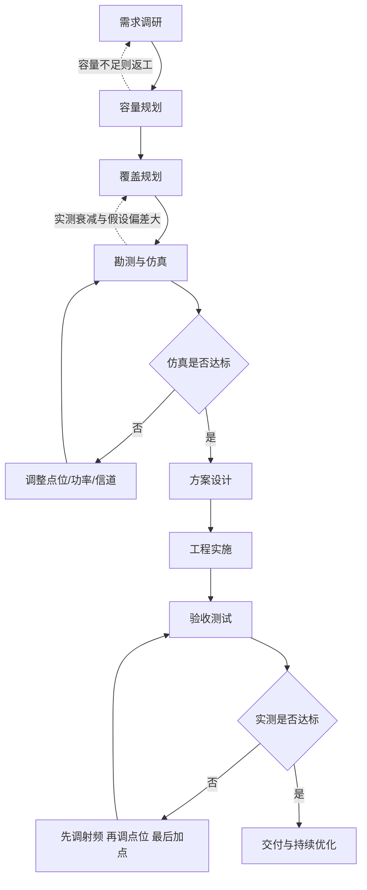

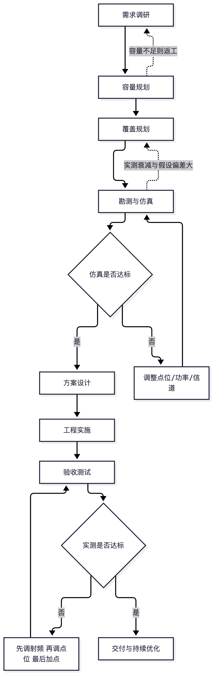


### 真题精练

**Q1.【真题·简答】** 请完整描述 WLAN 网络规划的七个阶段，并说明为什么在高密场景中"容量规划"必须排在"覆盖规划"之前。

> **答案**：
> **① 七阶段**：需求调研 → 容量规划 → 覆盖规划 → 勘测与仿真 → 方案设计 → 工程实施 → 验收与优化。
> **② 每阶段一句话**：需求调研量化业务类型、人数、并发率、带宽与特殊需求；容量规划算出并发用户数与所需 AP 数量下限、上行带宽；覆盖规划用链路预算算 AP 间距与目标功率；勘测用实测或仿真替换环境假设；方案设计输出点位图、设备清单、信道功率表、VLAN/IP、安全与验收指标；工程实施按图施工；验收优化用实测闭环修正。
> **③ 为什么先容量后覆盖**：覆盖规划只回答"信号够不够"，容量规划回答"带宽够不够"。在高密场景（报告厅、体育馆、大教室）中，**容量约束比覆盖约束更严**（例如按覆盖 2 个 AP 够、按容量需 8 个 AP）。若先按覆盖布点，后续容量不足就会推倒重来：点位、供电、走线、信道复用全部返工。反之在稀疏场景（仓库、停车场、室外园区）覆盖是主导约束，容量只作校验，此时顺序影响不大。因此工程上的正确原则是：**先用容量定 AP 数量下限，再用覆盖定间距与点位，最后用勘测/仿真双重复核**。

**Q2.【真题·多选】** 下列哪几项属于"验收与优化"阶段必须完成的工作？
A. 覆盖率（RSSI/SNR）抽样测试与热力图复核
B. 单 AP 与整网吞吐测试（含 UDP 灌包与 TCP 打流）
C. 漫游切换时延与丢包测试（语音场景必做）
D. 高密并发测试（按设计并发的 100%~120% 加压）
E. 在 AC 上为每个 AP 手工指定不同的 SSID 以区分楼层

> **答案：ABCD**
> **解析**：E 是错误做法——多楼层通常用**相同 SSID** 以便漫游，靠 AP 组/VLAN 区分业务；给每层不同 SSID 会破坏漫游并增加终端负担（终端要记住多套配置）。A/B/C/D 是验收四件套：覆盖、吞吐、漫游、并发。补充标准：覆盖率抽测点达标率 100%（关键区域）/≥95%（一般区域）；单 AP 下行吞吐应达设备标称的 60% 以上（受终端与空口效率限制）；漫游时延数据业务 ≤100 ms、语音 ≤50 ms；并发测试按设计值加压后 RSSI/时延/丢包不劣化超过 20%。

**Q3.【真题·判断】** 只要 WLAN Planner 仿真结果显示覆盖达标，就可以跳过现场勘测直接施工。

> **答案：错误**
> **解析**：模拟勘测基于图纸与材质库，仿真精度依赖图纸准确性与材质参数选择，通常存在 ±6~10 dB 的误差；且仿真**看不到现场干扰源**（微波炉、蓝牙、邻区 AP、无绳电话、4G/5G 室内分布泄漏、金属货架、玻璃幕墙反射）。因此：**普通办公/会议室**可以仿真为主 + 抽点现场验证；**高密场景（报告厅/体育馆/展厅）、历史建筑、强干扰环境、室外覆盖**必须现场勘测校核，并用实测衰减系数修正仿真模型。规范做法是"仿真定型 + 现场校核 + 修正系数回灌"。

**Q4.【真题·填空】** WLAN 网规的七个阶段依次是：________、________、________、________、________、________、________。其中"用容量定 AP 数量下限、用覆盖定间距"的正确先后是容量规划在覆盖规划之________。

> **答案：需求调研；容量规划；覆盖规划；勘测与仿真；方案设计；工程实施；验收与优化；前**
> **解析**：这个顺序是网规题的"总纲"，任何设计题都可以用它来组织答题框架：先量化需求，再定规模，再定间距，再验证，再落地。阅卷时看到这个顺序就给分，顺序颠倒（尤其把勘测放最前而不提需求调研）会明显失分。

**Q5.【真题·设计】** 某高职院校要新建一套覆盖 3 栋教学楼的 WLAN，每栋 6 层，每层 12 间教室（每间 60 人）+ 2 间办公室。要求支持全场景无缝漫游、在线教学直播、期末考试期间的集中在线考试。请给出你的网规工作流程与每阶段交付物清单。

> **答案**：
> **① 需求调研**：交付《需求调研表》。内容含——场景分类（普通教室/阶梯教室/办公室/走廊/室外广场）；每场景人数与座位数；业务类型（在线考试=低带宽高可靠、低时延；教学直播=下行大带宽）；并发率与在线率（考试场景并发率接近 100%）；特殊需求（漫游连续性、是否要求考试期间禁止无关终端接入、是否需要定位考勤）；终端类型（学生手机/平板/笔记本均值 2 台/人）。
> **② 容量规划**：交付《容量计算书》。按教室 60 人 × 并发率（教学 50%、考试 100%）× 人均带宽（教学 4 Mbps、考试 1 Mbps）算出每间教室的并发吞吐需求，除以单 AP 有效吞吐（如 AirEngine 5761 双频双流按 60% 空口效率取 500~600 Mbps），得出每间教室需 **1 个 AP**、大阶梯教室需 **2~3 个 AP**；再算每层上行需求与楼栋上行（建议 10GE 上行到汇聚）。
> **③ 覆盖规划**：交付《链路预算书》。以教室隔墙（砖墙 2.4G 约 6~8 dB、5G 约 10~12 dB）做链路预算，确认 AP 装在本教室走廊侧吊顶能覆盖本教室并**尽量减少对邻班的泄漏**（同频干扰控制），确定 EIRP 与 AP 间距。
> **④ 勘测与仿真**：交付《勘测报告》+《仿真热力图》。用 WLAN Planner 导入建筑图纸、设比例尺、按材质建模、放 AP、跑 2.4G/5G 双频仿真；对阶梯教室现场实测衰减并回灌修正。
> **⑤ 方案设计**：交付《点位图》《设备清单》《信道与功率规划表》《VLAN/IP 规划表》《安全设计说明》《验收指标表》。
> **⑥ 工程实施**：交付《施工记录 + 上电自检报告》，重点核对点位是否被"就近偏移"。
> **⑦ 验收与优化**：交付《验收报告》。做覆盖率抽测（每教室 5 点）、单 AP 吞吐、教室间漫游时延、考试场景满并发压测；不达标按"调射频→调点位→加 AP"顺序处置。

**Q6.【真题·排错】** 某办公楼 WLAN 已按网规交付，验收报告显示"空场覆盖全部达标"。但员工上班后普遍反映"上午 10 点后网页打不开、视频卡顿"，且 AP 上看不到明显故障告警。请给出分析思路与排查步骤。

> **答案**：
> ① **第一判断：这是"空场验收"的典型后果**——验收只测了信号强度，没测**带业务、带并发**的性能。核心怀疑对象是容量与干扰，而不是覆盖。
> ② **确认是否容量超载**：`display ap performance all` 看每个 AP 的在线用户数与空口带宽占用；若某 AP 在线 60+ 而设计值是 25~30，则是超载；用 `display station all` 看终端分布是否"扎堆关联到同一台 AP"（功率过大或负载均衡未开）。
> ③ **确认是否同频干扰**：`display ap performance all radio` 看信道利用率（>60% 即严重拥塞，>80% 基本不可用）；查 2.4G 是否被自动选信道选成 1/1/6 这类重叠组合；用外置扫频工具或终端侧软件看邻居 AP 的 RSSI 是否高于 -80 dBm。
> ④ **确认是否上行/网关瓶颈**：查 AP 上行端口是否协商成 100M（`display interface brief`）、汇聚到核心是否有拥塞、DHCP 地址池是否耗尽（员工"打不开网页"经常是拿不到地址或续租失败）、AC 的 CAPWAP 与转发性能是否成为瓶颈。
> ⑤ **确认射频参数**：`display radio-2g-profile name <名>` 看 2.4G 是否全开 40MHz（高密场景 40MHz 在 2.4G 几乎必然自干扰，应固定 20MHz + 1/6/11）；看功率是否开满导致大量终端"粘"在远端 AP。
> ⑥ **处置**：先做零成本射频优化——2.4G 固定 1/6/11 + 降功率 + 关闭低速率（`dot11bg 1 2 5.5 11 disable` 类操作，**以所用版本文档为准**）、5G 固定信道 + 开负载均衡与频段引导（Band Steering）；再评估是否需要按容量规划**补点**（走廊/工位密集区加 AP）。
> ⑦ **回归与流程改进**：补做"带业务并发验收"，把并发数与信道利用率写入验收指标，避免同类问题复发。

**Q7.【真题·单选】** 某酒店 WLAN 项目中，客房区域设计为每 3 间房 1 个 AP 装在走廊。施工后客房内信号普遍只有 -72 dBm，低于设计目标 -65 dBm。从网规角度，最可能的原因是？
A. AP 发射功率设置过低
B. 勘测时未计入客房卫生间与承重墙的额外穿透衰减，走廊放装对客房属于"隔墙覆盖"
C. 终端不支持 5G
D. AC 的 License 不足

> **答案：B**
> **解析**：走廊放装是酒店常见做法，但设计时必须把**走廊→客房的穿墙衰减**（含卫生间瓷砖墙、承重墙、衣柜镜面）计入链路预算；砖墙 2.4G 约 6~8 dB、5G 约 10~12 dB，卫生间瓷砖墙 5G 可达 15 dB 以上。若勘测时按"开放空间"或只算一道普通隔墙，就会出现 +7~15 dB 的预测偏差，正好对应题干 -72 与 -65 的差距（7 dB）。A 是可能但需先核对配置；C、D 与"客房内多终端普遍偏低"不符（若终端不支持 5G 会表现为速率低而非 RSSI 低）。

**Q8.【真题·实验】** 在 AC6805 上完成一次"网规参数落地 + 现场验收"的实操，要求：① 固定 2.4G 信道为 1/6/11、带宽 20MHz、EIRP 14 dBm；② 固定 5G 信道并设 EIRP 20 dBm；③ 用命令核对某个终端关联到的 AP 及其 RSSI/SNR/协商速率。请写出完整命令并说明验收判据。

> **答案**：
> ```bash
> system-view
> wlan
>  radio-2g-profile name default
>   channel 20mhz 1 6 11                    // 2.4G 只留 1/6/11 三个非重叠信道，禁用 40MHz 避免自干扰
>   eirp 14                                 // 等效全向辐射功率 14 dBm：降功率抑制跨层/跨房间同频干扰
>  radio-5g-profile name default
>   channel 80mhz 36 52 100 116 132         // 5G 固定信道：避免自动选信道频繁漂移导致漫游粘滞
>   eirp 20                                 // 5G 路径损耗更大，功率高于 2.4G
> ```
> ```bash
> display ap all                              // 核对 AP 型号、状态、归属 AC，确保与设计方案清单一一对应
> display ap performance all radio            // 看各射频信道利用率（<40% 良好，40~60% 关注，>60% 需优化）
> display station all                         // 列出所有终端：确认是否"扎堆"关联同一 AP
> display station mac-address <终端MAC> verbose
>                                             // 单终端详情：RSSI、SNR、协商速率、重传率——验收核心数据
> ```
> **验收判据**：抽样点位 RSSI ≥ -65 dBm 且 SNR ≥ 25 dB；`display station ... verbose` 中协商速率应达到该 MCS 档位理论值的 60%~80%（受终端能力与干扰限制）；信道利用率 <40%；同频干扰 ≤ -80 dBm；漫游测试时终端在相邻 AP 间切换时延 ≤100 ms 且丢包 ≤1 个。不达标按"调射频→调点位→加 AP"处置。

### 易错点与排错

1. **把流程写成"勘测→设计→施工"**：漏掉需求调研与容量规划，等于只答了一半。任何网规题的答题骨架都应是**七阶段 + 每阶段输出物**。
2. **先覆盖后容量的顺序错误**：高密场景必须先容量；答题时明确写出"容量定数量、覆盖定间距"这一句，是提分点。
3. **忽略上行带宽**：只算用户下行需求，忘了 AP 上行（通常 1G/2.5G/10G）与汇聚、AC、DHCP 的汇聚带宽。**1 台 AP 下行 1.7 Gbps，上行只有 1 GE 时实际受 1 Gbps 约束**（含 CAPWAP 开销后更少）。
4. **验收只测空场**：空场达标 ≠ 有人达标。必须在验收指标里写"带业务、按设计并发加压"的测试项。
5. **排错顺序记反**：正确顺序是 **调功率/信道（零成本）→ 调点位（低成本）→ 加 AP（高成本）**；一上来就"加 AP"是典型错误答案。
6. **排错命令清单**：`display ap all`、`display ap performance all`、`display ap performance all radio`、`display station all`、`display station mac-address <MAC> verbose`、`display radio-2g-profile name <名>`、`display radio-5g-profile name <名>`、`display interface brief`（上行端口速率）。

---

## 3.2 需求调研的量化方法：从"多少人"到"多少带宽"

### 考点定位

本考点以**填空/计算/设计题的第一步**出现，占 **3~6 分**。它是所有容量计算的数据来源，**数据取错则后面全错**。高频陷阱：① 把"总人数"直接当"并发用户数"；② 混淆"并发率（Concurrency Rate）"与"在线率（Online Rate）"；③ 人均带宽取一个笼统的"2 Mbps"而不按业务类型分解；④ 漏掉"终端数 > 人数"（一人多终端）与"上下行不对称"。

### 原理精讲

需求调研的量化目标是把定性的"要上网、要流畅"变成定量的三组数字：**用户数、带宽需求、特殊需求**。

**① 用户数怎么量化？** 必须区分三个层级：**覆盖人数（Capacity of People）**——场景内最多可能坐多少人（用于覆盖与密度上限）；**在线用户数（Online Users）**——某一时刻已经关联上 AP 但可能不产生流量的终端数（关联态保活开销大，是 AC/AP 表项压力的来源）；**并发用户数（Concurrent Users）**——某一时刻真正在收发数据的终端数（决定带宽）。

三者的关系由两个系数刻画：
- **在线率（Online Rate）** = 在线用户数 / 覆盖人数。办公场景通常 60%~90%（人在工位就联着 Wi-Fi）；报告厅开会时接近 100%；室外广场很低（10%~30%）。
- **并发率（Concurrency Rate）** = 并发用户数 / 在线用户数。典型取值：普通办公 **20%~30%**（多数人看文档、写邮件，瞬时并发低）；网页浏览为主 **10%~20%**；视频会议/直播培训 **60%~80%**；在线考试/大屏同步答题 **90%~100%**；报告厅看直播 **70%~90%**。

**为什么必须区分在线率与并发率？** 因为二者影响的**资源不同**：在线用户数影响 **AP 关联表项、DHCP 地址池规模、AC 的 CAPWAP 与用户表项、认证服务器（RADIUS/Portal）的并发会话数**；并发用户数影响 **空口带宽、AP 转发能力、上行链路带宽、网关/NAT 会话数**。考试中最常见的错误是"用并发数去算 DHCP 地址池"，导致地址不够用；正确做法是**按在线用户数（甚至峰值在线数）规划地址池**，按并发用户数规划带宽。

**② 每用户带宽需求怎么估？** 关键是**按业务类型分解**，而不是取一个笼统值。工程上取"忙时人均带宽 = Σ(业务占比 × 该业务典型带宽) × 突发系数"，突发系数取 1.2~1.5。华为网规实践中的常用参考值见下表（可作为答题基准，注意标注"典型值，实际以业务实测为准"）。

**③ 特殊需求怎么量化？** 四类必须问清：**漫游需求**（是否要求跨 AP/跨 AC 无缝漫游、语音场景要求切换时延 ≤50 ms）；**定位需求**（是否需要 Wi-Fi 定位、精度要求几米、是否需要蓝牙 AoA 高精度）；**IoT/物联需求**（AP 是否要内置 IoT 模块、承载哪些物联协议）；**可靠性与安全需求**（是否需要 AC 双机热备、是否要求 WPA3、是否访客隔离、是否有等保合规要求）。

### 关键概念对照表

| 业务类型 | 典型人均带宽（下行） | 上行占比 | 时延要求 | 并发率建议 | 备注 |
|---|---|---|---|---|---|
| 网页浏览/邮件/IM | 0.5~2 Mbps | 20% | ≤300 ms | 10%~20% | 流量突发性强，靠均值+突发系数 |
| 普通办公（OA/文档/网盘） | 2~4 Mbps | 20%~30% | ≤100 ms | 20%~30% | 办公场景最常用基准 |
| 1080P 视频点播 | 4~8 Mbps | 5% | 缓冲容忍高 | 30%~50% | 需考虑缓存与 CDN 分流 |
| 4K 视频点播/投屏 | 15~25 Mbps | 5% | 缓冲容忍高 | 30%~50% | 高密投屏是容量杀手 |
| 视频会议（1080P） | 2~4 Mbps（双向） | 40%~50% | ≤50 ms，抖动 ≤30 ms | 60%~80% | **上行不可忽略** |
| 在线直播教学（1080P） | 3~6 Mbps | 5% | ≤100 ms | 70%~90% | 报告厅/大教室典型 |
| 在线考试/答题 | 0.2~1 Mbps | 50% | ≤100 ms | 90%~100% | 带宽小但并发率极高，可靠性优先 |
| 语音（VoWi-Fi） | 0.1~0.3 Mbps/流 | 50% | ≤50 ms | 视话务量 | 每 AP 建议 ≤10~15 路并发语音 |
| VR/AR 教学 | 50~100 Mbps | 10%~20% | ≤20 ms | 30%~50% | 必须 5G 频段 + 高密布点 |
| 视频监控回传（Wi-Fi 承载） | 2~8 Mbps/路 | — | ≤200 ms | 100% | 上行压力极大，慎用 |

| 系数 | 定义 | 典型取值 | 影响对象 |
|---|---|---|---|
| 在线率 | 在线用户数 / 覆盖人数 | 办公 60%~90%、报告厅 ~100%、室外 10%~30% | 地址池、关联表项、认证会话数 |
| 并发率 | 并发用户数 / 在线用户数 | 办公 20%~30%、考试 90%~100% | 空口带宽、上行带宽、转发性能 |
| 终端倍率 | 终端数 / 人数 | 学生 1.5~2.5、企业员工 2~3 | 地址池、关联表项 |
| 突发系数 | 忙时峰值 / 忙时均值 | 1.2~1.5 | 带宽规划的余量 |
| 协议开销系数 | 有效吞吐 / 理论速率 | 0.5~0.65（单用户）；0.3~0.5（高密） | AP 有效吞吐折算 |
| 规划余量 | 设计容量 / 需求容量 | 1.2~1.5 | 最终 AP 数量上取整 |

### 华为设备配置

```bash
# ===== 用 AC 的统计能力反查需求是否与设计一致（VRP V200R019 及以后）=====
system-view
display station all                                      // 统计在线终端总数与类型分布，用于核对"在线率"假设
display station all verbose | include "RSSI|SNR"         // 抽样看射频质量（部分版本支持 include 过滤，以所用版本为准）
display ap performance all                               // 每 AP 在线用户数 = 实际关联数，用于核对"AP 承载上限"假设
display wlan sta-statistics                              // 查看用户统计（上线成功率、失败原因），验证认证容量是否够

# ===== 地址池规模必须按"在线终端数 × 终端倍率"规划（AC 作为 DHCP 服务器时的示例）=====
dhcp enable                                               // 全局开启 DHCP
ip pool WLAN_USERS                                        // 创建用户地址池
 network 10.10.20.0 mask 255.255.248.0                    // /21 = 2046 可用地址，按"在线数×倍率×1.5"预留
 gateway-list 10.10.20.1                                  // 网关地址
 option 43 sub-option 3 ascii 10.10.10.1                  // 通知 AP 其 AC 的 IP（三层组网时必需，以所用版本为准）
 excluded-ip-address 10.10.20.1 10.10.20.50               // 排除网关与预留段，避免冲突
 lease 1 0 0 0                                            // 租期 1 天：考试/会议场景可缩短到 2~4 小时加快地址回收
```

### 示意图

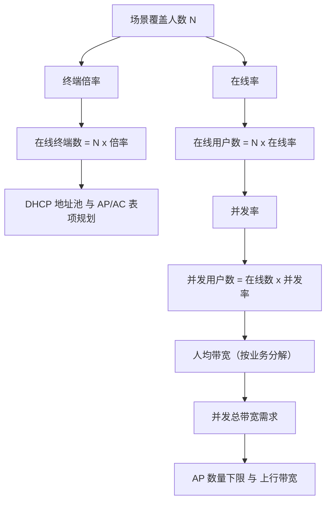

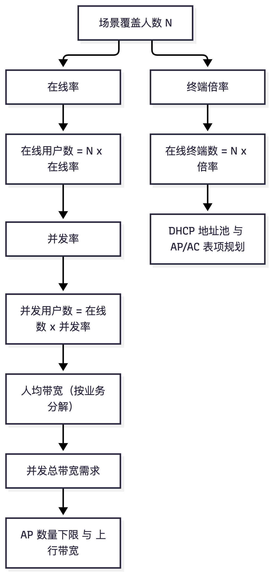


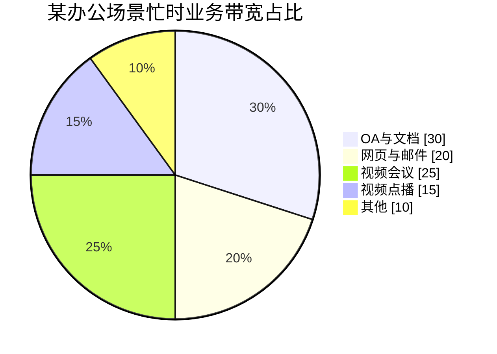

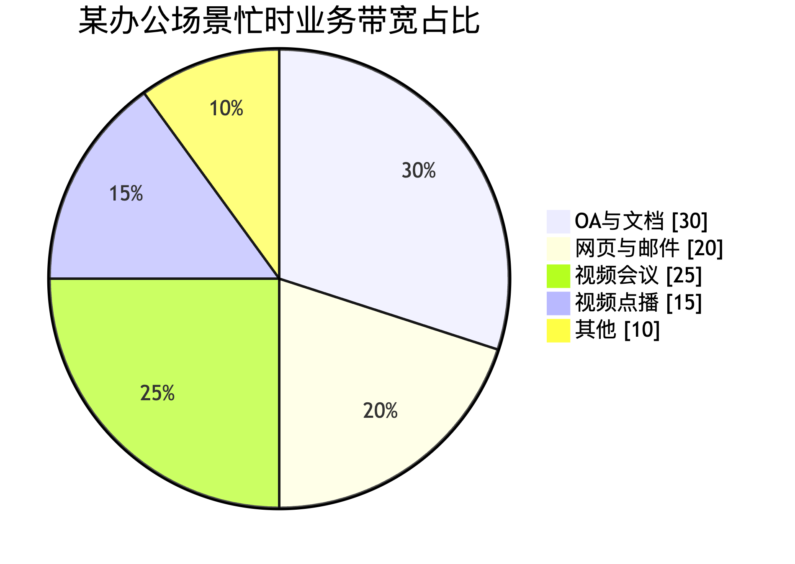


### 真题精练

**Q1.【真题·单选】** 某办公区覆盖人数 1000 人，在线率 80%，并发率 25%，人均忙时带宽按 3 Mbps 计。该区域忙时并发总带宽需求约为？
A. 600 Mbps  B. 2400 Mbps  C. 240 Mbps  D. 1200 Mbps

> **答案：A**
> **解析**：并发用户数 = 1000 × 80% × 25% = 200 人；并发总带宽 = 200 × 3 Mbps = **600 Mbps**。常见错误：直接把 1000 × 3 = 3000 Mbps（忽略在线率与并发率），或把在线数当并发数算成 2400 Mbps（选 B 的错法）。注意：**地址池要按在线终端数**（1000 × 80% × 终端倍率，如 2 → 1600）规划，而不是按 200 规划，这是本题最容易被忽略的延伸考点。

**Q2.【真题·判断】** 在线用户数一定大于或等于并发用户数，二者之比即为并发率。

> **答案：正确**
> **解析**：语义上"并发"是"在线"的子集——在线指已关联（可能空闲），并发指正在收发数据，因此在线数 ≥ 并发数，并发率 = 并发数/在线数 ≤ 100%。但要注意出题时会反过来问"在线率"，那时分母是**覆盖人数**。记法：**在线率对人数，并发率对在线数**；两者相乘才等于"忙时活跃比例"。

**Q3.【真题·填空】** 需求调研中，"________率"决定 DHCP 地址池与 AC 用户表项规模，"________率"决定空口与上行带宽需求；两者相乘得到忙时活跃用户占覆盖人数的比例。

> **答案：在线；并发**
> **解析**：这是本考点最核心的区分。答题时把"资源映射关系"写出来即可得满分：在线数 → 地址池/关联表项/认证会话；并发数 → 空口带宽/上行带宽/网关联会话；此外还有终端倍率 → 地址池，突发系数 → 带宽余量。

**Q4.【真题·多选】** 关于特殊需求的调研，下列哪些属于必须在需求调研阶段明确的内容？
A. 是否需要跨 AP/跨 AC 无缝漫游，语音场景的切换时延要求
B. 是否需要 Wi-Fi 定位及定位精度（3~5 m 还是 1 m 级）
C. 是否需要 AP 内置 IoT 模块及承载的物联协议
D. 是否需要访客网络隔离、是否要求 WPA3、是否有等保合规要求
E. 每台 AP 的具体安装螺丝规格

> **答案：ABCD**
> **解析**：E 属于工程实施细节，不属于需求调研（可放在工程约束里讨论，但不是"业务需求"）。A/B/C/D 分别对应漫游、定位、IoT、安全与合规四类特殊需求，是设计题里必须体现的加分项。特别是定位需求——它会改变 AP 的点位密度（定位精度与 AP 密度强相关）与是否增加蓝牙 AoA 设备。

**Q5.【真题·简答】** 某高校报告厅 1500 座，计划用于开学典礼直播（1080P）、学术报告投屏（4K）与在线答题。请量化其容量需求（写出你的假设），并指出该场景最容易漏算的一项指标。

> **答案**：
> **① 假设**：在线率 100%（有座即联，甚至站立加座）；终端平均 1 人 1.2 台；并发率按场景分别取——直播 80%、4K 投屏（仅讲者）按 1 路 25 Mbps、在线答题 95%。
> **② 直播场景**：并发用户数 = 1500 × 1.0 × 80% = 1200 人；1080P 按 4 Mbps → **4800 Mbps** 下行需求。
> **③ 答题场景**：并发 1500 × 1.0 × 95% = 1425 人；人均 0.5 Mbps → **713 Mbps** 下行（带宽不大但**可靠性、时延与丢包**要求最高）。
> **④ 4K 投屏**：讲者 1~2 路，25 Mbps/路，可忽略带宽但**要求极高稳定性**（建议有线优先，不做 Wi-Fi 依赖）。
> **⑤ 最容易漏算的一项**：**上行带宽与并发上行**。视频会议、答题回传、签到、拍照上传都会产生大量上行；同时"多人同时看直播"在企业/校园场景常由组播或 CDN 分流，若未做组播优化，则 1200 路单播会把上行与 AP 空口一起打满。因此答案中必须写出：AP 上行建议 2.5GE/10GE，并考虑**组播转单播优化、直播源就近部署（边缘 CDN）**；此外还需算 **DHCP 与 AC 的并发会话能力**（1500+ 终端同时上线对 AP 上线与关联速率是压力测试项）。

**Q6.【真题·设计】** 请设计一份"WLAN 需求调研表"的字段清单（不少于 12 项），并说明每项对应的后续规划动作。

> **答案**：
> | 字段 | 示例填法 | 后续用途 |
> |---|---|---|
> | 场景名称/位置 | A 栋 3 层报告厅 | 场景分类与建模 |
> | 建筑面积与层高 | 600 m²，层高 6 m | 覆盖规划、天线选型（高顶棚用定向/下倾） |
> | 覆盖人数/座位数 | 1500 座 | 容量与在线数计算 |
> | 业务类型与占比 | 直播 70%、答题 20%、投屏 10% | 人均带宽加权 |
> | 在线率/并发率 | 100% / 80% | 带宽与地址池计算 |
> | 终端类型与倍率 | 手机+平板，1.2 台/人 | 地址池、频段能力 |
> | 人均带宽要求 | 4 Mbps | 总带宽需求 |
> | 覆盖目标 RSSI/SNR | -65 dBm / 25 dB | 链路预算输入 |
> | 漫游要求 | 语音 ≤50 ms，跨 AP 无缝 | 是否需 AC 间漫游/同 SSID |
> | 定位要求 | 需 5 m 精度人员定位 | AP 密度、是否加 AoA |
> | IoT 需求 | 需接入温湿度与门禁 | AP 内置 IoT 或独立网关 |
> | 安全要求 | WPA3 + 访客隔离 + 实名 | 认证方案与 ACL |
> | 可靠性要求 | AC 双机热备、AP 不断业务 | 组网与 License 冗余 |
> | 既有资源 | 已有 24 口 PoE 交换机 | 供电与布线约束 |
> | 施工限制 | 不得破坏历史吊顶 | 安装方式（抱杆/壁挂/线槽） |
> | 预算与工期 | 30 万、2 周 | 选型与经济性权衡 |

**Q7.【真题·排错】** 某项目按"在线用户数 = 覆盖人数 × 在线率"规划了 DHCP 地址池，容量刚好。上线后大量终端报"无法获取 IP 地址"，但 AP 上显示在线用户数远未达池容量。请分析可能原因。

> **答案**：
> ① **租期过长导致地址滞留**：终端离线后地址不释放，池内地址被"僵尸租约"占满。排查 `display ip pool name <池名> used`（**以所用版本文档为准**）看 Used/Idle 比例；处置是把租期从默认 1 天缩到 2~4 小时，并开启地址冲突检测与回收。
> ② **终端倍率漏算**：实际一人 2~3 台设备，地址需求是"在线人数 × 倍率"，原规划只算了人数。处置是按倍率重算并扩容掩码（如 /24 → /23 或拆多池按楼层分池）。
> ③ **预留/排除段过大或网关冲突**：`excluded-ip-address` 范围过大、与其他 DHCP 服务器（如三层交换机、Windows Server）冲突造成 NADDRINUSE。排查用 `display ip pool`、抓包看是否有两个 DHCP Server 应答。
> ④ **单池跨 VLAN 或 Option 配置错误**：AP 与用户共池、Option 43 缺失导致 AP 拿不到 AC 地址，表现也可能是"拿不到地址"。
> ⑤ **DHCP 性能瓶颈**：大并发同时续租（如整点会议结束、考试开始）时 DHCP 应答延迟；处置是**按楼层/AP 组拆分地址池**、就近部署 DHCP 中继、缩短租期分散续租压力。
> ⑥ **无线侧关联失败被误判为 DHCP 失败**：先在 AC 上看 `display station all` 与上线失败原因（关联/认证/DHCP 三阶段），确认失败发生在哪一阶段再定位。

**Q8.【真题·实验】** 在 AC6805 上创建一个可容纳约 2000 个在线终端的用户地址池，租期 4 小时，并排除网关与前 100 个地址；说明你如何验证地址池规模是否满足"在线数 × 终端倍率"。

> **答案**：
> ```bash
> system-view
> dhcp enable                                            // 全局开启 DHCP 服务
> ip pool WLAN_USERS_1F                                  // 为 1 层创建独立地址池（分层分池可分散续租压力）
>  network 10.10.20.0 mask 255.255.248.0                 // /21 提供 2046 个可用地址，满足 2000 在线终端
>  gateway-list 10.10.20.1                               // 指定网关
>  excluded-ip-address 10.10.20.1 10.10.20.100           // 排除网关及前 100 个地址（预留打印机/AP 管理等）
>  lease 0 4 0 0                                         // 租期 4 小时：加快地址回收，适配会议/教学潮汐
>  quit
> ```
> ```bash
> display ip pool name WLAN_USERS_1F                     // 查看池容量、已用、空闲、冲突数（以所用版本文档为准）
> display station all | count                            // 统计实际在线终端数，与池容量比对
> display ap performance all                             // 每 AP 在线数，定位"扎堆 AP"造成的局部地址耗尽
> ```
> **验证方法**：① 计算 需求地址数 = 覆盖人数 × 在线率 × 终端倍率 × 1.2（余量）；本场景 1000 人 × 80% × 2.5 × 1.2 ≈ 2400，故应选 /20（4094）而非 /21，说明**答题时必须把终端倍率与余量写出来**；② 用 `display ip pool` 观察忙时 Used 峰值占容量比例，建议不超过 70%；③ 观察冲突计数（Conflicts）是否长期为 0，非 0 说明存在地址冲突或扫描探测，需要考虑终端私接 DHCP。

### 易错点与排错

1. **把覆盖人数当并发用户数**：直接 N × 人均带宽，结果虚高 3~5 倍。必须先乘在线率再乘并发率。
2. **用并发数算地址池**：地址池按**在线终端数（含终端倍率与余量）**算，这是最典型的丢分点。
3. **人均带宽取单一值**：应按业务加权求和，并乘突发系数 1.2~1.5；答题时把加权过程写出来才有过程分。
4. **忽略上行**：视频会议、答题回传、签到上传都是上行大头；高密场景上行常先于下行成为瓶颈。
5. **忘算 AC/认证/网关的并发能力**：1500 人同时上线对 AC 的 CAPWAP、RADIUS/Portal 会话、DHCP 都是压力测试项，必须在需求里写明。
6. **排错命令**：`display station all`（在线终端）、`display ip pool name <池名>`（地址池使用率与冲突）、`display ap performance all`（每 AP 在线数）、`display wlan sta-statistics`（上线成功率与失败原因）。

---

## 3.3 容量规划：单 AP 承载能力计算与两个完整算例

### 考点定位

本考点是国赛 WLAN **计算题的主战场**，单独出题占 **6~10 分**，且是设计题的核心步骤。高频陷阱：① 直接用 AP 标称速率（如 5761 的 1.775 Gbps）除人均带宽，得出"一台 AP 能带 500 人"的荒谬结论；② 忽略**空口效率系数**（协议开销、竞争退避、重传）；③ 忽略**上下行与双频分流**，把 2.4G 与 5G 容量简单相加而不考虑终端 5G 渗透率；④ 忽略**AP 上行端口**这个硬上限。

### 原理精讲

**第一步：理解"AP 标称速率 ≠ 可用吞吐"。** AirEngine 5761 系列双频（2×2 MIMO，2.4G 574 Mbps + 5G 1.2 Gbps，整机标称约 1.775 Gbps）是**物理层理论峰值**，含义是"在多用户、无干扰、理想信道、理想终端条件下的 PHY 速率"。真实可用吞吐要扣除：**802.11 帧开销**（前导码、帧头、SIFS/DIFS、ACK、退避）在单用户大包下效率约 50%~70%，在**多用户竞争**下会跌到 30%~50%；**重传**（干扰导致重传率 10%~30%）；**管理和控制帧开销**；**终端能力差异**（2×2 终端比 1×1 终端速率高一倍，但 1×1 终端在高密场景占比很高）；**双频分流的不完全性**（总有一部分老终端只能上 2.4G，而 2.4G 频谱资源极少）。

**第二步：容量规划的标准算法（必须记住这条链）。**

```
① 实际并发用户数 U = 覆盖人数 N × 在线率 R_online × 并发率 R_conc
② 人均忙时带宽 B_avg = Σ(业务占比 × 业务带宽) × 突发系数(1.2~1.5)
③ 并发总带宽需求 D_total = U × B_avg                    （Mbps）
④ 单 AP 有效吞吐 T_ap = AP 标称速率 × 空口效率系数        （系数取 0.5~0.6 单用户/稀疏，0.3~0.45 高密）
⑤ AP 数量下限 N_ap = ceil( D_total ÷ T_ap )
⑥ 密度上限校验：N_ap 对应间距 d = sqrt( 面积 ÷ N_ap )，需满足射频最小间距约束
   （5G 室内建议 AP 间距 ≥ 12~15 m 以避免同频干扰；2.4G 建议 ≥ 20~25 m）
⑦ 上行带宽校验：单 AP 上行需求 = T_ap ÷ 上下行比；累计到汇聚/核心/AC
⑧ 单 AP 承载用户数校验：U ÷ N_ap ≤ 单 AP 建议并发数（普通办公 25~30，高密 40~50，语音 ≤15 路）
```

**为什么会有"单 AP 建议并发用户数"这个约束？** 空口是**共享介质**，用户越多，**竞争退避与碰撞概率**越高，调度开销越大，实际吞吐不升反降（这就是著名的"**每用户吞吐随用户数下降**"现象）。因此存在一个**最优用户数**：普通办公约 **25~30 人/射频**，高密优化后 **40~50 人/射频**（需开启 OFDMA、MU-MIMO、空口公平调度、限制低速率）。超过这个数，加人不但拿不到带宽，还会拖垮全 AP 用户。所以容量计算必须**同时满足带宽约束与用户数约束，取二者最大值**。

**第三步：上行带宽。** 无线是"共享空口"，但**有线侧上行端口是硬上限**。1 台 AP 协商 1 GE，扣除 CAPWAP 隧道封装（若隧道转发）与以太网开销后，实际可用约 **900 Mbps 左右**（隧道转发时还受 AC 转发能力约束）。所以即使空口标称 1.775 Gbps，**单 AP 实际天花板是上行端口与 AC**。高密场景应选 **2.5GE/10GE 上行**的 AP（如 AirEngine 6761/8760 系列支持多速率上行）。规划时按 **AP 上行端口速率 × 0.8** 作为整机带宽上限，与空口有效吞吐取小值。

### 关键概念对照表

| 参数 | 含义 | 典型取值 | 取错后果 |
|---|---|---|---|
| 空口效率系数（稀疏） | 有效吞吐/标称速率 | 0.5~0.65 | 高估 AP 容量 → AP 装少了 |
| 空口效率系数（高密） | 同上 | 0.3~0.45 | 同上，高密必须取更低 |
| 单 AP 建议并发数（办公） | 每射频 | 25~30 | 超载 → 全员体验崩塌 |
| 单 AP 建议并发数（高密优化） | 每射频 | 40~50 | 需 OFDMA/MU-MIMO/限速配合 |
| 单 AP 并发语音路数 | 每射频 | ≤10~15 | 语音抖动、掉话 |
| 5G 室内最小 AP 间距 | 同频复用 | 12~15 m | 过密 → 同频干扰 |
| 2.4G 最小 AP 间距 | 1/6/11 复用 | 20~25 m | 过密 → 2.4G 基本不可用 |
| 上行有效带宽 | 端口速率 × 0.8 | 1GE→~900 Mbps | 忽略 → 空口算够、有线打满 |
| 上下行比 | 下行:上行 | 数据 3:1~5:1；会议 1:1 | 上行算少 → 会议卡顿 |

| 设备 | 频段与流数 | 标称速率（约） | 上行端口 | 建议单 AP 并发（5G 射频） |
|---|---|---|---|---|
| AirEngine 5761-11 | 2.4G 2×2 + 5G 2×2 | 0.575 + 1.2 Gbps | 1×GE | 25~35 |
| AirEngine 5761-21 | 2.4G 2×2 + 5G 2×2 | 0.575 + 1.2 Gbps | 1×GE / 2.5GE | 30~40 |
| AirEngine 6761-21 | 2.4G 2×2 + 5G 4×4 | 0.575 + 2.4 Gbps | 1×2.5GE | 40~50 |
| AirEngine 8760-X1-PRO | 三频（含独立扫描/物联射频） | 整机约 10 Gbps 级 | 多速率（含 10GE） | 高密场馆 |

> 上表速率为**该系列典型型号的公开标称值**，具体子型号与版本能力请以**华为官方产品文档为准**。

### 华为设备配置

```bash
# ===== 按容量规划结果在 AC 上做"硬约束"配置，保证设计容量不被突破（AC6805, V200R019+）=====
system-view
wlan
 ap-group name AG_HALL                                    // 进入报告厅 AP 组
  radio-5g-profile HALL_5G                                // 绑定大报告厅专用 5G 射频模板（大带宽、限速）
  vap-profile VAP_HALL wlan 1 radio all                   // 绑定 VAP 模板到该组所有射频
 station-limit max-station 45                              // 限制单射频最大关联数（对应用户数约束，防超载）
 rate-limit client down 8000                               // 单用户下行限速 8 Mbps（保证公平性，防少数终端吃满空口）
 rate-limit client up 2000                                 // 单用户上行限速 2 Mbps（对应会议上行需求）
 rate-limit vap down 600000                                // 单个 VAP 下行总限速 600 Mbps（对应有效吞吐测算值）
 air-scan-profile ...                                      // 按版本绑定空口扫描模板（部分版本需先定义，以所用版本文档为准）
```

```bash
# ===== 查看容量是否被打满（容量规划闭环验证）=====
display ap performance all                                 // 每 AP 在线用户数、上下行速率、带宽占用：判断是否达到设计上限
display ap performance all radio                           // 每射频信道利用率：>60% 说明空口已饱和，容量算少了或干扰大
display station all | count                                // 实际并发/在线终端总数，与设计值对比
display wlan ap name <AP名> performance                    // 单 AP 细粒度性能：上下行实时速率
display interface GigabitEthernet0/0/1                     // AP 上行端口速率与丢包：确认不是有线侧瓶颈
```

### 示意图

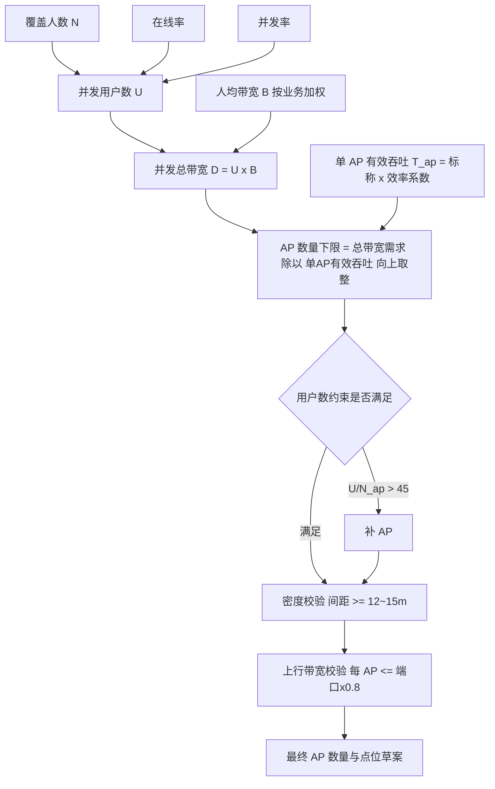

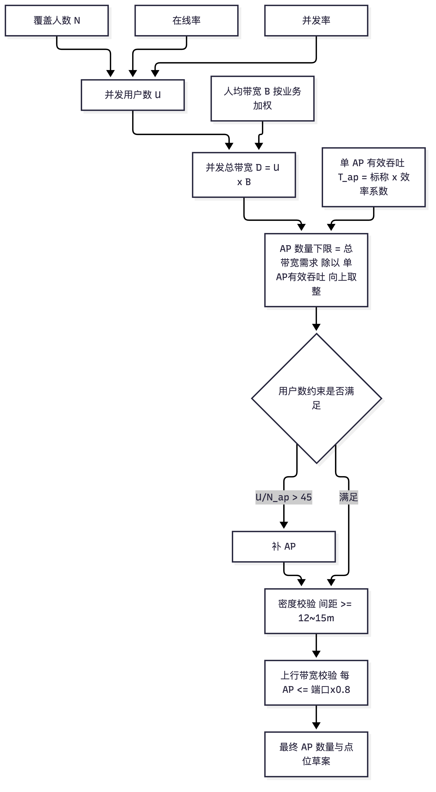


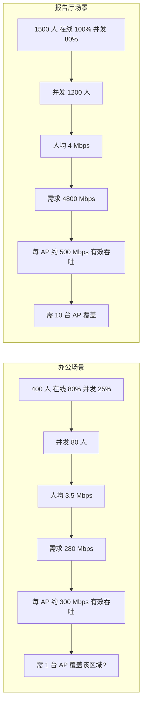

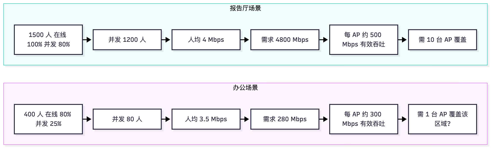


### 真题精练

**Q1.【真题·计算·办公场景】** 某办公楼一层为开放办公区，面积 1200 m²，工位 400 个。业务构成：OA/文档 40%（人均 2 Mbps）、网页邮件 20%（1 Mbps）、视频会议 25%（3 Mbps，双向）、视频点播 15%（6 Mbps）。取在线率 80%、并发率 25%、突发系数 1.3、空口效率系数 0.5。选用 AirEngine 5761（5G 射频标称 1.2 Gbps，1GE 上行）。请计算：① 并发用户数；② 人均忙时带宽；③ 并发总带宽需求；④ 所需 AP 数量（同时用带宽约束与用户数约束校验）；⑤ 校验 AP 上行是否足够。

> **答案**：
> **① 并发用户数**：U = 400 × 80% × 25% = **80 人**（在线终端按 400 × 80% × 1.5 台/人 ≈ 480 个终端规划地址池）。
> **② 人均忙时带宽**：加权 = 0.4×2 + 0.2×1 + 0.25×3 + 0.15×6 = 0.8 + 0.2 + 0.75 + 0.9 = **2.65 Mbps**；乘突发系数 1.3 → **B = 3.45 Mbps**。
> **③ 并发总带宽需求**：D = 80 × 3.45 ≈ **276 Mbps**（取 280 Mbps）。
> **④ AP 数量**：单 AP 5G 有效吞吐 T = 1200 × 0.5 = **600 Mbps**（注意：整机还有 2.4G 的 574 Mbps，但高密/办公主力在 5G，且老终端才走 2.4G，规划时**只用 5G 容量做保守计算**，这是评分点）。
> - 带宽约束：⌈276 ÷ 600⌉ = **1 台**。
> - 用户数约束：80 ÷ 25~30（普通办公建议值）≈ **3 台**。
> - **取最大值 → 3 台**。这才是正确处理：**带宽够但用户数超限**，因为空口竞争开销会让 1 台 AP 带 80 个并发用户实际吞吐远低于 600 Mbps。
> **⑤ 上行校验**：单 AP 上行需求 ≈ 600 ÷ 0.8 ≈ 750 Mbps（若按上下行 4:1 则下行 600 Mbps 对应上行 150 Mbps，合计 750 Mbps）；1GE 端口有效约 900 Mbps（去 CAPWAP 与以太开销）→ **勉强够用但无余量**。若需余量应选 **2.5GE 上行型号（如 5761-21/6761）**，或按实际观测把并发率下调。**结论：3 台 AirEngine 5761（建议 2.5GE 上行版本），AP 间距 sqrt(1200/3) ≈ 20 m，符合 5G 最小间距约束。**

**Q2.【真题·计算·报告厅场景】** 某报告厅 1500 座，面积 1800 m²，层高 8 m。使用场景：高清直播 70%（人均 4 Mbps）、在线答题 20%（人均 0.5 Mbps）、现场互动投屏 10%（人均 3 Mbps）。在线率 100%、并发率 80%、突发系数 1.2、高密场景空口效率系数 **0.35**。选用 AirEngine 6761（5G 4×4，标称 2.4 Gbps，2.5GE 上行）。请计算 AP 数量并说明为什么效率系数要从 0.5 降到 0.35。

> **答案**：
> **① 并发用户数**：U = 1500 × 100% × 80% = **1200 人**。
> **② 人均带宽**：0.7×4 + 0.2×0.5 + 0.1×3 = 2.8 + 0.1 + 0.3 = 3.2 Mbps；× 1.2 = **3.84 Mbps**。
> **③ 并发总带宽**：D = 1200 × 3.84 = **4608 Mbps**。
> **④ 单 AP 有效吞吐**：T = 2400 × 0.35 = **840 Mbps**（高密场景取 0.35 的理由见下）。
> **⑤ AP 数量**：带宽约束 ⌈4608 ÷ 840⌉ = **6 台**；用户数约束 1200 ÷ 40~50（高密优化后建议值）= **24~30 台**。
> - 二者差异巨大，实际工程结论是：**报告厅必须用高密方案而不是简单堆 AP**。真实做法是：
>   - 用 **定向天线（如 AirEngine 系列配套的板状/定向天线）从侧墙或舞台两侧对准观众区**，把每台 AP 的有效覆盖区做窄、干扰做低；
>   - 开启 **OFDMA + MU-MIMO + 空口公平调度 + 限制低速率（禁用 1/2/5.5/11 Mbps）**，把单射频并发能力从 25~30 提升到 40~50；
>   - 直播流量**用组播 + 组播转单播优化或就近边缘缓存**，避免 1200 路单播；
>   - 密集布点（推荐 **6~10 台**，按 1500÷(40~50)×1.3 倍余量 ≈ 40 台不现实，因此实际采用**提高单 AP 并发 + 定向覆盖 + 直播分流**组合，落点 **8~10 台**并整体降功率）。
> **⑥ 为什么效率系数从 0.5 降到 0.35**：高密场景下 ① 用户数多导致竞争退避与碰撞概率大幅上升；② 大量终端为 1×1 手机，无法吃满 4×4 MU-MIMO 增益；③ 空口重传率上升（实测可达 15%~30%）；④ 管理与控制帧（Beacon、探测、关联、漫游）开销随 AP 与终端数量线性增长。这些因素使有效吞吐在标称的 30%~45% 区间，取 0.35 是**保守而符合工程实际**的做法。**答题时写出这四条理由，是本题的主要得分点。**
> **⑦ 上行校验**：10 台 AP × 840 Mbps ≈ 8.4 Gbps 汇聚到接入交换机，需 **10GE 上行 + 2.5GE/10GE 接入**，接入交换机上联建议 2×10GE 聚合。

**Q3.【真题·单选】** 某场景容量计算得出"需 1 台 AP"，但按每 AP 25~30 并发用户的经验值需要 3 台。正确的处理是？
A. 按 1 台执行，因为带宽计算是科学方法
B. 按 3 台执行，因为空口是共享介质，用户数约束与带宽约束必须同时满足并取最大值
C. 按 2 台折中执行
D. 减少用户数到 25 人以内

> **答案：B**
> **解析**：带宽计算假设"所有用户按均值均匀占用空口"，但空口的实际行为是**竞争接入**：用户数越多，退避与碰撞越多，**每用户吞吐越低**，总吞吐无法线性叠加。因此存在"单 AP 建议并发数"这个独立约束。两个约束都必须满足，取**最大值**。A 忽略了介质特性；C 的"折中"没有任何理论依据；D 属于改变业务需求而非技术方案（若确实能限制人数，可作为备选，但不应作为默认答案）。

**Q4.【真题·多选】** 在高密场景中，下列哪些措施可以**实质提升单 AP 的有效并发容量**？
A. 开启 OFDMA，提升小包并发效率
B. 开启 MU-MIMO，让多终端并行传输
C. 禁用 1/2/5.5/11 Mbps 低速率，减少空口占用时间
D. 把 5G 频宽从 80MHz 改为 40MHz 以减少干扰（在某些场景下）
E. 把所有 AP 功率开到最大，让终端尽量关联到同一台 AP

> **答案：ABCD**
> **解析**：E 会同时造成两个严重后果——终端"粘"在远距离 AP 上（信号虚高但速率极低，长期占用空口时间），以及多 AP 大功率导致的**同频干扰**，反而让容量崩掉。A/B/C/D 都是真实有效的容量优化手段：OFDMA 让多个小包用户共享一个 RU（资源单元），MU-MIMO 让空间分离的终端并行，禁用低速率减少"慢用户吃满空口"的**时间公平性反噬**，D 在干扰严重时用更窄频宽换取更高 SNR 与更稳定的 MCS，虽然峰值下降但**有效吞吐与稳定性常上升**。

**Q5.【真题·判断】** AP 的标称速率（如 1.775 Gbps）可以直接除以人均带宽得到支持的并发用户数。

> **答案：错误**
> **解析**：标称速率是 PHY 层理论峰值，必须乘空口效率系数（单用户 0.5~0.65、高密 0.3~0.45）才是有效吞吐，还要受**上行端口速率**与**AC 转发能力**约束。以 5761 为例：标称 1.775 Gbps，取 0.5 得约 890 Mbps，而 1GE 上行有效仅约 900 Mbps，因此整机实际约 850~900 Mbps 量级，**与"1.775 Gbps ÷ 2 Mbps = 887 人"相去甚远**（按 25~30 并发建议值，实际带 25~30 人）。这是容量题最经典的陷阱。

**Q6.【真题·简答】** 请推导"AP 数量 = max(带宽约束所需数量, 用户数约束所需数量)"这一结论，并说明两约束分别在什么场景下先起作用。

> **答案**：
> **① 带宽约束**：`N_ap,B = ceil( U × B_avg ÷ (R_nominal × η) )`，其中 η 为空口效率系数。它假设"用户需求总量可以线性叠加到空口容量上"，反映的是**总吞吐够不够**。
> **② 用户数约束**：`N_ap,U = ceil( U ÷ C_ap )`，C_ap 为单 AP 建议并发用户数。它反映的是**介质竞争与调度开销**导致的"人数上限"。
> **③ 为什么取最大值**：两个约束是**相互独立的必要条件**——带宽够不代表人数带得动（用户多时竞争开销吃掉吞吐）；人数少不代表带宽够（少数人也能跑满大带宽，如 4K 投屏）。因此 N_ap = max 才是同时满足二者。
> **④ 谁先起作用**：
> - **带宽约束先起作用**：人均带宽大、并发率高的场景——4K 投屏、VR/AR 教学、视频监控回传、大文件分发。
> - **用户数约束先起作用**：人均带宽小但人数极多的场景——在线考试（0.5 Mbps/人但 100% 并发）、网页浏览为主的开放办公、展厅扫码互动。
> **⑤ 工程含义**：考试类场景要把资源投在**关联容量、认证容量、可靠性**上；投屏/VR 类场景要把资源投在**频谱、流数、上行带宽**上。

**Q7.【真题·排错】** 某公司按容量规划部署了 6 台 AP，设计单 AP 并发 28 人。上线后 `display ap performance all` 显示某台 AP 在线用户 55 人，其余 AP 仅 10 人左右，且该 AP 上用户普遍反馈卡顿。请分析原因与处置方法。

> **答案**：
> ① **现象判断：终端分布严重不均（负载不均衡）**，一台 AP 承担了 2 倍设计容量。
> ② **可能原因**：
> - **功率过大**：该 AP 或邻近 AP 功率不同，终端按"信号最强"关联，全部粘到同一台。
> - **未开启负载均衡**：AC 默认（多数版本）不做主动负载均衡，终端自发选择。
> - **部分 AP 故障或未上线**：`display ap all` 看是否有 AP 处于 fault/inactive，导致业务被集中。
> - **频段引导（Band Steering）未生效**：大量 2.4G 终端集中到 2.4G 射频。
> - **点位集中**：6 台 AP 中有 4 台在会议室/隔间内，开放区实际只有 1~2 台服务。
> ③ **排查命令**：`display ap all`（AP 状态与归属）、`display ap performance all`（各 AP 在线数与速率）、`display station all`（终端关联分布与 RSSI）、`display radio-5g-profile name <名>`（功率与频段引导参数）。
> ④ **处置**：统一各组 AP 的 EIRP（避免"功率洼地/高地"）；开启**负载均衡**与**频段引导**（VRP 中对应 `sta-load-balance` 与 `band-steer` 类配置，**以所用版本文档为准**）；把明显扎堆的点位（会议室）补一台 AP 或改为定向天线；对超载 AP 用 `station-limit` 与 `rate-limit` 做保护性限制。
> ⑤ **回归**：复测各 AP 在线数应接近设计值（28 ± 30%），信道利用率 <40%，用户投诉消失。

**Q8.【真题·实验】** 在 AC6805 上为报告厅 AP 组配置"每射频最大 45 用户、单用户下行 8 Mbps / 上行 2 Mbps、VAP 下行总限速 600 Mbps"的容量保护，并给出验证命令。

> **答案**：
> ```bash
> system-view
> wlan
>  ap-group name AG_HALL                                 // 进入报告厅 AP 组（容量方案按组下发）
>  rate-limit client down 8000                            // 单终端下行 8000 kbps = 8 Mbps：保证空口公平，防个别终端吃满
>  rate-limit client up 2000                              // 单终端上行 2000 kbps = 2 Mbps：对应会议/答题上行需求
>  rate-limit vap down 600000                             // 该 VAP 下行总限速 600000 kbps = 600 Mbps：对应有效吞吐测算
>  station-limit max-station 45                           // 单射频最大关联 45 个终端：对应用户数约束上限
>  quit
> ```
> ```bash
> display ap performance all                              // 查看各 AP 在线数与带宽，确认未超限
> display ap performance all radio                        // 信道利用率：确认限速后空口是否仍拥塞
> display station all                                     // 查看终端是否触发限速（部分版本可显示限速状态）
> display current-configuration | include rate-limit      // 核对限速配置是否已下发到 AP
> ```
> **验收判据**：单 AP 在线数 ≤45；单终端实测下行 ≤8 Mbps、上行 ≤2 Mbps（用 iperf3 或 Speedtest 验证）；VAP 总下行 ≤600 Mbps；信道利用率 <60%；限速生效后**大部分用户**的体验（网页打开时间、视频起播时间）应明显改善——限速的目的是**牺牲个别用户峰值换整体公平**。注意 `rate-limit` 数值单位在 VRP 中为 **kbps**，这是常见填错点（写成 8 / 2 / 600 会得到完全不同的效果）。**以所用版本文档为准**。

### 易错点与排错

1. **用标称速率算容量**：必须乘空口效率系数（稀疏 0.5~0.65、高密 0.3~0.45），并受上行端口约束。
2. **只算带宽约束**：必须同时算用户数约束并取最大值，"1 台够带宽但 3 台够人数"是标准结论。
3. **忘记上行**：高密/会议/回传场景上行常先瓶颈；`display interface` 查端口速率，别默认千兆。
4. **单位混淆**：率限速命令单位是 **kbps**（8 Mbps = 8000）；带宽计算用 Mbps；算例中必须写清单位。
5. **把 2.4G 容量并入总容量**：2.4G 频谱只有 3 个非重叠信道且干扰严重，规划时应**以 5G 为主力**，2.4G 只作兼容兜底。
6. **忘记限速与保护**：容量规划不落地为 `station-limit`/`rate-limit`，就只是纸面数字，超载时没有任何保护。
7. **排错命令**：`display ap performance all`、`display ap performance all radio`、`display station all`、`display interface brief`、`display current-configuration | include rate-limit`。

---

## 3.4 覆盖规划：链路预算完整公式与覆盖半径算例

### 考点定位

本考点是国赛 WLAN **第二个计算主战场**，占 **6~10 分**。它比容量题更"硬"：公式用错、单位弄混（dB/dBm/mW）、余量漏项，任何一步错都全错。高频陷阱：① 混淆 **EIRP** 与 **发射功率**（漏算天线增益与馈线损耗）；② 忘记**馈线/接头损耗**与**人体损耗**；③ 分不清**接收灵敏度**（对应最低可用速率）与**干扰容限**；④ 路径损耗模型选错（自由空间 vs 室内衰减因子模型）；⑤ 不乘阴影衰落余量（Shadowing Margin），导致"算出来刚好、实测差 6~10 dB"。

### 原理精讲

**① 链路预算的核心思想。** 无线链路能否建立，取决于"到达接收机的功率是否高于接收机在该速率下的灵敏度"。链路预算就是把发射端所有增益、链路所有损耗、接收端门限全部写成 dB 域的加减法：

```
RSSI(接收电平) = P_tx + G_tx - L_cable_tx + G_rx - L_cable_rx - PL(d) - L_obstacle - L_body
可用性条件：  RSSI ≥ S_rx(MCS) + M_shadow
即：          PL_max = P_tx + G_tx + G_rx - L_cable - S_rx - M_shadow        ← 最大允许路径损耗
```

其中：`P_tx` 发射功率（dBm）；`G_tx`/`G_rx` 发射/接收天线增益（dBi）；`L_cable` 馈线与接头损耗（dB，室内放装 AP 天线内置，通常取 0~1 dB；外接天线需实算，2.4G 约 0.5~1 dB、5G 约 1~2 dB）；`S_rx` 接收灵敏度（dBm，随 MCS 变化）；`M_shadow` 阴影衰落余量（dB，室内 6~10 dB，室外 8~12 dB）；`PL(d)` 距离 d 处的路径损耗（dB）；`L_obstacle` 障碍物穿透损耗（dB）；`L_body` 人体损耗（dB，2.4G 约 3 dB，5G 约 5~8 dB，高密场景必须算）。

**关键点：dB 域是加减法，mW 域是乘除法。** 所有换算必须统一到 dB/dBm：
- `dBm = 10 × log10(P_mW)`：100 mW = 20 dBm；1 W = 30 dBm；0.1 mW = -10 dBm。
- `20 dBm + 3 dBi - 1 dB = 22 dBm`（EIRP）。**EIRP = P_tx + G_tx - L_cable**，这是法规限值直接约束的量。
- 每增加 3 dB ≈ 功率翻倍；每减少 6 dB ≈ 距离减半（自由空间，n=2 时：距离比 = 10^(ΔPL/(10n))）。

**② 路径损耗模型。** 三种必须掌握：

- **自由空间模型（Friis）**：`PL(dB) = 32.45 + 20·log10(f_MHz) + 20·log10(d_km)`。等价形式 `PL = 20log10(d) + 20log10(f) - 147.55`（d 单位 m，f 单位 Hz）。**只适用于视距无阻挡**（室外视距、空旷大厅）。
- **对数距离路径损耗模型（室内首选）**：`PL(d) = PL(d0) + 10·n·log10(d/d0)`，d0 取 1 m。**2.4 GHz 参考值：PL(1m) ≈ 40 dB，n = 2.7~3.5**（办公室 3.0，走廊 2.0~2.5，有隔间 3.5~4.0）；**5 GHz 参考值：PL(1m) ≈ 47 dB，n = 3.0~4.0**（办公室 3.5）。这是室内网规的**主力模型**。
- **多墙模型（Multi-Wall Model）**：`PL = PL_free(d) + Σ(k_wi × L_wi)`，按穿过的墙数与类型累加衰减。适合隔间办公、酒店走廊覆盖客房。

**③ 覆盖半径怎么算？** 由 `PL_max = P_tx + G_tx + G_rx - L_cable - S_rx - M_shadow` 求出**最大允许路径损耗**，再代入模型反解距离 d：

```
对数距离模型反解： d = d0 × 10^((PL_max - PL(d0)) / (10n))
多墙模型：        先算自由空间允许距离，再对每道墙做等效缩减（或迭代：d 满足 PL_free(d) + ΣL_wall = PL_max）
```

**为什么必须留阴影衰落余量（Shadowing Margin）？** 同一距离上，由于家具、人体、门、绿植、玻璃反射等随机因素，实测电平服从**对数正态分布**，标准差 σ 在室内约 **4~8 dB**。若不留余量，按"平均电平"设计只能保证 50% 的位置达标；工程上要保证 **90%~95% 的位置达标**，需要留 `M = z × σ`，其中 z 对应分位数（90% → 1.28σ，95% → 1.65σ）。例如 σ = 6 dB、要求 95% 位置达标 → M = 1.65 × 6 ≈ **10 dB**。这就是"算出来 -55 dBm、实测 -65 dBm"这类 10 dB 偏差的根源。**答题时写出"σ 与分位数"是高分点。**

**④ 边缘速率与 MCS 的对应。** 覆盖目标写"RSSI ≥ -65 dBm"其实不够精确——真正的目标是"**边缘速率 ≥ X Mbps**"，它对应某个 MCS 档位，而每个 MCS 有自己的**接收灵敏度**与**所需 SNR**。工程简化做法见表（802.11ac 20MHz/1SS 典型值，**各芯片实现有差异，以设备规格书为准**）：MCS0（BPSK 1/2）灵敏度约 -82 dBm、MCS4（16QAM 3/4）约 -71 dBm、MCS7（64QAM 5/6）约 -64 dBm、MCS9（256QAM 5/6，80MHz）约 -57 dBm。所以"RSSI ≥ -65 dBm"实际对应"**能稳定跑 MCS7 左右**"，这与"边缘速率 ≥ 30~50 Mbps（2SS/80MHz）"是自洽的。

### 关键概念对照表

| 损耗项 | 2.4 GHz 典型值 | 5 GHz 典型值 | 说明 |
|---|---|---|---|
| 石膏板/轻质隔墙 | 3~5 dB | 4~7 dB | 办公隔间最常见，多道累加 |
| 砖墙（12 cm） | 6~8 dB | 10~12 dB | 教室/办公室隔墙 |
| 混凝土承重墙 | 12~18 dB | 20~30 dB | 高频吃墙严重，尽量避免穿越 |
| 钢筋混凝土柱/梁 | 15~25 dB | 25~35 dB | 结构柱是天然遮挡，可利用做强隔离 |
| 普通玻璃/玻璃门 | 2~3 dB | 3~6 dB | 低损耗，容易造成"跨区泄漏" |
| Low-E 镀膜玻璃/幕墙 | 10~25 dB | 20~40 dB | 几乎屏蔽，室外覆盖室内不可依赖 |
| 木门/防火门（关闭） | 3~5 dB | 5~8 dB | 消防门关闭后衰减明显 |
| 电梯井/金属货架 | 20~30 dB | 25~35 dB | 金属反射+遮挡，是覆盖黑洞 |
| 人体 | 3~5 dB | 5~8 dB | 高密场景必须计，人群密度高时等效衰减极大 |
| 水族箱/水箱 | 10~20 dB | 15~30 dB | 水对 2.4G 吸收强 |

| 参数 | 自由空间 | 对数距离（室内） | 多墙模型 |
|---|---|---|---|
| 公式 | 32.45 + 20lg f + 20lg d | PL(d0) + 10n·lg(d/d0) | 自由空间 + Σ墙损 |
| 适用场景 | 室外视距、空旷大厅 | 室内开放/半开放空间 | 隔间办公、酒店客房 |
| 关键参数 | 频率、距离 | PL(1m)、路径损耗指数 n | 墙数量与类型 |
| 2.4G 取值 | — | PL(1m)≈40 dB，n≈3.0 | 砖墙 6~8 dB |
| 5G 取值 | — | PL(1m)≈47 dB，n≈3.5 | 砖墙 10~12 dB |
| 精度 | 视距时高 | 中（需实测校准 n） | 高（墙体明确时） |
| 主要误差源 | 多径、地面反射 | 家具、人流、门开关 | 墙的实际厚度与材质 |

### 华为设备配置

```bash
# ===== 把链路预算结果落到 AC 的功率与速率配置上（AC6805, V200R019+）=====
system-view
wlan
 regulatory-domain-profile name CN                         // 国家码模板：决定 EIRP 上限，必须先配，否则功率被限制
  country-code cn                                          // 中国：2.4G EIRP ≤20 dBm，5G 各子频段上限不同
 radio-5g-profile name OFFICE_5G
  channel 80mhz 36 52 100 116 132                          // 固定 5G 信道（按 3.7 节信道规划表）
  eirp 20                                                  // 链路预算算出的 EIRP（含天线增益后的等效值）
  dot11a basic-rate 6 12 24 disable                        // 关闭低速基本速率，避免慢终端占满空口（以所用版本为准）
  dot11a supported-rate 36 48 54                           // 限定支持速率集合，提高空口效率
 radio-2g-profile name OFFICE_2G
  channel 20mhz 1 6 11                                     // 2.4G 只留 1/6/11
  eirp 14                                                  // 2.4G 降功率：室内高密场景 2.4G 只会互相干扰
```

```bash
# ===== 覆盖验证与排错 =====
display ap all                                             // 确认 AP 全部上线，型号与设计一致
display station mac-address <MAC> verbose                  // 看目标点位终端实测 RSSI/SNR/协商速率：与链路预算预测值比对
display ap performance all radio                           // 看噪声底与信道利用率：噪声底偏高 = 干扰大；利用率高 = 拥塞
display radio-5g-profile name OFFICE_5G                    // 核对 EIRP/信道/速率集是否与设计一致
display regulatory-domain-profile name CN                  // 核对国家码与各频段功率上限（合规与覆盖的边界）
```

### 示意图

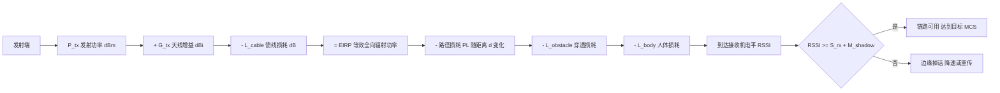

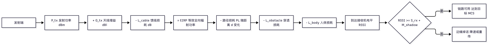


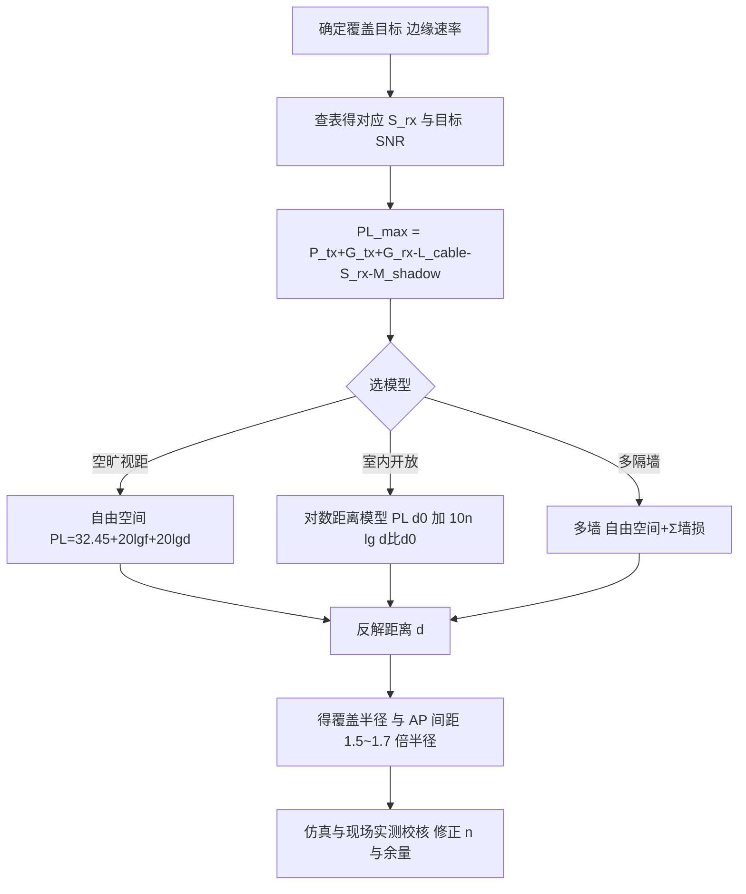

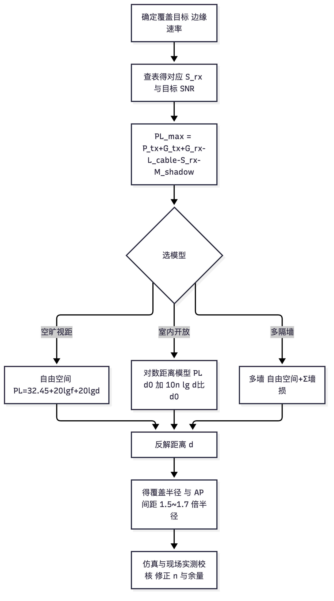


### 真题精练

**Q1.【真题·计算·链路预算】** 某室内办公场景，使用 AirEngine 5761（内置天线，2.4G 增益 3 dBi / 5G 增益 4 dBi）。5G 发射功率设为 17 dBm，馈线损耗 0.5 dB。目标边缘速率要求稳定 MCS7（接收灵敏度取 **-64 dBm**），阴影衰落余量取 **8 dB**，人体损耗取 **5 dB**，假设 AP 与终端之间需穿越 **1 道砖墙（5G 取 11 dB）**。路径损耗模型取 `PL(1m) = 47 dB, n = 3.5`。求：① 最大允许路径损耗 PL_max；② 覆盖半径；③ 若终端为双天线（接收增益 2 dBi），半径如何变化。

> **答案**：
> **① 计算 PL_max**：
> - EIRP = P_tx + G_tx - L_cable = 17 + 4 - 0.5 = **20.5 dBm**（与 5G 室内 EIRP 上限 20~23 dBm 相符，合规）。
> - 允许总损耗 = EIRP - S_rx - M_shadow - L_obstacle - L_body
>   = 20.5 - (-64) - 8 - 11 - 5 = 20.5 + 64 - 24 = **60.5 dB**
> - 即 `PL_max ≈ 60.5 dB`（这是**含穿墙损耗后**剩余可用于空间传播的损耗）。
> **② 反解覆盖半径**（对数距离模型）：
> - `PL_max = PL(1m) + 10n·lg(d/1)` → `60.5 = 47 + 35·lg d`
> - `lg d = (60.5 - 47) / 35 = 13.5 / 35 = 0.3857`
> - `d = 10^0.3857 ≈ **2.43 m**`
> **③ 加入终端接收增益 2 dBi**：允许损耗增加 2 dB → `PL_max = 62.5 dB` → `lg d = 15.5/35 = 0.4429` → `d ≈ **2.77 m**`（约 +14%）。
> **④ 工程解读（本题最重要的一步）**：仅 **2.4~2.8 m** 的半径显然不满足办公覆盖需求。这说明在**必须穿墙**的场景下，"边缘跑 MCS7"是奢侈目标，工程上的处置是：
> - **调整设计目标**：把边缘速率降到 MCS4（灵敏度约 -71 dBm）或 MCS2，则 PL_max 增加 7 dB，半径变为 `10^((67.5-47)/35) = 10^0.5857 ≈ 3.85 m`（含终端增益 4.1 m）——仍然不大，说明**穿承重墙/多道墙的场景必须"每间房一个 AP"**，不能靠一台 AP 穿墙覆盖多间。
> - **改点位而非加功率**：把 AP 装在房间内（放装/吸顶），避免穿墙；走廊放装只适合"每 2~3 间房 1 台 + 客房门口近距穿透"。
> - **降低频段难度**：2.4G 的 PL(1m) 约 40 dB、n 约 3.0、砖墙 6~8 dB，同样条件下半径会明显大于 5G（这是 2.4G 唯一的价值），但 2.4G 只有 3 个信道，容量与干扰代价极高。
> **⑤ 易扣分点提醒**：必须写清"PL_max 是扣除障碍物与人体损耗后的剩余量"，否则会把穿墙损耗重复计算或漏算；单位必须全程 dB/dBm。

**Q2.【真题·计算·AP 间距】** 承接上题，若场景改为**空旷展厅**（无隔墙、人员稀疏，不计人体与穿墙损耗），5G 目标 MCS7（-64 dBm），阴影余量取 6 dB，AP 内置 5G 天线增益 4 dBi，EIRP 20.5 dBm，终端接收增益 2 dBi，模型取 `PL(1m)=47 dB, n=2.2`（空旷）。求覆盖半径与建议 AP 间距。

> **答案**：
> **① PL_max** = 20.5 + 2 - (-64) - 6 = 20.5 + 2 + 64 - 6 = **80.5 dB**。
> **② 半径**：`80.5 = 47 + 22·lg d` → `lg d = 33.5/22 = 1.5227` → `d = 10^1.5227 ≈ **33.3 m**`。
> **③ 建议 AP 间距**：工程经验取 **1.5~1.7 倍半径**作为相邻 AP 间距（保证重叠区有足够 SNR 供漫游与负载均衡，同时不过度重叠造成同频干扰）：
> - 1.5 倍 → 约 **50 m**；1.7 倍 → 约 **57 m**。
> - 但需与"最小间距约束"取**更小者**：5G 室内建议 AP 间距 ≥12~15 m（避免同频干扰），此处 50 m 远大于下限，故最终取 **50 m 左右**。
> **④ 结论与陷阱**：
> - **空旷展厅的覆盖半径远大于办公场景**（33 m vs 2.4 m），原因是去掉了穿墙（11 dB）与人体（5 dB）并采用更小的 n（2.2 vs 3.5）。这说明**同一台 AP 在不同环境下的覆盖能力差异可达 10 倍以上**，任何"AP 覆盖半径 30 m"的笼统说法都是错的——**必须带环境条件**。
> - 展厅若人多（展会开幕），人体损耗 5~8 dB 与反射变化会使实际半径下降到 20~25 m，因此**高密展厅必须按"有人的状态"设计**，或预留 M_shadow 到 10 dB。

**Q3.【真题·单选】** 某 AP 发射功率 20 dBm，天线增益 3 dBi，馈线损耗 1 dB。其 EIRP 为？
A. 24 dBm  B. 22 dBm  C. 20 dBm  D. 23 dBm

> **答案：B**
> **解析**：EIRP = P_tx + G_tx - L_cable = 20 + 3 - 1 = **22 dBm**。A 忘记减馈线损耗；D 只加天线增益不减馈线；C 完全忽略天线增益。**注意 EIRP（Equivalent Isotropically Radiated Power，等效全向辐射功率）是法规直接限值的量**，因此配置 `eirp` 时必须确认国家码允许范围，中国 2.4G 通常 ≤20 dBm、5G 各子频段 23/30 dBm 不等（**以所用版本的 regulatory-domain-profile 文档为准**）。

**Q4.【真题·判断】** 链路预算中，阴影衰落余量只是为了"保险"，实际工程中可以不留。

> **答案：错误**
> **解析**：阴影衰落（Shadowing）是同一距离上实测电平服从**对数正态分布**的物理现象，标准差 σ 室内约 4~8 dB。不留余量的设计只对应"50% 位置达标"的中位电平，意味着一半的测试点不达标。工程上按目标覆盖率反推：90% 位置 → `M ≈ 1.28σ`，95% → `M ≈ 1.65σ`。以 σ=6 dB、目标 95% 计，`M ≈ 10 dB`，相当于**覆盖半径缩小约 40%~50%**（n=3.5 时，10 dB 对应距离比 `10^(-10/35) ≈ 0.52`）。**这是"仿真达标、实测不达标"最常见的根因**。

**Q5.【真题·填空】** 对数距离路径损耗模型的表达式为 `PL(d) = PL(d0) + ________`，其中 n 称为________指数；5 GHz 室内办公场景常取 PL(1m) ≈ ________ dB、n ≈ ________。

> **答案：10·n·log10(d/d0)；路径损耗（衰减）指数；47；3.5**
> **解析**：n 的物理含义是"损耗随距离增长的速度"：自由空间 n=2，室内办公 3.0~3.5，有隔间/密集家具 3.5~4.0，走廊（波导效应）可低至 2.0~2.5。**n 必须用现场实测校准**（同一 AP 上测 3~5 个距离点的 RSSI，用两点法反解 n），这是模拟勘测与现场勘测结合的关键动作。

**Q6.【真题·简答】** 请说明"接收灵敏度""干扰容限""所需 SNR"三者的关系，并解释为什么覆盖目标应写"边缘速率"而不是只写"RSSI"。

> **答案**：
> **① 三者关系**：
> - **接收灵敏度 `S_rx`（Receiver Sensitivity）**：在满足给定误包率（PER，802.11 通常 10%）前提下，接收机能解调某个 MCS 所需的**最小接收功率**。MCS 越高（调制阶数越高、编码率越高），要求的 `S_rx` 越高（数值越不敏感，例如 MCS0 约 -82 dBm，MCS9 约 -57 dBm）。
> - **所需 SNR**：接收机把信号从噪声中解调出来所需的最小信噪比。高阶 MCS 需要更高 SNR（MCS0 约 2~4 dB，MCS9 约 25~30 dB）。
> - **干扰容限**：在存在干扰时，`SINR = 信号 / (噪声 + 干扰)`。**干扰会抬高噪声底**，所以同样的 RSSI 下，干扰越大，实际 SNR 越低，可用 MCS 越低。即：`可用 MCS = f(RSSI - N_floor)`，而不是 `f(RSSI)`。
> **② 为什么写"边缘速率"**：因为用户体验由**速率与稳定性**决定，而非电平绝对值。
> - 同样的 RSSI = -67 dBm，在噪声底 -95 dBm 的干净环境（SNR=28 dB）可跑 MCS7~8；在噪声底 -85 dBm 的高干扰环境（SNR=18 dB）只能跑 MCS4，速率可能差 2~3 倍。
> - 只写"RSSI ≥ -65 dBm"无法约束干扰，因此**正确做法是同时给出三个指标：RSSI 门限、SNR/SINR 门限、边缘速率门限**（如 RSSI ≥ -65 dBm、SNR ≥ 25 dB、边缘下行 ≥ 30 Mbps），并把它们写进验收指标表。
> **③ 答题落点**：覆盖目标 = {RSSI, SNR, 边缘速率, 同频干扰, 丢包率}，五项齐全才是完整答案。

**Q7.【真题·排错】** 某项目链路预算预测边缘 RSSI 为 -58 dBm，但施工后实测普遍为 -68~-72 dBm，偏差约 10~14 dB。请列出可能原因与排查方法。

> **答案**：
> ① **阴影衰落余量不足**（最常见）：实际环境 σ 大于假设值（家具、人流、门、绿植）。排查：在同一 AP 上选 10~20 个同距离点测 RSSI，计算标准差 σ，若 σ > 假设值则 M 需上调（`M = 1.65σ`）。处置：修正余量并在方案中缩小覆盖半径预测。
> ② **路径损耗指数 n 取小**：设计时取 n=3.0，实际是隔间办公 n=3.8~4.0。排查：用两点法反解 `n = (RSSI(d1) - RSSI(d2)) / (10·lg(d2/d1))`。处置：用实测 n 重算。
> ③ **EIRP 未落到实处**：国家码限制导致实际功率低于设计值（例：设计 20 dBm，实际被限到 14 dBm）。排查：`display radio-5g-profile name <名>` 看 eirp，`display regulatory-domain-profile name <名>` 看频段上限。处置：调整信道到允许更高功率的子频段或修正设计值。
> ④ **点位被施工偏移**：AP 未装在图纸位置（被移到弱电间、吊顶夹层、金属桥架旁）。排查：现场核对安装照片与点位图、用 `display station ... verbose` 反推 AP 实际覆盖图案。处置：按图复位或按实测效果补点。
> ⑤ **天线安装方式与朝向错误**：内置全向天线吸顶安装时若紧贴金属吊顶/风管，方向图严重畸变；壁挂安装时全向天线的"甜甜圈"图案会被墙挡住一半。排查：看安装位置剖面、测同一房间不同方位角的 RSSI 差异（若差异 >10 dB 说明方向图被破坏）。处置：改安装方式（下挂支架、离金属 ≥30 cm）或改定向天线。
> ⑥ **障碍物实际衰减大于查表值**：如 Low-E 玻璃、加厚承重墙、金属货架。排查：贴近障碍物两侧各测一点，差值即实测穿损。处置：更新查表值、改为"每间房一个 AP"。
> ⑦ **干扰抬高噪声底而不降低 RSSI**：若 RSSI 正常但速率低，是干扰问题（看 `display ap performance all radio` 的噪声底与利用率）。本题 RSSI 本身偏低，说明是**损耗侧**问题，优先查 ①②③④⑤⑥。

**Q8.【真题·实验】** 在 AC6805 上按"链路预算算出的 EIRP 20 dBm、5G 固定信道、限制低速率"完成配置，并说明如何用实测数据反解路径损耗指数 n 以校准网规模型。

> **答案**：
> ```bash
> system-view
> wlan
>  regulatory-domain-profile name CN                        // 先建国家码模板，否则功率上限不确定
>   country-code cn                                         // 中国区码：2.4G ≤20 dBm，5G 按子频段不同
>  radio-5g-profile name CAL_5G
>   channel 80mhz 36                                         // 校准实验固定单信道，避免自动选信道干扰测量
>   eirp 20                                                 // 按链路预算设定的 EIRP
>   dot11a basic-rate 6 12 24 disable                       // 关闭低速基本速率，减少空口占用
>   dot11a supported-rate 36 48 54                          // 限定速率集合，便于按速率反推 SNR
> ```
> ```bash
> display radio-5g-profile name CAL_5G                       // 核对 eirp/信道/速率是否生效
> display ap performance all radio                           // 记录噪声底（用于换算 SNR）
> display station mac-address <测试终端MAC> verbose          // 在 1m / 5m / 10m / 20m 各点位记录 RSSI 与协商速率
> ```
> **反解 n 的方法（两点法）**：
> 1. 在距离 AP **d1 = 1 m**（视距）处测得 `RSSI_1`，近似作为 `PL(1m) = EIRP + G_rx - RSSI_1`。
> 2. 在距离 **d2 = 10 m** 处测得 `RSSI_2`，则 `ΔPL = RSSI_1 - RSSI_2`。
> 3. 因 `ΔPL = 10n·lg(d2/d1) = 10n`，故 `n = ΔPL / 10`。
> 4. 将实测 `PL(1m)` 与 `n` 回灌到 WLAN Planner 的材质/模型设置中，重新仿真即可让预测与实测收敛。
> **注意**：测量时须保证终端与 AP 之间无人员走动、门保持同一状态（开/关），每个点位测 10 次取中位数以抑制多径抖动；同时记录 SNR 以排除干扰影响。至少测 3 个距离点用最小二乘拟合，精度优于两点法。**以所用版本文档为准**。

### 易错点与排错

1. **EIRP 与发射功率混用**：`EIRP = P_tx + G_tx - L_cable`，天线内置的 AP 也要算内置天线增益（查规格书）。
2. **单位混用**：全程 dB/dBm；`dBm + dB = dBm`，`dBm - dBm = dB`，**两个 dBm 不能相加**。
3. **漏人体损耗与阴影余量**：高密场景人体 5~8 dB、阴影余量 6~10 dB，漏掉就是"仿真 -58、实测 -70"。
4. **路径损耗模型选错**：室内隔间必须用对数距离或多墙模型，不能用自由空间（否则半径虚高 2~3 倍）。
5. **同一"覆盖半径"通吃所有场景**：半径强依赖环境（n、穿墙、余量），答题必须写清假设条件。
6. **忽略干扰对可用 MCS 的影响**：RSSI 达标不代表速率达标，必须同时看噪声底与 SNR。
7. **排错命令**：`display station mac-address <MAC> verbose`（实测 RSSI/SNR/速率）、`display ap performance all radio`（噪声底/利用率）、`display radio-5g-profile name <名>`（EIRP 与信道）、`display regulatory-domain-profile name CN`（功率上限）。

---

## 3.5 AP 选型与点位设计：放装、分布系统与室外覆盖

### 考点定位

本考点在理论卷中以**多选/设计题**形式出现，占 **4~6 分**。它考的是"**场景—形态—天线**"的匹配能力：给一个场景，问你该选室内放装、敏捷分布式还是室外型，配全向还是定向天线，装在哪里，有哪些工程约束。高频陷阱：① 在高密场馆选放装全向 AP 而不选定向/分布式；② 在酒店客房选室外型；③ 忽略**供电（PoE/PoE+/PoE++）**与**承重/走线**约束；④ 天线选型不考虑**下倾角**与**安装高度**对覆盖图案的影响。

### 原理精讲

**① 三种部署形态的本质区别。**

- **室内放装（Indoor AP，吸顶/壁挂/抱杆）**：AP 自身含射频与天线，直接接入。优点：部署简单、单点成本低、容量可线性叠加；缺点：**每台 AP 需一条网线+PoE 供电**，在装修完成的建筑里布线成本可能高于设备成本；覆盖能力受安装位置限制（吸顶全向天线的波瓣是"甜甜圈"，正下方是**盲区/零点**）。适用：办公室、教室、会议室、走廊、商场。
- **敏捷分布式（Agile Distributed / 分布式 AP，如 AirEngine 9700S 配套的 RU 射频单元）**：由**中心 AP（AU/主机）+ 远端射频单元（RU）**组成，中心 AP 通过网线（或光电复合缆）连接多个 RU，RU 只做射频收发，认证/转发/管理集中在中心 AP。优点：**一根网线可以串/星接多个房间的 RU**，极大降低布线成本与施工难度，且**每个房间一个 RU 意味着每个房间独立射频、天然低穿墙损耗**；缺点：单个中心 AP 的**总容量是其上限**（是"覆盖扩张"而非"容量扩张"），且需要网线长度支持（PoE 供电距离通常 ≤100 m，远距需本地供电或光电复合缆）。适用：**酒店客房、学生宿舍、医院病房、办公楼小隔间**——这些场景的共同特征是"房间多、每间人少、要求穿墙覆盖隔间"。
- **室外覆盖（Outdoor AP）**：IP67 防护、宽温、防雷、支持外接天线与 PoE 供电或光电复合缆。安装方式：**抱杆、壁挂、灯杆**。天线可选**全向（360°，适合广场、圆形区域）**或**定向（扇区/板状，60°/90°/120°，适合道路、操场、园区主干道）**。适用：校园广场、体育场、停车场、园区道路、宿舍楼外立面覆盖。

**② 天线的选型逻辑。** 天线的作用是"**把能量分配到需要的地方，同时不给不需要的地方**"。三个必须掌握的参数：**增益（dBi）**——增益越高波瓣越窄（能量守恒）；**水平/垂直波瓣宽度**；**下倾角（Downtilt）**。

- **全向天线**：水平 360°，垂直波瓣窄（典型 30°~60°）。**吸顶安装**时垂直波瓣向下形成"甜甜圈"，正下方增益低（约 -3~-5 dBi 相对峰值），且**楼层间泄漏严重**（向上/下辐射会穿透楼板，5G 穿楼板约 15~25 dB）。因此**吸顶全向 AP 必须"低功率 + 合理密度"**，并优先考虑**内置下倾的吸顶天线**或用**壁挂安装**改变方向图。
- **定向天线**：水平波瓣 60°/90°/120°，增益 8~14 dBi。**关键优势是"能量集中 + 空间隔离"**：在报告厅从侧墙/舞台两侧向观众区打，可把每个 AP 的服务区做窄，**大幅降低同频干扰**，这是高密场馆的标准做法。定向天线还能解决**走廊覆盖**（沿走廊打，避免向房间泄漏）与**室外打室内**（但不能穿 Low-E 玻璃与承重墙）。
- **安装方式对覆盖的影响（必须能说清）**：
  - **吸顶**：覆盖下方扇形，适合开放空间；紧贴金属吊顶、风管、消防管会导致方向图严重畸变（实测可差 10 dB 以上），要求**AP 与金属物体保持 ≥30 cm**，且不建议装在金属吊顶内部。
  - **壁挂**：全向天线贴墙安装时，**墙面侧的一半能量被反射/吸收**，实际覆盖接近"半空间"，因此壁挂更适合用**定向天线**或调整方位角；壁挂高度 2.5~3.5 m 时下倾角需调整。
  - **抱杆/吊杆下挂**：厂房、仓库常用，高度可达 6~12 m，必须用**定向天线 + 下倾角**，否则顶部覆盖强、地面弱。
  - **下倾角经验**：`下倾角 ≈ arctan(安装高度差 / 覆盖半径)` 的 1/2~2/3，可让主瓣中心落在覆盖区中后段，避免近端过强、远端过弱。

**③ 点位避让原则（必背清单）。**
- **避让金属**：金属吊顶、风管、桥架、货架、金属门、钢筋梁——衰减 20~35 dB，且造成反射多径。
- **避让人体密集区与人员流动主轴的正上方**（避免人体遮挡与"在人头上方"的辐射争议）：会议室 AP 建议靠近投影幕侧或房间中部吊顶。
- **避让强电与电磁干扰源**：配电箱、电梯机房、变频器、微波炉（2.4G 杀手，微波炉泄漏可达 -40 dBm 量级）、无绳电话基站、蓝牙密集区。
- **避让水源与潮湿区**：卫生间、厨房、消防喷淋正下方（IP 等级与安全）。
- **避让结构薄弱/承重不足处**：石膏板吊顶不能直接承重，需加装吊杆固定到结构层。
- **避让消防与检修通道**：不能阻挡喷淋头、烟感、检修口。
- **走廊放装的特殊原则**：AP 沿走廊中线、间距按"覆盖半径的 1.5~1.7 倍"，走廊尽头必须有 AP（否则尽头房间信号差）；用定向天线沿走廊打可显著减少向房间的泄漏（降低同频干扰），但房间内信号靠"门口穿透"，需在链路预算里算清。

**④ 工程约束（设计题常考的"落地约束"）。**
- **走线**：网线单段 ≤100 m（含跳线）；超过必须用光纤 + 光电复合缆或加中继；桥架/线槽容量要预留 30%；不得与强电同槽（间距 ≥30 cm，交叉处垂直穿越）。
- **供电**：PoE 供电能力必须核算——802.3af（PoE）15.4 W、802.3at（PoE+）30 W、802.3bt（PoE++）60/90 W。**Wi-Fi 6/7 高规格 AP 常需 PoE+ 或 PoE++**，若交换机单端口只有 af 而 AP 需要 at，会**无法上电或降级工作**（部分 AP 会关闭第二个射频或降功率）。必须核对"**交换机整机 PoE 功率预算 ≥ 所有 AP 峰值功率之和 × 1.2**"。
- **承重**：AP 重量 0.5~2 kg，但吊杆/支架与线缆的长期载荷、风载（室外）要评估；历史建筑/洁净室不得打孔时改用**磁吸/夹具/线槽外挂**。
- **散热与防护**：密闭吊顶内温度可达 50 ℃ 以上，需确认 AP 工作温度；室外需防雷（天线馈线加避雷器）与防水接头。

### 关键概念对照表

| 形态 | 典型产品 | 布线成本 | 容量特性 | 穿墙损耗 | 适用场景 | 主要缺点 |
|---|---|---|---|---|---|---|
| 室内放装 | AirEngine 5761/6761 | 每 AP 一条网线 | 可线性叠加 | 高（隔墙覆盖） | 办公室、教室、商场、会议室 | 布线成本高，吸顶正下方零点 |
| 敏捷分布式 | AirEngine 9700S + RU | **一根线带多个 RU** | **受中心 AP 总容量限制** | 低（每房一个 RU） | 酒店、宿舍、病房、小隔间 | 容量不叠加，网线长度受限 |
| 室外型 | AirEngine 8760 室外系列 | 需抱杆/灯杆与防雷 | 覆盖优先 | 极高（穿墙基本不可用） | 广场、操场、停车场、园区道路 | 环境防护、供电、防雷成本 |
| 高密场馆型 | AirEngine 8760-X1-PRO 等 | 需 10GE/多速率上行 | 极高（三频/多流） | — | 体育馆、报告厅、展馆 | 成本高，需专业射频规划 |

| 天线类型 | 增益范围 | 水平波瓣 | 适用场景 | 安装要点 |
|---|---|---|---|---|
| 内置全向（吸顶） | 2~5 dBi | 360° | 办公室、走廊、小教室 | 离金属 ≥30 cm；避免吊顶内；关注正下方零点 |
| 外接全向（杆式） | 5~8 dBi | 360° | 室外广场、圆形区域 | 抱杆高度与下倾角需计算 |
| 定向板状/扇区 | 8~14 dBi | 60°/90°/120° | 高密场馆、走廊、室外道路 | 用方位角对准覆盖区，控制泄漏 |
| 内置定向（壁挂/下倾） | 5~10 dBi | 60°~90° | 客房门口、走廊、电梯厅 | 壁挂高度与下倾角决定覆盖中后段 |

| PoE 标准 | 端口输出功率 | 典型用途 | 注意事项 |
|---|---|---|---|
| 802.3af（PoE） | 15.4 W | 早期 11n 单频 AP、IP 电话 | 驱动 Wi-Fi 6 双频 AP 常不足 |
| 802.3at（PoE+） | 30 W | 主流 Wi-Fi 6 AP | 需核对整机 PoE 预算 |
| 802.3bt（PoE++） | 60 W / 90 W | 高规格 Wi-Fi 6/7、三频 AP | 需 6 类及以上线缆与专用供电交换机 |

### 华为设备配置

```bash
# ===== 在 AC 上为不同形态的 AP 建立独立 AP 组（选型落地的组织方式）=====
system-view
wlan
 ap-group name AG_OFFICE                                 // 办公放装 AP 组
  radio-2g-profile name OFFICE_2G                        // 绑定 2.4G 模板（低功率、1/6/11）
  radio-5g-profile name OFFICE_5G                        // 绑定 5G 模板（80MHz、固定信道）
  vap-profile name VAP_EMPLOYEE wlan 1 radio all         // 员工 SSID
  vap-profile name VAP_GUEST wlan 2 radio all            // 访客 SSID（后续在安全章节讲隔离）
 ap-group name AG_HOTEL                                  // 酒店分布式场景：中心 AP + RU 的组
  radio-5g-profile name HOTEL_5G                         // 每房一个 RU → 用 20/40MHz 即可，避免跨房干扰
  vap-profile name VAP_HOTEL wlan 1 radio all
```

```bash
# ===== 供电与形态相关检查（工程实施前的必查项）=====
display ap all                                            // 列出 AP 型号/状态：注意"上电是否成功""是否降级运行"
display ap power all                                      // 查看 AP 供电方式与功率状态（部分版本支持，以所用版本为准）
display poe power                                         // 在接入交换机上查看 PoE 供电功率与总预算（S5731 等园区交换机）
display poe power-information interface GigabitEthernet0/0/1
                                                          // 单端口 PoE 详情：确认协商到 af/at/bt 哪一档
display ap type all                                       // 查看 AC 支持的 AP 型号与能力，核对选型是否在支持列表内
```

### 示意图

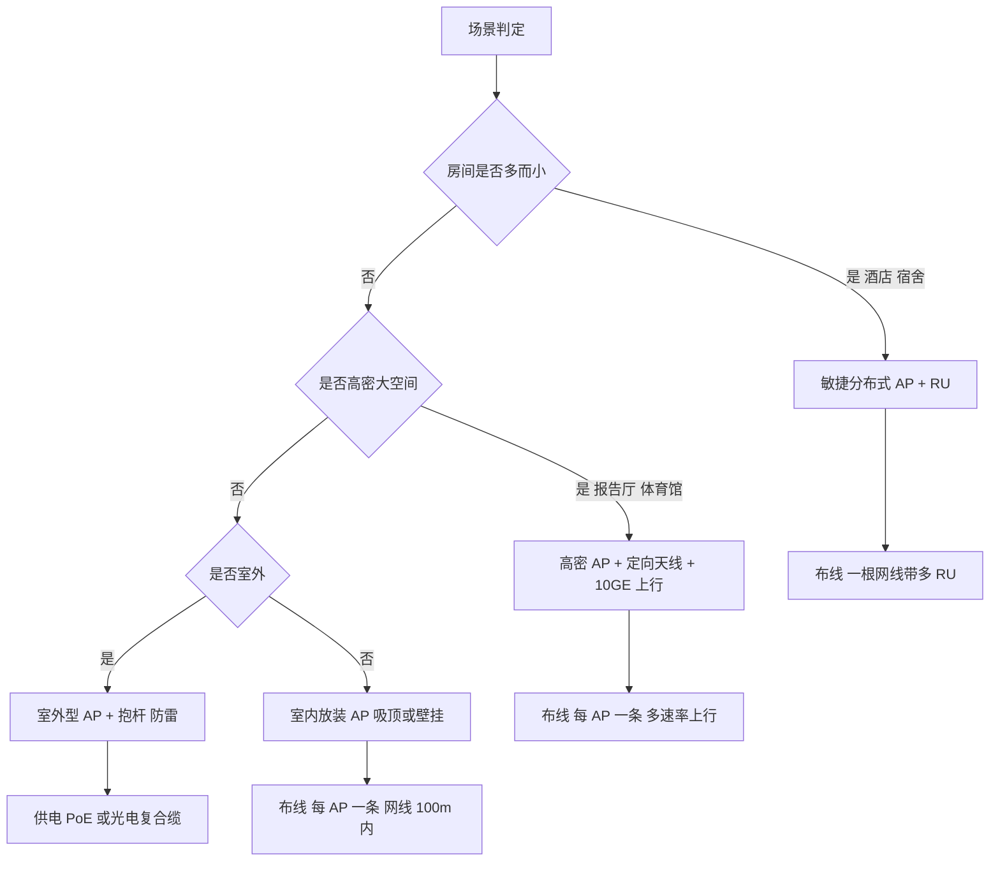

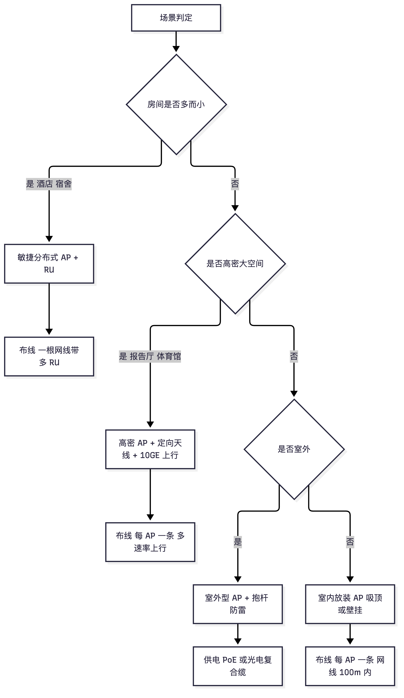


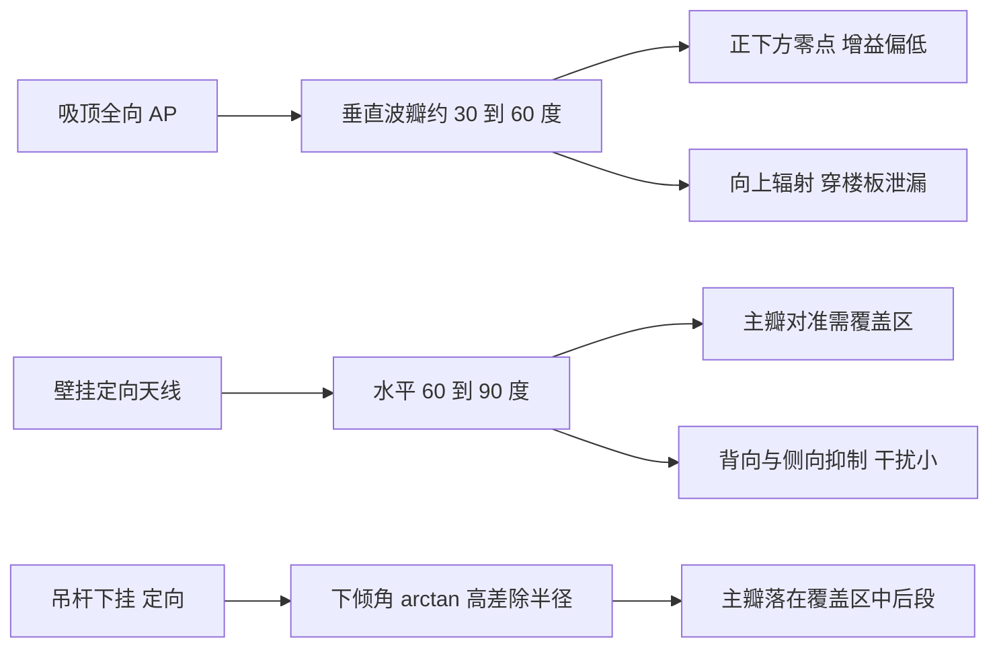

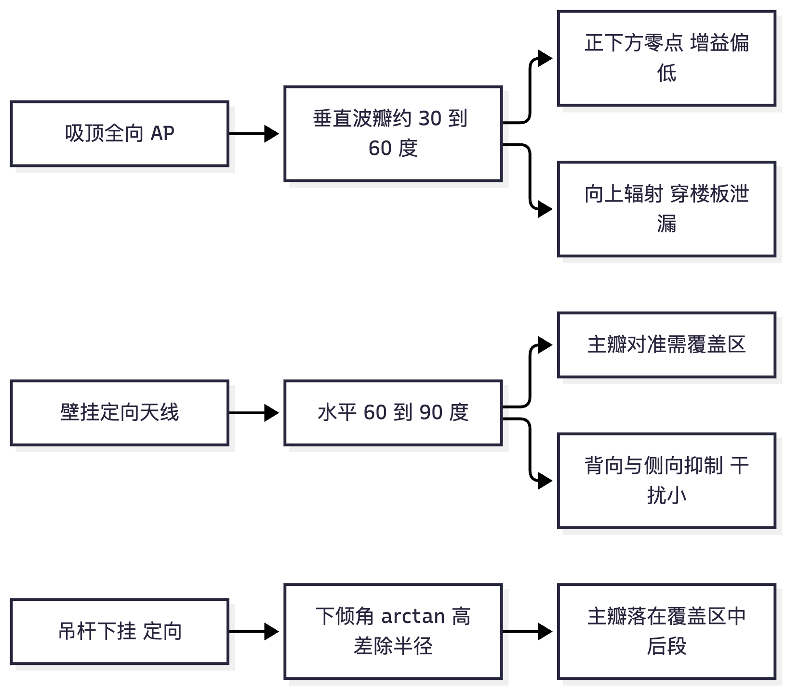


### 真题精练

**Q1.【真题·设计】** 某酒店 12 层，每层 20 间客房，走廊长 60 m，客房为砖墙 + 卫生间瓷砖墙（5G 穿损合计约 18 dB）。要求客房内 5G RSSI ≥ -70 dBm、每房至少 2 台终端流畅看 4K 视频（25 Mbps/房）。请给出部署形态选型、天线与点位方案，并说明布线方案。

> **答案**：
> **① 形态选型：敏捷分布式（AirEngine 9700S + RU）**。理由是本题的关键约束——**穿墙损耗 18 dB 使"走廊放装穿墙覆盖客房"不可靠**（5G 在 18 dB 穿损下覆盖半径只剩几米，见 3.4 节算例），而"每房一个 RU"把穿墙问题变成"房间内视距"，彻底解决。同时**一根网线可带多个 RU**，把 240 个房间的布线量从 240 条降到几十条，显著降低施工成本与对既有装修的破坏。
> **② 容量校验**：每房 2 台终端 × 25 Mbps = 50 Mbps；20 房/层 × 50 Mbps = **1000 Mbps/层**；12 层合计 12 Gbps。**注意中心 AP 的容量上限**：若每台中心 AP 接 16 个 RU 且 5G 标称 1.2 Gbps（有效约 600 Mbps），则同一中心 AP 下的 16 个房间共享 600 Mbps，即每房约 37 Mbps，**每房 2 路 4K（50 Mbps）不达标**。因此必须：
> - 降低每房目标（改为 1080P 8 Mbps × 2 = 16 Mbps，则 16 房共享 600 Mbps → 每房 37 Mbps，达标且有富余），或
> - **减少每台中心 AP 挂载的 RU 数**（如 8 个房间/中心 AP），增加中心 AP 数量与上行带宽，或
> - 用**高密中心 AP + 多速率上行**（10GE）。
> **本题的评分核心就是"分布式 AP 的容量不叠加"这一条**，只答布线优势不答容量陷阱会失分。
> **③ 天线与点位**：RU 装在**客房门口吊顶或床头侧墙**（离床 1~2 m），每房 1 个 RU，采用内置天线、**5G 用 20/40 MHz 而非 80/160 MHz**（房间隔离好，窄频宽换取更低噪声与更稳速率，同时提高复用度）；2.4G 房间内低功率（如 8~10 dBm）仅作兼容。
> **④ 信道规划**：5G 每 3~4 个相邻房间复用同一信道（20/40 MHz 时非重叠信道较多，可做 5~6 色复用），2.4G 每层固定 1/6/11，把同层相邻房间错开。
> **⑤ 布线方案**：中心 AP 放在**弱电间或楼层竖井**，用 Cat6/Cat6A 从中心 AP 到各 RU（单段 ≤100 m，含跳线）；若超过 100 m 改用**光电复合缆**（既供电又传数据）；每层配一台 PoE 交换机给中心 AP 供电，并按 `PoE 预算 ≥ AP+RU 峰值功率之和 × 1.2` 核算。
> **⑥ 验收指标**：客房内 5G RSSI ≥ -70 dBm、SNR ≥ 25 dB、单房下行实测 ≥ 30 Mbps、走廊漫游 ≤100 ms、并发开机（早 7 点集中联网）成功率 ≥ 99%。

**Q2.【真题·多选】** 关于吸顶安装的内置全向天线 AP，下列说法正确的有？
A. 垂直面波瓣较窄，正下方存在增益零点，地面正下方信号可能弱于斜下方
B. 天线向上辐射的能量会穿透楼板，造成上下楼层的同频干扰
C. 紧贴金属吊顶或风管安装会导致方向图畸变，实测可能偏差 10 dB 以上
D. 提高发射功率到最大可以消除正下方零点问题，因此高密场景应把功率开到最大
E. 壁挂安装时由于墙面遮挡，实际覆盖接近半空间，宜配定向天线或调整方位角

> **答案：ABCE**
> **解析**：D 完全错误——功率开最大有两个后果：**楼层间泄漏更严重**（穿楼板 15~25 dB 拦不住）与**同频干扰范围扩大**，高密场景的标准做法恰恰是"**降低功率 + 加密布点**"（用更多小覆盖区替代少数大覆盖区）。A/B/C/E 都是吸顶内置全向天线的固有特性，也是"点位设计必须避让金属、必须控制功率"的物理依据。

**Q3.【真题·单选】** 某大学操场（400 m × 300 m 开阔场地）需要室外覆盖，要求边缘 RSSI ≥ -75 dBm。最合理的方案是？
A. 沿操场周边均匀布置 4 台室外 AP，配 90° 定向天线，向场内打
B. 操场中央立杆 1 台室外 AP，配全向天线，功率开最大
C. 在操场边的教学楼内用室内 AP 穿墙覆盖操场
D. 沿操场周边布 8 台室内放装 AP

> **答案：A**
> **解析**：B 的问题是"单点全向覆盖 400 m×300 m"距离过远（自由空间 5G 在 200 m 处损耗可达 100 dB 以上，叠加人体损耗必然不达标），且中央立杆会被人群遮挡、也有安全与美观问题。C 穿墙（尤其教学楼的 Low-E 玻璃/承重墙）衰减 20~40 dB，室外侧必然不达标。D 室内 AP 无 IP67 防护、无防雷、工作温度范围不足，室外会因日晒雨淋与雷击批量损坏。A 是标准做法：**周边布点 + 定向天线向场内**，4×90° 可拼成 360°，兼顾覆盖与成本，且 AP 可借建筑外墙/灯杆安装便于供电与防雷。

**Q4.【真题·判断】** 分布式 AP（中心 AP + RU）方案中，增加 RU 的数量可以线性提升整网容量。

> **答案：错误**
> **解析**：分布式方案的容量上限由**中心 AP 的转发与空口能力**决定，RU 只是把射频延伸到房间，**不增加总容量**——16 个 RU 共享中心 AP 的约 600 Mbps 有效吞吐，平均每 RU 只有约 37 Mbps。因此分布式解决的是**覆盖与布线成本**问题，不是容量问题。要提升容量必须：增加中心 AP 数量（减少每台挂载的 RU 数）、升级到高规格中心 AP（多频/多流/多速率上行）、或改用放装 AP 方案。**这是国赛区分度很高的一条**。

**Q5.【真题·填空】** PoE 供电标准中，802.3af 单端口输出约 ________ W，802.3at 约 ________ W，802.3bt 可达 ________ W；规划时必须校核交换机整机 PoE 预算不小于全部 AP 峰值功率之和的 ________ 倍。

> **答案：15.4；30；60（或 90）；1.2**
> **解析**：Wi-Fi 6/7 双频/三频 AP 普遍需要 PoE+（at）甚至 PoE++（bt），若接入交换机只支持 af，会出现"AP 不上电""只能单频工作""自动降功率"等现象，且这类问题在 `display ap all` 上可能只表现为状态异常，容易误判为配置问题。此外线缆等级也要匹配（bt 建议 Cat6A 及以上），否则线缆发热与压降会造成随机掉电。**以所用交换机与 AP 的产品文档为准**。

**Q6.【真题·简答】** 请解释"吸顶安装的全向天线 AP 正下方存在覆盖零点"，并给出三种工程处置方法及其代价。

> **答案**：
> **① 原理**：全向天线的方向图是"甜甜圈"形——**在水平面内各方向增益相同（360°），但在垂直面内增益随角度变化，峰值在天线侧面（水平方向附近）**，而在天线轴向（正上方与正下方）增益最低（理论上为零点，实际约 -3~-10 dBi 相对峰值）。吸顶安装时"正下方"正是轴向，因此 AP 正下方的地面/桌面信号反而弱于斜下方 2~3 m 处的位置。这解释了"AP 正下方反而信号差""走廊 AP 正下方房间门口信号弱"的现象。
> **② 三种处置方法及代价**：
> - **改用内置下倾的吸顶天线或定向天线**：改变方向图，把主瓣压向目标区。代价：覆盖区变窄，需加密布点，设备与设计成本上升。
> - **调整安装方式（壁挂/吊杆下挂/加装下倾支架）**：用机械下倾把主瓣指向覆盖区中后段。代价：施工复杂度增加，需重新核算方向图与覆盖，且可能影响美观与既有装修。
> - **加密布点 + 降功率（"小覆盖区"策略）**：把间距从 1.7 倍半径缩到 1.2~1.3 倍半径，功率下调，让"零点"落在相邻 AP 的强覆盖区内。代价：AP 数量与布线成本增加，需严格信道规划以避免同频干扰加剧。
> **③ 答题补充**：在报告厅等超高顶棚场景，还可把 AP 从"吸顶"改为"**侧墙定向**"（主瓣从侧上方斜射观众区），既避开零点又形成空间隔离，是高密场馆首选。

**Q7.【真题·排错】** 某仓库采用吊杆下挂室外/厂房型 AP（安装高度 10 m），设计覆盖地面货架区。实测发现 AP 正下方地面信号只有 -80 dBm，而 20 m 外地面有 -68 dBm，且地面区域整体速率偏低。请分析原因与解决方向。

> **答案**：
> ① **现象解读**：典型的"**高挂全向天线的正下方零点 + 近端过强远端衰减**"问题。10 m 高挂时正下方恰在天线轴向零点；若为全向天线，能量被"平推到四周"，地面远处反而比正下方强。
> ② **确认天线类型与方向图**：查设备规格书确认是内置全向还是定向；若是全向，10 m 高度下地面覆盖图案是一个"环"，正下方必然弱。
> ③ **确认下倾角**：吊杆下挂时若天线保持水平（无下倾），主瓣平行于地面，地面接收靠的是波瓣下边缘的弱能量。处置：**使用定向天线并施加机械/电下倾**，`下倾角 ≈ (1/2~2/3) × arctan(安装高度 ÷ 半覆盖距离)`；例如覆盖半径 25 m、高度 10 m 时 `arctan(10/25) ≈ 21.8°`，下倾取 **11°~15°**，让主瓣中心落在 15~20 m 处的地面。
> ④ **确认是否靠金属货架造成多径/遮挡**：仓库金属货架（20~35 dB 衰减 + 强反射）会造成"局部阴影 + 多径深衰落"。处置：把 AP 布在货架通道上方（沿通道方向用定向天线"打通道"），避免"横向穿货架"。
> ⑤ **确认功率与速率集**：高挂 AP 若功率过大，近端终端 SNR 过高但对远端无用；应改为"**定向 + 合理功率 + 关闭低速率**"，必要时增加 AP 数量、降低安装高度（6~8 m）缩短距离。
> ⑥ **验收**：用 `display station mac-address <MAC> verbose` 沿通道取 10 个点测 RSSI/SNR，目标 RSSI ≥ -70 dBm、SNR ≥ 20 dB，且相邻点波动（多径）不超过 10 dB。

**Q8.【真题·实验】** 在 AC6805 上按"办公放装 AP 组"与"酒店分布式 AP 组"分别建立 AP 组并绑定不同的射频模板，写出命令并说明如何验证两组 AP 应用了各自的模板。

> **答案**：
> ```bash
> system-view
> wlan
>  ap-group name AG_OFFICE                                  // 创建办公放装 AP 组
>   radio-2g-profile name OFFICE_2G                         // 绑定办公 2.4G 模板（1/6/11、20MHz、低功率）
>   radio-5g-profile name OFFICE_5G                         // 绑定办公 5G 模板（80MHz、固定信道、EIRP 20）
>   vap-profile name VAP_EMPLOYEE wlan 1 radio all          // 绑定员工 VAP 到组内所有射频
>  ap-group name AG_HOTEL                                   // 创建酒店分布式 AP 组
>   radio-2g-profile name HOTEL_2G                          // 酒店 2.4G：更低功率（8~10 dBm）仅作兼容
>   radio-5g-profile name HOTEL_5G                          // 酒店 5G：40MHz、每房一个 RU、错开信道
>   vap-profile name VAP_HOTEL wlan 1 radio all             // 绑定客房 VAP
> ```
> ```bash
> ap-id 1 ap-mac <AP1-MAC>                                  // 或将已上线 AP 加入指定组（也可用 ap-group 下 ap-id 方式，以所用版本为准）
> display ap all                                            // 查看每台 AP 所属 AP 组（Group 列）
> display ap config ap-id 1                                 // 查看某台 AP 实际生效的配置（含射频模板）
> display radio-5g-profile name HOTEL_5G                    // 核对模板参数（信道/带宽/EIRP）
> display ap performance all radio                          // 按射频看实际信道与带宽是否与所属组模板一致
> ```
> **验证方法**：① `display ap all` 确认 AP 的 Group 列分别显示 AG_OFFICE / AG_HOTEL；② `display ap performance all radio` 对比两组的实际信道/带宽（办公应为 80MHz 高信道，酒店应为 40MHz 且信道按房间错开）；③ 抓取现场实测：办公区抽测 RSSI 应达 -65 dBm 以上，酒店客房内应达 -70 dBm 以上；④ 若某台 AP 参数与组模板不符，检查是否被**AP 单独配置（ap-id 下的个性化配置）**覆盖——**个性化配置优先级高于 AP 组模板**，这是最常见的"模板不生效"原因。**以所用版本文档为准**。

### 易错点与排错

1. **分布式 AP 当作"容量叠加"**：RU 只延伸覆盖，容量受中心 AP 上限约束，这是最高频的丢分点。
2. **忽略吸顶全向天线的正下方零点与楼层泄漏**：必须写"降功率 + 加密布点"或"改定向/下倾"。
3. **点位不看金属与干扰源**：金属吊顶/风管/货架/微波炉，会在纸面设计达标的情况下毁掉实测。
4. **PoE 预算不算**：af/at/bt 混用导致 AP 不上电或降级；整机预算不足导致高峰时批量掉电。
5. **网线超 100 m 或与强电同槽**：链路不稳定、偶发丢包，且很难从无线侧定位。
6. **个性化配置覆盖组模板**：`ap-id` 下的单独配置优先于 AP 组模板，改模板不生效先查这里。
7. **排错命令**：`display ap all`（型号/组/状态）、`display ap config ap-id <id>`（实际生效配置）、`display poe power` / `display poe power-information interface <接口>`（供电）、`display ap type all`（支持型号核对）。

---

## 3.6 勘测方法与工具：现场勘测、模拟勘测与 WLAN Planner 全流程

### 考点定位

本考点以**流程题/实验题**形式出现，占 **5~8 分**，且是国赛"WLAN Planner 操作"类题目的唯一出处。高频陷阱：① 说不清"现场勘测"与"模拟勘测"的适用边界（以为仿真可以完全替代实测）；② WLAN Planner 的操作顺序记错（**先导出/导入图纸→设比例尺→绘制/导入墙体与材质→放置 AP→设置 AP 参数→仿真→输出报告**）；③ 漏掉"勘测报告要素"里的**既有干扰与既有 AP 清查**；④ 不知道勘测时要测哪些量（只测信号强度，不测噪声底、穿墙损耗、AP 点位可行性）。

### 原理精讲

**① 现场勘测（On-site Survey）与模拟勘测（Simulation / Predictive Survey）的本质区别。**

- **现场勘测**：工程师带 AP、测试终端与测量软件到现场，实际发射信号、逐点测量 RSSI/SNR/噪声底/速率，并做**穿墙损耗实测**与**干扰源普查（Spectrum Analysis）**。它测的是"**真实世界的答案**"，精度最高，但耗时耗人力（一栋楼可能 1~3 天），且需要现场具备可施工/可上电条件。**适用**：高密场景（报告厅、体育馆、展馆）、历史/特殊建筑、强干扰环境、既有 AP 需要清查的改造项目、室外覆盖（需要实测遮挡与反射）、以及仿真结果与实测偏差大需要校准的场合。
- **模拟勘测**：用 **WLAN Planner** 等工具，导入建筑图纸、设置比例尺、按材质（砖墙/混凝土/玻璃/木门…）绘制墙体，放置 AP 与设置参数，使用射线跟踪/多墙模型仿真出**覆盖热力图、速率热力图、干扰热力图、AP 数量与点位建议**。它测的是"**模型的答案**"，速度快、可反复迭代、可在施工前完成，但精度依赖图纸与材质库的准确性，且**看不到未建模的干扰源**（邻区 AP、微波炉、蓝牙、5G 室分泄漏、人流变化）。**适用**：新建普通办公/教学楼/商场、需要快速比选多套方案、施工前出图与预算、以及作为现场勘测的"预设计"。
- **工程上的正确组合（必答结论）**：**模拟勘测做主体设计 → 现场勘测做校核与修正 → 用实测参数回灌仿真模型 → 仿真迭代出最终方案**。对高密与特殊场景，现场勘测的权重更高；对普通场景，模拟为主 + 抽点验证即可。

**② 华为 WLAN Planner 的完整使用流程与输出物（必须能背出来）。**

WLAN Planner 是华为官方的 WLAN 网规仿真工具（有在线版与本地版，界面在不同版本有差异，**以所用版本文档为准**）。标准流程为：

| 步骤 | 操作 | 关键输入 | 输出/注意点 |
|---|---|---|---|
| 1 | **新建项目 / 导入图纸** | 建筑平面图（JPG/PNG/PDF/DWG，DWG 需转换） | 图纸要清晰、无旋转畸变；多层建筑**每层一张图** |
| 2 | **设置比例尺（Scale）** | 图纸上的一段已知实际长度（如门宽 0.9 m、柱距 8 m） | 比例尺是全部计算的基准，**设错则覆盖半径、间距、AP 数量全错** |
| 3 | **绘制/导入墙体并设置材质** | 墙体位置与材质（砖/混凝土/石膏板/玻璃/木门/金属） | 材质决定穿透损耗；可用工具库快捷键（如砖墙、混凝土墙、玻璃）逐段绘制 |
| 4 | **设置楼层与层间衰减** | 层高、楼板材质与厚度 | 影响跨层干扰与是否可"隔层复用信道" |
| 5 | **放置 AP（自动布放或手动拖放）** | AP 型号、安装方式（吸顶/壁挂/抱杆）、天线类型与朝向、安装高度 | 可选"自动布放"得到初始点位草案，再手动微调避让金属与结构 |
| 6 | **设置 AP 参数** | 频段（2.4G/5G/6G）、信道与带宽、发射功率/EIRP、天线增益、目标 MCS/速率 | 参数必须与拟采购型号的规格一致，否则仿真结论不可用 |
| 7 | **设置覆盖目标（仿真条件）** | 目标 RSSI/SNR/边缘速率、终端类型与天线数、人体损耗、阴影余量 | 这一步决定"达标"的判据；建议与 3.1 节的覆盖目标表一致 |
| 8 | **运行仿真** | — | 得到覆盖热力图、速率热力图、SNR 热力图、信道干扰图、AP 列表 |
| 9 | **迭代优化** | 依据热力图调整点位/功率/信道/天线朝向 | 目标是"达标区域最大 + AP 数最少 + 干扰最低"，三者折中 |
| 10 | **输出报告与交付物** | — | 覆盖热力图、速率热力图、AP 点位与信道/功率清单、AP 数量与型号统计、材料清单（BOM）、勘测报告/网规方案书 |

**③ 勘测时的关键测量项（现场勘测必测清单）。**
- **信号覆盖类**：目标点位的 RSSI、SNR、噪声底（Noise Floor）、协商速率与 MCS、重传率。
- **穿透损耗类**：同一 AP 在墙两侧同距离处的 RSSI 差值（实测穿损），承重墙/玻璃/金属各测一遍。
- **干扰类**：2.4G/5G 频谱扫描（找出微波炉、无绳电话、蓝牙、邻区 AP、5G 室分泄漏、无线图传），记录干扰源位置与强度；统计各信道上邻居 AP 的数量与 RSSI。
- **容量与业务类**：忙时并发终端数、主要业务类型与带宽占用、既有 AP 的负载分布。
- **工程可行性类**：拟布点位置是否有电源/网线/桥架可达、吊顶材质与承重、安装高度、可否打孔、是否与消防/暖通冲突；拍照留档。
- **既有网络清查（改造项目必做）**：既有 AP 的型号、位置、信道、功率、SSID、管理方式、是否有 AC 及型号；既有网线是否可复用（Cat5e 可支持 1GE，但可能不支持 2.5G/10GE 与 PoE++）。

**④ 勘测报告应包含的要素清单。**
1 项目概况与勘测范围、时间、参与人；2 现场平面图与照片（含拟布点位置标注）；3 建筑结构与材质说明（墙体/楼板/玻璃类型）；4 既有无线与干扰源普查结果（含频谱图）；5 实测数据表（各点位 RSSI/SNR/噪声底/速率）；6 实测穿透损耗表；7 模拟勘测结果（覆盖/速率/干扰热力图）；8 仿真参数与假设说明（材质损耗取值、路径损耗模型、阴影余量）；9 AP 选型建议与点位图；10 信道与功率规划表；11 布线/供电/承重等工程约束与风险提示；12 遗留问题与后续建议（如需要补充现场实测的区域）。

### 关键概念对照表

| 维度 | 现场勘测 | 模拟勘测（WLAN Planner） |
|---|---|---|
| 原理 | 实际发射、逐点测量 | 图纸建模 + 射线/多墙/对数距离模型仿真 |
| 精度 | 高（真实环境） | 中（依赖图纸与材质库，偏差 6~10 dB） |
| 耗时 | 1~3 天/栋（高密更久） | 数小时~1 天 |
| 成本 | 人力 + 差旅 + 测试 AP | 软件 + 人力 |
| 能否发现未建模干扰源 | **能**（频谱扫描） | **不能** |
| 能否施工前完成 | 不能（需现场条件） | **能** |
| 能否快速比选多方案 | 难 | **易**（改参数即重算） |
| 适用场景 | 高密场馆、历史建筑、强干扰、改造项目、室外 | 新建普通办公/教学楼/商场、方案比选、施工前出图 |
| 输出物 | 实测数据表、频谱图、穿损表、点位可行性结论 | 覆盖/速率/干扰热力图、AP 清单与点位、BOM、网规报告 |
| 正确用法 | **校核与修正仿真** | **主体设计与迭代** |

| WLAN Planner 输出物 | 内容 | 用途 |
|---|---|---|
| 覆盖热力图（RSSI） | 各点预测接收电平 | 判断盲区、确定 AP 间距 |
| 速率热力图（Throughput） | 各点预测吞吐/MCS | 判断是否满足边缘速率要求 |
| SNR/SINR 热力图 | 信噪比分布 | 判断可用 MCS 与稳定性 |
| 信道干扰图 | 同频/邻频重叠情况 | 信道规划与复用距离校验 |
| AP 列表与参数表 | 型号、点位坐标、信道、功率、天线 | 直接作为配置与施工依据 |
| BOM/材料清单 | AP、天线、馈线、PoE 交换机数量 | 预算与采购 |
| 网规报告 | 汇总上述内容 + 假设与结论 | 交付与评审 |

### 华为设备配置

```bash
# ===== 勘测阶段在现场用 AP + AC 做"临时测试网"的典型配置（快速搭台实测）=====
system-view
wlan
 ap-group name AG_SURVEY                                  // 建立勘测专用 AP 组，不影响生产配置
  radio-5g-profile name SURVEY_5G
   channel 80mhz 36                                        // 勘测时固定单信道：排除自动选信道对测量的干扰
   eirp 20                                                 // 固定功率：使实测数据可复现（便于反解 n 与穿损）
   dot11a basic-rate 6 12 24 disable                       // 关闭低速率，便于用速率反推 SNR
   dot11a supported-rate 36 48 54
  vap-profile name VAP_SURVEY wlan 1 radio all             // 勘测 SSID（可设为开放或简单 PSK 便于连接）
```

```bash
# ===== 勘测数据采集与核对 =====
display ap all                                             // 确认勘测 AP 上线，记录其位置编号（与图纸点位一一对应）
display station mac-address <测试终端MAC> verbose          // 逐点记录 RSSI / SNR / 协商速率 / 重传（勘测数据表的核心字段）
display ap performance all radio                           // 记录噪声底与信道利用率（作为"现场干扰基线"）
display wlan ap name <AP名> radio all                      // 查看该 AP 各射频的功率、信道、带宽、噪声底
```
> 勘测时建议同时用**专业扫频工具**（如频谱分析功能）与**终端侧软件**交叉验证；AC 上的数据反映的是"关联后的射频质量"，无法反映非 Wi-Fi 干扰，两者必须结合。**以所用版本文档为准**。

### 示意图

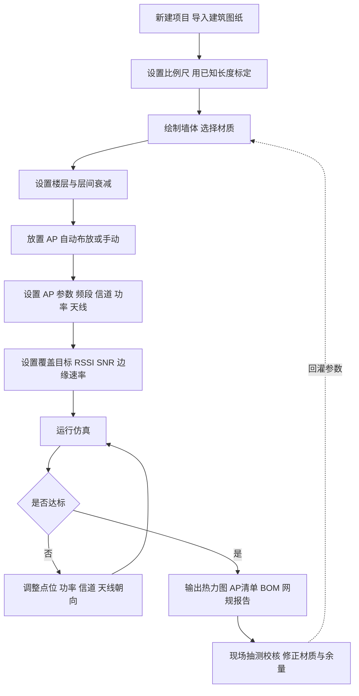

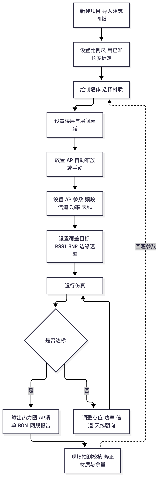


### 真题精练

**Q1.【真题·简答】** 请完整描述使用华为 WLAN Planner 进行网规的 10 个步骤（含每步的关键输入与输出），并说明哪一步做错会导致"后面全部结果不可用"。

> **答案**：
> **① 新建项目并导入建筑图纸**（输入：平面图 JPG/PNG/PDF/DWG；输出：项目与楼层底图）。多层建筑每层一张图。
> **② 设置比例尺**（输入：图纸上一段已知实际长度，如门宽 0.9 m 或柱距 8 m；输出：图纸与真实尺度的映射）。**这一步做错会导致后面全部结果不可用**——覆盖半径、AP 间距、AP 数量、材料清单全部按错误尺度计算，且错误是"等比缩放"的，热力图看起来完全正常，极具欺骗性。
> **③ 绘制/导入墙体并设置材质**（输入：墙体位置与材质：砖墙、混凝土、石膏板、玻璃、木门、金属；输出：带穿透损耗的墙体模型）。
> **④ 设置楼层与层间衰减**（输入：层高、楼板材质厚度；输出：跨层干扰模型）。
> **⑤ 放置 AP**（输入：AP 型号、安装方式与高度、天线类型与朝向；输出：初始点位草案；可先用"自动布放"再手动微调避让金属与结构）。
> **⑥ 设置 AP 参数**（输入：频段、信道与带宽、EIRP、天线增益、速率集；输出：可仿真的射频配置）。参数必须与拟采购型号规格一致。
> **⑦ 设置覆盖目标与终端条件**（输入：目标 RSSI/SNR/边缘速率、终端天线数、人体损耗、阴影余量；输出：达标判据）。
> **⑧ 运行仿真**（输出：RSSI/速率/SNR 热力图、信道干扰图、AP 列表）。
> **⑨ 迭代优化**（输入：热力图与干扰图；输出：调整后的点位/功率/信道/天线朝向）。目标是"达标最大 + AP 最少 + 干扰最低"。
> **⑩ 输出报告与交付物**（输出：热力图、AP 点位与信道/功率清单、BOM、网规报告）。
> **补充结论**：模拟勘测后**必须现场抽测校核**，用实测穿损与噪声底回灌模型（见 3.4 节反解 n 的方法），否则仿真结论只能作为"设计意图"而不能作为"验收依据"。

**Q2.【真题·多选】** 下列哪些情况**必须**进行现场勘测而不能仅依赖模拟勘测？
A. 1500 座报告厅的高密覆盖设计
B. 已运行多年的老旧办公楼改造，且需清查既有 AP 与干扰源
C. 新建的普通办公室，图纸完整、无特殊结构
D. 历史文化建筑的无线覆盖（不得破坏吊顶，结构复杂）
E. 室外体育场覆盖（存在看台遮挡与反射）

> **答案：ABDE**
> **解析**：C 是"模拟勘测为主 + 抽点验证"的典型场景——图纸完整、结构常规、无强干扰，仿真精度足够，现场只需抽测验证。A/D/E 属于高密、特殊结构、室外复杂环境，仿真模型的误差（材质库不覆盖、多径与反射复杂、人流变化大）会显著放大，必须现场勘测。B 的关键是"**既有 AP 与干扰源无法从图纸得知**"，必须现场频谱扫描与逐点清查——这是模拟勘测的原理性盲区。

**Q3.【真题·判断】** WLAN Planner 的仿真结果可以直接作为工程验收依据。

> **答案：错误**
> **解析**：仿真是"模型答案"，其精度受图纸准确性、材质参数、路径损耗模型、阴影余量与未建模干扰源影响，规范偏差 6~10 dB。验收必须用**实测数据**（覆盖抽测、吞吐测试、漫游测试、并发测试）。仿真结果的正确用途是：**施工前设计与预算、方案比选、点位与信道规划、以及生成施工用点位图**；验收阶段使用仿真热力图只作为"对照参考"，判定合格与否必须依据实测。

**Q4.【真题·填空】** WLAN Planner 的标准流程顺序为：新建项目与导入图纸 → ________ → 绘制墙体与材质 → 放置 AP → 设置 ________ → 运行仿真 → 迭代优化 → 输出报告。其中，比例尺用于建立图纸与________的映射，设置错误会使全部计算结果等比例失真。

> **答案：设置比例尺；AP 参数（频段/信道/功率/天线）；真实物理尺寸（实际尺度）**
> **解析**：比例尺是全部几何计算的基础（覆盖半径、AP 间距、面积、AP 数量）。答题时强调"比例尺错误会导致结果等比失真且热力图看似正常"，能体现工程理解。

**Q5.【真题·设计】** 请设计一份"WLAN 现场勘测报告"的目录结构（不少于 10 个章节），并说明每个章节解决的工程问题。

> **答案**：
> 1. **项目概况与勘测范围**——明确勘测边界、时间、人员、使用的工具与设备（避免范围争议）。
> 2. **现场平面图与照片**——记录拟布点位置与现场实际条件（施工交底依据）。
> 3. **建筑结构与材质说明**——墙体/楼板/玻璃/金属分布（链路预算的输入）。
> 4. **既有无线与干扰源普查**——既有 AP 清单（型号/位置/信道/功率/SSID/管理方式）与频谱扫描结果（微波炉、无绳电话、蓝牙、5G 室分泄漏、无线图传）；解决"仿真看不到干扰"的问题。
> 5. **实测数据表**——各点位 RSSI/SNR/噪声底/协商速率/重传率；作为覆盖与验收基准。
> 6. **实测穿透损耗表**——各材质实测穿损（分区、分频段）；用于修正仿真材质库。
> 7. **模拟勘测结果**——覆盖/速率/SNR/干扰热力图；用于方案论证。
> 8. **仿真参数与假设说明**——路径损耗模型、n 值、阴影余量、人体损耗、终端条件；解决"结论可复现、可评审"。
> 9. **AP 选型建议与点位图**——型号、天线、安装方式与高度、点位坐标；直接用于施工。
> 10. **信道与功率规划表**——分楼层分 AP 的信道/带宽/EIRP；解决同频干扰。
> 11. **工程约束与风险提示**——走线、供电（PoE 预算）、承重、防雷、美观、消防；解决"设计不可施工"。
> 12. **遗留问题与后续建议**——如某些区域需补测、某些点位待业主确认；解决"责任边界"。
> 13. **附件**——原始测量数据、频谱截图、图纸电子文件、工具报告导出文件。

**Q6.【真题·排错】** 某项目用 WLAN Planner 仿真得出"5G 覆盖良好、需 8 台 AP"，但施工后实测发现"边缘区域信号比预测低 12 dB，且需 12 台 AP"。请从"勘测与仿真"的角度分析原因。

> **答案**：
> ① **比例尺或图纸失真**：若图纸本身是"示意"而非按比例绘制，或比例尺标定错误，几何计算会整体偏移。排查：用现场实测的已知尺寸（柱距、门宽）反算比例尺误差。
> ② **墙体材质取错**：把"混凝土承重墙"当成"砖墙"（5G 差 10~18 dB），或漏画金属隔断、Low-E 玻璃。排查：现场实测各材质穿损，与仿真材质库对比（这是最可能的 12 dB 来源）。
> ③ **路径损耗指数 n 与参考损耗取值偏乐观**：仿真默认可能用开放办公参数（n=3.0），实际是密集隔间（n=3.8~4.0）。排查/处置：现场两点法反解 n 并回灌（见 3.4 节 Q8）。
> ④ **阴影衰落余量与人体损耗未计入**：仿真常在"空场无人体"条件下计算，实际有人时下降 5~10 dB。处置：在仿真条件中设置人体损耗与余量，或以"有人状态"为设计基准。
> ⑤ **未建模的干扰源抬高噪声底**：邻区 AP、微波炉、5G 室分泄漏导致 SNR 下降、速率降低。仿真看不到这些，必须靠现场频谱扫描补足。
> ⑥ **AP 参数与选型不一致**：仿真用了 4×4 高增益型号与 80MHz，实际采购是 2×2 且现场只开了 40MHz。排查：核对仿真 AP 参数与实配（`display ap performance all radio`）。
> ⑦ **点位被施工偏移**：AP 从设计位置移到吊顶夹层/金属桥架旁，实测自然变差。排查：现场照片 + 点位核对。
> **处置闭环**：把 ②③④ 的实测结果回灌仿真模型，重新跑仿真得到新的 AP 数量（本例应接近 12 台），并**把"实测校核"写入网规流程**，避免同类问题。

**Q7.【真题·单选】** 在现场勘测中，为了得到可用于修正仿真模型的路径损耗指数 n，最规范的做法是？
A. 在 AP 正下方测一次 RSSI 即可推算
B. 在同一 AP 的多个已知距离点（如 1 m、5 m、10 m、20 m）分别测量 RSSI，用两点法或最小二乘拟合反解 n
C. 直接采用仿真软件默认的 n 值
D. 用 AP 的发射功率除以距离

> **答案：B**
> **解析**：n 描述的是"损耗随距离增长的速率"，必须由**同一 AP、不同距离的多点实测**反解（`ΔPL = 10n·lg(d2/d1)`）。A 只测一点无法得到速率；C 用默认值等于放弃校准（正是偏差 12 dB 的根源）；D 单位与量纲完全错误。规范做法还要求：测量时保持环境一致（无人走动、门状态一致）、每点多次取样取中位数、至少 3 个距离点做最小二乘以提高精度。

**Q8.【真题·实验】** 用"AC + 单台 AP"搭建临时勘测网，完成一次穿透损耗实测实验，写出配置、测量步骤与数据处理方法。

> **答案**：
> ```bash
> system-view
> wlan
>  ap-group name AG_SURVEY                                   // 勘测专用组，与生产配置隔离
>   radio-5g-profile name SURVEY_5G
>    channel 80mhz 36                                         // 固定信道：排除自动选信道带来的测量漂移
>    eirp 20                                                  // 固定功率：使各次测量可复现、可比较
>    dot11a basic-rate 6 12 24 disable                        // 关闭低速率，便于用速率反推 SNR
>    dot11a supported-rate 36 48 54
>   vap-profile name VAP_SURVEY wlan 1 radio all              // 勘测 SSID
> ```
> **测量步骤**：
> 1. 把 AP 安装在待测区域的**设计点位**（或用三脚架放在地面代表桌面高度，统一高度与朝向，并记录）。
> 2. 终端固定在 1 m 视距处，读 `display station mac-address <MAC> verbose` 的 RSSI，记 `RSSI_1`。
> 3. 确认墙体位置：在**墙的同一侧**距 AP 10 m 处测 `RSSI_A`；在**墙的另一侧**同样几何距离处测 `RSSI_B`；则该墙实测穿损 `L_wall = RSSI_A - RSSI_B`（dB）。
> 4. 对每种材质（砖墙、石膏板、混凝土、玻璃、金属门）重复步骤 3，每处测 10 次取中位数，记录环境条件（门开/关、是否有人）。
> 5. 在无障碍方向测 1 m、5 m、10 m、20 m 四点的 RSSI，用于反解 n：`n = (RSSI(d1) - RSSI(d2)) / (10·lg(d2/d1))`；用最小二乘对多点拟合更准。
> **数据处理**：把 `L_wall` 与 `n`、`PL(1m)` 填入勘测报告并**回灌 WLAN Planner 的材质库与模型设置**；重新仿真后与实测对比，偏差应缩到 **±3~5 dB** 以内即为模型可用。
> **注意**：勘测时同时记录 `display ap performance all radio` 的**噪声底**，若噪声底明显高于 -95 dBm（2.4G）/ -100 dBm（5G），说明存在干扰源，需先用频谱工具定位并记录，否则 RSSI 正常也会速率不达标。**以所用版本文档为准**。

### 易错点与排错

1. **把仿真当验收依据**：仿真 6~10 dB 偏差是常态，验收必须实测。
2. **比例尺标定随意**：用"目测"标定比例尺是低级但高发的错误，必须用图纸上的已知尺寸（柱距/门宽）标定。
3. **材质库照搬默认值**：混凝土/金属/Low-E 玻璃的实际损耗差异极大，必须现场实测校正。
4. **漏测噪声底与干扰源**：只测 RSSI 会得出"覆盖达标但速率不达标"的结论，无法解释。
5. **勘测报告缺"假设与模型"章节**：导致结论不可复现、评审无法判断可信度。
6. **忘记清查既有 AP**：改造项目最常见的翻车点（新旧 AP 互相干扰、信道冲突、同 SSID 但不同认证）。
7. **排错/采集命令**：`display station mac-address <MAC> verbose`（RSSI/SNR/速率/重传）、`display ap performance all radio`（噪声底/信道利用率）、`display wlan ap name <AP名> radio all`（射频详情）、`display ap config ap-id <id>`（实际生效射频参数）。

---

## 3.7 信道与功率规划：多楼层多 AP 信道分配实例

### 考点定位

本考点以**表格题/设计题**形式出现，占 **4~6 分**，是"覆盖与容量做完了，怎么把频段资源分配下去"的关键一步。高频陷阱：① 2.4G 用 1/6/11 之外的信道（如 3、9）导致邻频重叠；② 楼上楼下用**相同信道**且不做功率控制，造成跨层同频；③ 5G 把"非重叠信道"当成无限资源（80MHz 时 5G 可用非重叠信道数量有限，必须做**复用距离**设计）；④ 6GHz 的法规现状与可用性说错；⑤ 功率"全开最大"当作默认。

### 原理精讲

**① 频段与信道资源。**

- **2.4 GHz（2.4~2.4835 GHz）**：可用信道 1~13（中国），每信道带宽 20 MHz，但信道间隔仅 5 MHz，因此**只有 1、6、11 三个完全互不重叠**（2.4G 的"三色复用"）。40 MHz 在 2.4G 会占用 1~9 这样的跨度，**在高密场景必然自干扰**，因此标准做法是**强制 20 MHz + 1/6/11**。2.4G 的价值是**兼容老旧终端与低速率 IoT**，不是容量主力。
- **5 GHz（5.15~5.35、5.47~5.725、5.725~5.85 GHz）**：中国 5G 可用信道约 13 个 20MHz 信道（36/40/44/48、52/56/60/64、149/153/157/161/165）。**DFS（Dynamic Frequency Selection，动态频率选择）**：52~64 属雷达频段，需支持 DFS/TPC 才能使用，且检测到雷达信号必须**立即避让（信道静默 60 s 后切换）**，会造成短暂断流，因此高密场景常优先使用**非 DFS 信道（36~48、149~165）**，但非 DFS 数量少（8 个 20MHz），需要靠**复用距离**扩频。80 MHz 频宽由 4 个 20MHz 绑定（如 36-40-44-48），中国 5G 可绑出约 **4~5 个 80MHz**（含 DFS）或 **2~3 个非 DFS 80MHz**；160 MHz 基本只有 1~2 个（且极易与 DFS 冲突）。**这就是高密场景"80MHz 可以用、160MHz 慎用"的原因**。
- **6 GHz（5.925~7.125 GHz，Wi-Fi 6E/7）**：中国**尚未正式开放 6 GHz 给 WLAN 使用**（截至本册编写时，国内法规尚未发布 6GHz 频段用于 WLAN 的许可，美国 FCC 已开放 5925~7125 MHz，欧洲开放 5945~6425 MHz）。因此国内项目**规划时不能假设 6GHz 可用**，而应把 6GHz 作为"未来演进能力"写入方案（硬件支持、软件许可开通、等待法规）。**6GHz 一旦放开，将新增 7 个 160MHz 或 59 个 20MHz 信道，是解决高密干扰的根本手段——这是国赛"新技术演进"题的必答点。**（法规状态请以**最新官方公告**为准。）

**② 信道分配策略。**
- **2.4G**：固定 1/6/11，20 MHz，低功率。多楼层分配原则：**同一垂直位置的相邻楼层错开信道**（1 层用 1、2 层用 6、3 层用 11、4 层回到 1），因为垂直方向穿楼板衰减约 15~25 dB，同一信道在相邻楼层通常可接受，但如果功率过大仍会互相干扰，因此**相邻楼层错开 + 降功率**双保险。
- **5G**：优先在**同一楼层内做"面状复用"**（把可用非重叠信道尽量分配到相邻 AP 上），再考虑楼层间复用。80MHz 只有 2~3 个非 DFS 信道时，**必须让"同信道的 AP 之间保持足够的物理距离（复用距离）"**：室内 5G 同频复用距离建议 **≥ 25~40 m**（相当于隔 2~3 个 AP 才复用同一信道），并可结合**楼板与承重墙的天然隔离**做三维复用（例如奇数层用 36/52/100，偶数层用 44/60/116，让垂直方向错开）。
- **功率设置原则**：
  - **覆盖优先场景（仓库、室外）**：功率以保证边缘 RSSI 达标为准，可较高。
  - **高密场景（办公、教室、报告厅）**：**"小覆盖区"原则——降低功率、加密布点**。目标是让每台 AP 的服务半径缩小到"刚好覆盖自己的责任区"，从而降低同频干扰、提高频谱复用度。这是高密优化最核心的一条，与直觉相反（不是"开大功率信号更好"）。
  - **2.4G 功率应低于 5G**（如 2.4G 11~14 dBm、5G 17~20 dBm），因为 2.4G 只有 3 个信道，任何多余的覆盖都是干扰。
  - **自动功率/信道（RRM/Auto Channel）**在**干扰稳定的场景可用**，但在**高密或强干扰场景建议固定**——自动调优会在"检测到干扰→换信道→引发新干扰"之间反复震荡（信道漂移），对语音与漫游不友好。**考试结论：高密场景固定信道与功率，稀疏场景可开启自动。**
- **邻居 AP 的信道复用距离**：定义为"使用同一信道的两台 AP 之间的最小物理距离"。它由**同频干扰容限**决定：若 `同信道 AP 的信号强度 ≤ 服务 AP 信号强度 - 15 dB`（或绝对值 ≤ -80 dBm），则可接受。在 n=3.5 的室内环境下，**10~15 dB 的差值对应约 1.9~2.7 倍的距离差**，因此若 AP 间距 20 m，同信道 AP 的间距需 ≥ 40~55 m（即每 3 台 AP 复用一次同信道）。这就是"**信道复用因子 ≥ 3**"的工程来源。

### 关键概念对照表

| 频段 | 可用信道（中国） | 非重叠 20MHz 数 | 可用 80MHz 数 | 是否需 DFS | 规划建议 |
|---|---|---|---|---|---|
| 2.4 GHz | 1~13 | 3（1/6/11） | 0（40MHz 即自干扰） | 否 | 强制 20MHz + 1/6/11 + 低功率 |
| 5 GHz 低段非 DFS | 36/40/44/48 | 4 | 1（36-48） | 否 | 高密主力，优先使用 |
| 5 GHz 中段 DFS | 52/56/60/64 | 4 | 1（52-64） | **是**（雷达避让） | 可用但需接受偶发避让；语音场景慎用 |
| 5 GHz 高段非 DFS | 149/153/157/161/165 | 5 | 1（149-161） | 否 | 高密主力，优先使用 |
| 6 GHz | 国内尚未开放（法规待发布） | 理论 59 | 理论 7 | 取决于当地法规 | 写入演进规划，不假设可用 |

| 参数 | 2.4 GHz | 5 GHz | 6 GHz | 说明 |
|---|---|---|---|---|
| 单信道带宽 | 20 MHz（建议固定） | 20/40/80/160 MHz | 20~320 MHz | 频宽越大峰值越高、抗干扰越弱 |
| 穿墙能力 | 强 | 中 | 弱 | 6GHz 最难穿墙，靠密度取胜 |
| 干扰源 | 微波炉、蓝牙、无绳电话、ZigBee | 雷达（DFS）、邻区 5G | 少（新频段） | 6GHz 干净是其最大价值 |
| 高密推荐带宽 | 20 MHz | 40 MHz（高密）/80 MHz（普通） | — | 高密用窄频宽换复用度和稳定性 |
| 功率建议 | 11~14 dBm | 17~20 dBm | — | 2.4G 恒低于 5G |
| 同频复用距离（室内） | ≥ 20~25 m | ≥ 25~40 m | — | 需按 n 与干扰容限反算 |
| 定位 | 兼容兜底、IoT | 容量与体验主力 | 未来高密主力 | 规划分层定位 |

### 华为设备配置

```bash
# ===== 多楼层信道与功率规划落地（AC6805, V200R019+）=====
system-view
wlan
 regulatory-domain-profile name CN                         // 国家码模板：约束各频段 EIRP 上限
  country-code cn
 radio-2g-profile name F2_1                                // 定义 2.4G 的 1 号信道模板（供 1/4/7 层使用）
  channel 20mhz 1                                           // 固定信道 1，带宽强制 20MHz
  eirp 12                                                   // 低功率 12 dBm：2.4G 只做兼容，多余覆盖即干扰
 radio-2g-profile name F2_6                                // 2 号模板（供 2/5/8 层使用）
  channel 20mhz 6                                           // 固定信道 6
  eirp 12
 radio-2g-profile name F2_11                               // 3 号模板（供 3/6/9 层使用）
  channel 20mhz 11                                          // 固定信道 11
  eirp 12
 radio-5g-profile name F5_A                                // 5G 信道组 A（对应信道规划表中的 A 色）
  channel 80mhz 36                                          // 非 DFS 低段 80MHz：36-40-44-48
  eirp 20
 radio-5g-profile name F5_B                                // 5G 信道组 B
  channel 80mhz 149                                         // 非 DFS 高段 80MHz：149-153-157-161
  eirp 20
 radio-5g-profile name F5_C                                // 5G 信道组 C（使用 DFS 段，需设备支持 DFS）
  channel 80mhz 52                                          // DFS 段 80MHz：52-56-60-64（遇雷达避让会短暂切换）
  eirp 20
```

```bash
# ===== 规划效果核查 =====
display radio-2g-profile name F2_1                         // 核对 2.4G 信道/带宽/EIRP
display radio-5g-profile name F5_A                         // 核对 5G 信道/带宽/EIRP
display ap performance all radio                           // 逐 AP 看实际信道、带宽、噪声底、信道利用率
display ap all                                             // 确认每台 AP 所属 AP 组（信道模板是按组下发的）
display current-configuration | include "channel|eirp"     // 快速核对全部信道与功率配置是否与规划表一致
```

### 示意图

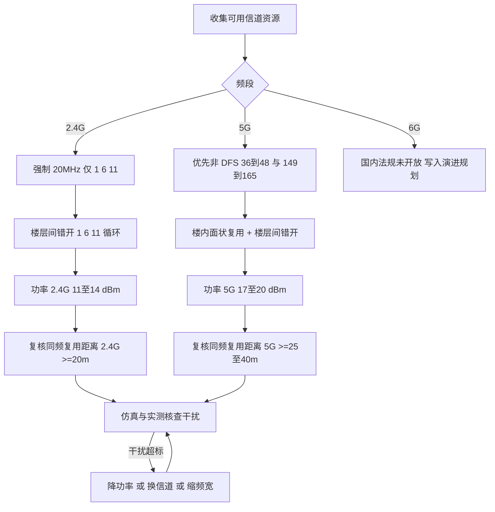

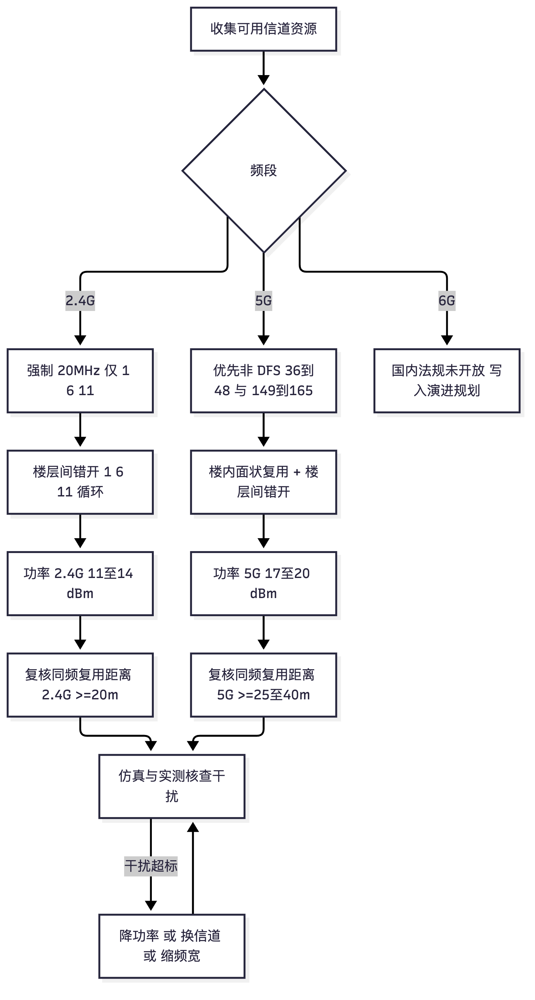


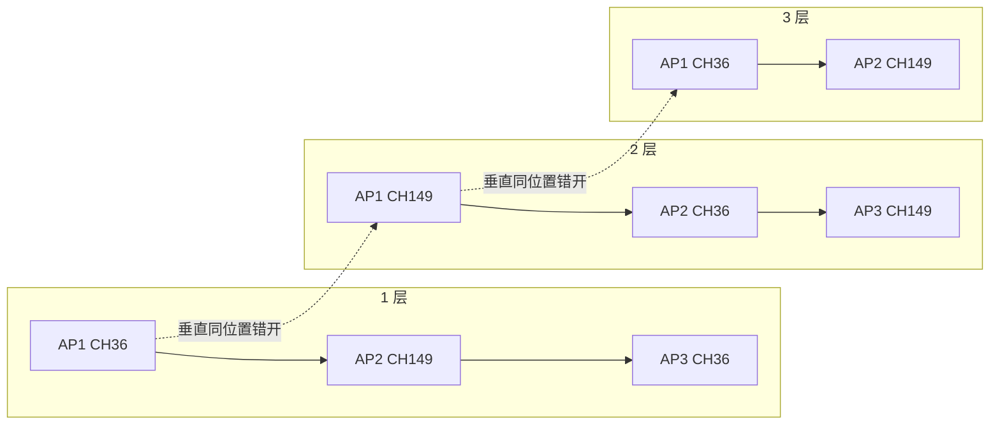

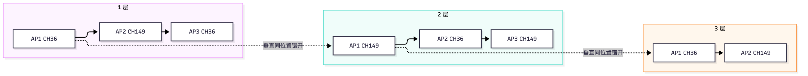


### 真题精练

**Q1.【真题·设计】** 某 6 层办公楼，每层为开放办公区，每层需 6 台 AirEngine 5761 吸顶 AP（等间距布置）。要求给出完整的信道与功率规划表（2.4G 与 5G），并说明依据。

> **答案**：
> **规划依据**：① 2.4G 全国只有 3 个非重叠信道，必须 1/6/11 + 20MHz + 低功率；② 5G 优先使用非 DFS 信道，80MHz 时可用非 DFS 组合为 36（36-44-48）与 149（149-157-161），DFS 段 52（52-60-64）作为第三色；③ 同频复用因子 ≥3（楼内相邻 AP 不同信道，隔 2 台复用）；④ 楼层间同位置错开（利用楼板 15~25 dB 衰减）。
>
> **2.4 GHz 规划表（每层 6 台）**：
>
> | 楼层 | AP1 | AP2 | AP3 | AP4 | AP5 | AP6 | 功率 |
> |---|---|---|---|---|---|---|---|
> | 1 层 | 1 | 6 | 11 | 1 | 6 | 11 | 12 dBm |
> | 2 层 | 6 | 11 | 1 | 6 | 11 | 1 | 12 dBm |
> | 3 层 | 11 | 1 | 6 | 11 | 1 | 6 | 12 dBm |
> | 4 层 | 1 | 6 | 11 | 1 | 6 | 11 | 12 dBm |
> | 5 层 | 6 | 11 | 1 | 6 | 11 | 1 | 12 dBm |
> | 6 层 | 11 | 1 | 6 | 11 | 1 | 6 | 12 dBm |
>
> **5 GHz 规划表（每层 6 台，80MHz，非 DFS 优先）**：
>
> | 楼层 | AP1 | AP2 | AP3 | AP4 | AP5 | AP6 | 功率 |
> |---|---|---|---|---|---|---|---|
> | 1 层 | 36 | 149 | 52 | 36 | 149 | 52 | 20 dBm |
> | 2 层 | 149 | 36 | 149 | 52 | 36 | 149 | 20 dBm |
> | 3 层 | 52 | 149 | 36 | 149 | 52 | 36 | 20 dBm |
> | 4 层 | 36 | 149 | 52 | 36 | 149 | 52 | 20 dBm |
> | 5 层 | 149 | 36 | 149 | 52 | 36 | 149 | 20 dBm |
> | 6 层 | 52 | 149 | 36 | 149 | 52 | 36 | 20 dBm |
>
> **关键说明（评分点）**：
> - **AP 间距**：若每层 1200 m²、6 台 AP，理论间距约 `sqrt(1200/6) ≈ 14 m`，**恰好满足 5G 最小间距 12~15 m 的下限**。若间距小于 12 m 则说明 AP 过密，应改为降低功率或减少 AP。
> - **同频复用距离校验**：AP 间距 14 m、每 3 台复用一次 → 同信道 AP 间距约 **42 m**，满足 5G 室内 25~40 m 的要求（略高于上限，说明规划偏保守，可接受）。
> - **52 信道（DFS）的使用风险**：遇雷达检测会静默 60 s 后切换，可能造成短暂断流。若业务对连续性要求高（语音、金融交易），建议 5G 只用 36 与 149 两色，把 AP 间距缩到 12 m 或把每色复用距离放宽到 28 m（此时同信道间隔为 2 台 AP ≈ 28 m，仍在阈值内）。
> - **楼梯间/电梯厅**：单独布点，信道从相邻两层中取不同值，避免成为"干扰汇聚点"。
> - **落地方式**：为每种组合建一个 radio-profile（如 `F2_1/F2_6/F2_11`、`F5_36/F5_149/F5_52`），再用多个 AP 组（AG_1F~AG_6F）分别绑定，避免逐台配置。

**Q2.【真题·单选】** 关于 2.4 GHz 频段的信道规划，下列说法正确的是？
A. 1、5、9、13 是四个互不重叠的信道，可以使用
B. 1、6、11 是三个互不重叠的 20MHz 信道，高密场景应固定使用并禁开 40MHz
C. 2.4G 干扰比 5G 小，应把主要业务放在 2.4G 上
D. 2.4G 有 13 个信道，可以像 5G 一样做多色复用

> **答案：B**
> **解析**：2.4G 信道带宽 20MHz 而信道间隔仅 5MHz，只有 1/6/11（及 12/13 的部分组合）互不重叠，A 的 1/5/9/13 会严重邻频重叠。C 完全说反——2.4G 是"干扰最重、资源最少"的频段（微波炉、蓝牙、无绳电话都在 2.4G），因此高密场景必须把主力业务放在 5G，2.4G 只做兼容兜底。D 混淆了"信道数量"与"非重叠信道数量"：13 个信道中只有 3 个可同时使用。

**Q3.【真题·多选】** 高密场景中，下列哪些做法符合"降低同频干扰、提高频谱复用度"的原则？
A. 降低 AP 发射功率，加密布点，形成"小覆盖区"
B. 把 5G 频宽从 160MHz 改为 40/80MHz，提高非重叠信道数量
C. 2.4G 固定 1/6/11 并关闭 40MHz
D. 同频 AP 之间保持足够的复用距离（室内 5G ≥25~40 m）
E. 把所有 AP 的功率开到最大，让终端尽量关联到信号最强的 AP

> **答案：ABCD**
> **解析**：E 与高密原则完全相反——大功率会导致覆盖区重叠严重、同频干扰范围扩大、终端"粘"在远端 AP（信号虚高但速率极低），是高密劣化的典型原因。A 是"小覆盖区"原则（高密最重要的一条）；B 用窄频宽换取更多非重叠信道，是高密常用手段；C 是 2.4G 的基本纪律；D 是复用距离的量化要求。

**Q4.【真题·判断】** 在高密场景中应始终开启 AC 的自动信道选择（ACS/RRM），让设备自动寻找最优信道。

> **答案：错误**
> **解析**：自动信道选择在**干扰稳定、AP 稀疏**的场景有效；但在**高密场景**存在三个问题：① **震荡**——AP 之间会互相"追着换信道"，A 换信道导致 B 的干扰变化，B 再换，形成持续的信道漂移；② **漫游与语音不友好**——信道变化会触发终端重关联或短暂断流；③ **破坏规划意图**——人工设计的复用图案（如 36/149/52 三色循环）会被自动选择打乱。**正确做法：高密场景固定信道与功率（规划表落地为 radio-profile），稀疏场景可启用自动。** 若要兼顾，可采用"**定时/手动触发的一次性自动优化 + 结果固化**"策略。

**Q5.【真题·填空】** 中国 2.4 GHz 频段只有 ________、________、________ 三个 20 MHz 互不重叠信道；5 GHz 的 52~64 信道属于雷达频段，使用前必须支持 ________ 功能，检测到雷达信号后需静默约 ________ 秒再切换信道。

> **答案：1；6；11；DFS（动态频率选择）；60**
> **解析**：DFS 是 5G 中段（5.47~5.725 GHz）的强制要求（ETSI/FCC 体系，中国同样执行雷达避让），核心机制是"**信道可用性检查（CAC）→ 工作期雷达检测 → 检测到即静默/切换**"。60 s 静默期会造成业务中断，因此**语音、金融、工业控制等连续性敏感业务应避免使用 DFS 信道**。这也是"优先使用 36~48 与 149~165 非 DFS 信道"的工程原因。**具体 CAC 时长与静默时长以设备与法规文档为准。**

**Q6.【真题·简答】** 请解释"信道复用距离"的含义，并说明如何从同频干扰容限反算复用距离。

> **答案**：
> **① 含义**：信道复用距离（Co-channel Reuse Distance）指**使用同一信道的两台 AP 之间的最小可接受物理距离**。小于该距离时，两台 AP 的服务区重叠部分会出现同频干扰，导致终端 SNR 下降、MCS 降级、吞吐崩塌（严重时会出现"隐藏节点"与大量重传）。
> **② 反算方法**：
> - **确定干扰容限**：工程上要求同频干扰信号比服务 AP 信号**低 15~20 dB**（或绝对电平 ≤ -80 dBm）。取 ΔPL = 15 dB。
> - **用路径损耗模型换算距离比**：`ΔPL = 10n·lg(d_reuse / d_serv)` → `d_reuse = d_serv × 10^(ΔPL/(10n))`。
> - **代入典型值**：室内 n = 3.5、ΔPL = 15 dB → `10^(15/35) = 10^0.4286 ≈ 2.68`。即**复用距离 ≈ 服务距离的 2.7 倍**。
> - **落到 AP 间距**：若 AP 间距（服务距离）为 15 m，则同信道 AP 间距应 ≥ **40 m**，即**每隔约 3 台 AP 复用一次同信道**（复用因子 ≥ 3）。若 AP 间距为 20 m，则复用距离 ≥ 54 m（约每 3 台复用一次）。
> - **若容忍度放宽到 10 dB**：`10^(10/35) ≈ 1.93`，即复用距离约 1.9 倍；这正是"工程上常说 1.5~2 倍"的来源。
> **③ 工程补充**：还可以用**天然隔离**降低复用距离要求——楼板（15~25 dB）、承重墙（20~30 dB）可以当作"免费的隔离体"，因此**楼层间可以用相同信道**（尤其 2.4G 的 1/6/11 循环），而**同层同信道必须拉开距离**。这就是"三维复用"的思想。

**Q7.【真题·排错】** 某办公楼规划为 5G 三色复用（36/149/52），但上线一周后员工反映"每天中午视频会议必卡"，`display ap performance all radio` 显示某几台 AP 的信道在 36 与 52 之间来回变化。请分析原因与处置。

> **答案**：
> ① **现象判断**：信道"来回变化"说明**有设备在做自动信道调整**，而规划方案是固定信道，二者矛盾。
> ② **可能原因一：自动信道选择未被关闭**。部分版本中，若未在 radio-profile 中显式固定信道，或 AP 组绑定了带自动选信道的模板，AP 会周期性调优。排查：`display radio-5g-profile name <名>` 看信道是否为固定值（而非 auto）；`display current-configuration | include channel` 核对。处置：显式固定信道并确认下发到 AP（`display ap config ap-id <id>`）。
> ③ **可能原因二：DFS 雷达避让**。52 信道属 DFS 段，若附近有气象雷达/船用雷达/其他雷达信号（或误检），AP 会静默 60 s 后**切到备用信道**，之后又尝试切回 52，表现为"来回变化"。排查：查看 AC 日志中是否有 DFS/radar detected 记录；观察信道变化是否与"中午"时段相关（可能与楼顶设备、周边作业相关）。处置：**把该区域的 5G 信道改为非 DFS 的 36 与 149 两色**，把 AP 间距或复用距离重新核算（如缩到 12 m 或每 2 台复用），避免依赖 DFS 信道。
> ④ **可能原因三：邻区/外部 AP 的干扰导致自动调优介入**。若开了 RRM/自动优化，检测到干扰会调整。处置：高密场景关闭自动调优，固定信道。
> ⑤ **中午卡顿的额外因素**：视频会议是**双向流量 + 低时延要求**，中午是会议高峰。需同时核查：单 AP 并发是否超限（`display ap performance all`）、上行是否打满（`display interface`）、是否单用户限速过紧、是否 AP 上行只有千兆。**信道漂移造成重关联 + 高峰叠加，才会出现"必卡"的规律性现象。**
> ⑥ **处置与回归**：固定 5G 为 36/149 双色（或加 165 做第三色，20/40MHz 时可用信道更多）；固定功率；关闭高密场景的自动调优；复测一周，确认无信道变化且会议质量达标。

**Q8.【真题·实验】** 在 AC6805 上建立三套 2.4G 射频模板（信道 1/6/11）与三套 5G 射频模板（信道 36/149/52），并说明如何把 6 层楼的 AP 组按"楼层错开"的策略绑定这些模板。

> **答案**：
> ```bash
> system-view
> wlan
>  radio-2g-profile name F2_1                               // 1 号 2.4G 模板
>   channel 20mhz 1                                          // 固定信道 1，带宽 20MHz
>   eirp 12                                                  // 低功率，减少跨层与邻区干扰
>  radio-2g-profile name F2_6                               // 6 号信道模板
>   channel 20mhz 6
>   eirp 12
>  radio-2g-profile name F2_11                              // 11 号信道模板
>   channel 20mhz 11
>   eirp 12
>  radio-5g-profile name F5_36                              // 5G 非 DFS 低段
>   channel 80mhz 36
>   eirp 20
>  radio-5g-profile name F5_149                             // 5G 非 DFS 高段
>   channel 80mhz 149
>   eirp 20
>  radio-5g-profile name F5_52                              // 5G DFS 段（连续性敏感业务慎用）
>   channel 80mhz 52
>   eirp 20
> ```
> ```bash
> # ===== 按楼层建立 AP 组并绑定不同模板组合（楼层错开策略）=====
>  ap-group name AG_F1                                       // 1 层：2.4G 用 1 号模板，5G 用 F5_36
>   radio-2g-profile name F2_1
>   radio-5g-profile name F5_36
>  ap-group name AG_F2                                       // 2 层：2.4G 用 6，5G 用 F5_149
>   radio-2g-profile name F2_6
>   radio-5g-profile name F5_149
>  ap-group name AG_F3                                       // 3 层：2.4G 用 11，5G 用 F5_52
>   radio-2g-profile name F2_11
>   radio-5g-profile name F5_52
> ```
> ```bash
> display ap all                                              // 核对每台 AP 的 AP 组（Group 列）是否与楼层对应
> display ap performance all radio                            // 核对实际信道/带宽/功率是否与规划表一致
> display ap config ap-id 1                                   // 复查某台 AP 生效配置（注意个性化配置会覆盖组模板）
> display current-configuration | include "radio-2g-profile|radio-5g-profile"
>                                                             // 快速核对组与模板绑定关系
> ```
> **绑定策略说明**：4~6 层重复 1~3 层的组合（**垂直错开**），例如 4 层 = 1 层组合、5 层 = 2 层、6 层 = 3 层。这样同一垂直位置相邻楼层的信道不同，配合楼板 15~25 dB 的天然衰减，可大幅降低跨层同频干扰。**若层高较小或楼板为轻质材料（衰减 <10 dB），则必须进一步降低功率（如 2.4G 降到 8~10 dBm）**。所有参数以现场实测的噪声底与信道利用率为准迭代，**以所用版本文档为准**。

### 易错点与排错

1. **2.4G 用非 1/6/11 信道**：1/5/9/13 之类的"4 色复用"是典型错误，会造成邻频重叠。
2. **忘关 2.4G 的 40MHz**：20MHz 信道间隔 5MHz 的前提下，40MHz 必然自干扰。
3. **高密场景开自动信道**：信道漂移破坏规划图案，还影响漫游与语音。
4. **忽略 DFS 的静默期**：52~64 信道遇雷达会静默 60 s，连续性业务应避开。
5. **假设 6GHz 国内可用**：国内法规**尚未开放 6 GHz 给 WLAN**，方案中必须写"待法规放开"，以最新官方公告为准。
6. **功率全开**：高密场景的正确方向是"**降功率 + 加密布点**"。
7. **排错命令**：`display ap performance all radio`（实际信道/带宽/噪声底/利用率）、`display radio-5g-profile name <名>`（模板参数）、`display ap config ap-id <id>`（生效配置）、`display current-configuration | include "channel|eirp"`（批量核对）。

---

## 3.8 方案设计输出物与验收测试

### 考点定位

本考点是**设计题的最后一问**与**实验题的高频出处**，占 **5~8 分**。它考的是"能不能把设计变成可施工、可验收的交付物"。高频陷阱：① 只给"点位图 + 设备清单"，漏掉**VLAN/IP 规划、配置模板、验收指标**；② 验收指标写成定性的"覆盖良好、体验流畅"（不可判定，必扣分）；③ 验收测试只答"测信号强度"，漏掉吞吐、漫游、并发、安全五类；④ 不会写验收的**合格标准与测试方法**（用什么工具、多少点位、什么条件）。

### 原理精讲

**① 方案设计的六类输出物（必须齐全）。**
1. **点位图（AP Layout）**：按楼层标注 AP 编号、型号、安装方式、高度、方位角/下倾角；标注金属结构、强电、干扰源位置与避让关系。它同时是施工图与验收基准——**验收时必须核对实际点位与图纸是否一致**。
2. **设备与材料清单（BOM）**：AP 型号与数量、天线型号与数量、馈线/跳线、PoE 交换机（含端口数与 PoE 预算）、AC 型号与 License 数量、光模块与光纤、机柜与配线架、网线长度估算。**必须含冗余与备件**（通常备件 3%~5%）。
3. **信道与功率规划表**：按楼层/AP 列出频段、信道、带宽、EIRP、天线类型与朝向（即 3.7 小节那张表）。
4. **VLAN 与 IP 规划**：无线业务 VLAN 划分（员工/访客/IoT/管理各一个）、各 VLAN 的网段与掩码、网关位置、DHCP 地址池规模（按在线终端数 × 倍率 × 1.2）、AP 管理网段、CAPWAP 源接口、AC 的 IP 与冗余方式。**原则：业务 VLAN 按"安全等级 + 业务类型"划分，而不是按楼层划分**（按楼层会导致跨层漫游时换 VLAN、触发 IP 变更与业务中断）。
5. **配置模板与配置清单**：AC 侧的基础配置（`capwap source interface`、`regulatory-domain-profile`、AP 组、射频模板、VAP 模板、安全模板、ACL/QoS）、认证服务器对接配置、交换机侧（VLAN、PoE、链路聚合、STP 边缘端口）、DHCP 与 DNS 配置。**要求可复制、带注释、有变量占位**。
6. **验收指标与测试方案**：见下条。

**② 验收测试的五大类方法与合格标准。**

- **覆盖率测试（Coverage Test）**：按楼层平面**网格化抽样**（网格 5~10 m，或每间房 5 点：四角 + 中心），用测量工具（AC 侧 `display station ... verbose`、专业勘测软件、终端 App）记录 RSSI/SNR/噪声底。**合格标准**：关键区域（办公位、会议室、教室座位区）**100% 达标**（RSSI ≥ -65 dBm、SNR ≥ 25 dB）；一般区域（走廊、休息区）**≥95% 达标**（RSSI ≥ -70 dBm）；无覆盖盲区（无 RSSI < -75 dBm 的连续区域 >4 m²）。
- **吞吐测试（Throughput Test）**：用 **iperf3 / 打流工具**做**单用户 TCP 上下行**与 **UDP 灌包**（测丢包与抖动）。测试点选"AP 正下方 1 m 内"（近点）与"覆盖边缘"（远点）。**合格标准**：近点单用户下行 ≥ 设备标称 × 50%（如 5761 5G 应 ≥ 400~600 Mbps）；边缘点下行 ≥ 目标边缘速率（如 ≥ 30 Mbps）；UDP 灌包丢包 ≤ 1%；时延 ≤ 50 ms（数据）、≤ 30 ms（语音）。
- **漫游测试（Roaming Test）**：在相邻 AP 覆盖重叠区**匀速走动**（如 1 m/s），持续 ping 网关或用语音通话，记录**切换次数、切换时延、丢包数**。**合格标准**：数据业务切换时延 ≤ 100 ms、丢包 ≤ 3 个；语音业务 ≤ 50 ms、无感知（MOS ≥ 3.5）。测试必须**跨 AP 与跨 AC 都测**（若有多台 AC）。
- **并发测试（Concurrency Test）**：按设计并发数的 **100%~120%** 加压（用多终端或专业压力测试工具模拟），验证 AP 在线用户数、信道利用率、时延、丢包、关联成功率。**合格标准**：单 AP 在线数不超过设计值；信道利用率 < 60%；时延与丢包相对空载劣化 ≤ 20%~30%；**关联/认证成功率 ≥ 99%**（这是"能不能用"的底线）。
- **安全与功能测试**：验证 WPA2/WPA3 接入、访客隔离（访客不能访问内网）、ACL 生效、Portal 跳转、认证失败处理、RADIUS 双机切换、AC 主备切换（切换时业务中断时间 ≤ 秒级）。**合格标准**：按安全策略逐项验证，未授权终端无法接入、访客无法互访与访问内网。

**③ 为什么"验收指标必须可量化"？** 因为验收是**合同与责任的判定依据**。定性的"体验流畅"无法判定合格与否，会导致争议。规范做法是每个指标都给：**指标名 + 数值门限 + 测试方法 + 测试点位/条件 + 判定规则**。例如"覆盖率：办公区 100% 点位 RSSI ≥ -65 dBm 且 SNR ≥ 25 dB；测试方法：网格化抽样每 5 m 一点；条件：工作日 10:00~11:00（忙时）；判定：任一点不达标即不合格并需优化后复测"。

### 关键概念对照表

| 验收类别 | 测试方法/工具 | 合格标准（示例，可按项目调整） | 常见失败原因 |
|---|---|---|---|
| 覆盖率 | 网格化抽样 + 终端软件/AC 命令 | 关键区 100% 达 RSSI ≥ -65 dBm、SNR ≥ 25 dB；一般区 ≥95% 达 -70 dBm | AP 点位偏移、穿墙算少、功率过低 |
| 吞吐（近点） | iperf3 TCP 上下行 | 下行 ≥ 标称 × 50%，上行 ≥ 标称 × 30% | 上行端口瓶颈、限速过紧、终端能力 |
| 吞吐（边缘） | iperf3 + 指定远点 | 下行 ≥ 目标边缘速率（如 30 Mbps） | 干扰、功率不足、穿墙超预期 |
| 时延/丢包 | UDP 灌包 + ping | 时延 ≤ 50 ms（数据）/30 ms（语音）；丢包 ≤ 1%（数据）/0.5%（语音） | 空口拥塞、同频干扰、上行打满 |
| 漫游 | 走动 + 持续 ping / 语音 | 数据 ≤ 100 ms、丢包 ≤ 3；语音 ≤ 50 ms、无感知 | SSID 不同、AC 间漫游未配、功率过大粘滞 |
| 并发 | 100%~120% 设计并发加压 | 单 AP 不超设计值；信道利用率 < 60%；成功率 ≥ 99% | 容量算少、未限速、DHCP 池不足 |
| 安全 | 逐项功能验证 | 未授权禁入、访客隔离、ACL 生效、认证备份可用 | 模板未绑定、ACL 顺序错、RADIUS 单点 |
| 可靠性 | 主备切换、断链测试 | AC 主备切换业务中断 ≤ 秒级；单上行断不影响业务 | 无冗余、无 RRM/无备份 AC |

| 设计输出物 | 必含内容 | 缺失后果 |
|---|---|---|
| 点位图 | AP 编号/型号/安装方式/高度/方位角 + 避让标注 | 施工随意，实测与设计不符 |
| BOM | AP/天线/交换机/AC/License/光模块/线缆 + 备件 | 采购遗漏、工期延误 |
| 信道功率表 | 频段/信道/带宽/EIRP/天线 | 同频干扰，容量崩塌 |
| VLAN/IP 规划 | 业务 VLAN 划分、网段、DHCP 池、管理网段 | 漫游换网段、地址耗尽、安全域不清 |
| 配置模板 | AC/交换机/认证服务器可复制配置 + 注释 | 实施依赖个人经验，易错 |
| 验收指标表 | 指标 + 门限 + 方法 + 条件 + 判定 | 无法验收，争议不断 |

### 华为设备配置

```bash
# ===== 方案落地：AC6805 侧的"配置模板"骨架（带注释，可直接作为交付物）=====
system-view
 sysname AC6805-01                                         // 命名规范：站点-角色-编号
 vlan batch 10 20 30 100                                   // 10=员工 20=访客 30=IoT 100=AP 管理
 interface Vlanif100                                       // AP 管理网关
  ip address 10.10.100.1 255.255.255.0                     // AP 管理网段：建议与业务网段隔离
 interface Vlanif10                                        // 员工业务网关
  ip address 10.10.10.1 255.255.254.0                      // /23 提供 510 地址，按在线终端数×倍率规划
 capwap source interface Vlanif100                         // 指定 CAPWAP 源接口：AP 据此与 AC 建隧道
 wlan
  regulatory-domain-profile name CN                        // 国家码（决定功率上限，必配）
   country-code cn
  security-profile name SP_EMP                             // 员工安全模板（企业级认证，详见第 4 章）
   security wpa2 dot1x aes                                 // WPA2-Enterprise + AES（或 wpa3 dot1x，视版本与终端）
  ssid-profile name SSID_EMP                               // SSID 模板
   ssid CORP-WLAN                                          // 员工 SSID
  vap-profile name VAP_EMP                                  // VAP 模板
   service-vlan vlan-id 10                                  // 绑定员工业务 VLAN
   ssid-profile SSID_EMP                                    // 绑定 SSID
   security-profile SP_EMP                                   // 绑定安全模板
   forward-mode tunnel                                      // 隧道转发（集中转发）或 local（本地转发）
  ap-group name AG_F1                                       // 1 层 AP 组
   radio-2g-profile name F2_1                               // 绑定 2.4G 信道模板
   radio-5g-profile name F5_36                              // 绑定 5G 信道模板
   vap-profile name VAP_EMP wlan 1 radio all                // 绑定员工 VAP 到所有射频
```

```bash
# ===== 验收阶段的核对与测试命令 =====
display ap all                                              // 核对 AP 型号/数量/状态与点位图一致
display station all | count                                 // 在线终端总数，核对是否与规划一致
display station mac-address <测试终端MAC> verbose            // 抽样点位记录 RSSI/SNR/协商速率/重传
display ap performance all                                  // 每 AP 在线数/带宽，核对容量是否被突破
display ap performance all radio                            // 信道利用率/噪声底，核对干扰是否达标
display wlan sta-statistics                                 // 上线成功率与失败原因统计，核对 ≥99%
display current-configuration | include "capwap|service-vlan|channel"
                                                             // 核对关键配置与设计文档一致
```

### 示意图

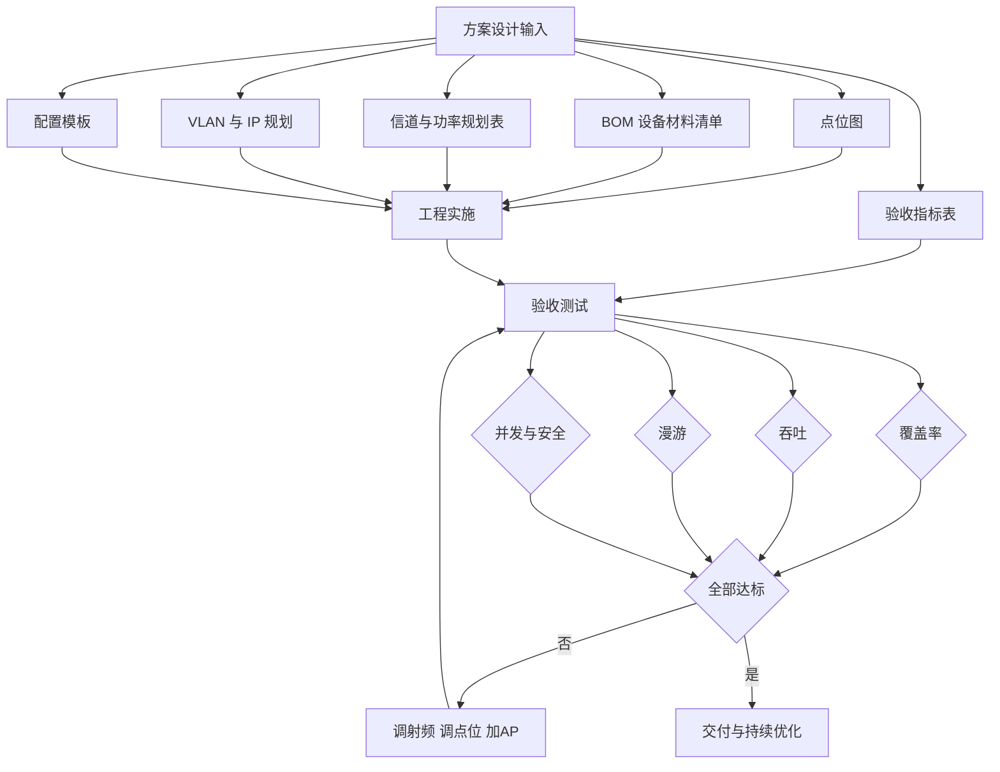

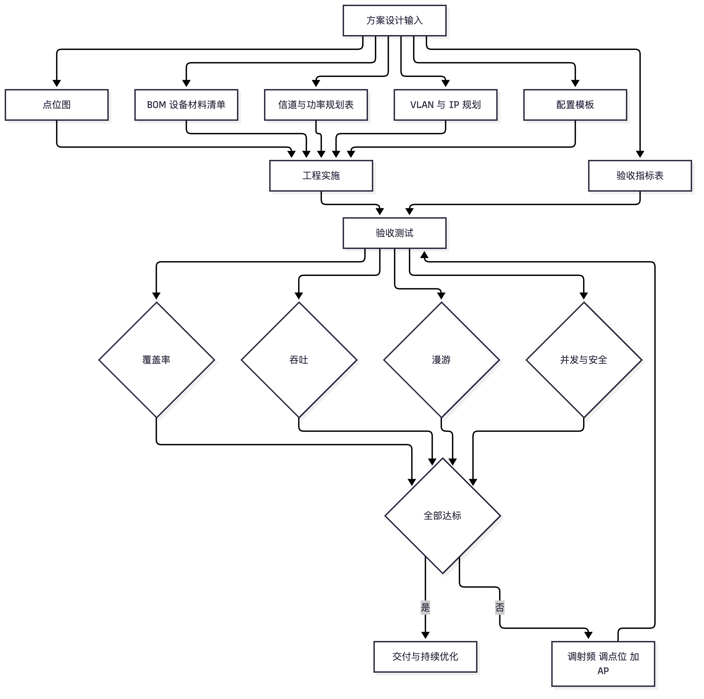


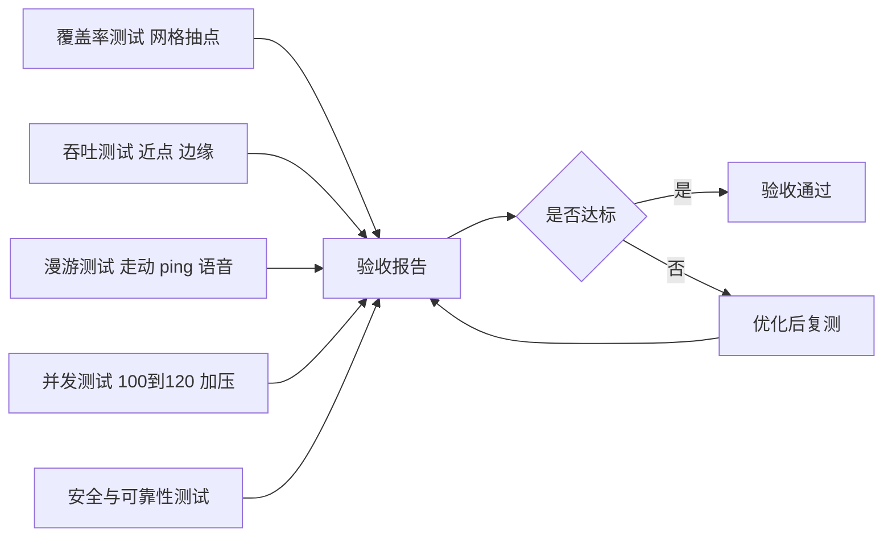

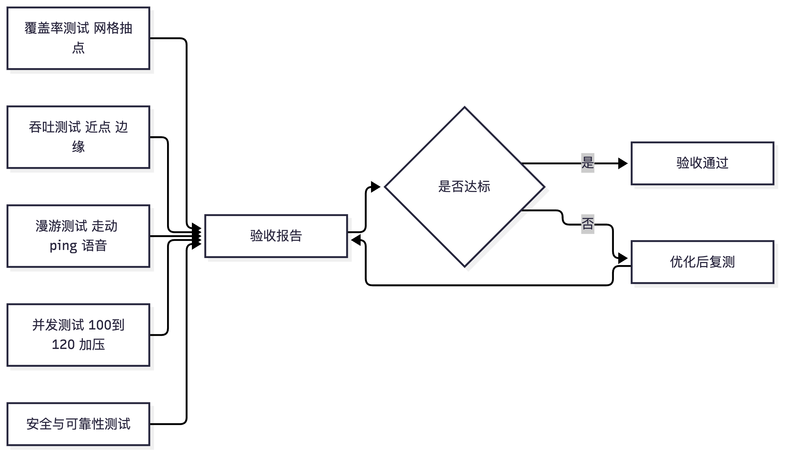


### 真题精练

**Q1.【真题·设计】** 请列出一份完整 WLAN 方案设计的输出物清单（不少于 6 类），并说明每类输出物在"验收阶段"的作用。

> **答案**：
> **① 点位图**：验收时逐点核对 AP 实际安装位置/高度/朝向是否与图纸一致——**点位偏移是实测不达标的第一大原因**，点位图是唯一基准。
> **② 设备与材料清单（BOM）**：验收时核对实装型号与数量（避免"以低配替高配"），核对 PoE 交换机型号与端口供电能力，核对备件到位情况；同时是资产登记依据。
> **③ 信道与功率规划表**：验收时用 `display ap performance all radio` 与实际配置逐项比对，确认无自动信道漂移、无功率超限、无信道冲突。
> **④ VLAN 与 IP 规划**：验收时核对业务 VLAN、地址池使用率、AP 管理网段隔离、DHCP 是否有冲突；验证漫游时**不换 VLAN**（保证业务不中断）。
> **⑤ 配置模板/配置清单**：验收时用 `display current-configuration` 与模板逐项核对；也是后续扩容与故障恢复的基线（**配置备份**）。
> **⑥ 验收指标与测试方案**：这是验收的**判定依据**，含每项指标的数值门限、测试方法、测试点位与条件、判定规则；没有它就无法判定"是否合格"。
> **⑦（补充）运维手册与拓扑图**：含 AC/交换机拓扑、管理地址、账号权限、日常巡检项、故障处理流程；验收时用于确认运维移交完成。
> **⑧（补充）培训与移交记录**：业主方运维人员的培训与确认签字，是项目闭环的证明。

**Q2.【真题·多选】** 关于 WLAN 吞吐验收测试，下列说法正确的有？
A. 应分别在"AP 正下方近点"与"覆盖边缘远点"测试，两者标准不同
B. 单用户 TCP 吞吐能反映空口有效效率，通常应达到设备标称速率的 50% 以上（近点、终端能力匹配时）
C. UDP 灌包用于测丢包与时延抖动，比 TCP 更能暴露空口问题
D. 只需测下行，上行由设备自动对称，无需单独测试
E. 测试时应记录终端型号与天线数，否则结果无法归因

> **答案：ABCE**
> **解析**：D 错误——上下行是两个独立方向，上行受**终端发射功率（手机通常比 AP 低 10~15 dB）**、AP 接收灵敏度与上行端口带宽约束，往往比下行更差；视频会议、答题回传、监控回传都是上行敏感业务，**必须单独测上行**。A/B/C/E 都是吞吐验收的规范做法：近点看设备能力上限、边缘看覆盖设计是否达标、UDP 看丢包抖动、记录终端型号避免"用 4×4 笔记本测出好结果，用 1×1 手机却极差"的归因错误。

**Q3.【真题·判断】** 验收覆盖率测试应在夜间无人时进行，以获得最"干净"的数据。

> **答案：错误**
> **解析**：这是典型的"**空场验收陷阱**"。RSSI 本身在无人时确实更高（人体损耗 5~8 dB），但真实使用场景是"有人"的：人体遮挡、走动造成多径、门开关状态变化都会改变覆盖与速率。规范做法是**在忙时（如工作日 10:00~11:00）与设计人数状态下验收**，或在"空场 + 加载人体损耗余量"的条件下测试并记录条件。**验收结论必须与实际使用场景一致**，否则会出现"验收合格、用起来不行"的争议。

**Q4.【真题·填空】** 漫游验收的合格标准通常为：数据业务切换时延 ≤ ________ ms、丢包 ≤ ________ 个；语音业务切换时延 ≤ ________ ms。测试方法是在相邻 AP 的重叠覆盖区________并持续 ping 或通话。

> **答案：100；3；50；匀速走动（约 1 m/s）**
> **解析**：漫游是"体验型指标"，必须用**连续业务流**（ping/语音）来测，而不是"断开再连"。若采用 802.11r/k/v 快速漫游（Fast BSS Transition / 邻居报告 / BSS 转换管理），切换时延可压到 50 ms 以内。**跨 AC 漫游**还需配置 AC 间的漫游组（mobility group）与隧道，否则切换时延会显著增大甚至认证失败。

**Q5.【真题·简答】** 某项目验收中，覆盖率测试 98% 点位达标（要求 100%），吞吐、漫游、并发全部合格。业主坚持不通过验收。请说明应如何处置，并给出技术与管理两个层面的建议。

> **答案**：
> **① 技术处置（先易后难，按成本排序）**：
> - **先调射频（零成本）**：检查不达标点位的具体原因——是 RSSI 不足（-72 dBm 而要求 -65）还是 SNR 不足（干扰）。若为 SNR 不足，先做信道/功率优化（换信道、降功率、关闭多余 2.4G 覆盖）；若为 RSSI 不足，检查该点位 AP 是否被吊顶金属/风管遮挡（可调整安装位置或加支架）。
> - **再调点位（低成本）**：把 AP 位置微调（移出金属夹层、改变朝向、加装下倾支架），或把定向天线的方位角对准该区域。
> - **最后加点（高成本）**：仅当上述手段无效时才增加 AP，且必须同步更新信道规划表（新 AP 要分配不冲突的信道）与 BOM。
> - **优化后必须复测**，复测范围应包括**不达标点位的邻近区域**（确认优化没有把问题"推"到别处）。
> **② 管理层面**：
> - **明确判定基准**：回到验收指标表，确认"100% 达标"是**关键区域**还是**全部区域**的要求。行业惯例是**关键区域 100%、一般区域 ≥95%**；若合同写的是"全部区域 100%"，则需要界定"关键区域"的清单并双方确认，避免无边界要求。
> - **留痕与变更**：所有优化动作、测试数据、复测报告必须书面留痕；若因业主原因（如新增隔断、增加工位）导致不达标，应作为**需求变更**处理，而不是免费返工。
> - **技术澄清**：若个别点位属于"功能上不需要覆盖"的位置（如消防通道、机房内、卫生间深处），应在设计阶段就把它排除在验收范围外——**验收范围必须在方案设计阶段定义清楚**，这是本题最重要的管理启示。

**Q6.【真题·排错】** 某项目通过验收三个月后，业主反映"会议室无线投屏经常失败"。请给出排查思路，并说明该问题是否会因"验收合格"而被排除。

> **答案**：
> ① **验收合格不代表业务合格**：验收测的是覆盖率、吞吐、漫游、并发这些**通用指标**，而投屏依赖 **mDNS/SSDP 组播与广播**（设备发现）、**同一二层域**、**低时延与高上行**，这些在通用验收中往往不覆盖。所以"验收合格"不能排除该问题。
> ② **排查步骤**：
> - **确认二层连通性与隔离策略**：投屏设备与显示端是否在同一 VLAN？若开启了**用户隔离（AP 内隔离/AC 内隔离）**，会阻断设备发现；若访客网络与员工网络隔离，跨网段投屏需要 mDNS 网关（组播代理）。排查：`display current-configuration | include "user-isolate|traffic-profile"`，用两台终端互 ping 验证二层可达。
> - **确认组播/广播是否被抑制**：AC/AP 常启用**组播转单播、广播抑制、IGMP Snooping**；投屏的发现阶段依赖组播/广播，若被过度抑制则发现失败。排查：临时关闭组播优化对比效果；查 `display current-configuration | include "igmp|multicast"`。
> - **确认频段与速率**：投屏终端若被引导到 2.4G 或协商到低速率，会造成画面卡顿/失败。排查：`display station mac-address <MAC> verbose` 看频段、速率、SNR、重传。
> - **确认上行与信道利用率**：投屏是**上行大流量**（终端编码上传），若会议室 AP 上行 1GE 且同时有会议视频，容易打满。排查：`display ap performance all radio` 看利用率与上行速率。
> - **确认 AP 数量与功率**：会议室若只有 1 台 AP 且功率低，"降功率加密布点"策略可能在会议室形成弱区。排查：会议室点位实测 RSSI/SNR。
> ③ **处置**：调整隔离策略（为投屏流量放通或部署 mDNS 网关）；合理配置组播优化（保留必要的 mDNS/SSDP）；确保投屏终端优先关联 5G；必要时在会议室增加 AP 或改用有线投屏（HDMI/Type-C）作为兜底。
> ④ **验收改进建议**：把"**业务体验验收**"（投屏、视频会议、扫码、语音）写入验收方案，避免"通用指标合格、业务不可用"。

**Q7.【真题·实验】** 用 iperf3 与 AC 命令完成一次"单 AP 吞吐验收"，写出测试拓扑、命令与判定标准。

> **答案**：
> **① 测试拓扑**：`测试终端（笔记本/手机） -- 无线 -- AP（AirEngine 5761） -- 1GE/2.5GE -- 接入交换机 -- 有线 -- iperf3 服务器`。服务器与终端同网段或可达，路径中不得有 100M 链路（否则测的是有线瓶颈）。
> **② 服务器侧命令**：
> ```bash
> iperf3 -s                                    # 启动 iperf3 服务端（默认端口 5201）
> ```
> **③ 终端侧命令（下行测试：服务器发、终端收）**：
> ```bash
> iperf3 -c 10.10.10.100 -t 30 -i 5 -P 4       # -t 30 秒；-i 每 5 秒打印；-P 4 四条并行流（更接近真实多流场景）
> iperf3 -c 10.10.10.100 -t 30 -R              # -R 反向测试：测上行（终端发、服务器收）
> iperf3 -c 10.10.10.100 -u -b 300M -t 30      # UDP 模式：-b 指定带宽，用于测丢包与抖动（Jitter）
> ```
> **④ AC 侧同步核对**：
> ```bash
> display station mac-address <终端MAC> verbose   // 记录测试期间的协商速率/MCS/SNR/重传率
> display ap performance all                      // 记录该 AP 上下行实时速率，与 iperf3 结果互相印证
> display ap performance all radio                // 记录信道利用率：若已 >80%，说明空口是瓶颈而非设备能力
> display interface GigabitEthernet0/0/1          // 记录 AP 上行端口速率与丢包：排除有线侧瓶颈
> ```
> **⑤ 判定标准**：近点（AP 正下方 1~2 m、无遮挡）单用户下行 ≥ 设备标称 × 50%（5761 5G 应 ≥ 500 Mbps 量级）；上行 ≥ 标称 × 30%；UDP 灌包丢包 ≤ 1%、抖动 ≤ 10 ms；信道利用率 < 80%（若接近饱和说明瓶颈在空口，需按容量规划补点）。
> **⑥ 注意事项**：必须记录**终端型号与天线数**（1×1 手机无法验证 2×2 AP 的能力上限，应同时用 2×2 笔记本测试）；多次测试取稳定段平均值；**测试期间避免其他终端大量下载**。**以所用版本文档为准**。

**Q8.【真题·简答】** 请说明"AC 主备切换验收"的方法与合格标准，并指出这一项为什么必须列入验收。

> **答案**：
> **① 必要性**：WLAN 是"接入即业务"的网络，**AC 是单点故障风险最高的设备**（AP 全部依赖 CAPWAP 与 AC 的管理/转发）。若 AC 故障导致全楼无线中断 10 分钟以上，业务损失远超设备成本。因此 AC 的冗余（**VRRP 双机热备 / 双链路双活 / 云管理多租户冗余**）必须实测验证，而不是"配了就算"。
> **② 验收方法**：
> - 在**业务运行状态**下（有在线终端、有业务流量）对主 AC 执行断电/重启/切换操作；
> - 同步用终端持续 ping 网关并跑 iperf3 打流，记录**中断时间、丢包数、是否需要重新认证**；
> - 观察备用 AC 的 AP 上线情况（`display ap all` 的数量与状态）与终端是否需要重新关联；
> - 检查**授权与 License**：备用设备必须具备足够的 AP License，否则切换后部分 AP 无法上线（**最容易被忽略的验收项**）。
> **③ 合格标准（示例）**：
> - 切换中断时间 **≤ 10 s**（业务级）；对语音要求更严的可用 HSB（Hot Standby）双机热备做到 **≤ 1 s** 甚至业务不中断；
> - 终端**无需重新输入密码**即可恢复（认证信息同步）；
> - 切换后 AP 上线数量与切换前一致（验证 License 充足）；
> - 切换后信道/功率配置与规划表一致（验证配置同步）；
> - 主 AC 恢复后**不发生"来回抢占"**（双主冲突），二次切换同样达标。
> **④ 常见问题**：备用 AC License 不足、HSB 通道配置错误（心跳不通导致双主）、AP 上线优先级未配、VLAN/路由未同步导致切换后不通。**以所用版本文档为准。**

### 易错点与排错

1. **验收指标写定性描述**："覆盖良好""体验流畅"不可判定，必须指标 + 门限 + 方法 + 条件 + 判定规则。
2. **只测下行不测上行**：上行受终端发射功率限制，往往更差；会议/投屏/回传场景必测上行。
3. **空场验收**：人体损耗 5~8 dB，空场数据会掩盖真实问题；应在忙时或加载余量条件下测。
4. **不核对点位**：实测不达标先查"AP 是否装在设计位置"，多数问题出在这里。
5. **漏掉 AC 冗余与 License 验收**：切换后 AP 上不来，是 License 不足的典型表现。
6. **VLAN 按楼层划分**：跨层漫游会换网段（IP 变更、业务中断），应按"业务类型 + 安全等级"划分并在全楼统一。
7. **排错/验收命令**：`display ap all`、`display station mac-address <MAC> verbose`、`display ap performance all`、`display ap performance all radio`、`display wlan sta-statistics`、`display current-configuration | include "capwap|service-vlan|channel"`、`display interface brief`。

---

## 3.9 规划常见错误与反面案例

### 考点定位

本考点以**多选/排错/设计题的反面分析**形式出现，占 **3~5 分**。它实际上是前面 3.1~3.8 的"错题合集"，因此是**性价比最高的复习点**：把这里的错误都记住，等于把网规题的常见陷阱全部掌握。高频陷阱本身就是考点：AP 密度过高、忽略上行带宽、忽略 DHCP 与 AC 的性能瓶颈、忽略 2.4G 的干扰代价、只用标称速率算容量、验收只测空场。

### 原理精讲

**① AP 密度过高导致同频干扰（最常见错误）。** 错误逻辑是"人多就多装 AP，人少就少装"。但空口是共享介质：AP 过密会导致 ① **同频干扰**——相邻 AP 服务区大量重叠，终端在重叠区收到的干扰信号抬高噪声底（实测噪声底可从 -95 dBm 抬到 -80 dBm，SNR 从 30 dB 掉到 15 dB），可用 MCS 直接降 2~3 档，吞吐反而下降；② **管理帧风暴**——每台 AP 都在发 Beacon（默认 100 ms 一次）、响应探测请求，AP 数量翻倍则管理帧翻倍，而管理帧以**最低基本速率**发送，占用空口时间极长（1 Mbps 基本速率下一帧 Beacon 可占数百微秒）；③ **漫游频繁抖动**——覆盖区过小，终端在走动中频繁切换，甚至在不同 AP 之间"乒乓"；④ **信道规划无解**——非重叠信道数量是固定的（2.4G 只有 3 个），AP 数量超过复用能力时必然要复用，复用距离不够就是干扰。**正确做法**：先用容量算"可支持的 AP 数量区间"，再用**最小 AP 间距（室内 5G ≥12~15 m、2.4G ≥20~25 m）** 做上限校验，同时**降低功率**形成小覆盖区。**结论句："高密的正确姿势是降功率、限低速、窄频宽、巧用定向，而不是简单堆 AP。"**

**② 忽略上行带宽。** 错误逻辑是"用户主要是下载"。但：① **AP 上行端口是硬上限**（1GE 实际有效约 900 Mbps，与空口标称 1.775 Gbps 不匹配）；② 大量业务是上行敏感（视频会议、投屏、答题回传、监控回传、云盘同步、备份）；③ 高密场景**所有 AP 的上行汇聚**到接入/汇聚交换机，容易在汇聚侧拥塞；④ **CAPWAP 隧道转发**时流量要绕行 AC，AC 的转发能力与 AC 的上行链路也可能成为瓶颈。**正确做法**：容量规划时同时算下行与上行；高密 AP 选 2.5GE/10GE 上行；接入到汇聚用链路聚合（2×10GE）；核对 AC 的转发性能与上联带宽；对上行敏感业务做 QoS 与限速。

**③ 忽略 DHCP 与 AC 的性能瓶颈。** ① **DHCP**：大并发同时上线（早高峰、会议开始、考试开始）会造成 DHCP 请求风暴；单一地址池跨全楼会导致地址耗尽与续租洪峰；租期过长会造成地址滞留。**正确做法**：按楼层/AP 组**分池**、缩短租期（2~8 小时）、开启冲突检测、必要时用 DHCP 中继到高性能服务器、预留 20%~30% 余量。② **AC**：AC 的 CAPWAP 隧道数、AP 管理数、用户表项、转发吞吐、认证并发都有上限，且受 **License（AP 数量、接入用户数）**约束。**正确做法**：核对 AC 规格（最大 AP 数/最大用户数/转发性能）与项目规模，**License 数量 ≥ AP 数量 + 冗余**，高密场景采用**双 AC 或 AC 集群**分担，考虑**本地转发**减轻 AC 转发压力。

**④ 只用标称速率算容量（见 3.3 节）。** 典型错误：1.775 Gbps ÷ 2 Mbps = 887 人/AP。后果是 AP 数量严重不足、上线后全面拥塞。

**⑤ 忽略 2.4G 的干扰代价与 5G 终端渗透率。** ① 把 2.4G 容量并入总容量（2.4G 有微波炉、蓝牙、邻区干扰，实际可用容量很低）；② 假设所有终端都能上 5G（老旧 IoT、扫码枪、部分打印机只有 2.4G）。**正确做法**：把 2.4G 定位为"兼容兜底层"，容量规划以 5G 为主；同时为 2.4G 单独做信道与功率规划（1/6/11 + 低功率）；对只有 2.4G 的 IoT 设备单独建 SSID 或 VLAN。

**⑥ 验收只测空场、只测信号强度（见 3.8 节）。** 后果是"验收合格、投诉不断"。

**⑦ 其他高频错误清单：**
- **不在方案里写"环境假设"**（n 值、材质损耗、阴影余量），导致仿真结论无法复现、争议无法裁决。
- **点位设计不考虑施工可行性**：设计点位在无法打孔的吊顶上、在没有桥架的隔断内、在金属吊顶内部。
- **忽略 PoE 预算与线缆等级**（见 3.5 节）。
- **VLAN 按楼层划分**导致跨层漫游换网段。
- **安全与射频设计脱节**：开了用户隔离导致投屏/打印等二层业务不可用；访客与员工共用 VLAN 导致安全风险。
- **没有考虑既有 AP 与邻区干扰**（改造项目）。
- **不考虑未来演进**：不预留 6GHz 能力、不预留 PoE++/10GE 上行、不预留 License 扩容空间。

### 关键概念对照表

| 常见错误 | 错误逻辑 | 后果 | 正确做法 |
|---|---|---|---|
| AP 密度过高 | 人多就多装 AP | 同频干扰、管理帧开销、漫游乒乓、吞吐反降 | 容量定区间 + 最小间距 5G 12~15 m 校验 + 降功率小覆盖区 |
| 忽略上行带宽 | 用户主要下载 | 会议/投屏/回传卡顿，1GE 上行成为硬上限 | 同时算上下行；高密用 2.5GE/10GE 上行；汇聚 2×10GE |
| 忽略 DHCP 瓶颈 | 地址池够用就行 | 大并发上线失败、地址耗尽、续租洪峰 | 分池、短租期、冲突检测、20%~30% 余量 |
| 忽略 AC 瓶颈 | AC 只是个控制器 | AP/用户表项与转发能力受限、License 不足 | 核对规格与 License，双 AC/集群，必要时本地转发 |
| 用标称速率算容量 | 1.775 Gbps ÷ 2 Mbps | AP 数量严重不足 | 乘空口效率系数 0.3~0.65，并受上行端口约束 |
| 2.4G 并入总容量 | 双频合计 1.775 Gbps | 2.4G 实际不可用导致容量虚高 | 2.4G 定位兼容兜底，容量以 5G 为主 |
| 空场验收 | 无人时数据好看 | 用户一多就崩 | 忙时 + 设计并发 + 业务体验验收 |
| 不写环境假设 | 只给结论 | 结论不可复现、争议无解 | 写明 n 值、材质损耗、余量、终端条件 |
| 点位不可施工 | 只在图上好看 | 施工偏移，实测不达标 | 设计阶段核对桥架/供电/承重/吊顶材质 |
| VLAN 按楼层分 | 便于管理 | 跨层漫游换网段、业务中断 | 按业务类型与安全等级划分，全楼统一 |

| 错误类型 | 典型现象 | 定位命令/手段 |
|---|---|---|
| 同频干扰 | 信道利用率高、噪声底高、速率低但 RSSI 正常 | `display ap performance all radio`（噪声底/利用率）+ 频谱扫描 |
| 上行瓶颈 | 下行正常、上行极差、会议卡顿 | `display interface brief`、`display ap performance all` |
| DHCP 问题 | 终端拿不到地址或频繁掉线 | `display ip pool name <池名>`、抓包看 DHCP 交互 |
| AC/License 瓶颈 | 部分 AP 无法上线、用户数上不去 | `display ap all`、`display license`、`display ap-type` |
| 点位偏移 | 局部区域持续弱覆盖 | 现场照片 + 点位图核对 + `display station ... verbose` |
| 终端能力差异 | 部分终端速率极低 | `display station mac-address <MAC> verbose`（看协商速率/MCS） |

### 华为设备配置

```bash
# ===== 针对"AP 过密 / 干扰过大"的整改配置（AC6805, V200R019+）=====
system-view
wlan
 radio-5g-profile name HIDENSITY_5G
  channel 40mhz 36 44 149 157                              // 40MHz 换取更多非重叠信道（高密牺牲峰值换复用度）
  eirp 17                                                   // 降功率到 17 dBm：缩小覆盖区，压低同频干扰
  dot11a basic-rate 6 12 disable                            // 关闭 6/12 Mbps 基本速率：减少管理帧空口占用时间
  dot11a supported-rate 24 36 48 54                         // 限定速率集合，杜绝低速终端长期占用空口
  beacon-interval ...                                       // 部分版本可调 Beacon 间隔（默认 100ms），需谨慎，以所用版本为准
```

```bash
# ===== 针对"上行带宽与 DHCP 瓶颈"的核对命令 =====
display interface GigabitEthernet0/0/1                       // AP 上行端口：协商速率是否为 1GE/2.5GE，是否有丢包
display interface brief                                      // 全部接口状态与速率，找出 100M 瓶颈链路
display ip pool name WLAN_USERS_1F                           // 地址池容量/已用/冲突（以所用版本文档为准）
display ap all                                               // AP 数量与状态：与 License 数量比对（注意 Offline 原因）
display license                                              // License 类型/数量/有效期：核对 AP 数是否够
display station all | count                                  // 在线用户数：核对 AC 用户规格与地址池规模
display ap performance all                                   // 每 AP 在线数与带宽：找出超载点与"零用户 AP"（过密的证据）
```

### 示意图

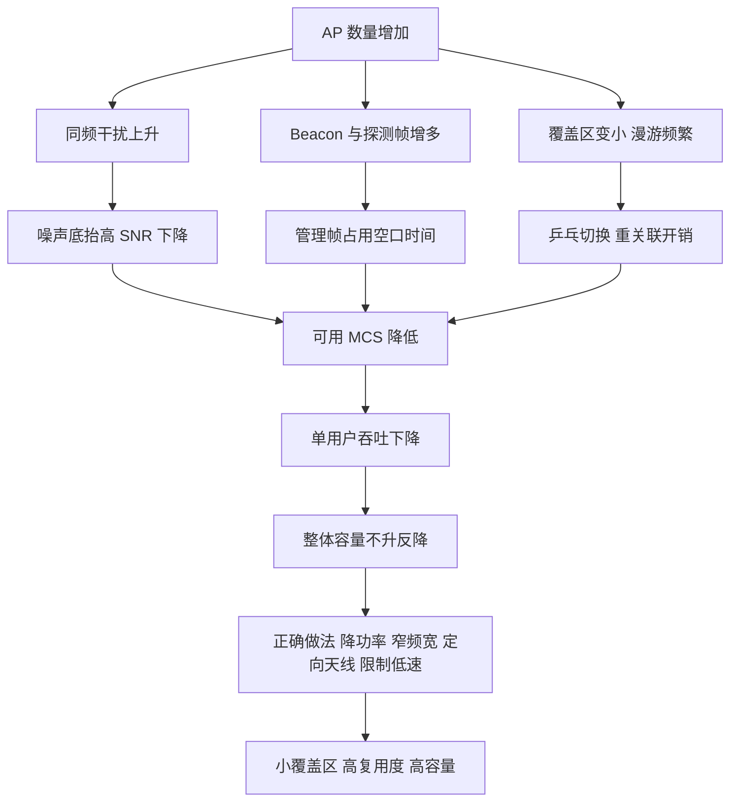

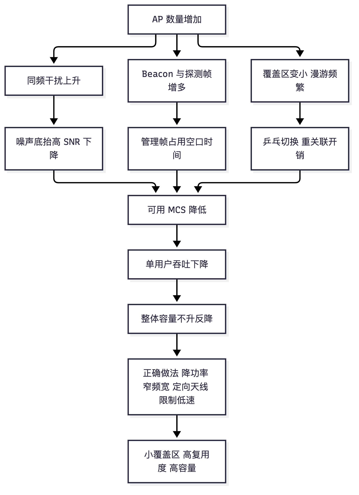


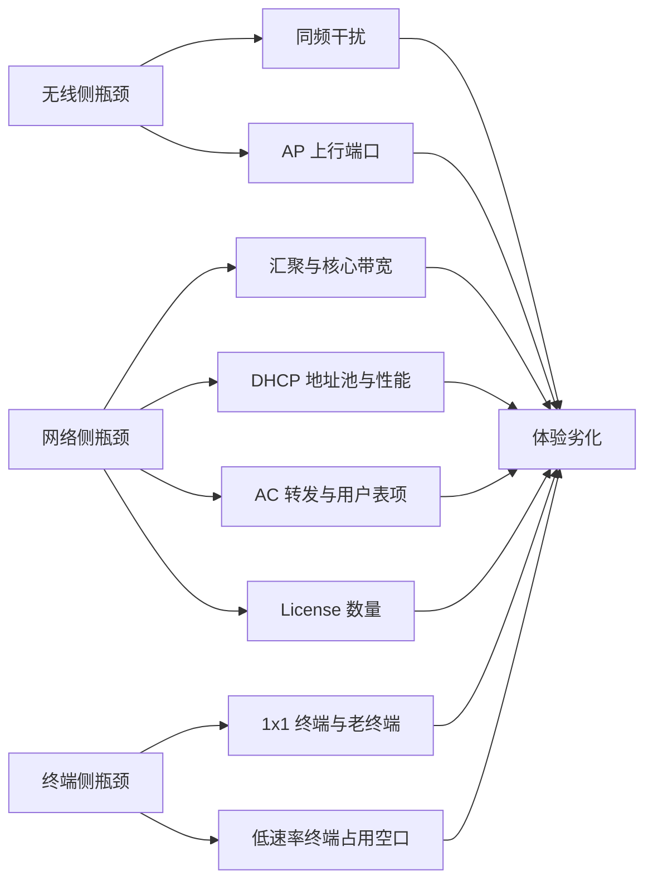

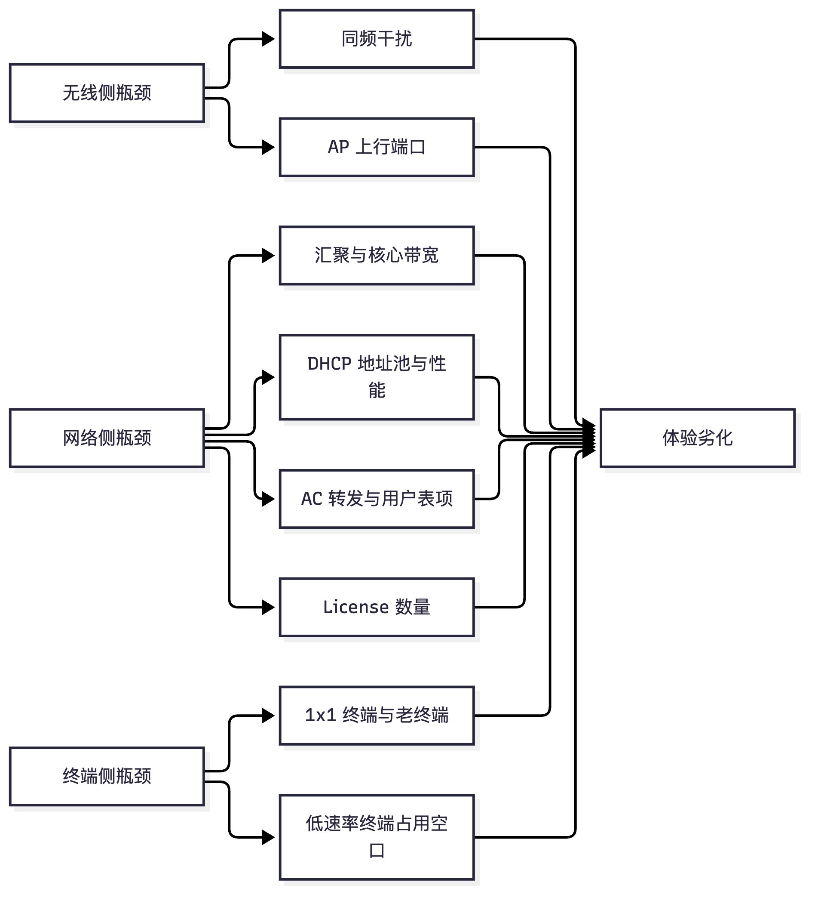


### 真题精练

**Q1.【真题·多选】** 某办公楼 WLAN 用户投诉网速慢，工程人员决定"再加 10 台 AP 提密度"。下列哪些是这一做法可能带来的负面后果？
A. 同频干扰加剧，噪声底抬高，可用 MCS 降低
B. Beacon 与探测响应等管理帧数量增加，占用更多空口时间
C. 覆盖区变小导致终端频繁漫游与乒乓切换
D. 两台 AP 在同一位置必然自动协商为不同信道，因此不会有干扰
E. 若 2.4G 信道只有 1/6/11 可用，过密会导致同信道 AP 复用距离不足

> **答案：ABCE**
> **解析**：D 错误——自动信道选择不保证"同位置不同信道"（可能都选到 1，也可能因为是同一 AP 组模板而固定为同一信道），且**即使信道不同，相邻频段仍存在邻频干扰与带外泄漏**。A/B/C/E 都是"堆 AP"的真实代价，其中 E 是硬约束：2.4G 只有 3 个非重叠信道，AP 数量超过复用能力时必然出现同信道复用距离不足。**正确做法是"降功率 + 窄频宽 + 限低速 + 定向天线"，先做零成本优化，再按容量定量补点。**

**Q2.【真题·单选】** 某项目按 1500 人 × 人均 4 Mbps 直接算出 6000 Mbps 需求，于是采购了 12 台 AP（每台按 500 Mbps 有效吞吐计）。上线后实际体验良好，但发现 AC 上部分 AP 无法上线。最可能的原因是？
A. AP 数量超过了 AC 的 License 数量或 AC 的 AP 管理规格
B. 无线信号太强导致同频干扰
C. 终端不支持 5G
D. DHCP 地址池太小

> **答案：A**
> **解析**：题干关键信息是"**部分 AP 无法上线**"（而不是所有 AP 都不行、也不是用户体验差），这是典型的 **AC 容量/License 约束**：AC 的 AP License 数量、最大管理 AP 数、CAPWAP 隧道数任何一个不足，都会导致部分 AP 无法上线（`display ap all` 中显示 Offline 或根本不存在）。B 会导致体验差而非上线失败；C 与"AP 上线"无关；D 影响终端而不是 AP。**本题还顺带暴露了题干中的规划错误**：直接把 1500 人 × 4 Mbps 当需求（未乘在线率与并发率），导致 6000 Mbps 的需求虚高 3~5 倍——**这说明"需求量化错误"会导致"设备超配"，而超配又可能撞上 AC/License 上限**，这是很有价值的综合考点。

**Q3.【真题·判断】** 只要 AP 的下行带宽规划充足，上行可以不单独考虑，因为无线链路的上下行是自动对称的。

> **答案：错误**
> **解析**：无线链路的上下行**完全不自动对称**：① AP 与终端的**发射功率差异巨大**（AP 常 20 dBm，手机常 13~15 dBm），导致上行覆盖通常小于下行；② **上行端口带宽是硬上限**（1GE ≈ 900 Mbps）；③ 大量业务（视频会议、投屏、监控回传、云盘同步、答题回传）是**上行主导**；④ 高密场景**上行汇聚**容易在接入/汇聚侧拥塞。因此规范做法是**上下行分别规划**，验收时也**分别测试**（`iperf3 -R` 测上行）。

**Q4.【真题·填空】** WLAN 规划中最常见的三个"网络侧"瓶颈是：________、________、________；其中最容易被忽略、且在"整点集中上线"时暴露得最明显的是________。

> **答案：DHCP 地址池与性能；AC 的转发能力与用户/AP 表项（含 License）；汇聚与核心的上行带宽；DHCP**
> **解析**：无线侧的问题（干扰、覆盖）通常能被仿真与勘测提前发现，而**网络侧瓶颈常常在方案里被一笔带过**。DHCP 在"早高峰、会议开始、考试开始"这类集中上线场景会瞬间收到成百上千次请求，若地址池按并发数规划（而不是在线终端数 × 倍率 × 1.2）或租期过长，就会出现"部分终端拿不到地址"；若 DHCP 服务器性能不足或未做中继就近分发，会出现"上线慢/超时"。**答题时把"分池 + 短租期 + 余量 + 中继"四个措施写出来即可拿满分。**

**Q5.【真题·简答】** 请从"射频"和"网络"两个层面，各列出 3 条 WLAN 规划的常见错误，并给出对应的正确做法。

> **答案**：
> **射频层面**：
> 1. **错误：AP 密度过高（堆 AP）** → 正确：容量定 AP 数量区间，用最小间距（5G ≥12~15 m、2.4G ≥20~25 m）做上限校验，采用"降功率 + 窄频宽 + 限低速 + 定向天线"的小覆盖区策略。
> 2. **错误：2.4G 开 40MHz 或用 1/5/9/13 信道** → 正确：2.4G 强制 20MHz + 1/6/11 + 低功率（11~14 dBm），只做兼容兜底。
> 3. **错误：用标称速率算容量 / 忽略干扰对 MCS 的影响** → 正确：乘空口效率系数（0.3~0.65）并受上行端口约束；覆盖目标同时给 RSSI、SNR、边缘速率三项；高密场景做信道复用距离校验。
> **网络层面**：
> 1. **错误：忽略上行带宽与 AP 上行端口** → 正确：上下行分别规划；高密 AP 用 2.5GE/10GE 上行；接入到汇聚做链路聚合；对上行敏感业务做 QoS。
> 2. **错误：忽略 DHCP 与 AC 的性能瓶颈** → 正确：地址池按"在线终端数 × 倍率 × 1.2"规划并**分池**、缩租期（2~8 h）、开冲突检测；核对 AC 的 AP/用户规格与 License（≥ AP 数 + 冗余），必要时双 AC 或本地转发。
> 3. **错误：VLAN 按楼层划分 / 验收只测空场** → 正确：VLAN 按"业务类型 + 安全等级"划分并在全楼统一（保证漫游不换网段）；验收在忙时按设计并发做覆盖、吞吐、漫游、并发、安全五类测试，并写入可量化的合格标准。

**Q6.【真题·排错】** 某园区 WLAN 上线后，无线侧指标（RSSI、SNR、信道利用率）全部正常，但员工普遍反映"打开网页要等 5~10 秒，视频会议断断续续"。请给出排查方向。

> **答案**：
> ① **关键判断：无线侧正常 → 问题在有线侧或上层**。RSSI/SNR 正常说明覆盖无问题；信道利用率正常说明空口不拥塞。此时应转向**网络层与应用层**排查。
> ② **DNS 与网关**：网页"打开要等"最常见的原因是 **DNS 解析慢或失败**（表现为"能 ping 通 IP 但打不开域名"）。排查：终端 `nslookup`/`ping 域名` 对比 `ping IP`；检查 AC 或 DHCP 下发的 DNS 是否正确、DNS 服务器是否可达/过载。处置：更正 DNS 下发、就近部署 DNS 缓存。
> ③ **DHCP 与地址池**：终端获取地址慢会导致"首次上网慢"。排查 `display ip pool name <池名>` 看冲突与使用率；抓包看 DHCP 交互时延。处置：分池 + 缩租期 + 增余量。
> ④ **认证与 Portal**：若走 Portal 认证，"打开网页慢"可能是 **Portal 跳转或 RADIUS 响应慢**（认证服务器不可达/超时会重试多次）。排查：AC 上认证日志与 RADIUS 状态、`display wlan sta-statistics` 的失败原因分布。处置：RADIUS 双机 + 缩短超时 + 开启本地逃生。
> ⑤ **上行与汇聚拥塞**：视频会议断续可能是丢包/抖动而非带宽不足。排查：`display interface` 看接口丢包与 CRC 错误；`display ap performance all` 看上行实时速率；核心侧做流量分析（是否被大流量（备份/下载）挤占）。处置：链路聚合扩容、QoS 优先保障会议流量、限制 P2P/大文件。
> ⑥ **CAPWAP 隧道与转发模式**：隧道转发时流量绕行 AC，若 AC 性能或 AC 上联受限，会出现"无线好、业务差"。排查：AC 的 CPU/转发性能（`display cpu-usage`）、AC 上联带宽；评估改为**本地转发**。
> ⑦ **终端侧**：部分老旧终端因省电策略导致时延大；用不同型号终端对比测试以排除终端因素。
> ⑧ **结论**：本题的核心是**"无线指标正常不等于业务正常"**，排查必须覆盖"无线侧 → 有线侧 → 认证 → DNS/DHCP → 应用"的完整链路，这也是国赛排错题的标准答题结构。

**Q7.【真题·实验】** 在 AC6805 上完成一次"干扰整改"：把 5G 由 80MHz 改为 40MHz、降功率、关闭低速基本速率，并说明如何验证整改效果。

> **答案**：
> ```bash
> system-view
> wlan
>  radio-5g-profile name HIDENSITY_5G                       // 面向高密的 5G 模板
>   channel 40mhz 36 44 149 157                              // 40MHz：非重叠信道数量翻倍，牺牲峰值换取复用度
>   eirp 17                                                  // 降功率：缩小覆盖区，降低同频干扰
>   dot11a basic-rate 6 12 disable                           // 关闭 6/12 Mbps 基本速率：缩短管理帧空口占用时间
>   dot11a supported-rate 24 36 48 54                        // 限定支持速率：杜绝低速终端长期霸占空口
>  ap-group name AG_OFFICE                                   // 应用到办公 AP 组
>   radio-5g-profile name HIDENSITY_5G
> ```
> ```bash
> display ap performance all radio                            // 关键指标：信道利用率 与 噪声底（整改前后对比）
> display ap all                                              // 确认所有 AP 正常上线（改功率后若有 AP 掉线需排查）
> display station mac-address <MAC> verbose                   // 抽样终端：RSSI/SNR/MCS/重传率变化
> display ap performance all                                  // 每 AP 在线数与带宽：确认覆盖缩小后未出现集中关联
> display current-configuration | include "channel|eirp|basic-rate"
>                                                             // 核对整改配置已下发
> ```
> **验证方法与判据**：
> 1. **对比法**：整改前后在同一时间、同一批测试点位、同一批终端上采集数据，形成对照表（这是最规范的做法）。
> 2. **判据**：① 噪声底下降（例如从 -85 dBm 降到 -92 dBm 以下）；② 信道利用率下降（从 >60% 降到 <40%）；③ 抽样终端的**协商 MCS/速率上升**（虽然峰值频宽减半，但 MCS 提升常使实际吞吐不降反升）；④ 用户体验指标改善（网页打开时间、视频起播时间、会议 MOS）。
> 3. **副作用检查**：40MHz 后覆盖边缘速率可能下降，需重新核对边缘点位是否仍达标；降功率后是否出现新的弱覆盖区（`display station ... verbose` 找 RSSI < -70 dBm 的点）。
> **注意**：`dot11a basic-rate` 与 `supported-rate` 的具体语法与可用速率集合**以所用版本文档为准**；关闭低速基本速率前要确认现场没有必须依赖低速率的极远终端（如室外边缘的 IoT 设备）。

**Q8.【真题·设计】** 某项目在方案评审时被专家指出"存在三处会导致上线后体验劣化的设计缺陷"：① 全楼使用同一 DHCP 地址池；② 每层一个 VLAN；③ 验收指标只写"覆盖良好"。请分析这三处的具体危害，并给出修正方案。

> **答案**：
> **① 全楼使用同一 DHCP 地址池（如 /22 = 1022 地址）**：
> - **危害**：a) **容量风险**——按 2000 人 × 在线率 80% × 终端倍率 2 = 3200 个在线终端，/22 根本不够，会出现大面积"拿不到地址"；b) **广播域过大**——单一广播域跨全楼，广播/组播泛洪消耗全网带宽与终端 CPU，ARP 表也过大；c) **故障域过大**——一次 DHCP 风暴或 ARP 欺骗会影响全楼；d) **续租洪峰集中**——同一时刻大量终端续租，DHCP 与网关压力集中。
> - **修正**：按**楼层或 AP 组划分地址池**（每层 2~4 个池，或每 200~500 终端一个池），每池容量 = 该区在线终端数 × 1.2 余量；租期缩短到 2~8 小时并**错峰**（不同池设不同租期起点）；开启冲突检测；配置 DHCP 中继就近响应。
> **② 每层一个 VLAN**：
> - **危害**：a) **跨层漫游换网段**——员工从 3 层走到 2 层，终端 IP 变化，正在进行的会议/下载/投屏**中断**（TCP 连接断，需重新认证/重连），这与"无缝漫游"的目标直接冲突；b) **ACL 与策略维护复杂**——同一业务要在每层重复配置，易漏配；c) **安全域不清晰**——VLAN 按物理位置分而不是按业务/安全等级分，访客与员工可能被混在一起。
> - **修正**：**按"业务类型 + 安全等级"划分 VLAN**（员工 / 访客 / IoT / 语音 / AP 管理），**全楼统一**；同一 SSID 对应同一 VLAN，保证漫游不换网段；不同楼层通过 DHCP 分池与 ACL 做差异化策略，而不是靠 VLAN 区分。
> **③ 验收指标只写"覆盖良好"**：
> - **危害**：不可判定，无法验收，后期争议无解；且不覆盖吞吐、漫游、并发、安全等真实体验维度，会出现"验收通过、投诉不断"。
> - **修正**：改为可量化指标表：覆盖率（关键区 100% 达 RSSI ≥ -65 dBm、SNR ≥ 25 dB；一般区 ≥95% 达 -70 dBm；测试方法：5 m 网格抽样；条件：工作日忙时）；吞吐（近点下行 ≥ 标称 × 50%，边缘 ≥ 30 Mbps；上行单独测）；漫游（数据 ≤100 ms、丢包 ≤3；语音 ≤50 ms）；并发（按设计 100%~120% 加压，成功率 ≥99%，信道利用率 <60%）；安全（未授权禁入、访客隔离、ACL 生效、RADIUS 双机切换）；可靠性（AC 主备切换中断 ≤ 秒级且 AP 全部恢复上线）。**每条指标必须给"数值 + 方法 + 条件 + 判定规则"四项。**

### 易错点与排错

1. **把"堆 AP"当作解决容量问题的第一手段**：先做零成本射频优化（降功率、窄频宽、限低速、调信道），再定量补点。
2. **只说无线侧不说网络侧**：设计题必须覆盖"无线 + 有线 + DHCP + AC/License + 认证"，缺一项就丢分。
3. **忽略"上线"类问题的三类原因**：AP 上线失败（License/规格/CAPWAP）、终端获址失败（DHCP）、认证失败（RADIUS/Portal），三者在现象上都可能表现为"上不了网"。
4. **需求量化虚高导致超配**：不做在线率与并发率折算，直接"人数 × 人均带宽"，会同时造成超配（撞 License 上限）与预算浪费。
5. **整改不复查副作用**：降功率可能产生新弱区，缩频宽可能降低边缘速率，必须整改后复测。
6. **排错命令清单**：`display ap performance all radio`（干扰）、`display interface brief`（上行与 100M 瓶颈）、`display ip pool name <池名>`（DHCP）、`display license`（License）、`display ap all`（AP 上线）、`display station mac-address <MAC> verbose`（终端射频质量）、`display wlan sta-statistics`（上线成功率）。

---

# WLAN-HCIE-章节4-WLAN安全进阶与无线攻防

## 4.1 WPA3 深入：SAE 同时认证、Dragonfly 握手与抗离线爆破

### 考点定位

本考点是国赛 WLAN **原理深挖题的第一考点**，占 **6~10 分**，几乎每年必考。它考的是"能不能讲清 SAE 为什么能抵御 WPA2 的离线字典攻击"，因此必须把 **WPA2-PSK 四次握手的密钥体系**与 **SAE 的提交/确认交换**对比着讲。高频陷阱：① 把 SAE 说成"更复杂的 PSK 加密"（错，SAE 是**基于 DH 密钥交换的认证**，密码不再直接充当 PMK）；② 说不清"离线字典攻击为什么在 WPA2 上可行"（因为 MIC 可离线验证，而 MIC 依赖可推导的 PTK）；③ 把 Forward Secrecy 说成"WPA3 用了更强的加密算法"（错，是**会话密钥不由长期密钥派生**这一密钥管理属性）；④ 认为 KRACK 在 WPA3 上也存在（WPA3-SAE 不受 KRACK 影响）。

### 原理精讲

**① 先把 WPA2-PSK 的密钥体系讲清（这是理解 SAE 的前提）。**

WPA2-PSK（Personal）的密钥层次是：
```
PSK/PMK = PBKDF2( passphrase, SSID, 4096, 256bit )        ← 由"口令 + SSID"经 4096 轮迭代导出
PTK     = PRF-512( PMK, ANonce, SNonce, AP_MAC, STA_MAC )  ← 四次握手后由双方各自计算
MIC     = f( PTK, EAPOL 帧内容 )                            ← 用于校验握手报文完整性
```
四次握手过程：AP 发 **EAPOL-Key(M1, ANonce)** → STA 计算 PTK 后发 **M2(SNonce + MIC)** → AP 验证 MIC 后发 **M3(ANonce + GTK + MIC)** → STA 装密钥并发 **M4(MIC)**。

**离线字典攻击为什么可行？** 攻击者只要**抓到一个完整的四次握手**（M1+M2，或 M3+M4），就得到 `ANonce, SNonce, AP_MAC, STA_MAC, MIC`。这些**全部是公开可捕获量**。于是攻击者可以在**自己的机器上离线**枚举口令：`口令 → PMK → PTK → MIC'`，比较 `MIC' == MIC` 即知口令是否正确。整个过程中攻击者**不需要与 AP 交互**（因此叫"离线"），可以每秒尝试几十万到上百万个口令（GPU/字典），所以"口令弱 = 必然被破"。**关键根因**：口令的验证材料（MIC）在空口上可被任意捕获，且验证过程可完全离线复现。

**② WPA3-SAE 的核心机制：SAE（Simultaneous Authentication of Equals，对等实体同时认证）。**

SAE 基于 **Dragonfly 握手协议**，是一个**基于密码的认证密钥交换（PAKE）**。它的设计目标有两个：**(a) 抗离线字典攻击**（口令不能被离线验证）；**(b) 双向对等认证**（"同时"的含义——没有客户端/服务器角色之分，双方对等地互相证明"我知道口令"）。SAE 使用 **ECC 有限域上的 DH 交换**（默认 group 19 = P-256，还支持 group 20 = P-384、group 21 = P-521；WPA3-192 位模式强制使用 P-384）。

**Dragonfly 握手的关键步骤：**

1. **密码元素推导（PWE, Password Element / hash-to-element）**：把 `(口令, 双方 MAC, 计数/盐)` 通过**哈希到曲线（Hash-to-Curve/Elliptic Curve）**的确定性映射，得到一个**曲线上的点 PWE**。注意：这个过程是**确定性的**——双方用相同输入得到相同点，且从 PWE 反推口令在计算上不可行。
2. **提交交换（Commit Exchange）**：双方各自生成随机标量 `rand`（私钥）与 `mask`（掩码），计算
   `scalar = (rand + mask) mod q`，`element = -(mask × PWE)`，
   然后发送 **Commit 帧**（含 `scalar` 与 `element`）。**关键点：提交帧里没有口令的任何可验证信息**——element 被 mask 掩盖，attacker 无法用它验证口令猜测。
3. **计算共享密钥**：双方用对端的 `scalar` 与 `element` 计算
   `K = rand × ( peer_scalar × PWE + peer_element )`。
   由于 `peer_scalar × PWE + peer_element = peer_rand × PWE`（掩码相消），双方得到**相同的共享秘密 K**。这就是一次**基于口令的 DH 交换**：口令的作用是"选定了曲线上的一个点"，而 DH 保证只有知道口令的一方才能算出相同的 K。
4. **确认交换（Confirm Exchange）**：双方用 K 派生出 **KCK（Key Confirmation Key）** 与 **PMK**，各自发送
   `Confirm = HMAC(KCK, 双方的 Commit 内容 + 双方 scalar/element)`。
   **只有算对了 K 的一方能生成正确的 Confirm**，因此 Confirm 完成了**双向认证**。

**③ 为什么 SAE 能抗离线字典攻击？** 因为**攻击者无法离线验证口令猜测**：
- 捕获取材只有 Commit（scalar/element）与 Confirm。若攻击者猜口令 `pw'`，他可以算出 `PWE'`，但他**无法从 Commit 的 element = -(mask × PWE) 中解出 mask**（这需要解 ECDLP，即椭圆曲线离散对数问题），因此**无法构造出与抓到的一致性的验证等式**。
- 他必须**在线与真实 AP 完成一次完整握手**，才能用自己的猜测生成 Confirm 并观察对方是否接受——这构成**一次在线猜测**，而在线猜测可以被 **Anti-Clogging Token（反阻塞令牌）** 与速率限制遏制。
- 因此 SAE 把"离线每秒百万次"降级为"**在线每次一个**"（且每次需完整交互，可被限速/锁定）。这就是 SAE 抗离线字典攻击的本质，**与"用了更复杂的加密算法"无关**。

**④ Anti-Clogging Token（反阻塞令牌）**：攻击者可以伪造大量 Commit 帧，迫使 AP 做昂贵的**标量乘法与哈希到曲线运算**（DoS——俗称 "clogging"）。SAE 的对策是：当 AP 检测到**大量未完成握手的 Commit** 时，要求客户端**先回显一个由 AP 生成的令牌（Token）**（该令牌通常与客户端 MAC 绑定），只有在客户端证明"它确实能收到 AP 的响应"之后，AP 才进行完整计算。这既抗 DoS，又为在线猜测增加了成本。

**⑤ Forward Secrecy（前向保密）**：WPA2-PSK 中，PMK 直接由口令派生，**攻击者一旦事后拿到口令，就能解密过去抓到的所有流量**（因为他能重算 PMK→PTK，且若抓到了握手就能解出会话密钥）。SAE 中，PMK 由**每次握手新生成的随机数**参与派生：`PMK = HKDF(K, ...)`，而 K 依赖本次的 `rand`（临时私钥）。**临时私钥用完即弃**，因此**即使口令日后泄露，也无法解密历史流量**——这就是 Forward Secrecy。答题时必须把上面这句"临时私钥不落盘、用完即弃，PMK 不由长期口令直接派生"讲出来。

**⑥ WPA3 家族的其他形态。**
- **WPA3-Enterprise（企业级）**：仍走 802.1X/EAP，但强制 **PMF（Protected Management Frames，管理帧保护，即 802.11w）**。其中 **WPA3-Enterprise 192 位模式（192-bit Security / CNSA 套件）**要求：**EAP-TLS 且使用 ≥384 位曲线的证书**、**GCMP-256（伽罗瓦/计数器模式）**、**HMAC-SHA-384**、**BIP-GMAC-256（Beacon/管理帧保护）**、**ECDHE 前向保密**。它是为政府、金融等高安全需求设计的**强制套件**（不是"可选加强"）。
- **OWE（Opportunistic Wireless Encryption，增强开放 / Wi-Fi Enhanced Open）**：针对**开放网络（无口令场景，如咖啡馆、机场）**，用**无认证的 DH 交换**为每个终端生成独立密钥，使**同一开放网络内不同终端之间无法嗅探对方流量**（而传统开放网络是全明文、人人可见）。注意 OWE **不做身份认证**（不验证 AP 是否是合法 AP），它解决的是**机密性**而非**真实性**——这是常见的判断题陷阱。OWE 的过渡模式是 **OWE Transition Mode**（同时允许 OWE 与传统开放终端接入）。
- **过渡模式（WPA3/WPA2 混合）**：为兼容不支持 WPA3 的老终端，AP 可同时广播 WPA3 与 WPA2 的 RSN 信息（同一 SSID 双模式）。**安全代价**：攻击者可以强制终端降级到 WPA2（降级攻击面存在），且此时**无法对 WPA2 客户端提供前向保密**。因此规范建议：**新部署且终端可控时只用 WPA3；终端混杂时必须评估是否接受过渡模式的安全折损**。
- **PMF（802.11w）**：对**管理与控制帧（尤其是 Deauthentication/Disassociation）进行完整性保护**，阻止"伪造断开帧把终端踢下线"这类攻击（Deauth 攻击），也是 KRACK 防护的一部分。WPA3 中 PMF 是**强制**的，WPA2 中为可选（WPA2 若开启 PMF，则是 "WPA2 + PMF" 模式）。

**⑦ KRACK 与防护。** KRACK（Key Reinstallation Attack，密钥重装攻击）针对 **WPA2 四次握手的密钥安装状态机**：攻击者通过**重放 M3（或组密钥握手的相应报文）**，诱使客户端**重复安装同一个密钥并重置发送侧的随机数（nonce）与重放计数器**，进而可重放、解密、甚至注入帧。要点：
- **影响范围**：WPA2（含 PSK 与 Enterprise），以及 WPA2 的组密钥握手；**WPA3-SAE 不受 KRACK 影响**（SAE 的密钥安装不易被重放诱导）。
- **防护措施**：① 打补丁（客户端与 AP 都要）——2017 年后主流厂商固件均已修复；② **启用 PMF（802.11w）** 可显著缓解（因为伪造/重放的管理帧被完整性保护）；③ 迁移到 **WPA3**；④ 对无法升级的 IoT 设备做**网络隔离**（单独 VLAN/SSID），限制其被利用后的横向影响。
- **注意**：KRACK 不是"破解 Wi-Fi 口令"，它不恢复口令、不恢复 PMK；它的危害是**在特定条件下解密/重放部分流量**。答题时把这一点说清能体现理解深度。

### 关键概念对照表

| 维度 | WPA2-Personal | WPA3-Personal | WPA3-Enterprise 192 位 |
|---|---|---|---|
| 认证方式 | PSK（预共享密钥） | **SAE（Dragonfly / PAKE）** | 802.1X + **EAP-TLS（≥384 位曲线）** |
| 密钥交换 | 四次握手，PTK 由 PMK+nonce 派生 | SAE 提交/确认交换，PMK 由 DH 共享秘密派生 | EAP 导出 MSK → PMK，四次握手 |
| 抗离线字典攻击 | **不能**（抓握手包即可离线爆破） | **能**（无法离线验证口令猜测） | 不适用（无共享口令） |
| 前向保密 | **无**（口令泄露可解历史流量） | **有**（临时私钥用完即弃） | **有**（ECDHE） |
| PMF（802.11w） | 可选 | **强制** | **强制** |
| 加密算法 | AES-CCMP-128 | AES-CCMP-128 | **GCMP-256** |
| 完整性算法 | HMAC-SHA1 / AES-CMAC | 同左 | **HMAC-SHA-384 / BIP-GMAC-256** |
| 抗 KRACK | 依赖补丁 + PMF | 天然不受影响 | 天然不受影响 |
| 抗 DoS（握手泛洪） | 弱 | **Anti-Clogging Token** | 依赖 EAP/基础设施 |
| 典型适用 | 家庭、小微 | 家庭、小微、高安全个人 | 政府、金融、军工 |

| WPA3 形态 | 认证 | 机密性 | 真实性 | 典型场景 | 常见误解 |
|---|---|---|---|---|---|
| WPA3-Personal（SAE） | 口令（PAKE） | AES-CCMP-128 | 双向对等 | 家庭、SOHO、小型办公 | 误以为"只是加密更强" |
| WPA3-Enterprise | 802.1X/EAP | AES-CCMP-128 | 服务器证书 + 用户凭据 | 企业 | 误以为"和 WPA2 企业版一样" |
| WPA3-Enterprise 192 位 | EAP-TLS（P-384） | GCMP-256 | 强证书体系 | 政府、金融 | 误以为"可选加强"（实为强制套件） |
| OWE | **无认证** | 每终端独立密钥 | **不提供** | 咖啡馆、机场、访客开放网 | 误以为"OWE 能防钓鱼 AP" |
| WPA3/WPA2 过渡模式 | SAE + PSK | 各自套件 | 各自 | 终端混杂的存量网络 | 忽略降级攻击面与无 FS |

### 华为设备配置

```bash
# ===== AC6805 上配置 WPA3-SAE（WPA3-Personal）（VRP V200R019+，具体支持情况以版本为准）=====
system-view
wlan
 security-profile name SP_WPA3_SAE                        // 创建 WPA3-SAE 安全模板
  security wpa3 sae aes                                    // 认证 WPA3-SAE，加密 AES（CCMP-128）
  wpa3 sae-password cipher Huawei@2024                     // 设置 SAE 口令（建议 ≥12 位混合字符，口令强度决定安全性）
  wpa3 sae-group 19                                        // 指定 ECC 群：19=P-256（20=P-384，按终端与合规要求选）
  pmf enable                                               // 启用管理帧保护 802.11w（WPA3 场景强制）
  pmf mandatory                                            // 强制 PMF：拒绝不支持 PMF 的终端（安全优先时使用）
 quit
 ssid-profile name SSID_WPA3
  ssid CORP-WPA3                                           // SSID 名称
 quit
 vap-profile name VAP_WPA3
  service-vlan vlan-id 10                                  // 业务 VLAN
  security-profile SP_WPA3_SAE                             // 绑定安全模板
  ssid-profile SSID_WPA3                                   // 绑定 SSID 模板
 quit
```

```bash
# ===== WPA3/WPA2 过渡模式与 OWE（增强开放）配置 =====
 security-profile name SP_TRANS                            // 过渡模式模板
  security wpa-wpa2 psk aes                                // 兼容写法示意（不同版本命令不同，以所用版本文档为准）
  security wpa3 sae aes transition                         // 声明为 WPA3/WPA2 过渡：同时兼容老终端
  wpa3 sae-password cipher Huawei@2024
  pmf optional                                             // 过渡模式一般设 optional（老终端可能不支持 PMF）
 quit
 security-profile name SP_OWE                              // OWE 增强开放模板（访客开放网）
  security owe aes                                         // 开放网络 + 机会性无线加密（不做身份认证）
  pmf optional
 quit
```

```bash
# ===== 验证与查看 =====
display security-profile name SP_WPA3_SAE                  // 查看安全模板：认证/加密/PMF/SAE 参数
display security-profile all                                // 列出全部安全模板，核对绑定关系
display station mac-address <MAC> verbose                   // 查看终端实际协商的认证与加密方式、是否启用 PMF
display wlan sta-statistics                                 // 查看上线成功率与失败原因（可发现"终端不支持 PMF"导致的失败）
```

### 示意图

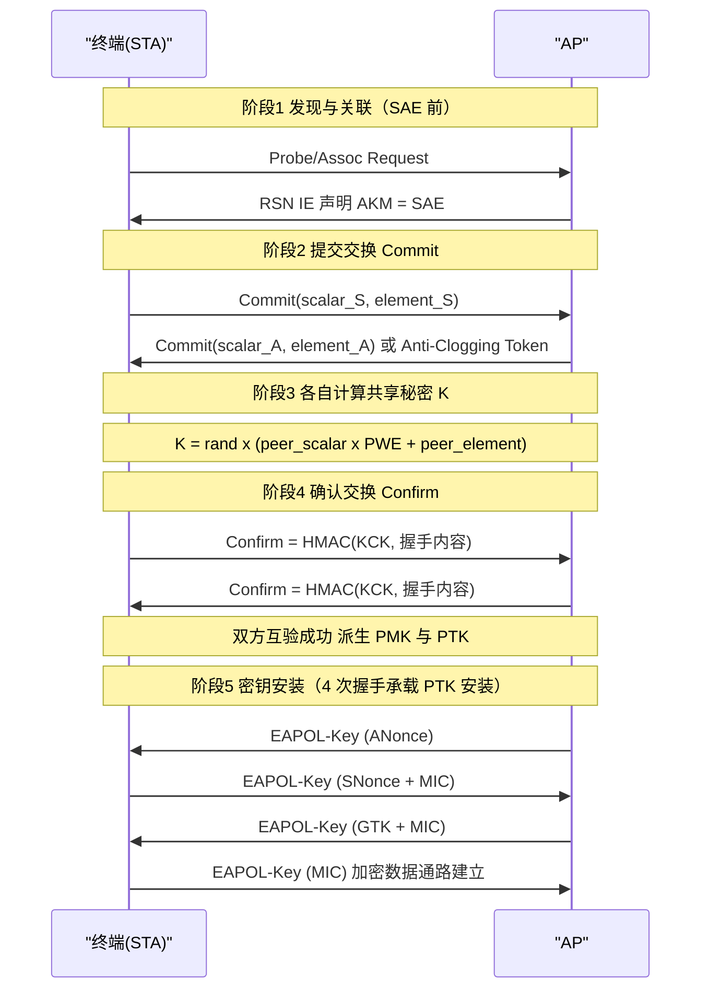

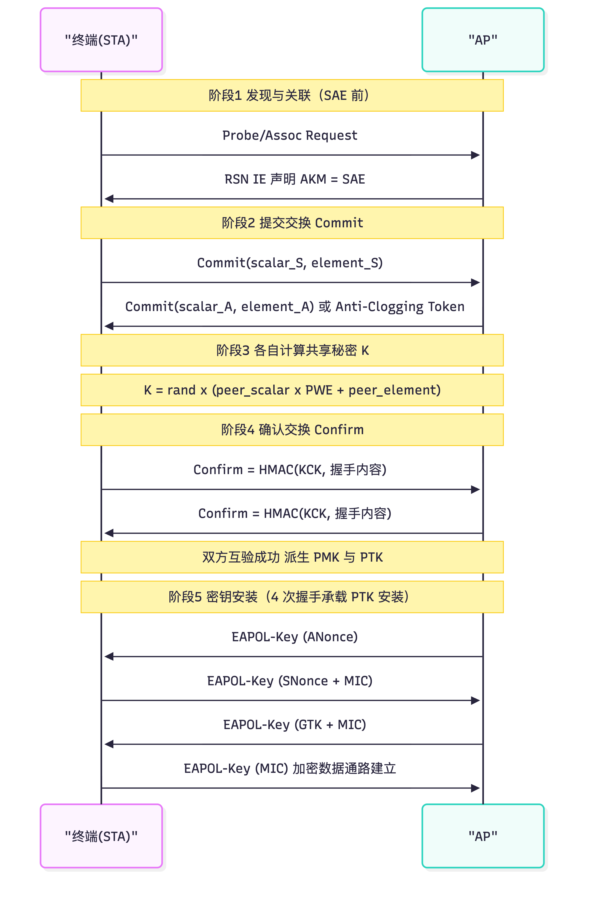


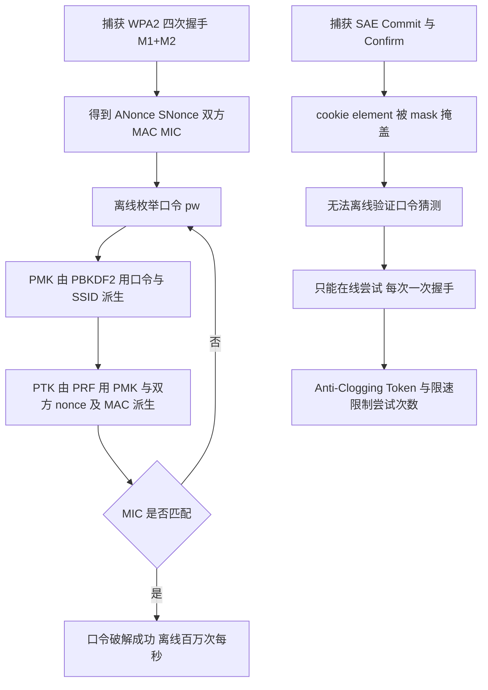

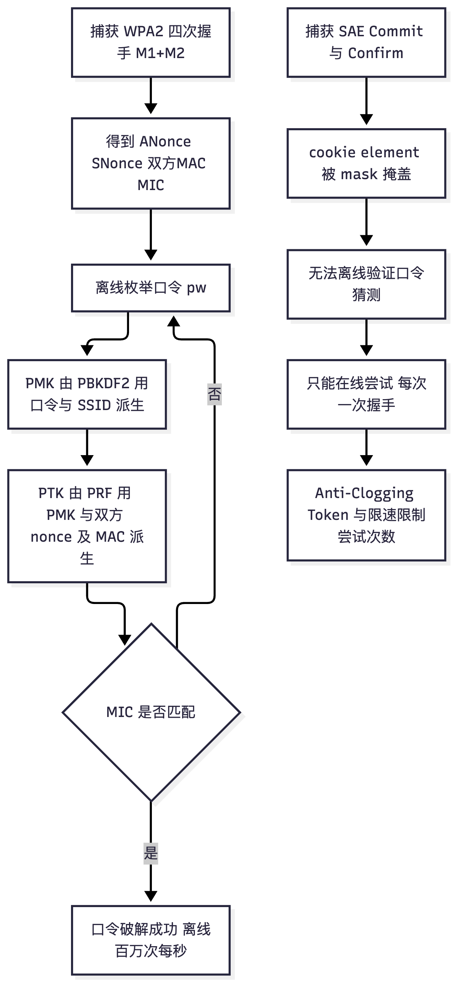


### 真题精练

**Q1.【真题·简答】** 请说明 WPA2-PSK 为什么容易遭到离线字典攻击，并从密钥派生与握手交互两个角度说明 WPA3-SAE 是如何抵御它的。

> **答案**：
> **① WPA2-PSK 的漏洞根因**：
> - 密钥派生是"**口令 → PMK → PTK**"的确定性链条：`PMK = PBKDF2(口令, SSID, 4096, 256)`，`PTK = PRF-512(PMK, ANonce, SNonce, AP_MAC, STA_MAC)`。
> - 四次握手在空口**明文**传输 `ANonce、SNonce、MIC`，这些量可被任意捕获。
> - 攻击者抓到一个完整握手后，可以**在自己的机器上**枚举口令、重算 PMK→PTK→MIC 并与捕获的 MIC 比对：**验证过程完全离线、不需要与 AP 交互**，因此可用 GPU 集群达到每秒数十万至数百万次尝试，弱口令必然被破。
> **② SAE 的抵御机制**：
> - **密钥不再由口令直接派生**。SAE 用"**哈希到曲线（hash-to-curve）**"把口令映射为椭圆曲线上的点 `PWE`，再用 Dragonfly 完成一次基于口令的 **DH 交换**，得到共享秘密 `K = rand × (peer_scalar × PWE + peer_element)`，最后由 K 派生 PMK。
> - **提交帧不可验证**：Commit 中发送的 `element = -(mask × PWE)` 被随机掩码掩盖，而求解 `mask` 需要解椭圆曲线离散对数（ECDLP，计算不可行）。因此拿到 Commit 的攻击者**无法用猜测的口令构造出一致性校验**，也就**无法离线判断口令是否正确**。
> - **确认帧需要一次在线交互**：只有算对 K 的一方能生成正确的 `Confirm = HMAC(KCK, ...)`。攻击者要验证一个猜测，必须**在线完成一次完整握手**（一次只试一个口令），而在线尝试受到 **Anti-Clogging Token**、交互开销与速率限制的约束，从"每秒百万次离线"变成"每天数千次在线"，弱口令之外的口令实际不可破。
> **③ 附加收益**：SAE 同时提供**前向保密**（PMK 含临时随机数，口令日后泄露也无法解密历史流量）与**双向对等认证**（双方互相证明知道口令，可检出伪造 AP 的部分攻击面）。

**Q2.【真题·多选】** 关于 WPA3 与 SAE，下列说法正确的有？
A. SAE 的 "Simultaneous" 指双方对等地互相认证，没有客户端/服务器角色之分
B. SAE 默认使用 ECC（如 P-256，group 19）上的 DH 交换，WPA3-Enterprise 192 位模式要求 P-384
C. Anti-Clogging Token 的作用是防止攻击者用大量伪造 Commit 帧耗尽 AP 的计算资源
D. SAE 提供前向保密，即使 SAE 口令日后泄露也无法解密此前抓取的流量
E. 因为 SAE 用了更强的加密算法，所以它能抵御离线字典攻击

> **答案：ABCD**
> **解析**：E 是典型错误表述——SAE 抗离线字典攻击的原因是**密钥交换协议的设计**（口令映射为曲线点 + 掩码提交 + 只有在线交互才能验证），**不是"加密算法更强"**；SAE 的加密套件仍是 AES-CCMP-128（与 WPA2 相同）。A 是 "Simultaneous Authentication of Equals" 的字面含义（对等认证，替代 PSK 的单向"我知道口令"）；B 是 ECC 群的正确取值（group 19/20/21 对应 P-256/P-384/P-521）；C 是 Anti-Clogging 的设计目的；D 是 Forward Secrecy 的正确含义。

**Q3.【真题·判断】** OWE（增强开放）能阻止攻击者搭建钓鱼 AP 冒充合法热点，因此可以用于开放网络的身份认证。

> **答案：错误**
> **解析**：OWE 的设计目标是**机密性**，不是真实性。它通过**无认证的 DH 交换**为每个终端派生独立密钥，使同一开放网络内的终端之间**无法互相嗅探流量**（传统开放网络是明文、人人可见）。但 OWE **不验证 AP 的身份**，无法阻止攻击者建立同名开放热点（因为本来就没有凭据可验证）——要防钓鱼 AP 必须依靠 **WIPS 的非法 AP 检测**、**802.11w 的 PMF**（阻止伪造管理帧）、以及用户侧的**证书/HTTPS 校验**。OWE 的过渡模式（OWE Transition）同时兼容传统开放终端。

**Q4.【真题·填空】** WPA2-PSK 的密钥派生链条是：口令经 ________ 算法与 SSID、4096 轮迭代生成 ________，再由四次握手交换的 ________ 参与派生出 ________。WPA3-SAE 用 ________ 握手把口令映射为曲线上的点，从而消除了离线字典攻击的前提。

> **答案：PBKDF2；PMK（Pairwise Master Key，成对主密钥）；ANonce 与 SNonce（随机数）；PTK（Pairwise Transient Key，成对临时密钥）；Dragonfly**
> **解析**：这道填空的价值在于把"密钥层次"记牢：`口令 → PMK → PTK → 会话密钥`，其中 PMK 是长期口令派生的（因此无前向保密），PTK 引入双随机数（会话级）。SAE 改变了 PMK 的来源（由 DH 共享秘密派生），因此既获得前向保密，又消除了"口令可离线验证"的链条。也可以答"哈希到曲线（hash-to-curve）"作为把口令映射为曲线点的方法。

**Q5.【真题·简答】** 请说明 KRACK 攻击的原理、影响范围与防护措施，并解释为什么 WPA3-SAE 不受影响。

> **答案**：
> **① 原理**：KRACK 针对 WPA2 四次握手的**密钥安装状态机**。在 WPA2 中，AP 会重传 M3（因为它未收到 M4 的确认）。攻击者通过**信道操纵（channel-based MitM）重放 M3**，诱使客户端**重复安装同一个 PTK 并重置发送侧的 nonce 与重放计数器（Packet Number）**。密钥相同但计数器回退，会导致攻击者可以**重放已加密帧、解密部分帧、在特定条件下注入帧**。组密钥握手（Group Key Handshake）存在同类问题（尤其对广播帧）。
> **② 影响范围**：WPA2-Personal 与 WPA2-Enterprise 均受影响；不同客户端的实现差异导致严重程度不同（例如某些 Linux/Android 实现在重装密钥后把加密密钥置零，危害更严重）。**它不是口令破解**：不恢复口令、不恢复 PMK，因此不会"泄露 Wi-Fi 密码"。
> **③ 防护措施**：a) **打补丁**——客户端与 AP 两侧固件升级（2017 年 10 月起主流厂商均已发布修复）；b) **启用 PMF（802.11w）**——对管理与控制帧做完整性保护，使伪造/重放的管理帧被拒绝，显著缓解；c) **迁移到 WPA3-SAE**——从根本上规避；d) 对无法升级的 IoT 设备做 **SSID/VLAN 隔离**，限制其被利用后的横向扩散；e) 关闭不必要的 WPS（WPS 的 PIN 暴力破解是另一个独立风险）。
> **④ 为什么 WPA3-SAE 不受影响**：SAE 的密钥来源于**每次握手新生成的 DH 共享秘密**，且握手包含**双向 Confirm 校验**；密钥安装与确认过程绑定在本轮握手的随机数上，**重放 Commit/Confirm 无法诱导密钥重装**（对方会因 Confirm 校验失败而中止）。此外 WPA3 **强制 PMF**，管理与控制帧被完整性保护，信道操纵型重放更难实施。因此 WPA3-SAE 在协议设计上即免疫 KRACK。

**Q6.【真题·排错】** 某企业将 SSID 从 WPA2-PSK 升级为 WPA3-SAE 后，一部分员工终端（老旧手机、部分 IoT 设备）无法连接，AC 上显示认证失败。请给出排查与处置方案。

> **答案**：
> ① **确认失败原因**：`display wlan sta-statistics` 查看失败原因分布；`display station mac-address <MAC> verbose` 看该终端是否根本没有出现（说明连关联都失败）。常见原因分三类：**不支持 WPA3/SAE**、**不支持 PMF（802.11w）**、**不支持所选 ECC 群（如只支持 P-256，而网络配了 P-384）**。
> ② **核对配置**：`display security-profile name <模板名>` 看 `security wpa3 sae`、`pmf mandatory/optional`、`sae-group`。若配了 `pmf mandatory`，不支持 PMF 的老终端会被直接拒绝——这是最常见的升级失败原因。
> ③ **处置方案（按安全优先度排序）**：
> - **方案 A（推荐，安全与兼容兼顾）**：**双 SSID 并行**——新 SSID 用 WPA3-SAE + PMF mandatory 给支持新标准的终端（手机、笔记本）；老终端与 IoT 用另一个 SSID 配 **WPA2-PSK + PMF optional**，并在**独立 VLAN + ACL** 中隔离，限制其访问敏感资源。这是企业升级的标准做法。
> - **方案 B（过渡模式）**：同一 SSID 使用 **WPA3/WPA2 过渡模式 + PMF optional**。优点是无须换 SSID；缺点是**存在降级攻击面，且 WPA2 客户端没有前向保密**，安全性弱于方案 A。
> - **方案 C（终端替换）**：若安全合规要求强制 WPA3-192 位，则必须替换不支持的老终端——这是"合规驱动"的决策，需要业务侧配合。
> ④ **IoT 特殊处理**：扫码枪、打印机、门禁等 IoT 设备往往固件老旧、只支持 WPA2 甚至只支持 2.4G。正确做法是**单独 SSID + 单独 VLAN + 严格 ACL（只允许访问其服务器）+ 关闭不必要的服务**，把它们放在"最低信任区"。
> ⑤ **回归验证**：升级后必须做一次**全终端类型抽样测试**（iOS/Android/Windows/macOS/IoT 各取几台），并记录认证方式协商结果（`display station ... verbose`）；同时验证 **PMF 生效**（用 Deauth 攻击工具测试是否还能踢下线终端——能踢说明 PMF 未生效）。

**Q7.【真题·实验】** 在 AC6805 上完成"WPA3-SAE + 强制 PMF"的配置，并说明如何验证 PMF 已生效、以及如何配置一个兼容老终端的过渡 SSID。

> **答案**：
> ```bash
> system-view
> wlan
>  security-profile name SP_WPA3                           // 主 SSID：WPA3-SAE 严格模式
>   security wpa3 sae aes                                   // 认证 WPA3-SAE，加密 AES-CCMP-128
>   wpa3 sae-password cipher Huawei@2024                    // SAE 口令（≥12 位，含大小写/数字/符号）
>   wpa3 sae-group 19                                       // ECC 群 P-256（兼容性最好；高安全可用 20=P-384）
>   pmf mandatory                                           // 强制 PMF：拒绝不支持 802.11w 的终端
>  security-profile name SP_LEGACY                         // 兼容 SSID：WPA2-PSK + PMF optional（供老终端与 IoT）
>   security wpa2 psk aes                                   // WPA2-PSK + AES
>   wpa2 psk pass-phrase cipher Legacy@2024                 // 老终端口令（与主 SSID 不同，便于隔离管理）
>   pmf optional                                            // 老终端可能不支持 PMF，设为可选
> ```
> ```bash
> # ===== 绑定到不同 VAP（不同 VLAN 实现隔离）=====
>  vap-profile name VAP_WPA3
>   service-vlan vlan-id 10                                 // 支持新标准终端 → 员工 VLAN
>  vap-profile name VAP_LEGACY
>   service-vlan vlan-id 40                                 // 老终端与 IoT → 隔离 VLAN（后续用 ACL 限制访问范围）
> ```
> **验证 PMF 是否生效**：
> 1. **配置核对**：`display security-profile name SP_WPA3` 确认 `pmf mandatory` 已生效。
> 2. **终端侧核对**：`display station mac-address <MAC> verbose` 查看该终端协商的安全能力中是否包含 **MFP（Management Frame Protection）** 标志。
> 3. **攻击验证（在授权测试环境内）**：用 Deauth 攻击工具向该终端发送伪造的断开帧，**若终端不断开**，说明 PMF 生效；若一打就掉线，说明 PMF 未生效或终端未协商成功。**注意：此类测试必须在获得授权的隔离测试环境中进行，绝不可对生产网络实施。**
> 4. **失败排查**：若老终端无法连接主 SSID，检查是否为 PMF mandatory 导致（改为 optional 或让其接入 SP_LEGACY）。
> **过渡 SSID 配置要点**：口令与主 SSID **分开设置**（便于区分与管理）；VLAN 隔离；对隔离 VLAN 施加 ACL 只允许访问必要资源；监控该 VLAN 的终端数量，逐步迁移到 WPA3。**`security wpa3 sae aes` 等命令的具体关键字在不同版本可能不同，以所用版本文档为准。**

**Q8.【真题·简答】** 请从"机密性、完整性、真实性、可用性"四个维度对比 WPA2-PSK、WPA3-SAE、WPA3-Enterprise 192 位与 OWE 四种方案，并给出适用建议。

> **答案**：
> | 方案 | 机密性 | 完整性 | 真实性 | 可用性（抗 DoS/抗攻击） | 适用建议 |
> |---|---|---|---|---|---|
> | WPA2-PSK | AES-CCMP-128（强） | HMAC-SHA1/MIC（强） | 单向口令、**无前向保密** | 弱（易被抓包离线爆破，需强口令） | 仅用于家庭/小微，或作为老终端兼容 SSID（需隔离） |
> | WPA3-SAE | AES-CCMP-128 + **前向保密** | 同左 + **强制 PMF** | 双向对等认证（PAKE） | **强**（抗离线爆破 + Anti-Clogging） | 新部署首选（家庭、SOHO、小型办公、会场访客） |
> | WPA3-Enterprise 192 位 | **GCMP-256** | **HMAC-SHA-384 + BIP-GMAC-256** | 强证书体系（EAP-TLS，P-384） | 强（依赖 PKI 与 RADIUS 高可用） | 政府、金融、军工等强制合规场景 |
> | OWE | 每终端独立密钥（机会性加密） | 强（加密帧有完整性保护） | **无真实性**（不验证 AP） | 中（解决内部嗅探，不解决钓鱼） | 开放场景（咖啡馆、机场、访客开放网） |
> **答题补充要点**：
> - **"真实性"是最容易被忽略的维度**：WPA2/WPA3-Personal 的真实性都基于"知道口令"，无法抵御"诱骗用户输入口令的钓鱼门户"；企业级方案的真实性来自**服务器证书 + 用户证书/凭据**，因此**防钓鱼能力最强**；OWE 完全没有真实性。
> - **"可用性"在无线场景常被忽略**：SAE 的 Anti-Clogging、802.1X 的 RADIUS 双机、Portal 的逃生机制都是可用性设计，设计题里写出这些是加分项。
> - **适用建议**：新部署且终端可控 → WPA3-SAE（企业则 WPA3-Enterprise）；存量终端混杂 → 双 SSID（WPA3 主 + WPA2 兼容且隔离）；开放场景 → OWE（并配合 WIPS 防钓鱼）；强合规 → WPA3-Enterprise 192 位。

### 易错点与排错

1. **说"SAE 用更强的加密算法所以抗爆破"**：错。抗离线字典攻击来自**握手协议设计**，加密套件仍是 AES-CCMP-128。
2. **混淆"前向保密"的来源**：前向保密来自"会话密钥含临时随机数、不由长期口令直接派生"，不是来自算法强度。
3. **认为 OWE 能认证 AP**：OWE 只提供机密性，**不提供真实性**，不能防钓鱼 AP。
4. **认为 KRACK 是口令破解**：KRACK 不恢复口令/PMK，它是**密钥重装**导致的重放/解密/注入风险。
5. **升级 WPA3 时忘开/配错 PMF**：`pmf mandatory` 会让不支持 802.11w 的老终端全部掉线，是升级失败的第一原因；兼容场景应用 `pmf optional` 或双 SSID。
6. **SAE 口令太弱**：SAE 虽抗离线爆破，但**仍可被在线猜测**（尤其无 Anti-Clogging 或限速不严时），口令强度依然重要。
7. **排错命令**：`display security-profile name <模板>`（认证/加密/PMF/SAE 参数）、`display station mac-address <MAC> verbose`（协商结果与 PMF 标志）、`display wlan sta-statistics`（上线失败原因分布）、`display vap-profile name <模板>`（VLAN 与安全模板绑定）。

---

## 4.2 企业级认证深入：802.1X、EAP 方法族与 RADIUS 授权

### 考点定位

本考点以**时序题/对比题/配置题**形式出现，占 **6~8 分**，是"企业级 WLAN 安全设计"的核心。高频陷阱：① 说不清 802.1X 三个角色的职责与"认证点在哪"（**AP/AC 是 Authenticator，只做 EAP 透传，真正的认证判定在 RADIUS 服务器**）；② EAP 方法选型错误（把 EAP-TTLS 与 PEAP 混为一谈，或不知道 EAP-SIM/AKA 用于手机 SIM 认证）；③ 不知道 **RADIUS 授权属性可以下发 VLAN/ACL/QoS**（这是"动态策略"的关键，也是区分度很高的考点）；④ 不懂 **CoA（Change of Authorization）** 的用途与流程；⑤ 忽略**服务器证书**在 PEAP/TTLS 中的核心作用（不校验证书 = 可被钓鱼 AP 中间人）。

### 原理精讲

**① 802.1X 的三个角色与端口控制。**
- **Supplicant（申请者/客户端）**：终端上的 802.1X 客户端（Windows 的 WLAN AutoConfig、iOS/Android 原生、华为的客户端软件），负责发起 EAP 认证。
- **Authenticator（认证者）**：**AP 与 AC**。它**不判定**凭据是否合法，只做两件事：**① 在终端与 RADIUS 服务器之间透传 EAP 报文；② 根据 RADIUS 的 Accept/Reject 结果控制端口（受控端口）的开放与关闭**。无线场景中 AP 是"端口的物理载体"（每个终端关联就是一个逻辑端口），AC 是"端口的控制者"，因此**受控端口的状态机实际运行在 AC 上**。
- **Authentication Server（认证服务器）**：通常是 **RADIUS 服务器**（华为可配合 iMaster NCE-Campus 内置的 RADIUS，或第三方如 FreeRADIUS、ISE、Microsoft NPS）。它持有用户数据库，执行真正的凭据校验，并返回授权属性。

**关键理解（考点）**：在 WLAN 中，**EAP 报文被封装在 EAPOL（EAP over LAN，以太网上的 EAP）中在空口传输，AC 把它解出来再用 RADIUS（UDP 1812/1813）封装转发给认证服务器**——这叫 **EAP over RADIUS**（EAP-Message 属性 + Message-Authenticator）。因此 AC 上是"EAPOL 终结 + RADIUS 发起"。当使用 **EAP-TLS/PEAP/TTLS** 时，客户端与服务器之间建立 **TLS 隧道**，而 **TLS 报文是被 AC 透传的**（AC 看不到隧道内的内容）——这是"无线侧无法解密企业级认证流量"的原因，也解释了为什么 AC 上只能看到 EAP 类型与阶段，看不到用户名/口令（除 EAP 的 Identity 外）。

**② 完整认证时序（必须能画）。**

```
阶段 0：终端关联（开放认证 + 关联）→ 此时受控端口关闭，只能走 EAPOL 与 DHCP 之前
阶段 1：AC 发 EAP-Request/Identity
阶段 2：STA 回 EAP-Response/Identity（明文用户名或匿名标识，如 anonymous@corp.com）
阶段 3：AC 把 Identity 用 RADIUS Access-Request 转给服务器
阶段 4：服务器与 STA 之间协商 EAP 方法（Request/Response）
阶段 5：TLS 握手（EAP-TLS/PEAP/TTLS）
        - 服务器出示证书（STA 校验服务器证书是否由受信 CA 签发、CN/SAN 是否匹配）
        - 双向证书（EAP-TLS）或隧道内凭据（PEAP/TTLS：MSCHAPv2 / 口令 / 一次性密码）
        - 派生 MSK（Master Session Key）
阶段 6：服务器回 RADIUS Access-Accept（携带 MSK 片段 + 授权属性）或 Access-Reject
阶段 7：AC 由 MSK 派生 PMK → 触发四次握手 → 受控端口开放 → 终端获 DHCP 并可访问网络
阶段 8（可选）：运行期 CoA（服务器主动下发策略变更或断线）
```

**③ EAP 方法族对比（高频考点）。**

| EAP 方法 | 服务器证书 | 客户端证书 | 隧道 | 隧道内认证 | 典型用途 | 安全性要点 |
|---|---|---|---|---|---|---|
| **EAP-TLS** | 必需 | **必需** | TLS（双向证书） | 无（证书即认证） | 企业设备、政府、金融（最高安全） | 最安全，但需为每台终端签发客户端证书，PKI 管理成本高；WPA3-192 要求 EAP-TLS + P-384 |
| **EAP-TTLS** | 必需 | 不需要 | TLS | 任意（PAP/CHAP/MSCHAPv2/EAP…） | 需要兼容多种凭据体系的企业 | 需要**客户端支持 TTLS**（Windows 原生支持较差，常需第三方客户端） |
| **PEAP** | 必需 | 不需要 | TLS | **MSCHAPv2**（主流）或 GTC | 企业 Windows/域环境（最常用） | Windows 原生支持好；**必须校验服务器证书**，否则易被伪造 AP 做中间人；MSCHAPv2 有已知弱点但受 TLS 保护 |
| **EAP-SIM** | 通常需要（或使用其他校验） | SIM 卡 | — | GSM SIM 三元组 | 运营商 Wi-Fi、手机免密认证 | 依赖 SIM 卡与运营商鉴权中心；2G 算法强度有限 |
| **EAP-AKA / AKA'** | 需要 | USIM 卡 | — | LTE/5G USIM 五元组 | 运营商 Wi-Fi、5G 融合认证 | 比 EAP-SIM 更强（双向鉴权）；AKA' 用于非 3GPP 接入 |

**选型建议（答题口径）**：**强合规场景用 EAP-TLS**（证书体系 + 前向保密 + 最抗钓鱼）；**常规企业用 PEAP-MSCHAPv2 或 EAP-TTLS**（用户名口令 + 服务器证书，部署成本低）；**运营商/手机免密场景用 EAP-SIM/EAP-AKA**。

**④ RADIUS 授权属性在 WLAN 中的应用（区分度最高的部分）。** RADIUS 的 Access-Accept 不只是"放行"，还可以**携带属性下发策略**，这是"一人一策略/一组一策略"动态授权的实现方式：

- **下发 VLAN**：标准属性 **Tunnel-Type（64）= VLAN**、**Tunnel-Medium-Type（65）= IEEE-802**、**Tunnel-Private-Group-ID（81）= VLAN ID**。AC 收到后把该用户放入指定 VLAN——**实现"同一 SSID、不同用户组进入不同 VLAN"**（如教师 VLAN、学生 VLAN、外包人员 VLAN）。
- **下发 ACL**：标准属性 **Filter-Id（11）**，或厂商私有属性（华为常用 **Huawei-Data-Filter**、**Huawei-ACL-ID** 等，具体编号以华为 RADIUS 属性文档为准）。AC 据此为用户应用 ACL，实现"同一 VLAN 内不同用户不同访问权限"。
- **下发 QoS**：标准属性如 **Session-Timeout（27，会话超时时长）**、**Idle-Timeout（28）**、**Acct-Interim-Interval（85，计费中间上报间隔）**；以及厂商私有属性下发带宽/优先级（如按用户组的限速与优先级）。华为 AC 支持通过 RADIUS 属性下发**用户组与 QoS 策略**。
- **其他常用标准属性**：**User-Name（1）**、**User-Password（2，仅 PAP）**、**NAS-IP-Address（4）**、**NAS-Port（5）**、**NAS-Identifier（32）**、**Called-Station-Id（30，AP 的 BSSID 与 SSID）**、**Calling-Station-Id（31，终端 MAC）**、**Framed-IP-Address（8）**、**Service-Type（6）**、**Acct-Status-Type（40）**、**Acct-Session-Id（44）**、**NAS-Port-Type（61，无线为 Wireless-802.11）**、**EAP-Message（79）**、**Message-Authenticator（80）**、**State（24）**、**Class（25）**。
- **AC 侧的关键概念**：**授权 VLAN 优先于 VAP 的服务 VLAN**——即如果 RADIUS 下发了 `Tunnel-Private-Group-ID`，用户会进入该 VLAN 而不是 VAP 默认 VLAN（这是"认证后动态换 VLAN"的实现，也解释了"为什么用户拿到的地址与 VAP 配置的网段不一致"）。

**⑤ CoA（Change of Authorization，动态授权变更）与 DM（Disconnect Message）。** 运行期用户已在线，管理员或安全系统希望**改变其权限或强制下线**：

- **CoA-Request（UDP 3799）**：RADIUS 服务器（或 iMaster NCE-Campus 的策略引擎）主动向 NAS（AC）发送 CoA-Request，携带新的授权属性（如新的 VLAN、新的 ACL、新的限速）。AC 应用后回 **CoA-ACK**（成功）或 **CoA-NAK**（失败，如不支持该属性或用户不在线）。
- **DM（Disconnect-Request，也走 3799）**：要求 AC **强制用户下线**（用于封禁、异常终端处置、License 回收）。
- **典型应用场景**：① 终端合规状态变化（补丁未打 → 降权到隔离 VLAN）；② 安全系统（HiSec Insight/WIPS）检测到异常 → 强制下线或降权；③ 计费策略变更（余额不足 → 限速）；④ 管理员改权限后立即生效（不必等重新认证）。
- **前提条件**：AC 与 RADIUS 服务器之间必须配置**共享密钥（shared secret）**并互相可达 3799 端口；AC 上需**启用 CoA/DM 功能**并配置**源地址**（否则 AC 可能不响应来自非期望地址的 CoA）。防火墙需放通 AAA 端口。

### 关键概念对照表

| 角色 | 设备 | 职责 | 不做的事 |
|---|---|---|---|
| Supplicant | 终端 | 发起 EAP、校验服务器证书、提交凭据 | 不判定授权策略 |
| Authenticator | AP + AC | 透传 EAP（EAPOL ↔ RADIUS）、控制受控端口、装密钥 | **不校验凭据合法性**（只转发） |
| Authentication Server | RADIUS（或 NCE-Campus 内置） | 校验凭据、返回 Accept/Reject、下发授权属性 | 不参与空口密钥安装（只提供 MSK） |

| 常用 RADIUS 属性 | 编号 | 在 WLAN 中的作用 |
|---|---|---|
| User-Name | 1 | 用户标识（来自 EAP Identity） |
| User-Password | 2 | PAP 口令（PEAP/TTLS 隧道内口令被封装在此） |
| NAS-IP-Address | 4 | AC 的地址（服务器据此识别 NAS） |
| NAS-Port-Type | 61 | Wireless-802.11（标识无线接入） |
| Calling-Station-Id | 31 | 终端 MAC 地址（用于 MAC 认证/绑定） |
| Called-Station-Id | 30 | AP 的 BSSID + SSID（用于按 SSID/AP 下发策略） |
| Filter-Id | 11 | 下发 ACL 名称（用户级访问控制） |
| Tunnel-Type | 64 | 值 = VLAN（配合下面两个属性下发动态 VLAN） |
| Tunnel-Medium-Type | 65 | 值 = IEEE-802 |
| Tunnel-Private-Group-ID | 81 | **要下发的 VLAN ID** |
| Session-Timeout | 27 | 会话最大时长（到期强制重认证） |
| Idle-Timeout | 28 | 空闲超时（到期断开） |
| Acct-Interim-Interval | 85 | 计费中间报文上报间隔 |
| EAP-Message | 79 | 承载 EAP 报文的透传属性 |
| Message-Authenticator | 80 | 报文完整性校验（防伪造/防篡改） |
| State | 24 | 多轮交互的会话状态 |
| Class | 25 | 服务器下发、AC 在计费报文中原样回传（分组标识） |

| UDP 端口 | 用途 | 方向 |
|---|---|---|
| 1812 | RADIUS 认证（Access-Request/Accept/Reject/Challenge） | AC → 服务器 |
| 1813 | RADIUS 计费（Accounting-Request/Response） | AC → 服务器 |
| 3799 | **CoA / Disconnect Message** | **服务器 → AC**（反向） |

### 华为设备配置

```bash
# ===== AC6805：802.1X + RADIUS 完整配置（VRP V200R019+）=====
system-view
 radius-server template RS_CORP                            // 定义 RADIUS 服务器模板
  radius-server shared-key cipher Huawei@Radius            // 与服务器一致的共享密钥（用于报文校验与加密）
  radius-server authentication 10.10.200.11 1812           // 主认证服务器
  radius-server authentication 10.10.200.12 1812           // 备认证服务器（高可用，必须配）
  radius-server accounting 10.10.200.11 1813                // 主计费服务器
  radius-server accounting 10.10.200.12 1813                // 备计费服务器
  radius-server retransmit 3                                // 重传 3 次（丢包时重试，注意与超时配合）
  radius-server timeout 5                                   // 单次超时 5 秒
  radius-server source ip-address 10.10.100.1               // 指定源地址：服务器侧便于识别与配置 CoA 回送
  calling-station-id format ...                             // 按版本可配置 Calling-Station-Id 的格式（以所用版本文档为准）
 quit
 aaa
  authentication-scheme AS_DOT1X                            // 认证方案
   authentication-mode radius                               // 认证方式为 RADIUS
  accounting-scheme ACCT_DOT1X                              // 计费方案
   accounting-mode radius                                   // 计费由 RADIUS 服务器完成
   accounting realtime 15                                   // 每 15 分钟上报一次中间计费（便于实时监控与断线检测）
  domain huawei.com                                         // 域（与用户名后缀对应，如 user@huawei.com）
   authentication-scheme AS_DOT1X                           // 绑定认证方案
   accounting-scheme ACCT_DOT1X                             // 绑定计费方案
   radius-server RS_CORP                                    // 绑定 RADIUS 服务器模板
 quit
```

```bash
# ===== 无线侧：把 802.1X 安全模板绑定到 VAP，并对接 RADIUS =====
 wlan
  security-profile name SP_1X                               // 802.1X 安全模板
   security wpa2 dot1x aes                                   // WPA2-Enterprise + AES（企业级认证）
   dot1x authentication-method eap                           // 认证方式为 EAP（透传）
   pmf optional                                              // 可选启用 PMF（WPA2 企业级建议开启）
  vap-profile name VAP_1X
   service-vlan vlan-id 10                                   // 默认业务 VLAN（若 RADIUS 下发 VLAN 则以授权 VLAN 优先）
   security-profile SP_1X
   authentication-profile ...                                // 部分版本需绑定认证模板，以所用版本文档为准
  ap-group name AG_OFFICE
   vap-profile name VAP_1X wlan 1 radio all
 quit
```

```bash
# ===== CoA / DM：允许服务器主动变更授权或强制下线 =====
 radius-server template RS_CORP
  radius-server coa enable                                  // 允许 AC 接受服务器下发的 CoA 请求
  radius-server coa source ip-address 10.10.100.1            // 指定 CoA 响应源地址（服务器用此校验对端身份）
 quit
```

```bash
# ===== 验证与查看 =====
display radius-server configuration template RS_CORP         // 查看 RADIUS 模板：服务器地址/密钥/超时/重传/CoA
display radius-server statistics template RS_CORP            // 统计：请求/接受/拒绝/超时次数，判断服务器是否可达
display aaa online-fail-record all                           // 查看上线失败记录与原因（认证失败排错第一命令）
display station mac-address <MAC> verbose                    // 终端详情：认证方式、授权 VLAN、ACL、速率
display access-user                                          // 查看在线用户与其授权信息（VLAN/ACL/域）
display dot1x ...                                            // 按版本查看 802.1X 会话状态（以所用版本文档为准）
```

### 示意图

```mermaid
sequenceDiagram
    participant STA as "终端 Supplicant"
    participant AC as "AP/AC Authenticator"
    participant RAD as "RADIUS Server"
    STA->>AC: 开放认证 + 关联（受控端口关闭）
    AC->>STA: EAP-Request/Identity
    STA->>AC: EAP-Response/Identity (user@corp.com)
    AC->>RAD: Access-Request (EAP-Message + Message-Authenticator)
    RAD->>AC: Access-Challenge (EAP-Request 方法协商)
    AC->>STA: EAP-Request (方法协商)
    STA->>AC: EAP-Response (选择方法)
    Note over STA,RAD: TLS 握手（AC 仅透传）
    RAD->>STA: 服务器证书（STA 校验 CA 与 CN/SAN）
    STA->>RAD: 客户端证书或隧道内凭据
    RAD->>RAD: 校验凭据 派生 MSK
    RAD->>AC: Access-Accept (MSK + VLAN/ACL/QoS 授权属性)
    AC->>AC: MSK 派生 PMK
    AC->>STA: EAP-Success + 四次握手
    Note over STA,AC: 受控端口开放 终端获 DHCP 并上线
    RAD-->>AC: CoA-Request（运行期改授权或强制下线）
    AC-->>RAD: CoA-ACK / CoA-NAK
```

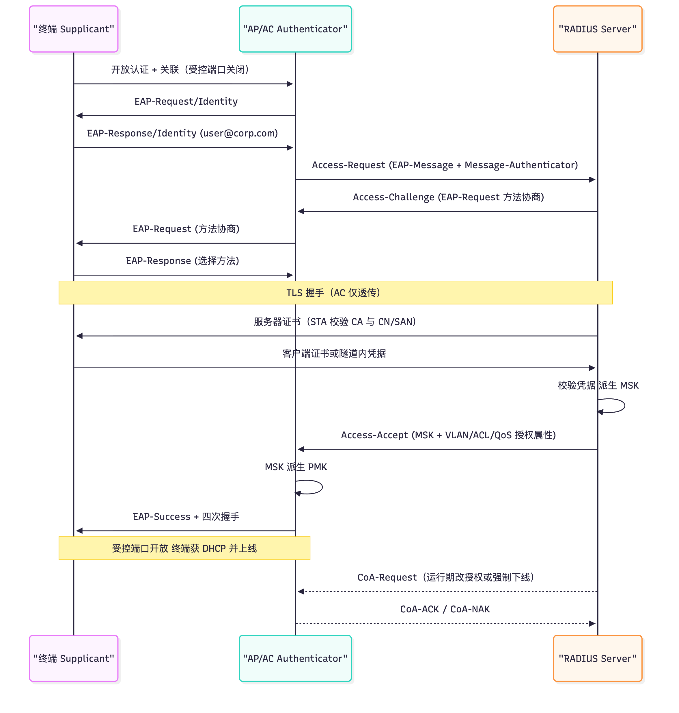


```mermaid
flowchart TD
    A["终端关联"] --> B["受控端口关闭"]
    B --> C["EAPOL Identity 交互"]
    C --> D["AC 转 RADIUS Access-Request"]
    D --> E{"服务器校验"}
    E -->|Reject| F["Access-Reject 终端无法上线"]
    E -->|Accept| G["Access-Accept 携带 MSK 与授权属性"]
    G --> H["AC 派生 PMK 完成四次握手"]
    H --> I{"是否有授权 VLAN"}
    I -->|是| J["用户进入 RADIUS 下发 VLAN"]
    I -->|否| K["用户进入 VAP 默认 VLAN"]
    J --> L["应用下发 ACL 与 QoS"]
    K --> L
    L --> M["受控端口开放 正常访问"]
```

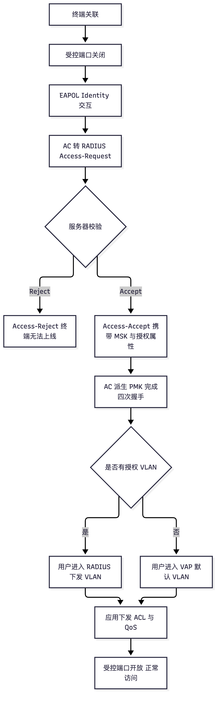


### 真题精练

**Q1.【真题·简答】** 请画出并说明 802.1X 在 WLAN 上的完整认证流程（从终端关联到受控端口开放），并指出 AC 在其中"做什么、不做什么"。

> **答案**：
> **流程（8 个阶段）**：
> ① **关联阶段**：终端与 AP 完成开放认证与关联，此时**受控端口处于关闭（未授权）状态**，终端只能发送/接收 **EAPOL** 报文，无法获得业务地址与服务。
> ② **身份请求**：AC 向终端发送 **EAP-Request/Identity**。
> ③ **身份响应**：终端回 **EAP-Response/Identity**（可能是真实用户名 `user@corp.com`，也可能是匿名标识 `anonymous@corp.com`，后者用于隐藏真实身份）。
> ④ **转发到服务器**：AC 把 EAP 报文封装在 **RADIUS Access-Request** 的 **EAP-Message（79）** 属性中发给 RADIUS 服务器，同时携带 **Message-Authenticator（80）**、**NAS-IP-Address**、**Calling-Station-Id（终端 MAC）**、**Called-Station-Id（BSSID/SSID）**、**NAS-Port-Type = Wireless-802.11** 等。
> ⑤ **方法协商**：服务器与终端通过 Access-Challenge / EAP-Request 协商具体的 EAP 方法（TLS/PEAP/TTLS/SIM/AKA）。
> ⑥ **TLS 握手与凭据校验**：建立 TLS 隧道，**服务器出示证书，终端校验 CA 与 CN/SAN**；随后双向证书（EAP-TLS）或隧道内凭据（PEAP/TTLS 的 MSCHAPv2/口令）被校验；服务器派生 **MSK（Master Session Key）**。
> ⑦ **Access-Accept 与密钥安装**：服务器返回 **Access-Accept**，携带 **MSK 片段** + **授权属性**（VLAN/ACL/QoS/超时）；AC 由 MSK 派生 **PMK**，触发四次握手完成 PTK 安装，并下发 EAP-Success。
> ⑧ **端口开放**：受控端口转为授权状态，终端获取 DHCP 地址并访问网络。运行期服务器还可通过 **CoA** 变更授权或强制下线。
> **AC 做什么**：① **透传 EAP**（EAPOL ↔ RADIUS 双向转换）；② **控制受控端口**（未授权/授权状态机）；③ **安装密钥**（由 MSK 派生 PMK 并完成四次握手）；④ **执行授权**（应用 RADIUS 下发的 VLAN/ACL/QoS）；⑤ **生成计费报文**并上报。
> **AC 不做什么**：① **不校验凭据合法性**（只转发，判定在服务器）；② **看不到 TLS 隧道内的内容**（用户名口令对 AC 不可见，因此无线侧无法解密企业级认证流量）；③ **不决定授权策略**（策略由服务器下发）。

**Q2.【真题·多选】** 关于 EAP 方法的选择，下列说法正确的有？
A. EAP-TLS 需要为每台终端签发客户端证书，安全性最高但 PKI 管理成本高
B. PEAP 只需服务器证书，隧道内使用 MSCHAPv2 校验用户名口令，Windows 原生支持良好
C. EAP-TTLS 的隧道内可以承载多种认证方式（PAP/CHAP/MSCHAPv2/EAP），但客户端支持度不如 PEAP
D. EAP-SIM/EAP-AKA 基于 SIM/USIM 卡，适合运营商 Wi-Fi 与手机免密认证
E. 使用 PEAP 时可以不校验证书服务器证书，因为隧道内的 MSCHAPv2 已经加密了凭据

> **答案：ABCD**
> **解析**：E 是极其危险的错误认识，也是"钓鱼 AP 攻击企业 WLAN"的主要成因——**PEAP/TTLS 的隧道是"先有服务器证书、才有加密隧道"**，若客户端不校验服务器证书（或用户随手点"继续"），攻击者可用**自签证书**建立隧道，把隧道内的 MSCHAPv2 凭据转发给真实服务器，并可在中间截获明文口令（PEAP-MSCHAPv2 可被 `asleap` 类工具破解得到 NT 哈希或口令）。**因此部署时必须强制客户端校验服务器证书（指定受信 CA 与服务器名）**，这是 802.1X 部署的第一条纪律。

**Q3.【真题·单选】** 某企业希望"所有员工使用同一 SSID，但研发部员工进入 VLAN 100、外包人员进入 VLAN 200、且外包人员只能访问外网"。最合适的实现方式是？
A. 为研发部和外包人员配置两个不同 SSID
B. 在 RADIUS 服务器上按用户组配置 Tunnel-Type/Tunnel-Medium-Type/Tunnel-Private-Group-ID 下发不同 VLAN，并用 Filter-Id 或私有属性下发 ACL
C. 在 AC 上为每个用户手工配置静态 VLAN
D. 让外包人员使用 WPA2-PSK，研发部使用 WPA3

> **答案：B**
> **解析**：题目要求"**同一 SSID + 不同 VLAN + 不同 ACL**"，这正是 **RADIUS 动态授权**的标准场景：通过 **Tunnel-Type（64）= VLAN、Tunnel-Medium-Type（65）= IEEE-802、Tunnel-Private-Group-ID（81）= VLAN ID** 下发 VLAN，通过 **Filter-Id（11）** 或华为私有属性（Huawei-Data-Filter / Huawei-ACL-ID 等）下发 ACL。A 违背"同一 SSID"的要求（且会导致漫游与体验问题）；C 静态配置无法随人员变化扩展；D 解决的是加密强度而非授权隔离，且用 PSK 反而失去"可追溯的用户身份"（PSK 是共享的，无法区分是谁）。

**Q4.【真题·判断】** 当 RADIUS 服务器通过 Access-Accept 下发了授权 VLAN 时，用户会进入该 VLAN，而不是 VAP 模板中配置的服务 VLAN。

> **答案：正确**
> **解析**：这是"**动态授权 VLAN 优先于静态 VAP VLAN**"的规则。它也是排错时的重要依据：如果用户反映"接入后拿到的地址网段和预期不一样""访问不了某些资源"，应先用 `display access-user` 或 `display station mac-address <MAC> verbose` 查看该用户**实际生效的授权 VLAN 与 ACL**，并核对 RADIUS 服务器上配置的属性（很可能是服务器配了一个"默认 VLAN"覆盖了 VAP 配置）。注意：授权 VLAN **必须已在 AC 上创建并配置好网关**，否则用户会因为没有三层可达而无法获得地址（这是配置遗漏的高发点）。

**Q5.【真题·填空】** RADIUS 认证与计费使用 UDP 端口 ________ 和 ________，而 CoA（Change of Authorization）与 Disconnect Message 使用 UDP 端口 ________，其方向是________（AC→服务器 / 服务器→AC）。

> **答案：1812；1813；3799；服务器→AC**
> **解析**：CoA/DM 的**方向是"服务器主动发往 NAS（AC）"**，这是它区别于普通认证/计费的根本点，也是部署时最容易出问题的环节——需要确认：① AC 已启用 CoA 接受功能；② AC 与服务器之间 3799 端口放通（含中间防火墙）；③ AC 配置了正确的 CoA 源地址，服务器据此校验对端身份；④ 服务器侧配置了 AC 的 NAS 地址与共享密钥。若这些任一项缺失，会出现"服务器发了 CoA 但 AC 无响应/不回 ACK"的现象。

**Q6.【真题·设计】** 某集团 5000 人，需要 WLAN 802.1X 企业级认证。请设计认证架构，包含：EAP 方法选型与理由、服务器证书体系、高可用设计、动态授权策略、以及认证失败时的用户体验设计。

> **答案**：
> **① EAP 方法选型**：**主力用 PEAP-MSCHAPv2**（与 AD 域集成、Windows/移动端原生支持、部署成本低），**敏感部门（财务/研发核心）用 EAP-TLS**（客户端证书 + 前向保密 + 抗钓鱼），**移动办公设备可评估 EAP-TTLS**（兼容多种凭据后端）。若合规要求"192 位套件"，则必须全面 EAP-TLS（P-384）+ WPA3-Enterprise。
> **② 服务器证书体系**：建立**企业私有 CA（或使用公共受信 CA）**，为 RADIUS 服务器签发**服务器证书**（CN/SAN 必须与客户端配置的"服务器名"完全一致，如 `radius.corp.com`）；证书有效期与轮换流程明确（**避免过期导致全公司无法接入**——见 4.7 节案例）；**客户端侧强制配置"受信 CA 列表 + 服务器名匹配 + 不提示用户信任未知证书"**（通过组策略/MDM 统一下发，这是防钓鱼 AP 的关键）。
> **③ 高可用设计**：**RADIUS 双机（主备或负载分担）**，AC 上配置主备服务器地址与超时重传（`radius-server authentication` 两个地址、`retransmit 3`、`timeout 5`）；**数据库/AD 的高可用**；**AC 双机热备（HSB）**并同步授权信息；**跨机房部署**时注意 CoA 的可达性与源地址一致性；配 **本地逃生**（见 ④）。
> **④ 动态授权策略**：按用户组下发 VLAN（员工/外包/访客/设备）、ACL（外包仅外网、设备仅服务器）、QoS（VIP 用户更高优先级/带宽）；用 **Session-Timeout / Idle-Timeout** 管理会话；用 **CoA** 实现"权限变更立即生效"与"检测到异常立即降权/下线"（对接 HiSec Insight 或 NAC 系统）。
> **⑤ 认证失败时的用户体验设计**：
> - **明确错误提示**：区分"用户名口令错误""证书不受信""服务器不可达""账号被锁定"，避免统一提示"无法连接"造成运维困难。
> - **服务器不可达的逃生**：配置**本地逃生 SSID 或本地认证兜底**（部分 AC 支持本地账号/PSK 逃生），并对其做严格 ACL 限制（只允许访问必要资源），确保 RADIUS 故障时业务不中断。**逃生必须记录并告警**（否则成为长期安全漏洞）。
> - **首次接入引导**：通过组策略/MDM 预置 SSID 与证书配置，避免员工手工配置时"点信任未知证书"。
> - **自助服务**：口令重置、证书申请/续期的自助门户；**证书到期前 30 天提醒**。
> **⑥ 验收要点**：认证成功率 ≥99%（`display wlan sta-statistics`）、双机切换业务中断 ≤ 秒级、CoA 生效时延可接受、逃生机制验证通过。

**Q7.【真题·排错】** 某企业 802.1X WLAN 突然大面积无法接入，AC 上 `display radius-server statistics template` 显示大量 Timeout，少量 Reject。请给出排查步骤与处置。

> **答案**：
> ① **先定位是"服务器不可达"还是"认证被拒"**：Timeout 占绝大多数 → 优先排查**可达性与性能**；如果 Reject 多 → 排查**凭据/策略/证书**问题。
> ② **可达性排查**：在 AC 上 `ping` RADIUS 服务器地址；检查 AC 到服务器之间的路由与防火墙是否放通 **1812/1813/3799**；检查 `radius-server authentication` 配置的地址是否正确（是否误配成旧地址/备用地址不可用）；检查**共享密钥是否一致**（密钥不一致会导致服务器丢弃报文，表现为 Timeout 而非 Reject——这是极易误判的一点）。
> ③ **服务器侧排查**：服务器进程/服务是否存活、CPU/内存是否过载、数据库或 AD 是否可达、日志中是否有拒因（如账号锁定、证书过期、策略不匹配）；检查服务器**每客户端速率限制（RADIUS 有防暴力破解的限速）**是否因大并发触发。
> ④ **网络侧排查**：AC 与服务器之间是否有**中间设备（防火墙/NAT/负载均衡）**在老化 UDP 会话或做端口限制；若服务器位于另一个网段且经 NAT，需确认服务器看到的 NAS 地址能正确回送响应。
> ⑤ **AC 侧并发与资源排查**：`display cpu-usage` 看 AC 是否过载；`display access-user` 看在线用户规模是否超规格；检查 `retransmit/timeout` 是否过短（高负载时会造成大量超时重传，进一步加剧服务器压力）。
> ⑥ **处置（按优先级）**：确认并修正共享密钥；修复路由/防火墙放通；**确认备用服务器可用**（很多项目配了备用但从未测试）；把 `timeout` 适当放宽（如 5→10 秒）并保持 `retransmit 3`；若服务器过载则扩容或增加节点；**启用/验证本地逃生机制**先恢复业务，再逐步压测恢复主路径。
> ⑦ **回归与预防**：做一次 **RADIUS 双机切换演练**并记录中断时间；对 RADIUS 做**监控与告警**（超时率、响应时延、拒绝率）；证书与账号有效期纳入巡检。

**Q8.【真题·实验】** 在 AC6805 上完成"802.1X + RADIUS（主备）+ 计费 + CoA"的完整配置，并给出验证命令与判据。

> **答案**：
> ```bash
> system-view
> radius-server template RS_CORP                             // 1. RADIUS 模板
>  radius-server shared-key cipher Huawei@Radius             //    共享密钥：必须与服务器一致，否则表现为超时
>  radius-server authentication 10.10.200.11 1812            //    主认证服务器
>  radius-server authentication 10.10.200.12 1812            //    备认证服务器（高可用，必须实测切换）
>  radius-server accounting 10.10.200.11 1813                //    主计费服务器
>  radius-server accounting 10.10.200.12 1813                //    备计费服务器
>  radius-server retransmit 3                                //    重传 3 次
>  radius-server timeout 5                                    //    单次超时 5 秒
>  radius-server source ip-address 10.10.100.1               //    源地址：服务器据此识别 NAS 并配置 CoA 回送
>  radius-server coa enable                                  //    允许接受服务器下发的 CoA（动态授权变更）
>  radius-server coa source ip-address 10.10.100.1           //    CoA 响应的源地址
> quit
> aaa                                                        // 2. AAA 方案与域
>  authentication-scheme AS_1X
>   authentication-mode radius                               //    认证走 RADIUS
>  accounting-scheme AC_1X
>   accounting-mode radius                                   //    计费走 RADIUS
>   accounting realtime 15                                   //    每 15 分钟中间计费上报
>  domain corp.com
>   authentication-scheme AS_1X
>   accounting-scheme AC_1X
>   radius-server RS_CORP
> quit
> wlan                                                       // 3. 无线侧绑定 802.1X 安全模板
>  security-profile name SP_1X
>   security wpa2 dot1x aes                                   //    WPA2-Enterprise + AES
>   pmf optional                                              //    建议开启 PMF（可选/强制按终端兼容性决定）
>  vap-profile name VAP_1X
>   service-vlan vlan-id 10                                   //    默认 VLAN（RADIUS 下发 VLAN 时以授权 VLAN 优先）
>   security-profile SP_1X
> ```
> ```bash
> display radius-server configuration template RS_CORP          // 核对服务器地址/密钥/超时/重传/CoA 是否与设计一致
> display radius-server statistics template RS_CORP             // 请求/接受/拒绝/超时统计：判断服务器健康度
> display aaa online-fail-record all                            // 上线失败记录与原因：排错第一命令
> display access-user                                           // 在线用户及其授权信息（VLAN/ACL/域）——验证动态授权
> display station mac-address <MAC> verbose                     // 单终端：认证方式、授权 VLAN、速率、PMF 状态
> display wlan sta-statistics                                   // 上线成功率（验收判据之一）
> ```
> **验收判据**：① 认证成功率 ≥99%；② `display access-user` 中用户处于**正确的授权 VLAN**（研发/外包分别进入对应 VLAN）；③ **主备服务器切换**：断开主服务器后新用户仍能成功认证，切换业务中断 ≤ 秒级；④ **CoA 生效**：从服务器下发 CoA 后，用户在秒级内进入新 VLAN 或被强制下线（`display access-user` 可见变更）；⑤ **计费报文**在服务器侧可正常记录（含 Session-Id、时长、流量）。**具体命令关键字在不同版本可能不同，以所用版本文档为准。**

### 易错点与排错

1. **认为 AC 校验凭据**：AC 只透传 EAP 并执行服务器返回的结果，真正判定在 RADIUS。
2. **PEAP/TTLS 不校验服务器证书**：等于把凭据交给任何伪造 AP，是最大的部署风险；必须"受信 CA + 服务器名匹配 + 拒绝未知证书"。
3. **共享密钥不一致表现为"超时"而非"拒绝"**：排错时若只看到 Timeout，一定要先核对密钥。
4. **配了备服务器但从未验证**：高可用必须演练（断主、断链路、重启服务器三种场景）。
5. **授权 VLAN 未在 AC 上创建**：RADIUS 下发 VLAN 但 AC 上没有该 VLAN/网关，用户拿到"孤立"的地址或拿不到地址。
6. **忘记 CoA 的前置条件**：AC 未启用 CoA、3799 未放通、源地址未配置，都会导致"服务器发了 CoA 无响应"。
7. **排错命令**：`display radius-server statistics template <名>`（服务器健康）、`display aaa online-fail-record all`（失败原因）、`display access-user`（授权结果）、`display station mac-address <MAC> verbose`（终端协商结果）。

---

## 4.3 Portal 认证进阶：二层/三层差异、完整流程与逃生机制

### 考点定位

本考点以**流程题/对比题/排错题**形式出现，占 **5~8 分**。它是"访客与公共区域接入"的标准方案，也是**排错高发区**（"Portal 页面弹不出来"是华为 ICT 大赛与真实项目里最经典的无线故障）。高频陷阱：① 说不清**二层 Portal 与三层 Portal** 的区别（核心是**认证前终端与 Portal 服务器是否二层可达**）；② 不知道 Portal 认证前终端需要**先获得 IP 地址**（因此必须有"认证前域"或"免认证规则"让 DHCP/DNS/Portal 流量通过）；③ 忽略 **HTTPS Portal 的证书**问题（浏览器不受信警告导致用户放弃）；④ 不知道**逃生机制**（Portal 服务器或 AC 与服务器之间故障时如何放行）；⑤ 忽略 **MAC 优先认证/免认证** 的适用条件与安全风险。

### 原理精讲

**① 二层 Portal 与三层 Portal 的本质区别。**

- **三层 Portal（Layer 3 Portal，最常用）**：Portal 服务器与终端**不在同一网段**，通过**三层路由可达**。认证前，AC 通过 **ACL 规则**（或"认证前域"）只放通到 Portal 服务器的 HTTP/HTTPS、DNS、DHCP 流量，其余流量被重定向（HTTP 302 重定向）到 Portal 页面。认证成功后 ACL 放开（或用户进入授权 VLAN）。优点：**组网灵活**，Portal 服务器可集中部署在数据中心，一套服务器服务多个分支与多个 SSID；终端与 Portal 服务器之间跨三层，不受二层广播域限制。缺点：需要保证**路由可达与 DNS 正确**（DNS 解析不到 Portal 域名，页面就弹不出来）。
- **二层 Portal（Layer 2 Portal）**：Portal 服务器与终端**在同一二层网络（同一 VLAN/子网）**。认证前的重定向通过**二层手段**实现（AC 直接代理/拦截，或以网关身份响应）。优点：**不依赖三层可达与 DNS**，认证流程更短，适合"单点小规模部署"；缺点：**Portal 服务器必须下移到每个二层域**，多分支/多 VLAN 场景扩展性差，且占用业务网段地址。

**核心判据（答题口径）**：**"认证前，终端能否与 Portal 服务器三层可达？"——能则需要三层 Portal 与放通路由/DNS；否（或希望不依赖三层）则用二层 Portal。** 实际项目绝大多数用**三层 Portal**。

**② Portal 认证的完整流程（必须能画）。**

```
阶段 0：终端关联 SSID（开放或 PSK），此时 ACL/认证前域只放通 DHCP、DNS、到 Portal 服务器的 HTTP/HTTPS
阶段 1：终端发 DHCP → 获得 IP（这一步必须放通，否则终端没有 IP，无法访问 Portal）
阶段 2：终端发起 DNS 查询（解析任意域名）→ 放通；解析结果返回（可指向 Portal 或真实 IP）
阶段 3：终端访问任意 HTTP 网站 → AC 拦截并回复 HTTP 302 重定向到 Portal 登录页 URL
        （URL 中携带 AC 地址、用户 IP、AP 的 BSSID、SSID、原始访问 URL 等参数）
阶段 4：终端向 Portal 服务器发起 HTTPS 请求 → 服务器返回登录页（含用户名/口令、或短信验证码、或微信/二维码等）
阶段 5：用户在页面上提交凭据 → Portal 服务器向 AC 发起**Portal 认证请求**（Portal 协议报文，如 Portal 2.0 的
        REQ_AUTH / ACK_AUTH）
阶段 6：AC 作为 RADIUS 客户端，把凭据（或被要求二次校验）转给 RADIUS 服务器做**真正的校验**
        —— 多数部署中 Portal 服务器本身也对接 RADIUS/LDAP 完成校验，再由 AC 下发授权
阶段 7：AC 开放该用户的访问权限（应用授权 ACL/VLAN/QoS），并向 Portal 服务器回 ACK_AUTH
阶段 8：Portal 服务器向终端返回"认证成功"页面；终端可正常上网
阶段 9：AC 周期上报计费报文；会话超时/用户点击注销/被 CoA/被强制下线时关闭
```

**③ Portal 服务器与 AC 的对接协议。** 华为 AC 与 Portal 服务器之间使用华为 **Portal 协议**（常见为 **Portal 2.0**，基于 TCP，早期也有 UDP 版本），核心报文类型：**REQ_CHALLENGE / ACK_CHALLENGE（挑战握手）**、**REQ_AUTH / ACK_AUTH（认证请求/应答）**、**REQ_LOGOUT（注销）**、**NTF_LOGOUT（服务器通知用户下线）**、**AFF_ACK_AUTH（确认认证应答）**、**NTF_USERDISCOVER / NTF_IPCHANGED（用户发现与 IP 变化通知，用于二次地址分配与检测下线）**。对接要素：**共享密钥（shared secret，用于报文完整性/加密）**、**AC 上配置 Portal 服务器 IP 与端口、认证端口、密钥**、**Portal 服务器上配置 AC 的 IP 与密钥、以及回调 AC 的地址**。**注意：Portal 认证必须同时配置 AC 与 Portal 服务器两侧，且密钥一致**（密钥不一致是"页面能弹出但提交后失败"的常见原因）。

**④ HTTPS Portal 与证书。** 现代部署必须使用 **HTTPS Portal**（HTTP 会被浏览器标记"不安全"，且易被中间人劫持）。要点：
- **Portal 服务器需要安装服务器证书**（由受信 CA 签发，或企业内 CA 签发并在终端上预置根证书）。若证书不受信，浏览器会显示"此连接不安全/证书错误"，大量用户会放弃或点"继续"（后者有被中间人风险）。
- **Portal 页面 URL 中的域名必须与证书的 CN/SAN 一致**，否则同样报证书错误。
- **重定向的自动化**：手机与主流 OS 支持 **CNA（Captive Network Assistant，强制门户探测）**——系统自动探测 `captive.apple.com` / `connectivitycheck.android.com` 等特定 URL，若被重定向则认为"需要登录"并自动弹出 Portal 页面。**因此 AC 的免认证/重定向规则必须放通这些探测 URL 的探测请求（让其被重定向），否则"页面不会自动弹出"**——这是"Portal 页面弹不出来"最常见的原因之一。
- **尽量避免自签证书用于生产**；若必须使用，需通过 MDM/组策略把根证书推送到终端。

**⑤ 免认证、MAC 优先认证与逃生机制。**

- **免认证规则（Free Authentication Rule / 认证前规则）**：指定"哪些目的地址/域名/端口无需认证即可访问"。必需的最小集合：**DHCP（放通以获取地址）**、**DNS（放通以解析域名）**、**Portal 服务器地址（放通以加载登录页）**、**Captive Portal 探测域名（放通以触发系统弹窗）**。此外常放通**内部 OA 白名单、软件更新服务器、杀毒升级服务器**等（按需，越小越安全）。
- **MAC 优先认证（MAC Prioritized Authentication）**：终端首次接入时，先以其 **MAC 地址**尝试认证（服务器若已绑定该 MAC 则直接放行，用户无感知）；若 MAC 未绑定，则回落到 Portal 页面让用户输入凭据，**认证成功后把 MAC 与用户绑定**（下次免登录）。适用于**打印机、扫码枪、IoT 设备、访客首次认证后的一段时间内免登录**。**安全风险**：MAC 可伪造，因此 MAC 免认证必须配合**绑定有效期**（如 7~30 天）、**绑定白名单**、**单独 VLAN/ACL 限制**，不能作为唯一的强认证手段。
- **逃生机制（Escape / Bypass）**：当**Portal 服务器不可达（宕机/网络中断）**或**AC 与服务器之间的认证交互失败**时，为避免"所有人都不能上网"，AC 可启用逃生：**放行用户（进入逃生 VLAN 或应用宽放 ACL）**，同时**产生告警并记录日志**。逃生参数通常包括：**逃生阈值（失败次数/时长）**、**逃生后的权限范围**（建议只允许访问外网或特定资源）、**逃生恢复条件**（服务器恢复后自动回到正常流程）。**关键原则：逃生必须"有告警、有日志、有范围限制、有恢复验证"**，否则会变成"永久开放网络"这一重大安全漏洞。

### 关键概念对照表

| 维度 | 三层 Portal | 二层 Portal |
|---|---|---|
| 终端与 Portal 服务器位置 | 不同网段，三层可达 | 同一二层域 |
| 重定向实现 | AC 拦截 HTTP 并 302 重定向到服务器 URL | AC 在二层拦截/代理，不依赖三层与 DNS |
| 依赖条件 | 路由可达 + DNS 正确 + 放通服务器地址 | 不依赖三层可达与 DNS |
| 部署规模 | **多分支/多 SSID 集中部署**（推荐） | 单点小规模 |
| 地址资源 | 服务器在独立网段 | 服务器占用业务网段 |
| 扩展性 | 好 | 差（每域都要部署/打通） |
| 典型场景 | 园区访客、商场、酒店、校园 | 小型门店、单栋楼 |

| 阶段/机制 | 必须放通的内容 | 漏配后果 |
|---|---|---|
| 认证前（获取地址） | DHCP（67/68 或中继） | 终端拿不到 IP，页面永不弹出 |
| 认证前（域名解析） | DNS（53） | 域名无法解析，重定向后页面打不开 |
| 认证前（加载登录页） | Portal 服务器的 HTTP/HTTPS | 重定向成功但页面白屏 |
| 认证前（自动弹窗） | Captive Portal 探测域名 | 系统不自动弹窗，用户以为"没网" |
| 认证中（校验凭据） | AC 与 Portal/RADIUS 的协议端口 + 共享密钥一致 | 页面能弹但提交后一直失败 |
| 运行期（计费/CoA） | RADIUS 1813 / CoA 3799 | 无法计费、无法动态下线 |

| 免认证与逃生机制 | 作用 | 安全风险 | 加固要求 |
|---|---|---|---|
| 免认证规则 | 放通必要流量使认证可行 | 放通过大等于开放网络 | 最小集合（DHCP/DNS/Portal/探测域名） |
| MAC 优先认证 | 老终端与 IoT 免交互接入 | MAC 可伪造 | 绑定有效期 + 白名单 + 独立 VLAN/ACL |
| 逃生机制 | Portal 故障时保业务连续 | 可能变成永久开放 | 阈值 + 范围限制 + 告警 + 恢复验证 |

### 华为设备配置

```bash
# ===== AC6805：三层 Portal 认证完整配置（VRP V200R019+）=====
system-view
 url-template name UT_PORTAL                                // URL 模板：定义重定向到 Portal 服务器的地址
  url https://portal.corp.com:8443/portal                   // HTTPS Portal 登录页（域名必须与服务器证书匹配）
 quit
 web-auth-server AC_PORTAL                                  // 定义 Portal 服务器（Web 认证服务器）
  server-ip 10.10.200.30                                    // Portal 服务器 IP（必须与 AC 路由可达）
  port 50100                                                // Portal 协议端口（与服务器配置一致）
  shared-key cipher Huawei@Portal                            // 共享密钥（两侧必须一致）
  url-template UT_PORTAL                                    // 绑定 URL 模板
  http get-method enable                                     // 允许用 HTTP GET 方式携带参数（按服务器实现选择）
 quit
 aaa
  authentication-scheme AS_PORTAL
   authentication-mode radius                               // Portal 认证的实际校验仍走 RADIUS（或由 Portal 服务器完成）
  domain portal.com
   authentication-scheme AS_PORTAL
   radius-server RS_CORP                                    // 绑定 RADIUS 模板（见 4.2 节）
 quit
 wlan
  security-profile name SP_PORTAL                           // 访客 SSID 通常为开放认证 + Portal
   security open                                             // 开放认证（无空口加密，靠 Portal 做接入控制）
  vap-profile name VAP_GUEST
   service-vlan vlan-id 20                                   // 访客 VLAN
   security-profile SP_PORTAL
   authentication-profile ...                                // 绑定认证模板（含 Portal 服务器与免认证规则，以所用版本为准）
```

```bash
# ===== 免认证规则（认证前必须放通的最小集合）=====
 free-rule-template name FR_GUEST                            // 免认证规则模板
  free-rule 1 destination ip 10.10.200.30 mask 32           // 放通 Portal 服务器（否则登录页加载不出来）
  free-rule 2 destination ip 10.10.100.1 mask 32            // 放通 DHCP 服务器/网关（否则终端拿不到地址）
  free-rule 3 destination ip 10.10.200.53 mask 32           // 放通 DNS 服务器（否则域名无法解析）
  free-rule 4 destination ip 0.0.0.0 mask 0 source ...      // 探测域名可用 ACL 方式放通（以所用版本支持的方式为准）
```

```bash
# ===== 逃生机制（Portal 服务器不可达时保业务）=====
 web-auth-server AC_PORTAL
  server-detect ...                                         // 服务器探测（部分版本支持探测间隔/失败阈值，以所用版本文档为准）
  escape ...                                                // 逃生相关参数：阈值/放行范围（以所用版本文档为准）
```

```bash
# ===== 验证与排错 =====
display web-auth-server configuration                        // 查看 Portal 服务器配置：IP/端口/密钥/URL 模板
display web-auth-server statistics                           // Portal 报文统计：REQ_AUTH/ACK_AUTH 计数，判断交互是否正常
display aaa online-fail-record all                           // 上线失败记录与原因
display access-user                                          // 在线用户与授权信息（确认是否进入访客 VLAN 与授权 ACL）
display station mac-address <MAC> verbose                    // 终端详情：IP、认证状态、速率
display free-rule-template name FR_GUEST                     // 核对免认证规则（漏配会导致页面弹不出来）
```

### 示意图

```mermaid
sequenceDiagram
    participant STA as "终端"
    participant AC as "AC"
    participant POR as "Portal 服务器"
    participant RAD as "RADIUS 服务器"
    STA->>AC: 关联访客 SSID（开放认证）
    STA->>AC: DHCP 请求（免认证放通）
    AC->>STA: DHCP 应答 分配访客网段地址
    STA->>AC: DNS 查询（免认证放通）
    STA->>AC: HTTP 访问任意网站
    AC->>STA: HTTP 302 重定向到 Portal 登录页 URL
    STA->>POR: HTTPS 请求登录页
    POR->>STA: 返回登录页（含证书校验）
    STA->>POR: 提交用户名与口令
    POR->>AC: Portal 协议 REQ_AUTH（携带用户信息）
    AC->>RAD: RADIUS Access-Request（校验凭据）
    RAD->>AC: Access-Accept（含授权 VLAN/ACL）
    AC->>AC: 开放用户权限并应用授权
    AC->>POR: ACK_AUTH
    POR->>STA: 认证成功页面
    Note over STA,AC: 用户正常上网 并周期上报计费
```

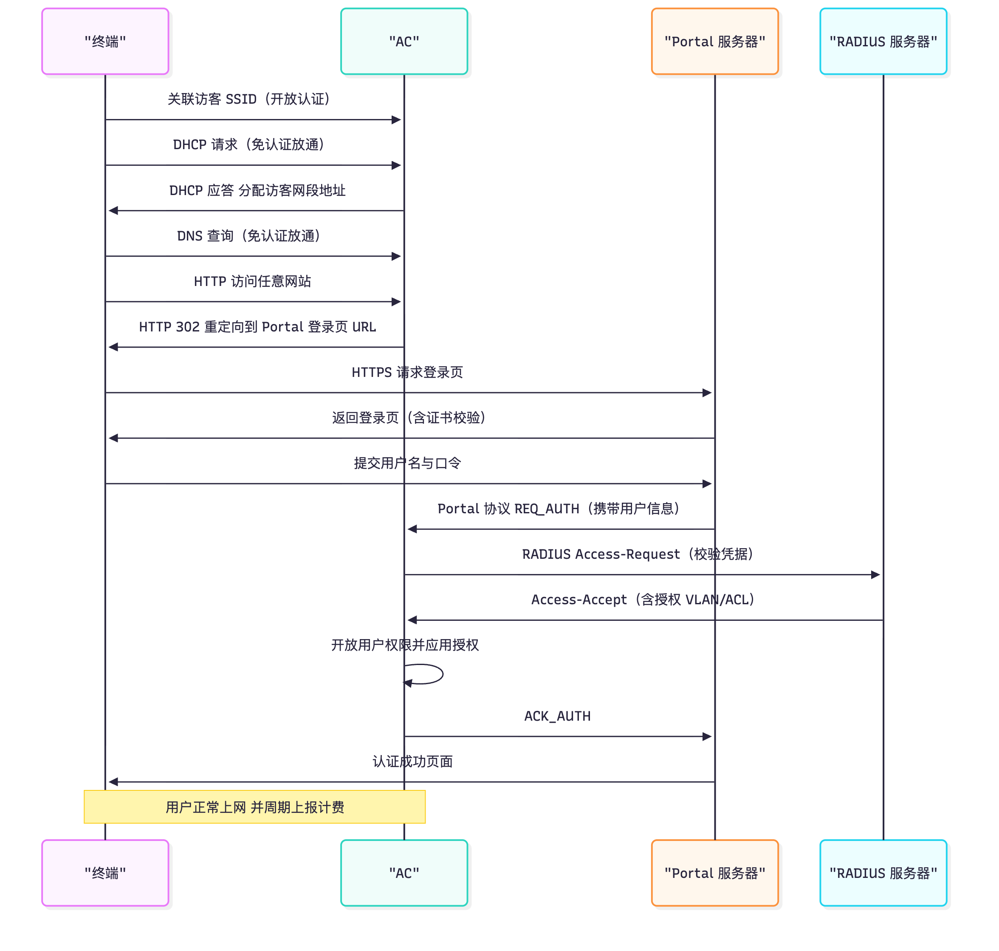


```mermaid
flowchart TD
    A["Portal 页面弹不出来"] --> B{"终端是否拿到 IP"}
    B -->|否| C["检查免认证规则是否放通 DHCP"]
    B -->|是| D{"DNS 是否能解析"}
    D -->|否| E["放通 DNS 与检查 DNS 服务器可达"]
    D -->|是| F{"重定向是否发生"}
    F -->|否| G["检查 AC 认证模板与免认证规则是否绑定到 VAP"]
    F -->|是| H{"登录页能否加载"}
    H -->|否| I["检查 Portal 服务器可达性与 443 端口"]
    H -->|是| J{"提交后是否失败"}
    J -->|是| K["检查共享密钥 一致性 与 RADIUS 校验"]
    J -->|否| L["正常 检查用户权限与 ACL"]
```

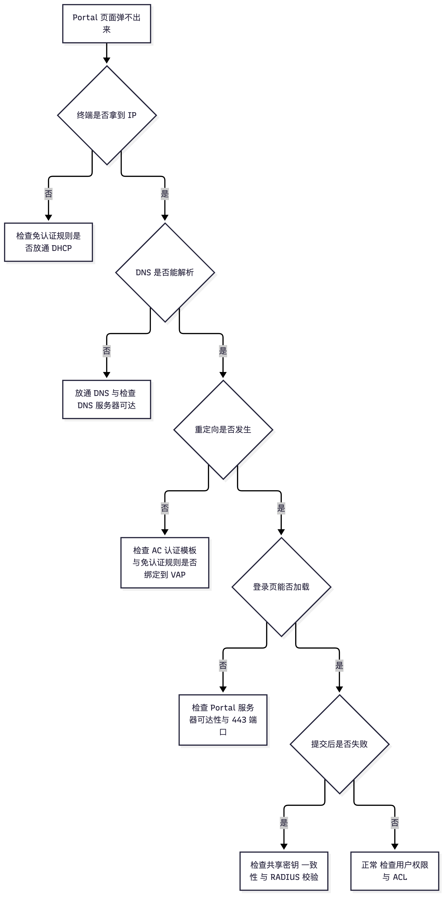


### 真题精练

**Q1.【真题·简答】** 请说明二层 Portal 与三层 Portal 的区别、各自的适用场景，并画出三层 Portal 认证的完整报文流程。

> **答案**：
> **① 区别（核心判据：认证前终端与 Portal 服务器是否三层可达）**：
> | 维度 | 三层 Portal | 二层 Portal |
> |---|---|---|
> | 位置关系 | 终端与服务器不同网段，三层可达 | 同一二层域（同 VLAN/子网） |
> | 重定向方式 | AC 拦截 HTTP 并返回 302 重定向到服务器 URL | AC 在二层拦截/代理，不依赖三层与 DNS |
> | 依赖 | 路由可达 + DNS 正确 + 放通服务器地址 | 不依赖三层可达与 DNS |
> | 扩展性 | 好（服务器可集中部署服务多分支/多 SSID） | 差（每个二层域都要部署） |
> **② 适用场景**：**三层 Portal** 用于园区访客、商场、酒店、校园等多分支/多 SSID 场景（推荐主流方案）；**二层 Portal** 用于小型门店、单栋楼等单点小规模场景。
> **③ 完整流程（报文级）**：
> 1. 终端关联访客 SSID（通常开放认证），此时免认证规则只放通 DHCP/DNS/Portal 服务器/探测域名。
> 2. DHCP 交互获得 IP（必须放通，否则没有 IP 无法访问 Portal）。
> 3. DNS 查询（放通），解析域名。
> 4. 终端发起 HTTP 请求访问任意网站 → **AC 拦截并回复 HTTP 302**，重定向到 Portal 登录页 URL（URL 携带 AC 地址、用户 IP、BSSID、SSID、原始 URL 等参数）。
> 5. 终端向 Portal 服务器发起 **HTTPS** 请求 → 服务器校验自身证书 → 返回登录页（HTTP 与 HTTPS 的选择影响安全与兼容性，生产必须 HTTPS）。
> 6. 用户提交凭据 → **Portal 服务器向 AC 发送 Portal 协议 REQ_AUTH**（含用户 IP、MAC、用户名、口令/令牌、挑战信息）。
> 7. **AC 作为 RADIUS 客户端向 RADIUS 服务器发起 Access-Request** 完成真正的凭据校验（部分部署由 Portal 服务器直接对接 RADIUS/LDAP 校验后再通知 AC）。
> 8. RADIUS 返回 **Access-Accept**（含授权 VLAN/ACL/QoS）→ **AC 开放该用户权限并应用授权**。
> 9. **AC 回 Portal 服务器 ACK_AUTH** → 服务器向终端返回"认证成功"页面。
> 10. 用户正常上网，AC 周期上报计费；注销/超时/CoA 时关闭会话。
> **④ 常见失败点**：免认证规则漏配（DHCP/DNS/Portal）、Captive Portal 探测域名未放通（不自动弹窗）、共享密钥不一致（页面能弹但提交失败）、HTTPS 证书不受信（用户不敢继续）。

**Q2.【真题·多选】** 某酒店访客反映"连上 Wi-Fi 后浏览器打不开任何网页，也没有弹出登录页面"。下列哪些是可能的原因？
A. 免认证规则未放通 DHCP，终端没有获得 IP 地址
B. 免认证规则未放通 DNS，域名无法解析
C. 免认证规则未放通 Portal 服务器地址，登录页无法加载
D. 终端系统的 Captive Portal 探测域名未被重定向，系统未自动弹窗
E. 访客 SSID 使用了 WPA3-SAE，因此无法弹出 Portal

> **答案：ABCD**
> **解析**：E 与现象无关——Portal 与空口认证方式（开放/WPA2/WPA3）可以并存（虽然常见做法是开放认证 + Portal，但 WPA3 场景同样可以叠加 Portal）。A/B/C/D 覆盖了"Portal 弹不出来"的四大主因，其中 **A 是最隐蔽的**：终端没有 IP 时连 DNS 都发不出去，表现为"完全没有网络反应"，而运维人员常误以为是 AC 配置问题。**排错顺序应为：先确认终端是否拿到 IP（`ipconfig`/`ifconfig`），再查 DNS、再查免认证规则、最后查 Portal 服务器与密钥。**

**Q3.【真题·判断】** Portal 认证中，AC 会把用户提交的用户名和口令直接发送给 RADIUS 服务器进行校验，Portal 服务器只负责显示页面。

> **答案：错误**
> **解析**：Portal 服务器不只是"显示页面"，它是**认证流程的发起方与协调者**：它接收用户凭据后，通过 **Portal 协议（REQ_AUTH）** 通知 AC，AC 再作为 RADIUS 客户端完成校验；在很多实际部署中，**Portal 服务器本身就对接 RADIUS/LDAP/短信网关/微信开放平台完成校验**，AC 只负责开放权限与授权执行。因此"谁做校验"取决于部署方式：**AC + RADIUS 校验** 或 **Portal 服务器校验后通知 AC**。答题时把两种模式都写出来才完整。此外 Portal 服务器还负责**注销、在线时长展示、广告推送、与计费系统对接**等功能。

**Q4.【真题·填空】** 三层 Portal 认证中，AC 拦截终端的 HTTP 请求后返回 ________ 状态码实现重定向；认证前必须通过 ________ 机制放通 DHCP、DNS 与 Portal 服务器，否则终端既拿不到地址也加载不了登录页；当 Portal 服务器不可达时，为保证业务连续性可启用 ________ 机制，但必须同时产生告警并限制放行范围。

> **答案：302（Found，临时重定向）；免认证规则（Free Rule / 认证前规则）；逃生（Escape / Bypass）**
> **解析**：302 是 Portal 重定向的实现手段；免认证规则是"认证可行性的前提"（很多故障都源于它被漏配或配错范围）；逃生机制是"可用性设计"，但**没有告警与范围限制的逃生等于永久开放网络**，这是设计与验收必须明确的点。补充：HTTPS Portal 还需要证书受信与域名匹配，Captive Portal 探测域名需被正确重定向以实现自动弹窗。

**Q5.【真题·设计】** 某高校需要用 Portal 认证为访客提供上网服务，同时要求：① 访客认证后可自助注册（短信验证）；② 认证后 7 天内免登录；③ Portal 服务器故障时不能影响校内师生（师生用 802.1X）。请给出完整设计方案。

> **答案**：
> **① 认证架构与 SSID 划分**：**访客 SSID**（开放认证 + Portal + 访客 VLAN 20）；**师生 SSID**（WPA2/WPA3-Enterprise + 802.1X + 员工 VLAN 10）。**两者必须使用不同 VLAN、不同 SSID、不同认证模板**，实现"访客与师生在认证路径上完全解耦"——这是满足需求 ③ 的关键前提。
> **② 自助注册与短信验证**：Portal 登录页提供"手机号注册"入口，Portal 服务器通过短信网关下发验证码，校验通过后由 Portal 服务器向 RADIUS/NCE-Campus 写入临时账号（或直接由 Portal 服务器完成校验后通知 AC 放行），并记录手机号、MAC、认证时间、有效期。
> **③ 7 天免登录（MAC 优先认证）**：Portal 服务器把"手机号 + MAC + 有效期（7 天）"写入绑定表；AC 侧启用 **MAC 优先认证**：终端再次接入时先以 MAC 尝试认证，命中绑定表即直接放行（无感知），并刷新有效期；未命中的走 Portal 页面。**安全加固**：绑定表设置 7 天有效期（到期需重新认证）、MAC 免认证用户进入**独立 VLAN + 严格 ACL**（只允许访问互联网，禁止访问内网），并**监控异常（同一 MAC 短时间内多地点接入、单手机号绑定过多 MAC）**。
> **④ Portal 故障不影响师生（需求 ③）**：因为**师生走 802.1X，不经过 Portal**，所以 Portal 故障天然不影响师生。此外还应：
> - 对**访客**配置**逃生机制**（Portal 不可达时按阈值放行，进入"逃生 VLAN"，只允许访问互联网，同时**产生告警**并在恢复后自动回到正常流程）；
> - **Portal 服务器双机/集群**（避免单点故障）并做健康探测；
> - RADIUS 双机，独立于 Portal 服务器（避免二者同时故障）；
> - 逃生与故障必须**记录日志并定期审计**，防止"逃生长期开着"。
> **⑤ 关键配置清单**：AC 上 —— `web-auth-server`（Portal 服务器 IP/端口/共享密钥）、`url-template`（HTTPS URL）、`free-rule-template`（放通 DHCP/DNS/Portal/探测域名）、`security-profile security open`、访客 VAP 绑定 VLAN 20、逃生与 MAC 优先认证参数；Portal 服务器上 —— 与 AC 一致的共享密钥、AC 回调地址、HTTPS 证书（受信 CA 签发，域名匹配）、短信网关对接、绑定表与有效期策略。
> **⑥ 验收指标**：Portal 页面自动弹出率 ≥95%（主流终端）；认证成功率 ≥99%；首次认证平均耗时 ≤ 15 s；MAC 免登录成功率 ≥99%；**逃生演练**（模拟 Portal 宕机）访客仍可上网且告警产生、恢复后自动恢复正常流程；师生 802.1X 在 Portal 故障期间零影响。

**Q6.【真题·排错】** 某商场 Portal 认证：手机能自动弹出登录页，输入短信验证码后页面提示"认证失败"，AC 上 `display web-auth-server statistics` 显示 REQ_AUTH 有计数但 ACK_AUTH 为 0。请给出排查思路。

> **答案**：
> ① **现象解读（关键）**：**REQ_AUTH 有计数说明 Portal 服务器→AC 的报文已到达；ACK_AUTH 为 0 说明 AC 没有正常回应该请求**。问题在 AC 侧的校验或应答环节，而不是"页面或网络不通"。
> ② **首要怀疑：共享密钥不一致**。Portal 协议报文带完整性校验，密钥不一致时 AC 会**丢弃报文并不应答**（表现为"有 REQ 无 ACK"）。排查：核对 AC 的 `shared-key` 与 Portal 服务器配置是否完全一致（注意是否有空格、大小写、是否被密文显示导致误判）。处置：统一密钥并重启相关服务。
> ③ **第二怀疑：AC 无法完成 RADIUS 校验**：`display radius-server statistics template` 看是否有 Timeout/Reject；`display aaa online-fail-record all` 看失败原因。若 RADIUS 不可达或拒绝，AC 不会回 ACK_AUTH（或回失败）。处置：修复 RADIUS 可达性/凭据策略。
> ④ **第三怀疑：Portal 服务器配置的 AC 地址或端口错误**：服务器发送 REQ_AUTH 时以其配置的"AC 地址"为目标，若 AC 上配置的 `server-ip` 与服务器侧配置的 AC 地址不匹配（多网卡/多地址场景常见），AC 会认为报文非本机而丢弃。排查：抓包确认报文的目的地址与源地址；核对 AC 的 `web-auth-server` 配置与 `radius-server source`。
> ⑤ **第四怀疑：用户信息不匹配**：REQ_AUTH 中的用户 IP/MAC 与 AC 上实际的会话不一致（例如终端 IP 已变化、NAT 场景下 IP 被转换、多 VLAN 场景串了池），AC 找不到对应用户而无法放行。排查：`display access-user`/`display station all` 对比 IP/MAC；抓包比对报文中的 IP/MAC。
> ⑥ **第五怀疑：报文格式/版本不匹配**：AC 与 Portal 服务器的 Portal 协议版本或参数字段（如 `http get-method`、`user-ip` 编码方式）不一致。排查：抓包看字段；核对两侧文档要求的字段集合。
> ⑦ **处置顺序**：先核对共享密钥（80% 的"有 REQ 无 ACK"由此引起）→ 再核对 AC/RADIUS 侧校验 → 再核对地址与端口 → 最后核对协议字段。处置后复测并观察 REQ/ACK 计数是否 1:1 对应。
> ⑧ **预防**：把"共享密钥一致性"写入部署检查清单；对 Portal 交互做监控告警（ACK_AUTH 与 REQ_AUTH 的比例）。

**Q7.【真题·简答】** 请说明 AC 侧"免认证规则"（Free Rule）应包含哪些最小内容，并解释为什么"放通全部流量"是错误做法。

> **答案**：
> **① 最小集合（四类）**：
> 1. **DHCP**：放通 DHCP 服务器/中继地址（UDP 67/68），使终端获得 IP —— 没有 IP，后续一切都不可能。
> 2. **DNS**：放通 DNS 服务器（UDP/TCP 53），使域名可解析 —— 否则重定向后的页面域名打不开。
> 3. **Portal 服务器**：放通 Portal 服务器的 HTTP/HTTPS 与 Portal 协议端口 —— 否则登录页无法加载、REQ_AUTH 无法交互。
> 4. **Captive Portal 探测域名**：放通（更准确地说是"允许被重定向"）主流 OS 的门户探测地址（如 Apple 的 `captive.apple.com`、Android 的 `connectivitycheck.*`、Windows 的 `www.msftconnecttest.com`）—— 否则系统不会自动弹窗，用户以为"没网"而放弃认证。
> **② 可选放通（按需，且必须最小化）**：内部 OA/业务白名单（如需认证前可用）、软件/杀毒升级服务器、时间同步（NTP）。每一项都要有业务理由与审批记录。
> **③ 为什么"放通全部流量"是错误做法**：① **认证被架空**——用户可以绕过 Portal 直接上网，认证的价值（实名、审计、带宽管理、内容合规）全部丧失；② **安全风险**——未认证终端可扫描内网、发起攻击、作为跳板；③ **合规问题**——等保与行业监管要求"上网行为可追溯"，认证前开放全部流量会导致追溯失败；④ **资源滥用**——无认证约束的带宽消耗影响付费用户与内部业务。**正确做法是"最小放通 + 定期审计 + 变更留痕"**：每次新增免认证条目都要评估其必要性与安全影响。

**Q8.【真题·实验】** 在 AC6805 上配置一个"访客 Portal 认证 + 免认证规则 + 逃生"的最小可用方案，给出命令并说明验证步骤。

> **答案**：
> ```bash
> system-view
> url-template name UT_GUEST                                  // 1. 定义 Portal 重定向 URL（必须是 HTTPS 且域名与证书匹配）
>  url https://portal.corp.com:8443/guest
> quit
> web-auth-server AC_PORTAL                                   // 2. 定义 Portal 服务器
>  server-ip 10.10.200.30                                     //    Portal 服务器地址（AC 必须路由可达）
>  port 50100                                                 //    Portal 协议端口（与服务器一致）
>  shared-key cipher Huawei@Portal                             //    共享密钥（两侧必须完全一致，否则有 REQ 无 ACK）
>  url-template UT_GUEST                                      //    绑定 URL 模板
> quit
> free-rule-template name FR_GUEST                            // 3. 免认证规则（最小集合）
>  free-rule 1 destination ip 10.10.100.1 mask 32             //    放通 DHCP/网关
>  free-rule 2 destination ip 10.10.200.53 mask 32            //    放通 DNS
>  free-rule 3 destination ip 10.10.200.30 mask 32            //    放通 Portal 服务器
> quit
> wlan                                                        // 4. 访客 VAP 绑定
>  security-profile name SP_GUEST
>   security open                                              //    开放认证（接入控制交给 Portal）
>  vap-profile name VAP_GUEST
>   service-vlan vlan-id 20                                    //    访客 VLAN
>   security-profile SP_GUEST
> ```
> ```bash
> display web-auth-server configuration                         // 核对 Portal 服务器 IP/端口/密钥/URL
> display free-rule-template name FR_GUEST                      // 核对免认证规则（漏配 DHCP/DNS 会导致页面弹不出）
> display web-auth-server statistics                            // REQ_AUTH 与 ACK_AUTH 计数应 1:1 对应
> display access-user                                           // 认证成功后确认用户进入访客 VLAN 与授权 ACL
> display station all                                           // 确认终端已获得访客网段地址
> display aaa online-fail-record all                            // 认证失败原因排错
> ```
> **验证步骤（端到端）**：
> 1. 用手机连接访客 SSID，确认**自动弹出** Portal 页面（若未弹出，先查免认证规则中的探测域名与 DHCP）。
> 2. 确认终端已获得 **访客 VLAN 20 网段**的地址（`ipconfig`/`ifconfig`），说明 DHCP 放通正确。
> 3. 输入测试账号完成认证，确认页面提示成功且能访问互联网（`ping`/浏览器）。
> 4. 在 AC 上确认 `display access-user` 显示该用户与授权信息；`display web-auth-server statistics` 的 REQ/ACK 计数应成对增长。
> 5. **逃生演练**：停掉 Portal 服务器，验证逃生阈值触发后访客仍可上网（进入逃生 VLAN/受限权限），同时**确认产生告警与日志**；恢复服务器后确认自动回到正常认证流程。
> 6. **反向验证**：确认未认证终端**不能**访问内网资源与互联网（防止免认证规则过宽）。**逃生与 Mac 优先认证的具体命令在不同版本差异较大，以所用版本文档为准。**

### 易错点与排错

1. **把"页面不弹出"归因于 AC 配置**：**先看终端是否拿到 IP**（免认证规则是否放通 DHCP），这是最隐蔽也最常见的根因。
2. **忘了 Captive Portal 探测域名**：不重定向探测请求，系统就不会自动弹窗；用户以为"没网"。
3. **共享密钥不一致**：表现为"页面能弹、提交失败、有 REQ_AUTH 无 ACK_AUTH"，排错时优先核对密钥。
4. **HTTPS Portal 用自签证书**：浏览器报"不安全"，用户放弃；生产必须用受信 CA 证书且域名与 CN/SAN 匹配。
5. **免认证规则放太宽**：等于开放网络，认证被架空，且违反合规要求；必须最小放通 + 审计。
6. **逃生无告警无范围限制**：从"临时保业务"变成"永久开放"，是重大安全漏洞。
7. **MAC 免认证无有效期**：MAC 可伪造，必须设有效期 + 独立 VLAN/ACL + 异常监控。
8. **排错命令**：`display web-auth-server configuration` / `display web-auth-server statistics`（Portal 服务器与报文计数）、`display free-rule-template name <名>`（免认证规则）、`display aaa online-fail-record all`（失败原因）、`display access-user`（授权结果）、`display radius-server statistics template <名>`（RADIUS 健康）。

---

## 4.4 无线攻击手法与防御：逐个讲原理、给防御

### 考点定位

本考点以**简答/排错/多选**形式出现，占 **6~10 分**，是国赛安全部分的"原理输出区"。命题方式是给出一个现象或一种攻击工具，问"原理是什么、如何防御"。高频陷阱：① 把"Deauth 攻击"说成"破解密码"（它不是，它只是**强制断线**）；② 认为"隐藏 SSID"是安全措施（实际上 SSID 在探测响应与关联帧中仍然可见，隐藏只会增加终端负担）；③ 认为"MAC 过滤"能防攻击（MAC 可伪造）；④ 把"邪恶双子（Evil Twin）"与"伪造 AP（Rogue AP）"混为一谈（前者是**恶意同名热点**，后者是**未经授权的 AP**，防御手段不同）；⑤ 把 **WIPS 反制（Containment）** 当成"可以随便开"（它有**合规与法律风险**，可能干扰到邻居或运营商网络）。

### 原理精讲

**① 伪造 AP / 钓鱼 AP / 邪恶双子（Evil Twin）。**
- **伪造 AP（Rogue AP）**：员工或第三方**私自接入**的 AP（插在办公网口上的家用路由器、手机热点），它可能**桥接进企业内网**，绕过所有边界防护，成为"后门"。
- **钓鱼 AP（Fake AP / Honeypot AP）**：攻击者搭建一个 AP，**用一个与合法 SSID 相同或极易混淆的名字**（如 `CORP-WLAN` vs `CORP_WLAN`），诱使终端连接。
- **邪恶双子（Evil Twin）**：钓鱼 AP 的强化形态——**同名 SSID + 更强的信号**，并配合 **Deauth 攻击把终端从合法 AP 踢下线**，迫使终端重连到它。之后攻击者可：① 提供**假的 Portal 页面**骗取用户名口令；② 对 **PEAP/TTLS 做中间人**（若终端不校验服务器证书，攻击者用自签证书完成握手，并把凭据转发给真实服务器，从而获得明文口令或 NT 哈希）；③ 实施流量嗅探与 DNS 劫持。
- **防御**：① **WIPS 非法 AP 检测与反制**（见下）；② **强制客户端校验服务器证书**（受信 CA + 服务器名匹配 + 拒绝未知证书）——这是防 Evil Twin 中间人的**根本手段**；③ 使用 **WPA3-SAE/Enterprise**（SAE 的抗离线爆破与对等认证、Enterprise 的证书体系）；④ **启用 PMF（802.11w）**，阻止攻击者用伪造的 Deauth 把终端踢下线（掐断 Evil Twin 的"踢下线"手段）；⑤ **端口安全与准入控制**（802.1X 于有线端口、MAC 绑定、NAC），防止私接 AP；⑥ 用户教育：不连接来源不明的同名 Wi-Fi，不在可疑页面输入凭据。

**② Deauth / Disassoc 泛洪攻击。**
- **原理**：802.11 的**管理与控制帧在传统网络中是不加密、不认证的**（在 PMF 之前），攻击者可以**伪造源地址为 AP 的 Deauthentication（原因码 7 等）或 Disassociation 帧**，广播或定向发送给终端。终端收到后**认为 AP 要求它断开**，于是断开并重新扫描/关联，造成**周期性掉线**。攻击者用极小的成本（一条 `aireplay-ng --deauth` 命令）即可让整个频段的所有终端瘫痪（可用性攻击，DoS）。
- **危害**：① 服务中断（比"破解密码"更直接）；② **为 Evil Twin/握手包抓取创造条件**——终端被踢下线后会重新连接，重连过程会产生**完整的四次握手**，攻击者正好抓取；③ 与 Deauth 结合可实现对目标终端流量的中继操控（配合 Evil Twin）。
- **防御**：① **启用 PMF（802.11w）**——管理与控制帧被完整性保护（BIP），伪造的 Deauth 会被终端丢弃，**这是最有效的防御**；② 迁移到 WPA3（PMF 强制）；③ **WIPS 检测与反制 Deauth 帧**（检测单位时间内 Deauth 帧数量与来源是否合法）；④ 降低管理帧开销（关闭不必要的 SSID 广播探测响应、合理设置 Beacon 间隔）；⑤ 注意：**PMF 不能让攻击者无法发送帧**（空口是开放的），它保护的是"终端不接受伪造帧"，因此仍应配合 WIPS 监控。

**③ Beacon 泛洪（Beacon Flood）。**
- **原理**：攻击者在极短时间内**伪造大量虚拟 AP 的 Beacon 帧**（每秒数千个，每个 SSID 不同），使终端与扫描软件的 AP 列表被"灌满"。后果：① 终端扫描时间变长、关联变慢；② 站点/勘测软件无法正常显示真实 AP；③ 极端情况下**信道被管理帧占满**（Beacon 以最低基本速率发送，占用空口时间极长），导致正常业务吞吐崩塌。
- **防御**：① **WIPS 检测**（Beacon 数量/SSID 数量异常、BSSID 与 OUI 异常）；② 限制终端扫描行为（**禁用/优化主动扫描、限制探测响应**）；③ 对管理帧速率做保护（802.11 的 BSS 成员资格保护、速率限制）；④ **频谱分析工具**进行周期性巡检，发现异常管理帧密度。**注意：Beacon 泛洪本身难以完全阻止（空口开放），主要靠检测 + 定位攻击源（WIPS 定位）+ 物理处置。**

**④ WPA 握手包抓取与离线爆破。**
- **原理**：先通过 **Deauth 攻击强制目标终端重连**（或等待自然重连/新终端接入），在重连时抓取**完整的四次握手（M1+M2 或 M3+M4）**；随后在本地用字典/暴力枚举离线爆破（见 4.1 节原理）。工具链：`airodump-ng` 抓包 → `aireplay-ng --deauth` 制造重连 → `hashcat`/`aircrack-ng` 离线爆破（GPU 加速）。
- **危害等级**：完全取决于**口令强度**。弱口令（字典词、手机号、生日、公司名 + 简单数字）在数小时内可破；强随机长口令（≥12 位混合字符）在可预见时间内不可破。
- **防御**：① **使用 WPA3-SAE**（从根本上消除离线爆破的可能）；② WPA2 场景**强制强口令策略**（≥12~16 位、随机生成、定期轮换、禁止复用）；③ **对 IoT 与老设备的口令单独管理**（它们常是弱口令重灾区）；④ **缩短 PSK 轮换周期**（部分企业 AC 支持 PSK 轮换/多 PSK）；⑤ **监控 Deauth 帧与异常关联**（发现有人正在制造重连）；⑥ 对访客网络使用 **Portal + 短期凭据**而不是共享 PSK。

**⑤ KRACK 重装密钥攻击。** 原理与防护见 4.1 节 Q5。此处补充防御要点：**打补丁（客户端 + AP 双侧）、启用 PMF、迁移 WPA3、隔离无法升级的 IoT**。

**⑥ DNS 劫持。**
- **原理（无线场景）**：攻击者通过 Evil Twin 或 ARP 欺骗成为终端的"网关/DNS 服务器"，把 DNS 应答替换为恶意 IP，从而把用户引导到钓鱼站点；或直接篡改 DNS 记录（路由器/DNS 服务器被入侵）。表现形式：**页面内容被替换、跳转到广告或钓鱼页、HTTPS 证书告警**（因为域名与证书不匹配，用户若忽略告警则可能被骗）。
- **防御**：① **DNSSEC**（对支持的区域签名验证）；② 使用**可信 DNS（企业自建 DNS + 上游加密 DNS）**，并在 AC 上通过 DHCP 下发受控 DNS；③ **强制 HTTPS + 证书校验**（用户侧不点"继续"）；④ **WIPS 检测 Evil Twin 与中间人**；⑤ **ARP/DHCP 安全**（DHCP Snooping、DAI 在有线侧）；⑥ 对关键业务使用**证书固定（Certificate Pinning）**或 VPN。

**⑦ 无线中间人（MitM）攻击。**
- **常见形态**：① **Evil Twin 中间人**（同名热点 + Deauth）；② **ARP 欺骗中间人**（在无线侧伪造 ARP 响应，让流量绕行攻击者）；③ **SSL 剥离（SSL Stripping）**——把 HTTPS 降级为 HTTP 后转发，用户看不到加密；④ **恶意代理/透明代理**；⑤ **KARMA 攻击**——伪造 AP **响应终端的所有探测请求**（无论终端在找哪个 SSID），诱使终端自动连接。
- **防御**：① **HSTS（HTTP Strict Transport Security）+ 证书校验 + 禁用降级**（对抗 SSL 剥离）；② **PMF**（对抗 Deauth 辅助的 Evil Twin）；③ **WIPS**（检测同名/异常 AP、检测 ARP 异常与管理帧异常）；④ **终端侧安全软件与 MDM 策略**；⑤ **加密一切**（WPA3/OWE/HTTPS/VPN）。

**⑧ WIPS（Wireless Intrusion Prevention System，无线入侵防御系统）的检测与反制机制。**
- **检测（Detection）原理**：
  - **射频扫描（Scanning）**：通过 **AP 的空口扫描模式**（专用扫描射频 / 分时扫描 / 独立扫描 AP）周期性扫描各信道，收集**所有可见 AP 的 BSSID、SSID、信道、加密方式、信号强度**与终端信息。华为 AP 可通过配置扫描模板实现持续扫描（部分型号支持**独立三射频中的扫描射频**，扫描不影响业务）。
  - **比对与分类（Classification）**：把扫描结果与**合法 AP 白名单（授权 BSSID 列表，通常由 AC 自动生成）**比对，并按下列特征分类：
    - **非法 AP（Rogue AP）**：BSSID 不在白名单，但其**上行连接到企业有线网**（可通过"有线侧 MAC 与无线侧 BSSID 关联"或交换机侧 MAC 表比对判断）——**危害最大**（旁路了边界防护）。
    - **干扰 AP（Interfering AP）**：BSSID 不在白名单，但**不在企业有线网内**（邻居的 AP、手机热点）——主要是干扰与拥塞来源。
    - **钓鱼 AP / 同名 AP（Spoofing / Evil Twin）**：SSID 与合法 SSID 相同或高度相似，但 BSSID 非法——**用于欺骗用户**。
    - **Ad-hoc / 客户端异常**：终端工作在 Ad-hoc 模式、终端发起异常探测（KARMA）。
  - **行为检测**：Deauth/Disassoc 泛洪、Beacon 泛洪、探测请求异常、ARP 欺骗、管理帧速率异常。
- **反制（Countermeasure / Containment）原理**：WIPS 通过**发送"反制帧"**干扰非法 AP 与其客户端之间的连接：向非法 AP 的客户端发送**伪造的 Deauth/Disassoc 帧**（源地址伪装为非法 AP 的 BSSID），使其断开并无法稳定连接；也可向非法 AP 发送类似帧。**这就是"抑制/反制"的实现方式。**
- **三种处置方式（必背，且必须讲合规风险）**：
  1. **告警（Alert）**：仅记录与上报（邮件/短信/网管告警），不采取任何主动动作。**最安全，无合规风险**，适用于"干扰 AP（邻居的 AP）"与所有不明情况。
  2. **抑制（Suppress / Mitigate）**：对**连接到非法 AP 的本企业终端**发送反制帧，使其断开与非法 AP 的连接并回到合法网络。**影响范围限于"自己的终端"**，合规风险较低，是**推荐的企业内默认反制手段**。
  3. **反制（Contain / Counter）**：对**非法 AP 本身**发送反制帧，干扰其全部客户端（包括非本企业用户）。**影响范围超出本企业**，存在**严重的合规与法律风险**：
     - 若非法 AP 属于**邻居或运营商**，反制会造成对他人网络的干扰，可能违反**无线电管理法规**（在中国，无线电干扰受《无线电管理条例》约束，未经批准的干扰行为可能被处罚）；
     - 若反制误伤**合法但未登记的 AP**（如临时部署、尚未录入白名单），会造成业务中断；
     - 因此规范要求：**只在确认非法 AP 位于本企业物理范围内（本建筑/本园区）、且经过书面授权时才使用反制**；园区外/边界区域的 AP 只能"告警"，通过物理排查或联系业主解决。
- **WIPS 的部署要点**：① **扫描覆盖**——扫描 AP/扫描射频道必须覆盖全部区域与全部信道（包括 2.4G/5G 全部信道，扫描时间要足够长）；② **白名单维护**——合法 AP 与合法终端（BYOD）白名单必须及时更新，否则误报/误伤；③ **定位能力**——通过多 AP 的 RSSI 三角定位估算非法 AP 的物理位置，便于现场排查；④ **与 AC/NCE-Campus 联动**——告警集中呈现、策略统一下发；⑤ **误报治理**——Microwave/蓝牙不会出现在 AP 列表，但**邻居 AP、手机热点、临时测试 AP、未录入白名单的新装 AP** 是误报主因。

### 关键概念对照表

| 攻击类型 | 攻击目标 | 原理要点 | 主要防御手段 | 是否能被 PMF 防御 |
|---|---|---|---|---|
| 伪造 AP（Rogue AP） | 突破内网边界 | 私接 AP 桥接进内网 | 有线端口 802.1X/MAC 绑定、NAC、WIPS 检测 | 否 |
| 钓鱼 AP / Evil Twin | 骗取凭据与流量 | 同名 SSID + 强信号 + Deauth 踢线 | 客户端强制校验证书、PMF、WIPS、WPA3 | **是（阻断 Deauth 手段）** |
| Deauth/Disassoc 泛洪 | 可用性 | 伪造管理帧使终端断开 | **PMF（802.11w）**、WIPS 检测反制、WPA3 | **是（最有效）** |
| Beacon 泛洪 | 可用性与扫描 | 伪造海量虚拟 AP 的 Beacon | WIPS 检测、频谱巡检、定位攻击源后物理处置 | 部分（BIP 保护本 BSS 的 Beacon 不被篡改） |
| 握手包抓取 + 离线爆破 | 获取 PSK | Deauth 制造重连 + 抓四次握手 + 离线枚举 | **WPA3-SAE**（根治）、强口令策略、监控 Deauth | 否（SAE 使攻击失效） |
| KRACK 重装密钥 | 解密/重放/注入 | 重放 M3 诱导密钥重装与计数器回退 | 打补丁、PMF、迁移 WPA3、隔离 IoT | 部分（PMF 缓解） |
| DNS 劫持 | 引导至钓鱼站点 | 伪造 DNS 应答或篡改 DNS 记录 | DNSSEC、受控 DNS、HTTPS + 证书校验、WIPS | 否 |
| 无线中间人（MitM） | 全流量窃取 | Evil Twin、ARP 欺骗、SSL 剥离、KARMA | HSTS、证书校验、PMF、WIPS、加密一切 | 部分 |

| WIPS 处置方式 | 作用对象 | 影响范围 | 合规风险 | 建议使用条件 |
|---|---|---|---|---|
| 告警 Alert | 仅记录与上报 | 无 | **无** | 默认方式；园区外/邻居 AP 只能用此方式 |
| 抑制 Suppress | **本企业连接到非法 AP 的终端** | 仅限自家终端 | 低 | 企业内默认推荐（把自家终端"拉回"） |
| 反制 Contain | 非法 AP 及其所有客户端 | 可能波及他人 | **高（可能违反无线电管理法规）** | 仅限"确认在本企业物理范围内 + 书面授权" |

| 常见误区 | 实际情况 |
|---|---|
| 隐藏 SSID 能提高安全性 | SSID 仍会出现在探测响应、关联帧与部分管理帧中；只是增加终端负担，不是安全措施 |
| MAC 白名单能防未授权接入 | MAC 可被轻易伪造（抓包即可获得合法 MAC）；只能作为管理手段而非安全边界 |
| WEP/WPS 关闭就安全 | WEP 已被完全攻破；WPS 的 PIN 暴力破解是独立风险，必须彻底关闭 |
| Deauth 攻击能破解密码 | Deauth 只造成断线；它是**为抓握手包或 Evil Twin 创造条件**的辅助手段 |
| 用 WPA2 但没人知道密码就安全 | 抓到握手包即可**离线**爆破，安全性完全取决于口令强度 |
| WIPS 反制可以随便开 | 反制会干扰他人网络，存在法律与合规风险，必须限定范围并获得授权 |

### 华为设备配置

```bash
# ===== AC6805：WIPS / 非法 AP 检测与反制配置（VRP 版本差异较大，以所用版本文档为准）=====
system-view
wlan
 wids-profile name WIDS_CORP                                 // 无线入侵检测（WIDS/WIPS）模板
  detect rogue-ap enable                                     // 开启非法 AP 检测（BSSID 不在白名单即告警）
  detect spoof-ap enable                                     // 开启钓鱼/同名 AP（Spoofing AP）检测
  detect attack enable                                       // 开启攻击检测（Deauth 泛洪、Beacon 泛洪等）
  contain-mode ...                                            // 反制模式：告警/抑制/反制（不同版本命令不同）
                                                              // 合规建议：生产环境先只开告警，确认无邻居误伤后再考虑抑制
  device-detection ...                                        // 设备检测相关参数（如终端行为检测）
 quit
 air-scan-profile name SCAN_PROFILE                          // 空口扫描模板：决定扫描哪些信道与扫描时长
  scan-channel 2.4g 1 6 11                                    // 2.4G 扫描信道集合（必须覆盖 1/6/11）
  scan-channel 5g 36 40 44 48 149 153 157 161 165            // 5G 扫描信道集合（覆盖非 DFS 常用信道）
  scan-interval ...                                           // 扫描间隔（以所用版本为准：间隔与业务性能需权衡）
 quit
 ap-group name AG_OFFICE
  wids-profile name WIDS_CORP                                // WIDS 模板按 AP 组下发
  air-scan-profile name SCAN_PROFILE                         // 扫描模板按 AP 组下发
 quit
```

```bash
# ===== 查看非法 AP 与攻击检测结果 =====
display wlan wids rogue-ap all                                // 列出检测到的非法/干扰 AP（BSSID/SSID/信道/RSSI/分类）
display wlan wids attack all                                  // 列出检测到的攻击行为（类型/源地址/时间）
display wlan wids spoof-ap all                                // 列出检测到的同名/钓鱼 AP
display wlan wids device all                                  // 列出检测到的异常终端（Ad-hoc 等）
display ap all                                                 // 合法 AP 清单（作为白名单核对基准）
display station all                                            // 合法终端清单（BYOD 白名单核对基准）
```

```bash
# ===== 终端准入与隔离（配合 WIPS 的加固项）=====
 wlan
  traffic-profile name TP_ISOLATE                             // 流量模板
   user-isolate ...                                           // 开启用户隔离（同 VAP 用户二层隔离，防横向攻击）
   user-isolate l2                                             // 二层隔离（具体参数与语法以所用版本文档为准）
  vap-profile name VAP_GUEST
   service-vlan vlan-id 20
   traffic-profile name TP_ISOLATE                             // 访客开启用户隔离
```

```bash
# ===== 有线侧防私接 AP（园区交换机 S5731 侧）=====
 system-view
  dot1x enable                                                 // 在有线接入端口启用 802.1X，防止私接设备直接上网
  dhcp snooping enable                                         // 开启 DHCP Snooping：防止私接 DHCP 服务器
  arp anti-attack check user-bind enable                        // 开启 ARP 绑定表检查（DAI），防御 ARP 欺骗
  interface GigabitEthernet0/0/1
   stp edged-port enable                                       // 配置为边缘端口（接终端）
   port-security enable                                        // 开启端口安全，限制 MAC 数量（防一个口挂交换机/AP）
```

### 示意图

```mermaid
flowchart TD
    A["WIPS 扫描射频周期扫描各信道"] --> B["收集 AP 与终端信息"]
    B --> C{"BSSID 是否在合法白名单"}
    C -->|是| D["合法 AP 忽略"]
    C -->|否| E{"上行是否接入企业有线网"}
    E -->|是| F["非法 AP 危害最高"]
    E -->|否| G{"SSID 是否与合法 SSID 相同或相似"}
    G -->|是| H["钓鱼 AP 或 Evil Twin"]
    G -->|否| I["干扰 AP 邻居或热点"]
    F --> J{"处置方式"}
    H --> J
    I --> J
    J -->|告警| K["仅记录上报 无合规风险"]
    J -->|抑制| L["仅反制自家终端 风险低"]
    J -->|反制| M["干扰非法AP全部客户端 合规风险高"]
```

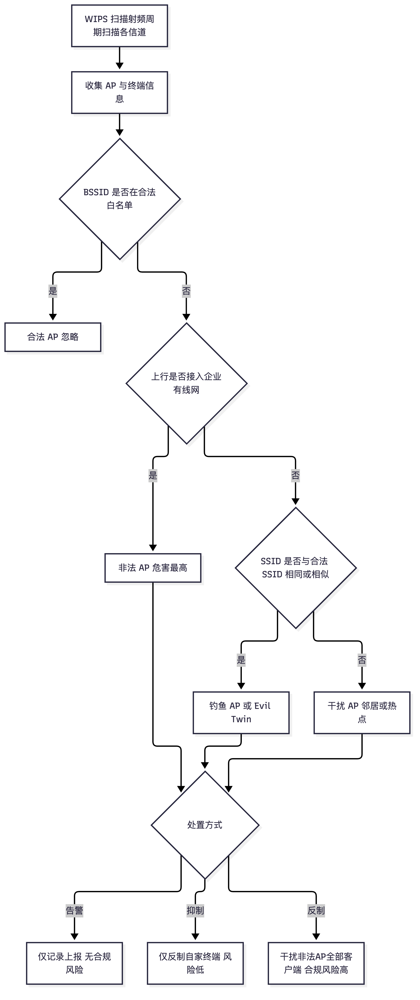


```mermaid
sequenceDiagram
    participant ATK as "攻击者"
    participant STA as "合法终端"
    participant AP as "合法 AP"
    participant WIPS as "WIPS"
    ATK->>STA: 伪造 Deauth 帧（源为合法 AP 的 BSSID）
    Note over STA: 若未启用 PMF 终端断开
    ATK->>STA: 广播同名 SSID 的更强信号
    STA->>ATK: 关联到 Evil Twin
    ATK->>STA: 返回假 Portal 页面骗取凭据
    WIPS->>WIPS: 检测到伪造 Deauth 与同名非法 BSSID
    WIPS->>AP: 产生告警并上报 AC/NCE
    Note over WIPS: 授权范围内可对自家终端发送抑制帧
    WIPS->>STA: 抑制帧使终端断开非法 AP
```

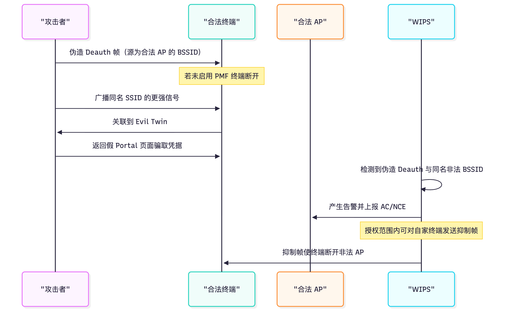


### 真题精练

**Q1.【真题·简答】** 请分别说明 Deauth 泛洪攻击、Beacon 泛洪攻击、握手包抓取 + 离线爆破三种攻击的原理与防御手段，并指出哪一种攻击"启用了 PMF 之后就基本失效"。

> **答案**：
> **① Deauth 泛洪**：
> - **原理**：802.11 中 Deauthentication/Disassociation 属管理帧，在 PMF 之前**无完整性保护**，攻击者可伪造**源地址为 AP 的 Deauth 帧**（定向或广播），终端收到即认为 AP 要求断开，于是断线并重扫/重连。攻击成本极低（一条命令），效果是全频段终端周期性掉线（可用性攻击）。它还是**抓握手包与 Evil Twin 的前置手段**（制造重连）。
> - **防御**：**启用 PMF（802.11w）**（管理帧被 BIP 完整性保护，伪造帧被终端丢弃）；迁移 WPA3（PMF 强制）；WIPS 检测 Deauth 帧密度与来源并告警；降低管理帧开销。
> **② Beacon 泛洪**：
> - **原理**：攻击者伪造**大量虚拟 AP 的 Beacon 帧**（每秒数千个，SSID 各异），灌满终端/扫描软件的 AP 列表，拖慢扫描与关联，甚至以管理帧占满空口（Beacon 以最低基本速率发送，空口时间开销极大）。
> - **防御**：WIPS 检测 Beacon 数量与 BSSID/OUI 异常；优化终端扫描行为与探测响应；频谱工具定期巡检；**定位攻击源后物理处置**（因为空口开放，无法从协议层完全阻止）。
> **③ 握手包抓取 + 离线爆破**：
> - **原理**：用 Deauth（或等待）迫使终端重连，抓取**完整四次握手（M1+M2 或 M3+M4）**，再离线枚举口令（PMK→PTK→MIC 比对），GPU 可达每秒百万次。安全性完全取决于口令强度。
> - **防御**：**迁移到 WPA3-SAE**（消除离线爆破的可能，这是根治手段）；WPA2 场景强制**强口令策略**（≥12~16 位随机、定期轮换、不复用）；IoT/老设备口令单独管理；监控 Deauth 与异常关联；访客用 Portal + 短期凭据替代共享 PSK。
> **④ 结论**：**Deauth 泛洪是"启用 PMF 后基本失效"的那一种**——因为 PMF 让终端能够**识别并丢弃伪造的管理帧**。但要注意：PMF 无法阻止攻击者**发送**这些帧（空口开放），因此对"占空口资源"类的攻击（如 Beacon 泛洪）与"抓握手包"（WPA2 场景）仍需配合 WIPS 与 WPA3。

**Q2.【真题·多选】** 关于 WIPS 对非法 AP 的三种处置方式，下列说法正确的有？
A. 告警（Alert）只记录与上报，不影响任何无线通信，无合规风险
B. 抑制（Suppress）通常只针对"连接到非法 AP 的本企业终端"发送反制帧，影响范围限于自家终端
C. 反制（Contain）会干扰非法 AP 的全部客户端，可能影响邻居或他人网络，存在合规与法律风险
D. 因为非法 AP 是威胁，所以发现后应无条件立即启用反制（Contain）
E. 生产环境建议先只开告警，确认无邻居 AP 与未登记 AP 误报后，再在授权范围内考虑抑制

> **答案：ABCE**
> **解析**：D 是典型的合规错误。**反制（Contain）通过发送反制帧干扰非法 AP 及其全部客户端**，若该 AP 属于邻居、运营商或尚未登记的合法设备，就会造成对他人网络的干扰或对自家业务的误伤。在中国，无线电干扰行为受**《中华人民共和国无线电管理条例》**约束，未获授权的干扰可能面临处罚。规范做法是：**确认非法 AP 位于本企业物理范围内 + 获得书面授权 + 评估影响范围**之后才使用反制；园区外/边界处的 AP 只能告警并通过物理排查处理。A/B/C/E 都是正确的合规原则。

**Q3.【真题·判断】** 把 SSID 设置为"不广播（隐藏 SSID）"可以显著提高无线网络的安全性，因为它让攻击者无法发现网络。

> **答案：错误**
> **解析**：**隐藏 SSID 不是安全措施**。原因：① 终端在关联时必须发送包含 SSID 的关联请求，该帧**在空口上是明文的**（即使空口加密，关联阶段在密钥安装前）；② 终端会主动发送**探测请求**（尤其已配置该网络的终端在漫游时），攻击者嗅探即可获得 SSID；③ 部分系统在探测响应中仍会泄露 SSID 信息。因此攻击者"发现"隐藏 SSID 只是多花几秒。隐藏 SSID 的真实代价是：**终端需要主动探测，增加管理帧开销与耗电**，漫游体验变差，且给运维排错增加麻烦。**提高安全性应依靠 WPA3/WPA2-Enterprise + PMF + WIPS + 强凭据管理。**

**Q4.【真题·填空】** WIPS 通过 AP 的 ________ 功能周期性扫描各信道，把扫描到的 BSSID 与 ________ 比对来分类 AP；对于确认位于本企业范围内且经授权的非法 AP，可采取 ________ 方式，但其可能干扰他人网络，需注意________风险。

> **答案：空口扫描（射频扫描 / Air Scan）；合法 AP 白名单；反制（Contain）；合规（法律 / 无线电管理）**
> **解析**：WIPS 的核心是"**扫描 → 比对 → 分类 → 处置**"闭环。分类的关键判据有两个：**BSSID 是否在白名单内**、**该 AP 的上行是否接入了企业有线网**（决定危害等级）。处置的三档（告警/抑制/反制）中，**抑制**是推荐的企业内默认反制手段（只针对自家终端），**反制**则需严格授权。补充：扫描策略要在"**检测覆盖率**"与"**业务性能损耗**"之间权衡（分时扫描会占用业务射频时间，独立扫描射频则不影响业务）。

**Q5.【真题·简答】** 请解释 Evil Twin（邪恶双子）攻击的完整实施链条，并说明"客户端强制校验服务器证书"为什么是防它的根本手段。

> **答案**：
> **① 实施链条（4 步）**：
> 1. **侦察**：攻击者用抓包/扫描工具获得目标 SSID、合法 AP 的 BSSID、信道、加密方式，以及企业使用的 EAP 方法（从 RSN IE 与 EAP 交互中可以判断是 PEAP 还是 TTLS）。
> 2. **搭台 + 踢线**：搭建同名（或高度相似名）SSID 的 AP，功率更大；向终端**发送伪造的 Deauth 帧**（源地址伪装成合法 AP），迫使终端断开并重新扫描/关联到信号更强的"同名 AP"（即 Evil Twin）。**这一步是 Evil Twin 成功的关键**——没有 Deauth，终端通常不会主动切换到另一个同名 AP。
> 3. **骗取凭据**：a) 若 SSID 是**开放或 Portal 场景**，攻击者返回一个**假 Portal 登录页**，用户输入的用户名口令直接落入攻击者手中；b) 若 SSID 是 **WPA2/WPA3-Enterprise（PEAP/TTLS）**，攻击者用自己的**自签证书**冒充服务器与终端建立 TLS 隧道——**若终端不做证书校验或用户点了"继续/信任"**，隧道内的 MSCHAPv2 交换会被攻击者获取，攻击者可**转发给真实 RADIUS 完成认证**（典型的中间人），并**离线破解出 NT 哈希/口令**；c) 若 SSID 是 **WPA2-PSK**，攻击者通过假 Portal 或伪造的"密码错误请重输"页面骗取 PSK。
> 4. **利用**：获得凭据后访问内网、横向移动；或对连接其上的一切流量做嗅探、DNS 劫持、SSL 剥离。
> **② 为什么"客户端强制校验服务器证书"是根本手段**：
> - PEAP/TTLS 的安全性**完全建立在"客户端确认对端是真实服务器"这一前提上**——TLS 隧道本身很强，但如果客户端**不校验**服务器证书（或在弹窗中随手点"信任"），攻击者用**任意自签证书**就能成功建立隧道，此时协议层面的所有加密都"加给了攻击者"。
> - 反之，若客户端配置了**受信 CA 列表 + 服务器名（CN/SAN）严格匹配 + 拒绝未知证书/不允许用户绕过**，攻击者的自签证书会被直接拒绝，**TLS 隧道根本建立不起来**，Evil Twin 的中间人链条在**第 3 步就断裂**。
> - 规范落地方式：通过**域组策略 / MDM**统一推送客户端配置（SSID + EAP 方法 + 受信 CA + 服务器名 + 禁止新服务器信任提示），避免依赖员工手工配置。
> - **配套措施**：启用 **PMF**（阻断 Evil Twin 依赖的 Deauth 踢线）；用 **WPA3**（SAE 的对等认证与抗离线爆破）；部署 **WIPS** 检测同名/异常 AP 并告警；对 Portal 场景使用**受信 HTTPS 证书**并使用户了解"证书告警绝不忽略"。

**Q6.【真题·排错】** 某企业 WIPS 报警"检测到 30 多个非法 AP，且部分为同名 AP"，但安全团队现场排查后发现大多是隔壁公司的合法 AP 与本公司新装但未登记的 AP。请分析误报原因并给出治理方案。

> **答案**：
> ① **误报原因分析**：
> - **白名单未同步**：WIPS 依赖"**合法 AP 白名单**"分类。新装的 AP 若尚未被 AC 纳管（或未在某处登记），就会被判为非法 AP。**这是新装/割接期间误报的主因**。
> - **同名 SSID 判据过宽**：很多企业会用通用 SSID（如 `Guest`、`CMCC`、`ChinaNet`、`Starbucks`），隔壁公司使用相同 SSID 就会被判为"同名/钓鱼 AP"。因此**同名判断必须结合"SSID + BSSID + 是否接入本企业有线网 + 信号是否在本企业物理范围内"多重判据**。
> - **园区边界区域**：扫描射频会扫到园区外的 AP（隔墙、楼下商铺、室外覆盖），这些 AP 本身无威胁。
> - **手机热点与临时设备**：员工的手机热点、临时测试 AP、投影仪自带的 Wi-Fi、IoT 网关都会出现在列表里。
> ② **治理方案**：
> - **完善白名单**：建立"**授权 BSSID 白名单**"（由 AC 自动纳管 + 人工审批新增），覆盖本公司全部 AP、临时测试 AP（设有效期）；对员工 BYOD 热点**明确政策**（禁止/允许 + 登记）。
> - **收紧判据与分级**：把"**接入企业有线网**"作为**高危判据**（真正需要立即处置的是这类）；"同名但不在企业网内"降级为**中低危告警**；"园区外 AP"直接排除或降级。
> - **空间过滤**：利用 AP 的定位能力与 RSSI 门限，把**信号很弱（园区外）**的 AP 过滤掉（例如 RSSI < -85 dBm 的目标不告警）。
> - **分级响应流程**：**高危（接入企业有线网）→ 立即工单 + 现场排查**；**中危（同名）→ 分析 + 观察**；**低危（干扰 AP）→ 定期汇总**。
> - **反制策略谨慎**：**默认只开告警**；对确认在本企业范围内的高危非法 AP，走审批后启用**抑制**（仅针对自家终端）；**避免对园区外的 AP 使用反制**。
> - **持续校准**：每月review 告警类型与处置结果，持续优化白名单与规则（误报治理是长期工作，不是一次性配置）。
> ③ **结论**：WIPS 的价值取决于**白名单与判据的准确性**；"一开就 30 个非法 AP"通常说明**白名单与分级策略没做好**，而不是真的有 30 个威胁。规范做法是"**先观察（只告警）→ 治理误报 → 再逐步启用处置**"。

**Q7.【真题·设计】** 某企业要求"防止员工私接家用路由器 / 手机热点导致内网被旁路"，并"能检测并处置钓鱼 AP"。请给出完整的技术方案（含无线侧与有线侧）。

> **答案**：
> **① 有线侧（防私接 AP 的根本）：**
> - **端口接入认证**：所有办公网口启用 **802.1X**（`dot1x enable`），只有通过认证的终端才能上网；对打印机/IP 电话等哑终端用 **MAC 认证 + MAB**（MAC Authentication Bypass）。
> - **端口安全**：`port-security enable` 限制单端口 MAC 数量（如 ≤2），防止一个网口下挂交换机或 AP；配合 `stp edged-port enable`。
> - **DHCP Snooping**：`dhcp snooping enable`，非信任端口丢弃 DHCP 应答，防止私接 AP 用自己的 DHCP 分配地址。
> - **DAI / IP-MAC 绑定**：`arp anti-attack check user-bind enable`，防 ARP 欺骗（Evil Twin 常用手段）。
> - **准入控制（NAC）与合规检查**：终端合规（补丁、杀毒、证书）后才放行，不合规进隔离区。
> **② 无线侧（检测与处置钓鱼 AP）：**
> - **部署 WIPS**：AP 开启**空口扫描**（覆盖 2.4G/5G 全部信道，`air-scan-profile`），启用**非法 AP、同名 AP、攻击行为检测**（`wids-profile`）。
> - **白名单与分级**：维护授权 BSSID 白名单（AC 纳管 + 审批新增）；以"**是否接入企业有线网**"识别高危非法 AP。
> - **处置策略**：默认**只告警**并集中到 iMaster NCE-Campus 呈现；对确认位于本企业范围内的高危非法 AP，**经授权后使用抑制（针对自家终端）**；**园区外 AP 只用告警**（合规要求）。
> - **定位能力**：利用多 AP 的 RSSI 定位非法 AP 的物理位置（如"3 楼东侧会议室附近"），提升现场排查效率。
> - **PMF 与证书**：启用 **PMF（802.11w）** 阻断 Evil Twin 的 Deauth 踢线；企业认证场景**强制客户端校验服务器证书**（组策略/MDM 下发）。
> - **口令与加密升级**：迁移到 **WPA3-Enterprise**（或 WPA3-SAE 用于非企业场景）；禁用 WEP/WPS；访客网络使用 **Portal + 短期凭据**且与内网隔离。
> **③ 管理与流程：**
> - 制定**无线设备政策**（禁止私自采购与接入 AP/热点；BYOD 热点需登记并隔离）。
> - **告警响应流程**：WIPS 告警 → 分级 → 定位 → 现场处置 → 关闭工单 → 复盘（含白名单更新）。
> - **定期巡检**：频谱巡检（发现非 Wi-Fi 干扰与异常管理帧）、WIPS 告警review、白名单审计。
> **④ 验收指标**：办公网口私接设备无法上网（802.1X 测试）；WIPS 能准确识别自建测试非法 AP 并定位到房间级别（误报率可控）；对自建测试钓鱼 AP 能在授权下实施抑制使自家终端断开；PMF 生效（Deauth 测试无效）。**具体命令与特性支持以所用产品版本文档为准。**

**Q8.【真题·实验】** 在 AC6805 上配置 WIPS 检测（含扫描模板与检测项）并查看结果，同时说明如何在实验环境中安全地验证"PMF 能抵御 Deauth 攻击"。

> **答案**：
> ```bash
> system-view
> wlan
>  air-scan-profile name SCAN_LAB                              // 1. 空口扫描模板
>   scan-channel 2.4g 1 6 11                                   //    2.4G 扫描信道（覆盖 1/6/11）
>   scan-channel 5g 36 40 44 48 149 153 157 161 165             //    5G 扫描信道（覆盖常用非 DFS 信道）
>  wids-profile name WIDS_LAB                                  // 2. WIDS/WIPS 模板
>   detect rogue-ap enable                                     //    非法 AP 检测
>   detect spoof-ap enable                                     //    同名/钓鱼 AP 检测
>   detect attack enable                                       //    攻击行为检测（Deauth/Beacon 泛洪等）
>  ap-group name AG_LAB                                        // 3. 下发到 AP 组
>   air-scan-profile name SCAN_LAB
>   wids-profile name WIDS_LAB
> ```
> ```bash
> display wlan wids rogue-ap all                                // 查看非法/干扰 AP 列表（BSSID/SSID/信道/RSSI）
> display wlan wids spoof-ap all                                // 查看同名/钓鱼 AP
> display wlan wids attack all                                  // 查看攻击检测结果
> display ap all                                                // 合法 AP 清单（白名单核对基准）
> display security-profile name SP_WPA3                         // 核对 PMF 配置（pmf mandatory / optional）
> display station mac-address <MAC> verbose                     // 核对终端是否协商成功 MFP（管理帧保护）标志
> ```
> **在实验环境中安全验证 PMF 抵御 Deauth 的方法（必须隔离环境 + 书面授权）**：
> 1. **环境要求**：使用**屏蔽室或独立实验室**、专用测试频段与测试 SSID、**与生产网络完全隔离**、并取得书面授权。**严禁对生产网络或他人网络实施任何攻击测试**。
> 2. **基线测试（无 PMF）**：在测试 SSID 上配置 `pmf disable`（或使用 WPA2 且关闭 PMF），让测试终端持续 `ping` 网关；用测试工具发送伪造的 Deauth 帧（源为测试 AP 的 BSSID），观察**终端是否掉线、ping 是否中断、`display station` 中是否出现重新关联**——预期会出现明显中断。
> 3. **对比测试（启用 PMF）**：同一测试环境把安全模板改为 WPA3-SAE（PMF 强制）或 WPA2 + `pmf mandatory`，终端重新协商成功后重复同样操作。观察 `display station mac-address <MAC> verbose` 中是否显示 MFP 能力已协商；重复发 Deauth，**预期终端保持在线、ping 不中断**（伪造帧被 BIP 校验丢弃）。
> 4. **记录与结论**：记录两次测试的中断时长、丢包数与终端日志，形成对照数据；同时观察 WIPS 是否产生"检测到攻击"告警（验证检测能力）。
> 5. **注意**：部分终端对 PMF 的支持与协商需在关联时完成，因此**必须重新关联后再测**；若终端不支持 PMF，则 `pmf mandatory` 下无法连接，验证时应使用支持 PMF 的终端。**命令关键字与模板名称在不同版本差异较大，以所用版本文档为准。**

### 易错点与排错

1. **把 Deauth 攻击当成"破解密码"**：它只造成断线，是为抓包/Evil Twin 创造条件。
2. **认为隐藏 SSID 或 MAC 过滤是安全措施**：SSID 会泄露、MAC 可伪造，二者都只是管理手段。
3. **混淆钓鱼 AP 与非法 AP**：钓鱼 AP 是"恶意同名热点"（防欺骗），非法 AP 是"未授权的 AP"（防旁路），防御手段不同。
4. **WIPS 一开就大量告警**：通常是白名单未同步或判据过宽，应先"只告警 + 治理误报 + 分级"。
5. **随意使用反制（Contain）**：可能干扰邻居或他人网络，存在无线电管理法规风险；应限范围、经授权。
6. **只做无线侧防护**：私接 AP 的根本防线在**有线端口**（802.1X + 端口安全 + DHCP Snooping + DAI）。
7. **排错/查看命令**：`display wlan wids rogue-ap all`、`display wlan wids spoof-ap all`、`display wlan wids attack all`、`display wlan wids device all`、`display security-profile name <模板>`（PMF）、`display station mac-address <MAC> verbose`（MFP 协商结果）。

---

## 4.5 WLAN 准入与终端安全：MAC 名单、终端识别、BYOD 与访客隔离

### 考点定位

本考点以**设计题/多选**形式出现，占 **4~6 分**。它考的是"在真实企业里如何把不同终端管起来"。高频陷阱：① 把"MAC 黑白名单"当作主要安全手段（它只是补充，且**黑名单可被绕过、白名单维护成本高**）；② 不知道 **终端类型识别（Device Profiling）** 的手段与用途；③ BYOD 场景只讲"允许接入"，不讲**合规检查与隔离**；④ 访客网络只做 VLAN 隔离，忘了**AP 内/AC 内用户隔离**与**访客到内网的 ACL**。

### 原理精讲

**① MAC 黑白名单（MAC ACL）的定位与局限。**
- **机制**：AC 上维护 **MAC 白名单**（只允许列表内 MAC 接入）或**黑名单**（拒绝列表内 MAC）。配合 VAP 模板下发，可对特定 SSID 生效。
- **局限（考点）**：① **MAC 可伪造**——攻击者抓包获得一个合法 MAC 后即可冒用（大多数网卡支持修改 MAC）；② **白名单维护成本高**——设备更换、员工流动都要更新；③ **不能区分用户身份**——同一 MAC 无法证明"是谁在用"；④ **无法提供加密**——MAC 过滤本身不提供任何机密性。
- **正确用法**：作为**补充手段**（如对"打印机/扫码枪/IoT"做白名单，配合 MAB 做免交互认证），或对**确认的恶意 MAC 做临时封禁**（黑名单）；**替代方案**是 802.1X（用户身份）+ NAC（合规状态）。

**② 终端类型识别与限制（Device Profiling / 终端识别）。**
- **识别手段（多源融合）**：
  - **DHCP 指纹（Option 55 参数请求列表、Option 60 Vendor Class Identifier）**：不同 OS 的 DHCP 请求参数顺序与内容不同，可识别 Windows/iOS/Android/macOS/打印机等。
  - **HTTP User-Agent**：从 Portal 或重定向流量的 User-Agent 中识别设备与浏览器。
  - **MAC OUI**：由 IEEE 分配的前 3 字节可识别厂商（华为、苹果、小米、海康等），但**可伪造**，且同厂商多品类（手机/电视/摄像头）无法区分。
  - **mDNS/SSDP/NetBIOS 报文**：设备自报的服务与型号信息。
  - **TCP/IP 指纹（p0f 类）**：TTL、窗口大小、TCP 选项组合。
  - **主动探测**：对可疑设备做受控探测（成本高、需谨慎）。
- **用途**：① **策略差异化**——IoT 设备限制访问范围、PC 给更高带宽、手机给更低优先级；② **风险识别**——发现"未知类型设备"（可能是私接 AP 或攻击设备）；③ **合规审计**——统计设备类型分布、发现未登记设备；④ **自动化准入**——识别为"打印机"则自动走 MAB 白名单，识别为"未知"则进隔离区。

**③ BYOD（Bring Your Own Device）安全策略。**
BYOD 的核心矛盾是"**便捷性 vs 可控性**"。完整策略应包含四层：
1. **接入层**：802.1X + 证书/凭据（企业下发配置到个人设备，通过 MDM/组策略）；或 **Portal + 自助注册**（个人设备不装 MDM 时的折中）。
2. **合规层**：**终端合规检查**——操作系统版本、是否越狱/Root、是否安装杀毒、补丁级别、是否加密。不合规 → **隔离 VLAN**（只允许访问补丁服务器与 IT 支持网站）。
3. **隔离层**：BYOD 设备**与内网服务器之间用 ACL 限制**（通常只允许访问互联网与少数业务系统），**BYOD 之间做用户隔离**（防横向攻击）。
4. **管理层**：设备登记（MAC/证书绑定）、数量限制（一人设备数）、远程擦除（企业数据容器化/MAM）、行为审计与日志留存。
**关键原则**：**BYOD 必须"默认不信任"**——以用户身份认证 + 设备合规检查 + 最小权限访问为基线，而不是"能连上就等于可信"。

**④ 访客网络隔离（Guest Isolation）。**
必须做到"**三层隔离 + 二层隔离 + 策略隔离**"：
- **VLAN 隔离**：访客使用独立 VLAN 与独立网段，网关在 AC 或防火墙上。
- **二层用户隔离（User Isolation）**：**访客之间不能互相通信**（`user-isolate`），防止访客间嗅探与攻击（这是最容易漏掉的一项）。
- **策略隔离（ACL/防火墙）**：访客**只能访问互联网（或指定资源）**，禁止访问内网任何网段；通常只放通 DNS/DHCP/Portal，其余全部拒绝。
- **带宽与连接数限制**：访客限速（如单用户 4 Mbps）与最大连接数限制，防止访客占满资源。
- **合规要求**：按监管要求**实名认证与日志留存**（Portal 短信验证、留存上网日志 ≥ 规定期限）。

### 关键概念对照表

| 准入手段 | 认证强度 | 用户可追溯 | 维护成本 | 适用对象 | 主要缺陷 |
|---|---|---|---|---|---|
| MAC 白名单 | 低（可伪造） | 否 | 中高 | 打印机/扫码枪/IoT（配合 MAB） | MAC 可伪造、新增需维护 |
| MAC 黑名单 | 低 | 否 | 低 | 临时封禁已知恶意 MAC | 攻击者改 MAC 即绕过 |
| PSK（共享口令） | 中（取决于口令强度） | **否** | 低 | 小型办公、临现场景 | 无法区分用户、泄露即全失 |
| Portal | 中 | **是**（实名/短信） | 中 | 访客、公共区域 | 需免认证规则、会话管理复杂 |
| 802.1X（PEAP/EAP-TLS） | **高** | **是** | 高（PKI/RADIUS） | 员工、企业设备 | 部署与终端配置复杂 |
| MAC 优先认证 | 中（首认证后免交互） | 是（绑定后） | 中 | 访客回头客、IoT | MAC 伪造、需有效期与隔离 |
| 终端识别 + 动态策略 | 取决于基础认证 | 是 | 中 | BYOD、IoT 分类管理 | 识别准确率与误判 |

| 隔离维度 | 实现手段 | 作用 | 漏配后果 |
|---|---|---|---|
| VLAN 隔离 | 访客独立 VLAN/网段 | 三层分离 | 访客与员工同网段，风险直通内网 |
| 二层用户隔离 | `user-isolate`（AP/AC 内隔离） | 访客之间不能互访 | 访客可嗅探/攻击其他访客 |
| 策略隔离（ACL） | 访客 ACL 仅放通互联网/DNS | 禁止访问内网 | 访客可扫描内网、直连服务器 |
| 带宽/连接数限制 | 用户级限速与最大连接数 | 防资源滥用 | 个别访客占满带宽 |
| 内容与合规 | 实名认证 + 日志留存 + 审计 | 满足监管要求 | 无法追溯、合规不达标 |

### 华为设备配置

```bash
# ===== 访客隔离与限速（AC6805, V200R019+）=====
system-view
wlan
 traffic-profile name TP_GUEST_ISO                          // 访客流量模板
  user-isolate l2                                            // 二层用户隔离：访客之间不能互访（关键加固项）
  rate-limit client down 4000                                // 单用户下行限速 4000 kbps = 4 Mbps
  rate-limit client up 1000                                  // 单用户上行限速 1000 kbps = 1 Mbps
 vap-profile name VAP_GUEST
  service-vlan vlan-id 20                                    // 访客独立 VLAN
  traffic-profile name TP_GUEST_ISO                          // 绑定流量模板（隔离 + 限速）
```

```bash
# ===== MAC 白名单/黑名单（用于 IoT 与临时封禁）=====
 wlan
  mac-access-profile name MAP_IOT                            // MAC 访问控制模板
   mac-address 00e0-fc12-3456                                // 逐条添加白名单 MAC（华为使用 xxxx-xxxx-xxxx 格式）
   mac-address 00e0-fc12-3457
 vap-profile name VAP_IOT
  service-vlan vlan-id 30                                    // IoT 独立 VLAN
  mac-access-profile name MAP_IOT                            // 绑定 MAC 访问控制模板（以所用版本文档为准）
```

```bash
# ===== 园区交换机侧：访客 VLAN 的 ACL 限制（只允许上网）=====
 system-view
  acl number 3020                                            // 高级 ACL，匹配访客网段
   rule 5 deny ip source 10.10.20.0 0.0.0.255 destination 10.10.0.0 0.0.255.255
                                                             // 拒绝访客访问内网网段（含服务器区）
   rule 10 permit ip source 10.10.20.0 0.0.0.255              // 其余流量放行（即访问互联网）
  interface Vlanif20
   traffic-filter inbound acl 3020                            // 在访客网关入方向应用 ACL
```

```bash
# ===== 查看与验证 =====
display station all                                          // 查看终端所属 VLAN 与 IP（验证访客进入 20 段）
display access-user                                          // 查看在线用户的授权信息（VLAN/ACL/MAC）
display traffic-profile name TP_GUEST_ISO                    // 核对用户隔离与限速配置
display mac-access-profile name MAP_IOT                      // 核对 MAC 名单内容
display acl 3020                                             // 核对访客 ACL 规则与命中计数
```

### 示意图

```mermaid
flowchart TD
    A["终端接入"] --> B{"接入方式"}
    B -->|员工设备| C["802.1X 认证 + 合规检查"]
    B -->|访客个人设备| D["Portal 认证 短信实名"]
    B -->|IoT 与哑终端| E["MAC 白名单 + MAB"]
    C --> F{"合规"}
    F -->|合规| G["员工 VLAN 完整权限"]
    F -->|不合规| H["隔离 VLAN 仅补丁与IT支持"]
    D --> I["访客 VLAN 仅上网 + 用户隔离 + 限速"]
    E --> J["IoT VLAN 仅访问其服务器"]
    G --> K["日志审计与行为留存"]
    I --> K
    J --> K
    H --> K
```

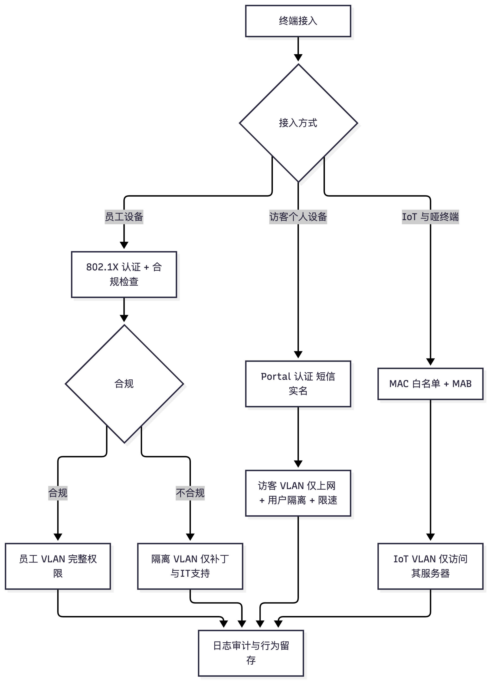


```mermaid
flowchart LR
    subgraph G1["访客 VLAN 20"]
      A1["访客A"] -.->|"user-isolate 禁止互访"| A2["访客B"]
    end
    A1 --> GW["访客网关"]
    GW --> ACLa{"ACL 3020"}
    ACLa -->|"拒绝访问内网"| X["内网服务器 10.10.0.0"]
    ACLa -->|"放行"| INT["互联网"]
```

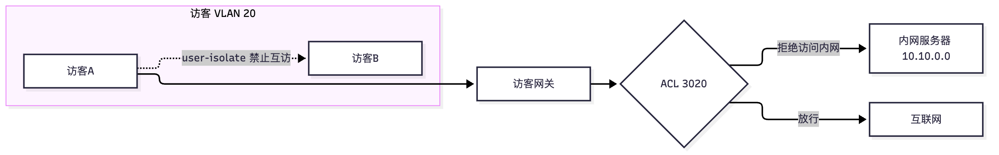


### 真题精练

**Q1.【真题·多选】** 关于 MAC 地址过滤（黑白名单）在 WLAN 准入中的作用，下列说法正确的有？
A. MAC 地址可以被伪造，因此 MAC 过滤不能作为主要安全边界
B. 白名单适合配合 MAB 用于打印机、扫码枪等无法运行 802.1X 客户端的哑终端
C. 黑名单适合对已确认的恶意终端做临时封禁，但攻击者改 MAC 即可绕过
D. MAC 过滤同时提供了空口加密能力，可替代 WPA2 加密
E. MAC 过滤的维护成本随设备数量增长，且无法证明"使用者是谁"

> **答案：ABCE**
> **解析**：D 完全错误——MAC 过滤**不提供任何机密性**，空口流量仍是明文（除非配合 WPA2/WPA3 加密）。MAC 过滤的准确定位是"**辅助准入手段**"：对哑终端做 MAB（MAC Authentication Bypass）解决"它们无法做 802.1X"的问题；对恶意终端做临时封禁。作为安全边界，它不可靠（MAC 可伪造、无法证明身份），必须由 **802.1X + NAC + 加密** 承担主要职责。

**Q2.【真题·简答】** 请说明终端类型识别（Device Profiling）的三种以上技术手段，并说明识别结果可以用于哪些安全策略。

> **答案**：
> **① 识别手段**：
> 1. **DHCP 指纹**：不同操作系统在 DHCP Discover/Request 中请求的参数列表（**Option 55**）顺序与内容不同，**Option 60（Vendor Class Identifier）** 直接声明设备类型（如 `MSFT 5.0`、`android-dhcp-*`），可高准确率识别 OS 与设备类别。
> 2. **MAC OUI**：MAC 前 3 字节由 IEEE 分配给厂商，可识别品牌（华为、苹果、海康、小米等），但**可伪造**且无法区分同品牌不同品类。
> 3. **HTTP User-Agent**：在 Portal/重定向流量中可看到 UA 字符串，识别浏览器与设备型号。
> 4. **mDNS / SSDP / NetBIOS**：设备主动广播的服务与型号信息（如打印机 `_ipp._tcp`、投屏 `_airplay._tcp`、摄像头 ONVIF）。
> 5. **TCP/IP 指纹**：TTL、TCP 窗口大小与选项组合（p0f 类），识别 OS 家族。
> 6. **主动探测**：受控地对目标做探测（需谨慎，可能被 IDS 视为扫描）。
> **② 识别结果的用途**：
> - **策略差异化**：IoT/打印机 → 限制只能访问其服务器；PC → 更高带宽与优先级；手机 → 较低优先级；摄像头 → 禁止访问互联网（防外传）。
> - **自动化准入**：识别为"已知哑终端"→ 自动走 MAB 白名单；识别为"未知设备"→ 进入**隔离 VLAN** 并告警，等待管理员审批。
> - **风险发现**：发现"未知类型设备"（可能是私接 AP、攻击设备、未登记终端），触发安全工单。
> - **合规审计与资产盘点**：统计设备类型分布、发现未登记设备、支撑"设备准入台账"。
> - **体验优化**：对不同类型设备应用不同的**频段引导**与**漫游参数**（如 IoT 固定 2.4G、手机优先 5G）。
> **③ 注意事项**：单一手段都不可靠，因此生产系统采用**多源融合 + 置信度评分**（如 DHCP 指纹 + OUI + mDNS 三者一致才判定），并对低置信度结果走人工确认；同时要**定期抽查误判率**（误判 IoT 为 PC 会导致策略失效）。

**Q3.【真题·判断】** 只要把访客网络放进独立的 VLAN，访客网络就安全了。

> **答案：错误**
> **解析**：VLAN 隔离只解决"**三层网段分离**"这一个维度。完整的访客隔离还需要：① **二层用户隔离（`user-isolate`）**——否则同一访客 VLAN 内的访客可以互相嗅探与攻击（他们处于同一广播域）；② **策略隔离（ACL）**——访客 VLAN 的网关必须配置 ACL 拒绝访问**所有内网网段**，只放通互联网；否则访客虽然"在 20 段"，仍可路由到 10 段的内网服务器；③ **带宽与连接数限制**；④ **实名认证与日志留存**（合规）。**"只做 VLAN 隔离"是访客网络安全设计的头号漏洞。**

**Q4.【真题·填空】** BYOD 场景的安全策略应包含四层：________层（如何认证接入）、________层（终端是否合规）、________层（能访问什么）、________层（登记、审计与远程管理）。

> **答案：接入；合规（合规检查/终端合规）；隔离（访问控制/权限最小化）；管理（治理/审计）**
> **解析**：BYOD 的核心原则是"**默认不信任**"：个人设备即使通过认证，也必须经过**合规检查**（OS 版本、是否越狱/root、是否装杀毒、补丁级别），不合规就进**隔离 VLAN**（只允许访问补丁服务器与 IT 支持站点）；合规设备也要按最小权限原则做**ACL 隔离**（通常只允许访问互联网与少数业务系统，禁止访问核心服务器）；最后用**设备登记（证书/MAC 绑定）+ 行为审计 + MDM/MAM 远程管理**形成闭环。

**Q5.【真题·设计】** 某三甲医院需要为"医护人员移动查房终端（PDA）""患者/家属访客""医疗 IoT 设备（输液泵、监护仪）"三类终端提供无线接入。请设计准入与隔离方案。

> **答案**：
> **① 三类终端分别建 SSID + VLAN + 认证方式**：
> | 终端 | SSID | VLAN | 认证 | 权限 |
> |---|---|---|---|---|
> | 医护 PDA | `HOSP-STAFF` | 10 | **802.1X + EAP-TLS（设备证书）** | 可访问 HIS/EMR 等业务系统 |
> | 患者/家属 | `HOSP-GUEST` | 20 | **Portal（短信实名）** | 仅互联网 + 用户隔离 + 限速 |
> | 医疗 IoT | `HOSP-IOT` | 30 | **MAC 白名单 + MAB**（设备固定 MAC） | 仅可访问其业务服务器（如输液监控平台） |
> **② 关键设计要点**：
> - **PDA 用 EAP-TLS（证书）**：PDA 是医院核心业务终端，要求最高安全性（抗钓鱼、前向保密、可追溯）；证书由 MDM 统一下发与轮换。若 PDA 数量大且支持有限，可退化为 PEAP-MSCHAPv2 + 强制服务器证书校验。
> - **业务隔离（最重要）**：三类 VLAN 之间**默认全部拒绝**，仅按业务需要放通（如 IoT 只允许访问 IoT 平台服务器）；用 ACL 或防火墙策略实现"**白名单式放通**"。
> - **访客隔离**：`user-isolate` + ACL 拒绝所有内网网段 + 单用户限速 + 实名认证与日志留存（合规要求）。
> - **IoT 的特殊性**：① IoT 常只支持 **2.4G**，需为其保留 2.4G 资源并规划 1/6/11；② IoT 设备固件老旧，应**单独 SSID/VLAN 隔离**，禁止其访问互联网与其他 VLAN；③ 建议对 IoT 使用 **AP 内置 IoT 模块或独立 IoT 网关**（见 5.4 节），避免占用 Wi-Fi 频谱与容量；④ IoT 设备数量可能极大，需核对 AP 关联数与 AC 表项规格。
> - **可靠性与漫游**：医护 PDA 移动查房**必须无缝漫游**（切换 ≤50 ms、丢包 ≤1 个），因此**同 SSID 覆盖全院、VLAN 全院统一**（不能按楼层分 VLAN），并做跨 AC 漫游（mobility group）；开启 802.11r/k/v 快速漫游；对语音/PDA 业务做 QoS 优先。
> - **安全加固**：启用 **PMF**；医护网络考虑 **WPA3-Enterprise（或 WPA3-192 位，若合规要求）**；部署 **WIPS** 检测非法 AP 与钓鱼 AP（医院是敏感场所，需防窃听与钓鱼）；对 IoT VLAN 做**异常行为监控**（IoMT 设备被入侵是近年高发风险）。
> **③ 验收指标**：PDA 漫游切换 ≤50 ms、认证成功率 ≥99.9%；访客隔离验证（访客之间、访客到内网均不可达）；IoT 仅能访问指定服务器（用抓包/ACL 命中计数验证）；WIPS 能识别测试非法 AP；全院无线覆盖达标（关键医疗区域 RSSI ≥ -65 dBm）。

**Q6.【真题·排错】** 某企业访客网络配置了独立 VLAN 20 与 ACL，但安全审计发现"访客可以访问内网 OA 系统"和"访客之间可以互相访问共享文件"。请给出排查与修复步骤。

> **答案**：
> ① **问题一：访客能访问内网 OA**
> - **排查**：`display acl 3020` 看规则与**命中计数**（若计数为 0，说明 ACL 没生效）；确认 ACL 是否应用在**正确的接口与方向**（应在访客网关 `Vlanif20` 的 **inbound** 方向）；确认 ACL 中的内网网段是否**完整覆盖**（常见错误：只写了 10.10.0.0/16，漏了 172.16.x.x、192.168.x.x 或某些服务器网段）；确认该 ACL 是否被其他策略（如防火墙默认放行、路由策略、ACL 优先级）覆盖。
> - **修复**：补全内网网段（**建议改为"拒绝所有内网网段 + 放通互联网"的白名单式写法**，避免遗漏）；确认 ACL 应用位置与方向正确；核对防火墙侧策略（若访客流量经过防火墙，防火墙也必须配策略）。
> - **反向验证**：从访客终端 `tracert`/`telnet` 测试内网地址，确认不可达；查看 ACL 命中计数增长。
> ② **问题二：访客之间能互访**
> - **排查**：`display traffic-profile name <访客模板>` 看是否配置了 `user-isolate`；确认该流量模板是否**绑定到了访客 VAP**（配置存在但未绑定是常见错误）；若访客数量多且跨 AP，确认是否需要在**AC 层面**做隔离（同 AC 内不同 AP 的用户隔离）。
> - **修复**：为访客 VAP 绑定带 `user-isolate`（二层隔离）的流量模板；若要允许特定互访（如投屏），用例外规则单独放通。
> - **反向验证**：两台访客终端互相 `ping` 与尝试访问共享目录，确认不可达。
> ③ **常见根因总结**：a) ACL 未应用或方向错；b) 内网网段列举不全；c) 流量模板未绑定到 VAP；d) 访客流量走了不同的转发路径（本地转发/隧道转发差异导致策略不在预期设备上执行）；e) 防火墙策略缺失。**排错时务必"从配置生效性出发"——先用 `display` 确认配置真的生效，再怀疑逻辑。**

**Q7.【真题·实验】** 在 AC6805 上完成"访客 VAP 二层用户隔离 + 单用户限速 + MAC 白名单 IoT VAP"的配置，并给出验证方法。

> **答案**：
> ```bash
> system-view
> wlan
>  traffic-profile name TP_GUEST                              // 1. 访客流量模板
>   user-isolate l2                                            //    二层用户隔离（访客之间禁止互访）
>   rate-limit client down 4000                                //    单用户下行限速 4000 kbps = 4 Mbps
>   rate-limit client up 1000                                  //    单用户上行限速 1000 kbps = 1 Mbps
>  vap-profile name VAP_GUEST
>   service-vlan vlan-id 20                                    //    访客 VLAN
>   traffic-profile name TP_GUEST                              //    绑定流量模板（隔离 + 限速生效）
>  mac-access-profile name MAP_IOT                             // 2. IoT 的 MAC 白名单
>   mac-address 00e0-fc12-3456                                 //    逐条登记 IoT 设备 MAC（华为格式 xxxx-xxxx-xxxx）
>   mac-address 00e0-fc12-3457
>  vap-profile name VAP_IOT
>   service-vlan vlan-id 30                                    //    IoT 独立 VLAN
>   mac-access-profile name MAP_IOT                             //    仅名单内 MAC 可接入
> ```
> ```bash
> display traffic-profile name TP_GUEST                         // 核对 user-isolate 与限速参数
> display vap-profile name VAP_GUEST                            // 核对流量模板已绑定到访客 VAP
> display mac-access-profile name MAP_IOT                       // 核对 MAC 白名单内容
> display access-user                                           // 在线用户的 VLAN/ACL/授权信息
> display acl 3020                                              // 内网拒绝 ACL 的命中计数（确认策略在执行）
> ```
> **验证方法**：
> 1. **用户隔离验证**：两台访客终端接入后互相 `ping`（预期不通）、尝试访问共享目录（预期不可达）；同时确认它们都能上网（说明隔离未误伤网关与互联网访问）。
> 2. **限速验证**：用 iperf3 在访客终端上做上下行测试，确认下行接近但不超过 4 Mbps、上行不超过 1 Mbps。
> 3. **MAC 白名单验证**：用名单外的设备尝试接入 IoT SSID（预期被拒绝），`display station all` 中不应出现该终端；用名单内设备接入应成功。
> 4. **三层隔离验证**：访客终端 `ping` 内网服务器地址（预期不通），但能 `ping` 通互联网地址；`display acl 3020` 的命中计数增长即为策略生效证据。
> **注意**：`user-isolate` 的具体参数（l2/l3/全部）与命令语法在不同版本存在差异；`mac-access-profile` 的白名单/黑名单模式也需按版本确认。**以所用版本文档为准。**

### 易错点与排错

1. **把 MAC 过滤当安全边界**：MAC 可伪造，必须由 802.1X + NAC + 加密承担主责。
2. **访客只做 VLAN 隔离**：漏掉二层用户隔离与 ACL 策略隔离，访客仍能互访或进内网。
3. **ACL 写了但未生效**：应用位置/方向错误、网段列举不全、流量模板未绑定，都会让"配了等于没配"。
4. **BYOD 只认证不检查**：不做合规检查与隔离，个人设备等于"获得了内网信任"。
5. **VLAN 按楼层/楼栋分**：医护 PDA、语音等移动业务会因换 VLAN 导致业务中断；应按业务划分并全院统一。
6. **IoT 与员工共用 SSID/VLAN**：IoT 数量大、固件旧、风险高，必须独立 SSID + VLAN + ACL。
7. **排错命令**：`display traffic-profile name <名>`（隔离/限速）、`display vap-profile name <名>`（绑定关系）、`display mac-access-profile name <名>`（MAC 名单）、`display access-user`（授权结果）、`display acl <number>`（策略命中计数）。

---

## 4.6 WLAN 安全合规与加固 Checklist

### 考点定位

本考点以**多选/简答/设计题的收尾项**形式出现，占 **3~5 分**。它考的是"能不能给出一份完整、可执行、可检查的安全加固清单"。高频陷阱：① 只答"用 WPA3"就结束（漏掉管理面、物理面、运维面）；② 混淆"认证安全"与"传输安全"；③ 忽略**管理面安全**（AC 的 Telnet 明文、弱口令、SNMP public 团体名）；④ 忽略**日志与审计**（合规硬要求）。

### 原理精讲

**① 无线安全的四个面（答题框架）。** 一个完整的 WLAN 安全体系必须覆盖：
- **接入面**：谁能接入（认证强度、加密强度、终端准入、访客隔离）——这是最常被考的一面，但**不是全部**。
- **传输面**：数据在空口是否加密、完整性是否保护（WPA2/WPA3、PMF、VPN、HTTPS）——防止嗅探与篡改。
- **管理面**：**管理设备的通道是否安全**（HTTPS/SSH 替代 HTTP/Telnet、强口令与分级账号、SNMPv3、关闭无用服务、配置备份与变更管理）——这是**最容易被忽略、却最容易被攻破**的一面（管理面被拿下的后果是"整个无线网络被接管"）。
- **物理与运维面**：设备物理安全（机房门禁、AP 防拆）、固件与特征库升级、漏洞管理、日志留存与审计、应急预案与演练。

**② 合规要求（中国场景）。** 无线网络安全通常涉及以下合规维度（答题时不必引用具体条款号，但要点出维度）：
- **《网络安全法》与等级保护 2.0（GB/T 22239）**：要求**身份鉴别（两种以上鉴别技术组合）、访问控制、安全审计（日志留存不少于 6 个月）、入侵防范、恶意代码防范、数据完整性与保密性、个人信息保护**。无线接入作为"网络边界与接入层"，对应**安全区域边界**与**安全计算环境**的相关要求。
- **实名认证与日志留存**：公共区域提供上网服务的场景（酒店、商场、图书馆、医院）通常要求**实名认证（手机号/身份证/一卡通）与上网日志留存**（留存期限按行业与地方规定，常见要求不少于 6 个月）。这直接决定 Portal 方案必须做**实名 + 日志**。
- **密码应用安全性评估（密评）**：对涉及国家秘密或重要行业的系统，要求使用**符合国家密码管理要求的算法与产品**（如 SM 系列算法），无线加密与认证算法选择需遵循相应要求。
- **无线电管理法规**：EIRP 不得超限、不得对他人网络实施干扰（**WIPS 反制的合规边界**）、不得使用未开放频段（**6 GHz 国内尚未开放**）。
- **个人信息保护（《个人信息保护法》）**：Portal 采集的手机号、MAC、位置信息属于个人信息，必须**最小必要采集、明确告知、加密存储、限制访问、定期删除**。

**③ 加固 Checklist 的组织方式。** 好的清单应具备"**可检查、可执行、可追溯**"三个特征：每条包含**检查项、理想状态、检查方法（命令/界面）、风险等级、整改建议**。下面的表格就是按这个结构组织的。

### 关键概念对照表

| 安全面 | 关键控制项 | 常见缺失 | 风险等级 |
|---|---|---|---|
| 接入面 | WPA3/WPA2-Enterprise、强口令、终端准入、访客隔离 | 用 PSK 共享口令、MAC 过滤充当认证 | 高 |
| 传输面 | AES-CCMP/GCMP、PMF、HTTPS Portal、VPN | 用 WEP/TKIP、PMF 未启用、Portal 用 HTTP | 高 |
| 管理面 | HTTPS/SSH、强口令、分级账号、SNMPv3、关闭无用服务 | Telnet/HTTP 明文、默认口令、SNMP public | **高（最易被忽略）** |
| 运维面 | 固件升级、漏洞管理、日志留存、配置备份、应急演练 | 长期不升级、无日志、无备份 | 中高 |
| 合规面 | 实名认证、日志留存 ≥6 个月、密评、EIRP 合规 | 开放无实名、日志缺失、功率超限 | 高（法律风险） |
| 物理面 | 机房门禁、AP 防拆、线缆保护 | AP 放在公共区域可被拔走/接入 | 中 |

| 合规维度 | 具体要求（要点） | WLAN 落地措施 |
|---|---|---|
| 身份鉴别 | 两种以上鉴别技术组合（等保三级要求） | 802.1X（证书/口令）+ 终端合规检查；或 Portal 实名 + 短信验证码 |
| 访问控制 | 最小权限、按需放通 | VLAN 隔离 + ACL（访客仅互联网、IoT 仅服务器） |
| 安全审计 | 日志留存不少于 6 个月 | AC 日志外送 syslog + 认证计费日志集中存储 + 时间同步 NTP |
| 入侵防范 | 检测与告警 | WIPS 非法 AP/攻击检测 + 频谱巡检 |
| 数据保密性 | 加密传输 | WPA3/WPA2-AES（禁 WEP/TKIP）+ HTTPS Portal + 管理面 HTTPS/SSH |
| 个人信息保护 | 最小必要、告知同意、加密存储 | Portal 只采集必要字段、加密存储、权限最小化、定期清理 |

### 华为设备配置

```bash
# ===== AC6805 管理面加固（VRP V200R019+，具体命令以版本文档为准）=====
system-view
 undo telnet server enable                                    // 关闭 Telnet（明文）服务，改用 SSH
 stelnet server enable                                         // 启用 SSH（加密管理通道）
 ssh server secure-algorithms cipher aes256_ctr               // 指定 SSH 加密算法（禁用弱算法，按版本支持情况配置）
 ssh user admin authentication-type password                   // 管理用户使用口令认证（或 RSA 公钥，更安全）
 ssh user admin service-type stelnet                           // 限定该用户只能通过 SSH 登录
 aaa
  local-user admin password irreversible-cipher Huawei@Adm!n   // 使用不可逆加密保存口令，且口令需满足复杂度
  local-user admin privilege level 15                          // 分级授权：管理账号权限最小化
  local-user admin service-type ssh                            // 限定服务类型
  local-user monitor password irreversible-cipher Mon@2024!    // 只读监控账号（分级账号，供日常查看）
  local-user monitor privilege level 1
  local-user monitor service-type ssh
 quit
 undo snmp-agent                                                // 若不使用 SNMP 则关闭；若使用则必须用 SNMPv3
 snmp-agent
  snmp-agent sys-info version v3                                // 强制 SNMPv3（v1/v2c 的团体名是明文，风险高）
  snmp-agent usm-user v3 netadmin group v3group authentication-mode sha2-256 cipher Huawei@Snmp!
                                                                // 配置 SNMPv3 用户与强认证
 quit
```

```bash
# ===== 日志与审计（合规必备）=====
 info-center enable                                             // 开启信息中心
 info-center loghost 10.10.200.60                               // 日志外送到 syslog 服务器（集中留存，便于审计）
 info-center source ... level informational                     // 按模块设置日志级别（以所用版本为准）
 ntp-service unicast-server 10.10.200.70                        // 配置 NTP：保证日志时间准确（审计的前提）
```

```bash
# ===== 无线侧安全参数核查（加固清单的落地）=====
display security-profile all                                   // 核查所有安全模板：是否存在 WEP/TKIP/open 等弱配置
display vap-profile all                                        // 核查各 VAP 的 VLAN、安全模板、流量模板绑定
display traffic-profile all                                    // 核查访客隔离与限速配置
display wids-profile all                                       // 核查 WIPS 检测项是否开启
display current-configuration | include telnet                // 核查是否还有 Telnet 启用
display current-configuration | include snmp                  // 核查 SNMP 版本（应为 v3）
display license                                                // 核查 License 有效期（过期会导致功能失效）
```

### 示意图

```mermaid
mindmap
  root(("WLAN 安全加固四面"))
    接入面
      802.1X 或 WPA3-SAE
      终端准入与合规检查
      访客隔离与实名
    传输面
      AES-CCMP 或 GCMP
      PMF 强制
      HTTPS Portal
    管理面
      SSH 替代 Telnet
      分级账号与强口令
      SNMPv3
      关闭无用服务
    运维与合规面
      固件与特征库升级
      日志留存 6 个月
      配置备份与变更管理
      应急演练与审计
```

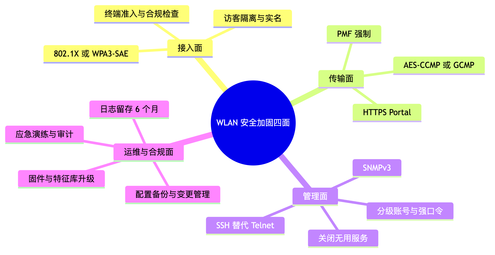


```mermaid
flowchart TD
    A["安全检查清单"] --> B["接入面检查"]
    A --> C["传输面检查"]
    A --> D["管理面检查"]
    A --> E["运维与合规面检查"]
    B --> F["认证强度 加密强度 准入 访客隔离"]
    C --> G["算法 PMF HTTPS 隧道"]
    D --> H["SSH 口令 账号 SNMP 服务端口"]
    E --> I["升级 日志 备份 演练 实名与留存"]
    F --> J{"是否存在弱项"}
    G --> J
    H --> J
    I --> J
    J -->|是| K["按风险等级整改并复测"]
    J -->|否| L["记录基线并定期复查"]
    K --> L
```

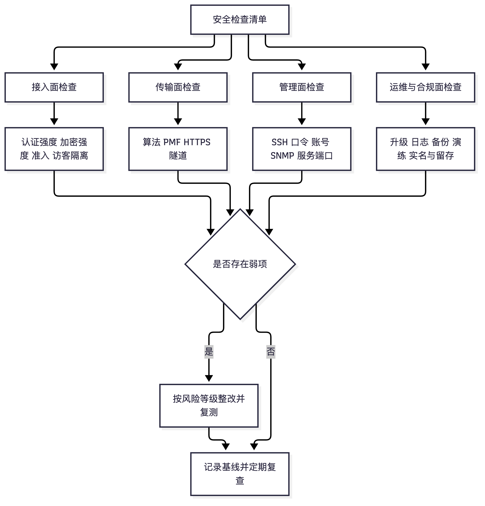


### 真题精练

**Q1.【真题·多选】** 下列哪些属于 WLAN 安全加固中"管理面"的控制项？
A. 用 SSH（stelnet）替代 Telnet 管理 AC
B. 使用 SNMPv3 替代 SNMPv1/v2c
C. 配置分级账号并限制服务类型与权限级别
D. 访客网络启用二层用户隔离
E. 关闭设备上无用的服务与端口，定期备份配置

> **答案：ABCE**
> **解析**：D 属于**接入面/传输面**的加固（访客隔离），不属于管理面。管理面（Management Plane）关注的是"**管理设备自身的通道与账号是否安全**"：明文管理协议（Telnet/HTTP/SNMPv1v2c 的团体名）会泄露口令与配置，弱口令与单一超级账号会导致越权，无用服务与端口扩大攻击面，无配置备份则故障后无法快速恢复。**管理面是 WLAN 安全中最常被忽略、一旦被攻破后果最严重的一面**（可直接下发配置、查看所有用户流量元数据、甚至把 AP 指向恶意 AC）。

**Q2.【真题·判断】** 只要无线侧使用了 WPA3 加密，WLAN 的安全就达到了合规要求。

> **答案：错误**
> **解析**：WPA3 只解决**接入面与传输面**的空口加密与认证强度。合规还要求：① **管理面安全**（加密管理通道、强口令与分级账号、SNMPv3）；② **访问控制与隔离**（访客隔离、IoT 隔离、最小权限 ACL）；③ **安全审计**（日志留存不少于 6 个月、时间同步、集中存储）；④ **入侵防范**（WIPS 检测与告警）；⑤ **实名认证**（公共上网场景）与**个人信息保护**（最小采集、加密存储）；⑥ **无线电合规**（EIRP 不超限、6GHz 未开放不得使用、WIPS 反制不得干扰他人网络）；⑦ **漏洞与固件管理**、**配置备份与应急预案**。因此"用了 WPA3 就合规"是典型的以偏概全。

**Q3.【真题·填空】** 等级保护 2.0 三级要求中，安全审计的日志留存时间不少于________个月；无线接入的身份鉴别通常要求采用________种以上鉴别技术组合；对公共区域上网服务，通常还要求________认证与日志留存。

> **答案：6；两；实名**
> **解析**：这三条是 WLAN 合规最常考的硬指标。落地方式：日志留存 → `info-center loghost` 外送 syslog + 认证计费日志集中存储 + **NTP 时间同步**（否则日志时间不可信，审计无效）；两种鉴别技术组合 → 例如"**证书 + 口令**"（EAP-TLS 场景）或"**用户名口令 + 短信验证码**"（Portal 场景）；实名认证 → Portal 绑定手机号/一卡通/身份证，并留存上网日志。**答题时把"落地措施"写出来才是完整答案。**

**Q4.【真题·简答】** 请给出一份 WLAN 安全加固 Checklist（不少于 12 项），并标注风险等级与核查方法。

> **答案**：
> | 序号 | 检查项 | 理想状态 | 风险等级 | 核查方法 |
> |---|---|---|---|---|
> | 1 | 无线加密算法 | AES-CCMP/GCMP；**禁用 WEP 与 TKIP** | 高 | `display security-profile all` |
> | 2 | 认证方式 | 企业用 802.1X；个人场景 WPA3-SAE；禁止共享 PSK 用于员工 | 高 | `display security-profile name <名>` |
> | 3 | PMF（802.11w） | WPA3 强制；WPA2 建议 optional/mandatory | 高 | `display security-profile name <名>` + 终端 MFP 标志 |
> | 4 | 访客隔离 | 独立 VLAN + `user-isolate` 二层隔离 + ACL 拒绝内网 | 高 | `display traffic-profile name <名>`、`display acl <号>` |
> | 5 | IoT 隔离 | 独立 SSID/VLAN + MAC 白名单/MAB + 仅放通业务服务器 | 高 | `display mac-access-profile`、ACL 命中计数 |
> | 6 | 管理通道 | SSH（stelnet）替代 Telnet；HTTPS 替代 HTTP | 高 | `display current-configuration | include telnet` |
> | 7 | 账号与口令 | 分级账号、强口令（≥12 位）、口令不可逆存储、定期更换 | 高 | `display local-user`（以版本为准） |
> | 8 | SNMP | 使用 SNMPv3（强认证+加密）；禁用 public/private 团体名 | 中高 | `display current-configuration | include snmp` |
> | 9 | WIPS | 非法 AP/同名 AP/攻击检测开启；处置策略限定在授权范围 | 中高 | `display wids-profile all`、`display wlan wids rogue-ap all` |
> | 10 | 服务器证书校验 | 客户端强制校验证书（受信 CA + 服务器名匹配） | 高 | 客户端策略（组策略/MDM）核查 |
> | 11 | Portal 安全 | HTTPS Portal + 受信证书；免认证规则最小化；逃生有告警与范围限制 | 高 | `display web-auth-server configuration`、`display free-rule-template` |
> | 12 | 日志与审计 | 日志外送 syslog、留存 ≥6 个月、NTP 时间同步 | 高（合规） | `display info-center`、`display ntp-service status` |
> | 13 | 固件与漏洞 | AC/AP 固件为受支持版本且已打补丁；License 在有效期内 | 中高 | `display version`、`display license` |
> | 14 | 配置备份 | 有定期配置备份与变更记录 | 中 | 备份文件核查 |
> | 15 | 功率合规 | EIRP 不超过国家码允许值；不使用未开放频段（6GHz） | 中高（法律） | `display radio-5g-profile name <名>`、`display regulatory-domain-profile` |
> | 16 | 物理安全 | 机房门禁、AP 防拆、公共区域 AP 不外露网口 | 中 | 现场核查 |
> | 17 | 应急与演练 | RADIUS/Portal/AC 主备切换演练记录；逃生机制演练 | 中高 | 演练报告 |
> | 18 | 个人信息保护 | Portal 最小采集、加密存储、权限最小化、定期清理 | 高（法律） | 流程与系统核查 |

**Q5.【真题·设计】** 某酒店集团要求通过等保三级测评。请从 WLAN 角度给出合规改造方案（按"接入、传输、管理、审计、合规"五方面组织）。

> **答案**：
> **① 接入（身份鉴别与访问控制）**：酒店员工与办公终端使用 **WPA2/WPA3-Enterprise（802.1X）+ RADIUS**（员工口令 + 证书双因素，满足"两种鉴别技术组合"）；访客使用 **Portal + 手机号短信实名认证**（满足实名要求）；**访客 VLAN 独立 + 二层用户隔离 + ACL 仅放通互联网**；**IoT（门锁、PMS 终端、监控）独立 SSID/VLAN + MAC 白名单/MAB + 仅访问其服务器**；设备管理面与业务面网络隔离（独立管理 VLAN）。
> **② 传输（数据保密性与完整性）**：全面**禁用 WEP/TKIP**，使用 **AES-CCMP**；启用 **PMF（802.11w）**；Portal 与后台全部使用 **HTTPS/TLS（受信证书）**；管理通道 **SSH/HTTPS**；对跨越不可信网络的链路（如集团到门店）使用 **IPSec VPN**。
> **③ 管理（管理面加固）**：AC 与交换机**关闭 Telnet/HTTP**，启用 **SSH（stelnet）/HTTPS**；账号**分级授权**（管理员/监控员/审计员分离，满足"三权分立"要求）；**强口令策略与定期更换**；**SNMPv3**；关闭无用服务与端口；**配置定期备份 + 变更审批**；AC 双机热备并同步配置。
> **④ 审计（安全审计与入侵防范）**：**日志集中外送 syslog 并留存不少于 6 个月**；**NTP 时间同步**保证日志可信；开启**认证计费日志**（谁、何时、从哪个 AP、什么终端上线）；部署 **WIPS** 检测非法/钓鱼 AP 与攻击行为并告警；对关键操作（登录、配置变更）做审计；日志访问权限最小化。
> **⑤ 合规与运维（含个人信息保护）**：Portal 采集字段**最小必要**（手机号即可，不采集身份证除非必要），**明确告知并取得同意**，**加密存储、限制访问、到期删除**；**EIRP 符合国家码限制**，不使用未开放频段；建立**固件与漏洞管理流程**；制定**应急预案并演练**（RADIUS/Portal 故障逃生、AC 主备切换）；定期开展**无线安全自查与渗透测试**（在授权范围内）。
> **⑥ 测评配合要点**：准备好**网络拓扑、安全域划分说明、账号权限矩阵、日志留存配置证明、加密算法配置截图、演练记录、个人信息处理告知与同意记录**等材料；对测评中提出的"未使用的服务端口开放""默认口令未改""日志留存不足"等常见问题提前自查整改。

**Q6.【真题·排错】** 安全审计发现某企业 AC 存在以下问题：① 管理启用了 Telnet；② 存在名为 `admin` 且口令为 `admin@123` 的账号；③ SNMP 使用 v2c 且团体名为 `public`；④ 日志只存在本地且未配 NTP。请逐条说明风险与整改措施。

> **答案**：
> ① **Telnet 管理（明文）**：
> - **风险**：Telnet 的用户名与口令在网络上**明文传输**，任何能抓到管理流量的攻击者（含内部人员、被控制的终端）都能获得管理员凭据，进而**接管整个无线网络**（下发配置、指向恶意 AC、查看所有用户数据）。
> - **整改**：`stelnet server enable` + `undo telnet server enable`；指定 SSH 使用强加密算法；限制管理源地址（只允许运维网段访问）；管理 VLAN 与业务 VLAN 隔离。
> ② **弱口令账号**：
> - **风险**：`admin@123` 属典型弱口令，可被字典爆破或社工获取；一旦登录即拥有最高权限（level 15）。
> - **整改**：改为 ≥12 位含大小写/数字/符号的强口令，使用 `irreversible-cipher` 存储；**分级授权**（管理/监控/审计分离）；管理账号限定 `service-type ssh` 与来源地址；开启登录失败告警与锁定策略（按版本支持）；定期更换并留痕。
> ③ **SNMPv2c + public**：
> - **风险**：SNMPv1/v2c 的团体名相当于"明文口令"，`public` 是默认值；攻击者可**读取设备全部 MIB 信息**（拓扑、接口、用户数、部分配置），甚至通过 SNMP **写入配置**（若 RW 团体名也可猜）。
> - **整改**：升级到 **SNMPv3**（`snmp-agent sys-info version v3`），配置**认证（SHA-256）+ 加密（AES）**的 USM 用户；删除 v1/v2c 配置；用 ACL 限制 SNMP 访问源；若不需要 SNMP 则直接 `undo snmp-agent`。
> ④ **日志本地存储且无 NTP**：
> - **风险**：本地日志容量有限会被覆盖（**无法满足留存 6 个月要求**）；设备被入侵或故障时日志可能丢失/被篡改；**没有 NTP 会导致日志时间不准确甚至错乱，审计时无法作为证据**；无法做跨设备关联分析。
> - **整改**：`info-center loghost <syslog服务器>` 外送日志并集中存储（满足留存期限）；配置 `ntp-service unicast-server` 并验证 `display ntp-service status` 为同步状态；对日志服务器做访问控制与备份；配置日志级别确保关键事件（登录、配置变更、认证失败）都记录。
> ⑤ **通用整改流程**：**先评估影响（是否有业务依赖 Telnet/SNMP）→ 在维护窗口变更 → 变更后验证（SSH 可登录、SNMPv3 可采集、日志服务器收到日志、NTP 同步）→ 更新配置基线与文档 → 纳入定期审计。** 同时举一反三自查：是否还有其他默认口令、HTTPS 证书是否过期、是否有未使用的服务端口开放。

**Q7.【真题·实验】** 在 AC6805 上完成"关闭 Telnet、启用 SSH、配置分级账号、SNMPv3、日志外送与 NTP"的管理面加固，并给出验证命令。

> **答案**：
> ```bash
> system-view
> stelnet server enable                                         // 启用 SSH 服务（加密管理通道）
> undo telnet server enable                                     // 关闭 Telnet（消除明文管理风险）
> ssh user netadmin authentication-type password                 // 管理用户使用口令认证
> ssh user netadmin service-type stelnet                         // 限定该用户只能通过 SSH 登录
> aaa
>  local-user netadmin password irreversible-cipher Huawei@Adm2024!
>                                                               // 强口令 + 不可逆加密存储（满足安全审计要求）
>  local-user netadmin privilege level 15                        // 管理员（最高权限，仅少数人持有）
>  local-user netadmin service-type ssh
>  local-user auditor password irreversible-cipher Audit@2024!
>  local-user auditor privilege level 1                          // 审计/监控账号：只读，满足分级授权
>  local-user auditor service-type ssh
> quit
> snmp-agent                                                     // 启用 SNMP（若需要网管采集）
> snmp-agent sys-info version v3                                 // 强制 SNMPv3（禁用 v1/v2c）
> snmp-agent usm-user v3 netadmin group v3grp authentication-mode sha2-256 cipher Huawei@Snmp2024!
>                                                               // SNMPv3 用户：SHA-256 认证（建议再加 AES 加密）
> info-center enable                                             // 开启信息中心
> info-center loghost 10.10.200.60                               // 日志外送到 syslog 服务器（集中留存 ≥6 个月）
> ntp-service unicast-server 10.10.200.70                        // NTP 时间同步（保证日志时间可信）
> ```
> ```bash
> display current-configuration | include telnet                  // 应无 telnet enable（确认已关闭）
> display ssh server status                                       // SSH 服务状态应为启用
> display current-configuration | include snmp                    // 应只见 snmp v3 相关配置
> display info-center                                             // 确认日志服务器配置生效
> display ntp-service status                                      // NTP 状态应为 synchronized（同步成功）
> display local-user                                              // 核对账号、权限级别与服务类型（以版本支持为准）
> ```
> **验证步骤**：① 用 SSH 客户端登录验证成功、Telnet 连接被拒绝；② 用只读账号登录验证**无法执行配置命令**（分级授权生效）；③ 在 syslog 服务器上确认收到设备日志且**时间戳正确**（NTP 生效）；④ 用 SNMPv3 工具采集验证成功、v2c 采集失败；⑤ 把结果记入**安全加固基线文档**并设定**定期复查周期**（建议每季度）。**`ssh server secure-algorithms`、`local-user` 等命令的关键字与可用算法在不同版本差异较大，以所用版本文档为准。**

**Q8.【真题·简答】** 请说明"WIPS 反制（Contain）"在合规层面需要注意什么，以及企业应如何制定无线干扰处置的内部流程。

> **答案**：
> **① 合规风险来源**：WIPS 的反制通过**发送伪造的管理帧干扰非法 AP 与其客户端**来实现。如果被反制的 AP 属于**邻居、周边商户、运营商**，则干扰行为**超出了本企业的网络边界**，可能：
> - 违反**无线电管理相关法规**（未经批准的无线电干扰行为可能被责令改正并处罚）；
> - 造成他人业务中断，引发**民事纠纷**；
> - 误伤**尚未登记白名单的合法 AP**（如新装 AP、临时测试 AP），造成自家业务中断。
> **② 合规处置原则**：
> - **默认只告警（Alert）**：所有检测到的非法/干扰 AP 先告警，不主动干扰。
> - **优先处置"自家终端"（Suppress）**：对连接到非法 AP 的**本企业终端**发送抑制帧，把它们"拉回"合法网络——影响范围限于自家终端，合规风险低，是**推荐的企业内默认反制手段**。
> - **反制（Contain）必须满足三个前提**：a) 确认该 AP **物理上位于本企业可控范围**（本建筑/本园区内，可用 WIPS 定位到房间级）；b) 获得**企业书面授权**（明确授权范围、时长、责任人）；c) 评估对周边的影响（如为边界区域则不得使用）。
> - **记录与留痕**：所有反制动作必须记录时间、目标 BSSID、位置、授权人与结果，以便事后追溯。
> **③ 企业应建立的内部流程（建议）**：
> 1. **分级响应**：高危（接入企业有线网的非法 AP）→ 1 小时内工单 + 现场排查；中危（同名 AP）→ 4 小时内分析；低危（园区外干扰 AP）→ 定期汇总。
> 2. **定位与现场核实**：先用 WIPS 定位估算位置，再由安全人员现场核实（拍照、确认设备归属）。
> 3. **处置决策树**：USB 网卡式热点/私接路由器 → 移除法并追究责任（走管理制度）；邻居 AP → 协商解决或只告警；未登记的自家 AP → 补录白名单。
> 4. **授权机制**：反制功能的使用需**书面审批**（明确范围与时限），并**默认关闭**，按需开启。
> 5. **复盘与改进**：每月分析告警类型与误报率，优化白名单与检测规则；把"私接 AP"纳入**员工行为规范**与**安全培训**。
> 6. **法务参与**：制定涉及"干扰他人网络"的处置流程时，应由法务确认合规边界，避免越界操作。

### 易错点与排错

1. **只加固接入面**：管理面（Telnet/HTTP/弱口令/SNMPv2c）才是最容易导致"网络被接管"的入口。
2. **忽略日志留存与 NTP**：日志不留存（<6 个月）或时间不准，审计直接不通过。
3. **把"用了 WPA3"当作合规**：合规还包含访问控制、审计、入侵防范、个人信息保护、无线电合规。
4. **公开默认口令与默认团体名**：`admin/admin`、`public` 是自动化扫描的首选目标。
5. **EIRP 超限或使用未开放频段**：属无线电合规问题（6 GHz 国内尚未开放，不得假设可用）。
6. **WIPS 反制无授权无留痕**：存在法律风险，必须"默认只告警、抑制优先、反制需授权"。
7. **核查命令**：`display security-profile all`、`display traffic-profile all`、`display wids-profile all`、`display current-configuration | include "telnet|snmp"`、`display info-center`、`display ntp-service status`、`display license`、`display version`。

---

## 4.7 WLAN 安全故障排查：认证失败、证书过期、RADIUS 不可达、Portal 异常

### 考点定位

本考点以**排错题**形式出现，占 **5~8 分**，是国赛"故障处理"类题目的主要来源。命题方式是"给出故障现象 + 少量线索，问排查思路与处置"。高频陷阱：① 不区分"**关联失败 / 认证失败 / 获址失败 / 授权失败**"四个阶段，一上来就查密码；② 不知道**证书过期会导致全公司无法接入**（且现象与"认证失败"完全相同，极易误判为口令问题）；③ 不知道 RADIUS 不可达的**现象差异**（超时 vs 拒绝）；④ Portal 排错不看"终端是否拿到 IP"。

### 原理精讲

**① 建立"四阶段定位法"（排错的总纲）。** 终端从"连不上"到"能用"要经过四个阶段，**每个阶段的失败现象不同、排错命令不同**：

| 阶段 | 做什么 | 失败现象 | 关键排查命令/手段 |
|---|---|---|---|
| ① 关联阶段 | 扫描 → 认证（开放/共享）→ 关联 | 终端搜不到 SSID、或反复"正在连接"、或无任何提示 | `display ap all`（AP 是否在线）、`display station all`（终端是否出现）、`display vap-profile`（VAP 是否绑定/生效） |
| ② 认证阶段 | 802.1X / PSK / SAE / Portal | 终端提示"身份验证失败/密码错误"、Portal 提交失败 | `display aaa online-fail-record all`、`display radius-server statistics template`、`display station mac-address <MAC> verbose` |
| ③ 获址阶段 | DHCP 获取 IP | 终端显示"已连接但无法访问互联网"/无 IP/169.254 自分配地址 | `display ip pool name <池名>`、`display access-user`、免认证规则（Portal 场景） |
| ④ 授权/转发阶段 | 应用授权 VLAN/ACL/QoS | 有 IP 但访问受限、只能访问部分资源、速度异常 | `display access-user`（授权 VLAN/ACL）、`display acl <号>`（命中）、ACL 与防火墙策略核查 |

**关键原则**：**先用"终端现象 + AC 状态"确定失败在哪个阶段，再查该阶段专属原因**。跨阶段猜测是最常见的失分点。

**② 认证失败（阶段②）的五大原因族。**
1. **凭据问题**：口令错误、账号被锁/过期/禁用、用户名格式与域不匹配（`user@corp.com` vs `corp\user`）、是否需要在服务器端配置"域后缀剥离"。
2. **EAP 方法/参数不匹配**：AC 与客户端配置的 EAP 方法不同（PEAP vs TTLS）；TLS 版本或加密套件不兼容；客户端未勾选"校验服务器证书"（部分系统默认不校验，导致"能用但与配置不符"）或勾选了但 CA 不对。
3. **证书问题（最高发的"大面积故障"）**：服务器证书**过期**、证书被吊销（CRL/OCSP）、**CN/SAN 与客户端配置的服务器名不匹配**、客户端未安装受信 CA 根证书、客户端证书过期（EAP-TLS 场景）。
4. **服务器不可达/不健康**：RADIUS 宕机、链路/防火墙阻断（1812/1813/3799）、**共享密钥不一致**（表现为超时）、服务器过载或数据库/AD 不可达、账号数据库连接池耗尽。
5. **AC 侧配置**：安全模板未绑定到 VAP、VAP 未绑定到 AP 组、域/认证方案/RADIUS 模板绑定错误、`authentication-method` 与实际不符、License 不足导致部分用户无法上线。

**③ 证书过期这一"定时炸弹"的特征与处置。**
- **特征**：某个**特定日期/时刻**起，**所有使用该服务器证书的 EAP 方法（PEAP/TTLS/EAP-TLS）同时失效**，现象与"全员口令错误"完全一致；PSK/SAE 方式不受影响；Portal（若不依赖该证书）不受影响。**这种"同一时间点、同一认证方式、全员失效"的规律性是证书问题的指纹。**
- **排查**：在 RADIUS/Portal 服务器上查看证书有效期；在客户端侧看具体报错（Windows 事件日志、iOS 的描述文件日志通常会有明确的"证书已过期/不受信任"提示）；用 `openssl s_client -connect radius.corp.com:1812` 等工具可在另一台机器上直接查看服务器出示的证书链与有效期。
- **处置**：① **紧急**：更新服务器证书（续签/换发），推送新的 CA 链（若 CA 也更换）；② **兜底**：启用本地逃生/备用认证方式，先恢复业务；③ **预防**：建立**证书台账**与**到期前 30/60/90 天告警**；把证书续期纳入变更流程；对 EAP-TLS 的**客户端证书**同样管理（量大时用 MDM/SCEP/ACME 自动化续期）。

**④ RADIUS 不可达与"超时 vs 拒绝"的区分（关键判断技巧）。**
- **Timeout（无响应）**：RADIUS 服务器不可达、端口/防火墙阻断、**共享密钥不一致**、服务器进程挂死、服务器过载响应超时。**排查顺序**：AC 上 `ping` 服务器 → 检查到服务器的路由与防火墙（1812/1813/3799）→ 核对共享密钥 → 服务器进程与负载 → 数据库/AD 可达性。
- **Reject（服务器明确拒绝）**：凭据错误、账号被锁/过期、策略不匹配（时间段/设备类型/VLAN 限制）、证书校验失败（服务器侧拒绝）、并发会话数超限。**排查顺序**：服务器侧认证日志（含拒绝原因）→ 账号状态 → 策略与条件 → 证书链。
- **辅助判断**：`display radius-server statistics template <名>` 可直接看 Requests/Accepts/Rejects/Timeouts 计数比例；**若 Timeout 远多于 Reject，就不要在"口令"上浪费时间**。

**⑤ Portal 跳转异常的六类原因（结合 4.3 节）。**
1. **终端未获 IP**：免认证规则未放通 DHCP → 现象是"完全没有反应"。
2. **DNS 不可用**：免认证规则未放通 DNS 或 DNS 服务器不可达 → 现象是"重定向后页面加载失败/域名解析错误"。
3. **Portal 服务器不可达**：网络/防火墙阻断 443 或 Portal 协议端口 → 现象是"页面白屏/超时"。
4. **Captive Portal 探测未处理**：系统探测域名未被重定向 → 现象是"不自动弹窗"（用户需手动打开浏览器）。
5. **共享密钥不一致**：现象是"页面能弹、提交后失败"且 `display web-auth-server statistics` 显示 REQ_AUTH 有计数、ACK_AUTH 为 0（见 4.3 节 Q6）。
6. **HTTPS 证书问题**：证书过期/不受信/域名不匹配 → 浏览器告警，用户放弃或点击"继续"后仍失败。
另有一类"**认证成功但上不了网**"：授权 VLAN/ACL 错误、授权 VLAN 未在 AC 创建、ACL 顺序错误、DNS 未下发——此时应查 `display access-user` 的授权结果。

**⑥ 排错方法论（答题模板）。** 推荐的答题结构：
```
① 明确现象与影响面（多少人、什么终端类型、什么时间开始、是否规律性）
② 用四阶段定位法确定失败阶段（关联/认证/获址/授权）
③ 在该阶段内按"可能性从高到低 + 从近到远"排查（终端→空口/AP→AC→服务器→数据库）
④ 每步给出具体的 display/抓包/日志命令与判据
⑤ 给出处置动作（先止损：逃生/备用；再根治：修复根因）
⑥ 回归验证 + 预案（防复发：监控、告警、台账、演练）
```
**"影响面"信息极其重要**：全员同时失效 → 服务器/证书/共享密钥等"中心点"问题；个别终端失效 → 终端侧（凭据、网卡、证书、系统版本）；特定型号失效 → 兼容性（PMF、WPA3、EAP 方法、TLS 版本）；特定位置失效 → 覆盖/AP/交换机问题。

### 关键概念对照表

| 故障现象 | 最可能的阶段 | 首选排查方向 | 关键命令/工具 |
|---|---|---|---|
| 搜不到 SSID | ① 关联 | AP 离线、VAP 未生效、信道/国家码、射频关闭 | `display ap all`、`display vap-profile name <名>`、`display radio-5g-profile` |
| 反复"正在连接"后失败 | ①/② | PMF/WPA3 兼容性、认证方法不匹配 | `display security-profile name <名>`、`display station mac-address <MAC> verbose` |
| "身份验证失败/密码错误"（全员同时） | ② | **证书过期**、RADIUS 不可达、共享密钥 | `display radius-server statistics`、`display aaa online-fail-record all` |
| "身份验证失败"（个别终端） | ② | 凭据/账号/证书/终端兼容性 | `display aaa online-fail-record all`、服务器日志 |
| 已连接但无 IP（169.254） | ③ | DHCP 池耗尽/未放通/中继配置 | `display ip pool name <池名>`、免认证规则 |
| 有 IP 但访问受限 | ④ | 授权 VLAN/ACL、防火墙策略、DNS | `display access-user`、`display acl <号>` |
| Portal 页面不弹出 | ②/③ | DHCP/DNS/探测域名未放通、Portal 不可达 | `display free-rule-template`、`display web-auth-server statistics` |
| Portal 能弹但提交失败 | ② | **共享密钥不一致**、RADIUS 拒绝 | `display web-auth-server statistics`、`display aaa online-fail-record all` |
| 大面积随机断开 | ①/② | Deauth 攻击、PMF 未启、射频干扰、AP 掉电 | `display wlan wids attack all`、`display ap performance all radio` |

| 判断技巧 | 含义 | 排查指向 |
|---|---|---|
| 全员 + 同时 + 同一认证方式失效 | 中心点故障 | 证书、RADIUS、共享密钥、AC 配置变更 |
| 个别终端失效 | 终端侧问题 | 凭据、证书、网卡、系统版本、PMF 兼容 |
| 特定型号失效 | 兼容性 | PMF/WPA3/EAP 方法/TLS 版本 |
| 特定位置失效 | 覆盖或设备 | AP 状态、交换机端口、PoE、干扰 |
| Timeout >> Reject | 可达性或密钥 | 路由/防火墙/密钥/服务器健康 |
| Reject >> Timeout | 策略或凭据 | 账号、策略、证书、并发限制 |

### 华为设备配置

```bash
# ===== 认证类故障排查的常用命令集（AC6805，VRP V200R019+）=====
display aaa online-fail-record all                            // 【第一命令】上线失败记录：含用户名/失败原因/时间
display aaa online-fail-record username user@corp.com         // 按用户名过滤失败记录（部分版本支持）
display radius-server statistics template RS_CORP             // RADIUS 交互统计：Accepts/Rejects/Timeouts 比例
display radius-server configuration template RS_CORP          // 核对服务器地址/端口/共享密钥/超时/重传
display station mac-address <终端MAC> verbose                  // 终端详情：认证方式、授权 VLAN、速率、MFP 标志
display access-user                                           // 在线用户与授权信息（VLAN/ACL/域）
display wlan sta-statistics                                   // 上线成功率与失败原因分布（群体视角）
display security-profile name SP_1X                           // 核对认证/加密/PMF 配置
display web-auth-server statistics                            // Portal 报文计数：REQ_AUTH vs ACK_AUTH
display free-rule-template name FR_GUEST                      // 免认证规则（Portal 场景必查）
```

```bash
# ===== 连通性与时间核查（RADIUS/Portal 排错必做）=====
ping -c 5 10.10.200.11                                        // 测试到 RADIUS 服务器的可达性（丢包/时延）
display ntp-service status                                    // 确认时间同步（证书有效期校验依赖正确时间）
display info-center                                           // 确认日志外送是否生效（便于集中分析）
display current-configuration | include radius               // 批量核对 RADIUS 相关配置
```

### 示意图

```mermaid
flowchart TD
    A["终端无法上网"] --> B{"终端能否搜到并关联 SSID"}
    B -->|否| C["关联阶段 AP离线 VAP未生效 射频问题"]
    B -->|是| D{"认证是否通过"}
    D -->|否| E["认证阶段 凭据 证书 RADIUS 密钥 兼容性"]
    D -->|是| F{"是否获得 IP"}
    F -->|否| G["获址阶段 DHCP池 免认证规则 中继"]
    F -->|是| H{"访问是否受限"}
    H -->|是| I["授权阶段 VLAN ACL 防火墙 DNS"]
    H -->|否| J["正常 检查体验与性能问题"]
    C --> K["按阶段专属命令排查并处置"]
    E --> K
    G --> K
    I --> K
    K --> L["回归验证并补充监控与预案"]
```

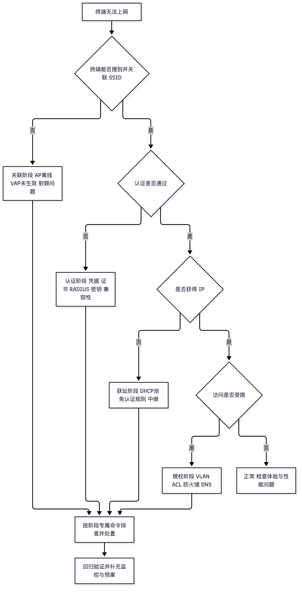


```mermaid
flowchart LR
    T1["现象 全员同时失效"] --> R1["中心点问题 证书 服务器 密钥"]
    T2["现象 个别终端失效"] --> R2["终端侧 凭据 证书 网卡"]
    T3["现象 特定型号失效"] --> R3["兼容性 PMF WPA3 EAP 方法"]
    T4["现象 特定位置失效"] --> R4["AP 交换机 PoE 干扰"]
    R1 --> X["统计 Timeout 与 Reject 比例"]
    R2 --> X
    R3 --> X
    R4 --> X
    X --> Y["Timeout 多 查可达性与密钥"]
    X --> Z["Reject 多 查策略与凭据"]
```

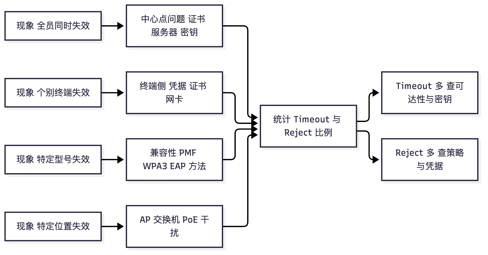


### 真题精练

**Q1.【真题·排错】** 某企业周一早上 9 点起，**所有**使用 802.1X 的员工（Windows 与手机）都提示"身份验证失败"，无法接入 WLAN；而使用访客 Portal 的人员不受影响。请给出排查思路与最可能的原因。

> **答案**：
> ① **影响面分析（关键第一步）**：**全员 + 同时 + 仅影响 802.1X、不影响 Portal** → 说明问题不在空口、不在 AP、不在 DHCP，而在"**802.1X 认证链路**"的某个**中心点**：RADIUS 服务器、服务器证书、共享密钥、或 AC 上 802.1X 相关配置变更。时间点"周一早上"很关键——**周末常有变更/维护窗口**，或**证书恰好在周末到期**。
> ② **按要求调用排查命令**：
> - `display radius-server statistics template RS_CORP`：看 Timeout/Reject 比例。**若 Reject 占绝大多数** → 服务器明确拒绝，指向**证书被服务器判定失败**或策略变更；**若 Timeout 占绝大多数** → 指向可达性/密钥问题。
> - `display aaa online-fail-record all`：查看失败原因字段（多数版本会给出如"certificate invalid""password error""radius reject"等提示）。
> - `ping 10.10.200.11`：确认 RADIUS 可达。
> - `display ntp-service status`：确认设备时间正确（时间错误会导致证书有效期校验失败）。
> ③ **最可能原因（按概率排序）**：
> 1. **RADIUS 服务器证书过期**——这是最典型的"全员同时、仅影响 EAP 方式"的故障，且与"周末没人用所以周一才发现"的时间线完全吻合。排查方式：在服务器上查看证书有效期；用 `openssl s_client -connect <radius>:1812` 或客户端日志查看服务器出示证书的 `notAfter`。
> 2. **共享密钥被变更**（周末变更遗留）——现象是大量 **Timeout**（服务器静默丢弃），且 AC 与服务器两侧密钥不一致。
> 3. **RADIUS 服务器/数据库（AD/LDAP）故障**——服务器进程挂死、AD 不可达、连接池耗尽；现象可能是 Timeout 或 Reject（视服务器实现）。
> 4. **AC 上 802.1X 相关配置被误改**（安全模板未绑定、域/认证方案绑定错误）。
> ④ **处置（先止损后根治）**：
> - **止损**：启用**本地逃生/备用认证方式**或切换到备用 RADIUS/备用证书，先恢复员工接入（并告警）。
> - **根治**：若是证书过期 → 立即续签/换发服务器证书并推送 CA 链；若是密钥 → 两侧统一；若是服务器 → 修复或切换到备机。
> ⑤ **回归与预防**：确认 `display wlan sta-statistics` 成功率恢复 ≥99%；建立**证书台账与到期前 30/60/90 天告警**；把"周末变更"纳入审批与验证流程；对 RADIUS 做**健康监控与双机切换演练**。

**Q2.【真题·单选】** AC 上 `display radius-server statistics template` 显示 Requests 1000、Accepts 10、Rejects 5、Timeouts 985。最先应排查的是？
A. 用户口令是否正确
B. 服务器策略是否拒绝用户
C. AC 到 RADIUS 服务器的可达性、端口放通与共享密钥一致性
D. 终端网卡是否支持 5G

> **答案：C**
> **解析**：**Timeouts 占 98.5% 而 Rejects 极少**，说明服务器"几乎没有回应"，属于**可达性或密钥问题**，而不是凭据/策略问题（那会表现为 Reject）。若此时去查口令（A）或策略（B），方向完全错误。正确顺序：`ping` 服务器 → 检查路由与防火墙（1812/1813/3799）→ **核对共享密钥**（密钥不一致时服务器会丢弃报文，现象正是 Timeout）→ 检查服务器进程与负载。D 与 RADIUS 交互无关。

**Q3.【真题·判断】** WLAN 认证失败一定是用户名或口令错误导致的。

> **答案：错误**
> **解析**：认证失败的原因族至少有五类：**凭据问题**（口令/账号状态/域格式）、**EAP 方法或参数不匹配**（方法、TLS 版本、加密套件、PMF/WPA3 兼容性）、**证书问题**（服务器证书过期/不受信/CN 不匹配、客户端证书过期）、**服务器不可达或不健康**（RADIUS 宕机、端口阻断、**共享密钥不一致**、数据库不可达）、**AC 侧配置问题**（模板未绑定、方案/域绑定错误、License 不足）。实际项目中"**证书过期导致全员认证失败**"与"**共享密钥不一致**"的占比很高，若只盯口令会严重延误处置。正确做法是先用 `display aaa online-fail-record all` 与 `display radius-server statistics` 定位到**具体失败环节**。

**Q4.【真题·填空】** WLAN 接入故障的四个阶段依次是：________、________、________、________；其中"终端显示已连接但获得 169.254.x.x 地址"说明失败发生在________阶段，应检查 ________ 与 ________（Portal 场景）。

> **答案：关联；认证；获址（DHCP）；授权/转发；获址（DHCP）；DHCP 地址池（容量/配置）；免认证规则（是否放通 DHCP）**
> **解析**：169.254.x.x 是 **APIPA（Automatic Private IP Addressing）** 自分配地址，意味着终端**没有从 DHCP 服务器获得地址**。原因：地址池耗尽、DHCP 服务器不可达、中继（Option 43/giaddr）配置错误、Portal 场景免认证规则未放通 DHCP、VLAN 与地址池不匹配（如用户被授权到没有地址池的 VLAN）。**四阶段定位法是 WLAN 排错题的答题骨架，务必记住并会在答题时先写出来。**

**Q5.【真题·简答】** 请说明"证书过期"导致 WLAN 认证故障的典型特征、快速确认方法，以及企业应建立的防复发机制。

> **答案**：
> **① 典型特征（可通过现象快速识别）**：
> - **时间特征**：某个**具体日期/时刻**起突然发生（证书 `notAfter` 到期时刻），**此前一切正常**；常在"周末或长假后的第一个工作日"被发现。
> - **范围特征**：**所有**使用该服务器证书的认证方式（**PEAP / EAP-TTLS / EAP-TLS**）**同时失效**；而 **PSK/SAE、Portal（若不依赖该证书）不受影响**——这个"只影响 EAP 类"的特征是重要判据。
> - **终端特征**：不同 OS 的报错不同（Windows 事件日志、iOS 描述文件日志、Android 提示"证书已过期/不受信任"），但都可归为"证书无效"。
> - **服务器特征**：RADIUS/Portal 服务器日志中出现证书相关错误（如 `certificate has expired`）；统计上可能表现为大量 **Reject**（服务器无法完成 TLS 握手即拒绝）。
> **② 快速确认方法**：
> - **服务器侧**：直接查看服务器证书的 `notBefore/notAfter`；`openssl x509 -in server.crt -noout -dates`。
> - **客户端侧**：查看系统日志中的 TLS/证书错误；或在另一台机器上执行 `openssl s_client -connect radius.corp.com:1812 -showcerts` 查看对端证书链与有效期（可确认是否过期、CN/SAN 是否匹配、链是否完整）。
> - **AC 侧**：`display aaa online-fail-record all` 看失败原因；`display ntp-service status` 确认设备时间正确（**设备时间错误会导致"明明没过期却报过期"**，这也是重要陷阱）。
> **③ 防复发机制（管理措施比技术更重要）**：
> - **证书台账**：登记所有证书（服务器证书、客户端证书、Portal 证书、CA）的**用途、绑定域名/地址、签发者、有效期、责任人、续期方式**。
> - **到期告警**：设置**到期前 90/60/30/7 天**多级提醒（可用监控系统自动检查）；对**CA 根证书**同样管理（根证书过期影响面最大）。
> - **续期流程**：把证书续期纳入**变更管理**，在维护窗口执行并**验证后再关闭工单**；优先采用**自动化续期**（ACME/SCEP/MDM 推送）减少人工遗漏。
> - **冗余与逃生**：RADIUS 双机（证书分别部署/错峰到期更佳）、配置**本地逃生**机制，确保证书故障时业务可快速恢复。
> - **演练**：定期演练"证书过期紧急处置"流程，明确责任人、沟通渠道与恢复目标（RTO）。

**Q6.【真题·排错】** 某酒店 Portal 认证：客人反映"手机连上 Wi-Fi 后微信能用但浏览器打不开网页"（即 Portal 页面根本没弹出来）。请给出完整排查步骤。

> **答案**：
> ① **现象解读（关键判断）**：**"微信能用"说明终端已获得 IP 且部分应用可通**（可能微信走了自己的长连接或免认证规则里有放通），但**浏览器打不开**说明 **HTTP/HTTPS 流量没有被正确重定向到 Portal，或者重定向后的登录页无法加载**。因此问题在**重定向环节或登录页可达性**，而不是"完全没网"。
> ② **第一步：确认终端是否拿到 IP**（若没有 IP，则问题在 DHCP 免认证规则）：
> - 终端侧查看 IP（是否 20 段、是否 169.254 自分配）。
> - AC 侧 `display station all` / `display access-user` 确认终端在线与 IP。
> ③ **第二步：确认重定向是否发生**：
> - 用浏览器访问一个**纯 HTTP 站点**（如 `http://neverssl.com` 类），观察是否跳转到 Portal 页面；若 HTTPS 站点不跳转，说明**AC 只对 HTTP 做 302 重定向**（HTTPS 无法重定向），这本身是正常现象——因此"用户在浏览器里输入 baidu.com（HTTPS）不弹窗"≠故障。**很多"页面不弹"其实是因为访问的是 HTTPS 站点。**
> - 检查 AC 上 Portal 配置与 VAP 绑定：`display web-auth-server configuration`；确认认证模板/免认证规则已绑定到访客 VAP（`display vap-profile name VAP_GUEST`）。
> ④ **第三步：确认 Portal 服务器可达与登录页可加载**：
> - 免认证规则是否放通 Portal 服务器：`display free-rule-template name <名>`。
> - 从终端（或从 AC 所在网段）测试 Portal 服务器地址的 443/自定义端口是否可达。
> ⑤ **第四步：确认 Captive Portal 探测域名被正确处理**（"不自动弹窗"的经典原因）：
> - 主流系统会探测 `captive.apple.com`、`connectivitycheck.android.com`、`www.msftconnecttest.com` 等；若这些域名的请求**没有被重定向**（被直接放通或被丢弃），系统就认为"网络正常"，**不会自动弹出 Portal**。
> - 验证：手动打开浏览器访问一个 HTTP 站点看是否重定向（能重定向说明规则大致正确，只是探测域名特殊）；或检查免认证规则是否把这些探测域名"完全放通"（放通 = 不重定向 = 不弹窗，这是常见配置错误）。
> ⑥ **第五步：确认证书与其他细节**：
> - Portal 若用 HTTPS，检查证书是否过期/域名不匹配（浏览器告警会让用户放弃）。
> - 检查是否设备数/会话数限制导致无法认证（`display access-user` 数量）。
> ⑦ **处置与验证**：修正免认证规则（放通 DHCP/DNS/Portal，**但不要完全放通探测域名，要让它被重定向**）；确保 Portal 服务器可达与证书有效；提示用户用 HTTP 站点或手动打开浏览器触发。**验证**：用 iOS 与 Android 各一台实测自动弹窗；`display web-auth-server statistics` 的 REQ_AUTH/ACK_AUTH 成对增长；认证后能正常上网。
> ⑧ **常见根因排序**：a) 访问的是 HTTPS 站点（正常现象，需向用户解释或部署 HTTPS 重定向/CNA 优化）；b) 探测域名被完全放通导致不自动弹窗；c) 免认证规则漏配 DHCP/DNS/Portal；d) Portal 服务器不可达或证书问题；e) 共享密钥不一致（这会导致"能弹窗但提交失败"，与本题现象略有不同）。

**Q7.【真题·设计】** 请设计一套 WLAN 认证故障的**监控与自愈**机制，使"RADIUS 不可用""证书即将过期""认证成功率骤降"三类问题能在影响用户前被发现。

> **答案**：
> **① 监控指标与采集方式**：
> | 监控对象 | 关键指标 | 采集方式 | 告警阈值（示例） |
> |---|---|---|---|
> | RADIUS 服务器 | 进程存活、端口 1812/1813/3799 可达、响应时延、Timeout/Reject 比例 | 网管 SNMP + 主动探测（合成事务）+ AC 的 `display radius-server statistics` 定期采集 | 存活失败立即告警；Timeout 比例 >5% 告警；响应时延 >2 s 告警 |
> | 证书 | 剩余有效期、链完整性、CN/SAN 与配置一致性 | 定时脚本/监控插件读取证书 `notAfter`（对 RADIUS/Portal/HTTPS 全部证书） | 剩余 <90 天提醒、<30 天告警、<7 天紧急 |
> | 认证成功率 | 上线成功率、失败原因分布、按 SSID/AP/终端类型分组 | AC 的 `display wlan sta-statistics` + 日志（syslog/Telemetry） | 成功率 <99% 告警；某一失败原因骤增告警 |
> | 认证时延 | 关联→认证→获址的总时延 | 日志时间戳差值 / Telemetry | P95 >5 s 告警 |
> | DHCP | 地址池使用率、冲突数、DHCP 响应时延 | `display ip pool` 定期采集 | 使用率 >70% 提醒、>85% 告警；冲突数 >0 告警 |
> | AC/AP | CPU、内存、License 有效期、AP 在线率 | SNMP/Telemetry | CPU >70%；License <60 天；AP 在线率 <99% |
> **② 自愈与自动处置（按风险分级，避免"自动动作造成更大故障"）**：
> - **RADIUS 不可用**：AC 已配主备服务器时自动切换（**这是最基础也最有效的自愈**）；若主备都不可用，自动触发**本地逃生/备用认证**并**立即告警**（逃生必须有范围限制与日志，不能静默开放）。
> - **证书即将过期**：自动工单 + 提前通知；对支持 ACME/SCEP 自动续期的组件启用自动续期并在测试环境验证后再上生产。
> - **认证成功率骤降**：告警 + 自动采集诊断信息（失败记录、RADIUS 统计、AP 状态快照）供分析；**不自动修改认证策略**（避免误动作）。
> - **DHCP 池高水位**：告警 + 建议扩容；不要自动缩短租期（可能引发续租风暴）。
> **③ 落地方式**：
> - 用 **iMaster NCE-Campus** 或第三方网管统一采集与呈现（见第 5 章 Telemetry 与健康度模型）；
> - **合成事务探针（Synthetic Transaction）**：部署专门的测试终端/探针，**周期性用真实凭据完成一次完整认证流程**（关联→认证→获址→访问），这是"发现端到端故障"的最有效手段，比只看服务器端口更可靠；
> - **日志集中化**：所有 AC/服务器日志外送 syslog，留存 ≥6 个月（同时满足合规）。
> **④ 预案与演练**：编写《WLAN 认证故障应急预案》，明确**判断标准、处置步骤、责任人、RTO/RPO**；每半年演练一次（RADIUS 主备切换、证书过期紧急处置、逃生触发与恢复），并记录演练报告用于持续改进。

**Q8.【真题·实验】** 请给出一次完整的"802.1X 认证失败"排错实验步骤（从现象到处置），列出每一步使用的命令与判据。

> **答案**：
> **实验拓扑**：测试终端（Windows）→ AP（AirEngine 5761）→ AC6805 → RADIUS 服务器（可用 NCE-Campus 内置 RADIUS 或 FreeRADIUS）；人为制造故障（如故意配置错误的共享密钥）观察现象。
> **步骤 1：确认现象与影响面**
> - 终端侧记录报错文案（"身份验证失败"）；确认是否只有该终端（个别）还是全员（中心点）。
> - 判据：个别 → 终端侧；全员 + 同时 → 服务器/证书/密钥。
> **步骤 2：确认关联阶段正常**
> ```bash
> display ap all                                   // AP 是否在线（否则直接查 AP 与交换机 PoE）
> display station all                              // 终端是否已关联出现（未出现说明卡在关联或扫描）
> display vap-profile name VAP_1X                  // VAP 是否绑定安全模板与 VLAN
> ```
> **步骤 3：查看失败记录（定位到认证阶段）**
> ```bash
> display aaa online-fail-record all               // 失败记录与原因（第一命令）
> display wlan sta-statistics                      // 成功率与失败原因分布
> ```
> **步骤 4：判断"超时"还是"拒绝"**
> ```bash
> display radius-server statistics template RS_CORP   // Requests/Accepts/Rejects/Timeouts
> ping -c 5 10.10.200.11                              // 可达性
> display radius-server configuration template RS_CORP // 核对地址/端口/密钥/超时/重传
> ```
> - 判据：**Timeout 多** → 可达性/密钥；**Reject 多** → 凭据/策略/证书。
> **步骤 5：核对配置一致性**
> ```bash
> display current-configuration | include radius        // 核对 RADIUS 相关配置
> display security-profile name SP_1X                   // 核对认证方法/加密/PMF 是否与客户端匹配
> display ntp-service status                            // 时间是否正确（证书校验依赖时间）
> ```
> **步骤 6：修正与验证**
> - 若为共享密钥不一致 → 两侧统一密钥，再认证应成功。
> - 若为证书过期 → 更新证书并推送 CA。
> - 若为 PMF 兼容性 → 调整 `pmf optional` 或使用兼容 SSID。
> ```bash
> display station mac-address <MAC> verbose             // 认证成功后查看授权 VLAN/速率/MFP
> display access-user                                   // 确认用户在线与授权信息
> display aaa online-fail-record all                    // 失败记录应不再新增
> ```
> **判据**：终端成功上线并访问业务；`display radius-server statistics` 中 Accepts 增长、Timeouts/Rejects 不再增长；成功率 ≥99%。
> **步骤 7：留痕与预防**
> - 记录故障时间、影响面、根因、处置动作、恢复时间；更新配置基线与检查清单；补充监控告警项（如共享密钥变更纳入变更审批）。**命令关键字与统计字段在不同版本有差异，以所用版本文档为准。**

### 易错点与排错

1. **不先定位阶段**：一上来就查口令或重启设备，是排错题最大失分点；必须先写"四阶段定位法"。
2. **忽略"影响面"分析**：全员 vs 个别、特定型号 vs 特定位置，直接决定排查方向。
3. **不知道"证书过期"这一高频根因**：全员+同时+仅 EAP 类失效 = 证书问题的指纹。
4. **把 Timeout 当 Reject 处理**：Timeout 要查可达性与密钥，不要查口令。
5. **忽略设备时间（NTP）**：时间错误会导致证书校验失败、日志时间错乱，是隐蔽陷阱。
6. **Portal 排错不先看 IP**：终端没拿到 IP 时，页面永远弹不出来，先查免认证规则的 DHCP。
7. **忽略 HTTPS 站点不触发 302**：这常被误判为故障；正确做法是引导用户访问 HTTP 站点或依赖系统 CNA 探测。
8. **排错命令清单**：`display aaa online-fail-record all`、`display radius-server statistics template <名>`、`display radius-server configuration template <名>`、`display station mac-address <MAC> verbose`、`display access-user`、`display wlan sta-statistics`、`display web-auth-server statistics`、`display free-rule-template name <名>`、`display ntp-service status`、`ping`。

---

# WLAN-HCIE-章节5-WLAN智能化运维与新技术

## 5.1 iMaster NCE-Campus 云管理 WLAN：架构、上线流程与站点模型

### 考点定位

本考点以**架构题/流程题/对比题**形式出现，占 **5~8 分**，是近年新增的高区分度内容。高频陷阱：① 说不清"**云管理**"与"**本地 AC 管理**"的架构差异（**控制面在云端，转发面可在本地**）；② AP 云化上线流程顺序记错（**注册查询 → 认证 → 纳管 → 配置下发 → 上线**）；③ 混淆**租户（Tenant）与站点（Site）**两个概念（租户是资源与权限的隔离边界，站点是设备的物理/管理分组边界）；④ 不知道"即插即用"依赖 **DHCP Option 43/148/158 或 DNS 重定向** 来找控制器。

### 原理精讲

**① 云管理 WLAN 的整体架构（四层）。**
- **设备层**：AP 与交换机（AirEngine 系列 AP、CloudEngine S 系列交换机）——在云管理模式下，AP 通常**直接与云管理平台建立管理通道**（无需本地 AC 作为管理中介），部分场景仍保留本地 AC/WAC 作为**转发/接入网关**（如 Agile Distributed、或需要本地转发时）。
- **通道层（管理通道）**：AP 与 iMaster NCE-Campus 之间建立 **CAPWAP over DTLS（Datagram TLS）** 管理隧道——**DTLS 提供双向证书认证与加密**，这是云管理模式与传统 CAPWAP（默认不加密）的关键安全差异。业务流量可由 AP **本地转发（Local Forwarding）**直接进入园区网络，无需绕行云平台（**这是云管理能承载大流量的原因**）。
- **平台层**：**iMaster NCE-Campus** 提供统一管理（配置、监控、故障、报表）、认证（内置 RADIUS/Portal）、策略（安全/准入/QoS）与开放 API。它可按**多租户**组织，一个平台服务多个客户/分支（MSP 场景）。
- **应用/北向层**：开放 API 对接第三方系统（工单、资产、客流分析、位置服务）、以及与 **iMaster NCE-CampusInsight** 联动做体验分析与智能运维（见 5.2 节）。

**② AP 云化上线流程（必须能背）。**
1. **上电与获取地址**：AP 通过 DHCP 获得 IP 地址。
2. **发现控制器（Discovery）**：AP 通过以下方式找到云管理平台地址：
   - **DHCP Option 43（传统方式，携带 AC/控制器 IP 列表）**；
   - **DHCP Option 148 / Option 158（云管理场景常用，携带云平台域名与端口）**；
   - **DNS 解析**（将约定的域名解析到云平台地址，如华为云管理场景使用的默认域名）；
   - **手工配置**（`ap-address` 类命令/串口配置，用于无 DHCP 场景）。
3. **建立管理通道与双向认证**：AP 与云平台建立 **CAPWAP over DTLS** 通道，双方基于**设备证书（出厂预置或平台签发）**完成双向认证——**认证不通过则 AP 不允许被纳管**（防止伪造 AP 接入平台）。
4. **纳管与登记**：平台校验 AP 的**型号、ESN（设备序列号）/MAC**，把它登记到指定**站点**；若未提前录入，可配置"**自动纳管**"或需要管理员**审批**（安全优先场景应开启审批）。
5. **配置下发**：平台把该站点/该 AP 的配置（SSID、射频、VLAN、安全、策略）**按模板下发给 AP**（AP 作为"被管理的执行者"）。
6. **业务上线**：AP 开始广播 SSID 并承载业务；平台开始采集 Telemetry 数据（性能、终端、信道）。
7. **日常运维**：配置变更、升级、诊断、报表全部在云端完成（无需到现场，这是云管理的核心价值）。

**③ 云管理 vs 本地 AC 管理的对比（必考表）。**

| 维度 | 云管理（iMaster NCE-Campus） | 本地 AC 管理（AC6805 等） |
|---|---|---|
| 管理面位置 | 云端（或多云/私有云部署） | 本地 AC（园区内） |
| 转发面 | 支持**本地转发**为主（业务不经云） | 隧道转发（集中）或本地转发 |
| AP 发现方式 | DHCP Option 43/148/158、DNS、手工 | DHCP Option 43、广播/组播、DNS、手工 |
| 管理通道安全 | **CAPWAP over DTLS（双向证书认证 + 加密）** | 传统 CAPWAP（可配 DTLS，但常未启用） |
| 部署周期 | 短（设备寄到现场即插即用） | 较长（需现场配置/开局） |
| 多分支/多租户 | **天然支持**（租户 + 站点模型） | 需多台 AC 或 AC 集群，跨分支弱 |
| 开局方式 | **即插即用 + 零配置**（ZTP） | 需现场 CLI 或 U 盘开局 |
| 运维体验 | 统一云平台：拓扑、健康度、AI 根因、报表 | 单点 AC 维护，跨设备分析弱 |
| 可靠性依赖 | **依赖到云的连通性**（需本地逃生：断网时保留已有配置运行） | 不依赖外网 |
| 认证能力 | 内置 RADIUS/Portal（也可对接第三方） | 需外接 RADIUS/Portal（或 AC 本地认证） |
| 适用场景 | 多分支连锁、中小园区、MSP 托管 | 大型园区、对独立性/自主可控要求高的场景 |

**④ 租户与站点模型（易混淆，必须讲清）。**
- **租户（Tenant）**：云平台上的**资源与权限隔离边界**。一个租户拥有独立的**设备、用户、策略、管理员账号、License 配额**，租户之间**数据与配置互不可见**。典型用法：MSP（托管服务商）为每个客户建一个租户；大型企业为不同事业部/子公司建不同租户。
- **站点（Site）**：租户内部的**设备分组与策略下发边界**，通常对应**一个物理位置**（一栋楼、一个分支、一个楼层群）。**配置模板、认证策略、射频规划、监控报表通常按站点组织**；设备（AP/交换机）必须归属某个站点才能被管理。
- **层级关系**：`平台 → 租户 → 站点 → 设备`。**同一租户可有多个站点；同一站点内的设备共享站点级配置模板**。
- **工程要点**：**站点划分要"物理位置 + 管理责任 + 策略一致性"三者统一**——例如"同一 SSID 与同一 VLAN 的楼栋应放同一站点"（否则跨站点漫游与策略一致性会出问题）；而不同客户/不同网络必须放不同**租户**。

**⑤ 配置模板下发与即插即用/零配置开局（ZTP）。**
- **模板体系**：**站点模板（Site Template）→ 设备组模板（Device Group Template）→ 设备级配置**，**优先级由低到高**（设备级覆盖组级、组级覆盖站点级）。这与本地 AC 的"AP 组模板 vs AP 个性化配置"是同一思想。
- **变量与占位符**：模板中可使用变量（如站点名、VLAN、AP 位置），下发时自动替换，实现"**一套模板管多个分支**"。
- **ZTP（Zero Touch Provisioning，零配置开局）**：设备**开箱上电 → 自动获取地址 → 自动发现控制器 → 自动认证 → 自动纳管 → 自动下发配置 → 自动上线**，全程无需人工 CLI。前提是：① 设备型号/ESN 已录入（或开启自动纳管）；② 网络可达控制器（DHCP/DNS 配置正确）；③ 时间同步（证书校验需要）；④ 有对应的站点模板。
- **即插即用（PnP）在无线场景的典型流程**：仓库预置设备并录入 ESN → 现场上电接网线（交换机端口已是 PVID 配置正确的接入端口）→ AP 自动上线 → 平台按预设站点模板下发射频与 SSID → 业务可用。**新的 AP 替换故障 AP 时，只需插上同型号设备，配置自动继承**（前提是 ESN 变更被正确处理或开启按位置继承）。

### 关键概念对照表

| 概念 | 定义 | 边界性质 | 典型用法 |
|---|---|---|---|
| 租户 Tenant | 平台上的资源与权限隔离单元 | 数据/权限隔离 | MSP 每个客户一租户；集团各子公司一租户 |
| 站点 Site | 租户内的设备分组与策略下发单元 | 位置/策略边界 | 一栋楼、一个分支、一个楼层群 |
| 设备组 Device Group | 站点内按角色/型号分组的设备集合 | 配置继承 | 室内 AP 组、室外 AP 组、接入交换机组 |
| 模板 Template | 可复用的配置集合（含变量） | 配置复用 | 射频模板、SSID 模板、VLAN 模板、策略模板 |
| 配置优先级 | 设备级 > 设备组级 > 站点级 | 覆盖关系 | 个别设备特殊配置用设备级覆盖 |

| AP 发现控制器方式 | 配置载体 | 优点 | 注意点 |
|---|---|---|---|
| DHCP Option 43 | DHCP 服务器 | 传统、通用、可带多个控制器 IP | 需按厂商格式编码（华为有特定子选项格式） |
| DHCP Option 148 / 158 | DHCP 服务器 | **云管理常用**，可携带域名/端口 | 不同版本字段格式不同，以版本文档为准 |
| DNS 解析 | DNS 服务器 | 无需改 DHCP，便于集中变更 | 需保证 DNS 可达与解析正确 |
| 手工配置 | AP 本地/串口 | 无 DHCP 场景可用 | 不适用于批量部署 |

### 华为设备配置

```bash
# ===== 云管理场景：DHCP 服务器上配置 Option 148 指引 AP 找到云平台 =====
system-view
dhcp enable                                                  // 启用 DHCP
ip pool AP_MGMT                                              // AP 管理地址池
 network 10.10.100.0 mask 255.255.255.0                       // AP 管理网段
 gateway-list 10.10.100.1                                     // 网关
 option 148 ascii agilemode=agile-cloud;agilemanage-mode=domain;agilemanage-domain=naas.huaweicloud.com;agilemanage-port=10020;
                                                              // Option 148：告知 AP 以云模式上线、云平台域名与端口
                                                              // （字段名与取值随版本/云平台不同，以所用版本文档为准）
 option 43 sub-option 3 ascii 10.10.10.1                      // 若同时保留本地 AC 管理，可另配 Option 43 指向 AC
 quit
```

```bash
# ===== 云管理 AP 的上线验证（AP 侧/交换机侧可见信息）=====
display ap all                                                // 在本地 AC（若有）或平台上查看 AP 状态
display dhcp client                                           // 在 AP 上（若可登录）查看获取的地址与 Option 内容
display interface brief                                       // 交换机侧确认 AP 所连端口 Up 且速率正常（PoE 端口）
display poe power-information interface GigabitEthernet0/0/1  // 确认 PoE 供电正常（云管理 AP 同样需要 PoE）
```

```text
# ===== iMaster NCE-Campus 界面操作路径（不同版本菜单有差异，以所用版本文档为准）=====
1. 登录云管理平台（管理员账号）→ 选择目标【租户】                     // 确认在正确的租户内操作
2. 【设计】→【站点管理】→ 新建站点（名称/位置/时区）                   // 站点是策略与设备分组边界
3. 【设计】→【网络设计】/【模板管理】→ 配置 SSID、射频、VLAN、认证模板  // 站点级模板（可含变量）
4. 【资源】→【设备管理】→ 导入设备（ESN/型号）或开启自动纳管           // 设备登记，安全场景建议人工审批
5. 【资源】→【设备管理】→ 把设备加入指定站点                            // 设备归属站点后才能接收站点模板
6. 【监控】→【网络监控】→ 查看 AP 在线状态、射频、终端、健康度          // 上线后验证
7. 【维护】→【配置变更】/【设备升级】→ 批量下发与升级                   // 日常运维
8. 【监控】→【报表】→ 导出覆盖率/终端分布/健康度报表                    // 运维报告与验收材料
```

### 示意图

```mermaid
flowchart TD
    subgraph CLOUD["云侧"]
      NCE["iMaster NCE-Campus 管理平台"]
      RAD["内置 RADIUS 与 Portal"]
      INS["CampusInsight 智能运维"]
    end
    subgraph CORE["园区核心与汇聚"]
      SW["CloudEngine S 系列交换机"]
      WAC["本地 WAC 或 AC 可选 用于本地转发或分布式"]
    end
    subgraph EDGE["接入侧"]
      AP1["AirEngine AP"]
      AP2["AirEngine AP"]
    end
    AP1 -->|"CAPWAP over DTLS 管理隧道"| NCE
    AP2 -->|"CAPWAP over DTLS 管理隧道"| NCE
    AP1 -->|"业务流量 本地转发"| SW
    AP2 -->|"业务流量 本地转发"| SW
    NCE --> RAD
    NCE --> INS
    SW --> WAC
    AP1 -.->|"DHCP Option 148 或 DNS 发现平台"| SW
```

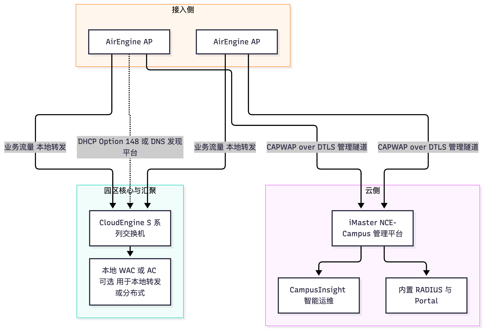


```mermaid
flowchart LR
    A["AP 上电"] --> B["DHCP 获取 IP"]
    B --> C["通过 Option 148 或 DNS 发现云平台"]
    C --> D["建立 CAPWAP over DTLS 通道"]
    D --> E{"双向证书认证是否通过"}
    E -->|否| F["拒绝纳管 告警排查"]
    E -->|是| G["按 ESN 与 MAC 登记到站点"]
    G --> H{"是否需要审批"}
    H -->|是| I["管理员审批后纳管"]
    H -->|否| J["自动纳管"]
    I --> K["下发站点模板配置"]
    J --> K
    K --> L["AP 广播 SSID 业务上线"]
    L --> M["Telemetry 数据上报 进入运维闭环"]
```

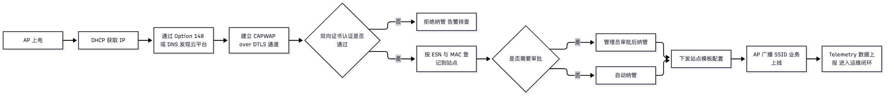


### 真题精练

**Q1.【真题·简答】** 请描述云管理 WLAN 的整体架构（四层），并说明 AP 从开箱到业务上线的完整流程。

> **答案**：
> **① 四层架构**：
> - **设备层**：AirEngine 系列 AP 与 CloudEngine S 系列交换机，作为被管理对象与业务承载者。
> - **通道层**：AP 与云平台之间的 **CAPWAP over DTLS 管理隧道**（双向证书认证 + 加密），承载管理、配置下发与 Telemetry；**业务流量默认本地转发**，不绕行云平台。
> - **平台层**：**iMaster NCE-Campus** 提供统一配置、监控、认证（内置 RADIUS/Portal）、策略与报表；按**租户**隔离多客户。
> - **应用/北向层**：开放 API 与 **CampusInsight** 联动，做体验分析、AI 根因与第三方系统集成（工单、资产、位置服务）。
> **② AP 上线流程（7 步）**：
> 1. **上电**：接入 PoE 交换机端口（PoE 供电充足是前提）。
> 2. **获取 IP**：通过 DHCP 获得管理地址。
> 3. **发现控制器**：通过 **DHCP Option 148/158（云管理常用）**、**Option 43**、**DNS 解析**或手工配置获得云平台地址与端口。
> 4. **建立通道与双向认证**：建立 CAPWAP over DTLS 通道，基于设备证书完成**双向认证**（防止伪造设备接入平台）。
> 5. **纳管与登记**：平台校验 AP 的 **ESN/MAC**，把它登记到指定**站点**（可开启自动纳管或人工审批）。
> 6. **配置下发**：按"站点模板 → 设备组模板 → 设备级配置"的优先级下发射频、SSID、VLAN、安全与策略。
> 7. **业务上线与运维**：AP 广播 SSID 承载业务；平台开始 Telemetry 采集，进入监控与运维闭环。
> **③ 关键结论**：云管理的价值是"**管理上云、业务本地**"——控制面在云端（统一运维、即插即用），转发面在本地（性能与可靠性不受云端影响）。

**Q2.【真题·多选】** 关于云管理与本地 AC 管理的差异，下列说法正确的有？
A. 云管理场景通常以本地转发为主，业务流量不经过云平台
B. 云管理 AP 与平台之间的管理通道可使用 CAPWAP over DTLS，提供双向证书认证与加密
C. 云管理天然支持多租户与多分支统一运维，本地 AC 在这方面能力较弱
D. 云管理对到云平台的连通性有依赖，因此需要考虑断网时的本地逃生（保留已有配置继续运行）
E. 云管理场景下 AP 无需任何认证即可被平台纳管，便于快速上线

> **答案：ABCD**
> **解析**：E 错误——云管理平台通过 **DTLS 双向证书认证 + ESN/MAC 校验**识别设备，正是为了防止伪造 AP 被纳管（否则任何人都能把自己的 AP 注册到你的平台）。A 是云管理能做大的关键（业务本地转发，云只管配置与管理）；B 是安全性差异；C 是运维能力差异；D 是必须正视的依赖风险，规范做法是"**云端故障时本地保留已有配置继续运行**"并做好逃生设计。

**Q3.【真题·判断】** 在 iMaster NCE-Campus 中，"租户"与"站点"是同一个概念，都表示一组设备的集合。

> **答案：错误**
> **解析**：二者层级与语义不同。**租户（Tenant）是资源与权限的隔离边界**——不同租户的设备、用户、策略、License 配额**完全隔离、互不可见**（MSP 为每个客户建一个租户）。**站点（Site）是租户内部的设备分组与策略下发边界**，通常对应一个物理位置（一栋楼、一个分支）。层级关系是 `平台 → 租户 → 站点 → 设备`。混淆二者会导致两类错误：把不同客户的设备放进同一租户（安全与数据隔离失效），或把需要统一策略与漫游的区域拆成多个站点（跨站点漫游与策略一致性问题）。

**Q4.【真题·填空】** 云管理场景中，AP 常通过 DHCP 的 Option ________ 或 Option ________ 获得云平台的域名与端口，从而完成控制器发现；AP 与平台之间的管理通道基于 ________ 协议提供双向证书认证与加密；平台按"________模板 → 设备组模板 → 设备级配置"的优先级下发配置。

> **答案：148；158（或 43，视场景）；CAPWAP over DTLS；站点**
> **解析**：Option 43 是传统方式（携带控制器 IP 列表），云管理场景更常用 **Option 148/158**（携带云平台域名、端口与工作模式）。DTLS（Datagram TLS）为 UDP 上的 CAPWAP 提供加密与双向认证，是云管理相较传统 CAPWAP 的安全增强。配置优先级"**设备级 > 设备组级 > 站点级**"与本地 AC 的"AP 个性化配置 > AP 组模板"是同一思想——**排查"模板不生效"时先看是否被更高优先级覆盖**。

**Q5.【真题·设计】** 某连锁便利店有 300 家门店，每店 1~2 台 AP + 1 台接入交换机。IT 团队只有 3 人。请设计 WLAN 管理方案，并说明如何做到"门店只需上电即可开业"。

> **答案**：
> **① 方案选型：云管理（iMaster NCE-Campus 多租户或单租户多站点）**。理由：① IT 人力极少，无法逐店现场配置；② 门店数量多、配置高度一致，适合"**一套模板管 300 店**"；③ 需要统一监控、统一故障处理与统一升级；④ MSP/总部集中运维，成本最低。
> **② 模型设计**：
> - **租户**：若为自有连锁，用**一个租户**（或按区域/子公司分租户）；若为托管服务商，按客户分租户。
> - **站点**：**一家门店 = 一个站点**（便于按店看健康度、按店下发策略、按店排障）；门店之间的差异用**站点变量**（店名、VLAN、AP 数量、信道偏移）区分。
> - **模板**：建立**门店标准模板**（SSID：员工 + 顾客；安全：员工 WPA2/WPA3-Enterprise，顾客 Portal 实名；射频：2.4G 1/6/11 低功率，5G 固定信道；VLAN：员工 10、顾客 20、收银/POS 30、管理 100），模板中通过变量注入"门店编号、信道偏移、VLAN 段"。
> **③ 实现"上电即开业"（ZTP）的关键步骤**：
> 1. **采购阶段**：设备 ESN 录入平台并预先分配到对应站点（或**基于位置的自动纳管** + 模板继承）。
> 2. **网络侧预置**：门店接入交换机的端口配置（PVID、PoE）与 DHCP 服务器/上层路由器配置（**Option 148/158 指向云平台**）由"门店网络标准包"统一提供（可由总部配置好并测试）。
> 3. **开箱上电**：AP 上电 → DHCP 获取地址 → 通过 Option 148 发现云平台 → DTLS 双向认证 → 自动纳管到对应站点 → 自动下发门店模板 → 广播 SSID。
> 4. **验证与验收**：总部在平台上远程确认"AP 在线、SSID 广播、终端可接入、健康度正常"，并在业务高峰时段远程抽测（可部署**合成事务探针**或由店员用手机自测上报）。
> **④ 运维设计**：统一升级（分批灰度，避免"全网同时升级"风险）；健康度看板（按门店排序，快速发现异常门店）；告警推送到工单系统；**断网逃生**（门店到云平台的连通中断时，AP 保留已有配置继续工作，恢复后自动同步）。
> **⑤ 安全设计**：门店员工用企业级认证（对接总部 RADIUS/云内置 RADIUS）；顾客网络 Portal 实名 + 用户隔离 + 限速 + 仅互联网；POS/收银设备独立 SSID + VLAN + MAC 白名单 + 仅访问收银服务器（**POS 是资金相关，必须最强隔离**）。

**Q6.【真题·排错】** 某企业新购 20 台 AP 采用云管理，上电后平台上一台都看不到。请给出排查思路。

> **答案**：
> ① **第一步：确认 AP 是否正常运行**。检查 PoE 供电（`display poe power-information interface <接口>`）与端口状态（`display interface brief`）；观察 AP 指示灯（不同型号指示灯语义不同，以产品文档为准，通常"常亮/闪烁"代表不同状态）；确认 AP 型号是否在平台支持列表内。
> ② **第二步：确认 AP 是否获得 IP**。在 DHCP 服务器上查看是否分配了 AP 管理网段的地址（`display ip pool name AP_MGMT`）；若没有，检查 AP 所连 VLAN 与 DHCP 池是否匹配、中继是否配置、端口 PVID 是否正确。**AP 拿不到地址就无法发现平台**，这是最常见的一步。
> ③ **第三步：确认 AP 是否拿到云平台信息**。核对 DHCP 的 **Option 148/158（或 43）** 是否配置、格式是否正确（**字段名/分隔符/端口必须严格符合版本文档要求，一个字符错误就会导致 AP 无法识别**）；或核对 **DNS 解析**是否能把约定域名解析到平台地址（用 `nslookup` 类工具从同网段测试）。
> ④ **第四步：确认网络可达性**。从 AP 所在网段测试到云平台的**连通性**（管理端口，常见 10020/10021 等，以平台文档为准）；检查出口防火墙/NAT 是否放通（**云管理场景必须放通 AP → 云平台的管理端口**，这是企业网络最常漏的配置）；确认是否需要代理。
> ⑤ **第五步：确认认证与纳管策略**。平台是否已录入这 20 台 AP 的 **ESN/型号**（未录入且未开自动纳管 → 设备不会被纳管）；是否开启了**审批流程**（等待管理员审批的设备不会上线）；设备的**出厂证书是否有效**（DTLS 双向认证依赖设备证书，若设备证书异常或时间不同步会导致认证失败）。
> ⑥ **第六步：时间与证书**。确认 AP 能否获得正确时间（证书有效期校验依赖时间）；若 AP 无法上网获取时间，可部署内网 NTP 并放通。
> ⑦ **处置与验证**：修正后观察 AP 是否出现在平台的"待纳管/未纳管"列表 → 纳管到正确站点 → 确认配置下发（SSID 广播、射频参数）→ 终端可接入。**批量故障优先怀疑"模板化的中心配置"（Option、防火墙策略、ESN 录入），而不是逐台设备故障**。

**Q7.【真题·实验】** 请写出在企业 DHCP 服务器（以华为交换机/AC 作为 DHCP 服务器为例）上配置 Option 148 指引 AP 云化上线的命令，并说明关键字段含义与验证方法。

> **答案**：
> ```bash
> system-view
> dhcp enable                                                   // 启用 DHCP 服务
> ip pool AP_MGMT                                               // 创建 AP 管理地址池
>  network 10.10.100.0 mask 255.255.255.0                        // AP 管理网段（与业务网段隔离）
>  gateway-list 10.10.100.1                                      // AP 网关
>  option 148 ascii agilemode=agile-cloud;agilemanage-mode=domain;agilemanage-domain=naas.huaweicloud.com;agilemanage-port=10020;
>                                                               // Option 148 关键字段：
>                                                               //   agilemode=agile-cloud    声明以"云管理模式"上线
>                                                               //   agilemanage-mode=domain  以域名方式指定管理平台
>                                                               //   agilemanage-domain=...   云平台域名（或 IP）
>                                                               //   agilemanage-port=10020   管理通道端口（以平台文档为准）
>  quit
> ```
> ```bash
> display ip pool name AP_MGMT                                  // 确认地址池配置与分配情况
> display ip pool name AP_MGMT used                             // 查看已分配的 AP 地址（判断 AP 是否拿到地址）
> display current-configuration | include option                // 核对 Option 148 字符串（注意分号与大小写必须准确）
> ```
> **关键字段说明**：**`agilemode` 决定 AP 以云模式还是本地 AC 模式上线**（写错会导致 AP 去找 AC 而不是云平台）；**`agilemanage-domain`** 必须是 AP 能解析/可达的地址（若用域名，必须保证 DNS 可达）；**`agilemanage-port`** 必须与平台实际端口一致；**整串的格式（分隔符、大小写、顺序）在不同版本要求不同，必须严格按所用版本文档填写**——一个字符错误就会导致 AP 无法上线。
> **验证方法**：① 在 DHCP 服务器上确认 AP 已获得地址（`display ip pool name AP_MGMT used`）；② 在云平台上确认 AP 出现在"待纳管"列表并成功纳管到正确站点；③ 在平台上确认配置已下发（SSID 广播、射频参数正确）；④ 用终端实测接入；⑤ 若 AP 未上线，用**同网段的测试主机**验证 DHCP Option 内容（抓包看 Option 148 是否被正确下发）与到云平台的连通性（端口可达性）。
> **提示**：若同时存在本地 AC 与云平台，可通过 **Option 43** 与 **Option 148** 的优先级/模式字段控制 AP 走哪条管理路径，具体行为**以所用版本文档为准**。

**Q8.【真题·简答】** 请说明云管理场景下"断网（到云平台不可达）"会发生什么，并给出应对设计。

> **答案**：
> **① 会发生什么**：
> - **已有业务基本不受影响**：因为**业务流量以本地转发为主**，不经过云平台；AP 已下发的配置（SSID、射频、VLAN、安全）保存在设备本地，**断网期间 AP 继续正常工作**，终端仍可接入与上网（若认证依赖云内置 RADIUS/Portal，则**新认证会受影响**——这是关键风险点）。
> - **管理面失效**：无法下发新配置、无法查看监控与报表、无法远程排障、无法升级。
> - **认证面风险**：若使用云平台内置 RADIUS/Portal 且没有本地备份认证，**断网期间新用户无法认证**（已在线用户通常不受影响）；若认证对接的是本地 RADIUS，则不受影响。
> - **Telemetry 数据**：本地缓存或丢弃（视设备能力），恢复后可能补传或不补。
> **② 应对设计**：
> 1. **转发面**：坚持**本地转发**，确保业务不依赖云端；对跨分支的集中式业务，规划好本地网关与路由。
> 2. **认证面（最关键）**：① 认证服务器**本地化部署**（或在本地保留 RADIUS/Portal 备机）；② 或在云端不可达时启用**本地逃生**（放行或转本地认证），并**必须有告警与范围限制**；③ 定期演练"云端不可达"场景，验证已在线用户与新用户的行为。
> 3. **管理面**：① 保留**本地管理通道**（如通过交换机/AC 的本地管理口或本地 WAC 进行应急管理）；② 关键配置在本地留存备份（配置导出）；③ 明确"云端不可达"时的运维流程与责任人。
> 4. **链路面**：为到云平台的链路设计**冗余**（双出口/双线路），并监控其可用性与时延；把"到云平台的可达性"纳入监控告警。
> 5. **容量与体验**：断网期间无法使用云端 AI 分析与报表，需在本地保留基础的监控手段（如 AC/交换机本地的性能查看）。
> **③ 结论**：云管理的可用性设计核心是"**管理可断、业务不可断、认证要兜底**"——业务靠本地转发、认证靠本地备份或逃生、管理靠本地应急通道与配置备份。

### 易错点与排错

1. **以为云管理 AP 的业务流量也要经过云平台**：实际以**本地转发**为主，云只管管理与认证。
2. **租户与站点混淆**：租户是隔离与权限边界，站点是设备/策略分组边界；层级是平台→租户→站点→设备。
3. **Option 148 格式写错**：字段名/分隔符/端口任何一处错误都会导致 AP 无法发现平台，且现象与"网络不通"相同。
4. **忘记放通 AP 到云平台的管理端口**：出口防火墙未放通是"AP 看不到平台"的高频原因。
5. **忽略 ESN 录入与审批**：未录入 ESN 且未开自动纳管，设备永远不会上线；开了审批则需管理员操作。
6. **没考虑断网场景**：认证依赖云内置 RADIUS 时，断网会让新用户无法接入；必须做本地备份或逃生。
7. **验证命令**：`display ip pool name AP_MGMT used`（AP 是否拿到地址）、`display current-configuration | include option`（Option 配置）、`display interface brief`（端口）、`display poe power-information interface <接口>`（供电）。

---

## 5.2 WLAN 智能运维：Telemetry 采集、健康度评估模型与 AI 根因

### 考点定位

本考点以**设计题/计算题/流程题**形式出现，占 **5~8 分**，是"智能化运维"的核心。**健康度评估模型是本节必须极细的考点**：要能写出 KPI 集合、权重、归一化方法与评分公式，并能对给定数据算出分数。高频陷阱：① 不知道 Telemetry 与传统 SNMP 轮询的区别（**推模式 vs 拉模式，秒级 vs 分钟级**）；② 健康度模型只列 KPI 不给权重与计算方式（考试要求可计算）；③ 混淆"网络健康度"与"用户/应用体验评分"；④ 根因分析只讲"AI 很聪明"，讲不出**基于拓扑与依赖关系的定位逻辑**。

### 原理精讲

**① Telemetry（遥测）在 WLAN 上的采集内容与机制。**
- **机制对比**：传统网管用 **SNMP 轮询（Pull）**——NMS 周期性主动采集（通常 1~5 分钟一次），粒度粗、设备负担与采集规模成正比、突发故障容易漏采。**Telemetry（Push）** 由设备**主动、周期性地推送**数据（支持**秒级甚至亚秒级**），NMS 只管接收与存储，因此可支撑大规模、高频率、精细化的采集（这正是"智能运维"的数据基础）。华为的实现方式包括 **gRPC Telemetry（基于 gNMI/gRPC 的高性能推送，推荐）** 与 **Telemetry over UDP（部分老版本）**；云管理场景下由 **iMaster NCE-Campus / CampusInsight** 统一采集与分析。**以所用版本文档为准。**
- **WLAN 上采集的内容（按维度）**：
  - **AP 级**：在线/离线状态、上下线记录、CPU/内存、上行端口速率与流量、PoE 供电状态、重启记录、版本信息。
  - **射频级**：信道、带宽、EIRP、**信道利用率**、**噪声底**、干扰强度、每射频关联终端数、空口吞吐、重传率、管理帧占比。
  - **终端（STA）级**：MAC、IP、关联 AP/射频、**RSSI/SNR**、协商速率与 MCS、上下行流量、**重传/丢包**、**漫游记录（漫游次数、漫游时延、漫游前后 AP）**、**关联失败与认证失败记录及原因**、在线时长。
  - **SSID/VAP 级**：各 SSID 的在线数、认证成功率、Portal 跳转成功率、流量与带宽。
  - **认证与业务级**：认证成功率、认证时延、DHCP 成功率与获址时延、DNS 解析时延、应用流识别与体验指标（时延/丢包/抖动）。
  - **网络级**：AP 在线率、覆盖达标率、信道冲突统计、跨 AP/跨 AC 漫游成功率。
- **为什么 Telemetry 是智能运维的前提**：AI 分析需要**足够细（终端级）× 足够快（秒级）× 足够全（多维度关联）**的数据。SNMP 分钟级、设备级的采样既看不出"某终端在漫游瞬间丢包"，也做不了"根因定位到某个 AP 的某个射频"。

**② 网络健康度评估模型（必须极细）。**

健康度评估的本质是"**把多维 KPI 归一化后加权求和，得到一个 0~100 的可比较分数**"，用于**横向比较（哪个站点/AP 最差）**与**纵向比较（今天比昨天差了多少）**，并驱动工单与优化。

**第一步：选择 KPI 集合**（覆盖"接入、体验、容量、干扰、可靠性"五个方面）：

| 维度 | KPI | 含义 | 目标/门限（示例） |
|---|---|---|---|
| 接入成功率 | 关联成功率 | 关联请求成功比例 | ≥99% |
| | 认证成功率 | 802.1X/Portal 认证成功比例 | ≥99% |
| | DHCP 成功率 | 获得地址的比例 | ≥99% |
| 体验质量 | 平均时延 | 终端到网关/应用的往返时延 | ≤30 ms |
| | 丢包率 | 空口丢包比例 | ≤1% |
| | 平均协商速率 / MCS | 反映射频质量 | 越高越好（按场景定基准） |
| 容量与拥塞 | 信道利用率 | 空口繁忙程度 | ≤40%（>60% 严重） |
| | 单 AP 在线用户数 | 是否超设计容量 | ≤设计值（如 30/45） |
| | AP 上行带宽利用率 | 有线侧瓶颈 | ≤70% |
| 干扰与射频 | 噪声底 | 环境噪声 | 2.4G ≤ -90 dBm，5G ≤ -95 dBm |
| | 同频/邻频干扰 | 干扰强度 | 同频 ≤ -80 dBm |
| | 重传率 | 空口质量 | ≤10% |
| 可靠性 | AP 在线率 | 设备可用性 | ≥99.5% |
| | 漫游成功率 | 切换成功比例 | ≥99% |
| | 漫游时延 | 切换耗时 | ≤100 ms（数据）/≤50 ms（语音） |

**第二步：归一化（把不同量纲的 KPI 变成 0~100 分）。** 三种常用方法：
- **区间映射（线性）**：`Score = 100 × (KPI - Worst) / (Best - Worst)`，并**截断到 [0,100]**。适用于"越大越好"（如成功率）或"越小越好"（如时延、丢包，此时把 Best/Worst 反过来）。
  例：信道利用率，Best = 20%（得 100 分）、Worst = 80%（得 0 分），当实测 50% → `Score = 100 × (80-50)/(80-20) = 50` 分。
- **阶梯映射（分档）**：如丢包率 ≤0.5% 得 100 分，≤1% 得 80 分，≤2% 得 60 分，>5% 得 0 分。适用于有明确门限的 KPI（更符合工程直觉）。
- **非线性/对数映射**：对"越大越好但收益递减"的指标（如协商速率），用对数或分段映射避免"高端指标过度拉分"。
**注意**：对"越小越好"的 KPI，必须**先反向再归一化**，否则会算出"时延越大分越高"的荒谬结果——这是计算题的经典陷阱。

**第三步：加权求和。** `HealthScore = Σ (w_i × Score_i)`，且 `Σ w_i = 1`。权重设计原则：
- **直接影响用户可用性的指标权重最高**（接入成功率、AP 在线率）；
- **直接影响体验的次之**（时延、丢包、信道利用率）；
- **间接/环境类最低**（噪声底、重传率可作为修正项）。
- 建议把**"接入成功率"和"AP 在线率"设为"门限项/否决项"**：低于门限时整体评分不超过某上限（例如接入成功率 <95% 时总分不得高于 60），因为"连不上"比"网速慢"严重得多。**这一条是答题的加分点。**
- 示例权重：认证与关联成功率 25%、DHCP 成功率 10%、时延 15%、丢包 10%、信道利用率 15%、单 AP 用户数 5%、噪声底 5%、重传率 5%、AP 在线率 10%。

**第四步：评分分级与动作。** 例：**≥90 优（无需动作）**；**80~90 良（关注趋势）**；**70~80 中（生成优化工单）**；**60~70 差（立即排查）**；**<60 极差（紧急工单 + 现场处置）**。分级要与**处置流程**绑定，否则分数没有意义。

**⑤ 算例（必须会给数据算分）**：某站点实测——关联成功率 97%、认证成功率 98%、DHCP 成功率 99.5%、平均时延 45 ms、丢包率 1.5%、信道利用率 55%、单 AP 在线 28（设计 30）、噪声底 -88 dBm（2.4G）、重传率 8%、AP 在线率 99%。按上述权重与映射（成功率类 Best=100%/Worst=90%；时延 Best=10ms/Worst=100ms；丢包 Best=0/Worst=5%；利用率 Best=20%/Worst=80%；用户数 Best=0/Worst=设计值的 150%；噪声底 Best=-95/Worst=-80 dBm；重传 Best=0/Worst=30%；AP 在线率 Best=100%/Worst=95%）逐项算分后加权，可得到一个可比较的分数（本题在 Q1 中详细展开）。

**⑥ AI 根因分析（Root Cause Analysis）的逻辑。** 智能运维的根因分析不是"黑盒"，其可解释逻辑通常是：
1. **异常检测**：对每个 KPI 建立基线与阈值（或使用时序异常检测算法），发现偏离。
2. **关联分析**：把异常在**拓扑维度**（同一交换机下的 AP、同一射频下的终端）、**时间维度**（同一时刻发生的多个异常）、**因果维度**（如"某交换机端口丢包 → 该端口下 AP 的终端丢包上升"）上聚合。
3. **依赖链推理**：沿"**终端 → AP/射频 → 接入交换机/端口/PoE → 汇聚 → AC/网关 → 认证服务器 → 出口/DNS**"的依赖链，判断"哪个是根因、哪些是症状"。例如很多终端同时漫游失败 + 某台 AP 信道利用率异常 + 该 AP 与邻居 AP 信道重叠 → 根因是"信道规划被自动调优打乱"。
4. **置信度与建议**：给出根因候选与置信度，并给出**建议动作**（如"将 AP12 的 5G 信道从 36 改为 149"），由管理员确认执行（**不自动改配置**是安全原则）。
5. **闭环**：执行动作后跟踪健康度是否回升，形成"**检测 → 分析 → 建议 → 执行 → 验证**"闭环（这也是"故障定位流程图"的内容）。

**⑦ 体验保障与 VIP 用户保障。** ① **体验评分**：对每个终端/每个应用算体验分（基于时延、丢包、抖动、速率、TCP 重传），把"网络健康"翻译成"用户感受"；② **VIP 保障**：识别 VIP 用户/关键业务（按用户组、SSID、应用类型），为其提供：**专用带宽保障（QoS 优先级 + 最小带宽）**、**优先调度（空口调度优先级）**、**专属射频资源或专属 SSID**、**主动巡检与告警（VIP 用户质量下降立即告警）**、**问题优先处理**；③ **公平性与防滥用**：非 VIP 业务在拥塞时让路，但要避免 VIP 无限占用导致整体劣化（需设上限）。

**⑧ 预测性维护（Predictive Maintenance）。** 基于历史数据与趋势预测：① **容量趋势预测**（按用户增长预测何时需要扩容）；② **AP 老化预测**（在线率/重启次数/温度异常→预测故障）；③ **证书/License 到期预测**；④ **干扰趋势**（新增 AP 或新建筑导致的干扰变化）；⑤ **故障前兆识别**（如某 AP 的 PoE 功率异常下降、CPU 持续高位）。价值：把"被动抢修"变成"**计划性维护**"，减少业务中断。

### 关键概念对照表

| 维度 | SNMP 轮询（Pull） | Telemetry（Push） |
|---|---|---|
| 数据方向 | NMS 主动采集 | 设备主动推送 |
| 采集周期 | 通常 1~5 分钟 | **秒级/亚秒级** |
| 粒度 | 设备/接口级为主 | **设备 + 射频 + 终端 + 应用级** |
| 扩展性 | 设备越多越慢（NMS 压力大） | 好（设备分担推送） |
| 实时性 | 差（突发故障易漏采） | **好（可捕捉瞬态事件）** |
| 传输协议 | SNMP v1/v2c/v3（UDP 161/162） | **gRPC/gNMI（推荐）**、Telemetry over UDP（老版本） |
| 适用 | 传统网管、周期性报表 | **智能运维、体验分析、AI 根因** |

| 评分/模型概念 | 含义 | 注意事项 |
|---|---|---|
| KPI 集合 | 参与评分的指标清单 | 要覆盖接入、体验、容量、干扰、可靠性五维 |
| 归一化 | 把异量纲 KPI 映射到 0~100 | **"越小越好"的指标必须先反向** |
| 权重 w_i | 各 KPI 的重要程度 | Σw=1；可用性类权重最高 |
| 门限项/否决项 | 低于门限则总分受限 | 接入成功率/AP 在线率适合做否决项 |
| 分级 | 分数区间对应的处置动作 | 必须与工单流程绑定 |
| 体验评分 | 面向终端/应用的体验量化 | 与"网络健康度"区分：前者是"用户感受"，后者是"网络状态" |

### 华为设备配置

```bash
# ===== AC6805 上配置 Telemetry 数据上报（gRPC 方式；不同版本命令有差异，以版本文档为准）=====
system-view
 telemetry                                                      // 进入 Telemetry 视图
  sensor-group WLAN_STA                                         // 采样传感器组：终端级数据
   sensor-path ...                                              // 指定 WLAN 终端相关数据路径（以所用版本文档给出的路径为准）
  sensor-group WLAN_RADIO                                       // 采样传感器组：射频级数据
   sensor-path ...
  destination-group NCE                                         // 目的组：iMaster NCE-Campus 采集器
   ipv4-address 10.10.200.80 port 10031                         // 采集器地址与端口（gRPC，以平台文档为准）
    protocol grpc                                              // 使用 gRPC 协议推送
  subscription WLAN_SUB                                        // 订阅：把传感器组送到目的组
   sensor-group WLAN_STA
   sensor-group WLAN_RADIO
   destination-group NCE
   local-source-address ipv4 10.10.100.1                        // 本地源地址（采集器据此识别设备）
```

```bash
# ===== 本地可获取的健康度相关数据（无 Telemetry 时用 display 采样）=====
display ap performance all                                     // 每 AP 在线用户数、上下行速率：容量类 KPI
display ap performance all radio                               // 信道利用率、噪声底：干扰与容量类 KPI
display station all                                            // 终端分布与数量：接入类 KPI
display station mac-address <MAC> verbose                      // 单终端 RSSI/SNR/速率/重传：体验类 KPI
display wlan sta-statistics                                    // 上线成功率与失败原因：接入成功率 KPI
display ap all                                                 // AP 在线状态：AP 在线率 KPI
display interface brief                                        // AP 上行端口速率与错包：有线侧瓶颈 KPI
```

```text
# ===== iMaster NCE-CampusInsight / Campus 界面路径（版本差异较大，以所用版本文档为准）=====
1. 【监控】→【网络监控】→【健康度】                              // 网络/站点/AP 健康度总览
2. 【监控】→【体验分析】→【终端体验】                            // 按终端看体验评分与问题终端排行
3. 【监控】→【体验分析】→【应用体验】                            // 按应用看时延/丢包/抖动
4. 【维护】→【故障诊断】→【智能根因】                            // 根因分析结果与建议动作
5. 【监控】→【报表】→ 自定义 KPI 报表与订阅推送                  // 生成运维报表
6. 【设计】→【策略】→ QoS/VIP 用户保障策略                       // 体验保障与 VIP 保障配置
```

### 示意图

```mermaid
flowchart TD
    A["AP 与 AC 采集多维数据"] --> B["Telemetry 秒级推送"]
    B --> C["NCE-Campus 与 CampusInsight 存储"]
    C --> D["KPI 计算与归一化 0到100"]
    D --> E["加权求和 得健康度分数"]
    E --> F{"是否低于门限"}
    F -->|否| G["记录基线 观察趋势"]
    F -->|是| H["异常检测与关联分析"]
    H --> I["沿依赖链做根因推理"]
    I --> J["输出根因候选与建议动作"]
    J --> K["管理员确认执行优化"]
    K --> L["复测健康度是否回升"]
    L -->|未回升| I
    L -->|回升| M["闭环归档与知识沉淀"]
```


```mermaid
flowchart LR
    T1["终端级 KPI"] --> N["归一化映射到 0 到 100"]
    T2["AP 与射频级 KPI"] --> N
    T3["网络与链路级 KPI"] --> N
    N --> W["加权求和"]
    W --> S["健康度分数 0到100"]
    S --> D1["大于等于90 优"]
    S --> D2["80到90 良"]
    S --> D3["70到80 中 生成优化工单"]
    S --> D4["60到70 差 立即排查"]
    S --> D5["小于60 极差 紧急处置"]
```


### 真题精练

**Q1.【真题·计算·健康度】** 某站点采集到如下 KPI：关联成功率 97%、认证成功率 98%、DHCP 成功率 99.5%、平均时延 45 ms、丢包率 1.5%、信道利用率 55%、单 AP 在线用户 28（设计上限 30）、噪声底 -88 dBm（2.4G）、重传率 8%、AP 在线率 99%。请按下列权重与归一化规则计算该站点的健康度分数：权重为 关联成功率 10%、认证成功率 15%、DHCP 成功率 10%、时延 15%、丢包 10%、信道利用率 15%、单 AP 用户数 5%、噪声底 5%、重传率 5%、AP 在线率 10%。

> **答案**：
> **① 归一化规则（先明确，再计算）**：
> - 成功率类（越大越好）：Best = 100%，Worst = 90% → `Score = 100 × (x - 90) / 10`，截断 [0,100]。
> - 时延（越小越好）：Best = 10 ms，Worst = 100 ms → `Score = 100 × (100 - x) / 90`。
> - 丢包（越小越好）：Best = 0%，Worst = 5% → `Score = 100 × (5 - x) / 5`。
> - 信道利用率（越小越好）：Best = 20%，Worst = 80% → `Score = 100 × (80 - x) / 60`。
> - 单 AP 用户数（越小越好）：Best = 0，Worst = 设计上限 × 1.5 = 45 → `Score = 100 × (45 - x) / 45`。
> - 噪声底（越小越好）：Best = -95 dBm，Worst = -80 dBm → `Score = 100 × (x - (-80)) / ((-95) - (-80)) = 100 × (x + 80) / (-15)`，即 `Score = 100 × (-80 - x) / 15`……**注意方向**：x 越小（越负）分越高。以 x = -88：`Score = 100 × (-80 - (-88)) / 15 = 100 × 8 / 15 ≈ 53.3`。
> - 重传率（越小越好）：Best = 0%，Worst = 30% → `Score = 100 × (30 - x) / 30`。
> - AP 在线率（越大越好）：Best = 100%，Worst = 95% → `Score = 100 × (x - 95) / 5`。
> **② 逐项算分**：
> | KPI | 实测 | 得分计算 | 得分 | 权重 | 加权 |
> |---|---|---|---|---|---|
> | 关联成功率 | 97% | 100×(97-90)/10 | 70.0 | 10% | 7.00 |
> | 认证成功率 | 98% | 100×(98-90)/10 | 80.0 | 15% | 12.00 |
> | DHCP 成功率 | 99.5% | 100×(99.5-90)/10 | 95.0 | 10% | 9.50 |
> | 平均时延 | 45 ms | 100×(100-45)/90 | 61.1 | 15% | 9.17 |
> | 丢包率 | 1.5% | 100×(5-1.5)/5 | 70.0 | 10% | 7.00 |
> | 信道利用率 | 55% | 100×(80-55)/60 | 41.7 | 15% | 6.25 |
> | 单 AP 用户数 | 28 | 100×(45-28)/45 | 37.8 | 5% | 1.89 |
> | 噪声底 | -88 dBm | 100×(-80+88)/15 | 53.3 | 5% | 2.67 |
> | 重传率 | 8% | 100×(30-8)/30 | 73.3 | 5% | 3.67 |
> | AP 在线率 | 99% | 100×(99-95)/5 | 80.0 | 10% | 8.00 |
> | **合计** | | | | **100%** | **67.15** |
> **③ 结论**：健康度约 **67 分**，落入"**差（60~70）**"区间，应**立即排查**。主要失分项与处置：
> - **信道利用率（41.7 分，权重 15%）** 与 **单 AP 用户数（37.8 分）**：说明该站点空口拥塞/终端分布不均——按 3.3/3.7 节做容量核查（是否需补点、是否需降功率加密布点、是否需限速与负载均衡）。
> - **噪声底（53.3 分）**：2.4G 噪声底 -88 dBm 偏高，说明存在干扰——做频谱排查并优化 2.4G 信道/功率。
> - **关联成功率 97% 与认证成功率 98%**：虽不低，但**未达 99% 门限**；若把二者设为**否决项**（<95% 才否决），本案例未触发否决，但属"需要关注"。
> **④ 方法学提醒**：① 对"越小越好"的 KPI **必须先反向再归一化**，否则会算出"时延越大分越高"；② 权重与门限必须**在项目开始前定义并写入验收/运维文档**，否则事后调整权重等于人为操纵分数；③ 建议对"接入成功率、AP 在线率"设**否决项**，因为"连不上"比"慢"严重得多。

**Q2.【真题·简答】** 请说明 Telemetry 与 SNMP 轮询的区别（不少于 4 点），并说明为什么智能运维必须依赖 Telemetry。

> **答案**：
> **① 五个区别**：
> | 维度 | SNMP 轮询 | Telemetry |
> |---|---|---|
> | 数据方向 | NMS 主动采集（Pull） | 设备主动推送（Push） |
> | 采集周期 | 分钟级（常 1~5 min） | **秒级/亚秒级** |
> | 数据粒度 | 设备/接口级为主 | **设备 + 射频 + 终端 + 应用级** |
> | 扩展性 | 设备多则 NMS 压力大、采集慢 | 设备分担推送，扩展性好 |
> | 实时性/瞬态捕捉 | 差（突发故障易被漏采） | **好（可捕捉漫游、瞬态拥塞）** |
> **② 为什么智能运维必须依赖 Telemetry**：
> - **AI 分析需要"细粒度 × 高频率 × 多维度"的数据**。举例：判断"某终端漫游失败是因为目标 AP 信道拥塞"需要**终端级**的漫游记录 + **射频级**的秒级信道利用率 + **时间对齐**（漫游瞬间的指标）。SNMP 分钟级、设备级的采样根本捕捉不到这个瞬间。
> - **健康度模型的输入精度决定输出可信度**：若 KPIs 是 5 分钟均值，则一次 30 秒的严重拥塞会被"平均掉"，健康度显示正常而用户实际卡顿。
> - **根因分析需要跨层关联**：Telemetry 能同时提供"AP 上行端口速率、PoE 状态、射频噪声底、终端重传率"，AI 才能沿依赖链判断真正的瓶颈层。
> - **预测性维护需要长时序高频数据**：趋势预测、故障前兆识别都依赖高密度的时间序列。
> **③ 补充**：Telemetry 推荐使用 **gRPC/gNMI** 方式（高性能、支持订阅与增量推送）；老版本可能使用 Telemetry over UDP。华为云管理场景由 **iMaster NCE-Campus/CampusInsight** 统一采集与分析，本地部署可用 iMaster NCE 或第三方采集器。**以所用版本文档为准。**

**Q3.【真题·判断】** 计算网络健康度时，可以直接把"时延"这类"越小越好"的指标按线性公式归一化后参与加权求和。

> **答案：错误**
> **解析**：如果对"越小越好"的指标**不做方向处理**直接套用"越大越好"的归一化公式（`100×(x-Worst)/(Best-Worst)`），会得到"**时延越大分数越高**"的荒谬结果，最终健康度完全失真。正确做法有两种：① **反向**：令 `Score = 100 × (Worst - x) / (Worst - Best)`（Worst > Best 对"越小越好"的指标）；② **交换 Best/Worst**：把 Best 设为门限值（分数为 100 的那一端）、Worst 设为最差值。同样要注意的还有丢包率、信道利用率、单 AP 用户数、噪声底（负值！）、重传率。**噪声底是负数，映射时容易算错符号**（例：-88 dBm 优于 -80 dBm，但数值上 -88 < -80），必须先把"越小越好"的方向处理清楚。

**Q4.【真题·填空】** 健康度评估的四步是：选择 ________、对各项 KPI 做 ________ 映射到 0~100、按 ________ 加权求和、按分数区间做________并与工单流程绑定；其中对"接入成功率""AP 在线率"这类指标建议设为________项，低于门限时对总分设上限。

> **答案：KPI 集合；归一化（标准化）；权重；分级（评分分级/处置分级）；否决（门限）**
> **解析**：这个四步框架是健康度题的答题骨架。**"否决项"是最能体现工程理解的加分点**——因为"能不能连上"是可用性问题，"快不快"是体验问题，二者不应被简单加权平均掉（否则"全员连不上"可能因为其他指标好看而得到一个及格分）。实际系统中还可对否决项设"总分上限"（如接入成功率<95% 时总分不超过 60），确保分数能驱动正确的处置优先级。

**Q5.【真题·设计】** 请设计一套"VIP 用户体验保障"方案（含识别、保障手段、监控与兜底），并说明如何避免"VIP 挤占导致整体体验下降"。

> **答案**：
> **① 识别（Who is VIP）**：
> - 按**用户组**：在 RADIUS/认证阶段通过用户组属性（如 `Huawei-User-Group` 或域/角色）标记 VIP（高管、客服、研发核心）。
> - 按**SSID/终端**：VIP 使用专用 SSID 或专用终端（用 MAC/证书绑定）。
> - 按**应用**：把关键业务应用（视频会议、ERP、生产系统）识别为关键应用（通过应用识别/流分类）。
> **② 保障手段（分层）**：
> 1. **接入优先**：VIP 使用专属 SSID（减少与其他用户的空口竞争）；或对 VIP 终端启用**频段引导（优先 5G）**与**更高的空口调度优先级**。
> 2. **带宽保障**：通过 QoS 为 VIP/关键应用配置**优先级队列 + 最小保证带宽（CIR）**，拥塞时优先转发；非关键业务（P2P、视频娱乐）在拥塞时被降级。
> 3. **资源隔离**：在极端场景（如大会、路演）为 VIP 保留**专用射频或专用 AP**，避免与普通用户共享空口。
> 4. **认证与漫游优化**：VIP 免二次认证（快速漫游 802.11r/k/v + 跨 AC 漫游组），减少接入时延。
> 5. **主动巡检**：对 VIP 终端做**秒级 Telemetry 监控**，质量下降（RSSI/SNR/丢包/时延越限）立即告警并派单，无需等用户投诉。
> **③ 监控与兜底**：
> - **体验看板**：按 VIP 用户/关键应用展示体验评分与趋势；与网络健康度并列展示（区分"网络状态"与"用户感受"）。
> - **告警与工单**：VIP 体验低于门限 → 自动告警并生成高优先级工单，附上诊断快照（关联 AP、射频、RSSI/SNR、信道利用率）。
> - **兜底**：为 VIP 保留**备用接入方式**（有线、独立 SSID、5G 备份链路）；认证服务器故障时 VIP 走**本地逃生**通道。
> **④ 防止"VIP 挤占导致整体劣化"**：
> - **设上限**：VIP 队列的**最大占用比例**设上限（如不超过空口资源的 40%），避免"少数人吃满、多数人饿死"。
> - **动态调整**：拥塞时才启用强保障，空闲时不做限制（避免浪费）。
> - **限定 VIP 数量与范围**：VIP 名单要少而准（否则"人人都是 VIP = 没有 VIP"），并定期review。
> - **监控整体健康度**：VIP 保障生效后必须同时看**整体健康度**与**普通用户投诉量**，若整体劣化超过阈值则调整策略。
> - **透明与沟通**：把保障策略与限速规则写入用户手册，减少争议。
> **⑤ 验收指标**：VIP 用户关键应用时延 ≤30 ms、丢包 ≤0.5%；VIP 体验评分 ≥90；同时普通用户整体健康度不低于启用前的 95%；VIP 保障策略生效时延（从检测到生效）≤ 1 分钟。

**Q6.【真题·排错】** 某园区网络健康度评分突然从 92 降到 65，告警显示"多个 AP 信道利用率 >70%、部分终端漫游失败率上升"。请给出基于"健康度 + 根因分析"的排查思路。

> **答案**：
> ① **第一步：确认影响面与时间线**（AI 根因的输入）：
> - 用健康度看板看**是全网、某站点还是某几台 AP**：若集中在**同一台接入交换机下的多台 AP**，则怀疑有线侧或该区域信道规划；若分散在全网，则怀疑**集中变更或外部干扰**。
> - 看**时间点**：是否与"变更窗口/新装 AP/附近新开设备/大型活动"吻合。
> ② **第二步：按 KPI 分维度下钻**：
> - **信道利用率 >70%** → 空口拥塞。继续区分是**自身业务量过大**（在线用户数超设计值）还是**干扰导致**（噪声底抬高、重传率上升）。
> - **漫游失败率上升** → 漫游与信道/功率/覆盖重叠区强相关；同时看是否伴随"终端频繁在 AP 间乒乓"（漫游次数异常高）。
> ③ **第三步：沿依赖链做根因推理（核心）**：
> - **射频层**：`display ap performance all radio` 看各 AP 信道是否出现**同信道重叠**（很可能是**自动信道调优被触发**，或有人手工改了信道）；看噪声底是否整体抬高（外部干扰源或新装 AP）。**重点怀疑：某台新增 AP 或某台 AP 复位后使用了自动信道，打破了原规划图案。**
> - **AP 与有线层**：`display ap all` 看是否有 AP 掉线/重启；`display interface brief` 看 AP 上行端口是否降速（如 2.5GE 变成 1GE）或出现错包——**上行降速会直接导致信道利用率飙升**。
> - **PoE 与硬件**：`display poe power-information interface <接口>` 看供电是否异常（PoE 不足会导致 AP 降级：关射频/降功率/降速率）。
> - **容量与用户分布**：`display ap performance all` 看是否有 AP 在线用户数远超设计值（终端扎堆），配合 `display station all` 看分布。此时常见根因是**某台 AP 功率被调高**或**部分 AP 掉线导致业务集中**。
> - **终端侧**：`display station mac-address <MAC> verbose` 抽样看 RSSI/SNR/重传，判断是覆盖退化还是纯干扰/拥塞。
> ④ **第四步：验证根因假设**：
> - 若怀疑"自动信道打乱规划"：对比变更前后的信道配置（`display current-configuration | include channel`），把信道固定回规划表并观察健康度是否回升。
> - 若怀疑"新装 AP 引入同频"：把新 AP 纳入规划（分配不冲突信道、降低功率），观察噪声底与利用率。
> - 若怀疑"上行端口降速/错包"：更换线缆/模块或修复端口，观察恢复。
> - 若怀疑"外部干扰源"：用频谱工具定位（微波炉、无线图传、非法大功率 AP），必要时走 WIPS 与物理处置流程。
> ⑤ **第五步：处置与闭环**：按"**先调射频（信道/功率，零成本）→ 再修链路/供电 → 最后补点或扩容**"的顺序处置；处置后复测健康度是否回到 90 以上，并把根因与动作**沉淀为知识库规则**（下次同类异常可自动匹配）。
> ⑥ **结论模板**：健康度下降只是一个"信号"，必须通过**分维度下钻 + 依赖链推理**定位到具体层（射频/AP/有线/供电/终端/外部），再执行对应处置。**答题时把"依赖链"写出来（终端→AP/射频→接入交换机/端口/PoE→汇聚→AC/网关→认证→出口）是高分点。**

**Q7.【真题·实验】** 请写出在 AC6805 上配置 Telemetry 推送到 iMaster NCE 采集器的命令框架，并说明如何验证数据已上报。

> **答案**：
> ```bash
> system-view
> telemetry                                                     // 进入 Telemetry 配置视图
>  sensor-group WLAN_STA                                        // 1. 传感器组：终端级 KPI
>   sensor-path ...                                             //    按版本文档填写终端相关数据路径（如 WLAN STA 统计）
>  sensor-group WLAN_RADIO                                      // 2. 传感器组：射频级 KPI
>   sensor-path ...                                             //    按版本文档填写射频/信道/噪声底相关路径
>  destination-group NCE                                        // 3. 目的组：采集器
>   ipv4-address 10.10.200.80 port 10031                        //    采集器地址与 gRPC 端口（以平台文档为准）
>    protocol grpc                                              //    使用 gRPC 协议
>  subscription WLAN_SUB                                        // 4. 订阅：把传感器组绑定到目的组
>   sensor-group WLAN_STA
>   sensor-group WLAN_RADIO
>   destination-group NCE
>   local-source-address ipv4 10.10.100.1                        //    本地源地址（采集器据此识别设备）
> ```
> ```bash
> display telemetry subscription                                 // 查看订阅状态：是否 Active、采样周期、目的组
> display telemetry sensor-path                                 // 查看已配置的采样路径是否被支持（路径错误会不生效）
> display telemetry destination                                  // 查看目的组与连接状态
> ping 10.10.200.80                                              // 确认到采集器的可达性
> display current-configuration | include telemetry               // 核对配置
> ```
> **验证方法**：
> 1. **配置校验**：`display telemetry subscription` 应显示订阅为 **Active**；若为 Inactive，先查 **sensor-path 是否被该版本支持**（这是最常见的失败原因，路径必须从版本文档中取，不能凭记忆写）。
> 2. **连通性校验**：`ping` 采集器地址；确认中间防火墙放通**采集器端口**（gRPC 常用 10031 等，以平台为准）。
> 3. **平台侧校验**：在 **iMaster NCE-Campus / CampusInsight** 的"设备采集状态/数据源"中确认该设备已上报；观察 **秒级 KPI 曲线**是否出现数据点。
> 4. **数据正确性校验**：在 AC 上 `display ap performance all radio` 读取某 AP 的信道利用率，与平台上同一时刻的曲线对比，**数值应基本一致**（若差异大，检查采样周期与聚合方式）。
> 5. **负载校验**：开启 Telemetry 后观察 AC 的 **CPU 占用**（`display cpu-usage`）是否明显上升；采样周期过密会带来设备负担，需在"数据密度"与"设备负载"之间折中。
> **注意**：传感器路径（sensor-path）与端口在不同版本与平台之间差异很大，**必须从所用版本的《Telemetry 数据模型/路径参考》文档中取用**，写错则订阅静默失效。

**Q8.【真题·简答】** 请说明"预测性维护"在 WLAN 运维中的四类典型应用与实现依据，并指出它的价值。

> **答案**：
> **① 容量趋势预测**：依据**在线终端数、并发用户数、单 AP 负载、信道利用率的历史趋势**（Telemetry 长时序数据）+ 业务增长计划，预测"何时会达到容量门限"，提前 1~3 个月触发扩容评估与采购（避免"用不动了才买设备"导致工期延误）。
> **② 设备故障预测**：依据 **AP 的重启次数、在线率波动、CPU/内存持续高位、PoE 供电功率异常下降、温度/光模块收发光告警、错包率上升**等前兆指标，识别"即将故障"的设备并**在计划窗口更换**。价值：把随机故障变成计划性维护，避免业务高峰中断。
> **③ 证书与 License 到期预测**：依据证书 `notAfter` 与 License 有效期做**多级提前告警**（90/60/30/7 天）。价值：避免"某天早上全员无法认证"（见 4.7 节案例）。
> **④ 干扰与射频趋势预测**：依据**噪声底、同频/邻频干扰、重传率、新出现的 BSSID 数量**的变化趋势，预测"某区域将出现干扰恶化"（如周边新建楼宇、新装 AP 未纳入规划、新增设备），提前调整信道/功率或做物理处置。
> **⑤ 价值总结**：预测性维护把运维模式从"**被动抢修（故障后响应）**"转为"**主动预防（故障前处置）**"，直接收益是：① 减少业务中断时长与次数；② 把紧急工单变成计划工单（人力与成本更可控）；③ 优化采购与投资节奏（按需扩容，避免超配或不足）；④ 提升用户满意度与合规达标率。**实现前提**：足够的**历史数据积累**（Telemetry 长时序）+ 明确的**门限与趋势模型** + 与**工单/采购流程打通**（否则预测出来也没有行动）。

### 易错点与排错

1. **把健康度当"网络状态"就不管了**：分数必须与**分级处置流程**绑定，否则只是好看的数字。
2. **归一化时忽略指标方向**：时延/丢包/利用率/噪声底/重传率都是"越小越好"，不做反向处理会算出反向结论。
3. **不设否决项**：接入成功率、AP 在线率若被加权平均掉，会出现"连不上却得 80 分"的荒谬结果。
4. **权重事后调整**：权重与门限应在项目开始时定义并写入文档，事后改权重等于操纵分数。
5. **Telemetry 只开不校验**：`sensor-path` 写错会导致订阅**静默失效**（无数据但也不报错），必须验证数据真的到了平台。
6. **只做 Telemetry 不看设备负载**：过密采样会增加 AC/AP 负担，需在数据密度与设备负载间折中。
7. **相关命令**：`display telemetry subscription`（订阅状态）、`display telemetry sensor-path`（路径是否支持）、`display ap performance all radio`（本地 KPI 对照）、`display wlan sta-statistics`（成功率）、`display cpu-usage`（开启 Telemetry 后的负载）。

---

## 5.3 WLAN 定位能力：RSSI 三角定位、指纹定位、TDOA 与蓝牙 AoA

### 考点定位

本考点以**对比题/计算题/设计题**形式出现，占 **4~6 分**。高频陷阱：① 把"三角定位"与"三边定位"混为一谈（Wi-Fi 实际用的是**基于距离的三边定位 Trilateration**，而不是基于角度的三角定位 Triangulation——考试中两者常被混用，答题时应明确写"基于 RSSI 测距的三边定位"）；② 不知道 RSSI 定位的精度取决于**AP 密度**与**指纹库质量**；③ 混淆 Wi-Fi 定位与蓝牙 AoA 的定位原理与精度量级；④ 忽略**定位需要时间同步或测量能力**（TDOA 要求 AP 间高精度时间同步）。

### 原理精讲

**① 定位技术的三大原理（必须能对比）。**

**a) RSSI 三角/三边定位（RSSI-based Trilateration）**
- **原理**：终端到各 AP 的**接收信号强度（RSSI）**与距离之间存在单调关系（路径损耗模型：`PL(d) = PL(d0) + 10n·lg(d/d0)`）。因此可以用至少 **3 个已知位置的 AP** 测得的 RSSI 反解出**到各 AP 的距离**，再以各 AP 为圆心、距离为半径画圆，**三圆交点即终端位置**（实际因误差不会交于一点，用**最小二乘/加权质心**求解最优估计）。
- **关键要求**：① **至少 3 个 AP 同时可见**（2 个只能得到一个"弧带"）；② AP 的**位置坐标必须准确录入**；③ 环境参数（n、参考损耗）需现场校准；④ 需要终端上报或 AP 采集 RSSI（WLAN 定位通常由 **AP 采集终端的 RSSI**，因此要求**AP 覆盖有重叠**且能同时"听到"终端）。
- **精度**：典型 **5~15 m**（普通办公/商场）；AP 密集（每 10~15 m 一个）且环境稳定时可到 **3~8 m**。
- **误差来源（重点）**：① **RSSI 噪声**——同一距离的 RSSI 波动可达 ±6~10 dB（人体遮挡、多径、天线朝向），换算成距离误差在 n=3 时约为**每 3 dB 误差导致约 25% 的距离误差**；② **非视距（NLOS）**——穿墙后 RSSI 骤降，反解距离偏大；③ **人体遮挡**——走动的人会让 RSSI 波动；④ **AP 数量不足**——只有 1~2 个 AP 可见时无法定位或精度极差；⑤ **坐标系与录入错误**。

**b) 指纹定位（Fingerprinting / Location Fingerprinting）**
- **原理（两阶段）**：
  1. **离线采集/建库阶段**：在场景内按网格（如 2 m × 2 m）逐点采集"**该点可见的各个 AP 的 RSSI 向量**"（称为"指纹"：`(AP1: -55, AP2: -68, AP3: -72, ...)`），连同坐标存入指纹数据库。
  2. **在线定位阶段**：终端实时上报当前 RSSI 向量，与指纹库中的记录做**相似度匹配**（最近邻 KNN、加权 KNN、贝叶斯、机器学习分类），取最相似的若干指纹点做加权平均，得到位置估计。
- **优点**：**精度高于纯三边定位**（典型 **2~5 m**），且**能部分吸收多径与非视距误差**（因为指纹本身就是"实测含误差的特征"）。
- **缺点（重点）**：① **建库工作量大**（大场景需大量人力逐点采集，且要多次采集取平均）；② **环境变化导致指纹失效**——装修、家具调整、新增/移动 AP、人员密度变化都会让旧指纹失准，需要**定期重采（维护成本高）**；③ 对 AP 位置变化的适应性差。
- **改进**：**众包采集（利用已授权终端的匿名上报持续更新指纹库）**、**SLAM/机器人自动采集**、**机器学习模型（用少量采集点训练泛化）**、**与三边定位融合（混合定位）**。

**c) TDOA（Time Difference of Arrival，到达时间差）**
- **原理**：测量终端信号到达**多个 AP（或接收器）的时间差**。终端到 APi 与 APj 的距离差 `Δd = c × Δt`（c 为光速），该距离差确定一条**双曲线**；多个 AP 对得到多条双曲线，**交点即位置**（双曲线定位/Hyperbolic Positioning）。也可用 **TOA（到达时间）** 直接测距（需要终端与 AP 精确同步）。
- **关键要求**：**AP/接收器之间必须高精度时间同步**（典型要求 **纳秒级**，因为 1 ns ≈ 30 cm 的距离误差），通常需要**专用同步机制（如 GPS/北斗授时、IEEE 1588 PTP 精密时间协议、专用同步线缆）**。Wi-Fi 的 802.11mc/**FTM（Fine Timing Measurement，精细定时测量）**是一种在协议层面支持测距的机制（RTT 往返时间测量），它解决了"终端与 AP 之间不需要严格同步"的问题（因为测的是往返时间），但**要求终端与 AP 都支持 802.11mc**。
- **精度**：在良好条件下可达 **1~3 m**（Wi-Fi RTT/FTM 场景）；专用 TDOA 系统（如 UWB 或专用 Wi-Fi 定位系统）可达亚米级。
- **优点**：精度高、受多径与人体遮挡影响小于 RSSI 方法。
- **缺点**：**依赖时间同步或终端支持**（802.11mc 终端渗透率有限）、部署成本高、遮挡严重的室内环境仍会退化。

**② 定位精度的影响因素（综合题考点）。**
| 因素 | 影响 | 改善措施 |
|---|---|---|
| AP 密度 | 密度越高精度越高（需 ≥3 个 AP 同时可见） | 定位场景 AP 间距缩到 10~15 m |
| AP 位置坐标准确性 | 坐标错 → 结果系统性偏移 | 勘测时精确记录坐标与高度、朝向 |
| 环境参数校准 | n 与参考损耗不准 → 距离反解错 | 现场实测校准 n（见 3.4 节） |
| 人体与多径 | RSSI 抖动 → 位置跳变 | 多次采样滤波（卡尔曼/滑动平均）、提高采样率 |
| 障碍物（NLOS） | 穿墙后 RSSI 偏低 → 距离偏大 | 指纹法、分区域建模、融合惯导 |
| 终端差异 | 不同终端天线与发射功率不同 | 分终端类型建模、按设备校准 |
| 时间同步（TDOA） | 同步误差直接转为距离误差 | PTP/GPS 授时、专用同步网络 |
| 坐标系与高度 | 二维定位忽略高度误差 | 三维建模（多楼层场景必须分楼层判定） |

**③ 蓝牙 AoA 高精度定位（Bluetooth AoA, Angle of Arrival）。**
- **原理**：蓝牙 **5.1 引入的测向（Direction Finding）**功能。**AoA 模式下**：**发射端（Tag）发单天线信号，接收端（定位基站/Locator）用天线阵列**，通过测量同一信号在不同天线上的**相位差（Phase Difference）**计算出信号的**到达角度（方位角与俯仰角）**，再由**多个基站的角度射线相交**得到位置。
- **特点**：精度可达 **亚米级（0.1~1 m）**，远高于 Wi-Fi RSSI 方案；Tag 功耗低、成本低（可用纽扣电池运行数月到数年）；适合**资产追踪、人员定位、工具管理、医疗设备管理**。
- **局限**：① 需要**部署专门的蓝牙定位基站**（不同于 Wi-Fi AP，虽然部分 AP 内置蓝牙模块可兼做定位基站）；② **遮挡敏感**（人体与金属会阻挡与反射，导致角度误差）；③ 覆盖半径有限（一般 10~30 m 内效果最好）；④ 大规模部署成本与运维（电池更换、基站供电/走线）。
- **与 Wi-Fi 定位的关系**：**互补**——Wi-Fi 提供"米级到十米级"的广域粗定位（复用现有 AP，零增量硬件），蓝牙 AoA 提供"亚米级"的高精度定位（需增量硬件）。实际方案常是**融合定位**：Wi-Fi 粗定位 + 蓝牙 AoA 精定位 + 惯导（PDR）补充，形成"广域覆盖 + 重点区域高精度"的分层方案。

**④ 定位系统架构（必须能画）。**
典型四层：**① 采集层**（AP 采集终端 RSSI / 蓝牙基站采集相位差 / 终端上报测量数据）→ **② 定位引擎层**（定位服务器：RSSI 三边解算、指纹匹配、角度交会、滤波与融合）→ **③ 平台/应用层**（地图引擎、位置服务 API、资产管理、客流分析、电子围栏与告警、人员安全）→ **④ 数据与展示层**（可视化大屏、报表、第三方系统集成）。中间还有**定位数据通道**（AP/基站 → 定位服务器，通常走 Telemetry 或专用协议）与**维护面**（AP/基站坐标与指纹库的维护）。

**⑤ 定位的应用场景。**
- **资产管理**：医疗设备（输液泵、监护仪）、仓储叉车与货物、工具、贵重资产的实时位置与移动轨迹，减少寻找时间与丢失。
- **客流分析**：商场/展馆/机场的**客流密度、热力图、停留时长、动线分析**，用于商业决策与安全预警（人群聚集预警、疏散引导、电子围栏）。
- **人员安全与效率**：医院患者/老人防走失（电子围栏告警）、矿井/工地人员位置与签到、办公工位利用率分析。
- **增值与运营**：基于位置的推送（进入某区域推送信息）、停车场反向寻车。
- **注意合规**：位置信息属于**个人信息**，采集必须**告知同意、最小必要、匿名化/去标识化、限制访问与留存期限**（见 4.6 节）。

### 关键概念对照表

| 技术 | 原理 | 精度（典型） | 依赖条件 | 部署成本 | 主要优点 | 主要缺点 |
|---|---|---|---|---|---|---|
| RSSI 三边定位 | RSSI 反解距离 + 三圆交会 | 5~15 m | ≥3 AP 可见、坐标准、参数校准 | 低（复用现有 AP） | 零增量硬件、覆盖广 | 精度低、受多径与人体影响大 |
| 指纹定位 | 建库 + 特征匹配 | 2~5 m | 离线建库、环境稳定 | 中（建库与维护人力） | 精度较高、吸收 NLOS 误差 | 建库/重采成本高、环境变化即失效 |
| TDOA / Wi-Fi RTT（802.11mc） | 到达时间差双曲线交会 / 往返时间测距 | 1~3 m（良好条件） | **纳秒级时间同步** 或终端支持 802.11mc | 高 | 精度高、抗多径优于 RSSI | 依赖同步或终端支持、成本高 |
| 蓝牙 AoA | 天线阵列测相位差得角度 + 多站交会 | **0.1~1 m** | 部署定位基站、遮挡可控 | 高（增量硬件 + 运维） | **精度最高**、Tag 低功耗低成本 | 遮挡敏感、覆盖半径小、需部署基站 |
| 融合定位 | Wi-Fi 粗定位 + AoA 精定位 + 惯导 | 广域 5~10 m / 重点区 <1 m | 多系统协同 | 最高 | 兼顾覆盖与精度 | 架构复杂、运维要求高 |

| 定位精度影响因素 | 影响量级 | 改善措施 |
|---|---|---|
| 同时可见 AP 数 | <3 个无法定位 | 加密布点（定位区 AP 间距 10~15 m） |
| RSSI 波动 | ±6~10 dB → 距离误差约 25%/3dB | 多次采样 + 滤波（卡尔曼/滑动平均） |
| 非视距穿墙 | 距离反解偏大 | 指纹法、分区建模、融合惯导 |
| AP 坐标录入错误 | 系统性偏移（可达数十米） | 勘测时精确测绘与复核 |
| 终端差异 | 不同机型偏差数米 | 分机型建模/校准 |
| 时间同步（TDOA） | 1 ns ≈ 30 cm | PTP/IEEE 1588、GPS 授时 |
| 楼层判定 | 跨楼层误判 | 三维建模 + 楼层指纹/气压计辅助 |

### 华为设备配置

```bash
# ===== AC6805 上的定位相关能力配置（不同版本差异较大，以所用版本文档为准）=====
system-view
 wlan
  positioning-profile name POS_CORP                            // 定位模板（开启定位数据采集与上报）
   ...                                                         // 定位使能、上报周期、上报服务器等参数按版本文档配置
  ap-group name AG_POS                                         // 定位区域的 AP 组
   positioning-profile name POS_CORP                            // 绑定定位模板到 AP 组
   radio-5g-profile name F5_36                                  // 定位区建议固定信道（便于指纹采集与稳定性）
```

```bash
# ===== 用于定位数据采集与验证的常用命令 =====
display station mac-address <MAC> verbose                       // 查看终端 RSSI/SNR 与关联 AP：RSSI 定位的原始数据
display ap all                                                  // 确认定位区域 AP 全部在线（缺 AP 会形成定位盲区）
display ap performance all radio                                // 各 AP 的信道与噪声底（噪声底高会影响 RSSI 稳定性）
display wlan positioning ...                                    // 按版本查看定位相关状态（以所用版本文档为准）
display current-configuration | include positioning             // 核对定位配置是否下发
```

```text
# ===== iMaster NCE-Campus 定位与位置服务界面路径（版本差异大，以所用版本文档为准）=====
1. 【设计】→【网络设计】→ 上传楼层平面图并设置比例尺                     // 定位可视化需要地图与比例尺（同 WLAN Planner 思路）
2. 【设计】→【无线规划】→ 标注 AP 的坐标/高度/朝向                       // 坐标系准确性直接决定定位精度
3. 【监控】→【位置服务】→ 终端位置显示与轨迹回放                          // 定位结果查看
4. 【监控】→【位置服务】→ 热力图与客流分析                                // 客流密度、停留时长、动线
5. 【设计】→【策略】→ 电子围栏与位置告警                                  // 越界/聚集/滞留告警
6. 【资源】→【蓝牙定位基站管理】→ 基站注册与坐标维护                      // 蓝牙 AoA 基站管理（若部署）
```

### 示意图

```mermaid
flowchart TD
    subgraph L1["采集层"]
      AP["Wi-Fi AP 采集终端 RSSI"]
      BT["蓝牙基站采集相位差测角"]
      ST["终端上报 802.11mc 测量"]
    end
    subgraph L2["定位引擎层"]
      ENG["定位服务器 三边解算 指纹匹配 角度交会 融合滤波"]
    end
    subgraph L3["平台与应用层"]
      MAP["地图与可视化"]
      ASSET["资产与人员管理"]
      FLOW["客流分析与热力图"]
      FENCE["电子围栏与告警"]
    end
    AP --> ENG
    BT --> ENG
    ST --> ENG
    ENG --> MAP
    ENG --> ASSET
    ENG --> FLOW
    ENG --> FENCE
    MAP --> API["位置服务 API 对接第三方"]
```


```mermaid
flowchart LR
    A["终端位置计算"] --> B{"可用定位技术"}
    B -->|"仅现有 AP 且要求低精度"| C["RSSI 三边定位 5到15m"]
    B -->|"可做离线建库"| D["指纹定位 2到5m"]
    B -->|"需高精度且可部署基站"| E["蓝牙 AoA 亚米级"]
    B -->|"终端支持 802.11mc"| F["Wi-Fi RTT 1到3m"]
    C --> G["融合定位引擎"]
    D --> G
    E --> G
    F --> G
    G --> H["输出坐标 轨迹 围栏告警"]
```


### 真题精练

**Q1.【真题·简答】** 请对比 Wi-Fi 定位的三种原理（RSSI 三边定位、指纹定位、TDOA/RTT），说明各自的精度、依赖条件与适用场景。

> **答案**：
> | 技术 | 原理 | 精度 | 依赖条件 | 适用场景 |
> |---|---|---|---|---|
> | **RSSI 三边定位** | 用 RSSI 按路径损耗模型反解距离，以 ≥3 个 AP 为圆心三圆交会（最小二乘/加权质心求解） | 5~15 m | ≥3 个 AP 同时可见、AP 坐标准确、n 值现场校准 | **已有 AP 覆盖**、对精度要求不高的粗定位（商场客流热力、区域级资产管理） |
> | **指纹定位** | 离线按网格采集"各 AP RSSI 向量"建库，在线用当前向量做最近邻/贝叶斯匹配 | **2~5 m** | 需要**离线建库**与**定期重采**；环境相对稳定 | 精度要求较高、环境稳定的场馆/医院/办公楼；不适合频繁改造的场所 |
> | **TDOA / Wi-Fi RTT（802.11mc）** | 测量信号到达多站的时间差（双曲线交会）或终端与 AP 的往返时间（RTT）计算距离 | 1~3 m（良好条件） | TDOA 需**纳秒级时间同步（PTP/GPS）**；RTT 需**终端与 AP 支持 802.11mc** | 高精度定位、工业与医疗场景；专用定位系统 |
> **补充要点**：① Wi-Fi 定位中"**AP 采集终端 RSSI**"是最常见方式，因此**定位区必须加密布点**（AP 间距 10~15 m）以保证任意位置至少 3 个 AP 可见；② **人体与多径是 RSSI 类方案的最大误差源**（同一距离 RSSI 波动 ±6~10 dB）；③ **指纹定位的维护成本主要在"重采"**，环境变化后不重采会精度崩塌；④ **TDOA 的核心门槛是时间同步**（1 ns 误差 ≈ 30 cm 距离误差），因此需要专业授时或 PTP 网络。

**Q2.【真题·多选】** 下列哪些因素会显著降低 Wi-Fi RSSI 定位的精度？
A. 定位区域内 AP 密度不足，终端在同一位置只能被 1~2 个 AP 收到
B. AP 的实际安装坐标与系统中录入的坐标不一致
C. 现场人员密集、走动频繁，导致 RSSI 抖动
D. 终端与 AP 之间穿越承重墙（非视距）
E. AP 使用 5G 频段而不是 2.4G 频段

> **答案：ABCD**
> **解析**：E 不一定降低精度——5G 频段路径损耗更大、覆盖更小，反而**有利于空间分辨**（信号随距离变化更陡），但覆盖小意味着需要更密的 AP；因此单独说"用 5G 就降低精度"是不成立的（实际定位系统常同时利用 2.4G 与 5G 的 RSSI）。A/B/C/D 都是 RSSI 定位的经典误差源：**可见 AP 数不足**（三边定位要求 ≥3 个）、**坐标错误**（系统性偏移，且很难自查）、**人体遮挡与多径**（RSSI 波动 ±6~10 dB）、**非视距**（穿墙后 RSSI 骤降导致反解距离偏大）。改善措施对应为：加密布点、精确测绘坐标、多次采样滤波、指纹/融合定位。

**Q3.【真题·判断】** 蓝牙 AoA 定位精度高，因此可以完全替代 Wi-Fi 定位方案。

> **答案：错误**
> **解析**：二者是**互补**关系，不是替代。蓝牙 AoA 精度可达亚米级，但：① 需要**额外部署蓝牙定位基站**（增量硬件、供电、走线、坐标维护）；② **覆盖半径有限（一般 10~30 m）**，大范围部署成本高；③ **对遮挡敏感**（人体、金属会阻挡/反射导致角度误差）；④ 需要 Tag（部分场景增加终端成本与电池维护）。Wi-Fi 定位的最大优势是**复用现有 AP，零增量硬件、覆盖广**，适合"米级到十米级"的广域粗定位。工程上的正确做法是**融合定位**：**Wi-Fi 做广域覆盖与区域级定位 + 蓝牙 AoA 做重点区域（如手术室、贵重资产库、展厅核心区）的亚米级定位 + 惯导/气压计辅助楼层判定与连续轨迹**。

**Q4.【真题·填空】** Wi-Fi 定位中，用 RSSI 反解距离所依据的模型是 `PL(d) = PL(d0) + ________`；由于单一距离对应的 RSSI 波动可达 ±6~10 dB，因此工程上通常需要至少 ________ 个 AP 同时可见才能定位，并采用________算法求解最优位置；若要求亚米级精度，应引入________定位技术。

> **答案：10·n·log10(d/d0)（对数距离路径损耗模型）；3；最小二乘（或加权质心/最大似然）；蓝牙 AoA（到达角）**
> **解析**：这道题把"定位的数学模型"与"工程约束"串起来。关键点：① 定位精度取决于**模型参数（n）的准确性**，而 n 必须现场校准；② **3 个 AP 是最低要求**（三圆交会），实际工程为保证鲁棒性会要求更多 AP 可见并在重点区加密；③ RSSI 的抖动决定了纯 RSSI 方案的精度天花板（5~15 m），要突破必须换技术路线（指纹、RTT/TDOA、AoA）；④ 实际测算用**最小二乘**（多圆不相交时求误差最小解）或**加权质心**（按 RSSI 强弱加权），而不是简单求交点。

**Q5.【真题·设计】** 某三甲医院需要部署定位系统：① 对输液泵、监护仪等贵重可移动资产做实时定位（要求找到"在哪个房间"）；② 对新生儿病房做**防走失电子围栏**（要求出区立即告警，且不能误报）；③ 护士站需要看到全院资产分布热力图。请给出定位方案设计。

> **答案**：
> **① 需求分解与精度要求**：
> - 资产定位（要求"哪个房间"）→ 精度需求约 **3~5 m**（房间级），可用 **Wi-Fi 指纹定位**（医院环境相对稳定，且已有 AP 覆盖）或 **Wi-Fi RSSI + 房间级分区判定**。
> - 新生儿防走失围栏（要求"出区立即告警、不能误报"）→ 需要**亚米级 + 低时延**，应使用 **蓝牙 AoA（或 UWB）** 在病区出入口与关键边界部署定位基站，形成**精确电子围栏**。
> - 全院热力图 → 由 Wi-Fi 定位数据（复用现有 AP）提供**广域粗定位**即可。
> **② 分层方案（融合定位）**：
> - **广域层（Wi-Fi）**：复用现有 AP，开启定位模板采集终端 RSSI，定位引擎做三边/指纹解算（**定位区 AP 间距加密到 10~15 m**，保证 ≥3 AP 可见；楼层平面图上传并**精确标注 AP 坐标/高度**）。
> - **高精度层（蓝牙 AoA）**：在新生儿病区每层出入口、楼梯口、电梯厅部署蓝牙定位基站；新生儿佩戴**防拆腕带 Tag**（带防拆告警与低电量告警）；定位引擎做角度交会得到亚米级坐标，与电子围栏比对。
> - **融合与楼层判定**：Wi-Fi 做楼层与区域判定，AoA 做区域内精定位；结合**气压计/惯导**辅助楼层切换判定，解决"多楼层同 X/Y 坐标"的误判问题。
> **③ 围栏与告警设计（防误报是关键）**：
> - **多层次围栏**：**预警区（接近边界）→ 告警区（越界）→ 紧急（离开楼层/建筑）**，不同级别不同处置（提醒护士 → 声光告警 → 全院广播 + 门禁联动）。
> - **时延要求**：越界到告警 ≤ 3~5 s。
> - **防误报措施**：① 用**滞留时间（Dwell Time）与连续多次定位一致**作为触发条件，避免"单次抖动即告警"；② 围栏边界**留缓冲带**（如边界外 1 m 才算越界）；③ 滤波（卡尔曼/滑动平均）抑制跳变；④ 定期校准基站与坐标；⑤ **手动撤销/确认**流程，避免告警疲劳。
> **④ 系统架构与集成**：采集层（Wi-Fi AP + 蓝牙基站 + Tag）→ 定位引擎（融合解算）→ 位置服务平台（地图、围栏、告警、热力图、API）→ 集成到医院**护理系统/门禁系统/视频监控（告警联动调取摄像头画面）**。
> **⑤ 合规与安全（医院场景尤其重要）**：位置属于个人信息，必须**告知与授权**（患者/家属告知书）、**最小必要**（只采集定位所需数据）、**加密传输与存储**、**访问权限最小化**、**留存期限管理**；新生儿定位数据属敏感信息，访问必须有审计日志。**设备侧**：Tag 与基站的管理账号、固件升级、防篡改也要纳入安全管理。
> **⑥ 验收指标**：资产定位准确率（房间级判定）≥95%；新生儿围栏越界检出率 100%（无漏报）、误报率 ≤1 次/周/病区；越界告警时延 ≤5 s；Tag 续航 ≥6 个月（或可更换电池设计）；地图与坐标与实际一致（抽测 10 点误差 ≤2 m）。

**Q6.【真题·排错】** 某商场部署 Wi-Fi 定位后，运营方反映"定位结果飘忽不定，顾客位置经常跳到隔壁店铺甚至楼下"。请给出排查思路。

> **答案**：
> ① **第一层：确认基础数据质量**
> - **AP 坐标与楼层平面图**：核对系统中录入的 AP 坐标、高度、楼层是否与实际一致（**坐标错会导致系统性偏移**；楼层划分错会导致"跳到楼下"）。排查方式：在图上选几个已知位置实测比对，误差超过 5 m 说明坐标或比例尺有问题。
> - **平面图比例尺**：与 WLAN Planner 的坑一样，**比例尺错误会让定位坐标整体等比失真**。
> ② **第二层：确认 AP 覆盖与可见性**
> - `display ap all` 确认定位区域 AP 全部在线（有 AP 离线会形成定位盲区，导致"最近的 AP 也被误判"）。
> - 抽查若干位置，确认每个位置能被 **≥3 个 AP** 收到（可用 `display station mac-address <MAC> verbose` 结合多 AP 的 RSSI 观察）。若只有 1~2 个 AP 可见，则必须**在定位区加密布点**。
> ③ **第三层：确认环境与参数**
> - **环境参数（n 与参考损耗）是否校准**：用实测两点法反解 n（见 3.4 节 Q8），若仍沿用默认值，距离反解会系统性偏差。
> - **人体与多径**：商场人流大，RSSI 波动剧烈 → 应启用**多次采样 + 滤波（卡尔曼/滑动平均）**，并延长"位置更新周期"以平滑轨迹，而不是每次采样都刷新位置。
> - **金属与结构**：扶梯、金属货架、玻璃幕墙会造成强反射与遮挡 → 考虑在这些区域改用**指纹定位**（把实测的多径特征纳入模型）。
> ④ **第四层：确认算法与配置**
> - **定位引擎算法**：纯三边定位在多径环境下容易"跳点"，应改用**指纹匹配 + 时序滤波 + 地图约束（人不能穿墙、不能瞬移）**的组合；地图约束（Map Matching）能显著抑制"跳到隔壁/楼下"。
> - **楼层判定**：多楼层同 X/Y 坐标是典型问题，需结合**楼层指纹（各楼层的 AP 组合特征）或气压计**判定楼层；若系统只用平面 RSSI 判定楼层，必然误判。
> - **更新频率与上报周期**：频率过低导致轨迹跳跃；过高导致抖动与负载。需折中并配合滤波。
> ⑤ **第五层：验证与处置**
> - 选取 20~30 个已知点位做**现场精度测试**（实测坐标 vs 系统显示坐标），统计误差分布（P50/P90），若 P90 > 10 m 则需按上述逐项优化。
> - 优化顺序：**修正坐标与比例尺（零成本）→ 校准环境参数 → 增加滤波与地图约束 → 启用/补充指纹库 → 最后加密 AP 或引入蓝牙 AoA**。
> ⑥ **验收建议**：把"**定位精度 P90 ≤ X 米、楼层判定准确率 ≥99%、轨迹连续性（无跨墙瞬移）**"写入验收指标，并要求**定期重采指纹（环境变化后）**。

**Q7.【真题·实验】** 请设计一个"Wi-Fi RSSI 定位精度测试"实验：说明测试步骤、数据记录方法与精度评估指标。

> **答案**：
> **实验目的**：评估现有 AP 布局下 Wi-Fi RSSI 定位的实际精度，并为是否加密布点/改用指纹法提供依据。
> **① 准备**：
> - 在定位区域选取 **20~30 个已知坐标的测试点**（覆盖中心区、边缘区、靠墙区、电梯厅、楼梯口等难定位区域），用卷尺/激光测距仪标定真实坐标（相对图纸坐标系）。
> - 准备测试终端（与真实用户机型一致，至少 2 种机型以观察终端差异）。
> - 确认定位系统已开启并有可视化界面（能显示终端坐标）。
> **② 数据采集**：
> ```bash
> display ap all                                                  // 确认测试区 AP 全部在线（记录 AP 清单，缺 AP 需说明）
> display station mac-address <测试终端MAC> verbose                 // 在每个测试点记录：关联 AP、RSSI、SNR
> ```
> - 每个测试点**停留 60 秒**，每 2~5 秒记录一次系统显示的定位坐标（至少 12~30 个样本），并记录该点的**真实坐标**。
> - 同时记录该点可见的 AP 数量（用于分析"AP 不足"的影响）。
> - 记录环境条件（是否有人走动、门开关状态），以评估人体影响。
> **③ 精度评估指标**：
> - **定位误差**：`e = sqrt((x_est - x_true)^2 + (y_est - y_true)^2)`（每次定位的欧氏距离误差）。
> - **统计指标**：**P50（中位误差）、P90（90% 分位误差）、最大误差、均值与标准差**。工程上通常用 **P90 ≤ 目标精度** 作为验收判据（比均值更能反映"最差体验"）。
> - **稳定性**：同一测试点的误差标准差（衡量跳点程度）；**跳点率**（相邻采样点间距离 > 阈值 的比例）。
> - **楼层判定准确率**：显示楼层与真实楼层一致的比例（多楼层场景必测）。
> - **漏定位率**：无法给出坐标（或超时）的比例。
> **④ 结果分析与优化建议**：
> - 若**边缘区/靠墙区误差明显更大** → 加密边缘布点或增加 AP。
> - 若**靠墙区误差大且穿墙明显** → 引入指纹定位或分区建模。
> - 若**P90 远大于目标** → 评估是否引入蓝牙 AoA（重点区）或 Wi-Fi RTT（终端支持时）。
> - 若**同一点误差波动大** → 提高采样率 + 滤波，或延长位置更新周期。
> **⑤ 输出**：精度测试报告（测试点分布图、误差热力图、P50/P90 统计、结论与优化建议），作为定位系统验收与后续优化的依据。**注意**：测试应在**业务运行的真实状态**（有人流）与**空场**两种条件下分别进行，因为人体对 RSSI 的影响可达 6~10 dB。

**Q8.【真题·简答】** 请说明定位数据在合规（个人信息保护）方面需要注意什么，并给出落地措施。

> **答案**：
> **① 合规风险点**：位置信息（尤其是"可关联到具体个人"的轨迹）属于**个人信息**，在医院、商场、办公等场景还可能涉及**敏感个人信息**（如患者位置、未成年人位置）。风险包括：**未告知即采集**、**超范围采集**（采集了不需要的字段）、**未匿名化**（MAC 与个人身份直接绑定）、**留存过久**、**访问权限过大**（内部人员可随意查询他人轨迹）、**对外共享未授权**。
> **② 落地措施（按数据生命周期）**：
> - **采集前**：明确**目的与范围**（只采集实现业务所需的位置数据）；**告知并取得同意**（患者/顾客告知书、隐私政策、显著提示）；对员工场景通过**劳动合同/规章制度**明确告知。
> - **采集中**：**最小必要**（如只采集 MAC、时间、坐标，不采集内容）；**匿名化/去标识化**（用随机化标识替代真实 MAC——注意：**MAC 随机化（MAC Randomization）**是终端侧隐私特性，会让"以 MAC 为标识的定位与客流分析"失效，需要采用**基于探测请求特征的统计方法**或接受精度下降，这是新技术环境下的重要变化）。
> - **存储**：**加密存储**（数据库加密/字段加密）；**访问权限最小化**（分角色授权、敏感查询留审计日志）；**留存期限明确**（到期自动删除或匿名化）；**境内存储**（合规要求）。
> - **使用与共享**：**只用于已告知的目的**（如客流分析），不挪作他用；与第三方共享需**单独授权与协议约束**；输出报表优先使用**聚合/统计结果**（热力图、人流量）而不是个人轨迹。
> - **安全防护**：定位服务器与数据库纳入**等保范围**；管理账号强口令与分级授权；日志留存；定期安全评估。
> **③ 技术与管理结合**：技术手段（匿名化、加密、权限、审计）必须配合**管理制度**（隐私政策、告知同意流程、数据分类分级、第三方管理、员工培训与违规追责）才能真正合规。**答题时把"采集前—采集中—存储—使用—共享"的生命周期写出来，是完整答案。**

### 易错点与排错

1. **把三角定位与三边定位混用**：Wi-Fi RSSI 方案是**基于距离的三边定位（Trilateration）**；三角定位（Triangulation）是基于角度的（AoA 才用它）。
2. **忽略"至少 3 个 AP 可见"**：只有 1~2 个 AP 时无法定位，必须加密布点（定位区 AP 间距 10~15 m）。
3. **AP 坐标与比例尺错误**：会造成系统性偏移，且**很难从结果上自查**，必须用已知点验证。
4. **指纹库不重采**：环境变化后精度崩塌，指纹定位的"维护成本"主要在这里。
5. **TDOA 忽略时间同步**：1 ns 误差 ≈ 30 cm，必须有 PTP/GPS 等授时手段。
6. **楼层判定只靠平面坐标**：多楼层同 X/Y 会误判，需楼层指纹或气压计辅助。
7. **忽略隐私合规**：位置数据是个人信息，必须告知同意、最小必要、匿名化、加密、限权限、定留存期；**MAC 随机化**还会影响以 MAC 为标识的定位与客流分析。
8. **相关命令/手段**：`display station mac-address <MAC> verbose`（RSSI 原始数据）、`display ap all`（AP 在线与坐标核对）、`display ap performance all radio`（信道与噪声底对 RSSI 稳定性的影响）、`positioning-profile`（定位模板）。

---

## 5.4 WLAN 与 IoT 融合：AP 内置 IoT、频谱共存与典型承载方案

### 考点定位

本考点以**多选/设计题**形式出现，占 **3~5 分**，属于"新场景"内容。高频陷阱：① 认为"Wi-Fi AP 可以承载任何 IoT 协议"（不同 IoT 协议工作在不同频段与技术体系，AP 只能承载其**内置模块支持**的那些）；② 忽略 **2.4G 频谱共存问题**（ZigBee/蓝牙/无线鼠标/微波炉都在 2.4G，与 Wi-Fi 争抢频谱）；③ 不知道华为 IoT 方案的组件构成；④ 把"IoT 承载"与"Wi-Fi 承载 IoT"混为一谈（很多 IoT 设备并不用 Wi-Fi）。

### 原理精讲

**① 为什么需要"WLAN 与 IoT 融合"。** 园区里同时存在两类网络：**Wi-Fi（高带宽、人用）** 与 **IoT（低功耗、低速率、机器用）**。传统做法是两套独立网络（两套布线、两套供电、两套管理），成本高、运维割裂、且**AP 与 IoT 网关会互相干扰**。融合的价值是：**一套基础设施（AP 内置 IoT 模块 / IoT 插卡）+ 统一管理平台（iMaster NCE-Campus）**，同时承载 Wi-Fi 与 IoT，降低部署与运维成本，并让"位置服务、环境感知、资产追踪"等能力与网络统一。

**② AP 内置 IoT / IoT 插卡（IoT Module / IoT Card）。**
- 形态：华为部分 AirEngine AP 型号支持**内置 IoT 模块**，或提供**IoT 插槽（可插 IoT 插卡）**，从而在同一个 AP 上同时提供 Wi-Fi 射频与 IoT 射频（或 IoT 接口，如 RJ45/串口/RS-485 用于接传感器）。
- 支持的 IoT 技术取决于**内置模块/插卡的型号**，常见包括 **ZigBee、蓝牙/BLE、RFID、LoRa（部分方案）、以及有线 IoT 接口（RS-485/DI/DO 等）**。**注意：并非所有 AP 或所有模块都支持全部协议，具体以产品文档为准。**
- 优势：**统一供电与布线**（不需要为 IoT 网关单独布点）、**统一管理**（在 NCE-Campus 上一个平台管 Wi-Fi + IoT）、**统一位置服务**（蓝牙 AoA/BLE 定位可复用 AP 内置蓝牙模块）、**统一切片与策略**。
- 注意：**IoT 射频与 Wi-Fi 射频的共存需要工程处理**（见下）。

**③ Wi-Fi 与 IoT 的频谱共存问题（重点）。**
- **2.4 GHz 是"公共拥堵区"**：Wi-Fi（1/6/11）、**ZigBee（信道 11~26，与 Wi-Fi 信道重叠）**、**蓝牙/BLE（跳频 2402~2480 MHz）**、无线鼠标键盘、无绳电话、微波炉（泄漏）、无线图传、婴儿监视器全部挤在 2.4 GHz。后果：**互相干扰，Wi-Fi 的噪声底抬高、重传率上升、IoT 丢包与重传增加、电池消耗加快**。
- **共存机制与缓解措施**：
  1. **频段分离**：能选 5 GHz 的 Wi-Fi 终端尽量引导到 5G（**频段引导 Band Steering**），把 2.4G 留给 IoT 与老终端；IoT 若支持 5G（如部分 BLE 5 的扩展广播仍在 2.4G，LoRa 在 Sub-GHz），则按技术特性分配。
  2. **信道规划协同**：**ZigBee 与 Wi-Fi 的信道要协同规划**——ZigBee 信道 15/20/25/26 与 Wi-Fi 1/6/11 的最优"避让组合"是工程实践内容（基本思路：让 ZigBee 工作在 Wi-Fi 信道的**间隙**，或让两者中最关键的链路占据最干净的信道）。**答题时写"协同规划、避免重叠、必要时牺牲某一方的信道数"即可。**
  3. **占空比与调度控制**：限制 Wi-Fi 的低速率（减少空口占用时间）、合理设置 Beacon 间隔、对 IoT 网关的发送占空比做限制（LoRa 等有法规占空比限制）。
  4. **发射功率与物理隔离**：降低 IoT 网关与 AP 的 2.4G 功率、拉开物理距离与天线隔离度（避免近场饱和导致接收机阻塞）。**近场阻塞（Near-Far Blocking）是 AP 内置多射频的真实问题**——同机箱内的 Wi-Fi 与 IoT 射频间距极小，必须靠**滤波、时分调度（TDM）、功率控制**来隔离，这也是"为什么内置 IoT 需要专门的共存设计"。
  5. **协议侧优化**：BLE 的自适应跳频（AFH）、ZigBee 的信道切换与重传策略、Wi-Fi 的 OFDMA 与调度优化。
  6. **监测**：用频谱分析工具周期性巡检 2.4G，识别新增干扰源；把"噪声底与重传率"纳入健康度 KPI（见 5.2 节）。
- **结论句（考试口径）**：**"2.4 GHz 频谱是 Wi-Fi 与多数 IoT 技术的公共资源，融合部署必须做频谱协同规划（频段分离 + 信道协同 + 功率/隔离 + 占空比控制 + 持续监测），否则会出现 Wi-Fi 体验下降与 IoT 丢包上升的双输局面。"**

**④ 典型 IoT 承载方案（按场景选型）。**

| IoT 场景 | 典型技术 | 承载方案 | 要点 |
|---|---|---|---|
| 资产/人员定位 | BLE（AoA/AoD）、UWB | AP 内置蓝牙模块或独立蓝牙定位基站 | 精度与遮挡（见 5.3 节） |
| 楼宇传感（温湿度/光照/人体） | ZigBee、BLE Mesh、有线（RS-485） | AP 内置 IoT 模块 + 网关；或 IoT 插卡 | 2.4G 共存；供电方式（电池 vs 有线） |
| 智能照明/空调控制 | ZigBee、KNX、有线 | IoT 网关 + 平台联动 | 与楼控系统（BA）集成 |
| 门禁/考勤 | RFID/NFC、BLE、人脸（需视频网承载） | 专用读卡器 + 网络回传 | 安全与隐私合规 |
| 电表/水表/能耗计量 | 有线、LoRa、NB-IoT | 独立网关（LoRa/NB-IoT 不经 Wi-Fi） | **非 Wi-Fi 承载**，需独立网关 |
| 工业数据采集 | 有线、Wi-Fi（工业 AP）、专用无线 | 工业级 AP/网关 | 低时延与可靠性要求，需工业级产品 |
| 医疗 IoMT | Wi-Fi、BLE、专用 | 独立 SSID/VLAN + 严格 ACL | 安全第一（见 4.5 节医院案例） |

**⑤ 华为 IoT 方案组件（了解构成即可）。**
- **AirEngine AP + IoT 模块/插卡**：作为 IoT 的接入与回传节点（统一由 NCE-Campus 管理）。
- **iMaster NCE-Campus（含 IoT 管理能力）**：统一纳管 AP 与 IoT 设备、下发策略、查看拓扑与告警。
- **IoT 平台/物联管理组件**（华为侧如 IoT 平台/行业使能平台）：设备接入、数据采集、规则引擎、与应用对接。
- **定位与位置服务平台**：蓝牙 AoA/BLE 定位数据接入与可视化（见 5.3 节）。
- **边缘计算/网关**：在本地做数据预处理与协议转换（Modbus/OPC UA/RS-485 → IP），降低回传与云端压力。
- **安全组件**：IoT 设备准入（MAC/证书白名单）、独立 VLAN 隔离、异常行为检测（IoMT/摄像头被入侵是近年高发风险）。
> 具体产品命名与能力**以华为官方产品文档为准**；考试中重点考"**架构组成与协同关系**"，而非具体型号清单。

### 关键概念对照表

| 对比项 | Wi-Fi 承载（人体/高带宽） | IoT 承载（机器/低速率） |
|---|---|---|
| 典型速率 | 数十 Mbps ~ Gbps | 数十 kbps ~ 数 Mbps |
| 功耗 | 高（需频繁充/供电） | 极低（电池可数年） |
| 频段 | 2.4/5/6 GHz | 2.4 GHz（ZigBee/BLE）、Sub-GHz（LoRa）、授权频段（NB-IoT） |
| 时延 | 低（十几 ms 级） | 差异大（LoRa 秒级、BLE 几十 ms） |
| 关键指标 | 吞吐、时延、漫游 | 覆盖、功耗、连接数、可靠性 |
| 管理方式 | AC/NCE 云管理 | 专用平台/网关 + NCE 统一管理 |
| 与 Wi-Fi 关系 | — | **2.4G 频谱竞争**（ZigBee/BLE）、近场阻塞、信道协同 |

| 共存缓解措施 | 具体做法 | 效果 |
|---|---|---|
| 频段分离 | 引导 Wi-Fi 用户到 5G，2.4G 留给 IoT | 直接减少竞争（最有效） |
| 信道协同 | ZigBee 与 Wi-Fi 1/6/11 错开规划 | 降低邻频与同频干扰 |
| 功率与隔离 | 降低 2.4G 功率、天线隔离、滤波、TDM | 降低近场阻塞 |
| 占空比控制 | 限制 IoT 发送占空比与 Wi-Fi 低速率 | 减少空口占用时间 |
| 持续监测 | 频谱巡检、噪声底与重传率纳入 KPI | 及早发现新干扰源 |
| 承载分离 | 部分 IoT 走 LoRa/NB-IoT/有线，不用 2.4G | 彻底回避 2.4G 拥堵 |

### 华为设备配置

```bash
# ===== 无线侧为 IoT 提供独立 SSID/VLAN 与严格隔离（AC6805）=====
system-view
 ip pool IOT_POOL                                             // IoT 独立地址池
  network 10.10.30.0 mask 255.255.255.0                        // IoT 网段（与员工/访客隔离）
  gateway-list 10.10.30.1
  lease 7 0 0 0                                                // IoT 设备长期在线，租期可设长（减少续租压力）
 quit
 wlan
  security-profile name SP_IOT                                 // IoT 安全模板（一般用 PSK 或 WPA2-PSK，兼容性优先）
   security wpa2 psk aes
   wpa2 psk pass-phrase cipher IoT@2024Str0ng
  traffic-profile name TP_IOT                                  // IoT 流量模板：隔离 + 限速
   user-isolate l2                                              // 防 IoT 之间横向攻击（被入侵设备扩散）
   rate-limit client down 2000                                  // 单设备下行 2 Mbps（IoT 通常低带宽）
   rate-limit client up 2000
  vap-profile name VAP_IOT
   service-vlan vlan-id 30                                      // 绑定 IoT VLAN
   security-profile SP_IOT
   traffic-profile TP_IOT
  ap-group name AG_IOT
   vap-profile name VAP_IOT wlan 1 radio all
   radio-2g-profile name IOT_2G                                // IoT 通常只支持 2.4G：为其保留 2.4G 资源
```

```bash
# ===== 有线侧：IoT VLAN 只允许访问其服务器（在交换机/防火墙上）=====
 system-view
  acl number 3030                                             // IoT 访问控制
   rule 5 permit ip source 10.10.30.0 0.0.0.255 destination 10.10.60.10 0.0.0.0
                                                              // 只允许访问 IoT 平台服务器（白名单式放通）
   rule 10 deny ip source 10.10.30.0 0.0.0.255                // 其余全部拒绝（含互联网与其他内网）
  interface Vlanif30
   traffic-filter inbound acl 3030                             // 在 IoT 网关入方向应用
```

```bash
# ===== 查看与验证 =====
display station all                                           // 查看 IoT 终端数量、所属 VLAN 与关联 AP
display access-user                                           // 查看 IoT 终端授权信息（VLAN/ACL）
display ap performance all radio                              // 2.4G 信道利用率与噪声底：评估 Wi-Fi 与 IoT 共存影响
display acl 3030                                              // IoT 访问控制命中计数（验证隔离生效）
```

### 示意图

```mermaid
flowchart TD
    subgraph N1["统一基础设施"]
      AP["AirEngine AP 内置 Wi-Fi 射频"]
      IOT["AP 内置 IoT 模块或插卡"]
    end
    subgraph N2["接入与平台层"]
      SW["CloudEngine S 系列 PoE 交换机"]
      NCE["iMaster NCE-Campus 统一管理"]
      IOTP["IoT 平台 设备接入与规则"]
      LOC["位置服务平台"]
    end
    subgraph N4["终端与传感"]
      STA["Wi-Fi 终端 手机 笔记本"]
      SEN["IoT 传感 温湿度 门磁 照明"]
      TAG["定位 Tag 与资产标签"]
    end
    STA --> AP
    SEN --> IOT
    TAG --> IOT
    AP --> SW
    IOT --> SW
    SW --> NCE
    NCE --> IOTP
    NCE --> LOC
```


```mermaid
flowchart LR
    A["2.4 GHz 公共频谱"] --> B["Wi-Fi 1 6 11"]
    A --> C["ZigBee 信道 11 到 26"]
    A --> D["蓝牙 BLE 跳频"]
    A --> E["微波炉 无绳电话 无线图传"]
    B --> F{"是否重叠"}
    C --> F
    D --> F
    E --> F
    F -->|是| G["噪声底抬高 重传上升 吞吐下降"]
    G --> H["缓解 引导 Wi-Fi 到 5G"]
    G --> I["ZigBee 与 Wi-Fi 信道协同规划"]
    G --> J["降功率 天线隔离 滤波 TDM"]
    G --> K["部分 IoT 改走 LoRa NB-IoT 或有线"]
```


### 真题精练

**Q1.【真题·简答】** 请说明 WLAN 与 IoT 融合的价值，以及 AP 内置 IoT 方案的实现方式与主要挑战。

> **答案**：
> **① 融合价值**：传统做法中 Wi-Fi 与 IoT 是两套独立网络（两套布线、供电、管理与运维），成本高且**互相干扰**。融合后可以用**一套基础设施**（AP 内置 IoT 模块或 IoT 插卡）+**一个管理平台**（iMaster NCE-Campus）同时承载两类业务，带来四点收益：① **省布线省供电**（IoT 网关不单独布点）；② **统一运维**（一个平台管 Wi-Fi + IoT，统一告警与升级）；③ **能力协同**（复用 AP 的蓝牙模块做定位、复用网络做数据回传）；④ **统一安全策略**（IoT 独立 VLAN/ACL 与准入统一管理）。
> **② 实现方式**：部分 AirEngine AP 支持**内置 IoT 模块**或提供 **IoT 插槽（可插入不同协议的 IoT 插卡）**，也可通过 AP 的**有线接口（RS-485/DI/DO 等）直连传感器**。支持的 IoT 技术取决于模块/插卡型号（常见有 **ZigBee、BLE/蓝牙、RFID** 等），**并非所有 AP/模块都支持全部协议，具体以产品文档为准**。
> **③ 主要挑战**：
> - **频谱共存（最核心）**：多数 IoT 技术（ZigBee、BLE）工作在 **2.4 GHz**，与 Wi-Fi 竞争同一频谱，会造成 Wi-Fi 噪声底抬高、重传率上升、吞吐下降，同时 IoT 丢包与功耗增加。
> - **近场阻塞与隔离**：同一 AP 机箱内的 Wi-Fi 与 IoT 射频距离极近，收发时可能互相阻塞（Near-Far Blocking），必须依靠**滤波、时分调度（TDM）、功率控制与天线隔离**。
> - **功耗与供电**：电池供电的 IoT 设备对功耗极敏感，Wi-Fi 不适合（功耗高）；需要低功耗协议与合理的上报周期。
> - **协议与生态碎片化**：IoT 协议种类多（ZigBee/BLE/LoRa/Modbus/OPC UA…），需要**协议转换网关与平台适配**。
> - **安全**：IoT 设备固件老旧、难以升级，一旦被入侵可作为跳板（IoMT/摄像头是近年高发目标），因此必须**独立 VLAN + 严格 ACL + 准入白名单 + 异常行为监控**。
> - **规模与管理**：IoT 设备数量可能远超 Wi-Fi 终端，对 AP 关联表项、AC 规格、地址池与平台纳管能力都是压力。

**Q2.【真题·多选】** 关于 Wi-Fi 与 IoT 在 2.4 GHz 频段的共存，下列说法正确的有？
A. ZigBee 的信道与 Wi-Fi 的 1/6/11 存在重叠，需要协同规划信道
B. 把 Wi-Fi 终端尽量引导到 5 GHz，可以有效缓解 2.4 GHz 的竞争
C. 同一 AP 机箱内的 Wi-Fi 与 IoT 射频距离极近，可能产生近场阻塞，需要滤波与时分调度
D. 因为 IoT 速率低，所以它对 Wi-Fi 完全没有影响
E. 部分 IoT 场景可改用 LoRa/NB-IoT/有线承载，从根本上回避 2.4 GHz 拥堵

> **答案：ABCE**
> **解析**：D 是典型错误——**干扰与速率无关，与"占用空口时间"有关**。低速率设备（无论 Wi-Fi 还是 IoT）在发送同样大小的数据时会**占用更长的空口时间**，因此对空口的"伤害"反而更大（这也是 3.9 节"禁用低速率"的原因）。此外 IoT 设备数量往往极多，累积的频谱占用与信道竞争不可忽视。A/B/C/E 都是正确的共存策略：**信道协同、频段分离、近场隔离、承载分离**。

**Q3.【真题·判断】** 所有 IoT 设备最终都会通过 Wi-Fi 接入网络，因此建设 Wi-Fi 网络就等同于建设了 IoT 网络。

> **答案：错误**
> **解析**：这是对 IoT 承载的严重误解。**大量 IoT 设备并不使用 Wi-Fi**：① **功耗限制**——电池供电的传感器（温湿度、门磁、水表）无法承受 Wi-Fi 的功耗，需要用 **ZigBee/BLE/LoRa/NB-IoT**；② **覆盖与穿透**——**LoRa/NB-IoT 在广域与深穿透场景（地下管井、远程抄表）明显优于 Wi-Fi**；③ **协议要求**——工业设备常用 **Modbus/OPC UA/RS-485** 有线或专用无线；④ **成本与规模**——大量低价值传感器用 Wi-Fi 芯片成本过高。因此正确表述是：**WLAN 与 IoT 是"融合但不等同"**——AP 内置 IoT 模块可以承载**一部分** IoT 技术（ZigBee/BLE 等），而另一部分必须靠 LoRa/NB-IoT/有线专用网关承载；融合的价值在于**统一基础设施与管理**，而不是"Wi-Fi 包打天下"。

**Q4.【真题·填空】** AP 内置 IoT 方案中，同一机箱内多射频共存需要注意 ________ 阻塞问题，通常采用 ________ 调度、滤波与天线隔离来缓解；2.4 GHz 上 ZigBee 与 Wi-Fi 的共存需要通过 ________ 协同与 ________ 分离（引导 Wi-Fi 用户到 5 GHz）来优化。

> **答案：近场（Near-Far Blocking）；时分（TDM）；信道；频段**
> **解析**：这道题考"多射频共存"的工程手段。要点：① **近场阻塞**是多射频共机箱的固有问题（一个射频在发射时，另一个射频的接收前端可能被强信号压制而"听不到"弱信号），因此需要**时分调度（错开发射时机）、滤波器（抑制带外）、天线隔离（拉开距离/极化正交）、功率控制**；② 2.4G 的共存不能只靠"提高功率"（那只会加剧干扰），而要靠**信道协同规划**与**频段分离**；③ 补充措施：**限制 Wi-Fi 低速率以减少空口占用时间**、**控制 IoT 占空比**、**持续频谱监测并把噪声底/重传率纳入健康度 KPI**。

**Q5.【真题·设计】** 某智慧园区需要承载：① 员工与访客的 Wi-Fi；② 楼宇环境传感（温湿度/光照/人体存在）；③ 智能照明控制；④ 贵重资产定位；⑤ 能耗计量（电表水表）。请给出承载方案选型与网络架构。

> **答案**：
> **① 逐项选型**：
> | 业务 | 推荐承载 | 理由 |
> |---|---|---|
> | 员工/访客 Wi-Fi | Wi-Fi 6（AirEngine AP），员工 WPA3/802.1X，访客 Portal | 高带宽、人用 |
> | 楼宇环境传感 | **AP 内置 IoT 模块（ZigBee/BLE Mesh）** 或 IoT 插卡 | 复用 AP 供电与布线，统一管理 |
> | 智能照明控制 | **ZigBee/专用照明协议 + IoT 网关**，与楼控（BA）联动 | 需与楼控系统集成，控制时延与可靠性要求 |
> | 资产定位 | **AP 内置蓝牙 + 蓝牙 AoA 基站（重点区）** | 复用 AP 蓝牙模块做粗定位，重点区用 AoA 提精度（见 5.3 节） |
> | 能耗计量（电表水表） | **LoRa / NB-IoT / 有线（RS-485/M-Bus）独立网关** | 深穿透、远距离、低功耗，**不适合用 Wi-Fi** |
> **② 网络架构（五层）**：
> 1. **终端与传感层**：Wi-Fi 终端、ZigBee/BLE 传感器、BLE Tag、计量表计。
> 2. **接入层**：AirEngine AP（Wi-Fi 射频 + 内置 IoT 模块/插卡）+ 计量网关（LoRa/NB-IoT/有线）+ 蓝牙 AoA 定位基站（重点区）。
> 3. **承载层**：CloudEngine S 系列 PoE 交换机（含 PoE 预算核算，见 3.5 节）；计量网关与定位基站按需供电与回传。
> 4. **平台层**：**iMaster NCE-Campus 统一管理网络与 IoT 设备**；IoT 平台做设备接入、数据采集、规则引擎；**位置服务平台**做定位与围栏；边缘网关做协议转换（Modbus/OPC UA/RS-485 → IP）与本地预处理。
> 5. **应用层**：能耗分析、环境监控、照明联动、资产管理与客流分析；通过 API 与 BA/物业/安防系统集成。
> **③ 关键设计要点**：
> - **VLAN 与安全隔离**：Wi-Fi 员工/访客/IoT/计量/定位各独立 VLAN；**IoT 与计量只允许访问各自服务器**（白名单 ACL）；IoT 开启二层用户隔离；IoT 准入用 MAC 白名单/MAB；对 IoMT 类设备做异常行为监控。
> - **频谱协同**：Wi-Fi 用户尽量引导 5G；2.4G 固定 1/6/11 并降功率；**ZigBee 信道与 Wi-Fi 协同规划**；对 IoT 与 AP 的多射频做 TDM/滤波/天线隔离设计。
> - **PoE 与供电预算**：内置 IoT 模块的 AP 功耗上升，必须重算 PoE 预算（≥ 峰值之和 × 1.2），必要时选 PoE++ 交换机。
> - **统一管理与运维**：全部设备纳入 NCE-Campus；IoT 与网络告警统一呈现；健康度模型纳入"2.4G 噪声底与重传率"以监控共存影响。
> **④ 验收指标**：Wi-Fi 覆盖率/吞吐/漫游达标（同第 3 章）；IoT 上报成功率 ≥99%、上报时延达标；照明控制响应 ≤1 s；定位精度满足场景要求（资产房间级、重点区亚米级）；能耗数据完整率 ≥99.5%；隔离验证（IoT 不能访问员工网段与互联网）。

**Q6.【真题·排错】** 某园区部署 AP 内置 ZigBee 模块承载楼宇传感后，员工反映"2.4G Wi-Fi 明显变慢"，同时楼宇传感也出现丢包。请给出排查与优化方案。

> **答案**：
> ① **确认现象与范围**：
> - 是"全面变慢"还是"某区域变慢"？若为某几台 AP 覆盖区域，则问题集中在这几台 AP 的多射频共存上（**内置 IoT 模块与 Wi-Fi 射频的相互影响**）。
> - 时间特征：是持续变慢还是与传感上报周期相关（**若与周期性上报吻合，说明是占空比问题**）。
> ② **量化指标（先测量再判断）**：
> ```bash
> display ap performance all radio            // 关键：2.4G 信道利用率、噪声底、重传率（对比部署 IoT 前后的基线）
> display ap performance all                  // 每 AP 在线数与带宽：排除"用户数增加"造成的拥塞
> display station mac-address <MAC> verbose   // 抽样终端 RSSI/SNR/协商速率/重传：判断是干扰还是拥塞
> ```
> - 若**噪声底抬高**（如从 -95 升到 -85 dBm）→ 是**干扰/近场问题**；若**噪声底正常但利用率高**→ 是**占用时间（占空比/用户数）问题**。
> ③ **常见根因与对应优化**：
> - **2.4G 信道与 ZigBee 信道重叠**：按 ZigBee 与 Wi-Fi 的协同规划调整（把 ZigBee 信道移到与 Wi-Fi 1/6/11 重叠最少的组合），并**固定 Wi-Fi 信道**（关闭自动调优，避免"追着换信道"）。
> - **Wi-Fi 2.4G 功率过大**：跨区干扰加剧 → **降低 2.4G EIRP**、缩小覆盖区（3.7 节原则）。
> - **IoT 上报占空比过高**：缩短上报周期没有意义却占用大量空口 → **放宽上报周期/做批量聚合上报/在网关上做数据缓存与压缩**。
> - **近场阻塞**：同一 AP 内 Wi-Fi 与 IoT 相互压制 → 依靠设备侧的 **TDM 调度**与滤波设计（通常由产品实现，需确认固件版本支持共存优化），必要时**把部分 IoT 网关与 AP 物理分离**。
> - **Wi-Fi 低速率终端占用空口**：禁用 1/2/5.5/11 低速率，减少慢终端占用（见 3.7/3.9 节）。
> - **IoT 设备数量与重传**：设备过多或信号弱导致大量重传 → 优化 IoT 网关布点、降低单网关承载数量、提升 IoT 侧信噪比。
> - **PoE 与供电**：内置 IoT 模块后 AP 功耗上升，若 PoE 不足会导致 AP 降级（可能关射频或降功率）→ `display poe power-information interface <接口>` 核查。
> ④ **协同优化（最优方向）**：把 Wi-Fi 用户**尽量引导到 5G**（频段引导），让 2.4G 主要服务 IoT 与少量老终端——这是"**频谱分层**"的根本解法，往往比在 2.4G 上做各种微调更有效。
> ⑤ **验证与回归**：优化后对比"噪声底、信道利用率、重传率、终端协商速率"与 IoT 上报成功率，确认 Wi-Fi 体验恢复且 IoT 不劣化；把关键指标纳入健康度看板持续监控（防止再次恶化）。
> ⑥ **预防**：部署前做**频谱与共存评估**（明确 IoT 协议、占空比、数量、上报周期），把"2.4G 噪声底与重传率"写入验收指标，避免"Wi-Fi 与 IoT 互相伤害"。

**Q7.【真题·实验】** 请在 AC6805 上为"AP 内置 IoT 承载的楼宇传感"配置独立的 IoT SSID/VLAN 与白名单式访问控制，并说明验证方法。

> **答案**：
> ```bash
> system-view
> ip pool IOT_POOL                                              // 1. IoT 独立地址池
>  network 10.10.30.0 mask 255.255.255.0                         //    IoT 网段（与员工/访客隔离）
>  gateway-list 10.10.30.1
>  lease 7 0 0 0                                                 //    租期设长：IoT 长期在线，减少续租风暴
> quit
> wlan
>  security-profile name SP_IOT                                  // 2. IoT 安全模板（兼容性优先，常用 WPA2-PSK）
>   security wpa2 psk aes
>   wpa2 psk pass-phrase cipher IoT@2024Str0ng                   //    独立强口令（不要复用员工/访客口令）
>  traffic-profile name TP_IOT                                   // 3. 流量模板：二层隔离 + 限速
>   user-isolate l2                                               //    防 IoT 之间横向扩散（被入侵设备）
>   rate-limit client down 2000                                   //    单设备下行 2 Mbps（IoT 低带宽）
>   rate-limit client up 2000
>  vap-profile name VAP_IOT
>   service-vlan vlan-id 30                                        //    绑定 IoT VLAN
>   security-profile SP_IOT
>   traffic-profile TP_IOT
>  ap-group name AG_IOT
>   vap-profile name VAP_IOT wlan 1 radio all
> ```
> ```bash
> system-view
> acl number 3030                                                // 4. 白名单式访问控制（在网关处执行）
>  rule 5 permit ip source 10.10.30.0 0.0.0.255 destination 10.10.60.10 0.0.0.0
>                                                                //    只允许访问 IoT 平台服务器
>  rule 10 deny ip source 10.10.30.0 0.0.0.255                    //    其余全部拒绝（含互联网与其他内网）
> interface Vlanif30
>  traffic-filter inbound acl 3030                                //    在 IoT 网关入方向应用
> ```
> ```bash
> display station all                                            // 查看 IoT 终端数量、VLAN、关联 AP
> display access-user                                            // 查看 IoT 终端授权信息（VLAN/ACL）
> display acl 3030                                               // 命中计数：确认白名单与拒绝规则在执行
> display ap performance all radio                               // 2.4G 信道利用率与噪声底：评估 Wi-Fi 与 IoT 共存影响
> display ap all                                                 // AP 在线状态与型号（确认 IoT 模块可用）
> ```
> **验证方法**：
> 1. **接入验证**：用一台测试 IoT 设备（或模拟客户端）接入 IoT SSID，确认获得 10.10.30.0/24 地址；`display station all` 能看到该终端。
> 2. **白名单验证**：从 IoT 终端 `ping`/`telnet` 其平台服务器（10.10.60.10）应成功；`ping` 员工网段与公网地址应失败；`display acl 3030` 的 permit 与 deny 计数均增长。
> 3. **隔离验证**：两台 IoT 终端互相 `ping` 应不通（`user-isolate` 生效）。
> 4. **限速验证**：对 IoT 终端做 iperf3 测试，确认上下行不超过 2 Mbps。
> 5. **共存评估**：采集开启 IoT 前后的 2.4G 噪声底、信道利用率、重传率，形成对照数据；若噪声底抬高明显，按 5.4 节共存优化方案处理（信道协同、降功率、频段引导、占空比控制）。
> **注意**：AP 内置 IoT 模块的具体配置（IoT 模块的使能、协议参数、网关对接）在 **NCE-Campus 或 AP 的 IoT 配置视图**中完成，命令与路径**因版本与模块型号差异很大，以所用版本文档为准**。

**Q8.【真题·简答】** 请说明 IoT 设备在园区网络中最主要的三类安全风险，并给出对应的防护措施。

> **答案**：
> **① 风险一：设备被入侵后成为跳板（横向扩散）**
> - **原因**：IoT 设备固件老旧、难以升级、常使用默认口令与弱协议，一旦被控可作为攻击内网的跳板（摄像头、打印机、IoMT 设备是近年高发目标）。
> - **防护**：**独立 VLAN + 严格 ACL（白名单式放通，只允许访问其服务器）**；开启 **二层用户隔离**（`user-isolate`）防 IoT 之间互相攻击；入口处部署**异常行为检测**（异常外联、扫描、暴力破解）；IoT 网段**禁止访问互联网**（除非业务必需）。
> **② 风险二：弱口令与默认凭据导致被直接接管**
> - **原因**：设备出厂默认口令未改、口令复用、管理接口（Web/Telnet）暴露。
> - **防护**：**强制修改默认口令并纳入准入检查**（不合规设备禁止入网）；**MAC 白名单/MAB** 只允许登记设备接入；关闭设备不必要的管理协议；对设备管理口做**网络隔离与访问控制**。
> **③ 风险三：数据与隐私泄露（含位置与视频）**
> - **原因**：IoT 采集的数据（人员位置、视频、环境数据）可能包含个人信息；传输未加密或平台权限过大。
> - **防护**：**传输加密**（TLS/DTLS，或用网络层隔离代替"裸奔"的明文协议）；**平台侧权限最小化与审计**；数据**最小采集、匿名化、加密存储、定留存期**；对外共享需授权（见 5.3 节合规部分）。
> **④ 补充措施（体系化）**：
> - **准入与台账**：建立**IoT 资产台账**（设备类型、MAC、位置、责任人、固件版本），新设备上线需审批；对接终端识别（见 4.5 节）自动识别"未知设备"并隔离。
> - **分段与微隔离**：不同 IoT 业务（照明、门禁、医疗、环境）**分 VLAN/分段**，避免一个被攻破就全盘皆输。
> - **补丁与生命周期管理**：对可升级设备做固件管理；对**无法升级的设备**采用"补偿控制"（严格隔离 + 行为监控 + 定期更换）。
> - **监控与响应**：IoT 网段的流量基线 + 异常检测；把 IoT 相关告警纳入统一 SOC 流程；制定 IoT 安全事件应急预案（如批量设备被控时的隔离与恢复步骤）。
> - **合规**：涉及个人信息与重要数据的 IoT 系统纳入**等级保护**与**数据分类分级**管理。

### 易错点与排错

1. **认为 Wi-Fi 能承载所有 IoT**：LoRa/NB-IoT/有线 协议簇不能用 Wi-Fi 承载；AP 内置模块只支持特定协议。
2. **以为低速率 IoT 对 Wi-Fi 没影响**：干扰与**占用空口时间**相关，低速率设备占空口更久，伤害更大。
3. **忽略 2.4G 频谱协同**：ZigBee 与 Wi-Fi 1/6/11 重叠，必须协同规划信道并固定 Wi-Fi 信道。
4. **忽略近场阻塞**：同一 AP 多射频需 TDM/滤波/天线隔离，光靠调功率不能解决。
5. **IoT 与员工/访客共用 VLAN**：被入侵设备可直接横向攻击；必须独立 VLAN + 白名单 ACL + 二层隔离。
6. **忘算 PoE 预算**：内置 IoT 模块后 AP 功耗上升，PoE 不足会导致 AP 降级运行（现象类似"配置错误"）。
7. **相关命令**：`display ap performance all radio`（2.4G 噪声底/利用率：共存影响）、`display station all`（IoT 终端与 VLAN）、`display acl <号>`（隔离命中）、`display poe power-information interface <接口>`（供电是否足够）。

---

## 5.5 Wi-Fi 6/7 部署实践与向 Wi-Fi 7 的演进

### 考点定位

本考点以**对比题/设计题**形式出现，占 **5~8 分**，是"新技术"必考区。高频陷阱：① 把 Wi-Fi 6 的卖点说成"峰值速率更高"（Wi-Fi 6 的核心价值是**高密效率**，不是峰值）；② 分不清 **OFDMA** 与 **MU-MIMO** 的适用场景（OFDMA 适合小包多用户并发，MU-MIMO 适合大流量多用户）；③ 说不清 **6 GHz** 的法规现状（**中国尚未开放 6 GHz 给 WLAN**）；④ 不知道 Wi-Fi 7 的关键新增（**320 MHz、4096-QAM、MLO 多链路聚合、Multi-RU、增强的 MU-MIMO 16 流**）。

### 原理精讲

**① Wi-Fi 6（802.11ax）的六项关键技术与真实收益场景。**
- **OFDMA（Orthogonal Frequency Division Multiple Access，正交频分多址）**：把信道划分为多个**资源单元（RU）**，同一时刻可以**同时服务多个用户**（上行/下行都支持），而不是"一次只能一个用户独占整个信道"。**收益最大场景：小包、多用户并发**——如扫码、即时通讯、网页浏览、IoT、在线答题。它把"用户多时排队等待"变成"并行传输"，显著降低时延、提高并发效率。
- **MU-MIMO（Multi-User MIMO）**：**下行 8×8、上行 8×8**（Wi-Fi 5 只有下行 4×4），通过空间流同时服务多个空间上分离的终端。**收益最大场景：多个大流量终端并发**——如视频会议 + 大文件下载 + 4K 投屏。注意：**MU-MIMO 要求终端在空间上足够分离**（靠得近的终端会互相干扰），因此高密场景（人挤在一起）MU-MIMO 的实际增益有限。
- **1024-QAM**：每符号 10 bit（Wi-Fi 5 是 256-QAM 的 8 bit），**需要更高的 SNR**（约 30 dB 以上），因此只在**近点、SNR 极好**时生效，**对边缘用户无收益**。
- **BSS Coloring（BSS 着色）**：给每个 BSS 打上颜色标识，终端/AP 可以**区分"同频信号是同一 BSS 还是邻居 BSS"**，从而在"邻居信号较弱时**不必要退避**"，减少同频干扰带来的空口浪费。**收益最大场景：密集部署（同频复用）**——是高密场景的关键技术之一。
- **TWT（Target Wake Time，目标唤醒时间）**：AP 与终端协商**唤醒时间表**，终端只在约定窗口唤醒收发，其余时间休眠（详见 5.6 节）。
- **空间复用（Spatial Reuse）+ 更窄的子载波间隔（78.125 kHz，是 Wi-Fi 5 的 1/4）**：提高抗多径与效率；长 OFDM 符号（12.8 μs，4 倍）+ 保护间隔（0.8/1.6/3.2 μs）适合室外多径环境（**Wi-Fi 6 在室外/仓库/体育场等长时延扩展场景收益明显**）。
- **结论（考试口径）**：**Wi-Fi 6 的核心价值在于"高密、高并发、低时延、更省电"，不是"峰值更高"。受益最大的场景是：高密场馆（体育馆/报告厅/教室）、小包并发密集场景（扫码/考试/办公）、密集部署（BSS Coloring 减干扰）、IoT 与电池设备（TWT）、室外与多径环境。**

**② Wi-Fi 6 部署要点（工程清单）。**
1. **必须用 5G 频段承载主力业务**：Wi-Fi 6 的能力（80/160 MHz、MU-MIMO、OFDMA）在 5G 才能充分发挥；2.4G 只做兼容与 IoT。
2. **频宽选择要与场景匹配**：高密场景用 **40/80 MHz**（换取更多非重叠信道与更稳的 MCS），普通场景可用 **80/160 MHz**（追求峰值）。**160 MHz 在高密场景几乎不可用**（占用 8 个 20MHz 信道、且极易与 DFS 冲突）。
3. **必须开启 OFDMA + MU-MIMO 并调优**：① 确认 AP 与 AC 版本的 OFDMA 功能已开启；② **OFDMA 调度需要小包业务的识别与调度策略**（上行 OFDMA 需 AP 触发，终端要支持）；③ **MU-MIMO 要求终端支持**（很多手机是 2×2、1×1，MU-MIMO 增益有限），需记录终端能力分布；④ **不要盲目相信"标称容量"**，要用真实业务压测验证。
4. **开启 BSS Coloring** 降低同频干扰（密集部署时收益明显）。
5. **开启 TWT** 延长 IoT/手机续航（对时延敏感业务要评估 TWT 是否引入时延）。
6. **终端能力是瓶颈**：Wi-Fi 6 的很多增益依赖终端支持；**存量终端（Wi-Fi 4/5）无法享受 OFDMA/MU-MIMO/1024-QAM**，因此"换 AP"不等于"体验立刻提升"——**必须同时评估终端渗透率**。
7. **上行与有线侧同步升级**：Wi-Fi 6 AP 需要 **2.5GE/10GE 上行**与 PoE+/PoE++ 供电，接入交换机与汇聚必须同步（否则有线侧成为瓶颈，见 3.3 节）。
8. **规划与验收方法不变**：仍然要用链路预算、容量计算、信道规划、现场勘测与五类验收测试（第 3 章的方法论完全适用）。

**③ Wi-Fi 7（802.11be）的关键增强。**
- **320 MHz 超宽信道**：比 Wi-Fi 6 的 160 MHz 翻倍——但**只在 6 GHz 才有足够频谱容纳多个 320 MHz 信道**；在 5 GHz 上 320 MHz 几乎不可行（频谱不足），2.4 GHz 完全不可能。因此 **Wi-Fi 7 的"峰值增益"高度依赖 6 GHz 的可用性**。
- **4096-QAM（4K-QAM）**：每符号 12 bit，比 1024-QAM 提升约 20% 峰值速率，**但需要更高 SNR（约 35 dB 以上）**，只在近点生效。
- **MLO（Multi-Link Operation，多链路操作）**：**Wi-Fi 7 最具革命性的特性**——终端可以**同时在 2.4G/5G/6G 多条链路上收发**，实现：① **吞吐聚合**（多条链路并行传输，突破单链路上限）；② **低时延**（任一条链路空闲即可发送，减少排队）；③ **高可靠**（一条链路受干扰时切换到另一条，链路级冗余）。**MLO 的收益在高密、低时延、可靠性要求高的场景最明显**（如工业、VR/AR、云游戏、视频会议）。
- **Multi-RU（多资源单元）与 MRU 打孔**：允许一个用户占用多个 RU，并支持**前导码打孔（Preamble Puncturing）**——当某 20MHz 子信道受干扰时，**打掉该子信道而不放弃整个 80/160/320MHz 频宽**，从而在干扰环境下仍能使用宽频宽（**这是高密与干扰环境下的重要增益**）。
- **增强的 MU-MIMO（16 流）与 OFDMA 增强**：更高阶的空间复用与更灵活的调度。
- **QoS 与管理增强**：面向时延敏感业务（TSN 类）的调度机制、更完善的多 AP 协同（部分特性属 Wi-Fi 8/后续演进方向）。
- **法规依赖**：**Wi-Fi 7 的 320 MHz 与大部分峰值增益依赖 6 GHz 频段**；**中国目前尚未开放 6 GHz 给 WLAN 使用**，因此国内 Wi-Fi 7 的实际可用能力（频宽、峰值）受限于 5 GHz 频谱（**可达 160 MHz**）与 2.4 GHz，**MLO 的"三频聚合"在无 6GHz 时只能做 2.4G+5G 双链路聚合**。**法规状态请以最新官方公告为准。**

**④ Wi-Fi 5/6/7 部署对比表（必背）。**

| 维度 | Wi-Fi 5（802.11ac） | Wi-Fi 6（802.11ax） | Wi-Fi 7（802.11be） |
|---|---|---|---|
| 频段 | 5 GHz（2.4G 无 ac） | 2.4/5/6 GHz（6E） | 2.4/5/6 GHz |
| 最大信道带宽 | 80 MHz（Wave2 支持 160） | 160 MHz | **320 MHz**（需 6 GHz） |
| 调制阶数 | 256-QAM | 1024-QAM | **4096-QAM** |
| 空间流 | 下行 4×4 MU-MIMO | 上/下行 8×8 MU-MIMO | **16 流 MU-MIMO** |
| 多址方式 | OFDM（一次一用户） | **OFDMA（RU 级多用户并行）** | OFDMA + **Multi-RU** |
| 多链路 | 无 | 无 | **MLO（多链路聚合/冗余）** |
| 抗干扰机制 | — | **BSS Coloring** | BSS Coloring + **前导码打孔** |
| 省电 | — | **TWT** | TWT 增强 |
| 理论峰值（单 AP 量级） | 约 3.5 Gbps（4×4/80+80） | 约 9.6 Gbps | 约 30+ Gbps（含 320MHz/16 流） |
| 核心价值 | 速率提升 | **高密高并发效率、低时延、省电** | **极高吞吐、低时延、高可靠（MLO）、宽频宽** |
| 终端依赖 | 需 ac 终端 | 需 ax 终端才能享受 OFDMA/MU-MIMO/1024QAM | 需 be 终端才能享受 MLO/320MHz/4096QAM |
| 国内部署要点 | 仅 5G，频谱充足度一般 | 主力 5G（80/40MHz），6E 不可用 | 主力仍 5G（≤160MHz），6 GHz 待法规开放 |
| 演进路径 | — | **Wi-Fi 5 → 6 的最大收益来自"高密场景 + 终端换代"** | **Wi-Fi 6 → 7 的收益需 6 GHz 与终端支持共同释放** |

### 关键概念对照表

| 技术 | 解决什么问题 | 收益最大场景 | 生效前提 |
|---|---|---|---|
| OFDMA | 多用户小包并发的排队与开销 | 扫码、IM、办公、考试、IoT | AP+终端均支持 ax；上行需 AP 触发调度 |
| MU-MIMO | 多用户大流量并行（空间复用） | 多终端视频/下载/投屏 | 终端支持且**空间分离** |
| 1024-QAM | 近点峰值速率 | 近点（SNR ≥ ~30 dB） | SNR 高、终端支持 |
| BSS Coloring | 同频干扰导致的不必要退避 | 密集部署 | AP+终端支持 ax |
| TWT | 终端功耗 | IoT、手机待机 | AP+终端协商支持 |
| MLO（Wi-Fi 7） | 单链路吞吐/时延/可靠性上限 | 高密、低时延、高可靠业务 | 终端支持 be；多频段可用 |
| 前导码打孔（Wi-Fi 7） | 部分子信道受扰时仍可用宽频宽 | 干扰环境 + 宽频宽部署 | AP+终端支持 be |
| 320 MHz（Wi-Fi 7） | 峰值速率 | 空旷、干扰少的场景 | **6 GHz 频段可用** |

### 华为设备配置

```bash
# ===== Wi-Fi 6 射频参数调优（AC6805, V200R019+；具体支持以版本与 AP 型号为准）=====
system-view
wlan
 radio-5g-profile name WIFI6_HIGH_DENSITY                     // 高密场景 5G 模板
  channel 40mhz 36 44 52 60 149 157                            // 40MHz：换取更多非重叠信道，提升复用度
  eirp 17                                                      // 降功率形成小覆盖区（高密核心原则）
  dot11ax enable                                               // 开启 802.11ax（Wi-Fi 6）能力
  ofdma enable                                                 // 开启 OFDMA（小包多用户并发效率）
  mu-mimo enable                                               // 开启 MU-MIMO（多用户空间复用）
  bss-color enable                                             // 开启 BSS Coloring（降低同频不必要退避）
  twt enable                                                   // 开启 TWT（省电，IoT 与手机待机收益明显）
  dot11a basic-rate 6 12 disable                               // 关闭低速基本速率：减少管理帧空口占用
  dot11a supported-rate 24 36 48 54                            // 限定支持速率集合，提升空口效率
```

```bash
# ===== Wi-Fi 7 部署（若 AP 型号与版本支持；国内 6GHz 未开放，主力仍在 5GHz）=====
 radio-5g-profile name WIFI7_PROFILE
  channel 160mhz 36                                            // 5G 上最大 160MHz（320MHz 需 6GHz，国内暂不可用）
  eirp 20
  dot11be enable                                               // 开启 802.11be（Wi-Fi 7）能力（以版本与型号支持为准）
  mlo enable                                                   // 开启 MLO 多链路（终端支持时生效）
  ofdma enable
  mu-mimo enable
```

```bash
# ===== 核查终端能力与协议协商（判断"换了 AP 是否真的收益"）=====
display station mac-address <MAC> verbose                      // 查看终端协商的协议标准（11a/11n/11ac/11ax/11be）、带宽、MCS、空间流
display station all                                            // 统计在线终端与协议分布（存量终端占比决定收益）
display ap performance all radio                               // 信道利用率与噪声底：评估高密优化是否见效
display ap type all                                            // 查看 AC 支持的 AP 型号与能力（核对 Wi-Fi 6/7 型号与特性）
```

### 示意图

```mermaid
flowchart TD
    A["Wi-Fi 6 关键能力"] --> B["OFDMA 小包多用户并行"]
    A --> C["MU-MIMO 空间复用 8x8"]
    A --> D["1024-QAM 近点峰值"]
    A --> E["BSS Coloring 降低同频退避"]
    A --> F["TWT 省电"]
    B --> G["收益最大 高密高并发"]
    C --> G
    D --> H["收益有限 仅在近点"]
    E --> G
    F --> I["收益最大 IoT 与手机续航"]
    G --> J["前提 终端需支持 ax"]
    J --> K["存量终端多则收益受限"]
```


```mermaid
flowchart LR
    W5["Wi-Fi 5 802.11ac 5GHz 80MHz 256QAM 下行4x4"] --> W6["Wi-Fi 6 802.11ax 160MHz 1024QAM 8x8 OFDMA BSS Coloring TWT"]
    W6 --> W7["Wi-Fi 7 802.11be 320MHz 4096QAM 16流 MLO Multi-RU 打孔"]
    W7 --> F1["依赖 6GHz 频谱 国内待开放"]
    W7 --> F2["依赖 be 终端渗透"]
    W6 --> F3["国内主力 5GHz 40到80MHz"]
```


### 真题精练

**Q1.【真题·简答】** Wi-Fi 6 相较 Wi-Fi 5 的核心价值是什么？请说明 Wi-Fi 6 在哪些场景收益最大，并解释为什么"换了 Wi-Fi 6 的 AP，员工体验不一定立刻提升"。

> **答案**：
> **① 核心价值**：Wi-Fi 6 的核心不是"峰值速率更高"，而是"**在高密、高并发场景下的效率与体验**"——降低每用户时延、提升并发容量、减少同频干扰损失、延长终端续航。峰值速率的提升（1024-QAM）只在极近点生效，实际意义有限。
> **② 收益最大的场景（五类）**：
> 1. **高密场馆**：体育馆、报告厅、大型教室、展馆——OFDMA + MU-MIMO + BSS Coloring 共同作用，用户多时优势最明显。
> 2. **小包密集并发**：扫码、即时通讯、在线答题、办公 OA——OFDMA 把"排队独占"变成"并行传输"，时延大幅改善。
> 3. **密集部署（同频复用）**：BSS Coloring 让终端区分"邻居 BSS 的弱信号"而不必退避，减少空口浪费。
> 4. **IoT 与电池设备**：TWT 让终端按协商窗口唤醒，功耗显著下降。
> 5. **室外与多径环境**：更长的 OFDM 符号与保护间隔抗多径，仓库/体育场/园区室外收益明显。
> **③ 为什么"换 AP"不一定立刻提升体验**：
> - **Wi-Fi 6 的关键增益（OFDMA/MU-MIMO/1024-QAM/BSS Coloring/TWT）都需要终端支持 802.11ax 才能生效**。若现网终端多为 Wi-Fi 4/5（尤其 IoT、老手机、低端设备），它们只能按旧协议工作，AP 的 Wi-Fi 6 能力"无用武之地"。
> - **有线侧可能成为新瓶颈**：Wi-Fi 6 AP 标称速率远超 1GE，若仍用 1GE 上行（甚至 PoE 不足导致降级），实际吞吐被有线侧限制（见 3.3 节）。
> - **规划与参数未同步优化**：若仍用 80MHz 全功率、未开 OFDMA/BSS Coloring、信道混乱，则能力无法释放。
> - **容量瓶颈可能是"用户数"而非"协议"**：若单 AP 在线数超设计值，换协议也解决不了竞争问题（需要降功率加密布点 + 限速）。
> **④ 结论**：Wi-Fi 6 的收益释放需要"**AP + 终端 + 有线侧 + 参数与规划**"四者同步；规划时应先做**终端能力普查**，评估收益预期，而不是"换完了事"。

**Q2.【真题·多选】** 关于 OFDMA 与 MU-MIMO 的区别与适用场景，下列说法正确的有？
A. OFDMA 把信道划分为多个资源单元（RU），可同时服务多个用户，适合小包多用户并发
B. MU-MIMO 依靠空间流区分用户，适合多个大流量终端并发，但要求终端在空间上足够分离
C. 在高密场景中用户挤在一起时，MU-MIMO 的实际增益会明显下降
D. OFDMA 只在 Wi-Fi 6 的 6 GHz 频段有效
E. 两者可以同时使用，共同提升高密场景的容量与效率

> **答案：ABCE**
> **解析**：D 错误——OFDMA 是 802.11ax 的协议特性，**在 2.4/5/6 GHz 都可以工作**（不依赖 6 GHz）。A 正确（OFDMA 是"频域划分"，同一时刻多个用户在**不同 RU** 上并行，天然适合小包）；B 正确（MU-MIMO 是"空域划分"，需空间分离以免互相干扰，适合大流量）；C 正确（人挤在一起时空间相关性高，MU-MIMO 增益大幅下降，这也是"高密场景 MU-MIMO 效果不如宣传"的原因）；E 正确（两者互补：OFDMA 管小包并发，MU-MIMO 管大流量并发，Wi-Fi 6 同时支持上/下行）。

**Q3.【真题·判断】** Wi-Fi 7 的 320 MHz 信道在中国可以立即使用，因此 Wi-Fi 7 部署应直接规划 320 MHz。

> **答案：错误**
> **解析**：**320 MHz 的可用性依赖 6 GHz 频段**（5 GHz 总带宽不足以容纳 320 MHz 的连续信道，2.4 GHz 更不可能）。而**中国目前尚未开放 6 GHz 频段给 WLAN 使用**，因此国内部署 Wi-Fi 7 时：① 主力仍在 **5 GHz（最大 160 MHz）** 与 2.4 GHz；② **MLO 只能做 2.4G + 5G 的双链路聚合**（三频聚合需要 6 GHz）；③ 320 MHz 与部分峰值增益**暂时无法释放**。因此国内 Wi-Fi 7 部署的正确表述是"**硬件支持、能力待法规开放**"，方案中应把 6 GHz 作为**演进能力**写入规划，而不是假设其可用。**法规状态请以最新官方公告为准。**

**Q4.【真题·填空】** Wi-Fi 6 用于降低密集部署下同频干扰导致的不必要退避的关键技术是 ________；Wi-Fi 7 中允许多条频段链路同时工作、实现吞吐聚合与链路冗余的关键技术是 ________；Wi-Fi 7 中在某子信道受干扰时"打掉"该子信道而仍可使用宽频宽的技术称为 ________。

> **答案：BSS Coloring（BSS 着色）；MLO（Multi-Link Operation，多链路操作）；前导码打孔（Preamble Puncturing）**
> **解析**：这三个是"Wi-Fi 6/7 抗干扰与效率"最具区分度的名词。BSS Coloring 让终端区分"同频信号是否来自自己的 BSS"，弱干扰时不退避；MLO 是 Wi-Fi 7 的旗舰特性（吞吐聚合、低时延、链路冗余三者兼得）；前导码打孔解决"宽频宽部署中一个 20MHz 子信道被干扰导致整个 80/160/320MHz 不能用"的痛点，在干扰环境中尤其实用。

**Q5.【真题·设计】** 某大型体育馆要新建 WLAN，观众席 8000 人，媒体区 200 个高带宽工位。请设计 Wi-Fi 6/7 部署方案，说明频段与频宽选择、关键技术启用、有线侧配置与预期收益。

> **答案**：
> **① 频段与频宽选择**：
> - **主力承载放在 5 GHz**：高密场景用 **40 MHz**（换取更多非重叠信道、更稳 MCS、提升复用度）；仅在媒体区（人数少、要求高吞吐、可定向覆盖）可考虑 **80 MHz**。
> - **2.4 GHz**：固定 **20 MHz + 1/6/11 + 低功率**（如 8~12 dBm），只服务老终端与 IoT，**不承载任何关键业务**。
> - **6 GHz**：国内法规未开放，**写入演进规划**（一旦开放可用 320 MHz 与 MLO 三频，是解决高密干扰的根本手段）。
> - **Wi-Fi 7 的 160 MHz 与 MLO**：若采购 Wi-Fi 7 设备且终端支持，媒体区可开 **160 MHz** 与 **MLO（2.4G+5G 双链路）**，提升峰值与可靠性；观众席仍建议 **40/80 MHz**（高密以复用度优先）。
> **② 关键技术启用（观众席模板）**：**OFDMA 开启**（观众席大量小包——直播互动、社交媒体、扫码）；**MU-MIMO 开启**（受限于观众密集，增益有限但无害）；**BSS Coloring 开启**（密集部署必备）；**TWT 开启**（终端续航）；**关闭低速率（1/2/5.5/11 Mbps）**；**限制单用户带宽（如 2~5 Mbps）**与**限制单射频关联数（如 40~50）**。
> **③ 覆盖与容量设计（必须量化）**：
> - 观众席：按 8000 人 × 在线率 100% × 并发率 50%（比赛期间互动/直播）≈ **4000 并发**；人均 1.5 Mbps（小包业务）→ **6000 Mbps** 下行需求。按 Wi-Fi 6 AP 5G 有效吞吐（40MHz 高密取 0.35 效率）约 **200~300 Mbps**估算，需要 **20~30 台**（仅带宽口径）；按单射频 40~50 并发则需 **80~100 台** → **实际工程以"高密布点 + 定向天线 + 降功率"实现，落点约 40~60 台并做严格的信道复用设计**（本处结论应表述为"按用户数约束定 AP 数量，按带宽约束校验，用定向天线与窄频宽提升复用度"）。
> - 媒体区：200 工位 × 人均 15 Mbps（上传素材）≈ **3000 Mbps**，需 **6~10 台**专门覆盖，且**必须 2.5GE/10GE 上行**。
> **④ 有线侧与供电**：
> - AP 上行 **2.5GE/10GE**；接入交换机到汇聚 **2×10GE 聚合**；汇聚到核心 **40/100GE**（按总需求核算）。
> - **PoE 预算**：Wi-Fi 6/7 高密 AP 需 **PoE+/PoE++**，按"峰值之和 × 1.2"核算整机预算。
> - **DHCP/AC**：观众席 8000 终端需**分池**（按看台分区）、短租期；AC 需核对用户表项与 License（建议双 AC 或集群）；认证建议用**快速认证/免二次认证**（避免开场集中认证风暴）。
> **⑤ 预期收益与验收**：
> - 收益：并发用户数提升（OFDMA 减少排队）、同频干扰损失下降（BSS Coloring + 窄频宽 + 定向天线）、单用户时延显著下降。
> - 验收：**忙时满座**条件下抽样 RSSI ≥ -65 dBm、SNR ≥ 25 dB、单用户下行 ≥ 5 Mbps（按业务定义）、时延 ≤50 ms、信道利用率 ≤60%、关联与认证成功率 ≥99%（**必须在满座状态下验收，空场数据无效**）。
> **⑥ 风险与说明**：Wi-Fi 7 的高阶能力依赖终端渗透率与 6 GHz 法规；**方案中应明确"当前可用能力"与"待法规/终端成熟后释放的能力"**，避免承诺无法兑现的峰值指标。

**Q6.【真题·排错】** 某企业完成 Wi-Fi 6 升级后，员工普遍反馈"和小白盒 AP 时代差不多，没什么提升"。请分析原因并给出优化方向。

> **答案**：
> ① **第一层：终端能力（最可能的原因）**
> - `display station mac-address <MAC> verbose` 抽样查看终端的协商协议（11a/11n/**11ac**/**11ax**/11be）、带宽、空间流、MCS。若多数终端仍是 Wi-Fi 4/5（尤其老手机、IoT、打印机），**Wi-Fi 6 的 OFDMA/MU-MIMO/1024-QAM/BSS Coloring/TWT 全部无法生效**——用户自然感觉不到提升。
> - 处置：做**终端能力普查**（`display station all` 统计协议分布），明确"收益依赖终端换代"；对关键用户优先更换终端；对 IoT 与老设备单独建 SSID 并接受其能力上限。
> ② **第二层：参数是否开启（配置未落地）**
> - 检查 `display radio-5g-profile name <名>` 是否包含 `dot11ax enable`、`ofdma enable`、`mu-mimo enable`、`bss-color enable`，以及**频宽是否为 80MHz（与设计一致）**。常见问题是"买了 Wi-Fi 6 AP 但只按老参数配了 20/40MHz，或 OFDMA 未开"。
> - 处置：按 5.5 节部署要点逐项开启并核对（注意开启后需复测，避免个别终端兼容性问题）。
> ③ **第三层：有线侧瓶颈（换 AP 没换有线）**
> - `display interface brief` 看 AP 上行是否只有 1GE（甚至 100M）、是否协商降速；PoE 是否为 at/bt（`display poe power-information interface <接口>`），若 PoE 不足，部分 AP 会**降级工作**（关第二射频或降功率/降速率）。
> - 处置：AP 上行升到 2.5GE/10GE，接入到汇聚做链路聚合，PoE 交换机满足 PoE+/PoE++ 与整机预算。
> ④ **第四层：无线规划是否优化（协议能力 ≠ 规划质量）**
> - `display ap performance all radio` 看信道利用率、噪声底、重传率；若信道利用率 >60% 或噪声底偏高，说明**干扰或拥塞是主因**，与协议代际无关。
> - 检查是否仍"全功率 + 80MHz + 未做信道复用设计"；高密区域按 3.7/3.9 节做**降功率、窄频宽（40MHz）、信道复用、禁用低速率**。
> - 检查是否存在**终端扎堆**（`display ap performance all`）、**负载均衡未开**、**频段引导未生效**（大量终端仍在 2.4G）。
> ⑤ **第五层：业务类型与预期管理**
> - 若用户的主要业务是"网页/IM/文档"（本身带宽需求低），**Wi-Fi 5 已能满足**，升级到 Wi-Fi 6 的体验提升本来就不明显（收益主要体现在"高密并发时延"而非"单用户峰值"）。
> - 处置：用**忙时并发压测**（100%~120% 设计并发）对比升级前后，用**时延与并发成功率**展示收益，而不是用"单用户测速"（单用户测速在高密优化后甚至可能下降）。
> ⑥ **结论**：Wi-Fi 6 收益 = **终端支持 × 参数开启 × 有线匹配 × 规划优化 × 业务匹配**。答题时按这五层逐层排查，既体现工程能力，也避免"只骂设备不好"。

**Q7.【真题·实验】** 请在 AC6805 上完成一套"Wi-Fi 6 高密场景 5G 射频模板"的配置（含频宽、功率、OFDMA/MU-MIMO/BSS Coloring/TWT、限速率），并给出验证方法。

> **答案**：
> ```bash
> system-view
> wlan
>  radio-5g-profile name WIFI6_HIDENSITY                        // 1. 高密 5G 射频模板
>   channel 40mhz 36 44 52 60 149 157 165                        //    40MHz 多信道：提升复用度（高密牺牲峰值换复用）
>   eirp 17                                                      //    降功率：形成小覆盖区，降低同频干扰
>   dot11ax enable                                               //    2. 开启 Wi-Fi 6（802.11ax）
>   ofdma enable                                                 //    开启 OFDMA：小包多用户并行，降低时延
>   mu-mimo enable                                               //    开启 MU-MIMO：多用户空间复用
>   bss-color enable                                             //    开启 BSS Coloring：减少同频不必要退避
>   twt enable                                                   //    开启 TWT：终端省电（IoT/手机待机）
>   dot11a basic-rate 6 12 disable                               //    3. 关闭低速基本速率，减少管理帧空口占用
>   dot11a supported-rate 24 36 48 54                            //    限定支持速率集合
>  ap-group name AG_HIDENSITY
>   radio-5g-profile name WIFI6_HIDENSITY                        //    4. 下发到高密 AP 组
>   rate-limit client down 5000                                  //    单用户下行限速 5 Mbps：保证公平（高密核心手段）
>   rate-limit client up 2000                                    //    单用户上行限速 2 Mbps
>   station-limit max-station 45                                 //    单射频最大关联 45：对应用户数约束
> ```
> ```bash
> display radio-5g-profile name WIFI6_HIDENSITY                  // 核对频宽/功率/OFDMA/MU-MIMO/BSS Coloring/TWT 是否全部生效
> display ap performance all radio                                // 信道利用率、噪声底、重传率：优化效果的核心指标
> display ap performance all                                      // 每 AP 在线数：确认未超限（≤45）
> display station mac-address <MAC> verbose                       // 抽样终端：协商协议（应为 11ax）、带宽、MCS、空间流
> display station all                                             // 终端协议分布统计：评估 Wi-Fi 6 收益的覆盖面
> display current-configuration | include "ofdma|mu-mimo|bss-color|twt"
>                                                                 // 批量核对关键特性是否已下发
> ```
> **验证方法**：
> 1. **配置生效验证**：`display radio-5g-profile name WIFI6_HIDENSITY` 确认六项参数（40MHz、EIRP 17、dot11ax、ofdma、mu-mimo、bss-color、twt）均为预期值。
> 2. **优化效果对比（规范做法）**：在**同一时间、同一批测试点位、同一批终端**上采集"优化前/优化后"数据，形成对照表——关键指标为**信道利用率（应下降）**、**噪声底（应下降）**、**终端协商 MCS/速率（应提升）**、**小包业务的时延与并发成功率（应改善）**。
> 3. **终端侧验证**：抽样终端 `display station ... verbose` 应显示 **11ax** 与协商带宽（40MHz）；若显示 11ac/11n，说明终端不支持 Wi-Fi 6，其体验不受本次优化影响（要如实记录并管理预期）。
> 4. **副作用检查**：40MHz 后边缘速率可能下降，需复测边缘点位是否仍达标（RSSI ≥ -65 dBm、SNR ≥ 25 dB）；降功率后是否出现新弱区；开启 TWT 后**语音/实时业务时延是否受影响**（必要时对实时业务 SSID 关闭 TWT）。
> **注意**：`ofdma`、`mu-mimo`、`bss-color`、`twt` 等命令的关键字与可用性**随 AC/AP 型号与版本差异很大**，部分特性可能在特定 AP 组/射频模板下才可见，**必须以所用版本的命令参考与 AP 产品文档为准**。

**Q8.【真题·简答】** 请给出"从 Wi-Fi 5 演进到 Wi-Fi 6/7"的路径建议（分阶段），并说明每个阶段应评估的关键条件。

> **答案**：
> **① 阶段一：评估与规划（不换设备先算清）**
> - 评估内容：**终端能力普查**（有多少终端支持 11ax/11be）、**业务类型与并发特征**（是否属于 Wi-Fi 6 收益场景）、**有线侧现状**（上行端口、PoE、汇聚带宽）、**频谱现状**（2.4G 干扰、5G 非重叠信道数量、是否受 DFS 影响）、**投资回报预期**（哪些场景能真正提升）。
> - 输出：《终端能力与收益评估报告》《有线侧改造需求清单》《分阶段投资建议》。
> **② 阶段二：有线侧先行改造（先解决瓶颈）**
> - 内容：AP 上行升级到 **2.5GE/10GE**；接入到汇聚链路聚合；PoE 交换机升级到 **PoE+/PoE++** 并核算整机预算；DHCP 分池与租期优化；AC 规格与 License 核对（含冗余）。
> - 关键条件：**有线侧不达标则 Wi-Fi 6/7 能力无法释放**（这是最容易被跳过、也最容易失败的一步）。
> **③ 阶段三：分区分批替换 AP 并优化参数**
> - 优先更换**收益最高的区域**（高密场馆、报告厅、办公密集区、会议区），保留低收益区域（仓库、走廊）在后续批次。
> - 同步开展：**勘测与仿真复核**（第 3 章方法论）、**信道与功率重规划**（高密用 40MHz + 降功率）、**开启 OFDMA/MU-MIMO/BSS Coloring/TWT**、**禁用低速率**、**限速与负载均衡**、**频段引导（把终端引导到 5G）**。
> - 关键条件：**参数与规划必须与协议升级同步**，否则"换了 AP 没变化"（见 Q6）。
> **④ 阶段四：验收与体验闭环**
> - 按第 3 章五类测试验收，且**必须在忙时带并发条件下验收**；用**健康度模型与 Telemetry**（第 5.2 节）持续监控，形成"优化 → 验证 → 再优化"闭环。
> - 关键指标：并发成功率、单用户时延、信道利用率、重传率、漫游成功率；同时监控**终端协议分布的变化趋势**（衡量收益释放程度）。
> **⑤ 阶段五：面向 Wi-Fi 7 的演进准备**
> - 采购时优先选择**支持后续演进、具备多速率上行与足够 PoE 需求余量**的型号；**预留 6 GHz 能力**（一旦国内法规开放即可通过软件/许可开通）。
> - 持续跟踪：**6 GHz 法规状态**、**Wi-Fi 7 终端渗透率**、**320 MHz/MLO 的可用性**；在终端渗透率足够、频谱开放后，再在**媒体区/高价值区域先行**开通 160/320MHz 与 MLO。
> - 关键条件：**不要为"看不懂的峰值指标"提前买单**——Wi-Fi 7 的收益释放需要"频谱 + 终端 + 应用"三者同时成熟。
> **⑥ 总结口径**：演进路径可概括为"**先评估收益场景 → 再改造有线瓶颈 → 分批替换并同步优化参数 → 忙时验收并持续监控 → 依据法规与终端成熟度逐步释放新能力**"。

### 易错点与排错

1. **把 Wi-Fi 6 的价值说成"峰值更高"**：核心是**高密效率与低时延**，1024-QAM 只在近点有用。
2. **忽略终端渗透率**：终端不支持 ax/be，一切新能力都白搭；规划前必须做终端能力普查。
3. **OFDMA 与 MU-MIMO 场景混淆**：小包多用户 → OFDMA；大流量多用户且空间分离 → MU-MIMO。
4. **国内假设 6 GHz 可用**：**尚未开放**，Wi-Fi 7 的 320 MHz 与三频 MLO 无法释放；应以最新官方公告为准。
5. **高密场景用 160/320 MHz**：频宽越大复用度越低，高密应**窄频宽（40/80MHz）+ 降功率 + 加密布点**。
6. **只换 AP 不改有线与参数**：2.5GE/10GE 上行、PoE++、OFDMA 开关、信道规划必须同步。
7. **排错命令**：`display radio-5g-profile name <名>`（协议与特性是否开启）、`display station mac-address <MAC> verbose`（终端协商协议/带宽/MCS）、`display ap performance all radio`（信道利用率/噪声底/重传）、`display interface brief`（上行端口速率）、`display poe power-information interface <接口>`（PoE 是否足够）。

---

## 5.6 绿色节能与 TWT，以及 WLAN 新技术演进方向

### 考点定位

本考点以**简答/多选**形式出现，占 **3~4 分**，属"新趋势"内容。高频陷阱：① 把 TWT 与"传统省电模式（PSM）"混为一谈（TWT 是**协商唤醒时间表**，PSM 是终端自行休眠并靠 Beacon 的 TIM 指示）；② 认为"节能只是终端的事"（**AP 侧也有节能手段**：动态关射频/关 LED/智能休眠/功率自适应）；③ 演进方向答不出关键名词（**ISAC 通感一体、WLAN 与 5G 融合、Wi-Fi 8/超高可靠**）。

### 原理精讲

**① TWT（Target Wake Time）的机制与价值。**
- **机制**：AP 与终端**协商一个"唤醒时间表"**（TWT Agreement），终端只在约定的 TWT 服务期（Service Period）内唤醒并收发数据，其余时间进入深度休眠。AP 会在约定的时间窗口为终端缓存并发送数据。**与 PSM 的区别**：传统 PSM 中终端自行决定何时休眠、并需要周期性唤醒监听 Beacon 中的 TIM（流量指示图）以判断是否有自己的缓存数据；TWT 则是**双方协商的确定性时间表**，终端可以休眠更久（数分钟到数小时），**不需要频繁监听 Beacon**，因而功耗更低。**TWT 支持"个体 TWT"（每终端单独协商）与"广播 TWT"（一组终端共享时间表）**，后者可减少协商开销与唤醒冲突。
- **价值**：① **延长终端续航**——IoT 传感器（电池供电）可运行数月到数年；手机待机功耗下降；② **减少空口竞争**——终端唤醒时间被错开，减少"同一时刻大量终端抢信道"造成的碰撞（这对高密场景也是收益）；③ **可预测的调度**——便于 AP 做资源与功耗规划。
- **代价与注意**：TWT 会引入**额外的时延**（数据要等到下一个服务期才发送），因此**对时延敏感业务（语音、实时控制、云游戏）不应使用或需谨慎配置**；需评估 IoT 上报周期与 TWT 周期的匹配。

**② AP 侧的节能手段（答题时容易漏）。**
- **动态射频关断/智能休眠**：在低业务时段（夜间）关闭部分射频或让 AP 进入低功耗模式；部分方案支持"按需唤醒"。
- **功率自适应**：根据业务量与干扰动态调整发射功率（降低功率既省电又降干扰）。
- **PoE 与供电管理**：在交换机侧按端口/时段控制供电（需谨慎，重启会影响业务）；PoE 效率与线缆损耗优化。
- **LED 与显示**：关闭或降低 AP 指示灯亮度（夜间机房/客房场景）。
- **设备选型**：选择能效更高的型号与更优的 PoE 方案（高能效电源模块）；合理规划 AP 数量（**过度布点既费电又干扰**——这与 3.9 节"AP 密度过高"呼应）。
- **网络级节能**：交换机端口节能（EEE 802.3az）、按需链路聚合、机房空调与供电优化（间接节能）。
- **绿色指标**：可用"**每承载 Gbit/s 的功耗（W/Gbps）**"或"**每 AP 平均功耗**"衡量；绿色节能方案应同时给出**能耗指标与体验指标的平衡**（不能为了省电牺牲覆盖与容量）。

**③ WLAN 新技术演进方向（答题要点）。**
- **Wi-Fi 7 之后的演进（Wi-Fi 8 / IEEE 802.11bn，UHR：Ultra High Reliability）**：方向从"追求峰值速率"转向"**超高可靠性与确定性时延**"——面向工业控制、XR、远程操控等场景，重点包括：多 AP 协同（Multi-AP Coordination，联合发送/联合接收以消除干扰）、更强的 MLO 与多链路协同、确定性时延保障（类似 TSN 的机制）、更高的频谱效率。**核心词：从"更快"到"更可靠、更确定"。**
- **通感一体（ISAC，Integrated Sensing and Communication）**：让无线信号在**通信的同时具备"感知"能力**——利用 Wi-Fi 信号的多普勒、时延、角度变化来检测**人体存在、动作、呼吸、跌倒、入侵、手势**等，无需额外传感器。应用：智能家居/办公的人体存在检测（联动照明空调）、老人跌倒检测、安防入侵检测、手势控制。**这是"Wi-Fi 从通信管道变成感知设备"的方向**，也是近年标准与产业的热点（IEEE 802.11bf 即 WLAN 感知方向的标准工作）。**注意隐私与合规**（感知数据可能推断出个人行为，必须告知同意与最小必要）。
- **WLAN 与 5G/5G-A 融合组网**：① **接入侧的融合**——终端在 Wi-Fi 与蜂窝之间无缝切换（如 **Hotspot 2.0/Passpoint、ANDSF、ATSSS（Access Traffic Steering, Switching and Splitting）**），实现"一张业务、多种接入"；② **认证融合**——用 **EAP-SIM/EAP-AKA** 或 5G 的**统一认证框架**实现运营商级免密认证；③ **网络侧协同**——园区用 5G 专网补充 Wi-Fi 在广域、移动性、可靠性上的不足（如 AGV、远程控制、室外广覆盖），Wi-Fi 负责高容量室内覆盖；④ **频谱与运维协同**——统一管理平台（iMaster NCE 体系）纳管 WLAN 与 5G 专网，做统一的策略、QoS 与运维。**答题口径：Wi-Fi 与 5G 是"互补而非替代"——Wi-Fi 擅长大容量、低成本室内覆盖与免许可频谱；5G 擅长广域、高移动性与确定性保障；融合的价值是"业务连续性 + 统一运维 + 按需选网"。**
- **其他方向**：**AI 原生运维**（网络自智，L3~L4 自治网络，见 5.2 节）；**绿色节能**；**面向行业的高可靠无线**（工业 Wi-Fi、TSN 融合）；**位置与感知能力的产品化**（见 5.3 节）。

### 关键概念对照表

| 维度 | 传统 PSM（省电模式） | TWT（目标唤醒时间） |
|---|---|---|
| 决策方 | 终端自行决定休眠 | **AP 与终端协商时间表** |
| 监听需求 | 需周期性唤醒监听 Beacon 的 TIM | 只需在协商的服务期唤醒 |
| 休眠时长 | 较短（受 Beacon 周期限制） | **可达数分钟~数小时** |
| 功耗 | 中 | **更低** |
| 时延影响 | 有（需等 Beacon 指示） | 有（需等服务期），对实时业务需谨慎 |
| 适用 | 一般终端 | IoT 传感、手机待机、大规模低功耗设备 |
| 额外收益 | — | **错开唤醒时间，减少空口竞争** |

| 演进方向 | 核心内容 | 典型应用 | 关键挑战 |
|---|---|---|---|
| Wi-Fi 8 / 802.11bn（UHR） | 超高可靠性、确定性时延、多 AP 协同 | 工业控制、XR、远程操控 | 标准与产业成熟度、终端支持 |
| ISAC 通感一体 | 通信同时具备感知（存在/动作/呼吸/手势） | 人体存在检测、跌倒告警、安防、手势控制 | 精度与误报、隐私合规 |
| WLAN 与 5G 融合 | 接入/认证/运维协同，ANDSS/ATSSS、EAP-AKA | 移动办公、AGV、园区广覆盖 | 标准互通、终端与运维体系协同 |
| AI 原生自智运维 | 自配置/自优化/自愈（L3~L4） | 大规模园区、连锁多分支 | 数据质量、误动作风险、可解释性 |
| 绿色节能 | TWT、动态关射频、功率自适应、高能效选型 | IoT 与大规模部署场景 | 节能与体验/覆盖的平衡 |

### 华为设备配置

```bash
# ===== TWT 与节能相关配置（AC6805；特性支持随版本与 AP 型号变化，以版本文档为准）=====
system-view
wlan
 radio-2g-profile name IOT_2G_LOWPOWER                        // 面向 IoT 的低功耗 2.4G 模板
  channel 20mhz 1 6 11                                         //   固定信道（IoT 通常不需高吞吐，稳定优先）
  eirp 10                                                      //   低功率：既省电又减少干扰
  twt enable                                                   //   开启 TWT：IoT 传感器大幅省电
  dot11ax enable                                               //   需 Wi-Fi 6（802.11ax）能力支持 TWT
 radio-5g-profile name OFFICE_5G
  twt enable                                                   //   办公场景可开启 TWT 延长终端续航（实时业务 SSID 可单独关闭）
```

```bash
# ===== 查看 TWT 与节能效果 =====
display station mac-address <MAC> verbose                      // 查看终端的协议能力与省电相关信息（部分版本可显示 TWT 状态）
display ap performance all radio                               // 信道利用率与在线数：TWT 生效后低业务时段占用应下降
display ap all                                                 // AP 在线状态（评估夜间低业务时段的设备状态）
display current-configuration | include twt                    // 核对 TWT 配置是否下发
```

### 示意图

```mermaid
sequenceDiagram
    participant STA as "IoT 终端"
    participant AP as "AP"
    STA->>AP: 请求建立 TWT 约定（建议周期与时长）
    AP->>STA: 接受并下发 TWT 时间表
    Note over STA: 服务期外深度休眠（可达数分钟至数小时）
    AP->>AP: 在服务期前缓存下行数据
    Note over AP,STA: 到达约定服务期
    AP->>STA: 发送缓存数据
    STA->>AP: 上报采集数据
    STA->>STA: 服务期结束 再次休眠
    Note over AP,STA: 各终端唤醒时间错开 减少空口竞争
```


```mermaid
flowchart TD
    A["WLAN 新技术演进方向"] --> B["Wi-Fi 8 与 802.11bn 超高可靠"]
    A --> C["ISAC 通感一体"]
    A --> D["WLAN 与 5G 融合组网"]
    A --> E["AI 原生自智运维"]
    A --> F["绿色节能与 TWT"]
    B --> B1["多 AP 协同 确定性时延"]
    C --> C1["人体存在 动作 跌倒 手势感知"]
    D --> D1["EAP-AKA 统一认证 业务连续性"]
    E --> E1["自配置 自优化 自愈"]
    F --> F1["动态关射频 功率自适应 高能效选型"]
```


### 真题精练

**Q1.【真题·简答】** 请说明 TWT 的工作原理、与传统省电模式（PSM）的区别，以及它对哪类设备与哪类场景收益最大。

> **答案**：
> **① 工作原理**：AP 与终端**协商一个唤醒时间表（TWT Agreement）**，约定终端每隔多久、在什么时间窗口（服务期 Service Period）唤醒收发数据；服务期之外终端进入**深度休眠**，AP 在服务期前为其缓存下行数据。支持**个体 TWT**（每终端单独协商）与**广播 TWT**（一组终端共享时间表）。
> **② 与传统 PSM 的区别**：
> | 维度 | PSM | TWT |
> |---|---|---|
> | 决策方 | 终端自行决定休眠 | **双方协商时间表** |
> | 监听需求 | 需周期性唤醒监听 Beacon 的 TIM | 只需在协商的服务期唤醒 |
> | 休眠时长 | 较短（受 Beacon 周期约束） | **可达数分钟至数小时** |
> | 功耗 | 中 | **更低** |
> | 附加收益 | — | 唤醒时间被错开，**减少空口竞争** |
> **③ 收益最大的对象**：
> - **电池供电的 IoT 传感器**（温湿度、门磁、水表、资产标签）——续航可从数月提升到数年（具体取决于上报周期与 TWT 参数）。
> - **手机/笔记本待机**——降低待机功耗。
> - **大规模低功耗设备部署场景**（智慧园区、智慧楼宇、仓储资产管理）——不仅省电，还因唤醒错开而**降低空口竞争与碰撞**，对整体网络效率也有正收益。
> **④ 代价与注意事项**：TWT 引入"等待服务期"的额外时延，因此**时延敏感业务（语音、实时控制、云游戏）应关闭 TWT 或单独配置**；TWT 参数要与 IoT 上报周期匹配（否则"上报周期 30 s、TWT 周期 10 min"会造成数据延迟堆积）；TWT 需要 **AP 与终端双方支持 802.11ax 及以上**。

**Q2.【真题·多选】** 下列哪些属于 AP 侧或网络侧的绿色节能手段？
A. 低业务时段动态关闭部分射频或让 AP 进入低功耗模式
B. 根据业务量与干扰动态调整发射功率（功率自适应）
C. 关闭或调暗 AP 指示灯
D. 关闭所有 AP 的 5G 射频以最省电
E. 合理规划 AP 数量，避免过度布点（过度布点既费电又增加干扰）

> **答案：ABCE**
> **解析**：D 属于"为节能牺牲能力"的极端做法——关闭 5G 会让容量与体验崩塌（5G 是容量主力），不符合"**节能必须与体验/覆盖平衡**"的原则。A/B/C/E 都是合理的节能手段：动态关射频与低功耗模式针对低业务时段；功率自适应在省电的同时降低干扰；指示灯调节是细节但真实；**避免过度布点**是最"源头"的节能（还与 3.9 节"AP 密度过高"呼应）。补充手段还有：选择高能效型号与 PoE 方案、交换机端口节能（EEE）、机房供电与空调优化。**绿色指标建议用"每 Gbit/s 功耗（W/Gbps）"或"每 AP 平均功耗"衡量，并与体验指标共同考核。**

**Q3.【真题·填空】** Wi-Fi 的新技术演进中，"在通信的同时利用无线信号感知人体存在、动作与呼吸"的技术方向称为 ________（缩写）；"让终端同时在多条频段链路上收发以实现吞吐聚合与链路冗余"的 Wi-Fi 7 关键技术是 ________；Wi-Fi 8（802.11bn）的演进重点从"追求峰值速率"转向 ________。

> **答案：ISAC（Integrated Sensing and Communication，通感一体）；MLO（Multi-Link Operation，多链路操作）；超高可靠性与确定性时延（UHR，Ultra High Reliability）**
> **解析**：这三个名词代表三个不同的演进维度：**ISAC 是"能力扩展"**（Wi-Fi 从通信变成"通信 + 感知"）；**MLO 是"架构增强"**（多链路聚合，Wi-Fi 7 的旗舰特性）；**UHR/确定性时延是"目标转向"**（从"更快"到"更可靠、更确定"，面向工业与 XR 场景，其关键技术包括**多 AP 协同**）。答题时能把这三层讲清就体现了对演进脉络的理解。

**Q4.【真题·判断】** TWT 能降低终端功耗，因此对所有业务都应该开启以获得最佳效果。

> **答案：错误**
> **解析**：TWT 通过"让终端在服务期外休眠"来省电，代价是**数据需要等到下一个服务期才能收发**，因此会引入额外时延并影响实时性。对**语音（VoWi-Fi）、实时控制、云游戏、视频会议**等时延敏感业务，开启 TWT 可能导致卡顿、抖动增加甚至掉话。正确做法是**按业务类型分级**：IoT 与待机类终端开启 TWT（甚至为 IoT 建专用 SSID 并单独配置 TWT 参数）；**实时业务 SSID 关闭 TWT 或使用更短的服务期**；同时注意 TWT 周期要与 IoT 上报周期匹配。**结论：TWT 是"按场景选用"的节能手段，不是"全网全业务开启"的万能开关。**

**Q5.【真题·简答】** 请论述"WLAN 与 5G 是互补而非替代"这一观点，并给出融合组网的三种典型形态。

> **答案**：
> **① 为什么是互补而非替代**：
> | 维度 | WLAN（Wi-Fi） | 5G / 5G-A |
> |---|---|---|
> | 频谱 | **免许可**（2.4/5/6 GHz） | 授权频谱（运营商或专网） |
> | 成本 | 设备与部署成本低、带宽单价低 | 建网与频谱成本高 |
> | 容量 | **室内高容量优势明显**（每 AP 可提供 Gbps 级） | 单站容量有限但覆盖广 |
> | 覆盖与移动性 | 覆盖半径小、漫游依赖网络侧配合 | **广域覆盖与高速移动性好** |
> | 可靠性/确定性 | 免许可频谱存在干扰，确定性较难保证 | **可提供确定性时延与高可靠保障（5G-A/TSN 类）** |
> | 典型定位 | 室内高容量、办公/教学/场馆/IoT 汇聚 | 广域覆盖、移动场景、工业控制、室外 |
> **结论**：Wi-Fi 擅长"**高容量、低成本、室内与免许可频谱**"，5G 擅长"**广域、高移动性、确定性保障**"。园区里两者共存是常态，融合的价值是让业务**按需选网**并保持**连续性**，而不是用一种技术取代另一种。
> **② 三种典型融合形态**：
> 1. **接入融合（业务连续性）**：终端在 Wi-Fi 与蜂窝间**无缝切换与流量分流**——如 **Hotspot 2.0/Passpoint** 实现运营商 Wi-Fi 的自动发现与认证；**ATSSS（Access Traffic Steering, Switching and Splitting）** 在 5G 核心网侧实现"业务按策略在 3GPP 与非 3GPP 接入间引导/切换/分流"；**ANDSF** 做接入网发现与选择策略。价值：用户"走到哪都能用"，且可把大流量业务卸载到 Wi-Fi。
> 2. **认证融合（免密体验）**：利用 **EAP-SIM / EAP-AKA / EAP-AKA'** 基于 SIM/USIM 卡完成认证（见 4.2 节），或用 **5G 的统一认证框架**打通，用户无需在 Wi-Fi 上重复输入口令。价值：运营商与企业的"一张卡/一套凭据"跨网使用。
> 3. **网络与运维融合（协同组网）**：园区用 **5G 专网**补充 Wi-Fi 在广域、移动性、可靠性上的不足（如 AGV、远程操控、室外广覆盖、应急通信），Wi-Fi 负责高容量室内覆盖；两者由**统一管理平台（iMaster NCE 体系）**纳管，做统一的策略、QoS、位置与运维视图。价值：业务 SLA 统一、故障定位统一、投资按需分配。
> **③ 答题补充**：还应提到**频谱协同**（5G 室分与 WLAN 的 2.4/5G 共存干扰问题，需协调室分泄漏与 Wi-Fi 信道规划）与**统一运维/统一认证**是融合的落地关键，而不是只在"终端切换"层面谈融合。

**Q6.【真题·排错】** 某园区为省电在全部射频上开启了 TWT，随后收到投诉"语音通话断续、视频会议卡顿"。请分析原因与处置方案。

> **答案**：
> ① **原因分析（TWT 的固有时延代价）**：TWT 让终端在"服务期之外"休眠，**下行数据必须等到下一个服务期才能被发送**，上行数据也要等到服务期才能发出。对**语音（每 20 ms 一个包）**与**视频会议（实时双向）**这类**时延与抖动敏感**的业务，等待服务期会直接表现为：语音断续/丢字、视频会议声音与画面不同步、卡顿。开启范围越大（全部射频 + 全部 SSID）影响面越广。
> ② **验证与定位**：
> - `display station mac-address <MAC> verbose` 查看语音终端的协商速率、重传与（部分版本可见的）省电相关信息。
> - 在语音终端上做**持续 ping 与 UDP 灌包**（`iperf3 -u`）测**抖动与丢包**，对比"开启 TWT 前/后"的数据——若抖动显著上升，基本可确认是 TWT 引起。
> - `display ap performance all radio` 排除干扰与拥塞因素（噪声底、信道利用率）——确认不是干扰导致的假象。
> ③ **处置方案（按业务分级）**：
> - **为实时业务建专用 SSID 并关闭 TWT**：如 `VOICE-WLAN`、`MEETING-WLAN` 使用不含 `twt enable` 的射频/SSID 配置；数据与 IoT 业务继续使用 TWT 省电。
> - **缩短 TWT 服务期**（若版本支持参数调节）：在"省电"与"时延"之间折中，但**语音场景通常仍应直接关闭 TWT**。
> - **按区域差异化**：在会议室、话务密集区关闭 TWT；在办公工位、走廊、IoT 区域保留 TWT。
> - **按终端类型差异化**：通过终端识别（见 4.5 节）把语音终端/IP 话机归类到实时业务 SSID。
> ④ **回归验证**：复测语音 MOS/抖动/丢包恢复到基线；IoT 设备的续航仍符合预期；`display ap performance all radio` 无异常。
> ⑤ **预防与原则**：**节能必须与体验平衡**——任何"全网全业务一刀切"的省电配置都是高风险动作；应在**测试环境或小范围灰度**验证后再推广，并把"实时业务的关键指标（时延/抖动/丢包）"纳入监控告警，确保省电不以牺牲业务为代价。

**Q7.【真题·设计】** 某办公园区希望在"不影响体验"的前提下降低 WLAN 能耗，请给出绿色节能方案（含措施、指标与验证方法）。

> **答案**：
> **① 源头设计（最有效）**：
> - **按需布点，避免过度布点**：先按容量规划确定 AP 数量，再用最小间距校验（见 3.3/3.9 节）。**AP 数量每减少 1 台，节省的不只是 AP 功耗，还有 PoE 损耗、交换机端口与机房制冷**。
> - **选型层面**：选择高能效型号与高效 PoE 方案；上行端口按需选择（2.5GE/10GE 相比 1GE 功耗略高但避免二次改造）。
> - **架构层面**：能用**分布式（中心 AP + RU）**的场景优先用（减少每房间的独立 AP 与线缆）；IoT 尽量用**低功耗协议**（ZigBee/BLE/LoRa）而不是 Wi-Fi。
> **② 运行期节能（动态手段）**：
> - **TWT**：对 **IoT 与待机类业务**开启 TWT（显著延长电池寿命）；**实时业务 SSID 关闭 TWT**（见 Q6）。
> - **动态射频管理与智能休眠**：在**夜间/低业务时段**关闭部分射频或进入低功耗模式（需评估是否会形成覆盖盲区与终端重连冲击）。
> - **功率自适应**：按业务量与干扰动态调整 EIRP（**同时降低干扰与能耗**，这是"一举两得"的手段）。
> - **指示灯与辅助功能**：夜间关闭/调暗 LED（机房、客房、走廊场景）。
> - **交换机侧**：启用 **EEE（802.3az）**等端口节能特性；对空闲端口做能耗管理（谨慎，避免误关业务端口）。
> - **机房与供电**：PoE 供电效率优化、空调与 UPS 管理（间接但体量可观的能耗）。
> **③ 指标体系（必须有量化指标才能谈"绿色"）**：
> - **每 AP 平均功耗（W/AP）**；
> - **每承载 Gbit/s 的功耗（W/Gbps）**——最能反映"能效"，因为它把"省电"与"干了多少活"绑定；
> - **全网站点总功耗（kWh/月）** 与 **同比/环比变化**；
> - **IoT 终端电池寿命（月/年）**；
> - **配套体验指标**（必须同时考核）：覆盖率达标率、单用户时延、信道利用率、投诉量——**避免"靠牺牲体验省电"**。
> **④ 验证方法**：
> - **基线采集**：改造前采集 1~2 周（含工作日与周末、忙时与闲时）的功耗与体验指标作为基线。
> - **分阶段灰度**：先在一个楼层/一个 AP 组试点，采集同样周期的数据做**对照**（功耗下降幅度 + 体验指标是否劣化）。
> - **灰度通过后再全网推广**，并持续监控（把功耗与体验指标一起纳入健康度看板）。
> - **反向验证**：实时业务（语音/会议）的时延、抖动、丢包必须与改造前一致；覆盖率抽测不低于验收标准。
> **⑤ 风险与注意事项**：动态关射频必须评估**终端重连冲击**与**覆盖盲区**；夜间关射频若影响安防/巡检终端会造成业务事故；**所有节能动作都必须有"回退方案"与告警**。**结论：绿色节能是"设计 + 选型 + 动态调优 + 量化考核"的系统工程，不是"打开一个开关"。**

**Q8.【真题·简答】** 请说明 ISAC（通感一体）在 WLAN 中的实现思路、典型应用与必须注意的风险。

> **答案**：
> **① 实现思路**：在**正常通信的同时**，利用 Wi-Fi 信号在环境中的**传播特征变化**来"感知"环境与人体——核心可观测量包括：**多普勒频移**（反映运动速度，如呼吸、走动、手势）、**时延/到达时间**（反映距离与目标位置）、**到达角（AoA）**、**信道状态信息（CSI）的幅度与相位变化**（反映环境微小变化）。通过对 CSI 等数据的时序分析（含机器学习方法）即可推断"是否有人、在做什么动作、是否跌倒"。相关标准化工作集中在 **IEEE 802.11bf（WLAN 感知）**方向。**实现上通常不需要额外硬件**（复用 AP 的射频与天线），这正是 ISAC 的最大诱惑力所在。
> **② 典型应用**：
> - **人体存在检测**：房间/工位有无人，联动照明与空调（节能 + 智能办公）。
> - **健康与安全**：老人**跌倒检测**、呼吸/睡眠监测（非接触式，无需穿戴设备）、独居人员异常静止告警。
> - **安防**：区域入侵检测（有人进入禁区即告警）、夜间异常移动检测。
> - **人机交互**：**手势控制**（挥手切换、隔空操作）。
> - **与定位结合**：感知 + 定位（见 5.3 节）形成"空间数字化"能力。
> **③ 风险与注意事项（考点）**：
> - **隐私与合规（最重要）**：感知数据可以推断**是否有人、在做什么、甚至作息与健康状态**，属于**个人信息甚至敏感个人信息**。必须**明确告知并取得同意**、**最小必要采集**、**数据本地处理优先（尽量不出房间/不出设备）**、**加密与权限最小化**、**明确留存期限**，并避免用于未经授权的监控用途（如员工行为监视）。
> - **精度与误报**：环境复杂（多径、家具、宠物、多人）会导致误报/漏报；需通过多 AP 协同、算法调优与场景化训练降低误报，并设计**人工确认与撤销机制**（尤其涉安全告警）。
> - **资源占用**：持续感知需要采集与分析 CSI 数据，会消耗 AP 的空口/计算资源，需评估对业务性能的影响（建议在空闲资源或专用射频上做感知）。
> - **标准与互通**：802.11bf 尚在推进中，不同厂商实现可能不互通，**以所用版本文档与最新标准进展为准**。
> **④ 结论**：ISAC 让 Wi-Fi 从"通信管道"升级为"**通信 + 感知**"平台，商业价值大（节能、健康、安防、交互），但落地必须"**技术能力 + 隐私合规 + 误报治理**"三者并重。

### 易错点与排错

1. **把 TWT 与 PSM 混为一谈**：TWT 是**协商时间表**，休眠更久、功耗更低；PSM 靠终端自行休眠 + 监听 Beacon TIM。
2. **认为 TWT 可以全网全业务开启**：会引入时延，语音/会议/实时控制业务必须关闭或单独配置。
3. **只关注终端节能**：AP 侧与网络侧（动态关射频、功率自适应、避免过度布点、EEE、机房）同样重要。
4. **节能指标不量化**：应用"**每 Gbit/s 功耗（W/Gbps）**"这类能效指标，并**同时考核体验指标**。
5. **Wi-Fi 8 说出"更快"**：其重点已转向**超高可靠性与确定性时延（UHR）**，关键技术是**多 AP 协同**。
6. **把 Wi-Fi 与 5G 说成替代关系**：二者**互补**（Wi-Fi 强在室内高容量低成本免许可；5G 强在广域、移动性与确定性）。
7. **忽略 ISAC 的隐私风险**：感知数据可推断个人行为与健康，必须告知同意、最小必要、本地处理优先。
8. **相关命令**：`display station mac-address <MAC> verbose`（终端能力/省电状态）、`display ap performance all radio`（TWT 与节能效果）、`display current-configuration | include twt`（配置核对）。

---

## 5.7 国赛 WLAN 综合设计题（两道完整题 + 标准答案框架）

### 考点定位

本考点是国赛 **WLAN 方向分值最高的题型**（综合设计题通常 20~30 分），考的是把第 3、4、5 章的能力**串起来落地**的能力。答题的评分关键在于"**结构完整 + 计算有过程 + 有量化指标 + 有可靠性与安全兜底**"。高频失分点：① 只做覆盖不做容量（或反之）；② 计算无过程（只给结论不给公式与取值）；③ 漏掉安全与可靠性设计；④ 验收指标不可量化；⑤ 不提**投资与分期**（综合题常要求"给出实施建议"）。

### 原理精讲（综合设计题的通用答题框架）

任何 WLAN 综合设计题都可以用下面的**七段式框架**作答，每一段都有明确的评分点：

```
① 需求分析（量化）：场景分类 → 覆盖人数 → 业务类型与人均带宽 → 在线率/并发率 → 终端类型与倍率
                   → 覆盖目标（RSSI/SNR/边缘速率）→ 漫游/定位/IoT/安全/合规等特殊需求
② 容量与覆盖计算：并发用户数 → 并发总带宽 → 单 AP 有效吞吐 → AP 数量（带宽约束 vs 用户数约束取最大）
                   链路预算 → 覆盖半径 → AP 间距 → 障碍物与余量修正 → 密度上限校验
③ 选型与点位设计：AP 形态（放装/分布式/室外/高密）→ 天线（全向/定向/下倾）→ 安装方式与高度
                   → 点位避让（金属/干扰源/承重）→ 工程约束（走线/PoE/承重）
④ 信道与功率规划：2.4G 1/6/11 + 20MHz + 低功率；5G 非 DFS 优先 + 频宽按密度选 + 复用距离校验
                   → 给出分楼层/分 AP 的信道与功率表 → 说明为何高密用窄频宽、降功率
⑤ 安全设计：接入认证（802.1X/Portal/WPA3）→ 加密与 PMF → 访客与 IoT 隔离 → ACL 与准入
            → 合规（实名/日志留存/个人信息保护）→ 管理面加固
⑥ 可靠性设计：AC 双机热备/集群 → RADIUS/Portal 双机与逃生 → 链路冗余（聚合/双上行）
             → DHCP 分池与冗余 → 认证与 License 冗余 → 应急预案与演练
⑦ 验收指标与实施建议：五类验收（覆盖/吞吐/漫游/并发/安全可靠性）可量化指标
                      → 实施分期（先基础/先高价值区）→ 风险与应对 → 投资与运维建议
```

**答题提分技巧（务必掌握）**：
- **所有数字都要有出处**：写"人均 4 Mbps（教学直播典型值）""空口效率取 0.35（高密）"，而不是"取一个值"。**有出处的数字才被认为是"算出来的"，而不是"猜的"。**
- **计算要写"取整与余量"**：`AP 数量 = ceil(需求/单AP能力) × 1.2 余量`，并说明取整方向（向上）与余量来源。
- **两类约束都要写**：带宽约束与用户数约束，说明取最大值及原因（空口共享介质的竞争特性）。
- **可靠性必须有"单点故障清单"**：逐条列出单点（AC、RADIUS、Portal、出口、DHCP、上联链路）并给冗余方案。
- **验收指标必须"四要素齐全"**：指标名 + 门限 + 测试方法 + 测试条件（尤其要写"忙时带并发"）。
- **主动写"风险与取舍"**：如"6GHz 国内未开放，Wi-Fi 7 能力待释放""高密用 40MHz 牺牲峰值换复用度"——这体现工程判断。

### 关键概念对照表

| 综合题常见要求 | 对应的答题段落 | 易失分点 |
|---|---|---|
| "给出现有场景的容量需求" | ① + ② | 不做在线率/并发率折算；不算上行 |
| "计算所需 AP 数量并说明理由" | ② | 只用标称速率；只算带宽约束；无取整与余量 |
| "给出 AP 选型" | ③ | 不结合形态（放装/分布式/室外）；不给天线 |
| "给出信道规划表" | ④ | 2.4G 用非 1/6/11；5G 不给复用距离校验 |
| "设计安全方案" | ⑤ | 只有认证无隔离/无合规 |
| "设计可靠性与容灾" | ⑥ | 漏 RADIUS/Portal/DHCP/出口的单点 |
| "给出验收指标" | ⑦ | 指标不可量化；不写测试条件 |
| "给出实施建议/分期" | ⑦ | 不提分期、风险与投资 |

### 华为设备配置

```bash
# ===== 综合设计题常用配置骨架（AC6805，可作为答题时的配置示例）=====
system-view
 sysname AC6805-01                                             // 命名规范（站点-角色-编号）
 vlan batch 10 20 30 40 100                                    // 10=员工 20=访客 30=IoT 40=语音 100=AP 管理
 interface Vlanif100
  ip address 10.10.100.1 255.255.255.0                          // AP 管理网关（与业务网段隔离）
 capwap source interface Vlanif100                              // CAPWAP 源接口
 wlan
  regulatory-domain-profile name CN                             // 国家码（决定 EIRP 上限，必配）
   country-code cn
  security-profile name SP_EMP                                  // 员工：WPA2/WPA3-Enterprise
   security wpa2 dot1x aes
   pmf optional
  security-profile name SP_GUEST                                // 访客：开放 + Portal
   security open
  security-profile name SP_IOT                                  // IoT：WPA2-PSK（兼容优先）
   security wpa2 psk aes
  vap-profile name VAP_EMP                                       // 员工 VAP
   service-vlan vlan-id 10
   security-profile SP_EMP
  vap-profile name VAP_GUEST                                     // 访客 VAP
   service-vlan vlan-id 20
   security-profile SP_GUEST
  traffic-profile name TP_GUEST                                  // 访客隔离与限速
   user-isolate l2
   rate-limit client down 4000
  vap-profile name VAP_GUEST
   traffic-profile TP_GUEST
  radio-5g-profile name DENSE_5G                                 // 高密 5G 模板
   channel 40mhz 36 44 149 157
   eirp 17
   dot11ax enable
   ofdma enable
   bss-color enable
  ap-group name AG_DENSE
   radio-5g-profile DENSE_5G
   vap-profile VAP_EMP wlan 1 radio all
   vap-profile VAP_GUEST wlan 2 radio all
   station-limit max-station 45
   rate-limit client down 8000
```

```bash
# ===== 综合设计题答题时的验证命令（写进"验收"段）=====
display ap all                                                 // AP 型号/数量/状态：与点位图核对
display ap performance all                                     // 每 AP 在线数/带宽：容量是否被突破
display ap performance all radio                                // 信道利用率/噪声底：干扰与拥塞
display station mac-address <MAC> verbose                       // 抽样终端 RSSI/SNR/速率/协议：覆盖与体验
display wlan sta-statistics                                     // 上线成功率：认证与接入质量
display access-user                                             // 授权结果：动态 VLAN/ACL 是否生效
display radius-server statistics template RS_CORP                // RADIUS 健康度：Timeout/Reject 比例
display license                                                 // License 数量与有效期：容量与合规
```

### 示意图

```mermaid
flowchart TD
    A["综合设计题七段式"] --> B["需求分析 量化"]
    B --> C["容量与覆盖计算"]
    C --> D["选型与点位设计"]
    D --> E["信道与功率规划"]
    E --> F["安全设计"]
    F --> G["可靠性设计"]
    G --> H["验收指标与实施建议"]
    C --> C1["并发用户数 带宽 单AP吞吐 AP数量取最大"]
    C --> C2["链路预算 半径 间距 余量"]
    F --> F1["认证 加密 隔离 ACL 合规"]
    G --> G1["AC RADIUS Portal DHCP 链路 冗余与逃生"]
    H --> H1["五类验收 量化门限 忙时条件"]
    H --> H2["分期实施 风险 投资建议"]
```


### 真题精练（两道综合设计题）

**Q1.【真题·设计·高密场景】** 某市新建会展中心主报告厅：**3000 座**，面积约 **2400 m²**，层高 **9 m**，观众席为阶梯式（前低后高）。主要业务：① 大会直播（1080P 原声直播投屏到两侧大屏，观众通过手机/平板同步观看，人均 4 Mbps）；② 同声传译（6 个语种音频，人均 0.3 Mbps，要求低时延 ≤50 ms）；③ 在线互动/扫码答题（人均 0.5 Mbps，并发率极高）；④ 媒体席 60 个工位，要求上传素材（人均上行 20 Mbps）。要求：无盲区覆盖、支持无缝漫游、支持实名认证、AC 与认证系统高可靠、满足等保三级。请给出**完整设计方案**（含需求量化、容量与覆盖计算、选型与点位、信道与功率规划表、安全设计、可靠性设计、验收指标与实施建议）。

> **答案（标准答案框架）**：
> **【① 需求分析与量化】**
> - **人数与终端**：覆盖 3000 人；在线率 100%（有座即联）；终端倍率 1.2（手机为主，部分人带平板/笔记本）→ **在线终端约 3600 个**（地址池与 AC 用户表项按此规划）。
> - **业务与人均带宽（加权）**：
>   | 业务 | 占比 | 人均带宽 | 加权 |
>   |---|---|---|---|
>   | 1080P 直播同步观看 | 60% | 4 Mbps | 2.4 |
>   | 同声传译音频 | 20% | 0.3 Mbps | 0.06 |
>   | 在线互动/答题 | 15% | 0.5 Mbps | 0.075 |
>   | 其他（社交/邮件） | 5% | 1 Mbps | 0.05 |
>   - 加权合计 **2.585 Mbps**；乘突发系数 1.2 → **人均取 3.1 Mbps**。
> - **并发率**：大会直播期间取 **80%**（多数人在看/互动，少数人在休息/离开）；**扫码答题时刻取 95%**（瞬时高峰）。
> - **覆盖目标**：RSSI ≥ **-65 dBm**、SNR ≥ **25 dB**、边缘下行 ≥ **10 Mbps**、时延 ≤ **50 ms**（传译业务 ≤30 ms）、丢包 ≤1%、漫游切换 ≤50 ms（音频业务）、关键区 100% 达标。
> - **特殊需求**：媒体席**上行 20 Mbps/人**（这是最容易被忽略的一项，必须算上行）；同声传译是**低时延小流量**业务，需 QoS 优先；实名认证（等保三级要求两种鉴别技术组合）；WIPS（大型公共场馆防钓鱼）；定位不做要求但可选。
> **【② 容量与覆盖计算】**
> - **并发用户数**：U = 3000 × 100% × 80% = **2400 人**（答题时刻取 95% → 2850 人，按更严者校验）。
> - **并发总带宽**：D = 2400 × 3.1 = **7440 Mbps**（下行）；媒体席另算：60 × 20 = **1200 Mbps 上行**。
> - **单 AP 有效吞吐（高密取保守值）**：选高密型号 5G 4×4 标称 2.4 Gbps，**空口效率系数取 0.35**（人群密集、1×1 手机占比高、重传上升）→ **T ≈ 840 Mbps**；若用 40MHz 频宽则单 AP 有效吞吐降至约 **420 Mbps**（频宽减半），但复用度提升、干扰下降。
> - **AP 数量**：
>   - 带宽约束（40MHz，T=420 Mbps）：`ceil(7440 / 420) = 18 台`。
>   - 用户数约束（高密优化后 40~50 并发/射频，取 45）：`ceil(2400 / 45) = 54 台`。
>   - **取最大值 → 54 台**（再乘 1.1 余量 ≈ **60 台**）。
>   - **结论表述**："本场景**用户数约束是主导约束**（带宽够但人太多），因此设计重点是'提高单 AP 并发能力 + 提高频谱复用度'，而不是无限堆 AP。若简单按带宽配 18 台，则每台带 133 人，空口竞争会使实际吞吐远低于理论值。"
> - **覆盖计算（链路预算）**：取 5G、P_tx 17 dBm、天线增益 4 dBi（若用定向天线取 10 dBi）、馈线 0.5 dB、接收灵敏度 -64 dBm（对应边缘速率）、阴影余量 8 dB（σ≈6 dB、95% 位置）、人体损耗 6 dB（坐满人）、无穿墙（大厅内视距/准视距）。
>   - `PL_max = 17 + 4 - 0.5 - (-64) - 8 - 6 = 70.5 dB`；模型 `PL(1m)=47, n=2.5`（大厅开阔）→ `lg d = (70.5-47)/25 = 0.94` → **d ≈ 8.7 m**。
>   - **若用定向天线（增益 10 dBi）**：`PL_max = 76.5 dB` → `lg d = 1.18` → **d ≈ 15 m**（沿主瓣方向）。
>   - **工程结论**：大厅高顶棚（9 m）**必须用定向天线从侧墙/舞台两侧向观众席打**，把每台 AP 的有效服务区做成"楔形"，**既覆盖达标又把空间泄漏降到最低**（这是高密场馆的关键设计）。吸顶全向在 9 m 高度会出现正下方零点与严重跨区泄漏，不适用。
> **【③ 选型与点位设计】**
> - **AP 选型**：高密型号（如 AirEngine 8760 系列高密 AP 或 6761 系列，**具体以产品文档与采购为准**），**上行 10GE**、支持 PoE++，支持 802.11ax（并评估 802.11be 型号的演进价值）。
> - **天线**：**定向天线（如 90° 扇区/板状）**，侧墙与舞台两侧对打；媒体席可在顶棚用下倾定向天线做小范围高密度覆盖。
> - **点位**：沿观众席两侧墙 + 后墙，按 **8~12 m 间距**布放（与上面算出的 15 m 主瓣距离配合，考虑重叠与冗余）；媒体席独立 2~4 台（保证上行 20 Mbps/人）。
> - **工程约束**：**走线**从侧墙线槽/桥架到弱电间（单段 ≤100 m，超距用光纤 + 光电复合缆）；**供电**按 `PoE 预算 ≥ 峰值之和 × 1.2` 核算（高密 AP 需 PoE++ 60/90W）；**承重**用吊杆固定到结构层（不在装饰吊顶上直接承重）；**避让**灯光桁架、金属幕布轨道、大屏金属框架（金属衰减 20~35 dB）。
> **【④ 信道与功率规划表】**
> - **2.4 GHz**：**强制 20MHz + 1/6/11 + EIRP 8~10 dBm**（大厅大功率 2.4G 只会互相干扰；2.4G 仅服务少量老终端）。
> - **5 GHz**：**高密取 40MHz**（换取更多非重叠信道，提升复用度）；优先**非 DFS 信道（36/44 + 149/157）**；DFS（52/60）作为第三色但要评估雷达避让断流风险（传译业务对连续性敏感，**建议不用 DFS**）。
> - **示例规划表（每侧 15 台，共 30 台主 + 备，示意）**：
>
> | 区域 | AP 编号 | 2.4G 信道/带宽/EIRP | 5G 信道/带宽/EIRP | 天线 |
> |---|---|---|---|---|
> | 左侧前区 | AP-L1~L5 | 1 / 20MHz / 9 dBm | 36 / 40MHz / 17 dBm | 90° 定向 下倾 12° |
> | 左侧后区 | AP-L6~L10 | 6 / 20MHz / 9 dBm | 44 / 40MHz / 17 dBm | 90° 定向 下倾 15° |
> | 右侧前区 | AP-R1~R5 | 11 / 20MHz / 9 dBm | 149 / 40MHz / 17 dBm | 90° 定向 下倾 12° |
> | 右侧后区 | AP-R6~R10 | 1 / 20MHz / 9 dBm | 157 / 40MHz / 17 dBm | 90° 定向 下倾 15° |
> | 后墙/入口 | AP-B1~B4 | 6 / 20MHz / 9 dBm | 36 / 40MHz / 17 dBm | 90° 定向 下倾 10° |
> | 媒体席 | AP-M1~M4 | 11 / 20MHz / 9 dBm | 149 / 40MHz / 20 dBm | 下倾定向（小范围高密度） |
>
> - **复用距离校验**：5G 40MHz 时非 DFS 可用 4 色（36/44/149/157），相邻 AP 不同色，**同色间隔 ≥ 3 台 AP ≈ 30 m**，按 `d_reuse = d_serv × 10^(ΔPL/(10n))`（ΔPL=15 dB、n=2.5 → 约 4 倍）**满足要求且有余量**。
> - **功率原则**：**"小覆盖区"策略——降功率 + 加密布点 + 定向天线**，用空间隔离替代功率覆盖。
> **【⑤ 安全设计】**
> - **认证**：观众/普通参会者用 **Portal + 手机号短信实名认证**（满足实名与两种鉴别组合：手机号 + 验证码）；**VIP/工作人员/媒体**用 **802.1X（EAP-TLS 证书或 PEAP + 强口令）**；媒体席可叠加终端合规检查。
> - **加密与空口**：**Portal 与后台全 HTTPS（受信证书）**；企业级 SSID 用 **WPA2/WPA3-Enterprise（AES）**；开启 **PMF**；禁用 WEP/WPS。
> - **隔离**：**访客 VLAN + 二层用户隔离（`user-isolate`）+ ACL 仅放通互联网与大会指定平台**；媒体 VLAN 与员工 VLAN 隔离，只放通素材服务器；管理 VLAN 独立。
> - **WIPS 与监控**：开启**非法 AP/同名 AP/攻击检测**（大型公共活动是钓鱼 AP 高发场景）；**默认只告警**，授权范围内可对自家终端抑制；重点区域可用定位辅助排查。
> - **合规（等保三级）**：**日志留存 ≥6 个月**（AC 与认证日志外送 syslog）、**NTP 时间同步**、**管理面加固**（SSH 替代 Telnet、分级账号、SNMPv3）、**个人信息保护**（Portal 最小采集、加密存储、权限最小化、留存期限）。
> **【⑥ 可靠性设计（单点故障清单）】**
> | 单点 | 风险 | 冗余方案 |
> |---|---|---|
> | AC | 全厅无线瘫痪 | **AC 双机热备（HSB）**或集群，切换 ≤ 秒级，**License 双侧充足** |
> | RADIUS | 全员无法认证 | **双机主备**（AC 配主备服务器 + 超时重传），**独立于 Portal 服务器** |
> | Portal 服务器 | 访客无法认证 | **双机/集群 + 健康探测 + 逃生机制**（阈值触发、限制范围、告警、可恢复） |
> | DHCP | 终端拿不到地址 | **分池（按区）+ 双 DHCP（HSRP/VRRP）+ 短租期 + 20%~30% 余量** |
> | 接入上行 | AP 集体离线 | **每 AP 双上行或链路聚合**（2×10GE），接入到汇聚双链路 |
> | 认证风暴 | 开场集中上线 | **快速认证/缓存凭据**、分池、缩短认证路径、预先压力测试 |
> | 电源/PoE | AP 掉电 | **双电源交换机 + PoE 预算 1.2 倍余量 + UPS** |
> - **演练要求**：AC 主备切换、RADIUS 主备切换、Portal 逃生触发与恢复，均需**在活动前完成实测演练**并记录中断时长。
> **【⑦ 验收指标与实施建议】**
> - **验收指标（四要素齐全，且必须"忙时带并发"）**：
>   | 类别 | 指标 | 门限 | 方法 | 条件 |
>   |---|---|---|---|---|
>   | 覆盖 | 关键区 RSSI/SNR | ≥ -65 dBm / ≥25 dB，100% 达标 | 网格抽点（每 5 m）+ 终端软件 | **满座**状态 |
>   | 吞吐 | 近点单用户下行 | ≥ 200 Mbps（终端能力匹配时） | iperf3 TCP | 忙时 |
>   | 时延 | 传译业务端到端时延 | ≤ 30 ms，抖动 ≤ 20 ms | UDP 灌包 / 语音工具 | 忙时 + 80% 并发 |
>   | 并发 | 2400 并发下成功率/利用率 | 关联与认证成功率 ≥99%；信道利用率 ≤60% | 压力测试 + `display ap performance all radio` | 80% 并发 |
>   | 漫游 | 走动切换时延/丢包 | ≤50 ms / ≤3 包 | 走动持续 ping / 语音 | 相邻 AP 重叠区 |
>   | 媒体上行 | 单工位上行 | ≥20 Mbps | iperf3 -R | 忙时 |
>   | 安全 | 访客隔离/未授权禁入/实名 | 全部通过 | 功能验证与抓包 | — |
>   | 可靠性 | AC 主备切换中断 | ≤10 s（HSB 可达 ≤1 s） | 断电/切换演练 | 业务运行中 |
> - **实施建议与分期**：
>   - **一期（基础与高价值区）**：有线侧改造（10GE 上行 + PoE++ 交换机）+ 主报告厅 AP 与定向天线 + AC 与认证系统部署（含双机）；完成勘测校核与首次调优。
>   - **二期（优化与扩展）**：开放期实测调优（信道/功率/限速/负载均衡）、分会场与公共区域覆盖、定位与客流分析（可选）。
>   - **三期（演进）**：评估 Wi-Fi 7 与 6GHz 法规进展，在媒体区先行试点；完善 AI 运维与健康度看板。
>   - **风险与应对**：① 终端能力参差（1×1 手机占比高）→ 按"小覆盖区 + 限速 + OFDMA"设计，不承诺峰值；② 直播流量大 → **优先用组播转单播优化/就近缓存/边缘 CDN**，避免 2400 路单播；③ 活动当天集中上线 → 分池 + 预压测 + 快速认证；④ **6GHz 国内未开放** → Wi-Fi 7 能力写入演进规划，不纳入本期指标。
> **【评分要点自查】** 是否量化需求（在线率/并发率/终端倍率）✓；是否同时算上行与下行 ✓；是否用容量与用户数双约束取最大 ✓；是否给链路预算与天线选型理由 ✓；是否给信道功率表与复用距离校验 ✓；是否覆盖安全与合规 ✓；是否有单点故障清单与演练 ✓；验收指标是否四要素齐全且写"忙时" ✓；是否有分期与风险 ✓。

**Q2.【真题·设计·多园区漫游场景】** 某职业技术学院有 **1 个主校区 + 2 个分校区**，各校区相距 3~8 km，通过校园专网互联。需求：① 全校 **统一 SSID**，师生在**任意校区、任意楼栋之间漫游不掉线**（移动办公与移动教学，语音/视频会议要求切换 ≤50 ms）；② 学生 12000 人、教职工 1500 人，终端倍率 2.5，在线率 80%；③ 教学区高峰时段并发率 50%，人均带宽 3 Mbps；④ 需要 **实名上网与上网行为日志留存（等保三级）**；⑤ 需要**访客**方案；⑥ 需要一套**统一运维**能力，IT 团队共 6 人；⑦ 学校已有部分 AirEngine AP，需保护投资。请给出**完整设计方案**，重点说明**多校区统一认证与漫游**、**AC 部署方式**、**地址与 VLAN 规划**、**安全与合规**、**可靠性**与**验收指标**。

> **答案（标准答案框架）**：
> **【① 需求分析与量化】**
> - **用户规模**：师生合计 **13500 人**；在线率 80% → **在线用户约 10800 人**；终端倍率 2.5 → **在线终端约 27000 个**（这是**地址池与 AC 用户表项规划的基数**，不是并发数）。
> - **并发用户数**：教学区高峰并发率 50% → **全校并发约 5400 人**；人均 3 Mbps → **并发总带宽约 16200 Mbps**（按校区/楼栋分摊计算，不能只看总数）。
> - **覆盖目标**：教室/办公区 RSSI ≥ -65 dBm、SNR ≥25 dB；走廊/公共区 ≥ -70 dBm；语音/会议业务切换 ≤50 ms、丢包 ≤3；数据业务 ≤100 ms。
> - **特殊需求**：**统一 SSID + 跨校区漫游**（最关键）；**实名 + 日志留存 ≥6 个月**（等保三级）；访客方案；**统一运维**（6 人管 3 校区）；保护既有 AP 投资；可选定位（考勤/资产）与 IoT（智慧校园）。
> **【② 容量与覆盖计算（按校区/楼栋分摊）】**
> - 以主校区教学区为例（假设 6000 在校师生、峰值在线 4800、并发 50% = 2400 人、人均 3 Mbps）：**并发需求 7200 Mbps**。
> - 单 AP（Wi-Fi 6，5G 2×2，标称 1.2 Gbps）有效吞吐取 **0.45**（校园教学场景，中等密度）→ **约 540 Mbps**；带宽约束 `ceil(7200/540) = 14 台`；用户数约束（办公/教学建议 25~30 并发/射频，取 28）`ceil(2400/28) = 86 台` → **取最大 86 台**（说明**用户数约束主导**，与高密场景结论一致）。
> - **覆盖计算**：教室隔墙（砖墙 5G 约 10~12 dB）→ 用链路预算（3.4 节方法）确定"**每间教室 1 台 AP（走廊侧或教室内吸顶）**"；大阶梯教室 2~3 台。走廊覆盖用定向天线沿走廊打，减少向教室泄漏。
> - **结论**：**"每间教室 1 台 + 走廊补点"的密度**同时满足容量与覆盖，且与跨校区漫游（同 SSID、同 VLAN）设计要求一致。
> **【③ 选型与点位设计】**
> - **AP 选型**：**尽量复用既有 AirEngine AP**（保护投资），新建区域用同代或更新一代 AirEngine 型号（便于统一模板与漫游特性）；**统一支持 5G 80/40MHz、802.11ax**。
> - **形态选择**：教室/办公用**室内放装**；宿舍按房间数评估**分布式（中心 AP + RU）**（可显著降低布线成本，但注意**容量不叠加**——见 3.5 节 Q1）；操场/校门/广场用**室外型 + 定向/全向天线**。
> - **点位避让**：避让金属讲台、投影幕、风管、金属吊顶；教室 AP 避免正对黑板金属边框。
> **【④ 信道与功率规划】**
> - **2.4G**：**20MHz + 1/6/11 + 低功率（10~12 dBm）**；教学楼按楼层错开（楼层间循环）。
> - **5G**：教室密集区用 **40MHz** 提升复用度；非 DFS 信道优先（36/44/149/157），DFS 段可用但不用于语音敏感区域；**固定信道与功率**（关闭高密区域自动调优）。
> - **规划表**：按"楼栋-楼层-AP"给出信道与功率表（结构同 Q1 表格），并做**同色复用距离校验（≥3 台 AP 间隔）**。
> - **功率原则**：教室 AP 用**低功率（14~17 dBm）**，避免跨教室泄漏导致同频干扰（这是教学场景最常见问题）。
> **【⑤ 多校区统一认证与漫游（本题核心，必须重点作答）】**
> - **统一 SSID + 统一认证域**：全校使用**同一 SSID（如 `CAMPUS-WLAN`）**与**同一认证域**（如 `campus.edu.cn`）；认证服务器可以是**集中部署的 RADIUS 双机（主校区数据中心）**，各校区 AC 均指向它（走校园专网）。
> - **漫游的三层保障**：
>   1. **二层/三层漫游**：同校区内跨 AP 漫游由 AC 内漫游组实现；**跨校区漫游**属于**跨 AC/跨三层漫游**，需要配置 **AC 间的漫游组（Mobility Group）与漫游隧道**（AC 间建立隧道转发漫游用户流量），并保证**同一 SSID 对应同一业务 VLAN 与同一地址池**（否则会换网段导致业务中断——见 3.8 节）。
>   2. **快速漫游协议**：启用 **802.11r（Fast BSS Transition，快速 BSS 转换）/802.11k（邻居报告）/802.11v（BSS 转换管理）**，把切换时延压到 50 ms 以内；**PMF** 需与 11r 兼容配置。
>   3. **认证缓存/免二次认证**：跨 AC 漫游时通过**漫游组同步用户信息（PMK 缓存/密钥同步）**，避免每次切换都重新走 RADIUS（否则切换时延与认证风暴都不可接受）。
> - **地址与 VLAN 规划（关键）**：**业务 VLAN 按"用户类型"划分而不是按校区划分**（员工/学生可再细分，但**同一 SSID 的用户在全校必须处于同一 VLAN/网段**，可采用"大二层 + 各校区 DHCP 分池 + 就近网关"的方式），从而保证漫游不换网段；**AP 管理 VLAN** 各校区可独立（不参与漫游）。
> - **AC 部署方式的选择（本题重点，必须有取舍分析）**：
>   | 方案 | 说明 | 优点 | 缺点 | 结论 |
>   |---|---|---|---|---|
>   | **各校区独立 AC + 漫游组** | 每校区 1 台（或双机）AC，AC 间配漫游组与隧道 | 转发本地化、时延低、单校区故障不影响其他校区 | 需要跨 AC 漫游配置与用户信息同步；管理点多 | **推荐**（配合统一网管） |
>   | **主校区集中 AC（双机）** | 所有校区 AP 跨 WAN 注册到主校区 AC | 管理简单、配置统一 | **AP 与 AC 跨 WAN 建 CAPWAP 隧道，对专网带宽与时延敏感**；单点风险集中；隧道转发时用户流量绕行 | 不推荐（除非专网质量极高且规模小） |
>   | **云管理（iMaster NCE-Campus）** | 三校区 AP 统一云管理，业务本地转发 | 统一运维（适合 6 人团队）、多站点模型清晰、配置模板化；业务本地转发不受云端影响 | 依赖到云的连通性（需认证本地兜底） | **强烈建议与 AC 方案结合使用**（云管 + 各校区本地转发/本地 AC 做认证兜底） |
>   **本题推荐组合**：**"iMaster NCE-Campus 云管理 + 各校区本地转发 + 集中 RADIUS 双机 + 认证本地逃生"**——既满足"6 人管 3 校区"的统一运维需求，又保证业务本地化与跨校区漫游。
> **【⑥ 安全与合规设计】**
> - **认证**：师生用 **802.1X（PEAP-MSCHAPv2 对接统一身份认证/LDAP/AD；核心岗位可用 EAP-TLS 证书）**，满足"实名 + 两种鉴别技术组合（口令 + 证书或口令 + 设备合规）"；访客用 **Portal + 手机号短信实名**，7 天免登录（MAC 优先认证，带有效期与独立 VLAN）。
> - **加密**：WPA2/WPA3-Enterprise + AES；**PMF**（与 802.11r 协调配置）；管理面 SSH/HTTPS；Portal 用 HTTPS 受信证书。
> - **隔离**：访客 VLAN + 二层隔离 + 仅互联网；IoT/智慧校园设备独立 SSID/VLAN/ACL；**不同校区的访客流量统一出口策略**（在中心防火墙/出口统一做策略，避免各校区策略不一致）。
> - **合规（等保三级）**：**实名上网 + 日志留存 ≥6 个月**（AC 与 RADIUS 日志集中外送 syslog 到中心日志平台，NTP 全校统一同步）；管理面加固（SSH、分级账号、SNMPv3）；**WIPS 检测非法/钓鱼 AP**（校园是钓鱼 AP 高发区）；**个人信息保护**（最小采集、加密存储、留存期限、权限最小化）。
> - **审计**：跨校区日志集中化是本题的合规关键——**必须保证三个校区的日志都汇聚到同一平台并时间同步**，否则无法满足"集中审计"要求。
> **【⑦ 可靠性设计】**
> | 单点 | 风险 | 冗余方案 |
> |---|---|---|
> | 集中 RADIUS | 全校无法认证 | **双机（主备或负载分担）+ AC 侧配主备 + 本地逃生**（各校区 AC 保留逃生策略，云端/中心不可达时放行并告警） |
> | 校区 AC | 该校区无线瘫痪 | **每校区 AC 双机热备**（HSB）或云管理下的多设备冗余 |
> | 云平台连通性 | 无法下发配置与监控 | **业务本地转发**（不影响已在线业务）+ **认证本地兜底** + 配置本地备份 + 到云链路冗余 |
> | 校区互联专网 | 跨校区漫游与认证失败 | **专网双链路（不同运营商/不同路由）** + 关键流量 QoS 保障 + 断链时"本校区内正常、跨区漫游降级"的预案 |
> | DHCP | 终端获址失败 | **各校区独立地址池 + 双 DHCP（VRRP）+ 短租期 + 余量** |
> | 上联链路 | AP 批量离线 | 接入到汇聚双上行 + 链路聚合 |
> - **演练**：RADIUS 主备切换、校区 AC 主备切换、专网断链（跨区漫游降级）、云平台不可达（认证兜底）四项必须在**学期开始前**演练并记录。
> **【⑧ 验收指标与实施建议】**
> - **验收指标**：
>   | 类别 | 指标 | 门限 | 方法 | 条件 |
>   |---|---|---|---|---|
>   | 覆盖 | 教室/办公 RSSI/SNR | ≥-65 dBm / ≥25 dB，100% 达标 | 每教室 5 点抽样 | 上课时段（有人） |
>   | 容量 | 并发 50% 下成功率/利用率 | 成功率 ≥99%；信道利用率 ≤60% | 压力测试 + `display ap performance all radio` | 教学高峰 |
>   | **跨校区漫游** | **跨 AP/跨校区切换时延与丢包** | **≤50 ms（语音）/≤100 ms（数据）；丢包 ≤3 包；不换 IP、不重认证** | 跨楼栋、跨校区走动 + 持续 ping + 语音通话；同时核对 IP 不变 | 业务运行中 |
>   | 吞吐 | 教室单用户下行 | ≥30 Mbps（终端能力匹配时） | iperf3 | 忙时 |
>   | 认证 | 认证成功率/时延 | ≥99.5%；平均 ≤5 s | `display wlan sta-statistics` + 日志 | 上课高峰集中上线 |
>   | 安全 | 访客隔离/未授权禁入/实名/日志 | 全部通过；日志可查 6 个月内任意时段 | 功能验证 + 日志平台查询 | — |
>   | 可靠性 | RADIUS/AC 切换中断 | ≤10 s（HSB 可达 ≤1 s） | 演练 | 业务运行中 |
> - **实施建议与分期**：
>   - **一期（统一底座）**：部署 iMaster NCE-Campus 与集中 RADIUS 双机；完成三校区专网与日志平台、NTP 同步；统一 SSID、VLAN 与地址规划；各校区 AC（或本地转发）配置与漫游组打通；**先在一个校区试点验收（含跨校区漫游实测）**。
>   - **二期（覆盖与优化）**：按"每教室 1 台"完成新建区域部署，复用既有 AP；开展勘测校核、信道功率调优、限速与负载均衡；完成四类演练。
>   - **三期（扩展与演进）**：定位（考勤/资产）、IoT（智慧校园）、Wi-Fi 6/7 演进与 6GHz 法规跟踪；建立健康度看板与 AI 运维（见 5.2 节）。
>   - **风险与应对**：① **保护既有投资**——既有 AP 型号能力有限，需按"能复用则复用、按能力分组下发模板"的方式处理，并明确其不支持的新特性；② **跨校区漫游的配置复杂**——必须先做**小规模试点实测**，确认切换时延、IP 不变、免重认证三项；③ **认证集中化的风险**——必须有本地逃生与双机，否则中心故障等于全校瘫痪；④ **运维人力有限（6 人）**——优先用云管理统一视图 + 告警自动化 + 模板化，减少现场工作量；⑤ 合规材料（日志留存、实名记录、演练报告）需在验收前准备齐全。
> **【评分要点自查】** 是否量化到"在线终端 27000 个"这一地址池规划基数 ✓；是否给出跨校区漫游的三层保障（漫游组+11r/k/v+认证缓存）✓；是否明确"同一 SSID 同一 VLAN"的地址规划原则 ✓；是否对 AC 部署方式做取舍分析并给出推荐 ✓；是否强调跨校区日志集中与 NTP ✓；是否有四项演练 ✓；验收是否含"跨校区漫游且 IP 不变"✓。

```mermaid
flowchart TD
    A["综合设计题两大场景"] --> B["高密场景 报告厅与会展"]
    A --> C["多园区漫游 多校区统一SSID"]
    B --> B1["主线 用户数约束主导"]
    B --> B2["关键手段 定向天线 窄频宽 降功率 限速"]
    B --> B3["必须算清 上行 组播优化 AC与License"]
    C --> C1["主线 统一认证与漫游一致性"]
    C --> C2["关键手段 漫游组 11rkv 认证缓存 同VLAN同池"]
    C --> C3["必须算清 在线终端基数 跨校区日志集中"]
    B3 --> D["评分要点 量化 过程 安全 可靠性 验收四要素 分期"]
    C3 --> D
```


### 易错点与排错

1. **综合题只答一个维度**：必须"需求→容量→覆盖→选型→信道→安全→可靠性→验收→实施"九段齐全。
2. **计算无过程与无出处**：所有取值都要写"典型值/取值理由"，取整要说明方向与余量。
3. **漏上行带宽**（媒体/投屏/回传场景）与**漏 AC/DHCP/License 瓶颈**——这是"无线算对了、网络侧塌了"的根源。
4. **多校区漫游只答"配漫游组"**：必须同时答 **802.11r/k/v、统一 SSID/VLAN/地址池、认证缓存（免重认证）、AC 间隧道**，并说明"漫游不换 IP"。
5. **VLAN 按楼栋/校区划分**：会直接破坏漫游（换网段、业务中断）。
6. **可靠性只答"AC 双机"**：必须列出 RADIUS/Portal/DHCP/专网/上联/PoE 全景单点与冗余，并给出**演练要求**。
7. **验收指标不写测试条件**：必须写"忙时/满座/上课时段/业务运行中"，否则空场数据无效。
8. **不提风险与分期**：综合题常要求"实施建议"，分期与风险应对是重要得分点。
