# B2-数通HCIE中-BGP选路与MPLS-VPN

> **所属**：华为 ICT 大赛网络赛道 · 国赛 · 数通 方向 · HCIE 层
> **内容**：BGP 高级特性与 13 条选路、MPLS 与 L3VPN / L2VPN / VPLS
> **真题说明**：本册真题依据华为 ICT 大赛历年公开赛题方向、华为认证考试真题回忆与官方教材例题整理改写，用于自测训练；正式参赛请以大赛官方考试大纲与题库为准。

---

# 数通-HCIE-章节3-BGP高级特性与选路

## 3.1 BGP 的特点与设计哲学

### 考点定位

本考点在理论卷中以单选/判断为主，占 **2~4 分**，但它是**所有 BGP 综合题的前提**：只有理解了"BGP 是策略路由协议、不是最优路径协议"，才能解释选路为什么能在 13 条规则里被策略覆盖、为什么 IBGP 要全互联、为什么 BGP 收敛慢。最高频陷阱：误认为"BGP 是链路状态协议"、"BGP 一定选最短路径"、"BGP 用 UDP 传输"。

### 原理精讲

BGP（Border Gateway Protocol，边界网关协议）当前版本是 **BGP-4（RFC 4271）**，运行在 **TCP 179** 端口上，属于**外部网关协议（EGP）**家族。它的设计目标不是"算出全网最短路径"，而是**在互相独立的自治系统（AS）之间，按照商业与政策意图交换可达性信息，并且能承载几十万到上百万条前缀而不至于压垮路由器**。所有 BGP 机制都可以从这三条目标推导出来。

**第一，为什么用 TCP 而不是自己造传输层？** BGP 会话是**长连接**，一次建立后长期存在，期间要传输海量路由更新。若 BGP 自己实现传输层，就必须自己处理序列号、确认、重传、乱序重排、滑动窗口、拥塞控制与分片重组——这正是 TCP 已经做了四十年的工作。BGP Update 报文最大可达 4096 字节，若走 UDP 就必须自己实现重传与大报文分片，工程量与不稳定性都不可接受。使用 TCP 还带来三个附带好处：① **全双工可靠字节流**让"通告/撤销"两个方向互不干扰；② **支持非直连邻居**——TCP 可以跨越多跳，因此才有了 IBGP 用 LoopBack 建立会话、EBGP 用 `peer ebgp-max-hop` 实现非直连建邻居这两种关键部署方式；③ **连接建立后才有参数协商**，三次握手天然完成对端存在性检查，而认证可以复用 TCP MD5（RFC 2385）。代价也很明确：BGP **不能像 OSPF 那样靠组播自动发现邻居**，每个邻居都必须手工指定；TCP 的慢启动与重传会让邻居建立出现秒级延迟；TCP 层还成为 DoS 攻击面，因此后来有了 GTSM（RFC 5082）。

**第二，为什么是"路径矢量"而不是链路状态？** 链路状态协议（OSPF、IS-IS）的前提是：**同一区域内所有路由器拥有完全一致的链路状态数据库，运行同一套 SPF 算法，使用全网统一的度量**。这个前提只能在**单一行政域**内成立。而互联网由数万个 AS 组成，彼此是商业竞争关系：运营商不可能把内部拓扑、链路带宽、代价、设备型号共享给竞争对手，也不可能接受"用别人的度量标准决定我的选路"。因此链路状态模型在 AS 之间**在原理上就不可行**。

纯距离矢量（如 RIP）只传"到某网段的距离 + 下一跳"，信息量太少：无法表达"这条路由我只想给某个客户"、"这个前缀走哪条出口更便宜"，而且有计数到无穷与环路问题。BGP 的折中是**路径矢量（Path Vector）**——传递"到达某前缀所经过的完整 AS 序列"。AS_Path 一举两得：**① 天然防环**，收到含自己 AS 号的路由直接丢弃；**② 作为选路依据**，默认 AS_Path 越短越优，但这条规则**可以被 Local_Preference、MED 等策略属性覆盖**。同时 BGP 允许携带 Local_Pref、MED、Community、扩展团体等**策略属性**，使"同一目的地、不同 AS 选择不同出口"的不对称转发成为可能——这是链路状态协议做不到的。

**第三，BGP 的十个工程特征**（HCIE 面试常要求口头列举）：① 基于 TCP 179；② 支持 CIDR 与路由聚合；③ 触发式增量更新（非周期全量，省带宽省 CPU）；④ 只在邻居关系建立时交换一次全量路由（含 End-of-RIB 标记）；⑤ 无自动邻居发现，需手工配置；⑥ 用 AS_Path 防环；⑦ 用属性表达策略，选路结果可被策略完全改写；⑧ 用 Keepalive 保活（默认 60s / Hold 180s）；⑨ 路由收敛速度远慢于 IGP（受扫秒定时器、MRAI、dampening 影响），所以通常用 IGP 承载 BGP 下一跳；⑩ 表项规模巨大，需要最大前缀限制、路由震荡抑制、GR/NSR 等稳定性机制。

一句话总结：**BGP 是"带着策略的路径矢量协议"，它解决的是"跨域可信可达性与策略控制"，不是"最短路径计算"。**

### 关键概念对照表

| 维度 | 距离矢量（RIP） | 链路状态（OSPF/IS-IS） | 路径矢量（BGP） |
|---|---|---|---|
| 传递内容 | 目的地 + 距离 + 下一跳 | 链路状态（拓扑） | 前缀 + AS 序列 + 属性 |
| 是否掌握全网拓扑 | 否 | 是 | 否 |
| 度量 | 跳数，全网统一 | Cost/Bandwidth，区域内统一 | 无统一度量，用属性+策略 |
| 防环机制 | 最大跳数、水平分割、毒性逆转 | SPF 树天然无环 | AS_Path 中见到本 AS 即丢弃 |
| 邻居发现 | 广播/组播 | 组播 Hello 自动发现 | 手工指定，TCP 179 |
| 收敛速度 | 慢 | 快（毫秒~秒） | 很慢（秒~分钟） |
| 传输层 | UDP 520 | IP 协议 89（自研） | TCP 179 |
| 适用范围 | 小型网络 | 单一 AS 内部 | AS 之间（也可作 AS 内承载） |
| 策略能力 | 极弱 | 中（路由策略） | 极强（属性可任意改写） |

### 华为设备配置

```bash
# ===== NE40E / NE8000 基础 BGP 邻居建立（AS 100）=====
system-view
bgp 100                                     // 进入 BGP 视图并指定本地 AS 号 100
 router-id 1.1.1.1                          // 手工指定 Router ID，建议与 LoopBack0 一致，避免选路漂移
 peer 10.0.12.2 as-number 200                // 建立 EBGP 邻居，对端 AS 号为 200
 peer 10.0.12.2 description To-R2-EBGP       // 加描述，便于 display bgp peer 快速定位
 peer 2.2.2.2 as-number 100                  // 建立 IBGP 邻居，对端与本地同属 AS 100
 peer 2.2.2.2 connect-interface LoopBack0    // IBGP 固定用 LoopBack0 作源，需保证 2.2.2.2/32 路由可达
 peer 2.2.2.2 description To-R2-IBGP
 peer 10.0.12.2 timer keepalive 30 hold 90   // 调整保活 30s / 保持 90s（缺省 60s / 180s，Hold 建议为 3 倍 Keepalive）
 peer 10.0.12.2 route-update-interval 30     // EBGP 同前缀连续更新的最小间隔 30s（IBGP 缺省 15s）
 peer 2.2.2.2 timer keepalive 60 hold 180    // IBGP 恢复缺省值，便于对比实验
quit
# ===== 指定 BGP 本地源接口与 Router ID（推荐做法）=====
interface LoopBack0
 ip address 1.1.1.1 255.255.255.255          // LoopBack 永不 down，是 BGP 会话的最佳源地址
quit
# ===== 查看与保存 =====
display bgp peer                            // 查看邻居状态、消息收发计数、Up/Down 时间
display current-configuration configuration bgp   // 只看 BGP 相关配置
save                                        // 保存配置
```

### 示意图

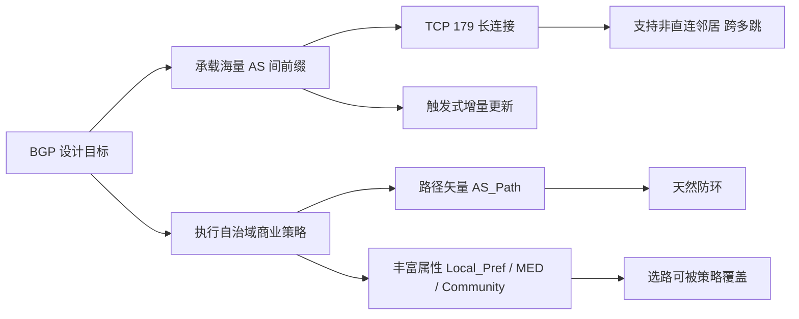

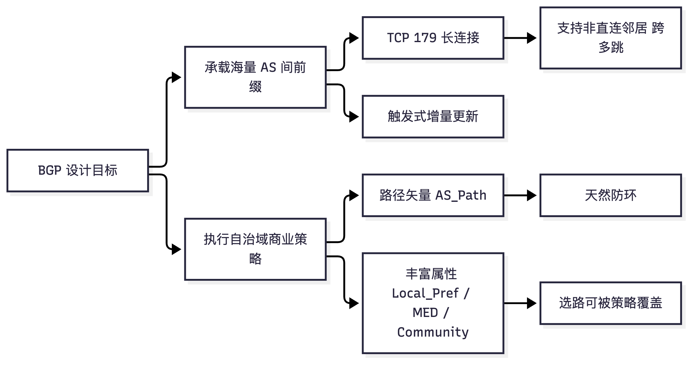


### 真题精练

**Q1.【真题·单选】** BGP 使用 TCP 作为传输层协议，最主要的原因是？
A. TCP 比 UDP 传输速度快
B. 借助 TCP 的可靠传输、重传与流控机制，避免 BGP 自行实现，并支持非直连邻居
C. TCP 支持组播，便于自动发现邻居
D. TCP 报头比 UDP 小，开销更低

> **答案：B**
> **解析**：BGP 要传输上万条路由，需要字节流可靠、有序、不丢不乱序，TCP 已经提供；同时 TCP 可跨多跳，才使 IBGP 用 LoopBack 建会话、EBGP 使用 `peer ebgp-max-hop` 成为可能。A 错——TCP 因确认与重传，单包时延高于 UDP；C 错——**TCP 不支持组播**，BGP 恰恰因此必须手工指定邻居（这也是 BGP 与 OSPF 的重要差异）；D 错——TCP 头部 20 字节（不含选项）大于 UDP 的 8 字节。BGP 报文公共头 19 字节（Marker 16 + Length 2 + Type 1）。

**Q2.【真题·判断】** BGP 是链路状态协议，因为它维护一张全网拓扑表。

> **答案：错误**
> **解析**：BGP 是**路径矢量（Path Vector）协议**，属于距离矢量的增强型。它**不维护全网拓扑**，也不运行 SPF，只保存"到某前缀经过哪些 AS"以及一组策略属性。链路状态协议要求同一区域所有路由器拓扑数据库完全一致、使用统一度量，这在多个互相竞争的 AS 之间原理上不可行。

**Q3.【真题·多选】** 关于 AS_Path 属性的作用，下列描述正确的有？
A. 是公认必遵属性，每条 BGP 路由都必须携带
B. 用于防止 AS 之间的路由环路
C. 默认情况下 AS_Path 越短越优，但该规则可被 Local_Preference 覆盖
D. AS_Path 只统计经过的 AS 数量，不记录顺序

> **答案：ABC**
> **解析**：AS_Path 是**公认必遵**（Well-known Mandatory）属性，EBGP 通告时在左侧追加本 AS 号。D 错——AS_Path 是**有序列表**，既记录数量也记录顺序，且支持 AS_SET（手动聚合加 `as-set` 后的 `{ }` 形式）与 AS_CONFED_SEQUENCE（联盟）。注意：**Local_Pref 的优先级高于 AS_Path**（选路第 2 条 vs 第 4 条），所以"AS_Path 更短"未必被选中，这是最常见的理解错误。

### 易错点与排错

1. **把 BGP 当"最优路径协议"**：BGP 默认按 13 条规则选路，前两条（PrefVal、Local_Pref）都是**本地策略**，完全与路径长度无关；不要用"BGP 会选最近的路"去解释现象。
2. **Router ID 冲突**：同一路由器上多个 BGP 实例（如 IPv4 单播 + VPNv4）缺省共用同一 Router ID；两台设备 Router ID 相同会导致邻居无法建立（`display bgp peer` 长期停在 Idle/Active，日志报 `Router ID conflict`）。
3. **忘记 `connect-interface`**：IBGP 邻居用物理口地址建立、但路由从 LoopBack 学来时，会出现"能建邻居但不稳定"的现象。规范做法是 IBGP 一律 `connect-interface LoopBack0`。
4. **排错命令**：`display bgp peer`（看状态与计数）、`display bgp peer verbose`（看协商出的能力、定时器、地址族）、`display bgp peer log-info`（看邻居 Flap 历史与原因）、`display bgp error`（看 BGP 错误统计）、`display ip routing-table 2.2.2.2`（确认对端 LoopBack 可达，这是 IBGP 建邻居的前提）、`terminal monitor` + `terminal debugging` + `debugging bgp peer`（现网慎用，仅小范围排错）。

---

## 3.2 BGP 四种报文与字段

### 考点定位

报文与字段是**必考的送分题**，理论卷常以 **2~5 分**出现，形式为单选/多选/填空：考四种报文的用途、公共头 19 字节、Open 报文字段、Keepalive 默认值、NLRI 与 Path Attributes 的位置、Notification 的错误码。**陷阱集中在**：Update 报文里"可达路由与撤销路由不能放在同一条 Update"、Keepalive 报文只有一个 19 字节头部（无任何字段）、Hold Time 协商取小值。

### 原理精讲

BGP 对等体之间只交换 **4 种报文**，全部封装在 TCP 179 之上。所有 BGP 报文共享一个 **19 字节的公共头**：

| 字段 | 长度 | 取值与含义 |
|---|---|---|
| Marker（标记） | 16 字节 | 历史上用于兼容旧认证机制，BGP-4 中要求**全部为 1**；接收方校验，若不符则发 Notification（Message Header Error，Subcode 1 Connection Not Synchronized） |
| Length（长度） | 2 字节 | 整个报文长度（含 19 字节头），最小 19，最大 **4096**（不协商扩展时；支持扩展消息时可到 65535） |
| Type（类型） | 1 字节 | 1=Open，2=Update，3=Notification，4=Keepalive |

**① Open（打开）报文——协商参数、建立邻居。** 这是 BGP 建邻居的第一步（TCP 握手成功后立即发送）。字段表：

| 字段 | 长度 | 说明 |
|---|---|---|
| Version | 1 字节 | 版本号，BGP-4 固定为 4 |
| My Autonomous System | 2 字节 | 本端 AS 号。**只有 2 字节**，所以 4 字节 AS 号需要 32-bit AS 能力协商，中间设备无法识别时以 **AS_TRANS = 23456** 占位 |
| Hold Time | 2 字节 | 保持时间，与对端协商后取**较小值**；若为 0 表示不使用 Keepalive。缺省 180s（华为），要求至少 3s |
| BGP Identifier | 4 字节 | 本端 Router ID，必须是合法非 0 单播 IPv4 地址；缺省自动选取（优先 LoopBack 中数值最大者，其次最大物理口地址） |
| Opt Parm Len | 1 字节 | 可选参数字段长度，可为 0 |
| Optional Parameters | 变长 | 能力协商（Capability）：多协议扩展 MP-BGP、4 字节 AS、路由刷新 Route-Refresh、Graceful Restart、Add-Path 等 |

**常见 Open 差错**（Notification 中 Error Code=2 OPEN Message Error）：不支持的版本号（Subcode 1）、**对端 AS 号与本端 `peer x as-number` 配置不一致**（Subcode 2，最常见的建邻居失败原因）、BGP Identifier 非法（Subcode 3）、不支持的可选参数（Subcode 4）、认证失败（Subcode 5）、Hold Time 不可接受（Subcode 6）。

**② Keepalive（保活）报文——唯一的"空报文"。** 它只有 19 字节公共头，**没有任何字段**（类型为 4）。作用是周期性地向对端声明"我还活着"，同时**重置 Hold 定时器**。缺省发送周期 **60s**，Hold Time 缺省 **180s**（即 3 倍关系）。两端的 Hold Time 在 Open 阶段协商，取**较小值**，再按"Keepalive = Hold/3"推算实际 Keepalive 周期。若 Hold Time 内未收到任何报文（Keepalive、Update 都算），BGP 会断开并重建会话，日志出现 `hold timer expired`。

**③ Update（更新）报文——唯一携带路由信息的报文。** 它同时承担"发布可达路由"和"撤销不可达路由"两个职责，字段结构如下：

| 字段 | 长度 | 说明 |
|---|---|---|
| Withdrawn Routes Length | 2 字节 | 撤销路由字段长度，可为 0 |
| Withdrawn Routes | 变长 | 被撤销的前缀列表（**只含前缀，不含下一跳**） |
| Total Path Attribute Length | 2 字节 | 路径属性总长度，可为 0 |
| Path Attributes | 变长 | 属性列表，格式为 `属性标志(1) + 属性类型(1) + 长度(1或2) + 值` |
| NLRI | 变长 | 网络层可达信息（Network Layer Reachability Information），即 `<前缀长度, 前缀>` 对，可含多条同属性前缀 |

三条硬性规则：**① 一条 Update 只能携带一组相同属性的路由**（属性不同的路由必须分多条 Update 发送，这就是"BGP 更新报文数量 ≈ 不同属性组合数"的原因）；**② 撤销路由与可达路由不能出现在同一条 Update 中**；**③ NLRI 与 Withdrawn Routes 都不携带下一跳**，下一跳由 Next_Hop 属性统一给出。

**④ Notification（通知）报文——报告错误并立即断链。** 字段为 Error Code（1 字节）+ Error Subcode（1 字节）+ Data（变长，出错数据）。常见错误码：

| Error Code | 名称 | 典型 Subcode 与含义 |
|---|---|---|
| 1 | Message Header Error | 1 连接未同步、2 报文长度错误（19~4096）、3 报文类型错误 |
| 2 | OPEN Message Error | 2 AS 号不匹配、3 Router ID 非法、5 认证失败、6 Hold Time 不可接受 |
| 3 | UPDATE Message Error | 1 属性列表格式错、2 公认属性识别错误、**3 缺少公认必遵属性**、8 下一跳非法 |
| 4 | Hold Timer Expired | 无 Subcode，Hold 定时器超时 |
| 5 | Finite State Machine Error | 状态机错误 |
| 6 | Cease | 收到该码表示对端正常关闭（人为 `reset bgp`、接口 shutdown、配置删除），**排错时看到 Cease 说明不是协议故障** |

发送 Notification 后，BGP 立刻关闭 TCP 连接并回到 Idle。**排错关键**：Notification 的 Code/Subcode 是判断"建邻居失败根因"的第一手证据，必须与上表对照。

### 关键概念对照表

| 报文 | Type | 长度 | 作用 | 发送时机 |
|---|---|---|---|---|
| Open | 1 | ≥29 字节 | 协商版本、AS、Hold Time、Router ID、能力 | TCP 建立后立即发，每个邻居只发一次 |
| Keepalive | 4 | 恰好 19 字节 | 保活、重置 Hold 定时器 | 每 60s（缺省），或收到 Update 后补发 |
| Update | 2 | 23 ~ 4096 字节 | 发布/撤销路由与属性 | 路由变化时触发，邻居建立时发全量 |
| Notification | 3 | ≥21 字节 | 报告错误并断链 | 检测到错误或正常关闭（Cease） |

| 定时器 | 缺省值 | 华为命令 | 说明 |
|---|---|---|---|
| Keepalive | 60s | `peer x timer keepalive 30 hold 90` | 协商后取对端较小值 |
| Hold | 180s | 同上 | 超时未收任何报文则断链 |
| ConnectRetry | 32s（推荐在设备上用 `display bgp peer verbose` 确认） | `peer x timer connect-retry` | TCP 重连间隔 |
| MRAI（同前缀更新间隔） | EBGP 30s / IBGP 15s | `peer x route-update-interval 30` | 抑制同前缀频繁更新 |

### 华为设备配置

```bash
# ===== 观察与调整 BGP 报文相关参数 =====
system-view
bgp 100
 peer 10.0.12.2 as-number 200
 peer 10.0.12.2 timer keepalive 30 hold 90      // 报文保活压缩到 30s/90s，加快故障感知
 peer 10.0.12.2 route-update-interval 10        // 缩短同前缀更新间隔，加快收敛（会增大报文量）
 peer 10.0.12.2 capability-advertise route-refresh  // 使能 Route-Refresh 能力，支持不中断会话的软复位
 peer 10.0.12.2 capability-advertise 4-byte-as  // 使能 4 字节 AS 能力（对端支持时才协商成功）
quit
# ===== 报文收发与错误统计（排错核心）=====
display bgp peer verbose                         // 查看协商出的 BGP Version、Hold/Keepalive、能力位
display bgp peer 10.0.12.2 verbose               // 只看单个邻居的详细协商结果
display bgp error                                // 查看 BGP 错误统计，含各类 Notification
display bgp peer log-info                        // 查看邻居 Up/Down 历史与原因
reset bgp 10.0.12.2                              // 硬复位该邻居（会短暂中断，现网慎用）
refresh bgp 10.0.12.2 import                     // 软复位入方向：请求对端重发，不中断会话
refresh bgp 10.0.12.2 export                     // 软复位出方向：重新生成并发送本地路由
```

### 示意图

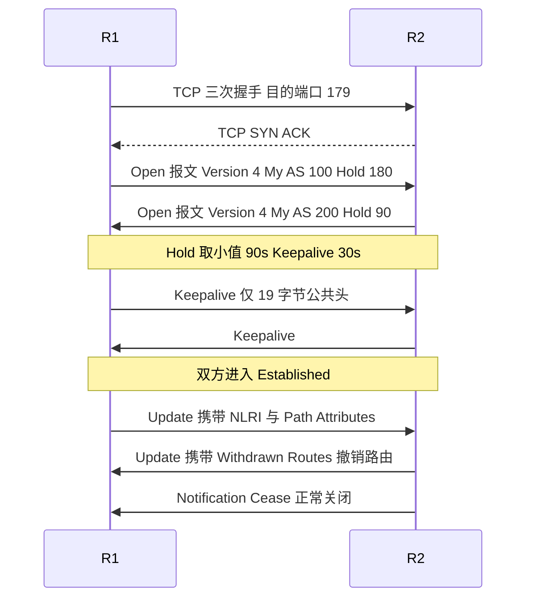

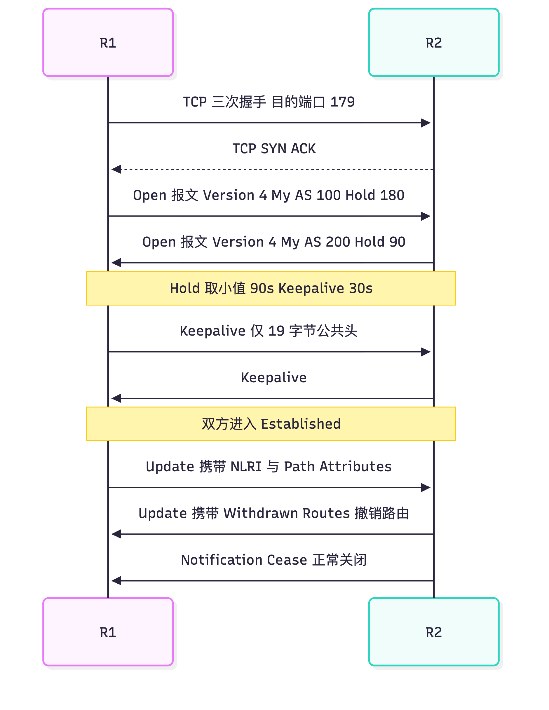


### 真题精练

**Q1.【真题·单选】** 下列 BGP 报文中，长度固定为 19 字节的是？
A. Open  B. Update  C. Keepalive  D. Notification

> **答案：C**
> **解析**：Keepalive 报文只包含 19 字节公共头（Marker 16 + Length 2 + Type 1），没有任何字段。Open 最小 29 字节（19 + Version 1 + My AS 2 + Hold Time 2 + BGP Identifier 4 + Opt Parm Len 1）；Update 最小 23 字节（19 + Withdrawn Routes Length 2 + Total Path Attribute Length 2）；Notification 最小 21 字节（19 + Error Code 1 + Error Subcode 1）。

**Q2.【真题·多选】** 关于 BGP Update 报文，下列说法正确的有？
A. 一条 Update 报文可以同时携带可达路由与撤销路由
B. 一条 Update 报文只能携带路径属性相同的一组路由
C. Path Attributes 字段与 NLRI 字段都位于公共头之后
D. 撤销路由时只需在 Withdrawn Routes 中携带前缀，无需携带原下一跳

> **答案：BCD**
> **解析**：A 错——RFC 4271 明确规定一条 Update **不能同时**携带 Withdrawn Routes 与 NLRI，撤销与发布必须分为两条报文。B 正确，这是"属性组合数决定 Update 条数"的根源。C 正确，顺序为 Withdrawn Routes Length → Withdrawn Routes → Total Path Attribute Length → Path Attributes → NLRI。D 正确，撤销仅需前缀（含前缀长度），下一跳随路由一起失效。

**Q3.【真题·填空】** BGP 会话中，两端在 Open 报文里协商 Hold Time，最终生效的值是两端的 ______ 值；华为设备 Hold Time 缺省为 ______ 秒，Keepalive 缺省为 ______ 秒。

> **答案：较小值；180；60**
> **解析**：Hold Time 取小值，保证"更急于感知故障"的一方需求被满足。Keepalive 缺省为 Hold 的 1/3。若一端配置 `timer keepalive 30 hold 90`、另一端保持缺省 60/180，实际生效 Hold = 90s、Keepalive = 30s。注意 Hold Time 为 0 时表示不使用 Keepalive，两端都必须为 0 才成立。

**Q4.【真题·排错】** 两台 NE40E 建立 EBGP 邻居，`display bgp peer` 显示对端长期停留在 **OpenSent**，随后回到 Idle 并再次重试。请在日志中最可能看到的 Notification 及其原因。

> **答案**：Notification 的 Error Code = 2（OPEN Message Error）、Subcode = 2（Bad Peer AS），原因是**两端 `peer x as-number` 配置的 AS 号不一致**。
> **解析**：能进入 OpenSent 说明 TCP 已建立、本端 Open 已发出，且已收到对端 Open（否则应停在 OpenSent 等待），随后因参数校验失败回 Idle。除 AS 号不匹配外，还需排查：BGP Identifier 非法（Subcode 3）、认证失败（Subcode 5）、Hold Time 过小（Subcode 6）。定位命令：`display bgp peer log-info` 看 Flap 原因，`display bgp error` 看错误码统计，两端 `display current-configuration configuration bgp` 对比 AS 号。

### 易错点与排错

1. **一条 Update 装不下所有路由**：判断报文数量时先按"属性组合"分组，再按 MTU/4096 字节分片，不要以为"一个邻居一次只发一条 Update"。
2. **Notification 里的 Cease（Code 6）不是故障**：它表示对端正常关闭会话（配置删除、`reset bgp`、接口 down），不必去查协议错误。
3. **Hold Time 协商方向**：永远取小值，且 Keepalive 实际周期 = 协商后 Hold / 3；做实验时若一端改小，另一端也会跟着变小。
4. **Route-Refresh 能力**：`refresh bgp x import` 要求双方都通告了 Route-Refresh 能力，否则会退化为硬复位。用 `display bgp peer verbose` 检查 `Route Refresh` 能力位。
5. **排错命令**：`display bgp peer verbose`、`display bgp peer log-info`、`display bgp error`、`display bgp routing-table`、`terminal monitor` + `debugging bgp packet`（试验环境用，现网禁用）。

---

## 3.3 BGP 六种状态机与卡状态原因

### 考点定位

状态机是**排错题的解题地图**，理论卷常以单选/多选/排错形式出现，占 **3~6 分**。国赛几乎每年都有"邻居起不来，`display bgp peer` 显示 Active/Connect/Idle，问原因"的题目。**必须能把状态与原因一一对应**，这就是本节状态-原因对照表的价值。

### 原理精讲

BGP 邻居建立的过程被抽象为 **6 个状态**（RFC 4271），它们按固定顺序迁移：

1. **Idle（空闲）**：初始状态，也是所有错误的"归宿"。BGP 在此等待 Start 事件（配置邻居、`reset bgp`、TCP 重连定时器到期）。收到 Start 后：初始化资源、复位 ConnectRetry 定时器、发起 TCP 连接（主动模式），转 Connect；若 TCP 连接建立失败则转 Active。
2. **Connect（连接）**：等待 TCP 三次握手完成。若 ConnectRetry 定时器超时仍未完成，转 Active 并**重新**发起连接；若 TCP 建立成功，发送 Open 并转 OpenSent；若收到对端发起的 TCP 连接（被动），同样转 OpenSent。
3. **Active（活动）**：**注意这个名字极具误导性**——Active 不是"正在活动"，而是"**正在反复尝试建立 TCP 连接**"。BGP 在此监听对端的 TCP 连接请求，同时持续尝试主动发起。若 TCP 建立成功则发 Open 转 OpenSent；若 ConnectRetry 超时则退回 Connect。**卡在 Active 是 BGP 排错中的第一高频现象**。
4. **OpenSent（打开已发送）**：已发出 Open，等待对端 Open。收到后校验：Version、AS 号、BGP Identifier、Hold Time、认证、能力。校验通过则发 Keepalive 转 OpenConfirm；失败则发 Notification 回 Idle。
5. **OpenConfirm（打开已确认）**：已发 Keepalive，等待对端 Keepalive（或 Notification）。收到 Keepalive 后转 **Established**；收到 Notification 则回 Idle；Hold 定时器超时回 Idle。
6. **Established（已建立）**：**唯一可以交换 Update 的状态**。双方互发全量路由（带 End-of-RIB 标记结束），之后触发式增量更新。收到 Notification 或 Hold 超时则回 Idle。

**状态迁移的三种"路径"**（考试常问）：正常路径 `Idle → Connect → OpenSent → OpenConfirm → Established`；TCP 主动失败路径 `Idle → Connect → Active → Connect ...` 循环；异常路径从任意状态收到 Notification 后**直接回 Idle**。

**状态-原因对照表（必须背熟）**：

| 卡住的状态 | 现象特征 | 最可能原因（按概率排序） | 定位命令 |
|---|---|---|---|
| **Idle** | 完全不起会话，可能连重试都没有 | ① 该邻居未配置或已被 `undo peer`；② 到对端地址**无路由**（IBGP 常见：LoopBack 路由未引入 IGP）；③ 路由被 ACL/防火墙丢弃；④ BGP 进程被 `shutdown`；⑤ 达到最大重启次数被惩罚；⑥ 本端 `peer x as-number` 配错到不存在的 AS | `display ip routing-table <peer>`、`display current-configuration configuration bgp`、`display bgp error` |
| **Connect** | TCP SYN 已发出但无响应，持续重传 | ① SYN 或 SYN-ACK 被中间设备/ACL 丢弃；② 对端接口 down 或地址写错；③ 对端未监听 179（BGP 未使能）；④ 单向可达（去程通、回程路由缺失） | `ping -a <源> <对端>`、`display acl all`、`display interface brief` |
| **Active** | 反复重试、TCP 建不起来（**最高频**） | ① **对端没有配置该邻居**（最常见）；② 对端 `peer` 地址写错（写成了非本端源地址）；③ 到达对端地址的路由缺失（IBGP 未配 `connect-interface` LoopBack 且 LoopBack 不可达）；④ 179 被 ACL / 安全策略 / 防火墙拦截；⑤ 两端都未主动发起（少见，通常是源地址问题导致回包不匹配）；⑥ 中间设备做了 NAT 导致 TCP 校验失败 | `display bgp peer verbose`、`ping -a`、`display tcp status`、`display acl` |
| **OpenSent** | 本端 Open 已发，等对端 Open | ① **对端 AS 号配置不一致**（收到 Open 后立刻回 Idle，属于"过路状态"，抓包才看得出）；② 对端认证密码不匹配；③ 对端 Router ID 非法或冲突；④ 对端 Hold Time 太小被拒；⑤ 对端处理慢（大配置/高 CPU） | `display bgp peer log-info`、`display bgp error`、两端对比 `peer as-number` 与 `password` |
| **OpenConfirm** | 已收到 Open、已回 Keepalive，等对端 Keepalive | ① 对端 Keepalive 被丢弃（ACL、QoS 丢包、链路误码）；② 对端 Hold Time 已超时并放弃；③ 单向链路故障（能力协商日志显示 `OPEN reached, waiting KEEPALIVE`） | `display bgp peer verbose`、`ping -a` 长 ping 观察丢包、`display interface` 看 CRC 错误 |
| **Established 但学不到路由** | 会话正常，路由表为空 | ① **下一跳不可达**（IBGP 场景，见 3.5 节）；② 出/入方向 `filter-policy` 或 `route-policy` 过滤；③ 对端没有可用路由可发；④ `peer x route-limit` 被触发进入抑制；⑤ 两端地址族（IPv4 unicast）未使能 | `display bgp routing-table peer x advertised-routes`、`display bgp routing-table peer x received-routes`、`display ip routing-table` |

### 关键概念对照表

| 状态 | 是否已建 TCP | 是否已发 Open | 是否收到 Open | 能否交换 Update | 主要动作 |
|---|---|---|---|---|---|
| Idle | 否 | 否 | 否 | 否 | 等待 Start 事件，初始化 |
| Connect | 进行中 | 否 | 否 | 否 | 等待 TCP 握手完成 |
| Active | 否（重试） | 否 | 否 | 否 | 监听 + 反复主动发起 TCP |
| OpenSent | 是 | 是 | 否 | 否 | 等待并校验对端 Open |
| OpenConfirm | 是 | 是 | 是 | 否 | 等待对端 Keepalive |
| Established | 是 | 是 | 是 | **是** | 交换全量/增量路由 |

| 状态 | 进入该状态后的定时器 | 超时后果 |
|---|---|---|
| Idle | 无（手工 Start） | 保持 Idle |
| Connect | ConnectRetry（32s） | 转 Active 重试 |
| Active | ConnectRetry | 退回 Connect 重试 |
| OpenSent | Hold（暂用缺省 180s） | 发 Notification 回 Idle |
| OpenConfirm | Hold（协商值） | 发 Notification 回 Idle |
| Established | Keepalive / Hold | Hold 超时回 Idle |

### 华为设备配置

```bash
# ===== 复现并定位"卡在 Active"的典型故障 =====
system-view
bgp 100
 peer 2.2.2.2 as-number 100                  // 本端配置了 IBGP 邻居
 peer 2.2.2.2 connect-interface LoopBack0     // 源地址固定为 1.1.1.1，要求对端能回程到 1.1.1.1
quit
# ----- 排查步骤 1：确认到对端的路由存在 -----
display ip routing-table 2.2.2.2             // 若无 /32 路由，说明对端 LoopBack 未引入 IGP，BGP 必然卡 Active
# ----- 排查步骤 2：确认指定源地址能 ping 通 -----
ping -a 1.1.1.1 2.2.2.2                      // -a 指定源地址，这是判断"路由可达+回程可达"最快的方法
# ----- 排查步骤 3：确认 179 未被拦截 -----
display acl all                              // 检查是否有 ACL 拒绝 tcp 179
display current-configuration | include 179  // 快速查找与 179 端口相关的策略
# ----- 排查步骤 4：确认本端已监听 179 -----
display tcp status                           // 查看 TCP 179 是否处于 LISTEN 及已建立的连接
# ===== 用日志精确定位原因 =====
display bgp peer log-info                    // 输出每次邻居状态变化与原因，是排错第一命令
display bgp error                            // 查看各类 Notification 错误计数
```

### 示意图

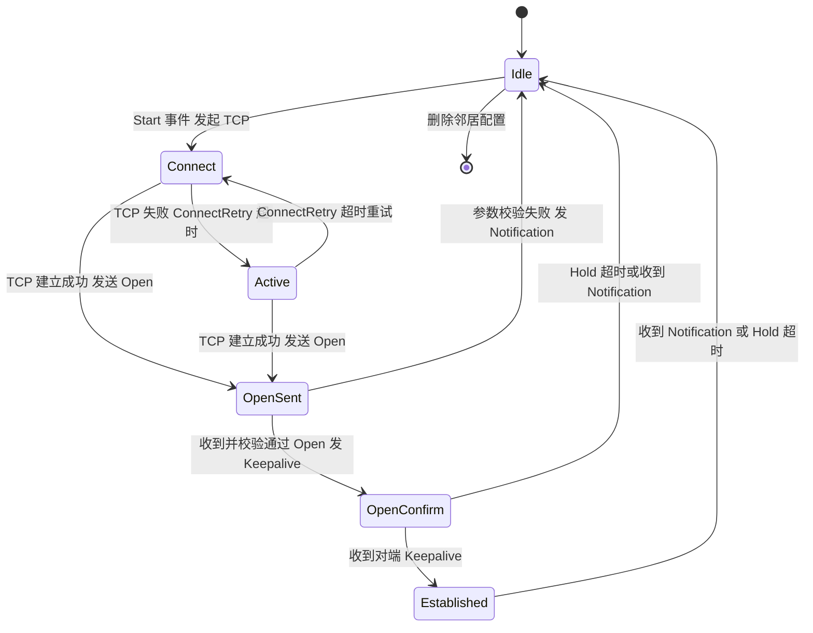

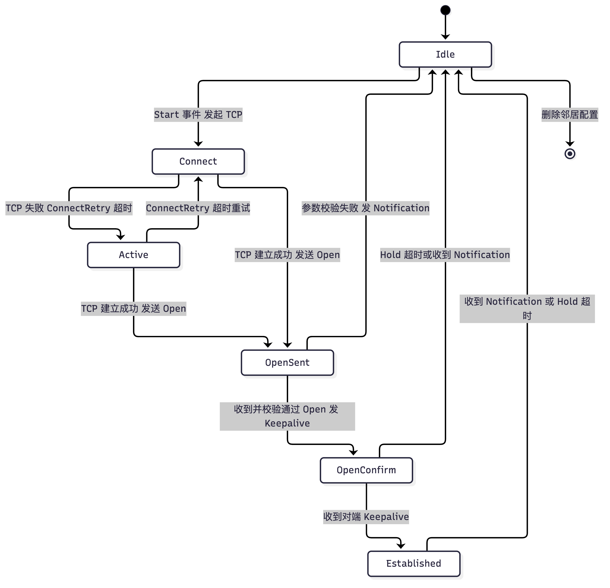


### 真题精练

**Q1.【真题·排错】** 两台 NE40E 之间规划为 IBGP（AS 100），使用 LoopBack0 建立会话。本端 `display bgp peer` 显示邻居状态长期为 **Active**，`ping -a 1.1.1.1 2.2.2.2` 也不通。请给出排查顺序与最可能的根因。

> **答案**：根因最可能是**对端 LoopBack0 地址 2.2.2.2/32 的路由未在本端路由表中（或被过滤）**，其次是 **179 被 ACL/安全策略拦截**、**对端未配置该邻居**。
> **解析**：排错顺序为——① `display ip routing-table 2.2.2.2` 确认路由是否存在；② 若不存在，检查 OSPF/IS-IS 是否引入了 LoopBack（华为 OSPF 需 `import-route direct` 或把 LoopBack 加入区域并确保 `network` 覆盖）；③ 若路由存在但 ping 不通，用 `ping -a 1.1.1.1 2.2.2.2` 与反向 `ping -a 2.2.2.2 1.1.1.1` 判断是否单向可达（回程路由缺失）；④ 检查 `display acl all`、`display current-configuration | include 179`；⑤ 最后核对两端 `peer x as-number` 与 `peer x connect-interface` 是否对称。**Active 的本质是"TCP 建不起来"**，所以一切排查都要围绕"TCP 能否到 179"。

**Q2.【真题·单选】** 下列关于 BGP Active 状态的说法，正确的是？
A. 该状态下 TCP 连接已经建立，正在交换路由
B. 该状态下 BGP 正在反复尝试建立 TCP 连接
C. 该状态下只等待对端发送 Keepalive
D. 该状态一定会自动迁移到 Established，无需干预

> **答案：B**
> **解析**：Active 是"TCP 尚未建立、正在重试"的状态，名字易误解。A 错（能交换路由的是 Established）；C 错（等 Keepalive 是 OpenConfirm）；D 错——若根因（路由缺失、ACL 拦截）不解决，会在 Connect/Active 之间无限循环。

**Q3.【真题·多选】** 下列哪些原因会导致 BGP 邻居无法进入 Established？（多选）
A. 两端 `peer x as-number` 配置不一致
B. 两端 TCP MD5 密码不一致
C. IBGP 邻居学到的路由下一跳不可达
D. 对端 LoopBack 地址的路由在本端缺失
E. 本端 `peer x connect-interface` 指定的接口地址与对端 `peer` 地址不匹配

> **答案：ABDE**
> **解析**：C 不影响邻居建立，只影响**路由能否被优选与生效**——这是关键区分点：下一跳不可达时会话可以正常 Established，但路由不进入 IP 路由表（`display bgp routing-table` 中路由带 `*` 而无 `>`，或干脆不显示为 best）。A 导致 OpenSent 校验失败；B 导致 TCP/Open 认证失败；D 导致卡 Active；E 导致 TCP 源地址不匹配、回包失败。

**Q4.【真题·简答】** 请按顺序写出 BGP 建立邻居的六个状态，并说明哪个状态是唯一可以交换 Update 报文的，以及 Active 状态与 Connect 状态的区别。

> **答案**：顺序为 **Idle → Connect → Active → OpenSent → OpenConfirm → Established**（Active 与 Connect 会因 TCP 失败相互迁移）；唯一可交换 Update 的是 **Established**；Connect 是"等待自己发起的 TCP 握手结果"，Active 是"启动监听并持续尝试主动发起 TCP 连接"，两者都尚未建立 TCP，区别在于主动/被动与重试方向。
> **解析**：答题要点必须包含：① 六状态名称与顺序；② 各状态的分界标志（TCP 建立/Open 发出/Open 收到/Keepalive 收到）；③ 唯一的 Update 交换状态；④ 出错时统一回 Idle。补充加分点：收到 Notification 与 Hold 超时是回 Idle 的两条主要路径。

### 易错点与排错

1. **Active ≠ 正在工作**：这个状态名的误导性是出题人最爱用的陷阱，牢记"Active = TCP 没建成"。
2. **OpenSent 是瞬时状态**：正常建邻居时它只存在毫秒级，如果**长期**停在 OpenSent，几乎一定是 AS 号/认证/Router ID 校验失败。
3. **"会话 Up 但没路由"要从别的方向查**：状态机只解释会话，不解释路由优选与下一跳可达性，两者必须分开排查（见 3.4、3.5 节）。
4. **两侧都要看**：BGP 是双向协议，一端卡 Active 时一定要登录对端确认"有没有配这个邻居、`peer` 地址是不是本端源地址"。
5. **排错命令链**：`display bgp peer` → `display bgp peer verbose` → `display bgp peer log-info` → `display bgp error` → `display ip routing-table <peer>` → `display tcp status` → `ping -a`。

---

## 3.4 邻居类型、IBGP 水平分割与全互联

### 考点定位

本节是**设计类简答题的高频出处**，也是排错题的背景知识，占 **4~8 分**。经典问法："为什么 IBGP 必须全互联或部署 RR/联盟？""EBGP 非直连怎么做，需要注意什么？""6 台路由器 IBGP 全互联需要多少条会话？"。**陷阱**：把 IBGP 水平分割误认为"IBGP 邻居之间不能传路由"，实际上 IBGP 可以传，只是**从 IBGP 学到的路由不再向其他 IBGP 邻居转发**。

### 原理精讲

按对等体所处 AS 与连接方式，BGP 邻居分四类：

**① EBGP（External BGP，外部 BGP）邻居。** 两个不同 AS 的路由器之间的 BGP 会话。缺省要求**物理直连**（报文 TTL = 1，一跳可达），这样设计的原因有二：一是防止 AS 外部的人通过伪造多跳 EBGP 攻击；二是保证 EBGP 的下一跳（对端接口地址）在本端必然是直连可达的，无需依赖 IGP。EBGP 会话建立后，双方通告路由时会**把下一跳改为自己**，并在 AS_Path 前面**追加自己的 AS 号**（这是 AS_Path 防环的基础）。

**② EBGP 非直连邻居。** 需要同时满足三个条件：① 配置 `peer x ebgp-max-hop <跳数>`（**注意：一旦配置该命令，TTL 就变为 255，而不是配置的那个数字**，该数字只作为最大跳数的校验上限语义存在）；② 本端到对端地址有路由（静态或 IGP）；③ 双方都用 `connect-interface LoopBack0` 之类的稳定接口作为会话源，保证源地址与 `peer` 地址一致。非直连 EBGP 的典型用途：多链路/多宿主场景下避免单条物理链路故障导致 EBGP 邻居中断、以及跨域 Option C 中 PE 之间建立多跳 MP-EBGP。

**③ IBGP（Internal BGP，内部 BGP）邻居。** 同一 AS 内的 BGP 会话。为了让会话不受单条物理链路影响，规范做法是 `connect-interface LoopBack0`，因此 IBGP 通常是**非直连**的，依赖 IGP 提供 LoopBack 路由。IBGP 的关键规则：**不修改下一跳、不追加 AS 号、从 IBGP 学到的路由不再通告给其他 IBGP 邻居**。

**④ 联盟内 EBGP（Confederation EBGP）。** 联盟子 AS 之间的会话，行为"介于 IBGP 与 EBGP 之间"：下一跳按 EBGP 处理（改变），但**不追加 AS_Path**（在标准联盟配置下），Local_Pref 与 MED 保留传递。详见 3.11 节。

**为什么 IBGP 需要全互联或 RR/联盟？** 这是一个必须能完整口头回答的推理链：

- 第一步：AS 内部要传递从外部学到的路由，BGP 路由器之间必须建立 IBGP 会话。
- 第二步：**AS_Path 在 AS 内部不发生变化**（IBGP 不追加 AS 号），因此 AS_Path **无法用于 AS 内部的环路检测与防环**。如果允许"从 IBGP 学到的路由再转发给另一个 IBGP 邻居"，那么 R1 发的路由会经 R2 传给 R3，R3 再传回 R1，形成环路且无法靠属性发现。
- 第三步：所以 BGP 规定**IBGP 水平分割（Split Horizon）规则**：**从 IBGP 邻居学到的路由，不再通告给任何其他 IBGP 邻居**（但可以通告给 EBGP 邻居）。
- 第四步：这条规则保证无环，但带来一个严重后果——如果 R1 从 EBGP 学到路由，只告诉了 R2，而 R2 不能告诉 R3，那么 R3 就永远学不到这条外部路由。**为了让 AS 内每台 BGP 路由器都能学到，就必须让每台路由器都与其它所有 BGP 路由器建立 IBGP 会话**，即**全互联（Full Mesh）**：n 台路由器需要 **n×(n-1)/2** 条会话。
- 第五步：全互联的会话数随路由器数量平方级增长（10 台 = 45 条，50 台 = 1225 条），配置量与 Update 复制量都不可接受。于是有两种"合法打破水平分割"的方案：**路由反射 RR**（3.10 节）和**联盟 Confederation**（3.11 节）。RR 让一台路由器成为"反射器"，把从 IBGP 学到的路由反射给客户端，从而打破水平分割但不产生环路（靠 Cluster_List 与 Originator_ID 防环）；联盟则把一个 AS 拆成多个子 AS，在子 AS 之间使用"联盟 EBGP"（不受 IBGP 水平分割限制），子 AS 内部仍用 IBGP 全互联或 RR。

**数量关系必背**：IBGP 全互联会话数 = n(n-1)/2。例：4 台 → 6 条；6 台 → 15 条；10 台 → 45 条。若使用 1 台 RR + n-1 个客户端，会话数为 n-1（每台客户端只需与 RR 建一条），但**客户端之间没有直连 IBGP 会话时，路由只能依赖 RR 转发**。

### 关键概念对照表

| 邻居类型 | AS 关系 | 缺省 TTL | 是否改下一跳 | 是否追加 AS_Path | 是否受 IBGP 水平分割 |
|---|---|---|---|---|---|
| EBGP 直连 | 不同 AS | 1（一跳） | 是 | 是 | 不适用 |
| EBGP 非直连 | 不同 AS | 配置 `ebgp-max-hop` 后为 255 | 是 | 是 | 不适用 |
| IBGP | 同一 AS | 255（可多跳） | **否** | **否** | **是** |
| 联盟内 EBGP | 同一联盟不同子 AS | 1 | 是 | 视配置（标准联盟不追加） | 否（这是联盟的意义） |
| RR 反射 | 同一 AS | 255 | 否 | 否 | 被 RR 规则替代 |

| 常见部署形态 | IBGP 会话数 | 配置复杂度 | 扩展性 | 适用规模 |
|---|---|---|---|---|
| IBGP 全互联 | n(n-1)/2 | 高（平方增长） | 差 | ≤ 5 台，实验/小型网 |
| 单 RR | n-1 | 低 | 好 | 中型网络，有单点风险 |
| 双/多 RR（同 Cluster_ID） | 2(n-1) 左右 | 中 | 好 | 大型网络标准做法 |
| 联盟 + 子 AS 内 RR | 子 AS 内 n-1 + 子 AS 间少量 | 高 | 最好 | 超大型运营商 |

### 华为设备配置

```bash
# ===== EBGP 直连与 IBGP（NE40E，AS 100）=====
system-view
bgp 100
 router-id 1.1.1.1
 peer 10.0.12.2 as-number 200                      // EBGP 直连邻居：对端接口地址，缺省 TTL=1
 peer 10.0.12.2 description To-R2-EBGP-Direct
 peer 2.2.2.2 as-number 100                        // IBGP 邻居：本 AS 内，用 LoopBack 建立
 peer 2.2.2.2 connect-interface LoopBack0          // 会话源固定为 1.1.1.1
 peer 3.3.3.3 as-number 100                        // IBGP 全互联的第二个邻居
 peer 3.3.3.3 connect-interface LoopBack0
quit
# ===== EBGP 非直连（多跳 EBGP）=====
bgp 100
 peer 4.4.4.4 as-number 300                        // 对端 AS 300
 peer 4.4.4.4 connect-interface LoopBack0          // 用 LoopBack 建立，源地址稳定
 peer 4.4.4.4 ebgp-max-hop 2                        // 允许非直连 EBGP（TTL 实际变为 255）
quit
ip route-static 4.4.4.4 255.255.255.255 10.0.12.2   // 必须有为对端地址服务的路由，否则卡 Active
# ===== 允许 AS_Path 中出现本 AS 号（双归属/环形备份场景）=====
bgp 100
 peer 10.0.12.2 allow-as-loop 1                     // 允许 AS_Path 中最多出现 1 次本 AS 号，否则该路由被丢弃
quit
# ===== 用 fake-as 简化 AS 迁移（不改对端配置即可改本端 AS）=====
bgp 200
 peer 10.0.12.2 fake-as 100                         // 对外宣称 AS 100，对内仍按 AS 200 处理，便于平滑迁移
quit
# ===== 排错相关 =====
display bgp peer                                    // 确认邻居类型与状态
display bgp peer verbose | include Type             // 查看 IBGP/EBGP 类型与协商参数
display ip routing-table 2.2.2.2                    // IBGP 建邻居的前提：LoopBack 路由必须可达
```

### 示意图

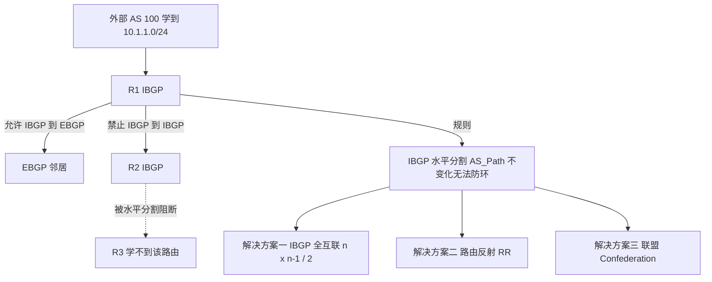

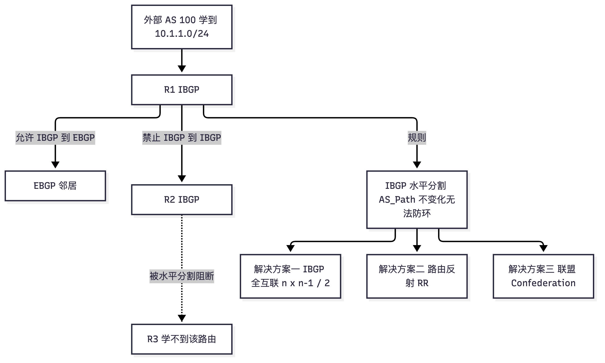


### 真题精练

**Q1.【真题·单选】** 某 AS 内有 6 台路由器需要运行 IBGP，若采用 IBGP 全互联方式，需要建立多少条 IBGP 会话？
A. 6  B. 12  C. 15  D. 30

> **答案：C**
> **解析**：全互联会话数 = n(n-1)/2 = 6×5/2 = 15 条。BGP 会话是双向的，但"一条会话"两侧各算一次配置，题目问的是会话条数，因此不乘 2。若改为 1 台 RR + 5 台客户端，会话数降为 5 条。

**Q2.【真题·简答】** 请解释 IBGP 水平分割规则，并说明为什么 BGP 需要它、它带来了什么问题、如何解决。

> **答案**：IBGP 水平分割指**从 IBGP 邻居学到的路由不再通告给其他 IBGP 邻居**。原因：AS_Path 在 AS 内部不追加本 AS 号，路由器无法通过 AS_Path 检测 AS 内环路，若允许 IBGP→IBGP 转发必然形成环路。代价是外部路由无法在 AS 内传播到第三台路由器，因此必须让所有 BGP 路由器互通，即 IBGP 全互联（n(n-1)/2 条会话）；规模变大后改用 **RR**（反射器，靠 Cluster_List 与 Originator_ID 防环）或 **联盟**（拆子 AS，子 AS 间用联盟 EBGP）。
> **解析**：答题必须覆盖"规则—原因（AS_Path 不变、无法防环）—代价（全互联平方增长）—两种解决方案及各自防环机制"四要素，只写"因为水平分割所以要全互联"会丢掉一半分。

**Q3.【真题·多选】** 配置 EBGP 非直连邻居时，必须满足的条件包括？
A. 配置 `peer x ebgp-max-hop`
B. 本端到对端地址存在可达路由
C. 双方都把 `peer` 地址配置为对方的稳定接口（如 LoopBack）地址
D. 必须配置 `peer x next-hop-local`

> **答案：ABC**
> **解析**：D 是 IBGP 场景下的下一跳处理手段，与非直连 EBGP 无必然关系。补充要点：`ebgp-max-hop` 后报文的实际 TTL 为 255，命令后的数字只是允许的最大跳数；非直连 EBGP 仍然会追加 AS_Path、改写下一跳，因此不能靠它规避防环要求。若省略 C，会话源地址与 `peer` 地址不一致会导致回包无法匹配而卡 Active。

**Q4.【真题·排错】** 某 AS 采用双出口设计，R1 从两个不同 ISP（AS 200 与 AS 300）学到同一前缀，并把最优路由通告回 AS 200 的邻居；对端 ISP 将该路由丢弃且不告警。请分析原因与解决办法。

> **答案**：被丢弃原因是该路由的 **AS_Path 中包含了接收方自己的 AS 号（AS 200）**——R1 从 AS 300 学到的路由其 AS_Path 形如 `300`，R1 通告给 AS 200 时追加本 AS 号变成 `100 300`，看起来不含 200；但若 R1 学到的路由本身来自 AS 200（`200 300`），再回传就会出现 `100 200 300`，AS 200 收到含自身 AS 号的路由即按防环规则丢弃。这是正常的防环行为。解决办法：若业务确需接收，在对端或本端配置 `peer x allow-as-loop 1`（放宽本端接收限制）；更规范的做法是通过 `route-policy` + `as-path-filter` 只向 AS 200 发布其"自有"前缀，避免回传。
> **解析**：本题考"AS_Path 防环是设计目标而不是故障"，以及 `allow-as-loop` 的正确用法。注意 `allow-as-loop` 是**本端允许接收**含本 AS 号的路由，配置在接收侧。

### 易错点与排错

1. **IBGP 水平分割的准确表述**：是"从 IBGP 学到的路由不再发给 IBGP"，不是"IBGP 邻居之间不传路由"——本地始发路由、从 EBGP 学到的路由**可以**发给 IBGP 邻居。
2. **`ebgp-max-hop` 的 TTL 是 255**：命令里写 2 不代表 TTL=2；考试喜欢在这个细节上做文章。
3. **IBGP 邻居不需要 IGP 提供对端接口路由，但需要 LoopBack 路由**：如果两边都用物理接口建 IBGP，链路一断会话就断，无法保持路由稳定。
4. **改 AS 号用 `fake-as` 而不是重建邻居**：`fake-as` 对外宣称一个 AS，对内仍按本地 AS 处理，适合 AS 号规划变更的平滑迁移。
5. **排错命令**：`display bgp peer`（看 Type 列区分 IBGP/EBGP）、`display bgp peer verbose`、`display ip routing-table <peer-address>`、`display bgp routing-table peer x advertised-routes`（确认到底发了没有）。

---

## 3.5 路由通告规则与下一跳行为

### 考点定位

**本节是 HCIE 排错题的核心**：现象"邻居 Established 但学不到路由 / 路由不生效 / 路由表里带 `*` 不带 `>`"几乎全部出自本节。分值 **4~8 分**，形式为排错、多选、简答。**必须能画出"IBGP 下一跳不可达"的图并说明 `next-hop-local` 的作用**。

### 原理精讲

BGP 的通告与下一跳处理有一套严格规则，可以归纳为"**四条必须背下来的规则**"：

**规则 1：只把最优（best）路由通告给邻居。** BGP 只把 `display bgp routing-table` 中带 `>`（best）标记的路由对外发布。如果一条路由因为下一跳不可达、被策略过滤、被 dampening 抑制而未能成为最优，它就不会出现在任何邻居的 `advertised-routes` 中。这是"我有这条路由，但邻居没有"这类问题的第一检查点。

**规则 2：从 EBGP 学到的路由，可以通告给所有 EBGP 与 IBGP 邻居（除来源邻居）。** 这是 AS 之间与 AS 内部路由传播的主动力。

**规则 3：从 IBGP 学到的路由，不再通告给其他 IBGP 邻居（水平分割），但可以通告给 EBGP 邻居。** 同时，BGP 内部还有一条"**同步规则（Synchronization）**"：从 IBGP 学到的路由，只有在本 AS 内通过 IGP 也学到时才能通告给 EBGP 邻居。华为设备**缺省关闭同步**（不需要 `undo synchronization`），这条规则在考试中只作为概念记忆。

**规则 4：下一跳的处理取决于"从哪学来、要发给谁"。** 这是最容易出错的部分：

| 场景（学习方向 → 通告方向） | 通告时下一跳取值 | 原因与风险 |
|---|---|---|
| EBGP → EBGP | **改为本端出接口地址**（发送前的源地址） | 避免第三方下一跳；保证接收方直连可达 |
| EBGP → IBGP | **保持不变**（仍是对端 EBGP 邻居的地址） | AS 内其他路由器通常**没有到该外部地址的路由**，导致下一跳不可达 → 需要 `next-hop-local` |
| IBGP → EBGP | 改为本端出接口地址 | 与 EBGP→EBGP 同理 |
| IBGP → IBGP | 默认不转发（水平分割）；RR 反射时下一跳**不变** | RR 场景需保证所有客户端都能迭代到原始下一跳 |
| 本地始发（network / import-route / aggregate） → IBGP | 取**建立 BGP 会话的源地址**（通常是 LoopBack0 地址） | 因此 IBGP 邻居必须有到本端 LoopBack 的 IGP 路由 |
| 本地始发 → EBGP | 改为本端出接口地址 | — |

**IBGP 下一跳不可达问题的完整推演（必须会画）**：

拓扑：`用户网段 10.1.1.0/24 —— R3（AS 200）——(10.0.13.0/24 直连)—— R1（AS 100，LoopBack 1.1.1.1）——(IBGP)—— R2（AS 100，LoopBack 2.2.2.2）`。

1. R1 与 R3 建立 EBGP（直连），R1 学到 `10.1.1.0/24`，其下一跳是 R3 的接口地址 `10.0.13.2`。
2. R1 把该路由通过 IBGP 通告给 R2。按规则，**IBGP 通告不改下一跳**，因此 R2 收到的 `10.1.1.0/24` 的下一跳仍是 `10.0.13.2`。
3. R2 的 IP 路由表中**没有** `10.0.13.0/24` 这个网段（它是 R1 与 R3 之间的互联链路，R2 不参与），IBGP 会话由 IGP（如 OSPF）承载，OSPF 也不会把 R1-R3 的直连链路告诉 R2（假设 R1 未引入直连或该接口未使能 OSPF）。
4. 于是 R2 上的这条 BGP 路由**无法进行下一跳迭代（next-hop resolution）**：BGP 显示该路由为有效（`*`）但不为最优（无 `>`），且**不会进入 IP 路由表**。
5. 结果：R2 上的用户无法访问 10.1.1.0/24，`ping` 不通，但 BGP 邻居一切正常——这就是最经典的"会话 Up、业务不通"。
6. **解决办法**：在 R1 上对 IBGP 邻居配置 `peer 2.2.2.2 next-hop-local`，把发给 R2 的路由下一跳改为 R1 自己的会话源地址 `1.1.1.1`；R2 通过 IGP 有 `1.1.1.1/32` 的路由，下一跳可达，路由变 best 并进入 IP 路由表。

**`next-hop-local` 的使用场景总结**：① ASBR 从 EBGP 学到路由后通告给 IBGP 邻居（最典型）；② 上游 IBGP 邻居的下一跳在 AS 内不可达时（如 RR 场景、多级 IBGP）；③ 需要强制统一 AS 内出口选路时。**不适用/不需要的场景**：EBGP 邻居（EBGP 本来就会改下一跳）；IBGP 邻居学到的路由下一跳本身可达时（配了也无害，但会增加不必要的路由重算）。

另外一类相关特性：**`peer x next-hop-invariable`**（下一跳不变），用于 RR 场景保持原始下一跳（跨域 Option C、SR/SD-WAN 需要 AS 内保持统一下一跳时）。它与 `next-hop-local` 的作用方向相反：**`next-hop-local` 是"改成自己"，`next-hop-invariable` 是"保持原样不改"**。

### 关键概念对照表

| 术语 | 作用 | 配置位置 | 典型场景 |
|---|---|---|---|
| `peer x next-hop-local` | 把发给该 IBGP 邻居的路由下一跳改为本端会话源地址 | 通告侧（通常是 ASBR） | EBGP 学到的路由发给 IBGP 邻居 |
| `peer x next-hop-invariable` | 保持下一跳不变，不做改写 | 反射器 / ASBR | 跨域 Option C、SR 场景统一下一跳 |
| 下一跳迭代（next-hop resolution） | BGP 用 IGP 路由（或 LSP）解析 Next_Hop 是否可达 | 接收侧自动进行 | 不可达则路由不成为 best |
| 同步（Synchronization） | IBGP 路由须被 IGP 学到才能发给 EBGP | 华为缺省关闭 | 概念题 |

| 现象 | 排查方向 | 判定命令 |
|---|---|---|
| 邻居 Established，`display bgp routing-table` 中路由无 `>` | 下一跳不可达 / 被策略过滤 / dampening | `display bgp routing-table <prefix>` 看 NextHop 与状态码 |
| 本端有路由，`advertised-routes` 里没有 | 该路由不是 best / 被 export 策略过滤 | `display bgp routing-table peer x advertised-routes` |
| 对端有路由但不进 IP 路由表 | 下一跳不可达 / 路由被优选为次优 | `display ip routing-table <prefix>`、`display bgp routing-table` |
| 路由存在但业务不通 | 回程路由缺失 / VRF 绑定错误 | `tracert`、双向 `display ip routing-table` |

### 华为设备配置

```bash
# ===== 典型 ASBR 配置：从 EBGP 学到的路由通告给 IBGP 邻居时改下一跳 =====
system-view
bgp 100
 router-id 1.1.1.1
 peer 10.0.13.2 as-number 200                       // EBGP 邻居，学外部路由
 peer 2.2.2.2 as-number 100                         // IBGP 邻居（R2）
 peer 2.2.2.2 connect-interface LoopBack0
 peer 2.2.2.2 next-hop-local                        // 关键：把发给 R2 的路由下一跳改为 1.1.1.1
quit
# ===== 对比：RR / 跨域场景保持下一跳不变 =====
bgp 100
 peer 2.2.2.2 next-hop-invariable                   // 保持原始下一跳，用于 Option C / SR 统一下一跳
quit
# ===== 只通告需要的路由（避免把互联链路泄露出去）=====
ip ip-prefix ALLOW_USER index 10 permit 10.1.1.0 24  // 定义前缀列表，只允许用户网段
route-policy EXPORT permit node 10
 if-match ip-prefix ALLOW_USER                       // 匹配用户网段
route-policy EXPORT deny node 20                     // 其余全部拒绝
bgp 100
 peer 2.2.2.2 route-policy EXPORT export              // 出方向过滤，控制通告内容
quit
# ===== 验证通告与接收 =====
display bgp routing-table                            // 看路由是否带 > 成为最优
display bgp routing-table 10.1.1.0                   // 看单条路由的下一跳、属性与状态码
display bgp routing-table peer 2.2.2.2 advertised-routes   // 看实际发给 R2 的路由及下一跳
display bgp routing-table peer 10.0.13.2 received-routes   // 看从 R3 收到的路由
display ip routing-table 10.1.1.0                    // 看是否进入 IP 路由表（最终的转发依据）
```

### 示意图


### 真题精练

**Q1.【真题·排错】** 拓扑：R1（AS 100）与 R3（AS 200）直连建立 EBGP，R1 与 R2 建立 IBGP（用 LoopBack）。R1 从 R3 学到 10.1.1.0/24 后，R2 上 `display bgp routing-table` 能看到该路由但**没有 `>` 标记**，且 `display ip routing-table` 里没有该路由，业务不通。请写出完整原因与三种解决方案。

> **答案**：原因是**R2 上该路由的下一跳不可达**——R1 通过 IBGP 通告时按规则**不修改下一跳**，R2 收到的 Next_Hop 仍是 R1-R3 互联网段中 R3 的地址（如 10.0.13.2），R2 没有该网段的路由，无法完成下一跳迭代，因此路由不成为 best、不进 IP 路由表。
> **三种解决方案**：① **在 R1 上配置 `peer 2.2.2.2 next-hop-local`**（最规范，把下一跳改为 1.1.1.1，R2 有 IGP 路由可达）；② 在 R1 上把互联链路网段引入 IGP（如 OSPF `import-route direct`），使 R2 能解析原下一跳（不推荐，会把互联链路暴露进 IGP，且链路变化会引起路由震荡）；③ 在 R2 上配置指向该网段的静态路由（临时方案，扩展性差，且不会自动跟随拓扑变化）。
> **解析**：注意区分"路由存在"与"路由最优"：`*` 表示有效（下一跳在 BGP 层面看来合法），`>` 表示最优。没有 `>` 就一定不会进 IP 路由表、也一定不会通告给其他邻居（规则 1）。

**Q2.【真题·单选】** 关于 BGP 下一跳，下列说法正确的是？
A. BGP 从 EBGP 邻居学到的路由通告给 IBGP 邻居时，下一跳改为本端地址
B. BGP 从 EBGP 邻居学到的路由通告给 EBGP 邻居时，下一跳保持不变
C. BGP 从 EBGP 邻居学到的路由通告给 IBGP 邻居时，下一跳保持不变，可能导致下一跳不可达
D. 本地 `network` 发布的路由通告给 IBGP 邻居时，下一跳为 0.0.0.0

> **答案：C**
> **解析**：这是本节最核心的规则——**EBGP→IBGP 不改下一跳**。A、B 与规则相反（EBGP→EBGP 才改下一跳）；D 错，本地始发路由通告给 IBGP 邻居时下一跳为**建立会话的源地址**（通常是 LoopBack 地址 1.1.1.1），而不是 0.0.0.0。

**Q3.【真题·多选】** 下列哪些场景适合配置 `peer x next-hop-local`？
A. ASBR 从 EBGP 学到路由后通告给 IBGP 邻居
B. 需要保持原始下一跳的跨域 Option C 场景
C. IBGP 邻居无法解析原始下一跳时
D. EBGP 直连邻居之间

> **答案：AC**
> **解析**：B 应使用 `peer x next-hop-invariable`（作用相反）；D 不需要——EBGP 通告本身就会把下一跳改为本端出接口地址，再配 `next-hop-local` 是多余的。注意 `next-hop-local` 只对**发给 IBGP 邻居的路由**有意义，配置在通告侧。

**Q4.【真题·简答】** 请说明 BGP 的通告规则（何时可以发、何时不能发），并解释为什么"上一跳路由器有路由，下一跳路由器却没有"。

> **答案**：规则为 ① 只通告最优路由；② EBGP 学到的可发给 EBGP 与 IBGP（除来源）；③ IBGP 学到的**不能**发给其他 IBGP，但可发给 EBGP（受同步规则约束，华为缺省关闭同步）；④ 下一跳按"EBGP→EBGP 改、EBGP→IBGP 不改、本地始发按会话源地址"处理。"上一跳有、下一跳没有"的原因在于 **IBGP 不修改下一跳**：第二台路由器收到的是外部邻居的下一跳地址，而它没有到达该外部地址的路由，下一跳迭代失败，路由无法成为最优，自然也不会被通告给更后面的邻居，形成"路由在第二跳就断链"的现象。
> **解析**：答这道题的关键是把"通告规则"和"下一跳迭代"两条链路串起来：**下一跳不可达 → 不 best → 不通告 → 后续路由器都没有**。只回答 `next-hop-local` 而不解释中间机理，得分有限。

### 易错点与排错

1. **`*` 与 `>` 的区别必须一眼看出**：`*` = valid（合法），`>` = best（最优）。只有 `*>` 同时出现才是真正生效的路由。
2. **别把 `next-hop-local` 当成"必配"**：它是**通告侧**的命令，且只影响发向 IBGP 邻居的路由。配置在对端或配在 EBGP 邻居上都不会生效。
3. **RR 场景的下一跳**：RR 反射时不改下一跳，所以**所有客户端都必须能迭代到原始下一跳**，否则路由在客户端不生效——这是 RR 部署中最常见的隐性故障。
4. **回程路由同样重要**：`ping` 单向通、业务不通时，务必在两个方向都做 `display ip routing-table` 检查。
5. **排错命令链**：`display bgp routing-table`（找 `*` 无 `>`）→ `display bgp routing-table <prefix>`（看 NextHop 与 Reason）→ `display ip routing-table <next-hop>`（验证迭代）→ `display bgp routing-table peer x advertised-routes`（确认发送侧）→ `tracert -a <源> <目的>`。

---

## 3.6 BGP 路由聚合：自动聚合与手动聚合五参数

### 考点定位

聚合是**国赛理论卷与实验卷的双重点**，占 **4~8 分**，形式为多选、简答、配置填空。**必考**：`aggregate` 的五个参数（`detail-suppressed`、`as-set`、`attribute-policy`、`suppress-policy`、`origin-policy`）各自的作用；**必考陷阱**：`summary automatic` 只对 `import-route` 引入的路由生效且按**主类网络**聚合。

### 原理精讲

**为什么要聚合？** BGP 承载的是全球路由，前缀数量以十万到百万计。聚合（Aggregation/Summarization）把多条明细路由合并为一条更短掩码的路由，作用是：① **缩减 BGP 路由表规模与 Update 数量**，降低邻居设备的 CPU/内存压力；② **屏蔽明细路由的震荡**（明细抖动不会引起聚合路由变化，前提是不加 `as-set`）；③ **控制策略边界**，只对外发布汇总网段，隐藏内部编址细节。代价是**丢失明细的可达性精度**，可能产生黑洞（聚合路由覆盖的网段中有一部分实际不可达）。

**自动聚合 `summary automatic` 的三条硬限制：**

1. **只对 `import-route` 引入的路由生效**。用 `network` 命令发布的路由、以及从邻居学到的路由**不受其影响**，这是最常考的细节。
2. **按主类网络（有类网络）聚合**。例如引入 10.1.1.0/24、10.2.1.0/24、10.3.0.0/16 后会聚合为 **10.0.0.0/8**（A 类主网），而不是 10.0.0.0/12 之类的合理汇总。在公网或大型企业网中，10.0.0.0/8 这种粒度毫无意义，且会覆盖大量不属于本 AS 的地址空间，造成严重黑洞。
3. **不支持 as-set**，且聚合后会**丢失明细路由的 AS_Path 信息**——聚合路由的 AS_Path 只剩本 AS，防环能力被削弱（若明细来自不同 AS，聚合后无法表达真实路径）。另外自动聚合会**抑制明细通告**（等价于隐含 `detail-suppressed`）。

结论：`summary automatic` 只适合实验演示与极小型有类编址网络，**现网一律使用手动聚合 `aggregate`**。

**手动聚合 `aggregate` 的工作条件与属性继承：**

- **前提**：BGP 本地路由表中必须存在**至少一条属于该聚合网段的明细路由**（通过 `network` 发布、`import-route` 引入或从邻居学到都可以）。如果一条明细都没有，聚合路由不会生成——这是"配了 aggregate 却不生效"的第一原因。
- **Origin 属性**：聚合路由的 Origin 通常为 **Incomplete（`?`）**，因为聚合本质上是"引入/重组"行为，而不是精确的 `network` 发布；对比 `network` 直接发布的路由 Origin = IGP。考试如遇版本差异，以实机 `display bgp routing-table` 输出为准。
- **默认行为（不加任何参数）**：聚合路由与**全部明细路由都会发布**。这通常不是想要的结果（既没省表项，又增加了聚合路由），所以实际部署几乎总要配 `detail-suppressed` 或 `suppress-policy`。
- **AS_Path**：不加 `as-set` 时，聚合路由的 AS_Path **不继承明细的 AS 号**，只在对外（EBGP）通告时追加本 AS 号。这会导致"路径信息丢失"——如果明细来自 AS 300，聚合路由的 AS_Path 里看不到 300，第三方 AS 无法据此防环，存在环路风险。加 `as-set` 后，AS_Path 中会出现 `{300 400}` 形式的 **AS_SET**，保留明细的 AS 来源，代价是明细变化会引起 AS_SET 内容变化，**聚合路由随之抖动**（失去"屏蔽震荡"的优点）。

**五个参数逐个讲透：**

| 参数 | 作用对象 | 效果 | 典型用途 | 注意事项 |
|---|---|---|---|---|
| `detail-suppressed` | 明细路由 | **抑制所有**被聚合网段覆盖的明细路由，只发布聚合路由 | 精简路由表（最常用） | 只影响**对外通告**，本机 BGP 路由表与 IP 路由表中明细仍在（本地转发仍按明细走） |
| `as-set` | 聚合路由本身 | AS_Path 中携带明细的 **AS_SET**（形如 `{300,400}`） | 保留路径信息、防环 | 会引入 AS_Path 抖动，削弱聚合的稳定性收益；对来自本 AS 的明细不生成 AS_SET |
| `attribute-policy` | 聚合路由本身 | 用 route-policy 修改**聚合路由**的属性（Community、Local_Pref、MED 等） | 给汇总路由打团体、设 Local_Pref | 只作用于聚合路由，不影响明细 |
| `suppress-policy` | 明细路由 | **选择性抑制**匹配 route-policy 的明细，其余明细照常发布 | 只抑制震荡严重的明细，保留关键明细 | 与 `detail-suppressed` 互斥使用（同时配时 `detail-suppressed` 优先抑制全部） |
| `origin-policy` | 明细路由（参与聚合的资格） | 只有匹配 route-policy 的明细才**参与聚合** | 精确控制聚合路由覆盖范围，避免把不该汇总的网段吸进来 | 若没有任何明细匹配，聚合路由**不会生成**；被排除的明细正常发布 |

**命令语法（华为 VRP）**：

```text
aggregate ipv4-address { mask | mask-length } [ as-set | attribute-policy route-policy-name | detail-suppressed | origin-policy route-policy-name | suppress-policy route-policy-name ] *
```

末尾的 `*` 表示这些参数**可以同时使用多个**（在一个命令里组合，或对同一网段分多条命令配置后叠加生效）。

**与"静态汇总 + network"方案的对比**：另一种常见做法是先配 `ip route-static 10.1.0.0 255.255.0.0 NULL0`，再用 `network 10.1.0.0 255.255.0.0` 发布。它的优点是聚合路由**始终存在**（即使所有明细都消失也不会导致路由撤销），且可以有选择地只发汇总、用 `filter-policy export` 抑制明细；缺点是 NULL0 路由会让"明细全丢时的流量"被静默丢弃（形成黑洞，但避免了路由撤销带来的更大范围震荡）。这是 HCIE 论述题的加分点。

### 关键概念对照表

| 对比项 | `summary automatic`（自动聚合） | `aggregate`（手动聚合） |
|---|---|---|
| 生效对象 | 仅 `import-route` 引入的路由 | 本机 BGP 路由表中的明细（任意来源） |
| 聚合粒度 | 按**主类网络**（有类） | 任意掩码（无类，可精确控制） |
| 是否支持 as-set | 不支持 | 支持 |
| 明细抑制 | 自动抑制明细 | 需显式 `detail-suppressed` 或 `suppress-policy` |
| 属性控制 | 无法控制 | 可用 `attribute-policy` 精细控制 |
| 是否可选择性聚合 | 不可以 | 可用 `origin-policy` |
| 现网适用性 | 基本不可用 | **标准做法** |

| 参数 | 一句话记忆 | 作用对象 |
|---|---|---|
| `detail-suppressed` | "明细全砍，只留汇总" | 明细 |
| `as-set` | "汇总里带上来源 AS 清单" | 汇总 |
| `attribute-policy` | "给汇总改属性" | 汇总 |
| `suppress-policy` | "只砍匹配的那部分明细" | 明细 |
| `origin-policy` | "只让匹配的明细参与汇总" | 明细（准入） |

### 华为设备配置

```bash
# ===== 场景：R1 有明细 10.1.1.0/24、10.1.2.0/24、10.1.3.0/24，需要对外只发布 10.1.0.0/16 =====
system-view
# --- 定义前缀列表与策略 ---
ip ip-prefix DETAIL index 10 permit 10.1.1.0 24      // 明细前缀列表
ip ip-prefix DETAIL index 20 permit 10.1.2.0 24      // 追加明细
ip ip-prefix CHOOSE index 10 permit 10.1.0.0 16      // origin-policy 用：只允许 10.1.x.x 参与聚合
ip ip-prefix KEY index 10 permit 10.1.3.0 24         // suppress-policy 用：指定要抑制的明细
route-policy OP permit node 10
 if-match ip-prefix CHOOSE                            // 只有匹配的明细才参与聚合，防止吸进无关网段
route-policy SP permit node 10
 if-match ip-prefix KEY                               // 只抑制 10.1.3.0/24，其余明细照常发布
route-policy AP permit node 10
 apply community 100:100 additive                     // 给聚合路由打团体属性（additive 表示追加而非覆盖）
 apply local-preference 200                           // 给聚合路由设置更高的本地优先级
# --- BGP 视图下配置聚合 ---
bgp 100
 router-id 1.1.1.1
 import-route static                                  // 先引入明细来源（示例用静态路由模拟明细）
 aggregate 10.1.0.0 255.255.0.0 detail-suppressed as-set   // 只发汇总 + 携带 AS_SET 防环（最常用组合）
 aggregate 10.1.0.0 255.255.0.0 origin-policy OP        // 限定参与聚合的明细范围
 aggregate 10.1.0.0 255.255.0.0 suppress-policy SP      // 选择性抑制 10.1.3.0/24
 aggregate 10.1.0.0 255.255.0.0 attribute-policy AP     // 修改汇总路由属性（团体 + Local_Pref）
 peer 10.0.12.2 as-number 200
 peer 10.0.12.2 advertise-community                    // 必须显式使能，否则团体属性不会传给邻居
quit
# ===== 自动聚合（仅用于对比实验）=====
bgp 100
 summary automatic                                    // 按主类网络自动聚合；仅对 import-route 生效，且不支持 as-set
quit
# ===== 查看聚合效果 =====
display bgp routing-table                            // 查看是否生成聚合路由及其 Origin/AS_Path
display bgp routing-table 10.1.0.0                   // 查看聚合路由详细属性（含 Community、AS_SET）
display bgp routing-table peer 10.0.12.2 advertised-routes  // 确认明细是否已被抑制
display bgp routing-table peer 10.0.12.2 advertised-routes | include 10.1.   // 快速过滤明细
reset bgp 10.0.12.2                                  // 聚合类策略变更后建议复位邻居使策略立即生效
```

### 示意图

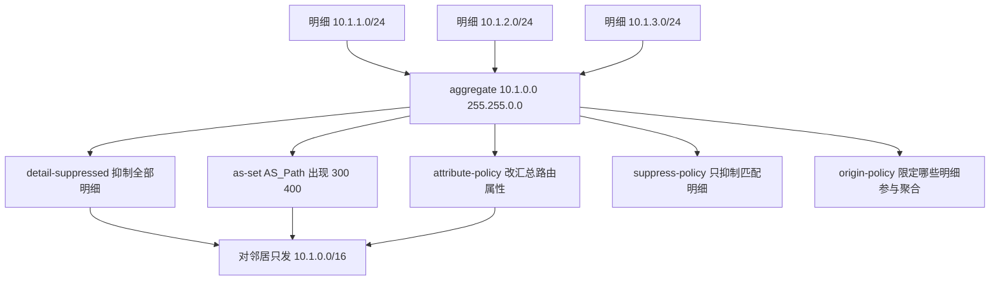

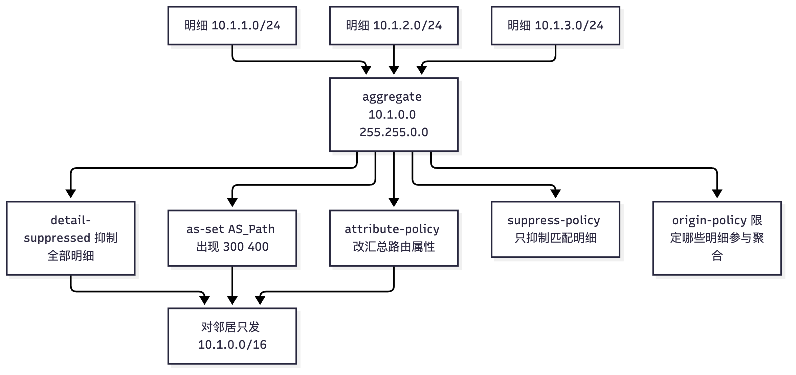


### 真题精练

**Q1.【真题·多选】** 关于华为设备上的 `summary automatic`（自动聚合），下列说法正确的有？
A. 只对 `import-route` 引入的路由生效
B. 按主类网络进行聚合
C. 支持 `as-set`，可以保留明细的 AS_Path 信息
D. 会自动抑制明细路由的通告

> **答案：ABD**
> **解析**：C 错——自动聚合**不支持 `as-set`**，聚合后明细的 AS_Path 信息丢失，因此存在防环隐患，这也是现网不采用自动聚合的原因之一。除此之外，自动聚合对 `network` 命令发布的路由与从邻居学到的路由均不生效，且按 A/B/C 类主网聚合（10.x.x.x → 10.0.0.0/8），粒度极粗。

**Q2.【真题·多选】** `aggregate 10.1.0.0 255.255.0.0` 命令中可以同时使用的参数包括？
A. `detail-suppressed`  B. `as-set`  C. `suppress-policy`  D. `origin-policy`  E. `attribute-policy`

> **答案：ABCDE**
> **解析**：五个参数可在一个命令中组合使用（语法末尾的 `*` 即表示可叠加），也可分多条命令配置后叠加生效。要点区分：**作用于明细的是 `detail-suppressed`、`suppress-policy`、`origin-policy`；作用于聚合路由本身的是 `as-set`、`attribute-policy`**。

**Q3.【真题·简答】** 请说明 `detail-suppressed` 与 `suppress-policy` 的区别，以及 `origin-policy` 配置不当会带来什么后果。

> **答案**：`detail-suppressed` 是"**全部抑制**"——被聚合网段覆盖的所有明细路由都不再对外通告，只发聚合路由，用于最大限度精简路由表；`suppress-policy` 是"**选择性抑制**"——只有匹配指定 route-policy 的明细被抑制，其余明细照常发布，适合"只屏蔽震荡严重的明细、保留关键精确路由"的场景。两者同时配置时 `detail-suppressed` 会抑制全部明细。
> `origin-policy` 用于限定"哪些明细有资格参与聚合"。若配置不当（策略过严，没有任何明细匹配），则**聚合路由根本不会生成**，对端将完全收不到汇总路由；若策略过宽（把不该汇总的明细也纳入），则聚合路由会覆盖本不属于本网络的地址空间，产生**黑洞**（聚合网段内部分地址实际不可达）。
> **解析**：答题要抓住三点——抑制范围（全部 vs 部分）、作用对象（明细 vs 参与聚合的资格）、后果（路由不生成 / 黑洞）。补充加分：`detail-suppressed` 只影响对外通告，本机 IP 路由表与转发仍按明细进行。

**Q4.【真题·排错】** 工程师在 NE40E 上执行 `aggregate 172.16.0.0 255.255.0.0 detail-suppressed` 后，用 `display bgp routing-table peer 10.0.12.2 advertised-routes` 查看，发现既没有聚合路由，明细也仍在发送。请分析原因。

> **答案**：三个最可能原因——① **BGP 本地路由表中没有属于 172.16.0.0/16 的明细路由**，聚合路由因缺少"聚合源"而无法生成（`aggregate` 的前提是存在覆盖范围内的明细）；② 明细路由来自 `network` 发布或邻居学习，但被 `filter-policy import`、`route-policy` 过滤掉了，导致本地 BGP 表中实际没有明细；③ 该聚合网段的明细**不是最优路由**（如下一跳不可达），BGP 只对最优路由做聚合与通告。定位步骤：`display bgp routing-table` 检查是否有 172.16.x.x 明细且带 `>`；`display ip routing-table 172.16.1.0` 确认明细是否进入本地路由表；检查 import 方向策略；确认后补充明细来源（`import-route direct/static` 或将明细网段加入 IGP 并引入）。现象中"明细仍在发送"恰好说明 `detail-suppressed` 未生效——因为它没有任何可聚合的明细可抑制。
> **解析**：本题考"聚合的生成前提"。牢记：**先有明细，后有聚合；聚合不生成时，抑制也无从谈起。**

### 易错点与排错

1. **聚合的前提是本地 BGP 表中有明细**：这是最高频的失分点，排错时第一件事就是 `display bgp routing-table` 看明细是否存在且为 best。
2. **`detail-suppressed` 只影响对外通告**：本机 IP 路由表中的明细路由仍存在，本地转发仍走明细（不会造成本地黑洞），只有远端设备才只看到汇总。
3. **`as-set` 会让汇总路由抖动**：明细的 AS 变化会改变 AS_SET 内容，从而引发聚合路由更新，与"聚合屏蔽震荡"的初衷矛盾。是否使用 `as-set` 要权衡防环与稳定性。
4. **团体属性必须 `advertise-community` 才发得出去**：用 `attribute-policy` 给聚合路由打了团体后，若忘记在邻居上使能 `advertise-community`，对端看不到团体，基于团体的策略会全部失效。
5. **策略变更后要复位或软复位**：`aggregate`、`route-policy` 变更后，华为设备不一定立即重算已发送的路由，可用 `reset bgp <peer>` 或 `refresh bgp <peer> export` 使其立即生效。
6. **排错命令**：`display bgp routing-table`、`display bgp routing-table peer x advertised-routes`、`display ip routing-table <明细>`、`display current-configuration configuration bgp | include aggregate`。

---

## 3.7 BGP 属性大全：四大分类与逐条精讲

### 考点定位

属性分类是**必考记忆题**（单选/多选/填空，2~5 分），重点考"某个属性属于哪一类""哪些属性只在一个 AS 内传递""哪些属性不跨 AS 传递"。**最高频**：MED 是可选非传递、Local_Pref 只在 IBGP 内传递、Community 是可选传递、Origin 是公认必遵。

### 原理精讲

BGP 属性的作用是"**把策略信息随路由一起携带**"。RFC 4271 按"是否必须被所有实现识别"和"是否必须出现在每条 Update 中"把属性分为四类，再加上"传递性"维度，形成下表的两轴分类。理解这张表的关键是记住两条推论：

- **公认（Well-known）属性所有 BGP 实现都必须识别**；**可选（Optional）属性允许不识别**。
- **传递（Transitive）属性即使不被识别也必须继续传给下一个邻居**（转发时把属性标志中的 Partial 位置 1，表示"我没看懂但帮你转发了"）；**非传递（Non-transitive）属性若不被识别则直接丢弃**，不再转发。

**属性标志字节（1 字节）**：Optional（1 bit）、Transitive（1 bit）、Partial（1 bit）、Extended Length（1 bit）。若 Extended Length = 1，则属性长度字段为 2 字节，否则为 1 字节。这是"属性标志"在报文中的真实编码，抓包必看。

| 分类 | 属性 | 传递范围 | 缺省值 | 作用 |
|---|---|---|---|---|
| **公认必遵**（Well-known Mandatory） | Origin | 全传递 | 由产生方式决定 | 标识路由来源（IGP/EGP/Incomplete） |
| | AS_Path | 全传递（EBGP 追加） | 空 | 防环 + 选路 + 策略匹配 |
| | Next_Hop | 全传递（EBGP 改写） | 对端地址 | 递归下一跳 |
| **公认自决**（Well-known Discretionary） | Local_Preference | **仅 IBGP 内** | 100 | 告诉 AS 内其他路由器从哪个出口离开本 AS 最优 |
| | Atomic_Aggregate | 全传递 | 无值（长度 0） | 标识"路径信息已丢失的聚合" |
| **可选传递**（Optional Transitive） | Community | 全传递 | 无 | 打标签，供对端做策略匹配 |
| | Aggregator | 全传递 | 无 | 记录执行聚合的设备（AS 号 + Router ID） |
| | Extended Communities | 全传递 | 无 | RT、SoO、带宽、Color 等 |
| **可选非传递**（Optional Non-transitive） | **MED** | **只在相邻 AS 之间** | 0 | 告诉邻接 AS 从哪个入口进入本 AS 最优 |
| | Originator_ID | 仅 AS 内（RR） | 无 | RR 场景防止路由回到始发者 |
| | Cluster_List | 仅 AS 内（RR） | 无 | RR 场景防止集群间环路 |

**逐条精讲要点：**

- **Origin（起源）**：取值 IGP（`i`，由 `network` 命令发布）、EGP（`e`，从 EGP 学来，已废弃、现网几乎见不到）、Incomplete（`?`，由 `import-route` 引入或聚合产生）。**Origin 由"路由进入 BGP 的方式"决定，不能直接用 route-policy 改写**（华为没有 `apply origin`）。选路时 **IGP > EGP > Incomplete**。
- **AS_Path**：四种形式——AS_SEQUENCE（有序，正常情况）、AS_SET（无序，`as-set` 聚合产生，显示为 `{300,400}`）、AS_CONFED_SEQUENCE / AS_CONFED_SET（联盟专用）。EBGP 通告时在**最左侧追加**本 AS 号；收到含本 AS 号的路由默认丢弃。可用 `ip as-path-filter` 做正则匹配。
- **Next_Hop**：必须是接收方能够迭代到的地址。`display bgp routing-table` 中本地始发路由的 NextHop 显示为 `0.0.0.0`。
- **Local_Preference（本地优先级）**：取值范围 0~4294967295，华为缺省 **100**。它**只在 IBGP 邻居之间传递**，EBGP 邻居收不到（也不该收到），因此它表达的是"本 AS 内部如何离开本 AS"的意图。`default local-preference <值>` 设置缺省值（主要影响从 EBGP 学到的路由，IBGP 学到的路由保留其原有 Local_Pref）；更精细的控制用 route-policy 中 `apply local-preference`。
- **Atomic_Aggregate**：长度 0 的标志属性，表示"这条路由是聚合结果，且路径信息不完整"。各厂商是否自动携带该属性实现不一致，考试以**含义与分类**为主，实机用 `display bgp routing-table <prefix>` 确认。
- **Community**：4 字节，可选传递。公认团体见 3.9 节。
- **Aggregator**：6 字节 = 聚合设备的 AS 号（2 字节）+ Router ID（4 字节），用于标明"谁做的聚合"。
- **MED（Multi_Exit_Discriminator，多出口鉴别器）**：可选**非传递**，取值 0~4294967295，缺省 0。传递规则是它最常考的点：**MED 只在相邻的两个 AS 之间有效，不会被第三个 AS 继承**——ASBR 从 EBGP 学到带 MED 的路由后，可以在本 AS 内通过 IBGP 传递（同一 AS 内传递不受限制），但当本 AS 再向另一个 AS 通告时，MED 会被清除（可选非传递属性跨 AS 后不再携带）。比较规则：**缺省只在来自同一相邻 AS 的路由之间比较 MED**；要让不同 AS 的 MED 参与比较必须配置 `compare-different-as-med`（有路由环路风险，慎用）。
- **Originator_ID / Cluster_List**：RR 专用防环属性，详见 3.10 节。

### 关键概念对照表

| 需要区分的问题 | 正确答案 | 常见错误选项 |
|---|---|---|
| MED 属于哪一类 | 可选**非**传递 | 可选传递 |
| Local_Pref 属于哪一类 | 公认自决 | 可选传递 |
| Community 属于哪一类 | 可选传递 | 可选非传递 |
| AS_Path 属于哪一类 | 公认必遵 | 公认自决 |
| 哪些属性不跨 AS 传递 | MED（及 Originator_ID、Cluster_List） | AS_Path、Community |
| Local_Pref 能否传给 EBGP 邻居 | 不能 | 能（这是最典型的错误） |
| 缺省 Local_Pref | 100 | 0 / 无 |
| 缺省 MED | 0 | 100 |
| Origin 由什么决定 | 路由进入 BGP 的方式 | 可任意用策略改写 |
| Partial 位的含义 | 该属性未被本机识别但已被转发 | 属性不完整 |

| 属性 | 华为常用命令 | 典型用途 |
|---|---|---|
| Local_Pref | `default local-preference 150`、`apply local-preference 200` | 出口优选 |
| MED | `default med 100`、`apply cost 100`、`apply cost+ 10`、`compare-different-as-med`、`deterministic-med`、`bestroute med-none-as-maximum` | 入口影响（对邻 AS 施加影响） |
| AS_Path | `apply as-path 100 200 additive`、`ip as-path-filter` | 人为加长路径 / 过滤 |
| Community | `apply community 100:1 additive`、`peer x advertise-community` | 打标签、跨 AS 策略 |
| 选路微调 | `bestroute as-path-ignore`、`bestroute igp-metric-ignore`、`bestroute router-id-ignore`、`bestroute med-confederation` | 跳过特定选路步骤 |

### 华为设备配置

```bash
# ===== 属性产生与修改（NE40E，AS 100）=====
system-view
bgp 100
 router-id 1.1.1.1
 network 10.1.1.0 255.255.255.0            // Origin = IGP (i)
 import-route ospf 1                         // Origin = Incomplete (?)
 default local-preference 150                // 设置缺省 Local_Pref（主要作用于 EBGP 学到的路由）
 default med 100                             // 设置缺省 MED
 compare-different-as-med                    // 允许比较来自不同 AS 的 MED（现网慎用，风险见易错点）
 deterministic-med                           // 按 AS 分组做确定性 MED 比较，避免选路随接收顺序变化
 bestroute med-none-as-maximum               // 无 MED 的路由按最大值处理，避免误优选
 peer 10.0.12.2 as-number 200
 peer 10.0.12.2 advertise-community          // 使能团体属性传递（缺省不传给邻居）
quit
# ===== Origin 与 AS_Path 的策略控制 =====
ip as-path-filter 1 permit ^200$             // 只匹配"从 AS 200 直接学来"的路由（^ 起始 $ 结束）
ip as-path-filter 2 deny .*100.*             // 拒绝 AS_Path 中含 100 的路由（.* 任意字符）
route-policy AS permit node 10
 apply as-path 100 100 additive              // 人为在 AS_Path 前追加两个 100，使路径变长
route-policy AS permit node 20
route-policy LP permit node 10
 apply local-preference 200                  // 精确设置本地优先级
route-policy MED permit node 10
 apply cost 50                               // 设置 MED
route-policy MED2 permit node 10
 apply cost+ 20                              // 在原有 MED 基础上增加 20
bgp 100
 peer 10.0.12.2 as-path-filter 1 import      // 按 AS_Path 过滤入方向路由
 peer 10.0.12.2 route-policy LP export       // 出方向应用策略
quit
# ===== 查看属性 =====
display bgp routing-table                    // 默认展示 NextHop / MED / LocPrf / PrefVal / Path(Ogn)
display bgp routing-table 10.1.1.0           // 查看单条路由全部属性（含 Community、Originator、Cluster）
display bgp routing-table community          // 查看带团体属性的路由
display bgp routing-table as-path-filter 1   // 按 AS_Path 过滤器查看匹配路由
display bgp routing-table peer 10.0.12.2 advertised-routes   // 查看实际通告出去的属性
```

### 示意图

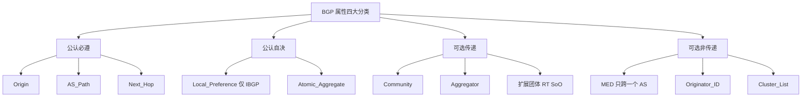

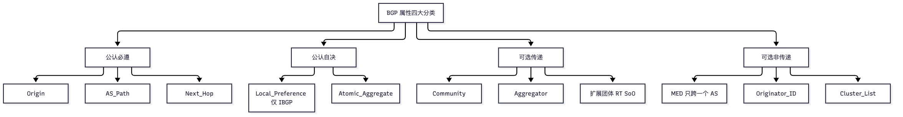


### 真题精练

**Q1.【真题·单选】** 下列 BGP 属性中属于"可选非传递（Optional Non-transitive）"的是？
A. Community  B. MED  C. Local_Preference  D. AS_Path

> **答案：B**
> **解析**：MED 是可选**非**传递属性，只在相邻 AS 之间有效，不会传到第三个 AS。A 是可选传递；C 是公认自决且只在 IBGP 内传递；D 是公认必遵。

**Q2.【真题·多选】** 关于 MED 属性，下列说法正确的有？
A. 缺省值为 0，数值越小越优
B. 缺省情况下只比较来自同一相邻 AS 的路由的 MED
C. MED 可以跨越多个 AS 一直传递下去
D. 可用 `compare-different-as-med` 让不同 AS 的 MED 也参与比较

> **答案：ABD**
> **解析**：C 错——MED 是**可选非传递**属性，只能影响相邻 AS，进入第二个 AS 后再向第三个 AS 通告时不会被携带（这也解释了为什么"用 MED 影响远端 AS 选路"是无效需求）。D 正确但有风险：开启后可能因不同 AS 的 MED 不可比而选出次优甚至成环的路径，现网慎用。另需记住 `bestroute med-none-as-maximum` 把"无 MED"视为最大值，避免缺省按 0 处理导致误优选。

**Q3.【真题·填空】** Local_Preference 是公认自决属性，华为设备缺省值为 ______，它只在 ______ 邻居之间传递，不会通告给 ______ 邻居；MED 是可选非传递属性，华为设备缺省值为 ______。

> **答案：100；IBGP；EBGP；0**
> **解析**：Local_Pref 的作用域是"本 AS 内部"，用于指示 AS 内其他路由器"从哪个出口离开本 AS 最好"，因此不传给 EBGP 邻居；MED 的作用域是"相邻 AS 之间"，用于影响邻接 AS 选择进入本 AS 的入口。两者方向相反，是经典对比考点。

**Q4.【真题·简答】** 请说明 BGP 属性标志字节中 Optional、Transitive、Partial 三个位的含义，并解释"可选非传递属性不被识别时会被丢弃"的设计意图。

> **答案**：Optional 位表示该属性是否为可选属性（1 = 可选，0 = 公认）；Transitive 位表示该属性是否具有传递性（1 = 收到后即使不识别也必须继续传给下一个邻居，同时把 Partial 置 1；0 = 不识别则丢弃并不再传递）；Partial 位只在 Transitive=1 且本机未识别该属性时置 1，用于告知后续邻居"此属性信息可能不完整"。
> 设计意图：公认属性是 BGP 的基础语义，所有实现必须理解；可选传递属性允许厂商扩展（如 Community）并在不支持的老设备上"透传"而不中断路由传播；而**可选非传递属性通常表达的是"本地/邻接范围"的意图**（如 MED 只对相邻 AS 有意义、Originator_ID/Cluster_List 只在本 AS 的 RR 域内有意义），若被不懂它的设备继续无条件传递，反而可能被远端误用而破坏选路语义，因此规定"不识别即丢弃"。
> **解析**：答题要能区分"必须识别"（公认）与"允许不识别"（可选），以及"不识别也要转发"（传递）与"不识别就丢弃"（非传递）这两组正交概念。

### 易错点与排错

1. **Local_Pref 与 MED 的作用域方向相反**：Local_Pref 影响"我如何离开本 AS"（出口，IBGP 内传播）；MED 影响"邻居如何进入本 AS"（入口，只到相邻 AS）。题目一旦出现"用 MED 影响第三个 AS"即为错误选项。
2. **Community 需要 `advertise-community` 才行**：华为设备缺省不把团体属性传给邻居，忘了这条会让所有基于团体的对端策略失效。
3. **`compare-different-as-med` 有环路风险**：不同 AS 的 MED 量纲不同，强行比较可能选出非预期路径，官方文档明确提示慎用。
4. **`apply as-path` 默认是覆盖而不是追加**：需要追加时写明 `additive`，否则会清空原有 AS_Path，破坏防环。
5. **Origin 不可直接用策略改写**：它是"引入方式"的产物，要改只能改变引入方式（用 `network` 替代 `import-route`）。
6. **排错命令**：`display bgp routing-table <prefix>`（看全部属性）、`display bgp routing-table community`、`display bgp routing-table as-path-filter`、`display bgp peer x verbose`（看是否协商了扩展能力）。

---

## 3.8 BGP 选路 13 条规则（含综合演算）

### 考点定位

**本节是全章最高频、最核心的考点**，理论卷常以 **5~10 分**出现（单选 + 综合演算 + 排错），实验卷的路径控制题也全部依赖它。要求达到"**能按顺序默写、能拿一套属性数据当场算出选哪条**"的程度。**最大陷阱**：以为 BGP 一定选 AS_Path 最短的路（实际上前三条就能改变结果），以及把第 6 条 MED 的比较范围搞错。

### 原理精讲

BGP 对同一前缀可能从多个邻居学到多条路由，必须选出唯一的"最优路由"写入 IP 路由表。选路过程是一串**严格按顺序执行的比较**，一旦某一步能分出胜负就立即停止，后续规则不再参与。华为 VRP 的实际顺序如下（前 8 条是考试绝对重点）：

| 序号 | 比较内容 | 优选条件 | 华为相关命令 | 说明 |
|---|---|---|---|---|
| **1** | Preferred-Value（协议首选值） | **越大越优** | `peer x preferred-value 100` | 华为私有属性，**仅本地有效、不传递**，取值范围 0~65535，缺省 0 |
| **2** | Local_Preference | **越大越优** | `default local-preference`、`apply local-preference` | 缺省 100，只在 IBGP 内传递，表达"离开本 AS 的最优出口" |
| **3** | 本地始发路由 | **本地始发优先** | `aggregate`、`summary automatic`、`network`、`import-route` | 优先级：手动聚合 > 自动聚合 > `network` > `import-route` |
| **4** | AS_Path 长度 | **越短越优** | `apply as-path ... additive` | AS_SET 的长度按 1 计；可用 `bestroute as-path-ignore` 跳过本步 |
| **5** | Origin | **IGP > EGP > Incomplete** | 无法直接改写 | 由路由引入方式决定 |
| **6** | MED | **越小越优** | `apply cost`、`default med`、`compare-different-as-med` | **缺省只比较来自同一相邻 AS 的路由**；可用 `bestroute med-none-as-maximum` 调整 |
| **7** | 学习来源 | **EBGP 优于 IBGP** | — | 联盟内 EBGP 视为 EBGP；此步用于让外部路由优先 |
| **8** | 到 Next_Hop 的 IGP Metric | **越小越优** | — | 让流量走"离下一跳更近"的出口；可用 `bestroute igp-metric-ignore` 跳过 |
| **9** | Cluster_List 长度 | **越短越优** | — | 仅当存在 RR 反射属性时参与比较 |
| **10** | Originator_ID | **越小越优** | — | 同上，RR 场景 |
| **11** | Router ID | **对端 Router ID 越小越优** | — | 可用 `bestroute router-id-ignore` 跳过（常用于双机场景避免选路漂移） |
| **12** | 对等体地址 | **对等体 IP 地址越小越优** | — | 最后的确定性比较 |
| **13** | 接收时间 | **更早（更稳定）的路由** | — | 业界通用的收尾规则；华为官方文档通常列到第 12 条，考试以"前 12 条必背、第 13 条理解其含义"为准 |

**关于第 13 条的说明**：RFC 4271 与多数厂商实现（包括 Cisco 的 "prefer the oldest path"）都保留"同等条件下优选最早收到的路由"作为最后手段，其目的是**避免路由抖动（route flapping）**：如果每次都重新随机选择，会造成流量频繁切换。华为文档在多数版本中把确定性比较做到"对等体地址最小"即结束，因此本表把第 13 条标注为通用补充规则，答题时写出前 12 条 + 说明第 13 条的稳定性意图即可。

**三条必须理解的设计思想：**

1. **"本地意志"优先于"路径客观长度"**：前三条（Preferred-Value、Local_Pref、本地始发）全部是本地或本 AS 的策略意图，排在最前面。这说明 BGP 的设计哲学是**先执行策略，再考虑路径优劣**——所以"AS_Path 最短"常常不是最终结果。
2. **"出口选路"先于"入口选路"**：Local_Pref（第 2 条，决定从哪个出口离开本 AS）远早于 MED（第 6 条，受邻居的 MED 影响决定进入邻居哪个入口）。因为 MED 是别人给的"建议"，本 AS 当然优先坚持自己的出口意志。
3. **前 8 条足够覆盖 99% 的真实场景**：第 9~12 条只在 RR 环境（Cluster_List、Originator_ID）或前 8 条完全打平（Router ID、对等体地址）时才起作用，是"确定性收敛"的保证。

### 关键概念对照表

| 属性 | 越大越优 / 越小越优 | 作用域 | 缺省值 | 谁配置生效 |
|---|---|---|---|---|
| Preferred-Value | **越大越优** | 仅本地 | 0 | 本机（华为私有） |
| Local_Preference | **越大越优** | 本 AS（IBGP 传递） | 100 | 本 AS 内任意路由器 |
| AS_Path 长度 | **越小越优** | 全局（EBGP 追加） | 空 | 路径上各 AS |
| Origin | IGP > EGP > Incomplete | 全局 | 由引入方式决定 | 路由始发者 |
| MED | **越小越优** | 相邻 AS | 0 | 路由归属 AS 的边界设备 |
| IGP Metric（到下一跳） | **越小越优** | 本 AS 内 | 由 IGP 决定 | IGP 拓扑 |

| 容易混淆的对比 | 正确结论 |
|---|---|
| Local_Pref 与 MED 谁的优先级高 | Local_Pref（第 2 条）远高于 MED（第 6 条） |
| AS_Path 相同但来源不同（EBGP/IBGP） | 第 7 条：EBGP 优先 |
| MED 不同但来自不同 AS | 第 6 条不比较，直接进入第 7 条 |
| 本地聚合路由 vs 从邻居学来的更短路径 | 第 3 条：本地始发（聚合）优先，即使 AS_Path 更长 |
| 两台设备 Router ID 不同但其他全同 | 第 11 条：Router ID 小的对端优先 |

### 华为设备配置

```bash
# ===== 用策略操控选路结果（NE40E，AS 100）=====
system-view
# --- 第 1 条：Preferred-Value（华为私有，仅本地有效）---
bgp 100
 peer 10.0.12.2 preferred-value 200           // 把从该邻居学到的路由首选值设为 200，最大者胜出
# --- 第 2 条：Local_Preference ---
 default local-preference 150                  // 全局缺省本地优先级
quit
route-policy SET_LP permit node 10
 if-match ip-prefix USER                       // 匹配特定前缀
 apply local-preference 200                    // 单独抬高该前缀的 Local_Pref
bgp 100
 peer 2.2.2.2 route-policy SET_LP import       // 入方向应用，影响本机选路（IBGP 邻居）
quit
# --- 第 4 条：AS_Path 长度 ---
route-policy LONGER permit node 10
 apply as-path 100 100 additive                // 人为加长路径，把流量"赶"到另一条路
# --- 第 6 条：MED ---
route-policy SET_MED permit node 10
 apply cost 10                                 // 设置 MED=10，值越小越容易被邻 AS 选中
bgp 100
 bestroute med-none-as-maximum                 // 无 MED 视为最大，避免缺省按 0 比较造成误选
 bestroute as-path-ignore                      // 跳过第 4 条 AS_Path 比较（多用于双出口等长路径场景）
 bestroute igp-metric-ignore                   // 跳过第 8 条 IGP Metric 比较
 bestroute router-id-ignore                    // 跳过第 11 条 Router ID 比较，避免选路随 Router ID 漂移
 maximum load-balancing 8                      // 前 8 条完全相同时形成等价多路径（缺省不开启负载分担）
quit
# ===== 验证选路结果 =====
display bgp routing-table 10.1.1.0             // 看 > 标记落在哪条路由上，并核对各属性值
display bgp routing-table 10.1.1.0 verbose     // 部分版本可直接查看优选过程与原因
display ip routing-table 10.1.1.0              // 确认最终写入 IP 路由表的结果
display bgp routing-table peer 10.0.12.2 advertised-routes   // 确认下发方向是否与预期一致
```

### 示意图

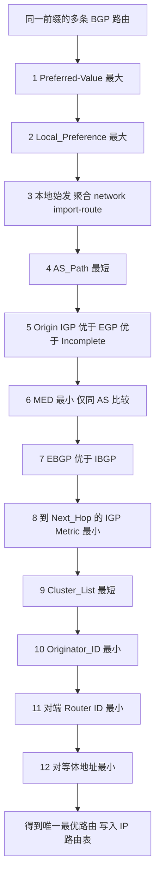

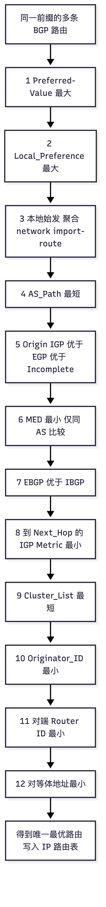


### 综合例题：多属性同时存在时选哪条（逐步演算）

**题干**：R1（AS 100，Router ID 1.1.1.1）从三个邻居学到同一前缀 `10.1.1.0/24`，属性如下表。请逐步演算 R1 最终选中哪一条，并说明每一步淘汰了谁。

| 编号 | 邻居 | 邻居类型 | 路由的 AS_Path | Origin | MED | Local_Pref | PrefVal | Next_Hop | 到 Next_Hop 的 IGP Metric |
|---|---|---|---|---|---|---|---|---|---|
| **A** | 10.0.12.2 | EBGP（对端 AS 200） | `200` | IGP | 50 | 100 | 0 | 10.0.12.2 | 1 |
| **B** | 2.2.2.2 | IBGP（本 AS） | `200 300` | IGP | 10 | 150 | 0 | 10.0.13.2 | 5 |
| **C** | 3.3.3.3 | IBGP（本 AS） | `200 400 500` | Incomplete | 0 | 150 | 0 | 10.0.14.2 | 2 |

**第 1 步 · 比较 Preferred-Value（第 1 条）**：A = 0、B = 0、C = 0，全部相同，**无法分出胜负**，进入第 2 条。

**第 2 步 · 比较 Local_Preference（第 2 条）**：A = 100、B = 150、C = 150。**B 与 C 的 150 大于 A 的 100**，A 被淘汰；B、C 继续。
> 关键点：此处 **A 是唯一的 EBGP 路由，却因 Local_Pref 偏低而先被淘汰**。这说明第 7 条"EBGP 优于 IBGP"不是无条件生效的——它必须等到第 1~6 条全部打平才有机会出场。这是本考点的最大陷阱。

**第 3 步 · 比较是否本地始发（第 3 条）**：B、C 都是从邻居学来的，均非本地始发，**无法分出胜负**，进入第 4 条。

**第 4 步 · 比较 AS_Path 长度（第 4 条）**：B 的 AS_Path 为 `200 300`，长度 2；C 的为 `200 400 500`，长度 3。**B 更短，B 胜出**，选路结束。

**最终结论：选中 B（来自 IBGP 邻居 2.2.2.2 的路由）**。
> C 的 MED = 0 比 B 的 MED = 10 更小，但 **MED 是第 6 条，根本没机会参与比较**。这再次说明"属性越优"不等于"会被考虑"——**顺序决定一切**。

**延伸演算 1：若 B 与 C 的 AS_Path 长度相同（例如 B = `200 300`、C = `200 400`）**
- 第 4 条打平（长度都是 2）。
- **第 5 步 · 比较 Origin（第 5 条）**：B 为 IGP，C 为 Incomplete → **B 胜出**（IGP 优于 Incomplete）。
- 结论仍是 B，但理由从"AS_Path 最短"变成了"Origin 更优"，这是很好的干扰项设计。

**延伸演算 2：若 B、C 的 AS_Path 与 Origin 都相同（例如 C 的 AS_Path = `200 300`、Origin = IGP）**
- **第 6 步 · 比较 MED（第 6 条）**：先判断是否可比——B 的路径首 AS 是 200，C 的路径首 AS 也是 200，**来自同一相邻 AS 200，可以比较 MED**。B 的 MED = 10，C 的 MED = 0，**C 的 MED 更小，C 胜出**。
- 结论：**C 被选中**。这一步演示了 MED 的"同 AS 才比较"前提，以及 MED 一旦可比就能推翻 IBGP/EBGP 之外的其他因素。

**延伸演算 3：若 C 的 AS_Path = `400 300`（即路由来自 AS 400 而非 AS 200）**
- 第 6 条：B 的路径来自 AS 200，C 的来自 AS 400，**不属于同一相邻 AS，MED 不比较**（除非配置 `compare-different-as-med`），直接进入第 7 条。
- **第 7 步 · 比较学习来源（第 7 条）**：B 与 C 都是 IBGP，**打平**，进入第 8 条。
- **第 8 步 · 比较到 Next_Hop 的 IGP Metric（第 8 条）**：B 的 Next_Hop 10.0.13.2 的 IGP metric = 5，C 的 Next_Hop 10.0.14.2 的 IGP metric = 2，**C 更小，C 胜出**。
- 结论：**C 被选中**。注意此时依据是"离下一跳更近"，与 AS_Path 长度和 MED 都无关。

**延伸演算 4：把 A 的 Local_Pref 也改成 150（三条 Local_Pref 全部相等）**
- 第 2 条打平；第 3 条打平（都非本地始发）。
- 第 4 条：A 的 AS_Path 长度 = 1，B = 2，C = 3 → **A 最短，A 胜出**。
- 结论：**A（EBGP 路由）被选中**。这说明只要 Local_Pref 不被压低，AS_Path 更短的 EBGP 路由确实会赢——这也是最符合直觉的结果。

**演算小结（必须背下来的判断口诀）**：
> **先看本地 Preferred-Value 和 Local_Pref，再看是不是自己发的，然后比 AS_Path 长短、Origin、MED（同 AS 才比），接着 EBGP 赢 IBGP、离下一跳近的赢，最后才用 Cluster_List、Originator_ID、Router ID、对等体地址来"确定性收尾"。**

### 真题精练

**Q1.【真题·多选】** R1（AS 100）从下列邻居学到同一前缀，请判断 R1 最终会优选哪条路由？
- 路由甲：EBGP 学来，AS_Path = `200 300`，Local_Pref = 100，MED = 5
- 路由乙：IBGP 学来，AS_Path = `200 300 400`，Local_Pref = 200，MED = 50

A. 路由甲，因为来自 EBGP 且 AS_Path 较短
B. 路由乙，因为 Local_Pref 更大
C. 两条形成等价多路径
D. 无法判断，还需比较 Router ID

> **答案：B**
> **解析**：**Local_Pref（第 2 条）先于 AS_Path（第 4 条）与 EBGP/IBGP（第 7 条）比较**。乙的 Local_Pref = 200 > 甲的 100，因此在第 2 步就已分出胜负，选乙。A 是最常见的错误（把"EBGP 优先"和"AS_Path 短"提前使用）；C 错——等价多路径要求前 8 条完全打平；D 错——第 2 条已定胜负，无需走到第 11 条。

**Q2.【真题·单选】** 下列哪一条路由会被华为设备优选？
- 路由 A：AS_Path = `300 400`，Origin = Incomplete，MED = 0
- 路由 B：AS_Path = `300 500`，Origin = IGP，MED = 100
（两条路由均从同一相邻 AS 300 学来，Local_Pref 与 PrefVal 相同）

A. 路由 A，因为 MED 更小
B. 路由 B，因为 Origin 更优
C. 路由 A，因为 AS_Path 更短
D. 两条等价

> **答案：B**
> **解析**：AS_Path 长度均为 2，第 4 条打平；进入第 5 条比较 Origin，B 是 IGP、A 是 Incomplete，**IGP 优于 Incomplete，选 B**。A 项的错误在于"越过了 Origin 直接比 MED"——MED 是第 6 条，必须等第 5 条打平后才能比较。C 项 AS_Path 长度相同，不成立。

**Q3.【真题·简答】** 请按华为设备实际顺序写出 BGP 选路的前 8 条规则，并说明为什么 Local_Preference 排在 MED 之前。

> **答案**：前 8 条依次为——① Preferred-Value 最大者优；② Local_Preference 最大者优；③ 本地始发路由优先（手动聚合 > 自动聚合 > `network` > `import-route`）；④ AS_Path 最短者优；⑤ Origin 最优者优（IGP > EGP > Incomplete）；⑥ MED 最小者优（缺省仅比较来自同一相邻 AS 的路由）；⑦ EBGP 学到的路由优于 IBGP；⑧ 到 Next_Hop 的 IGP Metric 最小者优。
> Local_Pref 排在 MED 之前，是因为两者表达的是**不同主体的意志**：Local_Pref 是"本 AS 自己决定从哪个出口离开"，属于本自治域的内部决策，优先级最高；MED 是**邻居 AS 给出的建议**（"请你从我的这个入口进来"），属于外部影响。BGP 的设计原则是"先满足自己的策略，再考虑别人的建议"，因此本 AS 的出口意志（Local_Pref）必然排在邻 AS 的入口建议（MED）之前。
> **解析**：答题要点是"顺序 + 每个属性的优选方向 + 为什么这个顺序符合策略优先的设计哲学"。只罗列顺序不做解释，简答题得分会明显偏低。

**Q4.【真题·排错】** 某网络双出口设计中，R1 从 ISP-A（AS 200）与 ISP-B（AS 300）学到默认路由 `0.0.0.0/0`，期望"主用 ISP-A、备用 ISP-B"。工程师在 R1 上对 ISP-A 的邻居配置了 `apply local-preference 200`，但 `display ip routing-table 0.0.0.0` 显示下一跳指向 ISP-B。请分析原因。

> **答案**：最可能的原因是 **`apply local-preference` 配置在了 `export` 方向（或配在了错误的位置）**。Local_Preference 属于"本 AS 内部属性"，且**只通过 IBGP 传递**：R1 从 ISP-A（EBGP）学到的路由，其 Local_Pref 由 **R1 自己的 `default local-preference` 或入方向 route-policy** 决定，与其他路由器上的 export 策略无关；在向 EBGP 邻居发布方向的策略里设置 Local_Pref 对该 EBGP 邻居无效（EBGP 邻居不接收也不会使用 Local_Pref）。
> 正确做法有两种：① 在 R1 的 **import 方向**对 ISP-A 邻居（或按前缀）应用策略：`peer <ISP-A> route-policy SET_LP import` + `apply local-preference 200`；② 若两条默认路由的 Local_Pref 已相同，则检查是否被**更早的规则**决定——例如 Preferred-Value 不同、或某条是本地始发（第 3 条）、或 AS_Path 长度不同（第 4 条，ISP-B 的默认路由可能是本地静态 `network 0.0.0.0` 发布，属本地始发，直接在第 3 条胜出）。定位命令：`display bgp routing-table 0.0.0.0` 对比两条路由的 PrefVal、LocPrf、Path/Ogn 列。
> **解析**：本题考"策略生效方向 + 选路顺序"的组合推理。**凡是 Local_Pref 相关的策略，必须作用在本机的 import 方向或本 AS 内 IBGP 的 export 方向**，绝不能指望通过 EBGP export 去影响对端。

### 易错点与排错

1. **顺序 > 优度**：一条"MED 更小"或"AS_Path 更短"的路由，如果前面的规则已经分出胜负，就完全不会被考虑。做题必须先看前两条（PrefVal、Local_Pref）。
2. **MED 不是全局可比**：缺省只比较来自同一相邻 AS 的路由，跨 AS 的 MED 比较需要 `compare-different-as-med`，且该配置有风险。
3. **`bestroute` 系列命令是"改规则"而不是"改属性"**：`bestroute as-path-ignore`、`bestroute igp-metric-ignore`、`bestroute router-id-ignore` 会让选路**跳过**对应步骤，考试常以"为什么配置后选路结果变了"来提问。
4. **BGP 缺省不做负载分担**：前 8 条完全打平后，BGP 默认只选一条（按第 9~12 条确定性收尾），要形成等价多路径必须配置 `maximum load-balancing`。
5. **选路变化的常见人为原因**：Router ID 变化（未手工指定、LoopBack 增删）导致第 11 条结果翻转；对等体地址变化导致第 12 条结果翻转。生产网应手工固定 Router ID。
6. **排错命令**：`display bgp routing-table <prefix>`（对比所有属性列）、`display ip routing-table <prefix>`、`display bgp peer verbose`、`display current-configuration configuration bgp`。

---

## 3.9 Community 团体属性：标准团体与扩展团体

### 考点定位

团体属性是**跨 AS 策略控制的利器**，也是国赛的常客，占 **3~6 分**。必考内容：四个公认团体的**确切行为差异**（尤其 `no-export` 与 `no-export-subconfed` 在联盟中的差别）、Community-filter 的两种形式（basic / advanced）、以及"必须 `advertise-community` 才能传给邻居"这个排错点。

### 原理精讲

**为什么需要团体属性？** 路由策略通常按前缀、按 AS_Path 匹配，但现网前缀动辄数万条，逐个匹配不可维护。团体（Community）的作用是**给一组路由贴一个"标签"**，这个标签随路由一起跨 AS 传递，于是**对端可以用一条规则匹配成千上万条路由**。例如 ISP 给客户路由打上 `100:100`，另一台设备只需配置"匹配 `100:100` 就把 Local_Pref 设为 200"，无需关心具体前缀。团体的本质是**路由的元数据**，而不是路由本身。

**标准团体（Standard Community）**：4 字节（32 bit），可选传递属性。书写格式有两种：`aa:nn`（`aa` 通常是 AS 号，`nn` 是自定义值，各占 2 字节）或直接写十进制整数。华为设备推荐用 `aa:nn` 格式便于阅读。

| 公认团体 | 十六进制值 | 十进制值 | 行为 |
|---|---|---|---|
| `internet` | 0x00000000 | 0 | 可向**任何**邻居通告（缺省行为，无限制） |
| `no-export` | 0xFFFFFF01 | 4294967041 | **不向 EBGP 邻居通告**，但**可以在联盟内部跨子 AS 传递**，也可以在本 AS 内 IBGP 传递 |
| `no-advertise` | 0xFFFFFF02 | 4294967042 | **不向任何 BGP 邻居通告**（包括 IBGP 邻居），只留在本机 |
| `no-export-subconfed` | 0xFFFFFF03 | 4294967043 | **不向任何 EBGP 邻居通告，包括联盟内其他子 AS 的 EBGP 邻居** |

**`no-export` 与 `no-export-subconfed` 的区别是必考细节**：联盟把一个大 AS 拆成多个子 AS，子 AS 之间的会话在 BGP 语义上属于 EBGP（联盟 EBGP）。带 `no-export` 的路由**允许**在联盟内部子 AS 之间传递（因为它认为联盟整体就是"一个 AS"），而带 `no-export-subconfed` 的路由**连联盟内的子 AS 都不给**。因此：`no-export` 的边界是"联盟的外边界"，`no-export-subconfed` 的边界是"本子 AS 的外边界"。

**扩展团体（Extended Community）**：8 字节，可选传递属性。相比 4 字节的标准团体，它能表达更丰富的结构，主要类型：

| 类型 | Type 字段 | 结构 | 用途 |
|---|---|---|---|
| **Route Target（RT）** | 0x0002 / 0x0102 | 2 字节 AS + 4 字节本地值，或 4 字节 IP + 2 字节本地值 | **MPLS L3VPN 中控制 VPN 路由的导入/导出**（`vpn-target`），是 VRF 互通的核心 |
| **Site of Origin（SoO）** | 0x0003 | 同 RT 结构 | 标识路由来自哪个站点，**防止同一站点双归属到两个 PE 时形成环路** |
| Link Bandwidth | 0x4004 | 4 字节带宽值 | BGP 带宽扩展团体，用于按带宽做 BGP 负载分担（配合 `bestroute` 相关特性） |
| Color | 0x030B | 8 字节 Color 值 | 用于 **SR Policy / 流量工程**，把路由与 SR Policy 关联 |

RT 与 RD 的区别（在学习 4.6 节前先建立印象）：**RD 只解决"不同 VPN 相同前缀在 MP-BGP 中不冲突"的唯一化问题，不参与 VPN 成员匹配；RT 才真正决定"这条路由应该进入哪个 VRF"**。一个是"身份证号"，一个是"门禁卡"。

**Community-filter（团体过滤器）**：用于匹配团体属性，分两种：

- **基本（basic）**：只能匹配具体的团体值或公认团体关键字，形如 `ip community-filter basic CF1 permit 100:1`，可列出多个值（列表中任意一个匹配即通过）。
- **高级（advanced）**：使用正则表达式匹配 `aa:nn` 的文本形式，形如 `ip community-filter advanced CF2 permit ^100:.*`，适合匹配"所有 aa=100 的团体"。

应用方式有两种：① 直接在邻居上应用 `peer x community-filter CF1 import/export`；② 在 route-policy 中 `if-match community-filter CF1`，与其它条件组合。

**排错关键**：团体属性要传给对端，**发送侧必须配置 `peer x advertise-community`**（华为缺省不传）。这是"对端死活匹配不到团体"的第一原因。

### 关键概念对照表

| 对比项 | 标准团体 | 扩展团体 |
|---|---|---|
| 长度 | 4 字节 | 8 字节 |
| 典型用途 | 路由打标签、跨 AS 策略 | RT（VPN 互通）、SoO（防环）、Color（SR） |
| 属性分类 | 可选传递 | 可选传递 |
| 匹配工具 | `ip community-filter basic/advanced` | `vpn-target`（VPN 实例下）、`extcommunity-filter` |
| 是否随路由跨 AS 传递 | 是（需 `advertise-community`） | 是 |

| 公认团体 | 向 IBGP 邻居通告 | 向本 AS 的 EBGP 邻居通告 | 向联盟内其他子 AS 通告 | 向联盟外通告 |
|---|---|---|---|---|
| internet | 是 | 是 | 是 | 是 |
| no-export | 是 | **否** | 是 | 否 |
| no-export-subconfed | 是 | 否 | **否** | 否 |
| no-advertise | **否** | 否 | 否 | 否 |

| 操作 | 命令 | 说明 |
|---|---|---|
| 添加团体 | `apply community 100:1 additive` | `additive` 表示追加，不加则覆盖原有团体 |
| 清除团体 | `apply community none` | 删除所有团体属性 |
| 使能传递 | `peer x advertise-community` | 发送侧必须配置 |
| 过滤 | `peer x community-filter CF import/export` | 按团体过滤路由 |
| 查看 | `display bgp routing-table community` | 查看带团体的路由 |

### 华为设备配置

```bash
# ===== 场景：AS 100 给本 AS 客户路由打团体 100:1，AS 200 收到后抬高 Local_Pref =====
system-view
# --- AS 100（发送侧）---
ip ip-prefix CUSTOMER index 10 permit 10.1.1.0 24      // 定义客户前缀
route-policy SET_COMM permit node 10
 if-match ip-prefix CUSTOMER                            // 只对客户前缀打标签
 apply community 100:1 additive                         // 追加标准团体 100:1（additive 必需，否则覆盖原团体）
route-policy SET_COMM permit node 20                     // 允许其余路由通过，不做修改
bgp 100
 peer 10.0.12.2 as-number 200
 peer 10.0.12.2 route-policy SET_COMM export             // 出方向应用
 peer 10.0.12.2 advertise-community                      // 关键：使能团体属性传递（缺省不传）
quit
# --- AS 200（接收侧）---
ip community-filter basic CF100 index 10 permit 100:1    // 基本过滤器：精确匹配 100:1
ip community-filter advanced CF100X index 10 permit ^100:.*  // 高级过滤器：匹配所有 100:xx
route-policy FROM_100 permit node 10
 if-match community-filter CF100                         // 匹配到团体的路由
 apply local-preference 200                              // 抬高本地优先级，使这些路由成为首选出口
route-policy FROM_100 permit node 20
bgp 200
 peer 10.0.12.1 as-number 100
 peer 10.0.12.1 route-policy FROM_100 import              // 入方向应用，影响本机选路
quit
# ===== 使用公认团体控制通告范围 =====
route-policy NO_EXPORT permit node 10
 apply community no-export                               // 这些路由不再向 EBGP 邻居通告（联盟内仍可传）
bgp 100
 peer 10.0.12.2 route-policy NO_EXPORT export
quit
# ===== 查看团体 =====
display bgp routing-table community                      // 列出所有带团体属性的路由
display bgp routing-table community-filter CF100         // 查看匹配该过滤器的路由
display bgp routing-table 10.1.1.0                       // 查看单条路由的 Community 字段
display ip community-filter                              // 查看已配置的团体过滤器
```

### 示意图

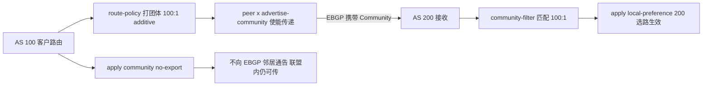

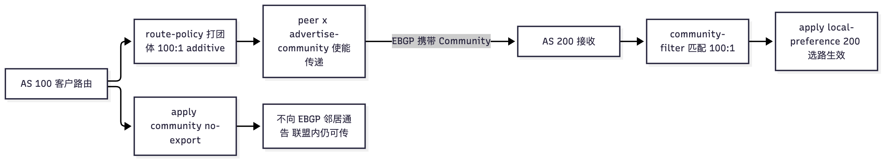


### 真题精练

**Q1.【真题·多选】** 关于公认团体 `no-export` 与 `no-export-subconfed`，下列说法正确的有？
A. 两者的行为完全相同，只是取值不同
B. `no-export` 可以把路由通告到联盟内的其他子 AS
C. `no-export-subconfed` 不允许把路由通告给联盟内其他子 AS
D. 两者都不会把路由通告到联盟之外
E. `no-export` 会阻止路由向 IBGP 邻居通告

> **答案：BCD**
> **解析**：A 错——两者边界不同；E 错——`no-export` 只约束 EBGP 通告，本 AS 内 IBGP 传递正常（这也意味着**本 AS 内的路由器仍能通过 IBGP 学到该路由**，只是不会再往外发）。`no-advertise` 才是连 IBGP 都不发。

**Q2.【真题·简答】** 请说明团体属性的作用，以及为什么它比"按前缀逐条匹配"更适合大规模策略控制。

> **答案**：团体属性是可选传递的 4 字节（标准）/ 8 字节（扩展）标签，随 BGP 路由一起在 AS 间传递，用于**给一组路由打标记，供对端用一条规则匹配成千上万条路由**。相比按前缀逐条匹配，它的优势是：① **可扩展**——策略规则数量不随前缀数量增长；② **跨域表达意图**——AS 之间可以在不泄露内部编址细节的前提下交换策略语义（如"这些是我的客户路由"）；③ **解耦**——打标签与用标签的动作可以在不同设备、不同 AS 分别维护。扩展团体的 RT 正是把这一思想用到极致：MPLS L3VPN 用 RT 决定 VPN 路由进入哪个 VRF。
> **解析**：答题要包含"标签化、可传递、可扩展、跨域表达意图"四点，并举例（客户/对等体/上游路由分类打不同团体）。补充：发送侧必须 `advertise-community`，否则不传。

**Q3.【真题·排错】** 工程师在 AS 100 的 R1 上配置 `route-policy SET_COMM` 打团体 `100:1` 并在 `peer 10.0.12.2 export` 方向应用，对端 AS 200 的 R2 上配置了 `ip community-filter basic CF100 permit 100:1` 与 `peer ... community-filter CF100 import`，但 R2 上没有任何路由匹配成功。请列出至少三个排查点。

> **答案**：① **发送侧漏配 `peer 10.0.12.2 advertise-community`**（最常见，华为缺省不传团体属性）；② 发送侧策略未真正命中——`route-policy` 缺少 `permit` 兜底节点导致路由被丢，或 `if-match ip-prefix` 的前缀列表未匹配（注意 `apply community` 不加 `additive` 会覆盖，但不至于匹配失败）；③ 接收侧过滤器语法或位置有误——`community-filter` 应用方向应为 `import`，且匹配的是**收到的团体值**（若对端又做了团体替换则匹配不到）；④ 对端路由本身没有到达（先确认 `display bgp routing-table peer ... received-routes`）；⑤ 路由虽带团体但因 `no-advertise`/`no-export` 被限制，或团体被对端策略 `apply community none` 清掉。
> 定位命令：发送侧 `display bgp routing-table peer 10.0.12.2 advertised-routes`（看是否携带团体）、`display current-configuration configuration bgp | include community`；接收侧 `display bgp routing-table community-filter CF100`、`display bgp routing-table 10.1.1.0`。

### 易错点与排错

1. **`advertise-community` 是发送侧命令**：接收侧不需要配置它，配在错误的一侧不会生效。
2. **`apply community` 不带 `additive` 会覆盖原有团体**：如果上游已经打了标签，本机再打会全部清掉，务必确认是否需要 `additive`。
3. **`no-export` 不等于"完全不通告"**：它只约束 EBGP 方向的通告，IBGP 与联盟内部仍可传递。
4. **RT 不是 RD**：RT 决定路由进入哪个 VRF（导入/导出匹配），RD 只做前缀唯一化。把 RT 当成"编号"去理解会导致 VPN 不通的排错方向错误。
5. **团体是大规模策略的基石，但要防止标签滥用**：团体值规划应有全局编号规则（如按业务+区域分配），否则跨域排错极其困难。
6. **排错命令**：`display bgp routing-table community`、`display bgp routing-table community-filter CF`、`display ip community-filter`、`display bgp routing-table peer x advertised-routes`。

---

## 3.10 路由反射器 RR：三规则与防环

### 考点定位

RR 是解决 IBGP 全互联扩展性的**标准答案**，占 **4~8 分**，形式为简答（写出反射规则）、多选（防环机制）、排错（路由在客户端不生效、两台 RR 冗余配置错误）。**必考**：三条反射规则、Cluster_List 与 Originator_ID 的防环原理、"同集群多台 RR 必须配置相同 Cluster_ID"。

### 原理精讲

**RR（Route Reflector，路由反射器）要解决的问题**：IBGP 水平分割要求 AS 内 BGP 路由器全互联，规模一大就无法维护。RR 的思路是**指定一台（或几台）路由器作为"反射点"，允许它打破水平分割**——它把从 IBGP 邻居学到的路由"反射"给其他 IBGP 邻居，从而使每台客户端只需与 RR 建立一条会话。

**角色划分**：在 RR 的视角，其他 IBGP 邻居分为两类——**客户端（Client）**和**非客户端（Non-client）**。RR 与客户端构成一个**集群（Cluster）**。注意：**只有 RR 才有"客户端"概念，客户端本身并不知道自己是客户端**（不需要任何配置）。

**三条反射规则（必须能默写）**：

| 规则 | 学到的方向 | 反射方向 | 目的 |
|---|---|---|---|
| **规则 1** | 从**客户端**学到 | 反射给**所有非客户端**和**其他客户端**（不回传给来源） | 让集群内的路由传出去 |
| **规则 2** | 从**非客户端**学到 | 反射给**所有客户端**（不回传给来源，也不传给其他非客户端） | 让集群外的路由传进来 |
| **规则 3** | 从 **EBGP** 学到 | 反射给**所有客户端和非客户端** | 与普通 BGP 行为一致 |

补充规律：**从客户端学到的路由可以发给客户端和非客户端；从非客户端学到的路由只发给客户端**。非客户端之间不互相反射，因为非客户端之间本来就应当建立全互联 IBGP 会话（它们通常是其他集群的 RR 或核心设备）。

**防环机制（两条，都是可选非传递属性）**：

1. **Originator_ID（始发者 ID）**：RR 反射路由时，若路由中还没有 Originator_ID，就**添加 Originator_ID = 该路由始发者的 Router ID**（注意：不是 RR 自己的 Router ID）。**一台路由器收到路由后，若发现 Originator_ID 等于自己的 Router ID，说明这条路由绕了一圈回到自己，直接丢弃**。它防的是"客户端通过 RR 又收到自己发出的路由"。
2. **Cluster_List（集群列表）**：RR 反射路由时，把自己所在集群的 **Cluster_ID** 加入 Cluster_List 的最前面。**一台 RR 收到路由时，若发现 Cluster_List 中已包含本集群的 Cluster_ID，则丢弃该路由**。它防的是"路由在多个集群之间循环反射"。

**Cluster_ID 的取值与冗余部署**：Cluster_ID 缺省等于 RR 的 **Router ID**（通常就是 LoopBack 地址），可用 `reflector cluster-id <ipv4-address>` 修改。**同一集群内的多台 RR 必须配置完全相同的 Cluster_ID**，原因：如果两台 RR 的 Cluster_ID 不同，它们会被视为两个不同集群，路由会在它们之间来回反射（Cluster_List 检查不到重复），导致路由重复、选路混乱甚至环路。标准冗余做法：

- 同一集群部署 2 台 RR（互为主备/负载分担），配置**相同的 Cluster_ID**（例如都用 `1.1.1.1`，或都用一个专用的 LoopBack 地址）。
- **所有客户端必须与两台 RR 都建立 IBGP 会话**，否则 RR 故障时客户端学不到路由。
- 两台 RR 之间建立 IBGP 会话（互为非客户端）。
- 客户端数量多时可按拓扑分区（多个集群，每个集群一对 RR），集群之间由 RR 全互联或再接一层 RR（分层 RR）。

**RR 的固有缺陷（HCIE 论述题常考）**：RR 只反射它自己选出的**最优路由**，且反射时不修改任何属性（包括下一跳）。因此可能出现**次优路径**：客户端 A 到目的地的物理最优出口是客户端 B，但路由必须经由 RR 中转（A→RR→B），实际路径绕行。缓解手段：① 让 RR 的位置靠近流量汇聚点；② 合理划分集群；③ 保证所有客户端都能迭代到原始下一跳（配合 `next-hop-local`/`next-hop-invariable`）；④ 在客户端之间补充直接 IBGP 会话（部分网状）。

### 关键概念对照表

| 概念 | 说明 | 缺省值 |
|---|---|---|
| RR（路由反射器） | 打破 IBGP 水平分割的设备 | 无（需配置） |
| Client（客户端） | 与 RR 同集群的 IBGP 邻居 | 需在 RR 上用 `peer x reflect-client` 指定 |
| Non-client（非客户端） | RR 的其它 IBGP 邻居 | 缺省即非客户端 |
| Cluster（集群） | RR + 其客户端 | 无 |
| Cluster_ID | 集群标识，写入 Cluster_List | = RR 的 Router ID |
| Cluster_List | 路由经过的集群列表，防环 | 可选非传递属性 |
| Originator_ID | 路由始发者的 Router ID，防环 | 可选非传递属性 |

| 对比项 | IBGP 全互联 | 路由反射 RR |
|---|---|---|
| 会话数（n 台） | n(n-1)/2 | 约 n-1（单 RR） |
| 配置复杂度 | 高，平方增长 | 低，集中在 RR |
| 打破水平分割 | 不需要（靠全互联保证传播） | 需要（RR 反射） |
| 防环机制 | AS_Path（AS 内无效）+ 水平分割 | Cluster_List + Originator_ID |
| 路径最优性 | 客户端之间直连，路径最优 | 可能次优（须经 RR 中转） |
| 可靠性 | 无单点 | 单 RR 有单点，需双 RR |
| 适用规模 | ≤ 5 台 | 任意规模（大型网标准做法） |

### 华为设备配置

```bash
# ===== 单 RR 基础配置（NE40E，AS 100，RR = R1 LoopBack 1.1.1.1）=====
system-view
bgp 100
 router-id 1.1.1.1
 group CLIENTS internal                                // 建立 IBGP 对等体组，成员为客户端
 peer CLIENTS connect-interface LoopBack0               // 组内统一用 LoopBack0 作会话源
 peer CLIENTS reflect-client                            // 关键：把整个组设为"反射客户端"
 peer 2.2.2.2 group CLIENTS                             // R2 加入客户端组
 peer 3.3.3.3 group CLIENTS                             // R3 加入客户端组
 peer 4.4.4.4 as-number 100                             // 非客户端（例如另一台 RR 或核心设备）
 peer 4.4.4.4 connect-interface LoopBack0
 reflector cluster-id 1.1.1.1                           // 显式指定集群 ID（推荐，便于多 RR 保持一致）
quit
# ===== 冗余 RR 部署要点（两台 RR：R1 与 R9，同集群）=====
# R1 上：
bgp 100
 reflector cluster-id 1.1.1.1                           // 两台 RR 必须配置完全相同的 Cluster_ID
 peer 9.9.9.9 as-number 100                             // RR 之间建立 IBGP（互为非客户端）
 peer 9.9.9.9 connect-interface LoopBack0
quit
# R9 上：
bgp 100
 reflector cluster-id 1.1.1.1                           // 与 R1 保持一致，否则路由会在两台 RR 间循环反射
 peer 1.1.1.1 as-number 100
 peer 1.1.1.1 connect-interface LoopBack0
quit
# 每个客户端（R2/R3）都要与两台 RR 建立 IBGP 会话：
#   peer 1.1.1.1 as-number 100 / peer 9.9.9.9 as-number 100 / connect-interface LoopBack0
# ===== 配合下一跳处理的两种选择 =====
bgp 100
 peer CLIENTS next-hop-local                            // 把发给客户端的路由下一跳改为 RR 自己（保证客户端可迭代）
# 或者（跨域 Option C / SR 场景需要保持原始下一跳时）：
bgp 100
 peer CLIENTS next-hop-invariable                        // 保持原始下一跳不变
quit
# ===== 查看 RR 相关状态 =====
display bgp routing-table 10.1.1.0                       // 查看路由的 Originator 与 Cluster List 字段
display bgp group CLIENTS                                // 查看对等体组及是否配置为反射客户端
display bgp routing-table peer 2.2.2.2 advertised-routes  // 确认是否把反射路由发给了客户端
```

### 示意图

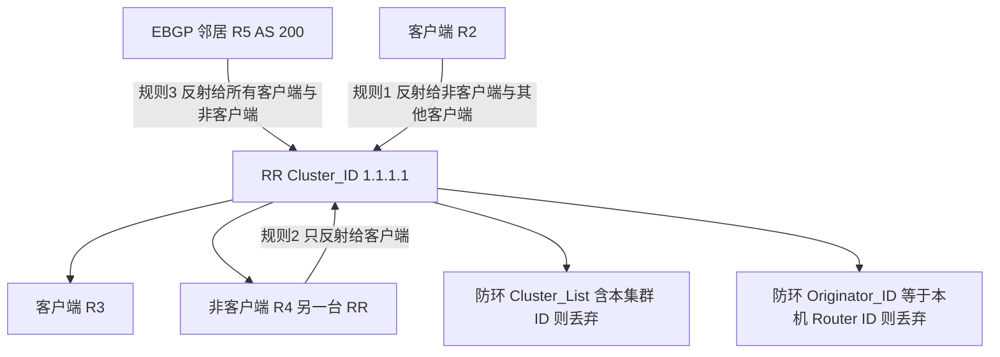

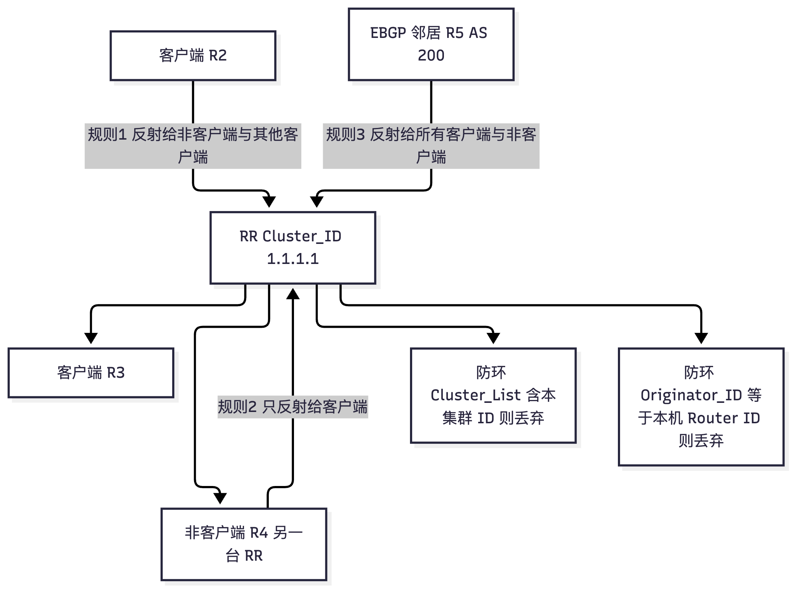


### 真题精练

**Q1.【真题·多选】** RR 的三条反射规则包括？
A. 从客户端学到的路由反射给所有非客户端和其他客户端
B. 从非客户端学到的路由反射给所有客户端
C. 从 EBGP 学到的路由反射给所有客户端和非客户端
D. 从非客户端学到的路由反射给所有非客户端
E. 从客户端学到的路由反射给所有 EBGP 邻居

> **答案：ABC**
> **解析**：D 错——非客户端之间不互相反射（非客户端之间本应全互联）；E 不准确，从客户端学到的路由发给 EBGP 邻居不属于"反射"而是普通 BGP 通告行为（可以发，但不是 RR 三规则的内容）。三规则的记忆口诀：**"客户端来的发给大家（非客户端和其他客户端），非客户端来的只发给客户端，外面来的发给大家"**。

**Q2.【真题·单选】** 两台 RR 部署在同一集群中实现冗余，若两台的 Cluster_ID 配置不同，最可能的后果是？
A. 客户端无法建立 IBGP 会话
B. 路由在两台 RR 之间循环反射，客户端收到重复路由甚至出现环路
C. Cluster_List 属性被自动清空
D. RR 自动协商为同一 Cluster_ID

> **答案：B**
> **解析**：Cluster_List 的防环检查依据是"本集群的 Cluster_ID"。若两台 RR 的 Cluster_ID 不同，各自认为对方属于"别的集群"，路由就会被反复反射而无法被 Cluster_List 检测到重复。**同一集群内所有 RR 必须配置相同 Cluster_ID** 是 RR 冗余部署的铁律。A 错——会话建立与 Cluster_ID 无关；C/D 属于编造。

**Q3.【真题·简答】** 请解释 RR 场景下 Originator_ID 与 Cluster_List 的防环原理，并说明它们为什么是"可选非传递"属性。

> **答案**：**Originator_ID**：RR 反射路由时（若尚未设置）把路由**始发者的 Router ID** 写入 Originator_ID。任何路由器收到带 Originator_ID 的路由后，若发现其值等于自己的 Router ID，说明这条路由是自己发出后绕回自己的，直接丢弃——防止客户端/路由器通过 RR 又收到自己的路由。**Cluster_List**：RR 反射路由时把本集群的 Cluster_ID 压入 Cluster_List 最前面；RR 收到路由时若发现 Cluster_List 中已存在本集群的 Cluster_ID，说明路由已经过一次本集群，直接丢弃——防止路由在多个集群（多台 RR）之间循环反射。
> 它们被定义为**可选非传递**属性，是因为二者的语义只在本 AS 的 RR 域内有效：出了 AS，外部设备既不需要也不应该据此做判断，若被无条件传出去反而可能被误用（例如外部的 Cluster_ID 恰好与本 AS 相同，会造成错误丢弃）。因此规定"不识别即丢弃、不跨 AS 传递"。
> **解析**：答题三要素——两个属性的**添加者与添加值**、**检查规则与丢弃条件**、**为什么限定在 AS 内**。注意 Originator_ID 记录的是**始发者**而不是 RR 的 Router ID，这是常见错误点。

**Q4.【真题·排错】** RR 部署后，客户端 R2 与 RR 的 IBGP 邻居 Established，但 R2 上学不到 RR 从 EBGP 邻居学来的路由；RR 上 `display bgp routing-table` 能看到该路由带 `>`。请分析原因并给出定位命令。

> **答案**：最可能的三个原因——① **R2 未在 RR 上被配置为客户端**（漏配 `peer 2.2.2.2 reflect-client`），此时 R2 是"非客户端"，而规则 2 规定**从非客户端学到的路由不反射给其他非客户端**；若该路由来自 EBGP，规则 3 本应发给非客户端，因此更可能是下面第 ② 项；② **下一跳不可达**：RR 反射时不修改下一跳（规则不涉及下一跳改写），R2 无法解析原始下一跳 → 路由不 best → 不进路由表、也不再通告（这是 RR 场景最常见的隐性故障，解决方法是 RR 上配置 `peer 2.2.2.2 next-hop-local` 或确保 R2 能迭代到原始下一跳）；③ **RR 对该客户端配置了 export 方向的 `filter-policy`/`route-policy` 过滤**，把路由挡掉了。
> 定位命令：`display bgp routing-table peer 2.2.2.2 advertised-routes`（RR 侧看是否真的发了）、`display bgp routing-table 10.1.1.0`（R2 侧看是否有 `*` 无 `>`，即下一跳不可达）、`display bgp group CLIENTS`（确认 reflect-client 是否配置）、`display ip routing-table <原始下一跳>`（验证迭代）。
> **解析**：难点在于"RR 能看到最优路由但客户端看不到"，必须区分"没被反射"与"被反射了但下一跳不可达"两种情况——判定方法就是看客户端路由表里是否存在该路由以及是否带 `>`。

### 易错点与排错

1. **客户端的"身份"只配在 RR 上**：客户端自身不需要也不应该有任何"我是客户端"的配置。
2. **Cluster_ID 缺省是 RR 的 Router ID**：一旦 RR 的 Router ID 变化（比如 LoopBack 增删），集群标识也会变，可能引发路由抖动，**生产环境建议显式 `reflector cluster-id`**。
3. **RR 不改下一跳**：所有客户端必须能迭代到原始下一跳，否则路由在客户端不生效。这是 RR 部署排错的第一优先级。
4. **RR 可能造成次优路径**：这是 RR 的固有代价，答题时如果只写优点不提次优路径，论述题会丢分。
5. **分层 RR 时注意 Cluster_List 长度**：跨多个集群的路由会累积 Cluster_List，第 9 条选路规则会比较其长度。
6. **排错命令**：`display bgp group <name>`、`display bgp routing-table <prefix>`（看 Originator/Cluster List）、`display bgp routing-table peer x advertised-routes`、`display current-configuration configuration bgp | include reflect`。

---

## 3.11 联盟 Confederation 与 RR 的对比

### 考点定位

联盟是继 RR 之后的第二种"打破 IBGP 水平分割"的方案，占 **3~6 分**，常以对比简答（联盟 vs RR）与多选出现。**必考**：联盟对内表现为多个子 AS、对外表现为一个 AS；`confederation id` 与 `confederation peer-as` 的语义；**子 AS 内部仍需 IBGP 全互联或 RR**；`confederation nonstandard` 的用途。

### 原理精讲

**联盟（Confederation）的核心思想是"把一个 AS 在内部切成多个子 AS（Sub-AS）"**。对外部世界而言，整个联盟看起来仍然只有**一个 AS 号**（由 `confederation id` 指定）；但在联盟内部，每个子 AS 是一个独立的 AS 域，子 AS 之间建立的是"**联盟 EBGP（Confederation EBGP）**"会话。

**为什么联盟能打破 IBGP 水平分割？** 水平分割规则只约束"IBGP 邻居之间"的转发。子 AS 之间的会话在 BGP 语义上属于 EBGP 类（联盟 EBGP），因此路由可以在子 AS 之间正常传播，不受"IBGP 学到的路由不再发给 IBGP"的限制。从而路由能够穿过整个联盟，而无需所有路由器两两全互联。

**联盟的关键行为**：

1. **对外 AS 号**：`confederation id 100` 声明整个联盟的 AS 号为 100。向联盟外的 EBGP 邻居发送路由时，AS_Path 中只出现 `100`（以及联盟外的 AS），子 AS 号对外不可见。
2. **内部子 AS 号**：配置 `confederation peer-as 65001 65002` 声明本子 AS 与其他子 AS 的邻居关系。子 AS 号通常使用私有 AS 号段 **64512~65534**。标准联盟下，子 AS 号以 **AS_CONFED_SEQUENCE** 形式记录在 AS_Path 中（`display` 输出显示为带括号，如 `(65001)`）。
3. **Local_Pref 与 MED**：在联盟内**保留传递**（这一点与普通 EBGP 不同——普通 EBGP 之间 Local_Pref 不传递）。因此联盟内可以用 Local_Pref 统一调度各子 AS 的出口，这是联盟的一个重要收益。
4. **下一跳**：联盟 EBGP 之间会**修改下一跳**（与普通 EBGP 一致），因此联盟内各子 AS 之间需要保证下一跳可达，必要时使用 `next-hop-local` 或在子 AS 内引入互联网段。
5. **`confederation nonstandard`**：用于与**不支持联盟机制的第三方设备**互通。配置该命令后，子 AS 号会以"标准 AS 号"形式出现在 AS_Path 中（显示为 `65001 200` 而非 `(65001) 200`），并且**要求所有子 AS 号必须在 2 字节范围内（≤65535）**。这是联盟互通性问题的标准答案。
6. **子 AS 内部仍然是 AS**：因此**每个子 AS 内部依然需要 IBGP 全互联，或部署 RR**。这是最常考的细节——很多人误以为"用了联盟就不需要 RR 了"。

**联盟 vs RR 对比（必须能答）**：

| 对比项 | 路由反射 RR | 联盟 Confederation |
|---|---|---|
| 打破水平分割的方式 | RR 反射路由给客户端 | 子 AS 之间使用联盟 EBGP |
| 对外的 AS 号 | 不变（仍是同一个 AS） | 不变（对外显示 `confederation id`，子 AS 不可见） |
| 内部结构 | 集群（Cluster）+ 客户端 | 多个子 AS（Sub-AS） |
| 是否改变 IGP 拓扑要求 | 不改变 | **通常需要 IGP 也按子 AS 划分**（因为子 AS 内部优先，路径选择受 IGP 影响） |
| 子 AS 内部还需要什么 | 客户端与 RR 建 IBGP | **仍需 IBGP 全互联或 RR** |
| Local_Pref 能否跨边界传递 | 能（同为 IBGP 域） | 能（联盟内保留） |
| 配置复杂度 | 低（只在 RR 上配） | 高（涉及子 AS 规划、AS 号、策略） |
| 对第三方设备互通性 | 好（纯 IBGP 行为，无特殊报文字段） | 较差，需 `confederation nonstandard` |
| 路径最优性 | 可能次优（须经 RR） | 相对更优（子 AS 内按 IGP 选路，层级清晰） |
| 典型适用 | 企业/园区/城域大规模 AS 内 | 超大型运营商，按区域划分 AS 边界 |
| 与 IGP 的耦合 | 松（只需 LoopBack 可达） | **紧**（子 AS 边界通常与 IGP 区域/进程边界一致） |

**共同点**：两者**都是 AS 内部的技术**，都不会改变对外的 AS 号，都不影响 AS 之间的选路规则；两者也需要配合正确的下一跳处理（`next-hop-local` / `next-hop-invariable`）。实践中也可以**组合使用**：联盟的每个子 AS 内部再部署 RR。

### 关键概念对照表

| 配置项 | 命令 | 说明 |
|---|---|---|
| 联盟对外 AS 号 | `confederation id 100` | 对外只显示 100 |
| 联盟内部子 AS | `confederation peer-as 65001 65002` | 声明其他子 AS，用于建立联盟 EBGP |
| 非标准联盟 | `confederation nonstandard` | 与不支持联盟的设备互通，子 AS 号须 ≤ 65535，AS_Path 中显示为普通 AS 号 |
| 子 AS 本地 AS 号 | `bgp 65001` | 子 AS 号即该设备的本地 AS |

| 现象 | 原因 |
|---|---|
| 联盟外邻居看到 AS_Path 里出现 `(65001)` | 对端也配置了联盟或抓包工具识别了 AS_CONFED_SEQUENCE；标准联盟对外不应显示子 AS |
| 联盟外邻居看不到子 AS 号但看不到完整的联盟 AS 号 | `confederation id` 未配置或配置错误 |
| 与第三方设备互通时 AS_Path 校验失败 | 需要配置 `confederation nonstandard` |
| 子 AS 之间路由学不到 | 未配置 `confederation peer-as`，或子 AS 之间下一跳不可达 |

### 华为设备配置

```bash
# ===== 联盟场景：AS 100 内部划分 65001 与 65002 两个子 AS（NE40E）=====
# ---- 子 AS 65001 的设备（R1，与子 AS 65002 的 R2 直连）----
system-view
bgp 65001                                        // 本地子 AS 号为 65001
 router-id 1.1.1.1
 confederation id 100                            // 联盟对外 AS 号 = 100
 confederation peer-as 65002                     // 声明联盟内的其他子 AS 号
 confederation nonstandard                       // 与不支持联盟的设备互通时必配（子 AS 号须 ≤ 65535）
 peer 10.0.12.2 as-number 65002                  // 与另一子 AS 建立"联盟 EBGP"
 peer 10.0.12.2 description To-SubAS-65002
 peer 2.2.2.2 as-number 65001                    // 与本子 AS 内其他设备建立 IBGP
 peer 2.2.2.2 connect-interface LoopBack0
 peer 2.2.2.2 next-hop-local                     // 联盟 EBGP 会改下一跳，本子 AS 内需保证下一跳可达
quit
# ===== 若子 AS 内设备较多，子 AS 内部仍可部署 RR =====
bgp 65001
 peer 2.2.2.2 reflect-client                     // 子 AS 内部的 RR 配置与普通 RR 完全一致
 reflector cluster-id 1.1.1.1
quit
# ===== 查看联盟信息 =====
display bgp peer                                 // 查看邻居的 AS 号（显示为子 AS 号）
display bgp routing-table                        // 查看 AS_Path：联盟内显示 (65001) 形式，对外只显示 100
display current-configuration configuration bgp  // 确认为联盟相关配置
```

### 示意图

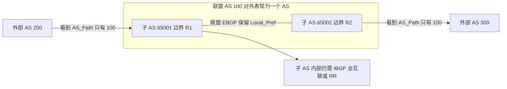

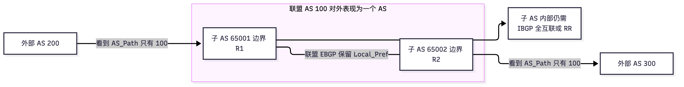


### 真题精练

**Q1.【真题·多选】** 关于 BGP 联盟，下列说法正确的有？
A. 联盟对外表现为一个 AS，外部邻居看不到子 AS 号
B. 联盟的子 AS 之间使用联盟 EBGP，不受 IBGP 水平分割限制
C. 使用联盟后，子 AS 内部不再需要 IBGP 全互联或 RR
D. 与不支持联盟的设备互通时需要配置 `confederation nonstandard`
E. 联盟内部 Local_Pref 可以保留传递

> **答案：ABDE**
> **解析**：C 是最典型的错误——**每个子 AS 内部仍然是一个独立的 AS，依然需要 IBGP 全互联或部署 RR**。A 正确，联盟对外只显示 `confederation id` 指定的 AS 号；B 正确，这正是联盟能打破水平分割的原因；D 正确，且此时子 AS 号必须在 2 字节范围内；E 正确，这是联盟相对普通 EBGP 的一个重要优势（可在联盟内统一调度出口）。

**Q2.【真题·简答】** 请从"实现原理、配置复杂度、对 IGP 的要求、路径最优性、互通性"五个方面比较 RR 与联盟。

> **答案**：① **实现原理**：RR 通过指定反射器打破 IBGP 水平分割，靠 Cluster_List 与 Originator_ID 防环；联盟把 AS 拆成多个子 AS，子 AS 间用联盟 EBGP 传播路由，不受水平分割限制。② **配置复杂度**：RR 只需在 RR 上配置 `reflect-client` 与 `cluster-id`，客户端零配置；联盟需要规划子 AS 号、配置 `confederation id`/`peer-as`，配置量更大。③ **对 IGP 的要求**：RR 只要求 LoopBack 路由可达，与 IGP 拓扑解耦；联盟通常要求 IGP 也按子 AS 划分边界，耦合更紧。④ **路径最优性**：RR 反射只转发 RR 自己选出的最优路由且不改下一跳，可能造成次优路径；联盟内各子 AS 按本域 IGP 独立选路，层级清晰，路径相对更优。⑤ **互通性**：RR 是纯 IBGP 内部行为，无特殊报文字段，与第三方设备互通无障碍；联盟使用 AS_CONFED_SEQUENCE 等特殊 AS_Path 段，与不支持联盟的设备互通需 `confederation nonstandard`。
> 补充结论：两者可以组合使用（联盟的每个子 AS 内再部署 RR），实际组网按规模与运维能力取舍——企业网多用 RR，超大型运营商按区域划分联盟。
> **解析**：五个维度缺一不可，且每个维度都要给出"为什么"，只写"联盟配置复杂"这种结论性描述无法拿到高分。

**Q3.【真题·判断】** 联盟内部子 AS 之间的 BGP 会话，其 AS_Path 中会追加子 AS 号，并且对联盟外部的邻居也可见。

> **答案：错误**
> **解析**：前半句在标准联盟下成立（子 AS 号以 AS_CONFED_SEQUENCE 形式记录，显示为 `(65001)`），但**对外不可见**——向联盟外通告时该段会被移除，外部只看到 `confederation id`。若配置了 `confederation nonstandard`，子 AS 号会以普通 AS 号形式出现在 AS_Path 中并对外可见（这正是为了与不支持联盟的设备互通）。

### 易错点与排错

1. **联盟不减少子 AS 内部的 BGP 需求**：子 AS 内部仍需全互联或 RR，这是最常考的陷阱。
2. **`confederation peer-as` 必须显式声明**：未声明的子 AS 会被当作"联盟外的 AS"，路由传递行为完全不同。
3. **`confederation nonstandard` 的两个约束**：只能用于互通场景，且要求所有子 AS 号为 2 字节（≤65535），使用 4 字节 AS 号时不可用。
4. **联盟内的下一跳**：联盟 EBGP 会改写下一跳，若子 AS 之间没有为互联网段提供 IGP 可达性，需要 `next-hop-local` 配合。
5. **排错命令**：`display bgp peer`（看邻居 AS 显示为子 AS 号）、`display bgp routing-table`（看 `(65001)` 形式的 AS_CONFED_SEQUENCE）、`display current-configuration configuration bgp | include confederation`。

---

## 3.12 对等体组 Peer Group

### 考点定位

对等体组是**配置效率与性能优化**手段，占 **2~4 分**，常以单选/多选出现（考"对等体组的好处"与"组内成员必须满足的条件"）。实验卷中大量使用对等体组来简化 RR、VPN 等复杂配置，是必须熟练的基本功。

### 原理精讲

**对等体组（Peer Group）是把具有相同出口策略与相同参数的 BGP 邻居归为一组，统一配置。** 它的收益有两层：

1. **配置收益**：同一组内只需配置一次策略（`route-policy`、`filter-policy`、`advertise-community`、`reflect-client` 等），成员以 `peer <ip> group <组名>` 加入即可。这在 RR 客户端、VPN 客户端动辄几十台的场景下能大幅降低配置量。
2. **性能收益**：BGP 在生成 Update 时，**为同一对等体组内的所有成员只打包一次**（复制同一份报文），而不是逐邻居独立打包。邻居数量大时（几百个 EBGP 邻居）这能显著降低 CPU 占用。因此对等体组不只是"少打字"，而是**真实的性能优化**。

**对等体组的类型与约束**：

- **IBGP 组**：`group <name> internal`。成员必须是本 AS 内的 BGP 邻居（对端 AS 与本地相同）。RR 客户端组、VPNv4 客户端组都是 IBGP 组。
- **EBGP 组**：`group <name> external`。成员必须属于**同一个对端 AS**（用 `peer <group> as-number <as>` 指定），因为组内共享出口策略，不同 AS 的策略通常不同。非直连 EBGP 组还需在组上配置 `ebgp-max-hop`。
- **组内参数共享，成员可个别覆盖**：组上的配置会应用到所有成员；若需要为某个成员做特殊处理，可以在该成员上单独配置（华为设备中，对等体上的单独配置优先于组配置）。但要注意，某些参数（尤其影响报文打包的）在组与成员之间不一致会削弱性能优化效果。

**常用对等体组参数**（配置在组名上）：

| 参数 | 作用 |
|---|---|
| `peer <组名> connect-interface LoopBack0` | 组内统一会话源 |
| `peer <组名> as-number <as>` | EBGP 组指定对端 AS |
| `peer <组名> reflect-client` | 整组作为 RR 客户端 |
| `peer <组名> route-policy <rp> export/import` | 组内统一策略 |
| `peer <组名> advertise-community` | 组内统一使能团体传递 |
| `peer <组名> next-hop-local` | 组内统一改下一跳 |
| `peer <组名> timer keepalive 30 hold 90` | 组内统一定时器 |
| `peer <组名> route-limit 10000 80` | 组内统一最大前缀数限制（80 为告警阈值百分比） |

**排错要点**：`display bgp group <name>` 可以一次看到组内所有成员及其状态；如果成员状态异常，往往是因为成员上的单独配置与组配置冲突，或者成员加入组时其 AS 号与组的 `as-number` 不一致（此时设备会报错或成员不生效）。

### 关键概念对照表

| 对比项 | 逐个配置邻居 | 使用对等体组 |
|---|---|---|
| 配置量 | 每邻居一份 | 组内一份 |
| Update 打包 | 每邻居独立打包 | 组内打包一次 |
| CPU/内存占用 | 高（邻居多时显著） | 低 |
| 策略一致性 | 容易写错、难维护 | 天然一致 |
| 灵活性 | 高（每个邻居可完全不同） | 组内统一，个别需单独覆盖 |
| 适用场景 | 邻居少、策略差异大 | RR 客户端、VPN 客户端、多出口 ISP 邻居 |

### 华为设备配置

```bash
# ===== RR 场景下的对等体组（推荐写法，NE40E）=====
system-view
bgp 100
 router-id 1.1.1.1
 group CLIENTS internal                                 // 定义 IBGP 对等体组
 peer CLIENTS connect-interface LoopBack0                // 组内统一源地址
 peer CLIENTS reflect-client                             // 整组作为 RR 客户端
 peer CLIENTS next-hop-local                             // 组内统一下一跳改写
 peer CLIENTS advertise-community                        // 组内统一使能团体传递
 peer CLIENTS route-limit 10000 80                       // 组内统一最大前缀数 10000，达到 80% 告警
 peer CLIENTS timer keepalive 30 hold 90                 // 组内统一保活定时器
 peer 2.2.2.2 group CLIENTS                              // 成员加入组（无需再逐条配置上述参数）
 peer 3.3.3.3 group CLIENTS
 peer 4.4.4.4 group CLIENTS
quit
# ===== EBGP 对等体组（同一对端 AS 的多个邻居）=====
bgp 100
 group ISP_A external                                    // 定义 EBGP 对等体组
 peer ISP_A as-number 200                                // 组内成员必须同属 AS 200
 peer ISP_A ebgp-max-hop 2                               // 非直连场景：允许跨跳
 peer ISP_A password cipher Huawei@123                   // 组内统一 TCP MD5 认证
 peer ISP_A route-policy FILTER_IN import                 // 组内统一入方向过滤
 peer 10.0.12.2 group ISP_A
 peer 10.0.13.2 group ISP_A
quit
# ===== 成员的个别覆盖（在成员上单独配置，优先级更高）=====
bgp 100
 peer 3.3.3.3 route-limit 5000 90                        // 只为 R3 单独收紧前缀数限制
quit
# ===== 查看对等体组 =====
display bgp group                                       // 列出所有对等体组
display bgp group CLIENTS                               // 查看组成员、状态、共享参数
display bgp peer                                        // 查看全部邻居（组内成员会逐条显示）
```

### 示意图

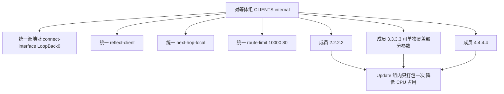

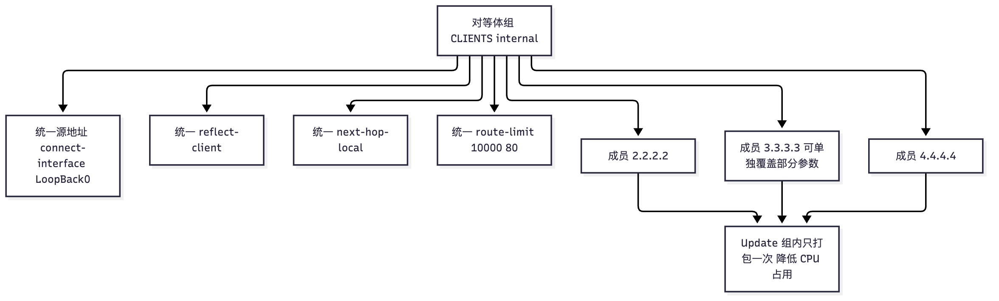


### 真题精练

**Q1.【真题·多选】** 使用对等体组（Peer Group）的优点包括？
A. 简化配置，组内共享出口策略
B. 同一组的成员共享一次 Update 打包结果，降低 CPU 与内存占用
C. 组内成员可以属于不同 AS
D. 便于统一应用 `reflect-client`、`next-hop-local` 等参数

> **答案：ABD**
> **解析**：C 错——EBGP 组内成员**必须属于同一个对端 AS**（组上配置一个 `as-number`），IBGP 组内成员必须属于本 AS。这也是"策略一致性"的前提：组内共享出口策略，不同 AS 的策略通常不同，因此不能混组。

**Q2.【真题·排错】** 工程师创建了 EBGP 对等体组 `ISP_A` 并配置 `peer ISP_A as-number 200`，然后把一个实际属于 AS 300 的邻居 `peer 10.0.14.2 group ISP_A` 加入该组。结果该邻居无法建立会话。请说明原因。

> **答案**：对等体组的 `as-number` 是**组的公共属性**，成员加入组后即继承该 AS 号。把实际属于 AS 300 的邻居加入 `as-number 200` 的组，本端会按"对端 AS = 200"去校验对端 Open 报文中的 My AS（实际为 300），校验失败后发送 Notification（OPEN Message Error / Bad Peer AS）并回 Idle，因此会话无法建立。解决办法：为该邻居单独建组（或使用 `peer 10.0.14.2 as-number 300` 独立配置，不加入该组）。
> 定位命令：`display bgp group ISP_A`（确认组成员与组的 AS 号）、`display bgp peer log-info`（查看失败原因）、`display bgp error`。

### 易错点与排错

1. **EBGP 组内成员必须同 AS**：这是硬约束，混组会导致会话建立失败。
2. **组配置与成员配置的优先级**：成员上的单独配置优先，但会破坏"组内统一"的优化效果，非必要不要做。
3. **对等体组的性能收益容易被忽略**：它不是单纯的"配置快捷方式"，答题时应写出"Update 组内只打包一次"这一点以体现深度。
4. **组名与邻居地址不能混用**：`peer <组名> ...` 与 `peer <IP> ...` 是两套配置，删除组前要先删除成员关系。
5. **排错命令**：`display bgp group`、`display bgp group <name>`、`display bgp peer`、`display current-configuration configuration bgp`。

---

## 3.13 BGP 安全与稳定性机制

### 考点定位

本节内容偏"工程实践"，在理论卷中以 **3~6 分**出现，形式为单选/多选（考参数含义与默认值）和排错（"邻居突然断了""路由被抑制了"）。**必考数值**：路由震荡抑制的四个阈值与半衰期、最大前缀数限制触发后的行为、GTSM 的 TTL 校验原理、MD5 认证配置位置（两端一致）。

### 原理精讲

**① GTSM（Generalized TTL Security Mechanism，通用 TTL 安全机制，RFC 5082）。** BGP 基于 TCP 179，攻击者只要构造大量 TCP SYN 或伪造 BGP 报文即可消耗设备 CPU。GTSM 的思路非常巧妙：**利用 TTL 不可伪造的特性做"距离认证"**。工作方式：配置了 GTSM 的设备把发往该邻居的 BGP 报文 TTL 设为 **255**，同时校验收到报文的 TTL 是否落在 **[255 - hops + 1, 255]** 区间内。直连 EBGP 的 `hops` 配 1（允许 TTL 255），配 2 则允许 255~254（兼容中间有一台交换机/光传输设备的情况）。这样，来自远端的伪造报文即使到达也会因 TTL 递减到区间之外而被丢弃，从而把攻击面压缩到"最后一跳"。**注意**：IBGP 邻居通常跨多跳，不要使用 GTSM。华为命令 `peer x valid-ttl-hops <hops>` 同时使能"发送用 255"与"接收做校验"，因此**建议两端都配置**（各自保护自己的 CPU）。GTSM 需要两端都支持（对端不支持时会话建不起来，回退需删除配置）。

**② MD5 认证（TCP MD5 Signature，RFC 2385）。** 对每个 TCP 报文段（含伪头）计算 MD5 摘要并放入 TCP 选项，接收方用本地配置的密码重算并比对，不同则丢弃且**不回 RST**（避免探测）。它防的是"伪造 BGP 报文/会话劫持"。华为命令 `peer x password cipher <密码>`（旧版本为 `peer x md5-password cipher <密码>`）。**两端密码必须完全一致**，否则会话在 OpenSent/OpenConfirm 阶段被拒（Notification Code 2 / Subcode 5 或直接 TCP 层丢弃）。MD5 是"逐包计算"，对性能有轻微影响，现网仍普遍使用。

**③ 路由震荡抑制（Route Dampening，RFC 2439）。** 一条路由频繁 Up/Down（flapping）会引发全网反复重算。Dampening 为**每条路由**维护一个"惩罚值（Penalty）"：

- 路由**每次撤销（withdraw）**，惩罚值 **+1000**；
- 惩罚值超过 **Suppress（抑制阈值）** 后，该路由被**抑制（suppressed）**：不参与选路、不通告给邻居，状态码显示为 `d`；
- 被抑制后惩罚值按**半衰期（Half-life）**指数衰减，缺省每 **15 分钟**减半；
- 惩罚值降到 **Reuse（重用阈值）** 以下时，路由被解除抑制、重新加入选路；
- **Ceiling（上限阈值）** 限制惩罚值的最大值，防止长期震荡的路由永远无法恢复。

| 参数 | 华为缺省值 | 含义 |
|---|---|---|
| Half-life | 15 分钟 | 惩罚值衰减半衰期 |
| Reuse | 750 | 低于此值解除抑制 |
| Suppress | 2000 | 高于此值开始抑制 |
| Ceiling | 16000 | 惩罚值上限 |
| 单次惩罚增量 | 1000（固定） | 每次路由撤销累加 |

Dampening 的**代价是收敛变慢**：一条正常恢复的路由可能因为惩罚值尚未衰减到 Reuse 以下而长时间不可用。因此业界（含 RIPE-229 建议）不提倡在全网范围对外部路由大规模启用，更多用于**抑制明确的震荡源**，或配合 route-policy 只对特定路由生效。

**④ 最大前缀数限制（Route Limit）。** 用于防止邻居（尤其是 EBGP 客户/对端）通告过多前缀导致本设备路由表爆表、内存耗尽。华为命令 `peer x route-limit <limit> [<percentage>]`，达到 `<percentage>%`（缺省 75%）时产生告警，超过 `<limit>` 时**缺省直接断开会话**（并记录日志），这是**保护本机**的手段。运维上更常用的选项是 `alert-only`（只告警不断链，避免业务中断），或 `idle-timeout <分钟>`（断开后延时自动重连）。排错时若看到"邻居突然 Down 且日志报 route limit exceeded"，要检查对端是否发生了路由泄露（例如误配置导致全网路由灌入）。

**⑤ BFD for BGP（Bidirectional Forwarding Detection）。** BGP 依赖 Hold 定时器（缺省 180s）感知故障，最坏情况下要等 3 分钟才切换，对现网不可接受。BFD 提供毫秒级（可配置到 3×10ms 级别）的链路/路径故障检测，BFD 检测到故障后立即通知 BGP，BGP 立刻拆除会话并重新选路。配置：全局 `bfd` 使能，然后在 BGP 邻居上 `peer x bfd enable`。**直连 EBGP 用单跳 BFD；跨多跳的 IBGP 需要多跳 BFD**（不同版本命令与能力略有差异，做实验前用 `display bfd session all` 确认会话类型）。BFD 与 GTSM 可以共存，二者一个管"快速检测"、一个管"报文合法性"。

**⑥ 其他稳定性手段**：`peer x timer keepalive 30 hold 90`（缩短感知时间，但会增加报文量）；`peer x route-update-interval`（抑制同前缀频繁更新）；路由刷新 `route-refresh` 能力（支持不中断会话的软复位，减少硬复位带来的震荡）；`peer x tcp-mss 1200`（避免大 Update 报文被分片丢弃导致会话卡住）；以及下一节的 GR/NSR。

### 关键概念对照表

| 机制 | 防护目标 | 华为命令 | 关键参数 |
|---|---|---|---|
| GTSM | CPU 攻击、伪造 BGP 报文 | `peer x valid-ttl-hops 1` | 直连配 1，中间设备多配 2；IBGP 不用 |
| MD5 认证 | 会话劫持、伪造报文 | `peer x password cipher xxx` | 两端必须一致 |
| 路由震荡抑制 | 路由抖动引发全网重算 | `dampening 15 750 2000 16000` | 半衰期/Reuse/Suppress/Ceiling |
| 最大前缀数 | 路由泄露、表项爆表 | `peer x route-limit 10000 80` | 缺省超限断链，可用 `alert-only` |
| BFD for BGP | 快速故障检测（毫秒级） | `peer x bfd enable` | 直连单跳，IBGP 多跳 |
| 定时器调优 | 缩短故障感知 | `peer x timer keepalive 30 hold 90` | Hold 建议 ≥ 3×Keepalive |
| TCP MSS | 避免大报文分片 | `peer x tcp-mss 1200` | 有 IPsec/隧道时常用 |

| 稳定性机制 | 保护的对象 | 是否依赖邻居配合 | 收敛速度 |
|---|---|---|---|
| BFD for BGP | 链路/路径故障 | 是（两端都要配 BFD） | 毫秒~百毫秒 |
| GTSM | 攻击流量 | 是（两端都支持） | 不涉及 |
| Dampening | 路由抖动 | 否（本机行为） | 主动放慢（抑制期） |
| Route Limit | 本机资源 | 否 | 不涉及 |
| GR | 控制面重启 | 是（需 Helper） | 秒级 |
| NSR | 主控倒换 | 否 | 亚秒级 |

### 华为设备配置

```bash
# ===== 安全与稳定性配置汇总（NE40E / NE8000，AS 100）=====
system-view
bfd                                             // 全局使能 BFD
quit
bgp 100
 router-id 1.1.1.1
 # --- MD5 认证 ---
 peer 10.0.12.2 password cipher Huawei@123      // TCP MD5 认证，两端必须配置相同密码
 # --- GTSM ---
 peer 10.0.12.2 valid-ttl-hops 1                // 直连 EBGP：校验 TTL 必须为 255，并让本端发送 TTL=255
 # --- 最大前缀数限制 ---
 peer 10.0.12.2 route-limit 10000 80            // 超过 10000 条断链，达到 80% 告警
 peer 2.2.2.2 route-limit 20000 80 alert-only   // 只告警不断链，避免业务中断（推荐给关键对端）
 # --- 路由震荡抑制 ---
 dampening 15 750 2000 16000                    // 半衰期 15 分钟 / Reuse 750 / Suppress 2000 / Ceiling 16000
 # --- BFD for BGP ---
 peer 10.0.12.2 bfd enable                      // 对该邻居启用 BFD 快速检测
 # --- 定时器与报文调优 ---
 peer 10.0.12.2 timer keepalive 30 hold 90      // 缩短故障感知时间
 peer 10.0.12.2 tcp-mss 1200                    // 避免大 Update 报文被分片（有隧道/IPsec 时常用）
 peer 10.0.12.2 capability-advertise route-refresh  // 支持动态路由刷新能力
quit
# ===== 查看与清理 =====
display bgp peer                                // 查看邻居状态（异常 Down 时结合日志判断原因）
display bgp routing-table dampened              // 查看被抑制的路由
display bgp routing-table flap-info             // 查看路由震荡统计
reset bgp dampening                             // 清除全部路由的抑制状态（紧急恢复业务时用）
reset bgp 10.0.12.2 flap-info                   // 清除指定邻居的震荡统计
display bfd session all                         // 查看 BFD 会话状态与检测时间
display bgp peer 10.0.12.2 verbose              // 确认 GTSM、BFD、GR 等能力是否协商成功
```

### 示意图

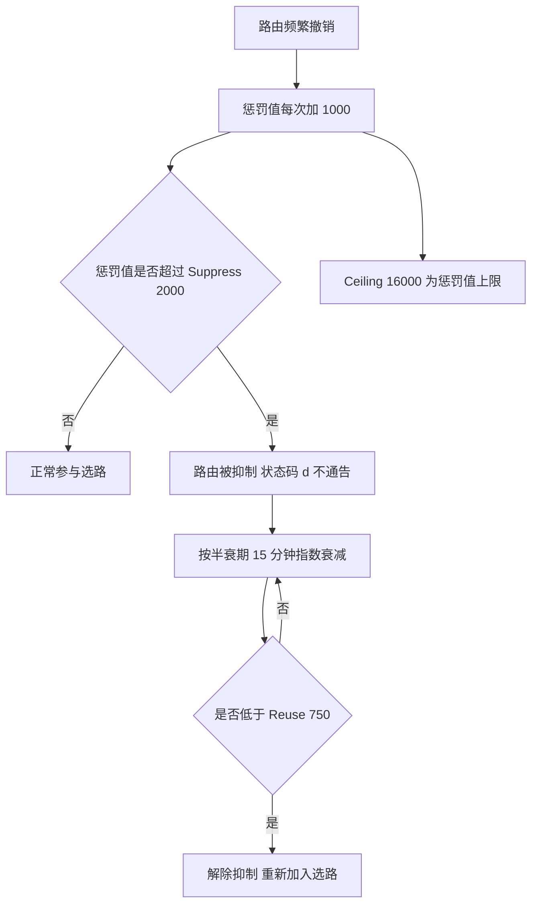

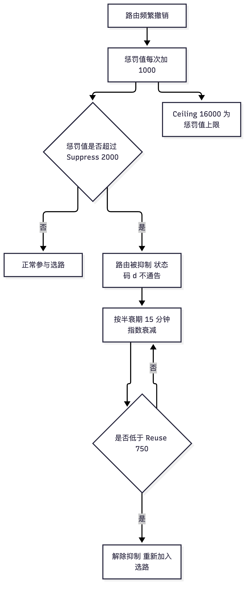


### 真题精练

**Q1.【真题·单选】** GTSM 机制通过校验 BGP 报文的哪个字段来防御攻击？
A. TCP 校验和  B. IP 报文的 TTL  C. BGP 报文的 Marker  D. TCP 源端口

> **答案：B**
> **解析**：GTSM 让发送方把 BGP 报文 TTL 置为 255，接收方校验 TTL 是否落在 [255-hops+1, 255] 区间。攻击者的报文从远端到达时 TTL 已被沿途路由器递减，落在区间外而被丢弃，因此能把攻击面限制在最后一跳。注意 TTL **不参与** TCP 校验和计算，这也是 TTL 可以被"安全机制"利用（而非被中间设备篡改）的基础。

**Q2.【真题·多选】** 关于 BGP 路由震荡抑制（dampening），下列说法正确的有？
A. 每条路由单独维护惩罚值，路由每次撤销惩罚值增加 1000
B. 惩罚值超过 Suppress 阈值后该路由被抑制，不再参与选路与通告
C. 惩罚值按半衰期指数衰减，低于 Reuse 阈值后路由恢复
D. Ceiling 是惩罚值上限，防止长期震荡的路由无法恢复
E. 启用 dampening 可以加快路由收敛

> **答案：ABCD**
> **解析**：E 错——dampening 的作用是"抑制抖动"，代价正是**放慢收敛**（被抑制的路由需要等惩罚值衰减到 Reuse 以下才恢复）。华为缺省参数为半衰期 15 分钟、Reuse 750、Suppress 2000、Ceiling 16000，可用 `dampening 15 750 2000 16000` 显式配置，或 `dampening route-policy` 对不同路由应用不同参数。

**Q3.【真题·排错】** 某 EBGP 邻居在运行一段时间后突然中断，日志出现 `The number of routes exceeds the limit`。请说明原因与两种处理方案。

> **答案**：原因是**本端对该邻居配置了 `peer x route-limit`，对端通告的前缀数超过了设定上限**，BGP 缺省行为是断开会话以保护本机资源（防止路由泄露导致表项/内存耗尽）。处理方案：① **定位对端为何通告超额路由**——常见于对端误配置 `import-route` / `network` 引入了大量本不该发布的路由，或对端发生了路由泄露（如把全网路由灌入本会话），应在对端收敛发布范围（用 `route-policy`/`filter-policy` 精确控制）；② **调整本端策略**——若超额属正常业务规模，可上调阈值 `peer x route-limit 20000 80`；若担心断链影响业务，可改为 `alert-only` 只告警不断链，或使用 `idle-timeout <分钟>` 让会话在指定时间后自动重连。
> 定位命令：`display bgp peer verbose`（看该邻居的 PrefRcv 计数）、`display bgp routing-table peer <ip> received-routes | count`、`display logbuffer | include route-limit`。

**Q4.【真题·简答】** 请说明 BFD for BGP 与调小 Keepalive/Hold 定时器两种方案的差异，以及各自适用场景。

> **答案**：BFD for BGP 通过独立的 BFD 会话做**毫秒级**链路/路径故障检测，检测到故障后立即通知 BGP 拆除会话并重选路径，检测开销在 BFD 而非 BGP 层，收敛最快（通常 50ms~300ms 量级），但**需要两端都配置 BFD** 且占用 BFD 会话资源；调小 Keepalive/Hold（如 30s/90s，甚至 3s/9s）属于 BGP 自身的保活机制，无需额外协议，但收敛速度仍受 Hold 定时器粒度和报文量限制，且 Keepalive 过于频繁会增加 CPU 与带宽开销，可能掩盖真正的问题。**适用场景**：对收敛时间敏感的骨干链路、需要与 IGP 快速切换联动的场景优先用 BFD；对端不支持 BFD 或会话数量极大、BFD 资源受限时退化为定时器调优。
> **解析**：答题要对比"检测粒度、是否需对端配合、资源开销、收敛时间"四个维度。补充加分：二者可以叠加使用，BFD 负责快速感知，Hold 定时器作为兜底（防止 BFD 假死）。

### 易错点与排错

1. **GTSM 的 `hops` 值不是 TTL 值**：它是"允许的最大跳数"，TTL 始终是 255 起点；直连配 1，中间有一台透明设备时配 2。
2. **MD5 认证两端必须一致**：且注意 `cipher`/`plain` 输入方式不影响比对结果，但密码字符必须完全相同（大小写敏感）。
3. **Route Limit 缺省是断链而不是告警**：这是"邻居莫名 Down"的高频原因，运维上建议关键邻居使用 `alert-only`。
4. **Dampening 会让恢复变慢**：故障排除后如果业务仍未恢复，先 `display bgp routing-table dampened` 看是否被抑制，必要时 `reset bgp dampening`。
5. **BFD 需要两端都配置**：单端配置时 BFD 会话起不来，BGP 会回退到 Hold 定时器（现象是"配了 BFD 但没变快"）。
6. **排错命令**：`display bgp peer verbose`、`display bgp routing-table dampened`、`display bgp routing-table flap-info`、`display bfd session all`、`display logbuffer`。

---

## 3.14 BGP Graceful Restart 与 NSR

### 考点定位

GR 属于**概念 + 参数**型考点，占 **2~4 分**，常以单选/判断/简答出现。**必考**：GR Restarter 与 GR Helper 的角色分工、End-of-RIB（EOR）标记的作用、Stale（陈旧）路由的删除时机、"GR 需要邻居配合而 NSR 不需要"这一核心差异。

### 原理精讲

**问题的提出**：BGP 路由器重启（主控板复位、进程重启、软件升级）时，BGP 会话会中断，邻居立刻撤销从它学到的所有路由，导致**流量中断少则几十秒、多则几分钟**；同时本机重启期间也无法转发。为减少这种中断，RFC 4724 定义了 **BGP Graceful Restart（GR，平滑重启）**。

**两个角色**：

- **GR Restarter**：发生重启（或主备倒换）的设备，它希望"重启期间邻居不要撤销我的路由"。
- **GR Helper**：Restarter 的邻居，它需要**在 Restarter 重启期间保留从它学到的路由（标记为 Stale 陈旧）并继续转发**，直到 Restarter 重新建立会话并声明路由收敛完毕。

**完整流程**：

1. **能力协商**：双方在 Open 报文中携带 Graceful Restart Capability，内容包括 GR 能力位、**Restart Time（重启时间，告知邻居在此期间请保留路由）**、以及每个地址族的 **Forwarding State 标志（F 位）**——F 位为 1 表示该地址族的**转发状态可以被保留**（重启期间数据面仍能按旧表转发），Helper 因此可以继续转发；F 位为 0 表示转发状态无法保留，Helper 应尽快撤销相关路由。
2. **重启发生**：Restarter 重启（或倒换），其 BGP 会话中断，向邻居发送的报文带有 **R 位（Restart State，重启状态位）**，明确告知"我要重启，请保留"。
3. **Helper 侧动作**：Helper 检测到邻居 Down 后**不立即删除路由**，而是把这些路由标记为 **Stale（陈旧，状态码 `S`）**，继续用它们转发流量，同时启动 **Restart Timer**。若在 Restart Timer 内邻居没有回来，Helper 才删除 Stale 路由并重新选路。
4. **Restarter 恢复**：重启完成后重建 BGP 会话，向邻居重新通告全部路由（必要的情况下邻居也重新发送路由）。此时路由是"新学的"，则替换 Stale 条目。
5. **收敛完成的标志 —— End-of-RIB（EOR）**：Restarter 在发完全部路由后，会发送一个**空的 Update 报文**（只含公共头，不含任何 NLRI 与属性）作为 **End-of-RIB 标记**。Helper 收到 EOR 后，**删除所有仍为 Stale 的路由**（这些是 Restarter 已经不再拥有的路由），迁移完成，GR 过程结束。
6. **GR 结束后的路由刷新**：Helper 可能需要向 Restarter 重新发送路由（因为 Restarter 重启后可能丢失了从 Helper 学到的路由），这依赖 **Route-Refresh 能力**或 GR 的地址族协商内容。

**华为相关命令与参数**：

| 命令 | 作用 |
|---|---|
| `graceful-restart` | 在 BGP 视图使能本机的 GR 能力（缺省不使能，具体以设备版本为准） |
| `peer x graceful-restart` | 对指定邻居使能 GR（用于只与部分邻居协商 GR 的场景） |
| `graceful-restart timer wait-for-rib <秒>` | 等待对端 EOR 的时间 |
| `graceful-restart peer-reset` | 使能后可在 GR 过程中复位邻居而非硬复位 |

**缺省状态提示**：华为不同产品/版本对 BGP GR 的缺省使能情况不一致（有的产品缺省使能、有的需要显式配置），**考试与实验都以 `display bgp peer verbose` 中协商出的 `Graceful-restart` 能力字段为准**，不要凭记忆断言。

**NSR（Non-Stop Routing，不间断路由）**：GR 的痛点是"必须依赖邻居配合"——如果对端是第三方设备且不支持 GR，或者对端不愿意保留路由，GR 就无效。NSR 的思路是：**在本机内部做主备控的主备倒换，由备用主控板接管 BGP 会话状态（含 TCP 连接、路由表、邻居状态），邻居完全感知不到本机发生了倒换**，因此不需要邻居支持任何额外能力。代价是 NSR 消耗更多的内存与 CPU 做状态同步，且只对"本机主控倒换"这类故障有效（整机断电重启无效，那种情况仍需 GR）。**考试对比记忆：GR 需要邻居配合（Helper）、NSR 不需要邻居配合。**

**GR 与 NSR 的关系**：两者都服务于"控制面故障时不中断转发"，可以叠加使用（主控倒换用 NSR，进程重启/升级用 GR）。与之配套的概念还有 **NSF（Non-Stop Forwarding，不间断转发）**——强调转发面在控制面故障期间继续工作，是 GR/NSR 能生效的前提条件。

### 关键概念对照表

| 对比项 | GR（Graceful Restart） | NSR（Non-Stop Routing） |
|---|---|---|
| 依赖邻居配合 | **需要**（GR Helper） | **不需要** |
| 保护场景 | 协议进程重启、软件升级、主控倒换、整机重启 | 主备主控倒换 |
| 关键报文标记 | Open 中的 GR Capability、R 位、**End-of-RIB** | 无（对邻居透明） |
| 陈旧路由处理 | Helper 标记 Stale，收到 EOR 后删除 | 不涉及 |
| 资源开销 | 低 | 高（状态同步） |
| 对端要求 | 必须支持并同意 GR | 无要求 |

| 概念 | 含义 | 关系 |
|---|---|---|
| NSF（不间断转发） | 控制面故障期间转发面继续工作 | GR/NSR 生效的前提 |
| GR Restarter | 重启的一方 | 请求邻居保留路由 |
| GR Helper | 邻居 | 保留 Stale 路由 + 继续转发 |
| End-of-RIB（EOR） | 空的 Update 报文，表示"路由已发完" | Helper 据此删除剩余 Stale 路由 |
| Stale（陈旧） | 状态码 `S`，邻居重启期间保留的路由 | 收到 EOR 后清理 |

### 华为设备配置

```bash
# ===== BGP GR 配置（NE40E / NE8000）=====
system-view
bgp 100
 router-id 1.1.1.1
 graceful-restart                               // 使能本机 BGP GR 能力（缺省状态随版本不同，以 display 为准）
 graceful-restart timer wait-for-rib 600        // 等待对端 End-of-RIB 的时间，超时后按收敛失败处理
 peer 10.0.12.2 as-number 200
 peer 10.0.12.2 graceful-restart                // 对指定邻居使能 GR（只与部分邻居协商时使用）
 peer 10.0.12.2 capability-advertise route-refresh  // 配合路由刷新能力，GR 结束后双向重新同步路由
quit
# ===== 与 GR 配合的快速检测（依赖 IGP/BFD 感知链路故障）=====
interface GigabitEthernet0/0/1
 description To-R2
 mpls                                           // 若承载 LDP，注意 GR 与 LDP GR 的联动
quit
# ===== 查看 GR 能力协商结果（关键）=====
display bgp peer 10.0.12.2 verbose              // 查看 Graceful-restart 能力、Restart Time、地址族 F 位
display bgp peer                                // 结合 IGP/BFD 判断重启期间邻居是否保留路由
display current-configuration configuration bgp | include graceful   // 确认本机 GR 配置
```

### 示意图

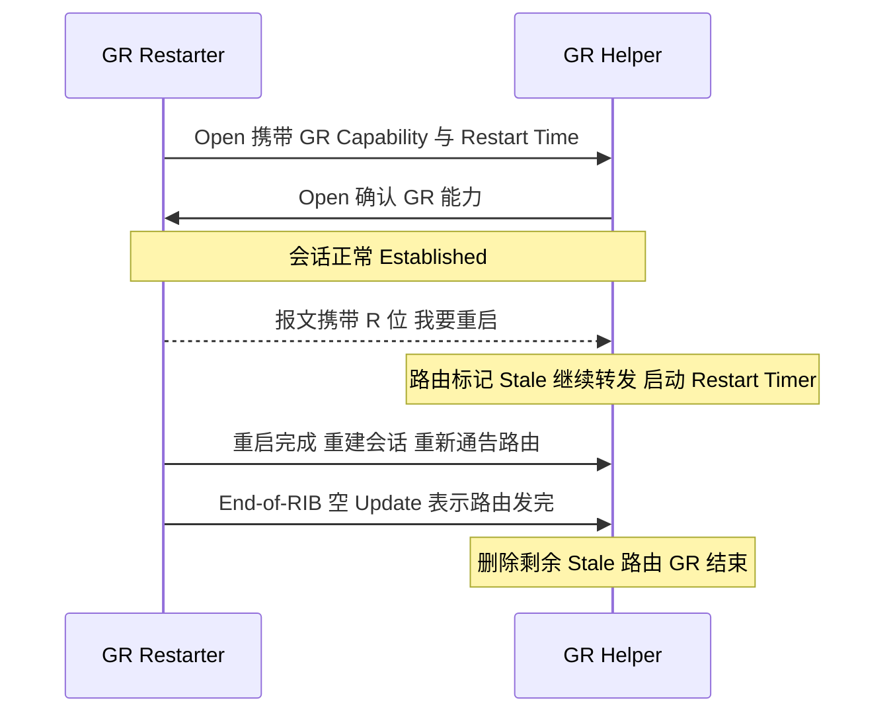

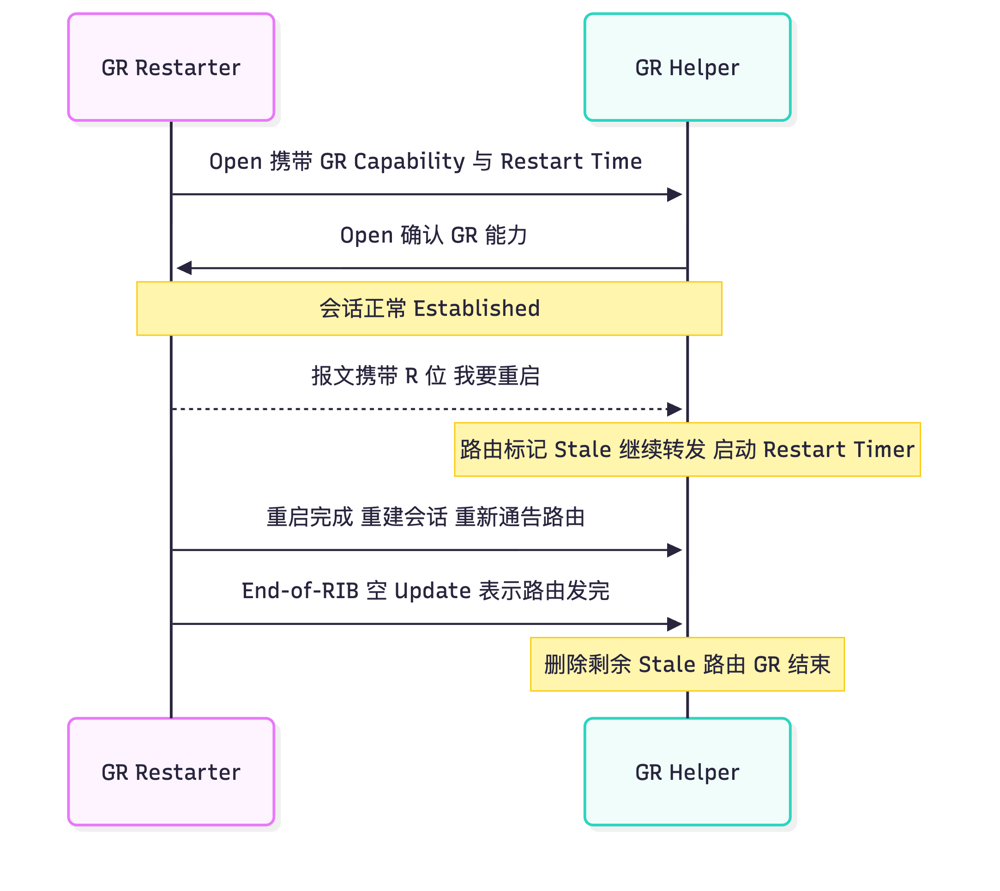


### 真题精练

**Q1.【真题·单选】** BGP Graceful Restart 过程中，GR Helper 依据什么判断可以删除剩余的陈旧（Stale）路由？
A. 收到对端的 Notification 报文
B. 收到对端发送的 End-of-RIB 标记（空 Update 报文）
C. Restart Timer 到期一定删除
D. 收到 IGP 的拓扑更新

> **答案：B**
> **解析**：End-of-RIB（EOR）是一个**不含 NLRI 与路径属性的空 Update 报文**，表示"对端已完成路由通告"。Helper 收到 EOR 后即可安全删除仍为 Stale 的路由（这些路由对端已不再拥有）。C 项只是**兜底机制**——若对端在 Restart Timer 内没有回来，Helper 才强制删除 Stale 路由，它不是"正常流程"的判断依据。

**Q2.【真题·多选】** 关于 GR 与 NSR，下列说法正确的有？
A. GR 需要邻居作为 Helper 配合保留路由
B. NSR 对邻居完全透明，不需要邻居支持额外能力
C. NSR 可以完全替代 GR 应对整机断电重启
D. 两者都需要转发面（NSF）在控制面故障期间保持转发能力才能达到"不中断"的效果

> **答案：ABD**
> **解析**：C 错——NSR 依赖本机主备主控的状态同步，**整机断电/复位时备用主控也不可用**，这种情况必须依靠 GR（邻居保留路由）来减少中断。D 正确：如果转发面同时失效（例如线卡复位），无论 GR 还是 NSR 都无法保持流量不中断。

**Q3.【真题·判断】** 华为设备上 BGP 的 Graceful Restart 功能缺省即已全部使能，无需任何配置。

> **答案：错误（表述不严谨）**
> **解析**：华为不同产品与版本对 BGP GR 的缺省使能情况存在差异，正确做法是**以 `display bgp peer verbose` 中协商出的 Graceful-restart 能力字段为准**，需要时通过 BGP 视图下的 `graceful-restart`（本机能力）与 `peer x graceful-restart`（对指定邻居）显式配置。判断类题目中出现"缺省全部使能""无需配置"这类绝对表述时，一般都应当警惕。

### 易错点与排错

1. **GR 生效需要双向能力协商**：只要有一端不支持或不配置 GR，GR 就无法生效，会话中断后路由仍会被立即撤销。
2. **Stale 路由不是"永久保留"**：Restart Timer 到期或收到 EOR 后即被清理，不要以为 GR 能无限期维持转发。
3. **GR 与 BFD 的配合要小心**：BFD 检测到故障会立即拆除会话，若把 BFD 与 GR 一起用在"进程重启"场景，需要确认设备行为（华为提供 GR 过程中的邻居复位控制，避免 BFD 提前触发硬复位）。
4. **LDP GR 与 BGP GR 要配套**：MPLS L3VPN 场景下，公网标签由 LDP 分配，若只配 BGP GR 而不配 LDP GR，LSP 中断同样会导致业务断流（见 4.4 节）。
5. **排错命令**：`display bgp peer verbose`（看 GR 能力协商）、`display bgp routing-table`（看 Stale 状态码 `S`）、`display current-configuration configuration bgp | include graceful`。

---

## 3.15 常用 display 命令解读与排错流程

### 考点定位

本节是**实验卷与排错题的"工具箱"**，理论卷也会以"输出解读"形式出题（给一段 `display bgp peer` 输出，问哪个邻居有问题）。占 **3~6 分**。要求能**看懂每一列的含义**，并能把现象对应到 3.3/3.5/3.6 节的根因。

### 原理精讲

BGP 排错遵循"**由外到内、由控制面到转发面**"的顺序，四条主线：

**主线一：邻居是否建立。** `display bgp peer` 看状态列。若为非 Established，按 3.3 节的状态-原因对照表处理；若为 Established，进入主线二。

**主线二：路由是否学到。** `display bgp routing-table peer x received-routes` 看从该邻居收到了哪些路由（**注意**：该命令在部分版本上需要先使能 `peer x capability-advertise route-refresh` 或显示的是"当前有效的"接收路由）。若收到了但 `display bgp routing-table` 里没有 best（`>`），是**选路或下一跳问题**（3.5/3.8 节）。

**主线三：本机是否把路由发了出去。** `display bgp routing-table peer x advertised-routes` 看实际通告内容。若本地有最优路由但通告列表里没有，说明被 **export 方向策略**（`filter-policy`/`route-policy`/`as-path-filter`）过滤，或该路由不是 best（规则 1：只发 best）。

**主线四：转发面是否正确。** `display ip routing-table` 看是否进了 IP 路由表，`tracert`/`ping` 看实际转发。BGP 路由不进表的原因：下一跳不可达、被 dampening 抑制、被 `filter-policy import` 过滤、路由不是 best，或在 MPLS VPN 场景下缺少为下一跳服务的 LSP。

**关键输出字段逐项解读**：

`display bgp peer` 输出示例：

```text
BGP local router ID : 1.1.1.1
Local AS number : 100
Total number of peers : 3                          Peers in established state : 2

  Peer            V          AS  MsgRcvd  MsgSent  OutQ  Up/Down       State PrefRcv
  10.0.12.2       4         200       45       47     0 00:38:12 Established       8
  2.2.2.2         4         100       33       35     0 00:31:04 Established       5
  3.3.3.3         4         100        0        0     0 00:00:00        Active       0
```

| 字段 | 含义 | 排错要点 |
|---|---|---|
| BGP local router ID | 本机 BGP Router ID | 与预期不符说明未手工指定或 LoopBack 变化 |
| Local AS number | 本机 AS 号 | 与规划不符会导致邻居校验失败 |
| Total number of peers / Peers in established state | 邻居总数 / 已建立数 | 两者不一致说明有邻居异常 |
| Peer | 邻居地址 | — |
| V | BGP 版本 | 一般为 4；为 0 表示未协商 |
| AS | 对端 AS 号 | 与规划不符会卡 OpenSent |
| MsgRcvd / MsgSent | 收/发报文计数 | **长期为 0 说明报文根本没通** |
| OutQ | 待发送队列长度 | **持续非 0 说明发送受阻（链路拥塞/对端不收）** |
| Up/Down | 已建立时长或已断开时长 | 反复归零说明会话在抖动 |
| State | 邻居状态 | 排错核心字段（3.3 节对照表） |
| PrefRcv | 从该邻居收到的最优前缀数 | 为 0 说明没学到路由或全被过滤 |

`display bgp routing-table` 输出示例与字段：

```text
 BGP Local router ID is 1.1.1.1
 Status codes: * - valid, > - best, d - damped, h - history,
               i - internal, s - suppressed, S - Stale
 Origin : i - IGP, e - EGP, ? - incomplete

 Total Number of Routes: 3
      Network            NextHop        MED        LocPrf    PrefVal Path/Ogn

 *>   10.1.1.0/24        10.0.12.2       50         100        0      200?
 *>i  10.2.2.0/24        2.2.2.2         0          150        0      300 400i
 *    10.3.3.0/24        10.0.13.2       0          100        0      200 300i
```

| 字段/状态码 | 含义 | 排错要点 |
|---|---|---|
| `*` | valid（路由合法） | 无 `*` 说明路由无效 |
| `>` | best（最优） | **无 `>` 就不会进 IP 路由表、也不会通告给邻居** |
| `d` | damped（被震荡抑制） | 需等待衰减或 `reset bgp dampening` |
| `h` | history（历史路由，当前不可用） | 通常伴随撤销但未删除 |
| `i` | internal（从 IBGP 学来） | 用于判断学习来源（对应选路第 7 条） |
| `s` | suppressed（被聚合的 `detail-suppressed` 抑制） | 只影响对外通告 |
| `S` | Stale（GR 期间保留的陈旧路由） | 等 EOR 后清除 |
| Network | 目的前缀 | — |
| NextHop | 下一跳 | **本机始发路由显示 0.0.0.0** |
| MED / LocPrf / PrefVal | 三个可比较属性 | 直接对应选路第 6/2/1 条 |
| Path/Ogn | AS_Path 与 Origin | 如 `200?` 表示 AS_Path=200、Origin=Incomplete |

### 关键概念对照表

| 需求 | 命令 | 备注 |
|---|---|---|
| 看邻居状态与计数 | `display bgp peer` | 第一命令 |
| 看邻居详细能力与定时器 | `display bgp peer <ip> verbose` | 含 GR、Route-Refresh、GTSM 能力 |
| 看邻居抖动历史 | `display bgp peer log-info` | 定位"为什么断" |
| 看全部 BGP 路由与选路结果 | `display bgp routing-table` | 找 `>` |
| 看单条路由全部属性 | `display bgp routing-table <prefix>` | 含 Community、Originator、Cluster List |
| 看本机发出的路由 | `display bgp routing-table peer <ip> advertised-routes` | 排"对端学不到" |
| 看从邻居收到的路由 | `display bgp routing-table peer <ip> received-routes` | 排"我没收到" |
| 看按团体过滤的路由 | `display bgp routing-table community-filter <name>` | 团体策略排错 |
| 看被抑制的路由 | `display bgp routing-table dampened` | dampening 排错 |
| 看 BGP 错误统计 | `display bgp error` | Notification 统计 |
| 看对等体组 | `display bgp group <name>` | RR/VPN 客户端排错 |
| 软复位（不中断会话） | `refresh bgp <ip> import \| export` | 需 Route-Refresh 能力 |
| 硬复位 | `reset bgp <ip>` | 会短暂中断，慎用 |

### 华为设备配置

```bash
# ===== BGP 排错标准命令序列（按顺序执行）=====
display bgp peer                                       // 1 看邻居是否 Established，MsgRcvd/MsgSent 是否增长
display bgp peer 10.0.12.2 verbose                      // 2 看协商的能力、定时器、GR、GTSM
display bgp peer log-info                               // 3 看邻居 Up/Down 历史与原因
display bgp error                                       // 4 看 Notification 错误统计
display bgp routing-table                               // 5 看本机 BGP 表：是否有带 > 的最优路由
display bgp routing-table 10.1.1.0                      // 6 看单条路由全部属性（下一跳/属性/状态码）
display bgp routing-table peer 10.0.12.2 received-routes // 7 排"我没收到"
display bgp routing-table peer 10.0.12.2 advertised-routes  // 8 排"对端没收到/我没发"
display ip routing-table 10.1.1.0                        // 9 看是否进入 IP 路由表（转发依据）
display ip routing-table 10.0.13.2                       // 10 确认下一跳是否可达（迭代是否成功）
display bgp routing-table dampened                       // 11 排"路由被抑制"
reset bgp dampening                                      // 12 紧急解除全部抑制
refresh bgp 10.0.12.2 export                             // 13 策略变更后软复位下发方向
```

### 示意图

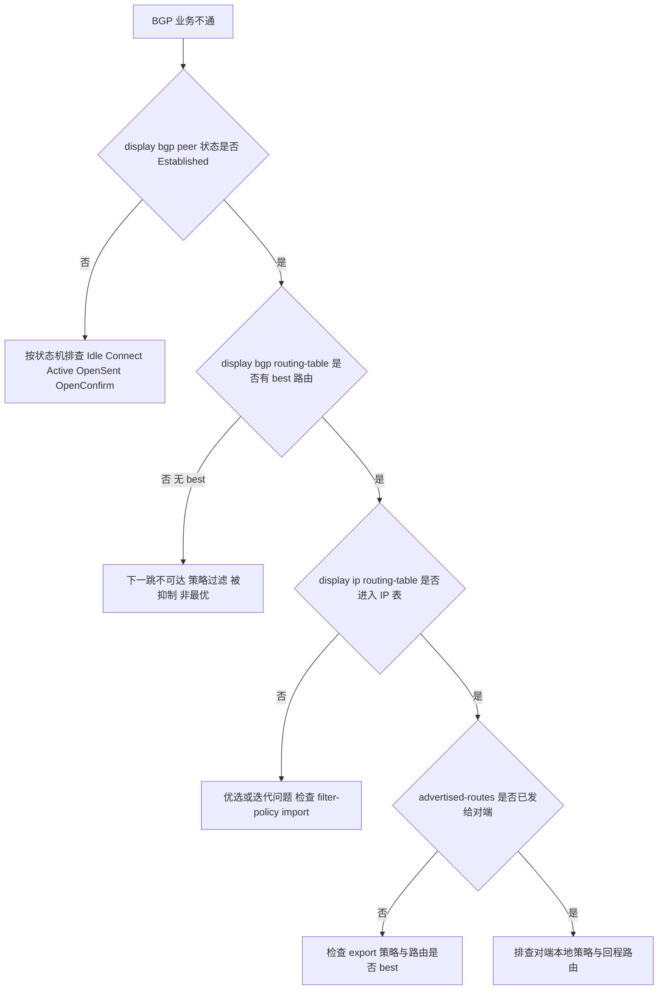

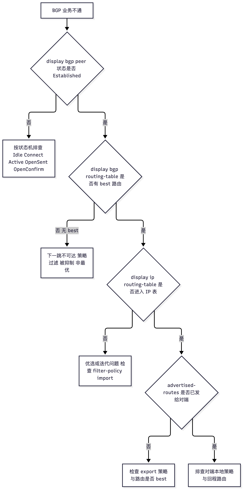


### 真题精练

**Q1.【真题·排错】** 下列 `display bgp peer` 输出中，哪个邻居存在问题？最可能的原因是什么？
```text
  Peer            V          AS  MsgRcvd  MsgSent  OutQ  Up/Down       State PrefRcv
  10.0.12.2       4         200       45       47     0 00:38:12 Established       8
  2.2.2.2         4         100       33       35     0 00:31:04 Established       5
  3.3.3.3         4         100        0        0     0 00:00:00        Active       0
```
> **答案**：邻居 `3.3.3.3` 存在问题——状态为 **Active** 且 **MsgRcvd/MsgSent 均为 0**，说明**该邻居从未建立过 TCP 连接（一个 BGP 报文都没交换过）**。最可能原因是：① 对端没有配置该邻居（`peer 1.1.1.1`）；② 本端到 3.3.3.3 无路由或路由不可用（IBGP 用 LoopBack 时需确认 3.3.3.3/32 是否在 IP 路由表中）；③ 179 端口被 ACL/安全策略拦截；④ `connect-interface` 配置错误导致源地址与对端 `peer` 不一致。
> 定位命令：`ping -a 1.1.1.1 3.3.3.3`、`display ip routing-table 3.3.3.3`、`display acl all`、`display bgp peer log-info`。

**Q2.【真题·单选】** 在 `display bgp routing-table` 输出中，某条路由的状态码只有 `*` 而没有 `>`，最直接的含义是？
A. 该路由被 dampening 抑制
B. 该路由有效但不是最优，不会进入 IP 路由表也不会通告给邻居
C. 该路由是从 IBGP 学来的
D. 该路由是本地始发的

> **答案：B**
> **解析**：`*` = valid，`>` = best。只有 `*>` 同时存在才说明该路由被优选。A 对应状态码 `d`；C 对应 `i`；D 需看 NextHop 是否为 0.0.0.0。无 `>` 的常见原因是下一跳不可达或选路输给了其它路由。

**Q3.【真题·简答】** 请说明 `advertised-routes` 与 `received-routes` 两条命令的区别，以及在什么场景下分别使用。

> **答案**：`display bgp routing-table peer <ip> advertised-routes` 显示**本机实际向该邻居通告的路由**（受 export 策略与"只发 best"规则约束），用于排查"我有路由但对端没收到"的问题；`display bgp routing-table peer <ip> received-routes` 显示**本机从该邻居接收到的路由**（受 import 策略过滤后的有效接收路由），用于排查"对端有路由但我没学到"的问题。二者的使用场景正好互补：**远端学不到路由时，在发送侧用 advertised-routes 确认"是否发出"，在接收侧用 received-routes 确认"是否收到"**，两者之间就是策略过滤与选路处理的发生位置。
> **解析**：补充加分点是"广告路由只包含 best 路由"，因此如果本地路由不是最优，advertised-routes 里也不会出现——这常被误判为"被策略过滤"。

**Q4.【真题·排错】** 工程师在 R1 上把某个前缀的 Local_Pref 从 100 改成 200（通过 import 方向的 route-policy），但 `display bgp routing-table` 显示该路由的 LocPrf 仍是 100。请列出排查方向。

> **答案**：① **策略未命中**：`route-policy` 的节点条件（`if-match ip-prefix` / `if-match as-path-filter`）与实际路由属性不匹配，或缺少 permit 兜底节点；② **应用方向或位置错误**：Local_Pref 属于 IBGP 内传递的属性，若策略应用在 **export 方向发给 EBGP 邻居**上则完全无效（EBGP 邻居不使用 Local_Pref）；③ **策略应用在了错误的邻居上**：该路由是从另一个邻居学来的，而策略配在了别的 peer 上；④ **路由不是从该邻居新学的**：策略变更后未触发更新，需要 `refresh bgp <ip> import` 软复位或 `reset bgp <ip>`；⑤ 若该路由是**本地始发**（network/import-route/aggregate），Local_Pref 由 `default local-preference` 决定（除非本地 export 策略改写），import 方向策略不生效。
> 定位命令：`display current-configuration configuration bgp`、`display route-policy SET_LP`、`display bgp routing-table 10.1.1.0`、`refresh bgp <ip> import` 后再次查看。

### 易错点与排错

1. **`advertised-routes` 只含最优路由**：本地非 best 的路由不会出现在这里，不要立刻判定为"策略过滤"。
2. **`PrefRcv` 为 0 不一定代表没收到**：也可能是收到的路由全部被 import 策略过滤或全部非最优，需用 `received-routes` 交叉验证。
3. **`OutQ` 持续非 0 是重要信号**：说明发给该邻居的报文积压在队列中，通常是链路拥塞或对端 TCP 窗口为 0。
4. **`Up/Down` 反复归零 = 会话抖动**：结合 `display bgp peer log-info` 找原因（Hold 超时、Notification、route-limit、接口 up/down）。
5. **软复位优先于硬复位**：`refresh bgp x import/export` 不中断会话（需 Route-Refresh 能力），`reset bgp x` 会中断并重新收敛，现网慎用。
6. **排错顺序不能跳**：邻居 → 本机是否有 best → 是否进 IP 表 → 是否发出 → 对端是否收到 → 对端是否进表，任何一步跳过都会导致误判。

---

# 数通-HCIE-章节4-MPLS与VPN技术

## 4.1 MPLS 基础：为什么要 MPLS

### 考点定位

本节是 MPLS 全章的"世界观"，占 **3~6 分**，常以单选/简答出现："MPLS 属于几层协议""为什么要用 MPLS""FEC 是什么""LER/LSR/LSP 的角色划分"。**陷阱**：把 MPLS 说成"二层协议"或"三层协议"（它是 **2.5 层**，位于二层与三层之间）；把 LSP 说成双向（LSP 是**单向**的，每个方向各自建立）。

### 原理精讲

**MPLS（Multi-Protocol Label Switching，多协议标签交换）** 的核心思想是：**在 IP 报文前插入一个固定长度的短标签，网络内部设备只根据标签做转发，而不再逐跳做最长前缀匹配查表**。它被称为"2.5 层协议"，因为它工作在链路层与网络层之间：既需要底层（以太网/PPP/POS）承载，又承载着三层（IP）或二层（以太网帧）业务。

**历史上的动机（理解即可）**：20 世纪 90 年代，路由器基于 CPU 做最长前缀匹配的性能远低于 ATM/帧中继交换机的定长标签交换。当时的目标是"用交换机的转发性能跑 IP 网络"，因此核心思想是"**边缘做路由决策，核心做标签交换**"。

**当今真正的动机（考试重点，五条）**：

1. **转发简单高效**：标签是固定长度的**精确匹配（exact match）**，而 IP 转发是**最长前缀匹配**。精确匹配在硬件上（TCAM/哈希）实现更简单、容量更大、查表更快，这让核心设备可以只维护一张"标签 → 出标签/出接口"的小表（LFIB），而不必处理全量 IP 前缀的复杂匹配逻辑。
2. **天然支持层次化隧道（标签栈）**：MPLS 允许**标签嵌套**（栈），因此可以在一条公网 LSP 之上再叠一条私网标签，一行代码都不用改就实现了"隧道中的隧道"。L3VPN 的双层标签就是这一特性的直接产物。纯 IP 实现同样效果需要 IP-in-IP 或 GRE，开销更大、灵活性更差。
3. **转发路径与控制平面解耦**：LSP 的路径由控制平面（LDP 按 IGP 最短路径、RSVP-TE 按显式路径、SR 按 Segment List）决定。这意味着**转发路径可以不符合 IGP 的最短路径**——这正是流量工程（TE）的基础，也让"既按 IGP 转发又按策略转发"成为可能。
4. **天然的多租户隔离能力**：标签可以作为"租户标识"（L3VPN 的私网标签、VPLS 的 PW 标签），同一台 P 设备上用不同的标签承载不同客户的流量，互不干扰。这是运营商 VPN 业务的基石。
5. **承载二三层多业务**：MPLS 既能承载 IP（L3VPN），也能承载以太网帧（VPWS/VPLS），实现"一张网络跑多种业务"。

**控制平面与转发平面分离**是 MPLS 架构的核心。**控制平面**（IGP：OSPF/IS-IS 提供路由；LDP/RSVP-TE/SR 分发标签；BGP/MP-BGP 分发 VPN 路由）负责"协商出标签与路径"；**转发平面**（FIB + LFIB/ILM）只负责"按表做 Push/Swap/Pop 并出接口"。这种分离带来一个重要推论：**控制平面故障不等于转发中断**（GR/NSR 的价值所在，见 3.14 节）。

**关键术语（必须能准确解释）**：

| 术语 | 全称 | 含义 |
|---|---|---|
| MPLS | Multi-Protocol Label Switching | 多协议标签交换 |
| LSR | Label Switching Router | 支持 MPLS 的路由器，能处理标签 |
| LER | Label Edge Router | 边缘 LSR，位于 MPLS 域边界，负责压入/弹出标签 |
| Ingress LER | 入节点 | 报文进入 MPLS 域的设备，执行 Push |
| Egress LER | 出节点 | 报文离开 MPLS 域的设备，执行 Pop 或接收无标签报文 |
| Transit LSR | 中间节点 | 只做标签交换（Swap），不感知 IP 内容 |
| LSP | Label Switched Path | 标签交换路径，**单向**，从 Ingress 到 Egress |
| FEC | Forwarding Equivalence Class | 转发等价类：**一组以完全相同方式转发的报文**（相同标签、相同下一跳、相同处理） |
| LFIB | Label Forwarding Information Base | 标签转发表，由 ILM（入标签映射）与 NHLFE（下一跳标签转发项）组成 |
| LIB | Label Information Base | 标签信息库，保存收到的标签映射（尚未成为转发表） |
| PHP | Penultimate Hop Popping | 次末跳弹出 |

**FEC 是理解 MPLS 的钥匙**：MPLS 不按"目的 IP"转发，而按"属于哪个 FEC"转发。一个 FEC 可以是一个目的前缀（如 4.4.4.4/32）、一个 VPN 实例、一个 QoS 等级、或一条 TE 隧道的流量。**Ingress LER 的职责就是"把报文映射到 FEC 并压入对应标签"**。FEC 的粒度由控制平面决定（例如华为 LDP 缺省只为 32 位主机路由建立 FEC/LSP，见 4.4 节）。

**华为设备的 MPLS 使能三步**：① 全局配置 `mpls lsr-id`（相当于 MPLS 域的 Router ID，**建议设为 LoopBack 地址**）；② 全局 `mpls` 使能 MPLS，`mpls ldp` 使能 LDP；③ 在**每个参与 MPLS 的接口**上配置 `mpls` 与 `mpls ldp`。三步缺一不可，这是实验中最常见的漏配点。

### 关键概念对照表

| 对比项 | 纯 IP 转发 | MPLS 转发 |
|---|---|---|
| 查表方式 | 最长前缀匹配（LPM） | 标签精确匹配 |
| 转发表 | FIB（IP 路由表） | LFIB（标签转发表） |
| 报文变化 | 逐跳不变 | 每跳标签交换（Push/Swap/Pop） |
| 隧道能力 | 需 IP-in-IP/GRE | 标签栈天然嵌套 |
| 路径选择 | 由 IGP/BGP 决定（最短路径为主） | 控制平面可指定（TE、显式路径） |
| 多租户隔离 | 需 VRF/隧道叠加 | 标签直接区分（私网标签） |
| 感知三层信息 | 每跳都要看 IP 头 | 中间节点不感知 IP |

| 设备角色 | 位置 | 标签操作 | 需要的能力 |
|---|---|---|---|
| Ingress LER | MPLS 域入口 | Push（压入标签，可多层） | IP 路由 + 标签分配 |
| Transit LSR | 域内中间 | Swap（交换标签） | 只需 LFIB，不需全量 IP 路由 |
| Egress LER | 域出口 | Pop（弹出标签）/ 接收显式空标签 | IP 路由 |

### 华为设备配置

```bash
# ===== MPLS 基础使能（NE40E / NE8000）=====
system-view
mpls lsr-id 1.1.1.1                          // 配置 MPLS LSR ID，建议与 LoopBack0 一致（作为 LDP 传输地址）
mpls                                         // 全局使能 MPLS
 mpls ldp                                    // 进入 LDP 视图
  label-distribution independent             // 标签分配控制方式：独立（缺省）
  label-retention liberal                    // 标签保持方式：自由（缺省，保留所有标签映射，切换快）
  lsp-trigger host                           // 只为 32 位主机路由触发建立 LSP（缺省行为，常用 LoopBack 验证）
  graceful-restart                           // 使能 LDP 平滑重启，避免控制面重启导致 LSP 中断
  md5-password cipher Huawei@123             // LDP 会话 MD5 认证（两端必须一致）
 quit
quit
# ===== 接口使能（每个参与 MPLS 的接口都要配）=====
interface GigabitEthernet0/0/1
 description To-R2-Core
 mpls                                        // 接口使能 MPLS 转发
 mpls ldp                                    // 接口使能 LDP（收发 Hello、建立会话）
 mpls mtu 1500                               // 设置 MPLS MTU，避免压入标签后报文超长被丢弃
quit
# ===== LoopBack 也要参与（通常 LoopBack 不需要 mpls ldp，但需要被 IGP 通告）=====
interface LoopBack0
 ip address 1.1.1.1 255.255.255.255
quit
# ===== 查看基础状态 =====
display mpls ldp peer                        // 查看 LDP 邻居
display mpls ldp session                     // 查看 LDP 会话状态（Operational 为正常）
display mpls interface                       // 查看哪些接口使能了 MPLS
```

### 示意图

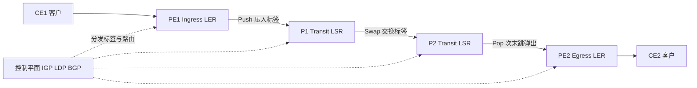

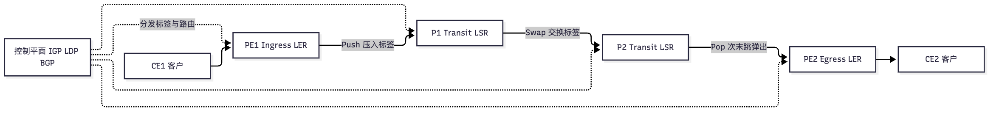


### 真题精练

**Q1.【真题·单选】** 关于 MPLS 中 FEC（转发等价类）的描述，正确的是？
A. FEC 就是目的 IP 地址
B. FEC 是一组以相同方式转发的报文，由 Ingress LER 负责把报文映射到 FEC
C. FEC 由 Transit LSR 根据标签栈深度决定
D. 一个 FEC 必须对应一条完整的 LSP 且只能承载一种业务

> **答案：B**
> **解析**：FEC 的定义是"一组以相同方式转发（同标签、同下一跳、同处理）的报文"，其划分粒度由控制平面决定，可以是目的前缀、VPN 实例、QoS 等级或 TE 隧道。A 错——目的前缀只是 FEC 的一种划分方式；C 错——Transit LSR 只看标签，不做 FEC 映射（映射是 Ingress 的职责）；D 错——FEC 与业务不是一一对应关系。

**Q2.【真题·多选】** 使用 MPLS 相比纯 IP 转发的优势包括？
A. 标签精确匹配比最长前缀匹配更易硬件实现，转发效率高
B. 通过标签栈天然支持层次化隧道，便于实现 L3VPN 的双层标签
C. 转发路径可由控制平面指定，与 IGP 最短路径解耦（支持流量工程）
D. 中间设备必须感知 IP 头才能转发，安全性更高
E. 可以用标签区分不同租户/业务，实现多业务承载

> **答案：ABCE**
> **解析**：D 完全相反——MPLS 的一个重要优势正是**中间 P 设备不感知 IP 内容**（只处理栈顶标签），这既提高了转发效率，也让核心设备不必维护全量 IP 路由。

**Q3.【真题·简答】** 请说明 MPLS 中"控制平面与转发平面分离"的含义，并举例说明这种分离带来的两个好处。

> **答案**：控制平面负责**建立转发表项**：IGP 提供去往各前缀的路由，LDP/RSVP-TE/SR 据此分发标签并建立 LSP，BGP/MP-BGP 分发 VPN 路由与私网标签；转发平面只负责**按已有表项转发**：查 LFIB，执行 Push/Swap/Pop 并从出接口发出，不参与任何路由计算或标签协商。
> 好处举例：① **转发路径可由控制平面任意指定**——同一个 IGP 拓扑下，LDP 按最短路径建 LSP，RSVP-TE 可按显式路径建 LSP，SR 可按 Segment List 建 LSP，转发面无需改动，这正是流量工程（TE）与 SR Policy 的实现基础；② **控制平面故障不等于转发中断**——借助 GR/NSR，控制面重启期间转发面继续按旧表转发，业务不中断（这就是为什么 MPLS 网络非常强调 GR 能力）；③ 中间 P 设备只需维护 LFIB 而不需全量 IP 路由，降低核心设备资源占用。
> **解析**：答题要点是"控制平面建表、转发平面查表"以及至少两个具体好处（TE 路径可控、GR 转发不中断）。

### 易错点与排错

1. **LSP 是单向的**：从 A 到 B 的 LSP 与从 B 到 A 的 LSP 是两条独立路径，可能走不同物理链路，必须各自建立与验证。
2. **LSR ID 必须是 LoopBack 或有稳定路由的地址**：LDP 的传输地址（Transport Address）缺省取 LSR ID，若 LSR ID 不可达会话就建不起来。
3. **接口漏配 `mpls` 或 `mpls ldp`**：这是"全局配了但 LSP 建不起来"的最常见原因，用 `display mpls interface` 一眼可查。
4. **`lsp-trigger` 缺省为 host**：华为缺省只为 /32 主机路由建 LSP，因此实验时常用 LoopBack 验证；若要为网段建 LSP 需配置 `lsp-trigger all` 或用 `ip-prefix` 指定。
5. **排错命令**：`display mpls interface`、`display mpls ldp peer`、`display mpls ldp session`、`display mpls lsp`、`display mpls route-table`。

---

## 4.2 标签结构与标签栈

### 考点定位

标签结构是**必考送分题**，占 **2~4 分**，形式为填空/单选：**20 bit Label + 3 bit EXP + 1 bit S + 8 bit TTL**，以及 S 位的含义。**必考陷阱**：把 EXP 说成"实验位，现无用途"（现在是 TC/流量类别，用于 QoS）、把 S=1 说成"栈顶"（S=1 是**栈底**）、把保留标签 0 与 3 的含义搞反（**0 是显式空、3 是隐式空**）。

### 原理精讲

MPLS 标签是一个 **32 bit（4 字节）** 的定长字段，插在二层头与三层头之间，结构如下：

```text
 0                   1                   2                   3
 0 1 2 3 4 5 6 7 8 9 0 1 2 3 4 5 6 7 8 9 0 1 2 3 4 5 6 7 8 9 0 1
+-+-+-+-+-+-+-+-+-+-+-+-+-+-+-+-+-+-+-+-+-+-+-+-+-+-+-+-+-+-+-+-+
|                Label                  |   EXP   |S|      TTL    |
|              (20 bit)                 | (3 bit) |1|    (8 bit)  |
+-+-+-+-+-+-+-+-+-+-+-+-+-+-+-+-+-+-+-+-+-+-+-+-+-+-+-+-+-+-+-+-+
```

| 字段 | 长度 | 取值范围 | 含义与用途 |
|---|---|---|---|
| **Label（标签值）** | 20 bit | 0 ~ 1048575（2^20−1），其中 0~15 为保留值 | 标识 FEC，转发时用于查 LFIB |
| **EXP（Experimental）** | 3 bit | 0 ~ 7 | 早期为"实验位"，现标准化为 **TC（Traffic Class，流量类别）**，用于承载 MPLS QoS 优先级（PHB）；标签弹出时可映射到 IP 报文的 DSCP/优先级 |
| **S（Bottom of Stack）** | 1 bit | 0 或 1 | **栈底标志：S=1 表示这是标签栈中最后一个（最靠近 IP 头的）标签**；S=0 表示下面还有标签 |
| **TTL（Time To Live）** | 8 bit | 0 ~ 255 | 逐跳递减，防止环路；与 IP TTL 的映射方式由 TTL 处理模式决定 |

**标签栈（Label Stack）**：MPLS 允许一个报文携带多个标签，形成"栈"。转发时设备**只处理栈顶标签**（最外层），栈底标签紧邻 IP 头（或二层净荷）。典型场景：

- **单层标签**：普通 MPLS 转发（LDP 为某个前缀建立的 LSP），报文形如 `[以太头][标签][IP头][数据]`。
- **双层标签**：**MPLS L3VPN** 的典型结构，报文形如 `[以太头][公网标签][私网标签][IP头][数据]`。外层（公网标签）由 LDP/RSVP-TE/SR 分配，用于把报文送到对端 PE；内层（私网标签）由 MP-BGP 分配，用于让对端 PE 识别该报文属于哪个 VPN。
- **三层或更多**：MPLS TE 隧道内承载 L3VPN（`[TE标签][公网标签?][私网标签][IP]`）、BGP 联盟/嵌套 VPN 等场景。
- **L2VPN**：`[公网标签][PW 标签][以太帧]`，其中 PW 标签用于标识伪线，且由于承载的是二层帧，**没有 IP 头**，因此 S 位的判断与三层场景不同。

**保留标签值（必须记住前四个）**：

| 值 | 名称 | 含义 |
|---|---|---|
| **0** | IPv4 Explicit NULL（显式空标签） | Egress 要求上游**不要弹出**标签，把 Label=0 的报文交给 Egress，由 Egress 弹出后查 IP 表 |
| **1** | Router Alert Label | 路由器告警标签，用于 MPLS OAM（报文需上送 CPU 处理） |
| **2** | IPv6 Explicit NULL | IPv6 的显式空标签 |
| **3** | Implicit NULL（隐式空标签） | Egress 通知上游**在倒数第二跳弹出**标签（PHP），Egress 收到的是纯 IP 报文 |
| 7 | ELI（Entropy Label Indicator） | 熵标签指示，用于负载分担 |
| 13 | GAL（Generic Associated Channel Label） | 通用关联通道标签，用于 MPLS-TP OAM |
| 14 | OAM Alert Label | OAM 告警标签 |

**TTL 的两种处理模式（考试常考概念对比）**：

| 模式 | 入口行为 | 中间节点 | 出口行为 | 效果 |
|---|---|---|---|---|
| **统一模式（Uniform）** | IP TTL 复制到标签 TTL | 每跳标签 TTL 逐跳递减 | 标签 TTL 剩余值复制回 IP TTL | `traceroute` 能看到 LSP 内每一跳（P 设备可见） |
| **管道模式（Pipe）** | IP TTL 复制到标签 TTL，标签 TTL 在域内**不递减**（固定） | 只递减内层（若有） | 用入口保存的 IP TTL 恢复 | 隐藏 MPLS 域内部跳数（P 设备对 `traceroute` 不可见），常用于运营商隐藏内部拓扑 |

华为设备**缺省采用统一模式**。之所以要区分这两种模式，是因为 MPLS 域的跳数是否对客户可见涉及"网络拓扑隐私"与"故障定位便利性"的权衡：运营商通常希望隐藏内部结构（Pipe），而企业网更希望故障可定位（Uniform）。考试要求能说明两种模式的差别与典型用途，具体命令随版本有差异，以设备手册为准。

**MTU 问题（实验高频故障）**：每压入一层标签就增加 4 字节。以太网默认 MTU 1500，若报文本身已是 1500 字节，压入标签后变成 1504 字节，可能在链路上被丢弃（尤其是中间设备不支持巨帧时）。因此 MPLS 网络需要在接口上配置 `mpls mtu`，并在规划时预留标签栈开销（L3VPN 双层标签需预留 8 字节以上）。

### 关键概念对照表

| 字段 | 位置 | 长度 | 关键值 | 记忆点 |
|---|---|---|---|---|
| Label | bit 0~19 | 20 bit | 0/1/2/3 为保留 | "**20 位标签**" |
| EXP | bit 20~22 | 3 bit | 0~7 | "**3 位 QoS**" |
| S | bit 23 | 1 bit | **1 = 栈底** | "**1 位栈底**" |
| TTL | bit 24~31 | 8 bit | 0~255 | "**8 位 TTL**" |

| 对比 | 显式空标签 0 | 隐式空标签 3 |
|---|---|---|
| Egress 分配的值 | 0 | 3 |
| 上游（次末跳）动作 | **不弹出**标签，转发 Label=0 的报文 | **弹出**标签（PHP） |
| Egress 收到什么 | 带 Label=0 的标签报文 | 纯 IP 报文 |
| 主要用途 | 需要 Egress 感知 EXP（QoS）、MPLS OAM、部分 L2VPN/统计场景 | 常规 MPLS 转发（缺省推荐，减轻 Egress 负担） |
| 是否节省 Egress 查表 | 不节省（仍需查标签表） | 节省（直接查 IP 表） |

### 华为设备配置

```bash
# ===== 标签与 MTU 相关配置（NE40E）=====
system-view
mpls lsr-id 1.1.1.1
mpls
 mpls ldp
  label-distribution independent              // 独立方式：无需等下游标签即可向上游分配
  label-retention liberal                     // 自由保持：保留所有收到的标签映射，切换更快但耗内存
  lsp-trigger host                            // 只为主机路由（/32）建 LSP
 quit
quit
interface GigabitEthernet0/0/1
 mpls
 mpls ldp
 mpls mtu 1500                                // MPLS MTU：压入标签后报文的最大长度，防止分片与丢弃
quit
# ===== 控制显式空 / 隐式空标签的使用（不同版本命令略有差异）=====
mpls
 label advertise { explicit-null | implicit-null | non-null }   // 告知下游本端希望收到的标签类型
quit
#   explicit-null：分配显式空标签 0（上游不弹出，Egress 感知 EXP，便于 QoS）
#   implicit-null：分配隐式空标签 3（缺省，上游 PHP 弹出，减轻 Egress 负担）
#   non-null：分配普通标签，不做 PHP（Egress 需查标签表）
# ===== 查看标签与栈信息 =====
display mpls lsp                             // 查看 LSP 与出/入标签
display mpls lsp verbose                     // 查看 LSP 详细属性（含标签操作与出接口）
display mpls ldp lsp                         // 查看 LDP 建立的 LSP 与标签映射
display mpls route-table                      // 查看 MPLS 转发表，确认标签操作类型（Push/Swap/Pop）
```

### 示意图

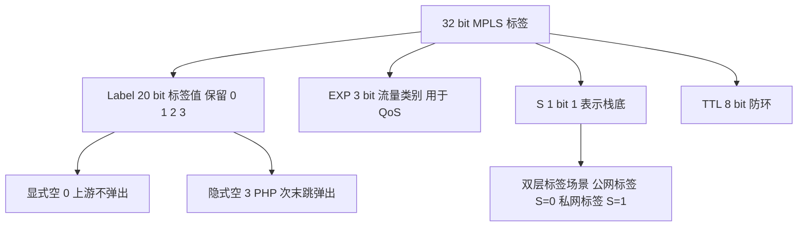

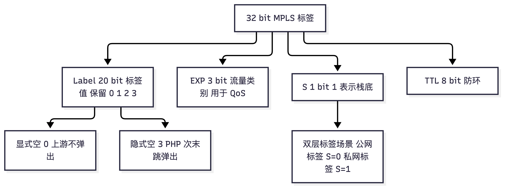


### 真题精练

**Q1.【真题·填空】** MPLS 标签总长度为 ______ bit，其中 Label 占 ______ bit、EXP 占 ______ bit、S 占 ______ bit、TTL 占 ______ bit；当 S 位为 ______ 时表示该标签是标签栈的栈底。

> **答案：32；20；3；1；8；1**
> **解析**：20+3+1+8 = 32 bit。EXP 现已标准化为 TC（流量类别）用于 QoS；S=1 表示"这是最后一个标签"（栈底），其后紧跟 IP 头或二层净荷。注意标签值有效范围 0~1048575，其中 0~15 为保留值。

**Q2.【真题·单选】** 某 LSR 从下游收到出标签为 **3** 的标签映射，则它转发该 FEC 的报文时应当执行什么操作？
A. 把标签替换为 3 并继续转发
B. 弹出标签，把纯 IP 报文发给下游
C. 压入标签 3
D. 丢弃报文

> **答案：B**
> **解析**：标签 3 是**隐式空标签（Implicit NULL）**，表示下游要求本机在转发前的这一跳执行 **PHP（次末跳弹出）**，直接把不带标签的报文发出去。对比：若收到标签 **0**（显式空标签），则应把标签替换为 0 并转发（不弹出），由下游 Egress 弹出后查 IP 表。

**Q3.【真题·多选】** 关于 MPLS 标签栈，下列说法正确的有？
A. 转发设备只处理栈顶标签
B. L3VPN 场景中通常有两层标签，外层为公网标签，内层为私网标签
C. 栈底标签的 S 位为 0
D. 每增加一层标签，报文长度增加 4 字节，需要考虑 MTU
E. 显式空标签 0 可以让 Egress 感知 EXP 信息，便于 QoS 处理

> **答案：ABDE**
> **解析**：C 错——**栈底标签的 S 位为 1**（Bottom of Stack = 1），这是最容易记反的细节。E 正确：使用显式空标签时上游不弹出标签，Egress 仍能看到标签中的 EXP 字段，从而在弹出标签时把优先级映射到 IP 报文上，这是"用显式空标签做 MPLS QoS"的原理。

### 易错点与排错

1. **S=1 是栈底不是栈顶**：栈顶（最外层）的 S 位通常为 0（除非只有一层标签，此时该标签既是栈顶也是栈底，S=1）。
2. **0 与 3 的含义不要记反**：**0 = 显式空（不弹出）**，**3 = 隐式空（PHP 弹出）**。口诀："**0 是让你别弹，3 是让你弹**"。
3. **EXP 现在叫 TC**：老教材称"实验位"，新标准称"流量类别"，答题时两种叫法都写更稳。
4. **MTU 必须核对**：L3VPN 双层标签要预留 8 字节，实验中出现"小包通、大包不通"的现象优先怀疑 MTU。
5. **标签空间是每台设备独立的**：入标签由本机分配，出标签由下游分配，因此不能"背标签值"，必须用 `display mpls lsp` 在现场核对。

---

## 4.3 标签操作：Push / Swap / Pop 与 PHP

### 考点定位

标签操作是**必考送分题 + 综合题基础**，占 **3~6 分**。必考：三种操作的定义与执行者、PHP 的原理与收益、显式空/隐式空的对比、标签分配模式（DoD/DU）与控制方式（独立/有序）、标签保持方式（自由/保守）。

### 原理精讲

MPLS 转发面上只有三种标签操作：

- **Push（压入/入栈）**：在报文标签栈**栈顶**插入一个新标签。执行者是 **Ingress LER**（或需要叠加外层标签的设备，如 L3VPN 的 PE 在私网标签外再压一层公网标签、MPLS TE 隧道入口压入 TE 标签）。Push 之后标签栈变深，IP 头被"埋"在标签之下。
- **Swap（交换）**：用本机为之分配的**出标签**替换栈顶的**入标签**（本质是"出标签 = 查 LFIB 得到的值"）。执行者是 **Transit LSR**。注意 Swap **不改变栈的深度**，也不改变报文长度。
- **Pop（弹出/出栈）**：移除栈顶标签。执行者是 **Egress LER**（弹出最后一层后查 IP 表），或**次末跳（Penultimate LSR）**在 PHP 场景下弹出唯一一层标签。

**PHP（Penultimate Hop Popping，次末跳弹出）** 是 MPLS 中最优雅的设计之一：

- **机制**：Egress LER 在向邻居分配标签时，对某个 FEC 分配**隐式空标签 3**。上游（次末跳）收到"出标签 = 3"的表项，就知道"转发该 FEC 的报文时应执行 Pop，把不带标签的 IP 报文交给 Egress"。
- **为什么要 PHP（三个收益）**：① **减少 Egress 一次查表**——Egress 收到无标签报文后直接查 IP 路由表即可转发，不需要再查一次标签表（LFIB），节省硬件资源与处理时延；② **简化 Egress 的处理逻辑**，让 Egress 可以把全部转发能力用于 IP 业务（在 MPLS 域边缘把"标签转发"与"IP 转发"两种路径统一）；③ 避免 Egress 上"必须为每个 FEC 维护标签表项"的开销。
- **PHP 的代价**：Egress 无法从报文本身直接判断"这个报文是从 LSP 来的"（因为没有标签），因此对 MPLS OAM、基于标签的统计与 QoS 映射不友好。因此出现了**显式空标签 0**：Egress 分配 0，上游不弹出，把 Label=0 的报文交给 Egress，Egress 看到 0 标签后弹出并查 IP 表——保留了标签栈（可由 Egress 读取 EXP 做 QoS 映射），代价是 Egress 需要多做一次标签查表。

**标签分配模式（Label Distribution Mode）**：

| 模式 | 全称 | 含义 | 谁在用 |
|---|---|---|---|
| **DU** | Downstream Unsolicited（下游自主） | 下游 LSR 无需上游请求，主动把"FEC → 标签"映射通告给上游 | **LDP 缺省** |
| **DoD** | Downstream-on-Demand（下游按需） | 上游必须显式发出 Label Request，下游才回应 Label Mapping | **RSVP-TE**（预留资源时顺带分配标签） |

DU 的优点是收敛快（标签随时可用）、信令少；缺点是标签映射数量与邻居数量成正比，可能浪费标签与内存。DoD 的优点是按需分配、节省资源，且天然与资源预留绑定（TE 场景需要"分配标签即预留带宽"）；缺点是首次建立需一个来回，收敛稍慢。

**标签分配控制方式（Label Distribution Control Mode）**：

| 方式 | 含义 | 特点 |
|---|---|---|
| **Independent（独立）** | LSR 可以在**尚未收到下游标签**时就向上游分配标签 | 华为 LDP 缺省；收敛快，但可能出现"上游已就绪、下游未就绪"的短暂不一致 |
| **Ordered（有序）** | LSR 必须**收到下游标签后**才向上游分配标签 | 与 DoD 配合；保证 LSP 端到端一致性，收敛慢一些 |

**标签保持方式（Label Retention Mode）**：

| 方式 | 含义 | 优点 | 缺点 |
|---|---|---|---|
| **Liberal（自由）** | 保留所有收到的标签映射，无论其下一跳是否为本机当前使用的下一跳 | 拓扑变化时能立即切换到备用标签，**收敛快** | 占用较多标签与内存资源 |
| **Conservative（保守）** | 只保留当前正在使用（下一跳就是该邻居）的标签映射 | 节省资源 | 拓扑变化时需要重新协商标签，**收敛慢** |

华为 LDP **缺省为自由（Liberal）方式**。考试常问"为什么现网普遍用 Liberal"——答案是"用资源换收敛速度"，在网络规模可控的前提下收敛速度更重要。

**上游与下游的判定（最容易搞反的概念）**：**以数据流方向为准**。数据从 A 流向 B，则 A 是上游、B 是下游（离目的地更近）。**标签是由下游分配给上游的**——下游告诉上游"以后你给我发这个 FEC 的报文时，用我给你的这个标签"，这样上游压入的标签才能被下游正确识别。记住这句话就能避免方向记忆混乱。

### 关键概念对照表

| 操作 | 执行者 | 效果 | 栈深度变化 |
|---|---|---|---|
| Push | Ingress LER / 需要叠加外层标签的设备 | 栈顶插入新标签 | +1（可 +n） |
| Swap | Transit LSR | 替换栈顶标签值 | 不变 |
| Pop | Egress LER / 次末跳（PHP） | 移除栈顶标签 | −1 |

| 概念 | 选项 | 华为缺省 | 记忆 |
|---|---|---|---|
| 标签分配模式 | DU / DoD | DU（LDP）；DoD（RSVP-TE） | LDP 自主、RSVP 按需 |
| 分配控制方式 | Independent / Ordered | Independent | 独立更快 |
| 标签保持方式 | Liberal / Conservative | Liberal | 自由换收敛 |
| 空标签使用 | 隐式空 3 / 显式空 0 | 隐式空 3（PHP） | 缺省做 PHP |

### 华为设备配置

```bash
# ===== 标签分配与保持方式配置（NE40E）=====
system-view
mpls lsr-id 1.1.1.1
mpls
 mpls ldp
  label-distribution independent            // 独立方式：收不到下游标签也可先向上游分配（缺省）
  # label-distribution ordered              // 有序方式：必须收到下游标签后才向上游分配
  label-retention liberal                   // 自由保持：保留所有标签映射，收敛快（缺省）
  # label-retention conservative            // 保守保持：只保留正在使用的标签映射，节省资源
  lsp-trigger host                          // 只为 /32 主机路由触发建 LSP（缺省）
  # lsp-trigger all                         // 为所有路由建 LSP（会显著增加标签消耗）
 quit
quit
# ===== 通过显式空标签实现 MPLS QoS 感知 =====
mpls
 label advertise explicit-null               // 本端作为 Egress 时分配显式空标签 0，保留 EXP 便于 QoS 映射
quit
# ===== 接口层面对标签 EXP 与 IP 优先级的映射（MPLS QoS 典型配置）=====
interface GigabitEthernet0/0/1
 mpls
 mpls ldp
 trust upstream default                      // 信任上游 EXP 或 DSCP 映射，配合 DiffServ 域使用
quit
# ===== 查看标签操作与 LSP 详情 =====
display mpls lsp                             // 查看 LSP 的 In/Out Label、出接口与下一跳
display mpls lsp verbose                     // 查看某条 LSP 的详细属性（含是否 PHP）
display mpls ldp lsp                         // 查看 LDP 标签映射与出标签（值为 3 即表示 PHP）
display mpls route-table                     // 查看 MPLS 转发表（ILM/NHLFE）
display mpls ldp session verbose             // 查看 LDP 会话协商出的分配/保持方式
```

### 示意图

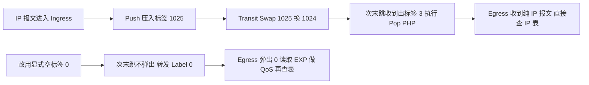

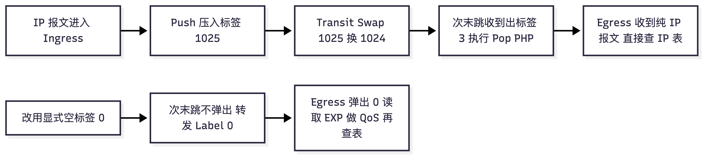


### 真题精练

**Q1.【真题·单选】** MPLS 网络中，执行 PHP（次末跳弹出）的设备是？
A. Ingress LER  B. 上游第一跳  C. 倒数第二跳（Penultimate LSR）  D. Egress LER

> **答案：C**
> **解析**：PHP 的字面含义就是"倒数第二跳弹出"。Egress LER 通过分配**隐式空标签 3** 来"通知"倒数第二跳执行弹出，这样 Egress 收到的是纯 IP 报文，可以直接查 IP 路由表，节省一次标签查表。A 执行 Push；D 在 PHP 场景下不再做标签操作（在显式空标签场景下才弹出 0 标签）。

**Q2.【真题·多选】** 关于标签分配模式，下列说法正确的有？
A. LDP 缺省使用下游自主（DU）方式
B. RSVP-TE 使用下游按需（DoD）方式
C. DU 方式下上游必须发送 Label Request 才能获得标签
D. DoD 方式下标签分配与资源预留可以在一次信令交互中完成
E. 华为 LDP 缺省的标签保持方式为自由（Liberal）方式

> **答案：ABDE**
> **解析**：C 错——DU 是"下游自主分配"，下游无需上游请求就主动通告标签映射；需要请求的是 DoD（Upstream 发 Label Request）。E 正确，自由保持方式保留所有标签映射（含当前未使用的），换取更快的拓扑切换收敛。

**Q3.【真题·简答】** 请说明 PHP 的好处与代价，并解释为什么会有"显式空标签 0"这种设计。

> **答案**：PHP 的好处：① Egress LER 收到的已是无标签 IP 报文，可**直接查 IP 路由表转发，节省一次标签表查询**与相应硬件资源；② 简化 Egress 处理逻辑，使边缘设备可以把转发资源更多用于 IP 业务；③ Egress 无需为每个 FEC 维护标签表项。
> PHP 的代价：Egress 收到的报文不带标签，因此**无法从报文本身识别"该流量来自 LSP"**，导致基于标签的 QoS（EXP 映射）、MPLS OAM、按 LSP 的流量统计在 Egress 处失效。因此引入了**显式空标签 0**：Egress 分配 0，上游节点不弹出标签而是把标签值替换为 0 后转发，Egress 收到 Label=0 的报文后弹出标签并读取 EXP 做优先级映射，再查 IP 表转发——用"Egress 多做一次标签查表"为代价，换取 QoS 与 OAM 能力的保留。
> **解析**：答题要体现"性能与功能权衡"的思维：**PHP 换来效率，显式空标签换回功能**。补充加分：命令层面用 `label advertise` 系列命令控制本端分配哪种空标签。

**Q4.【真题·排错】** 某 MPLS 网络出现"小包能通、1500 字节大包不通"的现象，请分析最可能的原因与验证方法。

> **答案**：最可能原因是 **MTU 不足**。压入标签后报文长度增加（单层 +4 字节、L3VPN 双层 +8 字节），若接口 MPLS MTU 未相应调整，或路径中间存在不支持巨帧的二层设备，大包会被丢弃（表现为 `ping -s 1500` 失败而 `ping -s 1000` 成功）。验证方法：① `ping -s 1400`/`ping -s 1472` 逐步逼近找出分界；② `display interface GigabitEthernet0/0/1` 查看接口 MTU 与 MPLS MTU；③ 检查链路中间设备的 MTU 配置；④ 用 `tracert` 判断在哪个节点开始丢包。解决办法：接口上配置 `mpls mtu`、调整 IP MTU，并保证中间链路支持相应帧长。
> **解析**：这是 MPLS 实验中最典型的故障之一。注意"标签栈深度决定预留字节数"，L3VPN（双层标签）比普通 LDP 转发（单层）多 4 字节，规划时必须一并考虑。

### 易错点与排错

1. **上/下游容易记反**：牢记"**数据流的方向决定上下游，标签由下游分配给上游**"。
2. **`label-retention conservative` 会明显变慢**：实验中发现路由切换慢，先看是否误配了保守方式。
3. **`lsp-trigger host` 是缺省值**：如果实验中发现"只有 LoopBack 的 LSP，网段没有 LSP"，这是正常现象而非故障。
4. **PHP 让 Egress 看不到标签**：排查 MPLS QoS 不生效时，先确认是否因为 PHP 导致 EXP 丢失，必要时改用显式空标签。
5. **排错命令**：`display mpls lsp`（看 In/Out Label 判断是否 PHP）、`display mpls ldp lsp`、`display mpls route-table`、`display mpls ldp session verbose`。

---

## 4.4 LDP 协议：报文、会话建立与故障排查

### 考点定位

LDP 是 MPLS 公网标签分发的**主流协议**，占 **4~8 分**，形式为单选/多选（四种报文、端口号、会话建立顺序）、简答（会话建立过程）、排错（会话不 Up、有会话无 LSP）。**必考数值**：**发现报文用 UDP 646，会话与通告报文用 TCP 646**；**传输地址 = LSR ID，由大的一方主动发起 TCP**。

### 原理精讲

**LDP（Label Distribution Protocol，标签分发协议）** 的作用是：让同一 MPLS 域内的 LSR 之间**交换"FEC → 标签"的映射关系**，从而为 IGP 路由建立 LSP。它不负责计算路径（那是 IGP 的职责），只负责"把路由和标签对应起来"。

**四种报文类型（RFC 5036）**：

| 类型 | 报文 | 传输层 | 作用 |
|---|---|---|---|
| **Discovery（发现）** | Hello | **UDP 646**，目的地址为组播 224.0.0.2（本地链路）或定向单播（远端会话） | 发现邻居、协商 Hello 保持定时器、维持邻接关系 |
| **Session（会话）** | Initialization、Keepalive | **TCP 646** | 建立、维持、结束 LDP 会话；协商版本、标签分配方式、Keepalive 时间、环回检测等参数 |
| **Advertisement（通告）** | Label Mapping（标签映射）、Label Request（标签请求）、Label Withdraw（标签撤销）、Label Release（标签释放） | TCP 646 | 分发与撤销标签映射 |
| **Notification（通知）** | Notification、Extended Notification | TCP 646 | 报告错误与告警（如会话参数不匹配、内存不足） |

**LDP 会话建立的完整过程（必须会画时序图）**：

1. **邻居发现（Discovery 阶段）**：两端接口使能 LDP 后，周期性（缺省每 5 秒）向 `224.0.0.2:646` 发送 **Hello** 报文。收到对端 Hello 后，两者之间建立"**LDP 邻接（Adjacency）**"，此时邻居状态为 **Non-existent → Initialized**。
2. **确定主动方**：双方从 Hello 报文中获得对方的 **Transport Address（传输地址，缺省取 LSR ID）**。比较两端的传输地址，**数值大的一方作为主动方（Active）发起 TCP 连接**，数值小的一方被动等待。之所以用"大的一方主动"，是为了保证双方的选择一致（避免同时发起或都不发起）。
3. **建立 TCP 连接**：主动方向对端的 **646 端口**发起 TCP 连接（三次握手）。
4. **发送 Initialization 报文**：TCP 建立后双方互发 **Initialization** 报文，协商：LDP 协议版本、**标签分配方式（DU/DoD）**、**Keepalive 时间**、**最大 PDU 长度**、**标签分配控制方式**、环回检测（Loop Detection）等。若参数不可接受，发送 Notification 并关闭会话。
5. **发送 Keepalive**：参数协商通过后双方互发 **Keepalive** 报文。
6. **会话进入 Operational（Up）**：收到对端 Keepalive 后，会话正式建立，状态变为 **Operational**。LDP 会话状态机为：**Non-existent → Initialized → OpenSent → OpenRecv → Operational**。
7. **交换标签映射**：会话 Up 后，双方通过 **Label Mapping** 报文交换 FEC 与标签的对应关系。LSR 把收到的映射存入 **LIB**，并从中选出最优的（下一跳与 IGP 最优路由一致的那条）写入 **LFIB**，LSP 建立完成。

**两种 LDP 会话**：

- **本地会话（Local LDP Session）**：基于接口的 Hello 建立，**必须在同一链路上且是直连邻居**，通过链路层与接口来维护。绝大多数 LSP 都由本地会话建立。
- **远端会话（Remote LDP Session）**：通过**定向 Hello**（单播到指定对端）建立，两端可以跨多跳。用途：跨域 Option B/C 中 ASBR 之间传递带标签的 IPv4 路由、LDP over MPLS TE、以及传统 LDP 网络的远端 LFA 等。华为配置：`mpls ldp` 视图下 `remote-peer <名称>` + `remote-ip <对端地址>`。

**标签空间与标签映射**：每台 LSR 拥有独立的**标签空间（Label Space）**（基于平台的全局标签空间，或基于接口的接口标签空间）。**入标签由本机分配，出标签由下游分配**，因此同一条 LSP 在不同设备上的标签值各不相同。Label Mapping 报文携带 `<FEC, Label>` 对；LSR 通过 **Label Withdraw / Label Release** 撤销与释放不再需要的映射。对于同一条 FEC，一台 LSR 可能从多个下游收到多个标签映射（例如有多条等价路径），缺省只选中下一跳与 IGP 最优路由一致的那个，其余保留在 LIB 中（Liberal 保持方式）。

**LDP 与 IGP 的联动（同步）**：LDP 完全依赖 IGP——**传输地址必须由 IGP 可达**，**FEC 的下一跳由 IGP 决定**。这带来一个经典问题：链路故障恢复时，IGP 收敛（毫秒~秒级）通常快于 LDP 重新分配标签，于是出现"IGP 已经把流量指到新链路上，但新链路的标签还没就绪"的**流量黑洞**。解决办法是 **LDP-IGP 同步（LDP-IGP Synchronization）**：在接口上使能同步后，LDP 会话未建立（或标签未就绪）时，IGP **不把该链路通告为可用**（通告最大度量值），直到 LDP 就绪才恢复正常度量。这是运营商网络的标准实践。

**LDP 与 BGP 的联动**：在 L3VPN 中，**公网标签由 LDP 分配**（为对端 PE 的 LoopBack 建立 LSP），**私网标签由 MP-BGP 分配**；在跨域 Option C 中，ASBR 之间通过 BGP 交换"带标签的 IPv4 路由"来为对端 PE 的 LoopBack 分配标签，从而拼出跨域的 LSP。

**LDP 常见故障清单（排错必备）**：

| 现象 | 原因 | 定位命令 |
|---|---|---|
| LDP 邻居都发现不了 | 接口未配 `mpls` / `mpls ldp`；UDP 646 被 ACL/防火墙拦截；链路二三层不通 | `display mpls ldp interface`、`display mpls interface` |
| 会话卡在 Initialized / OpenSent | 传输地址不可达（LSR ID 未配 LoopBack 或 LoopBack 未被 IGP 通告，**最高频**）；TCP 646 被拦截；参数（Keepalive/MD5 密码）不匹配 | `display mpls ldp session`、`display mpls ldp peer`、`display ip routing-table <对端 LSR ID>` |
| 会话 Operational 但没有 LSP | 接口未使能 `mpls`（只使能了 LDP）；对端未通告该 FEC（`lsp-trigger` 限制）；FEC 的下一跳与 LDP 邻居不在同一链路（IGP 走另一条路） | `display mpls ldp lsp`、`display mpls lsp`、`display ip routing-table <FEC>` |
| 两端 LSR ID 相同 | LSR ID 冲突，会话建不起来 | `display mpls ldp peer`、`display current-configuration | include lsr-id` |
| 会话反复 Up/Down | 链路抖动、Keepalive 丢包、CPU 过高、MTU 问题（大 PDU 被丢） | `display mpls ldp session verbose`、`display interface`、`display logbuffer` |

### 关键概念对照表

| 报文类型 | 具体报文 | 传输层与端口 | 用途 |
|---|---|---|---|
| Discovery | Hello | **UDP 646** | 发现邻居、维持邻接 |
| Session | Initialization | **TCP 646** | 参数协商 |
| Session | Keepalive | TCP 646 | 保活、确认会话建立 |
| Advertisement | Label Mapping | TCP 646 | 分发标签映射 |
| Advertisement | Label Request / Withdraw / Release | TCP 646 | 请求 / 撤销 / 释放标签 |
| Notification | Notification / Extended Notification | TCP 646 | 错误与告警通知 |

| 对比项 | 本地 LDP 会话 | 远端 LDP 会话 |
|---|---|---|
| 邻居关系 | 直连（同一链路） | 非直连（跨多跳） |
| 发现方式 | 组播 Hello（224.0.0.2:646） | 定向 Hello（单播） |
| 维护方式 | 依赖接口/链路 | 依赖传输地址可达性 |
| 典型用途 | 普通 LSP 建立 | 跨域、LDP over TE、Option B/C |

| 会话状态 | 含义 |
|---|---|
| Non-existent | 未建立任何关系 |
| Initialized | 已收到 Hello，邻接建立 |
| OpenSent | 已发 Initialization，等待对端 |
| OpenRecv | 已收到 Initialization，正在协商/发送 Keepalive |
| Operational | 会话建立完成，可交换标签映射 |

### 华为设备配置

```bash
# ===== LDP 完整配置（NE40E / NE8000）=====
system-view
mpls lsr-id 1.1.1.1                            // 配置 LSR ID（同时作为 LDP 传输地址，务必用 LoopBack 地址）
mpls                                           // 全局使能 MPLS
 mpls ldp                                      // 全局使能 LDP
  label-distribution independent               // 标签分配控制方式：独立（缺省）
  label-retention liberal                      // 标签保持方式：自由（缺省）
  lsp-trigger host                             // 只为主机路由建 LSP（缺省）
  graceful-restart                             // LDP GR：控制面重启期间保留标签，避免 LSP 中断
  md5-password cipher Huawei@123               // LDP 会话 MD5 认证，两端必须一致
  remote-peer RP1                              // 配置远端 LDP 会话（用于跨域 / LDP over TE）
   remote-ip 3.3.3.3                           // 指定远端 LSR 的传输地址
  quit
 quit
quit
# ===== 接口使能 =====
interface GigabitEthernet0/0/1
 mpls
 mpls ldp
 mpls ldp sync                                 // LDP 与 IGP 同步：LDP 未就绪前 IGP 不通告该链路正常度量（防黑洞）
quit
# ===== IGP 侧（以 OSPF 为例，部分版本需在 IGP 进程下使能同步）=====
ospf 1 router-id 1.1.1.1
 area 0.0.0.0
  network 1.1.1.1 0.0.0.0                      // 通告 LoopBack，保证 LSR ID 可被邻居路由到
  network 10.0.12.0 0.0.0.255                  // 通告互联链路
quit
# ===== 查看与排错 =====
display mpls ldp peer                          // 查看 LDP 邻居与传输地址
display mpls ldp session                       // 查看会话状态（Operational 为正常）
display mpls ldp session verbose               // 查看协商参数（分配/保持方式、Keepalive、MD5）
display mpls ldp interface                     // 查看哪些接口使能了 LDP
display mpls ldp lsp                           // 查看 LDP 建立的 LSP 与标签映射
display mpls lsp                               // 查看 LSP 表（含 In/Out Label）
display ip routing-table 3.3.3.3               // 排"传输地址不可达"（会话卡 Initialized）
```

### 示意图

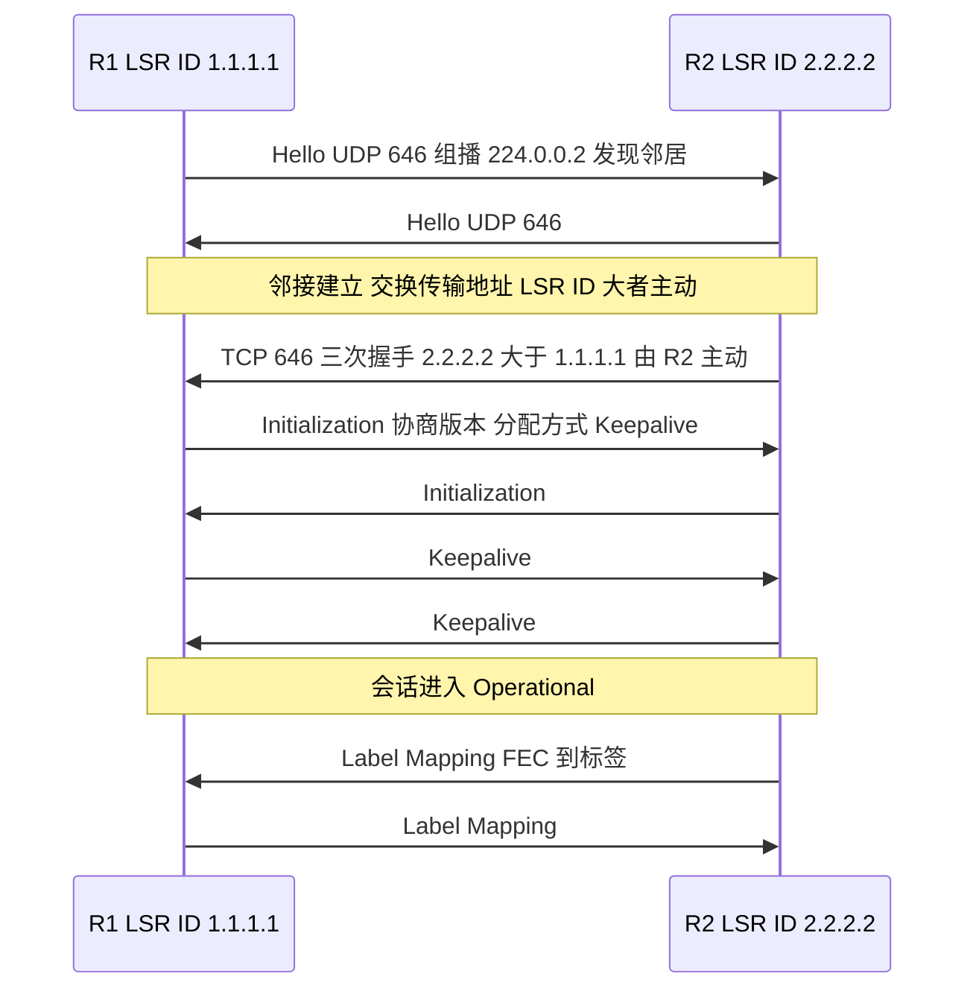

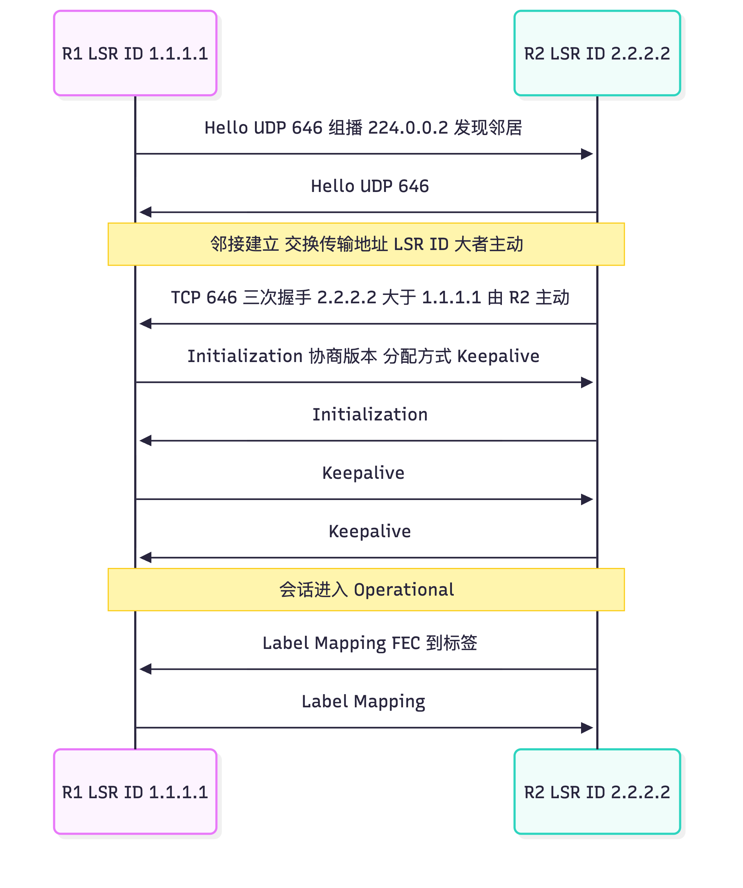


### 真题精练

**Q1.【真题·单选】** LDP 的 Hello 报文与 Label Mapping 报文分别使用什么传输层与端口？
A. 都用 TCP 646
B. Hello 用 UDP 646，Label Mapping 用 TCP 646
C. Hello 用 TCP 646，Label Mapping 用 UDP 646
D. 都用 UDP 646

> **答案：B**
> **解析**：LDP 的发现报文（Hello）使用 **UDP 646**（组播 224.0.0.2 或定向单播），其余报文（Initialization、Keepalive、Label Mapping、Label Request、Withdraw、Release、Notification）都使用 **TCP 646**。这一"发现用 UDP、其余用 TCP"的设计与 BGP"全部用 TCP"形成对比，是常考的记忆点。

**Q2.【真题·简答】** 请描述 LDP 会话的建立过程，并说明为什么由传输地址较大的一方主动发起 TCP 连接。

> **答案**：过程：① 两端接口使能 LDP 后周期性发送 Hello（UDP 646 / 224.0.0.2），收到对端 Hello 后建立邻接（Non-existent → Initialized）；② 双方从 Hello 中获得对方的传输地址（缺省为 LSR ID），**传输地址数值大的一方作为主动方发起 TCP 646 连接**；③ TCP 建立后互发 **Initialization** 协商参数（版本、标签分配方式、Keepalive 时间、最大 PDU、环回检测等）；④ 参数协商一致后互发 **Keepalive**；⑤ 收到对端 Keepalive 后会话进入 **Operational**；⑥ 之后通过 **Label Mapping** 交换 FEC 与标签映射，建立 LSP。
> 由传输地址大的一方主动发起，是为了让**双方的选择结果一致且唯一**——若两端都主动会建立两条 TCP 连接（浪费资源且状态混乱），若两端都等待则永远建不起来；用一个双方都能独立计算出相同结果的规则（比较地址大小）即可避免协商开销与冲突。
> **解析**：答题要点是"Hello 发现 → 比大小定主动方 → TCP → Initialization → Keepalive → Operational → 交换标签映射"，以及"用确定性规则避免双方同时发起或同时等待"。这一思路与 OSPF DR 选举、BGP Router ID 比较本质相同。

**Q3.【真题·排错】** 两台直连的 NE40E 已配置 `mpls`、`mpls ldp` 与接口 LDP，`display mpls ldp peer` 能看到邻居，但 `display mpls ldp session` 状态长期为 **Initialized**，一直不进入 Operational。请给出最可能的原因与排查步骤。

> **答案**：最可能原因是 **LDP 传输地址（LSR ID）不可达**。会话建立到 Initialized 只依赖链路上的 Hello（UDP 646，二层直连即可），但后续的 TCP 646 连接是**发往对端传输地址**的，如果该地址（通常是 LoopBack）没有路由（未被 IGP 通告），TCP 就建不起来，会话永远停在 Initialized。
> 排查步骤：① `display mpls ldp session verbose` 查看对端的传输地址；② 在本端 `display ip routing-table <对端 LSR ID>` 确认路由是否存在，若不存在则检查 IGP 是否正确通告了 LoopBack（OSPF 用 `network 1.1.1.1 0.0.0.0` 或引入直连）；③ `ping -a <本端 LSR ID> <对端 LSR ID>` 验证双向可达；④ 检查是否有 ACL 拦截 TCP 646；⑤ 确认两端 LSR ID 不相同（相同会导致冲突）；⑥ 检查 MD5 密码是否一致（不一致会导致会话建立失败）。
> **解析**：注意区分三个层次：**邻居发现（UDP 646，直连即可）→ 会话建立（TCP 646，需传输地址可达）→ LSP 建立（需接口使能 MPLS 转发且 FEC 匹配）**。会话卡在 Initialized 一定是第二层的问题。

**Q4.【真题·多选】** LDP 会话已经 Operational，但 `display mpls lsp` 中看不到某网段对应的 LSP，可能的原因有？
A. 接口只配置了 `mpls ldp` 而没有配置 `mpls`，MPLS 转发未使能
B. `lsp-trigger` 缺省为 host，该网段不是 /32 主机路由
C. 该 FEC 的下一跳与 LDP 邻居不在同一链路（IGP 选择了其他路径）
D. 对端未通告该 FEC 的标签映射
E. 两端 LSR ID 配置相同

> **答案：ABCD**
> **解析**：E 错——LSR ID 相同会导致**会话建立失败**（会话都 Up 不了），与"会话 Up 但缺 LSP"是不同层次的问题。A、B、C、D 都是"有会话无 LSP"的典型原因：A 是最常见的漏配（Ingress 方向仍需 `mpls` 才能压入标签）；B 是华为缺省行为导致的"预期偏差"；C 说明 LDP 只会使用"与 IGP 最优下一跳一致的邻居"通告的标签；D 属于对端侧未分发。

### 易错点与排错

1. **UDP 646 / TCP 646 的分工必须记准**：Hello 用 UDP，其余全用 TCP。ACL 只放通 TCP 646 会导致"邻居都发现不了"。
2. **传输地址必须可达**：这是 LDP 会话卡在 Initialized 的根本原因，务必用 `display ip routing-table <对端 LSR ID>` 验证。
3. **`mpls` 与 `mpls ldp` 是两个独立开关**：只配 `mpls ldp` 能建会话（Hello/标签交换走 IP），但**无法转发带标签的报文**（因为接口没使能 MPLS 转发），表现为"会话正常但业务不通"。
4. **LDP-IGP 同步是防止黑洞的标准手段**：生产网必须配，实验中也应演示以体现 HCIE 水平。
5. **LDP GR 与 IGP GR 要配套配置**：只配其一可能在控制面重启时依然中断业务。
6. **排错命令**：`display mpls ldp peer`、`display mpls ldp session verbose`、`display mpls ldp interface`、`display mpls interface`、`display mpls ldp lsp`、`display mpls lsp`、`display ip routing-table <LSR ID>`。

---

## 4.5 MPLS 转发全过程逐跳推演（四台设备）

### 考点定位

**这是 MPLS 部分最能体现 HCIE 水平的考点**，占 **5~10 分**，形式为简答、配置分析、排错（"请写出每一跳的标签操作与标签值"）。国赛实验卷也常要求用 `display mpls lsp` 输出反推转发路径。**必须能默画拓扑并逐跳写出标签变化表**。

### 原理精讲

本节的推演基于一个标准四设备 LSP 场景：

**拓扑**：`R1（Ingress LER，LoopBack 1.1.1.1）—— R2（Transit/P，2.2.2.2）—— R3（Transit/P，3.3.3.3）—— R4（Egress LER，4.4.4.4）`，互联链路分别为 `10.0.12.0/24`（R1=.1、R2=.2）、`10.0.23.0/24`（R2=.1、R3=.2）、`10.0.34.0/24`（R3=.1、R4=.2）。全网运行 OSPF 承载 LoopBack 可达性，并在所有互联接口上使能 `mpls` 与 `mpls ldp`。推演目标：**R1 向 4.4.4.4 发送报文**。

**第一步：控制平面建立标签映射（LDP，DU + Liberal + 隐式空）**

LDP 的标签由**下游分配给上游**，因此标签是从 R4 侧开始逐跳向上游传播的：

| 步骤 | 设备 | 行为 |
|---|---|---|
| 1 | R4（Egress） | 为 FEC `4.4.4.4/32` 分配**隐式空标签 3**（表示"请你在你的上一跳执行 PHP"），向 R3 发送 Label Mapping |
| 2 | R3 | 收到后：**出标签 = 3**（PHP），本地为 FEC 分配**入标签 1024**，把"1024"通告给上游 R2 |
| 3 | R2 | 收到后：**出标签 = 1024**，本地分配**入标签 1025**，把"1025"通告给上游 R1 |
| 4 | R1（Ingress） | 收到后：**出标签 = 1025**，本地无需为该 FEC 分配入标签（R1 是 Ingress，没有上游） |

**第二步：各设备的转发表（这是逐跳推演的依据）**

| 设备 | 角色 | 表项 | 入标签 | 标签操作 | 出标签 | 出接口 / 下一跳 |
|---|---|---|---|---|---|---|
| **R1** | Ingress LER | FIB/NHLFE：`4.4.4.4/32` → LSP | 无（不做标签查表，查 IP 路由） | **Push** | **1025** | GE0/0/1 / 10.0.12.2 |
| **R2** | Transit LSR | ILM：**1025** | 1025 | **Swap** | **1024** | GE0/0/2 / 10.0.23.2 |
| **R3** | 次末跳（Penultimate） | ILM：**1024** | 1024 | **Pop（PHP）** | 3（隐式空，等价于"弹出"） | GE0/0/1 / 10.0.34.2 |
| **R4** | Egress LER | 无该 FEC 的 ILM（已通告隐式空） | 无标签 | 无（**直接查 IP 路由表**） | — | LoopBack0（本地） |

**第三步：逐跳转发推演（含标签栈与 TTL 变化）**

假设 R1 收到一个目的地址为 4.4.4.4、IP TTL = 64 的 IP 报文，统一模式下 TTL 逐跳递减：

| 跳 | 设备 | 收到时的报文形态 | 查表依据 | 执行的操作 | 发出时的报文形态 | 出接口 → 下一跳 |
|---|---|---|---|---|---|---|
| 1 | R1（Ingress） | `[IP TTL=64][数据]` | IP 路由表：`4.4.4.4/32` 迭代到 LSP | **Push 1025**，并把 IP TTL 复制到标签 TTL 后递减（标签 TTL = 63） | `[1025 TTL=63][IP TTL=64][数据]` | GE0/0/1 → 10.0.12.2 |
| 2 | R2（Transit） | `[1025 TTL=63][IP][数据]` | LFIB：入标签 1025 | **Swap** 1025→1024，标签 TTL 递减 | `[1024 TTL=62][IP][数据]` | GE0/0/2 → 10.0.23.2 |
| 3 | R3（次末跳） | `[1024 TTL=62][IP][数据]` | LFIB：入标签 1024，出标签 = 3（隐式空） | **Pop（PHP）**，把标签 TTL 剩余值复制回 IP TTL | `[IP TTL=61][数据]`（**纯 IP 报文**） | GE0/0/1 → 10.0.34.2 |
| 4 | R4（Egress） | `[IP TTL=61][数据]` | IP 路由表：`4.4.4.4/32` 是本地 LoopBack | 无标签操作，正常 IP 转发/上送 | 转发或本地接收（TTL 递减为 60） | LoopBack0（本地） |

> **TTL 说明**：统一模式下 TTL 沿 LSP 逐跳递减，因此 `traceroute` 能看到 LSP 内部的 P 设备；若改为管道模式，标签 TTL 在域内保持不变，客户只能看到 PE，看不到 P 设备。不同实现中入口是否对标签 TTL 额外减 1 略有差异，考试重点在"**统一模式逐跳递减、管道模式域内固定**"这一规律。

**第四步：反向 LSP**：从 R4 到 R1 的 `1.1.1.1/32` 需要**另外建立一条 LSP**（标签值完全不同，例如 R1 分配 3、R2 分配 2048、R3 分配 2049 …）。**LSP 是单向的**，务必分别验证 `ping`/`tracert` 两个方向。

**关键推理题（考试常变体）**：
- 如果 R3 与 R4 之间还有一台设备 R35，那么 PHP 由 **R35** 执行，R3 只做 Swap。
- 如果 R4 改为分配**显式空标签 0**，则 R3 不再弹出标签，而是执行 **Swap 1024→0**，把 `[0][IP]` 交给 R4，R4 弹出 0 后查 IP 表（多一次标签查表，但保留了 EXP 用于 QoS）。
- 如果 R2 上 `display mpls lsp` 显示 Out Label 为 `-`（无），说明它没有收到下游的标签映射，需要检查 R2-R3 的 LDP 会话与 `mpls`/`mpls ldp` 接口配置。
- 如果 R1 上 `display ip routing-table 4.4.4.4` 显示为 `IBGP` 或 `Static` 而非 `Tunnel`，说明 BGP/静态路由未能迭代到 LSP，需检查 `lsp-trigger` 与 LoopBack 是否被 LDP 建立了 LSP（缺省 `lsp-trigger host` 只对 /32 生效，正好覆盖 LoopBack）。

### 关键概念对照表

| 设备 | 角色 | 标签操作 | 查哪张表 | 是否需要 IP 路由 |
|---|---|---|---|---|
| R1 | Ingress LER | Push | IP 路由表 + NHLFE | 需要（把目的前缀迭代到 LSP） |
| R2 | Transit LSR | Swap | LFIB（ILM） | 不需要（有 LDP 即可） |
| R3 | 次末跳 | Pop（PHP） | LFIB（ILM） | 不需要 |
| R4 | Egress LER | 无（或弹 0） | IP 路由表 | 需要（转发/接收） |

| 现象 | 含义 | 排查命令 |
|---|---|---|
| `display mpls lsp` 中 Out Label 为 `-` 或 `NULL` | 未收到下游标签映射 / 下游分配的是空标签 | `display mpls ldp lsp` |
| Out Label 为 `3` | 下游要求 PHP（正常） | `display mpls lsp verbose` |
| In Label 为 `-` | 本机是 Ingress（正常） | `display mpls lsp` |
| IP 路由表显示 `Tunnel` | 路由已迭代到 LSP（正常） | `display ip routing-table <prefix>` |

### 华为设备配置

```bash
# ===== 四台设备的 MPLS + LDP + OSPF 基础配置（以 R1 为例，R2/R3/R4 类推）=====
# ---------- R1（Ingress LER）----------
system-view
sysname R1
mpls lsr-id 1.1.1.1
mpls
 mpls ldp
  label-distribution independent
  label-retention liberal
  lsp-trigger host
 quit
quit
interface LoopBack0
 ip address 1.1.1.1 255.255.255.255
quit
interface GigabitEthernet0/0/1
 ip address 10.0.12.1 255.255.255.0
 mpls                                  // 接口使能 MPLS 转发
 mpls ldp                              // 接口使能 LDP（收发 Hello、建会话）
quit
ospf 1 router-id 1.1.1.1
 area 0.0.0.0
  network 1.1.1.1 0.0.0.0              // 通告 LoopBack，供 LDP 传输地址与 LSP 使用
  network 10.0.12.0 0.0.0.255          // 通告互联链路
 quit
quit
# ---------- R4（Egress LER）关键差异 ----------
mpls
 label advertise implicit-null           // 分配隐式空标签 3，让上游做 PHP（缺省行为，此处显式写出便于教学）
quit
# ---------- 验证逐跳转发（按顺序执行）----------
display mpls ldp session                 // 每台设备确认 LDP 会话 Operational
display mpls lsp                         // 查看 In/Out Label，核对是否符合推演表
display mpls lsp verbose                 // 查看 LSP 详细属性（NextHop、OutInterface、是否 PHP）
display mpls ldp lsp                     // 查看 LDP 标签映射（R3 的 Out Label 应为 3）
display ip routing-table 4.4.4.4         // R1 上应显示该路由通过 Tunnel 到达
tracert 4.4.4.4                          // 统一模式下应能看到 10.0.12.2、10.0.23.2、10.0.34.2 等中间跳
```

### 示意图

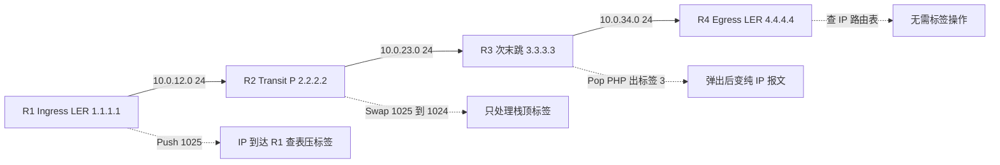

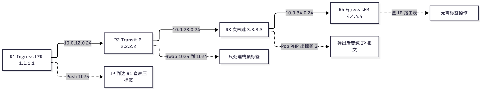


### 真题精练

**Q1.【真题·简答】** 拓扑为 `R1（Ingress，1.1.1.1）— R2 — R3 — R4（Egress，4.4.4.4）`，全网 LDP 采用缺省参数。已知 R4 为 FEC `4.4.4.4/32` 分配隐式空标签，R3 的入标签为 1024、R2 的入标签为 1025。请写出 R1 到 R4 的逐跳标签操作，并说明 R2 的入标签与出标签分别是什么。

> **答案**：R1 收到目的为 4.4.4.4 的 IP 报文后**查 IP 路由表**，发现该前缀迭代到 LSP，执行 **Push**，压入标签 **1025**；R2 查 LFIB 看到**入标签 1025**，执行 **Swap**，**出标签为 1024**（即 R3 分配并通告给它的标签）；R3 查 LFIB 看到入标签 1024，其**出标签为 3（隐式空）**，因此执行 **Pop（PHP）**，把纯 IP 报文发给 R4；R4 收到无标签的 IP 报文，直接查 IP 路由表，发现 4.4.4.4 是本机 LoopBack，上送或本地处理。
> **解析**：答题必须体现三个关键点：① 标签由**下游分配给上游**（所以 R2 的出标签是 R3 给的 1024，R3 的出标签是 R4 给的 3）；② **入标签由本机分配**（1025 是 R2 自己分配的，1024 是 R3 自己分配的）；③ **PHP 由次末跳 R3 执行**，R4 不做标签操作。

**Q2.【真题·多选】** 承接上题拓扑，若 R4 把分配方式改为**显式空标签 0**，则下列说法正确的有？
A. R3 执行 Swap，把标签 1024 替换为 0 后转发
B. R3 仍然执行 Pop，把纯 IP 报文发给 R4
C. R4 收到 Label=0 的报文后弹出标签并查 IP 路由表
D. 采用显式空标签可以保留 EXP 信息供 R4 做 QoS 映射
E. 采用显式空标签会让 R4 少查一次表

> **答案：ACD**
> **解析**：B 错——显式空标签的含义就是"**上游不要弹出**"，因此 R3 只做 Swap（1024→0）；E 错——恰恰相反，R4 需要多查一次标签表（先查 Label=0 的表项，弹出后再查 IP 表），这正是为了换取 EXP/QoS 与 OAM 能力（D 正确）。

**Q3.【真题·排错】** 四台设备组网后，R1 上 `display ip routing-table 4.4.4.4` 显示路由来源为 **OSPF**（而不是预期中的 LSP/Tunnel），`tracert` 逐跳显示的是 IP 转发路径。请分析原因。

> **答案**：这说明 **4.4.4.4/32 没有建立对应的 LSP**，因此 IP 路由无法迭代到标签转发，只能按 OSPF 做纯 IP 转发。排查方向：① 检查各设备 `display mpls ldp session` 是否 Operational；② 检查**每个互联接口**是否都配置了 `mpls` 与 `mpls ldp`（漏配一个接口即可断链）；③ 检查 `lsp-trigger` 配置（华为缺省 `host`，即只为 /32 建 LSP，4.4.4.4/32 应满足条件，若被改成 `none` 则不会建 LSP）；④ 检查 4.4.4.4 是否被 OSPF 正确通告（否则 LDP 无从获得该 FEC 的下一跳）；⑤ `display mpls ldp lsp` 查看该 FEC 是否有标签映射。
> **解析**：注意区分"OSPF 学到的路由"与"标签转发"——两者可以并存。当 LSP 不存在时，IP 报文仍能按 OSPF 转发（**这就是为什么"网络通"不能证明 MPLS 正常**），必须用 `display mpls lsp` 与 `display ip routing-table` 的路由来源字段交叉验证。

### 易错点与排错

1. **不要背标签值，要背"规则"**：入标签本机分配、出标签下游分配；能推导出任意拓扑的标签表。
2. **PHP 的判定依据是"出标签 = 3"**：`display mpls lsp` 的 Out Label 列为 3 即表示本机是次末跳。
3. **`tracert` 结果与 TTL 模式相关**：统一模式能看到 P 设备，管道模式看不到——这常被用来出"为什么 tracert 结果不同"的题。
4. **LSP 单向**：验证时必须检查双向 LSP，单向故障表现为"ping 通但大流量单向不通"。
5. **`lsp-trigger` 缺省 host**：若业务网段不是 /32，则不会有 LSP，此时是**设计行为**而非故障。
6. **排错命令**：`display mpls lsp`、`display mpls lsp verbose`、`display mpls ldp lsp`、`display ip routing-table <prefix>`、`tracert`。

---

## 4.6 MPLS L3VPN 架构：PE / P / CE、VRF 与 RD/RT

### 考点定位

L3VPN 是 MPLS 的**头号应用**，占 **8~15 分**，是国赛路由部分分值最高的单点之一。必考：PE/P/CE 的角色分工、VRF 的作用、**RD 与 RT 的区别（最高频）**、VPNv4 前缀的组成、私网标签的来源、MP-BGP 的地址族编号。**最大陷阱**：把 RD 当成"决定路由进入哪个 VRF"的属性（实际是 RT），或把 RT 当成"前缀唯一化"手段（实际是 RD）。

### 原理精讲

**BGP/MPLS IP VPN（RFC 4364）的三角色模型**：

| 角色 | 全称 | 说明 | 感知 VPN 吗 |
|---|---|---|---|
| **CE** | Customer Edge | 客户侧边缘设备（路由器或交换机），属于客户管理，不感知 MPLS | 只知道自己的私网路由 |
| **PE** | Provider Edge | 运营商边缘设备，维护 VRF、运行 MP-BGP、负责私网标签 | **是**，是 VPN 的实现主体 |
| **P** | Provider | 运营商核心设备，只做公网标签交换 | **否**，完全不感知 VPN |

**为什么 P 设备不需要感知 VPN？** 这正是 MPLS L3VPN 优雅之处：P 设备只需按**外层（公网）标签**把报文送到正确的出口 PE，内层（私网）标签对 P 完全透明。因此扩容 VPN 客户时，**只需在 PE 上配置，P 设备零改动**。这是 L3VPN 相比"每个 VPN 单独拉专线"或"GRE 全网改造"的决定性优势。

**VRF（Virtual Routing and Forwarding，虚拟路由转发表）**：PE 上为每个 VPN 实例创建一套独立的转发资源，包括：独立的路由表、独立的 FIB、绑定到该实例的接口集合、独立的路由协议实例（BGP/OSPF/静态路由）、独立的标签。VRF 解决的核心问题是：**不同客户可能使用完全相同的私网地址空间（例如都使用 10.1.1.0/24），必须在同一台 PE 上共存而不冲突。** 华为命令：`ip vpn-instance <名称>`，接口通过 `ip binding vpn-instance <名称>` 绑定。

**RD（Route Distinguisher，路由区分符）**：**8 字节**，附加在 IPv4 前缀之前，构成 **VPNv4 前缀 = RD（8 字节）+ IPv4 前缀（4 字节）**。作用只有一个：**让不同 VPN 中相同的前缀在 MP-BGP 中成为"不同的前缀"，从而能够共存并各自参与选路**。没有 RD，PE1 从两个客户（都属于 10.1.1.0/24）学到的路由会被 BGP 视为同一条前缀，只能选出一条，另一个客户的路由就被"吃掉"了。RD 的格式有两种：

- `ASN:nn`（2 字节 AS 号 + 4 字节本地值），如 `100:1`；
- `IP:nn`（4 字节 IP 地址 + 2 字节本地值），如 `1.1.1.1:1`。

**关键：RD 不参与 VPN 成员关系的判断**。一条路由带什么 RD，与"它属于哪个 VPN"没有必然关系；RD 只是标签式的前缀唯一化手段。因此**同一个 VPN 内的不同 PE 可以使用不同的 RD**，VPN 仍然正常工作。

**RT（Route Target，路由目标）**：**8 字节的 BGP 扩展团体属性**，才是真正控制"路由进入哪个 VRF"的属性。工作机制：

1. 每个 VRF 配置**导出 RT（export-extcommunity）**与**导入 RT（import-extcommunity）**（可以是多个，也可以相同）；
2. PE 把 VPN 路由通过 MP-BGP 发布时，携带该 VRF 的**导出 RT**；
3. 接收 PE 收到 VPNv4 路由后，把路由携带的 RT 与**本地各 VRF 的导入 RT** 逐一比对，**匹配则把该路由导入对应 VRF**（去掉 RD 后成为普通的 IPv4 私网路由）；
4. 不匹配任何 VRF 的 RT 时，路由只保留在 VPNv4 表中，**不进入任何 VRF**，业务不通。

RT 机制的威力在于它**把"VPN 成员关系"从"物理连接"中解耦**：通过精心设计 RT 的导入/导出组合，可以实现 Hub-and-Spoke（Hub 导出、Spoke 只导入 Hub 的 RT）、跨 VRF 互访（VRF-A 导出 RT 与 VRF-B 导入 RT 相同）、以及集中式业务（客户 RT 被多个业务 VRF 导入）等复杂拓扑。**考试要点总结为一句话：RD 解决"重名冲突"（唯一化），RT 解决"路由归属与分发"（成员关系）。**

**私网标签**：为了让对端 PE 知道"这个报文属于哪个 VPN"，PE 需要为 VPN 路由分配一个**私网标签（VPN 标签）**，并通过 MP-BGP 的 VPNv4 NLRI 携带给对端。注意方向：**私网标签由接收方（Egress PE）分配，通过 MP-BGP 传给发送方（Ingress PE）**——这与 LDP 的"下游分配"逻辑一致。华为缺省**按每条路由分配一个标签（per-route）**，可用 `apply-label per-instance` 改为**按 VPN 实例分配一个标签**，从而大幅节省标签资源（代价是 Egress PE 需要再查一次 IP 表来区分具体路由，实际两种方式都需要查 VRF 表，因此现网常用于大规模 VPN）。这与 4.2 节"显式空/隐式空"的取舍逻辑如出一辙：**用查表次数换资源**。

**MP-BGP（Multi-Protocol BGP）**：BGP 的多协议扩展（RFC 4760），用 **AFI（地址族标识）+ SAFI（子地址族标识）** 标识不同协议族。L3VPN 使用 **AFI = 1（IPv4）、SAFI = 128（VPNv4）**。PE 之间建立 IBGP（通常用 LoopBack 做 `connect-interface`），并在 **VPNv4 地址族**下互相使能。华为配置在 `bgp` 视图的 `ipv4-family vpnv4` 子视图下。需要特别注意的是：**PE 之间传递的是 VPNv4 路由，而不是普通 IPv4 路由**，所以对等体必须在 `ipv4-family vpnv4` 下 `peer x enable`，并且通常需要 `peer x advertise-community`（因为 RT 是扩展团体属性）。

**CE 与 PE 之间的路由交换**：可以是静态路由、EBGP、OSPF、IS-IS、RIP 等任意方式，PE 把这些路由引入到对应 VRF 的 BGP 实例（`ipv4-family vpn-instance <名称>`）中。工程上 EBGP 最常用（隔离性好、易控），OSPF 也常见（客户内部已用 OSPF，PE 作为 ABR/ASBR 参与）。

### 关键概念对照表

| 对比项 | RD（Route Distinguisher） | RT（Route Target） |
|---|---|---|
| 长度 | 8 字节 | 8 字节 |
| 属性类型 | 不是 BGP 属性，是**前缀的一部分** | **BGP 扩展团体属性** |
| 作用 | 使不同 VPN 的相同前缀成为不同前缀（**唯一化**） | 控制路由**导入/导出到哪个 VRF**（成员关系） |
| 是否参与 VPN 成员匹配 | **否** | **是** |
| 不同 PE 上能否不同 | 可以（同一 VPN 内 RD 可以不同） | 通常全网统一规划，导入/导出可不同 |
| 个数限制 | 每个 VRF 一个 RD | 每个 VRF 可配多个导入/导出 RT |
| 格式 | `ASN:nn` 或 `IP:nn` | 同 RD 格式（扩展团体 Type 0x0002/0x0102） |
| 记忆口诀 | **RD = 身份证号（唯一）** | **RT = 门禁卡（决定进哪个门）** |

| 概念 | 取值/组成 | 说明 |
|---|---|---|
| VPNv4 前缀 | RD（8 字节）+ IPv4 前缀（4 字节） | 例如 `100:1:10.1.1.0/24` |
| MP-BGP 地址族 | AFI = 1，SAFI = 128 | VPNv4 |
| 私网标签 | 由 Egress PE 分配，经 MP-BGP 传递 | 缺省 per-route，可改 per-instance |
| 公网标签 | 由 LDP/RSVP-TE/SR 分配 | 为对端 PE 的 LoopBack 建立 LSP |
| VRF 组成 | 路由表 + FIB + 接口 + 协议实例 + 标签 | PE 上每 VPN 一套 |

### 华为设备配置

```bash
# ===== PE1 的 L3VPN 完整配置（NE40E，AS 100）=====
system-view
# --- 1. 使能 MPLS 与 LDP（公网侧）---
mpls lsr-id 1.1.1.1
mpls
 mpls ldp
  lsp-trigger host
 quit
quit
# --- 2. 创建 VPN 实例（VRF）并配置 RD / RT ---
ip vpn-instance VPN_A                          // 创建 VPN 实例 VPN_A
 ipv4-family
  route-distinguisher 100:1                    // RD：唯一化前缀（8 字节）
  vpn-target 100:1 export-extcommunity         // 导出 RT：本 VPN 路由对外携带的团体
  vpn-target 100:1 import-extcommunity         // 导入 RT：接收哪些 RT 的路由进入本 VRF
  # vpn-target 100:1 both                      // 简写：导入与导出使用同一个 RT
 quit
quit
# --- 3. 接口绑定 VPN 实例（客户侧）---
interface GigabitEthernet0/0/1
 description To-CE1
 ip binding vpn-instance VPN_A                 // 该接口属于 VPN_A，收到报文进 VPN_A 的 VRF 表
 ip address 10.1.1.1 255.255.255.0             // 注意：VPN 实例下配置地址，与公网地址空间隔离
quit
# --- 4. 公网侧接口与 IGP ---
interface GigabitEthernet0/0/2
 description To-P1
 ip address 10.0.12.1 255.255.255.0
 mpls
 mpls ldp
quit
ospf 1 router-id 1.1.1.1
 area 0.0.0.0
  network 1.1.1.1 0.0.0.0
  network 10.0.12.0 0.0.0.255
 quit
quit
# --- 5. BGP：公网 IBGP + VPNv4 地址族 + VRF 内的 CE 邻居 ---
bgp 100
 router-id 1.1.1.1
 peer 4.4.4.4 as-number 100                    // 与对端 PE2 建立 IBGP（通常用 LoopBack）
 peer 4.4.4.4 connect-interface LoopBack0
 ipv4-family vpnv4                             // 进入 VPNv4 地址族视图（AFI=1 SAFI=128）
  peer 4.4.4.4 enable                          // 关键：在 VPNv4 地址族下使能该对等体
  peer 4.4.4.4 advertise-community             // RT 是扩展团体属性，必须使能才能传递
  apply-label per-instance                     // 可选：按 VPN 实例分配私网标签，节省标签资源
 quit
 ipv4-family vpn-instance VPN_A                // 进入 VPN 实例的 BGP 视图，与 CE 建邻居
  peer 10.1.1.2 as-number 65001                // CE1 的 EBGP 邻居
  import-route direct                          // 引入直连，便于实验演示（现网按需）
 quit
quit
# ===== 查看与验证 =====
display ip vpn-instance                       // 查看所有 VPN 实例
display ip vpn-instance verbose VPN_A          // 查看 VPN_A 的 RD、RT、绑定接口
display ip routing-table vpn-instance VPN_A    // 查看 VPN_A 的私网路由表
display bgp vpnv4 all routing-table            // 查看 VPNv4 路由（含 RD 前缀、RT 扩展团体）
display bgp vpnv4 vpn-instance VPN_A routing-table   // 查看某实例内的 BGP 路由
display bgp vpnv4 all peer                     // 查看 VPNv4 邻居状态
display mpls lsp                               // 查看公网 LSP 与私网标签
```

### 示意图

```mermaid
flowchart LR
    CE1["CE1 客户站点 A"] --> PE1["PE1 维护 VRF VPN_A RD 100 1 RT 100 1"]
    PE1 -->|"公网标签由 LDP 分配"| P1["P 设备 不感知 VPN"]
    P1 --> PE2["PE2 维护 VRF VPN_A"]
    PE2 --> CE2["CE2 客户站点 A"]
    PE1 -.->|"MP-BGP VPNv4 携带 RD 与 RT"| PE2
    PE2 -.-> CK{"RT 匹配"}
    CK -->|"匹配则导入 VRF"| PE2V["去掉 RD 变 IPv4 私网路由"]
    CK -->|"不匹配"| DROP["只留在 VPNv4 表 不进 VRF"]
```

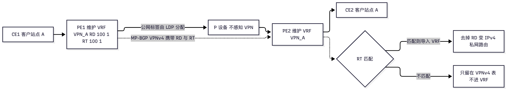


### 真题精练

**Q1.【真题·单选】** 在 MPLS L3VPN 中，决定一条 VPN 路由被导入到哪个 VRF 的属性是？
A. RD（Route Distinguisher）
B. RT（Route Target）
C. 私网标签
D. AS_Path

> **答案：B**
> **解析**：**RT 决定路由归属**——PE 把收到的 VPNv4 路由携带的 RT 与本地各 VRF 的 import-extcommunity 比对，匹配才导入该 VRF。A 错——RD 只用于把不同 VPN 的相同前缀唯一化，使它们在 MP-BGP 中共存，不参与成员关系判断；C 是转发用的标签；D 是 BGP 防环与选路属性，与 VPN 归属无关。记忆口诀：**RD 是身份证号，RT 是门禁卡**。

**Q2.【真题·多选】** 关于 MPLS L3VPN 中的 P 设备与 PE 设备，下列说法正确的有？
A. P 设备只需处理外层公网标签，不感知 VPN
B. 新增 VPN 客户时通常只需在 PE 上配置，P 设备无需改动
C. PE 设备需要维护 VRF 表与 MP-BGP 会话
D. P 设备需要维护所有客户的 VRF 路由表
E. PE 之间的 VPNv4 路由通过 MP-BGP（AFI=1、SAFI=128）传递

> **答案：ABCE**
> **解析**：D 错——P 设备**完全不感知 VPN**，这是 L3VPN 的核心优势：VPN 的扩展对核心透明，新增客户只需在两端 PE 上配置。E 正确，VPNv4 地址族为 AFI=1、SAFI=128，华为对应 `ipv4-family vpnv4` 视图。

**Q3.【真题·简答】** 请解释为什么 MPLS L3VPN 中既需要 RD 又需要 RT，只用其中一个会有什么后果？

> **答案**：**只用 RD 不够**：RD 的作用是给前缀加 8 字节前缀，使不同 VPN 中的相同 IPv4 前缀在 MP-BGP 中成为"不同的前缀"（例如 `100:1:10.1.1.0/24` 与 `100:2:10.1.1.0/24`），从而避免 BGP 把它们当作同一条前缀而发生"互相覆盖/只选一条"的问题。但 RD 本身**不表达任何成员关系**——接收 PE 拿到一条带 RD 的路由，无法知道它应该被放进哪个 VRF（RD 的取值与 VPN 归属没有必然联系）。**只用 RT 也不够**：如果两个 VPN 都使用 10.1.1.0/24 且都不加 RD，那么它们在 MP-BGP 中就是同一条前缀，无论 RT 怎么配，BGP 都只能保留一条，另一个 VPN 的路由必然丢失。
> 因此二者缺一不可：**RD 负责"前缀唯一化"（解决重名冲突），RT 负责"路由导入导出"（表达 VPN 成员关系与拓扑策略）**。典型分工是：RD 每个 VRF 一个（同一 VPN 的不同 PE 可以不同），RT 全网统一规划且可多个组合，用于实现 Hub-Spoke、跨 VRF 互访等灵活拓扑。
> **解析**：答题必须点明"唯一化 vs 成员关系"这一本质差异，并分别说明"只用 RD""只用 RT"的失败场景。

**Q4.【真题·排错】** CE1 与 CE2 属于同一 VPN（VPN_A），两端 PE 的 VPNv4 邻居已 Established，`display bgp vpnv4 all routing-table` 在 PE2 上能看到 `100:1:10.1.1.0/24`，但 PE2 上 `display ip routing-table vpn-instance VPN_A` 里没有这条路由，CE2 无法访问 CE1。请分析原因。

> **答案**：最可能原因是 **PE2 上 VPN_A 的 import-extcommunity 与 PE1 发布路由携带的 export-extcommunity 不匹配**。路由虽已收到并存在于 VPNv4 表中，但因 RT 不匹配而**不会被导入任何 VRF**，因此 VRF 路由表为空、也不会通告给 CE2。
> 其他可能原因：① PE1 侧 `peer x advertise-community` 未配置（RT 是扩展团体属性，不使能则 RT 不随路由传递，PE2 收到的路由不带 RT）；② PE2 上根本没有创建对应的 VPN 实例或实例名称/RD 配置有误；③ PE2 的 VPN 实例未正确绑定接口（路由进了 VRF 但转发不通，属于另一层问题）；④ 被 PE2 上的 import 方向策略过滤。
> 定位命令：`display ip vpn-instance verbose VPN_A`（对比两端 Import/Export RT）、`display bgp vpnv4 all routing-table 100:1:10.1.1.0`（查看带的具体扩展团体）、`display bgp vpnv4 all peer verbose`、`display ip routing-table vpn-instance VPN_A`。
> **解析**：本题的典型特征是"VPNv4 表里有、VRF 表里没有"——这一现象几乎可以唯一地指向 **RT 匹配失败**（或扩展团体没传过来），是 L3VPN 排错最经典的判断点。

### 易错点与排错

1. **RD 不是"VPN 编号"**：它是前缀唯一化手段，同一 VPN 的不同 PE 允许使用不同 RD；而 RT 才是必须统一规划的部分。
2. **`advertise-community` 不能忘**：RT 是扩展团体属性，PE 之间未使能团体传递时，对端收到的路由没有 RT，直接导致 VRF 里没路由。
3. **VPNv4 地址族必须显式 enable**：`peer x as-number` 建好邻居后，还必须在 `ipv4-family vpnv4` 下 `peer x enable`，否则该邻居不会交换 VPNv4 路由（现象：VPN 不通但邻居 Established）。
4. **流量的下一跳必须可达**：PE 之间的 VPNv4 路由下一跳通常是 PE1 的 LoopBack，需要公网 LSP 支持，否则路由不 best（表现与 3.5 节相同）。
5. **私网标签方向别搞反**：**私网标签由接收方 PE 分配**并经 MP-BGP 传给发送方 PE，发送方压入的是"对端给的标签"。
6. **排错命令**：`display ip vpn-instance verbose`、`display ip routing-table vpn-instance <name>`、`display bgp vpnv4 all routing-table`、`display bgp vpnv4 all peer`、`display mpls lsp`、`ping -vpn-instance <name> <ip>`。

---

## 4.7 MP-BGP VPNv4 路由传递与数据转发全过程

### 考点定位

本节将 4.6 节的组件串成完整流程，是**国赛综合题的标准模板**（"请描述 VPN 路由如何从 CE1 传到 CE2、数据报文如何转发"），占 **6~12 分**。**必须能完整写出"路由传递五步"与"数据转发四步"，并画出双层标签栈变化表**。

### 原理精讲

**第一部分：控制平面 —— VPNv4 路由的传递过程（五步）**

1. **CE1 → PE1**：CE1 通过 EBGP（或 OSPF/静态）把站点 A 的私网路由 `10.1.1.0/24` 通告给 PE1。PE1 在 `ipv4-family vpn-instance VPN_A` 下收到该路由，存入 VPN_A 的 VRF 路由表。
2. **PE1 上加 RD 与 RT**：PE1 在 VPNv4 地址族下重新发布该路由时，为其加上 **RD（100:1）**，成为 VPNv4 前缀 **`100:1:10.1.1.0/24`**；同时附加 VPN_A 的 **export-extcommunity（100:1）**；并**分配私网标签**（该标签由 PE2 分配并通过 MP-BGP 传回，见下文说明）。
3. **PE1 → PE2（MP-BGP VPNv4）**：PE1 通过 IBGP 的 VPNv4 地址族把该路由通告给 PE2。报文中的 NLRI 携带 `RD + 前缀 + 私网标签`，Path Attributes 中携带 RT 扩展团体、Next_Hop（PE1 的 LoopBack 或下一跳改写后的地址）等。
4. **PE2 侧 RT 匹配与导入**：PE2 收到 VPNv4 路由后，把路由携带的 RT 与本地各 VRF 的 **import-extcommunity** 比对：匹配 VPN_A 的 RT（100:1）→ **导入 VPN_A**；PE2 去掉 RD，把路由变成普通 IPv4 路由 `10.1.1.0/24` 写入 VPN_A 的 VRF 路由表，同时记录其**私网标签**（该标签是 PE2 自己为该路由分配的）。**若 RT 不匹配，路由只保留在 VPNv4 表中，不进入任何 VRF**。
5. **PE2 → CE2**：PE2 通过 `ipv4-family vpn-instance VPN_A` 把路由通告给 CE2（EBGP/OSPF/静态），CE2 得到去往 10.1.1.0/24 的路由。

> **私网标签分配方向的精确说明**：私网标签与公网标签一样遵循"下游分配"原则——**由 Egress PE（即 PE2）为它要接收的 VPN 路由分配标签**，通过 MP-BGP 的 VPNv4 NLRI 反向传给 Ingress PE（PE1），PE1 转发时压入的就是 PE2 分配的这个标签。因此**每条 VPN 路由上携带的标签值，实际上是"接收方"给出的**（可以用 `display bgp vpnv4 all routing-table` 观察 PE1 侧的标签值与 PE2 侧 `display mpls lsp` 的入标签是否一致来验证）。

**第二部分：转发平面 —— 数据报文的双层标签转发（四步）**

假设 CE1（10.1.1.2）向 CE2（10.2.2.2）发一个 IP 报文：

| 步骤 | 设备 | 动作 | 报文标签栈变化 |
|---|---|---|---|
| 1 | **CE1** | 按私网路由把 IP 报文发给 PE1 | `[IP 目的 10.2.2.2]` |
| 2 | **PE1（Ingress PE）** | 接口绑定 VPN_A → 查 **VPN_A 的 VRF 路由表** → 得到下一跳为 PE2 的 LoopBack（4.4.4.4）与两个标签：内层 = PE2 分配的**私网标签（如 2001）**，外层 = LDP 为 4.4.4.4/32 分配的**公网标签（如 1025）** → **Push 私网标签，再 Push 公网标签** | `[1025 公网][2001 私网][IP]` |
| 3 | **P 设备** | 只查**栈顶（公网标签）**，执行 **Swap**（1025→1024），完全不解析内层与 IP | `[1024][2001][IP]` |
| 4 | **次末跳 P** | 外层标签为隐式空 3 → 执行 **Pop（PHP）**，弹出公网标签 | `[2001 私网][IP]` |
| 5 | **PE2（Egress PE）** | 收到只有私网标签的报文 → 查 ILM：私网标签 2001 对应 **VRF VPN_A** → **Pop 私网标签** → 按目的 IP 查 VPN_A 的 VRF 路由表 → 从绑定该 VRF 的接口发给 CE2 | `[IP 目的 10.2.2.2]` |
| 6 | **CE2** | 正常接收 | — |

**三个必须理解的关键点**：

1. **外层标签负责"到达对的 PE"，内层标签负责"到达对的 VPN"**。这就是为什么 P 设备不需要感知 VPN：它只看外层。而 PE2 通过内层标签就能知道该报文属于哪个 VPN，无需查看 IP 地址是否冲突。
2. **PHP 在 L3VPN 中依然生效**：外层公网标签被次末跳弹出后，PE2 收到的是"只带私网标签"的报文，这正是 L3VPN 中"私网标签必须存在"的另一个理由——它承担了 PE2 侧"识别 VPN + 定位 VRF"的职责。若私网标签也采用空标签，PE2 就无法区分不同 VPN 中相同的 IP 地址（如两个 VPN 都有 10.2.2.2）。
3. **标签栈的压入顺序**：先压**私网标签（内层，S=1）**，再压**公网标签（外层，S=0）**。转发时只处理栈顶，因此顺序错误会导致完全错误的转发（这是 L3VPN 实验中的典型故障现象："报文到了 PE2 却进了错误的 VRF 或被丢弃"）。

**公网 LSP 的作用再强调**：VPNv4 路由的 Next_Hop 是 PE1 的 LoopBack（或对端 PE 的 LoopBack），PE2 要能把报文送到 PE1，必须存在一条**到该 LoopBack 的公网 LSP**（由 LDP/RSVP-TE/SR 建立）。若公网 LSP 不存在，VPNv4 路由的下一跳无法迭代，路由不为 best，**VPN 业务不通但 BGP 邻居一切正常**——这与 3.5 节的 IBGP 下一跳问题是同一类故障。

### 关键概念对照表

| 阶段 | 关键动作 | 涉及的属性/标签 | 出错后的典型现象 |
|---|---|---|---|
| CE1 → PE1 | 私网路由引入 VRF | 私网 IPv4 路由 | VRF 路由表为空 |
| PE1 加工 | 加 RD、附加 export RT、分配/携带私网标签 | RD、RT、私网标签 | VPNv4 表无路由 |
| PE1 → PE2 | MP-BGP VPNv4 通告（AFI=1/SAFI=128） | VPNv4 NLRI、RT 扩展团体 | 对端 VPNv4 表无路由 |
| PE2 导入 | RT 匹配、去 RD、写入 VRF | import-extcommunity | **VPNv4 表有、VRF 表无**（典型 RT 不匹配） |
| PE2 → CE2 | 私网路由通告 | 私网 IPv4 路由 | CE2 无路由 |
| 数据转发 | 双层标签 Push/Swap/Pop | 外层公网标签 + 内层私网标签 | 业务不通、进错 VRF |

| 标签层 | 分配者 | 依据 | 作用 | 传递方式 |
|---|---|---|---|---|
| 外层（公网） | 公网设备（LDP/RSVP-TE/SR） | 对端 PE 的 LoopBack FEC | 把报文送到正确的出口 PE | LDP/RSVP-TE/SR 信令 |
| 内层（私网） | **接收方 PE（Egress PE）** | VPN 路由（per-route 或 per-instance） | 让出口 PE 识别 VPN 并定位 VRF | MP-BGP 的 VPNv4 NLRI |

### 华为设备配置

```bash
# ===== 承接 4.6 节配置，补齐 CE 侧与验证命令 =====
# ---------- CE1（客户侧，AS 65001）----------
system-view
sysname CE1
interface GigabitEthernet0/0/1
 ip address 10.1.1.2 255.255.255.0
quit
interface LoopBack0
 ip address 10.1.1.254 255.255.255.255        // 模拟客户内部网段（可选）
quit
bgp 65001
 peer 10.1.1.1 as-number 100                   // 向 PE1 建立 EBGP
 network 10.1.1.0 255.255.255.0                // 发布客户私网路由
quit
# ---------- PE1 侧：确认 VRF 引入与 VPNv4 通告 ----------
bgp 100
 ipv4-family vpn-instance VPN_A
  peer 10.1.1.2 as-number 65001
 quit
 ipv4-family vpnv4
  peer 4.4.4.4 enable
  peer 4.4.4.4 advertise-community             // 传递 RT 扩展团体
 quit
quit
# ---------- PE2 侧：确认 RT 导入与私网标签 ----------
ip vpn-instance VPN_A
 ipv4-family
  vpn-target 100:1 import-extcommunity          // 必须与 PE1 的 export RT 匹配
 quit
quit
# ===== 控制平面验证（依次执行）=====
display bgp vpnv4 all routing-table             // PE1/PE2 上查看 VPNv4 路由：应看到 RD 前缀与 RT
display bgp vpnv4 all routing-table 100:1:10.1.1.0   // 查看单条 VPNv4 路由的标签与扩展团体
display ip routing-table vpn-instance VPN_A      // PE2 上应看到去掉 RD 后的 10.1.1.0/24
display bgp vpnv4 all peer                       // VPNv4 邻居状态
display mpls lsp                                 // 查看公网 LSP 与私网标签（In Label 中的私网标签段）
# ===== 数据平面验证 =====
ping -vpn-instance VPN_A 10.1.1.2                // 从 PE2 的 VPN_A 实例 ping CE1，验证私网可达
tracert -vpn-instance VPN_A 10.1.1.2             // 验证转发路径
display mpls lsp verbose                         // 查看 LSP 详细属性确认标签栈与出接口
```

### 示意图

```mermaid
sequenceDiagram
    participant CE1 as CE1 站点A
    participant PE1 as PE1
    participant PE2 as PE2
    participant CE2 as CE2 站点A
    CE1->>PE1: EBGP 通告私网路由 10.1.1.0/24
    Note over PE1: 加入 RD 100 1 附加 export RT 100 1 携带私网标签
    PE1->>PE2: MP-BGP VPNv4 通告 100 1 10.1.1.0/24
    Note over PE2: RT 匹配 import 100 1 去掉 RD 写入 VRF VPN_A
    PE2->>CE2: 私网路由 10.1.1.0/24
    CE1->>PE1: 数据报文 目的 10.2.2.2
    Note over PE1: Push 私网标签 再 Push 公网标签
    PE1->>PE2: 报文 公网标签 私网标签 IP
    Note over PE2: 弹出私网标签 按 VRF 表转发
    PE2->>CE2: 纯 IP 报文
```

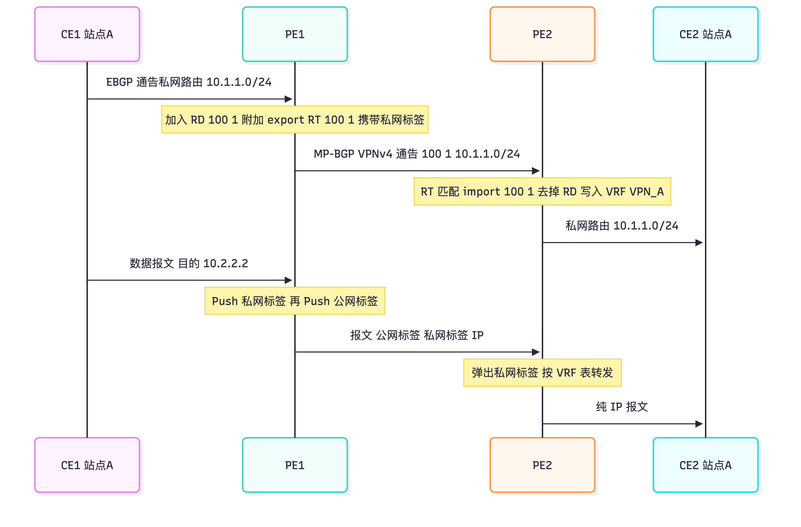


### 真题精练

**Q1.【真题·简答】** 请完整描述 MPLS L3VPN 中数据报文的转发过程（从 CE1 到 CE2），并说明每一层标签的作用。

> **答案**：① CE1 按私网路由把 IP 报文发给 PE1；② PE1 从绑定 VPN_A 的接口收到报文，查 **VPN_A 的 VRF 路由表**，得到去往目的的下一跳（对端 PE2 的 LoopBack）与标签信息，**先压入私网标签（内层，由 PE2 通过 MP-BGP 分配），再压入公网标签（外层，由 LDP 为 PE2 的 LoopBack 分配）**，形成 `[公网标签][私网标签][IP]`；③ P 设备只查栈顶的公网标签做 **Swap**，完全不感知内层标签与 IP 内容；④ 次末跳 P 按隐式空标签（3）执行 **PHP**，弹出公网标签，报文变为 `[私网标签][IP]`；⑤ **PE2 依据私网标签定位到 VRF VPN_A，弹出私网标签**，再查 VPN_A 的 VRF 路由表，从对应接口转发给 CE2。
> **两层标签的作用**：**外层公网标签**负责把报文送到正确的出口 PE（P 设备据此转发，实现"核心不感知 VPN"）；**内层私网标签**负责让出口 PE 识别该报文属于哪个 VPN（即使不同 VPN 使用相同的 IP 地址空间也能正确分离），并定位到对应的 VRF 表。
> **解析**：答题要点是"两层标签 + 两种表（LFIB/VRF 表）+ 两个关键动作（PHP 弹外层、Egress PE 按内层标签定位 VRF）"。

**Q2.【真题·多选】** 关于 L3VPN 中私网标签的说法，正确的有？
A. 私网标签由 Egress PE 分配，通过 MP-BGP 的 VPNv4 NLRI 传递给 Ingress PE
B. 华为缺省按每条路由分配一个私网标签，可用 `apply-label per-instance` 改为按实例分配
C. 私网标签的作用是让出口 PE 识别报文属于哪个 VPN
D. 私网标签必须使用隐式空标签 3
E. 若两个 VPN 使用相同的私网 IP 地址，出口 PE 依靠私网标签加以区分

> **答案：ABCE**
> **解析**：D 错——私网标签**不能**使用空标签。如果 Egress PE 收到的报文不带私网标签，它就无法区分不同 VPN 中相同的 IP 地址（例如两个 VPN 都有 10.2.2.2），业务会串线或丢弃。这正是"L3VPN 中私网标签必须存在"的根本原因。C 与 E 是同一道理的两个表述。

**Q3.【真题·排错】** 华为 NE40E 组网中，PE1 与 PE2 的 VPNv4 邻居 Established，PE2 上 `display ip routing-table vpn-instance VPN_A` 能看到 `10.1.1.0/24` 且为 BGP 路由，但 `ping -vpn-instance VPN_A 10.1.1.2` 不通。请给出排查思路。

> **答案**：VRF 路由表里有路由说明**控制平面已正常**（RT 匹配、路由导入成功），因此问题在**转发平面或下一跳可达性**：
> ① **VPNv4 路由的下一跳是否可迭代**：`display bgp vpnv4 all routing-table 100:1:10.1.1.0` 查看下一跳（通常是 PE1 的 LoopBack），再用 `display ip routing-table <下一跳>` 确认公网侧有到该地址的 LSP/路由；公网 LSP 缺失会导致报文无法封装外层标签。
> ② **公网 LSP 是否完整**：`display mpls lsp` 检查到 PE1 LoopBack 的 LSP 是否存在，`tracert` 公网侧地址是否通。
> ③ **接口绑定与地址是否正确**：`display ip vpn-instance verbose VPN_A` 确认接口已 `ip binding vpn-instance VPN_A`，且该接口地址配置在 VPN 实例下（若误配在公网视图，报文不会进 VRF）。
> ④ **CE1 侧回程路由**：CE1 是否有回到 10.2.2.0/24 的路由（单向通是最常见的"ping 不通"原因）。
> ⑤ **MTU**：双层标签使报文增加 8 字节，大包可能被丢，用 `ping -s` 逐步测试。
> ⑥ 检查两端是否有 ACL/策略过滤 VPN 流量，以及 `ping -vpn-instance` 是否指定了正确的源地址（`ping -vpn-instance VPN_A -a <源> <目的>`）。
> **解析**：核心判断逻辑是"**VRF 表里有路由 = 控制面 OK，问题必在转发面/下一跳/回程**"，据此把排查范围迅速收缩。

### 易错点与排错

1. **RD 与 RT 的位置不同**：RD 在**前缀里**（`100:1:10.1.1.0/24`），RT 在**属性里**（Extended Community），看 `display bgp vpnv4 all routing-table` 输出时不要混淆。
2. **外层 PHP 与内层私网标签共存**：不要以为 PHP 会把两层标签一起弹掉，PHP 只针对当前的**栈顶**标签。
3. **VPNv4 路由的下一跳**：跨 PE 场景要保证公网 LSP 能到达下一跳，必要时在 PE 上配置 `peer x next-hop-local`（对 RR 场景尤其重要）。
4. **`ping -vpn-instance` 的源地址**：不指定源可能导致回程路由缺失，验证时应显式指定 `-a`。
5. **改动 RT 后要刷新**：修改 `vpn-target` 后建议 `refresh bgp vpnv4 ...` 或复位邻居，否则路由可能不会立即重新导入。
6. **排错命令**：`display bgp vpnv4 all routing-table`、`display ip routing-table vpn-instance <name>`、`display ip vpn-instance verbose`、`display mpls lsp`、`ping -vpn-instance <name> -a <源> <目的>`、`tracert -vpn-instance <name> <目的>`。

---

## 4.8 L3VPN 跨域方案 Option A / B / C（国赛高频）

### 考点定位

**这是 MPLS 部分分值最高的论述题**，占 **8~15 分**。国赛几乎每年都以"三种跨域方案的原理、优缺点、配置关键点、适用场景"出题。**必须能说清三个方案各自在 ASBR 之间交换什么路由**（这是区分 A/B/C 的唯一标准），以及 **Option B 必须配 `undo policy vpn-target`**、**Option C 必须配 `label-route-capability` 与 PE 间的多跳 MP-EBGP**。

### 原理精讲

**跨域问题的来源**：VPN 客户的两个站点分别接入不同的 AS（通常是不同运营商或同一运营商的不同 AS 域），两个 AS 各自运行自己的 IGP 与 LDP，MP-BGP 的 VPNv4 会话无法跨 AS 直接在 PE 之间建立（IBGP 要求同一 AS；若用 EBGP 则需跨域传递且公网 LSP 无法拼接）。因此需要在 **ASBR（Autonomous System Boundary Router，自治系统边界路由器）** 上做跨域互通。RFC 4364 给出了三种方案，按"ASBR 参与 VPN 的深度"递增编号：

**Option A：VRF-to-VRF（背靠背 VRF）**

- **做法**：两个 AS 的 ASBR 之间，为**每一个 VPN** 创建一条独立的逻辑通道（子接口 + VLAN 或独立物理链路），并在 ASBR 上为该 VPN 创建 **VRF**，把该子接口绑定到 VRF；然后在这条"每 VPN 一条"的链路上运行**普通 EBGP（IPv4 单播地址族）**，交换**私网 IPv4 路由**（不是 VPNv4）。
- **本质**：相当于两个运营商各自把自己的 VPN 延伸到一个共享的"背靠背"接口上，两台 ASBR 就像两台直接相连的 CE 路由器一样交换私网路由。
- **优点**：实现最简单、两个 AS 的路由与标签完全独立（互不依赖）、**不需要 VPNv4 能力**、跨厂商兼容性最好、故障域隔离清晰。
- **缺点**：**扩展性最差**。VPN 数量为 N 时，ASBR 之间需要 N 个子接口（或链路）、ASBR 上需要 N 个 VRF 配置，且 ASBR 必须维护每个 VPN 的完整路由表；每新增一个客户 VPN，两端 ASBR 都要增加配置与接口资源。
- **适用**：VPN 数量少（几十个以内）的跨域互通、异构厂商设备互通、临时/过渡方案。

**Option B：单跳 MP-EBGP（ASBR 之间交换 VPNv4）**

- **做法**：两个 AS 的 ASBR 之间建立**单跳 MP-EBGP 会话**（在 VPNv4 地址族下），**直接交换 VPNv4 路由**。ASBR 不为任何 VPN 创建 VRF。
- **关键技术点**：ASBR 上没有（也不需要）VPN 实例，因此收到 VPNv4 路由后**无法通过 RT 匹配来导入**——缺省行为是丢弃。因此**必须在 ASBR 的 BGP VPNv4 视图下配置 `undo policy vpn-target`**，表示"不做 VPN Target 检查，接收并转发所有 VPNv4 路由"。这是 Option B 最常考的配置点。
- **标签与转发**：ASBR 收到 VPNv4 路由后，为其**重新分配外层标签**（相当于在该 VPNv4 路由上建立一段 PW 式的标签转发），从而把两个 AS 内的 LSP 逐跳拼接起来。ASBR 需要维护**全部 VPNv4 路由**。
- **优点**：ASBR **无需为每个 VPN 配置 VRF**，配置量与 VPN 数量基本无关，扩展性明显优于 A。
- **缺点**：ASBR 作为"VPN 路由的中转站"，必须保存全部 VPNv4 路由（可能有几十万条），对内存/CPU 压力大；ASBR 之间要求直连（单跳）。
- **适用**：同一运营商内部不同 AS 域之间的互通；VPN 数量多但愿意为 ASBR 投入高规格设备。

**Option C：多跳 MP-EBGP + 路由反射（ASBR 只交换带标签的公网路由）**

- **做法（三段拼装）**：
  1. **PE 之间建立多跳 MP-EBGP**：不同 AS 的两个 PE 直接（通过 LoopBack）建立 **多跳 EBGP** 会话（需 `ebgp-max-hop` + `connect-interface LoopBack0`），在 **VPNv4 地址族**下直接交换 VPNv4 路由。**VPNv4 路由不再经过 ASBR 中转**。
  2. **ASBR 之间交换"带标签的 IPv4 路由"**：ASBR 之间运行 EBGP，但通告的是**对端 AS 内 PE 的 LoopBack 路由，并为其分配标签**（BGP Labeled-Unicast）。这样就在两个 AS 之间拼出一条**跨域的 LSP**：`PE1 →（AS 100 内 LDP LSP）→ ASBR1 →（BGP 分配标签）→ ASBR2 →（AS 200 内 LDP LSP）→ PE2`。
  3. **VPNv4 下一跳的迭代**：PE1 上的 VPNv4 路由下一跳是对端 PE2 的 LoopBack（4.4.4.4），PE1 通过第 2 步得到的带标签路由，把该下一跳迭代到跨域 LSP 上，从而完成转发。
- **三个关键配置点（答题必须写出）**：
  1. **PE 侧**：`peer <对端 PE LoopBack> ebgp-max-hop 10`、`peer <...> connect-interface LoopBack0`、在 `ipv4-family vpnv4` 下 `peer <...> enable`，并注意使能团体属性传递；
  2. **ASBR 侧**：对 ASBR 之间的 EBGP 邻居配置 **`peer <对端 ASBR> label-route-capability`**（使能交换带标签的 IPv4 路由），配合 route-policy 只允许对端 PE 的 LoopBack 路由通过（避免把无关路由带标签扩散）；
  3. **AS 内部的下一跳**：ASBR 把从对端 AS 学到的带标签路由通告给本 AS 的 PE/RR 时，要保证 PE 能迭代到该下一跳——通常配置 `peer <IBGP 邻居> next-hop-local`（改为 ASBR 自身 LoopBack）；若设计上要求保持对端 PE 的原始下一跳，则相应配置 `peer <...> next-hop-invariable`（两者按实际设计二选一）。
- **优点**：**扩展性最好**——ASBR **完全不维护 VPN 路由**（只维护公网路由/对端 PE 的 LoopBack），VPN 数量增加对 ASBR 毫无影响；跨域 LSP 端到端建立，转发效率最高；ASBR 压力最小。
- **缺点**：**配置最复杂**（三处协同配置、需要 RR 支撑 AS 内的带标签路由扩散）、排错困难、要求对端 AS 支持带标签的 IPv4 路由交换（BGP Labeled-Unicast）、PE 之间必须能建立多跳 EBGP（跨域路由可达性要通过 ASBR 与 RR 层层传递）。

**三种方案的统一记忆口诀**：

> **A 交换私网 IPv4（每 VPN 一条链路）、B 交换 VPNv4（ASBR 扛全部 VPN 路由）、C 交换带标签的公网 IPv4（PE 之间直连交换 VPNv4）。**

### 关键概念对照表

| 对比维度 | **Option A**（VRF-to-VRF） | **Option B**（单跳 MP-EBGP） | **Option C**（多跳 MP-EBGP） |
|---|---|---|---|
| ASBR 之间交换的路由 | **私网 IPv4 路由**（VRF 内，普通 EBGP） | **VPNv4 路由**（MP-EBGP 单跳） | **带标签的公网 IPv4 路由**（PE 的 LoopBack） |
| ASBR 是否需要 VRF | **需要**（每个 VPN 一个 VRF + 子接口/链路） | 不需要 | 不需要 |
| ASBR 维护的路由量 | 各 VPN 的私网路由（按 VPN 分摊） | **全部 VPNv4 路由（最大）** | **只有公网路由（最小）** |
| PE 之间是否有直接会话 | 无 | 无 | **有（多跳 MP-EBGP）** |
| 端到端是否一条 LSP | 否（两段独立，背靠背） | 否（ASBR 逐跳为 VPNv4 分配标签） | **是（跨域 LSP 拼接）** |
| 配置量与 VPN 数量的关系 | **线性增长（最差）** | 基本无关 | 完全无关 |
| 关键配置 | ASBR 上建 VRF + 子接口绑定 | **`undo policy vpn-target`** | **`label-route-capability`** + PE 间 `ebgp-max-hop` |
| 配置复杂度 | 低 | 中 | **高** |
| 跨厂商兼容性 | **最好** | 较好 | 较差（需支持 BGP 带标签路由） |
| 扩展性 | 差 | 中 | **最好** |
| 典型适用场景 | VPN 少的跨域互通、异构互通 | 同运营商多 AS 域 | 大型运营商骨干、国赛重点 |

| 方案 | ASBR 上的 VPN 感知 | ASBR 是否转发 VPN 数据流 | 对 ASBR 规格要求 |
|---|---|---|---|
| A | 是（有 VRF） | 是（查 VRF 表转发） | 低（但配置多） |
| B | 否（但存 VPNv4 路由） | 是（按 VPNv4 标签转发） | **高（路由量最大）** |
| C | 否 | 是（只按公网标签转发） | 低 |

### 华为设备配置

```bash
# ============ Option A：ASBR1（AS 100）侧 ============
system-view
ip vpn-instance VPN_A
 ipv4-family
  route-distinguisher 100:1
  vpn-target 100:1 export-extcommunity
  vpn-target 100:1 import-extcommunity
 quit
quit
interface GigabitEthernet0/0/1.1                     // 为 VPN_A 单独创建子接口（每 VPN 一条逻辑链路）
 vlan-type dot1q 1                                   // 子接口封装 VLAN 1
 ip binding vpn-instance VPN_A                       // 关键：绑定 VPN 实例
 ip address 192.168.1.1 255.255.255.0                // 与对端 ASBR 在该 VPN 内的互联地址
quit
bgp 100
 ipv4-family vpn-instance VPN_A                      // 在 VPN 实例的地址族下与对端 ASBR 建邻居
  peer 192.168.1.2 as-number 200                     // 普通 EBGP，交换的是私网 IPv4 路由
 quit
quit
# ============ Option B：ASBR1（AS 100）侧 ============
bgp 100
 peer 10.0.12.2 as-number 200                        // 与 ASBR2 直连（单跳）
 ipv4-family vpnv4
  peer 10.0.12.2 enable                              // 在 VPNv4 地址族下使能
  undo policy vpn-target                             // ★关键：不做 RT 检查，接收并转发所有 VPNv4 路由
  peer 10.0.12.2 advertise-community                 // 传递 RT 扩展团体
 quit
quit
# ============ Option C：ASBR1（AS 100）侧 ============
ip ip-prefix PE2_LOOP index 10 permit 4.4.4.4 32     // 只允许对端 AS 的 PE LoopBack 带标签通过
route-policy TO_ASBR2 permit node 10
 if-match ip-prefix PE2_LOOP
route-policy TO_ASBR2 deny node 20
bgp 100
 peer 10.0.12.2 as-number 200                        // 与 ASBR2 的 EBGP
 peer 10.0.12.2 label-route-capability               // ★关键：使能交换"带标签的 IPv4 路由"
 peer 10.0.12.2 route-policy TO_ASBR2 export          // 只把对端 PE 的 LoopBack 带标签通告出去
 peer 1.1.1.1 as-number 100                          // 与本 AS 内的 RR/PE 建立 IBGP
 peer 1.1.1.1 connect-interface LoopBack0
 peer 1.1.1.1 next-hop-local                         // ★关键：把带标签路由的下一跳改为 ASBR 自己，保证 AS 内可迭代
quit
# ============ Option C：PE1（AS 100）侧 ============
bgp 100
 peer 4.4.4.4 as-number 200                          // 与对端 AS 的 PE2 直接建 EBGP（跨 AS）
 peer 4.4.4.4 ebgp-max-hop 10                        // ★关键：多跳 EBGP（PE 之间非直连）
 peer 4.4.4.4 connect-interface LoopBack0            // 用 LoopBack 建立，会话稳定
 ipv4-family vpnv4
  peer 4.4.4.4 enable                                // 在 VPNv4 地址族下交换 VPNv4 路由
  peer 4.4.4.4 advertise-community
 quit
quit
# ============ 验证（三种方案通用）============
display bgp vpnv4 all routing-table                  // 查看 VPNv4 路由（Option B/C 的关键验证点）
display bgp vpnv4 all peer                           // VPNv4 邻居状态
display ip routing-table vpn-instance VPN_A          // 私网路由是否进入 VRF（Option A 直观看这里）
display mpls lsp                                     // 查看跨域 LSP 与标签（Option C 重点）
display bgp routing-table 4.4.4.4                    // Option C：确认对端 PE LoopBack 带标签路由
display ip routing-table 4.4.4.4                     // Option C：确认下一跳可迭代到 LSP
```

### 示意图

```mermaid
flowchart LR
    subgraph AS100["AS 100"]
        PE1["PE1"]
        ASBR1["ASBR1"]
    end
    subgraph AS200["AS 200"]
        ASBR2["ASBR2"]
        PE2["PE2"]
    end
    PE1 --- ASBR1
    ASBR1 --- ASBR2
    ASBR2 --- PE2
    ASBR1 -.->|"Option A 私网 IPv4 路由 每 VPN 一条链路"| ASBR2
    ASBR1 -.->|"Option B 单跳 MP-EBGP 交换 VPNv4"| ASBR2
    ASBR1 -.->|"Option C 带标签的公网 IPv4 路由"| ASBR2
    PE1 -.->|"Option C 多跳 MP-EBGP 直接交换 VPNv4"| PE2
```

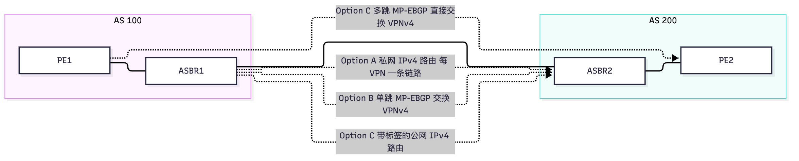


### 真题精练

**Q1.【真题·单选】** 在 L3VPN 跨域方案中，ASBR 之间交换"带标签的 IPv4 公网路由"、而 PE 之间直接建立多跳 MP-EBGP 会话交换 VPNv4 路由的方案是？
A. Option A  B. Option B  C. Option C  D. Option D

> **答案：C**
> **解析**：**选项 A 与 B 的区别在于 ASBR 之间交换的路由类型**：A 交换私网 IPv4 路由（VRF 内），B 交换 VPNv4 路由。**选项 C 的特征是"VPNv4 路由不经 ASBR"**——PE 之间直接建立多跳 MP-EBGP 交换 VPNv4，ASBR 只负责交换带标签的公网路由以拼接跨域 LSP。因此 ASBR 是否需要保存 VPN 路由是区分 B 与 C 的关键。

**Q2.【真题·多选】** 部署 Option B 时，ASBR 上必须配置或注意的有？
A. ASBR 之间建立单跳 MP-EBGP 会话
B. 在 VPNv4 地址族下配置 `undo policy vpn-target`
C. ASBR 上必须为每个 VPN 创建 VRF
D. ASBR 需要维护全部 VPNv4 路由
E. 需要 `label-route-capability` 才能交换 VPNv4

> **答案：ABD**
> **解析**：C 错——Option B 的最大优点就是 **ASBR 无需为每个 VPN 创建 VRF**（那正是 Option A 的做法）；E 错——`label-route-capability` 是 **Option C** 用于交换"带标签的 IPv4 路由"的命令，Option B 交换的是 VPNv4 路由，不需要它。B 是 Option B 的关键：ASBR 没有 VPN 实例，若不关闭 RT 检查，收到的 VPNv4 路由会因无匹配 VRF 而被丢弃。

**Q3.【真题·简答】** 请描述 Option C 的实现原理，并写出 PE 与 ASBR 上的三个关键配置点。

> **答案**：**实现原理**：Option C 把"VPN 路由的传递"和"公网 LSP 的拼接"彻底分开。① 不同 AS 的两个 **PE 之间直接建立多跳 MP-EBGP 会话**，在 VPNv4 地址族下直接交换 VPNv4 路由，**ASBR 完全不参与 VPN 路由的传递与保存**；② 两个 AS 的 **ASBR 之间通过 EBGP 交换"带标签的 IPv4 路由"**（通常是对方 AS 内 PE 的 LoopBack 路由，由 BGP 为其分配标签），从而把 AS 100 内的 LDP LSP、ASBR 之间的 BGP 标签段、AS 200 内的 LDP LSP **拼接成一条端到端的跨域 LSP**；③ PE1 上的 VPNv4 路由下一跳是对端 PE2 的 LoopBack，PE1 利用第 ② 步获得的带标签路由把该下一跳**迭代到跨域 LSP**，从而完成数据转发。
> **三个关键配置点**：① **PE 侧**——`peer <对端 PE LoopBack> ebgp-max-hop <跳数>`、`peer <...> connect-interface LoopBack0`、在 `ipv4-family vpnv4` 下 `peer <...> enable`；② **ASBR 侧**——`peer <对端 ASBR> label-route-capability`（使能交换带标签的 IPv4 路由），并用 route-policy 限定只通告对方 PE 的 LoopBack；③ **AS 内下一跳处理**——ASBR 向本 AS 的 PE/RR 通告带标签路由时配置 `peer <IBGP 邻居> next-hop-local`（或按设计使用 `next-hop-invariable`），保证 AS 内设备能迭代到该下一跳。
> **解析**：答题必须点出"**ASBR 不保存 VPN 路由**"这一本质（扩展性最好的根源），并写出三个关键命令。补充加分：Option C 的代价是配置复杂、跨厂商兼容性差、排错困难。

**Q4.【真题·排错】** Option B 部署后，`display bgp vpnv4 all peer` 显示 ASBR 之间邻居 Established，但 `display bgp vpnv4 all routing-table` 在 ASBR 上**没有任何 VPNv4 路由**，导致跨域业务不通。请分析最可能的原因。

> **答案**：最可能原因是 **ASBR 上未配置 `undo policy vpn-target`**。ASBR 没有 VPN 实例，缺省情况下收到 VPNv4 路由后要做 VPN Target（RT）检查，找不到匹配的本地 VPN 实例即认为路由"不属于任何本地 VPN"而丢弃（路由不进 VPNv4 表，也不会向对端 AS 转发）。配置 `undo policy vpn-target` 后，ASBR 不再做 RT 检查，接收并转发全部 VPNv4 路由。
> 其他可能原因：① ASBR 之间的 MP-EBGP 只在 `ipv4-family vpnv4` 下 enable 而普通 IPv4 邻居未建立（需先建邻居）；② RT 扩展团体未传递（未配 `advertise-community`），但这通常不影响 ASBR 是否收表（在 undo policy vpn-target 下不做检查）；③ 对端 PE 根本没有发布 VPNv4 路由（应先在源 PE 上验证）；④ 被 ASBR 上的 import/export 策略过滤。
> 定位命令：`display current-configuration configuration bgp | include vpn-target`、`display bgp vpnv4 all routing-table`、`display bgp vpnv4 all peer verbose`。

### 易错点与排错

1. **区分 A/B/C 的唯一标准是"ASBR 之间交换什么"**：私网 IPv4（A）、VPNv4（B）、带标签的公网 IPv4（C）。先答这一句，再展开。
2. **Option B 的 `undo policy vpn-target` 必考必配**：漏配的典型现象就是"邻居 Up、VPNv4 表空"。
3. **Option C 的 ASBR 不保存 VPN 路由**：这是它扩展性最好的根本原因，也是与 B 的本质区别。
4. **Option C 的跨域 LSP 由三段拼成**：AS 内 LDP LSP + ASBR 间 BGP 标签 + 对端 AS 内 LDP LSP，排错时必须逐段验证（`display mpls lsp`、`display bgp routing-table <对端PE LoopBack>`）。
5. **Option A 的子接口与 VRF 绑定容易漏**：漏配 `ip binding vpn-instance` 会导致 ASBR 之间学到的是公网路由，业务不通。
6. **排错命令**：`display bgp vpnv4 all routing-table`、`display bgp vpnv4 all peer`、`display ip routing-table vpn-instance <name>`、`display mpls lsp`、`display bgp routing-table <对端PE LoopBack>`。

---

## 4.9 MPLS L2VPN：VPWS 与 VPLS

### 考点定位

L2VPN 占 **4~8 分**，形式为对比多选/简答（VPWS 与 VPLS 的区别）、单选（Martini 与 Kompella 的信令协议）、排错（PW 建不起来）。**必考**：VPWS 是点到点、VPLS 是点到多点并需要 MAC 学习；Martini 用 LDP、Kompella 用 BGP；VPLS 的水平分割泛洪规则。

### 原理精讲

**为什么需要 L2VPN？** L3VPN 让客户在 PE 上"终结三层"，PE 参与客户的 IP 路由。但很多场景客户不希望运营商碰自己的三层信息：① 客户需要在站点之间**透明传输非 IP 协议**（如 SNA、工业协议）或**运行自己的 STP/组播**；② 客户想要"**大二层**"——把多个站点的服务器放在同一个二层广播域中（如虚拟机迁移、双活数据中心）；③ 客户要传递带 VLAN 标签的帧。这些需求只能用二层 VPN 满足，MPLS L2VPN 由此产生。

**两个基本概念**：

- **AC（Attachment Circuit，接入电路）**：PE 连接 CE 的链路，可以是物理接口，也可以是通过 `vlan-type dot1q` 封装的子接口（此时 VLAN 标签可作为 AC 的属性）。
- **PW（Pseudowire，伪线）**：两个 PE 之间承载二层帧的虚拟连接，用 **PW 标签（VC 标签）**标识，由内层（PW 标签）+ 外层（公网 LSP 标签）构成双层标签转发，与 L3VPN 的双层标签结构相似，区别在于 PW 承载的是**二层帧**（无 IP 头）。

**两种业务形态**：

**VPWS（Virtual Private Wire Service，虚拟专用线业务，E-Line）**：**点到点**。两个 AC 之间建立一条 PW，两个站点如同被一根专线连接。PE 只需把从一个 AC 收到的帧**透明转发**到对应 PW（反之亦然），**不做 MAC 学习**、不做泛洪。VPWS 常用于站点间专线、数据中心之间的二层延伸。

**VPLS（Virtual Private LAN Service，虚拟专用局域网业务，E-LAN）**：**点到多点**。多个 AC（分布在不同 PE 上）通过 PE 之间的 **PW 全互联**组成一个虚拟交换机（VSI），所有站点仿佛在同一个 LAN 内。VPLS 的核心能力是：
1. **MAC 地址学习**：PE 从 AC 或 PW 收到以太帧后，把**源 MAC + 入接口（AC 或 PW）**记录到该 VSI 的 MAC 地址表中；
2. **已知单播转发**：查 MAC 表，从对应 AC 或 PW 转发；
3. **未知单播/广播/组播泛洪**：向该 VSI 内**除入接口外的所有 AC 与 PW** 复制发送；
4. **MAC 老化**：缺省 300 秒（华为 VSI MAC 老化时间），超时未再学习到的表项被删除，以适应虚拟机迁移等变化。

**两种 PW 信令方式**：

| 对比项 | **Martini 方式**（RFC 4447 / 4762） | **Kompella 方式**（RFC 4761） |
|---|---|---|
| PW 信令协议 | **LDP**（通过远端 LDP 会话 / Targeted LDP） | **BGP**（MP-BGP 的 L2VPN 地址族，AFI=25） |
| PW 标识 | VC Type + **VC ID**（两端必须一致） | RD + RT + 站点标识（Router ID + 接口参数） |
| 自动发现 | **不支持**（必须手工指定对端 PE 与 VC ID） | **支持**（通过 BGP 自动发现 VPN 成员） |
| VPN 成员匹配 | 靠 VC ID 手工对齐 | 靠 **RT** 自动匹配（与 L3VPN 一致） |
| 配置量 | 每新增 PE 都要在相关 PE 上加配置（网格增长） | 只需在新增 PE 与 RR 上加配置 |
| 扩展性 | 中（PW 数与 PE 数平方相关） | 好（适合大规模） |
| 运维模型 | LDP 独立运维 | 与 L3VPN 统一的 BGP 运维模型 |
| 设备支持度 | 极广（事实标准） | 部分厂商/型号支持 |

**华为 VPLS 的实现方式是 VSI（Virtual Switching Instance，虚拟交换实例）**：

- **静态 VSI（Martini 方式）**：`vsi VPLS1 static` + `pwsignal ldp` + `vsi-id <值>` + `peer <对端 PE 地址>`。`vsi-id` 相当于 VC ID，**两端必须一致**。
- **自动发现 VSI（BGP AD 方式）**：`vsi VPLS1 auto` + `vsi-id`/`vsi-description`，通过 BGP 自动发现同一 VSI 的其他 PE。
- **AC 侧接入**：主接口 `l2 binding vsi VPLS1`，或子接口 `vlan-type dot1q 100` + `l2 binding vsi VPLS1`。
- **VPLS 的 PW 建立**：VSI 之间通过**远端 LDP 会话**（`mpls ldp remote-peer`）交换 VC 标签，因此配置 VSI 前必须先确保对端 PE 的 LoopBack 之间有 LDP 会话（或配置远端 LDP peer）。

**VPWS 与 VPLS 的对比（核心考点）**：

| 对比维度 | **VPWS** | **VPLS** |
|---|---|---|
| 业务类型 | 点到点（E-Line） | 点到多点（E-LAN） |
| 类比 | 虚拟专线 / 租用线路 | 虚拟交换机 / 共享 LAN |
| PW 拓扑 | 每对站点一条 PW | PE 之间 PW 全互联（Full Mesh） |
| MAC 地址学习 | **无**（透明转发） | **有**（学习源 MAC 与入接口映射） |
| 泛洪行为 | 无（点到点直接转发） | 有（未知单播/广播/组播在 VSI 内泛洪） |
| 环路风险 | 无（点到点结构天然无环） | 有（PW 全互联需靠水平分割防环） |
| 客户侧协议透明性 | 高（完全透明） | 高，但客户侧 STP 报文会在 PE 处被处理/抑制 |
| PW 数量（n 个 PE） | 业务需要多少对站点就建多少条 | 全互联时约 n(n-1)/2，需 H-VPLS 优化 |
| 典型场景 | 站点间专线、DC 互联、单点对大二层延伸 | 多站点同一 LAN、企业大二层、多分支互联 |

### 关键概念对照表

| 概念 | 全称 | 作用 |
|---|---|---|
| AC | Attachment Circuit 接入电路 | PE 与 CE 之间的链路（物理口或子接口） |
| PW | Pseudowire 伪线 | 两个 PE 之间承载二层帧的虚拟连接，用 PW 标签标识 |
| VSI | Virtual Switching Instance 虚拟交换实例 | PE 上模拟一台虚拟交换机的实体（VPLS 用） |
| VC ID / VSI ID | Virtual Circuit ID | PW 的标识，Martini 方式要求两端一致 |
| PW 标签 | VC 标签 | 标识伪线的内层标签，由对端 PE 分配 |
| MAC 老化 | MAC Aging | 缺省 300 秒，超时删除 VSI MAC 表项 |

| 华为命令 | 用途 |
|---|---|
| `vsi VPLS1 static` | 创建静态 VSI（Martini 方式） |
| `vsi VPLS1 auto` | 创建自动发现 VSI（BGP AD 方式） |
| `pwsignal ldp` | 指定 PW 信令为 LDP |
| `vsi-id 100` | 配置 VC ID（两端必须一致） |
| `peer 2.2.2.2` | 指定远端 PE（对端 LoopBack 地址） |
| `l2 binding vsi VPLS1` | 把 AC 接口绑定到 VSI |
| `mpls l2vc 2.2.2.2 100` | 配置 VPWS 的 Martini PW（接口下） |
| `display vsi name VPLS1` | 查看 VSI 状态与成员 |
| `display vsi name VPLS1 mac-address` | 查看 VSI MAC 地址表 |
| `display mpls l2vc` | 查看 VPWS PW 状态 |

### 华为设备配置

```bash
# ============ VPWS（Martini 方式，点到点）============
# ---------- PE1（AS 100）----------
system-view
mpls lsr-id 1.1.1.1
mpls
 mpls ldp
  lsp-trigger all                             // 为所有路由建 LSP（L2VPN 常需要）
 quit
quit
interface GigabitEthernet0/0/1                // AC 侧接口（连 CE1）
 description To-CE1
 mpls l2vc 2.2.2.2 100                        // 建立指向 PE2 的 Martini PW：对端 PE 地址 + VC ID
quit
interface GigabitEthernet0/0/2                // 公网侧接口
 ip address 10.0.12.1 255.255.255.0
 mpls
 mpls ldp
quit
# ---------- PE2 侧（VC ID 必须一致）----------
interface GigabitEthernet0/0/1
 mpls l2vc 1.1.1.1 100                        // VC ID 同样是 100，否则 PW 建不起来
quit
# ============ VPLS（VSI 方式，点到多点）============
# ---------- PE1 ----------
mpls ldp
 remote-peer PE2                              // 建立远端 LDP 会话（PW 标签交换依赖它）
  remote-ip 2.2.2.2                           // 对端 PE 的 LSR ID
 quit
quit
vsi VPLS1 static                              // 创建静态 VSI
 pwsignal ldp                                 // PW 信令使用 LDP（Martini）
  vsi-id 200                                  // VC ID，同一 VPLS 内两端必须一致
  peer 2.2.2.2                                // 指定远端 PE（多站点时配置多个 peer）
 quit
quit
interface GigabitEthernet0/0/1                // AC 侧接口（连 CE1）
 description To-CE1
 l2 binding vsi VPLS1                          // 把该接口绑定到 VSI，成为 VPLS 的一个 AC
quit
# 若需按 VLAN 接入，可用子接口：
interface GigabitEthernet0/0/1.100
 vlan-type dot1q 100                          // 该子接口处理 VLAN 100 的帧
 l2 binding vsi VPLS1
quit
# ============ 查看与验证 ============
display vsi name VPLS1                        // 查看 VSI 状态、PW 状态（Up 表示伪线建立成功）
display vsi name VPLS1 peer                   // 查看 PW 成员与标签
display vsi name VPLS1 mac-address            // 查看 VSI 学到的 MAC 地址表（验证 MAC 学习）
display mpls l2vc                             // VPWS：查看 PW 状态与 VC 标签
display mpls lsp                              // 查看承载 PW 的公网 LSP
```

### 示意图

```mermaid
flowchart TB
    subgraph VPWS["VPWS 点到点"]
        CE1["CE1"] --- PEA["PE1"]
        PEA ---|"一条 PW"| PEB["PE2"]
        PEB --- CE2["CE2"]
    end
    subgraph VPLS["VPLS 点到多点"]
        CE3["CE3"] --- PEC["PE3"]
        CE4["CE4"] --- PED["PE4"]
        CE5["CE5"] --- PEE["PE5"]
        PEC ---|"PW 全互联"| PED
        PED ---|"PW 全互联"| PEE
        PEC ---|"PW 全互联"| PEE
    end
```

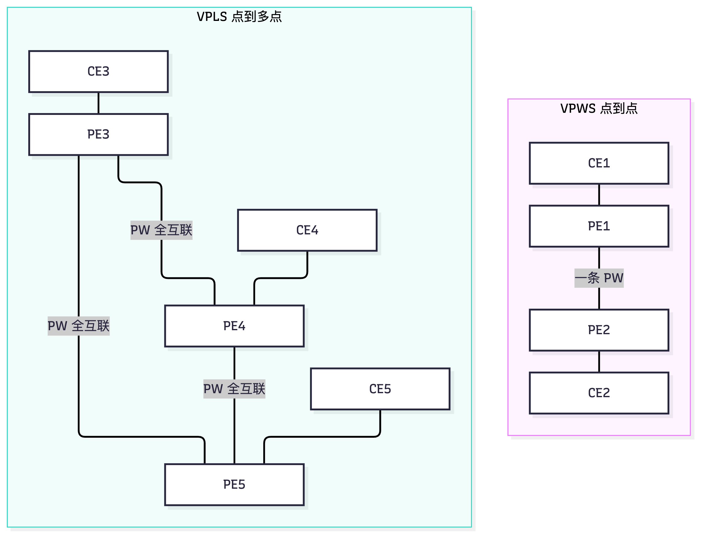


### 真题精练

**Q1.【真题·多选】** 关于 VPWS 与 VPLS 的区别，下列说法正确的有？
A. VPWS 是点到点业务，VPLS 是点到多点业务
B. VPLS 需要 PE 进行 MAC 地址学习，VPWS 不需要
C. VPLS 的 PE 之间 PW 通常全互联，VPWS 只需在需要的两个站点之间建 PW
D. VPLS 需要对未知单播与广播进行泛洪，VPWS 不需要
E. VPLS 不需要任何环路避免机制

> **答案：ABCD**
> **解析**：E 错——VPLS 的 PE 之间是 PW 全互联结构，必须依靠**水平分割规则**（从一条 PW 收到的帧不再向其他 PW 泛洪，只向本地 AC 泛洪）来避免环路。这是 RFC 4762 的规定，也是 VPLS 必备的环路避免机制（此外还有 H-VPLS 等层次化优化手段）。

**Q2.【真题·单选】** Martini 方式与 Kompella 方式实现 MPLS L2VPN 时，分别使用什么协议作为 PW 信令？
A. 都是 LDP
B. Martini 用 BGP，Kompella 用 LDP
C. **Martini 用 LDP，Kompella 用 BGP**
D. 都是 BGP

> **答案：C**
> **解析**：Martini 方式（RFC 4447/4762）使用 **LDP**（通过远端 LDP 会话交换 VC 标签），需要手工配置对端 PE 与 VC ID，不支持自动发现；Kompella 方式（RFC 4761）使用 **BGP**（MP-BGP 的 L2VPN 地址族），通过 RD/RT 实现自动发现与成员匹配，扩展性更好。记忆方法："**M 与 LDP 都是两个字母的缩写组合（Martini-LDP），Kompella 与 BGP 都是'更大规模'的选择**"。

**Q3.【真题·简答】** 请说明 VPLS 中 MAC 地址学习与泛洪的完整流程，以及为什么全互联的 PW 结构不会产生二层环路。

> **答案**：**MAC 学习与转发流程**：① PE 从某个 AC 或 PW 收到以太帧后，先提取**源 MAC**，把"源 MAC → 入接口（AC 或 PW）"记录到该 VSI 的 MAC 地址表中（若已存在则刷新老化定时器）；② 再查**目的 MAC**：若表中有匹配项，则从对应接口（AC 或 PW）**单播转发**；③ 若表中没有匹配项（未知单播），或目的地址是广播/组播地址，则在 VSI 内向**除入接口外的所有 AC 和 PW 泛洪**；④ MAC 表项缺省 300 秒老化。
> **为什么不会成环**：VPLS 规定 **PE 之间必须建立全互联（Full Mesh）的 PW**，并且实施**水平分割（Split Horizon）**规则——**从一条 PW 收到的帧不再向 VSI 内的其他 PW 泛洪，只向本地 AC 泛洪**。由于任意两个 PE 之间都有且仅有一条直连 PW，且 PW 间的转发被水平分割禁止，因此报文在 PE 之间不存在"绕行"的路径，二层转发无环。这也解释了为什么 VPLS 要求 PW 全互联：若 PW 不是全互联，PE 之间就需要通过第三方 PE 中转，而中转会被水平分割规则禁止，导致部分站点不可达。
> **解析**：答题要包含"学习源 MAC、查表转发、未知/广播泛洪、老化"四步，以及"全互联 + 水平分割"这一对防环条件。

**Q4.【真题·排错】** PE1 与 PE2 之间已建立公网 LSP 与远端 LDP 会话，但 `display vsi name VPLS1` 显示 PW 状态为 **Down**。请列出排查点。

> **答案**：① **`vsi-id`（VC ID）两端不一致**——Martini 方式要求同一 VPLS 内所有 PE 的 `vsi-id` 相同，不一致则 PW 无法建立（最高频原因）；② **对端 PE 未配置指向本端的 `peer`**——PW 需要双向配置，`peer` 地址必须是**对端 PE 的 LSR ID（LoopBack）**；③ **远端 LDP 会话未建立**——VPLS 的 PW 标签通过远端 LDP 会话交换，需检查 `mpls ldp remote-peer` 配置与 `display mpls ldp session` 中远端会话状态；④ **公网 LSP 不可达**——`display mpls lsp` 确认到对端 PE LoopBack 的 LSP 存在，否则 PW 无法承载；⑤ **PW 信令不匹配**——两端 `pwsignal` 必须都为 LDP（或都为 BGP AD），一端 static 一端 auto 无法配合；⑥ **AC 侧绑定缺失**——`l2 binding vsi` 未配置会导致 VSI 无 AC，业务不通（PW 可能仍 Up，但业务异常）。
> 定位命令：`display vsi name VPLS1`、`display vsi name VPLS1 peer`、`display mpls ldp session`、`display mpls ldp remote-peer`、`display mpls lsp`、`display current-configuration configuration vsi`。

### 易错点与排错

1. **VC ID（`vsi-id`）两端必须一致**：这是 PW Down 的头号原因，配置时用模板统一规划。
2. **VPWS 与 VPLS 的 PW 数量差异**：VPWS 按站点对建 PW，VPLS 需要全互联（n 个 PE 约 n(n-1)/2 条），大规模必须用 **H-VPLS** 层次化优化。
3. **VPLS 的 MAC 表要用 `display vsi name <name> mac-address` 验证**：业务不通时先确认 PE 是否学到了对端站点的 MAC。
4. **远端 LDP 会话是 VPLS 的前提**：很多实验失败是因为只配了本地 LDP，忘了 `remote-peer`。
5. **客户侧 STP 的处理**：VPLS 是虚拟交换机，客户侧的 BPDU 默认不会被 PE 参与运算（PE 不运行 STP），但要注意客户侧环路的引入风险。
6. **排错命令**：`display vsi name <name>`、`display vsi name <name> peer`、`display vsi name <name> mac-address`、`display mpls l2vc`、`display mpls ldp session`。

---

## 4.10 VPLS 环路避免机制与 VPLS vs VXLAN

### 考点定位

本节是**对比与设计类考点**，占 **4~8 分**。必考：VPLS 的三种环路避免手段（PW 全互联 + 水平分割、H-VPLS、以及 MAC 学习带来的限制）、**VPLS 与 VXLAN 的对比表**（国赛近年高频，尤其是"为什么数据中心转向 VXLAN/EVPN"）。

### 原理精讲

**VPLS 为什么会有环路问题？** VPLS 要在多个 PE 之间模拟"一台虚拟交换机"。二层交换机的工作前提是**拓扑无环**——一旦存在二层环路，广播帧会无限循环放大（广播风暴）。传统二层网络靠 **STP** 破环，但 VPLS 的 PE 之间如果想用 STP，就必须在 PW 上跑 BPDU，实现复杂且收敛慢；更关键的是，PW 是"虚拟链路"，难以用物理拓扑的 STP 逻辑统一处理。因此 VPLS 采用**结构性防环**而不是协议防环：

**机制一：PW 全互联（Full Mesh）+ 水平分割（Split Horizon）—— 核心机制**

- **全互联**：同一 VPLS 内任意两个 PE 之间都建立一条 PW（`vsi` 中为每个对端配置一个 `peer`）。这样"任意站点到任意站点都是一跳 PW 可达"。
- **水平分割**：**从一条 PW 收到的报文，不再向该 VSI 内的其他 PW 泛洪，只向本地 AC 泛洪**（RFC 4762 规定）。
- **为什么这样就无环**：假设 PE1 收到来自 CE1 的广播帧，它向所有其他 PW 泛洪（PE2、PE3）。PE2 从 PW 收到该帧后，只向本地的 AC 转发，**不会再转给 PE3**——于是报文不可能在 PE 之间"绕圈"。这与"IBGP 水平分割 + 全互联"的逻辑完全同构，**两者都是"用全互联保证可达性、用水平分割保证无环"**，是非常经典的对比考点。
- **代价**：PW 数量为 n(n−1)/2（n 为 PE 数），PE 需要为每个对端维护一条 PW 与一套标签，扩展性受限于 PE 数量。

**机制二：H-VPLS（Hierarchical VPLS，层次化 VPLS）—— 扩展性优化**

- **思路**：把 PE 分成两层——**接入层（UPE，User-facing PE）** 与 **核心层（NPE，Network-facing PE）**。UPE 只需与 NPE 之间建立**一条 Spoke PW**（单条上行 PW），NPE 之间保持全互联。
- **收益**：PW 数量从"所有 PE 全互联"降为"接入层每台 UPE 一条上行 PW + 核心层 NPE 之间全互联"，即约 (n_upe) + m(m−1)/2（m 为核心 NPE 数），大幅降低。同时新增加站点只需在本地 UPE 与就近 NPE 上配置，**核心不受影响**。
- **接入方式**：UPE 与 NPE 之间既可以用 Spoke PW（MPLS），也可以用 **QinQ 以太接入**（把接入层做成纯二层汇聚，仅在 NPE 上跑 VPLS），后者在城域网中更常见（成本更低）。
- **注意**：H-VPLS 中 UPE 与 NPE 之间的 PW 仍然遵循水平分割规则；层次化设计不引入环路，因为"上行单条 PW + 核心全互联"仍然构成无环的逻辑树 + 全互联结构。

**机制三：其他辅助手段**

- **MAC 地址表与抑制**：PE 会学习 MAC 并按表转发，减少泛洪范围（但这不是防环机制，只是减小泛洪风暴的影响面）。
- **客户侧 STP 的处理**：VPLS 是虚拟交换机，PE 默认不参与客户 STP 运算；客户若在自己的站点内部有环路，仍需要自己用 STP 解决——**运营商只保证 PW 侧无环，不保证客户侧无环**。
- **RFC 4762 的 "VPLS 环路检测"**：部分实现支持通过 MAC 移动检测等方法识别异常环路。

**VPLS 与 VXLAN 的对比（国赛高频）**

VPLS 诞生于运营商 MPLS 网络时代，VXLAN（RFC 7348）诞生于数据中心虚拟化时代，两者都解决"二层互通 + 多租户隔离"，但设计取向完全不同：

| 对比维度 | **VPLS** | **VXLAN** |
|---|---|---|
| 封装方式 | MPLS 标签栈（外层公网标签 + 内层 PW 标签），承载以太帧 | **UDP + 8 字节 VXLAN 头 + 内层以太帧**（目的端口 4789） |
| 对 Underlay 的要求 | **必须支持 MPLS**（P 设备需是 LSR） | 只需**三层 IP 可达**（普通 IP 网络即可，无需 MPLS） |
| 租户标识 | VSI / VC ID（PW 标签） | **VNI，24 bit**（约 1600 万，租户隔离能力强） |
| 控制平面 | LDP（Martini）/ BGP（Kompella）/ 静态 VSI | 数据面泛洪学习 或 **BGP EVPN**（推荐，控制面分发 MAC/IP 路由） |
| MAC 学习 | PE 上 VSI MAC 表（数据面学习 + 老化） | 数据面学习 或 **EVPN 控制面分发**（可避免泛洪） |
| 泛洪机制 | VSI 内 PW 全互联逐条复制泛洪 | Underlay 组播 或 **Ingress Replication（逐 VTEP 复制）** |
| 环路避免 | **PW 全互联 + 水平分割**（结构性防环） | 无二层环路问题（Underlay 为 IP 逐跳转发，依赖路由收敛） |
| 扩展性 | PW 数量与 PE 数量平方相关，需 H-VPLS 优化 | 基于 EVPN 可按需建立隧道，规模可达数千 VTEP |
| 报文开销 | 每层标签 4 字节（双层 8 字节） | VXLAN 头 8 + UDP 8 + 外层 IP 20 ≈ 36 字节（不含内层以太） |
| MTU 影响 | 需预留约 8 字节 | 需预留约 50 字节，Underlay MTU 常需 1600 以上（或分片） |
| 典型部署场景 | 运营商城域/广域 L2VPN、企业跨城大二层、DC 互联 | **数据中心内部及 DCI**、云网、虚拟化环境 |
| 与三层 VPN 的配合 | 与 L3VPN 是两套独立业务 | 常与 **BGP EVPN** 一体提供 L2/L3（IRB、分布式网关） |
| 运维生态 | 传统运营商 MPLS 运维体系 | 数据中心/云运维体系，与 SDN 控制器结合紧密 |

**为什么数据中心普遍转向 VXLAN 而不是 VPLS？** 三个原因：① **Underlay 解耦**——VXLAN 只需要 IP 网络，而数据中心 Leaf-Spine 已经是以 IP 为主、CLOS 架构的通用设备，无需为了 L2VPN 引入 MPLS 与 LDP 运维体系；② **租户规模**——VNI 24 bit 支持千万级租户隔离，远优于 VPLS 依赖的 VC ID 方案；③ **与 EVPN 结合**——BGP EVPN 用控制面分发 MAC/IP 路由，替代了 VPLS 的"数据面学习 + 泛洪"，收敛更快、泛洪更少，并天然支持分布式网关、IRB、多活网关等数据中心特性。而在**运营商广域**场景，MPLS 体系已经建好，VPLS 仍有大量存量与新建（尤其需要与 L3VPN 统一运维时）。

### 关键概念对照表

| 环路避免机制 | 原理 | 优点 | 缺点/限制 |
|---|---|---|---|
| PW 全互联 + 水平分割 | 任意两 PE 一跳可达；从 PW 收到的帧不再泛洪到其他 PW | 结构简单、确定性无环、无需 STP | PW 数 n(n−1)/2，扩展性差 |
| H-VPLS（层次化） | UPE 单条 Spoke PW 上行到 NPE，NPE 之间全互联 | PW 数大幅下降，新增站点影响面小 | 需要区分 UPE/NPE 角色，配置层次更多 |
| QinQ 接入 + NPE 集中 VPLS | 接入层用 QinQ 汇聚，只在 NPE 跑 VPLS | 接入层设备不需支持 MPLS，成本低 | 需要规划 S-VLAN，跨域灵活性受限 |
| 客户侧 STP | 客户自行在站点内破环 | 客户自治 | 运营商不保证客户站点内部无环 |

| 对比项 | VPLS | VXLAN |
|---|---|---|
| 封装 | MPLS | UDP + VXLAN |
| Underlay | MPLS | IP |
| 租户标识 | VSI / VC ID | VNI（24 bit） |
| 环路处理 | 全互联 + 水平分割 | 无二层环（IP 转发） |
| 控制面 | LDP / BGP | BGP EVPN / 泛洪学习 |

### 华为设备配置

```bash
# ===== VPLS 全互联（VSI 中为每个对端配置 peer）=====
system-view
mpls lsr-id 1.1.1.1
mpls
 mpls ldp
  lsp-trigger all
 quit
quit
mpls ldp
 remote-peer PE2                                 // 远端 LDP 会话：与 PE2
  remote-ip 2.2.2.2
 quit
 remote-peer PE3                                 // 远端 LDP 会话：与 PE3
  remote-ip 3.3.3.3
 quit
quit
vsi VPLS1 static
 pwsignal ldp
  vsi-id 200                                     // 同一 VPLS 内所有 PE 的 vsi-id 必须一致
  peer 2.2.2.2                                   // 与 PE2 建立 PW（全互联的第一个对端）
  peer 3.3.3.3                                   // 与 PE3 建立 PW（全互联的第二个对端）
 quit
quit
interface GigabitEthernet0/0/1
 description To-CE1
 l2 binding vsi VPLS1                             // 该接口作为 AC 接入 VSI
quit
# ===== 层次化 VPLS（H-VPLS）思路：UPE 侧只保留一条上行 PW =====
vsi VPLS1 static
 pwsignal ldp
  vsi-id 200
  peer 9.9.9.9                                   // UPE 只与核心 NPE（9.9.9.9）建立一条 Spoke PW
 quit
quit
# 核心 NPE 之间保持全互联（各自 vsi 中配置彼此的 peer）
# ===== QinQ 接入（接入层不做 VPLS，仅透传，NPE 集中处理）=====
interface GigabitEthernet0/0/1.200
 vlan-type dot1q 200 vid 200                      // 该子接口处理外层 VLAN 200（QinQ）
 l2 binding vsi VPLS1
quit
# ===== 查看 VPLS 状态与 MAC 表 =====
display vsi name VPLS1                            // 查看 VSI 与各 PW 状态
display vsi name VPLS1 peer                       // 查看 PW 成员与标签
display vsi name VPLS1 mac-address                // 查看 MAC 地址表（验证学习与转发）
display vsi                                      // 查看所有 VSI 概览
```

### 示意图

```mermaid
flowchart TB
    CE1["CE1"] --> UPE["UPE 接入层"]
    CE2["CE2"] --> UPE
    UPE -->|"一条 Spoke PW"| NPE1["NPE1 核心"]
    UPE -->|"备用 Spoke PW"| NPE2["NPE2 核心"]
    NPE1 ---|"全互联 PW"| NPE2
    NPE1 --> CE3["CE3"]
    NPE2 --> CE4["CE4"]
    UPE -.-> H["水平分割 从 PW 收到的不再泛洪到其他 PW"]
```

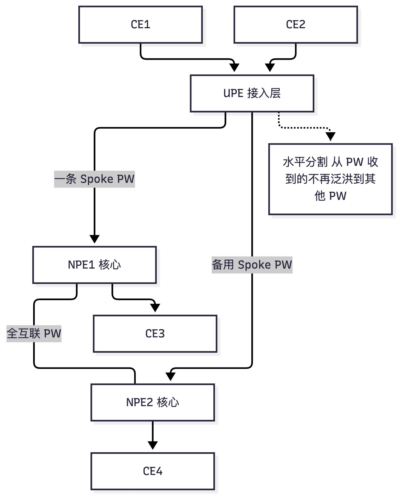


### 真题精练

**Q1.【真题·单选】** VPLS 中避免二层环路的核心机制是？
A. PE 之间运行 STP
B. PW 全互联 + 从 PW 收到的报文不再向其他 PW 泛洪（水平分割）
C. 使用 BFD 检测环路
D. 通过 MAC 地址老化删除环路表项

> **答案：B**
> **解析**：VPLS 采用**结构性防环**：PE 之间 PW 全互联（保证任意两站点一跳可达），同时规定从一条 PW 收到的帧**只向本地 AC 泛洪、不再向其他 PW 泛洪**，从而报文不可能在 PW 之间绕圈。A 错——PE 之间不依靠 STP 破环（STP 收敛慢且 PW 上跑 BPDU 难以统一处理）；C、D 与环路避免无关（MAC 老化只是保持表项准确）。

**Q2.【真题·多选】** 关于 H-VPLS（层次化 VPLS），下列说法正确的有？
A. 把 PE 分为接入层的 UPE 与核心层的 NPE
B. UPE 只需与 NPE 建立一条 Spoke PW，NPE 之间保持全互联
C. 相比平面 VPLS，PW 数量大幅减少，扩展性更好
D. H-VPLS 中客户侧不再需要任何二层环路保护
E. UPE 与 NPE 之间也可以采用 QinQ 以太接入替代 PW

> **答案：ABCE**
> **解析**：D 错——H-VPLS 只保证**网络侧（PW 侧）无环**，客户自己站点内部的二层环路仍需客户自行用 STP 等手段解决；运营商不参与客户站点内部的破环。

**Q3.【真题·简答】** 请从封装、Underlay 要求、租户标识、环路处理、扩展性五个方面比较 VPLS 与 VXLAN，并说明数据中心为什么更倾向 VXLAN。

> **答案**：① **封装**：VPLS 用 MPLS 标签栈（外层公网标签 + PW 标签）承载以太帧；VXLAN 用 UDP（目的端口 4789）+ 8 字节 VXLAN 头承载以太帧。② **Underlay 要求**：VPLS 要求 Underlay 支持 MPLS（P 设备必须是 LSR，需要 LDP 等信令）；VXLAN 只要求三层 IP 可达，普通 IP 网络即可。③ **租户标识**：VPLS 用 VSI/VC ID（PW 标签）区分；VXLAN 用 **24 bit 的 VNI**，隔离规模大得多。④ **环路处理**：VPLS 依赖 PW 全互联 + 水平分割的结构性防环；VXLAN 基于 IP 逐跳转发，不存在二层环路，可靠性依赖 Underlay 路由收敛与 EVPN 的多归属机制。⑤ **扩展性**：VPLS 的 PW 数随 PE 数平方增长（需 H-VPLS 优化）；VXLAN 配合 BGP EVPN 可按需建立隧道，规模可达数千 VTEP。
> **数据中心倾向 VXLAN 的原因**：数据中心 Leaf-Spine 已经是通用 IP 网络，引入 MPLS/LDP 会带来额外的运维体系与设备要求；VNI 的 24 bit 空间更适合海量租户；**BGP EVPN 用控制面分发 MAC/IP 路由**，替代了 VPLS 的"数据面学习 + 泛洪"，收敛更快、泛洪更少，并原生支持分布式网关、IRB 等云网特性。
> **解析**：答题要抓住三个关键差异：**"MPLS vs IP Underlay"、"数据面学习泛洪 vs 控制面 EVPN"、"PW 平方增长 vs 按需隧道"**。

**Q4.【真题·排错】** 某城域网 VPLS 部署后，PE1 下挂站点的广播流量打满了所有 PW 链路。请分析原因并给出优化方案。

> **答案**：原因是 VPLS 的**泛洪机制**：二层广播/未知单播/组播需要在 VSI 内泛洪到所有 PW，站点数量多时泛洪流量会随 PW 数量线性放大，形成"泛洪风暴"。优化方案：① **部署 H-VPLS**，把接入层收敛为 UPE（单条 Spoke PW 上行），使核心层的泛洪范围大幅缩小，接入层不再参与全互联泛洪；② **控制泛洪源**——在 AC 侧做广播抑制（风暴抑制）、限制 AC 下的 MAC 学习数量，避免客户侧异常广播进入 VSI；③ **细化 VSI 划分**——按业务/区域拆分为多个 VSI，避免把所有站点放进同一个广播域；④ 长远看可演进到 **BGP EVPN + VXLAN**，用控制面分发 MAC/IP 路由，从根本上减少泛洪需求（EVPN 支持 ARP 抑制、按需建立隧道）。
> 定位命令：`display vsi name VPLS1`、`display vsi name VPLS1 mac-address`、`display interface` 查看各 PW 承载链路的流量、`display cpu-usage`。

### 易错点与排错

1. **VPLS 的防环是"结构性"的**：靠全互联 + 水平分割，而不是 STP；因此**PW 不是全互联时会出现"部分站点不可达"**（中转被水平分割禁止）。
2. **H-VPLS 不改变水平分割规则**：它只是减少参与全互联的 PE 数量。
3. **VXLAN 的 8 字节头 + 外层 UDP/IP 共约 36~50 字节开销**：Underlay MTU 规划与 VPLS（8 字节）完全不同，这是两个技术对比时的常见考点。
4. **VNI 是 24 bit**：与 VLAN 的 12 bit、MPLS 标签的 20 bit 形成对照，是常考的数值题。
5. **运营商不负责客户站点内部环路**：这是职责边界的经典考点。
6. **排错命令**：`display vsi name <name>`、`display vsi name <name> peer`、`display vsi name <name> mac-address`、`display mpls ldp session`。

---

## 4.11 MPLS TE 基础：RSVP-TE 与 CSPF

### 考点定位

MPLS TE 属于**概念与设计类考点**，占 **3~6 分**，形式为单选/多选（RSVP-TE 报文与对象、CSPF 的作用位置）、简答（TE 要解决什么问题、TE FRR 的原理）。**必考**：RSVP-TE 的 Path/Resv 两条消息、CSPF 在**入节点**计算、TE 与 IGP 的关系（TED 来源与隧道如何被 IGP/BGP 使用）。

### 原理精讲

**TE（Traffic Engineering，流量工程）要解决什么问题？** IGP（OSPF/IS-IS）采用"最短路径优先"：所有路由器对同一目的地都算出同一条最优路径，于是**所有流量都会挤到这条路径上，而其他等价或次优链路上可能出现空闲**——这就是"拥塞与空闲并存"的经典问题。传统解决办法是调 IGP 度量（cost），但这会影响全网所有流量，副作用大且难以精细控制。**MPLS TE 的思路是：为特定流量建立一条符合约束条件的显式路径（可以不是 IGP 最短路径），把流量"引导"到空闲链路上**，从而实现带宽优化、负载均衡与差异化服务。

**TE 隧道（TE Tunnel）** 的特征：
- **单向**：一个 Tunnel 接口代表一个方向，双向需要两个隧道（通常是两条方向相反的隧道）。
- **点到点**：从入节点（Ingress）到出节点（Egress），由入节点发起建立。
- **由入节点集中计算路径**：这是"源路由"思想——路径由入节点通过 CSPF 计算，再通过信令沿路径逐跳建立。
- 可以与 IGP 结合（Shortcut / 转发邻接），也可以只承载特定业务（通过静态路由或策略把流量引入隧道）。

**RSVP-TE（RFC 3209）**：RSVP 原本是 IP 网络的资源预留协议，扩展后成为 MPLS TE 的**信令协议**，负责沿显式路径逐跳分配标签并预留带宽资源。两条核心消息：

| 消息 | 方向 | 关键对象 | 作用 |
|---|---|---|---|
| **Path** | 入节点 → 出节点（沿路径下行） | SESSION、RSVP_HOP、**EXPLICIT_ROUTE（ERO，显式路径）**、**LABEL_REQUEST**、**SENDER_TSPEC（流量规格/带宽）**、SESSION_ATTRIBUTE（优先级、亲和属性） | 携带路径与带宽需求，逐跳建立路径状态 |
| **Resv** | 出节点 → 入节点（沿路径上行） | **LABEL（分配的标签）**、STYLE、FLOWSPEC、RESV_CONFIRM | 逐跳分配标签、预留资源，最终在入节点形成 TE 隧道 |

**RSVP-TE 使用 DoD（下游按需）标签分配方式**：上游发出 LABEL_REQUEST，下游才分配标签——这与 LDP 的 DU 方式形成对比（因此标签分配方式在 RSVP-TE 中是 DoD，这正好呼应 4.3 节的知识点）。此外 RSVP 还有两条维护机制：**Path/Resv 周期刷新**（缺省 30 秒，用于维持状态与故障恢复）与 **RSVP Hello**（快速检测邻居故障）。

**CSPF（Constrained Shortest Path First，约束最短路径优先）**：运行在**入节点**上，用于计算满足约束条件的最短路径。它的数据基础是 **TED（Traffic Engineering Database）**——由 **IGP 的 TE 扩展**泛洪而来（OSPF 使用 Opaque LSA Type 10/Type 11，IS-IS 使用 TLV 22/134/135，携带链路的**最大带宽、可预留带宽、亲和属性（Affinity/Color）、TE 度量**等）。CSPF 的输入包括：目标地址、带宽需求、亲和属性约束、显式路径（如果有），输出是一条满足约束的最短路径，交给 RSVP-TE 逐跳建立。**CSPF 只在入节点运行一次计算，后续由信令完成路径建立**（这也是"源路由 + 逐跳信令"的组合）。

**显式路径（Explicit Path）**：手工指定路径，两种严格程度：

| 类型 | 含义 | 配置体现 |
|---|---|---|
| **严格（Strict）** | 必须逐跳直连，不能插入其他节点 | 列出路径上的每一个下一跳地址 |
| **松散（Loose）** | 只要求"经过"该节点，中间可以途经其他设备 | 只列出关键节点，其余由 CSPF/IGP 补全 |

**TE 与 IGP 的关系（三条，考试常考）**：

1. **IGP → TE（信息供给）**：TE 需要 IGP 的 TE 扩展来泛洪链路带宽与属性，形成 TED 供 CSPF 使用。因此必须在 IGP 中使能 TE（华为：OSPF 区域下 `mpls te enable`，并开启 `opaque-capability`）。
2. **TE → IGP（隧道被使用）**：隧道建立后，可以通过两种方式让 IGP 使用它——
   - **IGP Shortcut（捷径）**：IGP 计算路由时，若隧道的开销比物理链路更优，就把隧道当作一条逻辑链路使用（不把隧道通告给邻居），华为 `mpls te igp shortcut`；
   - **转发邻接（Forwarding Adjacency）**：把隧道**当作一条链路通告给 IGP 邻居**，从而参与全网路由计算，华为 `mpls te igp advertise`。
3. **TE → BGP**：BGP 的下一跳也可以迭代到 TE 隧道（当 BGP 下一跳地址与隧道目的地址匹配时），从而让 VPN/公网流量走 TE 隧道。这使 TE 可以为特定 BGP 前缀做流量工程。

**TE FRR（Fast Reroute，快速重路由）**：TE 的另一个作用是**本地保护**。原理：在主 LSP 的**本地修复点（PLR，Point of Local Repair）**上，预先建立一条**旁路隧道（Bypass Tunnel）**，绕过可能故障的链路/节点。当 PLR 检测到下游链路或节点故障时，**不等控制面重新计算路径，直接把流量切换到 Bypass 隧道**，实现 **<50ms** 级别的保护（检测依赖 RSVP Hello 或 BFD for RSVP）。FRR 的两种模式：**链路保护（Link Protection）** 与**节点保护（Node Protection）**，后者能同时规避节点故障带来的影响。

**TE 的局限与演进**：RSVP-TE 需要维护大量软状态（每隧道每节点都保存 Path/Resv 状态），刷新报文带来信令开销，大规模网状隧道（Full Mesh）下状态数量巨大（n(n−1) 条隧道 × 每跳状态）。这正是 **Segment Routing（SR）** 出现的重要动因（见 4.12 节）：SR-TE 用 Segment List 表达路径，**无需逐跳信令与状态维护**。

### 关键概念对照表

| 概念 | 作用 | 关键点 |
|---|---|---|
| TE 隧道 | 承载流量工程的 LSP | 单向、点到点、入节点发起 |
| RSVP-TE | TE 的信令协议 | Path（下行，带 ERO/带宽请求）+ Resv（上行，带标签）；DoD 分配 |
| CSPF | 计算满足约束的最短路径 | 运行在**入节点**；数据来自 TED |
| TED | 流量工程数据库 | 由 IGP TE 扩展泛洪（OSPF Opaque LSA、IS-IS TLV） |
| 显式路径 | 手工指定路径 | 严格（逐跳直连）/ 松散（可途经其他节点） |
| IGP Shortcut | 隧道作为 IGP 的捷径 | 不向邻居通告隧道 |
| 转发邻接 | 隧道作为链路通告给 IGP | 参与全网路由计算 |
| TE FRR | 本地快速保护 | PLR + Bypass 隧道，<50ms；链路保护/节点保护 |

| 对比项 | LDP | RSVP-TE |
|---|---|---|
| 目的 | 为 IGP 路由建立 LSP | 建立带约束的显式路径并预留资源 |
| 路径选择 | 跟随 IGP 最短路径 | 由 CSPF 计算/显式指定 |
| 标签分配方式 | **DU**（下游自主） | **DoD**（下游按需） |
| 状态维护 | 相对轻（标签映射） | 重（每跳软状态 + 周期刷新） |
| 是否支持带宽预留 | 否 | 是 |
| 是否支持 FRR | 需配合其他机制（如 LFA/TI-LFA） | 原生支持 TE FRR |

### 华为设备配置

```bash
# ===== MPLS TE 基础配置（NE40E / NE8000）=====
system-view
mpls lsr-id 1.1.1.1
mpls
 mpls te                                        // 全局使能 MPLS TE
 mpls rsvp-te                                   // 全局使能 RSVP-TE
quit
# --- 接口使能 TE 与带宽 ---
interface GigabitEthernet0/0/1
 ip address 10.0.12.1 255.255.255.0
 mpls
 mpls te                                        // 接口使能 TE
 mpls rsvp-te                                   // 接口使能 RSVP-TE
 mpls te bandwidth max-reservable-bandwidth 1000000   // 接口最大可预留带宽（单位 kbit/s）
 mpls te bandwidth bc0 800000                   // BC0 带宽（CT0 的预留带宽）
quit
# --- IGP 侧使能 TE 扩展（以 OSPF 为例）---
ospf 1 router-id 1.1.1.1
 opaque-capability enable                        // 使能 Opaque LSA，用于承载 TE 信息
 area 0.0.0.0
  mpls te enable                                 // 区域内使能 TE，泛洪 TED 信息
  network 1.1.1.1 0.0.0.0
  network 10.0.12.0 0.0.0.255
 quit
quit
# --- 显式路径 ---
explicit-path PATH1
 next hop 10.0.23.2                              // 严格下一跳：必须直连该地址
 next hop 10.0.34.2
quit
# --- TE 隧道接口 ---
interface Tunnel0/0/1
 ip address unnumbered interface LoopBack0       // 隧道借用 LoopBack 地址（无需独立网段）
 tunnel-protocol mpls te                         // 隧道协议为 MPLS TE
 destination 4.4.4.4                             // 隧道的出节点（Egress）地址
 mpls te tunnel-id 100                           // 隧道 ID
 mpls te bandwidth 100000                        // 隧道带宽需求（kbit/s），CSPF 据此做约束
 mpls te path explicit-path PATH1                // 使用显式路径 PATH1
 mpls te record-route                            // 记录实际路由，便于 display 验证
 mpls te igp shortcut                            // 让 IGP 把隧道作为捷径使用
 mpls te fast-reroute                            // 使能 TE FRR（本地快速保护）
quit
# ===== 查看 TE 状态 =====
display mpls te tunnel-interface                 // 查看 TE 隧道接口状态、带宽、路径
display mpls te tunnel-interface verbose         // 查看详细信息（含 CSPF 计算结果与实际路径）
display explicit-path                            // 查看已配置的显式路径
display mpls lsp                                 // 查看由 TE 建立的 LSP（类型为 CR-LSP）
display ip routing-table 4.4.4.4                 // 查看路由是否迭代到隧道
```

### 示意图

```mermaid
sequenceDiagram
    participant I as 入节点 Ingress
    participant M as 中间节点
    participant E as 出节点 Egress
    Note over I: CSPF 基于 TED 计算满足带宽与亲和属性的最短路径
    I->>M: Path 携带 ERO LABEL_REQUEST SENDER_TSPEC
    M->>E: Path 继续逐跳转发
    E->>M: Resv 携带 LABEL 分配标签并预留资源
    M->>I: Resv 逐跳上传
    Note over I,E: TE 隧道建立完成 CR-LSP
    I->>M: Path 周期刷新 缺省 30 秒 维持状态
```

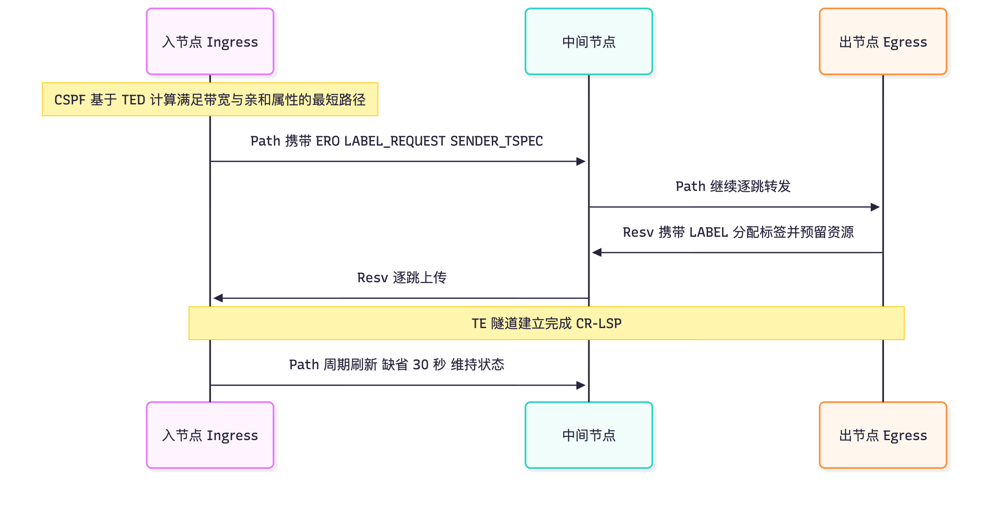


### 真题精练

**Q1.【真题·单选】** MPLS TE 中，CSPF 算法运行在哪个设备上？
A. 出节点（Egress）  B. 入节点（Ingress）  C. 路径上的每个节点  D. 独立的外部服务器

> **答案：B**
> **解析**：MPLS TE 采用**源路由**思想，**CSPF 在入节点运行**一次，基于 TED（由 IGP TE 扩展泛洪而来）计算满足带宽/亲和属性/显式路径约束的最短路径，然后把路径交给 RSVP-TE 信令逐跳建立。C 错——中间节点不重算路径，只按 ERO（显式路由对象）转发 Path 消息并建立状态。

**Q2.【真题·多选】** 关于 RSVP-TE，下列说法正确的有？
A. Path 消息沿路径从入节点向下游发送，携带显式路由对象与带宽需求
B. Resv 消息沿路径反向上传，携带下游分配的标签
C. RSVP-TE 使用下游按需（DoD）方式分配标签
D. RSVP-TE 无需周期刷新，状态由 IGP 维护
E. TE FRR 可以在 PLR 上预先建立 Bypass 隧道实现 <50ms 保护

> **答案：ABCE**
> **解析**：D 错——RSVP 是**软状态**协议，Path/Resv 消息需要**周期刷新**（缺省 30 秒）来维持状态，一旦刷新停止，状态会被老化删除；这正是 RSVP-TE 信令开销较大的原因，也是后来 SR-TE 试图解决的问题。

**Q3.【真题·简答】** 请说明 MPLS TE 与 IGP 之间的相互依赖关系，并解释 IGP Shortcut 与转发邻接（Forwarding Adjacency）的区别。

> **答案**：**IGP 对 TE 的支撑**：TE 的 CSPF 需要链路带宽、可预留带宽、亲和属性等约束信息，这些信息由 **IGP 的 TE 扩展**（OSPF 的 Opaque LSA、IS-IS 的 TE TLV）泛洪形成 TED，因此必须在 IGP 中使能 TE。**TE 对 IGP 的反哺**：隧道建立后可被 IGP 使用，有两种方式——① **IGP Shortcut**：IGP 计算路由时把隧道当作一条**逻辑捷径**使用（若隧道到达某节点的开销优于物理路径，则选隧道），但**不把隧道通告给 IGP 邻居**，因此其他设备不知道这条隧道，只影响本机的选路；② **转发邻接（Forwarding Adjacency）**：把隧道**当作一条真实链路通告给 IGP 邻居**，使隧道参与全网的路由计算，所有设备都能把它作为一条可用链路。
> 区别总结：**Shortcut 是"本地私用"（不通告），转发邻接是"全网公用"（通告）**。此外 BGP 的下一跳也可以迭代到 TE 隧道，从而让 BGP 流量走 TE。
> **解析**：作答要点是"IGP→TE 提供 TED、TE→IGP 提供逻辑链路"，以及 Shortcut 与转发邻接的"是否通告"这一本质差异。

**Q4.【真题·判断】** MPLS TE 隧道是双向的，建立一条隧道即可同时承载两个方向的流量。

> **答案：错误**
> **解析**：MPLS TE 隧道（以及所有 LSP）都是**单向**的。要实现双向流量工程，必须在两个方向上分别建立隧道（通常配置两条方向相反的隧道），并分别做带宽预留与路径计算。这是常见的基础概念陷阱。

### 易错点与排错

1. **TE 隧道单向**：与 LSP 一样，验证时必须双向检查。
2. **CSPF 只在入节点运行**：中间节点不参与路径计算，只按 ERO 建立状态。
3. **RSVP-TE 是软状态 + 周期刷新（缺省 30s）**：不要以为它是"硬状态、配一次就永久有效"。
4. **IGP 必须使能 TE 扩展**：漏配 `mpls te enable`（OSPF 区域）或 `opaque-capability` 会导致 TED 为空、CSPF 算不出路径（现象：隧道 Down 且报"no route"）。
5. **TE FRR 需要预先建立 Bypass 隧道**：它是"预先规划 + 快速切换"，不是"故障后重算"；重算路径属于全局保护（如 RSVP-TE 的路径重优化），恢复时间远大于 50ms。
6. **排错命令**：`display mpls te tunnel-interface verbose`（看 CSPF 结果与实际路径）、`display explicit-path`、`display mpls lsp`（看 CR-LSP）、`display ip routing-table <隧道目的>`；RSVP-TE 的会话与预留可用 `display mpls rsvp-te session` / `display mpls rsvp-te interface` 查看（命令随版本略有差异，以设备手册为准）。

---

## 4.12 MPLS 与 Segment Routing 的关系（演进概述）

### 考点定位

SR（Segment Routing，分段路由）在国赛中主要以**概念与趋势题**出现，占 **2~4 分**，形式为单选/判断/简答："SR 与 LDP/RSVP-TE 的关系""SR-MPLS 与 SRv6 的区别""为什么 SR 能简化控制面"。不要求深入配置，但必须能说清定位与差异。

### 原理精讲

**SR 要解决什么问题？** MPLS 的两种主流控制协议各有代价：**LDP** 需要独立的协议与标签分发过程，且路径完全跟随 IGP 最短路径（无法做流量工程）；**RSVP-TE** 虽然能做流量工程，但需要**逐跳维护软状态、周期刷新**（缺省 30 秒），大规模网状隧道下信令与状态开销巨大。SR 的思路是：**把路径信息直接编码在报文的标签栈里（源路由），取消逐跳信令与状态维护**，只在 IGP 中分发"分段标识（SID）"。

**SR 的核心机制**：

- **Segment（分段）**：一条指令，代表"转发到某节点"或"走某条邻接链路"。
- **SID（Segment Identifier）**：分段的标识。在 **SR-MPLS** 中 SID 就是 **MPLS 标签**；在 **SRv6** 中 SID 是 **128 bit 的 IPv6 地址**。
- **Segment List（分段列表）**：一个有序的 SID 列表，编码一条完整路径。**入节点把 Segment List 压入标签栈，中间节点只需按栈顶标签转发**（与 MPLS 转发完全一致，无需任何逐跳信令）。
- **SID 的分发**：由 **IGP（OSPF/IS-IS）扩展**完成——
  - **Prefix-SID（前缀 SID）**：为某个前缀（通常是 LoopBack）分配的全局唯一 SID，任何节点都可以用该 SID 把流量送到该前缀（等价于"到该节点的 LSP"）；
  - **Adjacency-SID（邻接 SID）**：为某条邻接链路分配的、**本地有效**的 SID，用于强制流量走特定链路（构建严格显式路径）。
- **SRGB（Segment Routing Global Block）**：SR 使用的全局标签范围（例如 16000~23999），Prefix-SID 通常以 `SRGB 起始值 + 索引` 的方式分配，保证全网一致可预测。

**SR 与 MPLS 现有技术的关系**：

| 对比项 | LDP | RSVP-TE | **SR-MPLS** |
|---|---|---|---|
| 标签分发方式 | 独立协议（UDP/TCP 646） | 独立协议（RSVP，IP 协议 46） | **IGP 扩展直接分发 SID** |
| 是否需要逐跳信令 | 需要（Label Mapping） | 需要（Path/Resv + 周期刷新） | **不需要** |
| 是否维护逐跳状态 | 维护标签映射 | **维护每跳软状态（开销大）** | **无逐跳状态**（状态在入节点的标签栈里） |
| 流量工程能力 | 无（跟随 IGP） | 强（CSPF + 显式路径 + 带宽预留） | 强（**SR-TE** 用 Segment List 表达路径） |
| 快速重路由 | 依赖 LFA/其他机制 | TE FRR（<50ms） | **TI-LFA**（拓扑无关 LFA，<50ms，无需预建 Bypass） |
| 扩展性 | 中 | 差（网状隧道状态爆炸） | **好**（无状态，路径在报文里） |
| 与现有 MPLS 转发面 | 兼容 | 兼容 | **完全兼容**（SID 就是 MPLS 标签） |

**SR-TE 与 RSVP-TE 的关系**：SR-TE 用 **Segment List 显式表达路径**，把路径信息放在报文标签栈里，因此**不需要沿路径建立与刷新任何状态**，天然支持"按需路径""路径不占用中间节点资源"。它取代了 RSVP-TE 的流量工程角色；而 RSVP-TE 原生的带宽预留能力在 SR-TE 中通常通过**控制器（PCE/SDN 控制器）集中算路 + 带宽约束**来补充。

**SR-MPLS 与 SRv6 的区别**：

| 对比项 | SR-MPLS | SRv6 |
|---|---|---|
| SID 形式 | MPLS 标签（20 bit 有效） | **128 bit IPv6 地址** |
| 转发面 | MPLS（需要 MPLS 使能） | **原生 IPv6 转发**（无需 MPLS） |
| 网络要求 | 需要 MPLS 能力的设备 | 只需支持 IPv6 与 SRv6 扩展头 |
| 报文开销 | 每个 SID 4 字节（较小） | 每个 SID 128 bit（开销大） |
| 可编程性 | 有限（仅转发语义） | **强**（SID 可携带行为/功能，支持网络编程） |
| 现状 | 运营商主流演进路径 | 云网/新型网络方向，逐步成熟 |

**一句话总结**：**SR 保留了 MPLS 的转发面（SR-MPLS）或直接用 IPv6（SRv6），把"逐跳信令 + 状态维护"换成"IGP 分发 SID + 报文携带路径"，从而简化控制面、提升扩展性并原生支持流量工程与快速重路由。**

### 关键概念对照表

| 概念 | 含义 | 关键数值/说明 |
|---|---|---|
| Segment | 转发指令（到节点 / 走某链路） | 由 SID 标识 |
| Prefix-SID | 前缀对应的全局唯一 SID | 通常为 LoopBack 分配 |
| Adjacency-SID | 邻接链路的 SID | **本地有效**，用于严格显式路径 |
| Segment List | 有序 SID 列表 = 一条路径 | 由入节点压入标签栈 |
| SRGB | SR 全局标签块 | 例如 16000~23999 |
| SR-TE | 基于 SR 的流量工程 | 用 Segment List 代替 RSVP-TE |
| TI-LFA | 拓扑无关 LFA | SR 的快速重路由机制，<50ms |
| SRv6 | 基于 IPv6 的 SR | SID 为 128 bit IPv6 地址 |

### 华为设备配置

```bash
# ===== SR-MPLS 基础配置（NE40E / NE8000，以 IS-IS 为例）=====
system-view
segment-routing                                  // 进入 SR 视图
 global-block 16000 23999                        // 配置 SRGB：SR 使用的全局标签范围
quit
isis 1
 cost-style wide                                  // SR 要求使用 wide 度量（宽度量）
 segment-routing mpls                             // 在 IS-IS 中使能 SR-MPLS 扩展
 quit
quit
interface LoopBack0
 ip address 1.1.1.1 255.255.255.255
 isis enable 1
 isis prefix-sid index 1                          // 为本前缀分配 Prefix-SID（索引 1，对应标签 16001）
quit
interface GigabitEthernet0/0/1
 ip address 10.0.12.1 255.255.255.0
 isis enable 1                                    // 邻接 SID 随 IGP 邻接自动生成，无需单独配置
quit
# ===== 查看 SR 状态 =====
display segment-routing global-block             // 查看 SRGB 配置与范围
display mpls lsp                                 // 查看 LSP：SR 建立的 LSP 同样出现在 LSP 表中
display isis route                               // 查看 IS-IS 路由与 SID 信息
display current-configuration configuration segment-routing   // 确认 SR 配置
```

### 示意图

```mermaid
flowchart LR
    I["入节点"] -->|"压入 Segment List 16002 16003 16004"| M["中间节点 只看栈顶标签"]
    M --> E["出节点 目的节点"]
    IGP["IGP OSPF 或 IS-IS 扩展"] -.->|"分发 Prefix-SID 与 Adjacency-SID"| I
    IGP -.-> M
    IGP -.-> E
    SR["SR 优势"] --> A1["无逐跳信令与状态"]
    SR --> A2["SR-TE 用 Segment List 做流量工程"]
    SR --> A3["TI-LFA 实现 50ms 级保护"]
```

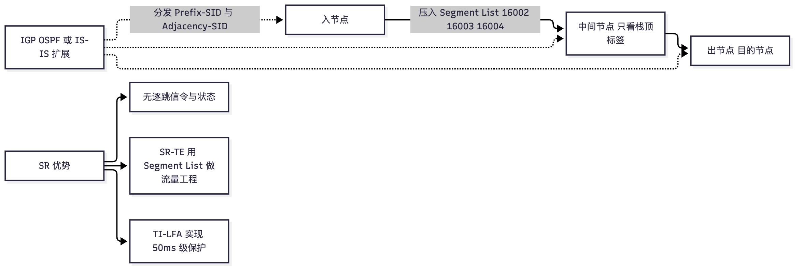


### 真题精练

**Q1.【真题·单选】** 关于 Segment Routing（SR-MPLS），下列说法正确的是？
A. SR 需要独立的标签分发协议（如 LDP）来分配 SID
B. SR 的 SID 通过 IGP（OSPF/IS-IS）扩展分发，转发面仍使用 MPLS 标签
C. SR 必须配合 RSVP-TE 才能实现流量工程
D. SR 的 SID 是 128 bit 的 IPv6 地址

> **答案：B**
> **解析**：SR-MPLS 用 **IGP 扩展分发 SID**（无需 LDP/RSVP 那样的独立标签分发协议），SID 就是 MPLS 标签，转发面与 MPLS 完全兼容。A 错（那是 LDP 的做法）；C 错（SR-TE 用 Segment List 表达路径，不需要 RSVP-TE）；D 错（128 bit IPv6 地址是 **SRv6** 的 SID 形式）。

**Q2.【真题·多选】** 相比 RSVP-TE，SR-TE 的优势包括？
A. 不需要沿途逐跳维护软状态与周期刷新，信令开销小
B. 路径信息编码在报文的 Segment List 中（源路由）
C. 扩展性更好，适合大规模网状流量工程
D. 必须为每条隧道预建 Bypass 隧道才能实现快速保护
E. 可配合 TI-LFA 实现拓扑无关的快速重路由

> **答案：ABCE**
> **解析**：D 错——那是 RSVP-TE 的 TE FRR 方式（预建 Bypass 隧道）；SR 使用 **TI-LFA（Topology-Independent LFA）**，无需为每条隧道预建旁路隧道即可提供 50ms 级保护，这正是 SR 的优势之一。

**Q3.【真题·判断】** SRv6 需要底层网络支持 MPLS 转发。

> **答案：错误**
> **解析**：SRv6 的 SID 是 128 bit IPv6 地址，**直接使用原生 IPv6 转发**，不需要 MPLS 转发面；而 SR-MPLS 才需要设备支持 MPLS。这也是 SRv6 在纯 IPv6 网络中具有吸引力的原因（但报文开销比 SR-MPLS 大得多，每个 SID 占 128 bit）。

### 易错点与排错

1. **SR-MPLS 的 SID 就是 MPLS 标签**：因此 `display mpls lsp` 同样能看到 SR 建立的 LSP，不要以为 SR 与 MPLS 是两套转发面。
2. **Prefix-SID 全局唯一、Adjacency-SID 本地有效**：这是两者最重要的区别，也是构造严格显式路径的基础。
3. **SR 需要 IGP 的宽度量（wide metric）**：IS-IS 必须 `cost-style wide`，否则 SR 扩展不生效。
4. **SR-TE 不等于"没有流量工程"**：它用 Segment List 代替 RSVP-TE 的逐跳信令，带宽约束通常由控制器（PCE）补充。
5. **SR 与 LDP 可以共存**：现网演进通常是"LDP 与 SR 共存 → 逐步迁移"，两者之间可以做标签映射互通（具体命令随版本演进较快，实验前用 `display segment-routing ?` 确认可用命令）。
6. **排错命令**：`display segment-routing global-block`、`display mpls lsp`、`display isis route`、`display current-configuration configuration segment-routing`。

---

## 4.13 MPLS 常用 display 命令解读与排错流程

### 考点定位

本节是**实验卷与排错题的工具箱**，占 **4~8 分**。国赛常给出 `display mpls lsp` 或 `display mpls ldp session` 的输出片段，要求判断"哪条 LSP 异常""为什么进不了 VRF""PW 为什么 Down"。要求能**逐字段解读**并把现象对接到 4.4/4.5/4.7/4.9 节的根因。

### 原理精讲

MPLS 排错遵循"**四层递进**"的顺序，任何一步不通过都不必往下查：

1. **第一层：控制面邻居是否建立**——LDP 会话是否 Operational、BGP VPNv4 邻居是否 Established。用 `display mpls ldp session`、`display bgp vpnv4 all peer`。
2. **第二层：转发表项是否生成**——LSP 是否建立、标签是否完整（入/出标签齐全）、VPN 私网标签是否存在。用 `display mpls lsp`、`display mpls ldp lsp`。
3. **第三层：路由是否进入正确的表**——公网 IP 路由表是否有到对端 PE LoopBack 的路由；VRF 路由表是否有私网路由；路由是否正确迭代到 LSP。用 `display ip routing-table <对端PE>`、`display ip routing-table vpn-instance <name>`。
4. **第四层：转发是否正常**——`ping -vpn-instance`、`tracert -vpn-instance`、MTU 验证。

**`display mpls lsp` 输出解读示例**：

```text
-------------------------------------------------------------------------------
                 LSP Information: LDP LSP
-------------------------------------------------------------------------------
FEC                Nexthop        In/Out Label    Out Interface      Vrf
4.4.4.4/32         10.0.12.2      1025/1024       GE0/0/1
3.3.3.3/32         10.0.12.2      1026/3          GE0/0/1
2.2.2.2/32         10.0.12.2      NULL/1027       GE0/0/1
-------------------------------------------------------------------------------
                 LSP Information: BGP LSP
-------------------------------------------------------------------------------
FEC                Nexthop        In/Out Label    Out Interface      Vrf
10.1.1.0/24        4.4.4.4        2001/2002       GE0/0/2            VPN_A
```

| 字段 | 含义 | 排错要点 |
|---|---|---|
| LSP Information 分类 | LDP LSP / BGP LSP / CR-LSP（TE）/ STATIC LSP | 分类说明 LSP 的来源协议；**BGP LSP 段就是 VPN 私网标签** |
| FEC | 转发等价类（通常是一个前缀） | 缺哪个前缀就查哪个 FEC 的下一跳与 IGP 通告 |
| Nexthop | 下一跳地址 | 应为 IGP 最优下一跳；异常说明 IGP/LDP 邻居不一致 |
| In Label | 入标签（本机分配） | **`NULL` 表示本机是该 LSP 的 Ingress**（无需入标签） |
| Out Label | 出标签（下游分配） | **`3` 表示下游要求 PHP**（次末跳弹出）；`NULL`/缺失表示未收到下游标签映射 |
| Out Interface | 出接口 | 与预期路径不符时检查 IGP 度量与 LDP 邻居 |
| Vrf | 所属 VPN 实例 | 公网 LSP 该列为空；**私网标签对应的 LSP 会显示 VPN 实例名** |

**`display mpls ldp session` 输出解读示例**：

```text
 LDP Session(s) in Public Network
 Peer-ID            Status      LAM  SsnRole  SsnAge      KASent/Rcv
 2.2.2.2:0          Operational DU   Passive  00:32:15    65/65
 3.3.3.3:0          Initialized DU   Active   00:00:00    0/0
```

| 字段 | 含义 | 排错要点 |
|---|---|---|
| Peer-ID | 对端 LSR ID : 标签空间 | 应为对端 LoopBack 地址 |
| Status | 会话状态 | 只有 **Operational** 才能交换标签映射；**Initialized 表示传输地址不可达或 TCP 646 不通** |
| LAM（Label Advertisement Mode） | 标签分配方式 | DU（下游自主）/ DoD；两端不一致会导致会话建立失败 |
| SsnRole | 本端角色 | Active（主动发起 TCP，传输地址大的一方）/ Passive |
| SsnAge | 会话已持续时间 | 反复归零说明会话抖动 |
| KASent/Rcv | Keepalive 收发计数 | **长期不增长说明报文未通或对端无响应** |

**`display ip vpn-instance verbose <名称>` 输出解读要点**：

```text
  VPN-Instance Name and ID : VPN_A, 1
  Route Distinguisher : 100:1
  Interfaces : GigabitEthernet0/0/1
  Address family ipv4
    Import VPN target  : 100:1
    Export VPN target  : 100:1
```

| 字段 | 含义 | 排错要点 |
|---|---|---|
| VPN-Instance Name | 实例名 | 接口绑定必须与此一致 |
| Route Distinguisher | RD | 只做前缀唯一化，可两端不同 |
| Interfaces | 绑定的接口列表 | **为空说明没有接口绑定，业务必然不通** |
| Import/Export VPN target | RT | **导入 RT 必须与对端导出 RT 匹配**，否则 VRF 收不到路由 |

**`display bgp vpnv4 all routing-table` 输出解读要点**：

```text
 BGP Local router ID : 1.1.1.1
 Total number of VPN routes : 4
 Route Distinguisher: 100:1
      Network            NextHop        MED        LocPrf    Path/Ogn
 *>   10.1.1.0/24        4.4.4.4         0          100        65001?
```

| 字段 | 含义 | 排错要点 |
|---|---|---|
| Route Distinguisher | 按 RD 分组显示 | 同一 VPN 的路由按 RD 分组；看不到分组说明没有 VPNv4 路由 |
| Network | 前缀（已去掉 RD） | — |
| NextHop | 下一跳（通常是对端 PE 的 LoopBack） | **必须能迭代到跨域/域内 LSP**，否则路由不 best |
| MED / LocPrf / Path | 属性 | 选路依据（与第 3 章 13 条规则一致） |
| `*>` | valid + best | 只有带 `>` 才能导入 VRF 并转发 |

### 关键概念对照表

| 排错目标 | 首选命令 | 关键判断 |
|---|---|---|
| LDP 会话是否正常 | `display mpls ldp session` | Status = Operational |
| LSP 是否建立 | `display mpls lsp` | In/Out Label 是否齐全 |
| 是否 PHP | `display mpls lsp`（Out Label = 3） | 出标签为 3 |
| LDP 标签映射是否收到 | `display mpls ldp lsp` | 是否有该 FEC 的出标签 |
| 接口是否使能 MPLS | `display mpls interface` | 接口是否在列表中 |
| 接口是否使能 LDP | `display mpls ldp interface` | 接口是否在列表中 |
| VRF 配置是否正确 | `display ip vpn-instance verbose` | RD/RT/绑定接口 |
| 私网路由是否进入 VRF | `display ip routing-table vpn-instance` | 是否有带 `>` 的路由 |
| VPNv4 路由是否收到 | `display bgp vpnv4 all routing-table` | 是否有 RD 分组与 `*>` |
| PW 是否建立 | `display vsi name <name> peer` / `display mpls l2vc` | PW 状态 Up |
| TE 隧道状态 | `display mpls te tunnel-interface verbose` | 隧道 Up 且路径符合预期 |
| 转发验证 | `ping -vpn-instance <name> -a <源> <目的>`、`tracert` | 双向可达 |

### 华为设备配置

```bash
# ===== L3VPN 排错标准命令序列（按顺序执行）=====
display mpls ldp session                        // 1 LDP 会话是否 Operational（公网标签基础）
display mpls ldp interface                      // 2 哪些接口使能了 LDP（漏配是高频故障）
display mpls interface                          // 3 哪些接口使能了 MPLS 转发（与 2 是两回事）
display mpls lsp                                // 4 LSP 是否建立、In/Out Label 是否齐全、是否 PHP
display ip routing-table 4.4.4.4                // 5 到对端 PE LoopBack 的路由是否存在（LSP 的前提）
display bgp vpnv4 all peer                      // 6 VPNv4 邻居是否 Established
display bgp vpnv4 all routing-table             // 7 VPNv4 路由是否收到（有没有 RD 分组与 *>）
display ip vpn-instance verbose VPN_A           // 8 RD/RT/接口绑定是否正确
display ip routing-table vpn-instance VPN_A     // 9 私网路由是否进入 VRF（无则查 RT 匹配）
ping -vpn-instance VPN_A -a 10.2.2.1 10.1.1.2   // 10 指定源地址验证私网可达
tracert -vpn-instance VPN_A 10.1.1.2            // 11 验证转发路径
# ===== L2VPN 排错补充命令 =====
display vsi name VPLS1                          // VSI 与 PW 状态
display vsi name VPLS1 peer                     // PW 成员与标签
display vsi name VPLS1 mac-address              // MAC 学习是否正常
display mpls l2vc                               // VPWS 的 PW 状态
# ===== TE 排错补充命令 =====
display mpls te tunnel-interface verbose        // 隧道状态与 CSPF 计算结果
display explicit-path                           // 显式路径配置
```

### 示意图

```mermaid
flowchart TD
    A["MPLS L3VPN 业务不通"] --> B{"display mpls ldp session 是否 Operational"}
    B -->|"否"| B1["查 LSR ID 可达性 UDP TCP 646 接口 mpls ldp 配置"]
    B -->|"是"| C{"display mpls lsp 是否有到对端 PE 的 LSP"}
    C -->|"否"| C1["查 lsp-trigger 接口 mpls 使能 IGP 通告"]
    C -->|"是"| D{"VPNv4 邻居与路由是否正常"}
    D -->|"无路由"| D1["查 advertise-community undo policy vpn-target"]
    D -->|"有路由"| E{"VRF 路由表是否有私网路由"}
    E -->|"没有"| E1["RT 导入导出不匹配 未从 VPNv4 导入"]
    E -->|"有"| F{"ping -vpn-instance 是否通"}
    F -->|"不通"| F1["下一跳迭代 私网标签 MTU 回程路由"]
    F -->|"通"| G["控制面与转发面均正常"]
```

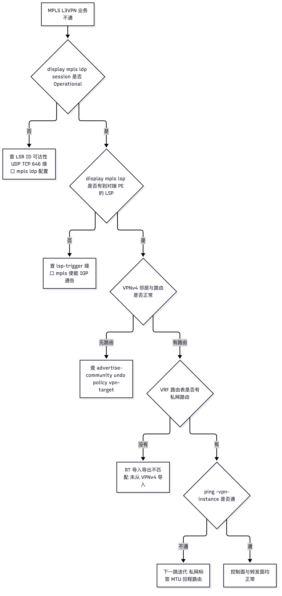


### 真题精练

**Q1.【真题·排错】** 阅读下列输出，判断问题所在并给出排查方向。
```text
 LDP Session(s) in Public Network
 Peer-ID            Status      LAM  SsnRole  SsnAge      KASent/Rcv
 2.2.2.2:0          Operational DU   Passive  00:32:15    65/65
 3.3.3.3:0          Initialized DU   Active   00:00:00    0/0
```
> **答案**：与 `3.3.3.3` 的 LDP 会话卡在 **Initialized**，即**已通过 Hello 发现邻居并建立邻接，但 TCP 会话未能建立**。原因是后续的 TCP 646 连接是发往对端**传输地址（LSR ID）**的，该地址不可达或被拦截。最常见的原因是 **3.3.3.3/32 未被 IGP 通告（本机无路由）**，其次是 TCP 646 被 ACL 拦截、对端 LSR ID 与本端冲突、MD5 密码不一致。
> 排查步骤：① `display ip routing-table 3.3.3.3` 确认路由存在；② `ping -a 1.1.1.1 3.3.3.3` 验证双向可达；③ 检查 OSPF/IS-IS 是否正确通告 LoopBack；④ `display acl all` 检查 646 端口策略；⑤ `display mpls ldp session verbose` 查看失败详情。
> **解析**：区分三个层次——**Hello（UDP 646，二层直连即可）→ TCP 会话（需传输地址可达）→ 标签交换**。卡在 Initialized 一定属于第二层。

**Q2.【真题·单选】** 在 `display mpls lsp` 输出中，某条 LSP 的 `In/Out Label` 显示为 `NULL/1027`，其含义是？
A. 该 LSP 建立失败
B. 本机是该 LSP 的 Ingress 节点，没有入标签
C. 该 LSP 使用 PHP
D. 该 LSP 是 VPN 私网 LSP

> **答案：B**
> **解析**：**In Label 为 NULL 表示本机是该 LSP 的起点（Ingress）**，报文在本机被压入标签而不需要识别入标签。C 错——PHP 的标志是 **Out Label = 3**（下游分配隐式空标签）；D 需看 Vrf 列是否有 VPN 实例名。

**Q3.【真题·多选】** 在 L3VPN 中，PE2 的 `display bgp vpnv4 all routing-table` 能看到 VPNv4 路由，但 `display ip routing-table vpn-instance VPN_A` 没有对应私网路由。可能的原因有？
A. PE2 上 VPN_A 的 import-extcommunity 与路由携带的 RT 不匹配
B. PE1 未配置 `peer x advertise-community`，导致扩展团体未传递
C. PE2 上未创建对应的 VPN 实例
D. PE2 的 VPN 实例未绑定任何接口
E. 公网 LSP 未建立

> **答案：ABC**
> **解析**：D 错——接口未绑定会导致**转发不通**，但路由本身仍会进入 VRF 路由表（控制面与接口绑定无关）；E 错——公网 LSP 缺失会导致路由**下一跳不可迭代、不为 best**，现象通常是"VPNv4 表里有但不带 `>`"，而不是"VPNv4 表有、VRF 表完全没有"。A/B/C 都会导致路由无法从 VPNv4 表导入 VRF，是本题的正确方向。

**Q4.【真题·排错】** 某 VPWS 业务（`mpls l2vc`）两端配置完成后，`display mpls l2vc` 显示 PW 状态为 **Down**，且 VC 标签为空。请给出排查顺序。

> **答案**：① **先看公网是否就绪**：`display mpls lsp` 确认到对端 PE LoopBack 的 LSP 存在，`display mpls ldp session` 确认 LDP 会话 Operational（PW 依赖公网 LSP 承载）；② **看 VC ID 是否一致**：两端 `mpls l2vc <对端地址> <VC ID>` 的 VC ID 必须完全相同，否则 PW 协商失败；③ **看对端地址是否正确**：必须填**对端 PE 的 LSR ID（LoopBack 地址）**，填成接口地址会导致 PW 建不起来；④ **看 AC 侧接口状态**：AC 接口必须 Up（`display interface`），且未被其他业务占用；⑤ **看是否遗漏 LDP 相关配置**：接口上是否配置了 `mpls` 与 `mpls ldp`（承载 PW 的接口必须使能 MPLS）；⑥ **看 MTU 与封装**：二三层封装类型不匹配也会导致 PW Down。
> 定位命令：`display mpls l2vc`、`display mpls lsp`、`display mpls ldp session`、`display interface brief`、`display current-configuration interface <接口>`。

### 易错点与排错

1. **`display mpls lsp` 中 Out Label = 3 是正常现象**（表示 PHP），不要误判为故障。
2. **"VPNv4 有、VRF 无"永远先查 RT**：这是 L3VPN 排错的黄金判断。
3. **`display mpls interface` 与 `display mpls ldp interface` 是两个不同的检查点**：前者查 MPLS 转发是否使能，后者查 LDP 是否使能，**漏配任一个都会导致业务异常**（漏 `mpls` 会"会话正常但不通"）。
4. **`ping -vpn-instance` 要带 `-a` 指定源**：否则可能因回程路由缺失而误判。
5. **MTU 问题贯穿所有 MPLS 业务**：小包通、大包不通时优先怀疑标签栈开销（L3VPN 8 字节、VXLAN 约 50 字节）。
6. **不要跳过第一层**：大量"L3VPN 不通"的根因其实是最基础的 LDP 会话或接口使能问题，排错必须自下而上。
