# B3-数通HCIE下-组播IPv6进阶与QoS

> **所属**：华为 ICT 大赛网络赛道 · 国赛 · 数通 方向 · HCIE 层
> **内容**：IP 组播技术、IPv6 进阶与过渡技术、QoS 服务质量
> **真题说明**：本册真题依据华为 ICT 大赛历年公开赛题方向、华为认证考试真题回忆与官方教材例题整理改写，用于自测训练；正式参赛请以大赛官方考试大纲与题库为准。

---

# 数通-HCIE-章节5-IP组播技术

## 5.1 组播的意义、应用场景与组播地址体系

### 考点定位

组播是国赛数通方向的"深水区"，通常以 2~4 道选择题 + 1 道简答/排错题出现，分值 8~15 分。高频考法有四类：**① 地址范围判断**（给一个组播地址问它属于本地链路/预留/管理范围/SSM 范围）；**② 映射计算**（给 IP 求组播 MAC，见 5.2）；**③ 场景判断**（IPTV、视频会议为什么用组播，VXLAN 泛洪为什么用组播）；**④ 保留地址记忆**（224.0.0.5 是谁、224.0.0.13 是谁）。易错点是**把 224.0.1.0/24 当成"链路本地"**、**把 239.0.0.0/8 当成公网可用地址**，以及**误认为组播地址可以做源地址**。

### 原理精讲

**为什么要有组播？** 一台服务器要给 1000 个客户送同一份 IPTV 流，用**单播**意味着服务器出口要复制 1000 份、出口带宽 ×1000，且服务器 CPU 与内存被复制动作吃满；用**广播**意味着同一个广播域里"不想看的人也被迫收"，而且路由器默认不转发广播，跨网段根本送不过去；**组播**的做法是：服务器只发一份，由网络中的路由器在**分叉点**（拓扑分叉的那个接口）复制，且只有"明确表示要收"的主机所在网段才有流量。组播的本质是**把复制点从源端下移到网络分叉点，并按接收者的显式请求（IGMP/MLD）构建转发路径**。这条思路带来两个直接收益：源端出口带宽恒定（与接收者数量无关）、非接收者网段零流量；代价是**路由器必须维护组播组状态**并做 RPF 检查，控制面复杂度远高于单播。

**组播的典型应用场景**必须能张口就来：

1. **IPTV / 网络电视直播**：典型 ASM 或 SSM 场景，一个频道一个组播组（如 239.1.1.1），频道切换即 IGMP 组加入/离开，是"组播最大规模商用场景"。
2. **视频会议 / 远程教学**：多点到多点，常配合 SSM 或 SFM（源过滤）避免收到无关源数据。
3. **路由协议与协议的报文**：OSPF 的 224.0.0.5、RIPv2 的 224.0.0.9、PIM 的 224.0.0.13、VRRP 的 224.0.0.18、IGMPv3 报告 224.0.0.22——这些"协议组播"是**链路本地**的，TTL 必须为 1，绝不能跨越路由器。
4. **VXLAN 的泛洪流量（BUM 流量）**：VXLAN 中广播、未知单播、组播流量需要泛洪到同一 VNI 下的所有 VTEP。传统做法是把 VNI 映射到一个**组播组**，BG 泛洪时 VTEP 把报文以组播发出，由底层 PIM-SM 承载；现代做法（推荐）是用 **Ingress Replication（头端复制）** 或 **BGP EVPN 的 IMET 路由**避免依赖组播。国赛常考"VXLAN 为什么早期依赖组播、现在为什么可以不用"。
5. **数据备份、软件分发、行情推送、集群心跳发现、mDNS/LLMNR**（224.0.0.251、224.0.0.252）。

**IPv4 组播地址体系**。组播地址是 **D 类地址**，范围 **224.0.0.0 ~ 239.255.255.255（224.0.0.0/4）**，高 4 位固定 `1110`。**必须记住的三条性质**：(1) 组播地址**只能作为目的地址**，不能作为源地址（源永远是单播地址）；(2) 组播地址**没有子网掩码与网段的概念**（不要用"224.0.0.0/4 网段"去算网络号来转发）；(3) 组播地址代表**一组接收者**，谁都可以加入（ASM 模型下），因此仅靠地址无法做访问控制。

地址的空间划分（RFC 3171 / 5771）：

- **224.0.0.0/24 —— 本地链路组播地址（Local Network Control Block）**：TTL 必须为 1，路由器**不转发**。里面全是协议地址。
- **224.0.1.0/24 —— 预留组播地址（Internetwork Control Block）**：用于互联网基础设施类协议（如 224.0.1.39/224.0.1.40 Cisco Auto-RP、224.0.1.129 PIMv2 BSR？注意实际是 224.0.1.39/40 为 Auto-RP），一般也不在普通业务里使用。
- **232.0.0.0/8 —— SSM（Source-Specific Multicast）地址范围**（IANA 分配 232.0.0.0/8，RFC 4607）。这个范围里的组只能用 PIM-SSM，不需要 RP。华为可用 `ssm-policy` 自定义 SSM 范围。
- **233.0.0.0/8 —— GLOP 地址**（RFC 3180），把 AS 号嵌进组播地址实现全球唯一分配。
- **239.0.0.0/8 —— 管理范围地址（Administratively Scoped）**，等价于组播里的"私有地址"，RFC 3171 建议在企业内部使用，边界路由器必须**用 ACL / `multicast boundary` 限制其不能跨域**。园区 IPTV 一般就用 239.x.x.x。
- **其他**：224.0.2.0/24 为 Ad hoc Block I（如 224.0.2.1 DVMRP），233.252.0.0/24 为 MCAST-TEST-NET（文档用）。

**为什么协议地址要用链路本地的 224.0.0.0/24？** 因为这些协议（OSPF、RIP、PIM）的邻居关系只在**同一链路**上建立，报文本来就只需要到达链路上的直连设备；把它们限制在 TTL=1 且不转发，可以避免"一台路由器的 Hello 被转发到几百跳以外"的无意义泛洪，也避免了不同链路的协议报文互相干扰。这是一个"用地址范围表达生命周期"的设计。

### 关键概念对照表

| 地址范围 | 名称 | 是否可路由转发 | 典型用途 |
|---|---|---|---|
| 224.0.0.0/24 | 本地链路控制块 | 否（TTL=1，路由器不转发） | OSPF、RIP、PIM、IGMPv3 Report、VRRP |
| 224.0.1.0/24 | 预留/网际控制块 | 一般否 | Auto-RP、基础设施协议 |
| 224.0.2.0/24 | Ad hoc 块 | 视协议 | DVMRP 等实验协议 |
| 232.0.0.0/8 | SSM 范围 | 是（需 IGMPv3 + PIM-SSM） | 指定源直播、视频会议 |
| 233.0.0.0/8 | GLOP 地址 | 是 | 按 AS 号全球分配 |
| 239.0.0.0/8 | 管理范围（私有） | 是（须在边界限制） | 企业 IPTV、内部视频 |

| 常用保留组播地址 | 含义 | 备注 |
|---|---|---|
| 224.0.0.1 | 所有主机/所有系统（All Hosts） | 所有支持组播的主机必须加入 |
| 224.0.0.2 | 所有路由器（All Routers） | IGMPv2 Leave 的目的地址 |
| 224.0.0.5 / 224.0.0.6 | OSPF AllSPFRouters / AllDRouters | 仅在 OSPF 使能的接口上 |
| 224.0.0.9 | RIPv2 | 只在使能 RIPv2 的接口 |
| 224.0.0.13 | 所有 PIM 路由器（All PIM Routers） | PIM Hello / Join / Prune 的目的地址，TTL=1 |
| 224.0.0.18 | VRRP | VRRP 通告目的地址 |
| 224.0.0.22 | IGMPv3 报告（All IGMPv3 Routers） | v1/v2 报告目的是组地址本身 |
| 224.0.0.251 / 224.0.0.252 | mDNS / LLMNR | 零配置发现 |
| 224.0.1.39 / 224.0.1.40 | Cisco Auto-RP 通告/发现 | 华为设备不参与 Auto-RP |

| 对比项 | 单播 | 广播 | 组播 |
|---|---|---|---|
| 目的地址 | 单个主机地址 | 广播地址（255.255.255.255 或子网广播） | D 类组播地址 |
| 接收者 | 一台 | 同一广播域全部 | 显式加入组的主机 |
| 跨网段 | 是 | 否（路由器默认隔离） | 是（需组播路由协议） |
| 源端复制 | 每接收者一份 | 一份 | 一份 |
| 网络内复制点 | 无 | 无 | 拓扑分叉点路由器 |
| 状态维护 | 无 | 无 | 路由器维护 (*,G)/(S,G) 表项 |

### 华为设备配置

```bash
system-view
multicast routing-enable                       // 全局使能组播路由（VRP 下发组播转发的总开关；不敲这行后面所有 PIM/IGMP 命令都无效）
interface GigabitEthernet0/0/1                 // 进入连接组播接收者/源的接口
 ipv6 enable                                   // （IPv6 组播场景需要，IPv4 组播不需要此行）
 pim sm                                        // 在接口上使能 PIM-SM；PIM-DM 场景改为 pim dm
 igmp enable                                   // 在面向接收者的接口上使能 IGMP（面向源的接口通常不需要 IGMP）
 igmp version 3                                // 指定 IGMP 版本为 v3（要部 SSM 必须为 v3）
quit
pim                                            // 进入 PIM 视图，做全局参数（RP、BSR、SSM 范围等）
 ssm-policy 2000                               // 使用基本 ACL 2000 定义 SSM 组地址范围（缺省 232.0.0.0/8）
quit
acl number 2000                                // 定义 SSM 范围
 rule 5 permit source 232.0.0.0 0.255.255.255   // 只允许 232.0.0.0/8 作为 SSM 组范围
quit
interface GigabitEthernet0/0/2                 // 面向组播源的接口
 pim sm                                        // 源侧只需 PIM，不需要 IGMP
quit
display pim interface                          // 检查各接口的 PIM 模式、DR 优先级、Hello 定时器
display igmp interface                         // 检查 IGMP 版本、查询器、查询定时器
display multicast routing-table                // 查看组播路由管理（MRIB）中的组播路由
```

> 华为设备上"组播配置三件套"的顺序固定：**先 `multicast routing-enable`（全局）→ 再接口 `pim`（协议）→ 最后接收侧接口 `igmp enable`（成员管理）**。少任何一步，`display pim interface` 里该接口都会显示为 `Disabled`。

### 示意图

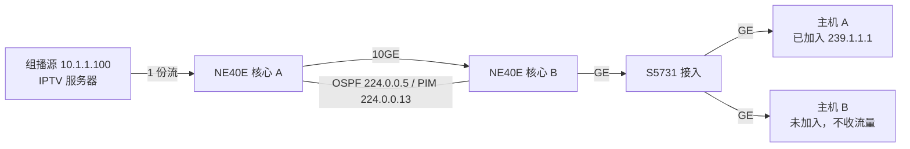

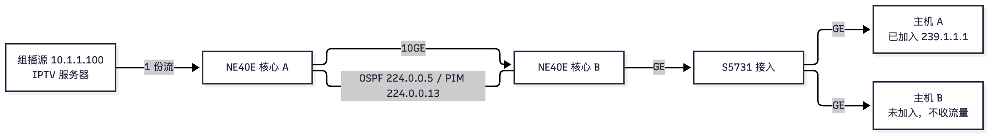


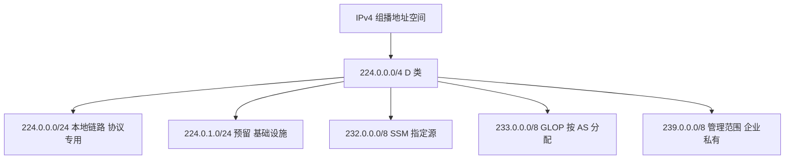

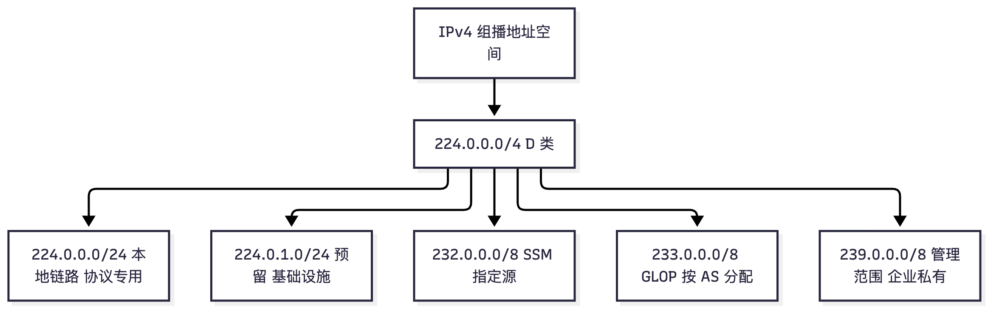


### 真题精练

**Q1.【真题·单选】** 下列组播地址中，属于 SSM（Source-Specific Multicast）默认地址范围的是：
A. 224.0.1.1  B. 232.1.1.1  C. 233.1.1.1  D. 239.1.1.1

> **答案：B**
> **解析**：IANA 为 SSM 分配的范围是 **232.0.0.0/8**（RFC 4607）。A 属于预留/基础设施块；C 是 GLOP 地址块（按 AS 号分配）；D 是可管理范围（企业私有），是 ASM 最常用的地址段。注意：SSM 范围是"地址 + 模型"共同约定的，仅把组地址配在 232/8 内还不够，主机必须用 IGMPv3/MLDv2 报源，路由器必须用 PIM-SSM 且不需要 RP。

**Q2.【真题·多选】** 关于组播地址的性质，下列说法正确的有：
A. 组播地址只能作为目的地址使用
B. 组播地址存在子网掩码，转发时需要按掩码匹配
C. 224.0.0.0/24 的组播报文 TTL 必须为 1，路由器不转发
D. 同一台主机可以同时加入多个组播组

> **答案：ACD**
> **解析**：A 正确——源地址必须是单播地址，组播地址做源会被设备直接丢弃，也因此无法用"组播地址 + 源端口"做 ACL 匹配；B 错误——组播地址是"组标识"，不存在掩码/网段概念，转发依据是组播路由表（(*,G)/(S,G)）与 RPF 接口；C 正确——本地链路控制块是协议专用（OSPF/PIM/RIP 等），TTL=1 保证只在直连链路生效；D 正确——主机通过 IGMP 可以同时加入多个组（多个 socket 各自 join）。

**Q3.【真题·简答】** 从"出口带宽占用"和"接收者管理"两个角度，说明 IPTV 直播为什么必须使用组播而不是单播或广播。

> **答案与解析**：
> **① 出口带宽与源端负载**：单播需要为每个观众复制一份独立流。以 4 Mbps 码率、1000 个观众为例，源站出口需要 4 Gbps 且 CPU 要执行 1000 次复制；组播只发一份 4 Mbps，复制动作由网络中的分叉点路由器完成，源端出口带宽与观众数量**解耦**。广播则会把流量推到整个广播域，未订阅用户也被"淹没"，而且广播不能跨路由器，无法支撑跨城域的直播。
> **② 接收者管理**：组播用 IGMP（IPv4）/MLD（IPv6）让主机**显式声明**"我要收这个组"，网络据此只向有成员的网段转发，并通过 IGMP Snooping 把二层泛洪收敛为按需转发；路由器再通过 PIM 构建从源到接收者的分发树（SPT/RPT）。这样既保证"该收的收到"，又保证"不该收的零流量"。广播模型没有任何"声明机制"，无法实现按需分发。

### 易错点与排错

1. **把 224.0.1.0/24 当成本地链路**：本地链路是 **224.0.0.0/24**，多了一个 1 就是预留块。考试极爱在这里挖坑。
2. **把 239.0.0.0/8 当公网地址**：它是管理范围（私有），必须用 `multicast boundary` 或 ACL 在域边界阻断，否则会与对端域地址冲突造成串流。
3. **组播地址做源地址**：立即丢包。排错时先看 `display pim routing-table` 里源地址是否为合法单播。
4. **忘记 `multicast routing-enable`**：接口下 `pim sm` 能敲进去但不生效，`display pim interface` 显示 `Disabled`。
5. **排错命令组合**：`display multicast routing-table`（MRIB）→ `display pim routing-table`（PIM 协议表）→ `display multicast forwarding-table`（实际转发表，看是否有丢包计数 `display multicast forwarding-table slot 0`）。

---

## 5.2 组播 MAC 地址映射规则与 32:1 地址重叠问题

### 考点定位

这是组播部分**最典型的计算题**，几乎每届比赛都会以选择题或填空题出现，分值 3~5 分，属于"会算就必得分、不会算就必丢分"。考法有三种：① 给出组播 IP 求组播 MAC；② 给出组播 MAC 反推"可能是哪些 IP"（答案是 32 个）；③ 判断两个不同的组播组是否会被二层设备混淆。**必须把推导过程写出来**，不能只背结论。IPv6 侧的 33-33 映射也常作为对比项出现。

### 原理精讲

**为什么二层需要映射？** 以太网交换机是二层设备，它只看以太网帧头的**目的 MAC 地址**转发，不懂 IP。组播报文要在一个二层网段内被正确送达"加入了该组的所有网卡"，就必须有一个**二层组播地址**来标识这个组。IANA 为 IPv4 组播预留了 MAC 地址前缀 **01-00-5E**（高 25 位固定 `0000 0001 0000 0000 0101 1110 0`），后 23 位可变，因此组播 MAC 的实际可用范围是 **01-00-5E-00-00-00 ~ 01-00-5E-7F-FF-FF**。

**映射规则**：把 IPv4 组播地址的**低 23 位**直接复制到 MAC 地址的低 23 位，前缀补 `01-00-5E`。用一句话记：**"取 IP 后 23 位，加 01-00-5E 前缀"**。

**为什么只取 23 位？（32:1 重叠的根源）** IPv4 组播地址是 32 位，高 4 位固定为 `1110`（D 类标识），剩下 **28 位**才是"组标识"。但以太网组播 MAC 只留了 **23 位**给用户地址位，两者差 **28 − 23 = 5 位**。这 5 位没有地方放，只能被**丢弃**。5 位能表示 32 种取值，所以**每 32 个不同的组播 IP 会被映射到同一个组播 MAC**（`2^28 ÷ 2^23 = 2^5 = 32`）。

被丢弃的这 5 位具体是哪 5 位？从高位往低位数，是**第一个字节的低 4 位 + 第二个字节的最高 1 位**：

```
组播 IP： 1110 xxxx . x yyy yyyy . zzzz zzzz . wwww wwww
           └─固定─┘   └忽略┘   └────── 保留的 23 位 ──────┘
             高4位      5位被丢弃
MAC：     0000 0001 . 0000 0000 . 0101 1110 . 0xxx xxyy . yyyy yzzz . zzzz wwww
           └──── 固定前缀 01-00-5E ────┘   └──── 组播 IP 的低 23 位 ────┘
```

**映射计算三步法**（考试就这么写）：
1. 把组播 IP 写成 4 个字节的二进制/十六进制；
2. 丢弃"第一个字节低 4 位 + 第二个字节最高位"共 5 位，保留其余 23 位；
3. 把保留的 23 位十六进制值填入 `01-00-5E-xx-xx-xx` 的后 3 个字节（不足 6 位十六进制时高位补 0）。

**例题 1**：求 224.0.1.1 的组播 MAC。
- 224.0.1.1 = `1110 0000 . 0000 0000 . 0000 0001 . 0000 0001`
- 丢弃的 5 位 = 第一个字节低 4 位 `0000` + 第二个字节最高位 `0`
- 保留的 23 位 = `000 0000 0000 0001 0000 0001` = `0x00 01 01`
- 组播 MAC = **01-00-5E-00-01-01**

**例题 2（重叠验证）**：求 225.0.1.1、239.0.1.1、239.128.1.1 的组播 MAC。
- 225.0.1.1 = `1110 0001 . ...`：第一个字节低 4 位 `0001` 被丢弃、第二字节最高位 `0` 被丢弃 → 保留 23 位仍是 `0x000101` → **01-00-5E-00-01-01**
- 239.0.1.1 = `1110 1111 . 0000 0000 . ...`：丢弃 `1111` 与 `0` → **01-00-5E-00-01-01**
- 239.128.1.1：第二个字节 = `1000 0000`，其最高位 `1` 被丢弃，其余 7 位 `0000000` 保留 → 保留 23 位仍为 `0x000101` → **01-00-5E-00-01-01**
- 结论：**224.0.1.1、225.0.1.1、239.0.1.1、239.128.1.1 四者映射到完全相同的 MAC**，二层设备无法区分。

**例题 3（不重叠的例子）**：224.0.2.1 → 保留 23 位 = `0x000201` → MAC = **01-00-5E-00-02-01**，与上面不同。可见"是否重叠"取决于后 23 位是否相同，而不是前 5 位是否相同。

**32:1 重叠的工程后果**：交换机（或网卡）在二层按"组播 MAC"过滤，那么当同一 VLAN 内同时有主机加入 224.0.1.1 和 239.0.1.1 时，两者在二层是**同一个 MAC**，交换机会把两个组的数据都送到订阅了其中一个组的端口。主机网卡若只按 MAC 过滤，内核会收到不属于自己组的帧；若主机按 IP 层过滤，则多余流量被丢弃但**链路带宽与主机中断已被浪费**。更严重的是：**IGMP Snooping 的二层转发表如果按 MAC 建表，就会出现"订阅 A 组却收到 B 组流"的现象**——这是排错题里最"反直觉"的一种。

**IPv6 的组播 MAC 映射（对比记忆）**：IPv6 组播 MAC 前缀固定 **33-33**，取 IPv6 组播地址的**低 32 位**填充后 4 个字节。例如：
- FF02::1 → 低 32 位 = `0000 0001` → **33-33-00-00-00-01**
- FF02::1:FF12:3456（被请求节点组播）→ 低 32 位 = `FF12 3456` → **33-33-FF-12-34-56**
- 与 IPv4 相比：IPv4 丢弃 5 位造成 32:1；IPv6 从前缀 `FF00::/8` + flags/scope 到低 32 位，理论上重叠更多（`2^112` 级别的组共享 `2^32` 个 MAC），但 RFC 3306/3956 规定"基于单播前缀的组播地址"必须把**低 32 位设为唯一值**，而被请求节点组播刻意只用低 24 位（`FF02::1:FF00:0/104`），因此实际不会冲突。**结论：IPv6 设计上用"规划约束"解决了 IPv4 用"位宽不足"遗留的问题。**

### 关键概念对照表

| 组播 IP | 二进制（前两字节） | 被丢弃的 5 位 | 保留的 23 位 | 组播 MAC |
|---|---|---|---|---|
| 224.0.1.1 | 1110 0000 . 0000 0000 | 0000 0 | 00 01 01 | 01-00-5E-00-01-01 |
| 225.0.1.1 | 1110 0001 . 0000 0000 | 0001 0 | 00 01 01 | 01-00-5E-00-01-01 |
| 239.0.1.1 | 1110 1111 . 0000 0000 | 1111 0 | 00 01 01 | 01-00-5E-00-01-01 |
| 239.128.1.1 | 1110 1111 . 1000 0000 | 1111 1 | 00 01 01 | 01-00-5E-00-01-01 |
| 224.0.2.1 | 1110 0000 . 0000 0000 | 0000 0 | 00 02 01 | 01-00-5E-00-02-01 |
| 239.1.1.1 | 1110 1111 . 0000 0001 | 1111 0 | 01 01 01 | 01-00-5E-01-01-01 |

| 对比项 | IPv4 组播 MAC 映射 | IPv6 组播 MAC 映射 |
|---|---|---|
| MAC 前缀 | 01-00-5E（25 位固定） | 33-33（16 位固定） |
| 参与映射的位数 | 低 23 位 | 低 32 位 |
| 丢弃的位数 | 5 位 | 高 80 位（IPv6 组播地址 128 位） |
| 重叠倍数 | 32 : 1 | 理论 2^80 : 1，实际靠地址规划避免 |
| 被请求节点组播 | 无对应概念 | FF02::1:FF00:0/104，取低 24 位，无冲突 |

### 华为设备配置

```bash
system-view
display multicast mac-address 0100-5e00-0101      // 查询某个组播 MAC 对应的组播 IP（华为部分版本支持反查，便于定位 32:1 冲突）
igmp-snooping enable                              // 二层接入设备使能 IGMP Snooping，按"组播 IP + VLAN"建立精确转发表，缓解 MAC 重叠影响
vlan 10
 igmp-snooping enable                             // VLAN 10 内使能 IGMP Snooping
 igmp-snooping version 3                          // 版本与网关保持一致，v3 可携带源信息（SSM 场景必需）
quit
interface GigabitEthernet0/0/1
 igmp-snooping static-router-port vlan 10          // 静态指定路由器端口：该口收到的所有组播流量都向 VLAN 内转发（连网关/路由器的口）
quit
display igmp-snooping group vlan 10                // 查看 VLAN 10 内各组的成员端口与路由器端口，重点核对"组地址与端口的对应关系"
```

### 示意图

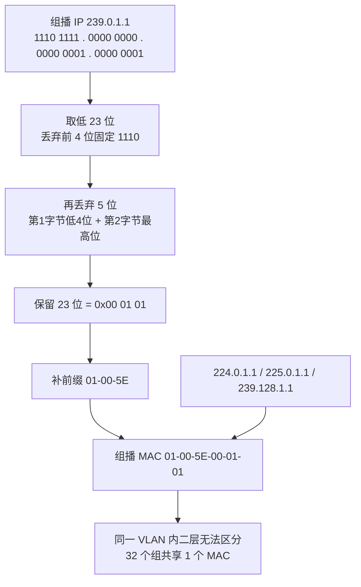

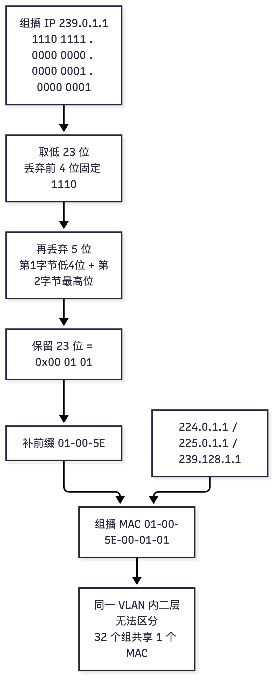


### 真题精练

**Q1.【真题·单选】** 组播地址 239.1.1.1 对应的组播 MAC 地址是：
A. 01-00-5E-01-01-01  B. 01-00-5E-7F-01-01  C. 01-00-5E-00-01-01  D. 01-00-5E-81-01-01

> **答案：A**
> **解析**：239.1.1.1 = `1110 1111.0000 0001.0000 0001.0000 0001`，丢弃 5 位（第一个字节低 4 位 `1111`、第二个字节最高位 `0`），保留 23 位 = `0x010101`，故 MAC 为 01-00-5E-01-01-01。B 的错误在于把被丢弃的位当成了有效位（把 239 的低 4 位强行塞进 MAC）；C 是把地址当成 224.0.1.1 算的结果（这是最经典的干扰项）；D 是把 0x81 当成第一个字节参与映射。

**Q2.【真题·填空】** 一个组播 MAC 地址最多可能对应 ______ 个不同的组播 IP 地址，原因是 IPv4 组播地址中有 ______ 位无法参与映射。

> **答案：32；5**
> **解析**：IPv4 组播地址的组标识有 28 位（32 位减去固定 4 位 `1110`），而以太网组播 MAC 只有 23 位可用，28 − 23 = 5 位被丢弃，`2^5 = 32`。所以"给一个组播 MAC 反推 IP"的答案永远是 32 个候选地址。

**Q3.【真题·简答】** 某园区 IPTV 使用 239.1.1.1，同时办公区使用 239.129.1.1 做软件分发。用户反馈"看 IPTV 时机顶盒偶尔收到办公区推送流，抓包发现目的 MAC 相同"。请解释原因，并给出至少两种解决方案。

> **答案与解析**：
> **原因**：239.1.1.1 与 239.129.1.1 的差异在第二个字节（1 = `0000 0001`，129 = `1000 0001`），恰好只差**第二个字节的最高位**，而这一位正是映射时被丢弃的 5 位之一。两者保留的 23 位完全相同（`0x010101`），因此映射到同一个组播 MAC `01-00-5E-01-01-01`。交换机在二层按 MAC 转发/泛洪，无法区分这两个 IP，导致交叉收到对方的流。
> **解决方案**：
> ① **地址规划层规避**：把同一二层域内的组播组地址统一规划，人为保证"被丢弃的 5 位"一致且后 23 位互不相同（例如 IPTV 用 239.1.1.x，软件分发用 239.1.2.x），从源头避免 MAC 冲突。
> ② **启用 IGMP Snooping**：接入交换机按 (VLAN, 组播 IP) 建立精确的组播转发表，把不订阅的端口从转发列表中剔除，使交叉流量不出现在机顶盒端口上（注意：某些平台仍按 MAC 建表，需确认产品实现）。
> ③ 使用 **PIM-SSM + IGMPv3**：在 232.0.0.0/8 范围内规划组地址并按 (S,G) 转发，主机侧用源过滤丢弃无关源；若两组的低 23 位仍相同，则还需配合方案①。
> ④ 若设备支持**组播 MAC/IP 一致性检查**（部分型号提供），可开启该功能直接丢弃"MAC 与 IP 不匹配"的组播帧。

### 易错点与排错

1. **前缀记成 01-00-5E-0 后只填 2 字节**：MAC 是 6 字节，映射后必须写全 `01-00-5E-xx-xx-xx` 六段，且第 4 字节的最高位一定是 0（因为 23 位只占第 4 字节的低 7 位）——如果算出的第 4 字节 ≥ 0x80，说明你多保留了一位。
2. **丢弃的 5 位记错**：是"第一个字节的低 4 位 + 第二个字节的最高位"，不是"第一个字节的高 4 位"（高 4 位 `1110` 是固定标识，本来就不参与）。
3. **反推题忘乘 32**：任何"MAC → IP"的题，标准答案都要说明有 32 个可能值。
4. **以为 IGMP Snooping 一定按 IP 建表**：不同产品/版本实现不同，考试答题时应说"二层按组播 MAC 转发，因此 32:1 重叠会带来额外流量；IGMP Snooping 能按组建立转发表减少无用泛洪，但不能改变 MAC 层的重叠事实"。
5. **排错手段**：在接入交换机上 `display igmp-snooping group vlan 10` 看组与端口；在主机侧抓包看目的 MAC；在网关侧 `display pim routing-table` 确认两个组都有独立表项（如果三层正常、二层串流，问题一定在二层映射）。

---

## 5.3 三种组播模型 ASM / SSM / SFM 与 SSM 地址范围

### 考点定位

模型题通常 1~2 道，考"给场景选模型"或"给模型说特征"。国赛喜欢考 **SSM 为什么不需要 RP**、**SFM 与 SSM 的区别**、**SSM 地址范围与 IGMP 版本要求**。这是把 5.1（地址）、5.4（IGMP）、5.8（PIM-SM）串起来的中枢知识点，简答题出现概率高。

### 原理精讲

组播模型的定义取决于两件事：**（1）主机在加入组时是否指定源；（2）网络是否需要 RP 来"牵线"**。据此分为三种：

**① ASM（Any-Source Multicast，任意源组播）**——最经典的模型。主机只指定"组"，不指定源（`(*, G)` 加入），网络必须解决"源在哪里、谁去通知源侧网络有接收者"的问题，这就是 **RP（Rendezvous Point，汇合点）** 存在的根本原因：源侧 DR 把数据**注册（Register）**给 RP，接收侧 DR 把 **(*,G) Join** 发给 RP，两条"半棵树"在 RP 汇合，形成共享树（RPT）。ASM 的优点是主机与业务解耦（不知道源也能收）；缺点是：必须部署与维护 RP、接收者可能收到"组内任意源的流量"（存在被恶意源注入的风险）、树的最优性不如源树。

**② SSM（Source-Specific Multicast，指定源组播）**——主机加入时同时指定**源 S 与组 G**（`(S, G)` 加入）。网络无需 RP：接收者侧 DR 直接根据到 S 的单播路由向源方向发送 **(S,G) Join**，建立**源树（SPT）**。SSM 的三个硬性前提：**(a) 主机/网关必须支持 IGMPv3 或 MLDv2**（因为只有 v3 报文里才有"源列表"字段）；**(b) 组地址必须落在 SSM 范围内**（默认 232.0.0.0/8，或由 `ssm-policy` 指定的 ACL 范围）；**(c) 路由器必须支持 PIM-SSM**（华为在接口上仍是 `pim sm`，通过 `ssm-policy` 把该范围划入 SSM 处理，收到范围内的 Join 时直接按 (S,G) 建树、不走 RP）。SSM 的优点：无 RP（简化运维、消除 RP 单点）、天然防"任意源注入"、树一定是最优源树；缺点：主机必须知道源地址（业务上通常靠频道列表/电子节目单下发，或靠应用层协议告知）。

**③ SFM（Source-Filtered Multicast，源过滤组播）**——ASM 的增强版：**组地址仍然在 ASM 范围（仍需要 RP、仍用 PIM-SM）**，但借助 **IGMPv3/MLDv2 的源过滤能力**，主机可以表达：
- **INCLUDE 模式**：只接收列表中的源（白名单）；
- **EXCLUDE 模式**：接收除列表外的所有源（黑名单）。

路由器据此在共享树上做**源过滤**：对 EXCLUDE 的源或不在 INCLUDE 列表中的源，不向该接收者所在分支转发。**SFM 与 SSM 的关键区别**：SSM 是"地址范围 + 无 RP + 只建源树"的**协议级模型**；SFM 是"地址仍在 ASM 范围 + 有 RP + 在共享树上做源过滤"的**过滤机制**，SFM 允许"除了某几个源，其他都要"这种 SSM 无法表达的需求。

**工程选型建议**：新建 IPTV/视频会议优先用 **SSM**（无 RP、可控源）；需要"任意源都能发、接收者事先不知道源"的场景（如多方视频会议、组播测试）用 **ASM**；需要"排除少量恶意源但仍希望接收任意源"的场景用 **SFM**。

### 关键概念对照表

| 对比项 | ASM 任意源组播 | SSM 指定源组播 | SFM 源过滤组播 |
|---|---|---|---|
| 加入方式 | (*, G) | (S, G) | (*, G) + 源列表（INCLUDE/EXCLUDE） |
| 是否指定源 | 否 | 是（必须） | 可选（可白名单/黑名单） |
| 默认地址范围 | 224.0.0.0/4（232/8 除外） | 232.0.0.0/8（可 `ssm-policy` 自定义） | 同 ASM |
| 是否需要 RP | 必须 | 不需要 | 必须 |
| 使用的树 | RPT（可切换到 SPT） | 只有 SPT（源树） | RPT + 源过滤 |
| IGMP 版本要求 | v1/v2/v3 均可 | 必须 v3 | 必须 v3 |
| PIM 模式 | PIM-SM | PIM-SSM（华为接口仍写 `pim sm`） | PIM-SM |
| 安全性 | 任何源都可注入 | 天然防任意源注入 | 可通过黑名单过滤源 |
| 典型应用 | 多方视频会议、通用组播 | IPTV 直播、大规模视频分发 | 需要排除特定源的会议 |

### 华为设备配置

```bash
system-view
multicast routing-enable                          // 全局使能组播
acl number 2000                                   // 定义自定义 SSM 组范围（也可以直接用默认 232.0.0.0/8）
 rule 5 permit source 232.0.0.0 0.255.255.255      // 允许 232.0.0.0/8 作为 SSM 组
 rule 10 permit source 239.100.0.0 0.0.255.255     // 也允许 239.100.0.0/24 作为 SSM 组（企业自定范围）
quit
pim
 ssm-policy 2000                                  // 把 ACL 2000 定义为 SSM 范围；范围内收到的 Join 直接按 (S,G) 建源树，不向 RP 注册
quit
interface GigabitEthernet0/0/1                    // 面向接收者的接口
 pim sm                                           // SSM 在接口上仍配置为 pim sm（无需单独命令）
 igmp enable
 igmp version 3                                   // 必须为 v3，否则主机无法报源，SSM 无法建立
quit
display pim ssm-policy                            // 查看当前生效的 SSM 组范围（确认 ACL 是否被正确引用）
display pim routing-table 232.1.1.1               // 查看 SSM 组表项：应只有 (S,G)，Flag 中含 SPT，且不存在 (*,G) 表项
```

### 示意图

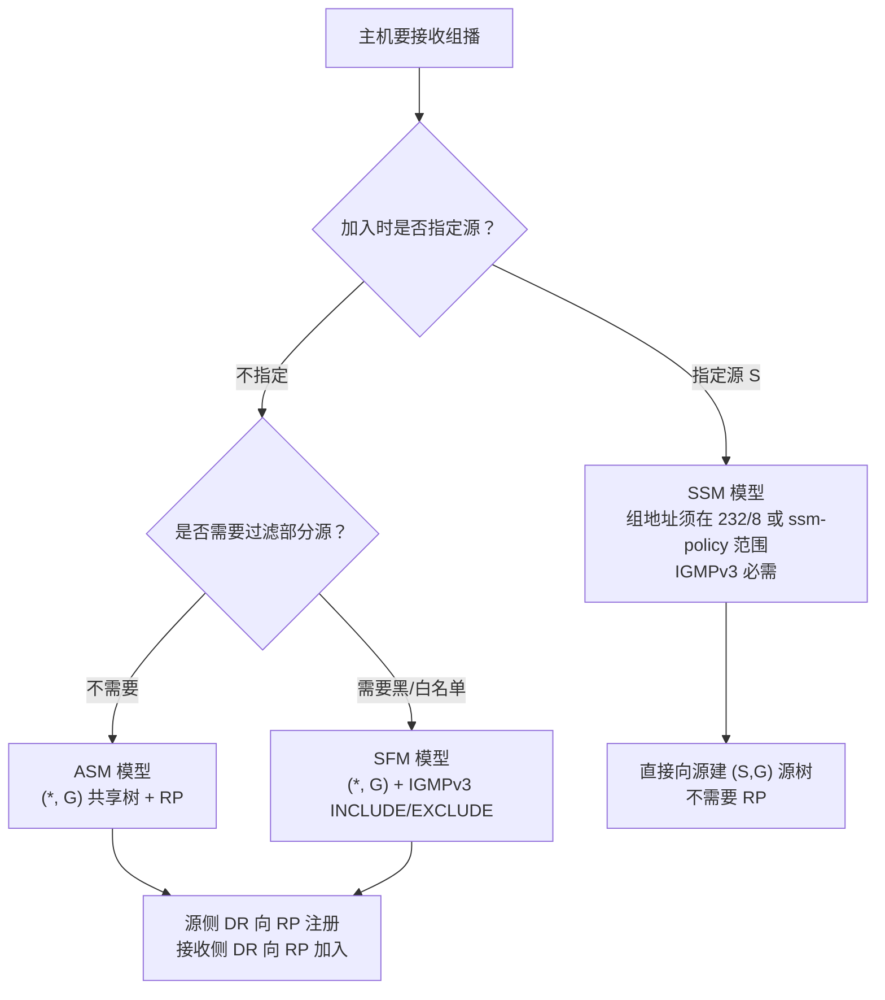

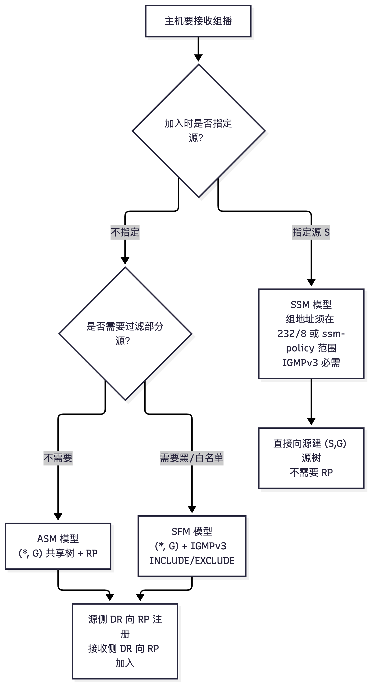


### 真题精练

**Q1.【真题·多选】** 部署 PIM-SSM 时必须满足的条件包括：
A. 组地址位于 SSM 范围内（默认 232.0.0.0/8）
B. 主机与网关使用 IGMPv3 或 MLDv2
C. 必须部署 BSR 动态 RP
D. 路由器支持 PIM-SSM，并可用 `ssm-policy` 定义 SSM 范围

> **答案：ABD**
> **解析**：C 错误，SSM 的核心价值就是**不需要 RP**（既不需要静态 RP 也不需要 BSR），接收者直接向源发起 (S,G) Join 建立源树。A 正确：SSM 范围默认是 232.0.0.0/8，若要用其他组地址做 SSM，必须通过 `ssm-policy` 显式声明。B 正确：只有 IGMPv3/MLDv2 的报文里才有"源地址列表"字段，v1/v2 无法表达源。D 正确：这是设备能力要求。

**Q2.【真题·判断】** SSM 与 SFM 都要求 IGMPv3，两者的区别在于 SSM 完全不需要 RP，而 SFM 仍在 ASM 范围内工作、仍然依赖 RP。

> **答案：正确**
> **解析**：SSM 是"地址范围 + 无 RP + 纯源树"的模型，接收者明确知道源，直接建 (S,G)；SFM 是把 IGMPv3 的源过滤能力用在 ASM 共享树上，组地址仍在 224.0.0.0/4 的 ASM 范围，源侧仍需向 RP 注册、接收侧仍向 RP 加入，只是在共享树转发时按 INCLUDE/EXCLUDE 过滤源。记忆口诀：**SSM 是"换协议路径"，SFM 是"在 ASM 上加滤网"。**

**Q3.【真题·简答】** 某企业 IPTV 系统原先使用 239.1.1.1 的 ASM 方案，运维需要部署并维护两台 RP，且出现过"非法源向该组注入内容"的安全事件。请给出改造方案并说明理由。

> **答案与解析**：
> **改造方案**：迁移到 **PIM-SSM**：① 把频道地址重新规划到 SSM 范围（如 232.1.1.0/24，或用 `ssm-policy` 把 239.x 的范围声明为 SSM）；② 接入网关与机顶盒升级为 **IGMPv3**；③ 节目单（EPG）中携带每个频道的源地址，机顶盒以 (S,G) 方式加入；④ 路由器配置 `pim sm` + `ssm-policy`，无需再部署 RP。
> **理由**：SSM 下接收者只接受指定源的数据，**其他任何源发往该组的数据都不会被建树/转发**，从根本上消除了源注入攻击；同时取消 RP 后消除了 RP 单点故障与 RP 配置一致性问题，转发路径恒为最优源树（无 RPT→SPT 切换过程，收敛更快、时延更稳定）。代价是主机必须知道源地址，需要 EPG 或应用层协议配合下发。

### 易错点与排错

1. **把 SSM 当成"PIM 的一种新协议"**：SSM 是模型，实现载体仍是 PIM-SM 的报文（华为接口只配 `pim sm`），靠 `ssm-policy` 区分。
2. **SSM 场景忘了 `igmp version 3`**：接口默认可能是 v2，此时主机的源信息无法传递，`display pim routing-table` 里只会有 (*,G)，或有 (S,G) 但 Flag 不带 SPT。
3. **SSM 组仍配了 RP 就以为冲突**：RP 对 SSM 范围无效（不会被使用），但配置残留会误导排错，建议清理。
4. **SFM 与 SSM 混答**：SFM 需要 RP、组地址在 ASM 范围；SSM 不需要 RP、组地址在 SSM 范围。
5. **排错命令**：`display pim ssm-policy`、`display igmp group verbose`（看 INCLUDE/EXCLUDE 与源列表）、`display pim routing-table 232.1.1.1`。

---

## 5.4 IGMP 协议族（v1 / v2 / v3）与成员管理机制

### 考点定位

IGMP（Internet Group Management Protocol，因特网组管理协议）是"主机—网关"之间的成员管理协议，国赛通常考 2~3 道选择/填空，考**版本差异、报文类型号、目的地址、定时器默认值、离开流程**。最经典的陷阱是：**IGMPv1 没有离开报文**、**特定组查询（Group-Specific Query）的响应时间用的是"最后成员查询间隔"而不是常规 Max Resp Time**、**IGMPv3 报告的目的地址是 224.0.0.22 而不是组地址**。协议号必须记住：**IGMP 的 IP 协议号是 2**。

### 原理精讲

IGMP 解决三个问题：**主机怎么告诉网关"我要加入某组"（Report）、网关怎么确认"还有没有成员"（Query）、主机怎么告诉网关"我走了"（Leave）**。它**只在主机与直连组播路由器之间运行**，逐跳不传递组信息；组播路由的建立由 PIM 负责。IGMP 报文被封装在 IP 里（协议号 2），TTL=1，且 IP 头带有 **Router Alert 选项**（值为 0，告知路由器"这个报文需要你处理，虽然目的地址不是我的"）。

**IGMPv1（RFC 1112）**：只有两种报文——**成员查询（Membership Query，Type 0x11）** 与 **成员报告（Membership Report，Type 0x12）**。特点：① **没有离开报文**，主机离开时静默退出，路由器只能靠**查询响应超时**判断成员消失（收敛慢，最长需要"查询间隔 × 鲁棒系数 + 最大响应时间"）；② 报告抑制（Report Suppression）：同一网段多台主机加入同组时，只有一台应答（随机延迟后先到者发），其余主机听到后不再发；③ **没有查询器选举机制**，查询器由组播路由协议（PIM-DM 下是 DR）确定；④ 报告目的地址是**组地址本身**。

**IGMPv2（RFC 2236）**：在 v1 基础上增加 **离开组报文（Leave Group，Type 0x17）**，并把查询细分为**普遍组查询（General Query）**与**特定组查询（Group-Specific Query）**。关键流程是"**离开 + 特定组查询 + 最后成员查询间隔**"：
1. 主机要离开时，向 **224.0.0.2（所有路由器）** 发送 Leave（**不是**发给自己要离开的组！）；
2. 网关收到 Leave 后，**不立即**删除该组的转发，而是针对**该组**发送特定组查询（Group-Specific Query，目的地址 = 该组地址，Max Resp Time = **最后成员查询间隔**，华为缺省 1 秒）；
3. 若组内还有成员，它会在 1 秒内以 Report 应答，网关保持转发；
4. 若连续发送 **最后成员查询次数**（缺省 2 次）都没有应答，网关才删除该组的 IGMP 成员与转发。
这样设计的原因是：Leave 是**单个主机**发出的，而组的转发状态是**整个网段**共享的，必须再用一次"组内广播询问"确认是否还有其他成员，否则会造成"一台主机退出，全网同组用户断流"。另外 v2 还有**查询器选举**：同一网段收到其他路由器发来的 Query 时，比较接口 IP 地址，**IP 大者为查询器**，非查询器启动"其他查询器存在定时器"（缺省 125s）；该选举**不抢占**，除非当前查询器消失。

**IGMPv3（RFC 3376）**：核心是**源过滤（Source Filtering）**，并由此支撑 SSM 与 SFM。v3 把报告报文改为 **Type 0x22**，目的地址固定为 **224.0.0.22（所有 IGMPv3 路由器）**，报文里携带**组记录（Group Record）**列表，每条记录包含"记录类型 + 组地址 + 源地址列表"：

| 记录类型 | 值 | 含义 |
|---|---|---|
| MODE_IS_INCLUDE | 1 | 当前为 INCLUDE 模式，报出允许的源列表 |
| MODE_IS_EXCLUDE | 2 | 当前为 EXCLUDE 模式，报出排除的源列表 |
| CHANGE_TO_INCLUDE_MODE | 3 | 请求切换到 INCLUDE 模式 |
| CHANGE_TO_EXCLUDE_MODE | 4 | 请求切换到 EXCLUDE 模式 |
| ALLOW_NEW_SOURCES | 5 | 在现有基础上追加允许的源 |
| BLOCK_OLD_SOURCES | 6 | 在现有基础上排除某些源 |

v3 查询报文还新增 **S 标志位（Suppress）**（要求主机抑制常规报告，仅状态变化时才报）、**QRV（Querier's Robustness Variable，查询器鲁棒系数）** 与 **QQIC（Querier's Query Interval Code，查询间隔编码）**，使路由器把自身鲁棒系数与查询间隔下发给主机，主机据此计算自己的定时器——这样全网定时器参数自动统一，无需逐台配置。**IGMPv3 取消了报告抑制（对同一组，主机都会发自己的报告）**，因为路由器需要知道每个成员的源过滤状态，抑制会丢信息。

**版本兼容与共存**：路由器接口可以配置为 v1/v2/v3，且能同时处理三种版本的报文；网段内存在多版本主机时，路由器按"低版本兼容"处理（例如 v2 路由器收到 v3 报告时，把源列表忽略、按组处理）。考试要点：**版本混用会导致 SSM/SFM 能力丢失，必须全网统一到 v3。**

### 关键概念对照表

| 对比项 | IGMPv1 | IGMPv2 | IGMPv3 |
|---|---|---|---|
| 规范 | RFC 1112 | RFC 2236 | RFC 3376 |
| 查询报文类型 | 0x11（仅普遍） | 0x11（普遍 + 特定组） | 0x11（普遍 + 特定组 + 特定源组） |
| 报告报文类型 | 0x12 | 0x16 | 0x22 |
| 报告目的地址 | 组地址 | 组地址 | 224.0.0.22 |
| 离开报文 | **无** | 0x17，目的 224.0.0.2 | 0x17（兼容保留），主要用 BLOCK_OLD_SOURCES |
| 源过滤 | 无 | 无 | 有（INCLUDE/EXCLUDE） |
| 支持 SSM | 否 | 否 | 是 |
| 报告抑制 | 有 | 有 | 无（同一组每台主机都报） |
| 查询器选举 | 无（由 PIM DR 决定） | 有（IP 大者胜，不抢占） | 同 v2 |
| 与主机通信 | 只发不选 | 可选（`igmp version 2`） | 可选（`igmp version 3`） |

| 定时器/参数 | 含义 | 华为缺省值 |
|---|---|---|
| 普遍组查询间隔 | 查询器发送 General Query 的周期 | 60 秒（`igmp timer query`） |
| 最大响应时间 | 主机收到 Query 后随机延迟的上限 | 10 秒（`igmp max-response-time`） |
| 其他查询器存在定时器 | 非查询器保持沉默的时长 | 125 秒（`igmp timer other-querier-present`） |
| 最后成员查询间隔 | 特定组查询里的最大响应时间 | 1 秒（`igmp timer last-member-query-interval`） |
| 最后成员查询次数 | 特定组查询重发次数 | 2 次（`igmp last-member-query-count`） |
| 鲁棒系数 | 容忍丢包的查询重传系数 | 2（`igmp robust-count`） |
| 组表项老化时间 | 无报告后删除组的时间 | 由鲁棒系数 × 查询间隔推算（v1 最长约 260 秒量级） |

### 华为设备配置

```bash
system-view
multicast routing-enable                          // 全局使能组播路由
interface GigabitEthernet0/0/1                    // 面向用户主机的接口（接收者侧）
 pim sm                                           // 该接口运行 PIM-SM（IGMP 必须与 PIM 配合才能形成三层组播转发）
 igmp enable                                      // 在接口上使能 IGMP，设备开始周期性发送查询
 igmp version 3                                   // 配置 IGMP 版本为 v3（要支持 SSM/源过滤必须 v3）
 igmp timer query 60                              // 普遍组查询间隔 60 秒（缩短可加快成员发现，代价是开销增大）
 igmp max-response-time 10                        // 最大响应时间 10 秒（与查询间隔共同决定成员消失的收敛时间）
 igmp robust-count 2                              // 鲁棒系数 2（丢包环境下可调大，代价是收敛变慢）
 igmp timer last-member-query-interval 1          // 最后成员查询间隔 1 秒（特定组查询的响应时间）
 igmp last-member-query-count 2                   // 特定组查询发送 2 次
 igmp static-group 239.1.1.1                      // 静态加入组：接口永久作为该组成员，用于测试或强制拉流
quit
interface GigabitEthernet0/0/2
 igmp enable
 igmp version 2                                   // 主机只支持 v2 时，把该接口单独降级为 v2（多版本共存场景）
quit
display igmp interface                            // 查看各接口 IGMP 版本、查询器状态、各定时器实际取值
display igmp group                                // 查看动态加入的组及成员信息（含剩余老化时间 Expires）
display igmp group static                         // 查看静态配置的组
display igmp group verbose                        // v3 场景下查看组的 INCLUDE/EXCLUDE 模式与源列表
reset igmp group all                              // 清除动态 IGMP 组表项（排错时强制重建成员关系，慎用于生产）
```

### 示意图

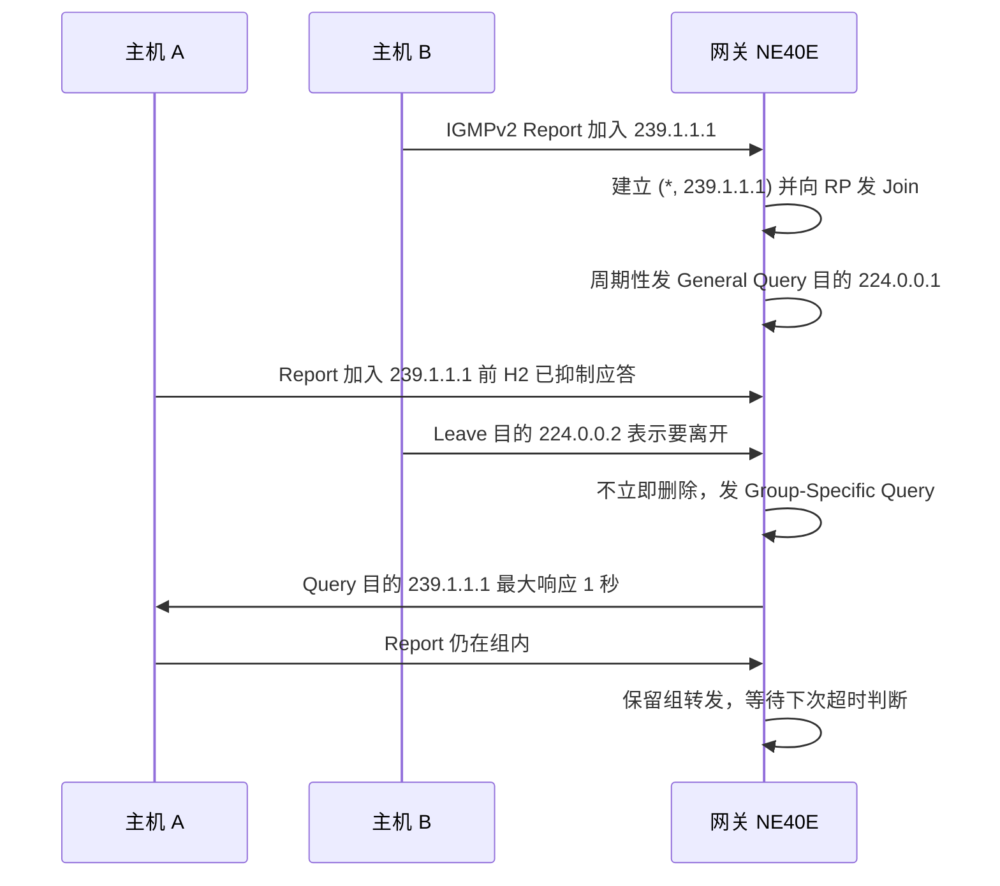

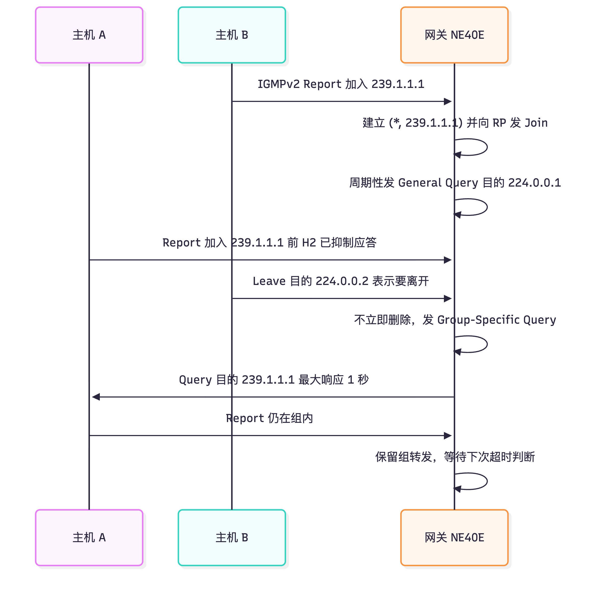


### 真题精练

**Q1.【真题·单选】** IGMPv2 的离开组报文（Leave Group）的目的 IP 地址是：
A. 224.0.0.1  B. 224.0.0.2  C. 224.0.0.22  D. 224.0.0.13

> **答案：B**
> **解析**：IGMPv2 Leave 报文的目的地址是 **224.0.0.2（所有路由器）**，因为主机离开时并不知道本网段哪台路由器是查询器，必须让所有路由器都能看到。A 是普遍组查询的目的地址（所有主机）；C 是 IGMPv3 报告的目的地址；D 是所有 PIM 路由器地址（PIM Hello/Join/Prune 使用）。

**Q2.【真题·多选】** 关于 IGMPv3，下列说法正确的有：
A. 报告报文目的地址为 224.0.0.22
B. 支持 INCLUDE 与 EXCLUDE 两种源过滤模式
C. 保留了对同组报告的抑制机制以减少报文数量
D. 查询报文中带有 S 标志与 QRV、QQIC 字段

> **答案：ABD**
> **解析**：C 错误——v3 **取消了针对同一组的报告抑制**，因为路由器需要收集每个成员各自的源过滤状态，抑制会导致源列表信息丢失（不同主机要的源不同）。A、B、D 都是 v3 的重要特征：目的地址 224.0.0.22 便于路由器用 ACL 精确匹配；S 标志要求主机在无状态变化时抑制常规报告，QRV/QQIC 让路由器把鲁棒系数与查询间隔下发给主机，实现全网定时器自动统一。

**Q3.【真题·排错】** 某园区网中一台主机退出 IPTV 组播组后，同网段的其他用户仍在正常观看，但网关上的 (*, 239.1.1.1) 表项被立即删除，导致其他用户断流约 60 秒后才恢复。请分析原因。

> **答案与解析**：
> **现象分析**：网关"立即删除组表项"说明它**跳过了离开确认流程**——正确行为应当是收到 Leave 后先发 **特定组查询（Group-Specific Query）**，等待最后成员查询间隔（缺省 1 秒）× 最后成员查询次数（缺省 2 次）无应答后才删除。断流 60 秒后恢复，说明成员重新通过普遍组查询（60 秒周期）被重新发现，这正好对应"查询间隔"。
> **可能原因**：① 接口配置了**快速离开（prompt-leave）** 或类似特性，收到 Leave 立即删除，适用于"一个端口只接一台主机"的接入场景，在有多个成员的共享网段上不能使用；② 设备 IGMP 版本为 v1（无离开确认机制）；③ 特定组查询被 ACL/QoS 丢弃，或 `igmp timer last-member-query-interval` 与 `igmp last-member-query-count` 被配置为极小值/0。
> **处理**：在共享网段接口上取消快速离开（`undo igmp prompt-leave` 或相应配置），确认 `igmp version` 为 v2/v3，用 `display igmp interface` 核对查询定时器，抓包确认 Leave 后是否有目的地址为该组的 Group-Specific Query。

### 易错点与排错

1. **Leave 报文的目的地址不是组地址**，是 224.0.0.2；只有"特定组查询"的目的地址才是组地址。
2. **普遍组查询的目的地址是 224.0.0.1**，且目的 MAC 是 01-00-5E-00-00-01。
3. **v1 没有 Leave**：题目问"哪个版本支持主机主动离开"，答案是 v2 及以后。
4. **SSM 必须 v3**：只配 `pim sm` 而不改 IGMP 版本，SSM 无法工作。
5. **报告抑制只在 v1/v2 存在**，v3 没有；这是判断题的常考项。
6. **排错命令**：`display igmp interface`（版本、查询器、定时器）、`display igmp group verbose`（源过滤状态）、`debugging igmp packet` + `terminal monitor`/`terminal debugging`（抓 IGMP 报文，生产环境慎用）。

---

## 5.5 二层组播：IGMP Snooping 原理、两种模式与 Proxy

### 考点定位

IGMP Snooping 是"组播能不能落地到接入层"的关键，国赛常考 1~2 道题，并以**简答/排错**形式出现：考"二层组播转发表怎么建""路由器端口和成员端口是什么""普通模式与代理模式的区别""没有 IGMP Snooping 会发生什么"。分值 3~8 分，是组播方向最容易失分的"二层盲区"。

### 原理精讲

**不部署 IGMP Snooping 会发生什么？** 交换机是二层设备，看不懂 IP 层的 IGMP。当网关把组播流送进 VLAN 时，目的 MAC 是组播 MAC，交换机在 MAC 表中查不到该组播 MAC（组播 MAC 永远不会作为源 MAC 出现，因此不会动态学习到），于是按**未知目的帧**处理——在 VLAN 内**泛洪**。结果是：VLAN 内所有端口（包括没订阅的主机）都收到组播流。在 IPTV 场景里这等于"一个人看电视，全楼都收流量"，接入带宽、主机中断全被浪费。

**IGMP Snooping 的原理**：交换机"偷听"（snooping）经过自己的 IGMP 报文，据此在**二层建立一张组播转发表**，然后只向"有成员"的端口转发组播数据。核心要素有三个：

1. **成员端口（Member Port / Dynamic Member Port）**：收到 IGMP Report 的端口。收到某组 Report 就把该端口加入该组的出接口列表；收到 Leave 或特定组查询无应答后删除（二层同样有"最后成员"确认机制）。
2. **路由器端口（Router Port）**：指向组播路由器/三层网关方向的端口。识别方式有两种——**动态**：收到 IGMP Query（普遍/特定组查询）或 PIM Hello 的端口；**静态**：手工用 `igmp-snooping static-router-port vlan x` 指定。**路由器端口收到任何组的组播流量都会向 VLAN 内转发**（因为它是流量的入口方向），它是"上游"，与成员端口（下游）方向相反。
3. **二层组播转发表项**：形如 `(VLAN, 组播地址/组播 MAC) → {成员端口 + 路由器端口}`。转发时按表项复制，未知组播（表项中没有的组）仍然泛洪（缺省行为；部分型号支持配置丢弃未知组播，避免泛洪风暴）。

**两种工作模式**：

- **普通模式（Normal Mode）**：交换机**原样透传** IGMP 报文：主机的 Report/Leave 直接送到路由器端口（网关），网关的 Query 原样送到所有成员端口（实际上送进 VLAN 内泛洪）。交换机只做"监听 + 建表 + 按表转发"。优点是行为简单、与网关版本无关；缺点是**所有主机的 Report 都会上行到网关**（网关负担重）、多台路由器/多网关上联时**会出现多个查询器**（每台上游设备都发 Query，主机收到多份查询、应答翻倍），且**主机的加入/离开响应时间完全取决于网关参数**。
- **代理模式（Proxy Mode）**：交换机**代替主机与网关交互**：① 收到主机 Report 时，交换机**自己向上游发一份聚合后的 Report**（多台主机加入同组只上报一次），并**抑制**其他主机的 Report 上行；② 收到主机 Leave 时，交换机先按最后成员查询机制向本 VLAN 内确认，确认无成员后才向上游发 Leave；③ 交换机可以**代替网关向主机发 Query**，从而屏蔽上游多台路由器/多网关带来的多查询器问题。优点是**大幅减少上行 IGMP 报文、屏蔽上游拓扑差异、加快离开收敛**；缺点是交换机需要维护更多状态（相当于在二层"代理"了 IGMP 协议栈），且**代理参数（版本、定时器）必须与网关匹配**，否则会出现"主机加入了但网关不知道"的故障。

**IGMP Snooping Proxy 与"IGMP Snooping 查询器"的区别**：查询器（`igmp-snooping querier enable`）解决的是"VLAN 内没有三层组播设备、没人发 Query，导致成员状态无法老化"的问题——让交换机自己充当查询器发 Query；Proxy 解决的是"上行 Report 泛滥与多查询器冲突"的问题——让交换机充当代理。两者可以同时使用：交换机既发 Query 又代理 Report，成为 VLAN 内的"IGMP 服务点"。

**其他实用特性**：**快速离开（prompt-leave）**——收到 Leave 立即删除成员端口，适用于一个端口只接一台主机的接入场景；**静态组（static-group）**——把某个组固定绑定到某端口，用于测试或强制接收；**组播 VLAN（Multicast VLAN）**——IPTV 场景中所有用户共享一个组播 VLAN，机顶盒在用户 VLAN 内加入组，机顶盒间二层隔离，节省 VLAN 资源；**组播 MAC/IP 一致性检查**——直接丢弃目的 MAC 与目的 IP 不匹配的组播帧（缓解 32:1 重叠带来的串流）。

### 关键概念对照表

| 对比项 | 不启用 IGMP Snooping | 普通模式 | 代理模式（Proxy） |
|---|---|---|---|
| 二层组播转发表 | 无 | 有（成员端口 + 路由器端口） | 有（成员端口 + 路由器端口） |
| 未知组播处理 | 泛洪 | 泛洪（可配置丢弃） | 泛洪（可配置丢弃） |
| 上行 Report | 全部上行 | 全部主机 Report 上行 | 交换机聚合后上行，抑制主机 Report |
| 上行 Leave | 全部上行 | 全部上行 | 交换机确认无成员后再上行 |
| 多上游路由器（多查询器） | 主机收到多份 Query | 主机收到多份 Query | 交换机统一应答，屏蔽多查询器 |
| 是否发 Query | 否 | 否（除非开 querier） | 可代理发送 Query |
| 适用场景 | 不推荐 | 单网关、简单网络 | 多网关/多路由器上联、大规模 IPTV |

| 端口类型 | 识别方式 | 在转发表中的角色 |
|---|---|---|
| 路由器端口（动态） | 收到 IGMP Query 或 PIM Hello | 上游：所有组的流量都向 VLAN 内转发 |
| 路由器端口（静态） | `igmp-snooping static-router-port vlan x` | 上游：同动态，手工指定，防止老化 |
| 成员端口（动态） | 收到 IGMP Report | 下游：只转发该组的流量 |
| 成员端口（静态） | `igmp-snooping static-group` | 下游：固定接收该组 |
| 其他端口 | 未收到任何 IGMP/PIM 报文 | 不转发组播 |

### 华为设备配置

```bash
system-view
igmp-snooping enable                              // 系统视图全局使能 IGMP Snooping（V200R005 及以后版本直接在此使能）
vlan 10
 igmp-snooping enable                             // 在 VLAN 10 内使能 IGMP Snooping（只在全局使能还不够，必须进 VLAN 使能）
 igmp-snooping version 2                          // 指定 Snooping 处理的 IGMP 版本，须与网关侧一致
 igmp-snooping querier enable                     // 使能 IGMP Snooping 查询器：交换机自己发 Query，解决 VLAN 内无人发 Query 的问题
 igmp-snooping proxy enable                       // 使能 IGMP Snooping Proxy：代理主机应答 Report、抑制上行，屏蔽多查询器
 igmp-snooping prompt-leave                       // 快速离开：收到 Leave 立即删除成员端口（仅适用于单主机接入端口）
quit
interface GigabitEthernet0/0/1                    // 连接三层网关/路由器的上联口
 igmp-snooping static-router-port vlan 10          // 静态配置为路由器端口，确保上联口不因超时被误删
quit
interface GigabitEthernet0/0/2                    // 连接机顶盒的接入口
 igmp-snooping static-group 239.1.1.1 vlan 10      // 静态绑定组到端口（测试或强制接收用），该口永久转发该组流量
quit
display igmp-snooping                            // 查看全局 IGMP Snooping 使能状态与版本
display igmp-snooping group vlan 10              // 查看 VLAN 10 内的组、成员端口、路由器端口（排错第一命令）
display igmp-snooping router-port vlan 10        // 专门查看路由器端口是否正确学习/配置
display igmp-snooping statistics vlan 10         // 查看收发 IGMP 报文统计，判断是否有主机在发 Report
```

> 版本提示：早期 S 系列（如 S9300 V100/V200R001）需先进入 `igmp-snooping` 视图再使能；若设备不支持 `igmp-snooping proxy enable`，可用 `igmp-snooping querier enable` 让交换机充当查询器达到近似的抑制效果。**具体以所用产品版本的配置指南为准**，考试作答时建议同时给出"命令 + 作用"，不要把版本差异当成错误。

### 示意图

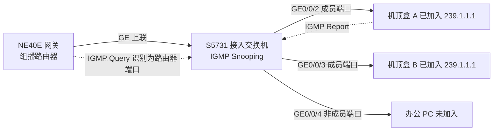

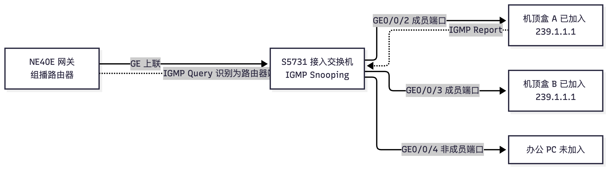


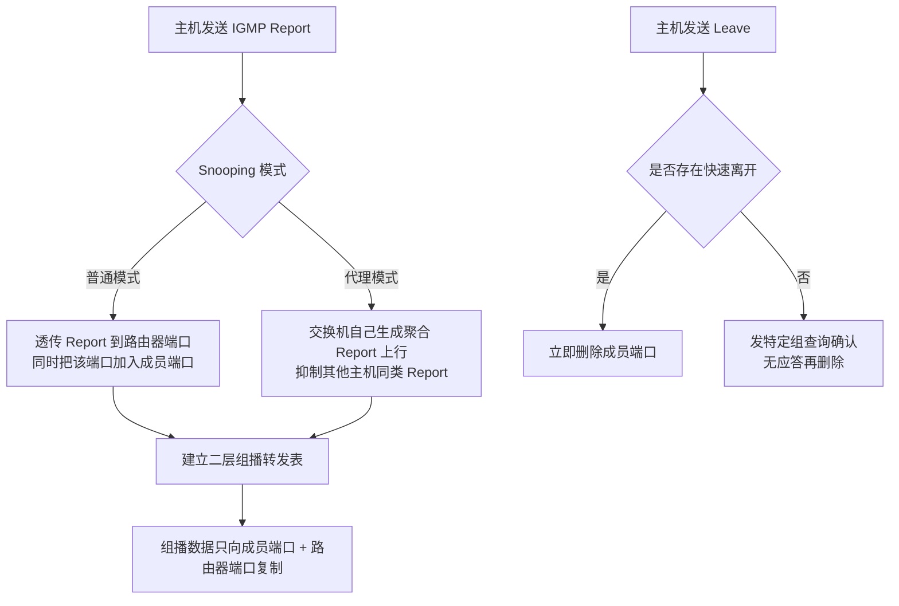

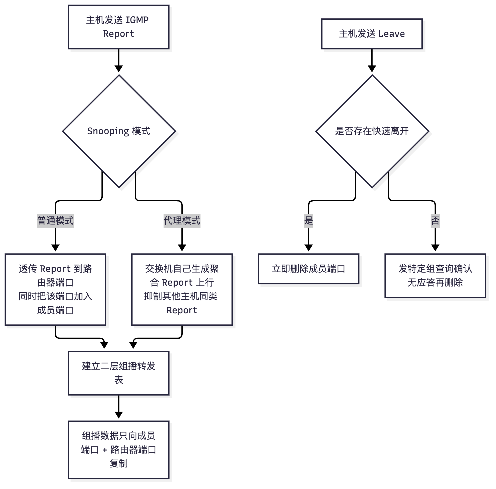


### 真题精练

**Q1.【真题·单选】** 交换机上 IGMP Snooping 的"路由器端口"可以通过哪一种方式动态学习到？
A. 收到 IGMP Report 报文  B. 收到 IGMP Query 报文  C. 收到 ARP 请求  D. 收到 DHCP Discover 报文

> **答案：B**
> **解析**：路由器端口是"上游"端口，识别依据是**收到 IGMP Query（普遍组查询或特定组查询）或 PIM Hello**。A 的 Report 来自主机，标识的是**成员端口**。C/D 与组播无关。补充：动态路由器端口有老化时间，超时未再收到 Query 会被删除，因此多网关/稳定上联场景建议用 `igmp-snooping static-router-port` 静态指定。

**Q2.【真题·多选】** 相比 IGMP Snooping 普通模式，代理模式（Proxy）的优势包括：
A. 减少上行 IGMP Report 数量，降低网关负担
B. 屏蔽上游存在多台路由器（多查询器）时的重复 Query
C. 收到 Leave 后交换机先在本 VLAN 内确认，加快离开收敛并减少无谓的上行 Leave
D. 可以完全取代三层 PIM，使组播不依赖网关

> **答案：ABC**
> **解析**：D 错误——IGMP Snooping（含 Proxy）只是**二层优化**，它不维护三层组播路由、不参与 PIM 建树，跨网段组播仍然依赖网关的三层组播能力（PIM）。A、B、C 都是 Proxy 的核心价值：聚合上报、屏蔽上游拓扑差异、本地完成最后成员确认。

**Q3.【真题·排错】** 某 IPTV 网络中，机顶盒显示已成功加入 239.1.1.1，但收不到组播流；网关侧 `display igmp group` 却显示该组有成员。请说明为什么二层仍可能收不到流，并给出排查步骤。

> **答案与解析**：
> **原因分析**：网关收到了 Report（说明 IGMP 上行通），说明"成员关系"建立成功，但二层转发路径可能没建起来。可能原因：① 交换机**未在 VLAN 内使能 IGMP Snooping**（只全局使能），此时二层不建表，虽然会泛洪，但如果 VLAN 内配置了未知组播丢弃或存在其他限制，流就下不来；② **路由器端口未正确学习**（上联网关的端口既没收到 Query 也没配静态路由器端口），导致组播流从上游进入 VLAN 后无出口；③ 组播数据到达时**目的 MAC 与 IP 不匹配**（32:1 重叠或人为构造），被一致性检查丢弃；④ 机顶盒所在端口被 STP 阻塞、或被组播 VLAN/隔离策略排除；⑤ 上游交换机与网关之间链路的组播流量被 ACL/QoS 丢弃。
> **排查步骤**：① `display igmp-snooping group vlan 10` 核对该组的成员端口是否包含机顶盒端口、路由器端口是否正确；② `display igmp-snooping router-port vlan 10` 确认上游口状态，必要时 `igmp-snooping static-router-port vlan 10` 静态指定；③ `display igmp-snooping statistics vlan 10` 确认交换机确实收到主机 Report 和上游 Query；④ 在机顶盒端口镜像抓包，确认是否有组播数据到达以及目的 MAC 是否为 01-00-5E-xx-xx-xx；⑤ 检查接口 STP 状态、组播 VLAN 配置与未知组播丢弃策略。

### 易错点与排错

1. **只在系统视图使能，忘了进 VLAN 使能**：这是 IGMP Snooping 最经典的"配了不生效"原因。
2. **把 Report 的端口当路由器端口**：Report 标识成员端口，Query/PIM Hello 才标识路由器端口。
3. **Snooping 版本与网关不一致**：网关用 v2、Snooping 配 v3（或反之）会造成报文解析异常。
4. **在多成员共享网段开快速离开**：一台主机退出会导致同网段其他成员断流，必须结合"单端口单主机"的接入设计使用。
5. **以为 Snooping 能省掉三层组播**：不能。它只优化二层复制，跨网段仍需 PIM + RP/SSM。
6. **排错命令**：`display igmp-snooping group vlan x` → `display igmp-snooping router-port vlan x` → `display igmp-snooping statistics vlan x` → 镜像抓包。

---

## 5.6 组播分发树：SPT 源树、RPT 共享树与 RP 的作用

### 考点定位

分发树是理解 PIM 的"骨架"。国赛常考：**(*,G) 与 (S,G) 的含义与区别**、**RPT 的根在哪里**、**RP 到底干什么**、**SPT 与 RPT 的优缺点**。这类题多以选择/判断出现（2~4 分），但它是 5.8 与 5.11 排错题的理论基础——不懂分发树就解释不了"为什么 RPF 检查要看 RP 地址"。

### 原理精讲

**组播分发树**是数据从源到所有接收者经过的路径集合，它是一棵**以某个节点为根的树**。分两类：

**① SPT（Shortest Path Tree，最短路径树 / 源树）**：以**组播源 S 为根**，到每个接收者走**单播最短路径**。表项写作 **(S, G)**，读作"源 S 发往组 G"。SPT 的路径最优（完全复用单播路由的最优路径），但**每个源每个组都要建一棵树**——如果组里有 100 个源，就要建 100 棵树，路由器状态量是 O(源 × 组)，扩展性差。

**② RPT（Rendezvous Point Tree，共享树 / 汇合点树）**：以 **RP 为根**，所有源共用同一棵树。表项写作 **(*, G)**，读作"任意源发往组 G"。RPT 的状态量与源数量无关（每组一棵树），扩展性好；但路径**不一定最优**（源→RP→接收者可能是绕行路径，还可能因为 RP 位置不当造成次优路径与额外时延）。

**RP（Rendezvous Point，汇合点/RP）的作用**，用一句话概括：**RP 是 ASM 模型里"源与接收者互相不认识"时的介绍人**。具体承担三件事：
1. **接收者侧汇合**：接收者 DR 不知道源在哪，只能向 RP 发 (*,G) Join，沿路建立 RP→接收者的共享树分支；
2. **源侧登记**：源侧 DR 收到源的第一份组播数据后，把数据封装成 **Register（注册）** 单播报文发给 RP，让 RP"知道有这个源、有这个组"；
3. **两条半棵树拼接**：RP 收到 Register 后解封装数据、沿 (*,G) 共享树下发，同时向源方向发起 (S,G) Join 建立 SPT。源的数据到达 RP 后，RP 通知源侧 DR 停止 Register（Register-Stop），此后数据沿 SPT 直接到 RP，再沿 RPT 下发——**RP 成了"源树与共享树的缝合点"**。

**为什么还要 SPT 切换？** RPT 下所有源的流量都要先绕到 RP，时延与带宽都不是最优。PIM-SM 允许**接收者侧 DR 在收到第一个组播数据后主动切换到 SPT**：直接向源发 (S,G) Join，建好源树后向 RP 方向发送携带 RPT 位的剪枝，把共享树分支剪掉。切换后接收者走最优路径，代价是路由器要维护 (S,G) 状态。华为缺省 **收到第一个数据就立即切换**（阈值 0），可用 `spt-switch-threshold` 设定基于速率的阈值，或用 `infinity` 永不切换（全部走共享树，常见于"RP 集中、希望节省 (S,G) 状态"的网络）。

**(*,G) 与 (S,G) 的共存关系**：接收者刚加入时只有 (*,G)（因为它只知道组）；一旦有数据到达并切换到 SPT，就同时存在 (*,G) 和 (S,G)。(*,G) 表项在"仍有下游成员、或仍在等待其他源"时保留；若某下游接口已切到 SPT，(S,G) 表项的该下游接口会被置为 prune（表示该组该源不再从共享树下发）。**RP 上一定有 (*,G) 表项（它是根，入接口为本地）**，RP 上还可能因 SPT 切换存在 (S,G) 表项。

### 关键概念对照表

| 对比项 | SPT 源树 | RPT 共享树 |
|---|---|---|
| 表项形式 | (S, G) | (*, G) |
| 树的根 | 组播源 S | RP |
| 路径最优性 | 最优（走单播最短路径） | 次优（源→RP→接收者） |
| 状态数量 | 与源数量成正比（源 × 组） | 每组一棵 |
| 是否依赖 RP | 不依赖（SSM 直接建源树） | 强依赖 |
| 切换 | 从 RPT 切换到 SPT 后走此树 | 缺省存在，可被剪枝 |
| 适用模型 | SSM、PIM-DM、PIM-SM 切换后 | ASM |
| 典型 Flag | SPT | WC（Wildcard，(*,G) 的典型标志） |

| 表项相关概念 | 含义 | 备注 |
|---|---|---|
| Upstream interface | 上游接口，即 RPF 接口（指向源或 RP 的接口） | 数据从该接口进入 |
| Upstream neighbor / RPF prime neighbor | 上游邻居，即该接口上的 RPF 邻居 | 排错看这个地址对不对 |
| Downstream interface(s) | 下游接口列表（Join 上来的接口） | 决定往哪些口复制 |
| Protocol | 下游接口由谁建立：PIM / IGMP / Static | IGMP 表示直连主机成员 |
| Flag | 表项状态标志（ACT/SPT/WC/PRUNE 等） | `display pim routing-table` 输出可见 |
| UpTime / Expires | 表项存活时间 / 下游接口老化时间 | Expires 为 `-` 表示由 IGMP 维持不老化 |

### 华为设备配置

```bash
system-view
multicast routing-enable                          // 全局使能组播
pim
 spt-switch-threshold 0                            // RPT 到 SPT 的切换阈值：0 表示收到第一个组播数据立即切换（缺省行为）
 spt-switch-threshold 100 list 2000                // 对 ACL 2000 匹配的组，速率超过 100 kbps 才切换（可基于流量控制状态量）
 spt-switch-threshold infinity list 2001            // 对某些组永不切换，始终走共享树（节省 (S,G) 状态）
quit
acl number 2000                                    // 定义"需要按速率阈值切换"的组范围
 rule 5 permit source 239.1.0.0 0.0.255.255         // 例：239.1.0.0/24 内的组用速率阈值 100 kbps
quit
interface GigabitEthernet0/0/1
 pim sm                                           // 使能 PIM-SM（该接口同时参与共享树与源树）
quit
display pim routing-table 239.1.1.1                // 查看该组的 (*,G) 与 (S,G) 表项，重点看 Upstream interface 与下游 Protocol
display pim routing-table 239.1.1.1 verbose        // 详细信息：RPF 邻居、Flag、各下游接口的老化时间
display pim rp-info                                // 查看本机学到的/配置的 RP 信息（组范围 → RP 地址 → 优先级）
```

### 示意图


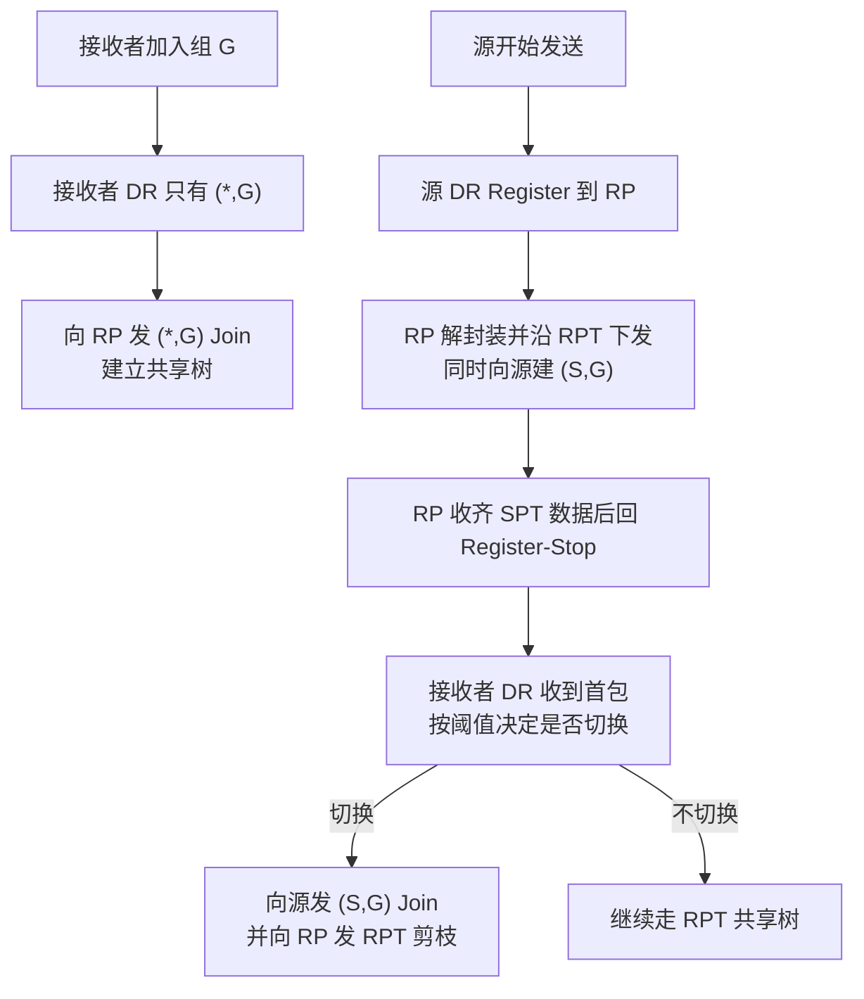

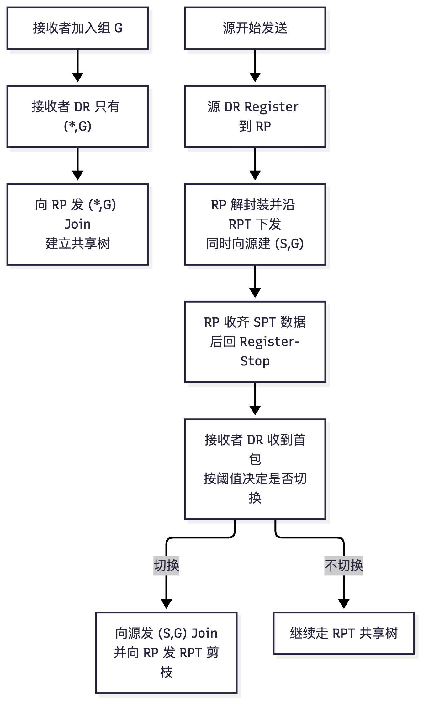


### 真题精练

**Q1.【真题·单选】** 在 PIM-SM 网络中，(*, G) 表项中"*"的含义是：
A. 任意源 B. 任意组 C. 任意 RP D. 任意下游接口

> **答案：A**
> **解析**：(*, G) 是共享树表项，"*"表示**任意源地址**，即"无论哪个源发往组 G 的流量都沿这棵树转发"。共享树的根是 RP，因此 (*,G) 的 Upstream interface 是指向 RP 的 RPF 接口。B 错误（G 才是组）；C、D 与语法无关。

**Q2.【真题·多选】** 关于 RPT 与 SPT，下列说法正确的有：
A. SPT 以源为根，路径最优，但状态数量与源数量成正比
B. RPT 以 RP 为根，所有源共用一棵树，路径可能次优
C. PIM-SM 中接收者切换到 SPT 后，(*, G) 表项一定会立即被删除
D. SSM 模型下只存在 SPT，不存在 RPT

> **答案：ABD**
> **解析**：C 错误——切换到 SPT 后，接收者侧路由器通常仍保留 (*,G) 表项（用于接收同一组内其他源的流量、以及处理后续成员加入），只是把共享树上对应的 (S,G) 分支剪掉；只有在没有任何下游接口依赖共享树、且不再需要向 RP 发送 (*,G) Join 时，(*,G) 才可能被删除。A、B 是两种树的基本特性对比；D 正确，SSM 无 RP，直接按 (S,G) 建源树。

**Q3.【真题·简答】** 解释为什么 ASM 模型中 RP 是必需的，而 SSM 不需要 RP。请从"源与接收者的信息不对称"角度说明。

> **答案与解析**：
> **ASM 中的信息不对称**：接收者只知道组地址 G，**不知道源 S 的地址**；而组播转发必须基于 (S,G) 或 (*,G) 做 RPF 检查（路由器必须知道"往哪个方向才是源"）。如果没有任何中间节点，接收者无法向源发起 Join。RP 的作用就是**预先约定一个双方都知道的固定汇聚点**：接收者向 RP 发 (*,G) Join、源侧 DR 向 RP 发 Register，双方都以 RP 为"通信中介"完成会合；路由器对 (*,G) 做 RPF 检查时检查的是 **RP 地址**而不是源地址，从而使"不知道源的接收者"也能建树。这正是 (*,G) 表项 RPF 检查对象是 RP 的原因。
> **SSM 为什么不需要**：SSM 下主机在加入时**显式报出源地址 S**（IGMPv3/MLDv2 的源列表），信息不对称消失；接收者 DR 可以直接用"到 S 的单播路由"做 RPF 检查并向源方向发 (S,G) Join，一步建好源树，无需任何中介节点。因此 SSM 省掉了 RP，也省掉了 Register/Register-Stop 与 RPT→SPT 切换这两个"为了弥补信息不对称而付出的复杂度"。

### 易错点与排错

1. **把 (*,G) 的 RPF 对象当成源**：共享树上 RPF 检查的对象是 **RP 地址**，这是 RPF 排错题的核心考点。
2. **以为切换后 (*,G) 立即消失**：不一定，要看下游依赖情况。
3. **`spt-switch-threshold infinity` 的副作用**：虽然省状态，但时延变大，且 RP 成为流量瓶颈（所有流量都过 RP）。
4. **RP 位置规划不合理**：RP 应尽量靠近源或网络中心，否则共享树路径严重次优；国赛简答题常考"如何规划 RP 位置"。
5. **排错命令**：`display pim routing-table <组地址>`、`display pim routing-table <组地址> verbose`、`display pim rp-info`。

---

## 5.7 PIM-DM：扩散—剪枝—嫁接、断言与状态刷新

### 考点定位

PIM-DM（Protocol Independent Multicast - Dense Mode，协议无关组播—密集模式）在国赛中多以**概念题 + 报文交互题**出现（2~4 分），因为它的"先泛洪后剪枝"逻辑非常适合出对比题与判断题。高频考点：**扩散（Flooding）→ 剪枝（Prune）→ 嫁接（Graft）** 三阶段、**剪枝定时器（210s）与状态刷新（State Refresh）解决"剪枝状态丢失"**、**断言（Assert）解决共享网段重复流**、**PIM-DM 没有 RP**。

### 原理精讲

PIM-DM 的思路是"**假设所有网段都有接收者，先到处送，再让不需要的地方剪掉**"，适用于**成员密集且分布广泛**的网络（典型如小型园区、实验室）。

**① 扩散（Flooding）**：源开始发送组播数据后，**源侧 DR 把所有接口（除 RPF 入接口外）都作为出接口**，数据沿所有分支泛洪到全网。同时路由器为 (S,G) 建立表项，出接口列表 = 除入接口外的全部接口（下游列表初始化为"全部"）。这个过程必然造成**大量无用流量**（没有接收者的分支也被推流）。

**② 剪枝（Prune）**：没有接收者的路由器（叶路由器，即除 RPF 接口外没有其他 PIM 邻居、也没有 IGMP 成员的路由器）会**向其上游（RPF 邻居）发送 Prune 报文**，请求"不要再往这个接口发"。上游收到 Prune 后，把该接口从 (S,G) 的出接口列表删除，并启动**剪枝定时器（缺省 210 秒）**——因为 PIM-DM 是"无状态周期性刷新"的硬状态协议，剪枝超时后若没有新的 Prune 续期，接口会被**重新加入出接口列表**（流量恢复），这就是所谓"**剪枝状态需要周期性刷新**"。为避免此问题，PIM-DM 引入**状态刷新（State Refresh）**机制（RFC 3973）：源侧 DR 周期性（缺省 60 秒）向下游发送 State Refresh 报文，沿途的剪枝下游收到后按需把 Prune 状态沿下游重新通告并刷新剪枝定时器，从而把"剪枝状态的老化"从依赖上游主动重泛洪，变为**由上游周期性刷新来确认剪枝依然有效**。这样既避免了周期性重新泛洪（减少突发流量），又解决了剪枝丢失。

**③ 嫁接（Graft）**：当剪枝后又有新成员加入（新主机发 IGMP Report）时，路由器**不能等 210 秒**，必须马上恢复流量。它向 RPF 邻居发送 **Graft（嫁接）报文**请求立即恢复转发；上游收到 Graft 后把接口重新加入出接口列表，并回 **Graft-Ack** 确认，随后把数据下发。Graft 使"新成员加入"的收敛时间从"分钟级"缩短到"秒级"。若 Graft 没收到 Graft-Ack，会周期性重传（缺省间隔 3 秒）。

**④ 断言（Assert）**：当**同一网段上有两台以上路由器**都把该 (S,G) 的组播数据送上网段时（多路接入同一共享 LAN，例如双上行到同一台交换机），会造成**重复数据**。此时这些路由器会在该网段上发 **Assert 报文**进行选举，比较顺序为：
1. **到源的单播路由优先级（preference）**：数值**小**者优先（优选路由协议优先级更高者）；
2. 若相同，比较**到源的路径开销（metric）**：**小**者优先；
3. 若仍相同，比较**接口 IP 地址**：**大**者优先。
胜者继续在该网段转发（Assert Winner），败者把自己在该网段的接口从出接口列表剪掉并启动 Assert 定时器（缺省 180 秒）。

**⑤ PIM-DM 与单播路由的关系**：PIM 是"协议无关"（Protocol Independent）的——它自己不计算路由，**借用单播路由表（或组播静态路由/MBGP 路由）来做 RPF 检查**，从而决定"哪个接口是朝向源的入接口"。这一点 PIM-DM 与 PIM-SM 完全一致。

**PIM-DM 的优缺点**：优点是实现简单、无需 RP、收敛快（Graft 秒级恢复）；缺点是**周期性泛洪**（初始泛洪 + 周期状态刷新）在广域网上开销大，**扩展性差**，不适合成员稀疏的大网。因此**广域网/运营商网几乎都用 PIM-SM，PIM-DM 多用于小型园区或实验室**。国赛简答题常问"为什么 PIM-DM 不适合大规模网络"，答案就是"周期性扩散与状态刷新带来的带宽与设备开销随规模线性增长"。

### 关键概念对照表

| PIM 报文 | 目的地址 | 发送周期/触发 | 作用 |
|---|---|---|---|
| Hello | 224.0.0.13 | 缺省 30 秒（Holdtime 105 秒） | 建立/维持邻居、选举 DR、携带 DR 优先级 |
| Join/Prune | 224.0.0.13（单播给 RPF 邻居） | 缺省 60 秒周期刷新（Holdtime 210 秒） | 加入（Join）或剪枝（Prune）某组播流 |
| Graft / Graft-Ack | 单播给 RPF 邻居 | 触发式，未收到 Ack 每 3 秒重传 | 剪枝后快速恢复（嫁接）及确认 |
| Assert | 224.0.0.13 | 检测到共享网段重复流时 | 共享网段选举唯一转发者 |
| State Refresh | 224.0.0.13 | 缺省 60 秒（由源侧 DR 发起） | 周期刷新剪枝状态，避免剪枝超时后重新泛洪 |
| Register / Register-Stop | 单播 | 仅 PIM-SM 使用 | PIM-DM 不涉及 |

| 定时器 | PIM-DM 缺省值 | 说明 |
|---|---|---|
| Hello 间隔 / Holdtime | 30 秒 / 105 秒 | 105 = 3.5 × 30，允许丢 2~3 个 Hello |
| Join/Prune 间隔 / Holdtime | 60 秒 / 210 秒 | 210 = 3.5 × 60 |
| 剪枝定时器 | 210 秒 | 超时后接口重新加入出接口列表 |
| 状态刷新间隔 | 60 秒 | 源侧 DR 发起 |
| Graft 重传间隔 | 3 秒 | 未收到 Graft-Ack 时 |
| Assert 定时器 | 180 秒 | 败者保持剪枝状态的时长 |
| LAN Delay / Override Interval | 500 毫秒 / 2500 毫秒 | 用于剪枝抑制（Prune Override）机制 |

### 华为设备配置

```bash
system-view
multicast routing-enable                          // 全局使能组播路由
interface GigabitEthernet0/0/1
 pim dm                                           // 在该接口使能 PIM-DM（同一网络内所有组播接口都要配）
 pim timer hello 30                               // Hello 发送间隔 30 秒（缺省值，缩短可加快邻居发现但增加开销）
 pim holdtime hello 105                           // Hello 邻居保持时间 105 秒（须大于 3 倍 Hello 间隔）
quit
pim
 hello-option dr-priority 10                       // 提高本机在共享网段的 DR 优先级（数值大者优），影响查询器/DR 归属
 hello-option lan-delay 500                         // 剪枝抑制的 LAN 传输延迟，缺省 500 毫秒（与 override-interval 配合）
 hello-option override-interval 2500                // 剪枝抑制时间，缺省 2500 毫秒（避免多路由器同时剪枝造成误剪）
 state-refresh-interval 60                          // 状态刷新报文发送间隔 60 秒（源侧 DR 发起，刷新下游剪枝状态）
quit
interface GigabitEthernet0/0/2
 pim dm
quit
display pim neighbor                              // 查看 PIM 邻居（确认 Hello 互通、DR 优先级、邻居存活时间）
display pim interface                             // 查看各接口 PIM 模式（DM/SM）、Hello 定时器、DR 状态
display pim routing-table                         // 查看 (S,G) 表项与下游接口，DM 下没有 (*,G)
display pim routing-table 239.1.1.1 verbose        // 查看断言、剪枝标志与各下游接口状态
```

### 示意图

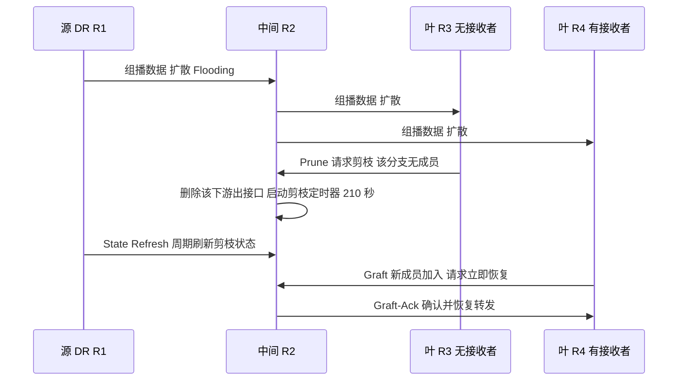

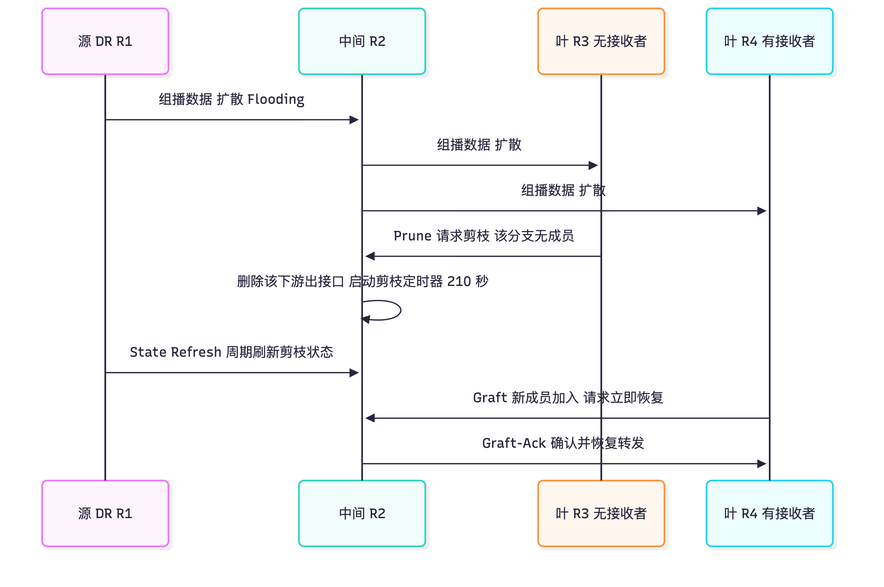


### 真题精练

**Q1.【真题·单选】** 在 PIM-DM 网络中，某路由器在共享网段上通过 Assert 选举成为败者，则它接下来的动作是：
A. 向上游发送 Prune，删除整个 (S,G) 表项
B. 把该网段接口从出接口列表中剪掉，并启动 Assert 定时器
C. 停止发送 Hello 报文，退出该网段
D. 立即向源发送 Graft 请求更多流量

> **答案：B**
> **解析**：Assert 选举的目的是在**同一共享网段**上只保留一个转发者，避免重复流。败者只把**该网段对应的接口**从出接口列表剪掉（并非删除整个表项，其他接口的转发继续），并启动 Assert 定时器（缺省 180 秒）保持沉默。A 错误——Prune 是发给上游请求"别给我发"，与 Assert 的语义不同；C、D 与 Assert 机制无关。

**Q2.【真题·多选】** 关于 PIM-DM 的状态刷新（State Refresh）机制，下列说法正确的有：
A. 由源侧 DR 周期性发起，缺省间隔 60 秒
B. 作用是周期刷新下游的剪枝状态，避免剪枝定时器超时后重新泛洪
C. 收到 State Refresh 的剪枝路由器需要把剪枝状态沿下游继续通告
D. 状态刷新报文是单播报文，只在两个 PIM 邻居之间传递

> **答案：ABC**
> **解析**：D 错误——State Refresh 使用组播地址 **224.0.0.13** 发送（TTL=1，逐跳沿树向下），不是单播。A、B、C 都正确：其设计目的正是"由上游周期性地确认剪枝仍然有效"，从而替代"剪枝超时后重新泛洪"的旧行为（RFC 3973）。

**Q3.【真题·排错】** 某网络使用 PIM-DM，用户反馈"某分支机顶盒每次加入后要等 3 分多钟才看到画面"。请分析最可能的原因与排查方法。

> **答案与解析**：
> **原因分析**：3 分多钟 ≈ **210 秒剪枝定时器 + 若干秒收敛**，这是 PIM-DM 剪枝状态的典型特征。最可能的情况是：该分支此前被剪枝（Prune），当新成员加入时路由器应发送 **Graft** 报文快速恢复；若 Graft 未生效（例如 Graft 报文被 ACL 过滤、RPF 邻居不可达、设备未实现/未使能状态刷新），则只能等**剪枝定时器 210 秒超时**后上游重新把接口加入出接口列表、重新泛洪，成员才收到流量——正好对应"3 分多钟"。
> **排查方法**：① `display pim routing-table 239.1.1.1 verbose` 查看该下游接口是否处于 Prune/剪枝状态、Expires 剩余时间；② `display pim neighbor` 确认上游 RPF 邻居是否正常（Graft 是单播发给 RPF 邻居的）；③ 抓包确认新成员加入后是否发出 Graft、上游是否回 Graft-Ack；④ 检查沿途 ACL/防火墙是否放通 PIM（IP 协议号 **103**）；⑤ 确认源侧 DR 是否开启状态刷新（`state-refresh-interval`），若网络规模较大建议改用 **PIM-SM** 从根本上避免周期性泛洪与剪枝老化问题。

### 易错点与排错

1. **PIM-DM 没有 (*,G)**：它只建 (S,G) 源树，因为 DM 不做"任意源汇合"。
2. **剪枝定时器 210 秒 vs Hello Holdtime 105 秒**：别记混，前者是 Join/Prune 的 3.5 倍，后者是 Hello 的 3.5 倍。
3. **Graft 与 Join 的区别**：Graft 用于"剪枝后快速恢复"（发送给 RPF 邻居、有 Ack），Join 是周期性的加入通告。
4. **Assert 与 Prune 的混淆**：Assert 是"同一网段去重"，Prune 是"向上游要求停止发送"。
5. **PIM 用 IP 协议号 103**：防火墙/ACL 必须放通 103，否则邻居都建不起来（这条在国赛排错题里出现过多次）。
6. **排错命令**：`display pim neighbor`、`display pim interface`、`display pim routing-table verbose`、`debugging pim join-prune`（生产慎用）。

---

## 5.8 PIM-SM：共享树建立、DR 选举、Register 机制与 RPT→SPT 切换

### 考点定位

**本节是组播部分分值最高的知识点**，国赛通常以 1 道大题（简答或时序分析）+ 2~3 道小题的形式出现，合计 10~15 分。必考四件事：**① 共享树是怎么一段一段建起来的；② Register / Register-Stop 的触发条件与报文方向；③ RPT 到 SPT 的切换条件与切换后的剪枝动作；④ PIM DR 的选举规则（与 IGMP 查询器选举的区别）**。常见考法还有"给出表项问处于哪个阶段""某处不通问是 Register 还是 Join 出了问题"。

### 原理精讲

PIM-SM（Protocol Independent Multicast - Sparse Mode，协议无关组播—稀疏模式）适用于**成员稀疏、分布广泛**的网络，是运营商与企业广域组播的事实标准。它的核心思想是"**按需建树**"：没有人要的流量绝不发送（与 PIM-DM 的"先发后剪"正好相反）。

#### 一、PIM DR 的选举（先讲它，因为它决定谁去发 Join/Register）

在一个**多路访问网段**（以太网）上，如果多台路由器都连着同一网段，必须选出一个"代表"来处理该网段的成员与源，这个代表就是 **DR（Designated Router，指定路由器）**。PIM DR 承担两项职责：**接收者侧**——代表网段向 RP 发送 (*,G) Join、并发起 RPT→SPT 切换；**源侧**——代表网段把源的数据用 Register 封装发给 RP。

**选举规则**（通过 PIM Hello 报文携带的 DR Priority 选项交换）：
1. 比较 **DR 优先级**（`pim hello-option dr-priority`，缺省 1）：**数值大者胜**；
2. 优先级相同时，比较接口的 **IP 地址**：**大者胜**；
3. **可抢占**：PIM DR 不是"选了就不变"，当更高优先级的路由器出现在网段上时，会立即抢占 DR（这一点与 IGMP 查询器选举"不抢占"不同，也与 OSPF DR 的"不抢占"不同——**三者对比是经典考点**）。

**PIM DR 与 IGMP 查询器的关系**：IGMPv1 下没有查询器选举，查询器就是 PIM DR（由 PIM 决定）；IGMPv2/v3 下查询器独立选举，规则同样是"接口 IP 大者胜"，但**不抢占**——只有当前查询器消失（其他查询器存在定时器 125 秒超时）才重新选举。**因此同一网段上 PIM DR 与 IGMP 查询器可能不是同一台设备**（例如 DR 优先级高但 IP 小的设备是 PIM DR，而 IP 大的设备是 IGMP 查询器）。这是一个高频陷阱题。

#### 二、共享树（RPT）的建立过程

1. **主机加入**：接收者主机发送 IGMPv2 Report（或 IGMPv3 Report）加入组 G。
2. **网关产生 (*,G)**：接收者侧 DR（网关）收到 Report 后，建立 (*, G) 表项，并设置"入接口 = 到 RP 的 RPF 接口"。
3. **向上游发 Join**：DR 向 **RPF 邻居**（即到 RP 的单播路由下一跳）单播发送 **(*, G) PIM Join**（封装在 IP 中，目的地址 224.0.0.13、IP 协议号 103、TTL=1，Router Alert 选项置位）。
4. **逐跳建立分支**：每台收到 Join 的路由器都建立 (*, G) 表项，把收到 Join 的接口加入**下游接口列表**，然后继续向自己的 RPF 邻居发 Join——**Join 是逐跳单播、一跳一跳传向 RP 的**（这解释了"PIM Join 是单播报文但目的地址写 224.0.0.13"的经典考点）。
5. **到达 RP**：RP 自身就是根，收到 Join 后 (*, G) 表项建立完毕（RP 上 (*,G) 的入接口为本地，标记为 NULL/Register）。至此从 RP 到接收者的共享树分支建成。
6. **周期性刷新**：Join 每 60 秒重发一次（Holdtime 210 秒），下游接口靠这个周期报文维持，超时未收到则删除。

#### 三、源侧注册：Register 与 Register-Stop

源开始发送组播数据后，源侧 DR 发现没有到该组的转发路径（不知道接收者在哪里），于是执行**注册**：

1. **封装 Register**：源侧 DR 把**完整的组播数据报文**作为载荷，封装在一条**单播 IP 报文**里（PIM Register 报文，目的地址 = **RP 的单播地址**，IP 协议号 103），发给 RP。
2. **RP 的处理**：
   - 若 RP **已有**该 (S,G) 的 SPT 数据（即已从源侧收到过原生组播数据），RP 直接回 **Register-Stop**（单播给源侧 DR），不再解封装；
   - 若 RP **还没有**该源的数据，RP **解封装** Register 报文，取出内层组播数据，沿 (*, G) 共享树向下转发（保证接收者尽快看到流量），同时向**源方向**发起 **(S, G) Join** 建立"源→RP"的 SPT（这是"RP 也会做 SPT 切换"）。
3. **Register-Stop 与抑制**：当 RP 从 SPT 上收到了该源的**第一份原生组播数据**后，向源侧 DR 发 **Register-Stop**。源侧 DR 收到后进入 **Register 抑制状态（Register Suppression）**，停止封装数据（因为数据已经能沿 SPT 到达 RP）。
4. **空注册（Null Register）探测**：抑制期间，源侧 DR 周期性（缺省 **5 秒**）发送**空 Register**（只有 PIM 头、无内层数据）给 RP，用来探测"RP 是否还需要我注册"；若 RP 回了 Register-Stop 则继续抑制，若不再回（说明 RP 上的 SPT 状态丢了、或 RP 重启了），源侧 DR 立即恢复数据封装注册。抑制定时器缺省 **60 秒**，超时未收到 Register-Stop 也会恢复注册。

**为什么要有 Register 机制？** 因为它解决了"源侧数据已经到了，但共享树还没建到源"的时间窗口问题：既让接收者不必等待 SPT 建立就能收到流量（RP 解封装转发），又让 RP 有机会学习到源的存在并向源建树。**Register 是 PIM-SM 中唯一的"单播承载组播数据"的报文**。

#### 四、RPT → SPT 的切换

接收者侧 DR 在共享树上收到 (S,G) 的第一个数据报文后，检查**到源 S 的单播路由出接口（RPF 接口）**：
- 若 RPF 接口**就是**收到该数据的入接口（说明已经在源树上），无需切换；
- 否则（数据是从 RP 方向来的，而到源的出口在另一侧），发起**切换**：向源的 RPF 邻居发送 **(S, G) Join**（不带 RPT 位），逐跳建立源树；同时向 RP 方向发送 **(S, G) Prune with RPT bit**（携带 RPT 位的剪枝），请求上游把共享树上该源的转发分支剪掉。

**切换条件与阈值**：华为缺省**收到第一个数据即切换**（`spt-switch-threshold` 缺省 0 kbps），可用 `spt-switch-threshold <kbps>` 设定"速率超过阈值才切换"，或用 `infinity` 永不切换。切换的收益是最优路径；代价是路由器需要维护 (S,G) 状态、RP 上可能出现"流量旁路"。

**切换后的状态**：接收者侧同时存在 (*,G)（可能被剪成"无下游"或保留用于其他源）与 (S,G)（有下游）；RP 侧 (*,G) 对应的下游接口被剪掉该源的分支，RP 若自己也需要该源的流量（RP 本身是接收者或仍有未切换的下游）则保留 (S, G)。

### 关键概念对照表

| 报文/机制 | 方向 | 封装方式 | 触发条件 | 作用 |
|---|---|---|---|---|
| (*, G) Join | 接收者 DR → RP（逐跳单播） | IP 单播，目的 224.0.0.13，协议号 103 | 主机加入组 | 建立/刷新共享树分支 |
| (S, G) Join | 接收者 DR → 源（逐跳单播） | 同上 | 触发 SPT 切换 | 建立/刷新源树分支 |
| (S, G) Prune（RPT 位） | 接收者 DR → RP 方向 | 同上 | 完成 SPT 切换后 | 剪掉共享树上该源的分支 |
| Register | 源侧 DR → RP | **单播封装组播数据** | 源开始发送且 RP 无该源 SPT | 让 RP 学到源并先转发数据 |
| Register-Stop | RP → 源侧 DR | 单播 | RP 已从 SPT 收到该源数据 | 通知源侧 DR 停止注册（进入抑制） |
| Null Register | 源侧 DR → RP | 单播（无内层数据） | 抑制期间每 5 秒 | 探测 RP 是否仍需注册 |
| Hello | 双向 | 组播 224.0.0.13 | 每 30 秒 | 邻居维护、DR 选举、参数协商 |

| 对比项 | PIM DR 选举 | IGMP 查询器选举 | OSPF DR 选举 |
|---|---|---|---|
| 依据 | DR 优先级（大者优）→ 接口 IP（大者优） | 接口 IP（大者优） | 接口优先级（大者优）→ Router ID（大者优） |
| 是否抢占 | **抢占** | **不抢占** | **不抢占** |
| 载体 | PIM Hello 的 DR Priority 选项 | IGMP Query | Hello 报文的优先级字段 |
| 作用 | 代表网段发 Join/Register | 发 IGMP Query、收 Report | 生成 2 类 LSA、同步 LSDB |

| 定时器 | 缺省值 | 说明 |
|---|---|---|
| Register 抑制定时器 | 60 秒 | 源侧 DR 抑制注册的时长 |
| 空注册探测间隔 | 5 秒 | 抑制期间发送空 Register 的周期 |
| SPT 切换阈值 | 0 kbps（立即切换） | 收到第一个数据即切换 |
| Join/Prune 周期 | 60 秒（Holdtime 210 秒） | 树的状态刷新 |
| Hello 周期 | 30 秒（Holdtime 105 秒） | 邻居维护 |

### 华为设备配置

```bash
system-view
multicast routing-enable                              // 全局使能组播
interface GigabitEthernet0/0/1                        // 面向组播源的接口
 pim sm                                               // 使能 PIM-SM
 pim hello-option dr-priority 100                      // 提高 DR 优先级（大者胜），确保本机成为源侧 DR
quit
interface GigabitEthernet0/0/2                        // 面向接收者的接口
 pim sm                                               // 使能 PIM-SM
 igmp enable                                          // 使能 IGMP 收集成员
 igmp version 3                                        // v3 支持源过滤/SSM
quit
pim
 spt-switch-threshold 0                                // 收到第一个数据立即从 RPT 切换到 SPT（缺省行为）
 register-suppression-timeout 60                       // Register 抑制时间 60 秒（源侧 DR 抑制注册的时长）
 probe-interval 5                                      // 空注册（Null Register）探测间隔 5 秒
quit
display pim neighbor                                  // 看邻居、DR 优先级、DR 归属（哪个邻居是 DR）
display pim interface                                 // 看接口 PIM 状态、DR 地址、Hello/Join 定时器
display pim routing-table                             // 看 (*,G) 与 (S,G) 表项、上游接口/邻居、下游接口与 Protocol
display pim routing-table 239.1.1.1 verbose            // 看该组的 Flag（ACT/SPT/WC）、剪枝状态与老化时间
display pim rp-info                                   // 看 RP 信息（组范围 → RP 地址 → 优先级 → 来源 静态/BSR）
display multicast forwarding-table 239.1.1.1          // 看实际转发表项与转发计数（判断数据面是否真的在转发）
```

### 示意图

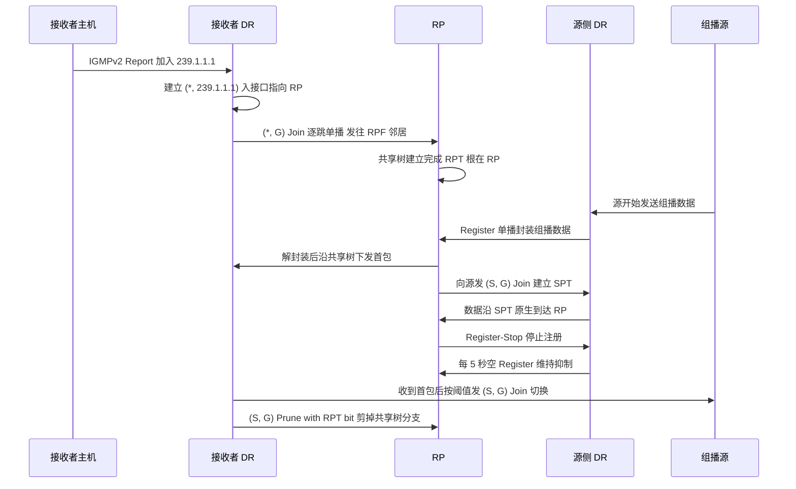

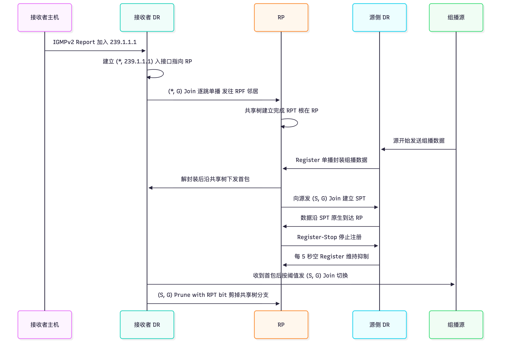


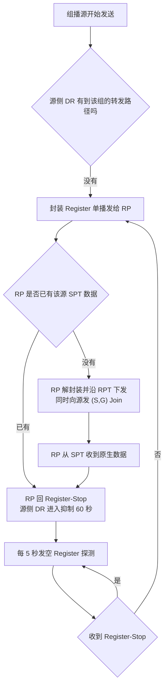

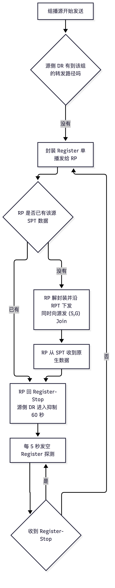


### 真题精练

**Q1.【真题·单选】** PIM-SM 中，源侧 DR 在什么情况下会停止向 RP 发送携带数据的 Register 报文？
A. 收到接收者发来的 Leave 报文
B. 收到 RP 回复的 Register-Stop 报文
C. 收到 RP 发来的 Join 报文
D. RPT 切换到 SPT 完成时由接收者 DR 通知

> **答案：B**
> **解析**：Register-Stop 是 RP 发给源侧 DR 的**单播**报文，含义是"我已经能从源树收到该源的数据了，你不用再封装注册"。源侧 DR 收到后进入 Register 抑制状态（缺省 60 秒），期间每 5 秒发空 Register 探测。A 的 Leave 属于成员管理，与源侧注册无关；C 的 Join 是 RP 向源建树用的；D 中切换是接收者侧行为，切换完成只会向 RP 方向剪枝，不会直接通知源侧 DR。

**Q2.【真题·多选】** 关于 PIM-SM 的 RPT 到 SPT 切换，下列说法正确的有：
A. 接收者 DR 收到沿共享树下来的第一个 (S, G) 数据后，检查到源的单播路由出接口
B. 若到源的 RPF 接口与收到数据的入接口不同，则触发切换
C. 切换时向源发出 (S, G) Join，并向 RP 方向发出携带 RPT 位的 (S, G) Prune
D. 华为设备缺省配置为速率超过 100 kbps 才切换

> **答案：ABC**
> **解析**：D 错误——华为缺省 `spt-switch-threshold` 为 **0 kbps**，即**收到第一个组播数据就立即切换**；100 kbps 之类的阈值需要手工配置。A、B、C 完整描述了切换的判据与动作："先看 RPF 接口是否已在源树上，不在则建源树并剪共享树分支"。

**Q3.【真题·简答】** 某网段上有两台路由器 R1（接口 IP 10.0.0.1，DR 优先级 10）和 R2（接口 IP 10.0.0.2，DR 优先级 1），两台都运行 PIM-SM 与 IGMPv2。请回答：谁是 PIM DR？谁是 IGMP 查询器？如果 R2 的 DR 优先级改为 100 会发生什么？

> **答案与解析**：
> **PIM DR = R1**：PIM DR 选举先比 DR 优先级（大者优），R1 的 10 > R2 的 1，故 R1 胜出，即使 R1 的接口 IP 更小。
> **IGMP 查询器 = R2**：IGMPv2 查询器选举只比较接口 IP 地址，地址大者胜，10.0.0.2 > 10.0.0.1，故 R2 是查询器。这说明 **PIM DR 与 IGMP 查询器完全可能是两台不同设备**，两者依据不同、互不影响。
> **若 R2 的 DR 优先级改为 100**：R2 变为 PIM DR（优先级 100 > 10）。由于 **PIM DR 是抢占式的**，R2 会立即抢过 DR 角色：接收者侧由 R2 负责发 (*,G) Join 与 SPT 切换，源侧由 R2 负责发 Register；R1 退化为非 DR（仍参与 PIM 邻居与转发，但不再承担 DR 职责）。注意此时 R2 同时是 IGMP 查询器与 PIM DR。若想把职责分开（例如让查询器与 DR 都在同一台设备以便排错），只需让"DR 优先级最高"的设备同时"接口 IP 最大"，或调整 `hello-option dr-priority`。

### 易错点与排错

1. **PIM Join 是单播**：目的 IP 写 224.0.0.13、协议号 103、TTL=1，但**实际是逐跳单播发给 RPF 邻居**（"组播地址 + 单播发送"的组合最容易被问）。
2. **Register 是唯一封装组播数据的单播报文**：方向恒为"源侧 DR → RP"；Register-Stop 方向恒为"RP → 源侧 DR"。
3. **PIM DR 可抢占、IGMP 查询器不可抢占、OSPF DR 不可抢占**：三者对比必须记牢。
4. **抑制期间的空 Register**：不是"停止一切注册报文"，而是"停数据、留探测"。
5. **切换后 RP 的流量**：若所有下游都切到 SPT，RP 上该组的流量会显著下降甚至为零，`display pim routing-table` 中 (*,G) 的下游接口会显示 Prune / 被删除，这**不是故障**。
6. **排错顺序**：先 `display pim neighbor`（邻居/DR 是否正常）→ `display igmp group`（成员是否上报）→ `display pim rp-info`（RP 是否学到）→ `display pim routing-table`（(*,G)/(S,G) 是否建立、上游接口是否 RPF 接口）→ `display multicast forwarding-table`（数据面）。
7. **PIM 依赖单播路由**：单播路由不对称是组播不通的第一大原因，先 `display ip routing-table` 确认到源与到 RP 的路由。

---

## 5.9 RP 的三种配置方式：静态 RP、BSR 动态 RP、Anycast RP + MSDP

### 考点定位

RP 配置是国赛"配置题 + 简答题"的常客（5~10 分），高频考法：**给出拓扑要求写 RP 配置**、**问 BSR 与 C-BSR/C-RP 的报文交互过程**、**问 Anycast RP 为什么需要 MSDP**、**问静态 RP 与 BSR 的优先级关系**。特别注意：**全网 RP 信息必须一致**，这是组播不通最常见的配置类原因。

### 原理精讲

**① 静态 RP（Static RP）**：在每台组播路由器上用 `static-rp <address> [acl]` 手工指定 RP 地址。优点是**简单、无协议开销、无 RP 单点故障风险（RP 本身仍是单点）**；缺点是**必须全网逐台配置且完全一致**，一旦 RP 地址变更需要逐台改；地址规划变更（按组划分不同 RP）时运维成本高。**注意优先级关系：华为设备上 BSR 动态学到的 RP 信息优先于静态 RP**；若希望静态 RP 优先，需要在配置时使用相应选项/或干脆不用 BSR。用 ACL 可以做到"不同组范围用不同 RP"。

**② BSR 动态 RP（BootStrap Router，自举路由器）**：由 **C-BSR（Candidate-BSR，候选 BSR）** 与 **C-RP（Candidate-RP，候选 RP）** 协作，自动向全网通告 RP 信息，流程如下：

1. **C-BSR 选举**：网络中的多台 C-BSR 通过互相发送 **Bootstrap（BSR 自举）报文** 选举出唯一的 BSR。比较规则：**BSR 优先级（大者优）→ BSR 接口 IP 地址（大者优）**。BSR 周期性（缺省 60 秒）发送 Bootstrap 报文，**逐跳泛洪（TTL=1）**到整个 PIM-SM 域。
2. **C-RP 上报**：每台 C-RP 周期性（缺省 60 秒）**单播**向 BSR 发送 **Candidate-RP-Advertisement（C-RP 通告）报文**，内容包含：自己的地址、服务的组地址范围（`group-policy`）、优先级（`priority`）。
3. **BSR 汇总并泛洪**：BSR 把所有 C-RP 的信息汇总成 **RP-Set（RP 集合）**，随 Bootstrap 报文一起**泛洪**到整个域。
4. **各路由器选 RP**：每台组播路由器收到 Bootstrap 后，对每个组做 RP 选举，规则依次为：
   - **组范围匹配最长者优先**（例如 239.1.1.0/24 的 RP 优先于 224.0.0.0/4 的 RP）；
   - 若长度相同，比较 **C-RP 优先级**（`c-rp ... priority`，**数值小者优先**，缺省 0）；
   - 若仍相同，按 **Hash 值**（对 RP 地址、组地址、掩码做哈希）比较，**哈希值大者胜**——这样不同组可以分散到不同 RP，实现负载分担。
5. **域边界**：在与外部 PIM 域相连的接口上配置 **`pim bsr-boundary`**，阻止 Bootstrap/C-RP 报文跨域，保证各域 RP 信息独立。

**③ Anycast RP（任播 RP）+ MSDP**：BSR 虽然解决了"自动通告"，但**RP 仍然可能单点故障**，且所有流量集中到一台 RP。Anycast RP 的做法是：**多台 RP 使用相同的 RP 地址**（通常用同一个 /32 的 Loopback 地址，例如两台 RP 都配 `Loopback0: 10.0.0.1/32`），通过 IGP 向网络通告该地址。这样：
- 接收者侧 DR 到 "RP 地址" 的单播路由会被 IGP 选为**最近的一台 RP**（就近性），实现负载分担与冗余；
- 但问题出现了：**源注册到的 RP 与接收者加入的 RP 可能不是同一台**！源侧 DR 注册给了 RP-A，接收者加入到了 RP-B，两条半棵树落在了不同设备上，流量接不起来。
- 解决办法就是 **MSDP（Multicast Source Discovery Protocol，组播源发现协议）**：每台 RP 另外配置一个**唯一的 Loopback 地址**（如 RP-A=10.0.0.2、RP-B=10.0.0.3）作为 MSDP 对等体地址，RP 之间建立 MSDP 邻居；当 RP-A 通过 Register 学到源 (S,G) 后，把它封装成 **SA（Source Active，源活跃）报文**发给 MSDP 对等体 RP-B。RP-B 收到 SA 后**直接向源 S 发起 (S,G) Join**（用 SA 中的源地址做 RPF 检查），从而把流量拉到本地再沿共享树下发。**所以 Anycast RP 中 MSDP 的作用不是"跨域"，而是"同一域内多台 RP 之间的源信息同步"**——这是最容易被考生忽略的关键点。

**三者对比与选型**：小型网络（RP 固定、规模小）用**静态 RP**；中大型单域网络用 **BSR 动态 RP**（自动通告、避免配置不一致）；对 RP 可靠性/负载有要求的大型网络用 **Anycast RP + MSDP**（就近接入 + 冗余 + 负载分担）；跨域组播则必须用 **MSDP + MBGP**（见 5.10）。

### 关键概念对照表

| 对比项 | 静态 RP | BSR 动态 RP | Anycast RP + MSDP |
|---|---|---|---|
| 配置方式 | 每台路由器手工 `static-rp` | C-BSR + C-RP 自动通告 | 多台 RP 共用同一 RP 地址 + MSDP 对等体 |
| 是否需要额外协议 | 无 | BSR（Bootstrap/C-RP-Adv 报文） | MSDP（TCP 639，SA 报文） |
| 配置一致性要求 | 极高（必须全网一致） | 自动保证 | RP 地址一致、MSDP 邻居成对配置 |
| 冗余能力 | 无（RP 单点） | 无（BSR 可冗余，RP 单点） | 有（多台 RP 互为备份） |
| 负载分担 | 可用 ACL 按组分配 RP | 可用 group-policy + priority + Hash 分散 | IGP 就近性天然分担 |
| 优先级关系 | 低于 BSR 学到的 RP | 高于静态 RP | 同上（RP 地址由 BSR/静态提供） |
| 适用场景 | 小型网络、实验 | 中大型单域 | 大型网络、对可靠性要求高 |
| 常用命令 | `static-rp` | `c-bsr` / `c-rp` / `pim bsr-boundary` | `anycast-rp` + `msdp peer` |

| BSR 相关参数 | 缺省值 | 说明 |
|---|---|---|
| Bootstrap 报文发送间隔 | 60 秒 | BSR 周期性泛洪 RP-Set |
| C-RP-Advertisement 间隔 | 60 秒 | C-RP 单播上报给 BSR |
| C-BSR 优先级 | 0（大者优） | 相同则比接口 IP，大者优 |
| C-RP 优先级 | 0（**小者优**） | 注意与 BSR 优先级方向相反 |
| 组范围匹配 | 最长匹配优先 | /24 的 RP 优先于 /4 的 RP |
| Hash 值 | 大者优 | 同优先级时用于分散负载 |

### 华为设备配置

```bash
system-view
multicast routing-enable                          // 全局使能组播

// ===== 方式一：静态 RP（每台组播路由器都要配，且必须一致）=====
pim
 static-rp 10.0.0.1                               // 指定 RP 地址为 10.0.0.1，适用于所有组（缺省服务所有组）
 static-rp 10.0.0.2 2000                           // 指定 ACL 2000 匹配的组使用 RP 10.0.0.2（按组划分多 RP）
quit
acl number 2000
 rule 5 permit source 239.1.0.0 0.0.255.255        // 239.1.0.0/24 的组使用 10.0.0.2 作为 RP
quit

// ===== 方式二：BSR 动态 RP =====
interface LoopBack0
 ip address 10.0.0.1 255.255.255.255               // 作为 C-BSR/C-RP 的源地址（通常用 Loopback 保证稳定）
 pim sm                                            // Loopback 也需要使能 PIM，否则无法参与
quit
pim
 c-bsr LoopBack0                                   // 指定本机为候选 BSR，使用 LoopBack0 地址参与 BSR 选举
 c-bsr priority 10                                 // BSR 优先级（大者优），主 BSR 配大值
 c-rp LoopBack0                                    // 指定本机为候选 RP
 c-rp priority 10                                  // C-RP 优先级（小者优），数值越小越优先
 c-rp group-policy 2000                            // 只服务 ACL 2000 定义的组范围（不配则服务所有组）
quit
interface GigabitEthernet0/0/1                     // 连接外部 PIM 域的接口
 pim bsr-boundary                                  // 阻止 Bootstrap/C-RP 报文跨域，保证本域 RP 独立
quit

// ===== 方式三：Anycast RP + MSDP =====
interface LoopBack0
 ip address 10.0.0.1 255.255.255.255               // Anycast RP 地址：多台 RP 配置相同的地址，由 IGP 通告实现就近
 pim sm
quit
interface LoopBack1
 ip address 10.0.0.2 255.255.255.255               // MSDP 对等体专用地址：每台 RP 必须唯一
 pim sm
quit
msdp
 peer 10.0.0.3 connect-interface LoopBack1          // 与另一台 RP 建立 MSDP 邻居，用 LoopBack1 作为源地址
 cache-sa-enable                                    // 使能 SA Cache，缓存学到的 (S,G) 源信息
quit
pim
 static-rp 10.0.0.1                                 // RP 地址使用 Anycast 地址（也可由 BSR 通告该地址）
 anycast-rp 10.0.0.1 10.0.0.3                        // 声明 Anycast RP：本机 Anycast 地址为 10.0.0.1，MSDP 对等体为 10.0.0.3
quit
display pim bsr-info                               // 查看 BSR 选举结果、Bootstrap 报文信息（谁是真 BSR）
display pim rp-info                                // 查看每组范围的 RP、优先级与来源（静态/BSR/Anycast）
display msdp brief                                 // 查看 MSDP 邻居状态摘要（Up/Down、SA 数量）
display msdp sa-cache                              // 查看 SA Cache 中的 (S,G) 条目与来源 RP
display msdp peer-status                           // 查看 MSDP 邻居详细信息（TCP 连接、报文统计）
```

### 示意图

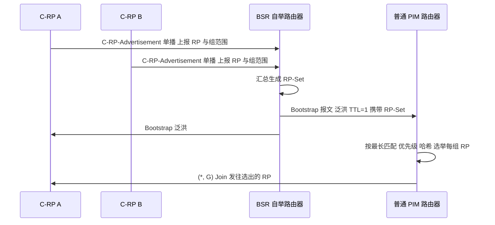

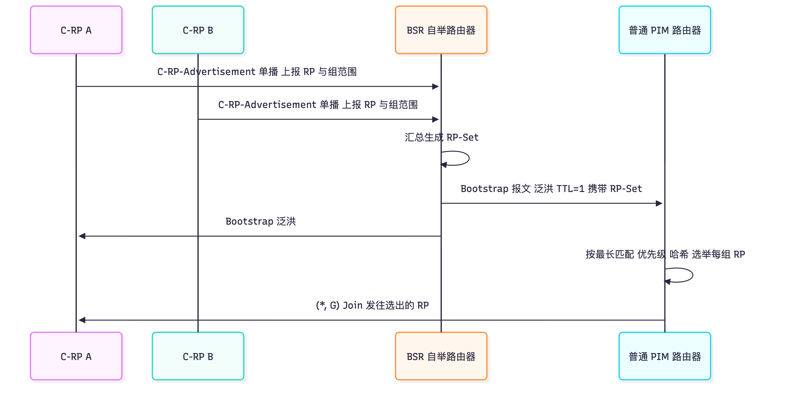


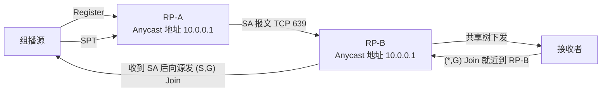


### 真题精练

**Q1.【真题·单选】** 在 Anycast RP 部署中，MSDP 的主要作用是：
A. 实现跨自治域的组播互通
B. 在同一域内的多台 RP 之间同步组播源信息，使任一台 RP 都能拉取到源流量
C. 代替 PIM-SM 建立共享树
D. 为组播数据提供加密与认证

> **答案：B**
> **解析**：Anycast RP 下多台 RP 共用同一地址，源注册到的 RP 与接收者加入的 RP 可能不同，必须靠 MSDP 的 SA 报文把 "(S,G) 源信息"同步给其他 RP，收到 SA 的 RP 再主动向源发 (S,G) Join。A 是 MSDP 的另一种用途（跨域组播时配合 MBGP），但题干的场景是"同一域内多 RP"，故选 B。C 错误——建树仍由 PIM-SM 完成；D 错误——MSDP 不提供加密。

**Q2.【真题·多选】** 关于 BSR 机制，下列说法正确的有：
A. BootStrap 报文在 PIM-SM 域内逐跳泛洪，携带 RP-Set
B. C-RP 通过单播向 BSR 发送 C-RP-Advertisement 报文上报自己
C. C-RP 优先级数值越大越优先
D. 组范围匹配长度相同、优先级也相同时，比较哈希值，大者当选

> **答案：ABD**
> **解析**：C 错误——**C-RP 优先级数值越小越优先**（与 C-BSR 优先级"大者优"方向相反，是最常见的失分点）。A、B、D 正确：BSR 汇总 RP 信息后泛洪 Bootstrap 报文；C-RP 单播上报；选 RP 的顺序是"最长组范围匹配 → C-RP 优先级小者优 → 哈希值大者优"。

**Q3.【真题·简答】** 某企业网络中有 6 台组播路由器，管理员在其中 4 台上配置了 `static-rp 10.0.0.1`，另 2 台忘记配置。请分析会出现什么现象。

> **答案与解析**：
> **现象**：组播会出现"部分区域能收、部分区域不能收"的奇怪故障。原因是 **RP 信息必须全网一致**：
> ① 未配 RP 的路由器收到主机的 (*,G) Join 后，**不知道该把 Join 发往哪里**（没有 RPF 到 RP 的路由），(*,G) 表项建立不起来或下游接口无法加入共享树，导致其下挂网段的接收者收不到流量；
> ② 即使 (*,G) 勉强建立（例如用了其他路由），未配 RP 的路由器**也不会把源侧的 Register 转发到 RP**，源侧注册链断裂；
> ③ 若不同设备配了**不同的** RP 地址，会出现"两条半棵树落在不同 RP 上"，流量彻底接不起来，此时 `display pim rp-info` 在各设备上的输出会不一致。
> **处理**：`display pim rp-info` 逐台核对 RP 信息是否一致（地址、组范围、优先级、来源）；生产环境建议改用 **BSR 动态 RP** 或 **Anycast RP** 避免人为遗漏；若必须用静态 RP，应把 RP 配置纳入配置模板与巡检项。

### 易错点与排错

1. **C-BSR 优先级"大者优"、C-RP 优先级"小者优"**：方向相反，必须记清。
2. **BSR 学到的 RP 优先于静态 RP**：同时配置时以 BSR 为准（考试常考"两种都配谁生效"）。
3. **`pim bsr-boundary` 漏配**：会导致本域与邻域 RP-Set 互相污染，出现"选择到了外域 RP"的诡异故障。
4. **Anycast RP 用错地址**：RP 地址（Anycast，多台相同）与 MSDP 对等体地址（每台唯一）必须用**不同的 Loopback**，混用会导致 MSDP 邻居建立失败。
5. **MSDP 需要 TCP 639 可达**：中间 ACL/防火墙必须放通，且两端要能互相 ping 通对等体地址。
6. **排错命令**：`display pim bsr-info`、`display pim rp-info`、`display msdp brief`、`display msdp peer-status`、`display msdp sa-cache`。

---

## 5.10 MSDP：跨域组播与 SA 报文机制

### 考点定位

MSDP（Multicast Source Discovery Protocol，组播源发现协议）在国赛中多见于**简答与多选**（3~6 分），考法集中在：**MSDP 解决什么问题**、**SA 报文的字段与格式**、**SA 的反向路径检查（peer-RPF）**、**跨域组播的完整技术组合（PIM-SM + MBGP + MSDP）**。它与 5.9 的 Anycast RP 是"一个协议的两种用途"，必须分清。

### 原理精讲

**MSDP 要解决的问题**：一个 PIM-SM 域内的 RP 只知道自己域内源的信息（通过 Register 学到）。当源在 AS 100、接收者在 AS 200 时，AS 200 的 RP 完全不知道 AS 100 里有哪些源在发送——**接收者向 RP 发 (*,G) Join 只能建起"RP→接收者"的半棵树，源侧半棵树接不上**。MSDP 就是为解决这个"**域间源信息共享**"而生的：它让各域的 RP 互相通告"我这里有哪些活跃的 (S,G)"。

**工作机制**：
1. **建立对等体**：每台 RP 作为 MSDP 对等体（MSDP Peer），与相邻域的 RP 建立 **TCP 连接（端口 639）**。通常用 Loopback 地址做对等体地址，需要单播路由可达。
2. **产生 SA 报文**：当 RP 通过 Register 学到域内某个活跃源 (S,G) 后，构造 **SA（Source Active，源活跃）报文**，通过 TCP 连接发给所有 MSDP 对等体。
3. **SA 报文内容**：**源地址 S、组地址 G、发起该 SA 的 RP 地址（Originating RP / RP Address）**，可选携带内层封装的第一个组播数据报文（用于快速切换，默认不带）。
4. **处理 SA 并拉流**：对端 RP 收到 SA 后，若本机有该组的 (*,G) 成员（即本域有接收者），则**以 SA 中的源地址 S 做 RPF 检查**，通过 MBGP/单播路由确认到 S 的出口，然后**直接向源 S 发起 (S,G) Join**（跨域建源树，MPLS/BGP 场景下可能经由 MBGP 学到的路由）。流量到达本域 RP 后沿共享树下发给接收者。
5. **SA Cache**：每台 RP 把学到的 (S,G) 缓存起来（`cache-sa-enable`），条目由 SA 报文周期性刷新，超时未刷新则老化删除。SA Cache 的价值是"**即使当前没有接收者也能记住源**"——当新成员加入时可以直接向源建树，不必等下一次 SA。

**SA 报文的反向路径检查（Peer-RPF Check）**：SA 是"关于别人的源的信息"，如果任意 MSDP 对等体都能随意通告，就会产生伪造与环路。因此 MSDP 对收到的 SA 执行一套**反向路径检查**，核心判据是 **"发送该 SA 的对等体，是否就是本机到 SA 中源 RP 地址的最优路径上的下一跳"**：
- **接受的情况**：① 发送者对等体就是到源 RP 的 RPF 邻居；② SA 来自同一 **Mesh Group（网状组）**内的对等体（Mesh Group 内的对等体互相之间不做 RPF 检查，用于全互联优化）；③ 本机就是 SA 中的源 RP；④ 从 **Default Peer（默认对等体）** 收到且本机没有到源 RP 的路由。
- **丢弃的情况**：本机存在到源 RP 的路由，但该路由的 RPF 邻居**不是**发送 SA 的对等体（说明 SA 走了非最优路径，可能是伪造或环路）。配合 `peer <addr> import-source` 还可以只接收某些源的 SA，用于策略控制。

**MSDP 与 MBGP 的配合（跨域组播三件套）**：跨域组播的标准方案是：
- **PIM-SM**：负责域内建树；
- **MBGP（Multiprotocol BGP，多协议 BGP）**：负责传递**跨域的组播路由**，因为组播的 RPF 拓扑可能与单播不同（例如单播走 A 路径、组播政策要求走 B 路径），MBGP 用独立的 **IPv4 Multicast NLRI（AFI=1, SAFI=2）** 携带组播路由，从而让 RPF 检查按组播拓扑进行；
- **MSDP**：负责在 RP 之间通告源信息。
**只有三者配合，跨域 ASM 组播才能完整工作**。此外还有 **MSDP Mesh Group**（减少 SA 泛洪）、**MSDP 认证**（MD5）等增强特性。

**与 Anycast RP 的区别（务必分清）**：
| | Anycast RP + MSDP | 跨域组播 + MSDP |
|---|---|---|
| 使用场景 | **同一 PIM-SM 域内**多台 RP 冗余与负载分担 | **不同 PIM-SM 域（AS）之间**互通 |
| MSDP 作用 | 同步域内多台 RP 的源信息 | 传递跨域源信息 |
| 是否需 MBGP | 不需要 | 通常需要（组播路由跨域） |
| SA 来源 RP | 同一域内的另一台 RP | 邻域的 RP |

### 关键概念对照表

| MSDP 要素 | 内容 | 说明 |
|---|---|---|
| 传输层 | TCP **639** | 面向连接，保证 SA 可靠传输（有重传） |
| 核心报文 | SA（Source Active） | 携带 (S, G) + 源 RP 地址 |
| 报文方向 | RP ↔ RP（双向） | 每台 RP 向所有对等体通告 |
| 源信息学习 | 从 Register 学到 | 域内源先注册到本域 RP，再由 RP 转成 SA |
| 对端动作 | 向 SA 中的源发 (S,G) Join | 前提是本机有该组的成员需求 |
| 防环机制 | Peer-RPF Check | 检查发送者是否为到源 RP 的 RPF 邻居 |
| 优化机制 | Mesh Group、Default Peer、import-source | 减少 SA 泛洪、简化 RPF、做源策略 |
| 缓存 | SA Cache | 记录 (S,G)，周期性刷新，超时老化 |
| 常用配置 | `msdp peering`、`cache-sa-enable`、`anycast-rp` | 见下方配置 |

| 跨域组播技术组合 | 承担职责 | 缺了会怎样 |
|---|---|---|
| PIM-SM | 域内共享树/源树建立 | 域内组播不通 |
| MBGP | 跨域组播路由（SAFI=2） | RPF 检查按单播拓扑，跨域建树可能失败 |
| MSDP | RP 之间交换源信息 | 接收侧 RP 不知道源，半棵树接不上 |
| BGP 单播（IPv4 unicast） | 保证 RP 之间单播可达（TCP 639） | MSDP 邻居起不来 |

### 华为设备配置

```bash
system-view
multicast routing-enable                          // 全局使能组播
interface LoopBack0
 ip address 10.1.1.1 255.255.255.255               // RP 地址（可为 Anycast 地址）
 pim sm                                            // Loopback 使能 PIM
quit
interface LoopBack1
 ip address 10.1.1.2 255.255.255.255               // MSDP 对等体专用地址，必须全网唯一
 pim sm
quit
msdp
 peer 10.2.2.2 connect-interface LoopBack1          // 与对端 RP 建立 MSDP 邻居，源地址用 LoopBack1
 cache-sa-enable                                    // 使能 SA Cache，缓存学到的 (S,G)
 peer 10.2.2.2 description to-AS200-RP              // 加描述便于运维识别
quit
pim
 static-rp 10.1.1.1                                 // 域内 RP（也可由 BSR 通告）
quit
bgp 100
 peer 10.2.2.2 as-number 200                        // 与对端建立 BGP 邻居（跨域）
 ipv4-family unicast
  peer 10.2.2.2 enable                              // 保证 MSDP 对等体地址单播可达
 ipv4-family multicast
  peer 10.2.2.2 enable                              // 使能 MBGP：传递组播路由（SAFI=2），供跨域 RPF 检查使用
quit
display msdp brief                                 // 查看 MSDP 邻居状态摘要（Up/Down、SA 数量）
display msdp peer-status                           // 查看对等体详情：TCP 状态、收发 SA 计数、是否通过 RPF 检查
display msdp sa-cache                              // 查看 SA Cache 中的 (S,G) 与来源 RP
display bgp multicast peer 10.2.2.2                // 查看 MBGP 组播地址族的邻居与路由学习情况
```

### 示意图

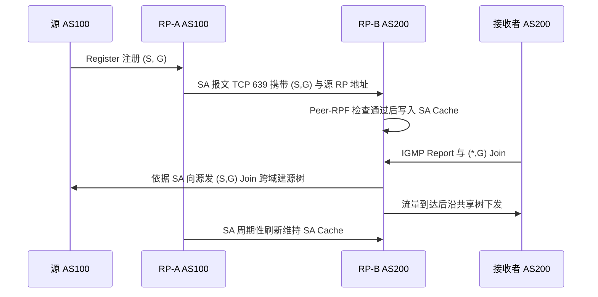

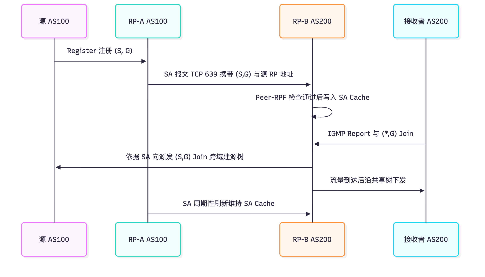


### 真题精练

**Q1.【真题·单选】** MSDP 对等体之间使用哪个传输层协议与端口？
A. UDP 639  B. TCP 639  C. TCP 179  D. UDP 521

> **答案：B**
> **解析**：MSDP 使用 **TCP 639**，保证 SA 报文的可靠传输（SA 丢失会导致对端学不到源）。C 是 BGP（179）；D 是 RIPng（UDP 521）。记忆要点：MSDP 是"RP 之间可靠通信的协议"，所以用 TCP。

**Q2.【真题·多选】** 关于 SA 报文的反向路径检查（Peer-RPF Check），下列说法正确的有：
A. 检查的对象是 SA 报文中携带的源 RP 地址
B. 若发送 SA 的对等体正是本机到源 RP 的 RPF 邻居，则接受该 SA
C. 同一 Mesh Group 内的对等体之间也要逐条做 RPF 检查
D. 本机就是 SA 中的源 RP 时，接受该 SA

> **答案：ABD**
> **解析**：C 错误——**Mesh Group 的设计目的就是"组内免 RPF 检查"**，适用于全互联的 RP 群，可避免因 IGP 路径不一致导致的 SA 被大量丢弃。A、B、D 正确：SA 的 RPF 检查以"源 RP 地址"为目的地址，发送者必须是到该地址的最优路径的下一跳；本机是源 RP 时自然接受。

**Q3.【真题·简答】** 某运营商 AS 100 内有组播源，AS 200 内有接收者，两域各有一台 RP。现要求实现跨域 ASM 组播。请列出需要部署的协议清单，并说明每个协议的作用及缺失后果。

> **答案与解析**：
> 需要部署 **PIM-SM + MBGP + MSDP（+ 单播 IGP/BGP 保证可达）** 四部分：
> ① **域内 PIM-SM**：在各域的路由器上使能 `pim sm`，建立域内共享树/源树，负责域内组播转发。缺失则域内组播不通。
> ② **单播可达性（IGP/BGP IPv4 unicast）**：保证两台 RP 的 MSDP 对等体地址（Loopback）之间 TCP 639 可达。缺失则 MSDP 邻居无法建立。
> ③ **MSDP**：两台 RP 建立 MSDP 邻居，AS 100 的 RP 把从 Register 学到的 (S,G) 通过 SA 报文通告给 AS 200 的 RP；AS 200 的 RP 据此主动向源发 (S,G) Join。缺失时 AS 200 的 RP 完全不知道源的存在，接收者只能建起"RP→接收者"的半棵树，看不到画面。
> ④ **MBGP（IPv4 multicast 地址族）**：传递跨域的**组播路由**，使 AS 200 内路由器的 RPF 检查按"组播拓扑"而非单播拓扑进行（组播路径策略常与单播不同）。缺失时若组播应走的路径与单播不一致，RPF 检查会失败，源树建不起来，同时 MBGP 也承载 SA 所需的组播源路由信息。
> **验证**：`display msdp peer-status` 确认 SA 收发正常且通过 RPF 检查，`display msdp sa-cache` 能看到 (S,G)，`display bgp multicast peer` 确认 MBGP 邻居 Up，`display pim routing-table` 中能看到跨域建立的 (S,G) 表项。

### 易错点与排错

1. **把 MSDP 当成"建树协议"**：MSDP 只**传递源信息**，建树仍是 PIM 的职责。
2. **MSDP 对等体地址与 Anycast RP 地址混用**：必须分离（一个共享、一个唯一）。
3. **忘记 MBGP**：跨域组播只配 MSDP 与静态 RP 时，若单播与组播路径不一致会出现"SA 收到了但 Join 建不起来"。
4. **SA 被 RPF 检查丢弃**：`display msdp peer-status` 里会看到收发计数不对等，此时用 `display ip routing-table <源RP地址>` 核对到源 RP 的路径与对等体地址是否一致，必要时使用 Mesh Group 或调整 IGP 开销。
5. **TCP 639 被 ACL 拦截**：跨设备/跨域防火墙必须放通。
6. **排错命令**：`display msdp brief`、`display msdp peer-status`、`display msdp sa-cache`、`display bgp multicast peer`。

---

## 5.11 组播路由表解读与 RPF 检查机制

### 考点定位

**RPF 检查是组播排错题的核心（每年必考）**，通常 1 道简答/排错 + 1~2 道选择，合计 6~10 分。必考内容：**RPF 检查的对象（(S,G) 看源、(*,G) 看 RP）**、**RPF 接口与 RPF 邻居的定义**、**RPF 失败的典型原因**、**`display pim routing-table` 各字段含义**。国赛排错题的标准问法是"组播不通，请列出排查步骤"，答题必须体现"先单播、后 IGMP/PIM、再 RPF、最后数据面"的顺序。

### 原理精讲

**为什么组播需要 RPF 检查？** 单播转发看"目的地址"，路由器知道往哪送；组播转发看"源地址是否从正确的方向来"——因为组播的接收者遍布全网，报文会沿多条路径到达，如果路由器不看入接口就转发，同一份报文会在网络中**成环反复复制**（组播没有 TTL 逐跳递减的限制性保护，TTL 只防跨域不防环）。**RPF（Reverse Path Forwarding，反向路径转发）检查**的做法是：**以"源"为目的地查路由表，得到出接口，要求组播报文的实际入接口必须是这个出接口**（也就是"从去往源的最优路径的反方向进来"）。这样既保证了转发路径是一棵树（无环），又保证路径最优。

**RPF 检查的三个核心概念**：
- **RPF 接口（RPF Interface）**：以"源地址"（(S,G) 表项）或"RP 地址"（(*,G) 表项）为目的查**组播路由表/单播路由表**得到的**出接口**。它必须等于组播数据的**入接口**。
- **RPF 邻居（RPF Neighbor）**：RPF 接口上的 PIM 邻居（对点到点链路可以没有邻居，如串口/子接口）。**"RPF 邻居"是发 Join/Prune 报文的对象**——Join 是单播发给 RPF 邻居的，所以 RPF 邻居不存在时，树就建不起来。
- **RPF 检查失败**：入接口 ≠ RPF 接口（或 RPF 接口上无 PIM 邻居），报文被丢弃，表现为"有组播路由表项但转发计数不增长""下游收不到流"。

**组播 RPF 路由的来源与优先级**：华为设备按以下顺序选择用于 RPF 检查的路由：
1. **组播静态路由（`ip rpf-route-static`）**——优先级最高，专用于修正组播 RPF 路径；
2. **MBGP/组播路由表（IPv4 multicast 地址族）**——用于跨域/策略性组播路径；
3. **单播路由表（IGP/静态/BGP unicast）**——缺省来源。
在同一来源内按**最长匹配**选择。这个顺序解释了"为什么我加了组播静态路由，RPF 立刻按我想要的方向走了"。

**RPF 检查失败的常见原因（必须背下来，排错题按这个清单写）**：

1. **单播路由不对称（最常见）**：去程与回程路径不同，或组播源方向的路由在另一台设备上。组播要求**到源的路由必须指向数据的来向**。
2. **到源/到 RP 没有路由**：源地址是私网地址、路由被汇总掉、路由黑洞、BGP 未通告等。
3. **RP 地址不可达或 RP 信息不一致**：(*,G) 表项对 **RP 地址**做 RPF 检查，若到 RP 的路由缺失或各设备 RP 信息不一致，共享树建不起来——**"源能通、RP 不通"是典型现象**。
4. **RPF 接口上没有 PIM 邻居**：接口未使能 `pim sm`、Hello 被 ACL 拦截（IP 协议号 **103**）、Hello 间隔与保持时间不匹配、非直连且未建立邻居。
5. **ECMP 等价多路径**：单播有多条等价路径时，RPF 只选其中一条（哈希结果固定），若组播数据从另一条等价路径到达，RPF 检查就失败。解决方法是保持组播路径唯一，或使用组播静态路由/MBGP 指定路径，或调整 IGP 开销。
6. **Tunnel/GRE/隧道环境**：RPF 检查依据的是隧道外层还是内层地址，容易搞错；隧道接口上需要正确使能 PIM。
7. **域间场景缺 MBGP**：组播路径策略与单播不同但只用了单播路由，导致 RPF 失败。
8. **SSM/Anycast RP 场景**：Anycast RP 下不同设备对 "RP 地址" 的路由下一跳不同，需要 MSDP 配合；SSM 下则是对源地址做检查（源必须可达）。
9. **多实例/VPN 场景**：RPF 检查必须在正确的 VPN 实例内进行，跨实例或未绑定实例会导致查表失败。

**排错方法**：用 **`display multicast rpf-info <源地址>`** 可以直接看到"到该源的 RPF 接口、RPF 邻居、使用的路由来源"，随后与该组播组的实际入接口对比，一眼就能定位。若希望强制指定路径，用系统视图下的 **`ip rpf-route-static <源> <掩码> <下一跳>`** 配置组播静态路由（**只影响组播 RPF 检查，不影响单播转发**）。

### 关键概念对照表

| `display pim routing-table` 字段 | 含义 | 排错关注点 |
|---|---|---|
| (*, G) / (S, G) | 共享树表项 / 源树表项 | 缺失 (*,G)：成员或 RP 问题；缺失 (S,G)：切换或源侧问题 |
| RP | 该组的 RP 地址 | 与 `display pim rp-info` 比对是否一致 |
| Protocol | 表项由谁创建：PIM-SM / IGMP / Static | 只有 IGMP 说明只学到成员、树没建起来 |
| Flag | 表项状态：ACT（活跃）、SPT、WC（通配）、PRUNE | Flag 含 PRUNE 表示该分支被剪掉 |
| UpTime / Expires | 表项存活时间 / 老化时间 | Expires 为 `-` 表示由 IGMP 维持不老化 |
| Upstream interface | 上游接口 = RPF 接口（数据入接口） | **必须等于数据的实际入接口** |
| Upstream neighbor / RPF prime neighbor | 上游 PIM 邻居（Join 的发送对象） | 为空说明该接口没有 PIM 邻居 |
| Downstream interface(s) | 下游接口列表 | 是否包含接收者所在接口 |
| Downstream Protocol | 下游接口建立方式：IGMP / PIM / Static | IGMP 表示直连主机 |

| RPF 失败原因 | 现象 | 处理手段 |
|---|---|---|
| 到源无路由 | `display multicast rpf-info` 无输出 | 补单播路由/IGP 通告 |
| 到 RP 无路由或 RP 不一致 | 有 (*,G) 但无数据、无 (S,G) | 统一 RP 配置、检查到 RP 路由 |
| 路由不对称 | RPF 接口 ≠ 入接口，转发表项有但计数不涨 | 调整 IGP 开销或配 `ip rpf-route-static` |
| RPF 接口无 PIM 邻居 | Upstream neighbor 为空 | 接口 `pim sm`、放通协议号 103 |
| ECMP 多路径 | 时通时不通、哈希路径不同表现不同 | 用组播静态路由/MBGP 固定路径 |
| 隧道场景 RPF 判据错 | 隧道口无流量 | 明确 RPF 依据的地址并正确使能 PIM |
| 缺 MBGP | 跨域建树失败 | 配置 IPv4 multicast 地址族 |

### 华为设备配置

```bash
system-view
multicast routing-enable                              // 全局使能组播
ip rpf-route-static 10.1.1.100 32 10.0.12.2            // 配置组播静态路由：到源 10.1.1.100 的 RPF 路径强制走 10.0.12.2
ip rpf-route-static 10.0.0.1 32 10.0.12.2               // 也可为 RP 地址指定 RPF 路径（解决 RP 方向不对称）
interface GigabitEthernet0/0/1
 pim sm                                                // 确认所有组播接口都使能了 PIM（漏一个就会出现无 RPF 邻居）
quit
display multicast rpf-info 10.1.1.100                  // 查看本机到该源的 RPF 接口/RPF 邻居/路由来源（排错第一命令）
display multicast rpf-info 10.0.0.1                    // 查看到 RP 的 RPF 信息，( *,G) 排错必看
display pim routing-table                              // 对比表项中的 Upstream interface 与 rpf-info 输出是否一致
display pim routing-table 239.1.1.1 verbose             // 查看该组详细表项（Flag、下游接口、剪枝与老化）
display multicast forwarding-table                     // 查看实际转发表与转发计数（区分"控制面有表、数据面无包"）
display ip routing-table 10.1.1.100                    // 反查单播路由：确认下一跳与接口是否就是数据来向
display pim neighbor                                   // 确认 RPF 接口上确实有 PIM 邻居（Hello 是否互通）
```

### 示意图

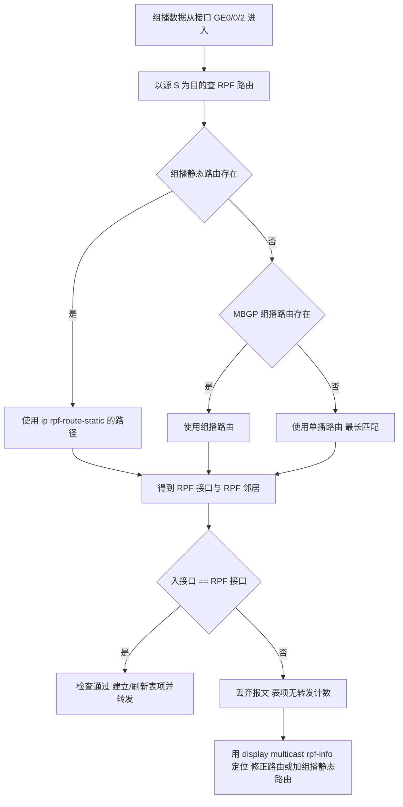

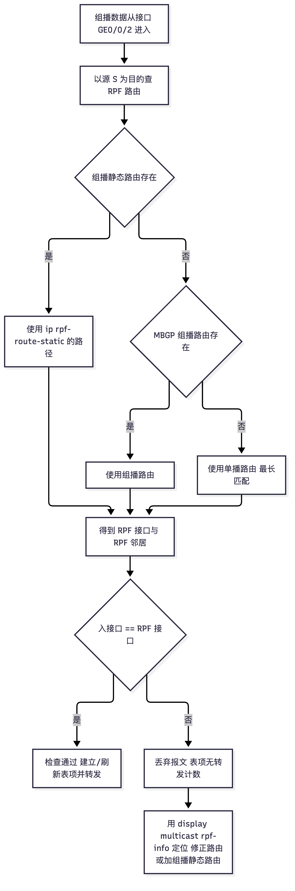


### 真题精练

**Q1.【真题·单选】** 在 PIM-SM 中，路由器对 (*, G) 表项做 RPF 检查时，检查的目的地址是：
A. 组播组地址 G  B. RP 的地址  C. 组播源地址 S  D. 上游接口地址

> **答案：B**
> **解析**：(*,G) 是共享树，数据从 RP 方向来，因此 RPF 检查的目的地址是 **RP 地址**；只有 (S,G) 源树才以源地址 S 为目的做检查。这是组播排错题最核心的一条：**"共享树不通先查到 RP 的路由，源树不通再查到源的路由"**。A 错误（组播组地址不能作为 RPF 检查对象）；D 是结果而非对象。

**Q2.【真题·多选】** 下列哪些情况会导致组播 RPF 检查失败？
A. 到组播源的单播路由缺失
B. 组播数据的入接口与到源的单播路由出接口不一致
C. RPF 接口上没有 PIM 邻居（接口未使能 PIM 或 PIM Hello 被 ACL 拦截）
D. 到达源的路径存在 ECMP 等价多路径，而组播数据从另一条等价路径到达

> **答案：ABCD**
> **解析**：四项都是 RPF 检查失败的典型原因。A 使 RPF 无法进行（无路由即无 RPF 接口）；B 是 RPF 检查的定义性失败（不对称路由）；C 使 Join 无法送达 RPF 邻居，树建不起来（PIM 使用 IP 协议号 103，需放通）；D 是等价路径带来的隐性失败，也是"时通时不通"故障的常见根因，处理手段是固定组播路径（组播静态路由/MBGP/调整 IGP 开销）。

**Q3.【真题·排错】** 拓扑为"源—R1—R2—接收者"，R1、R2 之间同时存在两条等价链路（OSPF 开销相同）。现网现象：接收者时通时断。请给出完整的排查思路。

> **答案与解析**：
> **定位思路**：现象是"时通时断"（而非一直不通），强烈指向**ECMP 导致的 RPF 检查随机失败**——两条等价路径使得 R1↔R2 之间的流量可能从任一条链路通过，而 RPF 检查只会选中其中一条作为 RPF 接口（哈希固定），当组播数据从"非 RPF 接口"那条链路到达时被丢弃，表现为断续。
> **验证步骤**：
> ① `display multicast rpf-info <源地址>`：查看到源的 RPF 接口与 RPF 邻居；反复查看确认是否稳定；
> ② `display ip routing-table <源地址>`：确认是否存在两条等价下一跳；
> ③ `display pim routing-table <组地址> verbose`：对比表项 Upstream interface 与实际数据入接口；
> ④ 在两条链路上镜像抓包，确认组播数据是否在两条链路上交替出现；
> ⑤ `display multicast forwarding-table` 观察转发计数是否增长缓慢/停滞。
> **解决方案（任一即可，按推荐度排序）**：
> ① **配置组播静态路由**：在两台设备上 `ip rpf-route-static <源> 32 <指定下一跳>`，把组播 RPF 路径固定到一条链路（只影响组播，不影响单播负载分担）；
> ② **调整 IGP 开销**：让到源的路径唯一（代价是失去单播负载分担）；
> ③ **使用 MBGP 传递组播路由**并做路径选择；
> ④ 若确需双路径转发，可考虑使用支持"多路径组播"的架构（如 mLDP/BIER 或基于 SR 的组播方案），并在设计阶段就避免 ECMP。
> **答题要点**：必须点出"RPF 检查只认一条路径"这一机制，并给出"用组播静态路由固定 RPF 路径"这一华为设备上的标准解法。

### 易错点与排错

1. **(*,G) 查 RP、(S,G) 查源**：一字之差，整题皆错。
2. **RPF 接口 ≠ 数据入接口**：这才是"RPF 失败"的定义，不要说成"没有路由"（没有路由只是其中一种原因）。
3. **`ip rpf-route-static` 只影响组播**：不要以为它改单播转发，也不要漏掉掩码（必须是精确掩码，如 `32`）。
4. **ECMP 是隐性杀手**：考试里"时通时断"几乎等同于"ECMP + RPF"。
5. **协议号 103**：PIM 报文跑在 IP 之上，协议号 103，ACL/防火墙漏放是"邻居建不起来"的头号原因。
6. **排错顺序固定**：`display ip routing-table`（单播可达）→ `display pim neighbor`（邻居/DR）→ `display pim rp-info`（RP）→ `display multicast rpf-info`（RPF）→ `display pim routing-table`（控制面）→ `display multicast forwarding-table`（数据面）→ 抓包。

---

## 5.12 组播在 VPN 中的应用（MVPN 概述）与组播排错命令体系

### 考点定位

MVPN（Multicast VPN，组播 VPN）在国赛中属于"拔高题"，通常 1~2 道概念题（3~5 分），考"MVPN 解决什么问题""Rosen 模型与 NG-MVPN 的区别""MDT 是什么"。排错命令体系则以"给出故障现象选命令"的形式出现。这一节是章末冲刺的收口，把前 11 节的知识点串成排错流程。

### 原理精讲

**MVPN 要解决的问题**：MPLS L3VPN 通过 VRF 隔离了不同客户的单播路由，但**组播流量在 P 网络（运营商骨干）中如何承载**？如果直接让 PE 之间跑组播，则不同 VPN 的流量会混在一起，破坏隔离性；而且 P 设备通常不参与客户的组播协议。MVPN 的方案是：**在 PE 之间用一条（或一组）属于该 VPN 的"隧道"承载客户组播流量，P 设备只当普通组播/MPLS 转发设备，不感知客户组播**。

**① Rosen 模型（基于 PIM 的 MVPN，RFC 6037）**：核心概念是 **MDT（Multicast Distribution Tree，组播分发树）**：
- 每个 VPN 实例映射到一个 **Default MDT**，用**一个组播组地址**（MDT Group Address）标识。所有属于该 VPN 的 PE 都加入这个组，从而在运营商 P 网络中形成一棵"PE 之间的共享树"。
- PE 与 PE 之间在 P 网络里是**普通的 PIM-SM 邻居关系**（在 MDT 隧道接口上），但客户侧的 PIM 报文被封装在 **GRE 隧道**里通过 MDT 组播组传送——相当于"PE 之间建了一条虚拟的共享网段"，客户侧的 PIM Hello/Join 就在这条虚拟网段上传递。
- **Data MDT**：对流量大的 (S,G)，可以动态切换到独立的 Data MDT（另一个组播组），避免所有流量都走 Default MDT 造成"一家客户的流量被复制到所有 PE"的开销。
- 优点：实现简单，与现有 PIM 技术兼容；缺点：P 网络需要大量组播组与状态、扩展性一般。

**② NG-MVPN（Next Generation MVPN，RFC 6513/6514，即 BGP MVPN）**：用 **BGP 的 MVPN 地址族（SAFI 5）** 传递"哪些 PE 需要哪些组播流"的信息（MVPN NLRI：Intra-AS I-PMSI AD、S-PMSI AD、Source Active AD 等），PE 之间不再依赖 PIM 在 P 网络上建共享树，而是用 **MPLS P2MP LSP（RSVP-TE P2MP 或 mLDP）** 或 **Ingress Replication（头端复制）** 承载组播流量。优点：扩展性好、支持 Extranet/选择性隧道、与 BGP EVPN 体系融合；是当前主流方案（华为设备支持 mLDP P2MP、BGP-AD、PIM-SM/PIM-SSM over MVPN 等）。

**华为常见 MVPN 实现方式**（考试只需知道分类）：**PIM-SM/PIM-SSM over GRE（Rosen）**、**mLDP P2MP（基于标签的组播分发）**、**BGP-AD（BGP Auto-Discovery）**、**RSVP-TE P2MP**、以及结合 **NG-MVPN** 的完整方案。

**组播排错命令体系（按层次记忆）**：

| 层次 | 命令 | 看什么 |
|---|---|---|
| 单播可达性 | `display ip routing-table` | 到源、到 RP、到 MSDP 对等体的路由是否最优且唯一 |
| 二层 | `display igmp-snooping group vlan x` | 成员端口/路由器端口是否正确 |
| 成员管理 | `display igmp group`、`display igmp interface` | 主机是否上报、IGMP 版本与定时器 |
| PIM 邻居 | `display pim neighbor`、`display pim interface` | 邻居是否 Up、DR 归属、接口模式 |
| RP 信息 | `display pim rp-info`、`display pim bsr-info` | RP 是否一致、BSR 是否选出 |
| RPF 检查 | `display multicast rpf-info <S/RP>` | RPF 接口/RPF 邻居/路由来源，**定位 RPF 失败的第一命令** |
| 协议表 | `display pim routing-table [组] [verbose]` | (*,G)/(S,G)、上游接口、下游接口、Flag |
| 组播路由管理 | `display multicast routing-table` | MRIB 里是否有该组播路由 |
| 数据面 | `display multicast forwarding-table` | 实际转发表与转发计数（有表无计数 = 数据面问题） |
| 跨域 | `display msdp brief/sa-cache`、`display bgp multicast peer` | SA 是否学到、MBGP 是否 Up |
| 抓包调试 | `terminal monitor`、`terminal debugging`、`debugging pim join-prune`、`debugging igmp packet` | 报文级定位（生产环境谨慎使用） |

### 关键概念对照表

| 对比项 | Rosen 模型 MVPN | NG-MVPN（BGP MVPN） |
|---|---|---|
| 控制协议 | PIM（PE 间）+ GRE 隧道 | BGP MVPN 地址族（SAFI 5） |
| 数据承载 | Default MDT / Data MDT（GRE over 组播组） | MPLS P2MP LSP（mLDP/RSVP-TE P2MP）或头端复制 |
| P 设备要求 | 需要支持组播（PIM-SM） | 只需 MPLS 转发（P2MP 能力） |
| 隧道标识 | MDT 组播组地址 | I-PMSI / S-PMSI（BGP 通告） |
| 扩展性 | 一般（组播组与状态多） | 好 |
| 现状 | 传统部署仍有 | 主流演进方向 |

| 常见现象 | 最可能原因 | 首查命令 |
|---|---|---|
| 所有组播都不通 | 全局未 `multicast routing-enable`、PIM 未在接口使能 | `display pim interface` |
| 有 (*,G) 无数据 | 到 RP 的 RPF 失败、RP 信息不一致 | `display multicast rpf-info <RP>` |
| 有 (*,G) 无 (S,G) | 源侧未注册、SPT 未建立、到源 RPF 失败 | `display pim routing-table <组>` |
| 表项齐全但无流量 | 数据面/ACL/二层问题 | `display multicast forwarding-table` |
| 时通时断 | ECMP 导致 RPF 随机失败 | `display ip routing-table <源>` |
| 单个网段不通 | IGMP Snooping 未在 VLAN 使能、成员端口错 | `display igmp-snooping group vlan x` |
| 跨域不通 | MSDP/MBGP 未配或 SA 被 RPF 丢弃 | `display msdp sa-cache` |

### 华为设备配置

```bash
system-view
multicast routing-enable                            // 全局使能组播
ip vpn-instance vpn1                                // 创建 VPN 实例（MVPN 的客户实例）
 ipv4-family                                        // 进入 IPv4 地址族
  route-distinguisher 100:1                          // 配置 RD，保证不同 VPN 的路由可区分
  vpn-target 100:1 export-extcommunity               // 配置 RT（出方向），PE 之间按 RT 匹配导入导出
  vpn-target 100:1 import-extcommunity               // 配置 RT（入方向）
 quit
quit
interface GigabitEthernet0/0/1                       // 连接客户 CE 的接口
 ip binding vpn-instance vpn1                        // 把接口绑定到 VPN 实例
 pim sm                                              // 在客户侧接口使能 PIM-SM
quit
pim vpn-instance vpn1                                // 进入 VPN 实例的 PIM 视图（MVPN 的组播配置在实例内独立进行）
 static-rp 10.1.1.1                                  // 为该 VPN 指定 RP（不同 VPN 可各自规划 RP）
quit
display pim vpn-instance vpn1 routing-table          // 查看该 VPN 实例内的组播路由表项（隔离验证）
display multicast vpn-instance vpn1 forwarding-table // 查看该 VPN 实例内的组播转发表
display ip vpn-instance                             // 查看 VPN 实例状态与绑定接口
```

### 示意图

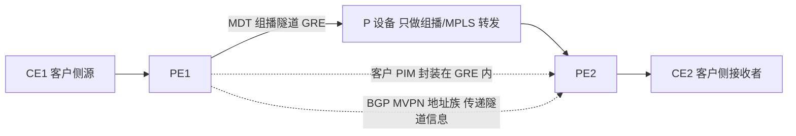


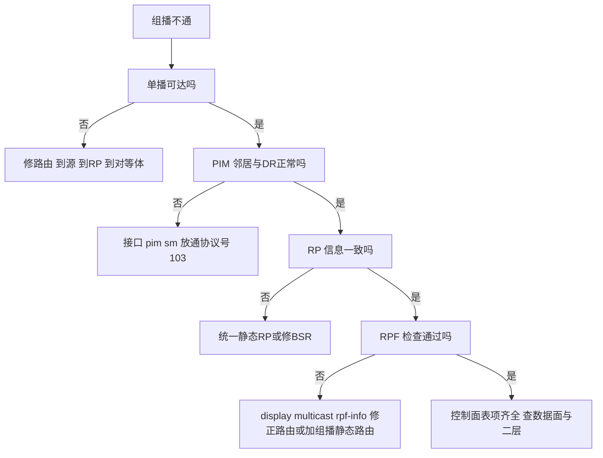

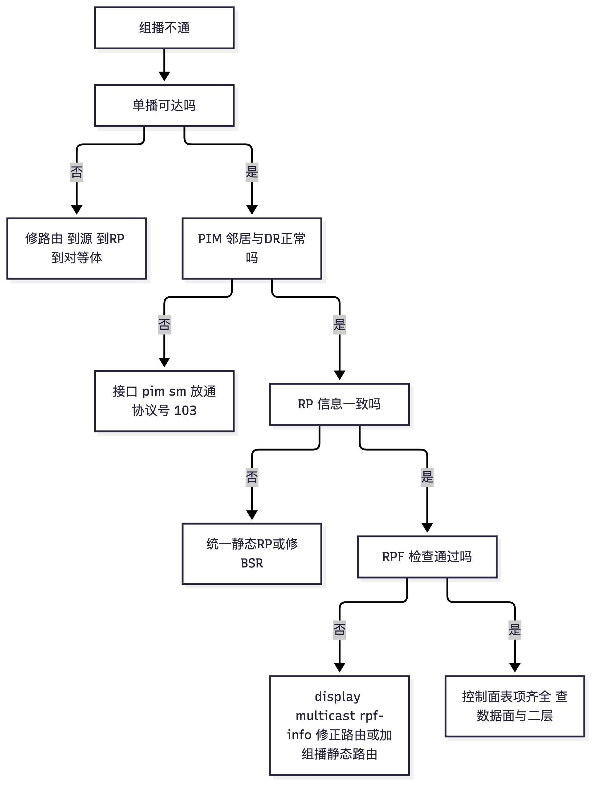


### 真题精练

**Q1.【真题·单选】** 在 Rosen 模型的 MVPN 中，PE 之间传递客户侧 PIM 报文所使用的封装方式是：
A. GRE 隧道 + Default MDT 组播组  B. IPsec 隧道  C. VLAN 子接口  D. VXLAN 隧道

> **答案：A**
> **解析**：Rosen 模型通过 **GRE 隧道**把客户侧组播报文（含 PIM Hello/Join）封装后，承载在运营商 P 网络的 **Default MDT 组播组**中传送，从而在 PE 之间形成一条"虚拟共享网段"。B 用于加密，不用于 MVPN 承载；C、D 都不是 Rosen 模型的机制（VXLAN 与 DCN 的组播泛洪相关，是另一回事）。

**Q2.【真题·简答】** 简述组播"有 (*, G) 表项但接收者收不到流量"的三类原因与定位命令。

> **答案与解析**：
> **第一类：到 RP 的 RPF 检查失败**。共享树以 RP 为根，(*,G) 表项的上游接口必须等于"到 RP 的单播路由出接口"。若到 RP 的路由缺失、不对称或 RP 信息在各设备间不一致，数据无法沿共享树到达。定位：`display multicast rpf-info <RP地址>`、`display pim rp-info`。
> **第二类：源侧注册链未建立**。源侧 DR 未发 Register（RP 不可达、Register 被 ACL 拦截）或 RP 未向源建 (S,G)（到源的 RPF 失败），导致 RP 上没有数据可下发，(*,G) 表项虽在但没有实际流量。定位：`display pim routing-table <组地址> verbose` 看是否只有 (*,G) 没有 (S,G)，配合 `display multicast forwarding-table` 看转发计数是否增长。
> **第三类：数据面或二层问题**。三层表项齐全但数据被丢弃，可能原因有：接口 ACL/QoS 丢弃组播、二层 IGMP Snooping 未在 VLAN 使能、路由器端口未学习、组播 VLAN 配置错误、目的 MAC 与 IP 不匹配被一致性检查丢弃。定位：`display multicast forwarding-table`、`display igmp-snooping group vlan x`、镜像抓包。

### 易错点与排错

1. **MVPN 的组播配置在 VPN 实例内做**：`pim vpn-instance xxx`，不要与公网 PIM 混淆。
2. **MDT 是"运营商的组播组"，不是客户的组播组**：客户组地址与 MDT 组地址要分开规划。
3. **P 设备不需要感知客户组播**：这是 MVPN 的设计目标，考试若问"P 设备要不要跑客户 PIM"答案是否定的。
4. **排错不要跳步**：先单播、再 PIM 邻居、再 RP、再 RPF、再数据面、最后抓包。国赛排错题评分点就在"顺序 + 命令 + 结论"。
5. **生产环境慎用 debugging**：`debugging` 系列命令会消耗 CPU，必须用 `terminal monitor`（远程终端看日志）并配合 ACL 限制范围。

---

## 5.13 章节5 综合真题（限时 25 分钟）

**Q1.【真题·单选】** 下列组播地址中，可以被路由器正常转发且属于管理范围（私有组播地址）的是：
A. 224.0.0.13  B. 224.0.1.39  C. 232.0.0.1  D. 239.1.1.1

> **答案：D**
> **解析**：239.0.0.0/8 是管理范围地址，可用于企业内网且可被路由器转发（但需在域边界限制）。A 是本地链路块（TTL=1，不转发）；B 属于 224.0.1.0/24 预留块（通常不转发）；C 属于 SSM 范围（可转发，但不是"管理范围"）。

**Q2.【真题·单选】** 某组播地址映射出的 MAC 为 01-00-5E-7F-FF-FF，则该组播地址的后 23 位应为：
A. 0x7FFFFF  B. 0xFFFFFF  C. 0x000000  D. 0x3FFFFF

> **答案：A**
> **解析**：组播 MAC 的第 4 字节最高位固定为 0（因为只有 23 位可用），因此可用的最大后 23 位是 `0x7FFFFF`，对应 MAC 01-00-5E-7F-FF-FF，即组播 MAC 空间的最后一个地址。若算出第 4 字节 ≥ 0x80（如 0x81），说明多保留了一位，属计算错误。

**Q3.【真题·多选】** 关于 IGMP Snooping 与 IGMP 的关系，下列说法正确的有：
A. IGMP 是主机与网关之间的三层成员管理协议，IGMP Snooping 是交换机上的二层优化特性
B. IGMP Snooping 通过监听 IGMP 报文建立二层组播转发表
C. 使能 IGMP Snooping 后，跨网段组播可以不再依赖三层 PIM
D. IGMP Snooping 代理模式可以减少上行 IGMP 报文并屏蔽上游多查询器问题

> **答案：ABD**
> **解析**：C 错误——IGMP Snooping 只解决"同一 VLAN 内如何按需复制"的问题，跨网段组播必须依靠三层组播路由协议（PIM）建立 (*,G)/(S,G) 转发路径。A、B、D 正确。

**Q4.【真题·填空】** PIM-SM 中，源侧 DR 把组播数据封装成 ______ 报文单播发送给 RP；RP 从源树收到原生数据后，向源侧 DR 回复 ______ 报文；该报文的传输方向是 ______ 到 ______。

> **答案：Register；Register-Stop；RP；源侧 DR**
> **解析**：Register 是"源侧 DR → RP"（单播封装组播数据）；Register-Stop 是"RP → 源侧 DR"（单播，通知停止注册）。源侧 DR 收到后进入 Register 抑制状态（缺省 60 秒），期间每 5 秒发送空 Register 探测。

**Q5.【真题·简答】** 请从"路径最优性、状态数量、是否需要 RP、适用场景"四个维度对比 SPT 与 RPT。

> **答案与解析**：
> ① **路径最优性**：SPT 以源为根、沿单播最短路径，路径最优；RPT 以 RP 为根，路径为"源→RP→接收者"，通常次优（RP 位置不当时绕行明显）。
> ② **状态数量**：SPT 每个 (源, 组) 一棵树，状态量与源数量成正比；RPT 每组一棵树，状态量与源数量无关，扩展性更好。
> ③ **是否需要 RP**：SPT 不需要（SSM 与 PIM-DM 都只有 SPT）；RPT 必须有 RP（ASM 特有）。
> ④ **适用场景**：SPT 适用于 SSM、成员集中的 PIM-DM 网络、以及切换完成后的 PIM-SM；RPT 适用于成员稀疏、源数量多的 ASM 网络，便于用少量状态覆盖大量源，也便于集中控制与策略部署。

**Q6.【真题·简答】** 一台主机加入组播组 239.1.1.1 后能收到流量，但组内另一台主机加入后收不到。已知两台主机在同一 VLAN、同一台接入交换机下，网关为同一台路由器。请给出排查思路。

> **答案与解析**：
> ① **确认成员是否上报**：在网关 `display igmp group` 看是否只有第一个成员被记录；在接入交换机 `display igmp-snooping statistics vlan x` 看第二台主机的 Report 是否到达交换机。
> ② **检查二层转发表**：`display igmp-snooping group vlan 10` 确认该组的成员端口是否包含第二台主机所在端口；若没有，说明交换机未处理其 Report（版本不一致、端口被隔离、或 Snooping 未在 VLAN 使能）。
> ③ **检查端口类型误判**：若第二台主机端口被错误学习/配置成"路由器端口"或处于 STP 阻塞/边缘端口异常状态，会导致组播不向其复制。
> ④ **检查主机侧**：主机是否真正发出 Report（抓包确认）、网卡是否过滤了组播 MAC（32:1 重叠场景）、是否有本地防火墙/安全软件拦截。
> ⑤ **检查资源限制**：交换机/网关的 IGMP 组数或成员数超限（`display igmp group` 数量与规格对比）。
> ⑥ 若三层侧 (*,G) 下游接口正确、二层正确，则抓包确认数据是否到达第二台主机的端口，进一步定位到链路/VLAN/ACL 层面。

**Q7.【真题·排错】** 现网现象：源与接收者之间所有单播通信正常，组播完全不通，PIM 邻居显示为 Down。请列出三项最可能的原因及验证命令。

> **答案与解析**：
> ① **接口未使能 PIM 或全局未使能组播**：接口上没有 `pim sm`/`pim dm`，或系统视图漏配 `multicast routing-enable`。验证：`display pim interface`（查看接口是否为 Disabled）、`display current-configuration | include multicast`。
> ② **PIM 报文被 ACL/防火墙拦截**：PIM 使用 **IP 协议号 103**，目的地址 224.0.0.13。若 ACL 只放通了 TCP/UDP/ICMP，Hello 会被丢弃。验证：`display acl all`、在设备上 `debugging pim hello` + `terminal monitor` 观察是否有 Hello 收发计数，或在中间设备抓包。
> ③ **Hello 定时器/参数不匹配或组播 MAC 层被过滤**：一端 Hello 间隔与 Holdtime 配置极端不合理（如 Holdtime 小于 Hello 间隔）、接口上配置了组播 MAC 过滤、或链路为点到点但接口类型/网络类型配置不当。验证：`display pim interface verbose`（对比两端 Hello/Holdtime）、`display interface` 查看丢包计数。
> **补充**：还要确认两端接口的**PIM 模式一致**（一端 `pim sm`、另一端 `pim dm` 时邻居可以建立但无法正确建树，表现为"邻居 Up 但组播不通"）。

**Q8.【真题·实验】** 请写出在三台华为路由器（R1 为源侧、R2 为核心、R3 为接收侧，运行 OSPF 保证单播可达）上部署 PIM-SM（静态 RP 为 R2 的 Loopback0 = 2.2.2.2）、并在 R3 侧接收组 239.1.1.1 的关键配置，并给出验证命令。

> **答案与解析**：
> **R1（源侧）**：
> ```bash
> multicast routing-enable
> interface GigabitEthernet0/0/0
>  pim sm
> interface LoopBack0
>  ip address 1.1.1.1 255.255.255.255
>  pim sm
> pim
>  static-rp 2.2.2.2
> ```
> **R2（核心，RP）**：
> ```bash
> multicast routing-enable
> interface GigabitEthernet0/0/0
>  pim sm
> interface GigabitEthernet0/0/1
>  pim sm
> interface LoopBack0
>  ip address 2.2.2.2 255.255.255.255
>  pim sm
> pim
>  static-rp 2.2.2.2
>  c-bsr LoopBack0        // 若改用动态 RP：同时配置 c-bsr 与 c-rp
>  c-rp LoopBack0
> ```
> **R3（接收侧）**：
> ```bash
> multicast routing-enable
> interface GigabitEthernet0/0/0
>  pim sm
> interface GigabitEthernet0/0/1
>  pim sm
>  igmp enable
>  igmp version 3
> pim
>  static-rp 2.2.2.2
> ```
> **验证命令**：`display pim neighbor`（邻居 Up）、`display pim rp-info`（RP 一致）、`display igmp group`（R3 学到成员）、`display pim routing-table 239.1.1.1`（有 (*,G) 与 (S,G)）、`display multicast forwarding-table`（有转发表项且计数增长）、`display multicast rpf-info 1.1.1.1`（RPF 正确）。
> **要点**：三台的 RP 信息必须一致；所有参与组播的接口（含 Loopback）都要 `pim sm`；接收侧才需要 `igmp enable`。

---

# 数通-HCIE-章节6-IPv6进阶与过渡技术

## 6.1 IPv6 地址架构进阶与地址规划

### 考点定位

IPv6 地址规划是国赛的"设计题常客"（5~10 分），考法包括：**给出地址判断类型**、**写出某网段的 IPv6 地址**、**解释为什么必须 /64**、**规划一个企业的 IPv6 地址结构**。高频陷阱：把 **FE80::/10 当成可路由地址**、把 **FD00::/8 当成公网地址**、用 **EUI-64 算错接口 ID**、以及**在 /127 的点对点链路上忘记关闭 SLAAC/DAD**。

### 原理精讲

**地址类型全景（必须张口就来）**：

| 地址类型 | 前缀 | 是否可全球路由 | 说明 |
|---|---|---|---|
| 全球单播 GUA（Global Unicast Address） | **2000::/3** | 是 | 相当于 IPv4 公网地址，RIR 按 2001:/2400:/2600:/2a00:/2c00: 等段分配 |
| 唯一本地地址 ULA（Unique Local Address） | **FC00::/7**（L 位=1 时实际用 **FD00::/8**） | 否 | 相当于 IPv4 私网地址，40 位 Global ID 随机生成，用于内部稳定通信 |
| 链路本地地址 LLA（Link-Local Address） | **FE80::/10**（实用 FE80::/64） | 否 | 每接口自动生成、只在链路上有效、**OSPFv3/NDP 的下一跳都用它** |
| 组播地址 | **FF00::/8** | 视范围 | 见 6.9 |
| 未指定地址 | ::/128 | — | 只在 DAD 过程中作为源地址使用 |
| 环回地址 | ::1/128 | — | 相当于 IPv4 的 127.0.0.1 |
| IPv4 映射地址 | ::FFFF:0:0/96 | — | 用于双栈内部的地址表示 |
| NAT64 知名前缀 | 64:FF9B::/96 | — | NAT64 的默认翻译前缀（WKP） |
| 6to4 地址 | 2002::/16 | 是（依赖 IPv4） | 内嵌 IPv4 地址，见 6.7 |
| Teredo | 2001::/32 | 是（依赖 IPv4） | NAT 穿透隧道 |
| 文档/示例 | 2001:DB8::/32 | — | 只能用于文档与实验，禁止在现网使用 |

**IPv6 地址结构与"为什么必须 /64"**。IPv6 单播地址的逻辑结构是：**全球路由前缀（通常 48 位）+ 子网 ID（16 位）+ 接口 ID（64 位）**。也就是说，**标准子网就是 /64**，一个 /48 的站点分配可以划分出 **65536（2^16）个 /64 子网**，每个子网有 **2^64 ≈ 1.8×10^19** 个地址。为什么不能像 IPv4 那样随意用 /120 或 /126？原因是**协议机制硬性依赖 64 位边界**：

1. **SLAAC 要求 /64**：无状态地址自动配置生成接口 ID 时，无论是 EUI-64（把 MAC 的 48 位扩展成 64 位）还是 RFC 7217 稳定隐私地址、RFC 4941 临时地址，生成的接口 ID 都固定是 **64 位**。RFC 4862 明确规定：**只有前缀长度为 64 的前缀信息选项才能用于 SLAAC**；主机收到非 /64 的 RA 前缀时会忽略它（有的实现直接报错），于是地址无法自动生成。
2. **邻居发现（NDP）依赖 /64 语义**：主机把 RA 中的前缀 + 自己的 64 位接口 ID 组合成地址；被请求节点组播地址（FF02::1:FFXX:XXXX）只取地址的**低 24 位**，若子网边界不是 /64，"同子网判断"与"链路本地可达性"的判断都会出现歧义（RFC 4861 规定路由器只通告 /64 前缀，收到非 /64 前缀的 RA 视为错误）。
3. **工程与硬件实现约定**：交换机/路由器转发的 TCAM 表项、地址分配工具、二层安全特性（ND Snooping 绑定表）都以 /64 作为"一个子网"的单位设计；地址规划用 /64 才能与这些机制对齐。
4. **地址空间足够大，无需节省**：IPv4 时代"节约地址"的思维在 IPv6 中要彻底放弃。2^64 个地址意味着"每个设备一个固定地址"完全可行，甚至可以为每个虚拟机、每个容器分配一个全球唯一地址——**IPv6 的规划目标不是"省"，而是"结构化、可聚合、易运维"**。
5. **点对点链路的例外**：RFC 6164 建议点对点链路使用 **/127**（避免 /64 造成的"邻居发现子网攻击面"），此时必须**关闭 SLAAC 与 DAD**：华为设备上用 `undo ipv6 nd ra halt` 的反向操作（即保持 RA 抑制）与 `ipv6 nd dad attempts 0` 来关闭 DAD。**考试若问"/127 链路要注意什么"，答案就是这两点。**

**地址规划方法论**（国赛设计题按这个写）：
1. **向上要前缀**：向 ISP 申请 **/48**（家庭/小型站点可 /56，大型企业可申请多个 /48 或一个 /44）；ISP 自己通常持有 /32。
2. **分层编码**：把 /48 的 16 位（第 4 段十六进制）按"区域/楼层/功能"编码，例如 `2001:DB8:0A00::/48` 中 `0A00` 表示 A 栋；再把第 5 段按"部门/VLAN"编码，例如 `2001:DB8:0A01:0010::/64` 表示 A 栋 1 层 VLAN 10。
3. **/64 落地下发**：每个 VLAN/子网一个 /64；服务器/网络设备的管理地址用固定 Loopback /128 或独立管理 /64。
4. **ULA 与 GUA 并行**：内部通信与设备间协议用 **ULA（FD00::/8）**，对外业务用 GUA；也可以只用 GUA + 严格的边界策略。ULA 的价值是"运营商变更时内部地址不变"，代价是需要多前缀处理（源地址选择问题，RFC 6724）。
5. **地址配置方式选择**：主机用 **SLAAC**（简单、无状态）或 **DHCPv6**（可控、可审计、可下发 DNS/NTP 等）；路由器之间与点对点链路用**手工配置 /127**；下游网络用 **DHCPv6-PD（Prefix Delegation，前缀委派）** 从上级获取 /56 或 /48 再细分。

**EUI-64 接口 ID 生成规则**（考试可能要求手算）：取接口 MAC（48 位，如 `00-1A-2B-3C-4D-5E`），在中间插入固定值 **FFFE**，并把第一个字节的**第 7 位（U/L 位，通用/本地位）取反**：
- MAC `00-1A-2B-3C-4D-5E` → 第一个字节 00 = `0000 0000`，取反第 7 位后为 `0000 0010` = **0x02**；
- 接口 ID = `021A:2BFF:FE3C:4D5E`，链路本地地址为 **FE80::21A:2BFF:FE3C:4D5E**（注意前导 0 省略的写法）。
由于 MAC 会泄露设备信息、且 EUI-64 地址固定，现网更推荐 **RFC 7217（稳定隐私地址）** 或 **RFC 4941（临时地址）**，华为设备默认接口地址生成方式可配置。

### 关键概念对照表

| 对比项 | GUA（全球单播） | ULA（唯一本地） | LLA（链路本地） |
|---|---|---|---|
| 前缀 | 2000::/3 | FC00::/7（实用 FD00::/8） | FE80::/10 |
| 全球可达 | 是 | 否 | 否（仅本链路） |
| 是否必须 | 访问公网时必须 | 可选 | **每个 IPv6 接口必须有** |
| 类比 IPv4 | 公网地址 | 私网地址（RFC 1918） | 169.254.0.0/16（APIPA） |
| 主要用途 | 业务通信、互联网访问 | 内部稳定通信、协议对等体地址 | 邻居发现、路由协议下一跳、DAD |
| 网关配置 | 需要对外路由与策略 | 需要内部路由 | 无需路由，自动生效 |

| 规划项 | 建议取值 | 理由 |
|---|---|---|
| 向 ISP 申请 | /48（大企业可 /44） | 一个 /48 可提供 65536 个 /64，足够长期规划 |
| 站点内子网 | 每个 VLAN /64 | 与 SLAAC、NDP、硬件实现对齐 |
| 点对点链路 | /127 + 关闭 DAD 与 RA | RFC 6164，减少 NDP 攻击面 |
| Loopback | /128 | 固定、唯一、便于做 Router ID 与协议对等体 |
| 区域编码 | /48 的第 4 段（16 位）按区域分配 | 便于路由聚合与故障定位 |
| 主机地址方式 | SLAAC 或 DHCPv6 | SLAAC 免运维；DHCPv6 可审计、可下发 DNS |
| 下游网络 | DHCPv6-PD | 逐级委派前缀，避免手工规划冲突 |

### 华为设备配置

```bash
system-view
ipv6                                            // 全局使能 IPv6 报文转发功能（VRP 上必须先敲，否则接口下的 IPv6 配置不生效）
interface GigabitEthernet0/0/1
 ipv6 enable                                     // 接口使能 IPv6（自动生成 FE80::/10 的链路本地地址）
 ipv6 address 2001:DB8:A01:10::1 64              // 手工配置全球单播地址 GUA（第 5 段 0010 表示 VLAN 10）
 ipv6 address FD00:A01:10::1 64                  // 并行配置 ULA 地址，用于内部稳定通信
 ipv6 address auto link-local                    // 让设备自动生成链路本地地址（缺省已自动生成，可显式声明）
 undo ipv6 nd ra halt                            // 取消 RA 抑制，使接口能够发送 RA（华为缺省是抑制不发 RA！）
 ipv6 nd ra interval 30                           // RA 发送间隔 30 秒（RFC 缺省 600 秒，园区可缩短以加快主机入网）
quit
interface GigabitEthernet0/0/2
 ipv6 enable
 ipv6 address 2001:DB8:A01:10:2::1 127            // 点对点链路使用 /127（RFC 6164 建议）
 ipv6 nd dad attempts 0                           // /127 链路关闭 DAD（避免不必要的 NS 探测与冲突判定）
quit
display ipv6 interface GigabitEthernet0/0/1      // 查看接口 IPv6 地址、状态、组播组、ND 参数
display ipv6 interface brief                      // 快速查看各接口 IPv6 地址（含链路本地地址）
display ipv6 routing-table                        // 查看 IPv6 路由表（确认前缀已正确生成/学习）
display ipv6 prefix                                // 查看设备上的 IPv6 前缀池（可用于 PD 场景）
```

### 示意图

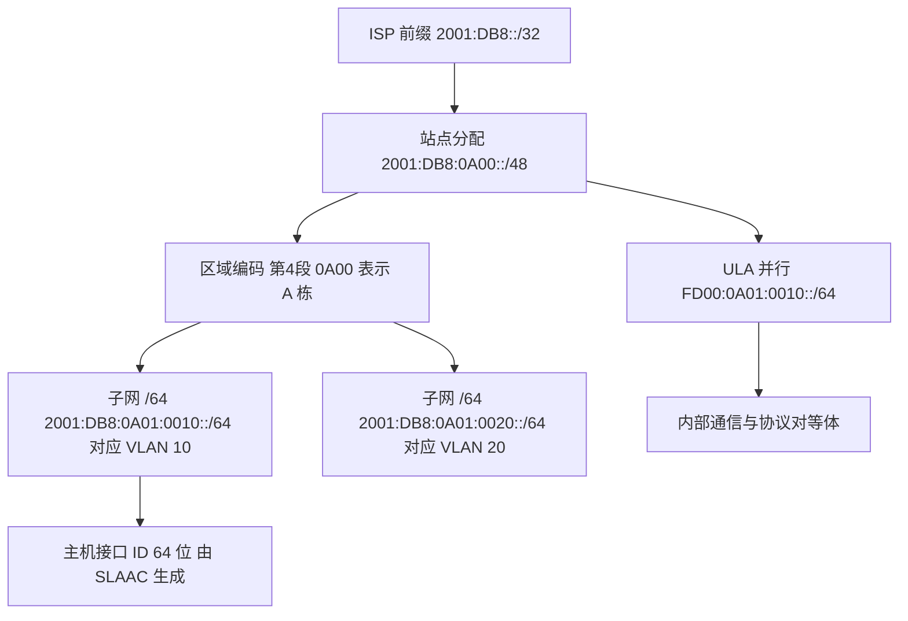

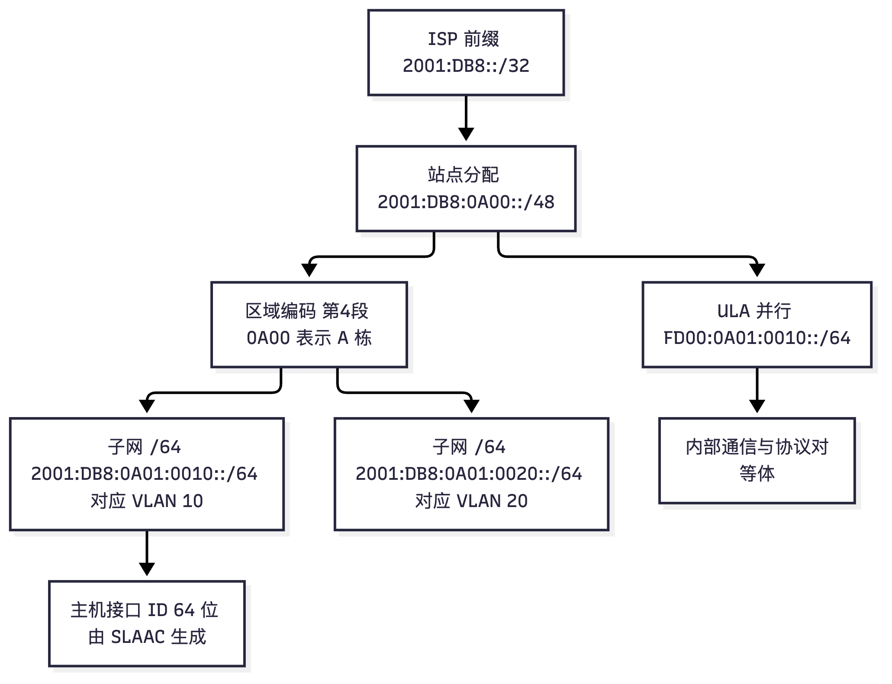


### 真题精练

**Q1.【真题·单选】** 下列关于 IPv6 地址的说法，正确的是：
A. FE80::/10 的链路本地地址可以跨路由器转发，用于设备间管理
B. FD00::/8 属于唯一本地地址，不可在全球互联网上路由
C. 2000::/3 中包含了 ULA 地址空间
D. 2001:DB8::/32 是运营商实际使用的公网地址段

> **答案：B**
> **解析**：FD00::/8 是 ULA（L 位为 1 的 FC00::/7），只能在内网使用，ISP 不会为其提供全球路由，B 正确。A 错误——LLA 只在本地链路有效，路由器**不转发**以 FE80::/10 为源或目的的报文；C 错误——ULA 是 FC00::/7，与 2000::/3 无交集；D 错误——2001:DB8::/32 是 RFC 3849 定义的**文档专用**前缀，禁止在现网使用。

**Q2.【真题·简答】** 为什么 IPv6 子网规划推荐统一使用 /64？如果点对点链路使用 /127 需要注意什么？

> **答案与解析**：
> **推荐 /64 的原因**：① **SLAAC 硬性要求**：RFC 4862 规定只有 /64 的前缀才能用于无状态地址自动配置，接口 ID 固定 64 位，非 /64 时主机将忽略 RA 前缀、无法生成地址；② **NDP/DAD 依赖 64 位边界**：被请求节点组播只取低 24 位，"同子网"判断和地址组合都以 /64 为基准，非 /64 会导致地址结构与邻居发现语义混乱；③ **工程实现对齐**：转发硬件、地址分配系统、ND Snooping 绑定表都以 /64 作为一个子网单位；④ **地址空间根本用不完**：2^64 个地址无需节约，规划目标是结构化与可聚合；⑤ **便于聚合**：以 16 位子网 ID 划分，配合 /48 站点分配可形成清晰的分层结构，路由聚合与故障定位都更简单。
> **/127 点对点链路的注意事项**：RFC 6164 建议点对点链路用 /127（前缀只有两个可用地址，天然避免"同网段第三方"），但必须**关闭 SLAAC 与 DAD**——华为设备上用 `ipv6 nd dad attempts 0` 关闭重复地址检测，并保持 RA 抑制（不执行 `undo ipv6 nd ra halt` 或显式抑制）。否则设备会对"对端地址"反复发起 DAD/NS 探测，产生无意义流量甚至误判地址冲突。

**Q3.【真题·填空】** 接口 MAC 地址为 00-1A-2B-3C-4D-5E，采用 EUI-64 生成的接口 ID 是 ______，对应的链路本地地址是 ______。

> **答案：021A:2BFF:FE3C:4D5E；FE80::21A:2BFF:FE3C:4D5E**
> **解析**：EUI-64 的两步：① 在 MAC 中间插入 `FFFE`：`00-1A-2B-FF-FE-3C-4D-5E`；② 把第 1 个字节的第 7 位（U/L 位）取反：`00` = `0000 0000` → `0000 0010` = `02`。得到接口 ID `021A:2BFF:FE3C:4D5E`，链路本地地址即 `FE80::` + 接口 ID = `FE80::21A:2BFF:FE3C:4D5E`。

### 易错点与排错

1. **华为设备缺省抑制 RA**：接口默认 `ipv6 nd ra halt` 生效，不发 RA，必须 `undo ipv6 nd ra halt` 主机才能通过 SLAAC 获取地址——这是"主机拿不到 IPv6 地址"的头号原因。
2. **忘了全局 `ipv6`**：VRP 上需在系统视图执行 `ipv6` 使能 IPv6 转发，否则接口配置不生效。
3. **ULA 与 GUA 并存时的源地址选择**：主机可能选择 ULA 作为源访问公网导致失败，需按 RFC 6724 调整地址选择策略，或在边界做策略。
4. **2001:DB8 用于现网**：属文档前缀，考试中出现即为错误答案。
5. **点对点链路用 /64 且不关 DAD**：会产生大量 NS 探测；用 /127 + `ipv6 nd dad attempts 0` 是标准做法。
6. **排错命令**：`display ipv6 interface brief`、`display ipv6 interface GigabitEthernet0/0/1`（看 RA 是否发送、地址状态是否 TENTATIVE）、`display ipv6 routing-table`。

---

## 6.2 NDP 协议深化：报文、选项字段与邻居状态机

### 考点定位

NDP（Neighbor Discovery Protocol，邻居发现协议）是 IPv6 的"ARP + ICMP 路由器发现 + 重定向"三合一，国赛必考（5~10 分）。高频考点：**五类报文的类型号（133~137）**、**NS/NA 的选项字段（源/目标链路层地址、前缀信息、MTU）**、**RA 的 M/O 标志**、**邻居状态机五状态与迁移条件**、**DAD 流程**。陷阱最多的是：**把 NS/NA 与 ARP Request/Reply 简单类比而忽略"组播应答"与"代理"**、**把 RA 的 A/L 位与 M/O 位混淆**。

### 原理精讲

NDP 定义在 RFC 4861，包含 **5 种 ICMPv6 报文**（ICMPv6 类型号 133~137）：

| 报文 | ICMPv6 类型 | 作用 | 目的地址 | 关键字段/选项 |
|---|---|---|---|---|
| **RS**（Router Solicitation，路由器请求） | **133** | 主机启动时催促路由器立即发 RA | FF02::2（所有路由器） | 源链路层地址选项 |
| **RA**（Router Advertisement，路由器通告） | **134** | 通告前缀、默认网关、MTU、跳数限制等 | FF02::1（所有节点）或单播回应 RS | Cur Hop Limit、M/O 标志、Router Lifetime、Reachable Time、Retrans Timer、前缀信息选项、MTU 选项 |
| **NS**（Neighbor Solicitation，邻居请求） | **135** | 地址解析（代替 ARP）、DAD、可达性探测 | 被请求节点组播 FF02::1:FFXX:XXXX（DAD 时为该组播） | Target Address；有选项时带源链路层地址（DAD 时不带） |
| **NA**（Neighbor Advertisement，邻居通告） | **136** | 应答 NS、通告链路层地址或状态变化 | NS 的源地址（**单播**）或 FF02::1（主动通告） | R 位（发送者是路由器）、S 位（应答请求）、O 位（覆盖缓存）、目标链路层地址选项 |
| **Redirect**（重定向） | **137** | 告知主机有更好的下一跳 | 请求主机地址 | 目标地址、目的地址、重定向头选项 |

**关键选项字段**（考试常要求"说出 RA 里有哪些选项"）：

| 选项类型 | 名称 | 出现在 | 关键内容 |
|---|---|---|---|
| Type 1 | 源链路层地址（Source Link-Layer Address） | RS、NS、RA | 发送方的 MAC，用于邻居缓存 |
| Type 2 | 目标链路层地址（Target Link-Layer Address） | NA、Redirect | 目标节点的 MAC（**NS 中没有这个选项**，因为请求方还不知道） |
| Type 3 | 前缀信息（Prefix Information） | RA | 前缀长度（**必须 64 才能用于 SLAAC**）、**L 位（On-Link，是否在链路上直连可达）**、**A 位（Autonomous，是否可用于 SLAAC）**、有效生存期、首选生存期 |
| Type 5 | MTU | RA | 链路 MTU，主机据此设置自身 MTU（避免分片） |
| Type 24 | 路由信息（Route Information） | RA | 通告特定路由前缀（RFC 4191） |
| Type 25 / 31 | RDNSS / DNSSL | RA | 递归 DNS 服务器与 DNS 搜索域（RFC 8106），使 RA 也能下发 DNS |
| — | Redirected Header | Redirect | 触发重定向的原始报文头部 |

**RA 的标志位**（必须能区分）：
- **M 位（Managed Address Configuration，管理地址配置）**：置 1 表示"地址要通过 DHCPv6 获取"，主机执行**有状态 DHCPv6**（此时主机通常**不**用 RA 前缀做 SLAAC）；
- **O 位（Other Configuration，其他配置）**：置 1 表示"其他参数（DNS、域名等）通过 DHCPv6 获取"，主机执行**无状态 DHCPv6**，地址仍可由 SLAAC 生成；
- **A 位（Autonomous，自主配置）**：在**前缀信息选项**里，置 1 表示该前缀可用于 SLAAC；
- **L 位（On-Link）**：在**前缀信息选项**里，置 1 表示该前缀在链路上直连可达（主机可直接解析邻居而不经路由器）；
- **R 位**（NA 中）：表示发送者自己是路由器；**S 位**：表示这是对 NS 的应答；**O 位**（NA 中）：覆盖已有邻居缓存条目。
- RA 头部还有 **Cur Hop Limit**（主机发出的报文默认跳数限制）、**Router Lifetime**（本路由器作为默认网关的有效时间，0 表示不作为默认网关）、**Reachable Time**、**Retrans Timer**（下发给主机用于邻居可达性检测的定时器）。

**邻居状态机（5 个状态）**：

| 状态 | 含义 | 进入条件 | 离开条件 |
|---|---|---|---|
| **INCOMPLETE** | 正在解析地址，还没有链路层地址 | 发送 NS 后 | 收到 NA → REACHABLE；重传上限到达仍无应答 → 删除表项（并向上层报错） |
| **REACHABLE** | 邻居可达且已确认 | 收到 NA，或收到上层可达性确认 | ReachableTime（缺省 30 秒）超时 → STALE |
| **STALE** | 邻居地址可用但**可达性未知** | REACHABLE 超时，或收到未经请求的 NA | 有报文要发送 → DELAY；收到上层确认 → REACHABLE |
| **DELAY** | 正在等待上层确认（给上层 5 秒机会） | STALE 状态下要发送报文 | 收到上层可达性确认 → REACHABLE；DELAY_FIRST_PROBE_TIME（5 秒）超时 → PROBE |
| **PROBE** | 主动发送单播 NS 探测可达性 | DELAY 超时 | 收到 NA → REACHABLE；连续 MAX_UNICAST_SOLICIT（3 次）无应答 → 删除表项 |

**关键定时器/常量**：**ReachableTime 缺省 30 秒**、**DELAY_FIRST_PROBE_TIME 5 秒**、**RetransTimer 1000 毫秒**、**MAX_MULTICAST_SOLICIT 3**、**MAX_UNICAST_SOLICIT 3**、RA 的 MaxRtrAdvInterval 缺省 **600 秒**（RFC 4861 默认；华为可通过 `ipv6 nd ra interval` 调整，最小 4 秒）、MinRtrAdvInterval 缺省 0.33×Max（200 秒）。**这些数值国赛填空题考过多次。**

**NDP 与 ARP 的三点区别**（易考简答）：① ARP 用广播，NDP 用**组播（被请求节点组播）**，只打扰目标主机所在的一组，减少无关主机中断；② ARP 没有"可达性检测"，NDP 有完整的邻居状态机与 NUD（Neighbor Unreachability Detection，邻居不可达检测）；③ NDP 同时承担**路由器发现、前缀通告、MTU/DNS 下发、重定向**等 ARP 完全不做的功能；④ NDP 报文基于 ICMPv6（可被 IPsec 保护），ARP 直接跑在二层之上无安全机制。另外 IPv6 有**代理（Proxy）**：路由器可以代替不在链路的主机应答 NA（`ipv6 nd proxy` 相关能力），用于移动或地址迁移场景。

### 关键概念对照表

| 对比项 | ARP（IPv4） | NDP（IPv6） |
|---|---|---|
| 解析报文 | ARP Request / Reply | NS / NA（ICMPv6 135/136） |
| 请求方式 | 广播 | 被请求节点组播 FF02::1:FFXX:XXXX |
| 应答方式 | 单播 | 单播（NA 目的为 NS 的源地址） |
| 可达性检测 | 无 | 有（邻居状态机 + NUD） |
| 路由器发现 | 无（靠手工/ICMP 重定向） | 有（RS/RA） |
| 前缀与默认网关 | 无 | RA 下发前缀与默认网关 |
| 安全扩展 | 无 | 可被 IPsec 保护；有 RA Guard / ND Snooping |

| NDP 参数 | 含义 | 缺省值 |
|---|---|---|
| ReachableTime | REACHABLE 状态保持时间 | 30 秒 |
| DELAY_FIRST_PROBE_TIME | DELAY 状态等待上层确认的时间 | 5 秒 |
| RetransTimer | NS 重传间隔 | 1000 毫秒 |
| MAX_MULTICAST_SOLICIT | DAD/解析时组播 NS 最大发送次数 | 3 |
| MAX_UNICAST_SOLICIT | 探测时单播 NS 最大发送次数 | 3 |
| MaxRtrAdvInterval | RA 最大发送间隔 | 600 秒（RFC 缺省） |
| DAD 发送次数（华为） | 接口上 DAD 探测次数 | 1 次（`ipv6 nd dad attempts`） |

### 华为设备配置

```bash
system-view
ipv6                                              // 全局使能 IPv6
interface GigabitEthernet0/0/1
 ipv6 enable                                       // 接口使能 IPv6
 ipv6 address 2001:DB8:A01:10::1 64                // 配置全球单播地址
 undo ipv6 nd ra halt                              // 允许发送 RA（缺省抑制），主机才能学到前缀与默认网关
 ipv6 nd ra interval 30 10                         // RA 发送间隔：最大 30 秒，最小 10 秒（缩短可加快主机入网）
 ipv6 nd ra prefix 2001:DB8:A01:10:: 64 2592000 604800  // 显式通告前缀：有效期 30 天，首选期 7 天
 ipv6 nd ra mtu 1500                               // 通过 RA 的 MTU 选项下发链路 MTU 1500，避免主机分片
 ipv6 nd reachable-time 30000                      // 下发 ReachableTime = 30000 毫秒（30 秒）
 ipv6 nd ns retrans-timer 1000                     // 下发 Retrans Timer = 1000 毫秒
 ipv6 nd ra hop-limit 64                           // 下发主机报文的默认跳数限制 64
quit
interface GigabitEthernet0/0/2
 ipv6 enable
 ipv6 address auto global                          // 使接口通过 RA 前缀 + 自动接口 ID 生成地址（SLAAC 客户端行为）
quit
display ipv6 neighbors                            // 查看邻居缓存表：状态（REACHABLE/STALE/DELAY/PROBE）、MAC、老化时间
display ipv6 neighbors GigabitEthernet0/0/1        // 只看某接口的邻居，排错链路层解析问题
display ipv6 interface GigabitEthernet0/0/1        // 查看接口的 ND 参数（RA 间隔、ReachableTime、是否抑制 RA）
reset ipv6 neighbors all                          // 清除邻居缓存（排错时强制重新解析，慎用于生产）
```

### 示意图

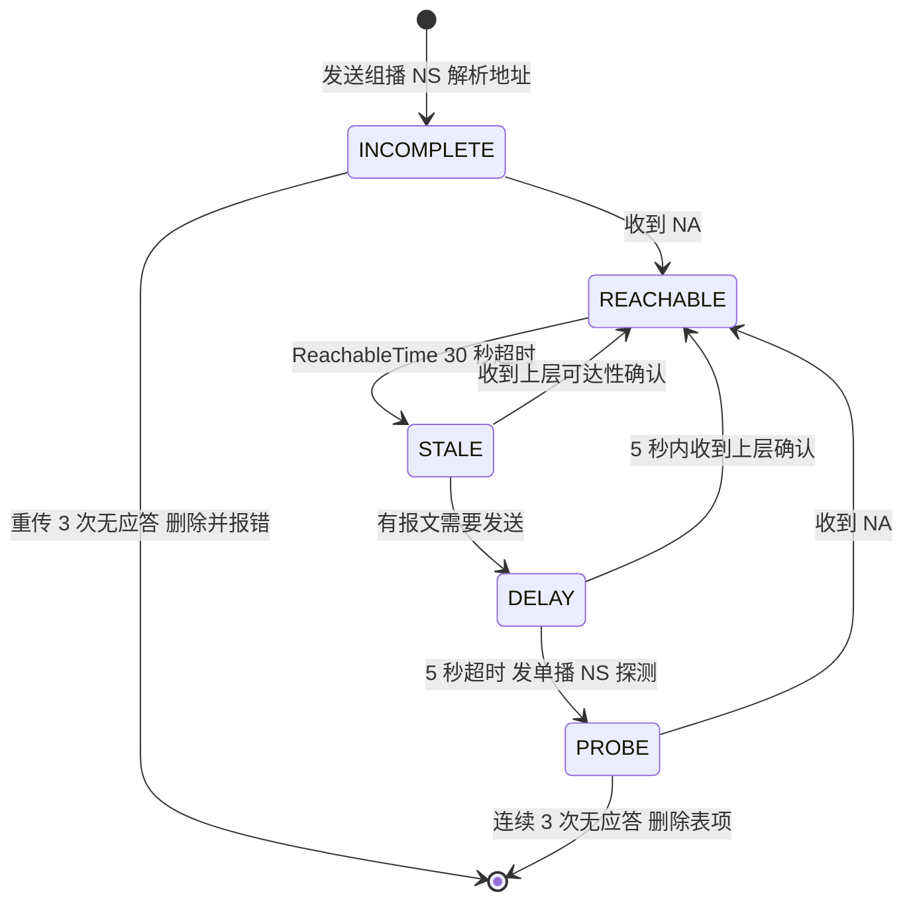

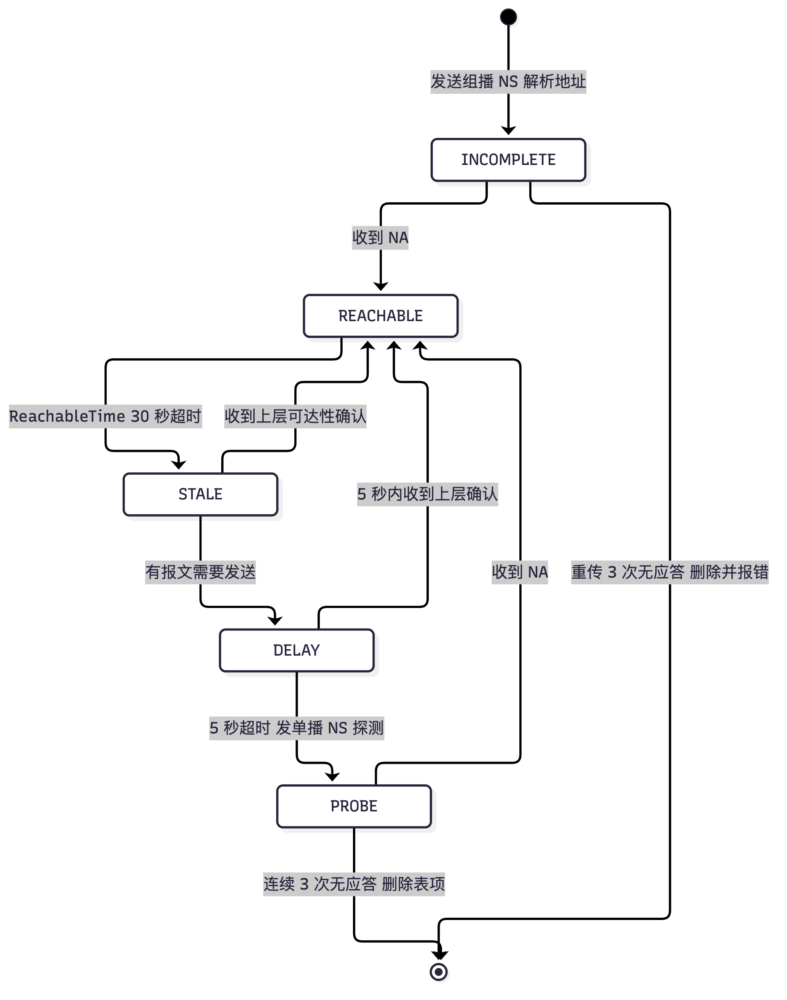


```mermaid
sequenceDiagram
  participant H as 主机
  participant R as 路由器
  H->>R: RS 类型 133 目的 FF02::2 请求立即通告
  R->>H: RA 类型 134 目的 FF02::1 携带前缀 M O 标志 MTU
  H->>H: 用前缀加 64 位接口 ID 生成地址
  H->>H: 对候选地址执行 DAD 发 NS 源为 ::
  H->>H: 无 NA 应答 地址可用 状态由 TENTATIVE 转为 PREFERRED
  H->>R: NS 类型 135 解析默认网关的 MAC
  R->>H: NA 类型 136 单播应答 携带目标链路层地址
  H->>R: 数据报文 后续邻居状态进入 REACHABLE
```

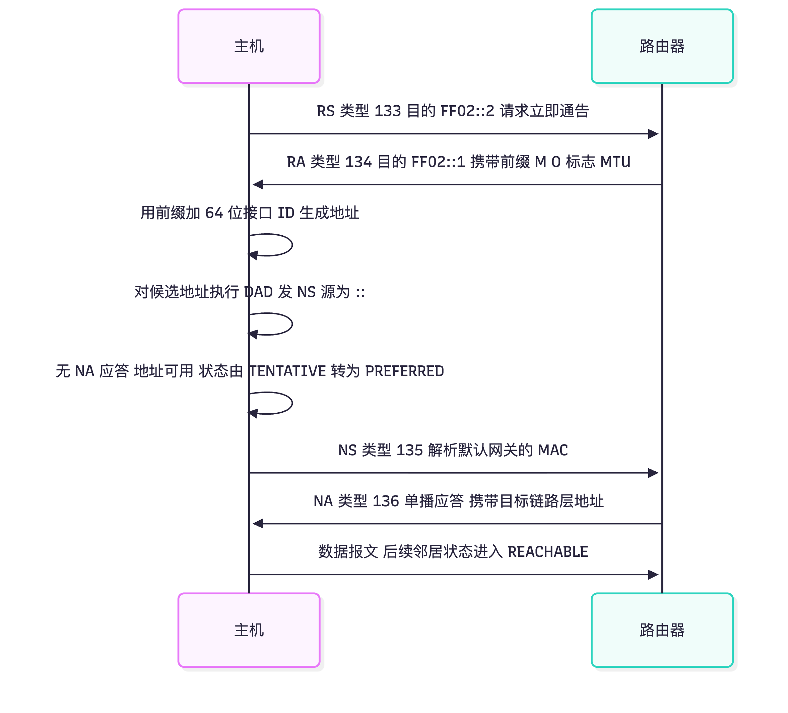


### 真题精练

**Q1.【真题·单选】** IPv6 中用于地址解析（代替 ARP）的报文是：
A. RA（134）  B. NS（135）  C. NA（136）  D. Redirect（137）

> **答案：B**
> **解析**：地址解析由 **NS（Neighbor Solicitation，类型 135）** 发起，目的地址为目标的**被请求节点组播地址**（FF02::1:FF + 目标地址低 24 位）；对端用 **NA（类型 136）** 单播应答。RA（134）用于路由器通告前缀与默认网关；Redirect（137）用于告知主机更优的下一跳。

**Q2.【真题·多选】** 关于 RA 报文中 M 位与 O 位的含义，下列说法正确的有：
A. M 位置 1 表示主机应通过 DHCPv6 获取地址（有状态配置）
B. O 位置 1 表示主机应通过 DHCPv6 获取其他配置信息（如 DNS）
C. M=0、O=1 时主机通过 SLAAC 生成地址，并通过无状态 DHCPv6 获取其他参数
D. M 位与 O 位都置 1 时，主机既做 SLAAC 又做有状态 DHCPv6 获取地址

> **答案：ABC**
> **解析**：D 错误——**M=1 表示地址由 DHCPv6 统一分配**，此时主机（按规范）不应再用 RA 前缀做 SLAAC，否则会出现地址来源冲突与不可控。A、B、C 正确：M 管地址、O 管其他参数；M=1/O=1 是有状态 DHCPv6 的典型组合（地址与其他参数都从 DHCPv6 获取），M=1/O=0 表示只从 DHCPv6 取地址（较少用），M=0/O=0 是纯 SLAAC（此时 DNS 只能靠 RA 的 RDNSS 选项下发或手工配置）。

**Q3.【真题·简答】** 请说明邻居缓存中 STALE 状态的含义，以及它与 REACHABLE、DELAY、PROBE 的关系。

> **答案与解析**：
> **STALE 的含义**：邻居的链路层地址**仍然记录在缓存中且可以使用**，但**其可达性已"未知"**（超过 ReachableTime 30 秒未确认，或收到了未经请求的 NA）。STALE 是"懒探测"设计的体现：IPv6 不主动、不周期性地探测邻居，只有在**真的要发报文时**才去确认可达性，从而大幅减少探测流量。
> **与相邻状态的关系**：① 从 **REACHABLE** 在 ReachableTime 超时后进入 STALE；② STALE 状态下**一旦有报文要发给该邻居**，先进入 **DELAY**（给上层协议 5 秒时间"顺带"确认，例如 TCP 收到 ACK 即视为可达）；③ DELAY 计时 5 秒（DELAY_FIRST_PROBE_TIME）内没收到上层确认，则进入 **PROBE**，改为向该邻居**单播**发送 NS 主动探测；④ PROBE 期间收到 NA → 回到 REACHABLE；连续 3 次（MAX_UNICAST_SOLICIT）无应答 → **删除表项**并可向上层报错（连接中断）。这个状态机的价值在于：**在"必须知道可达性"和"尽量少发包"之间取得平衡**。

### 易错点与排错

1. **NS 里没有"目标链路层地址"选项**：NS 是去问对端的 MAC，当然不能带；只有 NA 带目标链路层地址选项。
2. **RA 前缀长度必须 64 才能 SLAAC**：非 64 前缀信息选项会被主机忽略。
3. **A 位 vs L 位**：A 管"能不能自动配置地址"，L 管"是否在链路上直连可达"，别混。
4. **ReachableTime 30 秒、DELAY 5 秒、RetransTimer 1000 毫秒**：这三个数值必须记牢。
5. **RA 缺省被抑制**：华为设备必须 `undo ipv6 nd ra halt`。
6. **排错命令**：`display ipv6 neighbors`（状态与 MAC）、`display ipv6 interface`（ND 参数是否下发）、`debugging ipv6 nd`（报文级，慎用）、在主机侧 `ip -6 neigh`（Linux）验证。

---

## 6.3 DAD 重复地址检测与 SLAAC 无状态自动配置完整流程

### 考点定位

DAD 与 SLAAC 是 IPv6 的"开机流程"，国赛常以**流程排序题、填空（地址状态名与定时器）、简答（RA 标志组合与主机行为）** 的形式出现，合计 5~8 分。必考：**DAD 用 NS 的源地址是 ::（未指定地址）、目的是被请求节点组播**；**地址的四种状态（TENTATIVE / PREFERRED / DEPRECATED / INVALID）**；**M/O 标志与 SLAAC/DHCPv6 的对应关系**；**DAD 失败后设备怎么处理**。

### 原理精讲

**地址生命周期（四种状态）**：一个 IPv6 接口地址不是"配上了就能用"，它要经历状态迁移：

| 状态 | 含义 | 能否收发报文 |
|---|---|---|
| **TENTATIVE（暂定）** | 已生成地址，正在做 DAD 检测，尚未确认唯一 | **不能**用于收发（除 DAD 的 NS/NA） |
| **PREFERRED（首选）** | DAD 通过、且在首选生存期内 | 可以正常收发 |
| **DEPRECATED（废弃）** | 首选生存期已过、有效生存期未过 | 可以继续使用已有连接，但**不应作为新连接的源地址** |
| **INVALID（无效）** | 有效生存期已过 | 不可使用，从接口删除 |

**DAD（Duplicate Address Detection，重复地址检测）** 的作用是：IPv6 取消了 ARP 的"免费 ARP 冲突探测"，改由 DAD 在地址启用前确认唯一性。**标准流程**：
1. 接口生成候选地址（手工配置、SLAAC 生成或 DHCPv6 分配），地址进入 **TENTATIVE**；
2. 构造 **NS 报文**：**源地址 = ::（未指定地址）**（因为此时还没有可用地址）、**目的地址 = 该候选地址对应的被请求节点组播地址 FF02::1:FFXX:XXXX**（XX:XXXX 为候选地址的低 24 位）、**Target Address = 候选地址**、**不带源链路层地址选项**；
3. 发送 NS（华为缺省发送 **1** 次，`ipv6 nd dad attempts` 可调）；
4. **若在等待时间内收到针对该地址的 NA**（或收到其他主机发来的同地址 NS）→ **DAD 失败**，说明地址冲突；
5. **若超时无应答** → DAD 通过，地址从 TENTATIVE 进入 **PREFERRED**，可正常使用。

**为什么 DAD 用组播而不是广播？** 因为只有"可能持有该地址的主机"才需要被惊动。被请求节点组播地址由"地址低 24 位"生成，理论上每台主机只会加入 1~2 个被请求节点组播组（每个单播地址一个），因此 DAD 的 NS 只会被少量主机处理，避免像免费 ARP 那样"惊动整个广播域"。**为什么源地址用 ::**？因为 DAD 的目的就是"确认这个地址能不能用"，此时用它做源地址是不合法的循环依赖；:: 表示"还没有地址"，且收到该 NS 的主机不会把 :: 写入邻居缓存。

**DAD 失败的处理**：
- 手工配置的地址：设备**拒绝启用该地址**，地址不进入 PREFERRED（华为设备上 `display ipv6 interface` 看不到该地址或状态异常），同时产生日志/告警（如 `IPv6 address duplicate` 类告警）；管理员必须更换地址后重新检测。
- SLAAC 生成的地址：主机**放弃该接口 ID**，重新生成（例如换一个随机接口 ID）再试；若多次冲突，地址无法配置成功，主机可能只能用 LLA 通信。
- **重要工程含义**：DAD 需要时间（缺省几百毫秒到 1 秒），因此"配完地址马上 ping"可能失败——**地址还处于 TENTATIVE**。这也是排错题常见考点：**"ping 不通但配置正确，先看地址状态是否 TENTATIVE/DAD 是否未完成"**。在点对点链路或虚拟接口（如 Loopback、隧道口）上，为加快收敛可用 `ipv6 nd dad attempts 0` 关闭 DAD。

**SLAAC（Stateless Address Autoconfiguration，无状态地址自动配置）完整流程**（RFC 4862）：
1. **生成链路本地地址**：接口启用时先按 EUI-64（或稳定/随机隐私算法）生成 LLA（FE80::/10），并对它做 **DAD**；LLA 是所有后续 NDP 交互的基础，**必须最先可用**。
2. **发送 RS**：主机向 **FF02::2（所有路由器）** 发送 RS，请求路由器立即通告。
3. **接收 RA**：路由器回 RA（或周期性 RA，缺省最长 600 秒一次，可配置到 4 秒~1800 秒），RA 中携带：
   - 默认网关信息（Router Lifetime）与 Cur Hop Limit；
   - **M/O 标志**；
   - **前缀信息选项**（前缀、前缀长度、**A 位、L 位**、有效/首选生存期）；
   - 可选 MTU、RDNSS/DNSSL 选项。
4. **按标志决定配置方式**：
   - **M=0、O=0**：**纯 SLAAC**——用"RA 前缀 + 64 位接口 ID"生成 GUA，DNS 由 RA 的 RDNSS 下发或手工配置；
   - **M=0、O=1**：**SLAAC + 无状态 DHCPv6**——地址由 SLAAC 生成，DNS/域名/NTP 等通过 DHCPv6 获取；
   - **M=1**（O 可为 0 或 1）：**有状态 DHCPv6**——主机向 DHCPv6 服务器请求地址（SLAAC 不生成 GUA），其他参数也从 DHCPv6 获取。
5. **对新生成的 GUA 执行 DAD**：通过后进入 PREFERRED；同时按 RA 的 ReachableTime / RetransTimer 设置邻居状态机参数。
6. **周期性维护**：RA 周期刷新默认网关与前缀生存期；首选生存期到期后地址转 DEPRECATED，有效生存期到期后转 INVALID 并被删除；主机也可用 RFC 4941 临时地址保护隐私（对外发起连接用临时地址，接收用稳定地址）。

**DHCPv6 与 SLAAC 的分工建议**：服务器/网络设备用**手工配置或 DHCPv6**（可审计、地址可控）；终端 PC/手机优先 **SLAAC**（零运维）；ISP 给企业/家庭路由器下发前缀用 **DHCPv6-PD（Prefix Delegation）**，由下游路由器再细分 /64。

### 关键概念对照表

| 配置方式 | RA 的 M / O | 地址来源 | 其他参数来源 | 适用场景 |
|---|---|---|---|---|
| 纯 SLAAC | M=0，O=0 | RA 前缀 + 64 位接口 ID | RA 的 RDNSS/DNSSL 或手工 | 终端主机、办公网 |
| SLAAC + 无状态 DHCPv6 | M=0，O=1 | RA 前缀 + 64 位接口 ID | DHCPv6 | 需要集中下发 DNS/NTP 的终端网 |
| 有状态 DHCPv6 | M=1，O=0/1 | DHCPv6 服务器 | DHCPv6（O=1 时） | 服务器、需要审计的地址 |
| 手工配置 | 无关 | 管理员 | 管理员 | 网络设备、Loopback、点对点链路 |
| DHCPv6-PD | — | 上级路由器委派前缀 | DHCPv6 | ISP 到企业/家庭的逐级委派 |

| DAD/SLAAC 相关项 | 内容 | 数值/说明 |
|---|---|---|
| DAD 的 NS 源地址 | ::（未指定地址） | 不能用候选地址做源 |
| DAD 的 NS 目的地址 | FF02::1:FFXX:XXXX（被请求节点组播） | XX:XXXX 为候选地址低 24 位 |
| DAD 探测次数（华为） | `ipv6 nd dad attempts` | 缺省 **1** 次；0 表示关闭 DAD |
| 地址状态 | TENTATIVE / PREFERRED / DEPRECATED / INVALID | DAD 通过才转 PREFERRED |
| RA 发送间隔 | `ipv6 nd ra interval` | RFC 缺省 600 秒；可设 4~1800 秒 |
| 生存期 | 有效生存期 / 首选生存期 | 首选期到 → DEPRECATED；有效期到 → INVALID |
| 前缀长度要求 | 必须 /64 | 非 /64 前缀不参与 SLAAC |

### 华为设备配置

```bash
system-view
ipv6                                                // 全局使能 IPv6
interface GigabitEthernet0/0/1                      // 网关接口（RA 发送方）
 ipv6 enable
 ipv6 address 2001:DB8:A01:10::1 64                 // 网关自身地址
 undo ipv6 nd ra halt                               // 关键：华为缺省抑制 RA，必须取消抑制主机才能 SLAAC
 ipv6 nd ra interval 30                             // RA 发送间隔 30 秒（加快主机入网，缺省 600 秒）
 ipv6 nd autoconfig managed-address-flag            // 设置 RA 的 M 位 = 1，要求主机通过 DHCPv6 获取地址
 ipv6 nd autoconfig other-flag                      // 设置 RA 的 O 位 = 1，要求主机通过 DHCPv6 获取 DNS 等其他参数
 ipv6 nd ra prefix 2001:DB8:A01:10:: 64 2592000 604800  // 通告前缀：有效 30 天、首选 7 天（A 位与 L 位默认置位）
 ipv6 nd ra prefix 2001:DB8:A01:10:: 64 2592000 604800 no-autoconfig  // 需要时关闭 A 位（前缀只做 on-link 不做 SLAAC）
quit
interface GigabitEthernet0/0/2                      // 点对点/隧道类接口
 ipv6 enable
 ipv6 address 2001:DB8:A01:10:FFFF::1 127            // /127 点对点地址
 ipv6 nd dad attempts 0                              // 关闭 DAD，避免 /127 链路无意义的冲突探测并加快收敛
quit
interface LoopBack0
 ipv6 enable
 ipv6 address 2001:DB8:A01::1 128                    // Loopback 用 /128，并建议关闭 DAD
 ipv6 nd dad attempts 0
quit
display ipv6 interface GigabitEthernet0/0/1          // 查看地址状态（是否 TENTATIVE）、RA 是否发送、M/O 标志
display ipv6 interface brief                         // 快速确认地址是否已生效（无 TENTATIVE 提示即为可用）
display ipv6 neighbors                               // 查看通过 ND 学到的邻居（SLAAC 场景下主机是否已上线）
display current-configuration interface GigabitEthernet0/0/1  // 核对 RA 与 ND 相关配置是否齐全
```

### 示意图

```mermaid
sequenceDiagram
  participant H as 主机
  participant R as 网关路由器
  H->>H: 生成链路本地地址 FE80:: 并对它做 DAD
  H->>R: RS 类型 133 目的 FF02::2
  R->>H: RA 类型 134 携带前缀 M O 标志 ReachableTime MTU
  alt M 位为 0
    H->>H: 用前缀加 64 位接口 ID 生成 GUA
  else M 位为 1
    H->>R: 通过 DHCPv6 请求地址 有状态配置
  end
  H->>H: 对新地址做 DAD 发 NS 源为 :: 目的为被请求节点组播
  H->>H: 无 NA 应答 地址转为 PREFERRED 可用
  H->>R: 正常收发业务报文
```

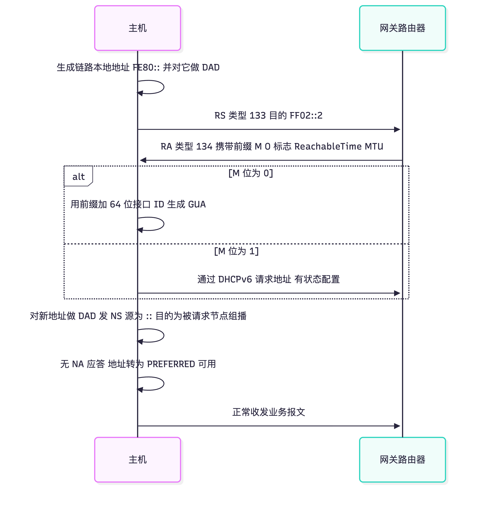


```mermaid
flowchart TD
  A["接口生成候选地址"] --> B["地址状态 TENTATIVE"]
  B --> C["发送 NS 源 :: 目的 被请求节点组播"]
  C --> D{"是否收到针对该地址的 NA"}
  D -->|"收到"| E["DAD 失败 地址冲突"]
  E --> F{"地址来源"}
  F -->|"手工配置"| G["拒绝启用该地址 产生告警 需人工更换"]
  F -->|"SLAAC 生成"| H["放弃该接口 ID 重新生成后再试"]
  D -->|"未收到"| I["DAD 通过 转入 PREFERRED"]
  I --> J["首选期到期 转 DEPRECATED"]
  J --> K["有效期到期 转 INVALID 并删除"]
```

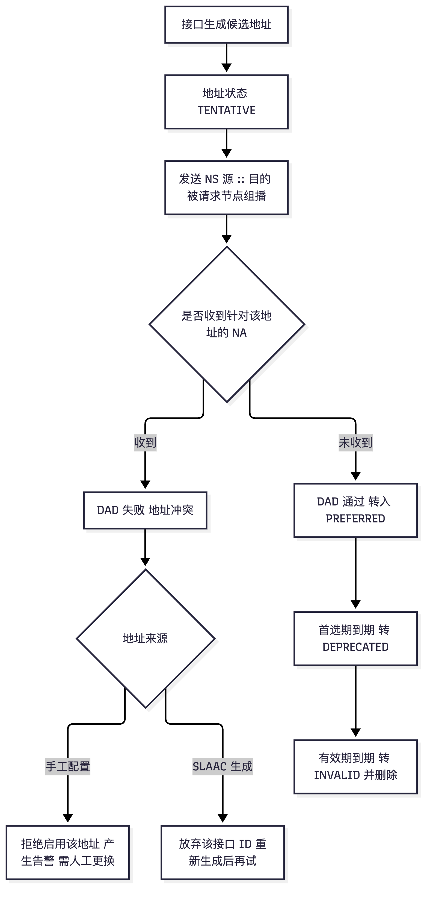


### 真题精练

**Q1.【真题·单选】** IPv6 主机执行 DAD 时发送的 NS 报文，其源地址与目的地址分别是：
A. 候选地址 / 被请求节点组播地址
B. :: / 被请求节点组播地址
C. :: / FF02::1
D. 链路本地地址 / 候选地址

> **答案：B**
> **解析**：DAD 的目的是确认候选地址是否唯一，此时该地址还不能使用，因此**源地址填 ::（未指定地址）**；目的地址填**候选地址对应的被请求节点组播地址**（FF02::1:FF + 低 24 位），这样只有"可能配置了同一地址"的主机才需要处理。A 会造成循环依赖；C 的 FF02::1 是"所有节点"，会惊动整个链路；D 逻辑不成立（既然要检测这个地址，就不能用它做源）。

**Q2.【真题·多选】** 关于 IPv6 地址状态，下列说法正确的有：
A. TENTATIVE 状态的地址不能用于收发业务报文
B. PREFERRED 状态的地址可以正常收发，并可作为新连接的源地址
C. DEPRECATED 状态的地址应立即停止使用并删除
D. 有效生存期到期后地址进入 INVALID 状态并被删除

> **答案：ABD**
> **解析**：C 错误——DEPRECATED 表示**首选生存期已过、有效生存期未过**，此时"已有的连接可以继续使用"，但不应用作新连接的源地址，地址并未立即删除，要等有效生存期到期才 INVALID。A 正确（TENTATIVE 只允许 DAD 相关报文）；B、D 正确。

**Q3.【真题·简答】** 现场现象：一台新接入的 PC 配置为自动获取 IPv6 地址，但 `ipconfig` 只能看到 FE80:: 开头的地址，没有全球单播地址。请列出排查思路。

> **答案与解析**：
> ① **检查网关是否发送 RA**：华为设备接口**缺省抑制 RA**（`ipv6 nd ra halt`），必须执行 `undo ipv6 nd ra halt`。用 `display ipv6 interface GigabitEthernet0/0/1` 确认 RA 相关配置与发送状态。
> ② **检查 RA 是否被二层阻断**：RA 目的地址是 FF02::1，需要二层放通 ICMPv6（若交换机配置了 RA Guard / ND Snooping，且上联口未被标记为"信任端口"，RA 会被丢弃）。用 `display nd snooping` 类命令核对信任端口配置。
> ③ **检查 M/O 标志**：若网关配了 `ipv6 nd autoconfig managed-address-flag`（M=1），则主机必须通过 DHCPv6 获取地址——此时若无 DHCPv6 服务器，主机就拿不到 GUA，只有 LLA。应确认网络中是"纯 SLAAC"还是"DHCPv6"方案，二者不能同时"半配"。
> ④ **检查前缀信息选项**：RA 通告的前缀长度必须是 **/64**，且 **A 位**必须置位才能用于 SLAAC；若配了 `no-autoconfig` 关闭 A 位，主机不会生成地址。
> ⑤ **检查 DAD 是否失败**：若网内已有主机使用了同一接口 ID（例如从同一模板克隆的 MAC），DAD 冲突会导致地址无法启用；用 `display ipv6 neighbors` 与抓包确认是否存在对该地址的 NA 应答。
> ⑥ **检查接口与 VLAN**：主机所在 VLAN 是否与网关同一广播域、接口是否 `ipv6 enable`、IPv6 是否全局使能。
> ⑦ 抓包确认主机是否发出 RS、网关是否回 RA（可同时看到 ICMPv6 133/134）。

### 易错点与排错

1. **DAD 的源地址是 ::，不是链路本地地址**：填错即失分。
2. **以为配置完地址立刻可用**：TENTATIVE 期间 ping 不通属正常现象。
3. **SLAAC 未生效最常见的原因是 RA 被抑制**（华为缺省）或 M 位被置 1。
4. **首选生存期与有效生存期**：首选期 ≤ 有效期，DAD 与状态迁移都以它们为准。
5. **`ipv6 nd dad attempts 0` 的风险**：关闭 DAD 后地址冲突不会被发现，只应在 Loopback、点对点、隧道等受控场景使用。
6. **排错命令**：`display ipv6 interface`（地址状态/RA 配置）、`display ipv6 neighbors`、`display current-configuration interface`、主机侧 `ipconfig /all`（Windows）或 `ip -6 addr`（Linux）。

---

## 6.4 IPv6 安全：RA Guard、ND Snooping 与 IPv6 首部攻击防护

### 考点定位

IPv6 安全是国赛"安全 + 数通"交叉考点（3~8 分），常考**RA 欺骗的危害与防护**、**ND Snooping 的作用与信任端口**、**IPv6 首部/扩展头带来的新型攻击（分片、超长扩展头链、RA 洪泛）**。题型以多选与简答为主。

### 原理精讲

**IPv6 引入了哪些新的二层/三层攻击面？** IPv4 时代最常见的二层攻击是 ARP 欺骗与 DHCP 仿冒；IPv6 用 NDP 替代 ARP，因此攻击面变成 **ND 欺骗**：

1. **RA 欺骗 / 伪造路由器（Rogue RA）**：攻击者在链路上发送伪造 RA，把自己宣告为"默认网关"（或宣告错误前缀），导致整个网段主机的流量被引导到攻击者（中间人）或直接断网；伪造 RA 还可以**下发恶意前缀覆盖原地址**、伪造 DNS（RDNSS 选项）实施钓鱼。**这是 IPv6 接入网最严重的二层威胁。**
2. **伪造 NA / NS 实施中间人**：伪造 NA 抢占邻居缓存（把自己 MAC 应答为目标地址），效果等同于 ARP 欺骗。
3. **DAD 攻击 / 地址耗尽**：攻击者持续对网段内地址应答 NA，使其他主机的地址永远无法通过 DAD；或伪造大量 NS 消耗交换机/路由器 CPU。
4. **ND/RA 洪泛**：大量 RS/NS/NA 报文上送 CPU，耗尽 CPU 与邻居缓存表资源（DoS）。
5. **IPv6 首部与扩展头攻击**：IPv6 允许扩展头链（Hop-by-Hop、Routing、Fragment、Destination Options 等），攻击者可用**超长扩展头链**消耗转发设备资源；**分片攻击**——把上层协议头拆到后面的分片中，使中间设备无法正确解析（RFC 7112 要求**第一片必须包含完整的 IPv6 头链**，RFC 6980 规定 **ND 报文禁止分片**）；此外还有**超长 Payload Length 与实际不符**、**逐跳选项滥用**等。
6. **地址扫描**：IPv6 地址空间巨大，传统"扫全网段"不可行，但攻击者可通过**组播地址（FF02::1 所有节点）**一次性发现链路上所有主机，或用已知的接口 ID 模式（如 EUI-64 由 MAC 推导）缩小范围——这也是推荐 **RFC 7217/4941 隐私地址**的原因之一。

**防护技术与华为实现**：

- **ND Snooping**：交换机像 IGMP Snooping 一样"监听 ND 报文"，建立"**IPv6 地址 ↔ MAC ↔ 接口 ↔ VLAN**"的绑定表，并据此过滤：**非法报文（伪造源地址、伪造 NA）被丢弃**；同时可对 ND 报文做**速率限制**防止 CPU 攻击。配置关键是**信任端口（Trusted Port）**：只有连接合法路由器/网关的端口才被标记为信任端口，允许其发送 RA/NA；**非信任端口收到 RA 直接丢弃**——这就是 **RA Guard** 的效果。
- **RA Guard（路由器通告防护）**：在接入端口上丢弃主机的 RA，只允许信任端口发 RA。华为设备上通常通过 **ND Snooping 的信任端口机制**（部分型号提供独立的 RA Guard 特性）来实现；在没有专用特性的版本上，可以用 **IPv6 ACL 过滤 ICMPv6 type 134** 作为替代。
- **DHCPv6 Snooping**：与 IPv4 的 DHCP Snooping 对应，防止伪造 DHCPv6 服务器。
- **IPv6 首部/扩展头防护**：设备侧通过 **CPCAR（CPU 防攻击策略，`cpu-defend policy`）** 对上送 CPU 的 ICMPv6、ND、DHCPv6 等报文限速；通过**第一分片检查**（丢弃扩展头链被拆分的报文）、**限制扩展头数量**、**丢弃 ND 分片**等机制对抗分片与扩展头攻击。华为设备还提供 URPF（单播反向路径转发）防止源地址伪造。
- **隐私地址与地址随机化**：使用 RFC 7217 稳定隐私地址或 RFC 4941 临时地址，避免由 MAC 推导出的固定接口 ID 被长期跟踪与扫描。
- **主机侧加固**：Windows/Linux 可开启 RA Guard 客户端行为（忽略非预期 RA）、限制 RDNSS 使用等。

### 关键概念对照表

| 攻击类型 | 攻击效果 | 主要防护机制 |
|---|---|---|
| 伪造 RA（Rogue RA） | 冒充默认网关、下发恶意前缀/DNS，造成断网或中间人 | RA Guard / ND Snooping 信任端口、接入端口丢弃 RA |
| 伪造 NA | 邻居缓存投毒，流量被牵引 | ND Snooping 绑定表校验、端口安全 |
| DAD 攻击 / 地址冲突 | 主机无法启用地址 | ND Snooping、CPU 限速、端口隔离 |
| NS/RS/NA 洪泛 | CPU 与表项资源耗尽（DoS） | CPCAR CPU 限速、ND 速率限制、端口安全 |
| 扩展头链攻击 | 转发设备逐头处理导致性能下降 | 限制扩展头数量、丢弃异常头链 |
| 分片攻击 | 中间设备无法正确解析上层协议 | 要求第一片包含完整头链、ND 报文禁止分片 |
| 地址扫描 | 发现存活主机 | 使用隐私地址、避免可预测接口 ID、限制 FF02::1 应答 |

| 防护特性 | 作用层次 | 关键配置点 |
|---|---|---|
| ND Snooping | 二层（交换机） | `nd snooping enable`（全局/VLAN）+ 接口 `nd snooping trusted` |
| RA Guard 等价能力 | 二层接入端口 | 仅信任端口可发 RA；无专用特性时用 IPv6 ACL 匹配 ICMPv6 type 134 |
| DHCPv6 Snooping | 二层 | 信任端口 + 绑定表 |
| CPCAR（`cpu-defend policy`） | 设备控制面 | 对 ICMPv6/ND/DHCPv6 上送 CPU 的报文限速 |
| URPF | 三层接口 | 校验源地址反向路径，防源伪造 |
| 隐私地址 | 主机侧 | RFC 7217 稳定隐私 / RFC 4941 临时地址 |

### 华为设备配置

```bash
system-view
nd snooping enable                                  // 全局使能 ND Snooping：监听 ND 报文并建立 地址-MAC-接口-VLAN 绑定表
vlan 10
 nd snooping enable                                 // 在 VLAN 10 内使能 ND Snooping（须与全局同时使能）
quit
interface GigabitEthernet0/0/1                      // 上联网关/路由器的端口
 nd snooping trusted                                // 标记为信任端口：允许该端口发送 RA/NA（只有路由器方向才是信任的）
quit
interface GigabitEthernet0/0/2                      // 连接用户主机的端口
 undo nd snooping trusted                           // 确保用户端口为非信任端口：收到 RA 直接丢弃，防止伪造网关
 nd snooping user-bind max-user 8                   // 限制该端口可学习的绑定表数量，防止地址/表项耗尽攻击
quit
display nd snooping user-bind all                  // 查看 ND Snooping 绑定表（地址、MAC、接口、VLAN、状态）
display nd snooping statistics                     // 查看 ND Snooping 丢弃/通过统计，确认是否在拦截伪造 RA
display nd snooping vlan 10                        // 查看 VLAN 内 ND Snooping 状态与配置
cpu-defend policy anti-nd-attack                    // 定义 CPU 防攻击策略（CPCAR），保护控制面
 car packet-type icmpv6 rate-limit 512              // 对 ICMPv6 上送 CPU 的报文限速（不同版本支持的报文类型名称略有差异）
quit
display cpu-defend statistics                       // 查看各协议报文上送 CPU 的统计与被丢弃情况
```

> 版本说明：部分产品/版本直接提供 RA Guard 特性命令，也有版本仅通过 ND Snooping 的信任端口实现同等效果；若所用版本无专用命令，可用 IPv6 ACL 在用户端口上过滤 ICMPv6 类型 134（RA）作为替代，具体以该产品版本的配置指南为准。考试作答时应写清"**信任端口只指向网关方向，用户端口一律非信任并丢弃 RA**"这一核心逻辑。

### 示意图

```mermaid
flowchart LR
  GW["合法网关 NE40E"] -->|"RA 允许通过"| SW["S5731 接入交换机<br/>ND Snooping"]
  SW -->|"信任端口 仅上联口"| GW
  SW -->|"非信任端口 丢弃 RA"| H1["正常主机"]
  ATK["攻击者伪造 RA"] -->|"被丢弃"| SW
  SW --> H2["被保护主机 不受伪造 RA 影响"]
```

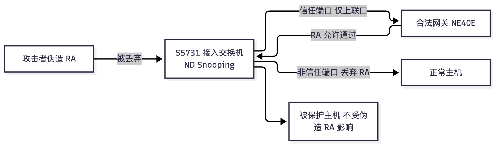


### 真题精练

**Q1.【真题·单选】** 在接入交换机上部署 ND Snooping 时，关于"信任端口"的说法正确的是：
A. 所有用户端口都应配置为信任端口
B. 只有连接合法路由器/网关的端口应配置为信任端口，用户端口为非信任端口
C. 信任端口只影响 ND Snooping 绑定表的学习，不影响 RA 过滤
D. 信任端口需要手工配置 MAC 地址白名单才能生效

> **答案：B**
> **解析**：信任端口表示"这个方向可能存在合法的路由器"，因此**只有上联网关/路由器的端口**才标记为信任；用户端口必须为非信任端口，其发出的 RA 会被直接丢弃，从而阻止伪造网关（Rogue RA）。A 完全违背设计意图；C 错误——非信任端口丢弃 RA 正是 ND Snooping/RA Guard 的核心功能；D 错误——信任端口按端口方向划分即可，不需要 MAC 白名单（MAC 白名单属于端口安全特性）。

**Q2.【真题·多选】** IPv6 相对于 IPv4 新增或加剧的安全风险包括：
A. 伪造 RA 冒充默认网关
B. 通过超长 IPv6 扩展头链消耗转发设备资源
C. 对 ND 报文进行分片以规避中间设备解析
D. ARP 欺骗

> **答案：ABC**
> **解析**：D 是 IPv4 的经典二层攻击（IPv6 用 NDP 取代 ARP，因此对应风险是"伪造 NA"）。A、B、C 都是 IPv6 特有或加剧的风险：RA 是 IPv6 新增的"路由器发现"机制，被伪造后危害极大；扩展头链是 IPv6 新引入的逐跳处理结构，攻击者可构造超长链；ND 报文分片（RFC 6980 明确禁止）会让交换机/路由器无法正确解析 ND，从而绕过安全检查。

**Q3.【真题·简答】** 某园区部署了 IPv6，用户反映"经常莫名其妙断网，一会儿又恢复，抓包发现网段内存在多个不同的路由器通告"。请分析原因并给出完整加固方案。

> **答案与解析**：
> **原因**：网段内存在**伪造 RA**（Rogue RA）。攻击者（或误配置的设备，例如一台错误开启了 `undo ipv6 nd ra halt` 的终端/路由器）发送 RA，自称默认网关，抢占主机默认路由；当合法网关与伪造网关的 RA 交替到达时，主机默认网关在两者间反复切换，造成"时通时断"。若伪造 RA 中还包含恶意 RDNSS 选项，还会造成 DNS 劫持。
> **加固方案**：
> ① **接入交换机部署 ND Snooping 与信任端口**：全局与 VLAN 内 `nd snooping enable`，仅上联网关端口配置 `nd snooping trusted`，用户端口保持非信任，**非信任端口的 RA 直接丢弃**（等价于 RA Guard）。
> ② **若版本支持 RA Guard 特性则直接开启**；否则用 IPv6 ACL 在用户端口过滤 ICMPv6 type 134。
> ③ **限制主机应答与绑定表规模**：配置 `nd snooping user-bind max-user` 等阈值，防止 ND 洪泛与表项耗尽；必要时开启端口安全（MAC 数量限制）。
> ④ **控制面保护**：配置 `cpu-defend policy` 对 ICMPv6/ND/DHCPv6 上送 CPU 的报文限速（CPCAR），避免 DoS。
> ⑤ **服务器与网络设备地址加固**：使用固定地址 + 手工配置 + 关闭不必要的 RA；终端使用隐私地址避免被轻易扫描。
> ⑥ **核查与验证**：`display nd snooping statistics` 确认拦截计数在增长；在主机侧确认默认网关唯一且正确；在交换机上定位发起伪造 RA 的端口并处理（可结合端口镜像抓包）。

### 易错点与排错

1. **信任端口只给网关方向**：把用户端口设为信任，等于把 RA Guard 关掉。
2. **ND Snooping 需全局与 VLAN 双使能**（与 IGMP Snooping 类似），漏一处就不生效。
3. **RA Guard ≠ 关闭 RA**：RA Guard 是"只允许信任端口发 RA"，不是"禁止所有 RA"，否则主机无法 SLAAC。
4. **IPv6 ACL 匹配 ICMPv6 类型**要写对类型号（RA=134、NS=135、NA=136），考试易写错。
5. **ND 报文不允许分片**（RFC 6980）、**第一分片必须含完整头链**（RFC 7112），这两条常作为判断题出现。
6. **排错命令**：`display nd snooping user-bind all`、`display nd snooping statistics`、`display cpu-defend statistics`、`display acl ipv6 all`。

---

## 6.5 IPv6 动态路由协议：OSPFv3、IS-IS 与 RIPng

### 考点定位

OSPFv3 与 OSPFv2 的差异是**每年必考**的知识点（4~8 分），几乎固定出 1 道多选 + 1 道简答。必答点：**OSPFv3 基于链路而非网段运行、下一跳用链路本地地址、新增 8 类（Link-LSA）与 9 类（Intra-Area-Prefix-LSA）LSA、Router-LSA/Network-LSA 不再携带前缀前缀、认证由 IPsec 提供、组播地址 FF02::5/FF02::6**。IS-IS 对 IPv6 的支持（单拓扑 vs 多拓扑）与 RIPng（UDP 521、FF02::9、15 跳）则是补充考点。

### 原理精讲

**OSPFv3（RFC 5340）与 OSPFv2（RFC 2328）的核心差异**：

1. **运行基础不同：基于链路（per-link）而非网段（per-subnet）**。OSPFv2 用 `network 10.0.0.0 0.0.0.255 area 0` 把**接口网段**宣告进区域，邻居关系建立在"同一 IP 网段"上；OSPFv3 **取消了 `network` 命令**，改为直接在接口下 `ospfv3 1 area 0` 使能，**邻居关系建立在链路上**。因此 OSPFv3 的两台路由器即使接口地址**不在同一网段**（甚至没有配置全球单播地址，只有链路本地地址），也能建立邻居——因为 OSPFv3 用**链路本地地址**做邻居标识与下一跳。
2. **下一跳使用链路本地地址**：OSPFv3 的路由表下一跳通常是 `FE80::...`（配合出接口），而不是全球地址。这是排错时的常见困惑点："路由下一跳是 FE80:: 地址，正常吗？"——**正常，这正说明接口上存在 OSPFv3 邻居**。
3. **新增两种 LSA**：
   - **Link-LSA（Type 8）**：**只在单条链路上泛洪**（不跨路由器），携带：本接口在该链路上的**链路本地地址**、该链路上的**IPv6 前缀列表**、接口的 Options 位。作用是让同一链路上的其他路由器知道"这个接口的链路本地地址与前缀"。
   - **Intra-Area-Prefix-LSA（Type 9）**：携带**区域内前缀**，并**关联到 Router-LSA 或 Network-LSA**（通过引用 LSA 类型与 Link State ID）。作用是把"前缀"与"拓扑"解耦。
4. **Router-LSA（Type 1）与 Network-LSA（Type 2）不再携带前缀**：OSPFv2 的 Router-LSA 里有"stub 网段"描述前缀，OSPFv3 把前缀全部搬到 **Intra-Area-Prefix-LSA** 中；Network-LSA 也只描述"链路上有哪些路由器"，前缀由 Intra-Area-Prefix-LSA 关联。
5. **认证改用 IPsec**：OSPFv3 报头**删除了 Authentication 字段**（OSPFv2 有 8 字节认证字段），认证由 **IPsec（AH/ESP）** 提供，实现更安全、更灵活（可加密）。华为设备通过配置 IPsec SA 并关联到 OSPFv3 接口来实现。
6. **组播地址不同**：OSPFv3 使用 **FF02::5（AllSPFRouters）** 与 **FF02::6（AllDRouters）**，对应 OSPFv2 的 224.0.0.5/224.0.0.6。
7. **支持多实例（Instance ID）**：同一链路上可以运行**多个 OSPFv3 实例**，通过报文头部的 Instance ID 区分，实现"一条链路多个逻辑拓扑/多租户"，OSPFv2 无法做到。
8. **Options 字段扩展**：OSPFv3 的 Hello/DD 报文携带 24 位 Options，其中 **R 位（Router）** 表示"该路由器参与转发（不是只做管理）"、**V6 位**表示"参与 IPv6 路由计算"，用于抑制不必要的 SPF 计算。
9. **相同的部分**（考试爱考"哪些没变"）：Hello/Dead 定时器（广播型 10s/40s，NBMA/点到多点 30s/120s）、DR 选举规则（接口优先级大者优，相同比 Router ID，**不抢占**）、Router ID 仍为 32 位点分十进制（必须手工配置或用 IPv4 地址派生）、LSA 泛洪与 SPF 算法、区域与 ABR/ASBR 概念、Stub/NSSA 区域、Type 3（Inter-Area-Prefix-LSA）、Type 4（Inter-Area-Router-LSA）、Type 5（AS-External-LSA）、Type 7（NSSA External）。

**IS-IS 对 IPv6 的支持**：IS-IS 是"协议无关"的链路状态协议，通过新增 TLV 承载 IPv6 信息：**TLV 232（IPv6 Interface Address）** 携带接口 IPv6 地址、**TLV 236（IPv6 Reachability）** 携带 IPv6 可达前缀。两种运行模式：
- **单拓扑（Single Topology，ST）**：IPv4 与 IPv6 **共用同一 SPF 拓扑**，要求两条协议的拓扑完全一致（例如所有接口都同时跑 v4 和 v6）。优点是只算一次 SPF、开销小；缺点是只要有一处接口只跑 v4，该链路就不能用于 IPv6 转发。华为配置 `ipv6 enable topology standard`。
- **多拓扑（Multi-Topology，MT）**：通过 **TLV 229（Multi-Topology）** 为 IPv6 单独维护一套拓扑，允许 IPv4 与 IPv6 拓扑不一致（如某些链路只跑 IPv6），代价是每增加一个拓扑就多一次 SPF 计算。华为配置 `ipv6 enable topology ipv6`。

**RIPng（RFC 2080）**：RIP 的 IPv6 版本，工作方式与 RIPv2 类似但细节有别：使用 **UDP 521** 端口（RIPv2 是 520）、组播地址 **FF02::9**（RIPv2 是 224.0.0.9）、**度量最大 15 跳（16 为不可达）**、支持水平分割与毒性逆转、**没有认证字段**（依赖 IPsec）、下一跳可以携带链路本地地址、**只能在接口上使能**（`ripng 1 enable`）而不再有 `network` 命令。由于 RIP 收敛慢、跳数限制小，现网一般只在小型网络或实验环境使用。

### 关键概念对照表

| 对比项 | OSPFv2 | OSPFv3 |
|---|---|---|
| 运行基础 | 网段（per-subnet），`network` 命令 | **链路（per-link）**，接口下 `ospfv3 1 area 0` |
| 邻居标识/下一跳 | 接口全球 IP 地址 | **链路本地地址（FE80::）** |
| 报文源地址 | 接口 IP | 链路本地地址 |
| 组播地址 | 224.0.0.5 / 224.0.0.6 | **FF02::5 / FF02::6** |
| 认证 | 报头 Authentication 字段（明文/MD5） | **IPsec（AH/ESP）**，报头无认证字段 |
| Router-LSA（Type 1） | 携带前缀（stub 网段） | **不携带前缀** |
| Network-LSA（Type 2） | 携带掩码 | 不携带掩码/前缀 |
| 新增 LSA | — | **Type 8 Link-LSA、Type 9 Intra-Area-Prefix-LSA** |
| 多实例 | 不支持 | 支持（Instance ID） |
| Router ID | 32 位，自动/手工 | 32 位，**必须手工配置或指定** |
| Hello/Dead（广播） | 10s / 40s | 10s / 40s（相同） |
| DR 选举 | 优先级大者优→Router ID 大者优，不抢占 | 相同 |

| 对比项 | RIPng | IS-IS for IPv6（单拓扑） | IS-IS for IPv6（多拓扑） |
|---|---|---|---|
| 传输 | UDP **521** | 链路层（CLNS/PDU） | 链路层 |
| 组播地址 | **FF02::9** | — | — |
| 承载 IPv6 的机制 | IPv6 专用协议 | TLV 232 / 236 | TLV 232 / 236 + **TLV 229** |
| 拓扑 | 独立 | 与 IPv4 共用 | IPv6 独立拓扑 |
| 度量 | 跳数（最大 15） | 开销（宽度量） | 开销 |
| 华为配置 | `ripng 1 enable` | `ipv6 enable topology standard` | `ipv6 enable topology ipv6` |

### 华为设备配置

```bash
system-view
ipv6                                              // 全局使能 IPv6
ospfv3 1                                          // 创建 OSPFv3 进程 1
 router-id 1.1.1.1                                 // OSPFv3 的 Router ID 必须是 32 位点分十进制，必须唯一
quit
interface GigabitEthernet0/0/1
 ipv6 enable                                       // 接口使能 IPv6（自动生成链路本地地址，OSPFv3 靠它建邻居）
 ipv6 address 2001:DB8:A01:10::1 64
 ospfv3 1 area 0                                   // 接口使能 OSPFv3 并划入区域 0（替代 OSPFv2 的 network 命令）
 ospfv3 dr-priority 10                             // 提高接口 DR 优先级（大者优，不抢占）
 ospfv3 timer hello 10                             // Hello 间隔 10 秒（广播型缺省）
 ospfv3 timer dead 40                              // 邻居失效时间 40 秒（缺省为 Hello 的 4 倍）
quit
interface GigabitEthernet0/0/2
 ipv6 enable
 ospfv3 1 area 1                                   // 另一接口划入区域 1（本机成为 ABR）
quit
isis 1                                            // 创建 IS-IS 进程 1
 is-level level-2                                  // 配置为 Level-2 路由器（骨干层）
 network-entity 49.0001.0000.0000.0001.00          // 配置 NET 地址（System ID 必须唯一）
 ipv6 enable topology standard                     // 使能 IPv6 且使用单拓扑（IPv4/IPv6 共用 SPF）
quit
interface GigabitEthernet0/0/3
 ipv6 enable
 isis enable 1                                     // 接口使能 IS-IS（IPv4 部分）
 isis ipv6 enable 1                                // 接口使能 IS-IS 的 IPv6 能力（缺这条 IPv6 前缀不会进入 IS-IS）
quit
ripng 1                                            // 创建 RIPng 进程 1
 quit
interface GigabitEthernet0/0/4
 ipv6 enable
 ripng 1 enable                                    // 接口使能 RIPng（RIPng 只能在接口上使能，无 network 命令）
quit
display ospfv3 peer                                // 查看 OSPFv3 邻居（注意邻居地址为链路本地地址）
display ospfv3 routing-table                       // 查看 OSPFv3 路由（下一跳多为 FE80:: 形式）
display ospfv3 lsdb                                // 查看 OSPFv3 LSDB（可看到 Link-LSA 与 Intra-Area-Prefix-LSA）
display isis route ipv6                            // 查看 IS-IS 学到的 IPv6 路由
display ripng 1 route                              // 查看 RIPng 路由表与度量
```

### 示意图

```mermaid
flowchart TD
  A["OSPFv2 路由器"] -->|"network 命令宣告网段"| B["邻居基于同网段建立"]
  C["OSPFv3 路由器"] -->|"接口 ospfv3 1 area 0"| D["邻居基于链路建立<br/>用链路本地地址标识"]
  D --> E["Router-LSA 只描述拓扑"]
  D --> F["Link-LSA Type 8 携带链路本地地址与前缀"]
  D --> G["Intra-Area-Prefix-LSA Type 9 携带区域内前缀"]
  F --> H["SPF 计算后前缀与拓扑关联生成路由"]
  G --> H
```

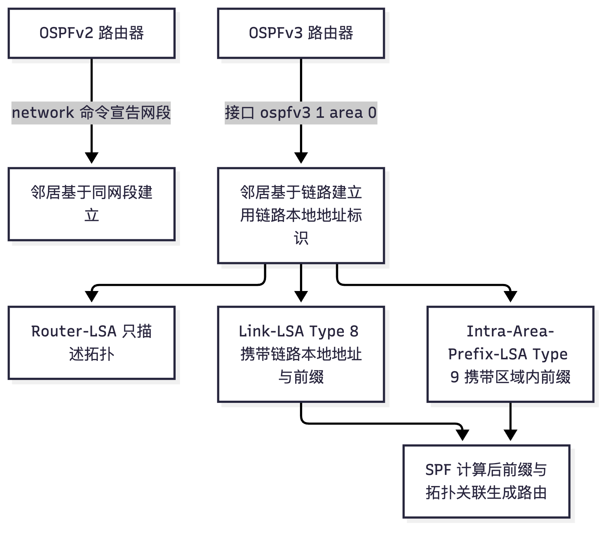


### 真题精练

**Q1.【真题·多选】** 与 OSPFv2 相比，OSPFv3 的新特性包括：
A. 新增 Link-LSA（Type 8）与 Intra-Area-Prefix-LSA（Type 9）
B. Router-LSA 与 Network-LSA 不再携带 IPv6 前缀
C. 邻居关系基于链路建立，下一跳使用链路本地地址
D. 报文中保留认证字段，并新增支持 SHA-256

> **答案：ABC**
> **解析**：D 错误——OSPFv3 **删除了报文中的认证字段**，认证改由 **IPsec（AH/ESP）** 提供，因此不可能"保留认证字段并新增 SHA-256"。A、B、C 都是 OSPFv3 的标志性变化：前缀从 1/2 类 LSA 中移出，由 8 类（链路本地地址与前缀，仅本链路泛洪）与 9 类（区域内前缀）承载。

**Q2.【真题·简答】** 为什么 OSPFv3 的路由下一跳经常显示为 FE80:: 开头的链路本地地址？这样设计有什么好处？

> **答案与解析**：
> **原因**：OSPFv3 把邻居关系的建立与下一跳的确定都建立在**链路**上，而不是"同一 IP 网段"上。它在 Hello 报文中用**接口的链路本地地址**作为源地址与邻居标识，SPF 计算出的下一跳自然就是该链路本地地址（配合出接口）。因此 `display ospfv3 routing-table` 中看到 `FE80::...` 是正常现象，且只有当对应接口上确实存在 OSPFv3 邻居时才会出现。
> **好处**：① **解耦**：邻居建立不再要求接口配置全球单播地址或处于同一网段，甚至可以先建邻居再配地址，便于地址迁移与自动化部署；② **节省全球地址**：链路本地地址自动生成、全球唯一性只需在链路上保证，点对点链路无需浪费全球前缀；③ **更契合链路状态协议**：OSPFv3 的 8 类 Link-LSA 只在本链路泛洪，专门用来传递"链路本地地址 + 前缀"，使拓扑与地址彻底解耦；④ 便于多实例与多拓扑共存（同一链路的多个实例可以用各自的链路本地地址区分）。

**Q3.【真题·判断】** IS-IS 在多拓扑模式下为 IPv6 单独维护一套拓扑，允许 IPv4 与 IPv6 的拓扑不一致，代价是额外的 SPF 计算开销。

> **答案：正确**
> **解析**：单拓扑（`topology standard`）下 IPv4/IPv6 共用一套拓扑，SPF 只算一次，但要求两者拓扑一致（链路必须同时支持 v4/v6）；多拓扑（`topology ipv6`）通过 **TLV 229** 为 IPv6 建立独立拓扑（在 IS-IS 中常体现为 MT ID 2），可以容忍"某些链路只跑 IPv6"等不一致场景，代价是每个拓扑都要单独做 SPF 计算，CPU 与内存开销增加。

**Q4.【真题·排错】** 现网现象：两台路由器之间 OSPFv3 邻居状态显示为 Full，但 `display ospfv3 routing-table` 里学不到对方的 IPv6 网段路由（若换成 IS-IS，则 `display isis route ipv6` 为空）。请列出可能原因与验证命令。

> **答案与解析**：
> ① **接口没有全球单播前缀**：OSPFv3 的邻居只要接口 `ipv6 enable`（有链路本地地址）就能建立，但**若接口未配置全球单播地址/前缀，就没有前缀可以泛洪**，对端自然学不到网段路由。验证：`display ipv6 interface brief`、`display ospfv3 interface`。
> ② **区域号不一致**：同链路 Hello 参数匹配即可建立 Full 邻居，但**区域不匹配时不会交换区域内前缀**（跨区域依赖 ABR 的 3 类 LSA）。验证：两端 `display ospfv3 interface` 对比 Area 字段。
> ③ **IS-IS 场景漏配 `isis ipv6 enable`**：接口只配置了 `isis enable 1`（IPv4 能力）而漏了 `isis ipv6 enable 1`，IPv6 前缀不会进入 PDU，邻居（IPv4 侧）仍然正常但 `display isis route ipv6` 为空。验证：`display current-configuration interface GigabitEthernet0/0/x`、`display isis interface verbose`。
> ④ **IS-IS 拓扑模式两端不一致**：一端 `topology standard`、另一端 `topology ipv6`（多拓扑），拓扑标识不同导致 IPv6 可达信息无法互认。验证：`display isis interface` 的 MT 信息，两端统一起见。
> ⑤ **Router ID 冲突**：OSPFv3 的 Router ID 仍为 32 位且需手工配置，两端相同会导致 LSA 相互覆盖、路由异常。验证：两端 `display ospfv3` 与 `display ospfv3 lsdb` 比对 Router ID。
> ⑥ **前缀被策略过滤**：`filter-policy`、缺少 `import-route`（外部前缀场景）、或区域/进程下配置了过滤策略。验证：`display ospfv3 lsdb` 确认是否收到了携带前缀的 LSA（区域内看 **9 类 Intra-Area-Prefix-LSA**，跨区域看 3 类），若 LSDB 有而路由表没有，则问题在策略或 SPF 计算。
> **排查顺序**：邻居与区域（`display ospfv3 peer` / `display ospfv3 interface`）→ LSDB 是否含前缀 LSA → 路由表与策略过滤，三步定位。

### 易错点与排错

1. **OSPFv3 没有 `network` 命令**：忘掉 OSPFv2 的宣告方式，直接在接口下 `ospfv3 1 area 0`。
2. **Router ID 必须手工配**：OSPFv3 不会自动生成 Router ID（没有 IPv4 地址时会报错），必须在 `ospfv3` 视图下配置。
3. **下一跳是 FE80:: 不代表故障**：判断是否正常要看"该接口上是否有 OSPFv3 邻居"。
4. **IS-IS 双命令**：接口上既要有 `isis enable 1`（IPv4），也要有 `isis ipv6 enable 1`（IPv6），漏一个会导致 IPv6 路由不通。
5. **RIPng 的端口号是 521**（不是 520），组播地址 FF02::9。
6. **排错命令**：`display ospfv3 peer`、`display ospfv3 interface`、`display ospfv3 lsdb`、`display isis peer`、`display ripng 1 route`、`display ipv6 routing-table protocol ospfv3`。

---

## 6.6 BGP4+ 与 MP_REACH_NLRI / MP_UNREACH_NLRI 属性

### 考点定位

BGP4+ 是 IPv6 域间路由的核心，也是"路由 + IPv6"的交叉考点（4~8 分）。必考：**BGP4+ 如何携带 IPv6 路由（MP_REACH_NLRI / MP_UNREACH_NLRI 两个属性）**、**AFI/SAFI 取值**、**建立会话时用 IPv4 还是 IPv6 传输**、**下一跳的处理规则（含链路本地地址的两段式编码）**。易错点是把 BGP4+ 当成"全新协议"（它只是 BGP-4 的**多协议扩展**）以及把 MP_REACH_NLRI 的属性类型号记错。

### 原理精讲

**BGP4+ 的本质**：BGP-4 原本只能携带 IPv4 单播路由（NLRI 字段直接编码 IPv4 前缀）。为了支持 IPv6（以及 VPNv4、组播、EVPN 等多种地址族），RFC 2858/4760 引入了 **多协议扩展（Multiprotocol Extensions for BGP-4）**，其做法是：

1. **能力协商**：BGP 邻居在 **OPEN 报文**的 Optional Parameters 中携带 **Capabilities 可选参数（类型 2）**，其中的 **Multiprotocol Extensions Capability（能力码 1）** 声明"我支持哪些 (AFI, SAFI)"。只有双方都声明支持 IPv6 单播，才能在 IPv6 地址族上交换路由。这就是"BGP4+ 需要能力协商"的原因。
2. **两个新属性承载 NLRI**：
   - **MP_REACH_NLRI（Multiprotocol Reachable NLRI，属性类型号 14）**：用于**通告可达的 IPv6 路由**，属性标志为 **Optional + Non-transitive（可选非过渡）**。字段依次为：
     | 字段 | 长度 | 内容 |
     |---|---|---|
     | AFI（Address Family Identifier） | 2 字节 | IPv6 单播 = **2** |
     | SAFI（Subsequent AFI） | 1 字节 | 单播 = **1**（组播 = 2，VPNv4 = 128，EVPN = 70 等） |
     | Next Hop Length | 1 字节 | 下一跳长度：16（仅全球地址）或 **32（全球地址 + 链路本地地址）** |
     | Next Hop | 变长 | IPv6 下一跳地址：全球地址在前，链路本地地址在后 |
     | Reserved | 1 字节 | 保留，全 0 |
     | NLRI | 变长 | 前缀长度（1 字节）+ 前缀（按位取整到字节） |
   - **MP_UNREACH_NLRI（Multiprotocol Unreachable NLRI，属性类型号 15）**：用于**撤销 IPv6 路由**，标志同为 **Optional + Non-transitive**。字段只有 **AFI（2 字节）+ SAFI（1 字节）+ 撤销的 NLRI 列表**（没有下一跳字段，因为撤销不需要下一跳）。
3. **会话传输与地址族解耦**：BGP 邻居可以用 **IPv4 地址**建立（`peer 10.0.0.2 as-number 200`），也可以用 **IPv6 地址**建立（`peer 2001:DB8::2 as-number 200`）；无论用哪种传输，都可以在 `ipv6-family unicast` 下使能 IPv6 路由交换。**典型应用是 6PE**：PE 之间用 IPv4 会话 + IPv6 地址族，把 IPv6 路由带上 MPLS 标签在 IPv4 MPLS 核心中转发。
4. **下一跳规则**：与 IPv4 一致——**EBGP 修改下一跳为自身地址**（可用 `peer x next-hop-local` 或策略修改），**IBGP 默认不修改**；IPv6 特有之处是**下一跳可以携带链路本地地址**（32 字节形式），用于"两个 BGP 邻居共享同一条链路"的场景，此时对端直接用链路本地地址作为转发下一跳，无需全球地址。RBGP/RFC 2545 明确规定：**不使用 IPv4-mapped IPv6 地址作为下一跳**。
5. **NLRI 编码差异**：IPv6 的 NLRI 长度以 **位**为单位（如 /64），编码时按字节补齐（64 位 = 8 字节，恰好整字节；若是 /61 之类需要补齐到 8 字节并在低位补 0）。IPv4 前缀的编码方式相同，但 IPv6 前缀长度通常更长，报文体积更大。
6. **4 字节 AS 号**：IPv6 域间部署通常配合 **4 字节 AS 号**（RFC 6793，原 RFC 4893 的过渡方案），传统 2 字节 AS 通过 AS_TRANS（23456）过渡。

**BGP4+ 与 BGP4 的关系总结**：BGP4+ **不是新协议**，它是 BGP-4 在多协议能力协商下的 IPv6 地址族实现；报文格式（OPEN/UPDATE/NOTIFICATION/KEEPALIVE）、状态机（Idle/Connect/Active/OpenSent/OpenConfirm/Established）、选路规则、路由反射、联盟、对等体组等机制与 IPv4 完全一致。因此考试中"BGP4+ 与 BGP4 的区别"标准答案就是：**基于 MP-BGP 多协议扩展，用 MP_REACH_NLRI/MP_UNREACH_NLRI 承载 IPv6 路由，通过 OPEN 的能力协商确认，支持 IPv4/IPv6 传输与会话分离**。

### 关键概念对照表

| 属性 | 类型号 | 标志 | 主要字段 | 用途 |
|---|---|---|---|---|
| MP_REACH_NLRI | **14** | Optional, Non-transitive | AFI、SAFI、Next Hop Len、Next Hop、Reserved、NLRI | 通告 IPv6 可达路由 |
| MP_UNREACH_NLRI | **15** | Optional, Non-transitive | AFI、SAFI、Withdrawn NLRI | 撤销 IPv6 路由 |
| ORIGIN | 1 | Well-known Mandatory | IGP/EGP/INCOMPLETE | 路由来源 |
| AS_PATH | 2 | Well-known Mandatory | AS 序列/集合 | 防环与选路 |
| NEXT_HOP | 3 | Well-known Mandatory | IPv4 下一跳（**IPv6 用属性 14 携带**） | IPv4 场景下一跳 |
| LOCAL_PREF | 5 | Well-known Discretionary | 本地优先级 | IBGP 选路 |

| AFI / SAFI 取值 | 含义 | 典型场景 |
|---|---|---|
| AFI=1 | IPv4 | IPv4 单播/组播/VPN |
| AFI=2 | IPv6 | BGP4+ |
| SAFI=1 | 单播（Unicast） | 普通单播路由 |
| SAFI=2 | 组播（Multicast） | MBGP 组播路由（跨域组播） |
| SAFI=4 | MPLS 标签（Label） | 带标签的 IPv4/IPv6 路由（6PE 使用） |
| SAFI=128 | VPNv4 | MPLS L3VPN |
| SAFI=5 | MVPN | 组播 VPN |
| SAFI=70 | EVPN | 数据中心 BGP EVPN |

| 对比项 | BGP4（IPv4） | BGP4+（IPv6） |
|---|---|---|
| NLRI 承载 | UPDATE 报文内的 IPv4 NLRI | **MP_REACH_NLRI / MP_UNREACH_NLRI 属性** |
| 下一跳 | NEXT_HOP 属性（属性 3） | MP_REACH_NLRI 内的下一跳字段（16 或 32 字节） |
| 能力协商 | 可选（多协议扩展） | **必需**（Multiprotocol Extensions 能力码 1） |
| 会话地址族 | 与路由地址族一致 | 可分离（IPv4 会话传 IPv6 路由，如 6PE） |
| 传输协议 | TCP 179 | TCP 179（IPv6 或 IPv4 均可承载） |
| 选路与状态机 | 相同 | 相同 |

### 华为设备配置

```bash
system-view
ipv6                                                  // 全局使能 IPv6
bgp 100                                               // 创建 BGP 进程（AS 100）
 router-id 1.1.1.1                                     // 配置 Router ID（BGP 仍使用 32 位点分十进制）
 peer 2001:DB8:0:1::2 as-number 200                    // 用 IPv6 地址建立 EBGP 邻居
 peer 2001:DB8:0:1::2 connect-interface GigabitEthernet0/0/1  // 指定建连使用的源接口
 ipv6-family unicast                                   // 进入 IPv6 单播地址族（AFI=2，SAFI=1）
  peer 2001:DB8:0:1::2 enable                           // 在该地址族下使能邻居：触发 MP-BGP 能力协商
  peer 2001:DB8:0:1::2 next-hop-local                    // 需要时把下一跳改为自身（常用于 IBGP/反射场景）
  network 2001:DB8:A01:10:: 64                           // 通告本机 IPv6 网段（要求路由表中存在该精确路由）
 quit
 peer 10.0.0.2 as-number 100                           // 也可用 IPv4 地址建立会话（6PE 场景的典型形式）
 ipv6-family unicast
  peer 10.0.0.2 enable                                  // IPv4 会话上传 IPv6 路由（会话与地址族解耦）
  peer 10.0.0.2 label-route-capability                   // 6PE：为该邻居使能标签路由能力，使 IPv6 路由携带 MPLS 标签
 quit
quit
display bgp ipv6 peer                                  // 查看 IPv6 地址族的邻居状态（Established 才算正常）
display bgp ipv6 routing-table                         // 查看 IPv6 BGP 路由（含 MP_REACH 学到的下一跳）
display bgp ipv6 routing-table 2001:DB8:A01:10:: 64     // 查看特定前缀的详细信息（AS_PATH、下一跳、本地优先级）
display bgp ipv6 routing-table peer 2001:DB8:0:1::2 advertised-routes  // 查看已向该邻居通告的路由
display bgp ipv6 update-peer-group                      // 查看 UPDATE 分组信息（大规模场景用于评估打包效率）
```

### 示意图

```mermaid
sequenceDiagram
  participant A as AS100 R1
  participant B as AS200 R2
  A->>B: OPEN 携带 Capabilities 声明支持 AFI=2 SAFI=1
  B->>A: OPEN 确认支持 IPv6 单播能力
  A->>B: KEEPALIVE 邻居进入 Established
  A->>B: UPDATE 属性 MP_REACH_NLRI 类型 14
  Note over A,B: 内含 AFI=2 SAFI=1 下一跳 16 或 32 字节 NLRI 前缀
  B->>B: 校验下一跳可达性并写入 IPv6 BGP 表
  A->>B: UPDATE 属性 MP_UNREACH_NLRI 类型 15 撤销路由
```

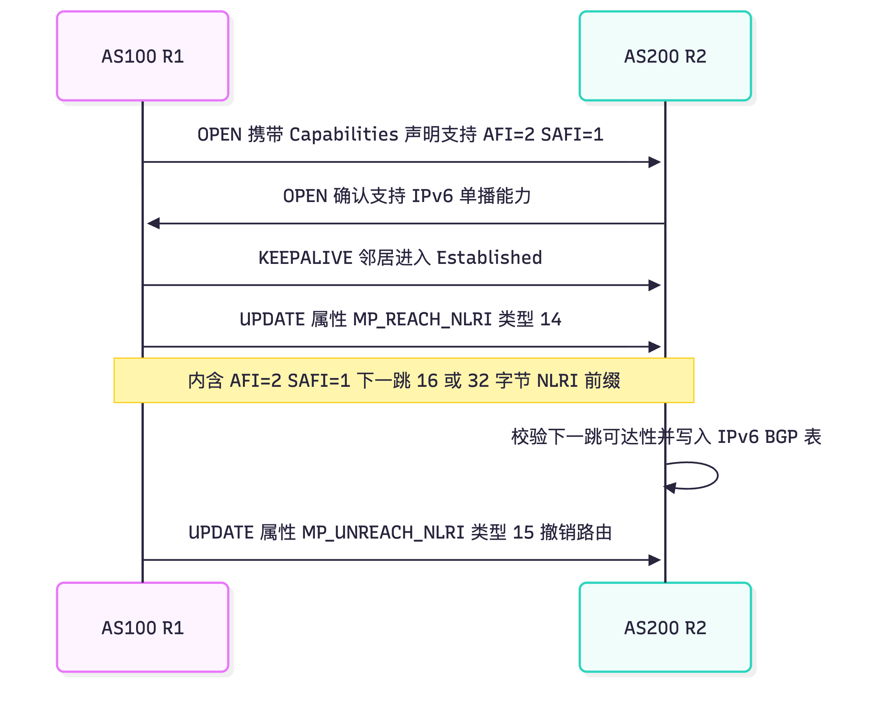


```mermaid
flowchart LR
  R1["R1 AS100<br/>IPv6 2001:DB8:A01::/48"] -->|"IPv4 会话 + ipv6-family"| R2["R2 AS100 核心<br/>IPv4 MPLS"]
  R2 -->|"IPv4 会话 + ipv6-family"| R3["R3 AS100<br/>6PE 出口"]
  R3 -->|"IPv6 客户流量"| CE["CE 双栈设备"]
  R1 -.->|"MP_REACH_NLRI 携带 IPv6 路由与标签"| R3
```

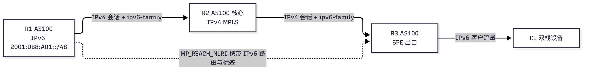


### 真题精练

**Q1.【真题·单选】** BGP4+ 中用于撤销 IPv6 路由的属性是：
A. MP_REACH_NLRI（14）  B. MP_UNREACH_NLRI（15）  C. NEXT_HOP（3）  D. AS_PATH（2）

> **答案：B**
> **解析**：**MP_UNREACH_NLRI（类型 15）** 用于撤销（Withdrawn）多协议路由，字段为 AFI + SAFI + 撤销的 NLRI 列表；**MP_REACH_NLRI（类型 14）** 用于通告可达路由，并携带下一跳。C 的 NEXT_HOP 属性只用于 IPv4 场景（IPv6 的下一跳在属性 14 内）；D 是 AS 路径属性，与撤销无关。

**Q2.【真题·多选】** 关于 BGP4+，下列说法正确的有：
A. 它通过 MP-BGP 多协议扩展实现，不是一套全新的协议
B. IPv6 的下一跳可以携带链路本地地址，编码长度为 32 字节
C. 必须用 IPv6 地址建立 TCP 会话才能交换 IPv6 路由
D. 需要在 OPEN 报文中通过 Multieprotocol Extensions 能力协商确认支持 IPv6

> **答案：ABD**
> **解析**：C 错误——BGP 的**会话传输与地址族是分离的**，可以用 IPv4 地址建立邻居并在 `ipv6-family unicast` 下交换 IPv6 路由，**6PE 就是典型例子**（PE 之间 IPv4 会话 + IPv6 地址族 + MPLS 标签）。A、B、D 正确：BGP4+ 本质是 BGP-4 的多协议扩展；下一跳字段 16 字节（仅全球地址）或 32 字节（全球地址 + 链路本地地址）；能力协商是交换 IPv6 路由的前提。

**Q3.【真题·简答】** 请说明 MP_REACH_NLRI 属性的字段构成，并解释为什么它是"Optional + Non-transitive"。

> **答案与解析**：
> **字段构成**（按顺序）：① **AFI（2 字节）**：地址族标识，IPv6 = 2；② **SAFI（1 字节）**：子地址族标识，单播 = 1（组播 = 2、VPNv4 = 128、EVPN = 70）；③ **Next Hop Length（1 字节）**：下一跳长度，IPv6 为 16（仅全球地址）或 32（全球地址 + 链路本地地址）；④ **Next Hop（变长）**：IPv6 下一跳地址，全球地址在前、链路本地地址在后；⑤ **Reserved（1 字节）**：保留，置 0；⑥ **NLRI（变长）**：前缀长度（1 字节，单位 bit）+ 前缀内容（按字节对齐，不足补 0）。
> **为什么是 Optional + Non-transitive**：① **Optional（可选）**：只有支持多协议扩展的 BGP 实现才需要这个属性，传统只支持 IPv4 的实现不认识它，因此不能放在 Well-known（公认）属性里；② **Non-transitive（非过渡）**：BGP 规定"不认识的 Non-transitive 属性在转发 UPDATE 时必须丢弃且不能继续传递"，而地址族的语义是**逐跳有效**的——如果一台只支持 IPv4 的路由器把带 IPv6 NLRI 的属性原样透传给下游，会造成下游对"这条 UPDATE 到底描述什么路由"的混乱。因此标准把这几个多协议属性都定义为 Non-transitive，遇到不支持的对等体时该路由就不会被错误传播（同时也解释了为什么"未协商 IPv6 能力的邻居不会收到 IPv6 路由"）。

### 易错点与排错

1. **属性类型号记错**：MP_REACH_NLRI = **14**、MP_UNREACH_NLRI = **15**。
2. **以为必须先建 IPv6 会话**：会话与地址族可分离，6PE/6VPE 都用 IPv4 会话承载 IPv6 路由。
3. **下一跳长度**：16 字节（仅全球）与 **32 字节（全球 + 链路本地）** 两种情况都要考虑；解析报文时容易只算 16 字节导致错位。
4. **AFI/SAFI 混淆**：IPv6 单播是 AFI=2/SAFI=1；IPv6 组播是 AFI=2/SAFI=2（跨域组播用 MBGP 时就会看到）。
5. **忘记 `peer ... enable`**：只建了邻居但没在 `ipv6-family unicast` 下 enable，能力协商不会发生，`display bgp ipv6 peer` 显示邻居不存在。
6. **排错命令**：`display bgp ipv6 peer`、`display bgp ipv6 routing-table`、`display bgp ipv6 routing-table peer x advertised-routes`、`display current-configuration configuration bgp`。

---

## 6.7 IPv4 到 IPv6 过渡技术（一）：双栈与隧道（手工 / GRE / 6to4 / ISATAP / 6PE / 6VPE）

### 考点定位

过渡技术是国赛 IPv6 部分的"必考区"（8~12 分），常见题型：**给出场景选技术（选择题）**、**写隧道配置（实验题）**、**解释 6to4 地址中如何嵌入 IPv4（计算/简答题）**、**6PE 与 6VPE 的区别（简答）**。易错点是把 6to4 的地址前缀记成 2001::、把 ISATAP 的接口 ID 格式记错、以及把 6PE（全球 IPv6 互联）与 6VPE（IPv6 VPN）混为一谈。

### 原理精讲

过渡技术分三大类：**双栈（Dual Stack）**、**隧道（Tunneling）**、**翻译（Translation，见 6.8）**。

**① 双栈（Dual Stack）**：设备同时运行 IPv4 与 IPv6 协议栈，同一接口同时配置 A 记录与 AAAA 记录对应的两种地址；应用根据 DNS 返回（RFC 6724 地址选择规则）决定使用哪个协议栈。优点是**最简单、无封装开销、无翻译损耗、端到端语义完整**；缺点是**要求全路径设备都支持双栈**（任何一跳只有 IPv4 就会断），且需要同时维护两套地址与两套策略（ACL、QoS、安全策略都要做两遍）。**双栈是所有过渡方案的基础**——几乎所有隧道与翻译方案都建立在"边界设备是双栈"之上。

**② 隧道（Tunneling）**：把 IPv6 报文封装在 IPv4 报文中，穿越 IPv4 网络。分类维度有两个：**（a）隧道端点是否手工指定**（手工隧道 vs 自动隧道）；**（b）承载协议**（IPv6 over IPv4 直接封装 vs GRE 封装）。

| 隧道技术 | 封装方式 | 地址/端点确定方式 | 地址格式 | 是否支持组播/广播 | 关键特征 |
|---|---|---|---|---|---|
| **手工隧道（IPv6 over IPv4）** | IPv4 协议号 **41** | 两端 source/destination 手工指定 | 自定义 | 视实现（一般为单播） | 点对点、简单可控、需逐条配置 |
| **GRE 隧道** | GRE（IP 协议号 **47**）内封装 IPv6 | 手工指定 | 自定义 | **支持组播/广播** | 可穿越不支持协议 41 的设备、可叠加 IPsec、可带 Keepalive |
| **6to4** | IPv4 协议号 41 | 目的地址从 IPv6 地址中提取 IPv4（**自动**） | **2002:IPv4::/48** | 不支持 | 免逐点配置，需公网 IPv4 与 6to4 中继 |
| **ISATAP** | IPv4 协议号 41 | 通过接口 ID 中的 IPv4 地址确定对端（**自动**） | 任意 /64 前缀 + **::0:5EFE:IPv4** | 不支持 | 主机—路由器隧道，适合站内 IPv4 网络中的 IPv6 主机 |
| **6PE** | MPLS（标签栈） | BGP 邻居手工指定 | 普通 GUA | 不涉及（IPv6 单播） | 核心只需 IPv4 MPLS，PE 双栈 |
| **6VPE** | MPLS（标签栈） | BGP VPN 邻居 | 普通 GUA（VPN 内） | 不涉及 | 6PE + VPN 实例隔离 |

**手工隧道**：在隧道两端配置源/目的 IPv4 地址，隧道接口上配置 IPv6 地址。封装开销小、行为可预测，适合"少量固定的 IPv6 站点穿越 IPv4 骨干"。缺点是**每新增一个对端就要新增一套配置**（N² 问题），扩展性差。

**GRE 隧道**：用 GRE 封装 IPv6，优势有三：① **可以承载组播与广播**（IPv4 协议号 41 的隧道通常只承载单播），因此能在隧道上跑 OSPFv3、PIM 等需要组播/广播的协议；② **可以穿越只允许 GRE 的中间设备/防火墙**；③ 可以配合 **IPsec** 加密、配置 **Keepalive** 检测。代价是封装开销更大（GRE 头 4~8 字节以上）。

**6to4（RFC 3056）**：一种**自动隧道**，核心思想是"**把 IPv4 地址嵌进 IPv6 地址**"，格式为 **2002:V4ADDR::/48**（V4ADDR 用十六进制表示，例如 IPv4 `10.1.1.1` = `0A01:0101` → 前缀 `2002:0A01:0101::/48`）。隧道端点不需要手工配置：当一台 6to4 路由器要把报文发给另一个 6to4 站点时，它从目的 IPv6 地址中**提取出目的 IPv4 地址**，用该地址作为隧道目的自动建立隧道。**6to4 中继（6to4 Relay，地址 192.88.99.1，对应 IPv6 的 2002:C058:6301::）** 负责连接 6to4 站点与原生 IPv6 互联网。问题是：中继常被滥用、无法承载组播、依赖公网 IPv4 且需要正确配置反向路由，因此**现网已不推荐**，仅作考点记忆。

**ISATAP（Intra-Site Automatic Tunnel Addressing Protocol，站内自动隧道寻址协议，RFC 5214）**：用于"**站点内部**已经只有 IPv4 网络，但主机想获得 IPv6 连接"的场景。接口 ID 的格式固定为 **::0:5EFE:IPv4地址**（5EFE 为 IANA 分配的标识，IPv4 用十六进制），例如 IPv4 `10.0.0.1` → 接口 ID `::5EFE:0A00:0001`，配合 RA 通告的前缀形成地址（如 `2001:DB8:A01:10::5EFE:0A00:0001`）。主机与 ISATAP 路由器之间的隧道是**自动建立**的（对端 IPv4 从接口 ID 中提取）。缺点：不支持组播（不能跑依赖组播的路由协议）、接口 ID 与 IPv4 绑定导致隐私性差、现网同样不推荐新部署。

**6PE（IPv6 Provider Edge，RFC 4798）**：给 ISP 用。场景是"**运营商核心已经是 IPv4 MPLS，但要给客户提供 IPv6 全球互联**"。做法：**PE 路由器双栈**，PE 之间用 **IPv4 承载的 MP-BGP 会话交换 IPv6 路由，并给 IPv6 路由分配 MPLS 标签**（`label-route-capability`），核心 P 路由器**完全不需要支持 IPv6**，只需要按标签转发（外层标签用于隧道到对端 PE，内层标签用于区分 IPv6 前缀）。优点是**核心零改造、转发效率高（标签交换）、支持 IPv6 全球路由**；缺点是**不提供 VPN 隔离**（6PE 是"公网 IPv6 互联"）。

**6VPE（IPv6 VPN Provider Edge，RFC 4659）**：**6PE + MPLS L3VPN**。PE 上为每个 VPN 建立独立的 **VPN 实例（`ip vpn-instance`）**，其中配置 **IPv6 地址族**（RD/RT），客户 IPv6 路由通过 `ipv6-family vpn-instance` 在 PE 之间交换，并携带**双层标签**（外层隧道标签 + 内层 VPN 标签）。区别一句话：**6PE 是"IPv6 上公网"，6VPE 是"IPv6 组 VPN"**。

### 关键概念对照表

| 技术 | 封装/协议 | 端点确定 | 支持组播 | 扩展性 | 适用场景 | 现网推荐度 |
|---|---|---|---|---|---|---|
| 双栈 | 无封装 | — | 是 | 好 | 全路径可升级的新建网络 | ★★★★★ |
| 手工隧道 | IPv4 协议号 41 | 手工 | 一般不支持 | 差（N²） | 少量固定站点互连 | ★★★ |
| GRE 隧道 | GRE（协议号 47） | 手工 | **支持** | 差 | 需承载组播/路由协议的互连 | ★★★★ |
| 6to4 | 协议号 41（自动） | 从地址提取 | 不支持 | 中 | 早期分散站点穿越互联网 | ★（已不推荐） |
| ISATAP | 协议号 41（自动） | 从接口 ID 提取 | 不支持 | 中 | 站内 IPv4 网络中的 IPv6 主机 | ★（已不推荐） |
| 6PE | MPLS 标签 | BGP 邻居 | 不支持 | 好 | ISP 提供 IPv6 全球互联 | ★★★★ |
| 6VPE | MPLS 标签 + VPN 实例 | BGP VPN 邻居 | 不支持 | 好 | ISP 提供 IPv6 VPN 业务 | ★★★★★ |

| 关键参数 | 数值/内容 | 备注 |
|---|---|---|
| IPv6 over IPv4 隧道协议号 | **41** | IPv4 头部 Protocol 字段 |
| GRE 协议号 | **47** | 可承载 IPv6、组播、多种协议 |
| 6to4 前缀 | **2002::/16**（实际用 /48） | 内嵌 IPv4，例如 10.1.1.1 → 2002:0A01:0101::/48 |
| 6to4 中继 | 192.88.99.1 / 2002:C058:6301:: | RFC 3068 |
| ISATAP 接口 ID | **::0:5EFE:IPv4 十六进制** | 例如 10.0.0.1 → ::5EFE:0A00:0001 |
| 6PE 核心要求 | IPv4 MPLS + LDP/RSVP-TE | P 设备无需 IPv6 |
| 6VPE 核心要求 | 6PE 能力 + VPN 实例（RD/RT） | 双层标签 |

### 华为设备配置

```bash
system-view
ipv6                                                  // 全局使能 IPv6
// ===== 手工 IPv6 over IPv4 隧道 =====
interface Tunnel0/0/0
 tunnel-protocol ipv6-ipv4                             // 隧道封装协议：IPv6 over IPv4（IPv4 协议号 41）
 source 10.0.0.1                                       // 隧道源（本端 IPv4 地址，须为物理接口地址或可路由地址）
 destination 10.0.0.2                                  // 隧道目的（对端 IPv4 地址，手工指定）
 ipv6 enable                                           // 隧道接口使能 IPv6（自动生成链路本地地址）
 ipv6 address 2001:DB8:F001::1 64                       // 隧道内 IPv6 地址
quit
// ===== GRE 隧道（可承载组播与路由协议）=====
interface Tunnel0/0/1
 tunnel-protocol gre                                   // 封装为 GRE，可承载 IPv6 与组播
 source 10.0.0.1
 destination 10.0.0.2
 keepalive 10 3                                        // 使能 Keepalive：周期 10 秒、连续 3 次失败判定隧道 Down
 ipv6 enable
 ipv6 address 2001:DB8:F002::1 64
quit
// ===== 6to4 自动隧道 =====
interface Tunnel0/0/2
 tunnel-protocol ipv6-ipv4 6to4                         // 6to4 自动隧道：目的 IPv4 从 2002::/16 地址中提取
 source GigabitEthernet0/0/0                            // 指定源接口，其 IPv4 地址将嵌入 2002:V4ADDR::/48
 ipv6 enable
 ipv6 address 2002:0A01:0101::1 64                      // 对应 IPv4 10.1.1.1 的 6to4 地址
quit
// ===== ISATAP 自动隧道 =====
interface Tunnel0/0/3
 tunnel-protocol ipv6-ipv4 isatap                       // ISATAP 隧道：对端 IPv4 从接口 ID 的 5EFE 段提取
 source GigabitEthernet0/0/0
 ipv6 enable
 ipv6 address 2001:DB8:A01:10::5EFE:0A00:0001 64         // 接口 ID ::5EFE:0A00:0001 对应 IPv4 10.0.0.1
quit
display ipv6 interface Tunnel0/0/0                     // 确认隧道接口 IPv6 地址与状态（UP 才能承载流量）
display tunnel-info all                                // 查看所有隧道信息（封装类型、源/目的、状态）
display ipv6 routing-table                             // 确认通过隧道学到的 IPv6 路由
```

```bash
// ===== 6PE 与 6VPE（PE 路由器侧，MPLS 核心已具备 IPv4 LSP）=====
system-view
mpls lsr-id 3.3.3.3                                   // 配置 MPLS LSR ID（必须唯一，6PE 依赖 IPv4 MPLS 转发）
mpls
 mpls ldp                                             // 全局使能 LDP，与核心 P 设备建立 IPv4 标签分发
quit
interface GigabitEthernet0/0/1
 mpls                                                  // 面向核心的接口使能 MPLS
 mpls ldp                                              // 接口使能 LDP（建立 IPv4 LSP）
quit
// ---- 6PE：提供 IPv6 全球互联 ----
bgp 100
 peer 3.3.3.3 as-number 100                            // 与对端 PE 建立 IBGP（用 IPv4 地址，即"会话与地址族分离"）
 peer 3.3.3.3 connect-interface LoopBack0
 ipv4-family unicast
  peer 3.3.3.3 enable                                  // IPv4 单播地址族（承载 IBGP 基础与核心路由）
 quit
 ipv6-family unicast
  peer 3.3.3.3 enable                                  // 在 IPv6 地址族下使能邻居（触发 MP-BGP 能力协商）
  peer 3.3.3.3 label-route-capability                   // 关键：使能标签路由能力，IPv6 路由携带 MPLS 标签（6PE 核心）
 quit
quit
// ---- 6VPE：在 6PE 基础上叠加 VPN 实例 ----
ip vpn-instance vpn1
 ipv6-family                                           // 在 VPN 实例内配置 IPv6 地址族（6VPE 特有）
  route-distinguisher 100:1                             // 配置 RD，区分不同 VPN 的相同前缀
  vpn-target 100:1 export-extcommunity                  // 配置 RT，控制 VPN 路由的发布与接收
  vpn-target 100:1 import-extcommunity
 quit
quit
interface GigabitEthernet0/0/2
 ip binding vpn-instance vpn1                          // 客户侧接口绑定 VPN 实例
 ipv6 enable
quit
bgp 100
 ipv6-family vpn-instance vpn1                         // 进入"IPv6 VPN 实例地址族"（6VPE 的路由交换平面）
  peer 2001:DB8:CE::1 as-number 65001                   // 与客户 CE 建立 BGP4+ 邻居
 quit
quit
display bgp ipv6 peer                                  // 查看 IPv6 地址族邻居（6PE）
display bgp vpnv6 all peer                             // 查看 IPv6 VPN 邻居（6VPE）
display bgp vpnv6 vpn-instance vpn1 routing-table       // 查看 VPN 实例内的 IPv6 BGP 路由
display mpls lsp                                       // 查看 MPLS LSP（6PE/6VPE 的转发基础）
```

### 示意图

```mermaid
flowchart LR
  A["IPv6 站点 A<br/>2001:DB8:A::/48"] --> R1["R1 双栈边界"]
  R1 -->|"IPv4 协议号 41 隧道"| R2["R2 双栈边界"]
  R2 --> B["IPv6 站点 B<br/>2001:DB8:B::/48"]
  C["6to4 站点<br/>2002:0A01:0101::/48"] -->|"自动隧道 从地址提取目的 IPv4"| RELAY["6to4 中继<br/>192.88.99.1"]
  RELAY --> D["原生 IPv6 互联网"]
  E["ISATAP 主机<br/>::5EFE:0A00:0001"] -->|"自动隧道"| R3["ISATAP 路由器"]
```

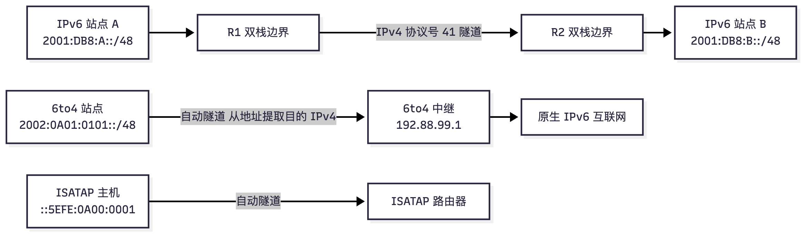


```mermaid
flowchart LR
  CE1["客户 CE1 IPv6"] --> PE1["PE1 双栈<br/>6PE 或 6VPE"]
  PE1 -->|"IPv4 MPLS 核心 只跑标签转发"| P1["P 设备<br/>不支持 IPv6"]
  P1 --> PE2["PE2 双栈"]
  PE2 --> CE2["客户 CE2 IPv6"]
  PE1 -.->|"MP-BGP 会话用 IPv4 承载 IPv6 路由"| PE2
  PE1 -.->|"6VPE 时携带 VPN 实例与双层标签"| PE2
```

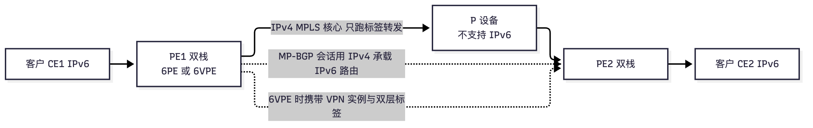


### 真题精练

**Q1.【真题·单选】** 6to4 隧道使用的 IPv6 地址前缀是：
A. 2001::/16  B. 2002::/16  C. 2001:DB8::/32  D. FE80::/10

> **答案：B**
> **解析**：6to4（RFC 3056）使用 **2002::/16**，并把隧道的 IPv4 地址嵌入地址中形成 **2002:V4ADDR::/48**，例如 IPv4 10.1.1.1（= 0A01:0101）对应 `2002:0A01:0101::/48`。A 是 Teredo（2001::/32）所在的更大范围，C 是文档前缀，D 是链路本地地址。

**Q2.【真题·多选】** 关于 6PE 与 6VPE，下列说法正确的有：
A. 6PE 要求核心 P 设备支持 IPv6
B. 6PE 中 PE 之间使用 IPv4 会话承载 IPv6 路由，并为 IPv6 路由分配 MPLS 标签
C. 6VPE 在 6PE 基础上引入 VPN 实例（RD/RT）实现 IPv6 VPN 隔离
D. 6PE 提供 IPv6 全球互联，6VPE 提供 IPv6 VPN 业务

> **答案：BCD**
> **解析**：A 错误——6PE 的核心价值就是**让不支持 IPv6 的 IPv4 MPLS 核心也能承载 IPv6 流量**，P 设备只按标签转发，不需要 IPv6 能力。B、C、D 正确：6PE 用 MP-BGP（IPv4 会话）+ 标签路由能力为 IPv6 路由打标签；6VPE = 6PE + VPN 实例（RD/RT，双层标签）；两者定位不同（公网互联 vs VPN 业务）。

**Q3.【真题·实验】** 请写出两台华为路由器之间建立 **GRE 隧道承载 IPv6** 的关键配置（R1 接口 G0/0/0 = 10.0.0.1/24，R2 接口 G0/0/0 = 10.0.0.2/24，隧道内使用 2001:DB8:F002::/64），并说明为什么该场景推荐 GRE 而不是手工 IPv6 over IPv4 隧道。

> **答案与解析**：
> **R1 关键配置**：
> ```bash
> system-view
> ipv6
> interface Tunnel0/0/0
>  tunnel-protocol gre
>  source 10.0.0.1
>  destination 10.0.0.2
>  keepalive 10 3
>  ipv6 enable
>  ipv6 address 2001:DB8:F002::1 64
> ```
> **R2 关键配置**：
> ```bash
> system-view
> ipv6
> interface Tunnel0/0/0
>  tunnel-protocol gre
>  source 10.0.0.2
>  destination 10.0.0.1
>  keepalive 10 3
>  ipv6 enable
>  ipv6 address 2001:DB8:F002::2 64
> ```
> **推荐 GRE 的原因**：GRE 隧道**可以承载组播与广播报文**，因此在隧道上可以正常运行 OSPFv3（依赖组播 FF02::5/FF02::6）、PIM、NDP 等需要组播/广播的协议，适合"两个 IPv6 站点通过 IPv4 骨干互连并跑动态路由"的场景；此外 GRE 可穿越只放通 GRE 的网络设备、可叠加 IPsec 加密、可用 `keepalive` 做隧道故障检测。而**手工 IPv6 over IPv4 隧道（协议号 41）一般只承载单播**，跑不了依赖组播的路由协议，且很多防火墙/中间设备不放通协议 41。**验证命令**：`display ipv6 interface Tunnel0/0/0`、`display tunnel-info all`、`display ospfv3 peer`（若在隧道上跑 OSPFv3）。

**Q4.【真题·排错】** 某分公司与总部之间用 GRE 隧道承载 IPv6，隧道接口 `display ipv6 interface` 显示 UP，但两端 IPv6 业务不通、隧道上跑的 OSPFv3 邻居也起不来。请给出排查思路。

> **答案与解析**：
> ① **确认隧道两端 IPv4 可达性**：GRE 隧道的源/目的地址必须单播可达，先 `ping` 对端隧道源地址（注意要用 `ping -a <本端隧道源地址>` 指定源，否则可能走了别的接口而结果失真）。
> ② **确认协议号 47（GRE）被放通**：中间防火墙/ACL 若只放通 TCP/UDP/ICMP，GRE 报文会被丢弃（隧道接口可能仍显示 UP，因为它是逻辑接口，不反映转发是否成功）。验证：`display acl all`、查看中间设备会话/丢弃统计、抓包确认 GRE 报文是否被响应。
> ③ **确认两端配置对称**：一端的 `source` 必须是另一端的 `destination`，且两端 `tunnel-protocol` 一致（都是 `gre`）；不对称会导致隧道"看起来 Up 但没有回程"。
> ④ **确认隧道接口上的 IPv6 与路由协议已使能**：隧道接口需 `ipv6 enable` + `ipv6 address`；若要在隧道上跑 OSPFv3，还需在**隧道接口**上 `ospfv3 1 area 0`（很多人只在物理接口上配了）。验证：`display current-configuration interface Tunnel0/0/0`、`display ospfv3 interface`。
> ⑤ **确认 IPv6 路由指对了出口**：`display ipv6 routing-table` 看远端前缀的下一跳是否经由 Tunnel 接口；若 IGP 未收敛则需检查区域/网络类型（隧道默认可能被识别为 NBMA/P2P，Hello/Dead 定时器与广播型不同，两端必须一致）。
> ⑥ **确认 MTU 与分片**：GRE 封装会消耗额外字节，隧道接口 MTU 若未调整，大包会被丢弃或触发分片——IPv6 **不允许中间设备分片**，会直接丢包并回 ICMPv6 "Packet Too Big"，表现为"小包能通、大包不通"。验证：`display interface Tunnel0/0/0` 的 MTU、抓包看是否有 ICMPv6 类型 2（Packet Too Big）。
> ⑦ **确认 Keepalive 状态**：若配置了 `keepalive 10 3` 且隧道持续 Down，说明回程 GRE 报文没有收到，回到第 ②、③ 步继续排查。
> **顺序总结**：IPv4 可达 → 协议号放通 → 配置对称 → 隧道内 IPv6/协议使能 → 路由与 MTU，逐层排除。

### 易错点与排错

1. **6to4 前缀写成 2001::/16**：正确是 **2002::/16**；`2001::/32` 是 Teredo。
2. **ISATAP 接口 ID 记错**：格式为 **::0:5EFE:IPv4十六进制**（5EFE 是固定标识），不是 EUI-64。
3. **手工隧道两端必须对称配置**（source/destination 互为对方的地址），一侧写错会导致隧道 Up 但无流量。
4. **协议号 41/47 被 ACL 或防火墙拦截**：IPv6 over IPv4 用 41、GRE 用 47，安全策略必须放通。
5. **6PE 忘记 `label-route-capability`**：IPv6 路由不会携带标签，核心无法转发。
6. **6VPE 忘记绑定接口到 VPN 实例**：`ip binding vpn-instance` 漏配会导致客户流量进入公网实例。
7. **排错命令**：`display tunnel-info all`、`display ipv6 interface Tunnel x`、`display bgp ipv6 peer`、`display bgp vpnv6 all peer`、`display mpls lsp`。

---

## 6.8 IPv4 到 IPv6 过渡技术（二）：NAT64 / DNS64 / IVI 与选型对照

### 考点定位

翻译类技术是国赛"新技术 + 场景设计"的常考内容（5~10 分），必考：**NAT64 与 DNS64 的协作流程（AAAA 合成）**、**NAT64 是有状态还是无状态**、**NAT64 前缀（64:FF9B::/96）**、**IVI 的无状态思想**，以及必背的**过渡技术选型对照表**（几乎是简答题的标准答案模板）。

### 原理精讲

翻译技术的目标是"**让 IPv6-only 主机访问 IPv4-only 资源（或反之），而不需要改造两端**"。核心矛盾是：IPv4 与 IPv6 的**地址长度不同（32 vs 128 位）**、**首部格式不同（校验和、分片、选项）**，因此中间设备必须做**协议转换（Translation）**，且必须**维护转换状态或建立地址映射关系**。

**NAT64（RFC 6146，有状态翻译）** 的工作流程（**必背**）：
1. 一台 **IPv6-only 主机**想访问域名 `www.example.com`，先向 **DNS64** 发起 **AAAA** 查询；
2. DNS64 是一个**递归解析器**，它先查 AAAA：
   - 若**有** AAAA 记录 → 直接返回（此时不需要 NAT64，走纯 IPv6）；
   - 若**没有** AAAA，则改查 **A 记录**，拿到 IPv4 地址（如 203.0.113.5），然后**合成（Synthesize）** 一条 AAAA 记录：**NAT64 前缀 + 该 IPv4 地址**，默认前缀是 **64:FF9B::/96**（WKP，Well-Known Prefix），得到 `64:FF9B::203.0.113.5`（写作 `64:FF9B::CB00:7105`），把它返回给主机；
3. 主机以为目标就是 `64:FF9B::CB00:7105`，正常发起 IPv6 连接（TCP/UDP）；
4. 报文到达 **NAT64 网关**：NAT64 识别出目的地址落在 64:FF9B::/96 内，**提取出低 32 位的 IPv4 地址**，把 IPv6 首部翻译成 IPv4 首部、源地址翻译成 NAT64 设备自己的 IPv4 地址（并分配端口，**建立会话状态**），把报文转发给真正的 IPv4 服务器；
5. 回程报文到达 NAT64 后，按**会话表**反向翻译回 IPv6（目的地址恢复成 `64:FF9B::CB00:7105`，源地址为该前缀 + 原 IPv4 服务器地址），送回主机。
**关键结论**：NAT64 是**有状态**的（维护会话表、做地址端口复用），因此会遇到与 IPv4 NAT 相同的可追溯性、性能、ALG（如 FTP/SIP 内嵌地址）问题；同时它**必须与 DNS64 配合**，因为 IPv6 主机无法凭空知道 IPv4 地址。

**NAT64 前缀的两种形式**：**WKP（64:FF9B::/96）** 用于"运营商与第三方 IPv4 服务器"的场景；**NSP（Network-Specific Prefix，网络专用前缀）** 由运营商从自己的 IPv6 段中划出一段（如 2001:DB8:64::/96），便于做流量工程与策略。前缀长度最常见是 /96（嵌入整个 32 位 IPv4 地址）；RFC 6052 还允许 /32、/40、/48、/56、/64、/96 等长度（嵌入时跳过第 64~71 位，避免与接口 ID 冲突）。

**DNS64（RFC 6147）注意事项**：① 只对**没有 AAAA 但有 A** 的名字做合成；② **与 DNSSEC 冲突**——若域名有 DNSSEC 签名且明确证明"没有 AAAA"，DNS64 合成会破坏验证链，因此 DNSSEC 验证型解析器通常需要特殊处理（如仅对"不安全的域名"合成）；③ 合成记录通常**不缓存**或被标记（避免污染）；④ PTR 反向解析需要特殊处理。**工程提示**：DNS64 一般部署在 DNS 服务器侧（如 BIND 的 `dns64` 模块），而不是路由器上；NAT64 则部署在网关/防火墙上。

**IVI（RFC 6219，无状态翻译）**：IVI 的核心思想是"**把运营商的 IPv4 地址段嵌入到 IPv6 地址中**"，从而建立**一一对应的可计算映射**，翻译时**无需维护会话状态**（每个 IPv6 地址都能唯一推出对应的 IPv4 地址）。例如 2001:DB8::/32 的 IVI 前缀中嵌入 IPv4 的 32 位，规则设计使"同一组合法 IPv4 地址 ↔ 唯一 IPv6 地址"。优点是**无状态、性能高、天然可追溯、易做大规模部署与流量工程**；缺点是**需要统一规划地址（跨运营商协调困难）**、地址利用率受限（一对一映射不能像 NAPT 那样复用端口）。与 IVI 同类的还有**无状态 NAT64（SIIT，RFC 6145）**。

**其他相关技术（知道概念即可）**：**464XLAT**（在移动终端上用 CLAT 做无状态翻译 + 运营商侧 PLAT 做有状态 NAT64，解决终端只支持 IPv4 的应用）；**DS-Lite**（IPv4-in-IPv6 隧道 + 运营商侧集中 NAT，用于 ISP 只有 IPv6 接入但用户仍用 IPv4）；**MAP-E / MAP-T**（基于 IPv6 前缀的 IPv4 地址与端口映射，实现无状态的运营商级 NAT）。

### 关键概念对照表

| 对比项 | NAT64（有状态，RFC 6146） | 无状态 NAT64 / SIIT（RFC 6145） | IVI（RFC 6219） |
|---|---|---|---|
| 状态 | 维护会话表（地址+端口复用） | 无状态（算法映射） | 无状态（地址嵌入） |
| 地址映射 | 动态、多对一（依赖端口） | 算法计算，一对一/一对多 | IPv4 段嵌入 IPv6 前缀，一对一 |
| 是否需要 DNS64 | **必须配合** | 配合（也可手工指定映射） | 配合 |
| 可追溯性 | 一般（需会话日志） | 好 | 好 |
| 部署规模 | 中小规模、通用 | 大规模 | 运营商大规模 |
| 主要限制 | 性能与会话表瓶颈、ALG 复杂 | 地址需规划、不能复用端口 | 跨运营商协调困难 |

| 过渡技术 | 解决方向 | 典型场景 | 关键记忆点 |
|---|---|---|---|
| 双栈 | 双向并行 | 新建网络、全路径可升级 | 最简单、无封装与翻译开销 |
| 手工隧道 / GRE | IPv6 over IPv4 | 少量固定站点互连 | 协议号 41 / GRE 47；GRE 支持组播 |
| 6to4 / ISATAP | 自动隧道 | 早期分散站点/站内主机 | 2002:V4ADDR::/48 / ::0:5EFE:V4 |
| 6PE | IPv6 全球互联 | 已有 IPv4 MPLS 核心的 ISP | 核心不用支持 IPv6，MP-BGP + 标签 |
| 6VPE | IPv6 VPN | ISP 提供 IPv6 VPN | 6PE + VPN 实例（RD/RT）+ 双层标签 |
| NAT64 + DNS64 | IPv6-only 访问 IPv4 | 移动网络、IPv6-only 数据中心 | 有状态；AAAA 合成；64:FF9B::/96 |
| IVI / 无状态 NAT64 | 大规模翻译 | 运营商级部署 | 无状态、地址嵌入、可追溯 |
| DS-Lite / 464XLAT | IPv4 业务延续 | ISP 只有 IPv6 接入 | IPv4-in-IPv6 隧道 + 集中 NAT |

### 华为设备配置

```bash
system-view
ipv6                                                  // 全局使能 IPv6
nat64 enable                                          // 全局使能 NAT64 功能（华为 AR/NE 系列上的翻译总开关）
nat64 instance nat64_1 id 1                           // 创建 NAT64 实例，id 为实例编号
 nat64 prefix 64:FF9B:: 96                            // 配置 NAT64 翻译前缀（WKP；也可用运营商自有的 NSP）
quit
acl ipv6 number 3000                                  // 定义 IPv6 侧流量的匹配条件（哪些源允许做翻译）
 rule 5 permit ipv6 source 2001:DB8:A01:10::/64        // 允许园区网段做 NAT64 转换
quit
interface GigabitEthernet0/0/1                         // 面向 IPv6 用户侧的接口
 nat64 bind instance 1                                 // 在接口上绑定 NAT64 实例，使该接口流量进入翻译流程
quit
display nat64 instance                                // 查看 NAT64 实例与翻译前缀配置
display nat64 session table                           // 查看 NAT64 会话表（源/目的地址与端口的翻译关系）
display nat64 statistics                              // 查看 NAT64 翻译统计（成功/失败计数）
```

> 提示：NAT64 的配置形式在各产品/版本间差异较大（AR 路由器、NE 路由器、USG 防火墙的命令与视图不同），上面给出的是"实例 + 前缀 + 接口绑定"这一通用骨架；**DNS64 通常部署在 DNS 服务器侧**（如 BIND 的 `dns64` 配置、Windows DNS 的合成策略），也可以由支持该特性的华为安全网关提供。考试作答时**重点写清 DNS64 的 AAAA 合成流程与 NAT64 的有状态翻译流程**，命令细节以所用产品版本文档为准。

### 示意图

```mermaid
sequenceDiagram
  participant H as IPv6-only 主机
  participant D as DNS64 解析器
  participant N as NAT64 网关
  participant S as IPv4-only 服务器
  H->>D: 查询 AAAA 记录
  D->>D: 无 AAAA 则查询 A 记录
  D->>H: 合成 AAAA 64:FFB::203.0.113.5
  H->>N: 发起 IPv6 连接 目的为合成地址
  N->>N: 提取低 32 位 IPv4 并建立会话表
  N->>S: 翻译为 IPv4 报文 源地址为 NAT64 自身地址
  S->>N: IPv4 回程报文
  N->>H: 按会话表反向翻译为 IPv6 回程
```

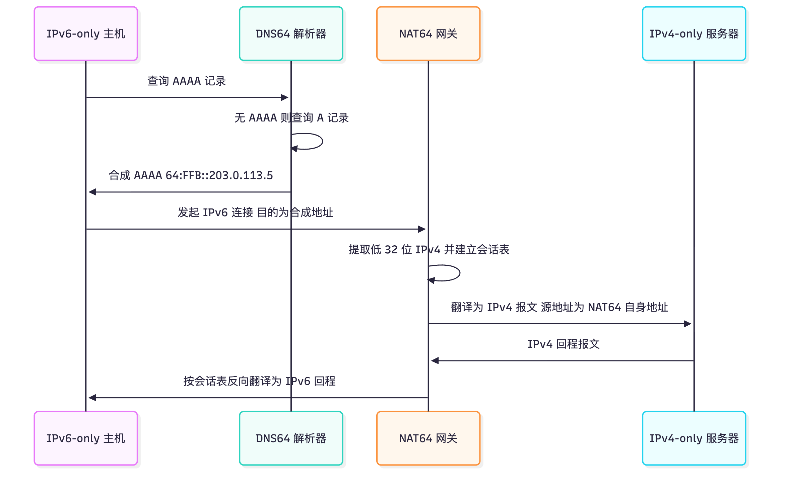


```mermaid
flowchart TD
  A["选择过渡技术"] --> B{"两端是否都能双栈"}
  B -->|"能"| C["双栈 最优"]
  B -->|"不能"| D{"是否需要按需自动建立隧道"}
  D -->|"少量固定点 需组播"| E["GRE 隧道"]
  D -->|"少量固定点 纯单播"| F["手工 IPv6 over IPv4 隧道"]
  D -->|"大规模 自动"| G["ISP 场景 6PE 或 6VPE"]
  D -->|"IPv6-only 访问 IPv4 资源"| H["NAT64 加 DNS64"]
  H --> I{"是否需要无状态与可追溯"}
  I -->|"否"| J["有状态 NAT64"]
  I -->|"是"| K["无状态 NAT64 或 IVI"]
```

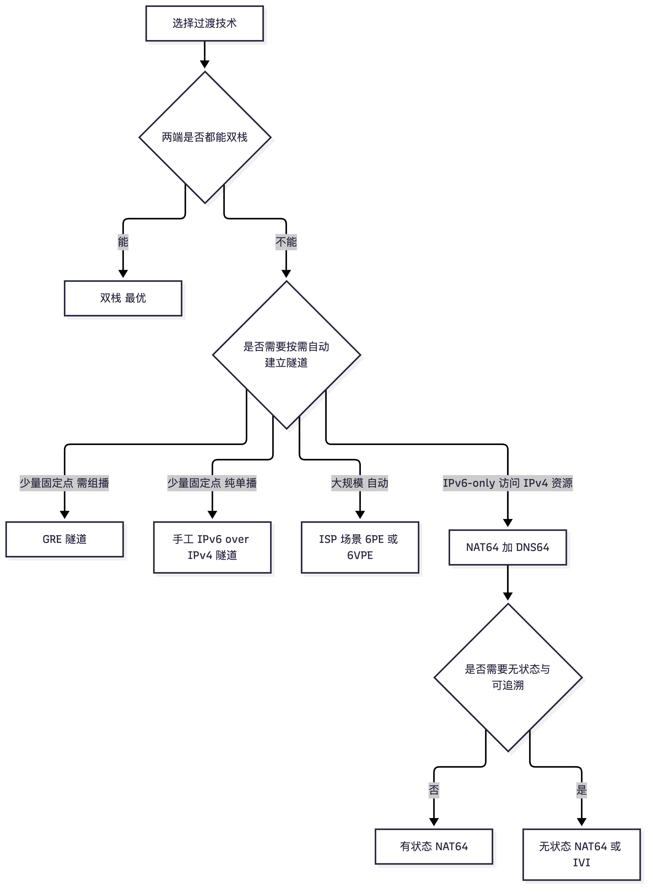


### 真题精练

**Q1.【真题·单选】** 在 NAT64 + DNS64 方案中，DNS64 的核心作用是：
A. 把 A 记录转换为 AAAA 记录返回给 IPv6 主机，使其能访问 IPv4 服务器
B. 把 IPv6 报文翻译为 IPv4 报文
C. 提供 IPv4 与 IPv6 之间的加密隧道
D. 为 IPv6 主机分配 IPv4 地址

> **答案：A**
> **解析**：DNS64 是**递归解析器**，在域名没有 AAAA 记录时，用 A 记录 + NAT64 前缀**合成（Synthesize）** 一条 AAAA 记录返回给主机，使 IPv6-only 主机"以为"目标本身就是 IPv6 地址。B 是 NAT64 网关的职责；C、D 与 DNS64 无关。

**Q2.【真题·多选】** 关于 NAT64 与 IVI 的对比，下列说法正确的有：
A. NAT64 是有状态翻译，需要维护会话表并做地址端口复用
B. IVI 通过把 IPv4 地址段嵌入 IPv6 地址实现无状态翻译
C. IVI 可以像 NAT64 一样通过端口复用大幅节省 IPv4 地址
D. IVI 的缺点是跨运营商地址规划协调困难

> **答案：ABD**
> **解析**：C 错误——IVI 是**一一映射**（或按前缀映射），不做端口复用，因此**不具备 NAPT 那样的地址节省能力**，这恰恰是它有状态方案（NAT64）的对比劣势。A、B、D 正确：NAT64 有状态且需要 DNS64 配合；IVI 无状态、靠地址嵌入实现可计算映射；其最大工程障碍是需要跨运营商统一规划地址。

**Q3.【真题·简答】** 某企业新建数据中心为 IPv6-only，但需要访问互联网上大量 IPv4-only 的 SaaS 服务。请给出过渡方案并说明关键组件与流程。

> **答案与解析**：
> **推荐方案**：**NAT64（有状态）+ DNS64**，部署在企业出口。
> **关键组件**：① **NAT64 网关**（可部署在 NE 路由器/USG 防火墙上），配置 NAT64 前缀（WKP `64:FF9B::/96` 或企业自有的 NSP）；② **DNS64 解析器**（部署在企业 DNS 服务器上，如 BIND 的 `dns64` 模块），负责 AAAA 合成；③ **IPv6-only 主机的 DNS 指向 DNS64**；④ 出口安全策略放通翻译后的流量并开启日志以满足审计。
> **流程**：主机查询 AAAA → DNS64 无 AAAA 则查 A 记录并合成 `64:FF9B::IPv4` 返回 → 主机向合成地址发起 IPv6 连接 → NAT64 提取低 32 位 IPv4、翻译首部、建立会话表并做地址端口翻译后转发给 IPv4 服务器 → 回程按会话表反向翻译。**要点**：单向（IPv6→IPv4）NAT64 即可满足需求；需注意 DNSSEC 域名无法合成、FTP/SIP 等内嵌地址协议需要 ALG、会话表容量与日志留存是容量规划重点。若企业侧主机同时还有 IPv4 需求，可在终端使用 **464XLAT** 或直接保留双栈。

### 易错点与排错

1. **NAT64 前缀写成 64:FF9B:: —— 漏了 /96**：规范前缀是 64:FF9B::/96，前 96 位固定、后 32 位嵌入 IPv4。
2. **以为 NAT64 可以不需要 DNS64**：IPv6-only 主机无法自行获得 IPv4 地址，必须靠 DNS64 合成（或应用层直接配置合成地址）。
3. **把 NAT64 当成无状态**：有状态 NAT64（RFC 6146）要维护会话表；无状态方案是 SIIT/IVI。
4. **DNSSEC 与 DNS64 冲突**：被 DNSSEC 签名的"无 AAAA"响应不能被合成，否则验证失败。
5. **IVI 与 NAT64 的能力混淆**：IVI 无端口复用，不节省 IPv4 地址。
6. **排错命令**：`display nat64 instance`、`display nat64 session table`（看是否有会话建立）、`display nat64 statistics`、在 DNS 侧确认 AAAA 合成是否生效（`dig AAAA`）。

---

## 6.9 IPv6 组播基础与华为设备上的 IPv6 配置/display 命令

### 考点定位

IPv6 组播是"组播 + IPv6"的结合点（3~6 分），常考 **FF00::/8 的地址结构（flags 与 scope）**、**常用组播地址（FF02::1、FF02::2、FF02::5/6、FF02::1:FF00:0/104）**、**MLD 与 IGMP 的对应关系（MLDv1≈IGMPv2、MLDv2≈IGMPv3）**、**IPv6 组播 MAC 的 33-33 映射**。题型多为选择与填空。

### 原理精讲

**IPv6 组播地址结构**：格式为 **FF00::/8**，第二个字节由 **4 位 Flags + 4 位 Scope** 组成：

```
|   8 bit   | 4 bit  | 4 bit  |        112 bit          |
| 1111 1111 | Flags  | Scope  |       Group ID          |
   FF          (0/1)     (1-E)
```

- **Flags（4 位）**：最高位（第 4 位）= 0 表示**永久分配（well-known）**的组播地址，=1 表示**临时（transient）**分配的地址（如 SSM 中动态使用）；其余 3 位目前保留为 0（RFC 4291），其中 P 位（RFC 3306）与 T 位（RFC 3956）用于"基于单播前缀的组播地址"与"内嵌 RP 的组播地址"扩展。
- **Scope（4 位）**：表示组播的**作用范围**：**1 = 接口本地（node-local）**、**2 = 链路本地（link-local）**、**3 = 子网本地**、**4 = 管理本地（admin-local）**、**5 = 站点本地（site-local）**、**8 = 组织本地（organization-local）**、**E = 全球（global）**、0 与 F 保留。
- **Group ID（112 位）**：组标识，永久地址由 IANA 分配。

**必须记住的 IPv6 组播地址**：

| 地址 | 含义 | 类比 IPv4 |
|---|---|---|
| FF01::1 / FF01::2 | 接口本地所有节点 / 所有路由器 | — |
| **FF02::1** | **链路本地所有节点（All-Nodes）** | 224.0.0.1 |
| **FF02::2** | **链路本地所有路由器（All-Routers）** | 224.0.0.2 |
| **FF02::5** | **OSPFv3 AllSPFRouters** | 224.0.0.5 |
| **FF02::6** | **OSPFv3 AllDRouters** | 224.0.0.6 |
| FF02::9 | RIPng | 224.0.0.9 |
| FF02::A | EIGRP for IPv6 | — |
| **FF02::D** | **所有 PIM 路由器** | 224.0.0.13 |
| **FF02::1:FF00:0/104** | **被请求节点组播（Solicited-Node）** | 无对应（IPv4 用 ARP 广播） |
| FF05::1:3 | 所有 DHCPv6 服务器（站点本地） | — |
| FF02::1:2 | 所有 DHCPv6 服务器/中继（链路本地） | — |
| FF3x::/32 中的地址 | SSM 范围（x 为 scope），IPv6 的 SSM 通常使用 **FF3x::/96** 内的地址 | 232.0.0.0/8 |

**被请求节点组播（Solicited-Node Multicast）**：格式 **FF02::1:FF00:0/104**，取目标单播地址的**低 24 位**填入最后 24 位，例如地址 `2001:DB8::1234:5678` 对应的被请求节点组播是 `FF02::1:FF34:5678`。每个单播地址（含链路本地地址）都会让接口加入对应的被请求节点组播组，**NDP 的 NS（地址解析与 DAD）就发往这个地址**，从而避免像 ARP 那样广播惊动全网（见 6.2）。对应的组播 MAC 是 **33-33-FF-34-56-78**。

**IPv6 组播 MAC 映射**：前缀固定 **33-33**，取 IPv6 组播地址的**低 32 位**填入后 4 字节；例如 FF02::1 → 低 32 位 `0000:0001` → **33-33-00-00-00-01**；FF02::1:FF34:5678 → **33-33-FF-34-56-78**。与 IPv4 的 01-00-5E（低 23 位、32:1 重叠）相比，IPv6 取 32 位，重叠范围更大，但通过"被请求节点组播固定前缀 + 基于单播前缀的组播地址规划（RFC 3306/3956 要求低 32 位唯一）"从设计上规避了冲突（详见 5.2 的对比表）。

**MLD（Multicast Listener Discovery，组播侦听者发现）**：IPv6 中替代 IGMP 的成员管理协议，**内嵌在 ICMPv6 中**（不是独立协议号），因此可被 IPsec 保护：

| 对比项 | IGMP（IPv4） | MLD（IPv6） |
|---|---|---|
| MLDv1（RFC 2710） | IGMPv2 | 支持加入/离开，无源过滤 |
| MLDv2（RFC 3810） | IGMPv3 | 支持 INCLUDE/EXCLUDE 源过滤，是 IPv6 SSM 的基础 |
| 查询报文 | IGMP Query（0x11） | ICMPv6 **类型 130**（MLD Query） |
| 报告报文 | IGMPv1/v2 Report（0x12/0x16） | ICMPv6 **类型 131**（MLDv1 Report） |
| 离开报文 | IGMPv2 Leave（0x17） | ICMPv6 **类型 132**（MLD Done） |
| v2 报告 | IGMPv3 Report（0x22） | ICMPv6 **类型 143**（MLDv2 Report） |
| 承载方式 | IP 协议号 2 | ICMPv6（IP 协议号 58） |
| 报文的 Hop Limit | TTL=1 | **Hop Limit = 1** |

**IPv6 组播路由协议**：与 IPv4 完全对应——**PIM-SM/DM 的 IPv6 版本（PIM-SMv6）**、**PIM-SSMv6**（IPv6 SSM 范围通常是 FF3x::/32 或其子集）、**MLD 作为成员管理**、**RPF 检查基于 IPv6 单播路由**、**RP/BSR/Anycast RP/MSDP 机制在 IPv6 中同样存在**（华为用 `pim ipv6` 视图配置 `static-rp`、`c-bsr`、`c-rp`，MSDP 在 IPv6 环境下通常由 **MLD + PIM-SMv6** 配合，跨域场景较少）。PIM 报文在 IPv6 中使用 **FF02::D** 作为目的地址、**Hop Limit = 1**。

### 关键概念对照表

| Scope 值 | 名称 | 覆盖范围 |
|---|---|---|
| 1 | Interface-Local | 同一接口/节点内部 |
| 2 | Link-Local | 同一链路（最常用，FF02::） |
| 3 | Subnet-Local | 同一子网 |
| 4 | Admin-Local | 管理域内（需人为界定） |
| 5 | Site-Local | 站点内 |
| 8 | Organization-Local | 组织内 |
| E | Global | 全球范围 |

| 对比项 | IPv4 组播 | IPv6 组播 |
|---|---|---|
| 地址前缀 | 224.0.0.0/4 | FF00::/8 |
| 作用范围表达 | 靠地址段（224.0.0.0/24 局部、239/8 管理范围） | **靠 Scope 字段显式表达** |
| 组播 MAC | 01-00-5E + 低 23 位 | 33-33 + 低 32 位 |
| 成员管理 | IGMP（v1/v2/v3） | MLD（v1/v2），内嵌 ICMPv6 |
| 报文的 TTL/Hop Limit | TTL=1（协议报文） | Hop Limit=1（协议报文） |
| 地址解析/邻居发现 | ARP 广播 | 被请求节点组播 FF02::1:FFXX:XXXX |
| SSM 范围 | 232.0.0.0/8 | FF3x::/32（常用 FF3x::/96） |

### 华为设备配置

```bash
system-view
ipv6                                                  // 全局使能 IPv6
multicast ipv6 routing-enable                          // 全局使能 IPv6 组播路由（IPv6 组播的总开关，对应 IPv4 的 multicast routing-enable）
interface GigabitEthernet0/0/1                         // 面向接收者的接口
 ipv6 enable
 pim ipv6 sm                                           // 在接口上使能 PIM-SMv6（IPv6 组播路由协议）
 mld enable                                             // 使能 MLD，收集 IPv6 组播成员
 mld version 2                                          // 使用 MLDv2，支持源过滤与 IPv6 SSM
quit
interface GigabitEthernet0/0/2                         // 面向组播源的接口
 ipv6 enable
 pim ipv6 sm
quit
pim ipv6
 static-rp 2001:DB8:A01::1                              // 配置 IPv6 静态 RP（IPv6 环境下 RP 也可用 BSR 动态选举）
quit
acl ipv6 number 2000                                    // 定义 IPv6 SSM 组范围
 rule 5 permit ipv6 source FF3E::/96                    // 把 FF3E::/96 声明为 SSM 范围（可按需调整）
quit
pim ipv6
 ssm-policy 2000                                        // 指定 IPv6 SSM 组范围
quit
display ipv6 interface GigabitEthernet0/0/1            // 查看接口加入的 IPv6 组播组（含被请求节点组播 FF02::1:FFxx:xxxx）
display mld group                                      // 查看 MLD 学到的组播组成员信息
display mld interface                                  // 查看 MLD 版本、查询器状态与定时器
display pim ipv6 neighbor                              // 查看 PIM-SMv6 邻居（确认 IPv6 组播邻居是否建立）
display pim ipv6 routing-table                         // 查看 IPv6 组播路由表（(*,G)/(S,G) 表项）
display ipv6 multicast forwarding-table                 // 查看 IPv6 组播转发表与转发计数
display ipv6 routing-table                              // 确认 IPv6 单播路由（RPF 检查的基础）
```

### 示意图

```mermaid
flowchart TD
  A["IPv6 组播地址 FF00::/8"] --> B["第 2 字节 高 4 位 Flags"]
  A --> C["第 2 字节 低 4 位 Scope"]
  A --> D["112 位 Group ID"]
  B --> E["0 永久分配 1 临时分配"]
  C --> F["1 接口本地 2 链路本地 5 站点本地 E 全球"]
  D --> G["FF02::1 所有节点 FF02::2 所有路由器"]
  D --> H["FF02::5 和 FF02::6 OSPFv3"]
  D --> I["FF02::1:FF00:0/104 被请求节点组播"]
  I --> J["组播 MAC 33-33 加低 32 位"]
```

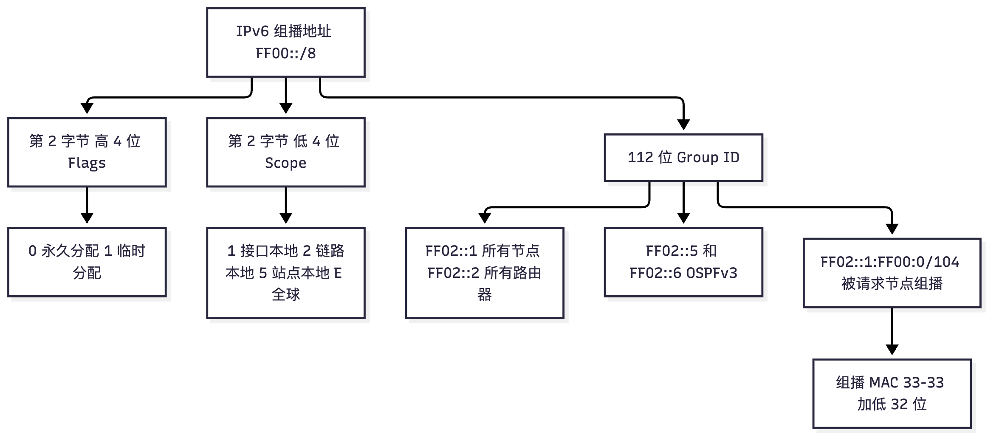


### 真题精练

**Q1.【真题·单选】** IPv6 组播地址 FF02::1 对应的组播 MAC 地址是：
A. 01-00-5E-00-00-01  B. 33-33-00-00-00-01  C. 33-33-FF-00-00-01  D. 01-00-5E-02-00-01

> **答案：B**
> **解析**：IPv6 组播 MAC 前缀是 **33-33**，取 IPv6 组播地址的**低 32 位**填入后 4 字节。FF02::1 的低 32 位是 `0000:0001`，故 MAC 为 `33-33-00-00-00-01`。A 是 IPv4 组播 MAC 的格式（01-00-5E）；C 是把被请求节点组播的特征位当成通用规则（FF02::1:FFxx:xxxx 才会出现 33-33-FF-xx-xx-xx）；D 是 IPv4 的映射形式。

**Q2.【真题·多选】** 关于 MLD 与 IGMP 的对应关系，下列说法正确的有：
A. MLDv1 在功能上对应 IGMPv2，支持主机主动离开
B. MLDv2 在功能上对应 IGMPv3，支持源过滤，是 IPv6 SSM 的基础
C. MLD 报文内嵌在 ICMPv6 中，类型号为 130/131/132/143
D. MLD 与 IGMP 一样使用独立的 IP 协议号 2

> **答案：ABC**
> **解析**：D 错误——**MLD 不是独立协议号**，它内嵌在 **ICMPv6（IP 协议号 58）** 中，这也是它可被 IPsec 保护、能与 NDP 共享机制的原因；IPv4 的 IGMP 才使用独立协议号 2。A、B、C 正确：MLDv1↔IGMPv2（含 Done 报文对应 Leave），MLDv2↔IGMPv3（源过滤），类型号为 130（Query）/131（v1 Report）/132（Done）/143（v2 Report）。

**Q3.【真题·填空】** 单播地址 2001:DB8:1::ABCD:1234 对应的被请求节点组播地址是 ______，对应的组播 MAC 是 ______。

> **答案：FF02::1:FFCD:1234；33-33-FF-CD-12-34**
> **解析**：被请求节点组播地址的格式是 `FF02::1:FF00:0/104` + 目标地址**低 24 位**。该地址低 24 位是 `CD:1234`（注意 `ABCD:1234` 中只有后 24 位 `CD1234` 被使用），故为 `FF02::1:FFCD:1234`；对应组播 MAC 取该组播地址低 32 位 `FFCD:1234`，前缀 33-33，得到 `33-33-FF-CD-12-34`。

### 易错点与排错

1. **FF02::5/6 是 OSPFv3 专用**，FF02::D 才是 PIM；不要混用。
2. **被请求节点组播只取低 24 位**（不是 32 位），这是计算题最常见的失分点。
3. **IPv6 组播 MAC 取低 32 位**（比 IPv4 的 23 位多），前缀是 33-33。
4. **MLD 内嵌 ICMPv6**（协议号 58），Hop Limit = 1。
5. **IPv6 组播同样需要 RPF 检查**，且 (*,G) 检查 RP 的 IPv6 地址、`(S,G)` 检查源的 IPv6 地址。
6. **排错命令**：`display ipv6 interface`（看是否加入组播组）、`display mld group`、`display pim ipv6 neighbor`、`display pim ipv6 routing-table`、`display ipv6 multicast forwarding-table`、`display ipv6 routing-table`（RPF 基础）。

---

## 6.10 章节6 综合真题（限时 25 分钟）

**Q1.【真题·单选】** 下列关于 IPv6 过渡技术的说法，正确的是：
A. 双栈需要全路径设备都支持 IPv6
B. 6to4 隧道可以承载组播流量，适合运行 OSPFv3
C. 6PE 要求核心 P 设备支持 IPv6
D. NAT64 是无状态翻译，不需要维护会话表

> **答案：A**
> **解析**：双栈要求端到端所有设备都支持 IPv6，任何一跳不支持都会中断，A 正确。B 错误——6to4 不支持组播，无法承载依赖组播的路由协议（GRE 隧道才支持）；C 错误——6PE 的核心价值就是让不支持 IPv6 的 IPv4 MPLS 核心承载 IPv6；D 错误——NAT64（RFC 6146）是**有状态**翻译，需要维护会话表。

**Q2.【真题·多选】** 关于 OSPFv3，下列说法正确的有：
A. 报文目的地址为 FF02::5 与 FF02::6
B. 邻居基于链路建立，下一跳使用链路本地地址
C. 认证通过 IPsec 提供，报文头部不再有认证字段
D. Router-LSA 携带 IPv6 前缀，无需额外 LSA

> **答案：ABC**
> **解析**：D 错误——OSPFv3 的 **Router-LSA（1 类）与 Network-LSA（2 类）不再携带前缀**，前缀由 **Link-LSA（8 类）** 与 **Intra-Area-Prefix-LSA（9 类）** 承载。A、B、C 都是 OSPFv3 的标志性特征。

**Q3.【真题·填空】** BGP4+ 中承载 IPv6 可达路由的属性是 ______（类型号 ______），撤销 IPv6 路由的属性是 ______（类型号 ______）；IPv6 单播的 AFI = ______，SAFI = ______。

> **答案：MP_REACH_NLRI；14；MP_UNREACH_NLRI；15；2；1**
> **解析**：多协议扩展属性由 RFC 4760 定义，两个属性的标志均为 Optional + Non-transitive；IPv6 的 AFI=2、单播 SAFI=1（组播 SAFI=2）。

**Q4.【真题·判断】** IPv6 主机执行 DAD 时使用候选地址作为 NS 的源地址，以便对端能够直接回复 NA。

> **答案：错误**
> **解析**：DAD 的 NS **源地址必须是 ::（未指定地址）**，因为此时候选地址尚未通过唯一性检测、不能用于通信；目的地址才是候选地址对应的**被请求节点组播地址**。若用候选地址做源，会造成"地址未验证就使用"的逻辑循环。

**Q5.【真题·简答】** 请对比"GRE 隧道"与"6PE"两种过渡技术的适用场景，并说明各自的关键约束。

> **答案与解析**：
> **GRE 隧道**：把 IPv6 报文封装在 GRE（IP 协议号 47）中穿越 IPv4 网络，属于**点对点手工隧道**。适用场景：**少量固定 IPv6 站点之间穿越 IPv4 骨干**，尤其是需要**在隧道上运行依赖组播/广播的路由协议（OSPFv3、PIM）** 的场景，因为 GRE 支持组播与广播，还能叠加 IPsec 加密与 Keepalive 检测。关键约束：① 每新增一个对端就要新增一套 source/destination 配置（N² 复杂度和配置量）；② 封装开销较大（GRE 头 + 外层 IPv4 头）；③ 中间设备必须放通协议号 47，且 MTU 需要调整（否则大包被分片或丢弃）；④ 不具备 VPN 隔离与流量工程能力。
> **6PE**：PE 路由器双栈，PE 之间通过 **IPv4 承载的 MP-BGP 会话交换 IPv6 路由并分配 MPLS 标签**，核心 P 设备只做标签转发。适用场景：**运营商已建成 IPv4 MPLS 核心，需要向客户提供 IPv6 全球互联**。关键约束：① 核心必须有可用的 IPv4 MPLS LSP（LDP/RSVP-TE），PE 需配置 `label-route-capability`；② 只能提供"公网 IPv6"互联，不能隔离不同客户（要隔离必须用 6VPE + VPN 实例）；③ 不承载组播（IPv6 组播需另用 MVPN 方案）；④ 依赖 BGP 的规划与运维能力。
> **选型结论**：企业内部少量站点互连、需跑动态路由 → **GRE**；运营商级 IPv6 互联网接入、已有 MPLS 核心 → **6PE/6VPE**。

**Q6.【真题·排错】** 某企业完成 IPv6 改造后，办公 PC 能通过 SLAAC 获取地址，但无法访问 IPv6 互联网。请给出完整排查思路。

> **答案与解析**：
> ① **地址与网关**：PC 是否有 GUA（不是只有 LLA）、默认网关是否通过 RA 学到且正确（`ipconfig /all`、`ip -6 route`）；若有多个 RA 来源，确认是否存在非法 RA（见 6.4）。
> ② **网关设备 IPv6 转发与路由**：出口路由器是否执行了全局 `ipv6`、是否有到互联网的 IPv6 默认路由（`display ipv6 routing-table`）、是否从上游正确学到前缀（静态/动态/DHCPv6-PD）。
> ③ **上游与互联**：ISP 是否已分配可用前缀并完成路由过滤（对方是否收到你的前缀通告，`display bgp ipv6 routing-table peer x advertised-routes`）；边界接口是否 `ipv6 enable`。
> ④ **地址选择与 NAT/防火墙**：同时配置 ULA 与 GUA 时，主机可能选择 ULA 作为源导致出网失败（RFC 6724 地址选择问题）——需检查策略与主机地址选择结果；若使用 NAT64/翻译方案，检查会话表与 DNS64 是否生效。
> ⑤ **转发面与 ACL**：ACL/QoS/URPF 是否误拦 IPv6 报文、MTU 是否一致（IPv6 不允许中间设备分片，PMTU 黑洞会导致"能 ping 通小包、打不开网页"）。
> ⑥ **验证命令**：`display ipv6 interface brief`、`display ipv6 routing-table`、`display ipv6 neighbors`、`display bgp ipv6 peer/routing-table`、`ping ipv6 <目标>`、`tracert ipv6 <目标>`。

**Q7.【真题·实验】** 请写出在华为交换机上部署 ND Snooping 防止伪造 RA 的关键配置，并说明验证方法。

> **答案与解析**：
> **关键配置**（接入交换机 S5731）：
> ```bash
> system-view
> nd snooping enable                 // 全局使能 ND Snooping，建立 地址-MAC-接口-VLAN 绑定表
> vlan 10
>  nd snooping enable                // VLAN 内使能（必须与全局同时使能才生效）
> quit
> interface GigabitEthernet0/0/1     // 上联网关/路由器端口
>  nd snooping trusted               // 标记为信任端口，允许其发送 RA/NA
> quit
> interface GigabitEthernet0/0/2     // 连接用户主机端口
>  undo nd snooping trusted          // 保持非信任：收到 RA 直接丢弃，阻断伪造网关
>  nd snooping user-bind max-user 8  // 限制绑定表规模，防表项耗尽
> quit
> ```
> **验证方法**：① `display nd snooping user-bind all` 查看绑定表是否正常学习到合法主机条目；② `display nd snooping statistics` 确认非信任端口有 RA 丢弃计数（说明防护生效）；③ 在 PC 上确认默认网关唯一且指向真实网关（`ipconfig /all`、`ip -6 route`）；④ 可用测试工具在接入端口发送伪造 RA，观察交换机统计与主机行为是否不受影响；⑤ 配合 `display cpu-defend statistics` 确认 ICMPv6/ND 上送 CPU 未异常激增。

**Q8.【真题·简答】** 请设计一套"园区 IPv6 + 组播 IPTV + QoS 保障"的地址与技术方案要点（各写 3 条）。

> **答案与解析**：
> **IPv6 地址方案**：① 向 ISP 申请 /48，按"区域（第 4 段）+ VLAN（第 5 段）"结构化编码，每个 VLAN 一个 /64；② 网络设备与服务器用固定地址（Loopback /128 + 服务器静态 /64），终端用 SLAAC（网关 `undo ipv6 nd ra halt` + 缩短 RA 间隔），需要审计的终端改用 DHCPv6（RA 置 M 位）；③ 内网并行部署 ULA（FD00::/8）用于协议对等体与内部管理，出口只通告 GUA，注意 RFC 6724 源地址选择。
> **组播 IPTV 方案**：① 采用 **SSM**（组地址规划在 SSM 范围内或自定义 `ssm-policy`）+ **IGMPv3/MLDv2**，取消 RP 依赖，源可控；② 接入层使能 **IGMP Snooping（含 Proxy）**，按需复制，机顶盒端口为成员端口、上联口为静态路由器端口，未加入用户零流量；③ 二层规避 32:1 MAC 重叠：地址规划使被丢弃的 5 位一致且后 23 位互不相同，并开启组播 MAC/IP 一致性检查（若支持）；核心与汇聚运行 PIM-SM/PIM-SSM 并规划好 RPF 唯一路径（避免 ECMP）。
> **QoS 保障方案**：① 报文分类与标记：语音 EF（DSCP 46/CoS 5）、视频会议 AF41（34）、IPTV AF31（26/CS3）、关键数据 AF21（18）、普通数据 BE（0），在接入层完成标记并信任边界；② 拥塞管理：出口采用 PQ/LLQ 保障语音与视频（`queue ef bandwidth`）＋ WFQ/`queue wfq weight` 保障数据，配合 WRED 在拥塞时优先丢弃低优先级流量；③ 流量监管与整形：用户接入侧做入方向 CAR 限速（policing 丢弃），出口向上联方向做整形（shaping 缓存），并按 CIR/PIR 双令牌桶实现三色标记，为 IPTV 预留带宽。

---

# 数通-HCIE-章节7-QoS服务质量

## 7.1 QoS 的必要性与四大指标（带宽、时延、抖动、丢包）

### 考点定位

QoS 的开篇知识点常以**选择/填空**出现（2~5 分），考法集中在：**四指标的准确定义（尤其是时延抖动与端到端时延的组成）**、**不同业务对四项指标的量化要求**、**"为什么 TCP 丢包会放大影响、而语音对丢包相对容忍"** 这类原理判断题。数值类题目（语音时延 ≤150ms、抖沙 ≤30ms、丢包 ≤1%）几乎必考，必须记牢。

### 原理精讲

**为什么需要 QoS？** 传统互联网是"尽力而为（Best Effort）"的：所有报文排队同一个先入先出队列，网络拥塞时无差别丢弃。但**不同业务对网络的要求差异极大**：语音是"少量带宽 + 极低时延 + 极低抖动 + 少量丢包可容忍（编码器有丢包隐藏）"；视频是"较大带宽 + 低时延 + 低抖动"；而普通文件传输是"大带宽 + 对时延不敏感 + 对丢包极其敏感（丢包触发重传与拥塞窗口减半，吞吐量骤降）"。**如果不做区分，一次大批量下载就能把语音电话的质量彻底摧毁**。QoS 的目标就是：**在有限的带宽资源下，对不同业务按重要性差异化地提供转发服务**。它不创造带宽，而是"在拥塞时决定谁先走、谁被丢"。

**四大指标（必须能精确定义）**：

1. **带宽（Bandwidth）**：链路的传输能力（bit/s），以及某业务流需要的速率。工程上关注三个口径：**平均速率、峰值速率、突发（burst）能力**。QoS 中的带宽类技术包括流量监管（限制速率）、流量整形（平滑突发）、队列调度（按权重分配带宽）。**关键认识**：QoS 技术在**无拥塞时不产生任何影响**——只有队列出现积压（接口速率 > 出口速率）时，调度与丢弃策略才有意义。
2. **时延（Latency / Delay）**：报文从源到目的的端到端时间，由四部分组成：**处理时延（设备查表/转发）+ 排队时延（最不稳定、QoS 主要影响它）+ 传输时延（串行化，报文长度/链路速率）+ 传播时延（物理距离/光速，不可优化）**。其中**排队时延**是唯一可被 QoS 显著优化的部分；传播时延由距离决定，无法通过技术手段缩短（这也是"为什么跨洲语音有时延下限"的原因）。
3. **抖动（Jitter）**：**时延的变化量**（相邻报文时延的差值），也叫时延抖动。语音/视频需要"稳定节奏"地播放，抖动大会导致缓冲区溢出或欠载——出现断续、卡顿。工程上通过**接收侧去抖动缓冲区（De-jitter Buffer）+ QoS 优先队列**共同缓解。**注意**：抖动不是"时延大"，而是"时延不稳定"。
4. **丢包率（Packet Loss Rate）**：丢失报文数 / 发送报文数。丢包因素有三：**链路误码（物理质量）+ 拥塞丢包（队列溢出，QoS 可管理）+ 设备故障/路由收敛（瞬时黑洞）**。不同协议对丢包的容忍度完全不同：**TCP 丢包会被重传并触发拥塞控制，吞吐量剧烈下降**；**UDP 语音流丢包表现为声音断续，编码器可做丢包隐藏（PLC）**，因此**少量丢包（≤1%）语音尚可接受，但 TCP 业务对丢包极为敏感**。

**业务要求对照表（国赛必背）**：语音的 ITU-T G.114 建议**单向时延 ≤150ms**（理想值；≤400ms 为可用上限），抖动 **≤30ms**，丢包 **≤1%**，带宽以 G.711 为例：载荷 64 kbps，加上 IP/UDP/RTP 头部（20+8+12=40 字节，G.711 每 20ms 一个包，即 160 字节载荷）后实际占用约 **80~87 kbps/路**（含以太网开销时约 87 kbps）；G.729 压缩后约 8 kbps 载荷、实际约 24~32 kbps/路。

### 关键概念对照表

| 业务类型 | 带宽需求（每路/每流） | 单向时延 | 抖动 | 丢包率 | 推荐 DSCP / CoS |
|---|---|---|---|---|---|
| IP 语音（VoIP，G.711） | 约 80~87 kbps（含开销） | **≤150 ms**（G.114 理想） | **≤30 ms** | **≤1%** | EF（46）/ CoS 5 |
| IP 语音（G.729 压缩） | 约 24~32 kbps | ≤150 ms | ≤30 ms | ≤1% | EF（46）/ CoS 5 |
| 交互式视频会议 | 384 kbps ~ 2 Mbps | ≤150 ms（交互式） | ≤30 ms | ≤1% | AF41（34）/ CoS 4 |
| 流媒体 / IPTV | 2 ~ 8 Mbps | ≤4 s（可缓冲） | ≤50 ms | ≤1% | AF31（26）/ CoS 3 |
| 呼叫信令（SIP/H.323） | 低（突发） | ≤500 ms | 不敏感 | ≤1% | CS3（24）/ CoS 3 |
| 关键事务数据（ERP/支付） | 低~中 | ≤1 s | 不敏感 | ≤0.1% | AF21（18）/ CoS 2 |
| 普通数据 / 大文件传输 | 尽力而为 | 不敏感 | 不敏感 | 允许重传（但对吞吐影响大） | BE（0）/ CoS 0 |
| 网络控制（路由协议） | 低 | 越低越好 | 不敏感 | 极低 | CS6（48）/ CoS 6 |

| 时延组成 | 影响因素 | QoS 能否优化 |
|---|---|---|
| 处理时延 | 设备转发能力、查表复杂度 | 有限（硬件能力相关） |
| **排队时延** | 队列调度策略、拥塞程度 | **能（QoS 的主要作用点）** |
| 传输时延（串行化） | 报文长度 / 接口速率 | 能（加大带宽或减小报文） |
| 传播时延 | 物理距离、介质 | 不能（物理极限） |

| 指标 | 定义 | 影响因素 | 优化手段 |
|---|---|---|---|
| 带宽 | 单位时间可传输的数据量 | 链路速率、流量竞争 | 限速、整形、加权调度、扩容 |
| 时延 | 端到端传输时间 | 处理/排队/传输/传播 | 优先队列、缩短队列、就近部署 |
| 抖动 | 时延的变化量 | 排队时延波动 | 优先队列、整形（平滑输出）、去抖缓冲 |
| 丢包率 | 丢失报文比例 | 误码、拥塞、故障 | WRED 分级丢弃、增大缓冲（有代价）、链路保护 |

### 华为设备配置

```bash
system-view
// QoS 的落地需要"分类—标记—调度—丢弃—限速"全链路配合，先看接口上的队列与统计是否可见
interface GigabitEthernet0/0/1
 qos phb marking enable                            // 使能 PHB（Per-Hop Behavior）标记能力，为后续重标记与队列映射做准备
 display this                                      // （在接口视图下查看当前 QoS 相关配置，确认没有遗留限速）
quit
display qos queue statistics interface GigabitEthernet0/0/1   // 查看各队列的收发统计与丢弃计数，判断是否发生拥塞
display qos queue length interface GigabitEthernet0/0/1       // 查看各队列的缓存使用与上限（拥塞程度）
display interface GigabitEthernet0/0/1                        // 查看接口带宽利用率、丢包计数（拥塞的第一手证据）
display qos map-table dscp-dscp                                // 查看 DSCP 到 DSCP 的映射表（PHB 映射一致性检查）
```

### 示意图

```mermaid
flowchart LR
  A["语音流 少量带宽 低时延低抖动"] --> Q["出口队列"]
  B["视频流 较大带宽 低时延"] --> Q
  C["数据流 大带宽 对时延不敏感"] --> Q
  Q -->|"拥塞时按策略调度与丢弃"| L["WAN 链路 带宽受限"]
  L --> D["远端接收"]
  E["无拥塞时 QoS 不产生作用"] -.-> Q
```

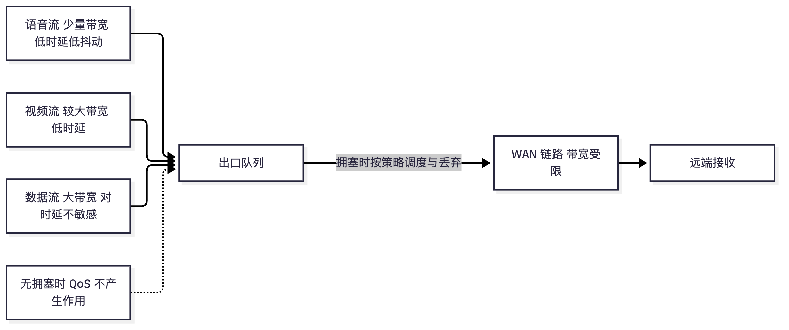


### 真题精练

**Q1.【真题·单选】** 下列关于时延抖动的说法，正确的是：
A. 抖动就是端到端时延过大
B. 抖动是相邻报文时延的变化量，主要由排队时延的波动造成
C. 抖动由传播时延决定，QoS 无法改善
D. 抖动只影响数据业务，不影响语音质量

> **答案：B**
> **解析**：抖动（Jitter）是**时延的变化量**，其根源是**排队时延的不稳定**（拥塞时队列长度波动）。A 混淆了"时延大"与"时延不稳定"；C 错误——传播时延影响的是"时延绝对值"，抖动主要由排队造成，可通过优先队列与流量整形显著改善；D 错误——语音对抖动非常敏感（要求 ≤30ms），抖动过大会造成断续与卡顿。

**Q2.【真题·多选】** 关于不同业务对丢包的敏感度，下列说法正确的有：
A. TCP 业务对丢包非常敏感，丢包会触发重传与拥塞控制，导致吞吐量骤降
B. 语音（UDP/RTP）对丢包相对容忍，编码器可做丢包隐藏
C. 语音业务通常要求丢包率不超过 1%
D. 视频会议对丢包的容忍度高于大文件传输

> **答案：ABC**
> **解析**：D 错误——大文件传输（TCP）虽然"业务层"可以通过重传恢复数据正确性，但**吞吐量会因丢包大幅下降**；而视频会议（UDP/RTP，实时）不能重传，丢包直接表现为花屏/卡顿且要求 ≤1%，对丢包更敏感。因此正确的关系是"TCP 对丢包敏感于吞吐，实时音视频对丢包敏感于质量"。A（TCP 重传与拥塞窗口减半）、B（PLC 丢包隐藏）、C（语音 ≤1%）均正确。

### 易错点与排错

1. **把抖动说成"时延大"**：抖动是变化量，两者是不同指标。
2. **QoS 只在拥塞时生效**：无拥塞时队列不排队，任何调度策略都"看不出效果"，这也是实验室验证 QoS 必须**制造拥塞**（如用打流工具占满带宽）的原因。
3. **语音带宽估算漏掉开销**：G.711 载荷 64 kbps，但加上 RTP/UDP/IP/以太网头后约 80~87 kbps，规划时必须按"实际占用"算。
4. **排队时延与传播时延混淆**：只有排队时延能被 QoS 优化。
5. **排错命令**：`display interface`（利用率与丢包）、`display qos queue statistics`（各队列丢弃计数）、`display qos queue length`（队列深度）。

---

## 7.2 三种服务模型：Best Effort、IntServ/RSVP 与 DiffServ

### 考点定位

服务模型是 QoS 的"理论骨架"，国赛常出 **1 道多选 + 1 道简答**（3~6 分）。必考：**IntServ 的致命弱点（可扩展性）**、**DiffServ 的 PHB 与 DSCP 的关系**、**RSVP 的 Path/Resv 与软状态**、**为什么互联网最终选择 DiffServ**。这是把 7.1 与 7.3 串起来的中间环节。

### 原理精讲

**① Best Effort（尽力而为）模型**：不做任何区分与保证，所有报文 FIFO 排队、拥塞时无差别丢弃。优点：实现简单、可扩展性最好、无需信令与状态；缺点：**无法提供任何可承诺的质量**。它至今仍是互联网的"默认服务等级"，也是所有 QoS 方案的"兜底"。

**② IntServ（Integrated Services，综合服务）模型**：核心思想是"**为每一条流预留资源**"。流程：
1. 发送方通过 **RSVP（Resource Reservation Protocol，资源预留协议，IP 协议号 46）** 发送 **PATH 消息**，沿单播路由逐跳建立"路径状态"，为接收方提供预留所需的参数（如 TSpec）；
2. 接收方收到 PATH 后，回 **Resv（Reservation）消息**，沿途每台路由器**为该流预留带宽与缓冲区**（准入控制：资源不足则预留失败）；
3. 预留成功后，该流获得**量化保证**（如保证带宽、有界时延）；RSVP 使用**软状态（soft state）**：预留需要周期性刷新（缺省 **30 秒**），超时未刷新则自动释放。
**致命弱点**：每台核心路由器要为**每一条流**维护状态并做准入控制，在承载百万级流的骨干网上状态量与处理开销不可承受——**可扩展性差**，因此 IntServ 从未在互联网核心规模部署（主要用于小规模专网或作为 MPLS TE 的带宽预留工具）。

**③ DiffServ（Differentiated Services，区分服务）模型**：核心思想是"**分类聚合、逐跳行为（PHB）、无需信令**"。做法：
1. **边界分类与标记**：在信任边界（接入设备或客户边缘）把流量按业务分类，并在 IP 头的 **DS 字段（原 ToS 字节，共 8 位，其中 6 位为 DSCP，2 位保留/ECN）** 打上 **DSCP** 值；
2. **核心只做 PHB**：核心设备只根据 DSCP 执行"**每跳行为（Per-Hop Behavior）**"，不再感知具体业务与流，也不需要为每条流保存状态或信令——**状态从"每流"降为"每类（最多 64 种 DSCP）"**，因此可扩展性极好；
3. **PHB 三类**：**EF（Expedited Forwarding，加速转发，RFC 3246，DSCP 46）** 提供低时延、低抖动、低丢包的"虚拟专线"式服务（用于语音）；**AF（Assured Forwarding，确保转发，RFC 2597）** 分 4 个等级 × 3 个丢弃优先级（共 12 个 DSCP），提供"保证带宽 + 分级丢弃"；**CS（Class Selector，类选择器，RFC 2474）** 与 IP Precedence 向后兼容（DSCP 后 3 位为 0）；**BE（Default，DSCP 0）** 为缺省尽力而为。
4. **信任边界与重标记**：来自用户终端的 DSCP 不可盲信（用户可自行改标记），因此边界设备要做**信任（trust）与重标记（remark）**——或者完全不信任用户标记、按端口/ACL 重新标记。
5. **DiffServ 的不足**：没有端到端的信令保证，只是在"逐跳"层面做相对优先；跨域时需要 **SLA（Service Level Agreement，服务等级协议）** 与域间 PHB 映射（DSCP 重标记）来衔接。

**三模型对比与"为什么选 DiffServ"**：IntServ 保证强但不可扩展，Best Effort 可扩展但无保证，DiffServ **在保证能力与可扩展性之间取得了工程最优解**——把复杂性放在边界（分类、标记、策略），把核心做简单（只看 DSCP 做 PHB）。因此现代企业网与运营商网都基于 DiffServ 构建 QoS 体系（MPLS 网络中则用 EXP/TC 位做 PHB 承载，见 7.8）。

### 关键概念对照表

| 对比项 | Best Effort | IntServ（RSVP） | DiffServ |
|---|---|---|---|
| 是否区分业务 | 否 | 是（每条流） | 是（每类聚合流） |
| 是否需要信令 | 不需要 | **需要 RSVP（Path/Resv）** | 不需要（靠标记） |
| 状态粒度 | 无状态 | **每流状态（可扩展性差）** | **每类状态（最多 64 个 DSCP）** |
| 资源预留 | 无 | 有（准入控制） | 无（靠工程规划 + 拥塞管理） |
| 服务质量保证 | 无 | 强（量化保证） | 相对（PHB 分类保障） |
| 可扩展性 | 最好 | 差 | 好 |
| 典型部署 | 互联网默认 | 小规模专网、MPLS TE | 企业网与运营商骨干（主流） |
| 关键协议/字段 | — | RSVP（协议号 46） | **DSCP（6 位）+ PHB（EF/AF/CS/BE）** |

| PHB 类型 | DSCP 取值 | 服务特性 | 典型业务 |
|---|---|---|---|
| EF（加速转发） | 46 | 低时延、低抖动、低丢包，速率受监管限制 | 语音 |
| AF（确保转发） | AF11~AF43（12 个） | 4 个等级 × 3 个丢弃优先级，保证带宽并可分级丢弃 | 视频、关键数据 |
| CS（类选择器） | CS1~CS7（8/16/24/32/40/48/56） | 与 IP Precedence 兼容 | 信令、路由、网络管理 |
| BE（缺省/尽力而为） | 0 | 无保证 | 普通数据 |

### 华为设备配置

```bash
system-view
// DiffServ 落地：定义分类器 → 流行为（含 DSCP 重标记）→ 流策略 → 应用到接口
traffic classifier trust-voice operator and                  // 定义"语音"分类器
 if-match dscp ef                                             // 匹配 DSCP = EF 的报文（来自可信的语音网关）
quit
traffic behavior mark-voice                                  // 定义语音流行为
 remark dscp ef                                               // 重标记为 EF（保证 PHB 一致）
 quit
traffic classifier untrust-data operator and                 // 定义"不可信数据"分类器
 if-match any                                                 // 匹配所有其他流量
quit
traffic behavior mark-be                                     // 对不可信流量一律降级为 BE
 remark dscp default                                          // 重标记为 DSCP 0（缺省/尽力而为）
quit
traffic policy edge-mark                                     // 组合为流策略
 classifier trust-voice behavior mark-voice
 classifier untrust-data behavior mark-be
quit
interface GigabitEthernet0/0/1                                // 信任边界接口（下行接入）
 traffic-policy edge-mark inbound                              // 入方向应用：在边界完成分类与重标记
quit
display traffic policy user-defined edge-mark                 // 查看流策略中分类器与流行为的绑定关系
display traffic classifier user-defined                       // 查看分类器匹配规则（确认 if-match 条件）
display traffic behavior user-defined                         // 查看流行为动作（remark/queue/car 等）
display qos map-table dscp-dscp                               // 查看 DSCP 映射表（跨域 PHB 映射一致性）
```

### 示意图

```mermaid
flowchart LR
  subgraph BE["Best Effort"]
    A1["所有流量 FIFO"] --> A2["拥塞时无差别丢弃"]
  end
  subgraph IS["IntServ 综合服务"]
    B1["RSVP Path 逐跳建立路径状态"] --> B2["Resv 预留资源 准入控制"]
    B2 --> B3["每流状态 可扩展性差"]
  end
  subgraph DS["DiffServ 区分服务"]
    C1["边界分类与 DSCP 标记"] --> C2["核心只按 DSCP 执行 PHB"]
    C2 --> C3["每类状态 可扩展性好"]
  end
```

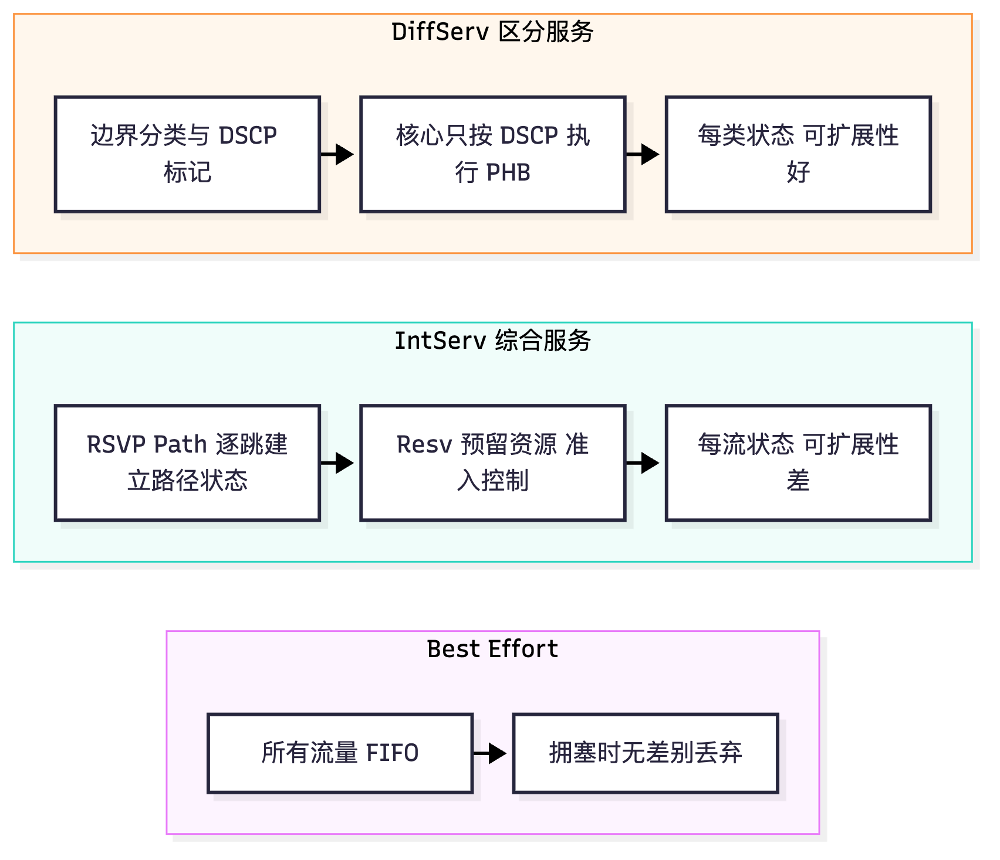


### 真题精练

**Q1.【真题·单选】** IntServ 模型难以在大规模骨干网部署的根本原因是：
A. 不支持语音业务
B. 每台路由器需要为每条流维护状态并做准入控制，可扩展性差
C. 必须使用 IPv6 才能工作
D. 无法与 MPLS 配合

> **答案：B**
> **解析**：IntServ 通过 RSVP 为**每一条流**预留资源，核心路由器必须维护海量的每流状态（软状态还需周期刷新），状态量与处理开销随流数量线性甚至更快增长，**在大规模骨干网不可承受**——这就是它让位于 DiffServ 的根本原因。A、C、D 都不是 IntServ 的问题（它支持各类业务、与 IP 版本无关、也可与 MPLS TE 结合做带宽预留）。

**Q2.【真题·多选】** 关于 DiffServ 模型，下列说法正确的有：
A. 通过 IP 头中的 DSCP（6 位）标识报文的转发类别
B. 核心设备只需要根据 DSCP 执行 PHB，不需要为每条流维护状态
C. 必须在端到端每一台设备上运行 RSVP 才能生效
D. PHB 包括 EF、AF、CS 与 BE 等类型

> **答案：ABD**
> **解析**：C 错误——DiffServ **不需要任何信令**，它靠边界标记 + 核心按 DSCP 执行 PHB 来实现，这也是它可扩展性好的原因（RSVP 属于 IntServ 的机制）。A、B、D 正确：DSCP 位于原 ToS 字节的高 6 位；核心只做逐跳行为；PHB 的典型类型是 EF（46，低时延低抖动）、AF（12 个值，分级丢弃）、CS（与 IP Precedence 兼容）与 BE（0）。

### 易错点与排错

1. **IntServ 与 DiffServ 的机制互换**：IntServ = 信令 + 每流预留；DiffServ = 标记 + PHB。
2. **RSVP 的软状态刷新周期是 30 秒**（缺省），超时自动释放预留。
3. **DSCP 是 6 位，不是 8 位**：DS 字段 8 位中含 DSCP 6 位 + 2 位（ECN/保留）。
4. **DiffServ 只提供相对保证**：它不能像 IntServ 那样承诺"绝对带宽"，跨域还需 SLA 与 PHB 映射。
5. **信任边界不做重标记的风险**：用户可自行把普通流量标记为 EF 抢占语音带宽，因此边界必须做信任判断或强制重标记。
6. **排错命令**：`display traffic policy user-defined`、`display traffic classifier user-defined`、`display traffic behavior user-defined`、`display qos map-table dscp-dscp`。

---

## 7.3 报文分类与标记：IP Precedence / DSCP / 802.1p CoS / MPLS EXP

### 考点定位

**DSCP 完整取值表是国赛的高频填空/选择题来源**（几乎每年都考），必须能默写 **CS0~CS7、AF11~AF43、EF** 的二进制与十进制值，并理解 **DSCP 与 IP Precedence、CoS、MPLS EXP 的对应关系**。此外**简单流分类 vs 复杂流分类**的对比、**复杂流分类的匹配顺序**也是常考点。分值 5~10 分。

### 原理精讲

**报文分类（Classification）** 是 QoS 的第一步：把报文按"业务身份"归入不同类别，后续才能施加不同的标记、调度、丢弃与限速策略。分类分两级：

- **简单流分类（Simple Traffic Classification）**：只看报文头中**已有的优先级字段**（DSCP、IP Precedence、802.1p CoS、MPLS EXP、IPv6 Traffic Class），**速度快、开销小、通常在核心与汇聚设备上使用**。它的前提是"上游已经打好了标记"。
- **复杂流分类（Complex Traffic Classification）**：基于 **ACL** 匹配报文的**五元组/多层字段**（源/目的 MAC、VLAN、源/目的 IP、协议号、源/目的端口、TCP 标志、报文长度、甚至时间段），**粒度细、灵活，但消耗 ACL 资源、处理开销大，通常部署在边界设备**（把不可信的用户流量按其真实业务重新分类与标记）。**匹配顺序**：华为流分类器内多条 `if-match` 按配置顺序匹配，`operator and` 要求所有条件同时满足，`operator or` 满足任一即可；**流策略中多个 classifier 按配置序号匹配，命中第一个即执行对应 behavior 并停止后续匹配（先匹配先生效）**。这是配置题的关键：**顺序写错会导致策略不生效**。

**四种优先级字段（必须能对照）**：

| 字段 | 位置 | 位宽 | 取值范围 | 典型映射关系 |
|---|---|---|---|---|
| **IP Precedence（IP 优先级）** | IPv4 ToS 字段高 3 位（RFC 791/1349） | **3 bit** | 0~7 | 与 DSCP 的高 3 位相同；常映射到 CoS |
| **DSCP** | IPv4 ToS / IPv6 Traffic Class 的高 6 位（RFC 2474） | **6 bit** | 0~63 | 前 3 位 = IP Precedence（CS 类） |
| **802.1p CoS（PCP）** | 802.1Q 标签的 3 位优先级字段 | **3 bit** | 0~7 | 二层优先级，典型映射：语音 5、视频 4、信令 3、数据 0~2、网络控制 6~7 |
| **MPLS EXP（现称 TC，Traffic Class）** | MPLS 标签的 3 位（RFC 5462 改名） | **3 bit** | 0~7 | 在 MPLS 域内承载 DSCP 的"等效优先级"，三种隧道模式下行为不同（见 7.8） |

**DSCP 完整取值表（必须能默写）**：

| DSCP 名称 | 二进制 | 十进制 | 对应 IP Precedence | 典型用途 |
|---|---|---|---|---|
| **CS0 / Default（BE）** | 000000 | **0** | 0 | 普通数据、尽力而为 |
| **CS1** | 001000 | **8** | 1 | 低优先级/无保证数据（Scavenger） |
| **AF11** | 001010 | **10** | 1 | 关键数据（丢弃优先级低） |
| **AF12** | 001100 | **12** | 1 | 关键数据（丢弃优先级中） |
| **AF13** | 001110 | **14** | 1 | 关键数据（丢弃优先级高） |
| **CS2** | 010000 | **16** | 2 | 网络管理/网管流量 |
| **AF21** | 010010 | **18** | 2 | 事务数据/信令（低丢弃） |
| **AF22** | 010100 | **20** | 2 | 事务数据（中丢弃） |
| **AF23** | 010110 | **22** | 2 | 事务数据（高丢弃） |
| **CS3** | 011000 | **24** | 3 | 呼叫信令（SIP/H.323） |
| **AF31** | 011010 | **26** | 3 | 流媒体/IPTV（低丢弃） |
| **AF32** | 011100 | **28** | 3 | 流媒体（中丢弃） |
| **AF33** | 011110 | **30** | 3 | 流媒体（高丢弃） |
| **CS4** | 100000 | **32** | 4 | 实时交互（传统保证转发） |
| **AF41** | 100010 | **34** | 4 | 交互式视频（低丢弃） |
| **AF42** | 100100 | **36** | 4 | 交互式视频（中丢弃） |
| **AF43** | 100110 | **38** | 4 | 交互式视频（高丢弃） |
| **CS5** | 101000 | **40** | 5 | 语音承载（传统） |
| **EF** | 101110 | **46** | 5 | **语音/实时业务（RFC 3246）** |
| **CS6** | 110000 | **48** | 6 | 路由协议/网络控制 |
| **CS7** | 111000 | **56** | 7 | 网络控制（保留） |

**记忆规律（考场上救命的三个口诀）**：
1. **CS 类**：DSCP 后 3 位恒为 0，前 3 位就是 IP Precedence，十进制 = **Precedence × 8**（CS1=8、CS2=16 … CS7=56）。
2. **AF 类**：命名 **AFxy**，x = 等级（1~4），y = 丢弃优先级（1~3）；二进制结构为 `001/ddd/yy0`，即 **前 3 位 = x**、**中间 3 位 = 丢弃优先级**（001/010/011 = 1/2/3）、**末位固定 0**。因此十进制 = x×8 + y×2 + … 用二进制直接算最快：AF11=001010=10、AF21=010010=18、AF31=011010=26、AF41=100010=34（**AFx1 的十进制 = x×8 + 2**，即 10/18/26/34）；AFx2 = x×8 + 4（12/20/28/36）；AFx3 = x×8 + 6（14/22/30/38）。
3. **EF**：101110 = **46**；**CS5** = 101000 = 40；**注意 EF（46）比 CS5（40）高，但低于 CS6（48）**——这是常见陷阱。

**802.1p CoS 与 DSCP 的典型映射建议**：

| 业务 | 802.1p CoS | DSCP | IP Precedence |
|---|---|---|---|
| 网络控制（协议报文） | 6 或 7 | CS6（48）/ CS7（56） | 6 / 7 |
| 语音（VoIP） | 5 | EF（46） | 5 |
| 视频（交互式） | 4 | AF41（34） | 4 |
| 流媒体/广播视频 | 3 | AF31（26）/ CS3（24） | 3 |
| 关键数据 | 2 | AF21（18） | 2 |
| 普通数据 | 0~1 | BE（0）/ AF11（10） | 0~1 |

**标记（Marking/Remarking）的两个工程要求**：① **一致性**——同一业务在整个域内应使用同一 DSCP（跨域时在边界做映射）；② **信任边界**——在用户接入侧必须"不信任用户标记"或"按端口信任"，防止用户伪造 EF 抢占带宽。

### 关键概念对照表

| 对比项 | 简单流分类 | 复杂流分类 |
|---|---|---|
| 匹配依据 | 报文头已有的优先级字段（DSCP/Precedence/CoS/EXP） | ACL 匹配多层字段（MAC/IP/端口/协议/长度等） |
| 处理开销 | 小（高速） | 大（消耗 ACL 资源） |
| 部署位置 | 核心、汇聚 | 边界、接入 |
| 配置方式 | 优先级映射表（`qos map-table`）、信任 DSCP/CoS | `traffic classifier` + `if-match acl` |
| 前提 | 上游已完成标记 | 自行识别业务 |
| 典型用途 | 按 PHB 转发 | 识别业务并首次标记 |

| 映射方向 | 典型场景 | 华为配置 |
|---|---|---|
| DSCP → 队列/PHB | 核心按 DSCP 调度 | `qos map-table dscp-dscp`、队列调度 |
| CoS → DSCP | 二层接入进入三层域 | `qos map-table dot1p-dscp` |
| DSCP → CoS | 三层出二层 | `qos map-table dscp-dot1p` |
| DSCP → EXP | 进入 MPLS 域 | MPLS DiffServ 隧道模式（Uniform/Pipe） |
| EXP → DSCP | 离开 MPLS 域 | 同上 |

### 华为设备配置

```bash
system-view
// 1) 优先级映射表：把二层 CoS 映射为 DSCP，保证跨层优先级一致
qos map-table dot1p-dscp                                     // 进入 802.1p 到 DSCP 的映射表视图
 input 5 output 46                                            // CoS 5（语音）映射为 DSCP 46（EF）
 input 4 output 34                                            // CoS 4（视频）映射为 DSCP 34（AF41）
 input 3 output 26                                            // CoS 3（流媒体/信令）映射为 DSCP 26（AF31）
 input 2 output 18                                            // CoS 2（关键数据）映射为 DSCP 18（AF21）
 input 0 output 0                                             // CoS 0（普通数据）映射为 BE
quit
// 2) 复杂流分类 + 标记：在边界按 ACL 识别语音并打 EF 标记
acl number 3000                                              // 高级 ACL（可匹配协议与端口）
 rule 5 permit udp destination-port range 16384 32767         // 匹配 RTP 语音流端口范围
quit
traffic classifier voice-complex operator and                 // 定义复杂流分类器
 if-match acl 3000                                            // 匹配语音 RTP 流
quit
traffic behavior remark-ef                                   // 定义流行为
 remark dscp ef                                               // 重标记为 EF
quit
traffic policy edge-voice                                    // 组合为流策略
 classifier voice-complex behavior remark-ef
quit
interface GigabitEthernet0/0/1
 traffic-policy edge-voice inbound                             // 在边界入方向应用：把用户语音流标记为 EF
quit
// 3) 简单流分类 + 信任：核心设备信任上游标记，按 DSCP 直接排队
interface GigabitEthernet0/0/2
 qos trust dscp                                                // 信任报文的 DSCP 字段（不再重标记，直接用于 PHB）
quit
display qos map-table dot1p-dscp                              // 查看 CoS 到 DSCP 的映射配置与生效结果
display traffic classifier user-defined voice-complex          // 查看分类器的匹配规则
display traffic policy user-defined edge-voice                 // 查看流策略的绑定关系
display qos trust interface GigabitEthernet0/0/2               // 查看接口的信任模式（dscp/8021p/端口优先级）
```

### 示意图

```mermaid
flowchart TD
  A["报文进入边界设备"] --> B{"分类方式"}
  B -->|"简单流分类"| C["读取 DSCP CoS EXP 字段"]
  B -->|"复杂流分类"| D["ACL 匹配五元组与多层字段"]
  C --> E["映射与标记 remark"]
  D --> E
  E --> F{"流策略按顺序匹配"}
  F -->|"命中第一个 classifier"| G["执行对应 behavior 并停止后续匹配"]
  G --> H["进入队列调度与拥塞管理"]
  I["DSCP 6 位"] --> J["CS 前3位等于 IP Precedence"]
  I --> K["AFxy 等级 x 丢弃优先级 y"]
  I --> L["EF 为 46 语音专用"]
```


### 真题精练

**Q1.【真题·填空】** DSCP 值 AF31 的二进制为 ______，十进制为 ______；EF 的十进制值为 ______；CS6 的十进制值为 ______。

> **答案：011010；26；46；48**
> **解析**：AFxy 的结构是 `001/ddd/yy0`，其中 x（等级，3 位）= AF31 的 3 → `011`，y（丢弃优先级）= 1 → `001`，末位固定 0 → `011 001 0`… 更准确的写法是按 6 位分组：`011 010` = 26（即 AFx1 十进制 = x×8+2 = 3×8+2 = 26）。EF = `101110` = 46；CS6 = `110000` = 6×8 = 48。

**Q2.【真题·单选】** 下列关于四种优先级字段位宽的说法，正确的是：
A. IP Precedence 是 3 位，DSCP 是 6 位，802.1p CoS 是 3 位，MPLS EXP 是 3 位
B. IP Precedence 是 3 位，DSCP 是 8 位，CoS 是 3 位，EXP 是 3 位
C. IP Precedence 是 6 位，DSCP 是 6 位，CoS 是 3 位，EXP 是 4 位
D. 以上都不对

> **答案：A**
> **解析**：**IP Precedence 3 bit**（ToS 高 3 位）、**DSCP 6 bit**（DS 字段高 6 位）、**802.1p CoS 3 bit**（VLAN Tag 的 PCP）、**MPLS EXP/TC 3 bit**（标签中的 3 位）。B 把 DSCP 写成 8 位（8 位是整个 DS/ToS 字节，其中含 2 位 ECN/保留）；C 把 Precedence 写成 6 位、EXP 写成 4 位，均错误。

**Q3.【真题·多选】** 关于复杂流分类与匹配顺序，下列说法正确的有：
A. 复杂流分类通常基于 ACL 匹配多层字段，适合部署在边界设备
B. `operator and` 表示所有 if-match 条件必须同时满足
C. 流策略中多个 classifier 按顺序匹配，命中第一个后即执行对应动作并停止后续匹配
D. 简单流分类需要解析应用层内容，因此开销比复杂流分类大

> **答案：ABC**
> **解析**：D 错误——**简单流分类只看报文头已有的优先级字段（DSCP/CoS/EXP），开销小、速度快**；复杂流分类才需要匹配更多字段、消耗更多资源。A、B、C 正确，其中 C 是配置题的关键：**顺序写错会导致策略被前一条命中而失效**（例如"匹配任意"的兜底分类器必须放在最后）。

### 易错点与排错

1. **DSCP 是 6 位、整个 DS/ToS 字节是 8 位**：别把 8 当成 DSCP 位宽。
2. **EF（46）与 CS5（40）**：EF 比 CS5 大 6，但都比 CS6（48）小。
3. **AFxy 的 y 表示"丢弃优先级"**：y 越大越容易被丢弃（拥塞时优先丢 AFx3）。
4. **流策略顺序**：兜底分类器放在最后，否则后续分类器永不生效。
5. **信任边界**：用户端口不能 `qos trust dscp`，否则用户可伪造 EF。
6. **排错命令**：`display traffic policy user-defined`、`display traffic classifier user-defined`、`display qos trust interface`、`display qos map-table all`、`display acl all`。

---

## 7.4 拥塞管理：队列调度机制（FIFO / PQ / WFQ / CBQ / LLQ / WRR / DRR）

### 考点定位

队列调度是 QoS 的"核心动作"，国赛必考（5~10 分）：**各种调度机制的原理与优缺点**、**PQ 的饿死问题与 LLQ 的解决方式**、**WRR 与 DRR 的区别**、**CBQ 的"保证带宽 + 可借用"**。题型以多选与简答为主，有时会要求"给定业务组合选择调度方案"。易错点是把 **WFQ 与 WRR 混为一谈**、把 **LLQ 当成独立协议**（它是 CBQ + 优先队列的组合）、以及**忘记"拥塞管理只在拥塞时起作用"**。

### 原理精讲

**拥塞管理的本质**：当接口的**入速率 > 出速率**时，报文必须在缓冲区排队，此时"**先让谁出去**"就是调度问题。拥塞管理通过**队列调度（Queuing/Scheduling）** 决定出队顺序；如果所有报文都进同一个队列，就是 FIFO；如果要分类保障，就需要多队列 + 调度算法。华为设备接口通常提供 **8 个优先级队列（编号 0~7）**，其中**队列 7 一般保留给协议报文（STP/路由协议等）**，业务流量使用其余队列；DSCP/CoS 通过优先级映射表映射到队列。

**各调度机制原理**：

1. **FIFO（First In First Out，先入先出）**：单队列，按到达顺序出队。优点：零配置、开销最小、高速链路上时延本来就低；缺点：**无区分、无公平性**，一个突发流可以占满队列导致其他业务全被丢弃。适用于高速骨干（如 10GE/100GE）或对区分无要求的场景。
2. **PQ（Priority Queuing，优先队列）**：把报文分入高/中/普通/低等多个优先级队列，**只有高优先级队列为空时才调度低优先级队列**（严格优先级 SP，Strict Priority）。优点：对高优先级业务提供**最好的时延与抖动保证**（语音首选）；缺点：**低优先级队列可能被"饿死"（starvation）**——只要高优先级一直有流量，低优先级永远得不到调度。
3. **WFQ（Weighted Fair Queuing，加权公平队列）**：按**流**（典型按五元组区分）划分队列，按权重比例分配带宽，并**按"虚拟时间"精确模拟逐位轮询**，使各流获得成比例的带宽。优点：**自动隔离突发流、无需复杂分类、公平性好**；缺点：**流数量多时队列数与处理开销大**，且不提供严格的时延保证（只保证带宽比例）。WFQ 中的权重通常与 **IP Precedence** 相关（优先级越高权重越大），这也是"WFQ 能与标记配合"的原因。
4. **PQ + WFQ 组合**：把关键业务（语音）放入 PQ 队列享受严格优先，其余流量用 WFQ 公平分配剩余带宽。这是"传统但有效"的组合：既保证了关键业务时延，又避免了把所有流量都塞进一个队列。
5. **CBQ（Class-Based Queuing，基于类的队列）**：先按业务分类（Class），为每个类分配**保证带宽**（可用 `bandwidth`/`queue af bandwidth` 配置），未使用的带宽可以被其他类**借用（borrowing）**，并可为每个类配置独立的**丢弃策略（WRED）**。优点：分类保障 + 带宽利用率高；缺点：**配置复杂**，分类与带宽规划需要精心设计。
6. **LLQ（Low Latency Queuing，低时延队列）**：**CBQ + 严格优先队列**。它把最敏感的流量（语音）放入**优先队列**，但**对该优先队列施加速率限制（监管/带宽上限）**——这样就解决了 PQ 的"饿死"问题：优先队列最多只能占用被限定的带宽，超出的部分会被丢弃或降级，从而给其他队列留出资源。**LLQ 是现代语音 + 视频 + 数据混合网络的标准方案**（华为设备上用"EF 队列"实现 LLQ 语义：`queue ef bandwidth <kbps> cbs <bytes>`）。
7. **WRR（Weighted Round Robin，加权轮询）**：多个队列按权重**轮流调度**，权重决定每个轮次可以发送的**报文个数**。优点：实现简单、避免饿死（每个队列都有机会）；缺点：**按"包个数"轮询，大小包混合时带宽分配不公平**（发一个 1500 字节的包与发一个 64 字节的包占用同样的"机会"）。交换机上广泛使用。
8. **DRR（Deficit Round Robin，差额轮询）**：WRR 的改进版，为每个队列维护**差额计数器（Deficit Counter）**：每轮给队列增加（权重 × 每轮字节数）的配额，报文只有"配额 ≥ 报文长度"时才被发送，发送后扣减对应字节数。这样即使大小包混合，长期也按**字节**严格按权重分配带宽。优点：公平性好、避免饿死；缺点：实现略复杂（需要维护差额计数器）。

**如何在国赛中选择（答题模板）**：
- **只有语音 + 数据**：语音进 PQ/EF 队列 + 数据 WFQ（简单有效）；
- **语音 + 视频 + 关键数据 + 普通数据**：**LLQ**（EF 队列保障语音、AF 队列保障视频与关键数据、WFQ/BE 兜底）——这是最标准的答案；
- **交换机大流量汇聚**：WRR 或 DRR（DRR 在大小包混合时更公平）；
- **高速骨干、无需区分**：FIFO；
- **需要"按流自动公平"又不想复杂分类**：WFQ。

**拥塞管理与拥塞避免的关系**：拥塞管理（队列调度）决定"**谁先出去**"；拥塞避免（WRED，见 7.5）决定"**拥塞时先丢谁**"。两者必须**配合使用**——只做调度不做丢弃管理会导致队尾同步丢包；只做丢弃不做调度则关键业务仍会排队时延过大。

### 关键概念对照表

| 调度机制 | 调度依据 | 时延保证 | 公平性 | 是否可能饿死 | 配置复杂度 | 典型场景 |
|---|---|---|---|---|---|---|
| FIFO | 到达顺序 | 无 | 无 | — | 最低 | 高速骨干、无区分需求 |
| PQ | 严格优先级 | 高优先级最好 | 差 | **可能** | 低 | 单一关键业务（如纯语音） |
| WFQ | 按流 × 权重 | 一般（带宽比例） | 好 | 不会 | 中 | 通用数据、自动公平 |
| PQ + WFQ | 优先 + 加权 | 好 | 好 | 低优先可能 | 中 | 语音 + 数据混合 |
| CBQ | 按类 × 保证带宽 | 好 | 好 | 不会 | 高 | 多业务分类保障 |
| **LLQ** | CBQ + 优先队列（限速） | **最好** | 好 | 不会 | 高 | **语音 + 视频 + 数据（推荐）** |
| WRR | 权重 × 报文个数 | 一般 | 较好 | 不会 | 中 | 交换机多队列汇聚 |
| DRR | 权重 × 字节（差额） | 较好 | **好** | 不会 | 中 | 大小包混合、需严格公平 |

| 对比项 | WRR | DRR | WFQ |
|---|---|---|---|
| 轮询单位 | 报文个数 | 字节（差额计数器） | 虚拟时间（逐位轮询） |
| 大小包公平性 | 差 | 好 | 好 |
| 队列划分 | 按优先级队列（人工映射） | 按优先级队列 | **按流自动划分** |
| 是否需要复杂分类 | 需要（映射到队列） | 需要 | 不需要 |
| 主要问题 | 大包占便宜 | 实现稍复杂 | 流多时开销大 |

### 华为设备配置

```bash
system-view
interface GigabitEthernet0/0/1                                 // 出口接口（拥塞发生点）
 qos wrr                                                        // 配置接口队列调度模式为 WRR
 qos queue 0 wrr weight 10                                       // 队列 0 权重 10（普通数据，分得较少带宽）
 qos queue 1 wrr weight 20                                       // 队列 1 权重 20（关键数据）
 qos queue 3 wrr weight 30                                       // 队列 3 权重 30（流媒体）
 qos queue 5 wrr weight 40                                       // 队列 5 权重 40（语音，权重最大）
quit
interface GigabitEthernet0/0/2
 qos pq                                                          // 另一种模式：严格优先队列（PQ，高优先绝对优先）
quit
// ===== 用流策略实现 LLQ（EF 队列 + AF 队列 + WFQ 兜底）=====
traffic behavior voice-behavior
 queue ef bandwidth 2000 cbs 40000                                // EF 队列 = LLQ 语义：严格优先 + 限速 2000 kbps
quit
traffic behavior video-behavior
 queue af bandwidth 5000                                          // AF 队列：保证带宽 5000 kbps，可配 WRED 分级丢弃
quit
traffic behavior data-behavior
 queue wfq weight 10                                              // 普通数据进入 WFQ，按权重分享剩余带宽
quit
traffic policy wan-qos
 classifier voice-class behavior voice-behavior
 classifier video-class behavior video-behavior
 classifier data-class behavior data-behavior
quit
interface GigabitEthernet0/0/3                                    // WAN 出口
 traffic-policy wan-qos outbound                                  // 出方向应用：出口调度策略生效
quit
display qos queue statistics interface GigabitEthernet0/0/1      // 查看各队列的发送/丢弃统计，验证调度效果
display qos queue length interface GigabitEthernet0/0/1          // 查看队列深度与缓存上限（判断拥塞程度）
display traffic behavior user-defined                             // 查看流行为中的 queue 动作（ef/af/wfq）
display qos schedule-profile                                      // 部分产品用调度模板查看接口队列调度配置
```

### 示意图

```mermaid
flowchart LR
  IN["进入接口的混合流量"] --> CLS["分类与优先级映射"]
  CLS --> Q5["队列 5 语音 EF<br/>严格优先 + 限速"]
  CLS --> Q3["队列 3 视频 AF<br/>保证带宽 5000 kbps"]
  CLS --> Q1["队列 1 关键数据 WFQ<br/>权重 10"]
  CLS --> Q0["队列 0 普通数据 BE"]
  Q5 --> SCH["调度器"]
  Q3 --> SCH
  Q1 --> SCH
  Q0 --> SCH
  SCH --> OUT["WAN 出口"]
  Q5 -.->|"限速防止饿死其他队列"| SCH
```


### 真题精练

**Q1.【真题·单选】** LLQ 相比 PQ 的关键改进是：
A. 取消了优先级队列，改用轮询
B. 对优先队列施加速率限制，避免低优先级队列被饿死
C. 不再需要报文分类
D. 把优先队列的报文改为先入先出

> **答案：B**
> **解析**：PQ 的缺陷是"高优先级队列一直有流量时，低优先级永远得不到调度（饿死）"。**LLQ = CBQ + 严格优先队列 + 对优先队列限速**：语音报文仍然享受严格优先（最低时延与抖动），但优先队列最多只能占用被限定的带宽，超出部分被丢弃或降级，从而保证其他队列始终有可用资源。A、C、D 都与 LLQ 的设计相反。

**Q2.【真题·多选】** 关于 WRR 与 DRR 的区别，下列说法正确的有：
A. WRR 按报文个数进行加权轮询，大小包混合时带宽分配不够公平
B. DRR 引入差额计数器，按字节配额调度，长期可严格按权重分配带宽
C. DRR 不需要为每个队列维护额外状态，因此一定比 WRR 简单
D. 两者都能避免某个队列被完全饿死

> **答案：ABD**
> **解析**：C 错误——DRR 需要为每个队列维护**差额计数器（Deficit Counter）**并做字节级核算，实现比 WRR 复杂。A、B、D 正确：WRR 的"按包计数"在大小包混合时会让"大包队列"获得超过权重的实际带宽；DRR 用字节配额修正了这一点；两者都是轮询式调度，各队列都有机会，不会出现 PQ 那样的饿死。

**Q3.【真题·简答】** 某企业出口带宽 100 Mbps，需要同时承载语音（约 4 Mbps）、视频会议（约 20 Mbps）、关键业务数据（约 30 Mbps）与普通上网流量。请给出队列调度方案并说明理由。

> **答案与解析**：
> **推荐方案：LLQ（EF 队列 + AF 队列 + WFQ 兜底）**，具体：
> ① **语音 → EF 队列（LLQ 优先队列），限速约 5~6 Mbps**（略高于实际 4 Mbps 以容纳突发）：享受严格优先，获得最低时延（≤150ms）与抖动（≤30ms）；限速可防止语音异常流量（如攻击或误标记）挤占全部带宽，也从根本上避免 PQ 的饿死问题。
> ② **视频会议 → AF 队列（`queue af bandwidth 25`，并配 WRED）**：保证约 25 Mbps 带宽（略高于 20 Mbps 需求），并在拥塞时按丢弃优先级优先丢弃 AF42/AF43（降低非关键帧的影响）。
> ③ **关键业务数据 → AF 或 WFQ 队列（保证带宽约 30 Mbps）**：保证其带宽不被普通上网流量挤压。
> ④ **普通上网 → WFQ/BE（权重兜底）**：使用剩余带宽，拥塞时优先被丢弃（配合 WRED）。
> **理由**：语音是"低带宽 + 严格时延抖动要求"，必须用严格优先但需限速（LLQ）；视频与关键数据需要"保证带宽 + 分级丢弃"，用 AF 队列 + WRED 最合适；普通数据无质量要求，用 WFQ/BE 兜底以最大化剩余带宽利用率。总保证带宽 5 + 25 + 30 = 60 Mbps，剩余约 40 Mbps 可供突发与普通流量借用，兼顾了保障与利用率。

### 易错点与排错

1. **拥塞管理只在拥塞时生效**：实验验证必须制造拥塞，否则所有队列都"不排队"，看不出差异。
2. **PQ 与 LLQ 的区别**：PQ 无限速、会饿死；LLQ 有限速、不饿死。
3. **WFQ 与 WRR 的维度不同**：WFQ 按"流"自动划分，WRR 按"队列/权重"轮询。
4. **WRR 不公平的条件**：只有大小包混合时才明显，纯均匀报文时 WRR 表现良好。
5. **队列 7 通常保留给协议报文**：把业务映射到队列 7 会与协议报文抢资源（具体以产品文档为准）。
6. **排错命令**：`display qos queue statistics interface`（各队列收发与丢弃计数）、`display qos queue length interface`（队列深度）、`display traffic behavior user-defined`（确认 queue 动作是否配置成功）、`display interface`（利用率）。

---

## 7.5 拥塞避免：尾丢弃的缺陷与 RED/WRED 机制

### 考点定位

拥塞避免是 QoS 的"另一半"，国赛常考（3~6 分）：**尾丢弃（Tail Drop）的三大缺陷（TCP 全局同步、TCP 饥饿、无差别丢弃）**、**RED/WRED 的参数与丢弃决策区间**、**WRED 如何与丢弃优先级（AF 的 y 值）配合**。题型以多选与简答为主，配置题偶尔出现。

### 原理精讲

**尾丢弃（Tail Drop）** 是最朴素的丢弃策略：队列**满了就丢**新到的报文（队尾丢弃）。它的三个致命缺陷：

1. **TCP 全局同步（Global Synchronization）**：当队列满时，**所有 TCP 连接的报文被同时丢弃**；所有 TCP 发送方同时检测到丢包并同时进入慢启动/拥塞避免（把拥塞窗口减半），于是全网流量同时下降、链路空闲；随后所有连接又同时快速增长，再次填满队列、再次同时丢包……形成**周期性的"拥塞—空闲"振荡**，链路利用率大幅波动。
2. **TCP 饥饿 / 锁死（TCP Lockout）**：在"多个 TCP 流 + 少量 UDP 流"的混合场景下，UDP 不做拥塞控制、持续高速发送，会持续占满队列，导致**TCP 流几乎抢不到队列空间**，吞吐量极低（甚至出现"随着负载增大，TCP 吞吐反而下降"的拥塞崩溃雏形）。
3. **无差别丢弃（No Differentiation）**：队列满时**不区分业务重要性**，关键业务报文与普通数据被同等概率丢弃，与 QoS"差异化服务"的目标直接冲突。

**RED（Random Early Detection，随机早期检测）** 的核心思想：**不要等队列满了才丢，而是在队列"开始变长"时就按概率随机丢弃少量报文**，通过提前丢弃让 TCP 发送方**在队列真正溢出之前**适当降速，从而：
- 避免多个 TCP 流同时丢包（**打散同步**，缓解全局同步）；
- 使队列长度维持在较低水平，**降低平均排队时延**（有利于语音/视频）；
- 为后续的高优先级流量**预留缓冲空间**。

**RED 的三个参数与丢弃决策**（必须能画区间）：

| 平均队列长度 | 处理方式 |
|---|---|
| **< 下限（Low Limit）** | 报文**全部入队**，不丢弃 |
| **在下限与上限之间** | 按**丢弃概率**随机丢弃该报文（概率随队列长度从 0 线性增长到最大丢弃概率） |
| **≥ 上限（High Limit）** | **全部丢弃**（退化为尾丢弃） |

RED 使用**平均队列长度**（加权滑动平均，而非瞬时长度）来做判断，这样能容忍瞬时突发而不误丢。**RED 与 WRED 的区别**：**WRED（Weighted RED，加权随机早期检测）** 为不同的**丢弃优先级（DSCP/IP Precedence/EXP）分别配置上下限与丢弃概率**：优先级高的流量（如 AF11）配置**更高的上下限、更小的丢弃概率**；优先级低的流量（如 AF13、BE）配置**更低的上下限、更大的丢弃概率**。这样在拥塞发生时，**低优先级流量先被丢弃**，实现"丢车保帅"。

**工程要点**：
- WRED 通常**只对 TCP 流量有明显效果**（UDP 不响应丢包），因此在以 UDP 为主的实时业务队列中配置 WRED 意义有限（该队列更多依靠限速与调度）；
- **ECN（Explicit Congestion Notification，显式拥塞通告）** 是 RED 的增强：把"丢包"改为"标记 CE（Congestion Experienced）位"，由接收方通过 TCP 反馈通知发送方降速，**避免了不必要的重传**（需端到端支持）；
- WRED 与队列调度**配合**：调度决定出队顺序，WRED 决定入队时的丢弃；
- 配置时注意**基于队列**（`qos wred queue`）还是**基于丢弃模板 + DSCP**（`drop-profile`）。

### 关键概念对照表

| 对比项 | 尾丢弃（Tail Drop） | RED | WRED |
|---|---|---|---|
| 丢弃时机 | 队列满时 | 队列超过下限即按概率丢 | 同 RED，但按优先级差异化 |
| 是否区分优先级 | 否 | 否 | **是**（不同优先级不同上下限与概率） |
| 对 TCP 全局同步 | 加剧 | 缓解 | 缓解 |
| 对时延的影响 | 队列经常被填满，平均时延高 | 队列维持在较低水平，时延小 | 同 RED，且高优先级更受保护 |
| 对 UDP 的效果 | 无差别丢包 | 效果有限（UDP 不响应） | 效果有限 |
| 配置复杂度 | 零 | 中（三个参数） | 较高（每优先级一套参数） |

| WRED 参数 | 含义 | 配置建议 |
|---|---|---|
| 下限（Low Limit） | 低于该队列长度不丢弃 | 与链路带宽时延积匹配，不宜过小 |
| 上限（High Limit） | 达到后全部丢弃 | 大于下限，通常为下限的 1.5~2 倍 |
| 最大丢弃概率（Discard Probability） | 上下限之间的最大丢弃概率 | 一般 5%~20%，过高会误伤 |
| DSCP / 丢弃优先级 | 区分不同业务的丢弃策略 | 高优先级：高上下限 + 低概率；低优先级：低上下限 + 高概率 |
| 平均队列长度权重 | 计算平均队列长度时的平滑系数 | 缺省即可，突发多的场景可调大平滑度 |

| AF 丢弃优先级与 WRED 配合 | 处理方式 |
|---|---|
| AFx1（低丢弃） | 高上下限、低丢弃概率（最后被丢） |
| AFx2（中丢弃） | 中等上下限与概率 |
| AFx3（高丢弃） | 低上下限、高丢弃概率（最先被丢） |

### 华为设备配置

```bash
system-view
// ===== 方式一：基于丢弃模板（NE/AR 系列常用，按 DSCP 区分优先级）=====
drop-profile dp_af                                             // 创建 WRED 丢弃模板
 wred dscp af11 low-limit 60 high-limit 90 discard-probability 5    // AF11（低丢弃优先级）：高上下限、低丢弃概率
 wred dscp af12 low-limit 50 high-limit 80 discard-probability 10   // AF12（中丢弃优先级）：折中参数
 wred dscp af13 low-limit 40 high-limit 70 discard-probability 20   // AF13（高丢弃优先级）：低上下限、高丢弃概率
quit
traffic behavior video-wred
 queue af bandwidth 5000                                        // 视频进入 AF 队列，保证带宽 5000 kbps
 wred drop-profile dp_af                                        // 该队列使用上面的 WRED 模板做分级丢弃
quit
// ===== 方式二：基于队列（S 系列常见，按队列配置 WRED）=====
interface GigabitEthernet0/0/1
 qos wred queue 1 low-limit 40 high-limit 80 discard-probability 10  // 队列 1 配置 WRED：40~80 之间按 10% 概率丢弃
 qos wred queue 0 low-limit 20 high-limit 50 discard-probability 30  // 队列 0（普通数据）更早、更狠地丢弃
quit
display qos wred interface GigabitEthernet0/0/1                  // 查看接口上队列的 WRED 参数
display drop-profile all                                          // 查看所有 WRED 丢弃模板及其 dscp 参数配置
display qos queue statistics interface GigabitEthernet0/0/1      // 查看队列丢弃计数（WRED 生效后应能看到随机丢弃）
display traffic behavior user-defined                             // 确认流行为中 queue 与 wred 的绑定关系
```

> 版本提示：华为不同产品线的 WRED 配置形式不同（NE/AR 系列常用 `drop-profile` + `wred dscp`；S 系列常用接口下的 `qos wred queue`）。答题时把"**上下限 + 丢弃概率 + 按优先级差异化**"三要素写清楚即可，命令形式以所用产品版本文档为准。

### 示意图

```mermaid
flowchart TD
  A["报文到达队列"] --> B["计算平均队列长度"]
  B --> C{"小于下限"}
  C -->|"是"| D["全部入队"]
  C -->|"否"| E{"小于上限"}
  E -->|"是"| F["按丢弃概率随机丢弃"]
  E -->|"否"| G["全部丢弃 退化为尾丢弃"]
  F --> H{"报文丢弃优先级"}
  H -->|"AF11 低"| I["高上下限 低概率 尽量保住"]
  H -->|"AF13 高"| J["低上下限 高概率 最先丢弃"]
```


### 真题精练

**Q1.【真题·多选】** 队列采用尾丢弃（Tail Drop）时可能产生的问题包括：
A. TCP 全局同步，链路利用率周期振荡
B. 无拥塞控制的 UDP 流量可能挤占队列，导致 TCP 流量被"锁死"
C. 队列满时无法区分业务重要性，关键报文被无差别丢弃
D. 平均队列长度始终为零

> **答案：ABC**
> **解析**：A、B、C 正是尾丢弃的三大经典缺陷（全局同步、TCP 锁死/饥饿、无差别丢弃）。D 显然错误——尾丢弃恰恰是"队列被填满后才丢"，平均队列长度通常较高（这也是平均时延大的原因）。RED/WRED 的设计目标就是缓解这三点。

**Q2.【真题·单选】** WRED 与 RED 的主要区别是：
A. WRED 不丢弃报文，只做标记
B. WRED 可以为不同优先级（DSCP/丢弃优先级）配置不同的上下限与丢弃概率
C. WRED 只在队列满时丢弃，RED 提前丢弃
D. WRED 只能用于 UDP 流量

> **答案：B**
> **解析**：WRED 在 RED 基础上引入**权重**——为不同 DSCP/丢弃优先级分别设置上下限与丢弃概率，实现"拥塞时优先丢弃低优先级流量"。A 描述的是 ECN 的思路（标记而非丢弃）；C 说反了（两者都是提前丢弃，尾丢弃才是满则丢）；D 错误——RED/WRED 对 TCP 更有效，对 UDP 效果有限（UDP 不响应丢包）。

**Q3.【真题·简答】** 为什么 RED/WRED 能缓解 TCP 全局同步？请结合 TCP 的拥塞控制行为说明。

> **答案与解析**：
> **TCP 全局同步的产生**：当多条 TCP 连接共享一个队列且队列被填满时，**同一时刻多个连接的报文被一起丢弃**。由于 TCP 的拥塞控制是"检测到丢包就把拥塞窗口减半并进入拥塞避免"，这些连接会**几乎同时降速**，链路随即空闲；随后它们在慢启动/拥塞避免下**同时加速**，队列再次被填满、再次同时丢包——形成周期性的利用率振荡。
> **RED/WRED 的缓解机制**：RED 在队列长度超过下限、还远未满时，就按"**随机的**概率"挑选报文丢弃，而随机性意味着**不同 TCP 连接被丢包的时机被打散**，不会在同一瞬间集体丢包；因此各连接的窗口收缩与恢复**错峰进行**，链路总负载维持在相对稳定、接近饱和的水平。同时由于队列被维持在较低的平均长度上，排队时延也随之降低（对时延敏感业务更友好）。WRED 在此基础上进一步按优先级差异化，使低优先级流量先被丢弃，避免关键业务受到牵连。

### 易错点与排错

1. **RED/WRED 是"入队时的丢弃决策"，不是调度**：调度管出队顺序，WRED 管丢弃。
2. **基于平均队列长度而非瞬时长度**：这是 RED 能容忍突发的原因。
3. **参数设置关系**：上限必须大于下限；丢弃概率是"上下限之间的最大值"。
4. **UDP 场景效果有限**：WRED 对不做拥塞控制的 UDP 流量"威慑力"不足。
5. **ECN 与 RED 的关系**：ECN 用标记替代丢弃，需要端到端支持。
6. **排错命令**：`display qos wred interface`、`display drop-profile all`、`display qos queue statistics interface`（观察随机丢弃计数）。

---

## 7.6 流量监管与流量整形：Policing vs Shaping 与令牌桶模型

### 考点定位

流量监管与整形是 QoS 中**配置与计算结合最紧**的知识点（5~10 分），必考：**Policing 与 Shaping 的区别（丢包 vs 缓存）**、**令牌桶参数 CIR/CBS/PIR/EBS 的含义与关系**、**单速单桶 / 单速双桶（srTCM）/ 双速双桶（trTCM）的三色标记结果**、**入方向 CAR 与出方向 CAR 的语义差别**。题型兼具选择、填空、简答与配置。

### 原理精讲

**为什么需要限速？** 因为"**不限制就没人守规矩**"：① 用户侧可能上行超量（P2P、视频上传）挤占运营商资源；② 业务侧需要按套餐/SLA 承诺带宽（如 100 Mbps 专线）；③ 关键业务需要"限速保护"（例如给语音队列设上限，防止异常流量挤垮整个出口）。限速的技术手段就是**令牌桶（Token Bucket）**。

**Policing（流量监管）与 Shaping（流量整形）的区别（核心考点）**：

| 对比项 | 流量监管（Policing） | 流量整形（Shaping） |
|---|---|---|
| 超速报文的处理 | **直接丢弃**或**重标记**（降级） | **先缓存（排队）**，等有令牌时再发送 |
| 是否需要缓冲区 | 不需要（无额外时延） | **需要**（引入额外时延与抖动） |
| 对突发（Burst）的处理 | 超过突发量即丢/降级 | 用缓冲区把突发"拉平"（平滑输出） |
| 典型应用位置 | **入方向**（接入侧限制用户上行）、业务入口 | **出方向**（出口侧平滑发送，适配下游速率） |
| 对 TCP 的影响 | 丢包会触发 TCP 降速（可作"背压"信号） | 缓存兜住突发，TCP 感受更平滑，但时延增大 |
| 华为实现 | `car`（流行为/接口 `qos car`） | `qos gts`（接口通用流量整形）、出方向 `car` |
| 关键风险 | 丢包过多导致吞吐下降 | 缓冲过大导致**时延与抖动上升**（对语音不利） |

一句话记忆：**"监管丢包不缓存，整形缓存不丢包"**。另外要注意华为实现上的一个细节：**同一条 `car` 命令，应用在入方向表现为监管（丢弃），应用在出方向表现为整形（缓存后再发）**——因为出方向有发送队列可以缓冲。这是配置题里常被问到"为什么出方向 CAR 不丢包"的原因。

**令牌桶模型（必须能画、能算）**：
- 桶里以恒定速率 **CIR（Committed Information Rate，承诺信息速率）** 注入令牌（每秒注入 CIR 个字节的令牌）；
- 桶的容量是 **CBS（Committed Burst Size，承诺突发尺寸，单位字节）**，桶满则多余令牌溢出（丢弃）；
- 报文到达时，**若桶中令牌 ≥ 报文长度** → 报文为**绿色（Green）**，放行并扣减令牌；**若令牌不足** → 报文为**红色（Red）**，丢弃（或降级为 BE、重标记）；
- 因此**允许的突发量由 CBS 决定**，而**长期平均速率由 CIR 决定**。CBS 太小会导致突发被误丢（TCP 性能受损），CBS 太大则起不到限速的"整形"效果。

**单速双桶三色标记（srTCM，RFC 2697）**：一个速率（CIR）配两个桶——**C 桶（CBS）与 E 桶（EBS，Excess Burst Size，超额突发尺寸）**，产生三种颜色：
1. C 桶有足够令牌 → **绿色**（在承诺速率之内）；
2. C 桶不足但 E 桶有足够令牌 → **黄色**（超出承诺速率但在超额突发范围内，允许通过但可降级）；
3. 两桶都不足 → **红色**（丢弃）。
颜色处理可以是**色盲（Color-Blind）** 或**色觉感知（Color-Aware）**：色盲模式不参考报文原有颜色，色觉感知模式会把"已经超速的黄色/红色报文"进一步降级。

**双速双桶三色标记（trTCM，RFC 2698）**：两个速率、两个桶——**CIR/CBS（承诺速率桶）与 PIR/PBS（Peak Information Rate 峰值速率桶 / Peak Burst Size 峰值突发尺寸）**，且**PIR ≥ CIR**：
1. 报文到达时先看 **P 桶（PIR 速率注入）**：若 P 桶令牌不足 → **红色**（超过峰值速率，直接丢弃）；
2. P 桶够、再看 **C 桶（CIR 速率注入）**：C 桶够 → **绿色**；C 桶不够但 P 桶够 → **黄色**。
**含义**：PIR 是"绝不允许超过的上限"（超过即丢），CIR 是"承诺保证的速率"（绿色代表在承诺内）。这是运营商专线最常用的模型（承诺 100 Mbps、峰值 200 Mbps）。

**关键关系与配置要点**：
- **CBS/PBS 的取值**：一般建议 CBS ≈ CIR × 突发时间（常见 100~500 ms 量级），例如 CIR 2000 kbps、允许 200 ms 突发 → CBS ≈ 2000 kbps × 0.2 s / 8 = 50000 字节（华为常配 40000~80000 字节）。CBS 过小会误丢正常突发（尤其影响 TCP），过大则失去限速意义。
- **颜色动作**：绿色通常 `pass`（放行）；黄色可以 `pass`（放行）或 `remark-dscp`（降级）；红色通常 `discard`。这样就把"限速"与"DiffServ 分级"结合起来了（超过承诺的流量被降级为 AF/BE，拥塞时优先被丢）。
- **接口级 vs 流级**：接口 `qos car` 对整个接口限速；流策略中的 `car` 按分类器限速（粒度更细）。
- **子母桶（Hierarchical Car/HQoS）**：在 HQoS 中可实现"用户总速率 + 单业务速率"的两级限速。

### 关键概念对照表

| 参数 | 全称 | 单位 | 含义 | 工程取值建议 |
|---|---|---|---|---|
| **CIR** | Committed Information Rate | kbps/bit/s | 承诺（长期平均）速率 | 按业务/SLA 承诺带宽设置 |
| **CBS** | Committed Burst Size | 字节 | 承诺突发尺寸（单桶/双桶中的 C 桶容量） | ≈ CIR × 100~500 ms |
| **PIR** | Peak Information Rate | kbps/bit/s | 峰值速率上限（必须 ≥ CIR） | 按允许的峰值设置（如 CIR 的 1.5~2 倍） |
| **PBS** | Peak Burst Size | 字节 | 峰值突发尺寸（P 桶容量） | ≈ PIR × 100~500 ms |
| **EBS** | Excess Burst Size | 字节 | 超额突发尺寸（srTCM 的 E 桶） | 按允许的额外突发设置 |

| 模型 | 规范 | 速率/桶 | 颜色判定 |
|---|---|---|---|
| 单速单桶 | — | CIR + CBS | 令牌够 → 绿（放行）；不够 → 红（丢弃） |
| **srTCM 单速双桶三色** | RFC 2697 | CIR + CBS + EBS | C 桶够 → 绿；C 不够 E 够 → 黄；都不够 → 红 |
| **trTCM 双速双桶三色** | RFC 2698 | CIR/CBS + PIR/PBS（PIR ≥ CIR） | P 桶不够 → 红；P 够 C 不够 → 黄；P 够 C 够 → 绿 |

| 颜色 | 含义 | 典型动作 |
|---|---|---|
| 绿色 Green | 在承诺速率内 | `pass`（放行，保持原有 DSCP） |
| 黄色 Yellow | 超出承诺但在峰值/超额突发内 | `pass` 或 `remark-dscp`（降级为 AF/BE 级别） |
| 红色 Red | 超出峰值速率或两桶皆不足 | `discard`（丢弃） |

### 华为设备配置

```bash
system-view
// ===== 单速单桶：简单限速（承诺 2000 kbps，突发 40000 字节）=====
traffic behavior car-simple
 car cir 2000 cbs 40000                                           // 承诺速率 2000 kbps、承诺突发 40000 字节；超出即丢弃
quit
// ===== 双速双桶三色：承诺 2000 kbps、峰值 4000 kbps，黄色降级 =====
traffic behavior car-trTCM
 car cir 2000 cbs 40000 pir 4000 pbs 80000 green pass yellow remark-dscp af11 red discard
                                                                  // 绿色放行；黄色降级为 AF11；红色丢弃（trTCM 双速双桶）
quit
traffic policy limit-policy
 classifier user-class behavior car-trTCM
quit
interface GigabitEthernet0/0/1                                     // 用户接入侧接口
 traffic-policy limit-policy inbound                                // 入方向应用：对用户上行做流量监管（超出即丢/降级）
quit
// ===== 接口级限速（整口限速）：入方向监管、出方向整形 =====
interface GigabitEthernet0/0/2
 qos car inbound cir 10000 cbs 200000                               // 入方向整口限速 10 Mbps；入方向表现为监管（丢弃）
 qos car outbound cir 10000 cbs 200000                              // 出方向整口限速 10 Mbps；出方向表现为整形（缓存后发送）
quit
// ===== 通用流量整形 GTS：把出口速率平滑到 8000 kbps =====
interface GigabitEthernet0/0/3
 qos gts cir 8000 cbs 160000                                        // 出口通用流量整形：超出部分先缓存，用令牌机制平滑发送
quit
display traffic behavior user-defined                               // 查看流行为中的 car 参数（cir/cbs/pir/pbs 与颜色动作）
display qos car interface GigabitEthernet0/0/2                      // 查看接口级 CAR 配置与统计（通过/丢弃计数）
display qos gts interface GigabitEthernet0/0/3                      // 查看接口 GTS 配置（确认 CIR/CBS 是否生效）
display traffic-policy statistics interface GigabitEthernet0/0/1 inbound   // 查看流策略命中与丢弃统计（验证限速是否在起作用）
```

### 示意图

```mermaid
flowchart TD
  A["令牌以 CIR 速率注入桶中"] --> B["令牌桶 容量 CBS"]
  B --> C{"到达报文的长度"}
  C --> D{"桶中令牌是否足够"}
  D -->|"足够"| E["绿色 放行并扣减令牌"]
  D -->|"不足"| F{"是否有第二桶 EBS 或 PIR 桶"}
  F -->|"有 且够"| G["黄色 放行或降级为低优先级"]
  F -->|"都不足"| H["红色 丢弃"]
  I["CBS 决定允许的突发量"] -.-> B
  J["CIR 决定长期平均速率"] -.-> A
```


```mermaid
flowchart LR
  A["流量进入"] --> B{"速率是否超过 CIR"}
  B -->|"未超过"| C["Policing 场景直接放行"]
  B -->|"超过"| D{"选择机制"}
  D -->|"Policing 监管"| E["立即丢弃或重标记 无额外时延"]
  D -->|"Shaping 整形"| F["进入缓冲区排队 有令牌再发 引入时延与抖动"]
  G["入方向 CAR 表现为监管"] -.-> E
  H["出方向 CAR 与 GTS 表现为整形"] -.-> F
```


### 真题精练

**Q1.【真题·单选】** 关于流量监管（Policing）与流量整形（Shaping）的区别，正确的是：
A. 监管会缓存超速报文，整形直接丢弃
B. 监管直接丢弃或重标记超速报文，整形则先缓存再发送
C. 两者都会引入额外时延
D. 整形只能应用于入方向

> **答案：B**
> **解析**：监管（Policing）对超出承诺速率的报文**直接丢弃或重标记**，不引入额外时延；整形（Shaping）把超出部分**先放入缓冲区**，等有令牌时再发送，因此会引入额外时延与抖动（这也是为什么整形不能用在要求极低时延的语音出口上）。C 错误——只有整形会引入明显额外时延；D 错误——整形主要应用在**出方向**（也要注意华为出方向 CAR 表现为整形）。

**Q2.【真题·多选】** 关于双速双桶三色标记（trTCM），下列说法正确的有：
A. 使用 CIR/CBS 与 PIR/PBS 两组参数，且 PIR ≥ CIR
B. 若 P 桶令牌不足，报文被判为红色并通常被丢弃
C. P 桶足够但 C 桶不足时，报文被判为黄色
D. CBS 越大表示承诺速率越高

> **答案：ABC**
> **解析**：D 错误——**CBS 是"突发尺寸"（桶容量，单位字节），与速率无关**；承诺速率由 CIR 决定。A、B、C 正确：trTCM（RFC 2698）用 PIR 桶做"绝对上限"（不足即红），CIR 桶判断"是否在承诺内"（够则绿、不够则黄），这也是运营商"承诺 100M/峰值 200M"专线的标准模型。

**Q3.【真题·填空】** 某链路承诺速率 CIR = 4000 kbps，允许约 200 ms 的突发。则 CBS 应配置约为 ______ 字节（写出计算过程）。若采用双速双桶且峰值速率是承诺速率的 2 倍，则 PIR = ______ kbps，对应的 PBS 约为 ______ 字节。

> **答案：100000 字节；8000 kbps；200000 字节**
> **解析**：计算思路：① 200 ms 内按 CIR 可以发送的数据量 = 4000 kbps × 0.2 s = 800 kbit = 800000 bit = **100000 字节**，即 CBS ≈ 100000 字节；② PIR = 2 × CIR = **8000 kbps**；③ 同样按 200 ms 的峰值突发计算：8000 kbps × 0.2 s = 1600 kbit = 200000 字节，即 PBS ≈ **200000 字节**。**工程提示**：CBS 过小会把正常 TCP 突发误判为超速而丢弃（吞吐骤降），CBS 过大则失去限速意义，因此"按几十至几百毫秒的突发时间估算"是最常用的经验法则。

### 易错点与排错

1. **CIR 与 CBS 混淆**：CIR 是速率（kbps），CBS 是桶容量（字节），二者量纲不同。
2. **PIR 必须 ≥ CIR**：否则配置无意义（或设备直接报错）。
3. **出方向 CAR = 整形**：这是华为实现上的语义差异，考试常考"为什么出方向限速不丢包"。
4. **GTS 与 CAR 的区别**：GTS 是接口级"整形"（Token Bucket + 缓存），CAR 是"监管/整形"的通用实现；都基于令牌桶。
5. **限速值必须结合业务规划**：给语音限速过低会导致丢包（MOS 下降）；限速过高则保护不了其他业务。
6. **排错命令**：`display qos car interface`（看通过/丢弃计数）、`display qos gts interface`、`display traffic-policy statistics interface xxx inbound`、`display traffic behavior user-defined`。

---

## 7.7 HQoS 层次化 QoS 与华为 QoS 实现框架

### 考点定位

HQoS 属于"方案型"考点（3~6 分），常考：**HQoS 要解决什么问题（一级调度无法同时满足"用户级限速 + 业务级保障"）**、**三级调度的层次关系（用户队列 → 业务组队列 → 端口队列）**、**华为 QoS 的处理框架（流分类 classifier → 流行为 behavior → 流策略 traffic policy → 应用）**。简答题出现概率高，配置细节通常只考到框架层面。

### 原理精讲

**为什么需要 HQoS？** 传统 QoS（单级 QoS）在接口上只做"一次分类 + 一次调度/限速"，它擅长回答"**这个接口上谁先走、谁被丢**"，但难以回答两类更复杂的运营商级需求：
1. **"每个用户都有自己的总带宽上限，同时用户内部还要区分业务优先级"**：例如企业专线用户 A 承诺 100 Mbps，其中语音 20 Mbps 优先、数据 80 Mbps 尽力而为。单级 QoS 只能对"整个接口"限速或对"某个类"限速，无法同时表达"用户级总限速 + 用户内业务级调度"这种**层次化**关系。
2. **多用户共享一个物理接口时的公平性**：一个 10GE 接口上接了 1000 个用户，需要保证"每个用户"的带宽公平（即使某用户内部有多个业务），并在用户内部再按业务区分——这是**两级甚至三级调度**的问题。

**HQoS（Hierarchical QoS，层次化 QoS）** 的解法是引入**多级队列调度**，典型的三级结构：

```
                   ┌──────────── 端口队列（PQ，Port Queue）────────────┐
  用户 A ──┬── 业务组队列 GQ（语音/视频/数据）
           └── 用户队列 SQ（Subscriber Queue，用户级总速率）
  用户 B ──┬── 业务组队列 GQ
           └── 用户队列 SQ
                   └──────── 物理接口（10GE）────────┘
```

- **SQ（Subscriber Queue，用户队列）**：每个用户一个队列，实现"**用户级总速率限制与调度**"（例如每用户 100 Mbps），保证多用户之间的公平。
- **GQ（Group Queue，业务组队列）**：在用户内部按业务分组（语音/视频/数据），实现"**业务级优先级与带宽保障**"。
- **PQ（Port Queue，端口队列）**：物理接口上的队列，实现"**端口级调度**"（例如 8 个优先级队列）。
多级调度自下而上逐级进行：**先按业务组队列调度（GQ）→ 再按用户队列调度（SQ）→ 最后按端口队列调度（PQ）**，每一级都可以施加"调度算法 + 带宽限制 + 丢弃策略"。这样既实现了"**用户级限速与公平**"，又实现了"**业务级优先与保障**"，还实现了"**端口级整形**"。

**HQoS 的应用场景**：运营商 BRAS/BNG 的宽带用户接入、企业专线（每用户多业务）、园区汇聚层（每用户/每部门限速 + 内部业务分级）、数据中心多租户带宽隔离。

**华为 QoS 的处理框架（配置必背的四步）**：华为设备上 QoS 的配置完全遵循"**分类 → 行为 → 策略 → 应用**"四段式，所有流策略类功能都套这个框架：

| 步骤 | 组件 | 作用 | 关键命令 |
|---|---|---|---|
| ① 分类 | `traffic classifier`（流分类器） | 定义"哪些报文属于同一类"（`if-match` 条件 + `and/or` 逻辑） | `traffic classifier c1 operator and` / `if-match acl 3000` |
| ② 行为 | `traffic behavior`（流行为） | 定义"对这类报文做什么"（重标记、限速、排队、丢弃、重定向、统计） | `remark dscp ef` / `car cir ...` / `queue ef bandwidth ...` |
| ③ 策略 | `traffic policy`（流策略） | 把分类器与流行为**绑定**起来（可多条，按顺序匹配，命中即执行） | `traffic policy p1` / `classifier c1 behavior b1` |
| ④ 应用 | 接口/全局/VLAN | 在**入方向或出方向**应用流策略，使其真正生效 | `traffic-policy p1 inbound` / `traffic-policy p1 global inbound` |

**方向性要点**：**入方向**通常做"分类、标记、限速（监管）、统计"；**出方向**通常做"队列调度、拥塞避免、整形"。入方向不排队（还没有出队概念），出方向才有调度，这也是"为什么 queue 类动作只在出方向生效"的原因。

### 关键概念对照表

| 对比项 | 单级 QoS | HQoS（层次化） |
|---|---|---|
| 调度层次 | 一层（接口队列） | 多层（业务组 → 用户 → 端口） |
| 能否同时做"用户级限速 + 业务级保障" | 不能 | **能** |
| 多用户公平性 | 需靠队列权重近似 | 用户队列天然隔离 |
| 配置复杂度 | 低 | 高 |
| 典型位置 | 园区出口、企业 WAN | 运营商 BRAS/BNR、企业汇聚 |
| 典型命令族 | `traffic policy` + `qos car/gts` | 用户队列/业务组队列相关命令（随产品不同） |

| QoS 处理环节 | 作用 | 典型技术 | 生效方向 |
|---|---|---|---|
| 分类 Classification | 识别业务 | 简单/复杂流分类 | 入/出 |
| 标记 Marking | 打 DSCP/CoS/EXP | `remark` | 入（边界） |
| 监管 Policing | 限速丢弃 | `car` | 入（出为整形） |
| 整形 Shaping | 平滑输出 | `qos gts`、出方向 car | 出 |
| 拥塞管理 Queuing | 决定谁先出 | PQ/WFQ/LLQ/WRR/DRR | 出 |
| 拥塞避免 Congestion Avoidance | 决定先丢谁 | RED/WRED | 出（入队时） |
| 层次化 HQoS | 多级调度与限速 | SQ + GQ + PQ | 出 |

### 华为设备配置

```bash
system-view
// ===== 华为 QoS 四段式框架（标准配置模板，务必按顺序记忆）=====
traffic classifier voice operator and                              // ① 分类：定义语音
 if-match dscp ef
quit
traffic behavior voice                                             // ② 行为：定义对语音做什么
 remark dscp ef                                                     // 重标记（保证 PHB 一致）
 car cir 2000 cbs 40000 green pass red discard                       // 限速（入方向监管）
 queue ef bandwidth 2000 cbs 40000                                   // 排队（出方向 LLQ 语义）
 statistic enable                                                    // 使能统计，便于验证策略是否命中
quit
traffic policy wan-policy                                          // ③ 策略：绑定分类器与行为
 classifier voice behavior voice
quit
interface GigabitEthernet0/0/1                                     // ④ 应用：让策略生效
 traffic-policy wan-policy inbound                                  // 入方向：分类/标记/限速
 traffic-policy wan-policy outbound                                 // 出方向：队列调度（queue 动作在此生效）
quit
traffic-policy wan-policy global inbound                            // 也可全局应用（对所有接口入方向生效，注意性能影响）
// ===== 接口级整形与队列调度：HQoS 的"端口级"部分 =====
interface GigabitEthernet0/0/1
 qos gts cir 100000 cbs 2000000                                     // 端口级整形：把出口速率平滑到 100 Mbps
 qos wrr                                                            // 端口队列调度使用 WRR
 qos queue 5 wrr weight 40                                           // 语音队列权重最大
quit
display traffic policy user-defined wan-policy                     // 查看流策略绑定关系（分类器 → 行为）
display traffic classifier user-defined                            // 查看分类器匹配条件
display traffic behavior user-defined                              // 查看行为动作（remark/car/queue/statistic）
display traffic-policy statistics interface GigabitEthernet0/0/1 inbound  // 查看策略命中与丢弃/通过统计
display traffic-policy applied-record                              // 查看流策略的应用记录（哪些接口/方向应用了哪些策略）
```

> HQoS 的具体命令随产品差异较大（NE 系列常见"用户队列/业务组队列"相关命令与模板式配置，园区交换机通常只提供端口队列级调度）。考试作答时，**把"三级队列（SQ/GQ/PQ）+ 每级做调度与限速 + 解决用户级与业务级同时保障的问题"讲清楚**，比背具体命令更重要；配置部分给出上面这种"四段式 + 端口整形"的骨架即可。

### 示意图

```mermaid
flowchart LR
  U1["用户 A 的语音流"] --> GQ1["业务组队列 语音"]
  U2["用户 A 的数据流"] --> GQ2["业务组队列 数据"]
  GQ1 --> SQ1["用户队列 A 限速 100 Mbps"]
  GQ2 --> SQ1
  U3["用户 B 的混合流"] --> GQ3["业务组队列 B"]
  GQ3 --> SQ2["用户队列 B 限速 100 Mbps"]
  SQ1 --> PQ["端口队列 PQ"]
  SQ2 --> PQ
  PQ --> PORT["物理接口 10GE"]
```


```mermaid
flowchart TD
  A["报文进入设备"] --> B["① 流分类 classifier<br/>if-match 条件"]
  B --> C["② 流行为 behavior<br/>remark car queue 等动作"]
  C --> D["③ 流策略 traffic policy<br/>classifier 与 behavior 绑定"]
  D --> E["④ 应用到接口或全局<br/>inbound 或 outbound"]
  E --> F["入方向 分类 标记 监管"]
  E --> G["出方向 队列调度 拥塞避免 整形"]
```


### 真题精练

**Q1.【真题·单选】** HQoS（层次化 QoS）主要解决的问题是：
A. 提高接口物理带宽
B. 同时实现"用户级总速率限制/公平"与"用户内部业务级优先级保障"
C. 替代 DiffServ 模型
D. 消除网络中的丢包

> **答案：B**
> **解析**：单级 QoS 只能在接口层面做一次分类与调度，无法同时表达"每个用户的总带宽上限"和"用户内部不同业务的优先级"这种**层次关系**。HQoS 通过多级队列（用户队列 SQ → 业务组队列 GQ → 端口队列 PQ）逐级调度与限速来解决这个问题。A、D 都不是 QoS 能改变的物理事实；C 错误——HQoS 是 DiffServ 体系在调度层面的层次化增强，不是替代。

**Q2.【真题·多选】** 关于华为 QoS 的四段式配置框架，下列说法正确的有：
A. 流分类（classifier）用 `if-match` 定义匹配条件，`operator and/or` 决定条件逻辑
B. 流行为（behavior）定义 `remark`、`car`、`queue`、`statistic` 等动作
C. 流策略（traffic policy）把分类器与流行为绑定，多个 classifier 按顺序匹配
D. 入方向应用流策略时，`queue` 类动作会立即生效

> **答案：ABC**
> **解析**：D 错误——**入方向没有出队调度过程**，因此 `queue` 类动作只在**出方向**生效；入方向通常执行分类、标记、限速（监管）与统计。A、B、C 正确，其中 C 要特别注意"按顺序匹配、命中即停止"。

**Q3.【真题·简答】** 某园区汇聚交换机下挂 200 家企业用户，每户既有语音也有数据业务，要求"每户带宽不超过 100 Mbps，且语音优先、数据尽力而为"。请说明为什么单级 QoS 难以满足，并给出基于 HQoS 的设计思路。

> **答案与解析**：
> **单级 QoS 的困难**：① 若只在接口上做队列调度，无法表达"**每个用户各自 100 Mbps**"这一维度（接口队列是"全局共享"的，一个用户突发会挤占其他用户）；② 若对每个用户各配一条限速策略，则用户数量多时策略条目爆炸，且**限速与优先级无法在同一层级统一表达**；③ 单级结构下"用户公平"与"业务优先"是两个正交维度，必须由**两级（或三级）调度**分别承担。
> **HQoS 设计思路**：
> ① **用户队列（SQ）级**：为每个用户建立一个用户队列并配置 **CIR 100 Mbps（可配 PIR 用于突发）**，实现"每户总速率限制"以及用户之间的公平调度；
> ② **业务组队列（GQ）级**：在每个用户队列内部划分"语音业务组"与"数据业务组"，语音组使用**严格优先（EF/LLQ 语义，并限速防止挤占）**，数据组使用 **WFQ/WRR 权重**分享剩余带宽，实现业务级优先级保障；
> ③ **端口队列（PQ）级**：物理接口上按 8 个优先级队列做端口级调度与整形（`qos gts` 控制整体出口速率）；
> ④ **标记先行**：在接入侧完成语音/数据的分类与 DSCP 标记（EF / AF / BE），HQoS 各级依据 DSCP 与用户标识做调度与丢弃（配合 WRED 做分级丢弃）。
> ⑤ **验证**：通过每级队列的统计（用户队列与业务组队列的通过/丢弃计数）验证"用户级限速"与"业务级优先"是否同时生效。

### 易错点与排错

1. **四段式顺序不能乱**：先建 classifier 与 behavior，再建 policy 绑定，最后应用到接口/全局。
2. **`queue` 类动作只在出方向生效**：入方向配了 queue 不会报错但也不会有意义。
3. **流策略匹配顺序**：兜底策略放最后，否则后续策略永不命中。
4. **HQoS 不是"多加几层限速"**：它的核心是**多级队列调度与层次化带宽管理**。
5. **全局应用策略的性能代价**：`traffic-policy ... global` 会影响所有接口，需评估设备转发性能。
6. **排错命令**：`display traffic policy user-defined`、`display traffic-policy applied-record`、`display traffic-policy statistics interface x inbound`、`display traffic classifier user-defined`。

---

## 7.8 QoS 配置实战（语音 EF + 数据 WFQ + 限速）与 MPLS 网络中的 QoS

### 考点定位

本节是 QoS 的"综合实验题"落点（8~15 分），国赛通常给出一个多业务场景，要求写出**完整的分类—标记—调度—限速配置**并解释为什么这样设计。MPLS QoS 则以"**EXP 位与 DSCP 的关系**、**Uniform / Pipe / Short Pipe 三种隧道模式的区别**"的形式出现在选择与简答中，是"MPLS + QoS"的交叉考点。

### 原理精讲

**综合案例设计思路（答题模板）**：任何 QoS 综合题都按"**标记 → 调度 → 限速 → 丢弃**"四步作答：

1. **标记（边界）**：在接入/边界设备上把业务分类并打上 DSCP（语音 EF、视频 AF41、IPTV AF31、关键数据 AF21、普通数据 BE），并**对用户侧不做无脑信任**（防止伪造 EF）。
2. **调度（出口）**：出口用 **LLQ 语义**——语音进 EF 队列（严格优先 + 限速），视频/关键数据进 AF 队列（保证带宽 + WRED），普通数据进 WFQ/BE 队列（按权重分享剩余带宽）。总保证带宽必须小于链路带宽，否则"保证"无意义。
3. **限速（入口与出口）**：用户接入侧入方向做 **CAR（监管）** 限制每用户上行；出口向上联方向做 **GTS（整形）** 让突发被平滑，避免下游设备队列溢出（下游溢出会造成无差别丢弃，比本地整形更糟）。
4. **丢弃（队列内）**：对 AF 队列配置 **WRED**，拥塞时优先丢弃 AFx3、最后丢 AFx1；对 BE 队列设置更激进的 WRED 参数。

**MPLS 网络中的 QoS**：MPLS 标签中只有 **3 位 EXP（现称 TC，Traffic Class）** 可以承载优先级，而 IP 域的优先级是 6 位 DSCP，因此 MPLS QoS 的核心问题是"**DSCP 与 EXP 如何映射、映射在哪一跳做、是否回写**"，这就是 **DiffServ 隧道模式（DiffServ Tunneling Modes，RFC 3270）**：

| 模式 | 入口 PE（Ingress） | P 设备（核心） | 出口 PE（Egress） | 是否把核心的优先级变化带回 IP 域 |
|---|---|---|---|---|
| **Uniform（统一模式）** | DSCP → EXP 映射 | 按 EXP 调度，可修改 EXP | EXP → DSCP **回映射**（同步变化） | **是**（IP 与 MPLS 优先级"统一"联动） |
| **Pipe（管道模式）** | DSCP → EXP 映射（EXP 独立） | 只按 EXP 调度，**不修改** | 出队时按 **EXP** 调度，剥离标签后**内层 IP 的 DSCP 保持原值** | **否**（核心的 EXP 变化不影响客户 DSCP） |
| **Short Pipe（短管道模式）** | DSCP → EXP 映射 | 只按 EXP 调度 | 出队时**按内层 IP 的 DSCP 调度**（因为出口 PE 之后就是 IP 域） | **否** |

**记忆要点**：**Uniform 是"一荣俱荣"（优先级全域联动）；Pipe 是"内外分离，出口仍看 EXP"；Short Pipe 是"内外分离，出口看内层 DSCP"**。运营商承载多客户流量时通常用 **Pipe/Short Pipe**，因为客户自己的 DSCP 标记不应被运营商核心的调度行为污染（保持客户的端到端 PHB 语义）。

**MPLS QoS 的完整链路**：① 入口 PE 分类（可基于 IP 五元组或客户 DSCP）→ 标记 DSCP → 映射为 EXP 写入标签栈；② P 设备按 EXP 做队列调度与 WRED（**只看外层 EXP，不看内层 IP**）；③ 出口 PE 按所配模式决定"按 EXP 还是内层 DSCP 出队"以及"是否回写 DSCP"；④ 若涉及 **MPLS L3VPN**，外层隧道标签的 EXP 用于核心调度、内层 VPN 标签的 EXP 可用于区分客户业务（双层标签下的 PHB 设计）。

### 关键概念对照表

| 业务 | DSCP | 队列/调度 | 限速/丢弃策略 |
|---|---|---|---|
| 语音 | EF（46） | EF 队列（LLQ，严格优先） | `queue ef bandwidth` 限速防饿死；`car` 监管异常流量 |
| 视频会议 | AF41（34） | AF 队列（保证带宽） | WRED：AF43 先丢、AF41 最后丢 |
| IPTV/流媒体 | AF31（26） | AF 队列 | WRED 分级丢弃；与组播配合预留带宽 |
| 关键数据 | AF21（18） | AF/WFQ | WRED 分级丢弃 |
| 普通数据 | BE（0）或 AF11 | WFQ/BE | 最激进的 WRED；拥塞时首先被丢 |

| MPLS QoS 相关项 | 内容 | 说明 |
|---|---|---|
| 优先级字段 | **EXP / TC，3 bit（0~7）** | RFC 5462 把 EXP 更名为 TC，位宽与位置不变 |
| PHB 类型 | EF/AF/CS/BE，与 IP 域一致 | MPLS 域内用 3 位"压缩表达" |
| 隧道模式 | Uniform / Pipe / Short Pipe | RFC 3270 |
| 入口映射 | DSCP → EXP | 入口 PE 完成 |
| 出口映射 | EXP → DSCP（仅 Uniform） | Pipe/Short Pipe 不回写 |
| P 设备行为 | 只按外层 EXP 调度 | 不感知内层 IP 优先级（Pipe 模式核心） |
| 与 L3VPN | 外层隧道标签 + 内层 VPN 标签 | 可分别设计 EXP 语义（双层 PHB） |

### 华为设备配置

```bash
system-view
// =====================================================================
// 综合实战：企业出口 WAN 100 Mbps
//   语音 4 Mbps（EF/LLQ） + 视频会议 20 Mbps（AF41） + 关键数据 30 Mbps（AF21） + 普通数据（WFQ/BE）
//   用户上行限速 20 Mbps（入方向 CAR），出口整形 100 Mbps（GTS）
// =====================================================================

// ---------- 第 1 步：分类（边界识别业务）----------
acl number 3001                                                  // 匹配 RTP 语音流（UDP 16384-32767）
 rule 5 permit udp destination-port range 16384 32767
quit
acl number 3002                                                  // 匹配视频会议（H.323/SIP 常用端口示例）
 rule 5 permit udp destination-port range 5004 5060
quit
traffic classifier voice-cls operator and                        // 语音分类器
 if-match acl 3001
quit
traffic classifier video-cls operator and                        // 视频分类器
 if-match acl 3002
quit
traffic classifier keydata-cls operator and                      // 关键数据分类器（示例：访问核心服务器网段）
 if-match acl 3003
quit
traffic classifier default-cls operator and                      // 兜底分类器（必须放在最后）
 if-match any
quit

// ---------- 第 2 步：行为（标记 + 调度 + 限速 + 丢弃）----------
traffic behavior voice-beh
 remark dscp ef                                                    // 标记 EF（保证 PHB 一致）
 car cir 6000 cbs 40000 green pass red discard                      // 监管：语音总速率限制 6 Mbps，超出丢弃（防异常流量）
 queue ef bandwidth 5000 cbs 80000                                  // 出方向 EF 队列（LLQ）：严格优先并限速 5 Mbps
 statistic enable                                                   // 打开统计，便于验证命中与丢弃
quit
traffic behavior video-beh
 remark dscp af41                                                   // 标记 AF41
 queue af bandwidth 25000                                           // 保证带宽 25 Mbps
 wred drop-profile dp_video                                         // 队列内使用 WRED 分级丢弃
quit
traffic behavior keydata-beh
 remark dscp af21                                                   // 标记 AF21
 queue af bandwidth 30000                                           // 保证带宽 30 Mbps
quit
traffic behavior default-beh
 remark dscp default                                                // 普通流量一律降级为 BE
 queue wfq weight 10                                                // 进 WFQ，按权重分享剩余带宽
quit

// ---------- WRED 丢弃模板（分级丢弃）----------
drop-profile dp_video
 wred dscp af41 low-limit 60 high-limit 90 discard-probability 5      // AF41（低丢弃优先级）最后被丢
 wred dscp af43 low-limit 30 high-limit 60 discard-probability 25     // AF43（高丢弃优先级）最先被丢
quit

// ---------- 第 3 步：流策略（绑定）----------
traffic policy wan-qos
 classifier voice-cls behavior voice-beh
 classifier video-cls behavior video-beh
 classifier keydata-cls behavior keydata-beh
 classifier default-cls behavior default-beh                        // 顺序：具体业务在前，兜底在最后
quit

// ---------- 第 4 步：应用（接口/方向）----------
interface GigabitEthernet0/0/1                                      // 内网侧（用户接入）接口
 traffic-policy wan-qos inbound                                       // 入方向：分类、标记、语音监管
 qos car inbound cir 20000 cbs 400000                                 // 整口限制用户上行 20 Mbps（入方向表现为监管丢包）
quit
interface GigabitEthernet0/0/2                                      // 上联 WAN 接口
 traffic-policy wan-qos outbound                                      // 出方向：队列调度（EF/AF/WFQ）在此生效
 qos gts cir 100000 cbs 2000000                                       // 出口整形 100 Mbps：把突发平滑，避免下游队列溢出
quit

// ---------- MPLS 网络中的 QoS（DiffServ 隧道模式）----------
interface GigabitEthernet0/0/3                                      // 面向 MPLS 核心的接口
 mpls                                                                 // 使能 MPLS
 mpls diffserv-mode pipe                                               // 配置 DiffServ 管道模式（示意：视图与命令形式随产品版本不同）
quit

// ---------- 验证与排错 ----------
display traffic policy user-defined wan-qos                         // 查看策略绑定关系是否正确
display traffic behavior user-defined                               // 查看各行为的 remark/car/queue/wred 动作
display traffic-policy statistics interface GigabitEthernet0/0/2 outbound  // 查看出口策略命中与丢弃统计
display qos queue statistics interface GigabitEthernet0/0/2         // 查看各队列的发包与丢弃计数（验证 LLQ/AF/WFQ 效果）
display qos gts interface GigabitEthernet0/0/2                      // 查看出口整形参数与统计
display qos car interface GigabitEthernet0/0/1                      // 查看入方向 CAR 统计（通过/丢弃）
display drop-profile all                                            // 查看 WRED 模板参数
```

### 示意图

```mermaid
flowchart LR
  LAN["内网多业务流量"] --> IN["入方向 分类 标记 监管"]
  IN -->|"语音 EF"| EF["EF 队列 LLQ 限速 5 Mbps"]
  IN -->|"视频 AF41"| AF["AF 队列 25 Mbps + WRED"]
  IN -->|"关键数据 AF21"| AF2["AF 队列 30 Mbps"]
  IN -->|"普通数据 BE"| WFQ["WFQ 队列 权重 10"]
  EF --> GTS["出口整形 GTS 100 Mbps"]
  AF --> GTS
  AF2 --> GTS
  WFQ --> GTS
  GTS --> WAN["上联 WAN 链路"]
```


```mermaid
flowchart TD
  A["入口 PE 收到客户报文"] --> B{"配置的 DiffServ 隧道模式"}
  B -->|"Uniform"| C["DSCP 映射为 EXP 核心可修改 EXP 出口回写 DSCP"]
  B -->|"Pipe"| D["DSCP 映射为 EXP 核心只按 EXP 调度 出口按 EXP 出队且不回写客户 DSCP"]
  B -->|"Short Pipe"| E["核心按 EXP 调度 出口按内层 IP 的 DSCP 出队且不回写"]
  C --> F["客户 DSCP 与核心优先级联动"]
  D --> G["客户端到端 PHB 语义不被污染"]
  E --> G
```


### 真题精练

**Q1.【真题·单选】** 在 MPLS DiffServ 的 Pipe（管道）模式下，出口 PE 的行为是：
A. 把 EXP 回映射为 DSCP 并修改内层 IP 优先级
B. 按内层 IP 的 DSCP 进行出队调度，忽略 EXP
C. 按 EXP 进行出队调度，剥离标签后内层 IP 的 DSCP 保持原值不变
D. 丢弃所有 EXP 与 DSCP 不一致的报文

> **答案：C**
> **解析**：Pipe 模式（RFC 3270）的核心是"**内外优先级分离**"：入口 PE 把 DSCP 映射为 EXP 供核心使用；P 设备只按 EXP 调度且不修改；**出口 PE 仍按 EXP 出队调度**，并在剥离标签后**保持内层 IP 原有的 DSCP 不变**（不回写）。A 描述的是 Uniform 模式；B 描述的是 Short Pipe 模式（出口按内层 DSCP 调度）；D 不属于任何标准模式。

**Q2.【真题·多选】** 某企业出口 100 Mbps 需要同时保障语音、视频与数据，下列配置组合合理的有：
A. 语音使用 EF 队列（`queue ef bandwidth`），并对该队列限速
B. 视频使用 AF 队列并配置 WRED，使 AF43 比 AF41 更早被丢弃
C. 普通数据使用 WFQ 并标记为 BE，拥塞时优先丢弃
D. 为保证语音绝不丢包，应将语音队列配置为无限速的严格优先队列

> **答案：ABC**
> **解析**：D 错误——**无限速的严格优先队列（PQ）会导致低优先级队列被饿死**，这正是 LLQ 要解决的问题；同时"绝不丢包"在有限带宽下无法承诺，语音的正确做法是"严格优先 + 限速 + 合理的队列长度"。A（EF/LLQ 正确）、B（WRED 分级丢弃正确）、C（BE + WFQ 兜底正确）都是标准做法。

**Q3.【真题·实验】** 请写出"将语音流量标记为 EF 并在出口通过 LLQ 保障 5 Mbps"的关键配置，并说明如何验证。

> **答案与解析**：
> **配置（NE40E / S 系列 VRP）**：
> ```bash
> system-view
> acl number 3001
>  rule 5 permit udp destination-port range 16384 32767   // 匹配 RTP 语音流
> quit
> traffic classifier voice operator and
>  if-match acl 3001
> quit
> traffic behavior voice-beh
>  remark dscp ef                                          // 标记为 EF
>  queue ef bandwidth 5000 cbs 80000                       // EF 队列 = LLQ：严格优先 + 限速 5 Mbps
>  statistic enable                                        // 打开统计
> quit
> traffic policy voice-policy
>  classifier voice behavior voice-beh
> quit
> interface GigabitEthernet0/0/2                           // WAN 出口
>  traffic-policy voice-policy outbound                     // 出方向应用（queue 动作只在出方向生效）
> quit
> ```
> **验证方法**：① `display traffic behavior user-defined` 确认 `queue ef bandwidth 5000` 与 `remark dscp ef` 已配置；② `display traffic policy user-defined voice-policy` 确认绑定关系；③ 打流制造拥塞后 `display qos queue statistics interface GigabitEthernet0/0/2` 查看 EF 队列的发包速率是否被限制在 5 Mbps 附近、其他队列是否仍在转发（证明没有饿死）；④ `display traffic-policy statistics interface GigabitEthernet0/0/2 outbound` 查看策略命中计数是否增长（证明流量确实命中了语音分类器）；⑤ 在接收侧测量语音的时延与抖动（应满足 ≤150 ms / ≤30 ms）。

### 易错点与排错

1. **队列动作只在出方向生效**：入方向配 `queue` 无效；入方向适合 `car` + `remark`。
2. **兜底分类器必须最后**：否则 `if-match any` 会吃掉所有流量，后续策略永不命中。
3. **总保证带宽不能超链路带宽**：语音 + 视频 + 关键数据的保证带宽之和必须小于出口速率，否则"保证"是空话。
4. **MPLS 三种模式混淆**：Uniform 回写、Pipe 按 EXP 出队不回写、Short Pipe 按内层 DSCP 出队不回写。
5. **EXP 只有 3 位**：无法像 DSCP 那样表达 64 个 PHB，需要做"类聚"规划。
6. **排错命令**：`display qos queue statistics interface`、`display traffic-policy statistics interface`、`display qos gts interface`、`display qos car interface`、`display drop-profile all`。

---

## 7.9 QoS 常用 display 命令与排错思路

### 考点定位

本节是"排错题工具书"（3~8 分），国赛常考"给出 QoS 不生效的现象，选择应查看的命令"以及"排查顺序"。必须能分清**配置类命令（查有没有配对）**、**统计类命令（查有没有命中）**、**队列类命令（查拥塞与丢弃在哪一层）** 三类。

### 原理精讲

**QoS 排错的三层模型**：QoS 故障的根因一定落在三层之一，按层排查最快：

1. **配置层（有没有配对）**：分类器是否匹配到了流量（ACL 写错、`operator` 用错、顺序被兜底规则吃掉）、流行为动作是否被支持（入方向配了 `queue`、接口不支持某动作）、流策略是否真正应用到了正确的**接口 + 方向**、优先级映射表是否与设计一致。**排查命令**：`display traffic classifier user-defined`、`display traffic behavior user-defined`、`display traffic policy user-defined`、`display traffic-policy applied-record`、`display acl all`、`display qos map-table all`。
2. **命中层（有没有生效）**：策略/分类器的**匹配计数**是否增长。如果计数为 0，说明流量没有命中该分类器（配置匹配问题）；如果命中计数增长但**丢弃计数**也很大，说明限速或 WRED 在丢包。**排查命令**：`display traffic-policy statistics interface <接口> <方向>`、`display traffic classifier user-defined`（部分版本显示匹配统计）、`display traffic behavior user-defined`。
3. **转发层（拥塞发生在哪）**：接口是否真的拥塞（利用率接近 100%）、各队列的**丢弃计数**分布（哪个队列在丢、丢了多少）、队列长度是否长期接近上限、端口是否整形限速。**排查命令**：`display interface`（利用率、丢包）、`display qos queue statistics interface`（各队列发包与丢弃）、`display qos queue length interface`（队列深度）、`display qos gts interface`、`display qos car interface`。

**高频故障与对应结论**（考试直接背）：

| 现象 | 最可能原因 | 关键命令与结论 |
|---|---|---|
| 策略完全不生效 | 未应用/应用错方向/接口不支持该动作 | `display traffic-policy applied-record` 核对接口与方向 |
| 策略命中计数为 0 | 分类器条件写错、被前面的兜底规则吃掉 | `display traffic classifier user-defined`、调整策略顺序 |
| 语音仍然卡顿、EF 队列无优先效果 | 出口未拥塞（QoS 无用武之地）或语音未标记为 EF | `display interface`（利用率）、`display qos queue statistics`（EF 队列发包是否增长） |
| 语音丢包严重 | EF 队列限速过低 / 队列长度过小 / 上游溢出 | `display qos queue statistics`（EF 队列丢弃计数）、`display qos queue length` |
| 普通数据被大量丢弃但带宽没跑满 | WRED 参数过激（上下限过低、概率过大） | `display drop-profile all`、`display qos wred interface` |
| 限速值不符合预期 | 入/出方向语义不同（出方向是整形不丢包）、CBS 过小导致误丢 | `display qos car interface`（通过/丢弃计数）、`display qos gts interface` |
| MPLS 域内优先级丢失 | DSCP 未映射到 EXP、隧道模式配置不一致 | 检查入口映射与 `diffserv-mode` 配置、抓包看 EXP |
| 二层优先级未携带 | 接口未信任 CoS/未配置 VLAN Tag 的优先级映射 | `display qos trust interface`、`display qos map-table dot1p-dscp` |

**验证 QoS 的正确姿势（实验题要点）**：QoS 的效果**必须在拥塞下验证**——常用方法是用打流工具（或 `ping -s` 大包 + 泛洪流量）把出口带宽占满到 110%~120%，然后观察：① 语音的时延/抖动/丢包是否仍满足指标；② 各队列的统计是否符合预期（EF 队列几乎不丢、BE 队列大量丢弃）；③ 关闭 QoS 策略后对比指标恶化，以证明策略确实有效。

### 关键概念对照表

| 排查目的 | 命令 | 关注字段 |
|---|---|---|
| 看策略是否应用 | `display traffic-policy applied-record` | 接口、方向、策略名 |
| 看策略与绑定关系 | `display traffic policy user-defined <名称>` | classifier → behavior 的绑定与顺序 |
| 看分类条件 | `display traffic classifier user-defined <名称>` | if-match 条件、operator（and/or） |
| 看行为动作 | `display traffic behavior user-defined <名称>` | remark / car / queue / wred / statistic |
| 看命中与丢弃统计 | `display traffic-policy statistics interface <接口> <方向>` | 匹配、通过、丢弃计数 |
| 看接口拥塞 | `display interface <接口>` | 带宽利用率、input/output errors、drops |
| 看队列发包与丢弃 | `display qos queue statistics interface <接口>` | 各队列的发送/丢弃包数与字节数 |
| 看队列深度 | `display qos queue length interface <接口>` | 当前队列长度与上限 |
| 看整形 | `display qos gts interface <接口>` | CIR/CBS 与整形丢包/排队统计 |
| 看接口限速 | `display qos car interface <接口>` | 通过/丢弃计数 |
| 看 WRED 参数 | `display drop-profile all`、`display qos wred interface` | 上下限与丢弃概率 |
| 看信任模式 | `display qos trust interface <接口>` | trust dscp/8021p/port |
| 看优先级映射 | `display qos map-table all` | dscp-dscp、dot1p-dscp 等映射结果 |

### 华为设备配置

```bash
// ===== QoS 排错标准流程（按顺序逐条执行）=====
display traffic-policy applied-record                             // 1. 确认流策略是否应用到了正确的接口与方向
display traffic policy user-defined wan-qos                       // 2. 确认 classifier 与 behavior 的绑定顺序
display traffic classifier user-defined                           // 3. 确认分类条件（ACL、operator）是否写对
display traffic behavior user-defined                             // 4. 确认动作是否被设备支持（尤其入方向的 queue）
display acl all                                                   // 5. 确认 ACL 规则与匹配计数（rule 命中计数为 0 说明条件不对）
display interface GigabitEthernet0/0/2                            // 6. 确认出口是否真的拥塞（利用率接近 100% QoS 才有意义）
display qos queue statistics interface GigabitEthernet0/0/2       // 7. 查看各队列发包与丢弃计数（定位丢在哪个队列）
display qos queue length interface GigabitEthernet0/0/2           // 8. 查看队列深度是否长期接近上限
display traffic-policy statistics interface GigabitEthernet0/0/2 outbound  // 9. 查看策略命中/丢弃统计
display qos gts interface GigabitEthernet0/0/2                    // 10. 查看出口整形是否在缓存/丢包
display qos car interface GigabitEthernet0/0/1                    // 11. 查看入口监管的通过/丢弃计数
display drop-profile all                                          // 12. 核对 WRED 参数是否过激
display qos trust interface GigabitEthernet0/0/1                  // 13. 核对信任模式（防止用户伪造优先级）
display qos map-table all                                         // 14. 核对优先级映射表与设计一致
reset traffic-policy statistics interface GigabitEthernet0/0/1 inbound  // 15. 清空统计后重新观察（定位问题时避免历史计数干扰）
```

### 示意图

```mermaid
flowchart TD
  A["QoS 未生效"] --> B["第 1 层 配置层<br/>策略是否应用 分类条件是否正确"]
  B -->|"发现问题"| B1["修正应用接口方向或分类条件与顺序"]
  B -->|"配置正常"| C["第 2 层 命中层<br/>统计计数是否增长"]
  C -->|"计数为 0"| C1["流量没命中 检查 ACL 与兜底规则顺序"]
  C -->|"计数增长但丢弃多"| D["第 3 层 转发层<br/>接口是否拥塞 队列丢弃在哪级"]
  D --> D1["调整队列带宽 限速值与 WRED 参数"]
  D --> D2["确认无拥塞时 QoS 本就不产生差异"]
```


### 真题精练

**Q1.【真题·单选】** 管理员配置了语音 EF 队列的 LLQ 策略，但发现语音质量没有改善。排查时第一步最应该执行的是：
A. 立即加大 EF 队列的带宽
B. 用 `display interface` 确认出口是否真的存在拥塞
C. 把所有流量都标记为 EF
D. 更换设备

> **答案：B**
> **解析**：**QoS 只在拥塞时起作用**——如果出口链路利用率远低于 100%，报文不排队，无论怎么配 LLQ 都不会产生差异，此时语音质量差的原因应该在别处（上游丢包、链路误码、语音终端问题、带宽根本不足导致长期拥塞但在别处）。因此第一步应确认"是否真的拥塞"（`display interface` 利用率、`display qos queue statistics` 队列丢弃），再检查策略是否命中（`display traffic-policy statistics`）。A、C 是未定位前的盲目调整，可能破坏现网；D 显然不合理。

**Q2.【真题·多选】** 怀疑 QoS 流策略未命中流量，应检查的配置/命令包括：
A. `display traffic-policy applied-record` 确认策略应用的接口与方向
B. `display traffic classifier user-defined` 确认 if-match 条件
C. `display acl all` 查看 ACL 规则匹配计数
D. `display qos queue length interface` 查看队列深度

> **答案：ABC**
> **解析**：A（是否应用）、B（匹配条件）、C（ACL 是否命中）都是"命中层"的直接证据。D 的 `display qos queue length` 反映的是**队列缓冲使用情况（拥塞程度）**，属于"转发层"，不能证明策略是否命中——虽然它对判断拥塞有用，但不是回答"策略未命中"该看的第一手证据。

**Q3.【真题·排错】** 现网现象：某接口配置了出口 QoS 策略（语音 EF + 数据 WFQ），打流测试时语音时延良好，但"普通数据吞吐量极低，几乎无法下载"。请分析原因并给出处理方案。

> **答案与解析**：
> **原因分析**：在**出口总带宽被占满**的前提下，语音 EF 队列是**严格优先（LLQ）**，只要语音流量持续存在，调度器会优先清空 EF 队列；如果**EF 队列的限速值配置过高（接近或等于链路总带宽）**，或**语音流量被错误地大量标记为 EF**（例如用户伪造标记、或分类器 ACL 过宽把数据流量也归入 EF），那么剩余带宽就被压到极低，普通数据几乎无法获得调度机会——现象与 PQ 的"饿死"一致，说明"限速保护"没有正确生效。
> **定位步骤**：① `display qos queue statistics interface <接口>` 看 EF 队列的实际发包速率是否接近链路带宽（若是，说明 EF 占用过多）；② `display traffic-policy statistics interface <接口> outbound` 看语音分类器的命中速率，判断是否"数据被误标为 EF"；③ `display traffic classifier user-defined` 检查语音分类条件（ACL 是否过宽、端口范围是否包含数据业务）；④ `display qos trust interface` 确认用户侧是否为非信任端口（防止用户伪造 EF）；⑤ `display interface` 确认链路确实饱和。
> **处理方案**：① 收紧语音分类 ACL（只匹配真正的 RTP 端口与源地址段）；② 把 `queue ef bandwidth` 调整为"实测语音带宽的 1.2~1.5 倍"（如 5 Mbps），并配 `car` 对语音做入方向监管，超出部分丢弃或降级；③ 用户接入端口**取消 `qos trust dscp`**，改为在边界强制重标记；④ 观察 BE 队列吞吐是否恢复正常；⑤ 长期方案考虑使用 **HQoS** 对"用户总带宽"与"业务优先级"分层管理，避免单一用户的异常流量影响整体。

### 易错点与排错

1. **先确认拥塞，再怀疑配置**：无拥塞时 QoS 不产生可观测差异。
2. **统计计数是最强证据**：命中计数为 0 = 配置匹配问题；命中且丢弃高 = 限速/丢弃策略问题。
3. **入方向不能排队**：入方向只做分类、标记、监管、统计。
4. **`display interface` 的丢包计数包含各层丢弃**，要结合 `display qos queue statistics` 才能定位到"哪一级"丢弃。
5. **清空统计再复测**：`reset traffic-policy statistics`、`reset counters interface`，避免历史数据干扰判断。
6. **线上变更要谨慎**：QoS 策略影响全网流量，调整 EF 限速、WRED 参数时建议先在测试环境或低峰期验证。

---

## 7.10 章节7 综合真题（限时 25 分钟）

**Q1.【真题·单选】** DSCP 值为 46 的报文对应的 PHB 类型是：
A. CS5  B. AF43  C. EF  D. CS6

> **答案：C**
> **解析**：DSCP 46 = 二进制 `101110`，即 **EF（Expedited Forwarding，加速转发）**，是语音等实时业务的推荐标记。A 的 CS5 = 40、D 的 CS6 = 48、B 的 AF43 = 38。**陷阱在于"EF（46）与 CS5（40）谁大"**——EF 更大，但都小于 CS6（48）。

**Q2.【真题·多选】** 关于令牌桶参数，下列说法正确的有：
A. CIR 表示承诺信息速率，决定长期平均速率
B. CBS 表示承诺突发尺寸，决定允许的突发量
C. 双速双桶（trTCM）中要求 PIR ≥ CIR
D. CBS 越大表示承诺速率越高

> **答案：ABC**
> **解析**：D 错误——**CBS 是桶容量（字节），CIR 才是速率（kbps）**，两者量纲与含义都不同；CBS 越大只表示允许更大的突发，不代表速率更高。A、B、C 正确：CIR 管长期平均，CBS 管突发；trTCM（RFC 2698）的 PIR 必须不小于 CIR（峰值速率高于承诺速率）。

**Q3.【真题·填空】** IPv4 报文中，IP Precedence 占 ______ 位，DSCP 占 ______ 位；802.1p CoS 占 ______ 位；MPLS EXP 占 ______ 位。

> **答案：3；6；3；3**
> **解析**：四个优先级字段的位宽是国赛高频填空。IP Precedence 3 位（ToS 高 3 位，0~7）；DSCP 6 位（DS 字段高 6 位，0~63，前 3 位等于 IP Precedence）；802.1p CoS/PCP 3 位（VLAN Tag 内）；MPLS EXP/TC 3 位（MPLS 标签内，RFC 5462 改名）。

**Q4.【真题·判断】** 流量整形（Shaping）会引入额外的时延与抖动，因此对时延极其敏感的语音业务出口通常更适合使用流量监管（Policing）而不是整形。

> **答案：正确**
> **解析**：整形通过"缓存 + 令牌"把超速流量平滑输出，代价是引入排队时延与抖动（缓存越深、抖动越大），这对语音不利；监管直接丢弃或重标记超速报文，不引入额外时延，但对 TCP 有"背压"效应。工程上的折中做法是：**对语音队列使用 LLQ + 合理的队列长度（浅队列、低时延），对整体出口使用适度整形（避免下游溢出），并为语音预留足够带宽使其基本不会触发丢弃**。

**Q5.【真题·简答】** 请说明"拥塞管理"与"拥塞避免"的区别与联系，并各举一个具体技术。

> **答案与解析**：
> **区别**：① **拥塞管理（Congestion Management）** 解决"**报文出队顺序**"问题，通过队列调度实现——把不同业务放入不同队列，并决定哪个队列优先获得转发机会，典型技术有 **PQ、WFQ、WRR、DRR、CBQ、LLQ**；② **拥塞避免（Congestion Avoidance）** 解决"**拥塞发生时先丢谁**"的问题，通过在队列未满时按策略提前丢弃低优先级报文来预防队列溢出与 TCP 全局同步，典型技术有 **RED、WRED**（以及基于标记的 ECN）。
> **联系**：两者**必须配合使用**才能构成完整的队列管理：只做调度不做丢弃管理时，队尾会被填满导致同步丢弃与高时延；只做丢弃不做调度时，关键业务虽然被保护但时延/抖动仍无法保证。**典型组合是"LLQ（EF 严格优先 + AF 保证带宽 + WFQ 兜底）+ WRED（对 AF 与 BE 队列做分级丢弃）"**，这也是本节 7.8 实战案例的设计逻辑。

**Q6.【真题·排错】** 某企业出口配置了 QoS 策略（语音 EF + 关键数据 AF21 + 普通数据 BE），但监控发现"关键数据与普通数据的丢包率几乎相同，WRED 似乎没有效果"。请分析原因。

> **答案与解析**：
> **可能原因**：
> ① **两条业务被映射到了同一个队列**：若 AF21 与 BE 的队列映射（`qos map-table`）没有区分，或出口队列调度未按 DSCP 分队列，那么两者共享同一队列与同一套 WRED 参数，自然表现为"丢包率相同"——**这是最常见的原因**。用 `display qos map-table all` 与 `display qos queue statistics interface` 可确认各队列的流量分布。
> ② **WRED 参数对不同优先级没有差异化**：只在队列级配了同一套上下限与概率，没有按 DSCP（AF21 与 BE/AF11）分别设置上下限与丢弃概率，因此不具备"分级丢弃"能力。用 `display drop-profile all` 核对。
> ③ **策略未命中或未应用**：AF21 标记未真正写入报文（分类器未命中），两条业务最终都以 BE 转发。用 `display traffic-policy statistics interface <接口> outbound` 看命中计数。
> ④ **流量是 UDP 或大比例 UDP**：WRED 对不做拥塞控制的流量没有"提前降速"的调节效果，丢包分布可能看起来类似。
> ⑤ **丢包并非发生在该设备**：上游/下游设备队列溢出、或链路误码造成的丢包与本地 WRED 无关；需要分段定位（`display interface` 看 errors/drops，逐跳排查）。
> **处理**：修正队列映射使 AF21 与 BE 进入不同队列；为不同 DSCP 配置差异化 WRED（AF21 高上下限、低概率；BE 低上下限、高概率）；确认策略命中后复测，并清空统计（`reset traffic-policy statistics`）再观察。

**Q7.【真题·实验】** 请写出把"用户上行超速流量降级为 AF11、峰值超过 20 Mbps 则丢弃"的关键配置（承诺 10 Mbps、峰值 20 Mbps），并说明如何验证。

> **答案与解析**：
> **配置**：
> ```bash
> system-view
> traffic classifier user-cls operator and
>  if-match acl 3000                                        // 匹配该用户的流量（ACL 按源地址/端口定义）
> quit
> traffic behavior user-beh
>  car cir 10000 cbs 200000 pir 20000 pbs 400000 green pass yellow remark-dscp af11 red discard
>                                                           // trTCM 双速双桶：10 Mbps 承诺内放行；10~20 Mbps 降级为 AF11；
>                                                           // 超过 20 Mbps（峰值）丢弃
>  statistic enable                                          // 打开统计便于验证
> quit
> traffic policy user-policy
>  classifier user-cls behavior user-beh
> quit
> interface GigabitEthernet0/0/1                             // 用户接入接口
>  traffic-policy user-policy inbound                         // 入方向应用：对用户上行做监管
> quit
> display traffic behavior user-defined user-beh             // 确认 car 参数（cir/cbs/pir/pbs）与颜色动作
> display traffic-policy statistics interface GigabitEthernet0/0/1 inbound  // 查看绿色/黄色/红色（通过/降级/丢弃）计数
> display qos car interface GigabitEthernet0/0/1             // 查看接口级限速的通过/丢弃统计
> ```
> **验证方法**：① 用低于 10 Mbps 的流量打流，观察**全部为绿色通过**；② 用 15 Mbps 打流，观察**部分报文被重标记为 AF11（黄色），无丢弃**（在被降级后，下游拥塞时这些报文将优先被丢弃）；③ 用 25 Mbps 打流，观察**丢弃计数明显增长（红色）**且实际通过速率被限制在约 20 Mbps 以内；④ 抓包确认超速报文的 DSCP 已变为 10（AF11），证明"降级"生效；⑤ 注意 CBS/PBS 取值（本例 200000 / 400000 字节）应能容忍正常突发（如 TCP 慢启动与视频关键帧），否则会误丢正常流量。

**Q8.【真题·简答】** 某园区网需要同时承载 IPTV（组播）、语音（VoIP）与办公数据，请综合组播与 QoS 知识，给出"接入层—汇聚层—出口"三层的关键技术与配置要点。

> **答案与解析**：
> **接入层**：① 二层组播优化：`igmp-snooping enable`（全局 + VLAN）+ `igmp-snooping version`（与网关一致）+ 上联口 `igmp-snooping static-router-port`，把组播从"泛洪"收敛为"按需复制"，未加入的办公室端口零流量；② 业务分类与标记：在接入端口按 ACL 识别语音与视频并 `remark dscp`（EF/AF41/AF31），**用户端口不信任 DSCP**（`qos trust` 不开启），防止伪造 EF；③ 用户上行限速：`qos car inbound` 限制每用户上行，避免个别用户挤占上行带宽。
> **汇聚层**：① 三层组播：`multicast routing-enable` + 接口 `pim sm`（IPTV 建议用 SSM + IGMPv3，取消 RP 依赖）+ 接收侧 `igmp enable`；② RP 规划：采用 **Anycast RP + MSDP** 或 BSR 动态 RP 保证可靠性与一致性（若为 SSM 则不需要 RP）；③ QoS 调度：上联口使用 LLQ（语音 EF 队列限速 + 视频 AF 队列保证带宽）+ WFQ 兜底，并对视频/数据队列配置 **WRED 分级丢弃**（AFx3 先丢）；④ 组播与 QoS 配合：给组播视频预留的带宽要计入 QoS 规划（`queue af bandwidth` 要覆盖 IPTV 流量），并保证组播路径唯一以避免 RPF 失败引发的重传与抖动。
> **出口层**：① 出口整形：`qos gts cir` 把突发平滑，避免下游设备队列溢出（下游溢出会无差别丢弃，破坏 QoS 效果）；② 入方向监管：对来自分支的流量按 SLA `car` 限速（双速双桶三色，超承诺降级、超峰值丢弃）；③ 语音保障：为出口语音预留独立带宽并配置 LLQ，配合队列长度控制降低时延与抖动；④ 监控与验证：通过 `display qos queue statistics`、`display traffic-policy statistics`、`display pim routing-table`、`display igmp-snooping group vlan x` 建立常态化巡检，并在拥塞条件下测量语音时延（≤150 ms）、抖动（≤30 ms）、丢包（≤1%）与 IPTV 的频道切换时间。
