# B4-数通HCIE补-SRv6自动化与割接排障

> **所属**：华为 ICT 大赛网络赛道 · 国赛 · 数通 方向 · HCIE 层
> **内容**：Segment Routing 与 SRv6、网络自动化与可编程、网络割接与综合排错
> **真题说明**：本册真题依据华为 ICT 大赛历年公开赛题方向、华为认证考试真题回忆与官方教材例题整理改写，用于自测训练；正式参赛请以大赛官方考试大纲与题库为准。

---

# 数通-HCIE-章节8-Segment-Routing与SRv6

## 8.1 SR 的产生背景与核心理念

### 考点定位

本节是整章的"思想总纲"，国赛通常以 **1 道单选 + 1 道多选 + 1 道简答** 的形式出现，分值 6~10 分，属于"送分题但错误率意外高"的部分。高频考法：**① 判断 SR 的哪一类 SID 全局唯一；② SR 与 LDP / RSVP-TE 的四维对比（协议复杂度、状态维护、可扩展性、FRR）；③ 解释"源路由 + 无状态"为什么能简化控制平面**。易错点集中在把"无状态"理解成"设备不维护转发表"，以及把 Prefix-SID 与 Adjacency-SID 的生效范围搞反。

### 原理精讲

**MPLS 时代的两条老路，以及它们各自的病。** 传统 MPLS 骨干只有两种建立标签路径的方式：

1. **LDP（Label Distribution Protocol，标签分发协议，RFC 5036）**：标签跟着 IGP 的最优路径走，IGP 怎么算它就怎么转。它简单，但**天生做不了流量工程**——因为路径完全由 IGP 度量值决定，运维无法要求"这条业务必须走 A-B-D 而不是 A-C-D"。同时 LDP 是"又一个控制协议"，与 IGP 形成两套独立的收敛过程，故障时要分别排查。
2. **RSVP-TE（Resource Reservation Protocol - Traffic Engineering，RFC 3209）**：通过逐跳信令（Path 消息下行、Resv 消息上行）建立显式 LSP，能在沿途每个节点预留带宽、能算出严格显式路径、能做 FRR（Fast ReRoute，快速重路由）。但它**是有状态的**：每条隧道在每个沿途节点都要建立并周期性刷新**软状态（soft state）**（Path/Resv 刷新周期缺省 30 s）。于是状态总量 ≈ **隧道数 N × 沿途节点数 M**，骨干网上千条隧道时，每个核心节点要维护数万份状态，CPU、内存、收敛时间全部恶化，而且刷新报文本身占用控制平面带宽。

**SR（Segment Routing，段路由，RFC 8402）的三个核心理念**，必须能背下并解释因果：

1. **源路由（Source Routing）**：路径由**头端（ingress）一次性**编码进报文的 SID 列表（Segment List），写在 MPLS 标签栈或 IPv6 扩展头里。中间节点不参与算路、不做路径决策，只做"按栈顶标签查表转发"。这与 IP 的"逐跳独立决策"、MPLS TE 的"逐跳信令协商"都不同——**路径信息随报文携带**，因此路径可以被精确表达且不影响中间节点。
2. **无状态（Stateless）**：中间节点**不为任何一条路径维护状态**。它的转发表来自"IGP 已经泛洪的拓扑 + IGP 扩展分发的 SID"（Prefix-SID 直接生成入标签映射 ILM 与下一跳标签转发 NHLFE 表项）。状态的"所有权"从"全网每节点"收敛到"**只有头端**"：头端保存 SR Policy / Segment List，中间节点只有与业务条数无关的 SID 转发表项。**这就是 SR 可扩展性的根**：状态量从 N×M 降到 N，甚至头端复用同一个 SID 列表时更低。
3. **段（Segment）即指令**：一个 Segment 就是一条指令。可以是"去往某个节点"（Prefix Segment / Node Segment）、"走某条邻接链路"（Adjacency Segment）、"跳到另一个 SID 列表"（Binding Segment）。**任何路径都可以用若干 Segment 的有序组合表达**，于是 SR 用一套机制同时覆盖了"最短路径转发（SR-MPLS BE）"与"任意显式路径（SR-TE）"两种需求。

**为什么 SR 能简化控制平面？** 因为标签的语义发生了根本变化：LDP/RSVP 的标签语义是"**一条路径/一个 FEC 的转发等价类**"，语义与路径绑定，所以必须用专门的信令协议分发；SR 的标签语义是"**一个节点或一条链路**"，这是"拓扑信息"而不是"路径信息"，而 IGP（IS-IS / OSPF / OSPFv3）**本来就在洪泛拓扑信息**。所以 SR 只需给 IGP 加几个扩展 TLV，就能把 SID 分发出去：**协议数量从"IGP + LDP/RSVP"降为"IGP 一个协议及其扩展"，收敛过程也只剩一套**。

**SR 与 MPLS / RSVP-TE 的正确关系**：SR 不是要取代 MPLS，而是**取代 LDP/RSVP-TE 作为标签分发与路径控制的方式**——SR-MPLS 复用了 MPLS 的数据平面（标签栈、LFIB、PHP），只在控制平面做减法。这是国赛简答题的标准答题框架：**"数据平面沿用 MPLS，控制平面用 IGP 扩展 + 源路由替代 LDP/RSVP-TE"**。

### 关键概念对照表

| 对比项 | LDP | RSVP-TE | SR-MPLS |
|---|---|---|---|
| 控制协议 | IGP + LDP（两套） | IGP + RSVP-TE（两套） | 仅 IGP 扩展（一套） |
| 标签语义 | FEC（前缀） | 隧道/路径 | 节点（Prefix-SID）或链路（Adj-SID） |
| 路径决定者 | IGP（只能走最优路径） | 头端 + 逐跳信令协商 | 头端（源路由，SID 列表） |
| 中间节点状态 | 每 FEC 一份 | 每条隧道每节点一份软状态 + 周期刷新（约 30 s） | 无路径状态，只有与条数无关的 SID 表项 |
| 状态总量 | 与 FEC 数成正比 | N 隧道 × M 节点 | 仅头端（约 N） |
| TE 能力 | 无 | 强（可预留带宽、严格显式路径） | 强（SR Policy 显式路径；带宽预留靠控制器/本地策略） |
| FRR 能力 | LFA / Remote LFA | 有（需预留带宽的备份隧道） | TI-LFA（拓扑无关无环备份，收敛可达 50 ms 级） |
| 可扩展性 | 中 | 差（隧道多时控制平面压力大） | 优（与隧道/业务条数基本解耦） |
| 收敛依赖 | IGP 收敛 + LDP 收敛 | IGP + RSVP 两套收敛 | 与 IGP 收敛同步 |
| 典型部署 | 传统城域汇聚 | 早期骨干 TE | 现代骨干、跨域、SRv6 演进 |

| SR 核心术语 | 英文全称 | 含义与关键性质 |
|---|---|---|
| Segment | Segment | 一条转发指令，可理解为"路径的一段" |
| SID | Segment Identifier | 段的标识；SR-MPLS 中 SID 就是一个 20 bit MPLS 标签 |
| SRGB | Segment Routing Global Block | 全局段标签空间，**全网必须一致**（华为缺省 16000–23999） |
| SRLB | Segment Routing Local Block | 本地段标签空间，只在本机有效（华为缺省 15000–15999） |
| Prefix-SID / Node-SID | Prefix / Node Segment Identifier | 标识一个前缀（通常 loopback），**全局唯一，由 IGP 泛洪** |
| Adjacency-SID | Adjacency Segment Identifier | 标识一条邻接链路，**仅本地有效，不泛洪到其他节点** |
| Binding SID | Binding Segment Identifier | 把一个 SID 绑定到一条 SR Policy / SID 列表，用于路径拼接与标签栈压缩 |
| SID List | Segment List | 有序的 SID 集合，定义报文要依次经过的段 |

### 华为设备配置

```bash
system-view
segment-routing                                  // 进入 SR 视图，开启设备的 SR 能力总开关
 global-block 16000 23999                        // 配置全局标签块 SRGB（全网所有节点必须一致，否则跨节点标签语义错乱）
#
isis 1                                           // 以 IS-IS 为例（OSPF 场景为 ospf 1 视图，配置思路相同）
 is-level level-2                                // 骨干建议 L2；L1/L2 混用会导致 Prefix-SID 只在区域内泛洪
 cost-style wide                                  // 必须为 wide，SR 扩展 TLV 依赖宽度量（narrow 无法携带）
 network-entity 49.0001.0000.0000.0001.00         // IS-IS NET，跨域时要规划好区域号
 segment-routing mpls                             // 在 IS-IS 进程内使能 SR-MPLS（部分版本为进入子视图后 no shutdown）
  no shutdown                                     // 打开 SR-MPLS 功能；不敲这行 IGP 不会携带 SID 相关 TLV
#
interface LoopBack0                              // 承载 Node SID 的通常就是 loopback 地址
 ip address 1.1.1.1 255.255.255.255
 isis enable 1                                    // 让 loopback 发布进 IS-IS
 isis prefix-sid index 1                          // 该前缀的 SID 索引为 1 → 实际标签 = SRGB 基址 + index = 16001
#
interface GigabitEthernet0/0/1                   // 与邻居相连的物理接口
 ip address 10.0.1.1 255.255.255.0
 mpls enable                                      // 接口必须使能 MPLS（含 LDP/SR 标签转发能力）
 isis enable 1
#
display segment-routing mpls                     // 查看本机 SR-MPLS 全局状态与 SRGB（版本不同命令略有差异，可用 display segment-routing ? 查全）
display isis segment-routing prefix-sid           // 查看本机通告/收到的 Prefix-SID 与映射到的标签值
display mpls lsp                                 // 查看 MPLS 转发表项（SR 生成的 LSP 同样出现在这里）
display mpls label-stack usage                    // 查看标签栈使用情况，排错"标签不够用/冲突"时使用
```

> **版本提示**：`segment-routing mpls` 在部分 VRP 版本中是 IS-IS/OSPF 视图下的单行命令（其后直接接 `prefix-sid` 相关配置），在较新版本中是带 `no shutdown` 的子视图。比赛现场先用 `?` 确认，再按官方模板录入；**判分只看功能是否生效，不看层级习惯**。

### 示意图

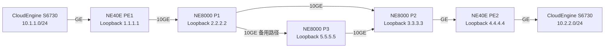

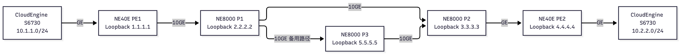


上图中 PE1→P1→P2→PE2 是 IGP 最优路径（SR-MPLS BE 走这条），PE1→P1→P3→P2→PE2 是备用路径（SR-TE 可以用显式 SID 列表强制走这条）。

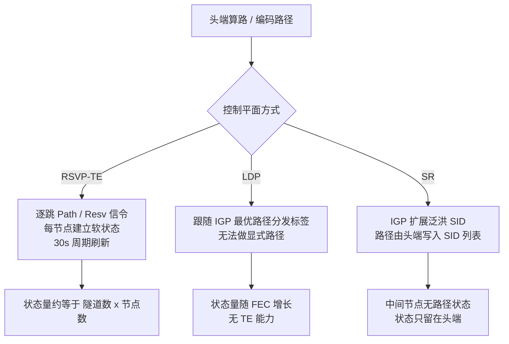

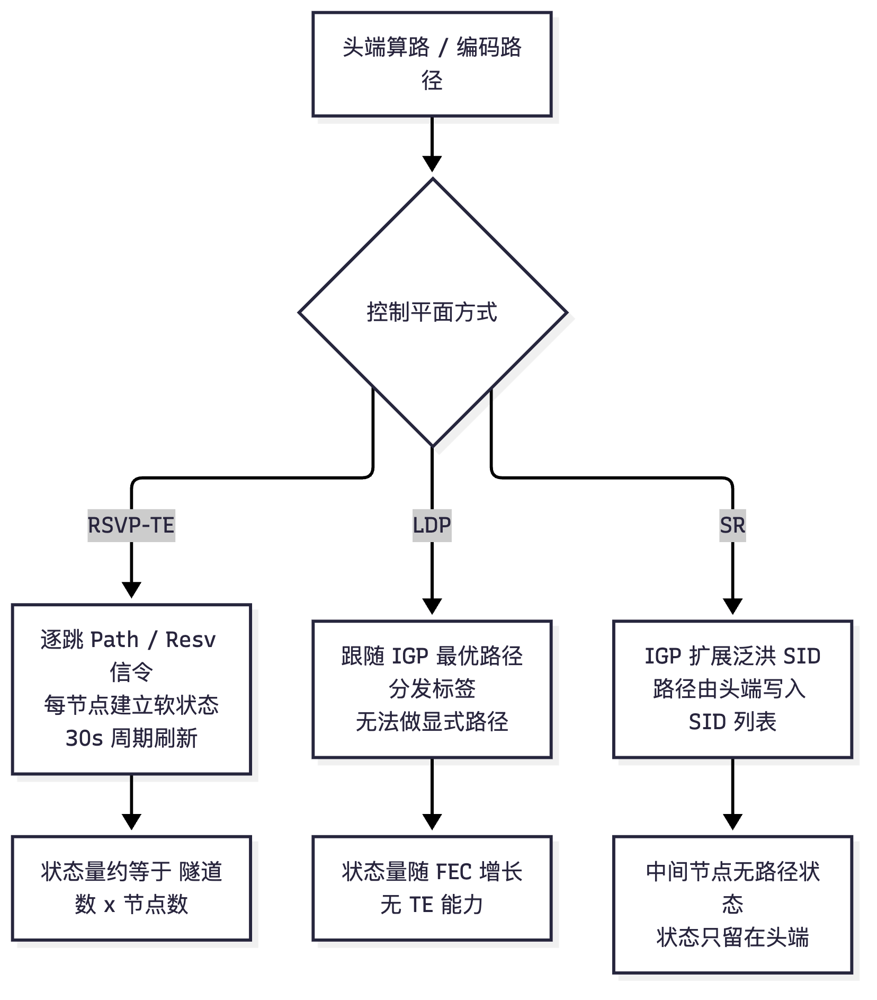


### 真题精练

**Q1.【真题·单选】** 在 SR-MPLS 中，下列哪一类 SID 是**全局唯一**并由 IGP 泛洪到全网、从而保证所有节点对同一前缀使用相同标签语义的？
A. Adjacency SID  B. Prefix SID（Node SID）  C. Binding SID  D. 动态分配的本地标签

> **答案：B**
> **解析**：Prefix SID 通过 IGP 扩展 TLV 泛洪到整个 SR 域，其值 = SRGB 基址 + index，因此**全网一致、全局唯一**（前提是各节点 SRGB 相同）。A 的 Adjacency SID 只表示"本节点到某邻居的那条链路"，**只在本地有效**，其他节点即使知道该值也不能用于跨节点转发。C 的 Binding SID 是"本地把一个 SID 绑定到一条策略"，可本地使用也可通过 BGP-LS 上报给控制器，但它的语义是策略而非前缀，不具备"全网同一含义"的性质。D 是 LDP/动态标签的概念，SR 的核心恰恰是不依赖动态逐跳分配。

**Q2.【真题·多选】** 与传统 RSVP-TE 相比，SR-MPLS 的优势包括：
A. 中间节点不需要为每条隧道维护软状态，控制平面状态量大幅下降
B. 不引入 IGP 之外的新信令协议，控制平面协议数量减少
C. 天然支持 ECMP，可与最短路径转发共存
D. 因为不需要带宽预留，所以完全不能做流量工程

> **答案：ABC**
> **解析**：A、B 是 SR 的两大设计目标（无状态、简化控制面），也是简答题的得分点。C 正确——SR-MPLS BE 的转发等价于按 IGP 最优路径转发，天然继承 IGP 的 ECMP 能力；SR-TE 也可用多个等价的 SID 列表做负载分担。D 错误，SR-TE Policy 可以提供严格显式路径与路径约束（延迟、亲和属性等），并通过控制器（PCE）计算带约束路径；只是 SR 的"带宽预留"依赖控制器/本地策略实现，机制与 RSVP-TE 的逐跳预留不同，但绝不等于"不能做 TE"。

**Q3.【真题·简答】** 请解释：SR 中间节点"无状态"，为什么仍然能保证报文沿着头端指定的显式路径转发？"无状态"到底指没有哪种状态？

> **答案与解析**：
> **要点 1——路径信息随报文携带（源路由）**：头端把整条路径编码成有序的 SID 列表（SR-MPLS 为标签栈，SRv6 为 SRH 中的 Segment List），报文自身带着"我要依次经过哪些段"的完整信息，中间节点只需读栈顶即可决策，不需要向任何节点询问路径。
> **要点 2——SID 的语义与业务无关**：Prefix SID 表示"去往某节点"，Adjacency SID 表示"走某条链路"。这些语义是**拓扑属性**，由 IGP 事先泛洪收敛完成，中间节点据此生成与业务条数无关的转发表项，因此无需为每条路径单独建状态。
> **要点 3——"无状态"指的是"不为路径/隧道维护实例状态"**，而**不是"设备不维护任何转发表"**：设备当然要维护 SID 到出标签/出接口的映射（ILM/NHLFE）、邻居与拓扑数据库（LSDB），这些是"与拓扑规模相关"的状态，与"隧道/业务条数"无关。头端才是唯一保存"路径状态"的地方（SR Policy 的候选路径、SID 列表、BSID 映射）。
> **要点 4——代价**：头端压力与路径表达能力挂钩（SID 列表越长，标签栈越深），并带来 MTU 与标签栈深度限制问题——这正是 SRv6 引入 Binding SID、SID 压缩（uSID / G-SID）等机制的原因。

### 易错点与排错

1. **把"无状态"理解为"没有转发表"**：SR 中间节点仍有 ILM/NHLFE 与 LSDB，只是没有"每条隧道的实例状态"。答题时务必区分"拓扑相关状态"与"路径相关状态"。
2. **认为 SR 必须依赖 MPLS**：SR-MPLS 用标签栈，SRv6 用 IPv6 路由扩展头（SRH）承载 SID 列表，**SRv6 不需要 MPLS**，这也是它成为"IPv6 骨干首选"的原因。
3. **SRGB 各节点不一致**：SR-MPLS 要求全网 SRGB 相同，否则"index 相同、标签不同"，会直接导致转发不通或转发绕路。排错时先比对各节点 `display segment-routing mpls` 输出的 SRGB 范围。
4. **Prefix-SID 与 Adjacency-SID 的作用范围混淆**：Prefix-SID 全局有效可跨节点规划；Adjacency-SID 只在本地有效，**不能写成其他节点的规划值**。
5. **IS-IS 必须 `cost-style wide`**：narrow 度量下 SR 扩展 TLV 无法携带，配置看起来生效但邻居学不到 SID。
6. **排错命令链**：`display segment-routing mpls`（本机 SR 状态与 SRGB）→ `display isis segment-routing prefix-sid`（SID 是否泛洪出去）→ `display mpls lsp`（转发表是否生成）→ `tracert -v` / 逐跳抓包看标签栈变化。

## 8.2 SR-MPLS 关键概念与标签栈推演

### 考点定位

本节是全章**计算与推演密度最高**的地方，国赛常以 **1 道标签值计算题（填空/单选）+ 1 道标签栈逐跳变化题（简答）+ 1 道排错题** 出现，分值 8~12 分。必考公式：**标签值 = SRGB 基址 + SID index**。必考能力：给定拓扑与 SID 规划，**画出每一跳的入标签、出标签、出接口**。易错点是忘了"节点收到等于自身 Prefix-SID 的标签要弹出（该段到此结束）"，以及把 Adjacency-SID 当成全局标签去做跨节点规划。

### 原理精讲

**Segment（段）与 SID（段标识）**。Segment 是"一条转发指令"，SID 是它的编号。SR-MPLS 中 SID 直接映射为一个 MPLS 标签，因此**复用 MPLS 转发平面**：入标签映射 ILM（Incoming Label Map）决定"收到这个标签做什么"，下一跳标签转发项 NHLFE（Next Hop Label Forwarding Entry）决定"换成什么标签、发给谁"。SR 与 LDP 的区别不在数据平面，而在这两个表项**由谁生成**——LDP 由标签分发协议生成，SR 由 IGP 扩展分发 SID 后生成。

**SRGB 与标签计算**。SRGB（Segment Routing Global Block）是"专门留给全局 SID 的标签区间"，华为缺省 **16000–23999**（共 8000 个标签）；SRLB（Segment Routing Local Block）是"留给本地 SID 的区间"，华为缺省 **15000–15999**。关联公式：

- **Prefix-SID 的标签值 = SRGB 基址 + Prefix-SID index**。例：SRGB 基址 16000，某 loopback 配置 `isis prefix-sid index 1`，则全网通告的标签为 **16001**。
- **Index 全局唯一、标签全局一致**的前提是**全网 SRGB 相同**；如果 A 节点 SRGB 为 16000–23999、B 节点为 17000–24999，则同一 index 在两个节点上算出不同的标签，转发必然出错。
- **Adjacency-SID** 由本地动态分配或静态指定，**只在本节点有效**：它表示"从本节点某接口发出的那条邻接"，用于表达"强制走某段链路"。

**Prefix SID 与 Node SID 的关系**：每个节点至少有一个 loopback，并为它分配一个 Prefix-SID（通常 `index` 从 1 或 100 起编号）；当这个前缀是主机路由（/32 或 /128）时，它同时充当**该节点的 Node SID**，即"到本节点的段"。转发中"报文的目的 SID 是 PE2 的 Node SID"就意味着"这一段的终点是 PE2"。

**SID 列表（Segment List）与栈的读写规则**。头端按"**从远到近还是从近到远**"的顺序压栈？标准做法是：**SID 列表中第一个元素在栈顶**（最先处理），因此压栈顺序应为"路径上最先要经过的段的 SID 放在最上面"。中间节点的两条核心规则：

1. **若栈顶标签是自己通告的 Prefix-SID（自己是该段的终点）**：说明"到我这的这段结束了"，**弹出栈顶**；若弹出后仍有标签，按新栈顶继续转发；若栈已空，按 IP 目的地址查表转发（这正是 SR-MPLS BE 的常规收尾方式，也解释了为什么 SR 不需要 PHP 也能正确转发）。
2. **若栈顶标签不是自己的 Prefix-SID**：按 LFIB 做标签交换（swap）后从相应出接口发出，直到送达该 SID 的归属节点。

**Adjacency-SID 的处理**：邻接段由"通告它的节点"终结。收到栈顶等于本机 Adj-SID 的报文时，节点**弹出该标签并从该邻接对应的接口发出**。因此"用 Adj-SID 强制走某链路"时，SID 列表中必须**先出现该节点的 Node SID（把报文送到这个节点），再出现它的 Adj-SID（指示从哪条链路走）**。

**SR-MPLS BE 与显式路径的差别**：BE（Best Effort）只压"目的节点 Node SID"一个标签，路径完全由 IGP 决定；显式路径则压入多个 SID，可绕开 IGP 最优路径、可指定必经链路。

### 关键概念对照表

| 概念 | 标签来源 | 生效范围 | 是否泛洪 | 用途 |
|---|---|---|---|---|
| Prefix-SID / Node-SID | SRGB 基址 + index | 全网 | 是（IGP 扩展 TLV） | 表达"去往某节点/前缀"，构成 SR-MPLS BE 与显式路径的骨架 |
| Adjacency-SID | 本地动态分配或静态指定 | 本节点 | 否 | 表达"强制走某条邻接链路"，用于严格显式路径、TI-LFA 备份路径 |
| Binding-SID | 本地配置 | 本地（可上报控制器） | 可通过 BGP-LS 上报 | 把一个 SID 绑定到一条 SR Policy，用于路径拼接、跨域、压缩标签栈 |
| SID List | 由上述 SID 有序拼接 | 报文中携带 | — | 完整描述一条显式路径 |

**标签栈推演表（严格显式路径 PE1 → P1 → P2 → PE2，强制走 P1 到 P2 的直连链路）**

SID 规划：PE1 index 1（16001）、P1 index 2（16002）、P2 index 3（16003）、PE2 index 4（16004）；P1 到 P2 直连链路的 Adjacency-SID = 24001。头端 PE1 压入的标签栈自顶向下为 **[16002, 24001, 16004]**。

| 步骤 | 当前节点 | 收到的栈顶标签 | 栈内容（自顶向下） | 节点动作 | 发出的栈内容 |
|---|---|---|---|---|---|
| 1 | PE1（头端） | 无（本地产生） | 空 | 压入 3 个标签，按栈顶 16002 查 LFIB，出标签 16002 发往 P1 | 16002 / 24001 / 16004 |
| 2 | P1 | 16002 | 16002 / 24001 / 16004 | 16002 是**自身 Node SID** → 本段结束，弹出栈顶 | 24001 / 16004 |
| 3 | P1 | 24001 | 24001 / 16004 | 24001 是**本机到 P2 的 Adj-SID** → 弹出该标签，从该邻接接口发出 | 16004 |
| 4 | P2 | 16004 | 16004 | 非自身 SID → 按 LFIB 交换标签（下一跳为 PE2，出标签 16004） | 16004 |
| 5 | PE2 | 16004 | 16004 | 16004 是**自身 Node SID** → 弹出，栈已空 → 按 IP 目的地址查表转发给 CE2 | 空 |

**SR-MPLS BE 的对比情况**：PE1 到 PE2 只压 [16004]。P1 收到 16004（非自身）→ swap 为 16004 发给 P2；P2 收到 16004（非自身）→ swap 为 16004 发给 PE2；PE2 收到 16004（自身）→ 弹出后按 IP 转发。可见 **BE 场景中间节点只做标签交换，不做任何路径决策**，这正是"无状态"的直观体现。

### 华为设备配置

```bash
system-view
segment-routing
 global-block 16000 23999                         // 全网统一 SRGB；规划时把 index 与标签一起写进割接方案文档
#
interface LoopBack0                              // 承载 Node SID
 ip address 2.2.2.2 255.255.255.255
 isis enable 1
 isis prefix-sid index 2                          // index=2 → 标签 = 16000 + 2 = 16002
#
interface GigabitEthernet0/0/1                   // 与 P2 直连的链路，需要一条严格显式路径经过它
 ip address 10.0.12.1 255.255.255.0
 mpls enable
 isis enable 1
 isis adjacency-sid static 24001                  // 为该邻接静态指定 Adj-SID = 24001（只在本地有效，不必全网规划）
 isis adjacency-sid static 24001 level-2          // 部分版本需要在命令后显式指定 level，以设备 ? 补全为准
#
display isis segment-routing adjacency-sid        // 查看本地通告的邻接 SID 及其绑定的接口/邻居
display mpls lsp include 16004 verbose            // 查看去往 16004 的 LSP 明细（出标签、出接口、下一跳）
display mpls lsp                                  // 全量查看 SR 生成的所有 LSP
tracert -v 10.2.2.1                               // 带 -v 显示 MPLS 标签信息，验证路径是否被显式 SID 列表牵引
```

> **规划建议（比赛加分点）**：Index 建议用"**业务含义编号**"而不是随机数（例如 PE 用 1–99、P 用 100–199、预留 200+ 给跨域/逃生路径）；Adj-SID 建议统一落在 SRLB（15000–15999）或统一用 24000+ 静态段，避免与 SRGB 内动态分配值冲突。

### 示意图


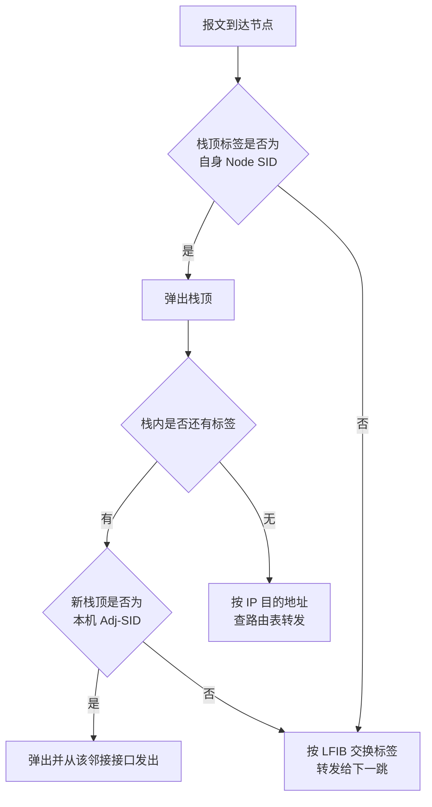

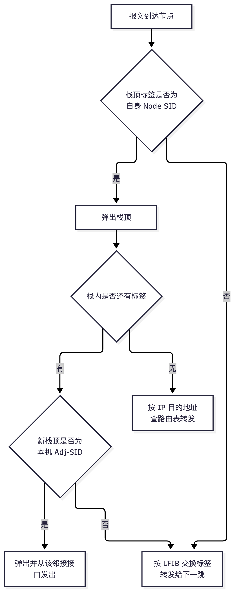


### 真题精练

**Q1.【真题·填空】** 某 SR-MPLS 域中各节点 SRGB 统一定义为 16000–23999，节点 PE1 的 Loopback0（1.1.1.1/32）配置为 `isis prefix-sid index 1`，则 PE1 的 Node SID 对应标签为 ______；若另一节点错误地把 SRGB 配为 17000–24999，则该节点为自身 index=1 的前缀算出的标签为 ______，其直接后果是 ______。

> **答案：16001；17001；两个节点对"index=1"这个段的理解不一致，转发时标签无法正确对应，导致 SR-MPLS 路径不通或报文被错误转发**
> **解析**：SR-MPLS 的标签是"SRGB 基址 + index"算出来的**本地计算结果**，全网一致性完全依赖 SRGB 一致。这也是排错时第一条要核对的配置：各节点 `display segment-routing mpls` 输出的 SRGB 必须完全一致。国赛排错题里"SR 配了但不通"最常见的原因就是 SRGB 不一致或漏配 `mpls enable`。

**Q2.【真题·简答】** 头端 PE1 需要让流量严格经过 P1，再经 P1 与 P2 之间的直连链路，最后到达 PE2。已知 P1 的 Node SID=16002、P1→P2 的 Adjacency-SID=24001、PE2 的 Node SID=16004。请写出 PE1 压入的标签栈（自顶向下），并说明 P1 收到报文后做了什么。

> **答案与解析**：
> **标签栈（自顶向下）**：`16002 / 24001 / 16004`。
> **顺序原理**：栈顶最先处理，所以"最先要到达的段的 SID 放最上面"。要用 P1 的 Adj-SID，必须**先让报文到达 P1**，故先放 P1 的 Node SID（16002），再放它的 Adj-SID（24001），最后放终点 PE2 的 Node SID（16004）。
> **P1 的动作**：① **第一次查表**：收到栈顶 16002，判定这是自己的 Node SID，说明"到 P1 的这段结束"，于是**弹出栈顶**，栈变为 `24001 / 16004`；② **第二次查表**：新栈顶 24001 是本机到 P2 的 Adj-SID，于是**弹出该标签并从该邻接对应的接口发出**，栈变为 `16004`；③ 报文到达 P2 后由 P2 做普通标签交换发往 PE2，PE2 收到 16004 后弹出标签，按 IP 目的地址转交 CE2。
> **易错提醒**：若把顺序写成 `24001 / 16002 / 16004`，报文在 PE1 出口就会因为找不到"24001 对应的邻接"（PE1 上没有这条邻接）而丢弃；若只写 `24001 / 16004`，报文在 PE1 无法先被送到 P1，同样不通。

**Q3.【真题·单选】** 关于 Binding SID（BSID），下列说法正确的是：
A. BSID 是全网泛洪的全局标签，所有节点都为其建立转发表项
B. BSID 把一个 SID 绑定到一条 SR Policy（或 SID 列表），可减少头端标签栈深度并实现路径拼接
C. BSID 只能由控制器分配，设备本地无法配置
D. BSID 与 Prefix SID 语义相同，可以互相替换

> **答案：B**
> **解析**：Binding SID 的本质是"**给一条策略起一个短名字**"：头端把深层 SID 列表（或跨域多段路径）绑定到一个 BSID，之后只需压入 BSID 即可，从而**降低标签栈深度、解决栈深与 MTU 限制、实现域间路径拼接**（例如域内 SR 段 + 域间 BSID + 对端域 SR 段）。A 错误，BSID 由配置它的节点（通常是策略头端或域边界节点）终结，不需要全网建立表项。C 错误，BSID 既可由控制器下发，也可在设备上本地配置（配合 Segment List 使用）。D 错误，两者语义不同：Prefix SID 表示"到某节点"，BSID 表示"到某策略"。

### 易错点与排错

1. **忘了"自身 Node SID 要弹出"**：这是标签栈推演题最常丢分的地方，务必在推演表中写出"弹出后栈内容"。
2. **Adj-SID 跨节点规划**：Adj-SID 只在本地有效，规划文档里必须写清"**哪个节点的哪条邻接**"。
3. **SRGB 不一致**：表现为路径不通或流量被牵引到非预期节点，核对 `display segment-routing mpls` 的 SRGB 区间。
4. **漏配接口 `mpls enable`**：IS-IS 邻居正常、SID 也学到了，但 `display mpls lsp` 里没有相应表项，转发直接失败。
5. **index 重复**：两个节点配了相同 index（例如都写 index 1），会导致标签冲突、SID 归属混乱，表现为去往两个目的地的流量互相抢标签。
6. **排错命令链**：`display segment-routing mpls`（SRGB）→ `display isis segment-routing prefix-sid`（SID 泛洪）→ `display mpls lsp include <label> verbose`（转发表）→ `tracert -v`（真实路径）。

## 8.3 SR 的 IGP 扩展（IS-IS / OSPF / OSPFv3）

### 考点定位

本节是"原理深水区"，国赛通常以 **1 道多选 + 1 道简答** 出现，分值 5~8 分，用于区分"会配 SR"和"懂 SR"。高频考法：**① SR 是靠哪个 TLV/Sub-TLV 携带 Prefix-SID 的；② 全局标签与本地标签分别由什么携带、为什么需要 SRLB；③ IS-IS 与 OSPF 扩展的对应关系**。易错点是把"能力通告（Capability）"与"SID 携带（Prefix-SID Sub-TLV）"混为一谈。

### 原理精讲

**为什么必须扩展 IGP？** SR 的思想是"不再新增标签分发协议"，代价就是**必须让 IGP 学会携带两类新信息**：① **能力与范围信息**：本节点支持 SR、SRGB 是哪一段、支持哪些算法（SR-Algorithm，如 SPF 与 Flex-Algo）；② **SID 信息**：某前缀对应哪个 index/标签（Prefix-SID）、某条邻接对应哪个标签（Adjacency-SID）。

**IS-IS 扩展（RFC 8667）**。IS-IS 的做法是把新信息塞进已有的 TLV 体系：

- **Router Capability TLV（type 242）**：承载 SR 相关能力，其中 **SR-Capabilities Sub-TLV（type 2）** 携带 **SID/Label Range Sub-TLV（type 1）**，用于通告本节点的 SRGB 范围（可通告多段范围）；**SR-Algorithm Sub-TLV（type 19）** 通告支持的算法（0 = SPF，128~255 为 Flex-Algo 自定义算法）；**SR Local Block Sub-TLV（type 22）** 通告 SRLB 范围。
- **Extended IP Reachability TLV（type 135）/ IPv6 Reachability TLV（type 236）**：承载 **Prefix-SID Sub-TLV（type 3）**，这就是"**某个 IPv4/IPv6 前缀的 SID**"的载体，字段包含 Flags（如 R 位表示重分发、N 位表示 Node SID、V 位表示 value 还是 index）、Algorithm、SID/Index。
- **Extended IS Reachability TLV（type 22）/ MT-ISIS TLV（type 222）**：承载 **Adjacency SID Sub-TLV（type 31）** 与 **LAN Adjacency SID Sub-TLV（type 32）**（广播网络里需要额外携带 System-ID 来指明是哪台邻居）。Adj-SID 的 Flags 中 **F 位**表示"是否从 SRLB 分配"，**B 位**表示"是否为备份用途"。

**OSPF 扩展（RFC 8665，OSPFv3 为 RFC 8666）**。OSPF 用 Opaque LSA 承载 SR 信息：

- **Router Information Opaque LSA（Opaque type 4）** 中携带 **SR-Algorithm TLV（type 8）**、**SID/Label Range TLV（type 9）**（即 SRGB）、**SR Local Block TLV（type 10）**（即 SRLB）。
- **Extended Prefix Opaque LSA（Opaque type 7）** 中携带 **Extended Prefix TLV（type 1）** 与 **Prefix-SID Sub-TLV（type 2）**，用于通告前缀的 SID；**Extended Prefix Range TLV（type 3）** 用于一次通告一段前缀范围，减少 LSA 数量。
- **Extended Link Opaque LSA（Opaque type 8）** 中携带 **Extended Link TLV（type 1）** 与 **Adjacency SID Sub-TLV（type 2）**、**LAN Adjacency SID Sub-TLV（type 3）**。

**全局标签 vs 本地标签，以及 SRLB 存在的理由**。Prefix-SID 是"全局标签"——它的值由 SRGB 与 index 决定，理论上全网同一 index 必须映射同一标签，因此**只能从 SRGB 中分配**；Adjacency-SID 是"本地标签"——其他节点一般不能直接使用（除非由控制器通过 BGP-LS 收集后再显式编排），因此**可以从 SRLB 中分配**。SRLB 的作用就是**把"本机专用/局部的标签"与"全局共享的标签"在空间上隔离**，避免本地动态分配占用 SRGB 导致 index 与标签的对应关系冲突。这就是 HCIE 常问的"为什么 SR 要分 SRGB 和 SRLB"的标准答案。

**算法与 Flex-Algo（灵活算法）**。SR-Algorithm 通告的是"本节点能为哪些算法算路"。缺省 0 号算法即普通 SPF；Flex-Algo 允许自定义算法号（128–255），由"度量类型（IGP 度量 / 时延 / TE 度量）+ 亲和属性排除规则 + 计算类型"三要素定义，从而在**同一拓扑上并行运行多套独立的最优路径计算**（如低时延平面与默认 IGP 平面并存），是网络切片与差异化承载的基础。

### 关键概念对照表

| 信息类型 | IS-IS 载体 | OSPF 载体 | 作用 |
|---|---|---|---|
| SR 能力与算法 | Router Capability TLV 242 + SR-Capabilities Sub-TLV 2 + SR-Algorithm Sub-TLV 19 | Router Information LSA 中 SR-Algorithm TLV 8 | 告诉邻居"我支持 SR，我能算哪些算法" |
| SRGB 范围 | SID/Label Range Sub-TLV 1 | SID/Label Range TLV 9 | 通告全局标签空间，保证标签计算一致 |
| SRLB 范围 | SR Local Block Sub-TLV 22 | SR Local Block TLV 10 | 通告本地标签空间，隔离本地 SID |
| 前缀 SID | Extended IP/IPv6 Reachability TLV 135/236 + Prefix-SID Sub-TLV 3 | Extended Prefix Opaque LSA + Prefix-SID Sub-TLV 2 | 让全网知道"某前缀的 SID 是多少" |
| 邻接 SID | Extended IS Reachability TLV 22/222 + Adj-SID Sub-TLV 31（LAN 为 32） | Extended Link Opaque LSA + Adj-SID Sub-TLV 2（LAN 为 3） | 让报文能"指定走本节点的某条链路" |

| 标签类型 | 分配空间 | 生效范围 | 典型用途 | 是否可跨节点规划 |
|---|---|---|---|---|
| 全局标签（Prefix-SID） | SRGB | 全网 | Node SID、SR-MPLS BE、显式路径骨架 | 可（必须全网统一 index） |
| 本地标签（Adjacency-SID） | SRLB 或 SRGB 本地段 | 本节点 | 严格显式路径、TI-LFA 备份、绕行链路 | 否（只能由控制器编排后使用） |

### 华为设备配置

```bash
system-view
segment-routing
 global-block 16000 23999                         // SRGB：承载 Prefix-SID 的全局标签空间
 local-block 15000 15999                          // SRLB：承载本地 SID（如部分动态 Adj-SID）的本地空间
#
isis 1
 cost-style wide                                  // 关键前提：宽度量，SR 扩展 TLV 无法在 narrow 下携带
 is-level level-2
 network-entity 49.0001.0000.0000.0001.00
 segment-routing mpls
  no shutdown
#
ospf 1 router-id 1.1.1.1                         // OSPF 场景对照配置（与 IS-IS 二选一，不可同时在一张接口上抢 SID）
 segment-routing mpls
  no shutdown
#
flex-algo 128                                    // 定义灵活算法 128（示例：基于时延的独立算路平面）
 metric-type delay                                // 度量类型为时延（也可为 igp / te）
 advertise-definition                             // 把算法定义泛洪出去，使域内节点形成一致的算法视图
#
display isis segment-routing capability           // 查看本机/邻居通告的 SR 能力（SRGB、SRLB、支持的算法）
display isis segment-routing prefix-sid           // 查看从 LSDB 学到的所有 Prefix-SID 与标签映射
display ospf segment-routing router-capability    // OSPF 场景查看 SR 能力与算法
display segment-routing mpls flex-algo            // 查看 Flex-Algo 定义与计算结果（版本差异请以 ? 补全为准）
```

> **实操要点**：IS-IS 场景必须同时满足"`cost-style wide` + 接口 `isis enable` + 接口 `mpls enable` + 进程内 SR 已 `no shutdown`"四个条件，缺一条 `display isis segment-routing prefix-sid` 就会是空表。这四个条件建议直接背下来，现场排错按顺序核查。

### 示意图

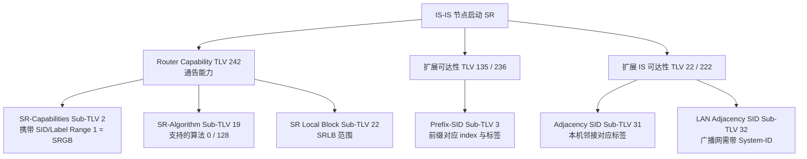

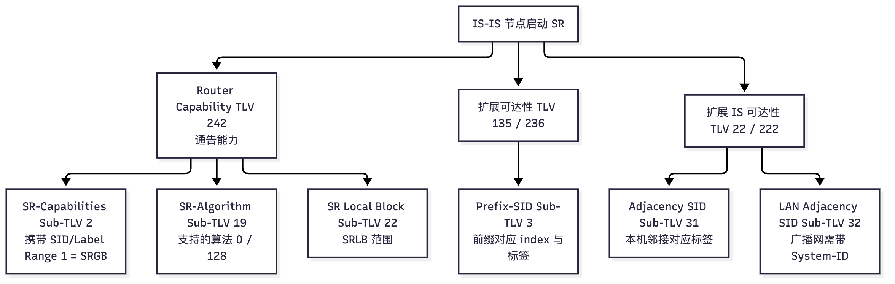


### 真题精练

**Q1.【真题·多选】** 在 IS-IS 的 SR 扩展中，下列描述正确的有：
A. Prefix-SID 通过扩展可达性 TLV（IPv4 为 135、IPv6 为 236）中的 Prefix-SID Sub-TLV 携带
B. SRGB 通过 Router Capability TLV 中的 SID/Label Range Sub-TLV 通告
C. Adjacency SID 只在本地有效，因此不会出现在任何 IS-IS 报文中
D. IS-IS 必须使用宽度量（cost-style wide）才能携带 SR 相关扩展

> **答案：ABD**
> **解析**：A、B 是 RFC 8667 的核心结构，必须记住"能力走 242、前缀 SID 走 135/236、邻接 SID 走 22/222"这条线索。C 错误，Adjacency SID **必须通过 IGP 泛洪**（Adj-SID Sub-TLV），否则头端与控制器都不知道该邻接存在、也都无法把它写进 SID 列表；"本地有效"指的是它的**转发语义只在本节点成立**，而不是"不泛洪"。D 正确，narrow 度量下 TLV 无法携带 SR 扩展，配置看似成功但邻居学不到 SID。

**Q2.【真题·简答】** 请说明 SR 为什么需要同时定义 SRGB 与 SRLB，并各举一个典型使用场景。

> **答案与解析**：
> **SRGB（Segment Routing Global Block，全局段标签空间）**：用于承载 **Prefix-SID 这类全局 SID**。它的值必须**全网一致**，因为全网都按"SRGB 基址 + index"独立计算标签，只有基址一致，同一 index 才映射到同一标签值，Segment 才有"全网同一含义"。典型场景：每个骨干节点的 Loopback Node SID（如 index 1 → 16001），以及跨域时按域规划不同 index 段。
> **SRLB（Segment Routing Local Block，本地段标签空间）**：用于承载 **只在本地有意义的 SID**，主要是动态/静态分配的 Adjacency-SID。它的核心价值是**隔离**：如果本地 SID 也从 SRGB 里随便取，就可能占用"某个 index 本该对应的标签值"，导致"标签 16005 到底是节点 X 的 Node SID 还是本机的某条邻接 SID"发生歧义，跨节点转发就会错乱。典型场景：一个节点有 40 条邻接需要 Adj-SID 时，把它们全部限制在 SRLB 内（如 15000–15999），与全局空间彻底分开。
> **一句话总结**：**SRGB 管"大家都懂"的标签，SRLB 管"只有我懂"的标签；分区管理是为了让"局部命名"不污染"全局命名"。**

**Q3.【真题·单选】** 关于 Flex-Algo（灵活算法），下列描述正确的是：
A. Flex-Algo 只能使用 IGP 度量，不能使用时延度量
B. Flex-Algo 允许在同一拓扑上基于不同度量与亲和属性并行计算多套独立最优路径，算法号取值 128–255
C. Flex-Algo 需要单独的协议进程，属于新增控制协议
D. Flex-Algo 与 TI-LFA 互相冲突，不能同时部署

> **答案：B**
> **解析**：Flex-Algo 由"度量类型 + 亲和属性排除规则 + 计算类型"共同定义，算法号 128–255（0 保留给普通 SPF，1–127 为预留/IETF 定义），通过 IS-IS 的 SR-Algorithm Sub-TLV 与 Flex-Algo 定义 TLV 泛洪，**完全复用 IGP，不新增协议**，因此 C 错、B 对。A 错，Flex-Algo 恰恰支持 `metric-type delay` 等度量，用于构造低时延平面（也可用 TE 度量）。D 错，两者互补：Flex-Algo 提供差异化的最优路径平面，TI-LFA 在该平面内提供无环备份。

### 易错点与排错

1. **"能力"与"SID"混为一谈**：能力（SRGB/算法/SRLB）走 Router Capability（IS-IS）或 Router Information LSA（OSPF）；前缀 SID 走扩展可达性 TLV/LSA。答题时分开写。
2. **以为 Adj-SID 不泛洪**：它一定泛洪（否则控制器无法编排）；"本地有效"说的是转发语义范围。
3. **忘记 `cost-style wide`**：OSPF 无此要求，但 IS-IS 必须。这是 IS-IS 场景最常见的"配了不生效"。
4. **SRGB 只在一台设备上配置**：SRGB 是"全网一致的约定"，漏配的节点会采用缺省值，造成标签不一致。
5. **Flex-Algo 只在本机 `advertise-definition`**：算法定义需要在域内一致泛洪，且参与计算的节点都要支持该算法号，否则算不出独立平面。
6. **排错命令链**：`display isis segment-routing capability` → `display isis segment-routing prefix-sid` → `display isis lsdb verbose`（确认 TLV 真的在 LSP 里）→ `display segment-routing mpls flex-algo`。

## 8.4 SR 流量工程（SR-TE Policy 与 PCE 算路）

### 考点定位

SR-TE 是国赛"设计方案题"的高频落点，常以 **1 道多选 + 1 道简答（或配置题）** 出现，分值 8~12 分。高频考法：**① SR Policy 的三元组标识（头端、颜色、端点）；② 候选路径与优先级；③ Binding SID 的作用；④ SR-TE 与 RSVP-TE 的对比；⑤ PCE 在 SR 网络中的角色**。易错点是把 Color（颜色）当成 QoS 标记、把 Candidate Path 与 Segment List 的关系搞反。

### 原理精讲

**为什么要有 SR-TE？** SR-MPLS BE 已经能"按 IGP 最优路径转发"，但运营商需要的是"**按业务意图转发**"：这条视频业务必须走低时延链路、那条备份业务必须避开某段链路、跨域业务必须经过指定边界节点。SR-TE 就是 SR 的流量工程能力，把"业务意图"翻译成"显式 SID 列表"。

**SR Policy 的三元组标识**。一条 SR Policy 由 **（头端 Headend，颜色 Color，端点 Endpoint）** 唯一标识：

- **头端**：策略的起点，负责压栈与引流（通常与 BGP 的 Color 扩展团体配合，通过 BGP Color 引流把特定 VPN/业务的流量导入策略）。
- **颜色（Color）**：一个 32 bit 的**业务意图编号**，与扩展团体（Extended Community）一起携带在 BGP 路由上，用于把"某类业务"匹配到"某条策略"。**它不是 QoS 颜色标记**（这是经典易错点）。
- **端点（Endpoint）**：策略的目的节点地址，通常是目的 PE 的 Loopback。

**候选路径（Candidate Path）与优先级（Preference）**：一条 Policy 下可以有**多条候选路径**，各自带 Preference 值（数值越大越优先）。设备在"有效的候选路径"中选择 Preference 最大的那条作为**激活候选路径**。每条候选路径内部由**一个或多个 Segment List** 组成：只要有两个及以上 Segment List 都有效，就形成**等价多路径（ECMP）**，实现"显式路径 + 负载分担"。这个三层结构（Policy → Candidate Path → Segment List）是本节的考试核心。

**Binding SID 在 SR-TE 中的三大用途**：① **压缩标签栈**：把一条长 SID 列表绑定成一个 BSID，头端只压一个标签；② **路径拼接/跨域**：域内策略绑定 BSID，边界再把这个 BSID 拼进跨域 SID 列表；③ **策略热切换**：引流入口只引用 BSID，策略内部换路径时不用改引流配置。

**PCE（Path Computation Element，路径计算单元，RFC 4655）与 PCEP**。PCE 是"集中算路的大脑"：通过 **BGP-LS（RFC 7752）** 收集全网拓扑与 SID/链路属性，用 **PCEP（RFC 5440，SR 扩展 RFC 8664）** 把算好的 SID 列表下发给头端设备。这样做的价值在于：**复杂约束（时延、带宽、亲和、多样性 disjoint）的算路由集中节点完成，设备只负责转发**，避免了"每台设备各自 SPF、各自拍脑袋"的不一致。PCE 分两类：**有状态 PCE（Stateful PCE）** 维护已建立的 LSP 状态、可主动下发（PCE Initiated）；**无状态 PCE** 只按需算路。SR 场景下头端状态天然很轻，因此**"PCE 集中算路 + 头端压栈"是最主流的自动化 TE 架构**。

**SR-TE 与 RSVP-TE 的对比**（必背表）：

| 对比维度 | RSVP-TE | SR-TE |
|---|---|---|
| 信令 | 逐跳 Path/Resv，每节点建软状态 | 无逐跳信令，SID 列表随报文携带 |
| 中间节点状态 | 每条隧道每节点一份 + 周期刷新（约 30 s） | 无路径状态 |
| 带宽预留 | 逐跳显式预留（资源被"锁住"） | 不由协议逐跳预留，靠 PCE/控制器做带宽约束与路径优选 |
| 收敛与 FRR | 依赖 RSVP 刷新与备份隧道，收敛相对慢 | 依赖 IGP 收敛 + TI-LFA，可达 50 ms 级 |
| 规模扩展 | 隧道数上千后控制平面压力显著 | 与隧道数基本解耦，适合大规模 |
| 域间能力 | 跨域 RSVP 复杂、需域间协商 | 天然友好（SID 列表把域间路径串起来） |
| 运维复杂度 | 协议多、状态多、故障域大 | 只需维护 IGP + 策略，故障定位更简单 |

### 关键概念对照表

| 概念 | 定义 | 记忆要点 |
|---|---|---|
| SR Policy | 由（头端, Color, 端点）标识的转发策略 | 三元组缺一不可；由头端执行 |
| Candidate Path | 策略下的一条候选路径，带 Preference | Preference 大者被激活 |
| Segment List | 候选路径内的一条显式 SID 列表 | 多个有效列表并存即 ECMP |
| BSID | 绑定到策略/列表的一个 SID | 压缩栈深、路径拼接、便于引流 |
| PCE | 集中算路单元 | 通过 BGP-LS 收拓扑、PCEP 下发路径 |
| Color | 32 bit 业务意图编号 | 不是 QoS 标记；用于 BGP Color 引流 |
| 亲和属性 Affinity | 链路的包含/排除约束（含任意/全含/排除） | 用于"必经/必避"某类链路 |
| TI-LFA | 拓扑无关无环备份 | 用 Adj-SID/Node-SID 拼出修复路径，与拓扑无关 |

### 华为设备配置

```bash
system-view
segment-routing
 sr-te policy policy-video                        // 创建 SR-TE 策略（部分版本为 sr-te 视图下 policy 名称）
  endpoint 4.4.4.4 color 100                      // 端点=目的 PE Loopback，颜色=业务意图编号 100
  candidate-path preference 200                    // 候选路径 1，优先级 200（数值越大越优，用于主备切换）
   explicit segment-list list-primary              // 显式引用名为 list-primary 的 SID 列表
  candidate-path preference 100                    // 候选路径 2，优先级较低，作备份
   explicit segment-list list-backup
#
segment-list list-primary                         // 定义显式 SID 列表（V800 风格，实际层级以 ? 补全为准）
 index 10 sid label 16002                         // 第 1 段：P1 的 Node SID
 index 20 sid label 24001                         // 第 2 段：P1 到 P2 的 Adj-SID（强制走这条链路）
 index 30 sid label 16004                         // 第 3 段：PE2 的 Node SID
#
segment-list list-backup
 index 10 sid label 16003                         // 备份路径经 P3
 index 20 sid label 16004
#
pce-client                                        // 作为 PCEP 客户端（头端）向 PCE 请求算路
 pce address 5.5.5.5                              // 指定 PCE 服务器地址（通常部署在 iMaster NCE-IP 上）
#
display sr-te policy policy-video                 // 查看策略状态、激活候选路径、BSID、SID 列表
display sr-te policy policy-video verbose          // 查看候选路径优先级与实际下发的标签栈
display segment-routing mpls te policy brief       // 版本差异命令，查看 TE 策略概要
```

> **引流关键**：SR-TE 只解决了"路径怎么走"，还需要解决"**哪些流量走这条路**"。生产上常用两种引流：① **BGP Color 引流**——对端 PE 发布 VPN 路由时携带 Color 扩展团体，头端匹配 Color 后导入对应 SR Policy（自动化程度最高，推荐）；② **隧道策略/静态引流**——按目的地址或 VPN 实例把流量指定到策略，适合小规模或过渡期。

### 示意图

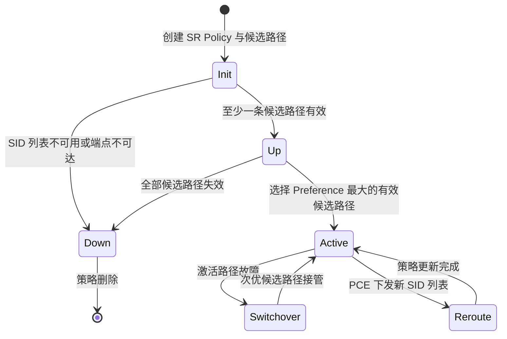

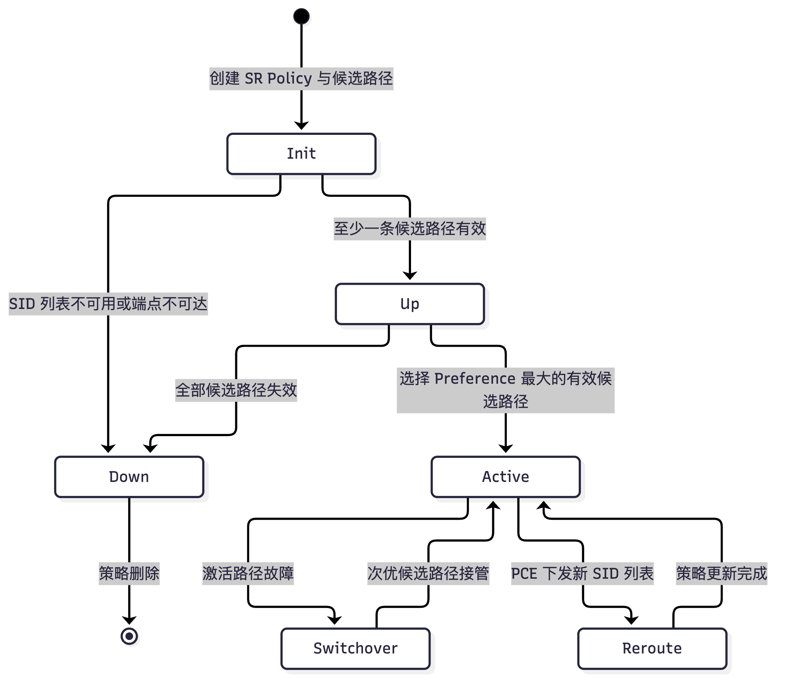


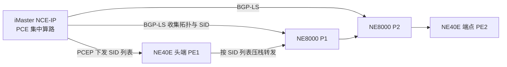

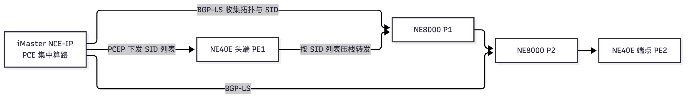


### 真题精练

**Q1.【真题·多选】** 关于 SR Policy 的结构与标识，下列说法正确的有：
A. 一条 SR Policy 由头端、Color、端点三元组唯一标识
B. 一条 Policy 下的多条候选路径按 Preference 比较，数值大者优先激活
C. 一条候选路径下多个有效的 Segment List 可以形成 ECMP
D. Color 是报文的 DSCP 颜色标记，用于队列调度

> **答案：ABC**
> **解析**：A、B、C 是 SR Policy 的"三层结构"（Policy → Candidate Path → Segment List），必须能画出来。D 错误，Color 是 32 bit 的**业务意图编号**，通过 BGP 扩展团体随路由传播，用于把业务引流到策略；与 QoS 的 DSCP/队列颜色标记是完全不同的概念——这是国赛最爱设的干扰项。

**Q2.【真题·简答】** 某骨干网原有 800 条 RSVP-TE 隧道，核心节点内存与 CPU 长期偏高，收敛时间不达标。请给出向 SR-TE 演进的方案要点，并说明为什么 SR-TE 能解决这个问题。

> **答案与解析**：
> **原因分析**：RSVP-TE 的有状态特性导致状态量为"隧道数 × 沿途节点数"，800 条隧道经过 10 个节点就是约 8000 份软状态，且每份都要 30 s 周期刷新，控制平面被刷新报文和状态维护占满，故障时收敛慢。SR-TE 把"路径状态"上收到 **头端 + PCE**：中间节点只保留与拓扑规模相关、与隧道条数无关的 SID 转发表项，状态量从 N×M 降到约 N。
> **演进方案要点**：① 先在 IGP 内使能 SR-MPLS（统一 SRGB、`cost-style wide`、接口 `mpls enable`），保证 SR-MPLS BE 与现网 LDP/RSVP 共存；② 部署 **PCE（iMaster NCE-IP）**，通过 BGP-LS 采集拓扑与 SID，按业务约束集中算路，用 PCEP 下发；③ 把关键业务逐条从 RSVP-TE 迁移到 **SR-TE Policy**（先建策略、验证路径与 SLA，再切引流）；④ 边缘与跨域用 **Binding SID** 拼接，控制标签栈深度；⑤ 全量迁移完成后再下电 RSVP-TE；⑥ 全程保留回退（原 RSVP 隧道不删除，修改引流权重即可回退）。
> **FRR 补充**：中间节点用 **TI-LFA** 提供与拓扑无关的无环备份，配合 BFD 可实现 50 ms 级保护，替代 RSVP-TE 的备份隧道机制。

**Q3.【真题·单选】** 在 SR-TE 中，Binding SID 的主要作用是：
A. 标识一条邻接链路，让报文强制走指定链路
B. 把一个 SID 绑定到一条策略或 SID 列表，用于压缩标签栈深度与实现路径拼接
C. 作为策略的端点地址，标识策略的终点
D. 作为 IGP 的度量值，参与最优路径计算

> **答案：B**
> **解析**：BSID 的价值在"**用一个短标签代表一整段路径**"，因此在跨域（域内策略 + 域间 BSID）、深层标签栈（超过设备/MTU 限制）、引流解耦（引流配置只引用 BSID，策略变更不影响引流）三个场景中必不可少。A 描述的是 Adjacency-SID；C 是 Endpoint 概念；D 是度量值概念，均不符。

### 易错点与排错

1. **Color 与 DSCP 混淆**：Color 是业务意图编号（BGP 扩展团体承载），不要写成 QoS 标记。
2. **Candidate Path 与 Segment List 层级写反**：Policy 下是候选路径，候选路径下才是 Segment List。
3. **显式路径写 Adj-SID 却漏了前置 Node SID**：必须"先到该节点，再走该邻接"，否则头端出口即丢弃。
4. **只配策略不配引流**：`display sr-te policy` 显示 Up，但业务流量仍走 IGP 最优路径，这是"配了不生效"的典型。
5. **PCE 通道不通**：PCEP 需 TCP 4189 可达，并确认 BGP-LS 邻居（通常 179 端口）正常，否则 PCE 算路依据为空。
6. **排错命令链**：`display sr-te policy <name> verbose`（激活候选路径与标签栈）→ `display segment-routing mpls te policy`（策略概要）→ `display bgp ls peer` / `display pce session`（控制器通道）→ `tracert -v`（实际路径验证）。

## 8.5 SR 与 L3VPN 结合（VPN SID 与 SRv6 L3VPN 对比）

### 考点定位

本节是"SR 落地"的关键一环，国赛常以 **1 道单选 + 1 道简答/对比题** 出现，分值 6~10 分。高频考法：**① BGP 如何为 VPN 路由携带 VPN SID；② SR-MPLS L3VPN 的数据面封装；③ SRv6 L3VPN 与传统 MPLS L3VPN 的对比（含控制面、数据面、可扩展性）**。易错点是分不清"外层传输标签（LDP/SR-BE）"与"内层 VPN 标签（VPN SID）"的层级关系。

### 原理精讲

**SR-MPLS L3VPN 的封装结构**。传统 MPLS L3VPN 报文有**两层标签**：外层是公网传输标签（LDP 或 SR-BE 分配），内层是 VPN 标签（MP-BGP 为每个 VPN 前缀分配）。在 SR 场景下，外层由 **SR-MPLS BE 的 Node SID** 充当，内层由 **BGP 为 VPN 路由分配的 SID** 充当，于是形成 **标签栈 = [目的 PE 的 Node SID, VPN SID]**。到达目的 PE 时，PE 先弹出外层（自身 Node SID），再用 VPN SID 定位到 **VPN 实例**，最后查该实例的路由表转发给 CE。

**BGP 如何携带 SID？** SR-MPLS 下使用 **BGP Prefix-SID 属性（RFC 8669）**：属性中包含 **Label-Index TLV**，其值就是该 VPN 前缀的 **SID index**；接收端按"**VPN 实例的 SRGB（Per-VPN SRGB）+ index**"算出本地标签。**关键点**：每个 VPN 实例可以有自己的标签空间（per-VPN SRGB / VPN label block），这样同一 index 在不同 VPN 中不冲突，且**对端 PE 无需为每个前缀单独分配标签**，只按 index 计算即可，大幅降低了标签资源消耗与管理复杂度。这与"LDP 逐前缀分配标签"形成鲜明对比——**SR 把"每前缀一个标签"变成了"每前缀一个 index，标签本地计算"**。

**SRv6 L3VPN 的控制面**。SRv6 场景下没有 MPLS 标签，VPN 私网路由的转发信息必须放进 IPv6 地址（即 SRv6 SID）。RFC 9252 定义了 **BGP over SRv6 的扩展**：在 BGP Prefix-SID 属性中新增 **SRv6 Service TLV（L3 业务为 Service TLV，L2 业务另有对应 TLV）**，其下携带 **SRv6 SID Information Sub-TLV**（包含 SID 值、Behavior 行为如 End.DT4/End.DT6、以及可选的 **SRv6 SID Structure Sub-TLV** 描述 Locator/Function/Argument 划分）。于是**一条 VPN 路由 = 一个 VPN 前缀 + 一个 VPN SID（End.DT4/End.DT6）**，对端 PE 收到后就知道了"这个私网前缀对应的目的 SID 是什么"。

**VPN SID 的行为语义**：`End.DT4` = "解封装 IPv6 头，把内层 IPv4 报文在指定 IPv4 VPN 表中查表转发"；`End.DT6` = "在指定 IPv6 VPN 表中查表转发"。这正是"VPN 路由的 SID"应该做的事情——它同时表达"**解封装**"和"**在哪个表中查**"两个语义，这也是 SRv6 可编程性的直接体现。

**SRv6 L3VPN 与传统 MPLS L3VPN 对比**（必背）：

| 对比维度 | 传统 MPLS L3VPN | SR-MPLS L3VPN | SRv6 L3VPN |
|---|---|---|---|
| 传输层标识 | LDP/RSVP 分配的传输标签 | 目的 PE 的 Node SID | 目的 PE 的 Locator 路由（纯 IPv6 可达） |
| 私网标识 | MP-BGP 分配的 VPN 标签 | BGP Prefix-SID 的 Label-Index（VPN SID） | BGP 下发的 SRv6 SID（End.DT4/DT6） |
| 报文封装 | 标签栈（传输标签 + VPN 标签） | 标签栈（Node SID + VPN SID） | 外层 IPv6 头 +（可选）SRH + 内层原始报文 |
| 是否需要 MPLS | 是 | 是 | 否 |
| 互通性 | 需逐跳标签协议一致 | 需 SRGB/标签规划一致 | 只要 IPv6 可达即可，天然跨域、跨厂商更友好 |
| 引流灵活性 | 受标签分发限制 | 可结合 SR-TE | 可结合 SRv6 Policy、可编程 Function（切片的天然载体） |
| 对设备的 IPv6 要求 | 较低 | 较低 | 较高（需支持 SRv6、较大 IPv6 表项与 SRH 处理能力） |
| 演进价值 | 存量技术 | 骨干平滑演进 | 面向 IPv6 单栈、网络切片、APN6 的目标架构 |

### 关键概念对照表

| 项目 | SR-MPLS L3VPN | SRv6 L3VPN |
|---|---|---|
| 控制面协议 | MP-BGP + IGP(SR 扩展) | MP-BGP + IGP(SRv6 Locator 扩展) |
| VPN SID 载体 | BGP Prefix-SID 属性 + Label-Index TLV | BGP Prefix-SID 属性 + SRv6 Service TLV + SID Information Sub-TLV |
| VPN SID 分配方式 | VPN 实例 SRGB + index（本地计算标签） | 从本端 Locator 中静态/动态分配，直接作为 IPv6 地址通告 |
| 转发行为 | 弹外层 → 按 VPN 标签查实例表 | 弹外层 IPv6 头 → 按 End.DT4/DT6 在 VPN 表查表 |
| 是否需 SRH | 不涉及 | BE 场景可不用 SRH；TE/切片场景需要 SRH 携带 Segment List |
| 标签/地址资源 | 每个 VPN 实例消耗一段标签 | 每个 VPN SID 消耗一个 128 bit 地址（需规划足够大的 Locator） |

### 华为设备配置

```bash
system-view
ip vpn-instance vpn-blue                         // 创建 VPN 实例（SR-MPLS L3VPN 场景）
 ipv4-family
  route-distinguisher 100:1                      // RD：区分不同 PE 上的相同私网前缀
  vpn-target 100:1 export-extcommunity           // RT：控制 VPN 路由的发布与接收
  vpn-target 100:1 import-extcommunity
#
segment-routing
 global-block 16000 23999                        // SRGB
#
bgp 100
 peer 4.4.4.4 as-number 100
 peer 4.4.4.4 connect-interface LoopBack0
 ipv4-family vpnv4
  peer 4.4.4.4 enable                            // 建立 VPNv4 邻居（承载带 VPN SID 的 VPN 路由）
  peer 4.4.4.4 prefix-sid                          // 使能向该邻居通告/接收 Prefix-SID 属性（版本差异请以 ? 补全为准）
 ipv4-family vpn-instance vpn-blue
  import-route direct                            // 把 CE 侧直连网段引入 VPN 实例
#
display bgp vpnv4 all routing-table 10.2.2.0     // 查看 VPN 路由及其携带的 Prefix-SID/Label-Index
display bgp vpnv4 all routing-table 10.2.2.0 verbose   // 详细视图可看到 Prefix-SID 属性（index/标签、SRv6 SID 等）
display mpls lsp                                 // 确认外层 SR-BE 的 LSP 已生成
```

> **数据面验证口诀**：`display mpls lsp` 看**外层**（Node SID）、`display bgp vpnv4 all routing-table verbose` 看**内层**（VPN SID）；两层都正确才可能通。

### 示意图

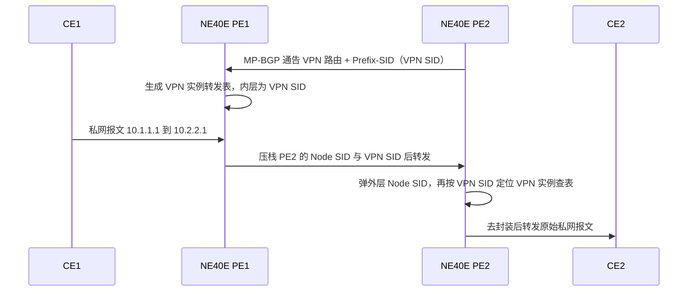

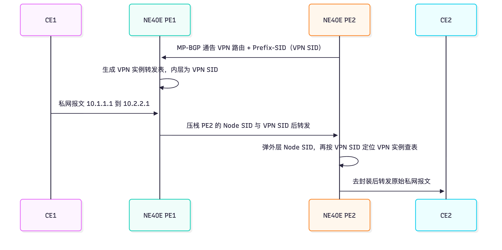


### 真题精练

**Q1.【真题·单选】** SR-MPLS L3VPN 场景中，用于标识"某条 VPN 私网路由"的 SID 主要由哪种机制携带到对端 PE？
A. IS-IS 的 Prefix-SID Sub-TLV
B. MP-BGP 的 Prefix-SID 属性（含 Label-Index TLV）
C. RSVP-TE 的 Resv 消息
D. LDP 的 Label Mapping 消息

> **答案：B**
> **解析**：公网（PE 之间）的 SID 由 IGP 携带（A），而**私网/VPN 路由**的 SID 是"该 VPN 前缀专属"的信息，只能跟着 VPN 路由走，因此由 **MP-BGP 的 Prefix-SID 属性**携带（RFC 8669 的 Label-Index TLV 给出 index，对端按 VPN 实例 SRGB 计算标签）。C、D 都是公网标签分发机制，与 VPN SID 无关。

**Q2.【真题·多选】** 相比传统 MPLS L3VPN（LDP + MP-BGP），SRv6 L3VPN 的优势包括：
A. 不再依赖 MPLS 与 LDP/RSVP，只要 IPv6 可达即可构建 VPN，跨域更简单
B. VPN SID 本身是 IPv6 地址，可直接表达"行为"（如 End.DT4 表示查指定 IPv4 VPN 表）
C. 天然与网络切片、SRv6 Policy、可编程转发结合，无需额外的 MPLS 标签规划
D. 因为不需要 SRH，所以完全无法实现流量工程

> **答案：ABC**
> **解析**：A、B、C 是 SRv6 的核心优势：**协议简化（无 MPLS/LDP）**、**SID 即地址且自带行为语义**、**面向切片与可编程的天然载体**。D 错误，SRv6 BE 场景可以不使用 SRH（仅靠外层 IPv6 DA 逐跳变更即可），而 **SRv6 TE/Policy 场景正是通过 SRH 携带 Segment List 来实现显式路径**，"不用 SRH"与"不能做 TE"没有因果关系。

**Q3.【真题·简答】** 请解释 SR-MPLS L3VPN 报文中两层"标签"分别是什么、由谁分配、在目的 PE 上分别起什么作用。

> **答案与解析**：
> **外层（传输标签）**：由 IGP 的 SR 扩展分发的 **目的 PE 的 Node SID**（例如 PE2 的 Loopback Prefix-SID = 16004），作用是**把报文从入口 PE 送到出口 PE**。沿途 P 节点只按该标签做标签交换，体现"无状态"；到达 PE2 时因 16004 是 PE2 自身的 Node SID 而被**弹出**。
> **内层（VPN 标签/VPN SID）**：由 **MP-BGP 的 Prefix-SID 属性**携带 Label-Index，接收端按 **VPN 实例 SRGB + index** 计算得到，作用是在出口 PE 上**定位到具体 VPN 实例（VRF）**，随后在该实例的路由表中查表转发给 CE。它不是"送到哪台设备"的信息，而是"在设备里查哪张表"的信息。
> **一句话总结**：**外层管"到哪台设备"，内层管"用哪张表"；外层靠 IGP 泛洪，内层靠 BGP 随 VPN 路由传递。** SRv6 场景把内层从"20 bit 标签"换成了"128 bit 的 End.DT4/DT6 SID"，功能等价但语义更丰富。

### 易错点与排错

1. **两层标签位置记反**：外层是 Node SID（IGP 给），内层是 VPN SID（BGP 给）。
2. **以为 VPN SID 由 IGP 分配**：VPN 前缀不在公网 IGP 中，其 SID 必须随 BGP VPN 路由传递。
3. **忘记 `peer prefix-sid`（或对应能力协商）**：BGP 邻居 Up、VPN 路由也收到了，但带着 SID 的属性没有交换，导致内层标签缺失、转发失败。
4. **Per-VPN SRGB 未规划**：多个 VPN 使用同一 index 空间时若未隔离，可能出现标签语义冲突。
5. **SRv6 场景 Locator 太小**：Locator 长度直接决定可分配的 SID 数量，规划不足会导致 SID 分配失败（`display segment-routing ipv6 locator` 看余量）。
6. **排错命令链**：`display bgp vpnv4 all routing-table <prefix> verbose`（VPN SID 是否带回来）→ `display mpls lsp`（外层 LSP）→ `display ip vpn-instance` / `display ip routing-table vpn-instance vpn-blue`（实例路由）→ CE 侧 ping 定位。

## 8.6 SRv6 关键概念与 SRH 扩展头详解

### 考点定位

本节是整章的"最高频考点"，国赛几乎必考，通常以 **1 道单选 + 1 道多选 + 1 道简答/填空** 出现，分值 10~15 分。高频考法：**① SRv6 SID 是 128 bit IPv6 地址（不是标签）；② SID 的 Locator / Function / Argument 三段划分与 Locator 长度含义；③ SRH 各字段的比特宽度与含义（Next Header / Hdr Ext Len / Routing Type / Segments Left / Last Entry / Flags / Tag / Segment List）；④ Segments Left 的初值与递减规律；⑤ Locator 长度如何决定可分配的 SID 数量**。易错点是把 Routing Type 写成 43（43 是"路由扩展头"这个类别在 IPv6 Next Header 中的值，SRH 自身的 Routing Type = 4）、把 Locator 长度与 SID 长度混淆。

### 原理精讲

**SRv6 的第一性原理：SID 就是一个 IPv6 地址。** SR-MPLS 的 SID 是 20 bit 标签，必须依靠 MPLS 数据平面；SRv6 把 SID 直接定义为**一个 128 bit IPv6 地址**，于是：

- **不需要 MPLS、不需要 LDP/RSVP**，只要网络支持 IPv6 转发，就具备 SRv6 的转发基础；
- **路由与段路由合一**：报文的目的地址 DA 就是"当前要执行的段"，节点对 DA 的路由查表动作天然完成了"把报文送到该 SID 所属节点"；
- **SID 自带行为语义**：SID 的 Function 部分规定了"到达该 SID 后干什么"（如解封装并在 VPN 表查表），这是可编程性的落点。

**SID 结构：Locator + Function + Argument。**

| 组成部分 | 长度 | 含义 | 由谁分配/泛洪 | 关键性质 |
|---|---|---|---|---|
| Locator | 可配（常见 /48、/64） | 路由部分，标识"该 SID 属于哪个节点/哪张切片" | 本地配置，**通过 IGP 泛洪**（作为 IPv6 前缀发布） | 长度决定可用 SID 数量；必须事先规划，保证域内不冲突 |
| Function | 由 Locator 长度与 static-length 决定 | 功能部分，定义行为（End / End.X / End.DT4 …）与实例（如哪个 VPN） | 本地配置，可静态 opcode 指定 | 同一 Locator 下不同 Function 表示不同行为 |
| Argument | 可选（args-length） | 参数部分，携带行为所需参数（如切片 ID、流标识、iFIT 相关字段） | 本地/控制器 | 不参与路由，仅参与行为执行 |

**Locator 长度怎么考？** 例如 `locator LOC1 ipv6-prefix 2001:DB8:1:: 64 static 32`：前缀 64 bit + 静态部分 32 bit = **前 96 bit 固定**，剩下 **32 bit 可用于动态分配 SID**，因此该 Locator 最多提供 2^32 个 SID；若 `static 16`，则 Function 部分 16 bit、可动态分配 2^16 = 65536 个 SID。**Locator 越长，可用 SID 越少但地址空间规划越清晰**；骨干网通常给每个节点 /48 或 /64 的 Locator，数据中心可用更短。

**SRH（Segment Routing Header，段路由扩展头，RFC 8754）** 是 IPv6 的**路由扩展头（Routing Header）**，因此前一个 IPv6 头的 **Next Header 字段值为 43**（IPv6 Routing Header）；而 SRH 自身的 **Routing Type 字段值为 4**（即 SRH = Routing Header Type 4）。**这两个数字必须分清，是国赛最常见的填空陷阱。**

```text
SRH 结构（RFC 8754）：固定 8 字节 + 16 字节 x N 的 Segment List

 0                   1                   2                   3
 0 1 2 3 4 5 6 7 8 9 0 1 2 3 4 5 6 7 8 9 0 1 2 3 4 5 6 7 8 9 0 1
+---------------+---------------+---------------+---------------+
| Next Header   | Hdr Ext Len   | Routing Type  | Segments Left |
|   8 bit       |    8 bit      |  8 bit (= 4)  |    8 bit      |
+---------------+---------------+---------------+---------------+
| Last Entry    | Flags         |              Tag              |
|   8 bit       |   8 bit       |           16 bit              |
+---------------+---------------+---------------+---------------+
|                  Segment List[0]   (128 bit SID)              |
|        即 SID 列表中的第 0 项（最外层/最先被处理）              |
+---------------------------------------------------------------+
|                  Segment List[1]   (128 bit SID)              |
+---------------------------------------------------------------+
|                          ......                               |
+---------------------------------------------------------------+
|                  Segment List[n]   (128 bit SID)              |
+---------------------------------------------------------------+
|         Optional TLV（可选，如 Padding、HMAC、iFIT 信息）        |
+---------------------------------------------------------------+
```

**SRH 逐字段详解（必须能默写）**：

| 字段 | 位宽 | 含义与考点 |
|---|---|---|
| Next Header | 8 bit | 标识 SRH **之后**的下一个头或载荷类型。内层为 IPv6 报文时通常为 41；内层为 IPv4 报文时通常为 4；也有场景指向上层协议（如 UDP） |
| Hdr Ext Len | 8 bit | SRH 长度，**以 8 字节为单位，不含前 8 字节**。故 SRH 总长 = (Hdr Ext Len + 1) × 8 字节；含 n+1 个 Segment 时 Hdr Ext Len = 2 + 2(n+1) − 1 的形式由 TLV 情况决定，考试只考"单位是 8 字节、需 +1" |
| Routing Type | 8 bit | **固定为 4**，表示这是 SRH（Routing Header Type 4） |
| Segments Left | 8 bit | **剩余未处理的段数**。初始 = 段数 − 1（最后一个段正在被处理）；每经过一个 SID 端点**先按 SL 取下一个 SID 更新 DA，再 SL 减 1**；**SL = 0 表示到达最后一段，执行终结行为** |
| Last Entry | 8 bit | Segment List 中**最后一个元素的索引**（从 0 计），即 SL 能达到的最大值。段数为 n+1 时 Last Entry = n |
| Flags | 8 bit | 标志位，RFC 8754 中定义位用于特定语义（如 O 位等），考试重点：**未定义位必须置 0** |
| Tag | 16 bit | 标记字段，用于在同一 SR Policy 内对报文分组/标识（如区分不同策略或用于 iFIT 关联），**不参与转发决策** |
| Segment List[0..n] | 每个 128 bit | 有序 SID 列表。**Segment List[0] 是最先要处理的段**；源节点把 DA 设为 Segment List[0]，并把 SL 设为段数 − 1 |
| Optional TLV | 可变 | 可选类型—长度—值，用于扩展（如 HMAC 校验、Padding、遥测信息） |

**SRv6 报文的两种形态**：① **不带 SRH（SRv6 BE）**：只用外层 IPv6 头，DA 逐跳被改写为下一个 SID，报文短、开销小，用于普通 VPN 承载；② **带 SRH（SRv6 Policy / TE）**：显式携带完整 Segment List 与 SL，用于显式路径、切片、跨域编排。

### 关键概念对照表

| 对比项 | SR-MPLS | SRv6 |
|---|---|---|
| SID 形态 | 20 bit MPLS 标签 | 128 bit IPv6 地址 |
| 路径载体 | MPLS 标签栈 | IPv6 头 DA（BE）或 SRH 中的 Segment List（Policy） |
| SID 空间来源 | SRGB / SRLB | Locator（IGP 泛洪的 IPv6 前缀） |
| 数据平面依赖 | 必须支持 MPLS | 只需支持 IPv6 |
| 段终结判断 | 栈顶标签 == 自身 Prefix-SID | DA == 本机某个 Local SID |
| 状态 | 中间节点无路径状态 | 中间节点无路径状态（更彻底：连标签分发都不需要） |
| 报文开销 | 每层标签 4 字节 | 外层 IPv6 头 40 字节 + SRH 8 + 16n 字节 |
| 可编程性 | 弱（标签无语义） | 强（Function 定义行为，Argument 携带参数） |

### 华为设备配置

```bash
system-view
segment-routing ipv6                              // 进入 SRv6 视图
 encapsulation source-address 2001:DB8:0::1        // 指定 SRv6 封装时使用的源地址（通常是本机 loopback 的 IPv6 地址）
 locator LOC1 ipv6-prefix 2001:DB8:1:: 64 static 32   // 定义 Locator：前缀 64 bit + 静态 32 bit，剩余 32 bit 可动态分配
  opcode ::1 end                                   // 定义静态 SID 行为 End：纯粹的段端点，更新 DA 并继续转发
  opcode ::2 end-dt4 vpn-instance vpn-blue         // End.DT4：解封装后在 IPv4 VPN 实例 vpn-blue 的路由表中查表转发
  opcode ::3 end-dx4 interface GigabitEthernet0/0/1 // End.DX4：解封装后把 IPv4 报文从指定三层接口发出
  opcode ::100 end-dt6 vpn-instance vpn-blue       // End.DT6：在 IPv6 VPN 实例中查表转发
#
isis 1
 ipv6 enable topology standard                    // 在 IS-IS 中使能 IPv6 拓扑（SRv6 Locator 依赖 IPv6 可达性）
 segment-routing ipv6 locator LOC1                 // 把 Locator 作为 IPv6 前缀通过 IGP 泛洪（部分版本在 isis 视图下为 srv6 locator）
#
display segment-routing ipv6 locator              // 查看 Locator 配置、状态（Up/Down）与已用/可用 SID 数量
display segment-routing ipv6 local-sid            // 查看本机所有 Local SID 及其行为（End / End.X / End.DT4 …）
display segment-routing ipv6 local-sid end-dt4    // 只看指定行为的 Local SID（排错 VPN SID 未生效时常用）
display ipv6 routing-table 2001:DB8:1::           // 确认 Locator 前缀已进入 IPv6 路由表，邻居能学到
```

> **规划提醒**：Locator 一旦泛洪到全网就很难改（涉及所有 SID 与业务绑定），因此**必须在割接方案里先做 IP 地址与 Locator 规划表**：每个节点一段 /64（或 /48）、每张切片一段、每个 VPN 的 End.DT4 SID 固定 opcode。比赛中的方案设计题往往会专门考这一点。

### 示意图

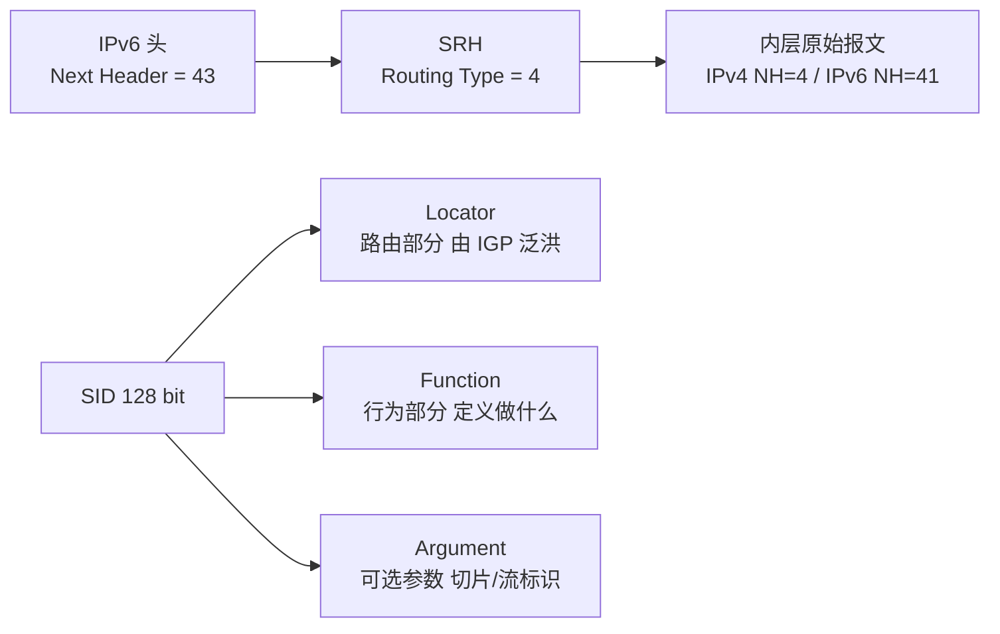

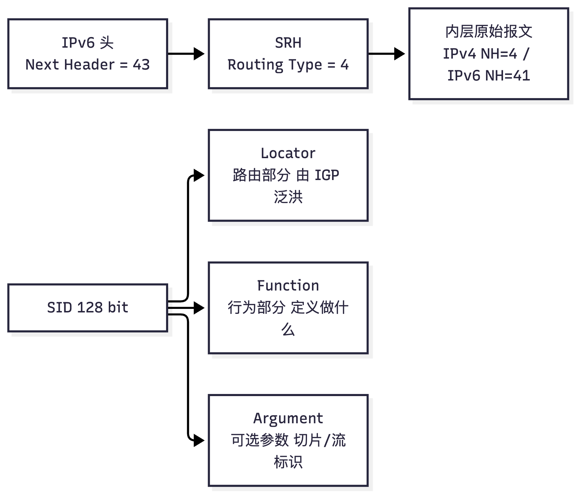


### 真题精练

**Q1.【真题·单选】** SRH（Segment Routing Header）中的 Routing Type 字段取值以及承载它的上层 IPv6 头 Next Header 取值分别是：
A. 4 和 43  B. 43 和 4  C. 4 和 41  D. 41 和 43

> **答案：A**
> **解析**：SRH 是 IPv6 的**路由扩展头**，路由扩展头在 IPv6 Next Header 中的编号是 **43**（所以承载 SRH 的 IPv6 头里 Next Header = 43）；而 SRH 自身内部的 **Routing Type = 4**，表示"这是我这种类型的路由头"。C 的 41 是"IPv6 封装"（内层为 IPv6 报文时 SRH 的 Next Header 常为 41），属于不同字段，不要混。D、B 顺序反了。这个考点几乎每届都出现，务必背成条件反射。

**Q2.【真题·填空】** 某 SRv6 Policy 的 Segment List 共 4 个 SID，则源节点发出报文时 SRH 中的 **Segments Left** 初值为 ______，**Last Entry** 为 ______；当报文到达第 3 个 SID 所属节点时（按从 0 计为 Segment List[2]），其 **Segments Left** 值为 ______。

> **答案：3；3；1**
> **解析**：Segment List 有 4 项时索引为 0~3，故 **Last Entry = 3**；源节点把 DA 设为 Segment List[0]、**Segments Left = 段数 − 1 = 3**（因为第 0 段正在被"当前处理"）。每到一个 SID 端点，先按 SL 取下一个 SID 写入 DA，再 **SL 减 1**：到达 Segment List[1] 端点后 SL = 1，到达 Segment List[2] 端点前 SL = 1（此时处理的正是"还剩 1 段"），到达 Segment List[3] 端点时 SL = 0 并执行终结行为。判断口诀：**"SL = 从当前 SID 往后还剩几段"**。

**Q3.【真题·简答】** 某节点配置 `locator LOC1 ipv6-prefix 2001:DB8:1:: 64 static 32`。请说明该 Locator 的前缀长度、可用于动态分配 SID 的比特数、最多可提供多少个 SID，并解释为什么骨干网通常为每个节点规划 /64 而不是 /128。

> **答案与解析**：
> **前缀与静态部分**：IPv6 前缀长度 **64 bit**（路由部分，由 IGP 泛洪，保证报文能被路由到本节点），静态部分 **32 bit**（Function 的固定/静态部分，用于配置 `opcode ::x`），二者合计 96 bit 固定。
> **可用 SID 数量**：剩余的 **32 bit** 可用于动态分配，理论上最多 **2^32 ≈ 42.9 亿** 个 SID。
> **为什么用 /64 而不是 /128**：SRv6 的 SID 承担"业务与行为"的标识作用——每一条 VPN 路由（End.DT4/DT6）、每一条邻接（End.X）、每张切片的 SID 都要占用一个地址。若用 /128，则一个节点只用**一个**地址，无法再为每条 VPN 路由分配独立 SID，SRv6 的"用地址表达业务"根本无从实现。**/64 的取舍是"路由聚合清晰（一个节点一条 /64 路由）"与"SID 空间充足（2^64 或至少 2^32 个）"之间的平衡点**，因此成为骨干网与数据中心的主流规划方式。

### 易错点与排错

1. **Routing Type 与 Next Header 值混淆**：SRH 内部 Routing Type = 4；承载 SRH 的 IPv6 头 Next Header = 43。
2. **Locator 长度 ≠ SID 长度**：SID 永远是 128 bit；Locator 是它的前缀部分，长度可配。
3. **Segments Left 与段数混用**：SL 初值是"段数 − 1"，不是"段数"；SL = 0 表示最后一段。
4. **忘记 SRv6 也需要 IPv6 可达**：Locator 没有被 IGP 泛洪（漏配 `segment-routing ipv6 locator` 或 IPv6 未使能），表现为"本机 SID 有了但对端不通"。
5. **忽略报文开销**：外层 IPv6 头 40 字节 + SRH(8 + 16n) 字节，深层 SID 列表易触发 MTU 问题（IPv6 最小 MTU 要求 1280 字节，转发路径应≥1500；必要时启用 Path MTU 发现或调大接口 MTU）。
6. **排错命令链**：`display segment-routing ipv6 locator`（Locator 状态与余量）→ `display segment-routing ipv6 local-sid`（行为是否注册）→ `display ipv6 routing-table <locator>`（前缀是否可达）→ 端点侧抓包看 DA 逐跳变化与 SL 递减。

## 8.7 SRv6 SID 行为对照、转发推演与典型应用

### 考点定位

本节把前几节的概念"跑起来"，国赛常以 **1 道多选（SID 行为辨析）+ 1 道简答（转发推演/优势）+ 1 道方案设计题** 出现，分值 8~15 分。高频考法：**① 给行为名判断用途（End.X / End.DT4 / End.DX4 / End.B6.Encaps 等）；② 给定 Segment List 与拓扑，推演每跳 DA 与 Segments Left 的变化；③ SRv6 在数据中心与骨干网的落地场景；④ SRv6 相对 SR-MPLS 的优势**。易错点是把 End.DT4 与 End.DX4 搞混、把 End.B6.Encaps 当成端点行为。

### 原理精讲

**SRv6 的"行为"（Behavior）是 SID 的灵魂**。SID 的 Function 部分决定节点收到该 SID 后执行什么操作，标准行为大致分四类：

1. **段端点类**：`End`（普通端点，更新 DA 后继续转发）、`End.X`（端点 + 三层交叉连接，指定从某邻接发出，是 TI-LFA 与显式路径的基础）、`End.T`（端点 + 指定路由表查表）。
2. **VPN/业务终结类**：`End.DT4`（解封装后在 IPv4 VPN 表查表）、`End.DT6`（IPv6 VPN 表）、`End.DT46`（按内层协议自适应）、`End.DX4` / `End.DX6`（解封装后从指定三层接口发出，常用于 CE 直连场景）、`End.DX2` / `End.DT2U` / `End.DT2M`（二层交叉连接与 EVPN 相关行为）。
3. **策略/绑定类**：`End.B6.Encaps`（Binding SID，收到后按绑定的 SR Policy 重新封装 SRH，用于路径拼接与跨域）、`End.B6.Encaps.Red`（不重复携带自身 SID 的压缩形式）、`End.BM`（绑定到 MPLS 策略）。
4. **运维类**：`End.OP`（OAM/Ping 相关，用于 SRv6 的连通性检测）、`End.AN`（SRv6 TE 场景的行为）。

**四种最易混的行为对照**（考试必背）：

| 行为 | 全称/含义 | 关键动作 | 典型场景 |
|---|---|---|---|
| End | Endpoint | 更新 DA 为下一段，继续按 IPv6 转发 | 普通节点 SID、路径中间段 |
| End.X | Endpoint with L3 Cross-Connect | 更新 DA，并**强制从指定邻接发出** | 严格显式路径、TI-LFA 备份路径 |
| End.DT4 | Endpoint with Decapsulation and IPv4 Table Lookup | **弹出 SRv6 封装**，用内层 IPv4 DA 在**指定 IPv4 VPN 表**查表转发 | L3VPN 私网路由的 VPN SID（最常用） |
| End.DX4 | Endpoint with Decapsulation and IPv4 Cross-Connect | **弹出封装**，把 IPv4 报文从**指定三层接口**发出（不做路由查表） | PE 直连 CE、点到点场景 |
| End.B6.Encaps | Endpoint Bound to an SRv6 Policy (Encapsulation) | 收到该 BSID 后按其绑定的 SR Policy **重新封装**报头 | 跨域路径拼接、标签栈压缩 |
| End.DT6 / End.DX6 | IPv6 版本的 DT/DX | 与 DT4/DX4 对应，作用于 IPv6 报文 | IPv6 VPN、IPv6 直连 |

**SRv6 转发过程逐步推演（用拓扑说明 Segment List 逐跳变化）**。拓扑：CE1—PE1—P1—P2—PE2—CE2。Locator 规划：PE1 `2001:DB8:1::/64`、P1 `2001:DB8:2::/64`、P2 `2001:DB8:3::/64`、PE2 `2001:DB8:4::/64`；PE2 为 vpn-blue 的私网路由分配 `End.DT4` SID = `2001:DB8:4::100`。头端 PE1 采用 SRv6 Policy，Segment List = **[2001:DB8:2::1（P1 的 End），2001:DB8:3::1（P2 的 End），2001:DB8:4::100（PE2 的 End.DT4）]**，共 3 段，SL 初值 2。

| 步骤 | 当前节点 | 报文目的地址 DA | Segments Left | 节点动作 | 处理后 DA / SL |
|---|---|---|---|---|---|
| 1 | PE1（头端） | 2001:DB8:2::1 | 2 | 封装外层 IPv6 头 + SRH，DA 设为 Segment List[0]，按 IPv6 路由发往 P1 | DA=2001:DB8:2::1，SL=2 |
| 2 | P1 | 2001:DB8:2::1 | 2 | DA 是本机 Local SID（End）且 SL≠0 → 取 Segment List[1] 更新 DA，SL 减 1，转发给 P2 | DA=2001:DB8:3::1，SL=1 |
| 3 | P2 | 2001:DB8:3::1 | 1 | 同上 → 取 Segment List[2] 更新 DA，SL 减 1，转发给 PE2 | DA=2001:DB8:4::100，SL=0 |
| 4 | PE2 | 2001:DB8:4::100 | 0 | DA 是本机 Local SID（End.DT4）且 SL=0 → 执行终结：**弹出外层 IPv6 头与 SRH**，用内层 IPv4 DA 在 vpn-blue 表中查表 | 去封装后按内层 IPv4 转发给 CE2 |

**SRv6 的四大优势（答题模板）**：

1. **域间无缝**：SR-MPLS 跨域需要域间标签协商（BGP-LU、标签栈拼接、每域 SRGB 一致性），而 SRv6 的 SID 是 IPv6 地址，**只要域间 IPv6 可达，SID 列表就能端到端串起来**，跨域不再需要额外的标签协商机制。
2. **与 IPv6 天然融合**：SRv6 不是"在 IPv4/MPLS 上叠加"，而是"用 IPv6 本身做段路由"，因此可以与 IPv6 单栈演进、IPv6 地址规划、IPv6 安全体系（如 SRv6 与 IPsec/ACL 的协同）同向演进，避免"IPv6 化 + MPLS 化"双线并行。
3. **可编程**：SID 的 Function 可自定义行为、Argument 可携带参数（切片 ID、流标识、遥测信息），使网络具备"用地址表达业务意图"的能力，是 APN6（应用感知 IPv6 网络）、iFIT（随流检测）等新能力的载体。
4. **网络切片**：切片 = "独立拓扑/算法 + 独立 SID 空间 + 独立资源"。SRv6 天然支持：用 **Flex-Algo** 为切片计算独立路径平面，用**独立 Locator** 划分 SID 空间（可管理、可审计），用 **SRv6 Policy + 资源预留/队列绑定**保障切片 SLA，从而在一张物理网上承载多张逻辑网。

**SRv6 的两大落地场景**：

- **骨干网 / 城域网**：主流路径是"**SRv6 BE 承载 L3VPN（省掉 MPLS 与 LDP）+ SRv6 Policy 做 TE/切片 + iFIT 做随流检测**"，配合 iMaster NCE-IP 实现集中算路与自动化发放，是运营商 5G 承载与云专线的主流选择。
- **数据中心 / DCI**：DC 内可用 SRv6 作为 Underlay 承载（配合 BGP EVPN 做 Overlay，VPN SID 用 End.DT2/DT2M 承载二层、End.DT4/DT6 承载三层），**跨 DC 互联（DCI）用 SRv6 Policy 显式指定跨域路径**，避免 VXLAN 在广域上的封装与选路困境；同时借助 iFIT 做逐跳时延与丢包的可视化，支撑智能运维。

### 关键概念对照表

| 场景 | 推荐技术组合 | 关键 SID 行为 | 关注点 |
|---|---|---|---|
| 骨干 L3VPN | SRv6 BE + MP-BGP | End、End.DT4 / End.DT6 | Locator 规划、SID 数量、MTU |
| 骨干差异化承载 | SRv6 Policy + PCE + 切片 | End、End.X、End.B6.Encaps | 显式路径、BSID 拼接、SLA 验证 |
| 跨域互联 | SRv6 Policy + BSID | End.B6.Encaps | 域间 IPv6 可达性、路径拼接正确性 |
| DCI | SRv6 + EVPN | End.DT2M、End.DT2U、End.DT4 | 二层/三层业务区分、泛洪优化 |
| 随流检测 | iFIT + SRv6 | End.OP 及 iFIT 相关扩展 | 检测精度、对转发性能的影响 |
| 网络切片 | Flex-Algo + 独立 Locator + Policy | End、End.X | 资源隔离与可管理性 |

### 华为设备配置

```bash
system-view
segment-routing ipv6
 encapsulation source-address 2001:DB8:1::1
 locator LOC1 ipv6-prefix 2001:DB8:1:: 64 static 32
  opcode ::1 end                                   // 本节点的普通端点 SID
  opcode ::2 end-dt4 vpn-instance vpn-blue         // 本节点为 vpn-blue 分配的 VPN SID（End.DT4）
  opcode ::3 end-dx4 interface GigabitEthernet0/0/2 // 直连 CE 场景：解封装后直接从该接口发出
  opcode ::10 end-b6-encaps                        // Binding SID：绑定本机某条 SRv6 Policy，用于跨域拼接（版本关键字以 ? 为准）
#
srv6-te policy policy-dci                          // SRv6 Policy（部分版本在 segment-routing ipv6 视图下配置）
 endpoint 2001:DB8:4::1 color 200                   // 端点=目的 PE 的 Locator 地址，颜色=业务意图编号
 candidate-path preference 100
  segment-list sl1
   index 10 sid ipv6 2001:DB8:2::1                 // 第 1 段：P1 的 End SID
   index 20 sid ipv6 2001:DB8:3::1                 // 第 2 段：P2 的 End SID
   index 30 sid ipv6 2001:DB8:4::100               // 第 3 段：PE2 的 End.DT4（VPN SID）
#
display srv6-te policy policy-dci                  // 查看 SRv6 Policy 状态、激活候选路径与 SID 列表
display segment-routing ipv6 local-sid             // 查看本机 Local SID 与行为注册情况
display segment-routing ipv6 locator verbose       // 查看 Locator 明细（含已分配 SID 数量、动态分配余量）
display ipv6 routing-table 2001:DB8:4:: 64         // 确认对端 Locator 前缀可达（SRv6 转发的第一步）
```

> **落地顺序建议**：先在**单域内做 SRv6 BE + L3VPN** 验证互通，再引入 **SRv6 Policy** 做显式路径与 TE，最后引入**切片与 iFIT**。国赛方案题按这个顺序写，层次清晰、风险可控，比"一上来全网切片"更容易得高分。

### 示意图

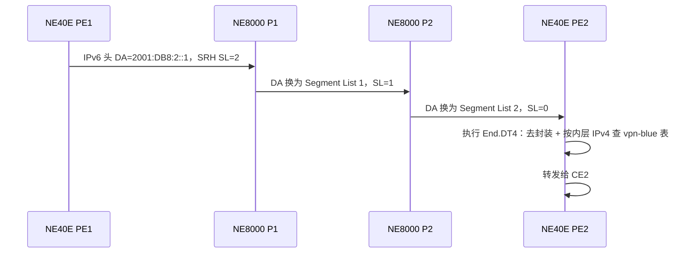

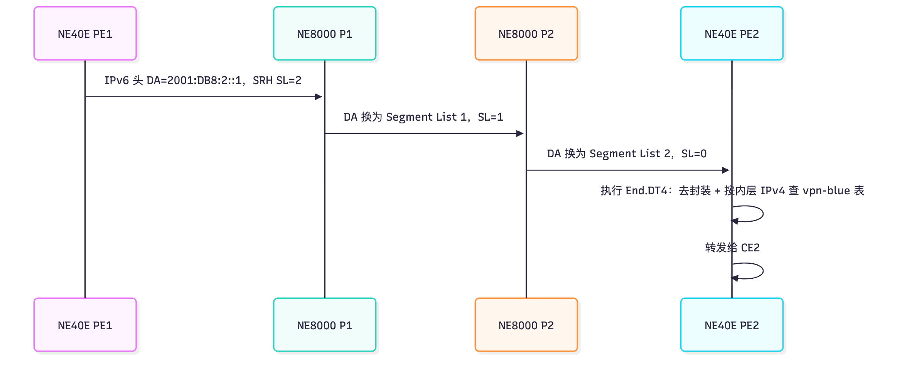


### 真题精练

**Q1.【真题·多选】** 下列关于 SRv6 SID 行为（Behavior）的描述，正确的有：
A. End.X 表示端点行为并强制从指定邻接发出，可用于构造严格显式路径
B. End.DT4 表示解封装后使用内层 IPv4 目的地址在指定 IPv4 VPN 表中查表转发
C. End.DX4 与 End.DT4 的区别在于 End.DX4 不做路由查表，而是直接从指定三层接口发出
D. End.B6.Encaps 是普通端点行为，与 End 完全等价

> **答案：ABC**
> **解析**：A 正确——End.X 是"端点 + 三层交叉连接"，是 TI-LFA 修复路径与严格显式路径的核心行为。B、C 正确，DT 是 Table lookup（查表），DX 是 Cross-connect（直连发出），两个字母的差别就是"查表"与"直发"，这是国赛最爱考的一组辨析。D 错误，End.B6.Encaps 是 **Binding SID** 行为：收到该 SID 后要**按绑定的 SRv6 Policy 重新封装一层 SRH**（用于跨域拼接与栈深压缩），与"更新 DA 后继续转发"的 End 完全不是一回事。

**Q2.【真题·简答】** 某跨域场景中，域 A 内的 SRv6 Policy 已建立，域 B 内也已建立各自的 Policy。请说明如何使用 Binding SID 实现跨域端到端路径，并列出至少三个使用 BSID 的好处。

> **答案与解析**：
> **实现思路**：① 在域 A 与域 B 的**边界节点（ABR/ASBR）**上，为"本域内到达对端边界的那条 Policy"分配一个 **Binding SID（End.B6.Encaps 行为）**，例如域 A 边界节点分配 `2001:DB8:A::B6`；② 头端在编写跨域 Segment List 时，**只写本域到边界的 SID + 对端域的 BSID 或对端策略 SID**，形成"域内段 + BSID + 域内段"的拼接结构；③ 报文到达边界节点命中 BSID 时，节点**按本地绑定的 Policy 重新封装**（换上对端域的 SRH），从而在**不重新协商跨域标签、不需要跨域统一 SRGB** 的前提下完成端到端转发。
> **三个好处**：① **压缩标签栈/SRH 深度**——把长 SID 列表折叠成一个 SID，规避栈深与 MTU 限制；② **解耦引流与路径**——引流入口只引用 BSID，域内策略换路径、换算法时无需改动头端配置，变更风险小；③ **便于跨域分段运维与责任划分**——每个域只暴露一个 BSID，域内拓扑变化不外泄，符合运营商"分域自治"的运维模型。

**Q3.【真题·简答】** 请从"协议简化、跨域能力、可编程性"三个角度说明为什么运营商骨干网倾向于从 MPLS/SR-MPLS 向 SRv6 演进，并指出 SRv6 的主要代价。

> **答案与解析**：
> **协议简化**：MPLS 体系需要 LDP/RSVP-TE 等额外协议与独立的标签空间（SRGB/SRLB），SRv6 直接以 IPv6 地址为 SID，**不再需要 MPLS 与标签分发协议**，转发面只需 IPv6 查表；控制面只需 IGP 扩展（泛洪 Locator）与 BGP（承载 VPN SID），协议栈与运维手段统一。
> **跨域能力**：SR-MPLS 跨域要处理域间标签语义、SRGB 一致性、BGP-LU/标签栈拼接；SRv6 的 SID 是**全局可路由的 IPv6 地址**，域间只要 IPv6 可达，SID 列表即可端到端编排，跨域与跨厂商互通显著更简单。
> **可编程性**：SID 的 Function 部分定义行为、Argument 携带参数，使网络能够表达"切片、应用感知、随流检测"等业务意图（APN6、iFIT），配合控制器实现"网络即代码"的服务化交付。
> **主要代价**：① **报文开销大**：外层 IPv6 头 40 字节，加 SRH 后更重，深层 Segment List 会显著降低有效载荷比并触发 MTU 问题；② **硬件要求高**：IPv6 长地址查表、SRH 解析与多层 SID 处理对芯片有要求，老设备往往只支持少量 SID 层次；③ **Locator/SID 规划复杂度上升**：SID 即地址，规划不当会导致地址空间浪费或后续无法扩展；④ **存量互通**：需与 MPLS 域共存（如 SRv6 与 MPLS 互通方案），过渡期复杂度与运维成本不可忽视。**结论：演进是方向，但必须"先规划 Locator、先验证 BE、再上 Policy 与切片"，并保留回退路径。**

### 易错点与排错

1. **DT 与 DX 混淆**：DT = 查表（Table），DX = 直发（Cross-connect）。
2. **把 End.B6.Encaps 当端点**：它是"重新封装"的绑定行为，对应 BSID。
3. **SL 与 DA 的处理顺序写错**：标准顺序是"**先按 SL 取下一个 SID 更新 DA，再 SL 减 1**"，然后按该 SID 的行为转发。
4. **Locator 未泛洪**：`display segment-routing ipv6 local-sid` 有 SID 但 `display ipv6 routing-table` 无对端 Locator → 检查 IGP 是否携带 SRv6 Locator 扩展、IPv6 是否使能。
5. **MTU 问题**：明显表现为"小包通、大包不通"或 ping 大包失败，需核对链路 MTU 与 SRH 开销。
6. **排错命令链**：`display segment-routing ipv6 locator verbose` → `display segment-routing ipv6 local-sid` → `display ipv6 routing-table <locator>` → `display srv6-te policy <name>` → 端点抓包比对 DA/SL 逐跳变化。

## 章节8 综合真题（限时 30 分钟）

**Q1.【真题·实验】** 在 eNSP 中用 4 台 NE40E 搭建 PE1—P1—P2—PE2 的骨干拓扑（另加 P1—P3—P2 作为备用路径），要求完成：① IS-IS Level-2 使能并统一 SRGB 为 16000–23999，四个 Loopback 分别配置 `prefix-sid index 1/2/3/4`；② 使能 SR-MPLS BE，验证 PE1 到 PE2 的私网互通；③ 在 P1 上为 P1→P2 直连链路配置静态 Adjacency-SID 24001，并在 PE1 上建立 SR-TE Policy，使 PE1 到 PE2 的流量**严格经过 P1→P2 直连链路**；④ 用命令验证并写出报文在每一跳的标签栈变化；⑤ 关闭 P1→P2 直连链路，验证策略切换到候选备份路径。

> **答案与解析**：
> **配置要点**：① 全局 `segment-routing` → `global-block 16000 23999`（四台设备完全一致）；② `isis 1` → `is-level level-2` → `cost-style wide` → `network-entity` → `segment-routing mpls` + `no shutdown`；③ 所有互联接口 `mpls enable` + `isis enable 1`；④ Loopback 接口 `isis prefix-sid index N`；⑤ P1 的 P1→P2 接口配置 `isis adjacency-sid static 24001`；⑥ PE1 配置 `sr-te policy`（endpoint = PE2 的 Loopback，color 自定义）+ `candidate-path preference 200` 引用主 SID 列表 `[16002, 24001, 16004]` + `candidate-path preference 100` 引用备份列表 `[16003, 16004]`（经 P3）。
> **验证与标签栈**：PE1 压入 `16002/24001/16004`；P1 收到栈顶 16002（自身 Node SID）→ 弹出 → 新栈顶 24001（本机到 P2 的 Adj-SID）→ 弹出并从该邻接发出 → 栈剩 `16004`；P2 收到 16004（非自身）→ 标签交换发往 PE2；PE2 收到 16004（自身 Node SID）→ 弹出 → 按 IP 目的转发。验证命令：`display isis segment-routing prefix-sid`、`display mpls lsp`、`display sr-te policy <name> verbose`、`tracert -v`。
> **切换验证**：`shutdown` P1→P2 接口后，主候选路径失效，次优候选路径（preference 100，经 P3）接管；用 `display sr-te policy <name> verbose` 确认激活候选路径已切换，`tracert -v` 确认路径变为 P1→P3→P2。
> **判分要点**：SRGB 全网一致、`cost-style wide` 存在、接口 `mpls enable` 无遗漏、Adj-SID 只在本地生效且顺序正确（先 Node SID 后 Adj-SID）、切换后业务不中断。

**Q2.【真题·简答】** 承接 Q1，若把 SRv6 作为目标架构，请说明 Locator 规划要点，并指出 SRv6 相比 SR-MPLS 在该拓扑中的两个优势与两个风险。

> **答案与解析**：
> **Locator 规划要点**：① 每个节点规划一段独立的 IPv6 前缀（骨干常见 /64，节点少时也可 /48），保证"Locator 路由可聚合、SID 空间充足"；② Locator 必须通过 IGP 泛洪（`segment-routing ipv6 locator <name>`）才能保证目的 SID 可路由；③ Function 的静态/动态长度（如 `static 32`）决定可分配 SID 数量，需按"每 VPN 一个 End.DT4/DT6 + 每邻接一个 End.X"估算；④ 每张切片使用独立 Locator 便于管理与审计；⑤ Locator 一旦泛洪即难以变更，必须写入割接方案与 IP 规划表。
> **两个优势**：① **跨域无缝**：SID 本身是 IPv6 地址，只要域间 IPv6 可达就能端到端串起 SID 列表，不需要域间标签协商与 SRGB 一致性；② **协议简化**：不再需要 MPLS 与标签分发机制，转发面只需 IPv6 查表，控制面只需 IGP 扩展 + BGP。
> **两个风险**：① **报文开销与 MTU**：外层 IPv6 头 40 字节，加 SRH 后更重，深层 Segment List 易触发 MTU 问题（骨架链路需确保 MTU ≥ 1500 并考虑更大值）；② **硬件与地址资源约束**：IPv6 长地址查表与 SRH 处理对芯片有要求，老设备支持层次有限；Locator/SID 规划不足会导致 SID 无法分配且难以整改。

---

# 数通-HCIE-章节9-网络自动化与可编程

## 9.1 网络自动化的驱动力与架构分层

### 考点定位

本节是章节9的"总纲"，国赛通常以 **1 道单选 + 1 道简答** 出现，分值 5~8 分，属于"必须拿满"的部分。高频考法：**① 判断传统人工运维的具体瓶颈；② 说出设备层—控制器层—编排层各自职责与典型组件；③ 判断某动作属于哪一层**。易错点是把"控制器层"与"编排层"的职责混淆（控制器面向"网络设备"，编排面向"业务与流程"）。

### 原理精讲

**人工运维的四个瓶颈**（答题时按"规模、一致性、风险、效率"四条展开）：

1. **规模瓶颈**：一个中型园区可能有 300 台交换机、5000 条 VLAN 配置，一台设备 5 分钟的登录配置时间意味着全量变更需要数十人天；网络规模增长是线性的，人力增长也必须是线性的，成本无法摊薄。
2. **一致性瓶颈**：人工配置必然产生"配置漂移（Configuration Drift）"——同一批设备里总有三五台的 NTP、SNMP、时间戳、VLAN 命名不一致，导致故障时行为不一致、排错时无法用"同型号同配置"做对比。
3. **变更风险瓶颈**：人工操作无版本、无审计、无预校验，一次误敲 `undo` 或漏敲一条 ACL 就可能造成业务中断；出问题后只能靠"回忆刚才敲了什么"来定位，缺乏可比对的历史快照。
4. **效率与响应瓶颈**：新业务上线要走"提需求→工程师排期→手工配置→验证"，周期以天/周计，而业务侧期望是分钟级。网络成为业务敏捷的瓶颈环节。

**自动化的技术与流程收益**：用"**声明式意图 + 幂等执行 + 版本化 + 校验闭环**"替代"命令式手工登录"。关键在于三点：① 输入是"**意图**"（我需要 100 个 VLAN、每个 VLAN 对应一个网段），不是"命令序列"；② 执行是**幂等**的（重复执行结果一致，不会因为多跑一次就产生重复配置）；③ 结果可**校验**（跑完自动比对配置差异、自动回滚）。

**三层架构分层**（必背）：

| 层次 | 名称 | 职责 | 典型组件/协议 | 面向对象 |
|---|---|---|---|---|
| 上层 | 编排层 Orchestration | 业务意图翻译、流程编排、工单与审批、跨域/多云协同、资源与 IPAM 管理 | iMaster NCE 的业务编排模块、BSS/OSS、Ansible/AWX、CI/CD 流水线 | 业务与流程 |
| 中层 | 控制器层 Controller | 网络级抽象：拓扑收集、路径计算、策略翻译、设备配置下发与状态监控、Telemetry 采集与告警 | iMaster NCE-IP / NCE-Fabric / NCE-Campus；PCE | 网络与策略 |
| 下层 | 设备层 Device | 执行转发与本地控制面；提供可编程接口（NETCONF/RESTCONF/gNMI/Telemetry/CLI） | NE40E / NE8000、CloudEngine S12700 / S6730 / S5731、AR6120 / AR651、USG6510E | 设备与转发 |

**为什么必须分层？** 因为三层的**变更频率与稳定性需求完全不同**：业务意图每天变，网络策略每周变，转发实现几年不变。分层后，**上层变更不必触碰设备、设备升级也不必重写业务流程**，同时每一层都能独立测试与灰度的边界，这就把"一次大变更"拆成了"多次可回退的小变更"，风险可控。

**两类落地路径**：① **控制器主导（Controller-based）**：以 iMaster NCE 为核心，设备作为"被管理者"，适合大型园区、数据中心与骨干网，能力最全但引入新平台；② **工具链主导（Tool-based / DevOps）**：以 Ansible + Python + Git 为核心，直接把配置推给设备，轻量、灵活、无需新平台，适合中小规模与已具备运维开发能力的团队。国赛方案题中两条路径都可以写，但**必须说明选择理由与边界**（规模、团队能力、既有平台、合规要求）。

### 关键概念对照表

| 自动化范式 | 输入形态 | 执行方式 | 幂等性 | 典型工具 |
|---|---|---|---|---|
| CLI 脚本（Paramiko 等） | 命令序列 | 逐条下发 | 需自行保证（往往没有） | Paramiko、expect |
| 结构化协议自动化 | 结构化数据（XML/JSON） | 事务化编辑配置库 | 由协议与模型保证 | Netmiko、NETCONF、RESTCONF |
| 声明式模型自动化 | YANG 数据/意图 | 控制器计算 + 差异下发 | 强 | iMaster NCE、Ansible 模块 |
| 配置管理（IaC） | YAML/剧本 | 幂等模块执行 | 强 | Ansible、Nornir |

| 开放接口 | 传输 | 数据格式 | 主要用途 | 是否支持订阅/推送 |
|---|---|---|---|---|
| CLI（SSH/Telnet） | SSH/Telnet | 文本 | 交互式排错、兼容老设备 | 否 |
| NETCONF | SSH 830 | XML | 配置管理、状态读取 | 支持 Notification |
| RESTCONF | HTTPS 443 | JSON/XML | 轻量配置与查询、Web 集成 | 有限 |
| gNMI | gRPC (HTTP/2) | Protobuf/JSON | 配置、查询、订阅 | 支持 Subscribe |
| Telemetry | gRPC/UDP | GPB/JSON | 高频性能与状态采集 | 单向推送 |
| SNMP | UDP 161/162 | ASN.1 编码的 OID-值 | 传统监控与告警 | Trap/Inform |

### 华为设备配置

```bash
system-view
ssh server enable                                 // 使能 SSH 服务（NETCONF over SSH、自动化 SSH 登录的前置条件）
stelnet server enable                             // 使能 STELNET（交互式登录，用于人工核查与脚本调试）
snetconf server enable                            // 使能 NETCONF 服务（自动化配置下发的入口）
#
aaa
 local-user netauto password irreversible-cipher Huawei@123   // 创建自动化专用账号（切忌用个人账号做自动化）
 local-user netauto privilege level 15                          // 赋予最高权限级别
 local-user netauto service-type ssh                            // 服务类型必须包含 ssh，否则 NETCONF 子系统无法登录
 local-user netauto user-group manage-ug                        // 加入管理用户组（组名随版本可能为 manage-ug 等，以 ? 补全为准）
quit
#
ssh user netauto authentication-type password     // 指定该 SSH 用户的认证方式
ssh user netauto service-type snetconf            // 允许该用户建立 NETCONF 会话（部分版本关键命令，漏配会直接拒绝）
#
display ssh server status                         // 确认 SSH 服务已开启
display current-configuration | include snetconf  // 确认 NETCONF 服务已使能
display users                                     // 查看当前登录用户（自动化执行期间可见脚本来源地址）
```

> **安全建议**：自动化账号必须**专用、最小权限、可审计**（单独用户名、独立密码、必要时限制源地址 ACL），并在 NCE/Ansible 侧用 Vault 加密保管凭据，绝不能把明文密码写进剧本或脚本仓库。

### 示意图

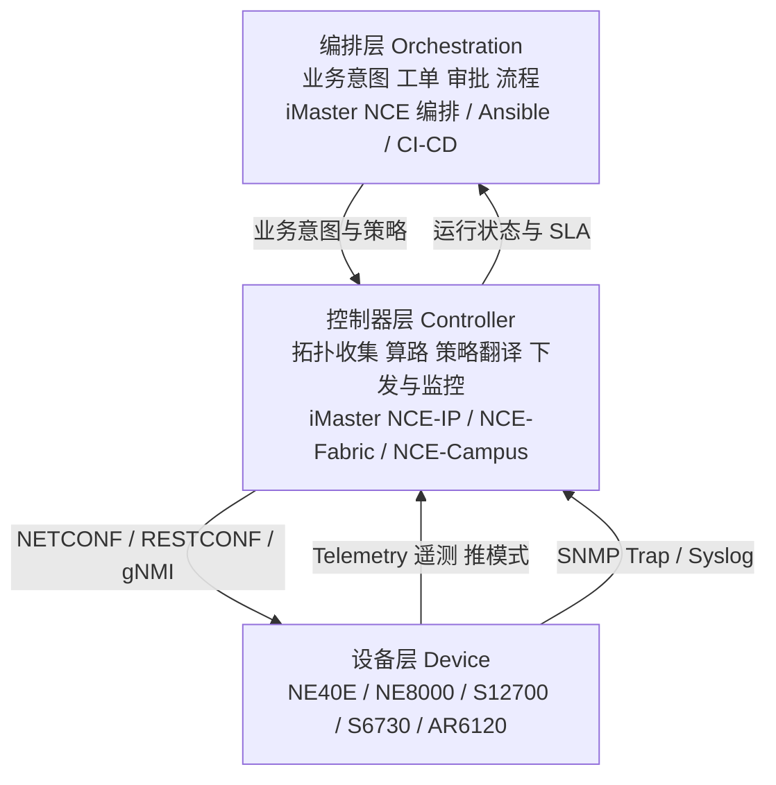

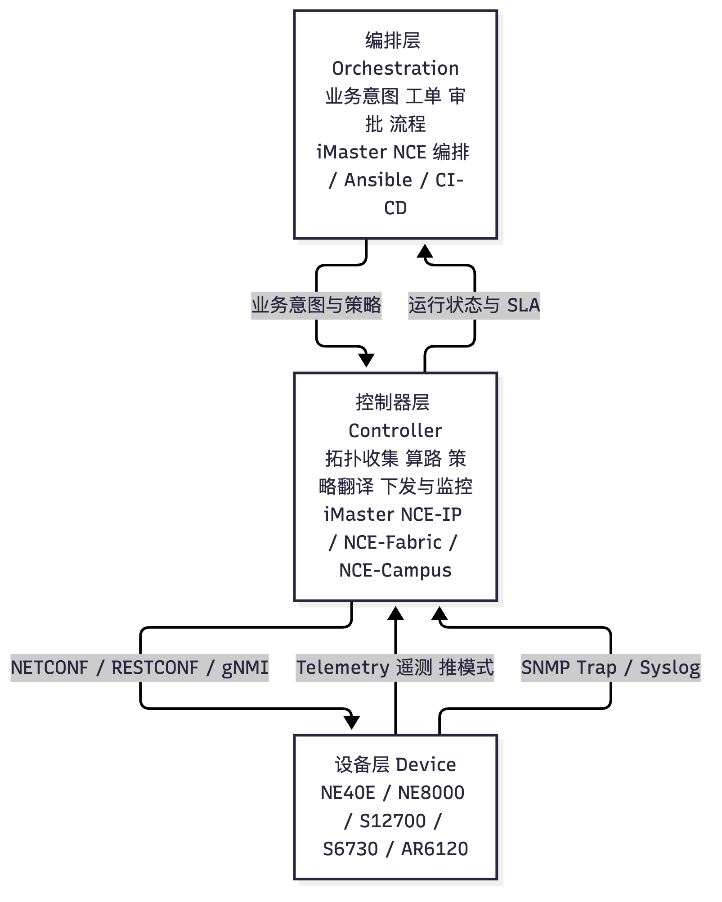


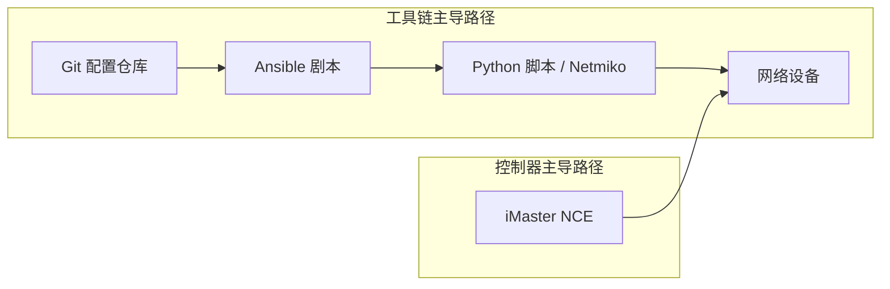

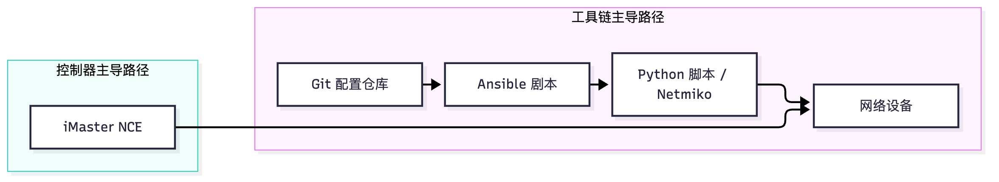


### 真题精练

**Q1.【真题·多选】** 下列哪些属于网络人工运维的典型瓶颈？
A. 配置漂移导致同型号设备行为不一致
B. 变更缺乏版本与审计，出问题难以快速定位与回滚
C. 新业务上线周期长，网络成为业务敏捷的瓶颈
D. 设备转发性能不足，无法支持线速转发

> **答案：ABC**
> **解析**：A、B、C 分别对应"一致性、风险控制、效率"三类运维瓶颈，也是自动化要解决的三个核心问题。D 是硬件转发能力问题，属于设备选型与容量规划范畴，与"运维方式是否自动化"无关——国赛常拿这类"看似相关实为无关"的选项做干扰。

**Q2.【真题·简答】** 请说明网络自动化架构中"控制器层"与"编排层"的职责边界，并各举一个典型动作。

> **答案与解析**：
> **控制器层（面向网络）**：负责"把策略翻译成设备可执行的配置，并保证网络按预期运行"。典型动作：**根据业务策略计算 SRv6 Policy 的 SID 列表并通过 NETCONF/PCEP 下发到设备，同时用 Telemetry 采集链路时延，发现 SLA 劣化时重算路径**。它掌握的是**网络视图**（拓扑、SID、隧道、设备状态）。
> **编排层（面向业务）**：负责"把业务需求翻译成网络策略，并驱动流程"。典型动作：**收到 CRM 的"为某客户开通 100 M 云专线"工单后，自动完成资源校验（IPAM/VLAN 池）、生成网络策略并调用控制器下发、触发验收测试、回写工单与计费系统**。它掌握的是**业务视图**（客户、产品、订单、SLA 合约）。
> **一句话边界**：**控制器问"网络怎么配"，编排层问"为什么配、配给谁、什么时候配、配完谁验收"。** 二者通过 API（多为 RESTful/北向接口）解耦，因此可以替换其中一层而不影响另一层。

**Q3.【真题·单选】** 某团队规模较小、无自建控制器平台，希望通过 Git + Ansible 直接管理 30 台交换机与 4 台出口路由器。该方案最准确的定位是：
A. 设备层自动化，属于控制器主导路径
B. 工具链主导路径（Tool-based），通过声明式剧本实现幂等配置下发
C. 编排层自动化，具备完整的业务工单与计费能力
D. 不属于网络自动化，只是批量脚本

> **答案：B**
> **解析**：Ansible 的本质是"**声明式 + 幂等**"的配置管理工具：剧本描述"目标状态"，模块负责计算差异并下发，重复执行不产生重复配置，因此属于真正的自动化而非"批量脚本"（D 错）。它不引入集中控制器平台，走的是**工具链主导路径**（A 中"控制器主导"错误）。C 错误，编排层的核心标志是与业务系统（工单、计费、资源）打通并驱动流程，仅用 Ansible 管设备并不构成编排层能力。

### 易错点与排错

1. **把"批量脚本"当自动化**：自动化的判据是"声明式 + 幂等 + 可校验"，不是"用脚本一次改很多台"。
2. **控制器层与编排层职责写反**：记住"控制器面向网络、编排面向业务"。
3. **忽略自动化账号安全**：使用个人账号、明文密码、权限过大，是国赛方案题的安全扣分点。
4. **不考虑存量设备能力**：老设备可能不支持 NETCONF/gNMI，方案中应给出"支持/不支持设备的分级自动化策略"（如不支持者走 CLI 模板 + 人工复核）。
5. **验证命令**：`display ssh server status`、`display current-configuration | include snetconf`、`display users`、`display api call-record`（部分版本可查开放接口调用记录）。

## 9.2 NETCONF 协议详解

### 考点定位

NETCONF 是章节9**考得最细**的知识点，国赛常以 **1 道单选 + 1 道多选 + 1 道填空/简答** 出现，分值 8~12 分。高频考法：**① NETCONF 的四层协议结构；② 端口号（830）与传输（SSH）；③ 配置库关系（candidate/running/startup）与提交机制；④ 操作集辨析（get 与 get-config 的区别、edit-config 的四种操作属性）；⑤ 能力交换（hello）流程**。易错点是把 `get` 与 `get-config` 混淆、误认为所有设备都支持 candidate 库。

### 原理精讲

**为什么需要 NETCONF？** 因为 CLI 是"给人看的"：输出是文本、格式随版本变化、无法可靠解析、没有事务语义、改一半失败会留下半成品配置。自动化需要的是**机器可读写、可校验、可事务化**的接口。NETCONF（NETwork CONFiguration protocol，RFC 6241）就是为此设计的：**用 XML 表达配置与操作，用 SSH 承载，用"配置库 + 事务"保证一致性**。

**NETCONF 的四层协议结构**（必背，考试常要求逐层说明）：

| 层次 | 名称 | 作用 | 关键点 |
|---|---|---|---|
| 第 1 层 | 内容层 Content | 表达"配置什么/查什么"，即数据本身 | 由 YANG 模型定义，如接口、VLAN、路由协议；NETCONF 本身不管内容语义 |
| 第 2 层 | 操作层 Operations | 表达"做什么"，即 RPC 操作集 | get、get-config、edit-config、copy-config、commit 等 |
| 第 3 层 | 消息层 Messages | 表达"一次交互的报文结构" | `<rpc>` / `<rpc-reply>` 封装，message-id 用于请求响应配对 |
| 第 4 层 | 传输层 Transport | 表达"怎么送" | **SSH 830**（RFC 6242），也支持 TLS（RFC 7589，端口 6513） |

**核心操作集**（必须能说出用途与区别）：

| 操作 | 作用 | 关键区别/考点 |
|---|---|---|
| get | 获取**运行状态 + 配置**数据 | 会返回设备实际运行状态（如接口 UP/DOWN、计数器、会话数） |
| get-config | 获取**指定配置库**中的配置数据 | 只返回配置，不返回状态；可用 filter 精确过滤 |
| edit-config | 编辑配置库（target 指定 candidate 或 running） | 四种操作属性：**merge（默认，合并）/ replace（替换）/ create（必须不存在，否则报错）/ delete（必须存在，否则报错）/ remove（存在则删，不存在不报错）** |
| copy-config | 整体复制配置库 | 如 running→startup（保存配置）、candidate→running |
| delete-config | 删除某配置库 | **不能删除 running** |
| lock / unlock | 锁定/解锁配置库，防止并发修改 | 自动化并发场景的关键，避免两个系统同时改同一设备 |
| commit | 把 candidate 的内容提交到 running | 支持 confirmed-commit（超时未确认自动回滚），是"防呆"核心机制 |
| discard-changes | 丢弃 candidate 中的未提交改动 | candidate 库专有 |
| validate | 校验 candidate 配置语法与语义 | 提前发现错误，避免下发到设备后业务中断 |
| close-session / kill-session | 正常关闭/强制终止会话 | kill-session 用于清理僵尸会话 |

**三个配置库与提交机制**：

- **running**：设备当前生效的配置（唯一真实来源），**所有设备都有**。
- **candidate**：待提交的"草稿"配置库，允许"改多次、一次提交"，**不是所有设备都支持**（需能力 `candidate`）。
- **startup**：设备下次启动时加载的配置，**只有部分设备支持**。

**能力交换（Capability Exchange）**：会话建立后，双方**各自发送 `<hello>`**（NETCONF 1.1/RFC 6241 中双方都发 hello，客户端与服务端对称），hello 中包含 `<capabilities>` 与 `<session-id>`（服务端分配）。客户端据此知道"设备支持哪些能力"（如 `candidate`、`confirmed-commit`、`validate`、`rollback-on-error`、`xpath`、`writable-running`、`startup`），**再决定用哪套操作流程**——这是"能力协商决定行为"的典型设计，也是自动化框架（Netmiko/NAPALM/NCE）适配多厂商的根基。

**事务化的价值（为什么考试爱考）**：在 candidate 库上做 `edit-config` 后先 `validate`，再 `commit`；若开启 `confirmed-commit`，提交后必须在约定时间内再发一次 `commit` 确认，**否则自动回滚到改动前的配置**。这就把"改错了回不来"变成了"改错了自己回来"，对割接与自动化下发是决定性的安全保障。

### 关键概念对照表

| 配置库 | 是否所有设备都有 | 内容 | 典型操作 | 对应华为命令类比 |
|---|---|---|---|---|
| running | 是 | 当前生效配置 | edit-config / get-config / copy-config 源或目的 | `display current-configuration` |
| candidate | 否（需能力支持） | 待提交草稿 | edit-config / validate / commit / discard-changes | 无直接对应（华为以事务/两阶段下发实现） |
| startup | 否（需能力支持） | 下次启动加载的配置 | copy-config 目的（保存） | `save` / `display saved-configuration` |

| 操作属性 | 目标节点存在 | 目标节点不存在 | 典型用途 |
|---|---|---|---|
| merge | 合并修改 | 创建 | 默认行为，最常用 |
| replace | 整体替换 | 创建 | 需要"配置即全量"的严格声明式场景 |
| create | 报错（data-exists） | 创建 | 防止误改已有配置 |
| delete | 删除 | 报错（data-missing） | 确认存在才删 |
| remove | 删除 | 不报错 | 幂等删除，适合自动化（推荐） |

### 华为设备配置

```bash
system-view
snetconf server enable                            // 使能 NETCONF 服务端（SSH 子系统 netconf）
ssh server enable                                 // 确保 SSH 服务开启（NETCONF over SSH 依赖）
ssh server port 830                               // 标准端口为 830；如被占用/合规要求可改，但客户端须同步
#
ssh user netauto authentication-type password
ssh user netauto service-type snetconf            // 允许该用户使用 NETCONF 服务
aaa
 local-user netauto service-type ssh              // 服务类型含 ssh
 local-user netauto privilege level 15
quit
#
display snetconf server session                   // 查看当前 NETCONF 会话（谁在连、连了多久）
display current-configuration | include netconf   // 核查 NETCONF 相关配置是否生效
```

客户端侧（Linux 环境用 netconf-console 或 ncclient 快速验证）：

```bash
# 使用 Python ncclient 建立会话并查询设备能力，验证 NETCONF 通道是否可用
python3 - <<'PY'
from ncclient import manager                                  # ncclient 是 Python 的 NETCONF 客户端库

with manager.connect(host="10.1.1.1", port=830,               # 设备管理地址与标准 NETCONF 端口
                     username="netauto", password="Huawei@123",
                     hostkey_verify=False,                     # 实验环境关闭主机密钥校验（生产必须开启）
                     device_params={"name": "huawei"}) as m:   # 指定华为设备驱动，匹配其能力集
    for cap in m.server_capabilities:                         # 打印能力交换结果
        print(cap)                                            # 可看到 candidate / validate / xpath 等能力
PY
```

### 示意图

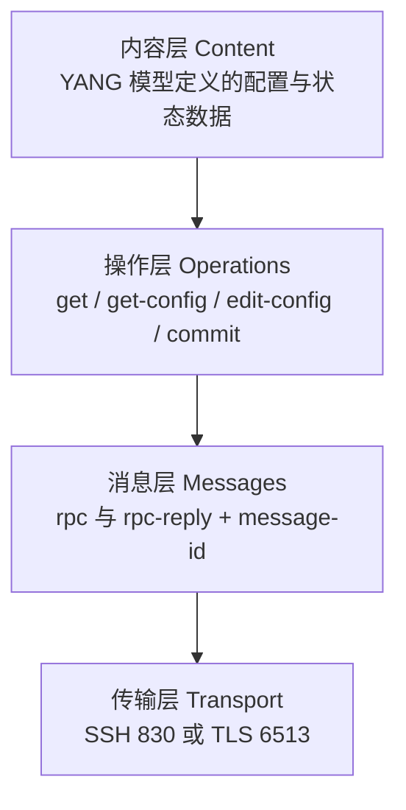

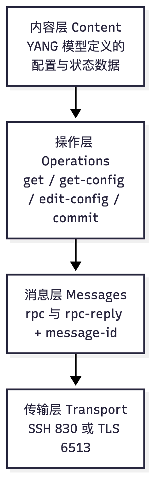


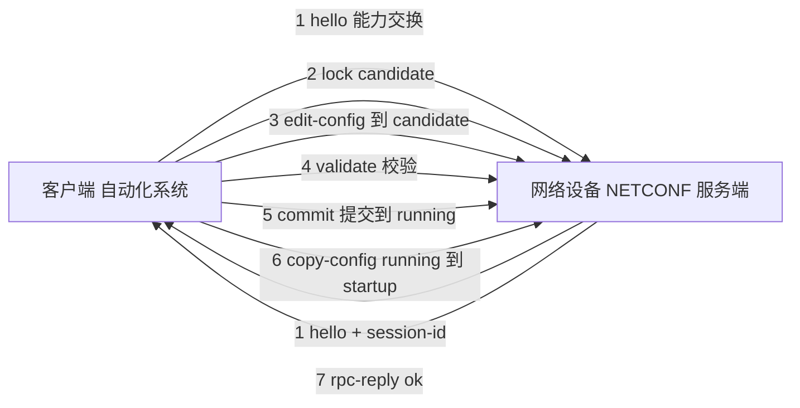

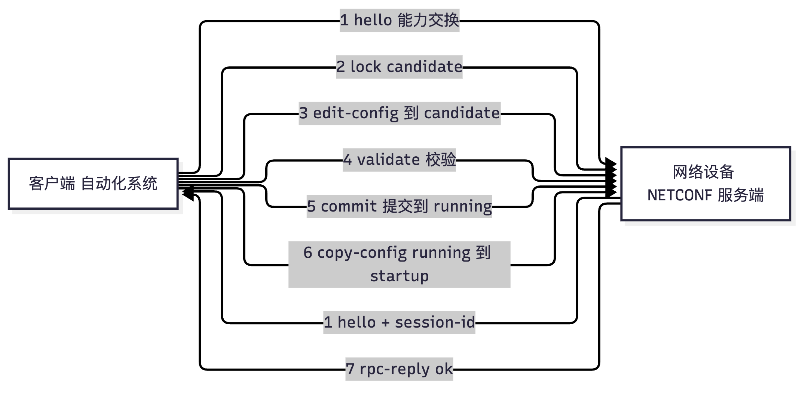


### 真题精练

**Q1.【真题·单选】** NETCONF 的四层协议结构中，负责定义"配置什么内容"的是哪一层？
A. 传输层  B. 消息层  C. 操作层  D. 内容层

> **答案：D**
> **解析**：内容层（Content）描述的是**数据本身**（接口、VLAN、路由协议等配置与状态），由 YANG 模型定义；操作层定义"做什么"（get/edit-config 等 RPC）；消息层定义 rpc/rpc-reply 的封装与 message-id；传输层解决"怎么送"（SSH 830 / TLS 6513）。四层各管一件事，**NETCONF 协议标准本身不规定内容语义**，这正是它能适配多厂商的原因。

**Q2.【真题·多选】** 关于 NETCONF 的配置库与提交机制，下列说法正确的有：
A. running 库是设备当前生效配置，所有 NETCONF 设备都必须支持
B. candidate 库允许先多次编辑再一次性提交，但并非所有设备都支持
C. confirmed-commit 机制下，若客户端未在约定时间内确认，设备会回滚到改动前的配置
D. delete-config 可以删除 running 库

> **答案：ABC**
> **解析**：A、B 正确。C 正确，这是 confirmed-commit（已确认提交）的核心价值，也是"自动化改配置不敢改"这一心理障碍的技术解法——**下发后不确认就自动回滚**。D 错误，标准明确规定 **running 库不能被删除**（它是设备运行的唯一真实来源），`delete-config` 只能作用于 startup 或 candidate。

**Q3.【真题·填空/简答】** NETCONF 默认承载在 ______ 协议之上、使用端口 ______；客户端通过 ______ 报文与设备交换能力集，从而决定后续使用哪些操作。

> **答案：SSH；830；hello**
> **解析**：NETCONF 的标准传输映射是"NETCONF over SSH"（RFC 6242），端口 **830**；若走 TLS 则为 RFC 7589，端口 6513。会话建立后双方互发 **hello**（内含 capabilities 与 session-id），客户端据此判断设备是否支持 `candidate`、`validate`、`confirmed-commit`、`xpath`、`startup` 等能力，然后选择对应的操作流程。**注意**：能力交换是"协商"，不是"认证"；认证由传输层（SSH）完成。

### 易错点与排错

1. **get 与 get-config 混用**：要查"接口是不是 UP/收发包计数"必须用 `get`（含状态数据）；要查"接口配了什么地址"用 `get-config`。
2. **以为 candidate 一定可用**：先看 hello 能力集，不支持 candidate 的设备只能直接编辑 running（此时更要依赖备份与回滚方案）。
3. **端口与传输写错**：SSH 是 830，TLS 是 6513，别写成 22（22 是交互式 SSH，不是 NETCONF 标准端口）。
4. **并发编辑冲突**：多系统同时改一台设备要用 `lock`/`unlock`，否则后写覆盖前写。
5. **权限与子系统报错**：连接被拒多半是 `local-user` 的 `service-type` 未包含 ssh、未配 `ssh user ... service-type snetconf`，或 ACL 限制了源地址。
6. **排错命令链**：设备侧 `display snetconf server session` → `display ssh server status` → 客户端 `ncclient` 打印 capabilities；失败时先用 `stelnet` 人工登录验证账号密码是否可用。

## 9.3 YANG 数据模型与 NETCONF 的关系

### 考点定位

YANG 是"内容层"的语言，国赛常以 **1 道单选 + 1 道多选/简答** 出现，分值 6~10 分。高频考法：**① YANG 的作用与 NETCONF 的分工；② module / submodule 与 container / leaf / leaf-list / list 的结构辨析；③ 数据类型与约束；④ 华为设备的 YANG 模型与配置命令的对应关系**。易错点是把 `leaf-list` 与 `list` 混淆、把 YANG 当成"传输协议"。

### 原理精讲

**YANG 是什么、不是什么**。YANG（RFC 7950，YANG 1.1；1.0 为 RFC 6020）是一门**数据建模语言**，用来定义"设备上有哪些配置与状态数据、它们的层次结构、类型与约束"。它**不是传输协议、不是操作协议**：NETCONF 负责"怎么改"（操作），YANG 负责"改什么、什么结构、什么类型"（内容）。二者关系就像"SQL 语句（操作）与数据库表结构（模型）"。

**module 与 submodule**：`module` 是建模的基本单元，一个 module 就是一个 `.yang` 文件，包含命名空间（namespace）、前缀（prefix）、修订记录与数据定义；`submodule` 用于把大 module 拆分成多个文件（如 `huawei-ifm` 拆成若干子模块），通过 `belongs-to` 声明归属。**命名空间 + 模块名 + 数据路径**共同构成"数据节点"的全局唯一标识，因此同一份配置在不同厂商设备上路径不同（这也解释了为什么多厂商自动化需要"模型映射/适配层"）。

**四类核心数据节点**（必须能画层次）：

| 节点类型 | 含义 | 是否可重复 | 是否需要 key | 例子 |
|---|---|---|---|---|
| container | 容器，纯组织结构，无值 | 否 | — | `interfaces`、`vlan` |
| leaf | 叶子，单一值（标量） | 否 | — | `name`、`description`、`mtu` |
| leaf-list | 叶子列表，同类型多值，**无序或有序的重复叶子** | 是（同类型多值） | — | `dns-server [8.8.8.8, 114.114.114.114]` |
| list | 列表，**每条entry由多个字段组成，必须有 key** | 是（多 entry） | 是（key 唯一标识 entry） | `vlan` 列表，key 为 `vlan-id` |

**常用数据类型与约束**：`string`、`uint8/16/32/64`、`int8/16/32/64`、`boolean`、`enumeration`、`decimal64`、`binary`、`union`、`leafref`（引用另一个叶子的值，用于表达"外键"关系，如接口名必须已存在）、`identityref`、以及约束语句 `mandatory`、`default`、`range`、`length`、`pattern`（正则）、`must`、`when`、`config false`（只读状态数据）。

**YANG 与 NETCONF 的配合流程**：
1. 客户端读取设备的 YANG 模型（本地库或 `get-schema`），知道有哪些节点、类型、约束；
2. 客户端根据模型**构造 XML**（内容层），用 `edit-config`（操作层）经 `<rpc>`（消息层）通过 SSH（传输层）下发；
3. 设备按模型校验（类型、range、mandatory 是否满足），不合法直接返回 `<rpc-error>`，**根本不会写入配置**——这就是"模型即校验"的价值：**把配置错误拦在设备之外**。

**华为设备的 YANG 模型与配置映射**。华为设备提供的模型大致分两类：**标准模型**（IETF：`ietf-interfaces`、`ietf-ip`、`ietf-routing`、`ietf-yang-types`；OpenConfig：`openconfig-interfaces` 等）与**华为私有模型**（多以 `huawei-` 前缀，如 `huawei-ifm`（接口管理）、`huawei-vlan`、`huawei-system`、`huawei-bgp` 等）。映射关系可以理解为：

- YANG 路径 `interfaces/interface/name` ↔ VRP 命令 `interface GigabitEthernet0/0/1`；
- YANG 路径 `vlan/vlan-id` ↔ VRP 命令 `vlan batch 10`、`vlan 10`；
- YANG 中的 `config false` 节点 ↔ `display` 类的状态输出（只读）。

**因此"改配置"在 YANG 视角下就是"修改数据树的节点值"**，这也是控制器能把"业务意图"翻译成"配置树差异"的技术基础。

### 关键概念对照表

| 对比项 | YANG | NETCONF | SNMP/MIB |
|---|---|---|---|
| 角色 | 数据建模语言（内容层） | 配置协议（操作/消息/传输层） | 监控协议 |
| 数据描述 | 层次化树（可含状态与配置） | 不描述数据，只搬运 | 扁平 OID 树，以标量为主 |
| 校验能力 | 强（类型/范围/必选/引用） | 提供操作与事务语义 | 弱 |
| 扩展方式 | 新增 module（不破坏向后兼容） | 新增 capability | 新增 MIB |
| 配置回滚 | 由 NETCONF 的 candidate/commit 配合实现 | 支持 | 不支持 |

### 华为设备配置

```bash
system-view
#
# YANG 模型可通过 NETCONF 的 get-schema 获取，也可从华为官方 YANG 模型包导入到自动化平台
# 下例给出"设备侧配置"与"YANG 数据路径"的对应关系，便于理解自动化下发时 XML 里写的是什么
vlan batch 10 20                                  // 对应 YANG：vlan/vlan-id = 10、20（list，key 为 vlan-id）
#
interface Vlanif10                                // 对应 YANG：ifm/interfaces/interface（key 为 name）
 ip address 10.1.10.1 255.255.255.0               // 对应 YANG：interface/ipv4/address/ip 与 mask
 description Office_VLAN                           // 对应 YANG：interface/description（leaf，string）
 mtu 1500                                          // 对应 YANG：interface/mtu（leaf，uint16，常见 range 46..9600）
 quit
#
display yang module list                          // 查看设备上可用的 YANG 模块列表（版本差异请以 ? 补全为准）
display yang module huawei-vlan                   // 查看指定模块的内容（部分版本支持，用于确认节点路径）
display current-configuration configuration vlan  // 对照查看 VLAN 相关配置，便于建立"模型与命令"的映射直觉
```

### 示意图

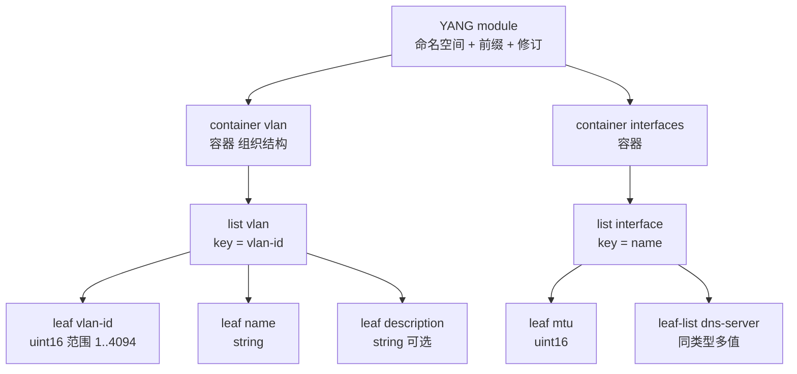

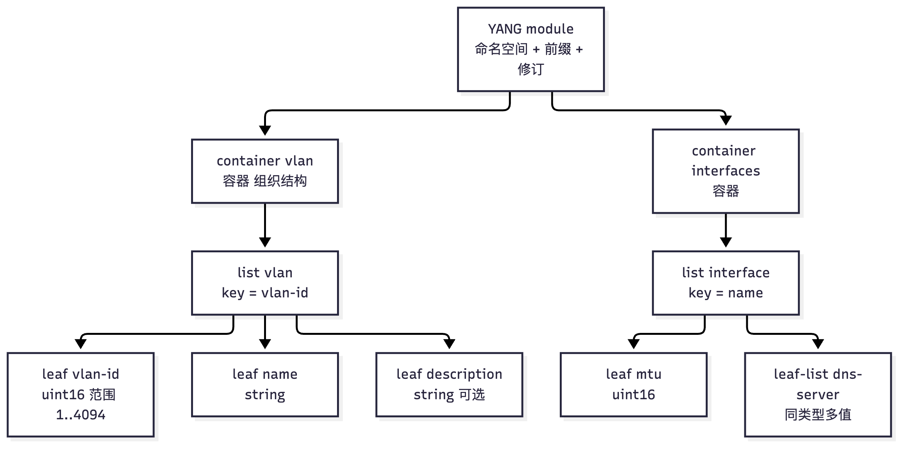


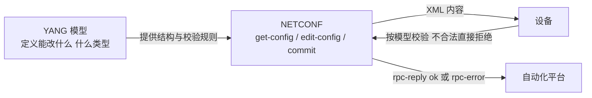


### 真题精练

**Q1.【真题·单选】** 关于 YANG 与 NETCONF 的关系，下列描述正确的是：
A. YANG 是一种传输协议，NETCONF 是它的数据模型
B. YANG 定义数据模型（改什么），NETCONF 提供操作与传输机制（怎么改）
C. YANG 只能用于 NETCONF，不能用于 RESTCONF 或 gNMI
D. 使用 NETCONF 必须同时使用 YANG，否则无法建立会话

> **答案：B**
> **解析**：B 是唯一正确的关系描述：**YANG = 内容层的建模语言，NETCONF = 操作层/消息层/传输层的协议**。A 完全说反。C 错误，YANG 是独立于协议的建模语言，RESTCONF（RFC 8040）与 gNMI（OpenConfig）都使用 YANG 模型定义的数据；D 错误，NETCONF 会话建立（hello、认证）与是否使用 YANG 无关，只在"下发配置内容"时才需要模型来构造与校验数据。

**Q2.【真题·多选】** 下列关于 YANG 数据节点的说法，正确的有：
A. container 是纯组织结构，本身不承载值
B. leaf 表示单一值，leaf-list 表示同类型的多个值
C. list 表示一组 entry，每个 entry 必须有 key 作为唯一标识
D. leafref 用于引用另一个节点的值，可表达节点之间的依赖关系

> **答案：ABCD**
> **解析**：四个选项都正确，这就是 YANG 最基本的数据节点体系。补充考点：`container` 下可嵌套 `list` 与 `leaf`；`leaf-list` 与 `list` 的区别是"**前者是同类值的集合、后者是结构化 entry 的集合**"（list 有 key、可含多个不同字段）；`leafref` 常用于"接口名必须已在接口表中存在""VPN 实例名必须已定义"这类引用校验，是模型级联校验的关键；此外 `config false` 标记只读状态节点，它们只能被 `get` 读取、不能出现在 `edit-config` 中。

**Q3.【真题·简答】** 某自动化平台直接拼接 CLI 命令下发配置，经常出现"配置半途失败、设备留下半成品配置"。请说明引入 NETCONF + YANG 后这个问题为什么能缓解，并给出你推荐的下发流程。

> **答案与解析**：
> **原因分析**：CLI 逐条下发没有事务语义：10 条命令执行到第 5 条失败，前 4 条已生效、后 5 条未执行，设备处于"非预期中间态"，而且**平台无法感知具体哪一步失败**（只能靠文本匹配回显）。同时 CLI 没有模型校验，参数越界（如 VLAN ID 4095、掩码非法）往往要到实际生效时才报错。
> **NETCONF + YANG 的改善**：① **模型校验前置**：设备按 YANG 模型校验类型、range、must 约束，非法数据直接以 `<rpc-error>` 拒绝，**不会写入配置**；② **事务化**：在 candidate 库上编辑、`validate` 校验、再 `commit` 一次性生效，失败可 `discard-changes`；开启 `rollback-on-error` 后，编辑过程中出错则整批回滚；③ **confirmed-commit 兜底**：提交后未按时确认则自动回滚，天然适配割接场景；④ **结构化应答**：`<rpc-reply>` 是结构化的，平台能精确判断成功/失败与失败原因，不需要解析文本。
> **推荐下发流程**：`lock`（防并发）→ 读取当前配置（get-config，做差异比对）→ `edit-config` 到 candidate（用 remove 保证幂等）→ `validate` → `commit`（必要时 confirmed-commit + 超时回滚）→ `copy-config running→startup`（保存）→ 再次 `get-config` 校验实际生效结果 → `unlock`。**每一步失败都有明确处理动作，这就是"可回退的自动化"。**

### 易错点与排错

1. **leaf-list 与 list 混淆**：前者是"多值同类"，后者是"多条结构化记录（有 key）"。
2. **忘记 list 必须有 key**：没有 key 就无法唯一定位 entry，配置与查询都会出问题。
3. **把 YANG 当协议**：它是建模语言；RESTCONF/gNMI 也用它。
4. **给只读节点下发配置**：`config false` 的节点出现在 `edit-config` 中一定报错。
5. **多厂商模型不通用**：IETF/OpenConfig 模型互通性好，私有模型（`huawei-*`）需配套适配；方案题中应明确"优先标准模型，私有模型用于设备特性"。
6. **核查命令**：设备侧 `display yang module list`（若有）、`display current-configuration` 对照；平台侧用 `get-schema` 拉取模型并落库，便于版本化管理。

## 9.4 RESTCONF 与 gNMI 简介与对比

### 考点定位

本节是"接口选型题"的来源，国赛常以 **1 道单选 + 1 道多选** 出现，分值 4~8 分。高频考法：**① RESTCONF 与 NETCONF 的关系（同为 YANG 驱动的配置协议，RESTCONF 用 HTTP/HTTPS + CRUD）；② RESTCONF 的 HTTP 方法与 RFC 8040；③ gNMI 的 RPC 集合（Capabilities / Get / Set / Subscribe）；④ 三者的适用场景选型**。易错点是把 RESTCONF 的 HTTP 方法与 NETCONF 操作胡乱对应、把 gNMI 与 gRPC 混为一谈。

### 原理精讲

**RESTCONF（RFC 8040）** 的设计目标是"**让 YANG 数据模型用 REST 风格访问**"：它把 YANG 数据树映射成**资源路径**，用 HTTP 方法操作，用 JSON 或 XML 表示数据，跑在 **HTTPS（443）** 上，媒体类型为 `application/yang-data+json`（或 `+xml`）。

| RESTCONF 元素 | 内容 | 与 NETCONF 的对应 |
|---|---|---|
| 资源路径 | `/restconf/data/<module>:<container>/...`，如 `/restconf/data/ietf-interfaces:interfaces/interface=GigabitEthernet0/0/1` | 相当于 get-config 的 filter 路径 |
| GET | 读取数据（可带 `?content=config` 或 `?content=all` 区分配置/全部） | get-config / get |
| POST | 在集合下创建资源 | edit-config（create/merge） |
| PUT | 创建或**整体替换**目标资源 | edit-config（replace） |
| PATCH | 局部修改（合并） | edit-config（merge） |
| DELETE | 删除资源 | edit-config（delete） |
| OPTIONS | 查询资源支持的方法 | hello 能力交换的轻量替代 |
| 状态码 | 200/201/204/400/401/404/409 等 | rpc-reply 中的 rpc-error |

**RESTCONF 的优缺点**：优点是"**任何会写 Web 后端的人都能上手**"（HTTP + JSON），与 Web 平台、运维门户、监控系统集成极方便，调试可用 curl/Postman 直接看；缺点是**表达能力弱于 NETCONF**：没有 candidate 库与 commit 事务语义（RFC 8040 有 `ietf-netconf-candidate` 扩展但支持度参差）、不支持 NETCONF 那样的通知订阅体系、批量操作与并发控制弱。因此业界常见做法是"**查询与轻量配置用 RESTCONF，事务性变更用 NETCONF/gNMI**"。

**gNMI（gRPC Network Management Interface，OpenConfig 定义）** 是基于 **gRPC（HTTP/2 + Protobuf）** 的管理接口，提供四个 RPC：

| RPC | 作用 | 关键点 |
|---|---|---|
| Capabilities | 查询设备支持的模型与编码 | 相当于 NETCONF 的 hello 能力交换 |
| Get | 按路径读取数据 | 支持多种编码（JSON_IETF、PROTO 等） |
| Set | 修改数据（delete / replace / update 三种操作组合） | 一个 Set 请求里可混合多种操作，语义明确 |
| Subscribe | **订阅数据变化或周期采样** | 模式：ONCE（一次）、POLL（轮询）、STREAM（流式：ON_CHANGE 变化触发 / SAMPLE 周期采样 / TARGET_DEFINED 设备决定） |

**gNMI 的最大特征是"配置 + 订阅一体化"**：它把"配置下发"和"Telemetry 遥测订阅"统一到一套 gRPC 接口上，且用 HTTP/2 长连接做多路复用，效率远高于"每次轮询都建一条 UDP 会话"。因此**现代数据中心与骨干网的自动化平台普遍以 gNMI + Telemetry 作为主通道**，NETCONF 作为配置兜底，RESTCONF 用于轻量集成。

**三者选型对比（必背）**：

| 对比项 | NETCONF | RESTCONF | gNMI |
|---|---|---|---|
| 标准 | RFC 6241 / 6242 | RFC 8040 | OpenConfig（事实标准） |
| 传输 | SSH 830（或 TLS 6513） | HTTPS 443 | gRPC over HTTP/2（常用 57400） |
| 数据格式 | XML | JSON / XML | Protobuf / JSON |
| 数据模型 | YANG | YANG | YANG（OpenConfig 为主） |
| 事务能力 | 强（candidate + validate + commit + confirmed-commit） | 弱（无原生两阶段提交） | 中（单次 Set 内多操作原子性，无 confirmed-commit） |
| 订阅/推送 | 有（Notification，支持度一般） | 弱 | 强（Subscribe，STREAM 模式） |
| 上手难度 | 中（XML 冗长） | 低（HTTP+JSON） | 中高（Protobuf/gRPC） |
| 典型用途 | 事务化配置下发、配置备份 | Web 集成、轻量查询与配置 | 高频 Telemetry 采集 + 配置一体化 |

### 关键概念对照表

| 需求 | 首选接口 | 理由 |
|---|---|---|
| 割接式批量配置、需要失败回滚 | NETCONF | candidate + validate + confirmed-commit |
| 运维门户展示接口状态、按需查询 | RESTCONF | HTTP/JSON，前端集成成本最低 |
| 秒级性能采集（时延、丢包、队列） | gNMI Subscribe / Telemetry | 订阅推送，长连接复用，开销低 |
| 多厂商统一纳管 | NETCONF + YANG 标准模型 | 标准模型跨厂商互通性最好 |
| 与 CI/CD 流水线集成 | Ansible / Nornir（底层用 NETCONF/RESTCONF） | 声明式、幂等、易版本化 |

### 华为设备配置

```bash
system-view
snetconf server enable                            // NETCONF 服务（事务性配置主通道）
ssh server enable
#
http server enable                                // 使能 HTTP/HTTPS 服务（RESTCONF / RESTful 开放接口的前置条件）
http server ipv4 enable                           // 明确使能 IPv4 访问（部分版本需显式指定）
http secure-server enable                         // 优先使用 HTTPS，避免明文口令与配置在网络上传输
#
grpc                                              // 进入 gRPC 视图（部分版本为 grpc server 相关命令）
 grpc server enable                               // 使能 gRPC 服务，供 gNMI/Telemetry 采集器连接
#
display http server                               // 查看 HTTP/HTTPS 服务状态（部分版本为 display http server status）
display grpc server                               // 查看 gRPC 服务状态与监听端口
display tcp status                                // 核查 830 / 443 / gRPC 端口是否处于监听状态
```

> **版本提示**：不同产品对 RESTCONF/gNMI 的支持颗粒度差异较大（CE12800 / CE6865 等数据中心交换机支持度较好，NE 路由器以 NETCONF + Telemetry 为主），比赛方案题中**应写明"按产品与版本能力分级选择接口"**，而不是假设所有设备都支持全部三种。

### 示意图

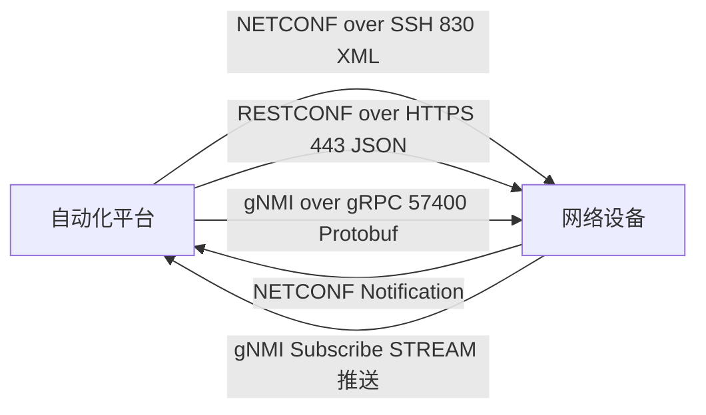

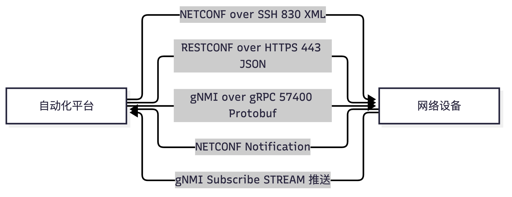


### 真题精练

**Q1.【真题·单选】** 使用 RESTCONF 修改设备上某个接口的描述信息（局部合并），应使用的 HTTP 方法是：
A. GET  B. POST  C. PATCH  D. OPTIONS

> **答案：C**
> **解析**：RESTCONF 把 YANG 数据映射为资源：**PATCH = 局部合并修改**（对应 edit-config 的 merge），PUT = 创建或整体替换（对应 replace），POST = 在集合下创建新资源，DELETE = 删除，GET = 读取，OPTIONS = 查询资源支持哪些方法。要注意 RESTCONF 没有 NETCONF 的 candidate/commit 两阶段语义，因此**对割接类关键变更更推荐 NETCONF**。

**Q2.【真题·多选】** 关于 gNMI，下列说法正确的有：
A. 基于 gRPC（HTTP/2 + Protobuf），由 OpenConfig 推动定义
B. 提供 Capabilities、Get、Set、Subscribe 四类 RPC
C. Subscribe 的 STREAM 模式支持周期采样（SAMPLE）与变化触发（ON_CHANGE）
D. gNMI 只能用于配置下发，不能用于数据采集

> **答案：ABC**
> **解析**：A、B、C 正确。gNMI 的核心特色就是 **"配置与订阅一体化"**：一份 gRPC 通道既能做 Set（配置），也能做 Subscribe（采集），从而取代"SNMP 轮询 + CLI 配置"两套机制。D 完全说反，**Subscribe 是 gNMI 相对 NETCONF 最大的优势**，也是 Telemetry 的主流实现方式。

**Q3.【真题·简答】** 某数据中心需要"秒级采集 200 台交换机的接口流量与队列丢包，并支持按需查询配置"。请给出接口选型方案并说明理由。

> **答案与解析**：
> **选型**：① **性能数据采集：gNMI Subscribe（STREAM + SAMPLE）或 Telemetry 订阅**，采样间隔 1 s 甚至更短，采用 Protobuf/GPB 编码，gRPC 长连接多路复用；② **按需查询与轻量配置：RESTCONF（HTTPS + JSON）**，便于与运维门户、监控大屏集成；③ **关键变更与配置备份：NETCONF**，利用 candidate + validate + confirmed-commit 保障"改错能回滚"。
> **理由**：SNMP 轮询在 200 台设备、秒级间隔下会产生大量 UDP 交互与设备 CPU 开销，且只能取到 MIB 里的标量与少量表项，**无法满足秒级、细粒度、低开销**的要求；gNMI 的订阅推送把"客户端问"变成"设备主动报"，**一次订阅持续推送，开销与采集频率解耦**，是智能运维（实时可视化、快速定位抖动）的前提。
> **补充**：应同时明确"SID/路径规划（订阅哪些 YANG path）、编码选择（GPB 省带宽、JSON 便于调试）、采集器高可用（双采集器 + 断点续采）、数据保留与告警联动策略"，方案才完整。

### 易错点与排错

1. **HTTP 方法对应关系混乱**：记住 PUT=整体替换、PATCH=局部合并、POST=集合下创建。
2. **以为 RESTCONF 有事务**：它没有 NETCONF 的 candidate/commit 语义，关键变更别用它。
3. **gNMI 与 gRPC 混淆**：gRPC 是传输框架，gNMI 是跑在它上面的管理接口规范。
4. **端口记错**：NETCONF 830、NETCONF over TLS 6513、RESTCONF 443、gNMI 常用 57400、Telemetry 静态订阅常用自定义端口（如 10001）。
5. **忽略模型差异**：不同厂商对同一 OpenConfig 路径的支持程度不同，上线前必须做"路径可用性验证"。
6. **排错命令链**：`display http server` → `display grpc server` → `display tcp status` → 客户端用 curl/`gnmic` 工具直接验证连通与返回码。

## 9.5 Telemetry 遥测技术

### 考点定位

Telemetry 是国赛"智能运维"题的标准答案来源，常以 **1 道多选 + 1 道简答（含对比表）** 出现，分值 8~12 分。高频考法：**① Push 与 Poll 的本质区别；② 采集流程四步（订阅—采样—封装—推送）；③ 静态订阅与动态订阅的区别；④ GPB 与 JSON 编码选择；⑤ gRPC 与 UDP 传输差异**。易错点是把"Telemetry 只是更快的 SNMP"简单化，忽略了"订阅驱动 + 模型化 + 长连接"这三点本质变化。

### 原理精讲

**Push vs Poll：这不是"快与慢"，而是"谁发起、谁承担开销"**。

- **SNMP 轮询（Poll）**：采集器周期性向每台设备发 GET。设备**被动响应**，每次都要查 MIB、组装响应包。采集频率越高，设备 CPU 与网络开销越大；而且**采集时刻是离散的**，两个采样点之间的瞬时抖动（如 100 ms 级微突发导致的队列丢包）根本看不到。
- **Telemetry 推送（Push）**：设备按订阅要求**主动、持续**地把数据推给采集器。**一次订阅建立、长期推送**，省掉了每轮请求/应答的往返与解析开销；由于是设备本地按需采样，**能做到亚秒级、毫秒级精度**，且可采集到 SNMP MIB 里没有的丰富模型化数据（如队列级丢包、ECN 标记数、SRv6 路径时延、iFIT 逐跳数据）。

**采集流程四步**：

1. **订阅（Subscription）**：采集器（或管理员）向设备指定"要哪些数据、多久采一次、推给谁"。核心要素 = **数据源（sensor-path / YANG 路径）+ 采样周期（sample-interval）+ 目标（destination：地址、端口、协议、编码）**。
2. **采样（Sampling）**：设备按周期读取本地数据源（通常直接读转发芯片/驱动的计数器，代价低）。
3. **编码（Encoding）**：把结构化数据编码为 **GPB（Google Protocol Buffers，二进制，紧凑高效）** 或 **JSON（可读、便于调试、体积大）**。
4. **推送（Transport）**：通过 **gRPC（HTTP/2 长连接、可靠、支持流控）** 或 **UDP（无连接、开销最小、可能丢包）** 发送到采集器。

**静态订阅 vs 动态订阅**（高频对比）：

| 对比项 | 静态订阅（Static） | 动态订阅（Dynamic） |
|---|---|---|
| 谁发起 | **设备侧预先配置**订阅关系，设备按配置主动推送 | **采集器通过 gRPC 连接设备**发起订阅请求 |
| 配置位置 | 设备（`telemetry` 视图） | 采集器侧（dial-in） |
| 灵活性 | 变更需改设备配置，适合稳定、长期采集 | 按需订阅、随用随建，适合临时排障与弹性采集 |
| 典型端口 | 设备主动连采集器的指定端口（如 10001/UDP、或 gRPC） | 常用 **57400**（gRPC dial-in） |
| 适用场景 | 生产环境长期性能监控、告警联动 | 临时深度诊断、故障复现、按需拉取 |
| 可靠性 | 依赖设备配置正确与采集端监听 | 连接与订阅状态由采集器掌握，便于重订阅 |

**为什么 Telemetry 对数据中心智能运维是"刚需"**：AI 训练/高性能计算场景对**微突发（microburst）**极敏感，100 ms 级的队列拥塞就可能导致 RDMA 重传与训练效率下降。传统 5 分钟 SNMP 轮询完全无法定位这种问题；而 1 s 甚至 100 ms 级的 Telemetry 采集能画出"队列深度-丢包-时延"的时间曲线，配合 iFIT（随流检测）定位到具体链路与队列，从而把"网络偶发慢"变成"可定位、可优化"的工程问题。这也是无损网络（RoCE/PFC/ECN）调优的必要工具。

**华为 Telemetry 的关键配置要素**：`sensor-group`（订阅哪些 YANG 路径）、`destination-group`（推给谁）、`subscription`（把二者绑定 + 采样周期），编码支持 `json` / `gpB`，协议支持 `grpc` / `udp`（部分版本还支持 `grpc` 的 dial-in/dial-out 两种角色）。

### 关键概念对照表

| 对比项 | SNMP 轮询（Poll） | Telemetry 推送（Push） |
|---|---|---|
| 发起方 | 网管/采集器 | 设备 |
| 交互模式 | 请求—应答，每次一问一答 | 一次订阅，持续推送 |
| 采集精度 | 通常 1~5 分钟级 | 秒级甚至亚秒级、毫秒级 |
| 数据范围 | MIB 定义的标量与少量表 | YANG 模型化数据，含队列/ECN/时延等细粒度指标 |
| 编码 | ASN.1/BER（UDP） | GPB（Protobuf）或 JSON |
| 传输 | UDP 161 | gRPC（HTTP/2）或 UDP（自定义端口） |
| 设备开销 | 与采集频率、OID 数量正相关，频率高时 CPU 压力大 | 与采集频率关系较小，主要在采样与编码 |
| 对瞬时抖动 | 无法捕获 | 可捕获（配合高频采样与 iFIT） |
| 可靠性 | Trap 不可靠、Inform 需确认 | gRPC 可靠有序；UDP 可能丢包 |

| 要素 | 说明 | 华为配置对应 |
|---|---|---|
| 数据源 | 要采集的 YANG 路径（sensor-path） | `sensor-group` 下的 `sensor-path` |
| 采样周期 | 多久采一次（毫秒/秒） | `subscription` 下的 `sample-interval` |
| 目标 | 采集器地址、端口、协议、编码 | `destination-group` 下的 `ipv4-address ... port ... protocol grpc` |
| 绑定关系 | 把数据源与目标关联 | `subscription` 下的 `sensor-group-id` 与 `destination-id` |

### 华为设备配置

```bash
system-view
telemetry                                         // 进入 Telemetry 视图（静态订阅配置入口）
 sensor-group sg-interface                        // 定义数据源组：要采集什么
  sensor-path huawei-ifm:ifm/interfaces/interface/if-statistics   // 采集接口统计（收发包、错包、丢包等，路径随模型版本不同）
  sensor-path huawei-devm:devm/ports/port/performance             // 采集端口性能（速率、利用率等）
 destination-group dg-collector                    // 定义目标组：推给谁
  ipv4-address 10.1.1.100 port 10001 protocol grpc  // 采集器地址、端口与传输协议（grpc 可靠；udp 开销更小）
   encoding gpB                                    // 编码选择：gpB 省带宽效率高；json 便于调试与对接
 subscription sub-1                                // 定义订阅：把数据源与目标绑定，并指定采样周期
  sensor-group-id sg-interface sample-interval 1000   // 采样周期 1000 毫秒（1 秒，可按需到 100 毫秒级）
  destination-id dg-collector                      // 关联目标组
#
display telemetry subscription                     // 查看订阅状态（是否 Up、采样周期、绑定的组）
display telemetry sensor-path                      // 查看可用/已配置的采集路径（确认 sensor-path 拼写是否正确）
display telemetry destination                      // 查看目标组状态与推送统计（判断推送是否成功）
```

> **常见"配了没数据"三原因**：① `sensor-path` 拼写或路径与设备模型不匹配（最常犯）；② 设备到采集器的 UDP/gRPC 端口被防火墙或 ACL 阻断；③ 采集器侧未监听对应端口或编码不匹配（GPB 与 JSON 用错解码器）。

### 示意图

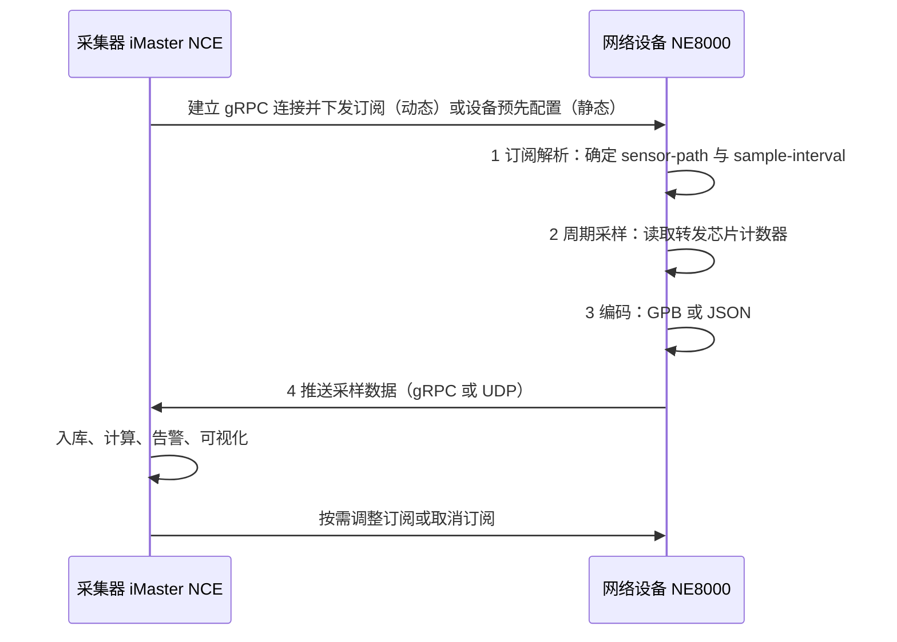

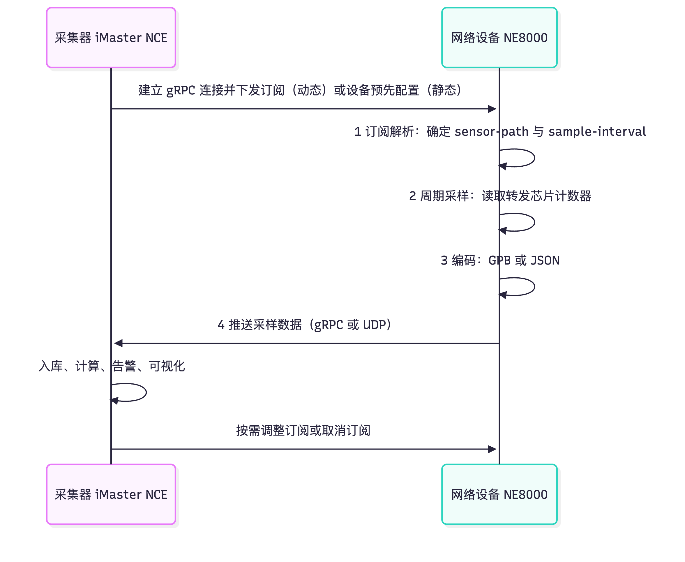


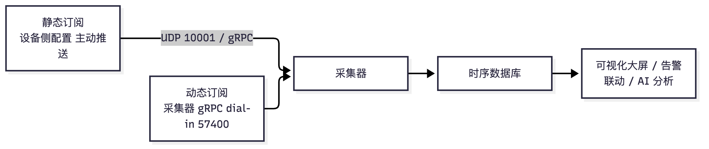


### 真题精练

**Q1.【真题·多选】** 相比 SNMP 轮询，Telemetry 推送模式的优势包括：
A. 由设备主动推送，省去每轮请求/应答开销，设备 CPU 压力与采集频率的相关性更弱
B. 可达到秒级甚至亚秒级采集精度，能够捕获微突发等瞬时现象
C. 可采集 YANG 模型化的细粒度数据（如队列丢包、ECN 标记、时延）
D. 因为使用 UDP，所以数据一定不会丢失

> **答案：ABC**
> **解析**：A、B、C 是 Telemetry 的三条核心价值：**推送省开销、高频抓瞬时、模型化细粒度**。D 错误且逻辑不通：Telemetry 既可走 **gRPC（HTTP/2，可靠有序）** 也可走 **UDP（开销小但可能丢包）**，"用 UDP 就一定不丢包"恰恰相反；对可靠性要求高的场景应选 gRPC。

**Q2.【真题·单选】** 华为设备上配置 Telemetry 静态订阅时，用于指定"采集周期"的配置项是：
A. `sensor-path`  B. `sample-interval`  C. `encoding`  D. `destination-id`

> **答案：B**
> **解析**：静态订阅的三要素与配置对应关系是：**采什么 = `sensor-group` + `sensor-path`；多久采 = `subscription` + `sample-interval`；推给谁 = `destination-group` + `ipv4-address/port/protocol/encoding`；三者绑定 = `subscription` 下的 `sensor-group-id` 与 `destination-id`**。A 是数据源路径，C 是编码方式，D 是目标组引用，都不是周期。

**Q3.【真题·简答】** 某 AI 训练集群偶发训练效率下降，交换机上并没有端口 Up/Down 或明显告警。请说明如何用 Telemetry 与 iFIT 定位问题，并说明为什么 SNMP 轮询难以胜任。

> **答案与解析**：
> **为什么 SNMP 不行**：SNMP 轮询通常 1~5 分钟一次，取到的是"采样时刻的接口计数与少量 MIB 标量"。而 AI 训练流的特征是**微突发（microburst）**：在几十到几百毫秒内瞬间打满出端口队列，触发队列溢出丢包与 ECN 标记，随后流量立刻回落。5 分钟一次的轮询**几乎不可能采到这个瞬间**，即便采到也只是"累计丢包增加了几个包"，无法回答"哪条链路、哪个队列、什么时间、由谁造成"。
> **Telemetry 方案**：① 在关键交换机的出端口配置 **interface 统计与队列级统计** 的 Telemetry 订阅，采样周期设为 1 s 甚至 100 ms，编码用 GPB 降低带宽；② 用 gRPC 推送至采集器（iMaster NCE-Fabric 或自建采集平台），落时序库并绘制"队列深度-丢包-ECN"曲线，**定位到具体端口与队列以及发生时刻**；③ 若需要端到端逐跳定位，启用 **iFIT（随流检测）**：对特定五元组流打标，沿途节点上报逐跳时延与丢包，可精确定位到"哪一跳、哪个方向、哪个队列"；④ 结合 RoCE 侧的重传与 PFC/ECN 计数交叉验证，形成"网络侧证据链"；⑤ 根据定位结果做配置优化（如调整 ECN 门限与 PFC 死锁防护参数、优化流量调度与哈希、必要时调整链路捆绑与路径）。
> **结论**：Telemetry 提供"高频、细粒度、模型化"的数据，iFIT 提供"逐跳、按流"的定位能力，二者组合才把"偶发慢"变成"可复现、可量化、可优化"的问题。

### 易错点与排错

1. **sensor-path 写错**：模型路径随设备与版本变化，必须先用 `display telemetry sensor-path` 确认可用路径。
2. **编码与解码不匹配**：设备用 GPB 推送，采集器用 JSON 解析，表现为"有数据但解析失败"。
3. **端口被阻断**：Telemetry 常用非标准端口，需确认设备到采集器方向的 ACL 与防火墙策略放通。
4. **采样周期设得过小**：100 ms 级采集虽然精细，但会显著增加设备与采集端负载，生产上建议"关键端口高频、普通端口低频"分级采样。
5. **静态订阅与动态订阅混用冲突**：同一路径被两个订阅重复采集时注意去重与资源开销。
6. **排错命令链**：`display telemetry subscription` → `display telemetry destination` → `display telemetry sensor-path` → 采集器侧抓包/日志确认是否收到推送。

## 9.6 SNMP 回顾与局限

### 考点定位

SNMP 是"老技术但必考"，国赛常以 **1 道单选/多选 + 1 道对比简答** 出现，分值 4~8 分，且常与 Telemetry 组合出题（"为什么用 Telemetry 替代 SNMP"）。高频考法：**① v2c 与 v3 的差别（安全机制）；② 161 与 162 端口；③ MIB 与 OID 的关系；④ Trap 与 Inform 的差别；⑤ SNMP 的固有局限**。易错点是把 Trap 与 Inform 的可靠性搞反。

### 原理精讲

**SNMP（Simple Network Management Protocol，简单网络管理协议）** 由三部分组成：**管理站（NMS）**、**代理（Agent，运行在设备上）**、**MIB（Management Information Base，管理信息库）**。MIB 是一棵**层次化的 OID 树**，每个被管理对象由一个 OID（Object Identifier，对象标识符）唯一标识，例如 `1.3.6.1.2.1.2.2.1.10` 表示接口入方向字节数（ifInOctets）。

**版本演进与安全**：

| 版本 | 安全机制 | 说明 |
|---|---|---|
| SNMPv1 | 团体名（community，明文） | 功能有限，已淘汰 |
| SNMPv2c | 团体名（明文）+ 增强操作（GetBulk、Inform） | 现网仍有大量使用，但**团体名明文传输**是重大安全隐患 |
| SNMPv3 | **USM（User-based Security Model）+ VACM（View-based Access Control Model）** | 支持认证（MD5/SHA）与加密（DES/AES128），可按用户/视图做最小权限控制，是唯一推荐版本 |

**端口与报文类型**：Agent 监听 **UDP 161** 用于接收 Get/GetNext/GetBulk/Set；NMS 监听 **UDP 162** 用于接收设备主动上报的 Trap/Inform。

**Trap 与 Inform 的区别（必考）**：

| 对比项 | Trap | Inform |
|---|---|---|
| 是否需要确认 | 不需要，发完即忘 | **需要接收方回 Response 确认** |
| 可靠性 | 低（网络丢包/UDP 拥塞即丢失） | 较高（超时可重传） |
| 报文类型 | 无请求 ID 语义 | 带请求 ID，可重传 |
| 版本支持 | v1/v2c/v3 | v2c/v3（v1 无 Inform） |
| 设备开销 | 最小 | 需维护重传队列，开销更大 |
| 适用 | 一般事件通知 | 关键告警（如链路中断、双机倒换） |

**SNMP 的三大固有局限（答题模板）**：

1. **采集精度与规模受限**：轮询模式下，频率越高设备 CPU 与网络开销越大；MIB 以标量与简单表为主，**没有队列级、流级、时延类的细粒度模型化数据**，无法支撑"微突发"类问题的定位。
2. **数据模型陈旧且不统一**：MIB 由各厂商自行扩展，同一语义在不同厂商的 OID 不同，多厂商纳管需要大量适配；数据以"扁平 OID + 标量"为主，无法表达 YANG 那样的层次化配置/状态模型。
3. **不适合配置管理**：SNMP Set 表达能力弱、无事务语义、无校验、无回滚，实践中几乎不用 SNMP 做配置下发（这也是 NETCONF/RESTCONF 出现并成为配置主通道的原因）。

**结论性表述（国赛简答常用）**：**SNMP 适合"低频、粗粒度、以告警和基础性能为主"的监控，Telemetry 适合"高频、细粒度、以性能与体验分析为主"的采集，二者是互补关系；在新建网络中通常以 Telemetry 为主、SNMP 作为兼容与告警兜底。**

### 关键概念对照表

| 概念 | 含义 | 考点 |
|---|---|---|
| MIB | 管理信息库，OID 树的总和 | 是"数据字典"，不是数据库文件 |
| OID | 对象标识符，如 1.3.6.1.2.1.2.2.1.10 | 层次化编号，唯一标识一个被管对象 |
| SMI | 管理信息结构，定义 MIB 的语法 | 与 MIB 配合，考试较少深入 |
| community | v1/v2c 的"口令" | 明文传输，等于无安全 |
| USM | v3 的用户安全模型 | 提供认证与加密 |
| VACM | v3 的视图访问控制 | 可限制某用户只能读某些 OID |
| GetBulk | v2c/v3 的批量读取 | 比 GetNext 高效，用非重复/最大重复数控制 |
| Trap / Inform | 主动上报事件 | Trap 不确认、Inform 需确认 |

### 华为设备配置

```bash
system-view
snmp-agent                                        // 全局使能 SNMP 代理（必须，否则后续命令无意义）
 snmp-agent sys-info version v3                    // 只启用 v3（生产建议关闭 v1/v2c，避免明文团体名）
 snmp-agent sys-info contact Network_Ops           // 设备联系人信息
 snmp-agent sys-info location DC1-RackA            // 设备位置信息
#
snmp-agent mib-view included iso-view iso           // 定义 MIB 视图：只允许访问 iso 子树（最小权限原则）
snmp-agent group v3 ops-group privacy read-view iso-view write-view iso-view notify-view iso-view  // 定义 v3 用户组，privacy 表示需认证+加密
snmp-agent usm-user v3 ops-user group ops-group     // 创建 v3 用户并加入组
snmp-agent usm-user v3 ops-user authentication-mode sha2-256 cipher Huawei@123   // 配置认证算法与密码（禁用 MD5 等弱算法）
snmp-agent usm-user v3 ops-user privacy-mode aes128 cipher Huawei@123           // 配置加密算法与密码（AES128 优于 DES）
#
snmp-agent target-host trap address udp-domain 10.1.1.100 params securityname ops-user v3 privacy  // 指定 Trap 目的（162 端口）与安全参数
snmp-agent target-host inform address udp-domain 10.1.1.100 params securityname ops-user v3 privacy // 关键告警改用 Inform（需确认，可靠）
snmp-agent trap enable                             // 全局使能 Trap 上报（再按模块细化，如 snmp-agent trap enable ospf）
#
display snmp-agent sys-info                       // 查看 SNMP 版本与系统信息
display snmp-agent usm-user                        // 查看 v3 用户与认证/加密配置
display snmp-agent target-host                     // 查看 Trap/Inform 目的地址与参数
```

> **安全红线**：生产网络禁用 `snmp-agent community read public`（`public`/`private` 是全网被扫的默认团体名），且必须用 ACL 限制 NMS 源地址访问 161 端口（`snmp-agent acl 2000`）。

### 示意图

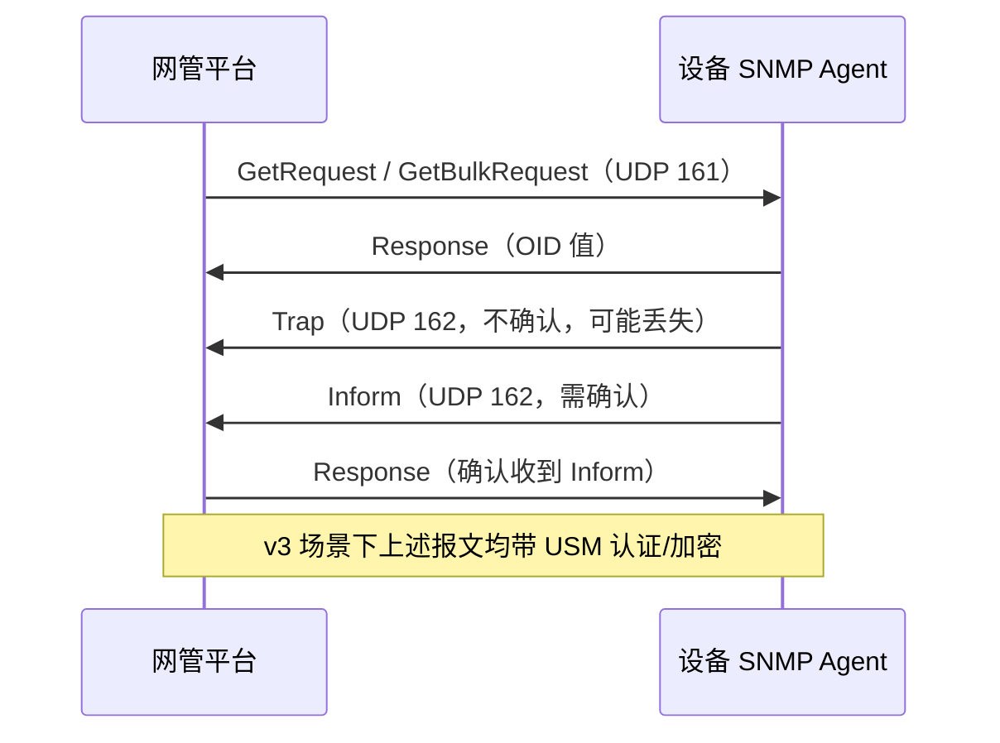

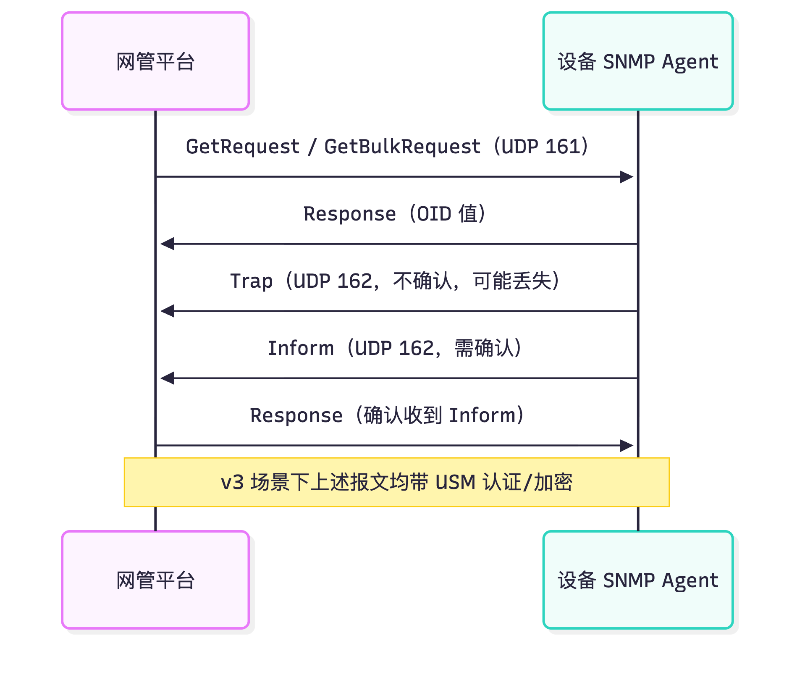


### 真题精练

**Q1.【真题·单选】** 关于 SNMP Trap 与 Inform，下列说法正确的是：
A. Trap 需要接收方确认，Inform 不需要
B. Inform 需要接收方返回确认，可靠性高于 Trap
C. Trap 使用 TCP 161，Inform 使用 UDP 162
D. Trap 只能用于 v3，Inform 只能用于 v1

> **答案：B**
> **解析**：**Inform 需要确认（Response）、可重传，因此更可靠；Trap 发完即忘、可能丢失**，A 说反。C 错误，两者都用 **UDP 162**（Agent 监听 161 用于接收请求），不存在 TCP。D 错误，v1 只有 Trap 没有 Inform，Inform 是 v2c 引入并在 v3 中延续的，与"v3 专属"无关。

**Q2.【真题·多选】** SNMP 在大型数据中心智能运维中的局限包括：
A. 轮询模式下采集频率提高会显著增加设备 CPU 与网络开销
B. MIB 以标量和简单表为主，缺少队列级、流级、时延类细粒度数据
C. 缺少统一的数据模型，多厂商 OID 差异大，适配成本高
D. 无法通过 Trap 上报任何事件

> **答案：ABC**
> **解析**：A、B、C 正是 SNMP 被 Telemetry 补充/替代的三个原因。D 错误，Trap/Inform 是 SNMP 的**核心优势之一**（事件驱动、无需轮询），只是可靠性（Trap）与数据粒度上有限；说"无法上报任何事件"完全错误。

**Q3.【真题·简答】** 某网络同时部署了 SNMP 与 Telemetry，请说明为什么不是"用 Telemetry 全面替换 SNMP"，并给出你的分工建议。

> **答案与解析**：
> **不能全面替换的原因**：① **存量兼容**：大量老设备（尤其园区接入层与部分第三方设备）只支持 SNMP，替换意味着硬件更新或功能缺失；② **告警体系成熟**：SNMP Trap/Inform 与主流网管（eSight、第三方 NMS）的事件、告警、工单联动已稳定运行，重构成本高；③ **实现代价**：Telemetry 需要设备支持 gRPC/gNMI 模型化路径、采集端具备时序库与流处理能力，小规模或预算受限场景性价比不高；④ **互补性**：SNMP 擅长"低频、广覆盖的事件与基础指标"，Telemetry 擅长"高频、细粒度、面向体验的分析"。
> **分工建议**：① **Telemetry 负责**：数据中心与骨干关键节点/关键端口的秒级性能与队列指标、iFIT 随流检测、无损网络（RoCE/ECN/PFC）调优、AI 训练等对抖动敏感业务的体验分析；② **SNMP 负责**：全网设备的可达性与资源类监控（CPU/内存/温度/电源/风扇）、事件告警与工单联动、老设备与第三方设备的兼容采集；③ **统一在北向平台汇聚**：两类数据入同一时序库与告警引擎，形成"事件 + 指标 + 流"的立体视图；④ **治理要求**：SNMP 全面升级 v3 + ACL 限制 + 弱算法禁用，Telemetry 明确采样分级与数据保留策略。

### 易错点与排错

1. **Trap 与 Inform 的确认机制记反**：Inform 有确认、Trap 没有。
2. **端口写错**：请求走 161，Trap/Inform 走 162（都是 UDP）。
3. **v3 只配认证不配加密**：`privacy` 才是加密，只说 `authentication` 是"认证不加密"。
4. **忘记 ACL 限制**：SNMP 是常见攻击面，必须限制 NMS 源地址。
5. **MIB 未加载导致 OID 查不到**：网管侧需要导入对应产品的 MIB 文件，否则只能看到数字 OID。
6. **排错命令链**：`display snmp-agent sys-info` → `display snmp-agent usm-user` → `display snmp-agent target-host` → 抓包确认 162 端口是否有 Trap/Inform 发出。

## 9.7 Python 网络自动化实战（Paramiko / Netmiko / requests）

### 考点定位

本节是国赛"动手题"的核心，也是 HCIE 实验与面试必问，通常以 **1 道简答（代码思路）+ 1 道实操/改错题** 出现，分值 10~15 分。高频考法：**① Paramiko 与 Netmiko 的区别与选用；② 如何批量备份配置；③ 如何用 requests 调用 RESTCONF/NETCONF 接口；④ 密码与凭据的安全处理；⑤ 并发与异常处理**。易错点是"只写伪代码不写异常处理"、把明文密码硬编码。

### 原理精讲

**Paramiko 与 Netmiko 的定位差异**：

| 对比项 | Paramiko | Netmiko |
|---|---|---|
| 层次 | 通用 SSH/SFTP 库（底层） | 面向网络设备的封装库（基于 Paramiko） |
| 设备适配 | 无，需自行处理分页、提示符、退出 | 内置多厂商 `device_type`，自动处理分页与提示符 |
| 配置模式 | 需自己 `system-view` / `quit` / `save` | `send_config_set()` 自动进入与退出配置模式 |
| 返回值 | 原始文本流 | 结构化文本（可配合 TextFSM/TTP 解析） |
| 适用 | 通用主机运维、非网络设备、需要极细控制 | 网络设备批量配置、备份、巡检 |

**三个必须守住的原则**：① **凭据不硬编码**（用环境变量或 Vault/密钥管理）；② **必须处理异常与超时**（网络设备响应慢、会话可能中断）；③ **必须记录日志与校验结果**（自动化没有日志等于没有证据）。

**RESTCONF 调用的要点**：认证常用 HTTP Basic（实验）或 Token/OAuth（生产）；请求头必须带 `Accept`（读）与 `Content-Type`（写）为 `application/yang-data+json`；HTTPS 需要信任证书（实验环境可 `verify=False`，**生产环境必须校验证书**）；返回码 200/201/204 为成功，400/401/404/409/500 需要按错误体定位。

**NAPALM 的定位**：NAPALM（Network Automation and Programmability Abstraction Layer with Multivendor support）在 Netmiko/协议之上提供**统一抽象 API**（`get_facts()`、`get_interfaces()`、`load_merge_candidate()`、`compare_config()`、`commit_config()`），最大价值是"**同一套代码操作不同厂商设备**"，并且提供 `compare_config` 实现"先看差异再提交"的安全变更范式。

### 关键概念对照表

| 任务 | 推荐工具 | 关键 API | 注意点 |
|---|---|---|---|
| 批量备份配置 | Netmiko | `ConnectHandler` + `send_command("display current-configuration")` | 先 `screen-length 0 temporary` 关闭分页 |
| 批量下发配置 | Netmiko / NAPALM | `send_config_set()` / `load_merge_candidate` + `commit_config` | 幂等、失败要能识别 |
| 事务化配置 | ncclient（NETCONF） | `edit_config` + `validate` + `commit` | 用 candidate 库与 confirmed-commit |
| 轻量查询/配置 | requests（RESTCONF） | `GET` / `PATCH` | 判状态码、带正确的媒体类型 |
| 多厂商统一操作 | NAPALM | `get_facts` / `compare_config` | 驱动兼容性需验证 |
| 编排与幂等 | Ansible | 各厂商模块 | 用 `--check` 做预演 |

### 华为设备配置

```bash
# 设备侧为自动化做的准备（在前几节已配置，这里汇总核对）
system-view
ssh server enable                                 // SSH 服务
snetconf server enable                            // NETCONF 服务
http secure-server enable                         // HTTPS/RESTCONF 服务
aaa
 local-user netauto password irreversible-cipher Huawei@123
 local-user netauto privilege level 15
 local-user netauto service-type ssh
quit
ssh user netauto authentication-type password
ssh user netauto service-type snetconf
#
display users                                     // 核对自动化账号登录来源，验证脚本是否真的连上了设备
display current-configuration | include netauto   // 核对自动化账号与相关服务配置
```

**示例 1：Paramiko 批量备份华为设备配置（逐段注释，语法可直接运行）**

```python
#!/usr/bin/env python3
# -*- coding: utf-8 -*-
"""用 Paramiko 批量备份华为设备 running-config。

要点：关闭分页、按提示符判断命令结束、把结果按设备名落盘、逐台异常不影响整体。
运行：pip install paramiko && python3 backup_paramiko.py
"""

import os
import re
import time
import getpass                      # 用 getpass 交互输入密码，避免明文写进代码
import paramiko

# 设备清单：生产上应从 CMDB 或 YAML 清单读取，这里为演示直接写列表
DEVICES = [
    {"host": "10.1.1.1", "name": "NE40E-PE1"},
    {"host": "10.1.1.2", "name": "NE8000-P1"},
    {"host": "10.1.1.3", "name": "S12700-CoreA"},
]
USERNAME = os.environ.get("NET_USER", "netauto")          # 用户名从环境变量读取，便于在 CI 中注入
PASSWORD = os.environ.get("NET_PASSWORD") or getpass.getpass("设备密码: ")   # 优先环境变量，其次交互输入
OUT_DIR = "backup"                                        # 备份目录
PROMPT_PATTERN = re.compile(r"[>\]]\s*$")                  # 华为提示符以 > 或 ] 结尾（用户视图/系统视图）

def read_until_prompt(chan, timeout=15):
    """持续读取通道数据直到出现提示符或超时，返回完整文本。"""
    buf = ""
    deadline = time.time() + timeout
    while time.time() < deadline:
        if chan.recv_ready():                              # 有数据可读时才读，避免阻塞
            buf += chan.recv(65535).decode("utf-8", errors="ignore")
            if PROMPT_PATTERN.search(buf):                  # 出现提示符说明命令执行完毕
                break
        else:
            time.sleep(0.3)                                 # 无数据时短暂休眠，降低 CPU 占用
    return buf

def backup_device(dev):
    """登录一台设备并抓取 running-config，返回 (设备名, 配置文本或 None)。"""
    client = paramiko.SSHClient()
    client.set_missing_host_key_policy(paramiko.AutoAddPolicy())   # 实验环境自动接受主机密钥；生产应预置 known_hosts
    try:
        client.connect(hostname=dev["host"], port=22, username=USERNAME, password=PASSWORD,
                       timeout=10, look_for_keys=False, allow_agent=False)   # 禁止回退到本地密钥/agent，确保行为可控
        chan = client.invoke_shell()                        # 打开交互式 shell（VRP 的 display 命令需要交互式会话）
        time.sleep(1)
        read_until_prompt(chan)                             # 清空登录 banner
        chan.send("screen-length 0 temporary\n")            # 关闭分页，否则配置会被 "--More--" 截断
        read_until_prompt(chan)
        chan.send("display current-configuration\n")        # 抓取当前生效配置
        output = read_until_prompt(chan, timeout=60)        # 配置较大时给足超时
        chan.send("quit\n")                                 # 正常退出，释放会话资源
        return dev["name"], output
    except Exception as exc:                                # 单台失败不影响批量任务
        print(f"[FAIL] {dev['name']}({dev['host']}): {exc}")
        return dev["name"], None
    finally:
        client.close()                                      # 无论成功失败都要关闭连接，避免会话泄漏

def main():
    os.makedirs(OUT_DIR, exist_ok=True)                     # 确保备份目录存在
    stamp = time.strftime("%Y%m%d-%H%M%S")                  # 时间戳，便于版本化与回溯
    for dev in DEVICES:
        name, cfg = backup_device(dev)
        if cfg:
            path = os.path.join(OUT_DIR, f"{name}-{stamp}.txt")
            with open(path, "w", encoding="utf-8") as fp:
                fp.write(cfg)
            print(f"[ OK ] {name} -> {path} ({len(cfg)} 字符)")

if __name__ == "__main__":
    main()
```

**示例 2：Netmiko 下发 VLAN 配置（自动进入/退出系统视图，逐段注释）**

```python
#!/usr/bin/env python3
# -*- coding: utf-8 -*-
"""用 Netmiko 向多台华为交换机下发 VLAN 配置（幂等由设备侧配置语义保证）。

运行：pip install netmiko && python3 push_vlan_netmiko.py
"""

import os
from netmiko import ConnectHandler
from netmiko.exceptions import NetmikoTimeoutException, NetmikoAuthenticationException

SWITCHES = ["10.2.1.1", "10.2.1.2"]                        # 待下发交换机管理地址
USERNAME = os.environ.get("NET_USER", "netauto")
PASSWORD = os.environ.get("NET_PASSWORD", "")               # 生产上应来自 Vault，绝不写死

# 需要下发的 VLAN：结构化数据是自动化的前提，不要拼 SQL 式的字符串
VLANS = [
    {"id": 10, "name": "Office", "desc": "办公区"},
    {"id": 20, "name": "Server", "desc": "服务器区"},
]

def build_configs(vlans):
    """把结构化数据转成 VRP 配置命令列表。"""
    cmds = []
    for v in vlans:
        cmds.append(f"vlan {v['id']}")                       # 创建/进入 VLAN
        cmds.append(f" name {v['name']}")                    # 配置 VLAN 名称
        cmds.append(f" description {v['desc']}")             # 配置描述（便于审计）
        cmds.append(" quit")                                 # 退出 VLAN 视图
    return cmds

def main():
    configs = build_configs(VLANS)
    for host in SWITCHES:
        dev = {
            "device_type": "huawei",                         # Netmiko 内置华为驱动，自动处理 system-view/quit 与分页
            "host": host,
            "username": USERNAME,
            "password": PASSWORD,
            "port": 22,
            "timeout": 20,
            "fast_cli": False,                               # 关闭 fast_cli，兼容响应较慢的老设备
        }
        try:
            with ConnectHandler(**dev) as conn:              # 上下文管理器确保连接被正确关闭
                conn.send_command("screen-length 0 temporary")   # 保险起见再关一次分页
                out = conn.send_config_set(configs)          # 自动进入 system-view、逐条下发、下发完 save 前的退出
                conn.save_config()                           # 显式保存配置（等价于 save，避免重启丢失）
                print(f"[ OK ] {host}\n{out}")
                check = conn.send_command("display vlan brief")   # 回读校验，确认配置真的生效
                print(f"[CHECK] {host} 当前 VLAN：\n{check}")
        except NetmikoAuthenticationException:
            print(f"[FAIL] {host} 认证失败：请检查账号 service-type 与密码")
        except NetmikoTimeoutException:
            print(f"[FAIL] {host} 连接超时：请检查管理网络与 SSH 服务")
        except Exception as exc:                             # 兜底捕获，保证批量任务继续执行
            print(f"[FAIL] {host} 未知错误：{exc}")

if __name__ == "__main__":
    main()
```

**示例 3：requests 调用 RESTCONF 查询与配置（含错误处理）**

```python
#!/usr/bin/env python3
# -*- coding: utf-8 -*-
"""用 requests 调用华为设备 RESTCONF 接口：先查询接口状态，再创建一个 Loopback 接口。

运行：pip install requests && python3 restconf_demo.py
"""

import json
import os
import requests
import urllib3

urllib3.disable_warnings(urllib3.exceptions.InsecureRequestWarning)   # 实验环境忽略自签名证书告警

HOST = "10.1.1.1"
BASE = f"https://{HOST}/restconf/data"                                # RESTCONF 的标准数据根路径
AUTH = (os.environ.get("NET_USER", "netauto"), os.environ.get("NET_PASSWORD", ""))
HEADERS = {
    "Accept": "application/yang-data+json",                           # 读操作期望的媒体类型
    "Content-Type": "application/yang-data+json",                     # 写操作的媒体类型
}

def get_interfaces():
    """查询所有接口的配置数据（等价于 NETCONF get-config）。"""
    url = f"{BASE}/ietf-interfaces:interfaces"
    resp = requests.get(url, auth=AUTH, headers=HEADERS, verify=False, timeout=10)
    if resp.status_code == 200:
        data = resp.json()                                            # RESTCONF 返回的 JSON 顶层带模块名前缀
        for intf in data["ietf-interfaces:interfaces"]["interface"]:
            print(f"接口 {intf['name']} 类型 {intf.get('type')} 使能 {intf.get('enabled')}")
    else:
        print(f"[FAIL] GET {resp.status_code}: {resp.text}")          # 打印错误体，便于定位权限/路径问题
    return resp.status_code

def create_loopback(name="Loopback99", ip="10.99.99.99", prefix=32):
    """创建一个 Loopback 接口：POST 到 interfaces 集合（创建语义）。"""
    url = f"{BASE}/ietf-interfaces:interfaces"
    payload = {
        "ietf-interfaces:interface": {                               # 节点名必须带模块名前缀
            "name": name,
            "description": "created-by-restconf-automation",
            "type": "iana-if-type:softwareLoopback",                  # Loopback 的标准类型标识
            "enabled": True,
            "ietf-ip:ipv4": {                                         # IPv4 参数位于 ietf-ip 模块下
                "address": [{"ip": ip, "prefix-length": prefix}]
            },
        }
    }
    resp = requests.post(url, auth=AUTH, headers=HEADERS,
                         data=json.dumps(payload), verify=False, timeout=10)
    if resp.status_code in (200, 201, 204):                           # 201 表示创建成功
        print(f"[ OK ] 创建 {name} 成功（HTTP {resp.status_code}）")
    else:
        print(f"[FAIL] POST {resp.status_code}: {resp.text}")
    return resp.status_code

if __name__ == "__main__":
    get_interfaces()                                                  # 先读，确认通道与权限正常
    create_loopback()                                                 # 再写，写入前建议记录原配置以便回滚
```

> **安全与工程化提醒（方案题得分点）**：① 凭据统一放环境变量/Vault，仓库里只存代码与清单；② 所有脚本必须有日志（谁在什么时候改了哪台设备的什么）；③ 写操作前先 **读取原配置并存档**，形成"变更前快照—变更—校验—必要时回滚"的闭环；④ 对设备侧失败要有明确判定（Netmiko 的 `send_config_set` 返回文本要检查是否含 `Error`）；⑤ 大规模场景用并发（线程池/Ansible fork）但必须限流，避免把设备 SSH 会话打满。

### 示意图

```mermaid
flowchart TD
  A["读取设备清单 YAML/CMDB"] --> B["凭据从 Vault 或环境变量获取"]
  B --> C{"协议选择"}
  C -->|"不支持 NETCONF 的老设备"| D["Netmiko / Paramiko<br/>CLI 文本下发"]
  C -->|"支持 NETCONF"| E["ncclient<br/>candidate + validate + commit"]
  C -->|"支持 RESTCONF"| F["requests<br/>HTTP PATCH 轻量配置"]
  D --> G["回读校验 display 输出"]
  E --> G
  F --> G
  G --> H{"校验通过"}
  H -->|"是"| I["记录日志与配置快照"]
  H -->|"否"| J["触发回滚并告警"]
```

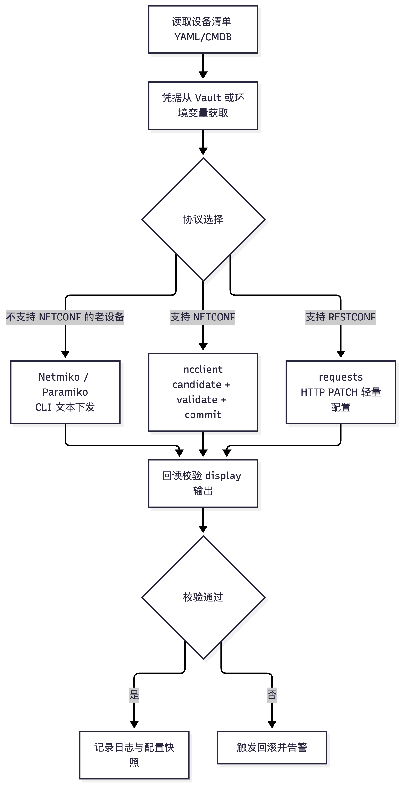


### 真题精练

**Q1.【真题·单选】** 使用 Netmiko 向华为设备批量下发配置时，能够自动进入系统视图并在结束后退出的方法是：
A. `send_command()`  B. `send_config_set()`  C. `send_command_timing()`  D. `write_channel()`

> **答案：B**
> **解析**：`send_command()` 用于下发**查询类**命令并等待提示符返回（如 `display`）；`send_config_set()` 专用于**配置下发**：它会自动进入配置模式（华为设备为 `system-view`）、逐条下发、并在结束时退出配置模式，返回值是所有命令的回显。`send_command_timing()` 是基于时间等待的兼容模式（对响应不规则的老设备有用），`write_channel()` 是底层通道写入，都不负责视图切换。

**Q2.【真题·多选】** 编写生产可用的网络自动化脚本时，必须包含的工程化要素有：
A. 凭据从环境变量或密钥管理系统读取，不硬编码在代码中
B. 对连接失败、认证失败、命令执行失败分类捕获并记录日志
C. 变更前备份原配置，变更后回读校验，失败时可按快照回滚
D. 为了效率最大化，应把并发数设为无限大，尽快完成所有设备的下发

> **答案：ABC**
> **解析**：A、B、C 分别是"安全、可观测、可回退"三条工程底线，也是国赛方案题与实操题的核心评分点。D 错误：设备 SSH 会话数、CPU 处理能力有限，并发过大极易导致会话被拒、配置下发超时甚至设备管理面假死；**正确做法是限流（如并发 5~20）+ 失败重试 + 分批灰度**。

**Q3.【真题·简答】** 请说明用 RESTCONF 通过 HTTP 方法修改设备配置时，如何做到"不像 CLI 那样改一半失败"。若业务对一致性要求极高，你会怎么改选技术方案？

> **答案与解析**：
> **RESTCONF 的局限**：RESTCONF 是 HTTP 方法映射（PUT/PATCH/POST/DELETE），**没有 NETCONF 的 candidate 库、validate 与 commit 两阶段提交**，一次请求内能保证的原子性有限；如果一次变更需要改多个资源（如同时改接口、VLAN、路由策略），拆成多个 HTTP 请求就可能出现"前几个成功、后面失败"的中间态。
> **缓解手段**：① 尽量把一次变更**收敛到单个资源树的一次 PATCH**（减少请求数，降低中间态概率）；② 变更前用 GET 保存快照，脚本中实现"失败即按快照回滚"的反向操作；③ 变更前后都做 GET 校验，用期望状态与实际状态比对（声明式校验）；④ 通过 `lock`（若设备支持 `ietf-netconf` 的 RESTCONF 扩展）避免与其他系统并发修改。
> **改选方案**：对一致性要求极高的场景应改用 **NETCONF（candidate + validate + commit，必要时 confirmed-commit）**，或使用 **gNMI 的 Set**（一次 RPC 内可组合 delete/replace/update，语义明确）；再配合"变更窗口 + 分批灰度 + 快照回滚"的流程控制，才能达到"改错能自动回来"的工程要求。

### 易错点与排错

1. **忘记关闭分页**：`display current-configuration` 被 `---- More ----` 截断，备份文件不完整。必须先 `screen-length 0 temporary`。
2. **明文密码入库**：Git 上出现密码等于泄密；必须用 Vault/环境变量并在提交前做密钥扫描。
3. **不判状态码**：requests 不检查 `resp.status_code` 就把"失败"当成功，是最常见脚本缺陷。
4. **并发无上限**：批量任务把设备管理面打挂，属于典型的"自动化事故"。
5. **只写不读**：下发后不回读校验，无法发现"配置被设备拒绝"的情况（例如模型校验失败但脚本没解析错误体）。
6. **排错命令链**：脚本侧打印详细日志与返回文本 → 设备侧 `display users`（看是否连上）、`display logbuffer`（看是否有配置报错）→ 必要时人工 `stelnet` 复现。

## 9.8 Ansible 网络自动化、iMaster NCE 与落地建议

### 考点定位

Ansible 是国赛"自动化落地"题的主角，常以 **1 道多选 + 1 道简答/配置题** 出现，分值 8~12 分。高频考法：**① Inventory / Playbook / Module / Role 的概念关系；② 幂等性的含义与判据；③ 华为设备模块名与连接方式；④ Playbook 的关键字（hosts、gather_facts、vars、tasks、loop）**。易错点是以为 Ansible "只是批量 SSH"（忽略幂等与声明式），以及写 Playbook 时忘记关掉 `gather_facts`（网络设备上执行 fact 采集会失败或极慢）。

### 原理精讲

**Ansible 的核心模型**：**无代理（Agentless）+ 声明式（Declarative）+ 幂等（Idempotent）**。

- **无代理**：不需要在被管设备上安装客户端，通过 SSH（`network_cli`）或 NETCONF（`netconf`）连接，这一点对网络设备至关重要（网络设备无法安装 Agent）。
- **声明式**：Playbook 描述"目标状态"（我需要存在 VLAN 10），模块负责计算差异并执行，不描述"执行哪几条命令"。
- **幂等**：同一 Playbook 执行一次与执行 N 次，设备最终状态相同。判据是"**第二次执行时模块返回 `changed: false`**"——这是国赛判断"是否真正幂等"的标准方法。

**四层概念关系**：**Inventory（管谁）→ Playbook（做什么，YAML 剧本）→ Module（怎么做的能力单元）→ Role（可复用的模块与任务打包）**。Inventory 可以是 INI 或 YAML，支持分组（`[switches]`、`[routers]`）与组变量（`group_vars/switches.yml`），这正是"按角色下发不同配置"的基础。

**网络自动化的连接方式（华为场景）**：

| 连接方式 | `ansible_connection` | 说明 | 适用模块 |
|---|---|---|---|
| CLI over SSH | `network_cli` | 最通用，等价于自动化敲 CLI | `community.network.ce_*` 系列 |
| NETCONF | `netconf` | 事务化、结构化、推荐 | `ce_netconf`（发原始 XML）、各厂商 netconf 模块 |
| HTTPAPI | `httpapi` | 部分平台支持 | 视平台而定 |
| local + provider | `local` | 旧写法（provider 参数），现在多被 `network_cli` 取代 | 老版本模块 |

**华为设备常用模块（Ansible `community.network` 集合）**：`ce_vlan`（VLAN 管理）、`ce_config`（下发行配置段）、`ce_command`（执行 show/display 类命令）、`ce_netconf`（发送原始 NETCONF RPC）、`ce_lacp`、`ce_interface` 等。使用前需要 `ansible-galaxy collection install community.network`，并在 `ansible_network_os` 中指定 `community.network.ce`。

**iMaster NCE 在自动化中的角色**（国赛方案题必答的"平台位")：

| 能力 | 说明 |
|---|---|
| 网络自动化发放 | 基于意图/模板批量开通 VLAN、VPN、SRv6 Policy、EVPN 等，替代逐台 CLI |
| 拓扑与资源管理 | 自动发现拓扑、管理 IP/VLAN/AS 号/SID 等资源池，避免人工分配冲突 |
| 集中算路与优化 | 作为 PCE 为 SR-MPLS/SRv6 计算满足约束的路径，并按 SLA 动态调优 |
| 配置备份与合规 | 定期自动备份配置、做基线合规检查、发现配置漂移并告警/纠正 |
| Telemetry 与智能运维 | 采集高频遥测数据，做趋势预测、异常检测与故障定位（结合 iFIT） |
| 开放北向 | 提供 RESTful API 供编排层/业务系统调用，实现"业务—网络"贯通 |
| 分级部署形态 | NCE-Campus（园区）、NCE-Fabric（数据中心）、NCE-IP（IP 骨干/承载）分别对应不同场景 |

**自动化落地的风险控制（六条铁律，方案题必写）**：① **配置备份先行**：变更前必须留存设备配置快照（并对快照做校验，确认能打开、内容完整）；② **变更审核**：所有自动化变更走工单 + 双人复核（代码评审 + 方案评审），关键命令需人工确认；③ **预演（Dry Run）**：Ansible 用 `--check` 模式、平台用仿真/沙箱环境先跑一遍，观察差异；④ **灰度发布**：先 1 台测试设备 → 1 个业务组（如同一楼栋）→ 全网，每批之间保留观察期；⑤ **回滚准备**：明确回滚触发条件（如业务验证失败、告警数超阈值）、回滚手段（配置快照恢复、NETCONF confirmed-commit 自动回滚、NCE 配置回退）与回滚耗时上限；⑥ **可观测与闭环**：变更期间开启 Telemetry/日志监控，变更后自动跑验证脚本（连通性、时延、路由条目数），输出变更报告并归档。

### 关键概念对照表

| 概念 | 含义 | 关键点 |
|---|---|---|
| Inventory | 主机与分组清单 | 支持组变量，是"按角色差异化下发"的基础 |
| Playbook | YAML 格式的任务剧本 | `hosts` / `gather_facts` / `vars` / `tasks` |
| Task | 一次模块调用 | 每个 task 有 `name`，便于日志定位 |
| Module | 执行能力单元 | 幂等性由模块实现保证 |
| Role | 可复用打包（tasks/vars/templates/handlers） | 大型项目的组织方式 |
| Handler | 被 `notify` 触发的任务 | 如配置变更后重启进程 |
| `--check` | 预演模式 | 只报差异不实际修改，网络模块支持度需验证 |
| 幂等性 | 重复执行结果一致 | 判据：第二次执行 `changed: false` |

### 华为设备配置

设备侧准备（与章节9其他节一致，Ansible 也需要 SSH 与足够权限）：

```bash
system-view
ssh server enable                                 // Ansible network_cli 依赖 SSH
aaa
 local-user ansible password irreversible-cipher Huawei@123   // 专用自动化账号
 local-user ansible privilege level 15
 local-user ansible service-type ssh
quit
ssh user ansible authentication-type password
#
display ssh server status                         // 核对 SSH 服务状态
```

Inventory（`inventory.ini`）与 Playbook（`vlan_deploy.yml`）：

```ini
# inventory.ini —— 设备清单与分组
[switches]                                        # 交换机分组（Ansible 按组下发）
SW-Core-A ansible_host=10.2.1.1                   # 每台设备的连接参数
SW-Core-B ansible_host=10.2.1.2

[routers]                                         # 路由器分组（可用于差异化任务）
NE40E-PE1 ansible_host=10.1.1.1

[switches:vars]                                   # 组变量：同组设备共享的连接与平台参数
ansible_connection=network_cli                    # 网络设备用 network_cli 连接
ansible_network_os=community.network.ce           # 华为 CloudEngine / NE 使用 ce 系列平台驱动
ansible_user=ansible                              # 自动化专用账号
ansible_ssh_pass={{ vault_ansible_password }}     # 密码来自 Ansible Vault 变量，不落明文
```

```yaml
# vlan_deploy.yml —— 向交换机下发 VLAN 配置（幂等）
---
- name: 批量下发 VLAN 配置到华为交换机          # Play 名称（日志中可见）
  hosts: switches                                # 作用目标：inventory 中的 switches 分组
  gather_facts: false                            # 网络设备不需采集系统 facts，关闭可显著提速并避免报错
  vars:                                          # 期望状态（声明式：只说"要什么"）
    vlans:
      - vlan_id: 10
        name: Office
      - vlan_id: 20
        name: Server
  tasks:
    - name: 确保 VLAN 存在且名称正确             # 任务名称，失败时便于定位
      community.network.ce_vlan:                 # 华为 VLAN 模块（幂等：已存在且属性一致则不改动）
        vlan_id: "{{ item.vlan_id }}"            # 引用循环变量
        name: "{{ item.name }}"
        state: present                           # present 表示"必须存在"，absent 表示"必须不存在"
      loop: "{{ vlans }}"                        # 逐条应用期望状态
      register: vlan_result                      # 保存执行结果，供后续判断与输出

    - name: 回读校验实际 VLAN 列表               # 变更后校验，形成闭环
      community.network.ce_command:              # 命令执行模块，用于跑 display 类命令
        commands:
          - display vlan brief
      register: vlan_check

    - name: 打印校验结果                         # 输出便于人工/流水线审查
      ansible.builtin.debug:
        var: vlan_check.stdout_lines
```

执行与灰度：

```bash
ansible-galaxy collection install community.network          # 首次使用需安装华为模块集合
ansible -i inventory.ini switches -m ping                    # 连通性测试（网络设备常用 ce_command 代替）
ansible-playbook -i inventory.ini vlan_deploy.yml --check     # 预演：只报差异不落地（先预演再执行是铁律）
ansible-playbook -i inventory.ini vlan_deploy.yml --limit SW-Core-A   # 灰度：先只对一台设备执行
ansible-playbook -i inventory.ini vlan_deploy.yml             # 全量执行（观察期后再放开）
```

> **幂等性验证（比赛实操常考）**：连续执行两次 Playbook，**第一次 `changed` 数量 > 0，第二次 `changed=0`**，即证明幂等。若第二次仍有 `changed`，说明模块参数写成了"每次都强制改"（如 description 带了随机值/时间戳）。

### 示意图

```mermaid
flowchart TD
  A["inventory.ini<br/>设备清单与分组"] --> C["ansible-playbook"]
  B["vlan_deploy.yml<br/>声明式期望状态"] --> C
  C --> D["建立 network_cli 连接"]
  D --> E["模块计算差异<br/>ce_vlan 幂等"]
  E --> F{"设备状态与期望是否一致"}
  F -->|"一致"| G["changed = false<br/>不做任何修改"]
  F -->|"不一致"| H["下发差异配置<br/>changed = true"]
  H --> I["回读校验 display vlan brief"]
  G --> I
  I --> J["输出报告与日志"]
```

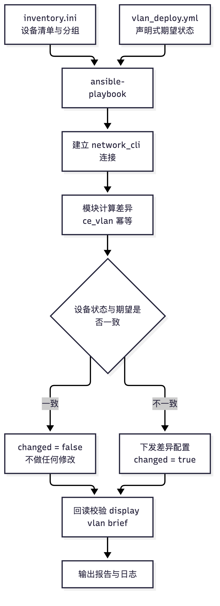


```mermaid
flowchart LR
  O["编排层 业务工单"] -->|"RESTful 北向 API"| N["iMaster NCE<br/>NCE-Campus / NCE-Fabric / NCE-IP"]
  N -->|"NETCONF / gNMI 下发"| D["网络设备"]
  D -->|"Telemetry 遥测"| N
  N -->|"SLA 与合规报表"| O
```


### 真题精练

**Q1.【真题·单选】** 判断一个 Ansible 网络自动化任务是否真正具备幂等性，最直接的依据是：
A. Playbook 能一次执行成功
B. 第二次执行时模块返回 `changed: false`
C. 任务使用了 loop 循环
D. Playbook 中关闭了 gather_facts

> **答案：B**
> **解析**：幂等的定义是"**重复执行最终状态不变**"，在 Ansible 中体现为"第二次执行不再产生变更"，即 `changed: false`（或 `changed=0`）。A 只说明"能跑通"，不代表幂等；C 是循环语法；D 是性能与兼容性优化（网络设备上确实应关闭），都与幂等性无直接关系。

**Q2.【真题·多选】** 使用 Ansible 管理华为设备时，下列说法正确的有：
A. 网络设备无需安装 Agent，通过 `network_cli`（SSH）或 `netconf` 连接
B. 网络设备 Playbook 通常设置 `gather_facts: false`
C. 华为设备可使用 `community.network` 集合中的 `ce_vlan`、`ce_config`、`ce_command` 等模块
D. Ansible 必须依赖 iMaster NCE 才能管理华为设备

> **答案：ABC**
> **解析**：A 正确，Ansible 的无代理特性正是它适合网络设备的原因。B 正确，网络设备不支持标准 fact 采集，开启 `gather_facts` 会报错或极慢，因此惯例是关闭并显式提供所需变量。C 正确，`ce_*` 系列是华为 CloudEngine/NE 相关模块（`ce_netconf` 可发原始 NETCONF，`ce_config` 下发配置段，`ce_command` 跑 display 命令）。D 错误，Ansible 与 NCE 是两条可独立使用的路径（工具链主导 vs 控制器主导），也可以组合使用（NCE 管平台化能力，Ansible 管补充场景与批量任务）。

**Q3.【真题·简答】** 某团队准备用 Ansible 对 200 台交换机批量下发一批 ACL 变更。请给出你的风险控制方案（至少 6 项），并说明"回滚"如何做到可执行。

> **答案与解析**：
> **风险控制方案**：① **变更前配置备份**：用 Playbook 先跑一遍备份任务（`display current-configuration` 落盘并校验完整性），形成"变更前快照"；② **预演**：`ansible-playbook --check` 先看差异，确认只改预期内容（尤其确认不会误删已有 ACL）；③ **代码评审与方案审批**：Playbook 走 Git MR 评审，变更方案走工单审批，明确影响范围与时间窗口；④ **灰度发布**：`--limit` 先 1 台测试机 → 同楼栋 5 台 → 一个汇聚组 → 全网，每批保留 10~15 分钟观察期；⑤ **变更窗口与限流**：安排在业务低谷，`forks` 限流（如 10），避免 200 台同时登录打满管理面；⑥ **可观测与验证**：变更期间开启 Telemetry/日志，变更后自动执行验证任务（ACL 条目数、业务连通性、关键路由条目数），结果自动汇总成变更报告；⑦ **沟通与应急**：建立变更群，明确升级路径与决策人。
> **回滚方案可执行性**：① **触发条件明确**（业务验证失败、告警超阈值、错误率上升）与**回滚时限明确**（如 15 分钟内必须完成）；② **回滚材料就绪**：变更前快照已落盘并验证可读，回滚脚本就是"把快照中的 ACL 段重新下发"的 Playbook，并且**在预演阶段已演练过一次**；③ **回滚执行方式**：优先用"反向 Playbook"（下发变更前状态），若设备支持 NETCONF，可用 candidate + confirmed-commit 让**未确认即自动回滚**；④ **回滚后动作**：回滚完成必须再做一轮验证并通知干系人，随后进行复盘（根因、改进项、责任人、闭环时间）。**一句话：回滚不是"到时候想办法"，而是变更方案里必须先写清、并演练过的步骤。**

### 易错点与排错

1. **开启 `gather_facts`**：网络设备不支持，导致任务失败或极慢；必须 `gather_facts: false`。
2. **第二次执行仍 `changed`**：检查模块参数是否包含可变值（时间戳、随机串），或用了 `ce_config` 下发"无脑命令段"（那是命令式，不是声明式）。
3. **`ansible_network_os` 配错**：华为设备应为 `community.network.ce`，配成 `ios`/`huawei` 等会直接连不上或模块找不到。
4. **凭据明文**：密码应放 Ansible Vault（`ansible-vault encrypt_string`），仓库只存密文。
5. **`--check` 误以为万能**：部分网络模块的 check 支持度有限，仍需在沙箱设备上真实验证。
6. **排错命令链**：`ansible -m ce_command -a "commands='display version'"` 单模块直连验证 → `ansible-playbook -vvv` 看 SSH/模块细节 → 设备侧 `display users` 与 `display logbuffer` 确认下发痕迹与报错。

---

## 章节9 综合真题（限时 25 分钟）

**Q1.【真题·多选】** 下列哪些属于"声明式 + 幂等"自动化的典型特征？
A. 输入为期望状态（我要 VLAN 10 存在），而非命令序列
B. 重复执行不产生额外变更，第二次执行 `changed=false`
C. 每次执行都强制把所有配置重刷一遍，以保证一致
D. 变更前后可做状态比对与校验

> **答案：ABD**
> **解析**：C 是"命令式重刷"，看似能保证一致，但会带来无谓的设备负载、日志噪声与误覆盖风险（例如人工临时加的一条配置被刷掉），并且无法判断"是否需要改"。声明式的价值在于**先算差异、只改差异**。

**Q2.【真题·简答】** 请按"采集 → 传输 → 存储 → 消费"四个环节，说明网络自动化运维数据平台的建设要点。

> **答案与解析**：
> **采集**：协议选型分层——关键设备用 **Telemetry/gNMI 订阅**（秒级、GPB 编码），老设备与第三方设备保留 **SNMPv3**；明确采样分级（核心端口高频、接入端口低频），并规划好 YANG sensor-path 清单。
> **传输**：Telemetry 用 **gRPC（HTTP/2 长连接，可靠有序）**，高吞吐场景避免用 UDP；采集器侧做限流与背压，防止设备推送洪峰压垮平台；设备到采集器方向需放通端口并做源地址校验。
> **存储**：性能指标入**时序数据库**（按设备/接口/队列打标签，便于多维查询），事件与告警入告警库，配置快照入配置库（版本化，可比对差异）；制定保留策略（原始高频数据短期保留，聚合数据长期保留）。
> **消费**：可视化大屏与容量趋势、SLA 报表、异常检测与预测性告警、与工单系统联动实现"告警→工单→处置→闭环"，并把高频数据喂给智能分析（如微突发检测、无损网络调优）。
> **闭环要求**：数据平台必须与**变更流程**打通——变更前留存快照、变更中实时监控、变更后自动验证，才能把"数据"变成"风险控制能力"。

**Q3.【真题·排错】** 某团队用 Netmiko 批量备份 200 台设备，脚本报告 180 台成功、20 台失败，失败设备手工登录正常。请列出至少 5 个可能原因及排查方法。

> **答案与解析**：
> ① **并发过高导致会话被拒**：设备有最大 VTY/SSH 会话数限制，并发大时部分连接被拒。排查：查看脚本 `forks/线程数`、设备侧 `display users` 与 `display ssh server session`，降低并发并加重试。
> ② **超时设置过短**：配置较大的设备读取时间超过脚本 timeout，被误判为失败。排查：失败设备手工执行 `display current-configuration` 计时，调大 timeout 与读取轮询时长。
> ③ **分页未关闭**：备份文本被 `---- More ----` 截断，脚本判定输出异常。排查：确认 `screen-length 0 temporary` 已下发且回显成功；部分版本需在用户视图执行。
> ④ **账号/权限差异**：部分设备上该账号 `privilege level` 不足或 `service-type` 未含 ssh，手工用的是个人高权限账号所以正常。排查：比对失败设备的 `display current-configuration | include local-user`。
> ⑤ **管理网络与 ACL 限制**：失败设备的 ACL 未放通脚本所在跳板机地址（`ssh server acl`），或存在路由/防火墙策略差异。排查：从脚本服务器 `telnet <device> 22` 测试连通性，核对设备 ACL。
> ⑥ **设备版本差异导致提示符不同**：不同 VRP 版本提示符或登录 banner 内容不同，正则匹配失败。排查：抓取失败设备的原始回显，放宽提示符匹配规则（如匹配 `[>\]]\s*$` 或用户自定义提示符）。
> ⑦ **SSH 算法协商失败**：老设备不支持脚本库默认的加密/HMAC 算法。排查：查看脚本异常信息是否为 `no matching key exchange`，在 Paramiko/Netmiko 中显式指定兼容算法。
> **改进建议**：加入**失败重试（2~3 次、指数退避）**、**并发限流**、**逐台详细日志**与**失败清单自动导出**，并把备份完整性校验（字符数、是否包含 `sysname`、是否含截断标记）作为脚本的强制步骤。

**Q4.【真题·实验】** 请用 Python 完成一个"批量下发 VLAN + 回读校验 + 幂等验证"的自动化任务：两台华为 S5731 交换机（10.2.1.1、10.2.1.2），需要下发 VLAN 10（Office）与 VLAN 20（Server）。要求写出脚本结构、关键代码片段、幂等性验证方法与失败处理策略。

> **答案与解析**：
> **脚本结构（四段式）**：① **配置段**：设备清单（从 YAML/CMDB 读取）、期望状态（VLAN 列表，结构化数据）、凭据（环境变量或 Vault）；② **生成段**：把期望状态渲染为命令列表（`vlan 10` / `name Office` / `quit`）或 YANG 数据；③ **执行段**：`Netmiko.ConnectHandler(device_type="huawei")` → `send_config_set(configs)` → `save_config()`；④ **校验段**：`send_command("display vlan brief")` 回读并断言期望 VLAN 存在，输出结构化结果。
> **关键代码片段**：

```python
from netmiko import ConnectHandler

for host in SWITCHES:
    with ConnectHandler(device_type="huawei", host=host,
                        username=USER, password=PWD) as conn:   # 华为驱动自动处理 system-view/quit
        conn.send_command("screen-length 0 temporary")            # 关闭分页，避免回显被截断
        out = conn.send_config_set(build_configs(VLANS))          # 下发配置并返回回显
        if "Error" in out:                                        # 判定设备是否拒绝配置
            raise RuntimeError(out)
        conn.save_config()                                        # 保存配置，避免重启丢失
        check = conn.send_command("display vlan brief")           # 回读校验，形成闭环
        assert "10" in check and "20" in check                    # 断言期望状态已生效
```

> **幂等性验证方法**：**连续执行两次同一脚本**，第二次执行时 VLAN 已存在，设备不产生实质变更（若用 NETCONF/Ansible 模块会明确返回 `changed: false`；若用 CLI 文本下发，则通过"回读比对期望与实际"来判断是否需要下发，即"先检查、后下发"）。若第二次仍强制重下发，则说明脚本是命令式而非声明式。
> **失败处理策略**：① 分类捕获 `NetmikoAuthenticationException`（账号/权限问题）与 `NetmikoTimeoutException`（网络/性能问题）并分别给出提示；② 单台失败不影响其他设备（逐台 try/except），最后汇总"成功/失败清单"；③ 失败重试 2~3 次并指数退避；④ 并发限流（如 5~10 台）；⑤ 变更前用 `display current-configuration` 存快照，失败可按快照回退。
> **加分点**：把设备清单与期望状态外置为 YAML、日志带时间戳与设备名、结果输出为 JSON 供流水线消费。

**Q5.【真题·实验】** 请用 Ansible 实现"下发 VLAN 并验证"的任务，要求说明 Inventory 与 Playbook 的关键写法，并解释如何用 `--check` 与 `--limit` 实现预演与灰度。

> **答案与解析**：
> **Inventory 关键写法**：按角色分组（`[switches]`），在 `[switches:vars]` 中设置 `ansible_connection=network_cli`、`ansible_network_os=community.network.ce`、`ansible_user` 与由 Vault 提供的 `ansible_ssh_pass`；设备用 `别名 ansible_host=IP` 形式登记，便于日志可读。
> **Playbook 关键写法**：`hosts: switches`、**`gather_facts: false`**（网络设备不采集 facts）、`vars` 中声明期望的 VLAN 列表（声明式）、`tasks` 中用 `community.network.ce_vlan`（`vlan_id` / `name` / `state: present`）配合 `loop` 逐条保证状态、再用 `community.network.ce_command` 执行 `display vlan brief` 回读校验并用 `debug` 输出。
> **预演与灰度**：`ansible-playbook -i inventory.ini vlan_deploy.yml --check` 只报差异不落地，用于变更前确认影响面；`--limit SW-Core-A` 只对单台设备执行，实现灰度首发；确认无误后逐批放开（一个业务组 → 全网），每批保留 10~15 分钟观察期。
> **幂等性验证**：连续运行两次，**第一次 `changed > 0`、第二次 `changed = 0`** 即证明幂等；若第二次仍 changed，检查模块参数是否含可变值或改用了 `ce_config` 命令式下发。

---

# 数通-HCIE-章节10-网络割接与综合排错

## 10.1 网络割接的定义、分类、风险与全流程

### 考点定位

割接是国赛"方案设计 + 现场实操"的必考板块，通常以 **1 道单选/多选 + 1 道方案简答 + 1 道排错题** 出现，分值 10~15 分，且直接影响实操环节的评分（是否按流程、是否留回退）。高频考法：**① 割接的定义与五类分类；② 割接全流程的顺序；③ 回退方案与回退时间点的要素；④ 风险识别与应对**。易错点是把"割接"等同于"配置变更"（割接强调**有计划、有窗口、可回退、影响业务**），以及把"回退时间点"写成一句空话（必须写清触发条件 + 决策人 + 最晚回退时刻）。

### 原理精讲

**定义**：**网络割接（Network Cutover）** 是指在**不影响或少影响现有业务**的前提下，对**在网运行**的网络进行有计划的结构性调整或替换，并在**规定的时间窗口**内完成实施、验证与交付的工程活动。三个关键词必须抓住：**在网运行**（不是新建）、**业务连续**（不是随便断）、**计划与窗口**（不是随时改）。

**五类割接及各自的风险重心**：

| 类型 | 典型场景 | 技术要点 | 风险重心 |
|---|---|---|---|
| 新增（Add） | 新增一台汇聚交换机、新增一条出口链路 | 保持既有配置不变，只做增量；注意 STP/路由域接入后的拓扑变化 | 新设备引入导致的拓扑与协议收敛变化（如成为 STP 根、成为 OSPF DR、吸引流量） |
| 扩容（Expand） | 端口/带宽/设备容量不足，加板卡、加链路、加堆叠成员 | 聚合与堆叠的成员一致性、链路带宽与哈希调整 | 成员属性不一致导致聚合不生效、哈希不均导致单链路拥塞 |
| 优化（Optimize） | 路由策略调整、VLAN 重构、QoS/ACL 整改、地址重规划 | 策略变更必须可回退；改动顺序与依赖关系 | 策略误匹配导致业务中断或次优路径（变更"看不见"但影响大） |
| 替换（Replace） | 老设备退网、新设备接管（同厂商升级或异构替换） | 配置平移、业务切换、双机倒换、逐业务迁移 | 配置语义差异（不同型号/版本命令与默认行为不一致）、遗漏隐含配置 |
| 搬迁（Relocate） | 机房搬迁、机柜/楼层调整，设备物理位置变化 | 线缆预布放、光路核对、分批次搬迁、链路临时迂回 | 物理链路与光功率核对、搬迁期间的单点故障暴露、时间窗口不足 |

**割接的六大风险来源**：① **方案风险**：步骤顺序错、依赖关系漏（例如先改了 ACL 再改路由，导致中间态不可达）；② **配置风险**：漏迁移隐含配置（NTP、SNMP、syslog、AAA、SSH 版本、时间戳、MSTP 实例映射）；③ **技术风险**：协议收敛时间、STP 收敛、路由振荡、聚合协商失败；④ **人为风险**：误敲命令、复制粘贴错行、多人并行操作冲突；⑤ **回退风险**：回退方案不可执行（快照不完整、回退脚本没演练）、回退时间超出窗口；⑥ **业务与组织风险**：未通知业务方、验证标准不明确、"以为改完了"但其实业务未恢复。

**割接全流程十步（必须能按顺序默写）**：

1. **需求分析**：明确"为什么割接、要达到什么效果、不做会怎样"，形成可量化的目标（如出口带宽由 1G 提到 10G、收敛时间 < 200 ms）。
2. **现状调研**：采集现网拓扑、配置、流量、协议邻居、业务清单与依赖关系（这一步的产出是"割接前基线"，也是回退的参照）。
3. **方案设计**：目标拓扑、地址与 VLAN/SID 规划、配置模板、详细实施步骤（**每步写清命令、预期回显、失败判定**）、验证方案。
4. **风险评估**：逐条列出风险、影响面、概率、应对措施与责任人（建议用表格，国赛方案题给分点密集）。
5. **回退方案与回退时间点**：定义触发条件（业务不通、丢包超阈值、告警风暴）、回退步骤、回退所需时间、**最晚回退时刻**（= 窗口结束时间 − 回退耗时 − 观察时间）、决策人（谁有权说"回退"）。
6. **审批**：内部技术评审 + 客户/业务方审批 + 变更管理（ITIL 变更单）审批，形成书面授权。
7. **预演（演练）**：在实验室/沙箱用同版本设备完整跑一遍，包括回退演练；把预演中发现的问题回写方案。
8. **实施**：按时间轴执行，双人复核，一人操作一人唱读确认；每步完成后记录回显与时间戳。
9. **验证与观察**：按验证清单逐项检查（业务连通性、路由/协议邻居、性能与丢包、关键应用访问），观察期内保持关注并保留回退能力。
10. **文档归档与复盘**：更新拓扑与配置基线、更新资产与监控、提交割接报告、开复盘会闭环改进项。

**为什么"回退时间点"是国赛最爱考的细节？** 因为它区分了"想清楚了"和"没想清楚"。一个合格的回退方案包含四个要素：**触发条件（客观、可量化）、回退动作（可执行、有脚本或快照）、回退耗时（实测值，来自预演）、最晚回退时刻（硬约束）**。很多真实事故的根因不是"改错了"，而是"发现问题时已经过了窗口、回退来不及"。

### 关键概念对照表

| 术语 | 含义 | 常见误区 |
|---|---|---|
| 割接窗口 | 允许实施的时间段（通常业务低谷，如 00:00–05:00） | 误以为窗口只约束"开始时间"，其实也约束"必须结束" |
| 回退时间点 | 最晚必须决定并执行回退的时刻 | 写成"视情况回退"，无法执行 |
| 灰度 | 分批实施，先小范围验证再扩大 | 误以为灰度就是"先改一台"而忽略观察期 |
| 预演 | 在非生产环境完整演练（含回退） | 省略预演，把生产环境当试验场 |
| 基线 | 割接前的配置/流量/业务状态记录 | 不留基线，出问题后无法比对 |
| 变更单 | 记录变更内容、审批、时间、风险的正式凭据 | 只做技术操作，无审批与留痕 |
| 观察期 | 实施完成后的持续监控时段 | 改完立即宣布成功，忽略延迟暴露的问题 |

### 华为设备配置

割接前后的关键操作（配置备份、回退准备、验证命令）：

```bash
# ===== 割接前：保存基线与备份（必做，且要校验备份可用） =====
display current-configuration > flash:/backup/NE40E-PE1-before-20250601.cfg   // 备份当前配置到本地 flash（文件名带日期便于回溯）
save NE40E-PE1-before-20250601.cfg                                            // 保存为可回滚的配置文件（可用 startup saved-configuration 指定）
display saved-configuration | include sysname                                 // 校验备份文件内容完整（能读到关键配置即说明文件可用）
display interface brief                                                       // 记录接口状态基线
display ip routing-table statistics                                           // 记录路由条目数基线，变更后对比可快速发现异常
display ospf peer brief                                                       // 记录协议邻居基线（OSPF 为例，其他协议同理）
#
# ===== 割接中：变更操作（示例：调整 OSPF 开销引流） =====
system-view
interface GigabitEthernet0/0/1
 ospf cost 100                                                                 // 调大开销使流量切换到备用路径（改前先确认备用路径容量充足）
 quit
display ospf peer brief                                                       // 立即确认邻居是否仍为 Full
display ip routing-table 10.2.2.0 24                                          // 确认去往关键网段的路由是否符合预期（下一跳是否切换）
#
# ===== 回退执行（触发条件满足时立即执行） =====
startup saved-configuration NE40E-PE1-before-20250601.cfg                     // 指定回退配置文件为下次启动配置
reboot                                                                        // 重启设备以加载回退配置（会中断业务，是最后的回退手段，必须谨慎）
#
# 更优的回退方式：用"反向配置"而不是重启
interface GigabitEthernet0/0/1
 undo ospf cost                                                               // 撤销本次变更（配置级回退，业务影响最小，推荐优先）
 quit
display ip routing-table 10.2.2.0 24                                          // 回退后立即验证路由恢复
```

> **回退方式优先级（比赛答题要点）**：**① 配置级回退（`undo` 反向命令）→ ② 快照回退（配置替换/NETCONF 回滚）→ ③ 重启回退（加载备份配置，影响最大）**。能在第 ① 层解决就不要用第 ③ 层；重启回退必须在方案中写明"会造成业务中断多久、是否在窗口内"。

### 示意图

```mermaid
flowchart TD
  A["1 需求分析<br/>目标可量化"] --> B["2 现状调研<br/>建立割接前基线"]
  B --> C["3 方案设计<br/>步骤 命令 预期回显"]
  C --> D["4 风险评估<br/>风险 影响 应对 责任人"]
  D --> E["5 回退方案与回退时间点<br/>触发条件 回退耗时 最晚时刻 决策人"]
  E --> F["6 审批<br/>技术评审 业务审批 变更单"]
  F --> G["7 预演<br/>含回退演练"]
  G --> H{"预演是否通过"}
  H -->|"否"| C
  H -->|"是"| I["8 实施<br/>双人复核 逐步记录"]
  I --> J["9 验证与观察<br/>业务 协议 性能"]
  J --> K{"验证是否通过"}
  K -->|"否且到达回退条件"| L["执行回退并复盘"]
  K -->|"是"| M["10 文档归档与复盘<br/>更新基线 闭环改进项"]
  L --> M
```

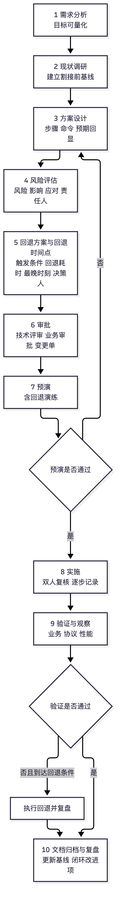


### 真题精练

**Q1.【真题·单选】** 下列哪一项是"割接"与普通"配置变更"的关键区别？
A. 割接必须由厂商工程师实施
B. 割接是在网运行网络的、有计划有窗口、必须可回退的结构性调整
C. 割接只能在夜间进行
D. 割接必须使用新设备

> **答案：B**
> **解析**：割接的本质特征是"**在网 + 计划窗口 + 可回退 + 结构性调整**"这三要素的组合。A 错误（实施主体不限）；C 错误（时间窗口由业务特点决定，不一定是夜间，例如面向海外业务的系统可能选在白天本地低谷）；D 错误（扩容、优化类割接完全不动设备）。

**Q2.【真题·简答】** 请写出一个合格"回退方案"必须包含的四个要素，并举例说明"最晚回退时刻"如何计算。

> **答案与解析**：
> **四要素**：① **回退触发条件**——必须客观可量化，例如"核心业务丢包率连续 5 分钟 > 1%"、"关键网段路由丢失超过 2 分钟"、"业务系统可用性拨测失败 3 次"；② **回退动作**——逐步可执行的操作（优先 `undo` 反向配置，其次配置快照替换，最后重启加载备份），最好有脚本并已演练；③ **回退耗时**——来自预演的实测值（例如反向配置回退 8 分钟、快照回退 15 分钟、重启回退 25 分钟）；④ **最晚回退时刻与决策人**——由窗口长度倒推得出，并明确"谁有权决定回退"。
> **最晚回退时刻计算示例**：割接窗口 00:00–05:00（共 300 分钟），要求实施完成后至少保留 **60 分钟观察期**（观察期不足就无法判断是否要回退），回退最慢手段耗时 **25 分钟**，且需要预留 **10 分钟**恢复性验证与沟通。则 **最晚回退时刻 = 05:00 − 60 − 25 − 10 = 02:25**。也就是说，**如果在 02:25 之前问题仍未解决，就必须执行回退，而不是继续"再试一次"**。这条硬约束正是避免"改到天亮、业务全断"的关键。
> **补充**：回退方案还应写明"部分回退"的可能（例如只回退改动最大的那一项），以及回退后的通知与复盘要求。

**Q3.【真题·多选】** 下列关于割接预演（演练）的说法，正确的有：
A. 预演应在与生产同型号、同版本的环境进行，尽量复现现网拓扑与配置
B. 预演必须包含回退演练，并实测回退耗时
C. 预演通过后可以省略生产环境的验证步骤，因为结果已经验证过
D. 预演中发现的问题应回写方案，并重新评审

> **答案：ABD**
> **解析**：A、B、D 都是预演的核心要求：**同构环境、含回退、结果回写方案并重新评审**。C 错误且危险——预演环境不可能 100% 等价于生产（流量模型、真实业务依赖、链路质量、并发行为都不同），**生产环境的验证与观察期不可省略**，这是"预演通过 ≠ 生产必成功"的基本工程常识。

### 易错点与排错

1. **把割接写成"配置变更清单"**：缺少需求目标、风险评估、回退方案、验证清单、归档要求，会在方案题上大面积失分。
2. **回退方案只有一句"有问题就回退"**：必须写清触发条件、动作、耗时、最晚时刻、决策人。
3. **忽略隐含配置迁移**：设备替换时最容易漏 NTP、SNMP、AAA、syslog、ACL、QoS、MSTP 实例映射、时间戳格式等。
4. **不留基线**：变更后无法判断"现在的状态是否正常"，也无法做精确回退。
5. **观察期过短或没有**：延迟暴露的问题（如路由振荡、会话老化、定时任务触发的策略匹配）在观察期内才会出现。
6. **验证命令**：`display interface brief`、`display ip routing-table statistics`、`display ospf peer brief`、`display bgp peer`、`display elabel`（核对硬件/模块）、业务侧拨测。

## 10.2 割接方案文档要素与常用割接技术手段

### 考点定位

本节直接对应国赛的"方案设计题"（常为 15~20 分的大题），要求给出**结构完整、步骤可执行、风险可控**的割接方案。高频考法：**① 方案文档的要素清单（按模板作答最能得分）；② 配置平移的方法与注意点；③ 流量迁移的常用手段；④ 双机倒换演练要点；⑤ 时间窗口选择依据**。易错点是只写"怎么做"，不写"怎么验证、怎么回退、谁负责"。

### 原理精讲

**割接方案文档要素清单（答题模板，按此结构写基本不会漏项）**：

| 序号 | 要素 | 内容要点 |
|---|---|---|
| 1 | 项目背景与目标 | 为什么割接、量化目标（带宽/收敛时间/容量/合规要求） |
| 2 | 现状描述 | 现网拓扑（图）、设备型号版本、协议与地址规划、业务与流量基线、已知问题 |
| 3 | 目标架构 | 割接后拓扑（图）、新增/变更的地址、VLAN、路由域、SID 规划 |
| 4 | 影响范围分析 | 受影响业务清单、受影响用户/区域、是否可降级运行、单点故障暴露情况 |
| 5 | 时间窗口与实施计划 | 窗口起止时间、时间轴（每步的起止时刻）、里程碑与检查点 |
| 6 | 详细实施步骤 | 每步：操作人、设备、命令、**预期回显**、失败判定与处置 |
| 7 | 验证方案 | 验证项、验证方法（命令/拨测/仪表）、通过标准（量化） |
| 8 | 回退方案 | 触发条件、回退步骤、回退耗时、最晚回退时刻、决策人 |
| 9 | 风险清单与应对 | 风险描述、概率、影响、应对措施、责任人 |
| 10 | 人员分工与沟通机制 | 指挥、操作、唱读复核、业务验证、厂商支持；沟通群与升级路径 |
| 11 | 应急预案 | 设备宕机、断纤、电源故障、协议风暴等极端情况处置 |
| 12 | 归档与复盘 | 归档物（配置、日志、报告、拓扑）、复盘时间与改进项闭环 |

**常用割接技术手段（六类，务必能各说清"适用场景 + 关键动作"）**：

1. **配置平移（Configuration Migration）**：把旧设备配置映射到新设备。关键动作：① **导出旧设备全量配置并做差异分析**（不要只看业务相关段落，隐含配置最致命）；② 建立"旧命令 → 新命令/新模型"映射表（异构替换时尤其重要）；③ **模板化生成新配置**（用 Ansible/Jinja2 模板，避免手工复制粘贴错行）；④ **新设备离线预配 + 配置对比**（`display current-configuration` 与目标配置逐段比对）；⑤ **上电后逐项验证**（接口、协议邻居、路由条目数、ACL 命中计数）。
2. **流量迁移（Traffic Migration）**：把业务流量从旧路径/旧设备迁到新路径/新设备。常用手段：**调整 IGP 度量（`ospf cost`/`isis cost`）**、**调整 BGP 属性（`local-preference`、`MED`、`AS_PATH` 预置）**、**调整路由策略（`route-policy` 匹配与 `apply`）**、**调整链路聚合权重与哈希**、**ESN/双活方案下的优先级调整**。关键原则：**先建后拆、逐步加权、可随时回退**——先把新路径建好并验证连通，再小比例引流量观察，最后全量切换。
3. **链路切换（Link Switchover）**：链路级割接（换纤、改路由、上联端口调整）。手段：**双上行冗余 + MSTP/VRRP/堆叠保障**、**临时迂回路由**、**逐条链路切换（避免同时断双上行）**、**光功率与误码核对**。关键原则：**任何时刻只让一条链路处于风险中**。
4. **双机倒换演练（Failover Drill）**：对 VRRP/堆叠/集群/防火墙双机热备做一次主动倒换，验证可靠性。要点：① 明确倒换触发方式（断主设备上行、主备切换命令、断电模拟）；② 记录**倒换时间**与业务中断时长（是否满足 SLA）；③ 验证**会话同步**（防火墙双机热备的会话表同步、状态检测是否连续）；④ 验证**倒换后回切**是否正常；⑤ 演练要在业务低谷进行，并事先确认备用设备容量能承载全部流量（**容量不足的"双机"倒换等于二次故障**）。
5. **时间窗口选择**：依据"业务流量低谷 + 关键业务无重要活动 + 支持人员可到位 + 允许回退耗时"四条。常见选择：本地时间 00:00–05:00；面向海外业务需按业务所在地选择；7×24 关键业务需采用**在线迁移/无缝割接**（双活、灰度、逐业务迁移），把"断点"降到秒级甚至无感。
6. **灰度与分批**：按"测试设备 → 单一业务组 → 单一区域 → 全网"推进，每批留观察期。这是把大风险切成小风险的核心手段，也是方案题的高分点。

**配置平移的三条铁律**：① **先比对再覆盖**（用工具做配置 diff，人工确认每一处差异的含义）；② **隐含配置必须显式列出**（管理面、时间、日志、认证、安全策略、接口 MTU/双工、STP 实例映射等）；③ **平移后必须做"功能性验证"而不只是"配置存在性验证"**（配置里有 `ospf 1` 不代表邻居为 Full）。

### 关键概念对照表

| 技术手段 | 适用割接类型 | 核心动作 | 回退方式 |
|---|---|---|---|
| 配置平移 | 替换、搬迁 | 差异分析 + 模板生成 + 离线预配 + 逐项验证 | 恢复旧设备配置并切回旧设备 |
| 流量迁移（度量/BGP 属性） | 优化、替换 | 先建新路径 → 小比例引流 → 全量切换 | 恢复原度量/属性值（`undo` 反向命令） |
| 链路切换 | 搬迁、扩容 | 逐条切换 + 光功率核对 + 临时迂回 | 恢复原链路接线与端口配置 |
| 双机倒换演练 | 替换、搬迁、优化 | 主动倒换 + 计时 + 会话同步验证 + 回切 | 再倒换回原主设备 |
| 在线迁移/灰度 | 优化、替换（7×24 业务） | 分批、逐业务、双活并行运行 | 停止迁移新批次，流量留回原节点 |
| 重启加载备份配置 | 兜底（所有类型） | `startup saved-configuration` + `reboot` | 本身即为回退，但会造成中断 |

### 华为设备配置

```bash
# ===== 配置平移：新设备离线预配与差异比对 =====
system-view
sysname NE8000-P1-NEW                            // 统一命名规范，便于资产与监控识别
#
interface GigabitEthernet0/0/1
 description To_NE40E-PE1_10GE                   // 接口描述规范：对端设备_带宽，割接后便于核对
 undo negotiation auto                            // 关闭自协商（骨干互联口建议固定速率双工，避免协商不一致）
 mtu 9000                                         // 若原网络为长距/存储网络，核对 MTU 设置是否与旧设备一致
 quit
#
display current-configuration | include sysname   // 核对命名
display interface brief                           // 核对接口状态
display ospf peer brief                           // 核对协议邻居（以 OSPF 为例）
display ip routing-table statistics               // 核对路由条目数是否与割接前基线相当
#
# ===== 流量迁移：分步引流（示例） =====
route-policy LP-NEW permit node 10                // 定义策略：给新路径来的路由更高的本地优先级
 apply local-preference 200
quit
bgp 100
 peer 10.0.2.2 route-policy LP-NEW import          // 先对新邻居应用策略（此时流量仍走老路径）
 quit
display bgp routing-table 10.2.2.0 24 verbose      // 核对属性是否符合预期，确认无误后再撤销老路径策略
#
# ===== 双机倒换演练 =====
display vrrp brief                                 // 演练前记录主备状态与优先级
display vrrp interface Vlanif10                    // 查看 VRRP 明细（虚拟 IP、虚拟 MAC、状态）
hrp switch active                                   // 防火墙双机热备场景下主动倒换（USG 系列，需在 HRP 已建立的前提下执行）
display hrp state                                  // 倒换后确认主备角色与会话同步状态
display firewall session table | include Total     // 核对会话表数量是否随倒换连续（不连续说明同步有问题）
```

> **倒换演练的计时要点**：记录"发出倒换指令"到"业务拨测恢复"的**全程秒数**，与 SLA 要求比对。若倒换超时，必须查清是"协议切换慢"、"路由收敛慢"还是"会话未同步"——**这三种原因的处置方式完全不同**（前者调定时器、中者用 BFD/FRR、后者修 HRP 同步）。

### 示意图

```mermaid
flowchart LR
  A["割接前<br/>旧设备承载全部业务"] --> B["新设备离线预配<br/>配置平移 + 差异比对"]
  B --> C["新设备上电接入<br/>仅建邻居不引流量"]
  C --> D["小比例引流<br/>度量/属性微调"]
  D --> E{"业务与性能是否达标"}
  E -->|"是"| F["逐步加大引流比例"]
  F --> G["全量切换<br/>旧设备仅保留兜底"]
  G --> H["观察期结束<br/>旧设备退网并归档"]
  E -->|"否"| I["撤销引流<br/>回退到旧路径"]
```

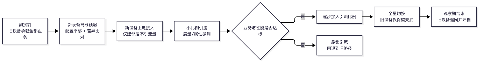


```mermaid
flowchart TD
  subgraph W["割接时间窗口 00:00 - 05:00"]
    T1["00:00 基线备份与核对"] --> T2["00:20 新设备接入与邻居建立"]
    T2 --> T3["00:50 小比例引流 10%"]
    T3 --> T4["01:20 引流 50% 并观察"]
    T4 --> T5["02:00 全量切换"]
    T5 --> T6["02:30 验证清单逐项通过"]
    T6 --> T7["02:30-05:00 观察期"]
  end
```

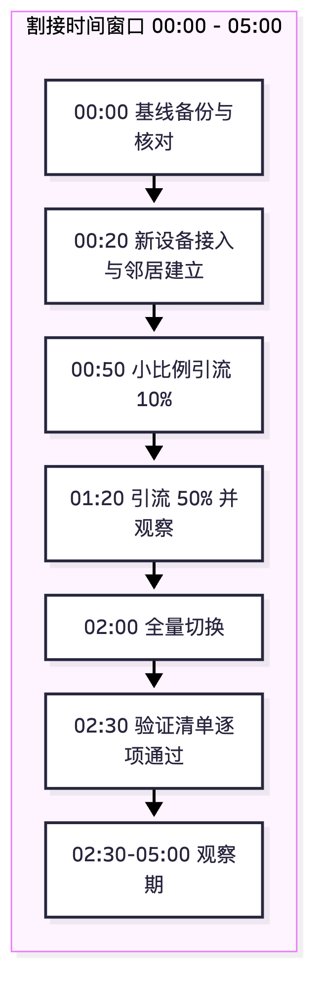


### 真题精练

**Q1.【真题·多选】** 割接方案文档中必须包含的内容有：
A. 影响范围分析与受影响业务清单
B. 详细实施步骤（含每步命令、预期回显、失败判定）
C. 回退方案（触发条件、步骤、耗时、最晚回退时刻、决策人）
D. 只写目标拓扑图即可，具体命令由实施工程师现场决定

> **答案：ABC**
> **解析**：A、B、C 是方案文档的核心要素。D 是典型错误做法：**"现场决定命令"意味着方案未完成**，既无法评审、也无法预演、更无法评估回退耗时，一旦现场出现分歧就会拖延到窗口结束。合格方案的详细实施步骤必须细化到"敲什么命令、看到什么回显算成功、看到什么算失败、失败后怎么办"。

**Q2.【真题·简答】** 某企业要把一台运行 8 年的 S12700 替换为 S12700E，业务包括办公 VLAN、无线、语音和视频会议。请写出配置平移的关键步骤与三条最容易漏掉的隐含配置。

> **答案与解析**：
> **关键步骤**：① **导出旧设备全量配置**并分区段整理（管理面、接口、VLAN、STP、聚合、路由、ACL/QoS、AAA/SNMP/syslog）；② **建立命令映射表**（同厂商不同代次也会存在默认值差异，例如 STP 模式、接口自协商默认值、QoS 模板、Eth-Trunk 哈希算法）；③ **用模板（Jinja2/Ansible）生成新配置**，避免手工复制错行；④ **新设备离线预配**并用配置 diff 工具与目标基线比对，逐条确认差异含义；⑤ **接入前先在测试环境验证**（可选用两台同型号搭小拓扑验证 STP/VRRP/聚合收敛）；⑥ **接入后逐项验证**：接口状态、VLAN 与网关、STP 根桥与实例映射、聚合成员一致性、路由邻居与条目数、ACL 命中计数、语音/视频质量拨测；⑦ **观察期内保留旧设备配置与回退路径**（旧设备先不下电，必要时快速切回）。
> **三容易漏掉的隐含配置**：① **管理面配置**——NTP、SNMP（含 Trap 目的与 v3 用户）、syslog、AAA/SSH 版本与算法、`terminal` 类参数、时区与时间戳格式；这些与业务无关但影响监控与审计，漏了会导致"割接后网管失联"。② **MSTP 实例与 VLAN 映射**——只迁 VLAN 不迁实例映射，会导致负载分担与阻塞端口位置改变，可能引发某条链路瞬间拥塞。③ **接口级细节**——MTU、双工/速率（是否关闭自协商）、风暴抑制阈值、端口隔离、`stp edged-port`、聚合口的哈希算法与最小激活链路数；这些参数不显眼，却直接影响转发行为与故障表现。

**Q3.【真题·排错/方案】** 某园区语音业务在割接后出现"偶发单通、通话质量差"，数据业务正常。请给出排查思路与最可能的三个原因。

> **答案与解析**：
> **排查思路**：① 先**界定范围**（是所有语音还是特定楼层/特定对端、是否与时间相关、是否与呼叫方向相关）；② 对比**割接前后基线**（VLAN 与网段、QoS 策略、网关位置、路由路径、STP 拓扑）；③ 逐层排查：物理层（链路质量、错包）、二层（VLAN 是否一致、STP 是否有环路或频繁拓扑变化、语音 VLAN 是否被误加入其他实例）、三层（语音网段路由是否非最优、是否绕行、MTU 是否变小）、QoS（语音报文的 DSCP/802.1p 标记与队列调度是否丢失）；④ 抓包与统计：在关键点镜像抓包看 RTP 抖动/丢包，`display interface | include CRC` 看错包，`display stp brief` 看拓扑变化计数。
> **最可能原因**：① **QoS 策略未平移**：旧设备上有针对语音的优先级映射与队列调度（如 `diffserv domain`、`qos phb marking`、接口 `trust upstream` 等），新设备默认配置导致语音报文进入低优先级队列，拥塞时被丢弃；② **语音 VLAN 的 STP 实例映射或边缘端口设置丢失**：导致拓扑变化时语音端口短暂震荡，或环路引起广播泛洪影响实时流；③ **路径或 MTU 变化**：割接后语音流量绕行到劣质或拥塞链路，或 MTU 变小导致语音信令（SIP/TCP）大包被丢弃、出现单通。**处置：优先恢复 QoS 与 STP 边缘端口配置，再核对语音流量路径与 MTU，最后做拨测验证。**

### 易错点与排错

1. **只迁业务配置、不迁管理面配置**：割接后网管失联、日志中断，问题发现更晚。
2. **一次切换双上行**：同时断开两条上行导致业务完全中断；必须逐条切换。
3. **双机容量不对等**：备用设备承载不了全量业务，倒换即二次故障；演练前必须核对容量与许可。
4. **不做配置 diff 直接覆盖**：新旧默认值差异（自协商、STP 模式、哈希算法）会导致行为不一致。
5. **验证只看"配置存在"**：`display current-configuration` 有配置 ≠ 功能正常，必须看协议状态、路由条目、业务拨测。
6. **排错命令链**：`display interface brief` → `display stp brief` → `display eth-trunk` → `display ip routing-table statistics` → `display qos queue-statistics interface` → 抓包看标记与丢包。

## 10.3 结构化排错方法论与决策树

### 考点定位

排错方法论是国赛排错题的"答题骨架"，也是实操环节的效率来源。常以 **1 道多选 + 1 道排错实操题** 出现，分值 8~15 分。高频考法：**① 分层法（自下而上 / 自上而下）的适用场景；② 分段法（二分法）的操作方式；③ 对比法与替换法的作用；④ 给出故障现象选择合适的排错顺序**。易错点是"拿到故障就乱敲命令"，或者"分层顺序选择不合理导致效率极低"。

### 原理精讲

**五种结构化方法及其适用场景**：

1. **分层法（Layered Approach）**：按 OSI/TCP-IP 层次推进。
   - **自下而上（Bottom-Up）**：物理层 → 链路层 → 网络层 → 传输层以上。适用于"单点完全不通""刚做完变更/布线/搬迁"的场景（物理层出问题的概率高，且物理层问题最好确认）。
   - **自上而下（Top-Down）**：应用/业务 → 传输层 → 网络层 → 链路/物理层。适用于"部分业务或部分用户报错""应用层配置变更后出问题"的场景（先确认业务现象与范围，避免在错误的方向深挖）。
   - **选择原则**：**故障现象"很硬"（完全不通、刚动过线）用自下而上；现象"很软"（偶发、部分、性能差）用自上而下**。
2. **分段法（Segmentation / 二分法）**：把端到端路径在中间切开，判断"故障在切点之前还是之后"，每次把排查范围缩小一半（如先 ping 网关 → 再 ping 对端网关 → 再 ping 服务器；或用 `tracert` 找到第一跳异常点）。适用于路径长、跨多跳的场景，**是效率最高的方法之一**。
3. **对比法（Comparison）**：拿"正常的对象"与"故障的对象"做差异对比——同型号设备配置对比、同楼层端口对比、故障前后的配置/状态对比、正常业务与故障业务的路径对比。适用于"个别设备/个别端口/个别用户"故障，能快速定位差异点。
4. **替换法（Substitution）**：把"怀疑有问题的部件"换成已知正常的部件（换光模块、换尾纤、换端口、换板卡、换网线、换终端），观察故障是否随之转移。适用于怀疑硬件/介质问题，**必须注意"替换件本身是否正常"以及"替换操作是否会造成二次影响"（如插拔板卡、拔光模块会影响业务）**。
5. **抓包与统计法（Capture & Counter）**：在关键点镜像抓包（看报文是否发出、是否到达、字段是否正确、是否被丢弃），以及查看接口/芯片统计计数（CRC、丢弃、队列丢包、ACL 命中）。**这是"把现象变成证据"的唯一手段**，在前四种方法无法收敛时必须使用。

**排错五步通用流程**：**① 界定范围**（谁受影响、何时开始、变更多少、是否可复现）→ **② 收集信息**（现象、拓扑、配置、日志、告警、统计计数）→ **③ 提出假设并排序**（可能性从高到低，优先验证"最可能且最易验证"的）→ **④ 验证与收敛**（每次只改一个变量，改完立即复测）→ **⑤ 恢复与闭环**（修复、验证、记录、复盘根因并制定预防措施）。

**"每次只改一个变量"是排错的第一铁律**：同时改三处，即便恢复了也不知道是哪一处起的作用，下次还会踩坑；同时改三处若没恢复，又引入了三个新的不确定因素。

### 关键概念对照表

| 方法 | 适用场景 | 优势 | 风险/注意 |
|---|---|---|---|
| 自下而上分层 | 完全不通、刚布线/搬迁/换模块 | 逻辑清晰、物理问题易查实 | 若问题在应用层会绕弯路 |
| 自上而下分层 | 部分业务异常、应用变更后 | 直击业务现象、范围界定快 | 若物理层断纤会浪费时间 |
| 分段法（二分） | 跨多跳的长路径 | 收敛最快（对数级缩小范围） | 需要知道路径，需可 ping/tracert |
| 对比法 | 个别设备/端口/用户异常 | 差异点往往就是根因 | 需有可比对象；配置差异可能不止一处 |
| 替换法 | 怀疑硬件/介质 | 结论直接 | 插拔有风险，替换件需确认正常 |
| 抓包与统计 | 前四法无法收敛、疑丢包/改包 | 提供客观证据 | 需镜像点与解码能力 |

### 华为设备配置

```bash
# ===== 排错常用"信息收集"一套（按分层顺序） =====
display version                                   // 设备型号与 VRP 版本（版本差异常是"同一个配置行为不同"的根因）
display device                                    // 板卡/子卡状态（是否 Offline、是否注册成功）
display interface brief                           // 所有接口 UP/DOWN、速率、双工、丢包统计概览
display transceiver verbose                       // 光模块信息（厂商、型号、波长、速率、是否华为认证）
display transceiver diagnosis interface GigabitEthernet0/0/1   // 光功率收/发与温度电压（DDM 数字诊断）
display transceiver alarm interface GigabitEthernet0/0/1       // 光模块告警（收光过低、发送异常等）
display interface GigabitEthernet0/0/1            // 单接口明细（含 CRC/错包/丢弃/队列统计）
display vlan                                      // VLAN 与成员端口
display mac-address                               // MAC 表（确认学习到正确端口与 VLAN）
display stp brief                                 // STP 角色与状态（是否有拓扑变化、端口被阻塞）
display eth-trunk 1                               // 聚合状态与成员口一致性
display ip interface brief                        // 三层接口地址与状态
display arp all                                   // ARP 表（是否有冲突、是否学习到）
display ip routing-table                          // 路由表（协议路由是否生成、优先级）
display fib                                       // 转发表（路由有但 FIB 无 = 转发表异常，常见于硬件/表项规格问题）
```

### 示意图

```mermaid
flowchart TD
  S["收到故障报告"] --> A["1 界定范围<br/>谁 何时 改动 是否可复现"]
  A --> B["2 收集信息<br/>现象 配置 日志 统计 抓包"]
  B --> C{"现象特征"}
  C -->|"完全不通 刚动过线或硬件"| D["自下而上分层<br/>物理 链路 网络 传输"]
  C -->|"部分业务异常 偶发 性能差"| E["自上而下分层<br/>业务 传输 网络 链路"]
  C -->|"跨多跳长路径"| F["分段法二分<br/>ping/tracert 找第一异常点"]
  D --> G["形成假设并排序"]
  E --> G
  F --> G
  G --> H["3 验证假设<br/>每次只改一个变量"]
  H --> I{"是否恢复"}
  I -->|"否"| J{"是否已收敛"}
  J -->|"否"| B
  J -->|"是"| K["抓包与统计法<br/>换用对比法或替换法"]
  K --> H
  I -->|"是"| L["4 修复并验证<br/>业务 协议 性能全项复测"]
  L --> M["5 记录与复盘<br/>根因 5Why 预防措施"]
```

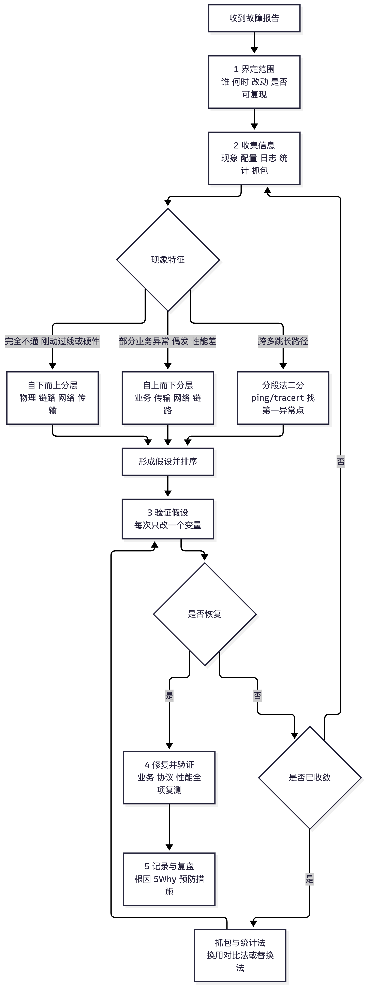


### 真题精练

**Q1.【真题·单选】** 某机房搬迁后，一台交换机所有接口均无法通信，且设备刚完成上电与连线。此时最合适的排错起点是：
A. 自上而下的应用层排查
B. 自下而上的物理层排查
C. 直接抓包分析应用报文
D. 直接重刷配置并重启

> **答案：B**
> **解析**："完全不通 + 刚动过线/上电"是**物理层问题概率最高的典型场景**：先看接口是否 UP、光模块是否正确识别、光功率是否在范围、速率双工是否匹配、线缆是否正确（单模/多模、收发光交叉）。自下而上能最快排除"线接错、模块不对、功率不足"这三类搬迁高频问题。A、C 会浪费时间（物理层不通时抓不到任何有效报文）；D 属于"未定位先动手"，违反排错纪律。

**Q2.【真题·多选】** 关于"每次只改一个变量"这条排错原则，下列说法正确的有：
A. 只有一次只改一个变量，才能在恢复后确定根因
B. 同时改动多处会引入新的不确定因素，可能制造出新的故障
C. 在时间窗口紧张且已高度确定根因时，可以有条件地合并操作
D. 该原则只适用于实验环境，生产环境无需遵守

> **答案：ABC**
> **解析**：A、B 是原则的核心价值——**可归因性**。C 是合理的工程现实：当根因已被充分证据锁定（如日志明确报错、统计明确异常），且窗口紧张时，可以合并处置，但必须在变更记录中写明"做了哪些操作"，以便必要时逐项回退。D 错误，**生产环境比实验环境更需要这条原则**，因为生产环境的不可控因素更多、影响面更大。

**Q3.【真题·简答】** 请说明"分段法"的具体操作步骤，并举例说明它为什么比"从头一路 ping 过去"效率更高。

> **答案与解析**：
> **操作步骤**：① 明确端到端路径（用 `tracert` 或已知拓扑列出途经节点/网段）；② **在路径中点选一个切点**，从源端 ping/测试该切点的地址（通常选切点设备的直连接口地址）；③ 若通则说明**故障在切点之后**，把排查范围收窄为"切点 → 目的"；若不通则说明**故障在切点之前**，范围收窄为"源 → 切点"；④ 在新的范围内重复步骤 ②③，直到锁定到具体设备/链路/接口。整个过程是**二分查找，复杂度为 log₂N**。
> **效率对比举例**：假设路径上有 16 跳。若"从头一路 ping 过去"，最坏情况要 ping 16 次才找到断点；用二分法**只需 4 次**（16→8→4→2→1）。在真实排错中，每次测试还包含登录设备、敲命令、等待响应的开销（可能每次 1~2 分钟），**二分法能把 30 分钟的定位过程压缩到 5 分钟以内**。更重要的是：二分法每一步都给出**明确的结论方向**（故障在前半段还是后半段），而盲目逐跳 ping 在中间某跳"ping 不通但业务正常"时（如设备限制 ICMP、或该跳只转发不回包）极易被误导。

### 易错点与排错

1. **不界定范围就开始敲命令**：先问清"谁、何时、什么改动、能否复现"，能省掉一半工作量。
2. **两种分层法用错场景**：硬故障用自下而上，软故障/业务异常用自上而下。
3. **同时改多个变量**：导致无法归因，也可能制造新故障。
4. **被 ICMP 限制误导**：某些设备/链路禁 ping 或对 ICMP 限速，"ping 不通"不等于"业务不通"，必须用业务拨测或 TCP 端口探测交叉验证。
5. **忽略"最近改了什么"**：90% 的故障与最近的变更相关，第一件事应是查变更记录与配置 diff。
6. **不收敛的原因**：往往是没有把方法组合起来（例如分层到网络层仍不通，就该上抓包与对比法），不要死磕单一方法。

## 10.4 分层排错实战清单

### 考点定位

本节是"实操检查表"，国赛排错实操与 HCIE 实验都直接用到。常以 **1 道多选/填空 + 1 道实操排错题** 出现。高频考法：**① 各层的关键检查项与命令；② 光功率/CRC 等指标的判读；③ VLAN/MAC/STP/聚合的检查顺序；④ 路由/ARP/MTU 的判读**。易错点是"跳过链路层直接查路由"或"看到 CRC 增长却以为是链路层以上问题"。

### 原理精讲

**物理层（Physical）**——检查项与判据：

- **接口状态**：`display interface brief` 看 `PHY` 是否 UP；`down` 时区分"未接线/对端未启/光模块未识别/协商失败"。
- **光模块识别**：`display transceiver verbose` 看"厂商名称、型号、波长、传输距离、是否华为认证"。**非认证模块可能被拒用或被限速**，是"能用但丢包"的常见根因。
- **光功率（DDM）**：`display transceiver diagnosis interface X` 看 RX Power / TX Power。判读原则：**必须在模块规格的接收灵敏度与饱和点之间**。经验参考：1000BASE-LX 发送约 −9.5~−3 dBm、接收灵敏度约 −19~−20 dBm；10GBASE-LR 发送约 −8.2~+0.5 dBm、接收灵敏度约 −12.6~−14.4 dBm；**接收光功率低于灵敏度 → 丢包/闪断；高于饱和点 → 同样误码**（"光太强"也是故障）。具体数值必须以所用光模块的数据手册为准。
- **告警与错包**：`display transceiver alarm interface X` 看有无"RX power low/high"；`display interface X` 看 `CRC`、`Input errors`、`Runts/Giants` 是否增长。**CRC 增长 = 物理层误码**（光纤脏污/弯曲过度/光模块劣化/接头污染/超距），不要在链路层以上浪费时间；且**CRC 是累积计数，必须"清零后再观察"**（`reset counters interface X`）才能判断是否还在增长。
- **速率双工**：自协商关闭但两端不一致会导致"UP 但大量丢包"，`display interface X` 可看 `duplex/negotiation`。

**链路层（Data Link）**：

- **VLAN**：`display vlan` / `display port vlan` 确认端口是否在正确 VLAN、trunk 是否允许该 VLAN 通过、PVID/native VLAN 两端是否一致。
- **MAC 表**：`display mac-address`（必要时带 `vlan`、`interface` 过滤）。检查"是否学到正确端口"、"是否有 MAC 漂移/振荡"（同一 MAC 在两个端口间跳动 = 二层环路或双上行无双活机制）。
- **STP**：`display stp brief` / `display stp` 看根桥位置、端口角色（Root/Designated/Alternate）、是否有频繁拓扑变化（`display stp topology-change`）。**阻塞端口位置错 → 流量绕远；频繁拓扑变化 → 网络抖动**。
- **聚合（Eth-Trunk）**：`display eth-trunk 1` 看成员口是否全部 `Selected`、`display lacp peer` 看对端状态。**成员速率/双工/数量/工作模式（静态 vs LACP）不一致会导致部分成员 `Unselected`**，带宽减半且易拥塞。
- **端口安全与隔离**：端口安全（`port-security`）超限、端口隔离、DHCP Snooping 的信任口配置错误都会导致"物理 UP、二层不通"。

**网络层（Network）**：

- **接口地址**：`display ip interface brief` 看地址是否配置、掩码是否正确、接口是否 Up。
- **ARP**：`display arp all` 看是否学习到对端 MAC；**ARP 学不到**要查"是否同网段、是否被隔离、是否有 ARP 攻击/表项限制"；**ARP 冲突**看是否有 `Duplicate address` 日志。
- **路由表与转发表**：`display ip routing-table` 看是否有路由、下一跳是否正确、协议优先级是否被其他协议覆盖；**`display fib` 看是否真正下发到转发表**（"路由表有、FIB 无"通常与表项规格/硬件资源相关）。
- **MTU**：`display interface X` 看 MTU 值；排查方法用**逐步增大 ping 包**（`ping -s`）观察在哪个体积开始失败，并抓包看是否被分片或依赖 ICMP 差错（注意：很多网络禁 ICMP 会导致 PMTU 发现失效，表现为"小包通、大包不通"）。
- **ICMP 与策略**：注意 ACL/QoS 可能丢弃 ICMP，导致"ping 不通但业务正常"或反之。

**传输层及以上（Transport & Above）**：

- **端口与服务**：用 `telnet <ip> <port>`（华为设备支持 `telnet` 到指定端口测试）或 `tcp` 探测确认端口可达；`display tcp status` 看本机监听。
- **会话与状态检测**：防火墙场景看 `display firewall session table`（`verbose` 看明细）、`display firewall session statistics`；**没有会话 = 流量没被策略放通或被丢弃**。
- **安全策略与 ASPF**：`display security-policy rule all`（或对应命令）看策略匹配与命中计数；**多通道协议（FTP/SIP/H.323）需要 ASPF/ALG 检测**，否则会出现"控制通道通、数据通道不通"（典型：FTP 主动模式、SIP 语音单通）。
- **NAT**：`display nat policy`、`display nat session all`（USG 上常为 `display firewall session table` 中含 NAT 信息）看地址转换是否发生、端口是否冲突。
- **应用层**：DNS 解析、证书、认证（RADIUS/Portal）、时间偏差（Kerberos/证书校验对时间敏感）等。

### 关键概念对照表

| 层次 | 关键检查项 | 典型命令 | 常见故障特征 |
|---|---|---|---|
| 物理层 | 接口 UP/DOWN、光模块、光功率、CRC、双工 | `display interface brief`、`display transceiver diagnosis interface X`、`display interface X` | 完全不通、闪断、大量丢包 |
| 链路层 | VLAN、MAC、STP、Eth-Trunk、端口安全 | `display vlan`、`display mac-address`、`display stp brief`、`display eth-trunk 1` | 同网段不通、广播风暴、带宽异常 |
| 网络层 | 接口地址、ARP、路由表、FIB、MTU | `display ip interface brief`、`display arp all`、`display ip routing-table`、`display fib` | 跨网段不通、次优路径、大包不通 |
| 传输层 | 端口可达、TCP 状态、会话表 | `telnet ip port`、`display tcp status`、`display firewall session table` | 业务端口不通、连接被拒/超时 |
| 应用/安全 | 策略、ASPF/ALG、NAT、认证、DNS | `display security-policy rule all`、`display nat session all`、`display hrp state` | 登录失败、单通、部分功能异常 |

| 指标 | 正常判据 | 异常含义与处置方向 |
|---|---|---|
| CRC 错包 | 清零后不再增长 | 物理层误码：查光纤清洁度/弯曲、光模块、接头、超距 |
| 接收光功率 | 在模块灵敏度与饱和点之间 | 过低导致丢包（查衰减/接头）；过高导致饱和误码（加衰减器） |
| Eth-Trunk 成员 | 全部 Selected | Unselected 多为速率/双工/模式/对端不一致 |
| ARP 表项 | 能学到对端且无冲突 | 学不到查二层与隔离；冲突查 IP 规划 |
| 路由条目数 | 与基线相当 | 骤降多为协议邻居中断或策略误匹配 |
| 会话表 | 有对应正反向会话 | 无会话说明策略未放通或被丢弃 |

### 华为设备配置

```bash
# ===== 物理层 =====
display interface brief                           // 接口总览（UP/DOWN、速率、双工）
display transceiver interface GigabitEthernet0/0/1  // 光模块基本信息（厂商、型号、速率、波长）
display transceiver verbose                       // 光模块详细信息（含是否华为认证、支持的传输距离）
display transceiver diagnosis interface GigabitEthernet0/0/1   // 收发光功率、温度、电压（判读是否超范围）
display transceiver alarm interface GigabitEthernet0/0/1       // 光模块告警（如收光过低）
display interface GigabitEthernet0/0/1            // 明细统计：CRC、Input errors、drops
reset counters interface GigabitEthernet0/0/1     // 清零统计计数（清零后再观察，才能判断是否仍在增长）
#
# ===== 链路层 =====
display vlan                                      // VLAN 列表与成员端口
display port vlan                                 // 端口的 PVID、允许通过的 VLAN（trunk 核对必用）
display mac-address vlan 10                       // 指定 VLAN 的 MAC 表（看是否学到正确端口）
display stp brief                                 // STP 端口角色与状态
display stp topology-change                       // 拓扑变化统计（频繁变化说明二层不稳定）
display eth-trunk 1                               // 聚合口状态与成员是否 Selected
display lacp peer                                 // LACP 对端信息（判断对端是否也正确加入聚合）
#
# ===== 网络层 =====
display ip interface brief                        // 三层接口地址与状态
display arp all                                   // ARP 表（学不到/冲突都在这里体现）
display ip routing-table                          // 路由表
display fib 10.2.2.0                              // 转发表（验证是否真正下发硬件）
display ip routing-table statistics               // 路由条目统计（与割接前基线对比）
ping -s 1472 -c 5 10.2.2.1                        // 大包探测（配合逐步减小 size 判断 MTU 问题）
#
# ===== 传输层及以上 =====
display tcp status                                // 本机 TCP 连接与监听状态
telnet 10.2.2.1 80                                // 端口可达性探测（能建立则说明四层可达）
display firewall session table verbose            // 防火墙会话明细（判断策略是否放通、NAT 是否生效）
display security-policy rule all                  // 安全策略与命中计数
```

### 示意图

```mermaid
flowchart TD
  A["物理层<br/>接口 UP 光模块 光功率 CRC 双工"] --> B["链路层<br/>VLAN MAC STP 聚合 端口安全"]
  B --> C["网络层<br/>地址 ARP 路由 FIB MTU"]
  C --> D["传输层<br/>端口 TCP 会话 策略 NAT"]
  D --> E["应用层<br/>DNS 认证 证书 时间 业务逻辑"]
  A -->|"CRC 增长或功率超范围"| F["定位物理介质与光模块"]
  B -->|"MAC 漂移或 STP 频繁变化"| G["定位环路 双上行 聚合不一致"]
  C -->|"路由缺失或 FIB 缺失"| H["定位协议邻居与表项规格"]
  D -->|"无会话或单通"| I["定位策略 ASPF NAT"]
```

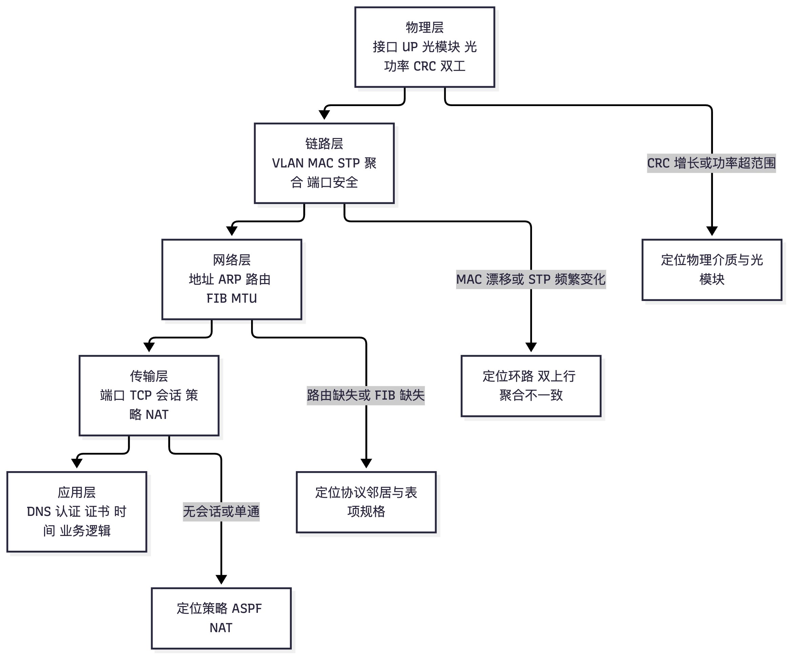


### 真题精练

**Q1.【真题·单选】** 某链路接口 Up，但业务丢包严重。`display interface` 显示 CRC 错包持续增长。最可能的故障层次与原因是：
A. 网络层路由配置错误  B. 物理层误码（光纤/光模块/接头问题）  C. 应用层协议不匹配  D. 传输层端口被封

> **答案：B**
> **解析**：**CRC 校验失败是典型的物理层误码**，常见原因：光纤端面脏污或划伤、跳线弯曲半径过小、法兰头/接头污染、光模块劣化、链路超距（衰减超预算）、发光功率异常（过高导致饱和）。处置：清洁端面、更换跳线/模块、`display transceiver diagnosis` 核对收发光功率。注意 A、C、D 都不会导致 CRC 计数增长（它们影响的是"通与不通"或"业务行为"，不是"比特错误"）。

**Q2.【真题·多选】** 两台交换机之间配置了 LACP 模式的 Eth-Trunk，`display eth-trunk 1` 显示部分成员为 `Unselected`。可能原因包括：
A. 成员接口的速率或双工模式不一致
B. 一端为 LACP 模式、另一端为手工负载分担（静态）模式
C. 成员接口数量或连线与对端不一致（连错端口）
D. 成员接口上配置了互斥特性（如某些版本不允许成员口同时做 STP 边缘端口/镜像口）

> **答案：ABCD**
> **解析**：Eth-Trunk 成员 `Unselected` 的四大类原因就是：**速率/双工不一致、工作模式不一致、对端连线/成员不匹配、成员口存在互斥配置或状态异常（如被 STP 阻塞、被端口安全禁用）**。排查顺序：`display eth-trunk 1`（本端成员状态与原因）→ `display lacp peer`（对端是否看到同一聚合）→ `display interface` 核对速率双工 → 核对两端模式与配置 → 检查成员口是否有互斥特性。**排错技巧**：华为设备在 `display eth-trunk` 中通常会给出 `Unselected` 的原因（如 `Different speed`、`Different duplex`），优先读这个字段。

**Q3.【真题·排错】** 用户报"能 ping 通网关，能 ping 通同 VLAN 的其他主机，但访问另一网段服务器超时；服务器所在网段的网关也能被 ping 通"。请列出你的排查步骤与最可能的三个原因。

> **答案与解析**：
> **排查步骤**：① **界定范围**：是所有跨网段访问都失败，还是只有该服务器？是只有这台主机，还是整个 VLAN 的用户？（若整 VLAN 受影响 → 网关/路由侧问题；若单主机 → 主机侧问题：掩码、网关、防火墙）。② **网络层定位**：在网关设备上 `display ip routing-table <服务器网段>` 确认路由存在且下一跳正确，`display fib` 确认下发；在中间设备逐跳 `tracert` 目标服务器，找到第一处不通的跳点。③ **分段法**：从源主机 ping 网关 → ping 中间设备接口 → ping 目的网关 → ping 服务器，确定中断点。④ **抓包验证**：在目的网关与服务器侧抓包，判断请求是否到达服务器、回包是否发出、是否被策略丢弃。⑤ **策略与安全**：检查沿途 ACL、防火墙 `security-policy`、ASPF、NAT 策略与会话表。⑥ **MTU 与分片**：用 `ping -s` 逐步增大包体，确认是否"小包通、大包不通"。
> **最可能原因**：① **回程路由缺失**（最常见）：报文能到达服务器所在网段，但服务器/目的网关没有回源网段的路由，或回程走了错误的接口导致非对称路径被防火墙丢弃；② **ACL/安全策略只放通单向**：只配了"源→目的"方向，回程被默认拒绝，或防火墙未生成反向会话（ASPF 未开启，多通道协议场景更明显）；③ **MTU/分片问题**：路径 MTU 偏小或中间链路 MTU 不一致，大包被丢弃且 ICMP 差错被过滤，导致"ping 小包通、业务（大包）不通"。**处置顺序**：先补回程路由 → 再核对双向策略与会话 → 最后核对 MTU 与分片。

### 易错点与排错

1. **跳过链路层直查路由**：VLAN/trunk 配置错、MAC 学不到时，路由层看到的现象会误导判断。
2. **CRC 计数误判**：CRC 是累积值，必须先 `reset counters interface` 再观察是否仍在增长。
3. **只看"接口 UP"就认为物理层正常**：UP 但光功率超标、双工不一致、CRC 增长都属物理层故障。
4. **忽略 MTU**：表现为"ping 小包通、大包不通、某些应用偶发超时"，且容易被 ICMP 被禁的现象掩盖。
5. **把"ping 不通"等同于"业务不通"**：很多策略会限制 ICMP，需用端口探测或业务拨测交叉验证。
6. **排错命令链**：按 `display interface brief` → `display transceiver diagnosis` → `display interface` → `display vlan/port vlan` → `display mac-address` → `display stp brief` → `display eth-trunk` → `display ip interface brief` → `display arp all` → `display ip routing-table` → `display fib` → `display firewall session table` 的顺序推进，与分层法一致。

## 10.5 高频故障案例集（十个必背案例）

### 考点定位

本节是国赛排错题的"题库原型"，几乎每届排错题都能在这里找到影子。常以 **2~3 道排错题（每题要求写现象分析、定位命令、解决方案）** 出现，分值 15~25 分，是所有章节中单节分值最高的部分。**学习要求：每个案例的"现象 → 分析 → 定位命令 → 解决方案"四段都要能默写**，尤其是定位命令要具体到可敲。

### 原理精讲

排错案例的通用答题结构（阅卷按此给分）：

1. **现象复述与范围界定**：把题给现象用术语重述，并说明要先界定范围（谁受影响、何时开始、最近有无变更）。
2. **原因分析**：按层次或按概率列出 2~4 个可能原因，说明其机理（**必须讲"为什么会导致这个现象"**）。
3. **定位命令与判据**：写出具体命令以及"看到什么就能确认是哪个原因"。
4. **解决方案**：给出配置修改或处置动作，并说明验证方法。
5. **预防措施**（加分项）：如何避免复发（规范化、监控、自动化校验）。

以下十个案例覆盖了二层、三层、协议、安全、硬件与链路聚合六个方向，是国赛排错题的"最大公约数"。

**案例 ① 单臂路由不通**

- **现象**：三层交换机（或路由器）与二层交换机之间用一条 trunk 相连，PC 网关指向路由器子接口地址，PC 无法访问其他 VLAN，也 ping 不通网关。
- **分析**：单臂路由依赖三个条件同时成立——① 路由器子接口做了 `dot1q termination vid X`（终结对应 VLAN 标签）；② 子接口使能了 ARP 广播（`arp broadcast enable`，**华为子接口默认关闭 ARP 广播，这是最经典的漏配**）；③ 二层交换机上联口为 trunk 且允许对应 VLAN 通过，同时 PC 接入口在正确 VLAN 内。
- **定位命令**：`display ip interface brief`（子接口是否 Up、是否有地址）；`display vlan` / `display port vlan`（交换机上联口是否为 trunk、是否允许该 VLAN、PVID 是否为 1）；`display arp all`（子接口下是否有 ARP 表项，没有说明 ARP 广播没通）；`display interface GigabitEthernet0/0/1.10`（子接口是否 Up 且配置了 termination）。
- **解决方案**：路由器上 `interface GigabitEthernet0/0/1.10` → `dot1q termination vid 10` → `arp broadcast enable` → `ip address 10.1.10.1 24`；交换机上联口 `port link-type trunk` + `port trunk allow-pass vlan 10 20`；PC 网关设为 10.1.10.1。验证：PC ping 网关与跨 VLAN 主机，`display arp all` 应能看到 PC 的 ARP 表项。
- **预防**：把"子接口三件套（termination + arp broadcast + ip address）"写进配置模板。

**案例 ② 跨 VLAN 不通（三层互通失败）**

- **现象**：同交换机两个 VLAN 的 PC 互 ping 不通，各自 ping 自己的网关正常。
- **分析**：可能原因——① 只创建了 VLAN 与 VLANIF 但 **VLANIF 未 Up**（华为 VLANIF 只有在对应 VLAN 内至少有一个 Up 的物理成员口时才会 Up）；② 两个 VLAN 都建了 VLANIF 但**其中一个漏配 IP**；③ 主机**掩码配错**（例如把 /24 写成 /25 或 /16），导致主机认为对端在同网段而不走网关；④ 存在 ACL/端口隔离阻断；⑤ VLANIF 处于 `Down` 是因为成员口被 STP 阻塞或全部 Down。
- **定位命令**：`display ip interface brief`（两个 VLANIF 是否 Up 且地址正确）；`display vlan 10` / `display vlan 20`（成员口是否存在且 Up）；`display interface brief`（成员口 PHY 是否 Up）；`display acl all` 与 `display port-isolate group all`（是否有阻断）；在 PC 上用 `ipconfig`/`ifconfig` 核对掩码与网关。
- **解决方案**：确保每个 VLAN 至少一个 Up 成员口；补齐 VLANIF 地址；修正主机掩码与网关；移除误配的 ACL/隔离；必要时在 VLANIF 上 `undo shutdown`。
- **预防**：VLAN 与 VLANIF 的地址规划表要成对维护，并在变更后执行"逐 VLAN 网关可达性"自动拨测。

**案例 ③ OSPF 邻居卡在 ExStart**

- **现象**：两台路由器 OSPF 邻居状态长期停在 `ExStart`（或反复在 ExStart/Exchange 之间跳变），学不到路由。
- **分析**：ExStart 阶段的 DD（Database Description）报文协商主从关系与 MTU。**最常见原因是两端接口 MTU 不一致**：MTU 大的一方发出的 DD 报文被 MTU 小的一方丢弃，协商无法完成；其次是 **Router-ID 冲突**（两台设备 Router-ID 相同，导致 DD 交互混乱）；还有 DD 报文被中间二层设备丢弃/组播被过滤、认证不匹配、单播通信异常（如 PIM/单播可达性问题）等。
- **定位命令**：`display ospf peer`（看邻居状态与 `MTU` 字段是否一致，华为会显示 `MTU mismatch`）；`display ospf peer verbose`（看 DD 交互细节）；`display ospf brief`（看 Router-ID 是否冲突、是否有错误计数）；`display interface GigabitEthernet0/0/1`（看 MTU 值）；`display ospf error`（统计各类错误报文，含 MTU 相关）。
- **解决方案**：统一两端接口 MTU（`interface X` → `mtu 1500`）；或在确认业务无碍的前提下配置 `ospf mtu-ignore`（**注意：忽略 MTU 检查后大包仍可能不通，属于"掩盖问题"的做法，仅在无法修改 MTU 时使用**）；Router-ID 冲突则重新规划并 `reset ospf process` 生效。
- **预防**：设备上线模板统一 MTU；Router-ID 按"环回地址"自动取值并纳入 IP 规划管理。

**案例 ④ OSPF 邻居已 Full 但学不到路由**

- **现象**：`display ospf peer` 显示邻居 `Full`，但 `display ip routing-table` 中没有对端网段的 OSPF 路由。
- **分析**：可能原因——① **区域类型与 LSA 过滤**：Stub/NSSA 区域不会泛洪某些类型的 LSA，若对端是 ASBR 且区域为 Stub，外部路由不会进来；② **接口被配置为 `silent-interface`**：只发不收/不发 Hello，邻居可能通过其他接口建立但该接口网段不参与；③ **路由过滤**：`filter-policy import` 把路由过滤掉了；④ **掩码/网络类型不匹配**：两端接口掩码不一致导致 LSA 中的网段信息不一致；⑤ **cost 过大**或路由被其他协议（静态/直连）以更低优先级覆盖；⑥ **两端不在同一区域**（区域号不一致时邻居不会 Full，但区域边界场景需特别注意）。
- **定位命令**：`display ospf lsdb`（对端是否发布了对应的 Router LSA/Network LSA，以及 LSA 内容中的网段）；`display ospf routing`（OSPF 自己的路由表，若有而 `display ip routing-table` 没有，说明是优先级或过滤问题）；`display ospf brief`（看区域类型、过滤策略、silent 接口）；`display current-configuration configuration ospf`（核对 filter-policy 与 silent-interface）。
- **解决方案**：按原因处置——调整区域类型或改用 NSSA/Stub 的正确设计；取消误配的 `silent-interface`；修正 `filter-policy`；统一两端掩码；调整路由优先级。
- **预防**：路由过滤策略必须留"命中计数"并可观测；区域设计在方案中明确 LSA 类型与外部路由引入方式。

**案例 ⑤ BGP 邻居 Established 但收不到路由**

- **现象**：`display bgp peer` 显示 `Established`，但 `display bgp routing-table` 里没有对端发来的路由（或数量远少于预期）。
- **分析**：BGP 邻居 Up 只说明 TCP 与 BGP 能力协商成功，**路由能否进入本地 BGP 表还取决于**：① **入方向策略**（`peer X route-policy import` / `filter-policy import`）把路由过滤了；② **下一跳不可达**：IBGP 场景下对端未配 `peer X next-hop-self`，导致从 EBGP 学到的路由下一跳在本地 IGP 中不可达而被标记为无效（`display bgp routing-table` 中显示为 `*>` 缺失或 `No best`）；③ **AS_PATH 环路检测**：路由的 AS_PATH 中包含本地 AS 号会被直接丢弃（常见于双出口本 AS 号重复出现或路由回环）；④ **BGP 与 IGP 同步**（部分实现）或**路由被聚合/抑制**（`aggregate` 后明细被 suppress）；⑤ **对端未发布**：对端本身没有这些路由可发；⑥ **认证/能力不一致**导致部分地址族未协商。
- **定位命令**：`display bgp peer verbose`（看各地址族协商情况、收发包计数、`Received` 计数）；`display bgp routing-table peer 10.0.0.2 received-routes`（**看对端真正发来了什么**——这是区分"对端没发"与"本地过滤"的关键）；`display bgp routing-table peer 10.0.0.2 advertised-routes`（看本端发了什么）；`display ip routing-table <nexthop>`（验证下一跳可达性）；`display current-configuration configuration bgp`（核对策略）。
- **解决方案**：修正入方向策略；IBGP 场景配置 `next-hop-self` 或确保下一跳在 IGP 中可达；处理 AS_PATH 环路（调整 AS 规划或使用 `allow-as-loop`，慎用）；核对聚合与抑制配置。
- **预防**：BGP 策略上线前用 `received-routes`/`advertised-routes` 做双向核对；变更必须记录"路由条目数基线"。

**案例 ⑥ 路由环路与次优路径**

- **现象**：tracert 显示报文在两个网段之间来回跳（TTL 耗尽），或流量不走最优路径导致时延明显升高。
- **分析**：环路常见于**双向引入（Mutual Redistribution）**：OSPF 与 BGP 相互 `import-route`，且未做标记与过滤，导致一条路由在协议间无限循环传播；还有静态路由配置成环（A 指 B、B 指 A）、黑洞路由（指向 NULL0）与明细路由冲突、以及 IGP 度量或 BGP 属性设置不当造成次优。
- **定位命令**：`display ip routing-table <目的网段>` 看下一跳；`tracert` 看跳数是否异常增大；`display ospf lsdb`（观察 AS-External LSA 的 Advertising Router 与 Forwarding Address，判断引入来源）；`display bgp routing-table` 看属性与来源；核查引入配置 `display current-configuration configuration ospf | include import`。
- **解决方案**：引入时使用 `route-policy` 打 **Tag** 并只允许"必要的、干净的"路由进入，双向引入时互相 `filter-policy` 掉对方 Tag；修正静态与黑洞路由的掩码与优先级；调整度量/属性使最优路径生效。
- **预防**：**禁止无标记的双向引入**（写入规范）；引入策略必须用 Tag + route-policy 双向过滤；上线路由变更后做 `tracert` 与条目数校验。

**案例 ⑦ NAT 不生效**

- **现象**：内网用户无法访问互联网，或外网无法访问内部服务器（NAT Server 场景）；在防火墙上 `display firewall session table` 没有对应会话。
- **分析**：华为 USG 上 NAT 生效依赖链路完整——① **接口未加入安全区域**（`firewall zone`）或区域方向与策略不匹配；② **安全策略未放通**（NAT 转换发生在策略之后，策略拒绝则根本不会做 NAT）；③ **NAT 策略未匹配**：源地址范围/目的区域/出接口写错；④ **地址池配置错误**（地址池与接口地址冲突、`no-pat` 与端口复用限制）；⑤ **NAT Server 的端口/公网地址冲突**（如多个服务器映射同一公网 IP 的同一端口）；⑥ 回程路由缺失导致响应包不回。
- **定位命令**：`display nat policy` / `display nat-policy rule all`（策略是否存在、命中计数是否为 0）；`display security-policy rule all`（策略是否命中）；`display firewall session table verbose`（会话是否建立、是否带 NAT 信息）；`display firewall zone`（接口与区域映射）；`display ip routing-table`（回程路由）。
- **解决方案**：把接口正确加入区域；放通对应安全策略；修正 NAT 策略的匹配条件（源地址、出入接口/区域）；修正地址池与 NAT Server 映射；补齐回程路由。
- **预防**：NAT 变更后必须双向验证（内网出、外网入）并核对会话表正反向；策略与 NAT 规则纳入配置基线。

**案例 ⑧ 防火墙策略已放通但仍不通**

- **现象**：安全策略已允许该流量（`display security-policy rule all` 显示命中），但业务仍不通。
- **分析**：策略放通只解决"允许通过"，不通还可能是——① **会话表问题**：只有单向流量或会话老化过短（如 UDP 会话默认老化时间较短）导致连接中断；② **ASPF/ALG 未开启**：多通道协议（FTP、SIP、H.323、RTSP）的控制通道放通但数据通道（动态端口）被拦，表现为"登录成功但传不了数据/语音单通"；③ **回程路由缺失或非对称路径**：回包从另一条路径返回，被防火墙按无会话丢弃；④ **内容安全/UTM 拦截**：IPS、AV、URL 过滤把流量判定为攻击或恶意而阻断；⑤ **区域间默认策略或域间策略**（`firewall interzone`）拦截；⑥ **会话表规格或攻击防范**（DDoS/连接数限制）导致新建连接被丢弃。
- **定位命令**：`display firewall session table verbose source <内网IP>`（**看是否有正反向会话**，这是第一判断点）；`display firewall session aging-time`（查会话老化时间）；`firewall interzone` 配置（查 ASPF 检测项）；`display ips`/`display av` 或对应 UTM 配置（查是否被内容安全阻断）；`display hrp state`（双机场景查会话同步是否正常）。
- **解决方案**：开启对应协议的 ASPF/ALG（如 `firewall interzone trust untrust` → `detect ftp`）；调整会话老化时间（对长连接协议如 SIP 需延长）；补齐回程路由或改为对称路径；放通/调整 UTM 策略的例外；检查双机会话同步。
- **预防**：涉及多通道协议的策略上线时必须做"完整业务流"测试（不只 ping）；UTC/UTM 策略变更要留例外白名单。

**案例 ⑨ Eth-Trunk 成员口不一致**

- **现象**：聚合口带宽只有预期的 1/N，或部分流量丢包；`display eth-trunk 1` 显示部分成员 `Unselected`。
- **分析**：member 一致性要求——速率、双工、工作模式（LACP/静态）、成员数量与对端连线、成员口的互斥特性（如成员口不能同时做观察口/镜像口）都需一致；此外成员口被 STP 阻塞、被端口安全禁用、光模块劣化导致反复 Up/Down 也会造成 `Unselected` 或成员抖动。
- **定位命令**：`display eth-trunk 1`（成员状态与 `Unselected` 原因）；`display lacp peer`（对端 LACP 信息）；`display interface GigabitEthernet0/0/1`（速率/双工/CRC）；`display stp brief`（成员口是否被阻塞）；`display transceiver alarm interface X`（光模块告警）。
- **解决方案**：统一速率双工（骨干口建议 `undo negotiation auto` 固定）；统一工作模式（两端都用 LACP）；按规划连线并核对成员数；移除成员口上的互斥配置；更换劣化模块或光纤；必要时调 `lacp priority`/`least active-linknumber`。
- **预防**：聚合连线与端口按规划表核对并双人复核；为聚合口配置 `least active-linknumber` 告警，成员数低于阈值立即告警。

**案例 ⑩ 光模块不兼容导致丢包**

- **现象**：链路能 UP，但出现间歇性丢包、延时抖动，或速率达不到标称值；`display interface` 显示 CRC 或错包缓慢增长。
- **分析**：① 使用**非华为认证光模块**可能被设备限制或产生兼容性问题（识别异常、DDM 数据不准、告警无法上报）；② **单模/多模混用或波长不匹配**（如 850 nm 与 1310 nm 混接）；③ **光功率临界**（接收光功率接近灵敏度下限，温度变化时误码增加）或**过高导致饱和**；④ **传输距离超出模块规格**（超距）；⑤ 光纤端面污染、弯曲过度、接头劣化。
- **定位命令**：`display transceiver verbose`（**看是否华为认证、型号、波长、速率、传输距离**）；`display transceiver diagnosis interface X`（收发光功率与温度电压，与数据手册比对）；`display transceiver alarm interface X`（是否有告警）；`display interface X`（CRC/错包统计，配合 `reset counters interface` 观察是否持续增长）。
- **解决方案**：更换为华为认证的原厂模块（或厂商确认兼容的型号）；统一单模/多模与波长；加衰减器或更换合适光模块解决功率过高；清洁端面、更换跳线、缩短距离；必要时启用/关闭 FEC（部分高速率场景）。
- **预防**：模块采购走认证清单并登记序列号；上线前用 DDM 核对收发光功率并记录基线；对 CRC 增长设置监控告警。

### 关键概念对照表

| 案例 | 最核心定位命令 | 一句话根因 |
|---|---|---|
| ① 单臂路由不通 | `display arp all` 子接口无表项 | 漏配 `arp broadcast enable` / trunk 未放通 VLAN |
| ② 跨 VLAN 不通 | `display ip interface brief` + 主机掩码 | VLANIF 未 Up / 掩码错 / 隔离阻断 |
| ③ OSPF 卡 ExStart | `display ospf peer` 看 MTU | 两端 MTU 不一致（或 Router-ID 冲突） |
| ④ OSPF Full 无路由 | `display ospf lsdb` + `display ospf routing` | 区域类型/过滤/silent-interface 导致 LSA 未生效 |
| ⑤ BGP Up 无路由 | `display bgp routing-table peer X received-routes` | 入向策略过滤 / 下一跳不可达 / AS_PATH 环路 |
| ⑥ 环路与次优 | `tracert` + 引入策略 | 双向引入无 Tag 过滤 / 静态成环 |
| ⑦ NAT 不生效 | `display nat policy` 命中数 + 会话表 | 策略未匹配 / 区域未配置 / 缺回程路由 |
| ⑧ 策略放通仍不通 | `display firewall session table verbose` | 无会话 / ASPF 未开 / 非对称路径 / UTM 拦截 |
| ⑨ 聚合成员不一致 | `display eth-trunk 1` 的 Unselected 原因 | 速率双工或模式不一致 / 连线不符 |
| ⑩ 光模块不兼容丢包 | `display transceiver verbose` | 非认证模块 / 波长距离不匹配 / 光功率临界 |

### 华为设备配置

```bash
# ===== 案例① 单臂路由的正确配置 =====
interface GigabitEthernet0/0/1.10                 // 子接口（路由器侧）
 dot1q termination vid 10                         // 终结 VLAN 10 的标签
 ip address 10.1.10.1 255.255.255.0               // 子接口网关地址
 arp broadcast enable                             // 关键：使能 ARP 广播（默认关闭，漏配则 PC 无法解析网关 MAC）
 quit
#
# ===== 案例③ MTU 不一致的处置 =====
interface GigabitEthernet0/0/1
 mtu 1500                                        // 统一两端 MTU（先确认业务与小包大包行为）
 quit
ospf 1
 mtu-ignore                                       // 仅在无法统一 MTU 时使用；属于掩盖问题，需记录风险
 quit
#
# ===== 案例⑤ IBGP 下一跳不可达的处置 =====
bgp 100
 peer 10.0.0.2 next-hop-self                      // 向 IBGP 邻居发布路由时把下一跳改为自己，避免对端下一跳不可达
#
# ===== 案例⑥ 引入打 Tag 防环 =====
route-policy TAG-BGP permit node 10
 apply tag 100                                    // 给从 BGP 引入 OSPF 的路由打 Tag 100
quit
route-policy DENY-TAG-100 deny node 10
 if-match tag 100                                 // 反向引入时拒绝带 Tag 100 的路由，切断环路
quit
ospf 1
 import-route bgp route-policy TAG-BGP            // OSPF 引入 BGP 时打 Tag
 quit
bgp 100
 ipv4-family unicast
  import-route ospf 1 route-policy DENY-TAG-100     // BGP 引入 OSPF 时拒绝带 Tag 的路由
#
# ===== 案例⑧ 开启 FTP 的 ASPF 检测 =====
firewall interzone trust untrust
 detect ftp                                        // 使能 FTP 的多通道检测，放通数据通道（其他协议如 sip/h323 同理）
 detect sip
#
# ===== 案例⑨ 聚合一致性核查 =====
display eth-trunk 1                               // 查看成员状态与 Unselected 原因
display lacp peer                                 // 查看对端 LACP 信息
interface Eth-Trunk1
 least active-linknumber 2                         // 成员数低于 2 时聚合口 Down，避免"带宽静默减半"
```

### 示意图

```mermaid
flowchart TD
  A["业务不通"] --> B{"能否 ping 通网关"}
  B -->|"不能"| C["二层或接入问题<br/>VLAN 单臂路由 端口隔离"]
  B -->|"能"| D{"能否 ping 通对端网关"}
  D -->|"不能"| E["三层问题<br/>路由 ARP MTU ACL"]
  D -->|"能"| F{"能否访问目标服务端口"}
  F -->|"不能"| G["策略或 NAT 问题<br/>会话 ASPF 回程路由"]
  F -->|"能"| H["应用层问题<br/>DNS 认证 服务端"]
```

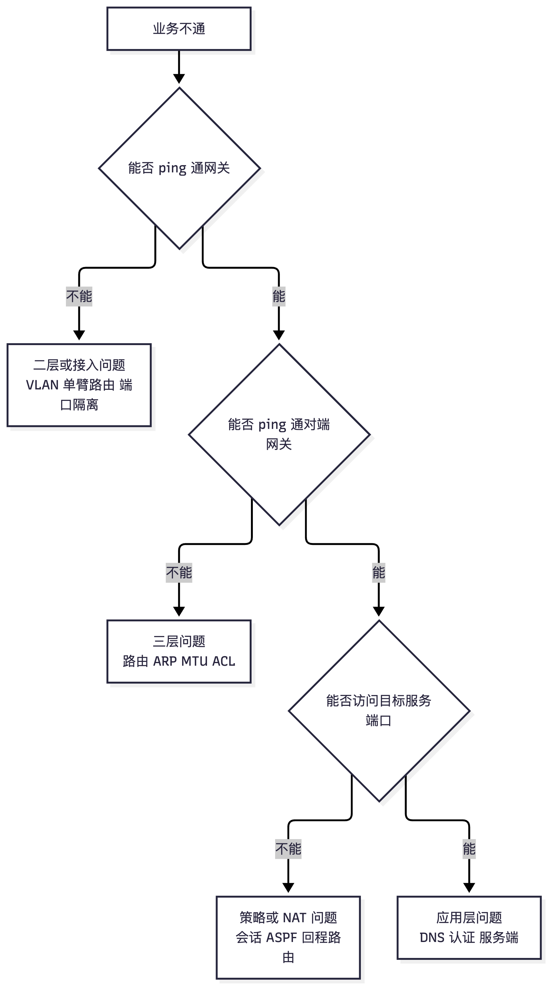


### 真题精练

**Q1.【真题·排错】** 某园区新建单臂路由，PC 与网关同网段（10.1.10.0/24）。PC `ping 10.1.10.1` 提示"请求超时"，但 PC 能收到其他 PC 的 ARP 应答。请说明最可能的原因与定位方法。

> **答案与解析**：
> **现象分析**：PC 能收到同网段其他 PC 的 ARP 应答，说明**二层转发正常**（交换机 VLAN 与接入端口配置无误）；ping 网关超时说明**网关侧的地址解析或回应失败**。在单臂路由场景中，最典型的原因是**路由器子接口未使能 `arp broadcast enable`**：华为子接口默认不处理 ARP 广播，因此 PC 发出的"谁是 10.1.10.1"的 ARP 请求无法被正确响应，PC 学不到网关 MAC，报文根本发不出去（表现为 ping 超时）。
> **定位方法**：① 路由器上 `display ip interface brief` 确认子接口 Up 且地址为 10.1.10.1/24；② `display interface GigabitEthernet0/0/1.10` 查看是否配置了 `dot1q termination vid 10`；③ `display arp all` 查看子接口下是否有 PC 的 ARP 表项（**若为空，强烈指向 ARP 广播未使能或 VLAN 标签未终结**）；④ 交换机侧 `display port vlan` 确认上联口为 trunk 且允许 VLAN 10；⑤ 在 PC 上 `arp -a` 看网关 MAC 是否学到。
> **解决方案**：在子接口下补 `arp broadcast enable`；确认 `dot1q termination vid 10` 与交换机 trunk 放通一致；验证 PC 能 ping 通网关并可跨 VLAN 访问。**预防**：将"子接口三件套"写入配置模板并在割接验证清单中列为必检项。

**Q2.【真题·排错】** 两台路由器之间的 OSPF 邻居长期停在 `ExStart`。请写出你的排查顺序与三种可能原因，并说明每种原因的确认方法。

> **答案与解析**：
> **排查顺序**：① `display ospf peer` 看状态与错误提示（华为常直接提示 MTU 不一致）；② `display ospf peer verbose` 看 DD 交互与 Router-ID；③ `display interface <接口>` 核对两端 MTU；④ `display ospf error` 看错误统计；⑤ 若以上均正常，抓包看 DD 报文是否发出/到达，确认中间设备是否过滤。
> **三种可能原因与确认方法**：
> 1. **接口 MTU 不一致（最常见）**：确认方法——两端 `display interface GigabitEthernet0/0/1` 比对 `MTU` 字段；华为 `display ospf peer` 会提示 MTU 不匹配。处置：统一 MTU 或在确认无大包业务的前提下配 `ospf mtu-ignore`。
> 2. **Router-ID 冲突**：确认方法——两端 `display ospf brief` 比对 Router-ID；冲突时邻居关系会反复震荡且日志有明确提示。处置：重新规划 Router-ID（建议用 Loopback 地址）并 `reset ospf process`。
> 3. **DD 报文被丢弃（认证不匹配 / 中间设备过滤 / 单播不可达）**：确认方法——`display ospf error` 看是否有认证失败或报文丢弃统计；在两端镜像抓包看 DD 是否双向可见。处置：统一认证（`area 0 authentication-mode` 与 key 一致）；放通 OSPF 协议报文（组播 224.0.0.5/224.0.0.6 与协议号 89）；确保接口单播可达。
> **补充**：若状态在 ExStart/Exchange 间反复跳变，优先怀疑 MTU 与 Router-ID；若长期静止不动且无错误统计，优先怀疑中间链路过滤或组播不可达。

### 易错点与排错

1. **只写"检查配置"不给具体命令**：排错题必须写可执行命令与判据，否则不得分。
2. **把"邻居 Up"当作"业务通"**：邻居 Full/Established 只代表协议层建立，路由、下一跳、策略、会话都必须单独验证。
3. **双向引入不打 Tag**：这是造成路由环路最常见的配置错误，必须用 route-policy + tag 双向过滤。
4. **NAT 与策略顺序搞反**：华为 USG 上安全策略先于 NAT 生效，策略拒绝则 NAT 不会执行。
5. **ASPF 未开导致单通**：FTP/SIP 等多通道协议必须开 ASPF/ALG，否则表现为"控制通道通、数据通道不通"。
6. **聚合与光模块问题被忽略**：带宽减半、间歇丢包往往就在 `display eth-trunk` 与 `display transceiver` 里，先看这两条命令能省大量时间。

## 10.6 常用排错命令大全、故障报告与复盘

### 考点定位

本节是"手册级"内容，国赛实操环节直接查阅使用，笔试中常以 **1 道多选（命令用途辨析）+ 1 道填空** 出现。高频考法：**① 按协议分类的 display 命令用途；② debugging 的风险；③ reset 类命令的影响；④ 故障报告要素与复盘方法（5Why）**。易错点是乱用 `debugging` 与 `reset` 命令导致业务中断——**这两个是国赛实操与真实运维最需要谨慎的操作**。

### 原理精讲

**display 类命令（安全，可随时执行）**——按协议分类速查：

| 类别 | 常用命令 | 用途 |
|---|---|---|
| 设备与硬件 | `display version`、`display device`、`display elabel`、`display power`、`display fan`、`display temperature` | 型号版本、板卡状态、电子标签（序列号/型号核对）、电源风扇温度 |
| 接口与链路 | `display interface brief`、`display interface <X>`、`display transceiver verbose`、`display transceiver diagnosis interface <X>`、`display transceiver alarm interface <X>` | 接口状态、错包丢弃、光模块信息与光功率、光模块告警 |
| 二层 | `display vlan`、`display port vlan`、`display mac-address`、`display mac-address flapping record`、`display stp brief`、`display stp topology-change`、`display eth-trunk`、`display lacp peer` | VLAN/端口 VLAN/MAC 表/MAC 漂移、STP 角色与拓扑变化、聚合与 LACP |
| IP 与转发表 | `display ip interface brief`、`display arp all`、`display ip routing-table`、`display ip routing-table statistics`、`display fib` | 三层接口、ARP、路由表、路由统计、转发表 |
| OSPF | `display ospf peer`、`display ospf peer verbose`、`display ospf brief`、`display ospf lsdb`、`display ospf routing`、`display ospf error`、`display ospf interface` | 邻居、明细、进程信息、LSDB、OSPF 路由表、错误统计、接口参数 |
| IS-IS | `display isis peer`、`display isis lsdb`、`display isis route`、`display isis segment-routing prefix-sid`、`display isis interface` | 邻居、LSDB、路由、SR 扩展信息、接口参数 |
| BGP | `display bgp peer`、`display bgp peer verbose`、`display bgp routing-table`、`display bgp routing-table peer <ip> received-routes`、`display bgp routing-table peer <ip> advertised-routes`、`display bgp vpnv4 all routing-table` | 邻居、明细、BGP 表、**收到的路由**、**发出的路由**、VPN 路由 |
| MPLS/SR | `display mpls lsp`、`display mpls lsp verbose`、`display mpls interface`、`display segment-routing mpls`、`display sr-te policy`、`display segment-routing ipv6 locator`、`display segment-routing ipv6 local-sid` | LSP 表、明细、MPLS 接口、SR 状态、SR-TE 策略、SRv6 Locator 与 SID |
| 组播 | `display pim interface`、`display pim neighbor`、`display igmp group`、`display multicast routing-table`、`display igmp-snooping group` | PIM 接口与邻居、IGMP 组、组播路由、二层组播表 |
| 安全 | `display firewall session table`、`display firewall session table verbose`、`display security-policy rule all`、`display nat policy`、`display hrp state`、`display firewall zone` | 会话、会话明细、策略与命中、NAT 策略、双机热备状态、区域 |
| 自动化 | `display ssh server status`、`display snetconf server session`、`display telemetry subscription`、`display telemetry destination`、`display users` | SSH/NETCONF 服务、会话、遥测订阅与目标、当前登录用户 |

**debugging 类命令（有风险，必须谨慎）**：

- **作用**：打印协议交互的实时细节，是定位"协议行为异常"的利器（如 OSPF 邻居协商过程、BGP 报文收发、DHCP 交互）。
- **风险**：① **CPU 占用飙升**：debugging 输出由 CPU 处理并需要送到终端，报文量大时可能直接把设备 CPU 打满，导致协议中断甚至设备假死；② **终端刷屏**：在业务高峰期执行会淹没会话；③ **可能阻塞转发面**。
- **使用规范**：① **必须在业务低谷执行**；② **必须先用 ACL 限定范围**（如 `debugging ip packet acl 3000` 只抓特定流）；③ **必须限制输出**（关闭屏幕输出 `terminal monitor`/`terminal debugging` 只在需要时开，或用 `terminal logging`）；④ **用完立即 `undo debugging all`**，绝不能忘记关闭；⑤ 优先用 `display` 类计数（如 `display ospf error`、`display interface`、`display firewall session statistics`）替代 debugging。国赛与 HCIE 实验评分中，**"滥用 debugging"是常见扣分项**。

**reset 类命令（有中断风险，注意影响面）**：

| 命令 | 作用 | 风险与注意 |
|---|---|---|
| `reset counters interface <X>` | 清零接口统计计数 | 低风险；**清零后重新观察是判断"是否仍在增长"的唯一方法**，建议先记录原值 |
| `reset arp dynamic` | 清空动态 ARP 表项 | 会导致短时间内重新学习（ARP 泛洪增加），业务可能瞬断 |
| `reset mac-address` | 清空动态 MAC 表项 | 触发重新学习与泛洪，业务可能瞬断 |
| `reset stp` | 重置 STP 状态 | 会触发 STP 重新计算（收敛期可能秒级中断），仅用于排除 STP 状态异常 |
| `reset ospf process` | 重启 OSPF 进程 | **会中断所有 OSPF 邻居并重新建立**，路由收敛期间业务中断；Router-ID 或大规模参数变更后需要执行，必须在窗口内做 |
| `reset bgp all` / `reset bgp <peer>` | 重置 BGP 邻居 | **会中断 BGP 会话**，路由撤销与重建期间业务可能中断；优先用 `refresh bgp` 软重置（路由刷新）替代硬重置 |
| `reset isis all` | 重启 IS-IS 进程 | 同 OSPF，影响邻居与路由 |
| `reset lacp statistics` | 清零 LACP 统计 | 低风险，用于观察新计数 |
| `reset firewall session table` | 清空防火墙会话表 | **会导致已建立连接被中断**（长连接业务直接断），仅在必须时使用 |
| `reset saved-configuration` | 清除下次启动配置 | **高危**，误用会导致设备重启后配置丢失，严禁在生产设备上随意执行 |

**故障报告要素**：① 故障标题与等级（P1/P2/P3）；② 发生与恢复时间（精确到分钟，含时区）；③ 影响范围（业务、用户数、区域）；④ 现象描述（含报错信息与截图/日志）；⑤ 处理过程时间线（每一步动作与结果）；⑥ **根因（Root Cause）**；⑦ 处置措施与恢复方式；⑧ 后续改进项与责任人、完成时限；⑨ 附件（配置、日志、抓包、拓扑变化）。

**复盘（Post-Mortem）与 5Why**：复盘的目标是"**改系统，不改人**"——重点找流程与设计缺陷，而不是追责。用 **5Why** 逐层追问根因：

- 问 1：为什么业务中断？——因为新设备上没有配置 QoS 策略。
- 问 2：为什么没配置？——因为配置平移时只迁移了业务相关段。
- 问 3：为什么只迁业务段？——因为平移清单没有包含管理面与 QoS 类配置项。
- 问 4：为什么清单不完整？——因为清单是人工凭经验整理的，没有对照基线检查表。
- 问 5：为什么没有基线检查表？——因为割接流程中缺少"配置平移检查表"这一强制交付物。
- **改进项**：建立并强制使用"配置平移检查表"（含管理面、QoS、STP、安全策略等），并把检查表作为割接方案的附件与评审要点；同时增加"平移后自动 diff 校验"的工具支持。

### 关键概念对照表

| 操作类型 | 风险等级 | 使用原则 | 典型命令 |
|---|---|---|---|
| display 查询 | 低 | 随时可用，排错首选 | `display ip routing-table`、`display interface brief` |
| display + 明细（verbose） | 低 | 需要细节时使用，输出较长 | `display bgp peer verbose`、`display mpls lsp verbose` |
| reset counters | 低 | 先记录原值再清零，用于观察增长 | `reset counters interface X` |
| reset 协议进程 | 中高 | 必须在窗口内、有备份路径、评估收敛时间 | `reset ospf process`、`reset bgp all` |
| reset 转发表项 | 中 | 会导致短暂泛洪或瞬断 | `reset arp dynamic`、`reset mac-address` |
| reset 会话/配置 | 高 | 会造成业务中断或配置丢失，严格审批 | `reset firewall session table`、`reset saved-configuration` |
| debugging | 高 | 低谷 + ACL 限定 + 用完立即关闭 | `debugging ospf packet`、`debugging ip packet acl 3000` |
| 软重置（优先） | 低 | 优先于硬重置 | `refresh bgp all import`（重新应用入向策略） |

### 华为设备配置

```bash
# ===== 排错时的安全操作序列（先观察，再谨慎操作） =====
display interface GigabitEthernet0/0/1            // 先记录当前 CRC/错包数值
reset counters interface GigabitEthernet0/0/1     // 清零统计（低风险）
# 等待 5~10 分钟后再次执行 display interface，观察 CRC 是否继续增长

# ===== 受限 debugging（必须限定范围并及时关闭） =====
acl number 3000
 rule 5 permit ip source 10.1.1.1 0 destination 10.2.2.1 0   // 只抓特定流的报文，避免刷屏与 CPU 飙升
 quit
terminal monitor                                   // 允许在终端显示日志/调试信息
terminal debugging                                 // 允许显示 debugging 输出
debugging ip packet acl 3000                       // 仅对 ACL 3000 匹配的报文开启 debug（范围极小）
# ... 复现问题并采集输出 ...
undo debugging all                                 // 立即关闭所有 debugging（绝不能忘记，否则可能打满 CPU）
undo terminal monitor                              // 关闭终端显示
#
# ===== 优先使用软重置代替硬重置（BGP 场景） =====
refresh bgp all import                             // 重新应用入向策略并使路由刷新（不中断 BGP 会话）
display bgp routing-table peer 10.0.0.2 received-routes   // 刷新后核对收到的路由
#
# ===== 故障后导出证据（形成报告附件） =====
display diagnostic-information                     // 一键收集设备诊断信息（排错与厂商支持最常用）
display logbuffer                                  // 查看日志缓冲区（故障时刻的关键线索）
display trapbuffer                                 // 查看告警缓冲区
display cpu-usage                                  // 查看 CPU 占用（判断是否由广播风暴/debugging 引起）
display memory-usage                               // 查看内存占用
```

> **`display diagnostic-information` 是"提交故障报告前的标准动作"**：它把版本、配置、接口、协议、日志等一并打包输出，是向厂商开 Case 时的必备材料，也是复盘时最有价值的证据。

### 示意图

```mermaid
flowchart TD
  A["发现故障"] --> B["立即收集证据<br/>display 命令 日志 计数"]
  B --> C{"是否需要 debug"}
  C -->|"不需要"| D["用 display 统计定位"]
  C -->|"需要"| E["低谷 + ACL 限定 + 及时关闭"]
  E --> F["复现并采集"]
  D --> G["定位根因"]
  F --> G
  G --> H["处置（优先软重置与配置级回退）"]
  H --> I["验证业务恢复"]
  I --> J["导出 diagnostic-information 与日志"]
  J --> K["撰写故障报告"]
  K --> L["复盘 5Why<br/>形成改进项与检查表"]
  L --> M["闭环验证改进项"]
```

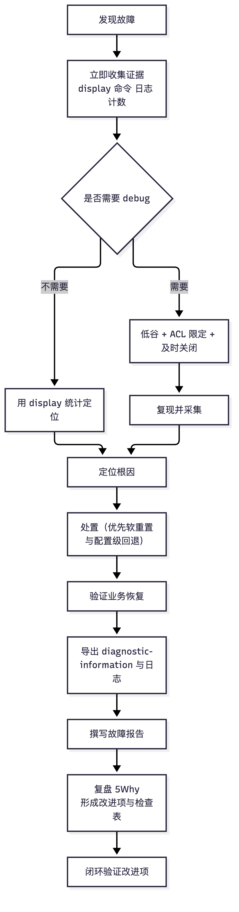


### 真题精练

**Q1.【真题·多选】** 关于在网络设备上执行 debugging 命令，下列做法正确的有：
A. 在业务低谷执行，并先用 ACL 限定只抓取目标流量
B. 使用完毕后立即执行 `undo debugging all` 关闭
C. 优先使用 display 类统计信息（如 `display ospf error`）替代 debugging
D. 为了尽快定位问题，应在业务高峰期对全量报文开启 debugging

> **答案：ABC**
> **解析**：A、B、C 是 debugging 的三条使用纪律：**限时（低谷）、限范围（ACL）、限时长（及时关闭）**，且能用 display 统计解决就不要开 debug。D 是典型危险操作：全量 debugging 会让 CPU 处理海量输出，**极易造成 CPU 打满、协议中断甚至设备失联**，在真实网络中属于重大操作事故。

**Q2.【真题·单选】** 修改 BGP 入方向策略后希望使策略生效，同时又不想中断 BGP 会话，应使用：
A. `reset bgp all`  B. `refresh bgp all import`  C. `reset ospf process`  D. `undo bgp 100`

> **答案：B**
> **解析**：BGP 路由策略变更后可用**软重置**使新策略生效：`refresh bgp all import`（重新应用入方向策略并刷新路由），**不中断 BGP 会话**。A 是硬重置，会中断会话并导致路由撤销/重建，业务可能受影响；C 是 OSPF 进程重启（与 BGP 策略无关，且会中断 OSPF 邻居）；D 会直接删除 BGP 进程，属于最严重操作。

**Q3.【真题·简答】** 某次割接后出现"语音偶发单通"，团队复盘时有人主张"追究当天操作工程师的责任"。请说明规范的复盘方式应如何进行，并用 5Why 给出一个改进闭环示例。

> **答案与解析**：
> **复盘原则**：① **对事不对人**：复盘的目的是改进系统与流程，不是追责；追责文化会导致隐瞒问题、延误上报，反而放大风险。② **基于证据**：以日志、配置 diff、抓包、监控数据为依据，避免"回忆式"争论。③ **聚焦可控项**：找出"流程缺失/工具缺失/检查表缺失"这类可改进的系统性因素。④ **闭环**：每个改进项必须有责任人与完成时限，并在下一轮割接前验证有效性。
> **5Why 示例**：为什么语音单通？→ 因为语音流量路径中一台设备的 QoS 信任与优先级映射未配置，语音报文进入低优先级队列被丢弃。为什么没配？→ 因为配置平移时只迁移了业务 VLAN 与路由相关配置。为什么只迁这些？→ 因为平移清单由工程师凭经验整理，缺少 QoS/管理面等"非业务但影响体验"的配置项。为什么清单不完整？→ 因为没有标准的"配置平移检查表"作为强制交付物。为什么没有？→ 因为割接流程未把"配置检查表 + 自动配置 diff"列为方案评审的必检项。**改进项**：① 制定并强制使用《配置平移检查表》（含管理面、QoS、STP 实例、安全策略、接口细节）；② 用工具在平移前后做自动配置 diff 并把差异作为评审材料；③ 在验证清单中加入"语音/视频质量拨测"等业务体验项。每一项指定责任人与时限，并在下一次割接的预演中验证。
> **报告要素提醒**：故障报告必须包含时间线、影响面、根因、处置、改进项与附件，其中**根因要写到"流程/设计"层面**，而不是停在"某人漏敲了一条命令"。

### 易错点与排错

1. **滥用 debugging 导致 CPU 打满**：一定要 ACL 限定并及时 `undo debugging all`。
2. **忘记重置统计就判断 CRC**：CRC 是累积值，必须先记录再清零，观察是否继续增长。
3. **用 `reset bgp all` 代替软重置**：能用 `refresh bgp ... import/export` 就不要硬重置。
4. **`reset saved-configuration` 误操作**：会导致重启后配置丢失，属于高危命令，须严格授权。
5. **故障报告只写"已恢复"**：缺少时间线、根因、影响面与改进项的报告没有价值，也无法防止复发。
6. **复盘追责化**：把复盘变成问责会，会破坏团队上报意愿，最终让问题更晚暴露。

---

## 章节10 综合真题（限时 30 分钟）

**Q1.【真题·填空】** 割接全流程的正确顺序是：需求分析 → 现状调研 → 方案设计 → ______ → 回退方案与回退时间点 → 审批 → ______ → 实施 → 验证与观察 → 文档归档与复盘。

> **答案：风险评估；预演（演练）**
> **解析**：这是割接流程的标准骨架，必须按顺序背下。两处易错：① 很多人把"回退方案"放在"风险评估"之前，实际逻辑是"先识别风险，再针对风险设计回退"；② "预演"必须在"审批"之后、"实施"之前（审批通过才投入预演资源，预演通过才允许实施）。

**Q2.【真题·多选】** 网络割接实施阶段应当遵守的纪律包括：
A. 双人操作，一人执行一人唱读复核
B. 每步操作后记录回显与时间戳，作为割接记录附件
C. 严格按时间轴推进，到达最晚回退时刻仍未通过验证即执行回退
D. 为提高效率，可临时跳过验证步骤，等观察期一并检查

> **答案：ABC**
> **解析**：A、B、C 是实施阶段的"双人复核、留痕、硬约束回退"三条纪律。D 错误：**变更中的验证是"分步闸门"**——每一步验证通过才允许进入下一步，跳过验证就等于把多个未确认的变更叠加在一起，一旦出问题无法定位是哪一步造成的，也无法判断回退到哪一步。

**Q3.【真题·排错】** 某数据中心两台交换机之间的聚合链路，业务高峰期出现"带宽只有 50%、偶发丢包"，`display interface` 显示所有成员口 Up，`display eth-trunk 1` 显示 4 个成员中有 2 个 `Unselected`。请写出完整排查方案与解决方案。

> **答案与解析**：
> **现象分析**：4 个成员中 2 个 `Unselected`，可用带宽理论上降为一半，与"带宽只有 50%"的现象一致；高峰期流量集中到剩余 2 条链路，队列拥塞导致偶发丢包。`display interface` 显示 Up 只能说明**物理链路与接口层正常**，不代表能参与聚合转发（聚合的 `Unselected` 是成员级状态）。
> **排查步骤**：① `display eth-trunk 1` 读取 `Unselected` 的**具体原因字段**（华为通常会提示 `Different speed`、`Different duplex`、`Different port type` 等，这是最直接的线索）；② `display interface`（各自成员口）比对速率与双工，确认是否一致；③ `display lacp peer` 查看对端 LACP 信息，确认**对端是否把这 4 条都加入了同一聚合**（常见错误是两端各连了 4 条但交叉连错端口，导致对端聚合成员不匹配）；④ 核对两端聚合模式（必须都是 LACP 或都是手工负载分担，混用会导致部分成员不参与）；⑤ `display stp brief` 确认成员口是否被 STP 阻塞；`display transceiver alarm interface X` 确认光模块是否有告警（劣化模块可能间歇 Up/Down）；⑥ 检查成员口是否配置了互斥特性（如被配置为镜像观察口、被端口安全禁用）。
> **解决方案**：① 统一成员口速率与双工（骨干口建议 `undo negotiation auto` 固定速率双工，避免自协商结果不一致）；② 统一两端聚合工作模式为 LACP；③ 按连线规划表核对并纠正端口连接；④ 更换劣化光模块或跳线；⑤ 移除成员口上的互斥配置；⑥ 配置 `least active-linknumber` 与 `lacp timeout`，成员数低于阈值时上报告警，避免"带宽静默减半"；⑦ 修复后验证：`display eth-trunk 1` 应显示全部成员 `Selected`，`display interface Eth-Trunk1` 的带宽应为 4 倍单口带宽，并在高峰期复核丢包计数不再增长。
> **预防**：把"聚合成员一致性（速率/双工/模式/数量/连线）"列入割接验证清单与上线检查表，并对 `Unselected` 成员状态设置监控告警。

**Q4.【真题·实验】** 请为"一台 S12700 替换为 S12700E（承载办公、无线、语音三类业务）"设计一份可执行的割接演练方案，要求给出时间轴、每阶段的关键动作与验证项、回退触发条件，并计算最晚回退时刻（窗口 00:00–05:00，回退最慢耗时 25 分钟，观察期要求 60 分钟，恢复验证与沟通预留 10 分钟）。

> **答案与解析**：
> **时间轴（示例）**：00:00–00:20 基线与备份（导出旧设备全量配置、记录接口/路由/VLAN/协议邻居/流量基线，校验备份文件可读）；00:20–00:50 新设备接入（离线预配已完成，接入后仅建立链路与协议邻居、不引流量，核对 STP 角色与聚合成员状态）；00:50–01:20 小比例引流（先用 VRRP 优先级或路由度量牵引一个 VLAN 的流量，验证业务正常）；01:20–02:00 逐步全量（其余 VLAN 依次引流，每个 VLAN 引流后立即验证）；02:00–02:30 全量验证（按清单逐项检查）；02:30–05:00 观察期。
> **验证项清单**：`display interface brief`（接口 UP 与速率双工）、`display stp brief`（根桥与阻塞端口是否符合规划、拓扑变化计数是否增长）、`display eth-trunk`（成员是否全部 Selected）、`display vlan` / `display port vlan`（VLAN 与 trunk 放通）、`display ip routing-table statistics`（路由条目数与基线比对）、`display vrrp brief`（主备状态）、语音与视频拨测、无线 AP 上线数与用户接入数。
> **回退触发条件（客观可量化）**：① 关键业务拨测连续 3 次失败；② 语音 MOS 低于阈值或丢包率连续 5 分钟 > 1%；③ 路由条目数偏离基线 > 10% 且 5 分钟内未恢复；④ 出现广播风暴或 STP 频繁拓扑变化；⑤ 新设备出现板卡/电源告警。
> **最晚回退时刻计算**：窗口结束 05:00 − 观察期 60 分钟 − 回退耗时 25 分钟 − 恢复验证与沟通 10 分钟 = **02:25**。即 **02:25 之前若问题未解决，必须执行回退**，不得继续尝试。
> **回退动作优先级**：① 配置级回退（`undo` 本次变更的度量/优先级/VLAN 相关配置）；② 快照回退（把备份配置恢复到设备，或把业务切换回旧设备——**旧设备在观察期结束前不下电**）；③ 重启加载备份（最后手段，明确其造成的中断时长）。
> **判分要点**：有基线、有验证清单、有量化触发条件、有最晚回退时刻计算、回退手段分级且旧设备保留兜底。

<!--APPEND-->
