# B5-DCNHCIE上-VXLAN与EVPN深入

> **所属**：华为 ICT 大赛网络赛道 · 国赛 · DCN 方向 · HCIE 层
> **内容**：VXLAN 与 BGP-EVPN 深入、EVPN 分布式网关与跨 Fabric 互联
> **真题说明**：本册真题依据华为 ICT 大赛历年公开赛题方向、华为认证考试真题回忆与官方教材例题整理改写，用于自测训练；正式参赛请以大赛官方考试大纲与题库为准。

---

# DCN-HCIE-章节1-VXLAN与BGP-EVPN深入

## 1.1 VXLAN 报文结构逐位剖析

### 考点定位

本考点是 DCN 方向**最稳定的送分题与最稳定的送命题**：理论卷常以一道 **4~6 分的简答/填空**要求默写"VXLAN 头各字段位宽与含义"，或以 **2~3 分单选**考"UDP 目的端口号 / VNI 位数 / 外层封装总开销"。上机与排错题则要求你**看抓包判断封装是否正确**（例如发现 dst port 不是 4789、VNI 与 BD 不匹配、内层帧还带着 VLAN Tag）。最高频错误：把 VNI 记成 12 bit、把 VXLAN 头记成 16 字节、把 UDP 目的端口记成 8472、算错外层开销。**必须能默画整包字段图并默写字段表**。

### 原理精讲

VXLAN（Virtual eXtensible Local Area Network，虚拟可扩展局域网）的封装思想只有一句话：**把一台主机发出的完整二层以太网帧，当作"货物"塞进一个 UDP 报文里，在 IP 网络上运输**，两端由 VTEP（VXLAN Tunnel End Point，VXLAN 隧道端点）负责打包与拆包。因此整包从外到内是**五层嵌套**：外层以太头 → 外层 IPv4 头 → 外层 UDP 头 → **VXLAN 头（8 字节）** → 内层原始以太帧（含其自身的二层头、VLAN Tag、IP 头、TCP/UDP 与载荷）。

**为什么 VNI 是 24 bit 而不是 12 bit？** 因为 VXLAN 要解决的核心矛盾是"云数据中心里租户数量远超 4094"。VLAN ID 只有 12 bit（4096 个，可用 4094 个），虚拟化环境下每台虚拟机、每个租户都要一个隔离域，4094 远远不够；VXLAN 的 VNI（VXLAN Network Identifier）给出 **24 bit**，理论支持 2²⁴ = **16 777 216（约 1600 万）** 个隔离网络，且该字段直接嵌入 VXLAN 头，与 VLAN Tag 在位置、语义上完全解耦。

**为什么目的端口固定 4789、源端口却要哈希？** 4789 是 IANA 正式分配给 VXLAN 的 UDP 端口（早期 Linux 内核实现使用 8472，属私有端口，两者不互通，华为设备默认使用 4789）。目的端口固定带来两点好处：一是接收侧只需一个固定的解复用入口；二是中间设备可用"UDP dst port 4789"做简单识别（但真正的负载均衡必须用**五元组哈希**）。而**源端口必须变化**，因为 VXLAN 外层的源/目 IP 只有一对 VTEP 地址——若源端口也固定，则同一对 VTEP 之间所有租户、所有主机的流量在外层看起来是**同一条流**，Underlay 的 ECMP 只会把它们压到一条链路上，形成拥塞热点。用一个由内层帧头哈希生成的源端口，让**不同内层流获得不同外层源端口**，才能把流量散列到多条等价路径上。

**为什么 VXLAN 头是 8 字节而不是"能用就行"？** 8 字节是"最小完备"的结果：I 标志位（1 bit）告知接收方 VNI 是否有效，其余 7 bit 与紧随的 24 bit 保留位合计 32 bit，用于对齐与未来扩展；VNI 24 bit 独立占 3 字节；最后 8 bit 保留。整个头保持 **4 字节对齐**，便于硬件流水线按 32 bit 粒度搬运，这是数据中心芯片可做到线速封装/解封装的前提。

整包分层的字段图如下（自外向内）：

```text
┌─ 外层 Ethernet 头 14B ────────────────────────────────────────────┐
│ 目的 MAC 6B │ 源 MAC 6B │ Type = 0x0800 2B  （若外层带 VLAN Tag 再 +4B）│
├─ 外层 IPv4 头 20B ───────────────────────────────────────────────┤
│ Ver/IHL │ ToS │ Total Length │ ID │ Flags+Fragment │ TTL │ Proto=17 │
│ Header Checksum │ 源 IP(VTEP 本端) 4B │ 目的 IP(VTEP 对端) 4B      │
├─ 外层 UDP 头 8B ─────────────────────────────────────────────────┤
│ 源端口 2B(内层流哈希生成) │ 目的端口 2B = 4789 │ 长度 2B │ 校验和 2B │
├─ VXLAN 头 8B ────────────────────────────────────────────────────┤
│ Byte0: Flags 8bit │ Byte1~3: Reserved 24bit │ Byte4~6: VNI 24bit │ Byte7: Reserved 8bit │
├─ 内层原始以太帧 ─────────────────────────────────────────────────┤
│ 内层目的 MAC │ 内层源 MAC │(可选内层 VLAN Tag 4B)│ 内层 Type │ IP/TCP 载荷 │ 内层 FCS │
└──────────────────────────────────────────────────────────────────┘
```

VXLAN 头逐位字段表（考试默写项）：

| 字段 | 位宽 | 所在字节（相对 VXLAN 头） | 典型取值 | 含义与考点 |
|---|---|---|---|---|
| Flags | 8 bit | Byte 0 | `0x08` | **只有 I 位（bit3，值 0x08）有意义**，置 1 表示 VNI 字段有效；其余位保留必须为 0。抓包看到 `flags=0x00` 说明封装异常 |
| Reserved | 24 bit | Byte 1~3 | 全 0 | 保留字段，发送置 0，接收忽略 |
| VNI | 24 bit | Byte 4~6 | 0~16 777 215 | 虚拟网络标识，**BD 与 VNI 在华为实现中为 1:1 映射**；0 与 16 777 215 保留不用 |
| Reserved | 8 bit | Byte 7 | 全 0 | 保留字段 |

外层封装与内层帧的字节开销（这是 MTU 计算的唯一依据，必背）：

| 组成部分 | 无外层 VLAN Tag | 有外层 VLAN Tag（4B） |
|---|---|---|
| 外层以太头 | 14 B | 18 B |
| 外层 IPv4 头 | 20 B | 20 B |
| 外层 UDP 头 | 8 B | 8 B |
| VXLAN 头 | 8 B | 8 B |
| **合计开销** | **50 B** | **54 B** |
| 外层若为 IPv6 | 20 B→40 B，合计 **70 B** | 合计 **74 B** |

同为"overlay 封装"，三个协议的封装代价差异是常见对比题：**VXLAN = 50 B（UDP 承载）**、**GRE = 24 B 起（IP 协议号 47）**、**VLAN QinQ = 4 B（以太层）**。VXLAN 开销最大，换来的是 UDP 带来的 ECMP 能力与 24 bit 的租户空间。

### 关键概念对照表

| 对比项 | VLAN（802.1Q） | VXLAN（RFC 7348） |
|---|---|---|
| 隔离标识位宽 | 12 bit（VID） | **24 bit（VNI）** |
| 可用数量 | 4094 | 约 1600 万 |
| 承载层 | 二层（交换机的 Trunk 口） | 三层（IP 网络，UDP 4789） |
| 隔离域名称 | 广播域（VLAN） | 广播域（BD，Bridge Domain） |
| 跨站点能力 | 需二层专线/L2VPN 打通 | 只需 VTEP 之间 IP 可达，天然跨站点 |
| 报文头开销 | 4 B | 50 B（含 IP/UDP） |
| 泛洪依赖 | STP 阻塞冗余链路 | Underlay 路由 + ECMP，无 STP |
| MAC 表项爆炸 | 大二层下严重 | 通过 EVPN 路由化 + ARP 抑制缓解 |

| 抓包常见异常 | 现象 | 判定依据 |
|---|---|---|
| 目的端口错误 | 网卡显示 `8472` | 私有实现，与华为默认 4789 不通 |
| Flags 位错误 | `Flags = 0x00` | I 位未置位，接收端丢弃 |
| VNI 与 BD 不匹配 | 隧道建立但主机不通 | 两侧 `display vxlan vni` 交叉核对 |
| 内层帧仍带 VLAN Tag | 内层出现 802.1Q | 说明入口未按 BD 剥离 Tag，跨设备后可能双 Tag |
| 外层分片 | Wireshark 出现 `Fragmented IP` | 内层帧 + 50 B > 出接口 MTU |

### 华为设备配置

```bash
system-view
# ===== CE6865-Leaf1：建立 BD 与 VNI 的绑定关系 =====
bridge-domain 10                                  // 创建二层广播域 BD 10，等价于 VLAN 10 的 overlay 版本
 vxlan vni 10000                                  // 将 BD 10 与 VNI 10000 做 1:1 绑定（缺省即 1:1）
 quit
interface nve1                                    // 创建/进入 NVE 接口，NVE 是 VXLAN 的"逻辑隧道口"
 source 1.1.1.1                                   // 指定 VTEP 源地址，取 LoopBack0，保证任何链路故障时不切换
 vni 10000                                        // 在本端 NVE 上使能 VNI 10000（EVPN 动态模式不需要写 peer-list）
 quit
# ===== 查看封装相关的关键状态 =====
display vxlan vni                                 // 输出 BD-ID / VNI / VXLAN 状态 / 源地址是否就绪
display vxlan vni 10000 verbose                   // 查看该 VNI 的详细状态：是否 up、是否与 NVE 关联、隧道数
display vxlan tunnel                              // 查看隧道：源 IP 目的 IP、状态(up/down)、类型(static/evpn)
# ===== 抓包验证（诊断视图，CE 系列）=====
system-view
 diagnose
  capture-packet interface GE1/0/1 destination file vxlan.cap   // 在物理出接口抓包并保存为文件
  capture-packet interface GE1/0/1 acl 3000 destination file vxlan.cap  // 按 ACL 过滤，仅抓 VXLAN 流量
 quit
quit
```

### 示意图


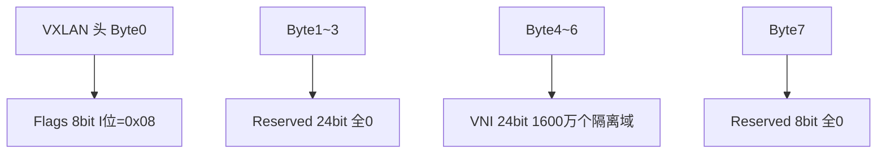

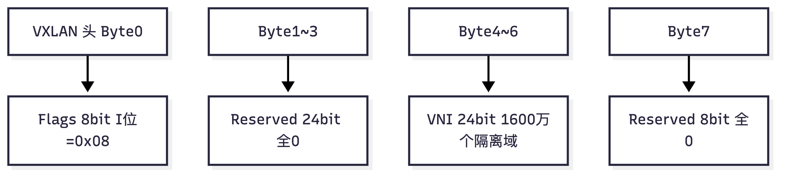


### 真题精练

**Q1.【真题·填空】** VXLAN 报文由外层以太头、外层 IPv4 头、外层 UDP 头、____ 字节的 VXLAN 头和 ____ 组成；其中 VNI 字段长度为 ____ 位，UDP 目的端口号为 ____。

> **答案：8；内层原始以太网帧；24；4789**
> **解析**：VXLAN 头固定 8 字节，结构为 Flags(8bit) + Reserved(24bit) + VNI(24bit) + Reserved(8bit)。VNI 24 bit 对应约 1600 万个隔离域，这是 VXLAN 相对 VLAN（12 bit、4094 个）的核心优势。UDP 目的端口 4789 是 IANA 正式分配值；**8472 是 Linux 早期私有实现**，考试中常作为干扰项出现。

**Q2.【真题·多选】** 关于 VXLAN 的外层封装，下列说法正确的有？
A. 外层 UDP 源端口通常由内层帧头信息哈希生成，目的是让不同内层流走不同 Underlay 路径
B. 外层 UDP 目的端口固定为 4789，接收端据此识别 VXLAN 报文
C. 外层源 IP 一般取本端 VTEP 地址（如 LoopBack0），目的 IP 取对端 VTEP 地址
D. 外层 IP 头的协议号字段取值为 6

> **答案：ABC**
> **解析**：D 错——外层承载的是 UDP，协议号应为 **17**（6 是 TCP）。A 是 ECMP 能否生效的关键：若源端口固定，同一对 VTEP 的所有流量在外层五元组中完全一致，哈希结果相同，ECMP 会退化为单链路转发。C 中源地址不随链路切换而变化，是保证隧道"永远 up"（除非对端不可达）的重要设计，因此严禁用物理接口地址做 NVE 源地址。

**Q3.【真题·简答】** 某主机与网关之间 ping 大包（1500 字节 IP 载荷）不通，小包正常。请从 VXLAN 封装开销角度分析原因，并给出两种解决方案。

> **答案要点**：
> ① **原因**：主机发出的 IP 报文 1500 B，加内层以太头 14 B 后成为 1514 B 的内层帧；VTEP 封装后在外层增加 **50 B**（14 以太 + 20 IPv4 + 8 UDP + 8 VXLAN），整包变为 1564 B，或 1568 B（外层带 VLAN Tag 时为 54 B 开销）。若 Underlay 出接口 MTU 仍为 1500，则必须**分片**；若外层 IPv4 头 DF 置位（部分实现强制置位，禁止中间设备分片），报文被直接丢弃，表现为"小包通、大包不通"（典型 MTU 黑洞）。
> ② **方案 A（推荐，改 Underlay）**：把 VTEP 之间所有三层接口 MTU 提高，例如 CE 上 `mtu 1600`（或启用巨帧 9000+），使内层 1500 B 报文可原样封装通过，主机侧无需改动。
> ③ **方案 B（改主机侧）**：保持 Underlay 1500，把服务器网卡 MTU 降到 **1450**（1500 − 50，若外层有 VLAN Tag 则 1446），同时在 VBDIF 上配置 `tcp adjust-mss 1400` 抑制 TCP 大包，避免分片。
> **加分点**：指出 IPv6 Underlay 开销为 70 B，且 IPv6 中间路由器不分片，必须依赖 PMTUD，黑洞更隐蔽。

### 易错点与排错

1. **把 VNI 记成 12 bit、把 VXLAN 头记成 16 字节**：这是最典型的失分点。记住口诀"**8 字节头、24 位 VNI、Flags 在首字节**"。VXLAN 头 8 B，加上 IP/UDP 才是 36 B 的外层三层开销（不含以太头）。
2. **算错封装开销**：容易漏掉以太头 14 B，或忘记外层 VLAN Tag 的 4 B。统一按"**50 B 或 54 B**"两档记，并记住 IPv6 Underlay 的 70 B/74 B。
3. **用物理接口地址做 NVE source**：物理口 down 会把整条隧道一起 down（`display vxlan tunnel` 显示 down），且对端回程路由也会断。规范做法：`interface nve1` 下 `source LoopBack0`。
4. **误以为 VXLAN 报文外层可以没有 UDP**：VXLAN **必须**由 UDP 承载（RFC 7348），没有"IXIA 那种直接 IP 承载"的官方形式；看到"VXLAN over GRE"是另一种封装叠加，不是标准 VXLAN。
5. **抓包排错套路**：先用 `display vxlan tunnel` 确认隧道 up，再抓包看 ① dst port 是否 4789；② Flags 是否 0x08；③ VNI 是否与 `display vxlan vni` 一致；④ 外层 IP 是否为本端/对端 VTEP 地址；⑤ 是否有分片标志。五步能定位 80% 的封装类故障。

---

## 1.2 外层源目地址选择、UDP 源端口哈希与 ECMP

### 考点定位

本考点在理论卷以**多选 + 简答**出现，占 **3~5 分**，核心考"为什么 VXLAN 能跑满 ECMP 而普通隧道不能"、"源端口哈希用什么字段"、"为什么源地址必须用 LoopBack"。上机题常表现为：**Underlay 明明有多条等价路径，但 VXLAN 流量只走一条**——这类题的答案几乎都落在"源端口哈希被固定/被关闭"或"Underlay 没有形成等价路由"上。

### 原理精讲

VXLAN 报文的**外层三层头其实就是一次普通的 UDP/IP 封装**，所以它的地址选择规则完全由"NVE 接口的源地址 + 对端 VTEP 地址"决定，而这个决定权在控制平面（BGP EVPN）。理解这条链路要分三层看：

**第一层：谁决定外层源 IP？** 由 `interface nve1` 下的 `source <ip>` 决定，实际报文的源 IP 就是它。选择原则有三条：① **必须是一个永不 down 的地址**——通常是 LoopBack0（`/32`），因为物理口会随链路故障而 down，一旦源地址失效，所有以它为源的隧道同时断开，还会导致对端 EVPN 邻居重收敛；② **必须能通过对端可达性检查**——Underlay 路由表里必须有到对端 VTEP 地址的路由，且反向也要有，即**源地址必须被通告进 Underlay IGP**（华为推荐 OSPF/IS-IS 通告 LoopBack0）；③ **必须全网唯一**，若两台 Leaf 用了同一个 LoopBack0 地址，对端 EVPN 会因下一跳冲突而无法建立正确隧道（这是"两台设备配置复制粘贴"造成的经典事故）。此外还有一个易被忽略的约束：**同一个 VTEP 上所有 VNI 共用同一个源地址**，一台设备只能有一个 NVE 源地址（可配多个 NVE 接口但源地址需区分，实际部署基本只用一个）。

**第二层：谁决定外层目的 IP？** 由控制平面给出的**隧道对端地址**决定，逐场景不同：① **静态 VXLAN（头端复制）**：`vni ... head-end peer-list` 手工列出对端 VTEP，目的 IP 就是列表中的地址，BUM 流量复制多份分别发往各个对端；② **BGP EVPN**：Type3（Inclusive Multicast Ethernet Tag Route，包含性组播以太网标签路由）通告的本端 VTEP 地址成为对端的隧道目的地址，Type2（MAC/IP 通告路由）的**下一跳**则决定单播流量的目的 IP；③ **EVPN 多活双归**：目的 IP 可能因 Aliasing 而指向"非 DF 的其余 PE"，实现负载分担。要点：**目的 IP 永远来自控制平面学到的 VTEP 列表或 EVPN 下一跳，而不是某个静态邻居**，这也是 EVPN 能自动适应新增 Leaf 的根本原因。

**第三层：ECMP 怎么生效？** Underlay 用 OSPF/IS-IS/BGP 形成到对端 VTEP 的多条等价路径（典型是 Spine-Leaf 全互联下的两条等价路径，或 CE 的 `maximum load-balancing` 支持到 128 条）。设备在转发时按**逐流哈希**选择出口：**哈希输入是"外层五元组"**，而外层五元组中的源/目 IP、目的端口在**同一对 VTEP 之间完全相同**，唯一可变的只有**外层 UDP 源端口**。因此华为实现中，VTEP 会用**内层以太帧的字段**（内层源 MAC、内层目的 MAC、内层源 IP、内层目的 IP、内层源端口、内层目的端口，以及 VNI）计算一个哈希值，映射成外层 UDP 源端口（通常落在 1024~65535 的动态端口范围内）。最终效果：**同一主机的同一条流稳定走同一条路径（保证不乱序），不同主机/不同连接的流分散到不同路径（获得负载分担）**。这就是 VXLAN 比"纯 GRE 隧道（外层五元组固定、无法 ECMP）"更适合大型 Fabric 的核心原因。

**必须掌握的三个工程结论**：① Underlay 必须是**三层 IP 网络 + 路由等价**，不能用 STP 收敛的二层网络；② 若某厂商或某版本把源端口配成固定值（例如为了配合特定防火墙或负载均衡设备），则**ECMP 立即失效**，这是排错必查项；③ 防火墙若开启"UDP 会话严格校验"，哈希源端口变化会导致同一内层流被误判为多条会话，需要在防火墙上放通 VTEP 之间 UDP 4789 全端口段。

### 关键概念对照表

| 外层字段 | 由谁决定 | 取值/范围 | 变化规律 | 对 ECMP 的影响 |
|---|---|---|---|---|
| 外层源 IP | NVE 源地址（LoopBack0） | 单台 VTEP 唯一 | **固定不变** | 不提供熵 |
| 外层目的 IP | EVPN Type2/Type3 下一跳或静态 peer-list | 对端 VTEP 地址 | 每个对端一个值 | 提供有限熵 |
| 外层目的端口 | 协议固定 | 4789 | **固定不变** | 不提供熵 |
| 外层源端口 | 内层帧头哈希 | 动态端口段 | **逐流变化** | **唯一的熵来源** |
| 外层 TTL | 缺省 255（可配） | 255 | 固定 | 无 |
| 外层 DSCP | 内层映射或统一标记 | 0~63 | 固定 | 无（但影响 QoS 队列） |

| 隧道技术 | 外层协议 | 头开销 | 能否逐流 ECMP | 典型场景 |
|---|---|---|---|---|
| VXLAN | UDP 4789 | 50 B / 54 B | **能（源端口哈希）** | 云数据中心 Fabric |
| NVGRE | GRE（协议 47） | 42 B 起 | 弱（GRE Key 参与有限哈希） | 少见于华为方案 |
| GRE over IP | IP 协议 47 | 24 B 起 | 通常不能 | 园区 WAN、临时隧道 |
| MPLS L2VPN | MPLS 标签 | 4~8 B | 能（标签栈哈希） | 运营商专线、DCI |

### 华为设备配置

```bash
# ===== CE6865-Leaf1：NVE 源地址与 Underlay 等价路径 =====
system-view
interface LoopBack0
 ip address 1.1.1.1 255.255.255.255                // VTEP 源地址，必须 /32 且被 IGP 通告
 quit
interface nve1
 source 1.1.1.1                                    // 绑定 VTEP 源地址，等价于 "本 VTEP 的身份"
 quit
# ===== Underlay：OSPF 通告 LoopBack0，形成到各 VTEP 的等价路由 =====
ospf 1 router-id 1.1.1.1
 area 0.0.0.0
  network 1.1.1.1 0.0.0.0                          // 关键：把 VTEP 地址通告给 Underlay，否则隧道起不来
  network 10.1.1.0 0.0.0.255                       // 通告 Leaf-Spine 互联网段
  quit
 quit
# ===== 开启增强型 ECMP 负载分担（缺省已开启，确认最大等价条数）=====
system-view
 max-ecmp-num 128                                   // 提高等价路径条数上限，Spine 数量多时必须调整
quit
# ===== 查看与验证 =====
display ospf routing 1.1.1.1 32                    // 确认到对端 VTEP 的等价路径条数是否为期望值
display ip routing-table 2.2.2.2 verbose          // 查看等价下一跳列表，判断 ECMP 是否成形
display vxlan tunnel                               // 确认隧道 up，源/目 IP 与预期一致
```

### 示意图

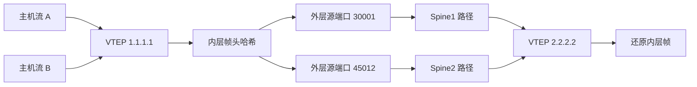

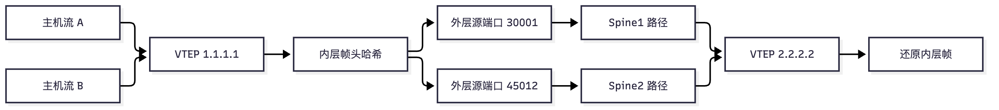


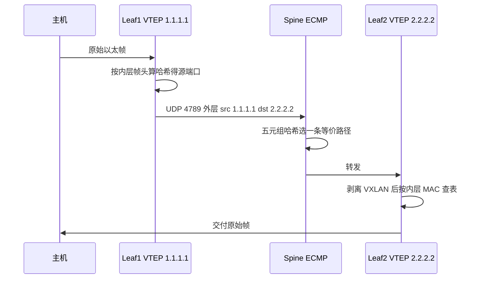

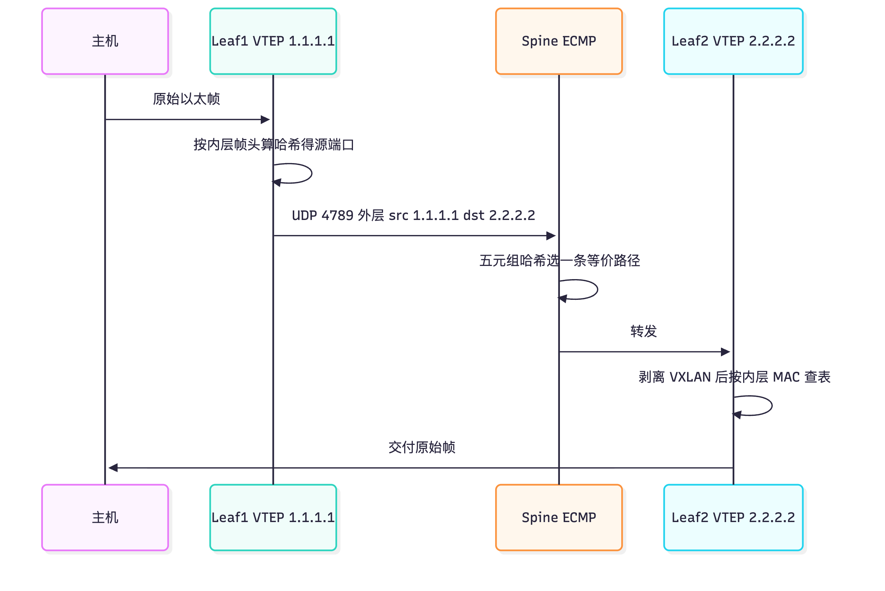


### 真题精练

**Q1.【真题·简答】** VXLAN 报文中，外层 UDP 源端口的作用是什么？如果把它固定为某个固定值，会出现什么问题？

> **答案要点**：
> ① 作用：**为 Underlay 的逐流负载分担提供哈希熵**。同一对 VTEP 之间，外层源/目 IP 与目的端口都是固定的，只靠 UDP 源端口区分不同内层流。
> ② 固定后的后果：Underlay 的 ECMP 哈希输入完全一致，所有流量被压到**同一条**等价路径上，其余链路空闲，形成拥塞热点与带宽浪费；同时负载均衡设备也无法分摊。排错时用抓包看到大量报文的源端口为同一值，即可判定。
> ③ 补充：源端口由**内层以太帧头信息哈希生成**，因此同一内层流始终得到同一源端口，保证不乱序；不同流得到不同源端口，实现分担。

**Q2.【真题·单选】** 在 BGP EVPN 动态建立 VXLAN 隧道的场景中，单播流量的外层目的 IP 地址通常来自？
A. 静态配置的 peer-list
B. EVPN Type2（MAC/IP 通告路由）的下一跳或 Type3 通告的 VTEP 地址
C. Underlay IGP 的 Router ID
D. 主机的默认网关地址

> **答案：B**
> **解析**：Type3 路由（Inclusive Multicast Ethernet Tag Route）携带本端 VTEP 地址与 PMSI 属性，是**隧道自动发现**的基础；Type2 路由携带 MAC/IP 可达性及其**下一跳**（即远端 VTEP），单播流量按它转发。A 是静态 VXLAN 的方式，不用于 EVPN 动态隧道。C 的 Router ID 只是协议标识，不等于 VTEP 源地址（虽然实践中常一致）。D 是内层字段，与外层无关。

**Q3.【真题·多选】** 为保证 VXLAN 隧道稳定并能充分利用 ECMP，Underlay 应满足哪些条件？
A. VTEP 源地址使用 LoopBack 接口地址并被 IGP 通告
B. Underlay 存在到对端 VTEP 的多条等价路由
C. 外层 UDP 源端口随内层流变化
D. Underlay 使用 STP 消除二层环路以保证稳定

> **答案：ABC**
> **解析**：D 错——VXLAN 的 Underlay 是**三层 IP 网络**，靠路由协议收敛与 ECMP 分担，不使用 STP；引入 STP 反而说明 Underlay 设计成了二层网络，会阻断等价路径（STP 只留一条）。A 保证了隧道不随物理口震荡；B 才有可分担的路径；C 提供了哈希熵，三者缺一不可。

### 易错点与排错

1. **LoopBack0 没通告进 IGP**：现象是 `display vxlan tunnel` 中隧道长期 down 或 EVPN 邻居无法建立。定位：`display ospf routing <对端VTEP> 32` 无路由即为此因。
2. **两台 Leaf 源地址重复**：EVPN 隧道"建立成功但流量乱跑"，`display vxlan tunnel` 出现两个相同的源或对端 MAC 学习异常。定位：核对每台设备的 LoopBack0 规划表。
3. **ECMP 不生效的三种常见原因**：① 源端口被固定；② Underlay 只有一条路由（未形成等价）；③ 哈希算法未包含内层字段（老版本或非 VXLAN 感知单板）。逐个排查顺序：路由条数 → 抓包源端口 → 单板/版本。
4. **误用物理口做 source**：单链路故障即导致整台 Leaf 的隧道震荡，还会引起 EVPN 全量重收敛，生产网严禁。
5. **DSCP 映射丢失**：VXLAN 封装默认不继承内层 DSCP，若不配置外层标记映射，QoS 策略在 Underlay 上完全失效。定位：抓包对比内外层 TOS 字段。

---

## 1.3 VXLAN 的 MTU、分片与路径 MTU 问题

### 考点定位

MTU 是 DCN 方向**最容易被忽视却最容易造成"生产事故"的考点**：理论卷常以 **简答/计算题**要求"给出 VXLAN 场景下主机 MTU 与 Underlay MTU 的建议值及推导过程"（4~6 分）；实验与排错题则给出"小包通、大包不通、ping 大包丢包、SSH 能连但传大文件卡死"的现象，要求定位为 MTU 问题并给出配置。**必须能背出 50 B/54 B 开销并完成 MTU 计算**。

### 原理精讲

MTU 问题的本质是**"封装的代价必须由链路的容量来偿还"**。VXLAN 在原始帧外面增加了 50 B（外层无 VLAN Tag）或 54 B（外层有 Tag），因此同一个物理接口上：

- **若物理接口 MTU 保持 1500**：VTEP 最多只能原样承载 **1500 − 50 = 1450 B** 的内层帧。而主机默认发出 1500 B 的 IP 报文（加 14 B 以太头 = 1514 B 内层帧），封装后为 1564 B > 1500，**必然超过出接口 MTU**。
- 此时设备有两种行为：**分片**或**丢弃**。IPv4 允许中间设备分片，但分片会带来三重代价：① 转发性能大幅下降（软件分片、芯片流水线打断）；② 接收端重组消耗内存、易被攻击；③ 分片后 UDP 端口信息只在首片，负载均衡与 ACL 失效。因此**数据中心网络的工程规范是：禁止 VXLAN 封装后分片**。华为设备的常见缺省行为是外层 IPv4 头**置 DF（Don't Fragment）位**，超长报文直接丢弃并回 ICMP 需分片（Type 3 Code 4）——一旦 ICMP 被策略过滤，就形成**MTU 黑洞**：小包（如 ping 默认 56 B、TCP 三次握手）正常，大包（文件传输、数据库同步）静默卡死。这是 DCN 排错题最爱设置的现象。

**两种正确的解决思路（考试要能分别说清）**：

**思路一：抬高 Underlay MTU（数据中心推荐）**。既然封装要花 50 B，就让底层接口多给 50 B。把 VTEP 之间所有三层接口（含 Spine 侧）MTU 从 1500 提到 **1600**（安全余量；若外层还要叠 VLAN/QinQ、或未来要叠 VXLAN over VXLAN，可留更多），甚至在纯计算/存储网中启用 **巨帧 9000+**（CE 系列接口可配 `mtu 9216` 或 `jumboframe enable`）。这样主机侧完全不用改，端到端 1500 B 照常。**注意必须全路径一致**：只要中途有一台设备某个接口仍是 1500，该链路就是瓶颈。优点是运维简单、性能最好；缺点是要修改所有 Underlay 接口，已有网络的改造需窗口期。

**思路二：压低主机/网关 MTU（兼容既有网络）**。保持 Underlay 1500，把服务器网卡 MTU 配成 **1450**（外层无 Tag）或 **1446**（外层有 Tag），同时把 VBDIF/VLANIF 的 MTU 也配成 1450，并在 VBDIF 上配 `tcp adjust-mss`（如 1400）让 TCP 两端协商更小的 MSS，从源头避免产生需要分片的报文。注意：`tcp adjust-mss` 只对 TCP 生效，**UDP/ICMP 大包依然会被丢弃**，所以它是一个补丁而不是完整方案；对 UDP 业务（如某些存储、VDI 协议）必须靠 MTU 本身。

**必须掌握的计算套路（考试按此三步写）**：
1. 写出封装开销：内层帧 = 内层以太头 14 B + 内层 IP 载荷（主机 MTU 决定）；外层开销 = 14（以太）+ 20（IPv4）+ 8（UDP）+ 8（VXLAN）= 50 B；若外层有 VLAN Tag，再 +4 B。
2. 列不等式：**Underlay 接口 MTU ≥ 主机 MTU + 14 + 50（+4）**。以主机 MTU 1500 为例：1500 + 14 + 50 = 1564 B，因此 Underlay 至少 1564 B；工程上取 **1600** 更稳妥。
3. 反向推导：若 Underlay 固定 1500，则主机 MTU ≤ 1500 − 50 − 14 = **1436 B**（这是"内层 IP 报文"的上限）；若只看内层帧（含 14 B 以太头）不超过 1450 B，则主机 IP MTU 应为 **1450 − 14 = 1436 B**。工程实践常直接取 **1450** 作为"内层帧 MTU"，并把主机 IP MTU 配成 1436~1450（不同资料口径不同，考试写清"内层帧 1450 B，对应主机 IP MTU 1436 B"即可得分；若只考虑"内层 IP 报文 ≤ 1450"，则结论为 1450）。**建议答题时把两种口径都写出来并说明假设**，这是拿满分的关键。

另外三个易被忽略的 MTU 细节：① **组播/广播 BUM 报文**同样受 MTU 约束；② **EVPN 控制报文**走 TCP 179（BGP），MTU 影响较小，但 Type2 路由里携带的 MAC/IP 长度很小，无 MTU 风险；③ **跨 DCI 场景**若中间经过运营商 MPLS 或 IP 骨干，其 MTU 常为 1500 甚至更小，此时必须重新核算，或对 DCI 侧接口单独降 MTU，这是"跨 Fabric 大包不通"的常见根因（见 2.7 节）。

### 关键概念对照表

| 场景 | 内层帧上限 | 主机 IP MTU 建议 | Underlay 接口 MTU 建议 | 备注 |
|---|---|---|---|---|
| 标准 VXLAN，外层无 Tag | 1450 B | 1436~1450 B | ≥ 1564 B，工程取 **1600** | 推荐方案 |
| VXLAN + 外层 VLAN Tag | 1446 B | 1432~1446 B | ≥ 1568 B，取 **1600** | 常用于跨机房 |
| VXLAN over IPv6 Underlay | 1430 B | 1416 B | ≥ 1570 B，取 **1600** | IPv6 头 40 B |
| 存储/计算网（巨帧） | 9000 B 内层 | 9000 B | ≥ 9050 B，取 **9216** | CE 接口 `mtu 9216` |
| 跨 DCI（中间 1500） | 1450 B | 1436 B | 两端一致 | 需与运营商确认 |
| TCP 业务补丁 | —— | 保持 1500 | VBDIF 上 `tcp adjust-mss 1400` | 只兜 TCP，不兜 UDP |

| 故障现象 | 是否 MTU 问题 | 快速验证方法 |
|---|---|---|
| SSH 能登录，`scp` 大文件卡死 | 高度可疑 | `ping -s 1472 -f <对端>`（Windows）/ `ping -M do -s 1472`（Linux） |
| ping 默认报文通、`ping -l 1472` 不通 | 是 | 逐级调整包长定位最大可通过长度 |
| 所有业务全不通 | 一般不是 MTU | 先查隧道状态与 BD 映射 |
| 只有跨 DCI 的大包不通 | 是（DCI 链路 MTU 小） | 在 Border Leaf 上 `display interface` 看两侧 MTU |
| 抓包见 ICMP Type3 Code4 | 是 | 说明设备在回"需分片"，检查 ICMP 是否被过滤 |

### 华为设备配置

```bash
# ===== 方案一：抬高 Underlay 接口 MTU（推荐）=====
system-view
interface GE1/0/1                                  // Leaf 上联 Spine 的三层物理口
 undo portswitch                                    // 该口需工作在三层模式
 ip address 10.1.1.1 255.255.255.0
 mtu 1600                                           // 提高接口 MTU，给 VXLAN 封装留出 50B 余量
 quit
interface GE1/0/2
 mtu 1600                                           // 必须全路径所有三层口一致，含 Spine 侧
 quit
# ===== 方案二：保持 Underlay 1500，压主机与网关 MTU =====
interface Vbdif10                                  // 分布式网关的三层接口
 ip binding vpn-instance VPNA
 ip address 10.1.10.1 255.255.255.0
 mtu 1450                                           // 网关侧限制内层帧为 1450B，与主机一致
 tcp adjust-mss 1400                                 // 让 TCP 两端协商 MSS 1400，避免产生需分片的 TCP 段
 quit
# ===== 验证 MTU 与分片 =====
display interface GE1/0/1 | include MTU            // 查看接口实际 MTU 值
ping -s 1472 -f 10.1.20.1                          // -s 载荷长度 -f 禁止分片，用于探测路径 MTU（1472+8+20=1500）
ping -s 1450 -f 10.1.20.1                          // 逐步缩小，找到可通过的最大值，验证是否恰为 1450 档
```

### 示意图

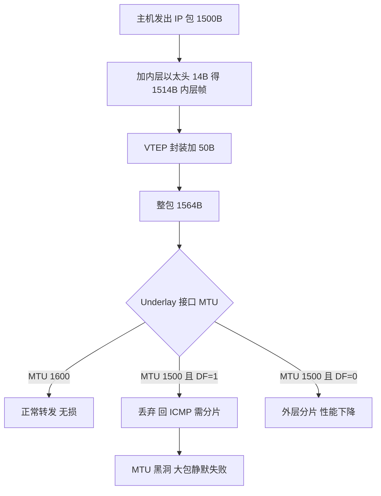

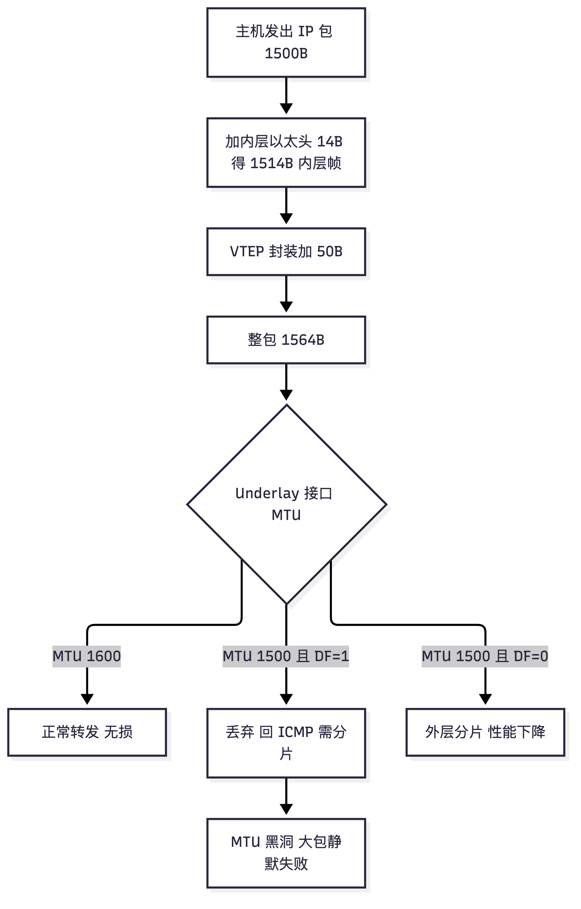


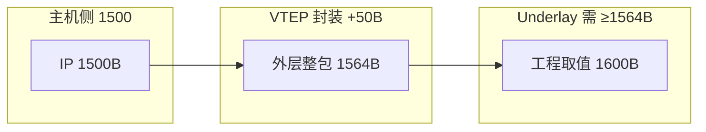

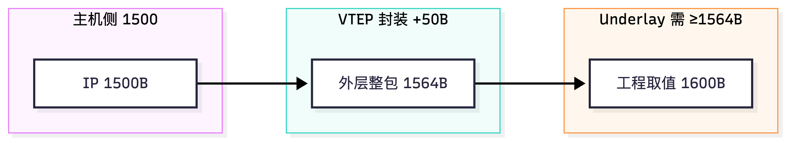


### 真题精练

**Q1.【真题·简答】** 某 VXLAN 网络中，服务器（MTU 1500）访问同租户另一台服务器时，ping 小包正常、传输大文件卡死。请写出 VXLAN 封装开销的构成，求该场景下 Underlay 接口最小 MTU，并给出两种配置方案。

> **答案要点**：
> ① 开销构成：外层以太头 14 B + 外层 IPv4 头 20 B + UDP 头 8 B + VXLAN 头 8 B = **50 B**（外层有 VLAN Tag 则为 54 B）。
> ② 最小 MTU：1500（内层 IP）+ 14（内层以太头）+ 50 = **1564 B**；工程建议配置 **1600 B**。
> ③ 方案 A：Underlay 所有三层接口 `mtu 1600`（Spine 侧同样要改），主机无需改动。
> ④ 方案 B：Underlay 保持 1500，服务器网卡与 VBDIF 的 MTU 改为 **1450（内层帧）/ 主机 IP MTU 1436**，并在 VBDIF 配 `tcp adjust-mss 1400`。
> ⑤ 原因说明：外层 IPv4 头 DF 置位时超长报文被丢弃，且 ICMP"需分片"常被过滤，因此表现为小包通、大包静默失败（MTU 黑洞）。

**Q2.【真题·单选】** VXLAN 封装后，若 Underlay 出接口发生分片，最不可能出现的后果是？
A. 转发性能明显下降
B. 负载均衡设备无法正确识别内层流
C. 接收端需要重组报文，增加内存开销
D. VNI 字段在分片后被改写

> **答案：D**
> **解析**：分片是 IP 层行为，**只切分载荷，不会改写任何上层字段**，VNI 在首个分片中完整保留（VXLAN 头位于 UDP 载荷起始处）。A、B、C 都是分片的真实代价：性能下降（软件分片）、非首片无端口信息导致哈希/ACL 失效、接收端重组消耗资源且易受攻击。这也是工程上"禁止 VXLAN 分片、一律改 MTU"的原因。

**Q3.【真题·多选】** 关于 VXLAN 的 MTU 与分片，下列说法正确的有？
A. 外层 IPv4 头通常置 DF 位，超长报文被丢弃
B. `tcp adjust-mss` 只能规避 TCP 大包分片，无法解决 UDP 大包问题
C. 抬高 Underlay MTU 时，只需修改 Leaf 侧接口
D. IPv6 Underlay 下封装开销为 70 B（无外层 Tag），必须依赖 PMTUD

> **答案：ABD**
> **解析**：C 错——MTU 是**逐跳生效**的，只要路径上任一接口 MTU 小于封装后整包长度，该链路就是瓶颈，因此 Leaf、Spine、Border Leaf 的所有相关接口都必须统一抬高。D 正确：IPv6 基本头 40 B，14+40+8+8 = 70 B；且 IPv6 规定中间路由器不得分片，只能由源端依赖 PMTUD 调整，黑洞更隐蔽。

### 易错点与排错

1. **只改 Leaf 不改 Spine**：最常见配置错误，表现为"部分路径大包通、部分路径不通"（ECMP 哈希到不同 Spine 时表现不一致），排错时必须逐跳核对 `display interface | include MTU`。
2. **把 MTU 与 MSS 混为一谈**：MTU 是二层帧/接口层概念（IP 报文长度上限），MSS 是 TCP 载荷概念（MSS = MTU − 20 IP − 20 TCP = 1460）。`tcp adjust-mss` 改的是 MSS，无法约束 UDP/ICMP。
3. **忘记外层 VLAN Tag 的 4 B**：跨机房/跨 POD 场景外层可能封装 VLAN 或 QinQ，开销变 54 B（或 58 B），按 50 B 计算会导致"偶发"大包失败，极难定位。
4. **用 ping 默认包长验证**：默认包长太小（Windows 32 B / Linux 56 B），永远通。必须用 `ping -s 1472 -f`（Windows）或 `ping -M do -s 1472`（Linux）逐级探测。
5. **跨 DCI 未重新核算**：DCI 侧链路（尤其经过运营商网络）MTU 常为 1500 甚至 1400，是"跨 Fabric 大包失败"的头号原因，必须在设计阶段写入交付文档。
6. **排错命令清单**：`display interface GE1/0/1 | include MTU`、`display vxlan vni 10000 verbose`、`ping -s <len> -f`、抓包看 `Fragmented IP` 与 ICMP Type3 Code4。

---

## 1.4 VTEP、NVE 接口与隧道建立前提

### 考点定位

本考点在理论卷以**单选/多选**为主（2~4 分），考"NVE 是逻辑接口还是物理接口"、"隧道建立的两个前提"、"VTEP 源地址如何选择"；在实验题中是**一切配置的第一步**——很多选手配完 BGP EVPN 后发现 `display vxlan tunnel` 为空，本质就是隧道前提没满足。易错点：把 VTEP 与 NVE 混为一谈、用物理口地址做 source、忘记 Underlay 通告 LoopBack。

### 原理精讲

**VTEP 是功能角色，NVE 是承载该角色的逻辑接口**。VTEP（VXLAN Tunnel End Point）指的是"负责 VXLAN 封装与解封装的功能实体"，它既可以是一台物理交换机（华为 CloudEngine 系列）、一台虚拟交换机（vSwitch，如华为的 OVS 增强版、FusionCompute 的虚拟交换机），也可以是 NCE-Fabric 纳管的软 VTEP。而 **NVE（Network Virtualization Edge，网络虚拟边缘）接口是华为设备上实现 VTEP 功能的逻辑接口**，用 `interface nve1` 创建，编号从 1 开始（一台设备可创建多个 NVE，但生产环境基本只用一个）。NVE 接口**没有物理形态、不会 down/up 上报链路状态**，它只是"挂载源地址与 VNI 列表的容器"：`source` 命令给它一个身份（VTEP 地址），`vni` 命令给它一批"待封装的网络"。

由此推出**隧道建立的两个硬前提**（考试会问"缺一不可的两点是什么"）：

**前提一：Underlay 三层可达。** 两端 VTEP 源地址之间必须能相互 ping 通——注意是**双向**，且必须是**路由可达而非二层直连**。原因：VXLAN 是"IP 网络上跑二层"，IP 网络的连通性是它存在的地基。这就要求 ① Underlay 运行 IGP（OSPF/IS-IS，华为 Fabric 推荐 IS-IS，收敛更快、扩展性更好）或 BGP；② **VTEP 源地址（LoopBack0）必须被通告进 Underlay**，常见错误是只通告了互联网段而漏掉 LoopBack；③ 中间设备不能做 NAT（会改写外层 IP 导致回程失败）；④ 若有防火墙，须放通 **UDP 4789**（含全端口段源端口）与 BGP TCP 179。

**前提二：源地址必须有效且唯一。** `interface nve1` 下 `source` 指定的地址必须是**本机已配置且 up 的接口地址**（推荐 LoopBack0 的 /32），否则 NVE 接口无法进入 up 状态，所有隧道也无法建立。同时全网必须唯一——两台 Leaf 使用同一地址会造成 EVPN 下一跳冲突、MAC 表项漂移等难查故障。

在这两个前提之后，**隧道如何被"发现和建立"取决于控制平面**：
- **静态 VXLAN（头端复制）**：在 `vni` 后写 `head-end peer-list`，列出所有对端 VTEP。优点是零控制平面、协议简单；缺点是**新增一台 VTEP 必须在全网每台设备上手工添加**，N 台设备需配置 O(N²) 条，且无法感知对端故障（隧道口长期 up，实际黑洞）。**仅适合 3~5 台设备的小规模或纯验证场景**。
- **BGP EVPN 动态建立**：Leaf 之间建立 BGP EVPN 邻居（通常经 Spine 做 RR），通过 **Type3 路由**自动发现对端 VTEP 并建立隧道（`display vxlan tunnel` 中类型为 `evpn`），通过 **Type2 路由**学习远端 MAC/IP。新增 Leaf 只需在本机配置，**零手工隧道配置**，N 台设备配置量 O(N)，这是生产网络的标准做法。
- **补充**：华为还支持通过 **iMaster NCE-Fabric 控制器**统一编排，控制器把 VTEP 列表与 VNI 关系下发给所有设备，本质仍是 EVPN 模型，只是配置由控制器生成（Underlay 可用 `fabric` 自动化部署，Underlay 与 Overlay 一体化）。

**隧道的"按需建立"特性**很重要：EVPN 场景下，只有**双方都互相同步到 Type3 路由**时隧道才会建立；如果 A 学到了 B 的 Type3 但 B 没学到 A 的（例如 B 侧还没配好 VNI），会出现"A 侧有隧道、B 侧无隧道"的单向现象，数据流去程通、回程断。排错时应**两端同时执行 `display vxlan tunnel` 对比**。

### 关键概念对照表

| 概念 | 定义 | 华为实现 | 是否可 down | 常见误用 |
|---|---|---|---|---|
| VTEP | 负责 VXLAN 封装/解封装的功能实体 | CE6865/CE16800 整机、vSwitch、NCE 软 VTEP | —— | 误以为是一台"专门设备" |
| NVE 接口 | 实现 VTEP 功能的逻辑接口 | `interface nve1` | 源地址失效时不可用 | 误以为要在物理口下配 VXLAN |
| VXLAN 隧道 | 一对 VTEP 之间的虚拟链路 | 由 `vni`+peer 或 EVPN 生成 | 动态类型可 down | 误以为隧道占用物理带宽 |
| NVE 源地址 | 本端 VTEP 身份地址 | `source 1.1.1.1`（LoopBack0） | 随 LoopBack 状态 | 用物理口地址，链路故障即断 |
| BD | 二层广播域（overlay 的 VLAN） | `bridge-domain 10` | 无链路状态概念 | 与 VLAN 混淆 |
| VNI | 24 bit 网络标识 | `vxlan vni 10000` | —— | 与 BD 不 1:1，导致映射混乱 |

| 隧道建立方式 | 控制平面 | 配置复杂度 | 感知对端故障 | 适用规模 | 隧道类型显示 |
|---|---|---|---|---|---|
| 静态 VXLAN | 无 | O(N²) 手工 | **不能** | ≤5 台 | `static` |
| BGP EVPN | MP-BGP EVPN 地址族 | O(N) 本机 | 能（路由撤销） | 大规模 | `evpn` |
| 控制器编排 | NCE-Fabric | 集中编排 | 能 | 大型云网 | `evpn` |

### 华为设备配置

```bash
# ===== 前提验证与 NVE 配置（CE6865-Leaf1）=====
system-view
interface LoopBack0
 ip address 1.1.1.1 255.255.255.255                 // VTEP 源地址，/32 便于精确通告
 quit
ospf 1 router-id 1.1.1.1
 area 0.0.0.0
  network 1.1.1.1 0.0.0.0                           // 前提一：把 VTEP 地址通告进 Underlay
  network 10.1.1.0 0.0.0.255
  quit
 quit
interface nve1
 source 1.1.1.1                                     // 前提二：绑定有效且唯一的源地址
 vni 10000                                          // EVPN 模式：只使能 VNI，不写 peer-list
 quit
# ===== 对照：静态 VXLAN 写法（小规模验证用）=====
interface nve1
 source 1.1.1.1
 vni 10000 head-end peer-list 2.2.2.2               // 手工指定对端 VTEP，BUM 流量头端复制
 vni 10000 head-end peer-list 3.3.3.3               // 多对端就多写一条，注意配置量随规模平方增长
 quit
# ===== 验证隧道前提 =====
ping -a 1.1.1.1 2.2.2.2                             // 以 NVE 源地址为源 ping 对端，验证 Underlay 双向可达
display vxlan tunnel                                // 查看隧道状态 up/down、类型 static/evpn、源与目的 IP
display vxlan vni                                   // 查看 VNI 与 BD 的绑定关系及 VXLAN 状态
display bgp evpn peer                               // EVPN 模式下确认 BGP 邻居是否 Established
```

### 示意图

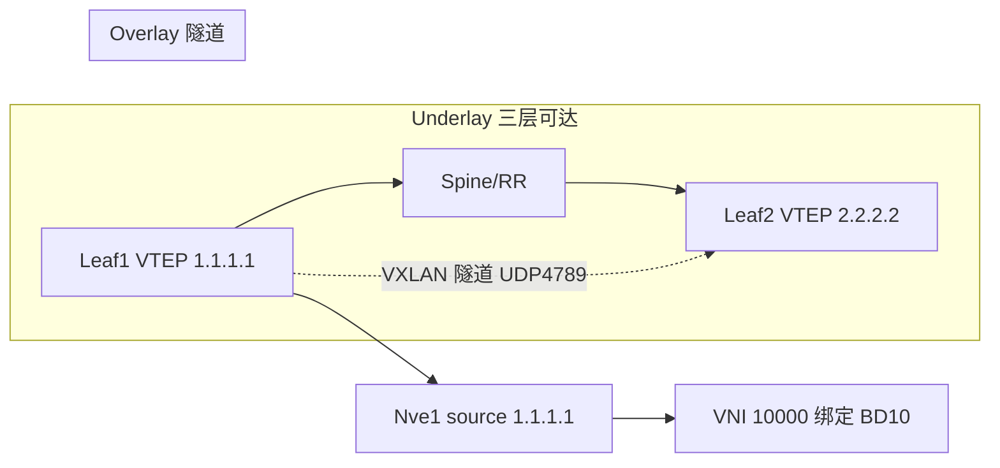

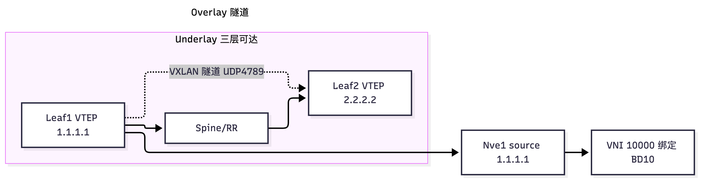


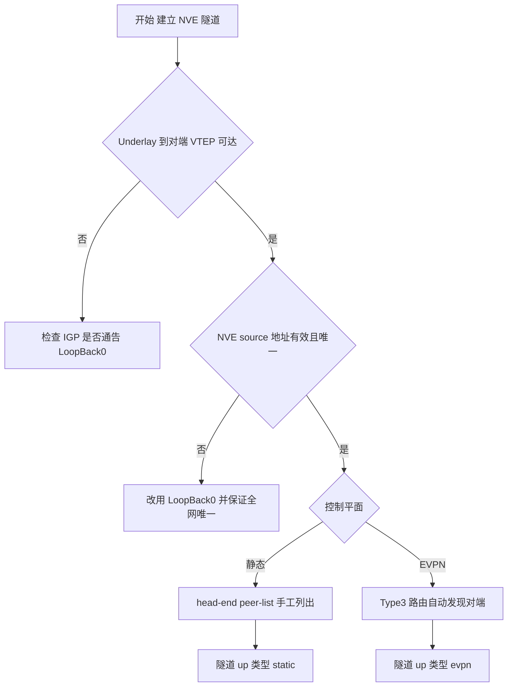

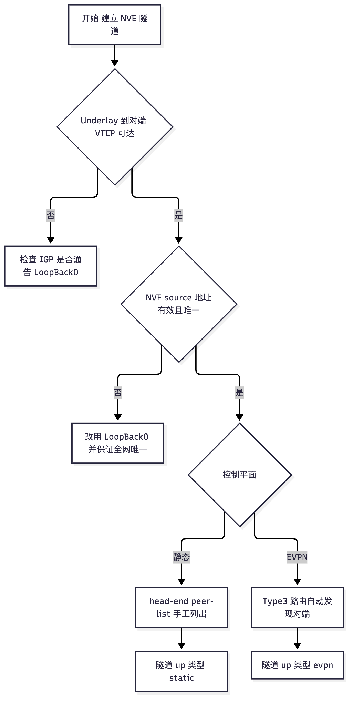


### 真题精练

**Q1.【真题·判断】** 在华为 CloudEngine 交换机上配置 VXLAN 时，NVE 接口是一个物理接口，需要绑定到具体的物理端口上。

> **答案：错误**
> **解析**：NVE（Network Virtualization Edge）接口是**逻辑接口**，用 `interface nve1` 创建，不绑定物理端口，也不承载物理链路状态。它只是"源地址 + VNI 列表"的容器，真正的封装由硬件在物理出接口上完成。VXLAN 隧道本身也是逻辑概念，不占用独立物理带宽。

**Q2.【真题·多选】** VXLAN 隧道成功建立必须满足的前提包括？
A. 两端 VTEP 源地址之间三层 IP 可达
B. VTEP 源地址在 Underlay 中被通告，且全网唯一
C. 两端必须在同一 VLAN 内二层互通
D. 静态 VXLAN 模式下需在 `vni` 后配置 `head-end peer-list` 或在 EVPN 模式下学到对端 Type3 路由

> **答案：ABD**
> **解析**：C 错——VXLAN 的定位恰恰是"**摆脱二层的束缚**"，Underlay 只需三层可达，两台 VTEP 可以相隔多个三层跳。A、B 是"两个硬前提"：没有 IGP 通告 LoopBack0 就无法 ping 通对端 VTEP，隧道状态永远起不来；D 是控制平面的必要条件，静态与 EVPN 两种方式分别对应手工与自动发现。

**Q3.【真题·排错】** Leaf1 上 `display vxlan tunnel` 显示到 Leaf2 的隧道为 up，但 Leaf2 上没有任何到 Leaf1 的隧道；主机 A（挂 Leaf1）能 ping 通主机 B（挂 Leaf2），B ping A 不通。请分析原因。

> **答案要点**：
> ① 现象本质：**单向隧道**。VXLAN 隧道是"按需生成、双向独立"的，每台设备只根据自己学到的对端信息生成隧道，因此 A 侧有、B 侧可能没有。
> ② 最可能原因：**Leaf2 没有学到 Leaf1 的 Type3 路由（或没有在本机 NVE 上使能对应 VNI）**，因此 Leaf2 无法封装发往 Leaf1 的报文。可定位：Leaf2 上 `display bgp evpn all routing-table inclusive-multicast-route` 是否含 Leaf1 的 VTEP；`display vxlan vni` 看 VNI 是否 up；`display nve` 侧配置是否漏了 `vni 10000`。
> ③ 次要原因：Leaf2 到 Leaf1 的 Underlay 路由缺失（单向可达）。用 `ping -a 2.2.2.2 1.1.1.1` 验证。
> ④ 处置：补齐 Leaf2 的 `interface nve1` 下 `vni` 配置与 BGP EVPN 邻居/地址族配置，确认 Route-Target 双向匹配后隧道自动建立。

### 易错点与排错

1. **把 `vni` 配在物理口下**：VXLAN 相关配置只在 `bridge-domain`、`interface nve1`、`interface Vbdif` 上，物理口只需保证三层可达。
2. **漏配 Underlay 通告 LoopBack0**：隧道 down 的第一大原因。定位命令 `display ospf routing <对端VTEP> 32`、`display ip routing-table <对端VTEP>`。
3. **忘记在 NVE 上使能 VNI**：BGP EVPN 邻居 Established、Type3 也学到了，但 `display vxlan tunnel` 为空——常见于"配了 BD 却漏了 NVE 下的 `vni`"。
4. **中间有防火墙未放通 UDP 4789**：隧道状态在设备上看是 up，实际报文被丢。定位：两端同时抓包，看是否有单向收包。
5. **源地址用物理口**：单链路故障导致隧道全断、EVPN 邻居重收敛，属设计缺陷。
6. **排错顺序（背下来）**：ping VTEP 源地址 → `display vxlan vni` → `display vxlan tunnel` → `display bgp evpn peer` → `display bgp evpn all routing-table` → 抓包。

---

## 1.5 VXLAN 三种泛洪机制对比与选型

### 考点定位

本考点是**多选与简答的高频题源**（3~5 分）：要求区分"组播、头端复制、EVPN Ingress Replication（入口复制）"三种 BUM（Broadcast, Unknown unicast, Multicast，广播、未知单播、组播）泛洪实现方式，并说明各自的适用规模与优劣。实验题的考点是"为什么我配了头端复制，扩展一台 Leaf 后要改全套配置"。EVPN 场景下还应能说清 **PMSI 属性如何承载 Ingress Replication**。

### 原理精讲

VXLAN 的隧道是"点对点"的，而二层网络必须支持 BUM 流量（ARP 请求、DHCP Discover、未知单播等）。**一对多的分发方式**就是"泛洪机制"要解决的问题，历史上有三条技术路线：

**方案一：组播泛洪（Multicast Flooding）**。为每个 VNI 分配一个 Underlay 组播组地址，VTEP 把 BUM 报文封装后发往该组播地址，由 Underlay 的 PIM-SM/SSM（或 BIER）负责复制到所有加入该组的 VTEP。优点是**控制平面零配置**（不需要 peer-list，也不需要 EVPN），且复制由网络层完成、VTEP 侧 CPU/带宽压力小。缺点是 ① 要求整个 Underlay 部署组播，运维复杂、排错困难；② 每个 VNI 一个组播组，租户数量大时组播组资源紧张；③ 组播转发路径与单播 ECMP 不一致，易出现次优路径与丢包抖动；④ 云环境中常因安全策略禁用组播；⑤ 无法与 EVPN 的精细控制协同。**现在仅用于早期部署或无法上线 EVPN 的存量网络**。

**方案二：头端复制（Head-End Replication，HER）**。VTEP 在**本端**把 BUM 报文复制 N 份，分别以单播 VXLAN 隧道发往 `head-end peer-list` 中列出的每个对端。这叫"入口复制/头端复制"，复制点在最靠近源的位置。优点是 ① **对 Underlay 无任何要求**（不需要组播，只要单播 IP 可达）；② 复制可控、可配合 ACL/QoS；③ 与 EVPN 天然兼容（EVPN 的 Ingress Replication 本质就是由控制平面自动填充 peer-list）。缺点是 ① **配置量 O(N²)**：N 台 VTEP 每台都要列 N−1 个对端，静态维护；② 头端 VTEP 承担 N−1 份复制的带宽与 CPU 开销，**源 VTEP 成为瓶颈**；③ 新增/删除 VTEP 需要全网同步修改，易漏配导致"部分主机收不到 ARP"。

**方案三：EVPN Ingress Replication（EVPN 入口复制，现行主流）**。这是"头端复制 + 控制平面自动化"的组合：每个 VTEP 通过 **Type3 路由（Inclusive Multicast Ethernet Tag Route）** 通告自己的 VTEP 地址与 **PMSI（Provider Multicast Service Interface，提供商组播服务接口）属性**；PMSI 属性中 **Tunnel Type = Ingress Replication（值 6）** 表示"请用入口复制方式给我发 BUM 流量"，也可以指定为 mLDP/PIM 等其他隧道类型。所有 VTEP 收到彼此的 Type3 路由后，**自动形成本 VNI 的 BUM 复制列表**——等价于 peer-list 由协议自动生成，无需人工维护。于是配置复杂度回到 O(N)，同时保留了头端复制的"不依赖 Underlay 组播"的优点，并可通过撤销 Type3 路由快速感知对端离开（避免复制到故障设备）。**这是华为 CloudFabric 与所有主流云数据中心的标准选择**。

**PMSI 属性要点（简答加分项）**：PMSI 是 BGP EVPN 的**可选传递属性**，Type3 路由必须携带它；其中包含 **Flags**、**Tunnel Type**（Ingress Replication = 6、mLDP = 4、PIM-SSM = 5 等）、**MPLS Label**、**Tunnel Identifier**（即入口复制时的对端 VTEP 地址）。考试若问"EVPN 怎么实现 BUM 泛洪"，回答要点是：Type3 + PMSI(Tunnel Type=Ingress Replication) → VTEP 自动构建复制列表 → BUM 报文逐个单播封装复制。

**三种机制的选型结论**：新部署一律选 **EVPN Ingress Replication**；已有组播 Underlay 且不打算引入 EVPN 的老网络可继续用组播；静态 VXLAN 头端复制只用于实验室或 3~5 台设备的小型验证环境。另外要清楚一个**优化点**：在 EVPN 多活接入场景，BUM 流量通过 **DF（Designated Forwarder，指定转发者）选举**只由一台 PE 向 CE 方向转发，避免重复（见 2.6 节）；而 **ARP 抑制**（见 1.10 节）可以从源头大幅减少 BUM 报文数量——这是 DCN 设计中"减少泛洪"的两条主线。

### 关键概念对照表

| 维度 | 组播泛洪 | 头端复制（静态） | EVPN Ingress Replication |
|---|---|---|---|
| 复制点 | 网络中间节点（PIM） | 源 VTEP（入口） | 源 VTEP（入口） |
| Underlay 要求 | **必须部署组播** | 只需单播可达 | 只需单播可达 |
| 控制平面 | 组播协议 | 无（手工 peer-list） | **BGP EVPN Type3 + PMSI** |
| 配置复杂度 | 中（组播配置复杂） | **O(N²)** | **O(N)** |
| 对端故障感知 | 靠组播协议 | **不能**（长期黑洞） | 能（Type3 撤销） |
| 源端带宽压力 | 小（网络复制） | **大（N−1 份复制）** | 大（N−1 份复制） |
| 路径一致性 | 与单播可能不一致 | 与单播一致 | 与单播一致 |
| 适用规模 | 中大型存量网 | ≤5 台，实验室 | **大型云数据中心（主选）** |
| 华为典型配置 | Underlay 组播 + `vni` | `vni 10000 head-end peer-list x.x.x.x` | 仅 `vni 10000` + BGP EVPN |

| PMSI Tunnel Type 取值 | 名称 | 含义 |
|---|---|---|
| 0 | No tunnel information present | 无隧道信息 |
| 4 | mLDP P2MP LSP | 用 mLDP 建立 P2MP 隧道复制 |
| 5 | PIM-SSM Tree | 用 PIM-SSM 组播树复制 |
| 6 | **Ingress Replication** | **入口复制，华为分布式网关缺省使用** |
| 7 | BIER | 位索引显式复制 |

### 华为设备配置

```bash
# ===== 方式一：组播泛洪（Underlay 需先部署 PIM-SM）=====
system-view
multicast routing-enable                             // 全局使能组播路由
interface GE1/0/1
 pim sm                                              // 三层接口使能 PIM 稀疏模式
 quit
interface LoopBack0
 pim sm
 quit
pim
 static-rp 10.1.1.254                                // 指定静态 RP，或用 BSR 动态选举
 quit
interface nve1
 source 1.1.1.1
 vni 10000 mcast-group 239.1.1.1                     // 每个 VNI 绑定一个组播组，BUM 发往该组
 quit
# ===== 方式二：静态头端复制 =====
interface nve1
 source 1.1.1.1
 vni 10000 head-end peer-list 2.2.2.2                // 手工列出对端，N 台设备需 N-1 条
 vni 10000 head-end peer-list 3.3.3.3
 quit
# ===== 方式三：EVPN Ingress Replication（推荐，无需 peer-list）=====
interface nve1
 source 1.1.1.1
 vni 10000                                           // 只使能 VNI，对端由 Type3 自动发现
 quit
bgp 100
 peer 10.1.1.254 as-number 100                        // 与 RR（Spine）建 IBGP
 peer 10.1.1.254 connect-interface LoopBack0
 l2vpn-family evpn
  peer 10.1.1.254 enable                             // 使能 EVPN 地址族，Type3 由此交换
  quit
 quit
# ===== 验证 BUM 复制列表与 PMSI =====
display bgp evpn all routing-table inclusive-multicast-route   // 查看 Type3 路由及 PMSI 属性
display vxlan vni 10000 verbose                                // 查看该 VNI 的泛洪方式与对端数量
display vxlan tunnel                                           // 隧道类型应为 evpn
```

### 示意图

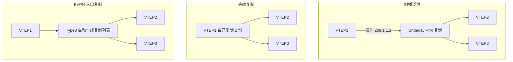

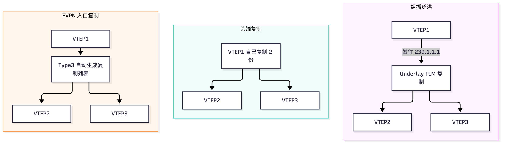


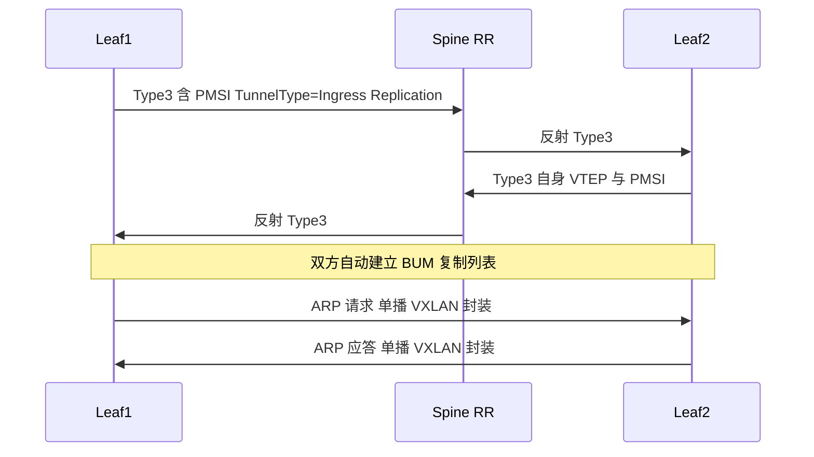

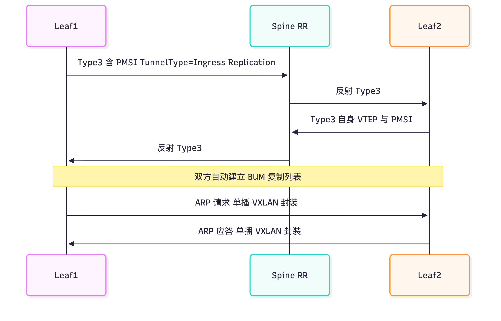


### 真题精练

**Q1.【真题·多选】** 关于 VXLAN 的 BUM 流量泛洪机制，下列描述正确的有？
A. 组播泛洪要求 Underlay 部署组播协议，复制由网络层完成
B. 头端复制由源 VTEP 复制报文，配置量随 VTEP 数量呈平方增长
C. EVPN 通过 Type3 路由与 PMSI 属性自动形成入口复制列表
D. EVPN Ingress Replication 的 PMSI Tunnel Type 取值为 5

> **答案：ABC**
> **解析**：D 错——**PMSI Tunnel Type = 6 表示 Ingress Replication**（入口复制），5 表示 PIM-SSM Tree，4 表示 mLDP P2MP LSP。华为分布式网关缺省使用入口复制。C 是最重要结论：Type3 承担"隧道自动发现 + BUM 复制列表生成"双重职责，因此 EVPN 场景下不需要手工 peer-list。

**Q2.【真题·简答】** 为什么在大型数据中心中，VXLAN 的 BUM 泛洪普遍采用 EVPN Ingress Replication 而不是组播或静态头端复制？

> **答案要点**：
> ① **相对组播**：不需要 Underlay 部署 PIM/组播，避免组播运维复杂、组播组资源受限、组播路径与单播 ECMP 不一致等问题；云环境中组播常被安全策略限制。
> ② **相对静态头端复制**：配置复杂度从 O(N²) 降到 O(N)，新增 VTEP 无需修改全网配置；通过 Type3 路由撤销可感知对端离去，避免向故障设备复制。
> ③ **同时保留优点**：仍然是"入口复制"，只依赖单播 IP 可达，与单播转发路径一致，复制可控。
> ④ 补充优化：结合 DF 选举避免多活场景重复泛洪，结合 ARP 抑制从源头减少 BUM 数量。

**Q3.【真题·单选】** 某网络采用静态 VXLAN 头端复制，新增一台 VTEP4 后，Leaf1~Leaf3 上的主机无法与 VTEP4 下主机通信（隧道显示 up）。最可能的原因是？
A. Underlay 路由不通
B. 需在 Leaf1~Leaf3 的 `vni` 下补充 VTEP4 的 peer-list（或在 VTEP4 上补全其余对端）
C. VNI 位数不足
D. 必须改用组播泛洪

> **答案：B**
> **解析**：静态头端复制的本质缺陷就是"**对端列表靠人工维护**"。新增 VTEP 后，老设备不知道新设备存在，BUM 报文（ARP 请求）不会发往 VTEP4，因此主机无法学到对端 MAC/ARP，表现为不通。若老设备曾配过 VTEP4，但 VTEP4 没配老设备，则表现为单向不通。这也是迁移到 EVPN 的核心动因。

### 易错点与排错

1. **把"头端复制"与"EVPN 入口复制"当成一回事**：前者是手工静态列表，后者是 Type3 自动生成列表，考试若问"三种机制"必须分开答。
2. **PMSI Tunnel Type 记错**：Ingress Replication = 6，PIM-SSM = 5，mLDP = 4。记法："入口复制是第 6 号方案"。
3. **组播方案忘记使能 PIM 或漏配 RP**：现象是 BUM 报文发出但收不到，ARP 学习失败；`display pim rp-info` 可查。
4. **以为 EVPN 的 BUM 流量是组播发送**：EVPN Ingress Replication 下 BUM 依然是**逐对端单播封装**，只是"发给谁"由 Type3 决定。
5. **排错命令**：`display bgp evpn all routing-table inclusive-multicast-route`（Type3 是否存在）、`display vxlan vni 10000 verbose`（泛洪方式与对端数）、`display vxlan tunnel`（隧道是否齐全，N 台设备应有 N−1 条）。

---

## 1.6 BD 与 VNI 映射模型、VBDIF 与 BD 的关系

### 考点定位

本考点是**理解所有转发流程的钥匙**：理论卷考"BD 与 VNI 是几比几映射"、"VBDIF 与 BD 的关系"、"VLAN 与 VNI 的映射方式"（2~4 分，多为单选/填空）；实验题中"`display vxlan vni` 显示 BD 与 VNI 对不上"是最直接的配置事故。**必须建立"VLAN → BD → VNI"三层映射的清晰模型**。

### 原理精讲

VXLAN 网络里存在**三个层次的标识**，理解它们的对应关系是全部转发逻辑的基础：

**第一层：VLAN（12 bit）——本地接入标识。** 主机接入交换机端口时被打上 VLAN Tag，标识"这个帧属于哪个本地二层域"。它只在**本台设备的接入侧**有意义，跨设备传递时会被转换成 BD。

**第二层：BD（Bridge Domain，广播域）——设备内部的二层转发域。** BD 是 VXLAN 交换机的内部概念，等价于"VLAN 在传统交换机中的地位"。一台 CE 上，二层转发的所有表项（MAC 表、ARP 表）都是**按 BD 组织的**：`display mac-address bridge-domain 10`。多个 VLAN 可以映射到同一个 BD（`vlan 10` 与 `vlan 20` 都映射到 BD 100 时，两个 VLAN 的主机在同一个二层域内，可互相通信——这是"VLAN 到 BD 多对一"的常见需求，用于把多个接入 VLAN 合并为一个租户域）。

**第三层：VNI（24 bit）——跨设备的 overlay 标识。** VNI 写在 VXLAN 头里，是报文在 Underlay 上传送时唯一携带的"租户身份"。**VNI 与 BD 在华为实现中是 1:1 映射**（一个 BD 只能绑定一个 VNI，一个 VNI 只能属于一个 BD），配置命令就是 `bridge-domain 10` 下的 `vxlan vni 10000`。因此设备收到 VXLAN 报文时，流程是"**查 VNI → 找到对应 BD → 在 BD 内查 MAC 表转发**"；发出时是"**在 BD 内查到出接口属于隧道 → 用该 BD 对应的 VNI 封装**"。

**VBDIF 与 BD 的关系**：VBDIF（Virtual Bridge Domain Interface，虚拟广播域接口）是**为 BD 提供三层网关能力的逻辑接口**，命名规则是 `interface Vbdif<BD号>`，即 **VBDIF 的编号必须与其服务的 BD 编号一致**（BD 10 对应 Vbdif10）。它相当于传统网络中的 VLANIF。要点有四个：① **一个 BD 最多配置一个 VBDIF**，它是该 BD 内所有主机的默认网关；② VBDIF 的 MAC 地址就是**网关 MAC**，在分布式网关中全网统一（见 2.5 节）；③ 只有当 VBDIF 配置了 IP 地址并使能（`undo shutdown`），BD 内主机才能跨子网转发；④ **L3 VNI（三层 VNI）也需要一个 BD 作为载体**——对称 IRB 中，三层转发时用 L3 VNI 封装，这个 VNI 同样要绑定到一个 BD（如 BD 1000，业务上不承载主机），详见 2.3 节。

**VLAN 与 VNI 的映射方式**（考试常考三种）：
1. **VLAN 映射到 BD（推荐）**：接入侧按 VLAN 接入，通过 `bridge-domain 10` 下 `l2 binding vlan 10`（华为 CE 命令）把 VLAN 10 绑定到 BD 10，BD 再与 VNI 1:1 绑定。这是分布式网关的标准做法——主机侧完全感知不到 VXLAN，VLAN 只在本设备有效。
2. **VLAN 与 VNI 直接 1:1 映射**：VLAN ID 与 VNI 数值相同（如 VLAN 10 → VNI 10），便于运维对照，但受 4094 上限约束，**无法支撑多租户大规模场景**，仅为简化记忆的方案。
3. **VLAN 与 VNI 多对一 / 一对多**：把多个业务 VLAN 合并到一个 VNI（多对一，节省 VNI 资源，需注意二层域被合并后的广播域扩大问题）；一对多（同一 VLAN 在不同 Leaf 映射到不同 VNI）会导致跨 Leaf 不通，**属配置错误**。

**为什么必须区分 BD 与 VLAN？** 因为 VXLAN 的设计目标是"**二层域与物理位置解耦**"：如果直接用 VLAN 做 overlay 标识，就受 12 bit 与本地化语义限制；引入 BD 之后，本端可以用任意 VLAN 接入，远端可以用完全不同的 VLAN，只要两端映射到同一 BD/VNI 就能互通。这正是"大二层"与"多租户"得以实现的结构性原因。

### 关键概念对照表

| 标识 | 位宽 | 作用范围 | 是否上隧道 | 华为配置命令 | 映射关系 |
|---|---|---|---|---|---|
| VLAN ID | 12 bit | 本设备接入侧 | 否（内层 Tag 通常被剥离） | `vlan 10` / `l2 binding vlan 10` | VLAN → BD 可多对一 |
| BD | 本设备内部编号 | 本设备 | 否 | `bridge-domain 10` | BD ↔ VNI 1:1 |
| VNI | 24 bit | 全网 overlay | **是（VXLAN 头）** | `vxlan vni 10000` | 与 BD 1:1 |
| VBDIF | 接口编号 | 本设备三层 | 否 | `interface Vbdif10` | 与 BD 编号一致 |
| L3 VNI | 24 bit | 全网 overlay（三层） | 是 | BD 绑定的三层 VNI | 与 VPN 实例关联 |

| 映射方式 | 配置示例 | 优点 | 风险 |
|---|---|---|---|
| 多 VLAN → 1 BD → 1 VNI | VLAN10、VLAN20 → BD100 → VNI 10000 | 节省 VNI，便于业务合并 | 广播域扩大，ARP 表项增多 |
| 1 VLAN → 1 BD → 1 VNI | VLAN10 → BD10 → VNI 10000 | 清晰易排错，**推荐** | VNI 消耗较多（24 bit 足够） |
| VLAN = VNI（数值相同） | VLAN10 → BD10 → VNI 10 | 便于人工对照 | 受 4094 限制，仅小规模 |
| 1 VLAN → 不同 Leaf 不同 VNI | 配置错误 | —— | **跨 Leaf 完全不通** |

### 华为设备配置

```bash
# ===== CE6865-Leaf1：VLAN → BD → VNI 完整映射 =====
system-view
vlan batch 10 20                                     // 创建接入 VLAN
bridge-domain 10                                     // 创建 BD 10，对应租户 A 的子网 1
 vxlan vni 10000                                     // BD 10 与 VNI 10000 做 1:1 绑定
 l2 binding vlan 10                                  // 把 VLAN 10 绑定到 BD 10（接入侧 VLAN 生效）
 quit
bridge-domain 20
 vxlan vni 10001                                     // 同一租户另一子网使用另一个 VNI
 l2 binding vlan 20
 quit
interface Vbdif10                                    // VBDIF 编号必须与 BD 编号一致
 ip binding vpn-instance VPNA                        // 绑定 VPN 实例（多租户隔离的关键）
 ip address 10.1.10.1 255.255.255.0                  // 该子网的网关地址
 mac-address 0000-5e00-0101                          // 分布式网关统一网关 MAC（全网必须一致）
 undo shutdown                                       // 使能接口，否则网关不生效
 quit
interface GE1/0/3                                    // 连接服务器的接入口（二层口）
 port link-type access                                // 配置为 access 口
 port default vlan 10                                 // 服务器不带 Tag 接入 VLAN 10
 quit
# ===== 验证映射关系 =====
display vxlan vni                                    // 关键：核对 BD-ID 与 VNI 是否一一对应
display bridge-domain 10                             // 查看 BD 内的 VNI 绑定与 VLAN 绑定情况
display mac-address bridge-domain 10                 // BD 内 MAC 表（注意是按 BD 组织，非按 VLAN）
display interface Vbdif10                            // 查看网关地址、MAC 与状态
```

### 示意图

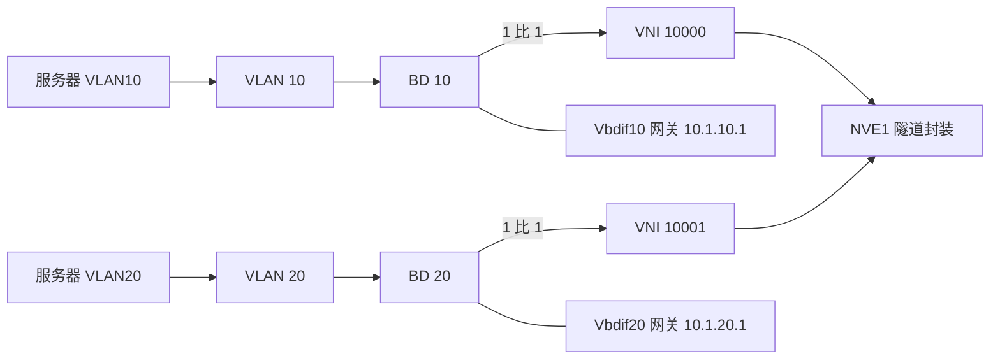

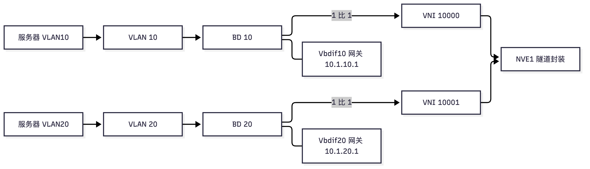


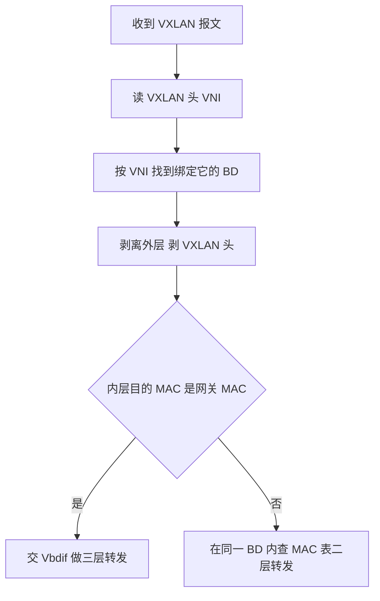

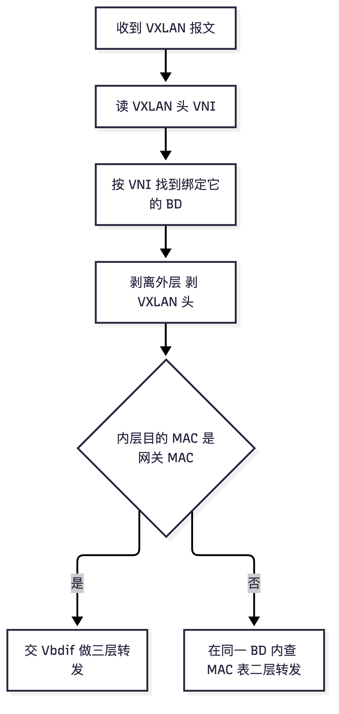


### 真题精练

**Q1.【真题·填空】** 在华为 CloudEngine 上，BD 与 VNI 的映射关系是 ____，负责为 BD 提供三层网关功能的逻辑接口叫 ____，其接口编号必须与 ____ 一致。

> **答案：1 比 1（一对一）；VBDIF（Virtual Bridge Domain Interface）；所服务的 BD 编号**
> **解析**：一个 BD 只能绑定一个 VNI，一个 VNI 也只能属于一个 BD（`bridge-domain 10` 下 `vxlan vni 10000`）。VBDIF 的编号规则是 `interface Vbdif<BD号>`，例如 BD 10 对应 `interface Vbdif10`；配置 `Vbdif11` 去服务 BD 10 在语法上就不成立。VBDIF 是网关 MAC 的载体，其 MAC 在分布式网关中要求全网统一。

**Q2.【真题·多选】** 关于 VLAN、BD、VNI 三者关系，下列说法正确的有？
A. VLAN 是本设备的接入标识，跨设备不传递
B. 多个 VLAN 可以映射到同一个 BD
C. VNI 承载在 VXLAN 头中，跨 Underlay 传递，标识远端设备应把报文放入哪个二层域
D. 一个 BD 可以同时绑定多个 VNI 以便灵活扩展

> **答案：ABC**
> **解析**：D 错——**BD 与 VNI 是 1:1**，一个 BD 只能绑一个 VNI。若希望多个业务互通，做法是"多个 VLAN 映射到同一 BD、该 BD 绑一个 VNI"，而不是"一个 BD 绑多个 VNI"。B 正确：多 VLAN 到同一 BD 是常见需求，但会扩大广播域，需评估 ARP/MAC 表项规模。

**Q3.【真题·排错】** 某 Leaf 上配置了 `bridge-domain 10` / `vxlan vni 10000` / `l2 binding vlan 100`，服务器接在 VLAN 100 的 access 口上，网关 Vbdif10 已配 IP。同 Leaf 内同子网主机互通正常，但与远端 Leaf 同 VNI 的主机不通，`display vxlan tunnel` 显示隧道 up。最应优先检查什么？

> **答案要点**：
> ① 优先核对**两端 VNI 与 BD 的映射是否一致**：本端 `display vxlan vni` 应显示 BD 10 ↔ VNI 10000，对端若配成 BD 10 ↔ VNI 10001，则报文送到对端后找不到匹配 BD 而被丢弃（表现为单向或双向不通但隧道 up）。
> ② 其次检查**对端 `l2 binding vlan` 与接入 VLAN 是否正确**，以及是否两端都完成了 `vni` 与 `bd` 的双向绑定。
> ③ 检查**对端是否在本机 NVE 上使能了该 VNI**（`display vxlan vni` 中 VXLAN 状态是否 up）。
> ④ 现场排查命令：两端同时 `display vxlan vni` + `display bridge-domain 10` + `display mac-address bridge-domain 10`（远端 MAC 是否学到）。若本端学到远端 MAC 但 ping 不通，问题在对端回程映射。

### 易错点与排错

1. **BD 号与 VNI 号混为一谈**：BD 是本设备内部编号（可自由规划），VNI 是全网标识（必须两端一致）。常见错误是"两端都配 BD 10 但 VNI 不同"或"两端 VNI 相同但 BD 不同"（后者其实可以通，因为匹配依据是 VNI）。
2. **VBDIF 编号与 BD 编号不一致**：`interface Vbdif20` 配在 BD 10 上不生效，网关功能缺失。
3. **漏配 `l2 binding vlan`**：服务器流量进不了 BD，虽然 VNI 与隧道都正常，但业务不通。
4. **一端配了 VBDIF 一端没配**：同子网通信正常（纯二层），跨子网不通——用来判断网关是否成对配置。
5. **`display vxlan vni` 是排错第一命令**：它一次性给出 BD-ID、VNI、VXLAN 状态（up/down）、源地址，是核对映射关系最快的手段。

---

## 1.7 二层网关与三层网关转发流程逐步推演

### 考点定位

本考点是 DCN 排错与配置题的**推演框架**，理论卷常以**简答/图示题**出现（5~8 分）：给出一个拓扑与主机地址，要求写出"同 BD 内、跨 BD（同 Leaf）、跨 Leaf、访问外部网络"各场景的**每一跳封装变化与查表动作**。实验卷中"为什么 ping 不通"的判断，90% 依赖这条链路能否在脑中跑通。最高频失分点：不清楚 VBDIF 在何处介入、不知道跨 BD 时内层帧的目的 MAC 已被换成网关 MAC、不知道返回路径如何找到源主机。

### 原理精讲

先明确**两个角色的分界线**：**二层网关（L2 Gateway）**只做"BD 内的二层桥接"，让同一 VNI 内的主机跨设备互通，它不改变内层帧的 IP 层内容，只是把帧封装/解封装；**三层网关（L3 Gateway）**通过 VBDIF 介入，做"子网间的路由转发"，会**改写内层帧的源/目 MAC 与 TTL**。两种网关可以部署在同一台设备上（分布式网关）或集中在某一台设备上（集中式网关）。以下按三种场景逐步推演，所有场景都假设：Leaf1 下主机 A（10.1.10.10/24，网关 10.1.10.1）挂在 BD 10 / VNI 10000；同 Leaf 的 BD 20 / VNI 10001 中主机 B（10.1.20.20/24）；Leaf2 下主机 C（10.1.10.30/24，同一子网、同一 VNI 10000）。全网统一网关 MAC = `0000-5e00-0101`。

**场景一：同一 BD 内二层转发（A → C，跨 Leaf 同子网）**
1. 主机 A 发现目的 IP 10.1.10.30 与自己同网段，发出 **ARP 请求**（广播），目的 MAC 全 F。此时若 Leaf3（或 Leaf1 自己）已有 C 的 EVPN Type2 路由，**ARP 抑制**会直接代答，A 根本不会发出广播（见 1.10 节）；未抑制时则作为 BUM 泛洪。
2. Leaf1 在 BD 10 内查 MAC 表，未命中或命中"隧道下一跳"，按 BUM 或单播转发：**封装 VXLAN**，源 IP = Leaf1 VTEP 1.1.1.1，目的 IP = Leaf2 VTEP 2.2.2.2，UDP dst 4789，VNI = 10000。**内层帧完全不变**（源 MAC = A、目的 MAC = C 或全 F）。
3. Underlay 沿 ECMP 转发到 Leaf2。
4. Leaf2 收到后按 **VNI 10000 找到 BD 10**，剥离所有外层头，在 BD 10 内查 MAC 表找到 C 的接入端口，**原样转发内层帧**（若 C 是 access 口则剥掉内层 Tag）。
5. C 收到 ARP 请求/数据帧后回单播，回程同理——但此时 Leaf2 已经通过内层源 MAC/源 IP 学到 A 的位置，并作为 **Type2 路由**通告给其他 Leaf，双向通路建立。
> 关键结论：**二层转发全程不改内层以太头与 IP 头**，VTEP 只做"封装/解封装 + BD 内查表"。

**场景二：跨 BD 三层转发（A → B，同一 Leaf 不同 VNI）**
1. A 发现目的 IP 10.1.20.20 与自己不同网段，做**网关 ARP**（10.1.10.1），得到网关 MAC `0000-5e00-0101`。
2. A 发出 IP 包，内层源 MAC = A、**目的 MAC = 网关 MAC**，IP 源 = 10.1.10.10、目的 = 10.1.20.20。
3. Leaf1 接入端口按 BD 10 收到该帧，查 MAC 表发现目的 MAC 是**本机 Vbdif10 的 MAC**，于是**上交三层**：在 VPN 实例 VPNA 的路由表中查 10.1.20.0/24，出接口是 Vbdif20（同 Leaf 的另一个 BD）。
4. **三层转发改写**：目的 MAC 改为 B 的 MAC（由 BD 20 的 ARP 表得到），源 MAC 改为 Vbdif20 的 MAC（同为统一网关 MAC），**TTL 减 1**，源/目的 IP 不变。
5. 改写后的帧在 BD 20 内按二层转发到 B 的接入端口，**全程不出本机、不经过隧道**（同 Leaf 场景）。
> 关键结论：**三层转发一定发生在 VBDIF 上**，且**内层 MAC 被改写为网关 MAC→目的主机 MAC**。若这一步查到的是**远端 Leaf 的主机（跨 Leaf 跨 BD）**，则需要 **L3 VNI 封装**（对称 IRB，见 2.3 节）。

**场景三：BD 到外部网络（A → Internet / 防火墙 / 传统 VLAN 网络）**
1. A 的默认网关是 Vbdif10（如未配默认网关则目的不可达，首先检查终端配置）。
2. Leaf1 收到帧，目的 MAC 为网关 MAC → 上交三层，在 VPN 实例路由表中查到 `0.0.0.0/0` 或到外部网段的路由，出接口指向 **Border Leaf 方向的三层口**（或 Vbdif+防火墙口）。
3. 若下一跳是 **Border Leaf**（做了 EVPN 三层互联），则**用三层 VNI/VPN 实例封装为 VXLAN 隧道**发给 Border Leaf，报文中内层帧的目 MAC 已是 Border Leaf 侧网关/边界设备的 MAC；若下一跳是**本机直连的传统 VLANIF/物理口**（集中式网关的常见形态），则**直接三层转发出去，不做 VXLAN 封装**——这是"VXLAN 网络访问外部传统网络"的典型形态：边界把 overlay 报文还原成普通以太/三层报文。
4. 外部设备回程：若外部是传统网络，Border Leaf 需把回程路由指回 overlay——通过**VPN 实例内的静态路由或 BGP 引入**（如 `import-route direct` / `network` 方式）把租户网段通告出去，否则表现为"出得去、回不来"。
> 关键结论：**访问外部网络的本质是"在边界设备上完成 overlay 与传统网络的转换"**，路由双向可达与 NAT/安全策略是排错重点。

**三种场景的封装变化对照**（考试要求"写出每一跳封装变化"，这张表就是标准答案骨架）：

| 场景 | 入口查表 | 是否改内层 MAC | 是否走隧道 | 封装变化 |
|---|---|---|---|---|
| 同 BD 内跨 Leaf | BD 内 MAC 表 | 否 | 是 | 外层加 50 B，内层原样 |
| 同 Leaf 跨 BD | 先 MAC 表（命中网关）再路由表 | **是（源=网关、目=主机）** | 否 | 无 VXLAN 封装 |
| 跨 Leaf 跨 BD | MAC 表 → 路由表 → L3 VNI 表 | 是 | 是（L3 VNI） | 外层 VNI 为 L3 VNI |
| 访问外部网络 | 路由表 → 边界设备 | 是 | 视边界而定 | 边界处去封装并转普通报文 |

### 关键概念对照表

| 网关类型 | 部署位置 | 内层 MAC 是否改写 | 隧道使用 | 典型用途 |
|---|---|---|---|---|
| 二层网关 | 每台 Leaf（相同 VNI） | 否 | 是（L2 VNI） | 大二层互通 |
| 集中式三层网关 | 单台/双台 Spine 或独立设备 | 是 | 是（L2 VNI 到网关） | 中小规模、子网集中 |
| 分布式三层网关 | **每台 Leaf** | 是 | 是（跨 Leaf 用 L3 VNI） | 大规模 Fabric（主流） |

| 主机发出的帧 | 目的 MAC | 触发条件 | 网关动作 |
|---|---|---|---|
| ARP 请求（同网段） | 全 F | 目的 IP 与自己在同一网段 | 二层泛洪或 ARP 抑制代答 |
| 数据帧（同网段） | 目的主机 MAC | ARP 已解析 | 二层转发 |
| ARP 请求（跨网段） | 全 F（请求网关 MAC） | 目的 IP 不同网段 | VBDIF 代答 |
| 数据帧（跨网段） | **网关 MAC** | 跨子网通信 | VBDIF 路由并改写 MAC |

### 华为设备配置

```bash
# ===== 二层网关（只做 BD 内桥接）+ 三层网关（同设备）=====
system-view
bridge-domain 10
 vxlan vni 10000
 l2 binding vlan 10
 quit
bridge-domain 20
 vxlan vni 10001
 l2 binding vlan 20
 quit
interface Vbdif10                                    // 二层网关升级为三层网关的关键：VBDIF 上配 IP
 ip binding vpn-instance VPNA
 ip address 10.1.10.1 255.255.255.0
 mac-address 0000-5e00-0101
 arp broadcast-suppress enable                        // 使能 ARP 广播抑制，抑制同子网 ARP 泛洪
 mac-address update arp                               // 由 EVPN 学到的 MAC 生成 ARP 表项，实现远端主机 ARP 代答
 quit
interface Vbdif20
 ip binding vpn-instance VPNA
 ip address 10.1.20.1 255.255.255.0
 mac-address 0000-5e00-0101                           // 与 Vbdif10 必须同 MAC，分布式网关的前提
 quit
# ===== 与外部网络对接（Border Leaf）=====
interface GE1/0/48
 undo portswitch
 ip binding vpn-instance VPNA
 ip address 192.168.100.1 255.255.255.0               // 指向防火墙/外部网络
 quit
ip route-static vpn-instance VPNA 0.0.0.0 0.0.0.0 192.168.100.2   // 租户默认路由指向外部设备
# ===== 验证三层网关 =====
display interface Vbdif10                            // 确认接口 up、IP 与 MAC 正确
display ip routing-table vpn-instance VPNA           // 查看租户路由表，确认有到各 BD 网段的路由
display arp interface Vbdif10                        // 查看 ARP 表项是否由 EVPN 动态生成
```

### 示意图


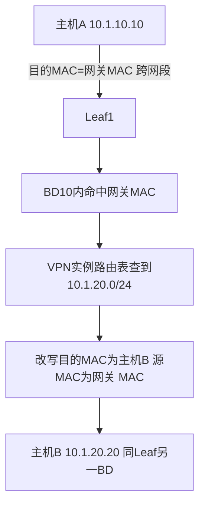

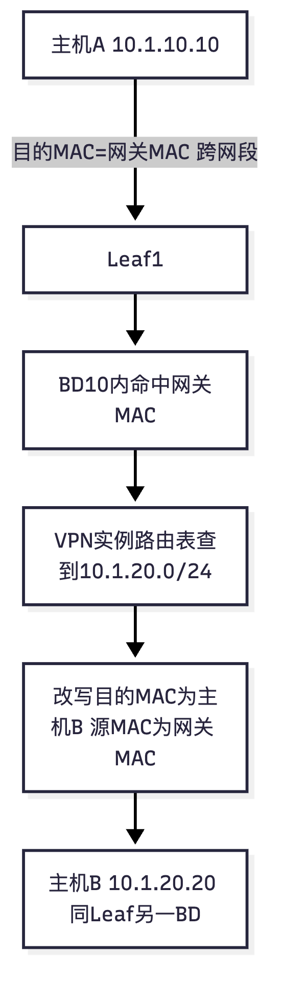


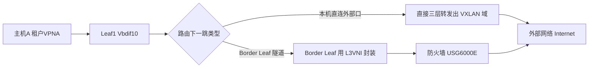

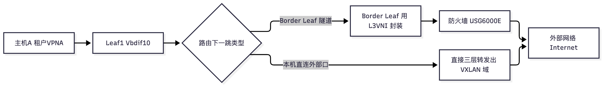


### 真题精练

**Q1.【真题·简答】** 主机 A（10.1.10.10/24）与主机 B（10.1.20.20/24）分别位于同一 Leaf 上的 BD 10（VNI 10000）和 BD 20（VNI 10001）。请逐步描述 A 访问 B 的转发过程，并指出内层帧的 MAC 发生了哪些变化。

> **答案要点**：
> ① A 判断目的 IP 与自己不同网段，先 ARP 请求**网关 10.1.10.1**，Vbdif10 用网关 MAC 应答。
> ② A 发出数据帧：内层源 MAC = A，**内层目的 MAC = 网关 MAC**（不是 B 的 MAC）。
> ③ Leaf1 在 BD 10 内查 MAC 表，发现目的 MAC 是本机 Vbdif10 → **上交三层**。
> ④ 在 VPN 实例路由表查到 10.1.20.0/24，出接口 Vbdif20（同 Leaf，**不经隧道**）。
> ⑤ **改写内层 MAC**：目的 MAC 由网关 MAC 改为 B 的 MAC，源 MAC 由 A 的 MAC 改为 Vbdif20 的 MAC（统一网关 MAC），TTL 减 1，IP 地址不变。
> ⑥ 在 BD 20 内二层转发到 B 的接入端口，B 收到。
> 加分点：若 B 在远端 Leaf，则第 ④ 步的出接口变为**三层 VNI 隧道**（对称 IRB），需用 L3 VNI 重新封装，此时内层帧的 MAC 已是"网关 MAC → B 的 MAC"。

**Q2.【真题·多选】** 关于二层网关与三层网关，下列说法正确的有？
A. 二层网关只做 BD 内二层桥接，不改变内层帧的以太头
B. 三层网关通过 VBDIF 实现，转发时会改写内层帧的源/目 MAC
C. 同一 Leaf 上的跨子网流量不经过 VXLAN 隧道
D. 三层网关必须部署在 Spine 上

> **答案：ABC**
> **解析**：D 错——三层网关既可以**集中部署**在 Spine/独立设备（集中式网关），也可以**分散部署**在每台 Leaf 的 VBDIF 上（分布式网关，当前主流）。A、B、C 是三种网关形态的共同规律：二层转发不改头、三层转发必改 MAC、同 Leaf 跨子网走本地路由不进隧道。

**Q3.【真题·排错】** 主机 A 能 ping 通同子网的远端主机 C，但 ping 不通自己网段的网关地址 10.1.10.1；`display vxlan vni` 显示 VNI 正常 up。最可能的原因是什么？

> **答案要点**：
> ① 网关地址属于 **VBDIF 接口**，若 `interface Vbdif10` 未创建、未配 IP、被 `shutdown`、或**未绑定正确的 VPN 实例**，则网关不可达，而纯二层转发（同 BD）完全不受影响——这正好解释"同子网通、网关不通"。
> ② 定位：`display interface Vbdif10`（是否 up、IP 是否为 10.1.10.1）、`display vxlan vni` 交叉核对 BD 号与 VBDIF 编号是否一致（VBDIF 编号必须等于 BD 号）、`display ip vpn-instance` 确认绑定关系。
> ③ 另一种可能：主机的掩码/网关配置错误（例如掩码写成 25 位），导致 A 认为自己与网关不同网段而无法 ARP 网关，属于终端侧问题。
> ④ 恢复动作：补齐 VBDIF 配置并 `undo shutdown`，确认 `arp broadcast-suppress` 与 `mac-address update arp` 配置不会误抑制网关自身 ARP。

### 易错点与排错

1. **误以为跨子网流量一定走隧道**：同一 Leaf 上的跨 BD 流量**完全本地转发**，这是分布式网关"横向流量不绕行"的核心优势（见 2.1 节对比表）。
2. **忘记网关 MAC 概念**：跨子网时内层目的 MAC 是**网关 MAC**，不是对端主机 MAC；抓包看到目的 MAC 为目标主机 MAC 的跨网段流量，说明中间有代理 ARP 或理解有误。
3. **VBDIF 未绑定 VPN 实例**：多租户场景下租户路由表为空，跨子网不通，`display ip routing-table vpn-instance VPNA` 可查。
4. **外部网络"出得去回不来"**：边界设备漏配回程路由或未把租户网段引入外部协议，是"访问外部网络"场景的头号故障。
5. **排错三步法**：① 判断场景（同 BD / 同 Leaf 跨 BD / 跨 Leaf / 外部）；② 对应场景查关键表（MAC 表 / VPN 路由表 / VXLAN 隧道表）；③ 抓包看内层 MAC 是否已按预期改写。

---

## 1.8 BGP EVPN 五种路由类型深度剖析

### 考点定位

**本考点是整个 DCN 方向最重要的单一考点**，理论卷几乎必考：常见形式是 6~10 分的**多选题 + 简答题**（"列出五种路由类型及作用"、"Type2 携带哪些字段"、"Type5 用于什么场景"），以及实验卷中"为什么 A 能学到 B 的 MAC 但学不到 C 的"这类现象分析。**要求默写出五种路由类型的编号、名称、关键属性与触发场景**——本节的对照表必须能背下来。

### 原理精讲

BGP EVPN 把"二层可达性"和"三层可达性"都变成了**可被 BGP 携带、过滤、策略化的路由**，这是它取代 Flood-and-Learn（泛洪学习）的根本原因：**控制平面取代数据平面学习**。五种路由类型各司其职：

**Type1：Ethernet Auto-Discovery Route（以太网自动发现路由）。** 主要用途是 **EVPN 多归接入场景下的快速收敛与 DF 选举、以及 Split-Horizon（水平分割）判断**。它携带 **ESI（Ethernet Segment Identifier，以太网段标识）**、Ethernet Tag ID 与 **LACP 相关信息**（Port Key、Port Priority、LACP 系统 MAC 等）。两台 PE 双归接入同一台 CE（同一 ES）时，Type1 让对端 PE 知道"这个 ES 有两个 PE 归属"，从而 ① 参与 **DF 选举**（决定谁向 CE 转发 BUM 流量）；② 实现 **Aliasing**（别名）：发往远端 ES 的单播流量可同时经多个 PE 转出，提升带宽利用率；③ 识别"从 ES 出去又回来"的流量做**水平分割**，防止多活环路。**触发条件：接口配置了 ESI**（`esi` 命令），未配 ESI 则不会产生 Type1。

**Type2：MAC/IP Advertisement Route（MAC/IP 通告路由）。** 这是**最高频、最重要**的类型，承载主机级可达性，分为两种通告内容：**只带 MAC（纯 MAC 通告）** 与 **同时带 MAC + IP（MAC/IP 通告，即 ARP/ND 通告）**。它携带 **RD、ESI、Ethernet Tag ID、MAC Address Length、MAC Address、IP Address Length、IP Address（IPv4/IPv6）、MPLS Label1（二层标签，即 L2 VNI）、MPLS Label2（三层标签，即 L3 VNI，可选）**。作用有四：① 远端 Leaf 据此**生成 MAC 表项**（把"远端 MAC"映射到"VXLAN 隧道 + L2 VNI"）；② 携带 IP 时生成 **ARP/ND 表项**，实现 **ARP 抑制**；③ 携带 Label2 时（对称 IRB）提供 **L3 VNI**，使三层转发可跨 Leaf；④ 主机迁移时通过 **MAC Mobility Extended Community** 与序列号解决 MAC 漂移。**触发条件：本地从接入端口学到 MAC（含动态/静态），或学到 ARP/ND 表项**。

**Type3：Inclusive Multicast Ethernet Tag Route（包含性组播以太网标签路由）。** 作用是 **VTEP 自动发现 + BUM 复制列表生成**。它携带 **RD、Ethernet Tag ID、IP Address Length、Originating Router's IP Address（本端 VTEP 地址）与 PMSI 属性**（Tunnel Type = Ingress Replication 等）。所有 Leaf 交换 Type3 后自动建立彼此的 VXLAN 隧道（`display vxlan tunnel` 中类型为 evpn），并形成 BUM 泛洪列表。**触发条件：BD/VNI 配置完成并绑定到 BGP EVPN 后自动产生**——这是"隧道为什么会自己出现"的答案。**注意**：Type3 是**按 BD（Ethernet Tag）发送**的，所以只配了 BD 没配 VNI 时不会产生。

**Type4：Ethernet Segment Route（以太网段路由）。** 专用于 **EVPN 多归（Multi-homing）场景的 DF 选举**。它携带 **RD、ESI、IP Address Length、Originating Router's IP Address**。同一 ES 上的所有 PE 互相交换 Type4，每台 PE 都能看到"该 ES 上有哪些 PE"，并按 **DF 选举算法**（缺省基于 VTEP IP 从小到大排序，最小者为 DF）选出唯一 DF，负责向 CE（多归主机/交换机）转发 BUM 流量，避免重复。**触发条件：配置了 ESI 的多归接口**。与 Type1 的分工：**Type1 用于快速收敛与 Aliasing，Type4 用于 DF 选举**（两者常同时出现，考试常在此设干扰项）。

**Type5：IP Prefix Route（IP 前缀路由）。** 作用是**通告三层 IP 前缀**，用于 ① 分布式网关下**通告网段路由（而非逐主机路由）**，替代大量 Type2 主机路由；② **数据中心与外部网络 / 跨 Fabric / DCI 的三层互联**（把外部前缀引入 EVPN，或用 EVPN 承载 Fabric 间的三层可达性）。它携带 **RD、ESI、Ethernet Tag ID、IP Prefix Length、IP Prefix、GW IP Address、MPLS Label（L3 VNI）**。相比 Type2 的"每主机一条"，Type5 是"每网段一条"，可大幅压缩表项。**触发条件：在 EVPN 实例/VPN 实例中引入 IP 前缀路由（如 `import-route direct` 或 `network` 方式发布）**。

**五种类型对照表（必须背下来）**：

| 类型 | 名称（英文） | 中文名 | 关键属性/字段 | 核心作用 | 触发场景 | 是否必配 ESI |
|---|---|---|---|---|---|---|
| Type1 | Ethernet Auto-Discovery | 以太网自动发现路由 | **ESI**、Ethernet Tag、LACP 信息 | 快速收敛、**Aliasing**、水平分割 | 多归接入（配了 ESI） | 是 |
| Type2 | MAC/IP Advertisement | MAC/IP 通告路由 | **MAC、IP、L2 Label、L3 Label、MAC Mobility** | 主机 MAC 学习、**ARP 抑制**、主机路由 | 学到 MAC 或 ARP | 否（多归时带） |
| Type3 | Inclusive Multicast Ethernet Tag | 包含性组播以太网标签路由 | **VTEP 地址、PMSI(Tunnel Type)** | **隧道自动建立、BUM 复制列表** | BD/VNI 配好即自动产生 | 否 |
| Type4 | Ethernet Segment | 以太网段路由 | **ESI**、Originating Router IP | **DF 选举** | 多归接入（配了 ESI） | 是 |
| Type5 | IP Prefix | IP 前缀路由 | **IP Prefix、GW IP、L3 Label** | **网段路由通告、外部互联** | 引入 IP 前缀（策略/引入直连） | 否 |

**Type2 路由逐字段解析**（简答题标准答案）：

| 字段 | 长度 | 含义 | 考试要点 |
|---|---|---|---|
| Route Distinguisher (RD) | 8 B | 唯一化该路由 | 用于区分同一 MAC/IP 在不同 VPN 实例中的路由，**不参与过滤** |
| ESI | 10 B | 以太网段标识 | 全 0 表示单归；非 0 表示多归，配合 Type1/Type4 |
| Ethernet Tag ID | 4 B | 二层标识 | 华为实现中通常为 0；用于标识 BD/VLAN |
| MAC Address Length | 1 B | MAC 长度 | 固定 48 bit = 6 B |
| MAC Address | 6 B | 主机 MAC | 远端据此生成 MAC 表项 |
| IP Address Length | 1 B | IP 长度 | 0（纯 MAC 通告）/ 32（IPv4）/ 128（IPv6） |
| IP Address | 0/4/16 B | 主机 IP | **有 IP 才能做 ARP 抑制与主机路由** |
| MPLS Label1 | 3 B | 二层标签 | 即 **L2 VNI**，单播转发时用作 VXLAN 头的 VNI |
| MPLS Label2 | 0/3 B | 三层标签（可选） | 即 **L3 VNI**，对称 IRB 场景必须携带 |
| MAC Mobility Ext. Community | 可选 | MAC 迁移信息 | 含标志位与序列号，用于解决 MAC 漂移 |
| Route Target (RT) | 8 B | 路由目标 | **决定导入导出，用于过滤** |

**为什么需要五种而不是一种？** 因为"主机可达性"与"网络可达性"、"单归与多归"、"二层与三层"是三类正交的需求，各有不同的收敛要求与字段需求：Type3 求快（隧道建立），Type2 求准（主机级），Type1/Type4 求稳（多活），Type5 求省（网段级）。**把路由类型与"解决什么问题"一一对应，是理解整个 EVPN 的钥匙。**

### 关键概念对照表

| 需求 | 使用路由类型 | 说明 |
|---|---|---|
| 让对端知道"我这里有台主机 X" | Type2 | 携带 MAC（可选 IP） |
| 让对端知道"我的 VTEP 在哪里" | Type3 | 隧道自动建立的基础 |
| 让对端知道"某网段从哪走" | Type5（或 Type2 主机路由） | 三层互联/网段汇总 |
| 多归场景选一台设备转发 BUM | Type4 | DF 选举 |
| 多归流量同时从多台 PE 转出 | Type1 | Aliasing |
| 防止多归环路 | Type1 | 水平分割标识 |
| 主机迁移后路由快速收敛 | Type2 + Type1 | 序列号 + ESI 快速撤销 |

| 场景组合 | 会出现的路由类型 |
|---|---|
| 单归 + 二层互通 | Type2、Type3 |
| 单归 + 分布式网关三层互通 | Type2、Type3、Type5 |
| 多归（ESI）+ 二层互通 | Type1、Type2、Type3、Type4 |
| 多归 + 分布式网关三层 | Type1、Type2、Type3、Type4、Type5 |
| Fabric 与外部网络互联 | Type5（引入外部前缀） |

### 华为设备配置

```bash
# ===== CE6865-Leaf1：让五种路由类型都能产生 =====
system-view
ip vpn-instance VPNA
 ipv4-family
  route-distinguisher 1:100                           // RD：唯一化本 VPN 实例的路由（8 字节）
  vpn-target 1:100 export-extcommunity evpn           // RT：导出时打上 1:100
  vpn-target 1:100 import-extcommunity evpn           // RT：导入匹配 1:100 的路由
  quit
 quit
bridge-domain 10
 vxlan vni 10000                                      // L2 VNI，Type2 的 Label1 来源
 l2 binding vlan 10
 quit
interface Vbdif10
 ip binding vpn-instance VPNA
 ip address 10.1.10.1 255.255.255.0
 mac-address 0000-5e00-0101
 mac-address update arp                                 // 使能后由 MAC 生成 ARP，Type2 携带 IP 并支持 ARP 抑制
 quit
# ===== 多归接口：产生 Type1 与 Type4 =====
interface Eth-Trunk10
 mode lacp-static
 esi 0000.0001.0001.0001.0001                           // 配置 ESI，同一 ES 上所有 PE 必须完全一致 → 触发 Type1/Type4
 quit
# ===== BGP EVPN 使能（五种类型由此交换）=====
bgp 100
 peer 10.1.1.254 as-number 100
 peer 10.1.1.254 connect-interface LoopBack0
 l2vpn-family evpn
  peer 10.1.1.254 enable
  peer 10.1.1.254 reflect-client                         // Spine 作 RR 时在 Spine 上配置
  quit
 quit
# ===== 分别查看五种类型路由（排错核心命令）=====
display bgp evpn all routing-table                       // 总览：各类型路由数量
display bgp evpn all routing-table auto-discovery-route  // Type1
display bgp evpn all routing-table mac-route             // Type2
display bgp evpn all routing-table inclusive-multicast-route  // Type3
display bgp evpn all routing-table ethernet-segment-route     // Type4
display bgp evpn all routing-table ip-prefix-route       // Type5
```

### 示意图

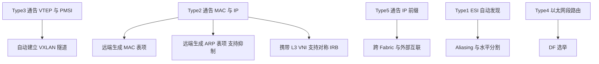

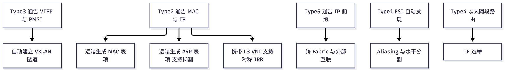


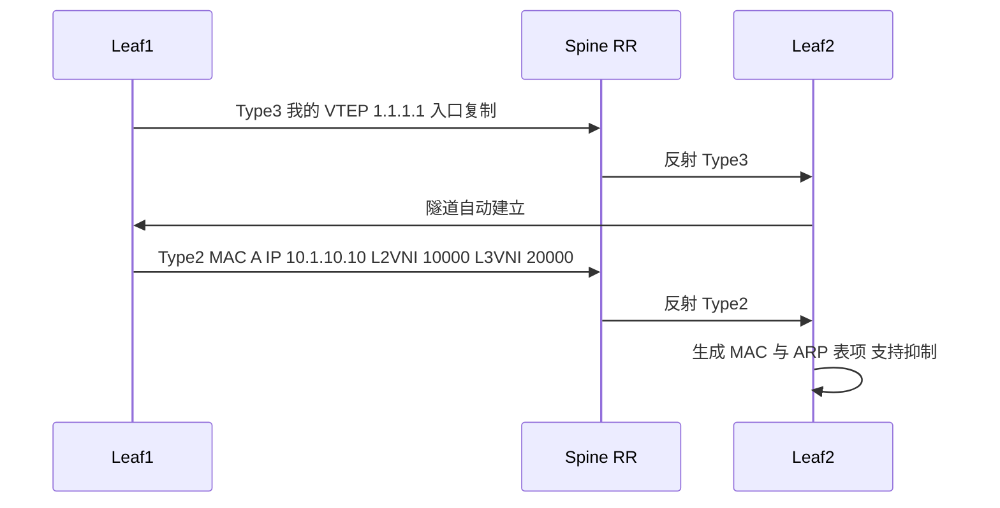

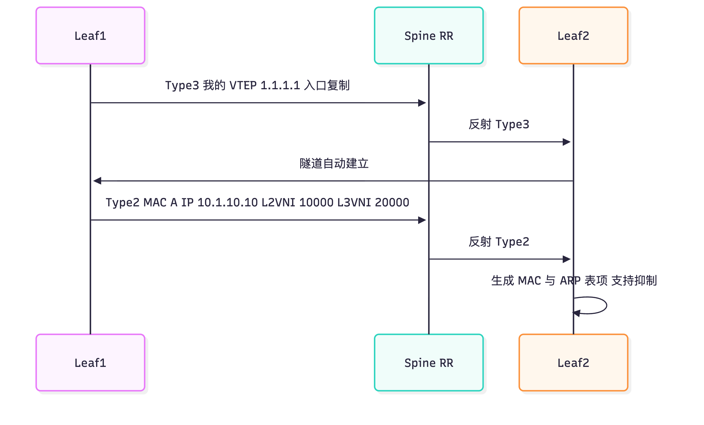


### 真题精练

**Q1.【真题·多选】** 关于 BGP EVPN 的五种路由类型，下列说法正确的有？
A. Type1 携带 ESI，用于多归场景的快速收敛与 Aliasing
B. Type3 携带 PMSI 属性，用于 VTEP 自动发现与 BUM 复制列表生成
C. Type4 用于 DF 选举
D. Type5 只能在多归场景下产生

> **答案：ABC**
> **解析**：D 错——Type5（IP Prefix Route）与多归无关，它用于**通告三层 IP 前缀**，典型场景是分布式网关下用网段路由替代大量主机路由，以及**跨 Fabric / DCI 的三层互联**。产生条件是"引入 IP 前缀路由"，不需要 ESI。A、B、C 是三种容易混淆的类型的正确定位：Type1 管收敛与别名，Type3 管隧道与泛洪，Type4 管 DF 选举。

**Q2.【真题·简答】** 请说明 Type2 路由在"ARP 抑制"中起什么作用，并指出 Type2 路由中哪两个字段决定了三层转发的跨 Leaf 能力。

> **答案要点**：
> ① 作用：Type2 除 MAC 外还可携带**主机的 IP 地址**（IP Address Length 非 0）。远端 Leaf 收到后，同时生成 **MAC 表项与 ARP/ND 表项**——因此当本 Leaf 下的主机对同子网远端主机发起 ARP 请求时，本机可**直接以自己的网关/代理身份代答**，不必把 ARP 广播泛洪到全网。这就是 ARP 抑制（本地 ARP 表 + Type2 携带 IP → 抑制 ARP 请求）。
> ② 决定三层跨 Leaf 能力的两个字段：**MPLS Label2（三层标签 = L3 VNI）** 与 **IP Address（主机 IP）**。有了 L3 VNI 才能用对称 IRB 封装三层流量；有了 IP 才能生成主机路由/ARP 表项并被路由表引用。若 Type2 未携带 Label2，则只能做二层转发（非对称 IRB 会退化为依赖二层泛洪的三层转发）。
> ③ 加分点：Type2 的 **MAC Mobility Extended Community** 用于主机迁移时的序列号比较，防止"旧位置"的路由长期残留。

**Q3.【真题·单选】** 某 Leaf 上 `display vxlan tunnel` 为空，但 `display bgp evpn peer` 显示邻居 Established。最可能缺少的是哪类路由？
A. Type1
B. Type2
C. Type3
D. Type5

> **答案：C**
> **解析**：VXLAN 隧道的**自动建立**依赖 Type3（含本端 VTEP 地址与 PMSI）。若邻居正常但没有 Type3，说明本端 BD/VNI 未正确绑定到 EVPN（例如漏配 `vxlan vni`、未在 BGP EVPN 地址族中使能对应 VPN 实例/BD），隧道就不会生成。Type2 影响的是"隧道建立后能否学到远端 MAC"，问题现象会是"隧道 up 但业务不通"，而不是"没有隧道"。Type1/Type4 仅多归场景出现。

**Q4.【真题·填空】** EVPN 中用于 DF 选举的路由类型是 Type ____，用于通告 IP 前缀的是 Type ____，携带 L2 VNI 与 L3 VNI 两种标签信息的是 Type ____。

> **答案：4；5；2**
> **解析**：Type4（Ethernet Segment Route）让同一 ES 上的所有 PE 互相可见，以此为输入执行 DF 选举；Type5（IP Prefix Route）通告网段前缀，是跨 Fabric/外部互联的主力；Type2 的 MPLS Label1 = L2 VNI（二层转发用），MPLS Label2 = L3 VNI（三层转发用），这也是"对称 IRB"能成立的原因。

### 易错点与排错

1. **把 Type1 与 Type4 的作用互换**：Type1 管收敛/Aliasing/水平分割，Type4 管 DF 选举。记忆法："**1 快 4 选**"。
2. **以为 Type3 可省略**：Type3 是隧道的唯一来源，缺它则 `display vxlan tunnel` 为空。
3. **混淆 Type2 与 Type5 的粒度**：Type2 是**主机级（/32 或 /128）**，Type5 是**网段级**。分布式网关场景中两者常同时存在，此时路由表出现"明细主机路由 + 网段路由"，是正常现象。
4. **不确定某路由属于哪种类型**：用 `display bgp evpn all routing-table` 看前缀格式——`[2][...]` 开头是 Type2，`[3][...]` 是 Type3，依此类推；华为输出中路由以 `[类型][RD][...]` 标识。
5. **多归场景只配了 ESI 没有配对端 M-LAG/EVPN 邻居**：Type1/Type4 无法交换，DF 选举失败，出现双份 BUM 转发。定位：`display bgp evpn all routing-table ethernet-segment-route` 是否为空。
6. **排错命令清单**：`display bgp evpn all routing-table`、`display bgp evpn all routing-table mac-route`、`display bgp evpn all routing-table inclusive-multicast-route`、`display vxlan tunnel`、`display vxlan vni`。

---

## 1.9 RD 与 RT 深入

### 考点定位

RD（Route Distinguisher，路由区分符）与 RT（Route Target，路由目标）是 EVPN/VPN 体系的**逻辑基石**，理论卷必考一题（4~6 分），最经典的问法是"**RD 与 RT 的本质区别是什么 / 为什么 RD 不能用于路由过滤而 RT 可以**"，以及"**RD 的三种类型格式与 RT 的两种格式**"。上机题中"两个租户互相串网"或"租户之间不通"几乎都与 RT 的 import/export 有关。

### 原理精讲

**先讲 RD：为什么需要它？** BGP 在传递 VPN 路由时，会在 IPv4/IPv6 前缀前加一个 **VPN-IPv4/VPN-IPv6 地址族**（长度 12 字节：8 字节 RD + 4 字节 IPv4 前缀）。原因是**同一前缀可能属于不同租户**：租户 A 与租户 B 都用 10.1.10.0/24，若 BGP 直接传 10.1.10.0/24，两条路由完全一样，BGP 无法区分也无法同时携带（BGP 同前缀只保留一条最优）。加上 RD 后成为 `RD-A:10.1.10.0/24` 与 `RD-B:10.1.10.0/24`，两条路由在 BGP 表中**成为两条不同的路由**可以共存，从而各自被正确导入各自的 VPN 实例。所以 **RD 的唯一使命是"唯一化"（make the route unique）**，它解决的是"路由在 BGP 表中互相覆盖"的问题，与"这条路由该给谁"无关。

**RD 的三种格式**（共 8 字节，由 2 字节 Type + 6 字节 Value 组成）：

| Type | 名称 | 结构 | 配置示例 | 长度拆分（2B Type + 6B Value） |
|---|---|---|---|---|
| 0 | 2 字节 AS 号 : 4 字节编号 | ASN(2B):NN(4B) | `route-distinguisher 100:1` | Type=0，AS 100（2B）+ 编号 1（4B） |
| 1 | 4 字节 IP 地址 : 2 字节编号 | IP(4B):NN(2B) | `route-distinguisher 1.1.1.1:100` | Type=1，IP 1.1.1.1（4B）+ 编号 100（2B） |
| 2 | 4 字节 AS 号 : 2 字节编号 | ASN(4B):NN(2B) | `route-distinguisher 65536:100` | Type=2，用于 4 字节 AS 号（asdot 表示） |

**注意**：早期资料常说"RD 是 Type 0/1/2 三种"，其中 **Type 0 为 AS 号占 2 字节、Type 2 为 AS 号占 4 字节**，两者都是 `AS:NN` 形式但 AS 位宽不同——考试中若问"`route-distinguisher 100:1` 属于哪种类型"，标准答案是 **Type 0**（AS 号 100 可用 2 字节表示）；若 AS 号大于 65535 则必须用 Type 2。

**再讲 RT：为什么需要它？** RT 是 **BGP 扩展团体属性（Extended Community，8 字节）**，它回答"**这条路由应该被导入到哪些 VPN 实例中**"。工作机制是"**导出打标、导入匹配**"：PE 上每个 VPN 实例/VBDIF 绑定一对 import RT 与 export RT；发路由时把该实例的 **export RT** 作为扩展团体附加到路由上；收路由时，把路由携带的 RT 与本地各实例的 **import RT** 逐一比较——**匹配上就导入该实例，匹配不上就丢弃**。因此 RT 天然是一个**过滤/分发机制**。

**RT 的两种格式**（与 RD 类似但语义不同）：

| 格式 | 结构 | 配置示例 | 说明 |
|---|---|---|---|
| AS:NN | 2 字节或 4 字节 AS : 2 字节编号 | `vpn-target 100:1 export-extcommunity` | 最常用；AS 位宽由实现决定（2B/4B） |
| IP:NN | 4 字节 IP : 2 字节编号 | `vpn-target 1.1.1.1:100 import-extcommunity` | 常用于跨 AS 场景，用对端 PE 的 LoopBack 作前缀 |

**为什么 RD 不能用于路由过滤而 RT 可以？** 这是本考点的**核心命题**，要从三个层面回答：

1. **语义层面**：RD 的语义是"这条路由属于哪个 VPN-IPv4 实例的**命名空间**"，它是路由前缀的一部分，目的是让相同前缀不冲突；RT 的语义是"这条路由**要被哪些实例接收**"，是分发策略。前者是"身份标识"，后者是"投递地址"——**用身份标识做过滤，就等于要求"每个实例独占一个 RD 且只收自己 RD 的路由"，这会让跨实例互访（如共享服务、Hub-Spoke 型 VPN）无法实现**。
2. **实现层面**：BGP 的导入决策发生在"收到 VPN-IPv4 路由后，按 RT 扩展团体匹配本地 import target"这一步（RFC 4364 规定的 VRF import 过程）。**RD 在路由被导入实例后就不再起作用**，也不参与任何匹配表；设备上没有"import RD"这样的配置项（华为 VRP 的 `route-distinguisher` 是单值，没有 import/export 之分），因此**在语法上 RD 就无法用于过滤**。
3. **多值与策略层面**：RT 支持**多个**（一个实例可配多条 `vpn-target ... import-extcommunity`，也可配多条 export），从而实现灵活的多对多分发；RD 只能有一个。这也解释了为什么"跨租户共享服务"必须靠 RT。

**RT 的三种典型匹配场景（考试常考）**：
- **一对一**：租户 A 的 export RT = 租户 A 的 import RT = 1:100，其他租户不配 1:100，则完全隔离。
- **多 RT（Hub-Spoke / 共享服务）**：Hub 实例 export RT 为 `1:100`（给所有 Spoke）与 `1:200`（给共享服务）；Spoke 的 import RT 含 `1:100`；共享服务 VRF 的 import RT 含 `1:100`、export RT 为 `1:200`。于是 Spoke 之间不能直接互访（各自 import RT 不含对方的 export RT），但都能访问 Hub 与共享服务。
- **多 RT 同时导入导出**：`vpn-target 1:100 2:100 import-extcommunity` 与 `vpn-target 1:100 export-extcommunity`，实现"收两个域的路由、只发一个域"。

**最后必须强调的一条实务规则**：**RD 建议全网唯一且与 RT 解耦设计**。常见错误是"RD 与 RT 用同一个值"（如都用 1:100），在小规模实验中能通，但一旦出现"同一租户跨多个 PE 部署"或"需要多 RT 分发"，就会因为 RD 重复导致路由在 BGP 表中互相覆盖（同一台设备上不同 Leaf 的同一 MAC 路由 RD 相同则冲突），典型现象是**主机的 MAC/ARP 表项时有时无、或只学到一台 Leaf 上的主机**。规范做法：**RD 按"设备/实例"维度唯一（常写成 `AS:实例号` 或 `LoopBack:实例号`），RT 按"租户/业务"维度统一**。

### 关键概念对照表

| 维度 | RD（Route Distinguisher） | RT（Route Target） |
|---|---|---|
| 属性类型 | 路由前缀的一部分（VPN-IPv4 地址族） | BGP 扩展团体属性（Extended Community） |
| 长度 | 8 字节 | 8 字节 |
| 格式 | Type0 `AS(2B):NN(4B)`、Type1 `IP(4B):NN(2B)`、Type2 `AS(4B):NN(2B)` | `AS:NN`、`IP:NN` |
| 数量 | **每个实例只能配 1 个** | **可配多个（import/export 各自可多条）** |
| 作用 | **唯一化路由**，使相同前缀在 BGP 表中共存 | **控制路由导入导出**，实现 VPN 实例间的分发与过滤 |
| 是否参与过滤 | **否**（导入后即失去作用） | **是**（按 import target 匹配） |
| 配置命令 | `route-distinguisher 1:100` | `vpn-target 1:100 import-extcommunity evpn` |
| 设计维度 | 按设备/实例唯一 | 按租户/业务统一 |
| 典型错误 | 多台 Leaf 用同一 RD → 表项冲突/时有时无 | RT 漏配或配错 → 租户不通或串网 |

| 需求 | RD 设计 | RT 设计 |
|---|---|---|
| 租户完全隔离 | 每实例唯一 RD | 各自独立 RT，互不导入 |
| 租户内多子网互通 | 可共用同一 RD（同一实例） | 同实例共用 RT |
| 跨租户共享服务 | 各自唯一 RD | 共享服务 import 各租户 RT |
| Hub-Spoke | 各自唯一 RD | Hub 双 RT，Spoke 只 import Hub 的 RT |

### 华为设备配置

```bash
# ===== CE6865-Leaf1：RD 唯一、RT 按租户统一的规范写法 =====
system-view
ip vpn-instance VPNA
 ipv4-family
  route-distinguisher 1.1.1.1:100                      // RD：用本机 LoopBack + 实例号，保证全网唯一（Type1 格式）
  vpn-target 100:1 export-extcommunity evpn            // 导出：本实例路由打上 RT 100:1
  vpn-target 100:1 import-extcommunity evpn            // 导入：接收携带 RT 100:1 的路由
  quit
 quit
ip vpn-instance VPNSHARE
 ipv4-family
  route-distinguisher 1.1.1.1:200                      // 不同实例必须用不同 RD
  vpn-target 100:1 import-extcommunity evpn            // 共享服务导入租户 A 的路由
  vpn-target 200:1 export-extcommunity evpn            // 共享服务以 200:1 对外发布自身网段
  quit
 quit
# ===== 多 RT 场景：一个实例导入多个域的路由 =====
ip vpn-instance VPNHUB
 ipv4-family
  route-distinguisher 1.1.1.1:300
  vpn-target 100:1 import-extcommunity evpn            // 收 Spoke1 的路由
  vpn-target 101:1 import-extcommunity evpn            // 收 Spoke2 的路由（多条 import RT 用空格分隔）
  vpn-target 300:1 export-extcommunity evpn            // 只以 300:1 发布给 Spoke
  quit
 quit
# ===== 验证 RD/RT 与导入结果 =====
display ip vpn-instance verbose                        // 查看实例的 RD 与 RT 配置
display bgp evpn all routing-table                     // 查看路由携带的 RT 扩展团体
display bgp evpn all routing-table mac-route 0:0 1.1.1.1:100  // 定位某一 RD 下的 Type2 路由是否收到
display ip routing-table vpn-instance VPNA             // 确认路由是否已导入实例路由表
```

### 示意图

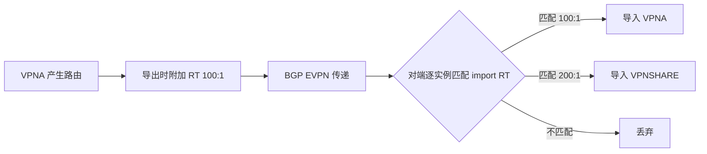

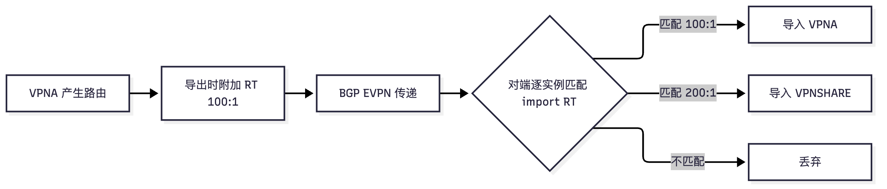


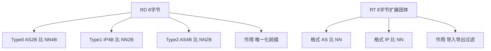

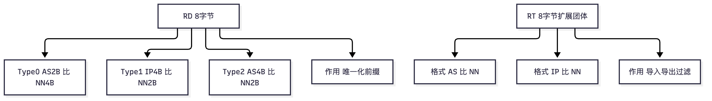


### 真题精练

**Q1.【真题·简答】** 请解释 RD 与 RT 的区别，并说明为什么"可以用 RT 做路由过滤，而不能用 RD 做路由过滤"。

> **答案要点**：
> ① 定义：RD 是 VPN-IPv4 地址族中前缀前的 8 字节标识，作用是**唯一化相同前缀**，使不同租户的相同网段能在 BGP 表中并存；RT 是 8 字节 BGP 扩展团体属性，作用是在 PE 之间**控制路由的导入与导出（分发与过滤）**。
> ② 为什么 RD 不能过滤：RD 是**前缀的一部分（身份标识）**，路由一旦被导入 VPN 实例，RD 即完成使命，不再参与任何匹配；设备上也没有 `import route-distinguisher` 这类配置（VRP 中 RD 只有单值）。若真用 RD 过滤，等价于要求"每个实例只收与自己 RD 相同的路由"，跨实例互访与共享服务将无法实现。
> ③ 为什么 RT 可以过滤：VRF/VPN 实例的导入过程就是"**收到路由 → 比较其携带的 RT 与本地 import RT → 匹配则导入，否则丢弃**"（RFC 4364 定义）。RT 支持配置多条，可实现多对多的灵活分发（如 Hub-Spoke、共享服务）。
> ④ 加分：RD 按设备/实例唯一、RT 按租户统一，是规范设计原则；两者取同一值在实验网可行但在多 PE 场景会导致路由冲突。

**Q2.【真题·多选】** 关于 RD 的格式，下列说法正确的有？
A. RD 共 8 字节，由 2 字节 Type 与 6 字节 Value 组成
B. Type 0 格式为 2 字节 AS 号 : 4 字节编号
C. Type 1 格式为 4 字节 IP 地址 : 2 字节编号
D. RD 可以用作 BGP 扩展团体属性参与导入匹配

> **答案：ABC**
> **解析**：D 错——RD 属于 VPN-IPv4 地址族前缀的一部分，**不是扩展团体属性**；扩展团体是 RT，长度同为 8 字节但用途完全不同。A/B/C 是必背的结构：Type0 `100:1`（2B AS + 4B NN）、Type1 `1.1.1.1:100`（4B IP + 2B NN）、Type2 用于 4 字节 AS 号。

**Q3.【真题·实验】** 某 Fabric 有 Leaf1~Leaf4，全部配置 `route-distinguisher 1:100`。现象：租户 A 的主机 MAC 表项在不同 Leaf 上"时有时无"，且部分主机完全学不到。请分析原因并给出整改方案。

> **答案要点**：
> ① 原因：**RD 未唯一化**。EVPN 的 Type2 路由以 `[Type][RD][ESI][Ethernet Tag][MAC Length][MAC]` 作为区分标识，若多台 Leaf 对同一 MAC 使用相同 RD，BGP 会认为是**同一条路由的不同来源**，写入时相互覆盖（后到者覆盖先到者），同时 Type2 的 **MAC Mobility** 机制会因序列号混乱而误判主机迁移。表现为 MAC/ARP 表项抖动、部分主机学不到。
> ② 整改：把 RD 改为"按设备唯一"，例如 Leaf1 用 `route-distinguisher 1.1.1.1:100`（Type1 格式，含本机 LoopBack），Leaf2 用 `2.2.2.2:100`，依此类推；**RT 保持按租户统一**（如都用 `100:1`）以保证互通。
> ③ 验证：`display bgp evpn all routing-table mac-route` 检查同一 MAC 是否有多个不同 RD 的来源；`display mac-address bridge-domain 10` 观察表项是否稳定；整改后表项应稳定且各 Leaf 上均能看到全部远端主机。
> ④ 加分：同时检查是否存在真实的主机迁移（VM 热迁移），若是，则应保留 MAC Mobility 机制并确认序列号递增，而不是把它当作故障。

### 易错点与排错

1. **"RD 用于过滤"是最大的概念错误**：RD 唯一化、RT 过滤，务必分清楚。答题时先写定义再写原因。
2. **RD 全网相同**：实验网里常见，会导致多 Leaf 场景路由冲突、MAC 表项抖动。规范是"RD 唯一、RT 统一"。
3. **RT 只配 export 不配 import（或反之）**：表现为"我能发出去但对端收不到"或"我收得到但对端收不到我的"，双向排查时必须两端都看 `display ip vpn-instance verbose`。
4. **多 RT 场景忘记 `evpn` 关键字**：华为 VRP 中 `vpn-target 100:1 import-extcommunity evpn` 需带 `evpn` 表示作用于 EVPN 地址族，漏掉会导致 EVPN 路由不导入。
5. **误认为 RD 可以用 IP:NN 形式即可跨 AS**：Type1（IP:NN）确实常用于跨 AS，但**决定跨 AS 互通的是 RT 的匹配关系与 VPN 实例规划**，不是 RD 形式。
6. **排错命令**：`display ip vpn-instance verbose`、`display bgp evpn all routing-table`（看 RT 团体）、`display bgp evpn all routing-table mac-route`、`display bgp evpn peer`。

---

## 1.10 EVPN 路由通告与收敛、ARP 抑制与 MAC 迁移

### 考点定位

本考点是**综合题的高频命题区**（5~8 分），最常问"ARP 抑制的原理与边界条件——什么情况下仍会泛洪"，其次问"MAC 迁移如何处理"、"EVPN 的收敛过程"。上机题则用"ARP 抑制看似生效但网络仍有大量广播"来考察你是否理解边界条件。**"抑制的边界条件"是本节必须讲透的加分项**，多数选手只能答出"抑制就是网关代答"，失分严重。

### 原理精讲

**第一条主线：EVPN 的控制平面学习与收敛过程（五步）**：
1. **本地学习**：Leaf 从接入端口收到主机的 Ethernet 帧，学到**源 MAC**，写入 BD 内的 MAC 表；同时（若主机发过 ARP/ND）学到 IP，写入 ARP/ND 表。若在 VBDIF 上配置了 `mac-address update arp`，则**由 MAC 表项反向生成 ARP 表项**，两个表项联动。
2. **生成 Type2 路由**：Leaf 把"MAC + IP + L2 VNI(L1 Label) + L3 VNI(L2 Label)"封装成 Type2 路由，附加 RD/RT 与 **MAC Mobility 扩展团体**，通过 BGP EVPN 地址族发出（经 RR 反射给其他 Leaf）。
3. **对端写入**：远端 Leaf 收到 Type2 后，按 RT 匹配导入对应实例，**生成两条表项**：MAC 表项（远端 MAC → VXLAN 隧道 + L2 VNI）与 ARP 表项（远端 IP → 远端 MAC/隧道）。**此即"二三层信息一次同步"**。
4. **隧道与泛洪列表建立**：同时交换 Type3，`display vxlan tunnel` 出现 `evpn` 类型的隧道。
5. **收敛与撤销**：主机下线或迁移时，Leaf 撤销 Type2；对端**删除对应表项**。为加速收敛，EVPN 支持 **Type1 快速撤销**（多归场景）、**MAC Mobility 序列号**（迁移场景）与 **BGP Add-Path/最新路由优选**机制。

**第二条主线：ARP 抑制（ARP Suppression）的原理与边界条件**。
原理：**ARP 请求之所以要泛洪，是因为"不知道对端在哪里"。EVPN 已经通过 Type2 把"对端 IP ↔ MAC ↔ VTEP"三者的关系提前分发到了每台 Leaf**，那么"不知道"的前提就不成立了——本 Leaf 可以**直接用自己的网关 MAC 或对端 MAC 代答 ARP**，无需泛洪。具体实现：① 本 Leaf 在 VBDIF 上使能 `arp broadcast-suppress enable`（ARP 广播抑制）；② 当主机对**同子网**地址发起 ARP 请求时，设备先在本地 ARP 表（含由 Type2 学来的表项）中查该 IP：**命中则直接代答**（回应的源 MAC 一般为本 Leaf 的 VBDIF MAC，实现"网关代理应答"），**未命中才按 BUM 泛洪**。

**边界条件（必须讲清：下列情况下仍会泛洪）**：
1. **首次通信、对端尚未通告 Type2**。远端主机从未发过流量（静默主机/单向业务），其 MAC/IP 从未被任何 Leaf 学到，自然不会产生 Type2——此时本端 ARP 表无该项，**只能泛洪**。这是最常见的情况，尤其是刚开机、刚迁移、刚上线的服务器。
2. **ARP 请求的是不同子网地址**。跨子网 ARP 请求的目标是**网关地址**（由 VBDIF 直接应答，不涉及抑制逻辑）；而如果主机做出了"跨网段 ARP"（配置错误或代理 ARP 场景），仍按未命中处理。
3. **目的 IP 属于本 Leaf 未导入的实例/网段**。RT 不匹配时该表项不会存在，必然泛洪。
4. **远端主机所在 Leaf 未使能 `mac-address update arp`**：Type2 只带 MAC 不带 IP（IP Address Length = 0），对端只能学到 MAC、学不到 IP，**ARP 表项无法生成 → 抑制失效**。这是"抑制配了却不生效"的头号配置原因。
5. **免费 ARP（Gratuitous ARP）与 ARP 探测**：主机上线或迁移后主动发出的免费 ARP 用于宣告/检测 IP 冲突，其目的 MAC 为广播，**语义上必须泛洪**（或按设备实现部分抑制），不能一概抑制。
6. **未知单播与组播流量**：ARP 抑制只解决 ARP 广播，**未知单播（Unknown Unicast）与组播（如 VRRP 报文、IGMP、DHCP）仍需 BUM 泛洪**，因此"配了 ARP 抑制就完全没有泛洪"是错误认识。
7. **多归场景的 BUM**：即使 ARP 被抑制，其他 BUM 流量仍需经 DF 选举后由唯一 DF 转发（见 2.6 节）。
8. **ARP 抑制与网关 MAC 的关系**：分布式网关中所有 Leaf 使用**同一个网关 MAC**（见 2.5 节），代答时回应的 MAC 全网一致，主机无需感知自己在与哪台 Leaf 通信，这使得 **VM 迁移后主机无需重新 ARP**——这是"统一网关 MAC"的核心价值。

**第三条主线：MAC 迁移（MAC Mobility）与抑制**。虚拟机热迁移（vMotion/Live Migration）会把同一 MAC 从一台 Leaf 移动到另一台 Leaf。若不做处理，两台 Leaf 都会通告同一 MAC 的 Type2 路由，远端 Leaf 的 MAC 表会在两个 VTEP 之间**震荡**。EVPN 的解决机制是 **MAC Mobility Extended Community**：其中含 **M（标志位，表示该 MAC 已迁移过）**与 **序列号（Sequence Number）**。规则是：① 首次通告序列号为 0；② 当 MAC 在另一台 PE 上出现时，新 PE 通告的序列号**加 1**；③ 收到更高序列号的 PE **认为 MAC 已迁移**，刷新表项指向新 VTEP，并在**本地老化旧表项**；④ 若序列号相同而来源不同，则按"先到先得 + 保留原有"处理（避免震荡）。同时设备还提供**MAC 迁移抑制（MAC Mobility Damping）**：当短时间内同一 MAC 迁移次数超过阈值，则抑制其通告一段时间，防止迁移风暴（如误配双活导致的 MAC 来回漂移）压垮控制平面。**必须掌握的判断**：真实业务连续性依赖迁移完成后的 **Type2 重新通告 + 免费 ARP**，通常 1~3 秒内恢复。

### 关键概念对照表

| 流量类型 | ARP 抑制是否适用 | 原因 | 优化手段 |
|---|---|---|---|
| 同子网 ARP 请求（对端已知） | **适用（代答）** | 本地 ARP 表已有表项 | `arp broadcast-suppress enable` |
| 同子网 ARP 请求（对端未知） | 不适用（泛洪） | 无表项可代答 | 让对端先产生流量；或分布式网关逐主机学习后自然收敛 |
| 跨子网 ARP（请求网关） | 不适用（网关直接应答） | 网关就是本机 VBDIF | 无需优化 |
| 免费 ARP / ARP 探测 | 一般不抑制 | 语义上需宣告与冲突检测 | 控制迁移频率 |
| 未知单播 | 不适用（泛洪） | 无 MAC 表项 | 依赖 EVPN 主机路由 + 快速学习 |
| 组播（IGMP/VRRP） | 不适用 | 需按组播机制处理 | Underlay 组播或入口复制 |
| DHCP 广播 | 不适用 | 需到 DHCP 服务器 | DHCP Relay 单播转发 |

| MAC 迁移要素 | 说明 |
|---|---|
| 触发原因 | 虚拟机热迁移、M-LAG 主备切换、误配双活 |
| 识别机制 | Type2 的 MAC Mobility 扩展团体（标志位 + 序列号） |
| 通告规则 | 新位置序列号递增，序列号大者优 |
| 收敛时间 | 通常 1~3 秒（取决于 BGP 收敛与免费 ARP） |
| 防护机制 | MAC 迁移抑制（Damping），超阈值暂停通告 |
| 常见故障 | 序列号不递增导致表项不刷新；迁移抑制过严导致长时间不通 |

### 华为设备配置

```bash
# ===== CE6865-Leaf1：ARP 抑制与 MAC 联动 =====
system-view
interface Vbdif10
 ip binding vpn-instance VPNA
 ip address 10.1.10.1 255.255.255.0
 mac-address 0000-5e00-0101                       // 统一网关 MAC，分布式网关必需
 arp broadcast-suppress enable                     // 使能 ARP 广播抑制：命中本地 ARP 表则代答，不泛洪
 mac-address update arp                            // 由 MAC 表项生成 ARP 表项（抑制生效的前提之一）
 arp direct-route enable                           // 由 ARP 生成 32 位主机路由，供三层转发精确匹配
 quit
# ===== MAC 漂移检测与日志（便于发现异常迁移）=====
system-view
mac-address flapping detection                     // 使能 MAC 漂移检测（各版本关键字略有差异，配置前用 ? 补全确认）
# ===== 验证 ARP 抑制是否生效 =====
display arp interface Vbdif10                      // 查看 ARP 表项：远端主机应显示动态表项且带隧道信息
display mac-address bridge-domain 10               // 查看远端 MAC 是否学到（冲突时会有 flapping 记录）
display arp statistics interface Vbdif10           // 统计 ARP 请求/应答数，抑制生效后请求数增长明显放缓
display vxlan vni 10000 verbose                    // 确认 VNI 与隧道状态
```

### 示意图

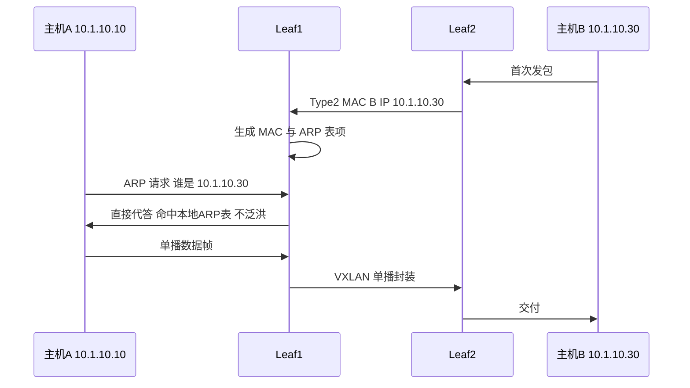

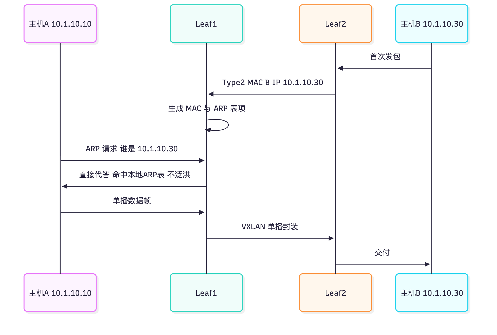


```mermaid
flowchart TD
    A["主机发 ARP 请求"] --> B{"目的IP是否同子网"}
    B -->|否| C["请求网关 VBDIF 直接应答"]
    B -->|是| D{"本地 ARP 表是否命中"}
    D -->|是| E["代答 抑制成功 不泛洪"]
    D -->|否| F["作为 BUM 泛洪到所有 VTEP"]
    F --> G["收到应答后学到表项 后续可抑制"]
```

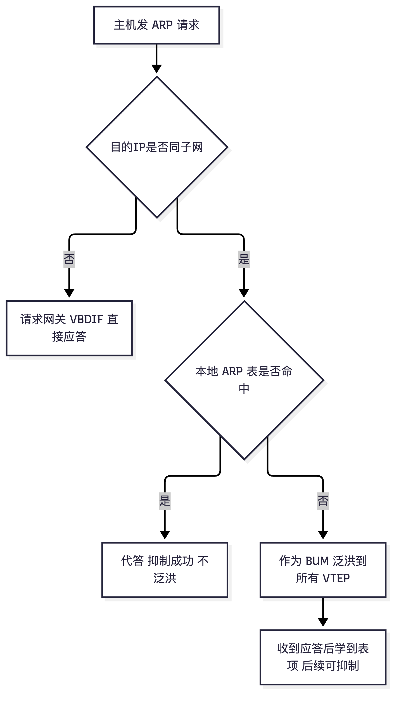


```mermaid
stateDiagram-v2
    [*] --> 正常: MAC 在 Leaf1
    正常 --> 迁移中: VM 迁移到 Leaf2
    迁移中 --> 已迁移: Leaf2 通告序列号加1
    已迁移 --> 正常: Leaf1 老化旧表项 远端刷新
    迁移中 --> 抑制: 迁移次数超阈值
    抑制 --> 正常: 抑制时间到期后重新通告
```

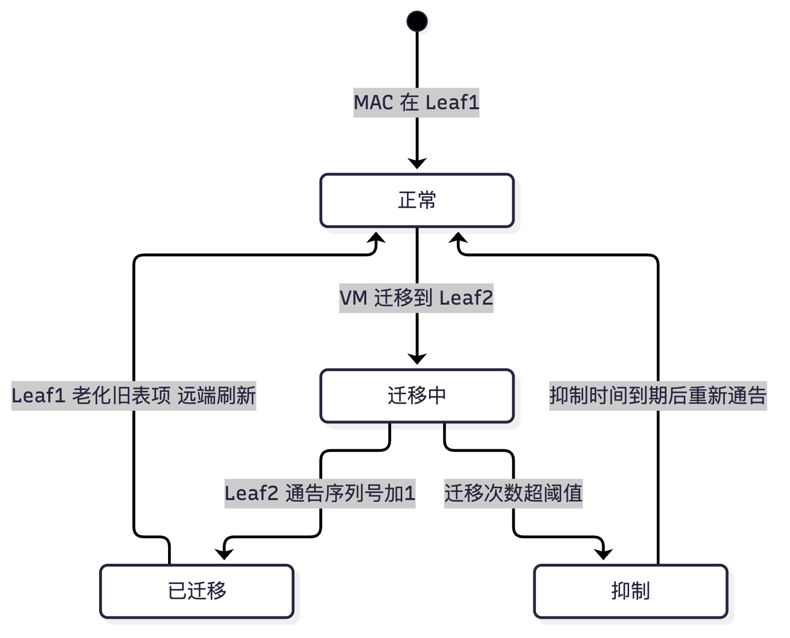


### 真题精练

**Q1.【真题·简答】** 请说明 EVPN 环境下 ARP 抑制的实现原理，并列举至少三种"仍会发生 ARP 泛洪"的情况。

> **答案要点**：
> ① 原理：Leaf 通过 Type2 路由提前获得"远端主机 IP ↔ MAC ↔ VTEP"的映射并生成 MAC/ARP 表项；在 VBDIF 上使能 `arp broadcast-suppress enable` 后，主机对同子网地址发起 ARP 请求时，设备先查本地 ARP 表，**命中则直接代答**，不再把 ARP 广播泛洪到所有 VTEP。
> ② 仍会泛洪的情况（任答三种）：**a.** 首次通信/对端为静默主机，尚未有任何 Leaf 学到其 MAC/IP，因此没有 Type2、本地无表项；**b.** 远端 Leaf 未使能 `mac-address update arp`，Type2 只带 MAC 不带 IP，本端学不到 IP，ARP 表无法生成；**c.** 免费 ARP（Gratuitous ARP）与 ARP 探测语义上需要宣告/检测冲突，通常不抑制；**d.** 未知单播与组播（IGMP、VRRP、DHCP 广播）不属于 ARP 抑制范畴，仍需 BUM 泛洪；**e.** RT 不匹配导致相关实例表项未导入。
> ③ 加分：ARP 抑制只能减少"同子网已知主机的 ARP 广播"，**并不能消除 BUM**；消除 BUM 还需借助分布式网关的主机路由、DF 选举与合理的老化时间设计。

**Q2.【真题·多选】** 关于 EVPN 的 MAC 迁移，下列描述正确的有？
A. 通过 Type2 路由携带的 MAC Mobility 扩展团体（标志位 + 序列号）识别迁移
B. 新位置的 PE 通告时序列号递增，序列号大者被优选
C. MAC 迁移抑制（Damping）用于防止迁移风暴冲击控制平面
D. MAC 迁移必须手工清除旧表项，否则永远不收敛

> **答案：ABC**
> **解析**：D 错——EVPN 的迁移收敛是**协议自动完成**的：收到更大序列号的 PE 会刷新表项并老化旧表项；配合免费 ARP 通常在 1~3 秒内恢复。C 正确：当同一 MAC 在短时间内反复迁移（常见于误配双活 / 环路），Damping 会暂停通告以避免控制平面震荡，但阈值配置过严会导致长时间不通。

**Q3.【真题·排错】** 某 Leaf 已配置 `arp broadcast-suppress enable` 与 `mac-address update arp`，但抓包发现 ARP 广播仍大量泛洪。请给出至少三条排查方向。

> **答案要点**：
> ① **检查 Type2 是否携带 IP**：`display bgp evpn all routing-table mac-route` 看对端通告的路由 `IP Address Length` 是否为 0；若对端未配 `mac-address update arp`，则只通告 MAC，本端无法生成 ARP 表项，抑制自然不会命中。
> ② **检查 RT 是否匹配、表项是否导入**：`display ip vpn-instance verbose` 与 `display arp interface Vbdif10`；表项为空说明路由未导入或实例绑定错误。
> ③ **检查泛洪的 ARP 类型**：抓包区分是"同子网普通 ARP 请求"（应当被抑制）还是"免费 ARP / 未知单播 / DHCP 广播"（本就不会被抑制）。若为静默主机首次通信，属正常泛洪。
> ④ **检查子网划分**：若主机子网掩码配置过长，主机会把同网段地址当作跨网段而直接 ARP 网关，现象与抑制无关。
> ⑤ **检查老化时间**：ARP/MAC 老化时间过短会导致表项频繁被删，抑制窗口变小，可适当延长或依赖 EVPN 路由维持。

### 易错点与排错

1. **认为"ARP 抑制 = 没有广播"**：抑制只针对 ARP 请求且需命中本地表项，未知单播、组播、DHCP、免费 ARP 仍会泛洪。
2. **只配抑制不配 `mac-address update arp`**：Type2 不带 IP → 抑制失效，是最常见的"配了没效果"。
3. **忘记主机必须先有流量**：EVPN 是"控制平面学习"，但**触发学习的前提是主机产生流量**；静默主机永远学不到，泛洪无法避免（可用静态 MAC/ARP 或控制器预配置解决）。
4. **误判 MAC 漂移为攻击**：真实 VM 迁移是正常行为，应先确认序列号是否递增，再看是否 M-LAG/双活误配。
5. **排错顺序**：Type2 是否携带 IP → 本地 ARP 表是否有表项 → 抑制开关是否生效 → 抓包确认泛洪流量类型 → 检查老化与迁移抑制参数。

---

## 1.11 BGP EVPN 的 RR 部署与 VXLAN 可靠性设计

### 考点定位

本考点是**方案设计题与简答题**的常见落点（4~6 分）：考"为什么 EVPN 要用 RR 而不是全互联"、"RR 放在哪里"、"RR 与 Spine 合设还是分设"、"多 VTEP 双活与 M-LAG 如何与 EVPN 结合"。实验卷中若考点是"EVPN 邻居建立不全"或"Leaf 数量多时配置量爆炸"，本质都是 RR 设计问题。

### 原理精讲

**第一部分：为什么必须用 RR？** EVPN 的邻居关系本质是**IBGP 全互联问题**。若 N 台 Leaf 之间两两建立 EVPN 邻居，需要 N×(N−1)/2 个会话；以 32 台 Leaf 为例就是 **496 个会话**，每条路由还要被通告 31 次。BGP 的解决方式是 **RR（Route Reflector，路由反射器）**：Leaf 只与 RR 建立 IBGP 会话（客户端），RR 把客户端路由反射给其他客户端。于是会话数降为 **N 个**（每台 Leaf 到 RR），路由分发由 RR 完成，配置量与表项开销都大幅下降。**为什么 EVPN 特别适合 RR？** 因为 EVPN 路由（Type2/Type3/Type5）具有"**按 RT 分发、不需要全网拓扑**"的特征，RR 无需理解 VXLAN 语义，只按 BGP 规则反射即可，转发路径与 BGP 下一跳不变（VXLAN 下一跳是 VTEP 而非 RR，因此不存在"下一跳被改写"的问题——**RR 只做控制平面，不进数据路径**，这是 EVPN 用 RR 的关键前提，也是与"RSVP-TE 必须逐跳"的对比点）。

**RR 的部署设计要点**：
1. **位置**：RR 通常部署在 **Spine** 层（与 Spine 合设）——因为 Spine-Leaf 拓扑里每台 Leaf 天然与所有 Spine 相连，Underlay 已保证可达性，合设可省设备、省链路。规模很大或需要控制平面独立隔离时，可采用**独立 RR**（如用 CE12800/CE16800 兼作，或专门的 RR 集群）。
2. **冗余**：至少 **2 台 RR**（典型 2~4 台），每台 Leaf 与所有 RR 建立会话（`peer` 多份）。EVPN 通过 **BGP Add-Path** 或 "RR 之间的 IBGP 全互联/联盟" 保证两台 RR 上学到的路由一致，避免单台 RR 故障导致路由缺失。**RR 之间必须建 IBGP 邻居**（或使用 Cluster ID 相同的方式实现冗余集群），否则 RR1 上的路由不会出现在 RR2 上。
3. **Cluster ID**：默认取 RR 的 Router ID。多台 RR 做冗余时，若希望它们表现如一个集群，可配相同 Cluster ID；若不同 Cluster ID 则互为非客户端，需通过 RR 之间的 IBGP 会话交换路由。**防环**：RR 只在 `cluster-id` 列表中发现自己的 ID 时才丢弃，因此 Cluster ID 规划直接影响环路防护与冗余方式。
4. **反射规则**：客户端路由反射给所有其他客户端 + 非客户端；非客户端路由只反射给客户端。**反射客户端配置**：在 RR 上对每个 Leaf 执行 `peer x reflect-client`。
5. **路由策略与安全**：EVPN 的 **RT 配置要严格**，禁止使用"全 0 通配"，否则租户串网；建议在 RR 上只做反射不做 RT 改写（保持端到端的 RT 语义），如需集中控制可在 RR 上做 `peer x route-policy` 过滤。
6. **收敛优化**：开启 **BGP GR（Graceful Restart）/NSR** 防止控制平面重启导致转发表刷新；开启 **BFD for BGP** 实现毫秒级故障检测；使用 **Add-Path** 让 RR 向客户端通告多条路径以便快速切换；对 Type2 主机路由合理设置 **下一跳迭代与路由优先级**。

**第二部分：VXLAN 的可靠性设计**。控制平面高可用（RR 冗余）只是第一步，**转发平面**的高可用同样关键：
1. **多 VTEP 双活（EVPN Multi-homing / M-LAG）**：两台 Leaf 通过 **peer-link**（Eth-Trunk）互联形成 M-LAG，共同双归接入服务器（服务器双网卡做 bond/teaming）。对服务器而言是"一台逻辑交换机"，对 Fabric 而言是"两个 VTEP"。配合 EVPN 的 **ESI**，两台 Leaf 上报同一 ESI，实现 **DF 选举**（只由 DF 转发 BUM）、**Aliasing**（单播可分担到两台 PE）与**水平分割**（防环）。这是当前数据中心"接入层双活"的标准方案。
2. **NVE 源地址与隧道冗余**：源地址用 LoopBack（不受物理链路影响），Underlay 用 IGP 快速收敛（BFD 联动，可达 50~200 ms 级），Spine 与 Leaf 之间建议全互联（每台 Leaf 上联所有 Spine），使单链路或单 Spine 故障不影响 ECMP 数量。
3. **网关冗余**：分布式网关下**每个 Leaf 都是网关**，且**全网使用同一网关 MAC**（`0000-5e00-0101`）与同一网关 IP，因此 Leaf 故障后主机甚至不需要重新 ARP——只要 VM/主机的流量切到另一台 Leaf 即可（配合 M-LAG 或 EVPN 多活）。这是分布式网关相对 VRRP 方案的最大优势（**无需 VRRP 主备切换时间，无虚拟 MAC 与协议开销**）。
4. **服务器侧配合**：网卡 Bond（LACP 或主备）与 M-LAG 需匹配——服务器做 LACP bond 时，M-LAG 侧也要配 `mode lacp-static`，否则会出现"服务器只用一个口"或"两个口同时收到同一帧"的问题。
5. **故障域隔离**：RR/Spine 故障影响控制平面（新路由不再分发，但**已有转发表不变**，数据转发继续——这是"控制与转发分离"的好处）；Leaf 故障影响本 Leaf 下主机；因此设计上要保证"任一 Spine 故障不影响转发、任一 Leaf 故障只影响本地接入"。

### 关键概念对照表

| 部署方式 | 会话数（N 台 Leaf） | 配置量 | 扩展性 | 适用规模 |
|---|---|---|---|---|
| Leaf 全互联 IBGP | N×(N−1)/2 | 每台配 N−1 个 peer | 差 | ≤4 台（实验） |
| **RR 部署（Spine 合设）** | N | 每台配 RR 数（2~4） | **好** | 主流，数十到数百台 |
| 联盟（Confederation） | 分区内全互联 | 中 | 中 | 超大规模（少见） |
| 控制器编排（NCE-Fabric） | 由控制器管理 | 集中 | 好 | 云网一体 |

| 可靠性机制 | 保护对象 | 切换时间量级 | 华为配置要点 |
|---|---|---|---|
| LoopBack 作 NVE 源 | 隧道稳定性 | 无切换（不随链路变化） | `interface nve1` / `source LoopBack0` |
| BFD for BGP | EVPN 会话/邻居 | 毫秒~百毫秒 | `peer x bfd enable` |
| BGP GR / NSR | 控制平面重启 | 秒级（转发不中断） | `graceful-restart` / `nsr` |
| M-LAG + ESI 多活 | 接入设备 | 毫秒级 | `dfs-group`、`esi`、`peer-link` |
| 分布式网关统一 MAC | 网关 | **无需切换** | `mac-address 0000-5e00-0101` |
| Underlay ECMP + 全互联 | 上行链路/Spine | 依赖 IGP 收敛 | 每 Leaf 上联所有 Spine |

### 华为设备配置

```bash
# ===== Spine（CE16800）作为 RR：EVPN 反射配置 =====
system-view
bgp 100
 router-id 10.1.1.254
 peer 1.1.1.1 as-number 100                          // 与 Leaf1 建 IBGP
 peer 1.1.1.1 connect-interface LoopBack0
 peer 1.1.1.1 description To-Leaf1
 peer 2.2.2.2 as-number 100                          // 与其他 Leaf 依次建立会话
 peer 2.2.2.2 connect-interface LoopBack0
 peer 10.1.1.253 as-number 100                       // 与另一台 RR 建 IBGP，保证两台 RR 路由一致
 peer 10.1.1.253 connect-interface LoopBack0
 l2vpn-family evpn
  peer 1.1.1.1 enable
  peer 1.1.1.1 reflect-client                        // 指定为反射客户端
  peer 2.2.2.2 enable
  peer 2.2.2.2 reflect-client
  peer 10.1.1.253 enable                             // 另一台 RR 作为非客户端，正常收发
  undo peer 1.1.1.1 capability-advertise route-refresh  // 按需关闭不必要能力，减少开销（可选）
  quit
 quit
# ===== Leaf（CE6865）侧：只与 RR 建会话 =====
system-view
bgp 100
 peer 10.1.1.254 as-number 100                        // 指向 RR1
 peer 10.1.1.254 connect-interface LoopBack0
 peer 10.1.1.253 as-number 100                        // 指向 RR2，实现 RR 冗余
 peer 10.1.1.253 connect-interface LoopBack0
 peer 10.1.1.254 bfd enable                           // BFD 快速检测会话故障（需先在接口使能 bfd）
 l2vpn-family evpn
  peer 10.1.1.254 enable
  peer 10.1.1.253 enable
  quit
 quit
bfd
 quit
# ===== M-LAG + EVPN 多活（Leaf1 侧，Leaf2 对称配置）=====
system-view
dfs-group 1
 source ip 10.1.1.1                                    // M-LAG 心跳源地址
 priority 150                                          // 优先级高者为主，需两端都配置
 quit
interface Eth-Trunk0
 mode lacp-static
 peer-link 1                                           // 指定为 M-LAG 的 peer-link
 dfs-group 1
 quit
interface Eth-Trunk10                                  // 面向服务器的双归聚合口
 mode lacp-static
 dfs-group 1 m-lag 1                                   // 加入 M-LAG，两端 m-lag id 必须一致
 esi 0000.0001.0001.0001.0001                          // 同一 ES 上两台 Leaf 配相同 ESI，触发 Type1/Type4
 quit
# ===== 验证 =====
display bgp evpn peer                                  // 确认与所有 RR 的会话 Established
display dfs-group 1 m-lag brief                        // 查看 M-LAG 状态与主备
display bgp evpn all routing-table ethernet-segment-route  // 确认 Type4 已交换，DF 选举有输入
display vxlan tunnel                                   // 隧道应齐全
```

### 示意图

```mermaid
flowchart TB
    L1["Leaf1"] --> R1["Spine1 RR1"]
    L2["Leaf2"] --> R1
    L3["Leaf3"] --> R1
    L4["Leaf4"] --> R1
    L1 --> R2["Spine2 RR2"]
    L2 --> R2
    L3 --> R2
    L4 --> R2
    R1 ---|"RR 间 IBGP"| R2
```

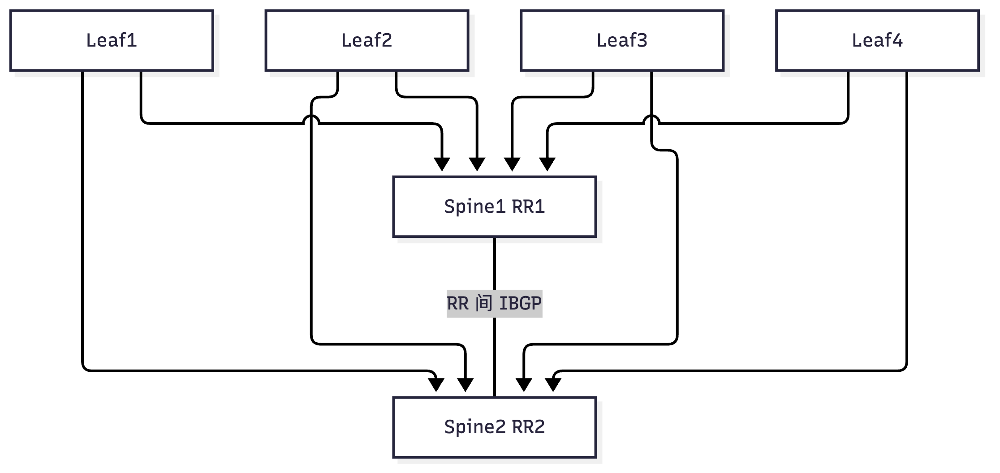


```mermaid
flowchart LR
    S["服务器 双网卡 bond"] -->|"LACP"| M["Eth-Trunk10 M-LAG"]
    M --> A["Leaf1 ESI 0001"]
    M --> B["Leaf2 ESI 0001"]
    A ---|"peer-link"| B
    A --> F["Fabric EVPN 域"]
    B --> F
```

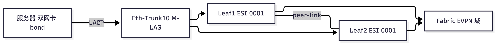


### 真题精练

**Q1.【真题·简答】** 在 BGP EVPN 的 Fabric 中，为什么推荐使用 RR（路由反射器）而不是 Leaf 之间全互联 IBGP？RR 通常部署在哪里？

> **答案要点**：
> ① 会话数：N 台 Leaf 全互联需 N(N−1)/2 个 IBGP 会话，路由需通告 N−1 次；使用 RR 后每台 Leaf 只需与 RR 建立会话，**会话数降为 O(N)**。
> ② EVPN 适合 RR 的原因：EVPN 路由是"可达性路由"（Type2/3/5），**RR 只做控制平面反射，不参与数据转发，VXLAN 的下一跳仍是远端 VTEP**，因此不存在反射器改变下一跳导致转发绕行的问题。
> ③ 部署位置：通常与 **Spine 合设**（Leaf 与所有 Spine 天然互联，Underlay 已保证可达），至少 **2 台 RR 冗余**，RR 之间需建 IBGP 以保证路由一致；规模大或需控制平面独立时可用独立 RR（CE12800/CE16800）。
> ④ 加分：开启 BFD for BGP、BGP GR/NSR、Add-Path 提升收敛与可靠性；RR 上不做 RT 改写，保持端到端语义。

**Q2.【真题·多选】** 关于 VXLAN Fabric 的可靠性设计，下列做法正确的有？
A. NVE 源地址使用 LoopBack0，保证物理链路故障不影响隧道
B. 部署两台及以上 RR 并在 RR 之间建立 IBGP 会话
C. 分布式网关场景下所有 Leaf 使用同一网关 MAC，实现网关无感切换
D. 为防止环路，Leaf 与 Spine 之间应部署 STP

> **答案：ABC**
> **解析**：D 错——Fabric 的 Underlay 是**三层路由网络**，靠 IGP 收敛与 ECMP 提供冗余，**不使用 STP**；引入 STP 会让等价路径只剩一条，破坏 ECMP 与带宽利用。C 是分布式网关的关键设计：统一网关 MAC 使 VM 迁移或 Leaf 切换后主机无需重新 ARP，避免 VRRP 式的切换时延。

**Q3.【真题·排错】** 双 RR 环境中，Leaf 只与 RR1 建立了 EVPN 会话，RR2 的会话停在 Active；且当 RR1 重启后部分 Leaf 学不到远端 Type2 路由。请给出排查思路。

> **答案要点**：
> ① 检查 Leaf 到 RR2 的 **Underlay 可达性**：`ping -a <Leaf LoopBack> <RR2 LoopBack>`、`display ip routing-table <RR2 LoopBack>`；Underlay 不通是会话 Active 的首要原因。
> ② 检查 **`connect-interface` 与源地址**：Leaf 侧是否对 RR2 也配置了 `connect-interface LoopBack0`；若漏配则用出接口地址建会话，可能出现建不上或不稳定。
> ③ 检查 RR2 侧的 **`peer x enable`（l2vpn-family evpn）** 是否遗漏——常见于"只配了 IPv4 单播地址族、忘记 EVPN 地址族"。
> ④ 检查认证/ACL/TCP 179 放通情况（`display tcp status`）。
> ⑤ 关于 RR1 重启后路由缺失：确认 **RR1 与 RR2 之间是否有 IBGP 邻居**，若无则 RR2 上学不到 RR1 客户端路由，RR1 故障即造成路由黑洞；整改为 RR 间建 IBGP 或使用相同 Cluster ID 的冗余集群方案，并开启 GR/NSR。

### 易错点与排错

1. **忘记在 RR 上配 `reflect-client`**：客户端之间无法互相学到路由，表现为"邻居都 up 但学不到路由"。
2. **RR 之间未建 IBGP**：两台 RR 各自只知道自己的客户端路由，单台 RR 故障即路由缺失，属于典型的"看着冗余、实际单点"。
3. **在 RR 上配置 RT 改写或路由聚合**：会破坏端到端 RT 语义，导致部分租户路由被错误导入或丢弃。
4. **M-LAG 的 ESI 两端不一致**：Type1/Type4 无法对应，DF 选举失败，出现双份 BUM 或流量黑洞。定位：`display bgp evpn all routing-table ethernet-segment-route`。
5. **`peer-link` 与业务口混用**：peer-link 承担 M-LAG 同步与部分流量，若与其他业务共用 Eth-Trunk，会导致同步流量与业务流量互相影响。
6. **排错命令**：`display bgp evpn peer`、`display bgp evpn all routing-table`、`display dfs-group 1 m-lag brief`、`display vxlan tunnel`、`display interface Eth-Trunk10`。

---

## 1.12 VXLAN 运维与排错（命令字段逐个解释 + 故障案例）

### 考点定位

本考点是**实验卷与综合排错题的最终落点**（10~20 分）：给出拓扑、配置片段与故障现象，要求写出**定位命令、输出字段含义与解决步骤**。选手之间的差距几乎全部体现在"**会不会按正确顺序查表**"。必须掌握四条核心命令的字段含义与五类以上故障的处置流程。

### 原理精讲

**VXLAN 排错的方法论是"三层七步"**：**Underlay → Overlay 控制平面 → Overlay 数据平面**，每层各有 2~3 步。

**第一层 Underlay（能不能通）**：
1. `ping -a <本端 VTEP> <对端 VTEP>` —— 直接验证 VTEP 源地址二层/三层可达性。**不通则一切免谈**。
2. `display ip routing-table <对端 VTEP>` / `display ospf routing` —— 确认路由存在且**等价路径条数**符合设计（ECMP 是否成形）。
3. `display interface GE1/0/1 | include MTU` —— 确认 MTU 满足封装开销要求。

**第二层 Overlay 控制平面（路由有没有）**：
4. `display bgp evpn peer` —— 看会话状态（Established）、消息计数、Up/Down。**字段解释**：`Peer` 对端地址；`AS`；`MsgRcvd/MsgSent` 收发的 BGP 消息数（长期不增长说明会话僵死）；`Up/Down` 会话持续时间；`State` 状态（Idle/Active/Established）；`PrefRcv` 收到的路由前缀数（EVPN 下即各类 EVPN 路由总数，**为 0 说明对端没发或 RT 不匹配**）。
5. `display bgp evpn all routing-table` —— **排错的核心命令**。输出以 `[路由类型][RD][...]` 标识，逐条看：路由类型编号、RD、Ethernet Tag/VNI 相关信息、下一跳、Local/Remote 标识、Path/Ogn。**字段解释**：`Network` 路由前缀（Type2 显示为 `[2][RD][ESI][Tag][MAC Len][MAC][IP Len][IP]`）；`NextHop` 下一跳（EVPN 中即远端 VTEP 地址，**这是判断隧道是否指向正确对端的关键**）；`From` 从哪个邻居学到；`Local` 本地产生；`Path/Ogn` 最优路径标记与来源。加 `mac-route`、`ip-prefix-route`、`inclusive-multicast-route` 等关键字可分类查看。
6. `display vxlan vni` —— **BD/VNI 绑定与状态的唯一权威来源**。**字段解释**：`BD ID` 广播域编号；`VNI` 虚拟网络标识（**必须与对端一致**）；`Status` VXLAN 状态（up/down，down 通常是源地址未就绪或 VNI 未绑定）；`Source` NVE 源地址；`Vxlan tunnel` 关联隧道数量。加 `verbose` 可看 `BUM Mode`（泛洪方式）与隧道详情。
7. `display vxlan tunnel` —— **隧道表**。**字段解释**：`Source` 本端 VTEP；`Destination` 对端 VTEP；`Status` up/down；`Type` **static（静态 peer-list）或 evpn（Type3 生成）**；`VNI` 关联的 VNI 列表；`BD` 关联的 BD。**要点：N 台 VTEP 之间应有 N−1 条隧道**，缺少某条说明未交换 Type3 或对端未使能该 VNI。

**第三层 Overlay 数据平面（表项有没有、对不对）**：
8. `display vni mac-address`（部分版本/网管侧，等价命令 `display mac-address bridge-domain 10`）—— **查看 BD 内 MAC 表**。**字段解释**：`MAC Address` 主机 MAC；`VLAN/BD` 所属广播域；`Type` **dynamic（本地动态学习）/ static / evpn（由 EVPN 学到的远端 MAC）**；`Peer/NextHop` 出接口或隧道信息（远端 MAC 会显示隧道与 VTEP）。**判据**：本端主机应显示为本地接口；远端主机应显示为**隧道接口 + 对端 VTEP**；看不到远端主机说明 Type2 未收到或未安装。
9. `display arp interface Vbdif10`（或 `display arp vpn-instance VPNA`）—— ARP 表，判断 ARP 抑制与主机可达性。**字段解释**：`IP Address`、`MAC Address`、`Expire`（老化剩余时间）、`Type`（D dynamic / S static / I interface）、`Interface`、`VPN-Instance`。远端主机若通过 EVPN 学到并生成 ARP，可据此确认 ARP 抑制有输入。
10. `display interface Vbdif10` / `display ip routing-table vpn-instance VPNA` —— 确认网关状态与租户路由，用于"跨子网不通"类故障。

**必须掌握的五类故障（现象 → 原因 → 定位 → 解决）**：

| 编号 | 现象 | 最可能原因 | 定位命令 | 解决 |
|---|---|---|---|---|
| F1 | 隧道起不来（`display vxlan tunnel` 空/ down） | Underlay 不通；LoopBack 未通告；NVE 未使能 VNI；源地址用物理口 | `ping -a`、`display ip routing-table`、`display vxlan vni`、`display vxlan tunnel` | 补 IGP 通告、改 LoopBack 源、补 `vni` 配置 |
| F2 | 隧道 up 但同 VNI 主机不通 | 两端 VNI/BD 映射不一致；`l2 binding vlan` 漏配；对端未使能 VNI | 两端 `display vxlan vni`、`display bridge-domain`、`display vni mac-address` | 统一 VNI、补齐 VLAN 绑定 |
| F3 | Type2 不通告 / 远端学不到 MAC | 未配 `mac-address update arp`；BGP EVPN 地址族未使能；RT 不匹配；RR 未 `reflect-client` | `display bgp evpn peer`、`display bgp evpn all routing-table mac-route`、`display ip vpn-instance verbose` | 补 EVPN 地址族与 RT、修正 RR 反射配置 |
| F4 | 分布式网关 ping 不通网关 | VBDIF 未创建/未 up/IP 或 VPN 实例配错；VBDIF 编号与 BD 不一致 | `display interface Vbdif10`、`display vxlan vni` | 修正 VBDIF 编号与绑定 |
| F5 | 跨 Leaf 跨子网不通（同子网通） | 缺少 L3 VNI（Type2 未带 Label2）；VPN 实例路由缺失；对称/非对称 IRB 配置不匹配 | `display bgp evpn all routing-table mac-route`（看 Label2）、`display ip routing-table vpn-instance` | 补齐 L3 VNI 与 VPN 实例、统一 IRB 模式 |
| F6 | M-LAG/多活异常（双份流量或黑洞） | ESI 两端不一致；DF 选举无输入；peer-link 故障 | `display bgp evpn all routing-table ethernet-segment-route`、`display dfs-group 1 m-lag brief` | 统一 ESI、修复 peer-link、检查 Type1/Type4 |
| F7 | 小包通、大包不通 | MTU：Underlay 未抬高或未全路径一致；外层带 Tag 未计入 | `display interface`（看 MTU 字段）、`ping -s 1472 -f` | 抬高 MTU 或压主机 MTU + `tcp adjust-mss` |
| F8 | VM 迁移后长时间不通 | MAC Mobility 序列号未递增；迁移抑制过严；免费 ARP 丢失 | `display mac-address bridge-domain 10`（观察 flapping）、`display bgp evpn all routing-table mac-route` | 调整抑制阈值、确认序列号机制、必要时手工清除残留 |

### 关键概念对照表

| 命令 | 看什么 | 关键字段 | 判据 |
|---|---|---|---|
| `display vxlan vni` | BD↔VNI↔状态 | BD ID、VNI、Status、Source | Status 必须 up，VNI 两端一致 |
| `display vxlan tunnel` | 隧道是否齐全 | Source、Destination、Status、Type | N 台设备应有 N−1 条 up |
| `display bgp evpn peer` | 控制平面会话 | State、Up/Down、PrefRcv | Established 且 PrefRcv 增长 |
| `display bgp evpn all routing-table` | EVPN 各类型路由 | 类型编号、RD、NextHop、From | 五类路由按场景应齐全 |
| `display vni mac-address` | BD 内 MAC 表 | MAC、Type、Peer/NextHop | 远端 MAC 应指向隧道 |
| `display arp interface Vbdif10` | ARP 表项 | IP、MAC、Type、Expire | 远端主机 ARP 由 EVPN 生成 |
| `display dfs-group 1 m-lag brief` | M-LAG 状态 | 主备、peer-link 状态 | 一主一备，peer-link up |

| 路由类型编号 | 显示前缀形式 | 关键字段 |
|---|---|---|
| Type1 | `[1][RD][ESI][Tag]` | ESI、下一跳 |
| Type2 | `[2][RD][ESI][Tag][MAC Len][MAC][IP Len][IP]` | MAC、IP、L2/L3 Label |
| Type3 | `[3][RD][Tag][IP Len][VTEP IP]` | VTEP 地址、PMSI |
| Type4 | `[4][RD][ESI][IP Len][VTEP IP]` | ESI、VTEP IP |
| Type5 | `[5][RD][ESI][Tag][IP Prefix Len][Prefix][GW IP]` | 前缀、GW、L3 Label |

### 华为设备配置

```bash
# ===== 排错时常用的辅助配置与信息采集 =====
system-view
# 1. 让日志记录关键事件，便于事后定位
info-center enable
info-center loghost 10.1.1.100                       // 日志送 syslog 服务器（需先配置路由可达）
# 2. BFD 加速 EVPN 邻居故障检测
bfd
 quit
interface GE1/0/1
 bfd enable                                          // 在三层接口使能 BFD
 bfd min-tx-interval 100 min-rx-interval 100         // 收发间隔 100ms，实现百毫秒级检测
 quit
bgp 100
 peer 10.1.1.254 bfd enable                          // 让 BGP 会话与 BFD 联动
 quit
# 3. 采集诊断信息（现场排错一键留证）
display diagnostic-information                        // 收集全量诊断信息，用于事后分析
display vxlan vni verbose                             // VNI 与泛洪方式详情
display bgp evpn all routing-table                    // EVPN 全类型路由
display bgp evpn all routing-table mac-route 0:0 1.1.1.1:100   // 定向查看某 RD 的 Type2
display vxlan tunnel verbose                          // 隧道详情（含 BUM 与 VNI 列表）
display vni mac-address                               // BD 内 MAC 表（部分版本写法）
display mac-address bridge-domain 10                  // 等价命令：按 BD 查看 MAC 表
display arp interface Vbdif10                         // 网关 ARP 表
display dfs-group 1 m-lag brief                        // M-LAG 状态
```

### 示意图

```mermaid
flowchart TD
    A["VXLAN 业务不通"] --> B["第一层 Underlay"]
    B --> B1["ping -a 本端VTEP 对端VTEP"]
    B1 -->|不通| B2["查 IGP 通告 与 路由表"]
    B1 -->|通| C["第二层 控制平面"]
    C --> C1["display bgp evpn peer 是否 Established"]
    C1 --> C2["routing-table 是否收到 Type3 与 Type2"]
    C2 -->|缺 Type3| C3["查 BD VNI 与 EVPN 绑定"]
    C2 -->|缺 Type2| C4["查 RT 与 mac-address update arp"]
    C2 -->|齐全| D["第三层 数据平面"]
    D --> D1["display vxlan vni 是否 up"]
    D --> D2["display vni mac-address 远端MAC是否指向隧道"]
    D --> D3["display arp 网关表项"]
```

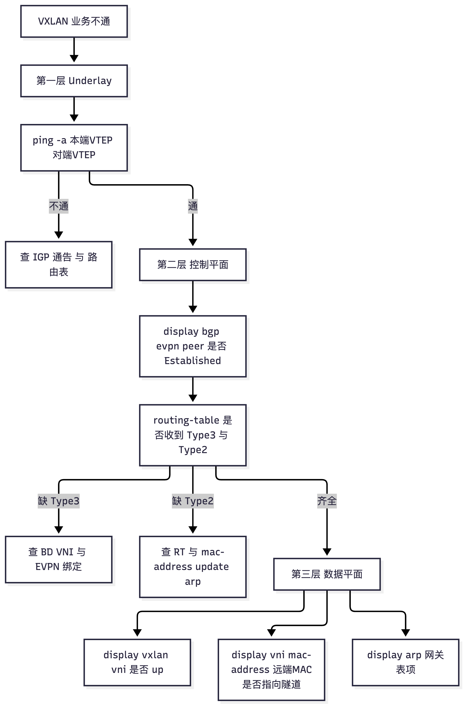


```mermaid
flowchart LR
    F1["F1 隧道起不来"] --> S1["Underlay 与 NVE 源地址"]
    F2["F2 同VNI不通"] --> S2["VNI 与 BD 映射"]
    F3["F3 Type2 不通告"] --> S3["RT 与 EVPN 地址族"]
    F4["F4 网关不通"] --> S4["VBDIF 配置"]
    F5["F5 跨Leaf跨子网"] --> S5["L3 VNI 与 VPN 实例"]
    F6["F6 M-LAG 异常"] --> S6["ESI 与 DF 选举"]
```

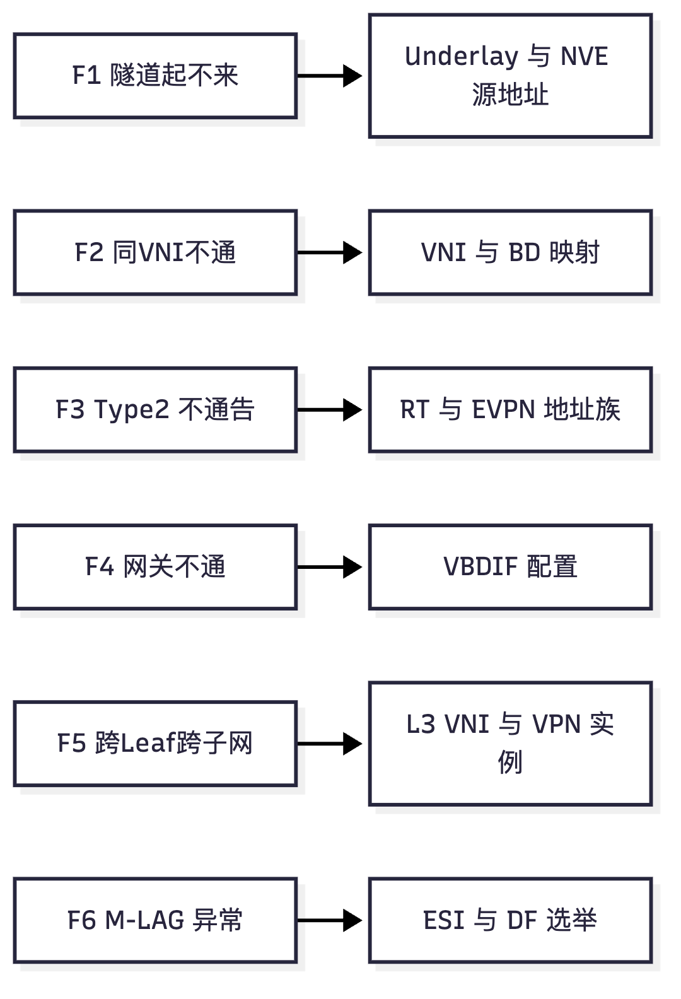


### 真题精练

**Q1.【真题·排错】** 拓扑：CE6865-Leaf1/Leaf2 双上联 CE16800-Spine1/Spine2（Spine 兼作 RR），Leaf1 下主机 A 与 Leaf2 下主机 B 同网段同 VNI。现象：`display vxlan tunnel` 在 Leaf1 上有到 Leaf2 的隧道（状态 up），但 A ping B 不通，Leaf1 上 `display vni mac-address` 看不到 B 的 MAC。请写出定位步骤与可能原因。

> **答案要点**：
> ① **第一步排除 Underlay**：`ping -a 1.1.1.1 2.2.2.2`（Leaf1→Leaf2 的 VTEP 源地址）应通；不通则先修 Underlay。隧道 up 说明 Underlay 基本正常。
> ② **第二步查控制平面**：`display bgp evpn peer` 确认与两台 RR 会话 Established；`display bgp evpn all routing-table` 看是否有 Leaf2 的 **Type2 路由**（应有 B 的 MAC 与 IP）、**Type3**（隧道已 up 说明 Type3 正常）。**没有 Type2 → 问题在通告或过滤**。
> ③ **第三步查通告条件（对端 Leaf2）**：`display bgp evpn all routing-table` 在 Leaf2 上确认本端是否已产生 Type2（`Local` 标识）。若无，检查 Leaf2 是否学到 B 的 MAC（`display vni mac-address`）、`l2 binding vlan` 是否配置、NVE 是否使能 VNI。
> ④ **第四步查 RT 与 EVPN 地址族**：两端 `display ip vpn-instance verbose` 核对 RD/RT；`display bgp evpn peer` 看 `PrefRcv` 是否为 0（为 0 表示路由被丢弃）。RT 不匹配是"隧道 up 但 MAC 学不到"的最常见原因。
> ⑤ **第五步查 RR 反射**：RR 上是否对两个 Leaf 都配了 `peer x reflect-client` 且 `l2vpn-family evpn` 下 `peer x enable`。
> ⑥ **解决**：修正 RT/EVPN 地址族/反射配置后，`display vni mac-address` 应出现类型为 evpn 的远端 MAC 表项，业务恢复。
> ⑦ 加分：还需确认两端 **VNI 数值一致**与**ARP 抑制不会误答**（`display arp interface Vbdif10` 检查是否有错误表项）。

**Q2.【真题·简答】** 请解释 `display vxlan tunnel` 输出中 `Type` 字段的取值含义，并说明为什么"隧道数量少于 N−1"会影响业务。

> **答案要点**：
> ① `Type` 有两种取值：**static** 表示由静态配置 `vni ... head-end peer-list` 建立的隧道；**evpn** 表示由 BGP EVPN 的 Type3 路由自动发现建立的隧道。
> ② "隧道数量少于 N−1"表示本端与某些远端 VTEP 之间没有转发通道，BUM 复制列表不完整、单播也无法送达那些对端，现象是"部分主机不通"或"部分主机的 ARP 学不到"。
> ③ 常见原因：对端未使能该 VNI（`display vxlan vni` 中状态非 up）；对端未与 RR 建 EVPN 会话；Type3 路由被 RT/策略过滤；NVE 源地址或 Underlay 单向不可达。
> ④ 处置：`display bgp evpn all routing-table inclusive-multicast-route` 对比两端是否都能看到对方的 Type3；修正后隧道会自动补齐（EVPN 的优势：无需手工配置 peer）。

**Q3.【真题·实验】** 现要求用两台 CE6865（Leaf）与两台 CE16800（Spine/RR）搭建分布式网关 Fabric，租户 A 有两个子网 10.1.10.0/24 与 10.1.20.0/24，各 Leaf 下的主机需要跨 Leaf 三层互通。请写出关键配置要点（Underlay、Overlay、网关、L3 VNI、验证）。

> **答案要点（按配置框架给分）**：
> ① **Underlay**：Leaf/Spine 全网三层互联，OSPF 或 IS-IS（推荐 IS-IS）通告互联网段与 LoopBack0（VTEP 源地址），接口 MTU 抬到 1600；启用 ECMP。
> ② **二层 Overlay**：每台 Leaf 配 `bridge-domain 10 / vxlan vni 10000 / l2 binding vlan 10` 与 `bridge-domain 20 / vxlan vni 10001 / l2 binding vlan 20`；`interface nve1` 下 `source <LoopBack0>` 并 `vni 10000`、`vni 10001`。
> ③ **VPN 实例与 L3 VNI**：配 `ip vpn-instance VPNA` 并设 RD（按设备唯一，如 `1.1.1.1:100`）与 RT（按租户统一，如 `100:1` 双向）；配置承载 **L3 VNI** 的 BD/VNI（如 BD 1000 / VNI 20000）并与 VPNA 关联。
> ④ **分布式网关**：`interface Vbdif10` / `Vbdif20` 绑定 VPNA、配各子网网关 IP 与**统一网关 MAC**（`0000-5e00-0101`）、`mac-address update arp`、`arp direct-route enable`；Leaf 之间对同一子网使用同一网关 IP 与 MAC，形成分布式网关。
> ⑤ **BGP EVPN**：Leaf 与两台 RR 建立 IBGP 并进入 `l2vpn-family evpn` 使能；RR 上配 `reflect-client`；RR 之间建 IBGP。
> ⑥ **验证**：`display vxlan tunnel`（应有 3 条 up，类型 evpn）、`display vxlan vni`（两个 L2 VNI 与 L3 VNI 状态 up）、`display bgp evpn all routing-table`（五类按需出现，至少 Type2/Type3/Type5）、`display vni mac-address`（远端 MAC 指向隧道）、跨 Leaf 跨子网 ping 通、`display ip routing-table vpn-instance VPNA`（有各子网路由）。
> ⑦ **加分**：说明跨 Leaf 跨子网时使用 **对称 IRB（带 L3 VNI 的 Type2 三层转发）**，并检查 MTU 与 ARP 抑制配置。

### 易错点与排错

1. **查表顺序错误**：先查 MAC 表再查隧道，容易在 Underlay 不通时浪费时间。**永远从 Underlay 开始**（ping VTEP 源地址）。
2. **忽略 `PrefRcv = 0`**：`display bgp evpn peer` 中 `PrefRcv` 为 0 却会话 Established，几乎一定是 RT 不匹配或地址族未使能。
3. **两端只查一台**：单向故障（去程通回程断）极常见，必须**两端同时执行同样命令对比**。
4. **把 `display mac-address` 与 `display vni mac-address` 的输出混淆**：前者按 VLAN/接口组织，后者按 BD/隧道组织；分布式网关排错应看**按 BD 的视图**。
5. **忽视 MTU 类故障**：所有"小包通、大包不通"优先怀疑 MTU，用 `ping -s 1472 -f` 验证，不要先怀疑路由。
6. **诊断信息采集**：`display diagnostic-information` 一次收集全套信息，现场排错与提交报告都应先执行。

---

# DCN-HCIE-章节2-EVPN分布式网关与跨Fabric互联

## 2.1 集中式网关与分布式网关

### 考点定位

本考点是**方案对比与设计题的头号命题点**（5~8 分）：最常见的形式是"表格题"——要求从**网关位置、流量路径、ARP 表项规模、横向流量是否绕行、扩展性、适用场景**等维度比较集中式与分布式网关；或以**简答题**形式问"为什么大型 Fabric 必须用分布式网关"。上机题中"分布式网关 ping 不通"多与本节的概念混淆有关（例如把网关只配在一台 Leaf 上却期望全网分布式）。

### 原理精讲

**集中式网关（Centralized Gateway）**：三层网关功能**统一部署在少数几台设备上**（典型是 Spine 或一对独立的 Border/Gateway 设备），Leaf 只做二层 VXLAN 网关。主机跨子网通信时，报文必须先由 Leaf 通过 **L2 VNI 隧道**送到集中网关设备，在那里完成三层转发，再经 L2 VNI 隧道送回目标 Leaf。**优点**：网关集中，配置与管理简单，网关设备少、表项集中，便于与防火墙等安全设备对接（只需在网关设备上做策略），适合**中小规模或子网数量少**的 Fabric。**缺点**极为明显：① **横向流量绕行（发夹弯，Hairpin）**——同一 Leaf 下两台不同子网的主机互访，报文也要"上到网关设备再回来"，浪费上行带宽、增加时延（多一跳甚至两跳），这在东西向流量占 70%~80% 的数据中心里是致命的；② **网关设备成为带宽与表项瓶颈**——所有跨子网流量都汇聚到几台设备，需要超大带宽与超大 ARP/MAC 表；③ **扩展性差**——每新增一个租户子网，都要在集中网关设备上增加 VBDIF/VPN 实例与 ARP 表项，规模上限受单设备表项能力限制；④ **故障域大**——网关设备故障影响全部租户的跨子网通信（虽然可用双机热备，但切换有中断）；⑤ **ARP 表项规模 = 全网主机数**，大型云环境下可达数十万条，容易触发表项溢出。

**分布式网关（Distributed Gateway）**：**每一台 Leaf 都同时是它本地所接主机的三层网关**（`interface Vbdif` 部署在每台 Leaf 上），并且**所有 Leaf 使用同一个网关 IP 与同一个网关 MAC**。主机跨子网通信时，**首跳 Leaf 就直接完成三层转发**，不需要把流量送到某台中心设备；只有目的主机在**其他 Leaf** 上时，才用 **L3 VNI（三层 VNI）** 把三层转发后的报文隧道封装到目的 Leaf——**一跳直达，无绕行**。**优点**：① **转发路径最优**（同 Leaf 流量本地转发、跨 Leaf 一跳直达），东西向流量效率最高；② **表项分布化**——每台 Leaf 只需维护本地及本 Fabric 的主机/子网表项，可通过 **Type5 网段路由**把主机级表项收敛为网段级，规模可控；③ **扩展性好**——新增 Leaf 自动携带网关能力，加设备即扩容，无中心瓶颈；④ **故障域小**——单台 Leaf 故障只影响其本地接入与网关（配合 M-LAG/多活可实现无感切换）；⑤ **网关无感迁移**——由于全网网关 MAC 一致，VM 迁移到另一台 Leaf 后主机无需重新 ARP。**代价**：配置复杂度上升（每台 Leaf 都要配 VBDIF/VPN 实例/L3 VNI），对 **Underlay 与 EVPN 控制平面要求更高**（必须有 Type2 携带 L3 Label），运维需要有"分布式思维"（排错要看多台设备的表项）。

**必须理解的一个关键设计点：为什么分布式网关要求"全网统一网关 MAC"？** 主机在跨子网通信前会 ARP 网关，并把"网关 IP → 网关 MAC"缓存下来。如果每台 Leaf 用自己的网关 MAC，那么 VM 迁移到新 Leaf 后，主机缓存的网关 MAC 在新 Leaf 上不存在，所有流量会被丢弃（或触发重新 ARP，造成瞬断）。统一网关 MAC（华为常用 `0000-5e00-0101`）使得"任何一台 Leaf 都能接住发往这个 MAC 的帧"，从而实现**网关的无感跟随**。在此基础上，**ARP 抑制与 MAC 表项规模**成为分布式网关必须权衡的问题（见 2.5 节）。

### 关键概念对照表

| 对比维度 | 集中式网关 | **分布式网关** |
|---|---|---|
| 网关位置 | 少数 Spine/Border/Gateway 设备 | **每台 Leaf 的 VBDIF** |
| 网关 IP/MAC | 集中设备独有 | **全网 Leaf 相同（统一网关 MAC）** |
| 同 Leaf 跨子网流量路径 | 上送网关设备再回来（**绕行**） | **本地三层转发，不出设备** |
| 跨 Leaf 跨子网路径 | Leaf→网关→Leaf（两段隧道） | **Leaf→Leaf 一跳（L3 VNI）** |
| 横向流量是否绕行 | **是（发夹弯）** | **否** |
| ARP 表项规模 | 单设备承载全网主机（**数十万条**，易溢出） | 分布到各 Leaf，可用 Type5 网段路由收敛 |
| MAC 表项规模 | 单设备承载全网 MAC | 分布到各 Leaf（每台承载本地 + 远端，需评估） |
| 配置复杂度 | 低（网关集中） | 高（每台 Leaf 需配 VBDIF/VPN/L3 VNI） |
| 扩展性 | 差（受中心设备表项与带宽限制） | **好（加 Leaf 即扩容）** |
| 故障域 | 大（网关设备故障影响全部租户） | 小（仅本地接入与网关） |
| VM 迁移 | 需重新 ARP/网关切换 | **无感（统一网关 MAC + EVPN 重新通告）** |
| 与防火墙对接 | 简单（集中做策略） | 较复杂（需 Border Leaf 集中引流） |
| 时延 | 高（多一跳） | 低（一跳直达） |
| 适用场景 | 中小规模、子网少、安全策略集中 | **大型云数据中心、东西向流量为主** |
| 华为典型方案 | Spine 兼作网关 | **每台 Leaf 作网关 + Border Leaf 出口** |

| 流量类型 | 集中式网关路径 | 分布式网关路径 |
|---|---|---|
| 同 Leaf 同子网 | Leaf 内二层转发 | Leaf 内二层转发（相同） |
| 同 Leaf 跨子网 | **Leaf→网关设备→Leaf** | **Leaf 本地三层转发** |
| 跨 Leaf 同子网 | Leaf→Leaf（L2 VNI） | Leaf→Leaf（L2 VNI，相同） |
| 跨 Leaf 跨子网 | **Leaf→网关→Leaf**（两段） | **Leaf→Leaf（L3 VNI，一跳）** |
| 访问外部网络 | 网关设备直连出口 | Leaf→Border Leaf→出口 |

### 华为设备配置

```bash
# ===== 集中式网关（CE16800-Spine 作网关）配置要点 =====
system-view
# Spine 侧：作为网关，需具备所有租户的 BD/VNI 与 VBDIF
bridge-domain 10
 vxlan vni 10000                                      // Spine 上也要有同样的 BD/VNI，才能接住 Leaf 送来的二层流量
 l2 binding vlan 10
 quit
interface Vbdif10
 ip binding vpn-instance VPNA
 ip address 10.1.10.1 255.255.255.0                    // 网关只在 Spine 上配置（集中）
 mac-address 0000-5e00-0101
 quit
# Leaf 侧：只做二层网关，不配 VBDIF（或配了也不承载网关地址）
bridge-domain 10
 vxlan vni 10000
 l2 binding vlan 10
 quit
# ===== 分布式网关（每台 CE6865-Leaf 都配）=====
system-view
interface Vbdif10
 ip binding vpn-instance VPNA
 ip address 10.1.10.1 255.255.255.0                    // 每台 Leaf 配相同网关 IP → 分布式
 mac-address 0000-5e00-0101                            // 全网统一网关 MAC，VM 迁移后无需重新 ARP
 mac-address update arp
 arp broadcast-suppress enable
 arp direct-route enable
 quit
# ===== 验证（判断集中式/分布式是否生效）=====
display interface Vbdif10                              // 在每台 Leaf 上执行：有 up 的 VBDIF 即分布式
display ip routing-table vpn-instance VPNA             // 本 Leaf 是否有直连与远端子网路由
display vxlan tunnel                                   // 分布式网关场景下隧道应齐全（含 L3 VNI 隧道）
```

### 示意图

```mermaid
flowchart TB
    subgraph C["集中式网关"]
        H1["主机A BD10"] --> L1["Leaf1"]
        L1 -->|"L2 VNI 上行"| GW["Spine 网关 统一下发"]
        GW -->|"L2 VNI 下行"| L2["Leaf2"]
        L2 --> H2["主机B BD20"]
        H3["同Leaf主机C"] --> L1
        L1 -.->|"绕行"| GW
    end
```

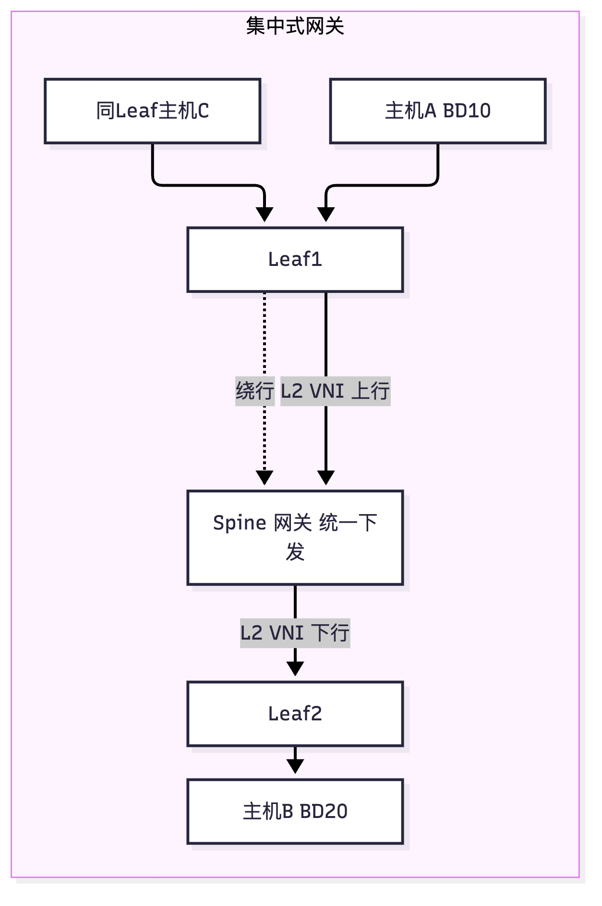


```mermaid
flowchart TB
    subgraph D["分布式网关"]
        A1["主机A 10.1.10.10"] --> LE1["Leaf1 Vbdif10 网关"]
        LE1 -->|"同Leaf 本地三层转发"| A2["主机C 10.1.20.20"]
        LE1 -->|"L3 VNI 一跳"| LE2["Leaf2 Vbdif20 网关"]
        LE2 --> A3["主机B 10.1.20.30"]
    end
```

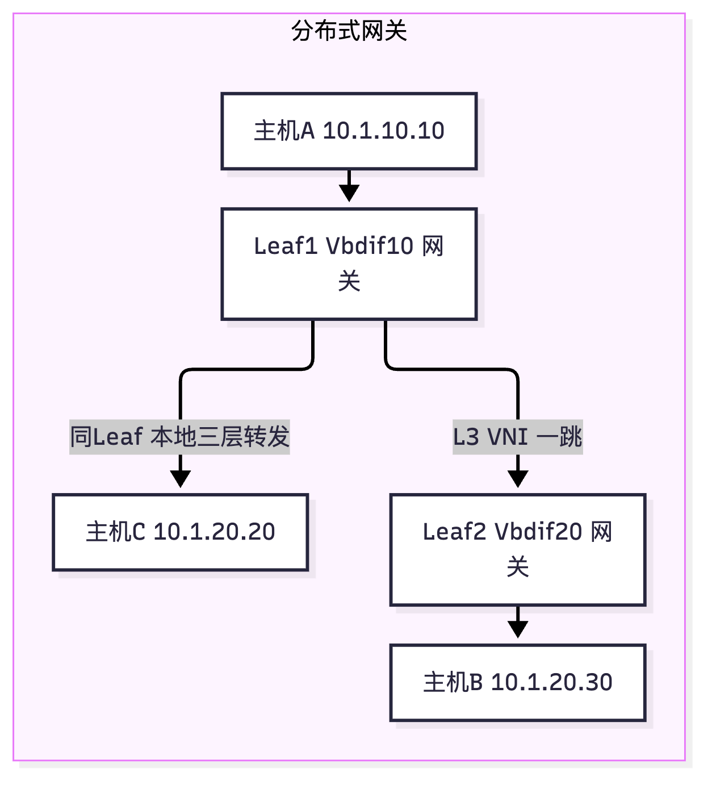


### 真题精练

**Q1.【真题·多选】** 与集中式网关相比，分布式网关的优势包括？
A. 同 Leaf 内的跨子网流量不需要绕行到中心网关设备
B. 网关表项分布到各 Leaf，避免单设备 ARP/MAC 表项瓶颈
C. 新增 Leaf 自动具备网关能力，扩展性更好
D. 完全不需要 BGP EVPN 控制平面，配置更简单

> **答案：ABC**
> **解析**：D 错——分布式网关对控制平面的依赖**更强**而非更弱：跨 Leaf 三层转发必须依赖 **Type2 携带 L3 VNI（Label2）** 与 **Type5 网段路由**，没有 EVPN 就无法实现分布式三层转发；同时每台 Leaf 都要配 VBDIF/VPN 实例/L3 VNI，**配置比集中式更复杂**。A、B、C 正是分布式网关的三大核心优势：路径最优、表项分布、弹性扩展。

**Q2.【真题·简答】** 为什么分布式网关要求所有 Leaf 使用同一个网关 MAC 地址？如果不这样做会出现什么问题？

> **答案要点**：
> ① 主机在跨子网通信前会 ARP 请求网关，并缓存"网关 IP → 网关 MAC"的映射（ARP 缓存有效期通常几分钟到几十分钟）。
> ② 若各 Leaf 网关 MAC 不同：**a.** VM 热迁移到另一台 Leaf 后，主机缓存的网关 MAC 在新 Leaf 上不存在，新 Leaf 收到目的 MAC 为自己的帧会因 MAC 表未命中而丢弃或泛洪，造成**长时间中断**（直到 ARP 缓存老化并重新 ARP）；**b.** 多 Leaf 双活接入同一主机时，主机的 ARP 缓存指向其中一台 Leaf，无法实现真正的网关负载分担与无感切换。
> ③ 统一网关 MAC 后，任何一台 Leaf 都能"接住"发往该 MAC 的帧，实现**网关无感跟随**；配合 EVPN 的 Type2 重新通告与免费 ARP，迁移收敛可做到秒级甚至亚秒级。
> ④ 加分：统一网关 MAC 也是"主机不做任何改动即可享受双活网关"的前提；华为常用 `0000-5e00-0101`，需避免与其他协议（如 VRRP 虚拟 MAC `0000-5e00-01xx`）冲突。

**Q3.【真题·单选】** 某数据中心东西向流量占比 80%，租户子网数量多且持续增长，现网采用集中式网关导致网关设备 CPU 与 ARP 表项压力过大。最合理的改造方向是？
A. 提高网关设备规格并保持集中式架构
B. 改为分布式网关，把 VBDIF 下沉到每台 Leaf
C. 把所有主机划入同一子网以消除三层转发
D. 用 STP 优化二层路径

> **答案：B**
> **解析**：A 只是延缓瓶颈，未解决"所有跨子网流量绕行中心设备"与"表项集中在单设备"的结构性问题。C 会造成超大广播域、ARP 风暴与故障域扩大，属于典型的错误设计。D 与问题无关（Fabric 的 Underlay 是三层网络）。B 是标准答案：分布式网关把网关下沉到每台 Leaf，路径最优、表项分布、随 Leaf 数量线性扩展。

### 易错点与排错

1. **"分布式网关"却只在一台 Leaf 上配了 VBDIF**：现象是部分主机跨子网不通（只有挂着网关的那台 Leaf 能通）。判据：**每台 Leaf 的 `display interface Vbdif10` 都应有 up 的网关接口**。
2. **网关 MAC 不统一**：迁移或双活时出现瞬断/长断，抓包可见目的 MAC 与本地接口 MAC 不一致。
3. **误以为分布式网关不需要 EVPN**：跨 Leaf 三层必须有 L3 VNI（Type2 的 Label2）与 Type5。
4. **集中式网关下忘记在网关设备上创建 BD/VNI**：Leaf 送来的二层流量到网关设备后找不到 BD 被丢弃。
5. **忽略安全对接差异**：分布式网关下租户流量分散在各 Leaf，若要集中做安全策略（如经过 USG6000E），需通过 **Border Leaf 引流**，不能指望每台 Leaf 都接防火墙。

---

## 2.2 分布式网关转发过程逐步推演（五场景）

### 考点定位

**本节是国赛 DCN 部分的最高压轴考点**：实验与综合题常给出五个场景中的某几个，要求"**画出数据流路径图并写出每一跳的封装变化**"（15~25 分）。判分点在于：① 是否清楚 **同 Leaf 不出设备**；② 是否清楚跨 Leaf 三层要用 **L3 VNI 封装**；③ 是否清楚内层 MAC 在何处被改写；④ 是否清楚访问外部网络时**在 Border Leaf 完成 overlay 与传统网络转换**。**五个场景的路径与封装变化必须能默画默写**。

### 原理精讲

先固定本节拓扑与参数（后续所有推演均基于它）：

| 要素 | 参数 |
|---|---|
| Leaf1 | VTEP 1.1.1.1，下挂主机 A（10.1.10.10/24，MAC A）与主机 B（10.1.20.20/24，MAC B） |
| Leaf2 | VTEP 2.2.2.2，下挂主机 C（10.1.10.30/24，MAC C，与 A 同子网） |
| Border Leaf | VTEP 3.3.3.3，上连防火墙 USG6000E 与外部网络 |
| 网关 | 10.1.10.1（BD10/VNI 10000）与 10.1.20.1（BD20/VNI 10001），统一网关 MAC = `0000-5e00-0101` |
| L3 VNI | VNI 20000（对应 VPN 实例 VPNA，承载三层流量） |

**场景一：同 Leaf 同子网（A → B？注意 A 与 B 不同子网，本例改为 A → 同 Leaf 同子网的 A2）**。假设 Leaf1 下还有 A2（10.1.10.11/24）。
① A 与 A2 同网段，A 发出 ARP 请求，Leaf1 若已学到 A2 的 MAC/IP（本地学习，无需 EVPN）**直接二层转发**；若 A2 为静默主机则先泛洪（同一 BD 内），A2 应答后 A 获知其 MAC。
② A 发出数据帧：内层源 MAC = A、目的 MAC = A2。
③ Leaf1 在 BD 10 内查 MAC 表，命中 A2 的本地接入端口 → **直接从我口转发**。
④ **全程不出设备、不做任何 VXLAN 封装、内层帧一字不改**。
> 判分关键：**同子网同 Leaf 是最短路径，连 VBDIF 都不参与**。

**场景二：同 Leaf 跨子网（A → B，A 在 10.1.10.0/24，B 在 10.1.20.0/24，同在 Leaf1）**。
① A 发现目的 IP 不同网段，ARP 请求网关 10.1.10.1，Vbdif10 用统一网关 MAC `0000-5e00-0101` 应答（**或由 ARP 抑制代答**）。
② A 发帧：内层源 MAC = A、**目的 MAC = 网关 MAC**。
③ Leaf1 在 BD 10 内查 MAC 表，发现目的 MAC 是本机 Vbdif10 → **上交三层（VBDIF 入口）**。
④ 在 **VPNA 路由表**中查 10.1.20.0/24 → 命中 **直连路由**，出接口 Vbdif20（同 Leaf 的另一个 BD）。
⑤ **改写内层帧**：目的 MAC 改为 B 的 MAC（来自 BD 20 的 ARP 表）、源 MAC 改为 Vbdif20 的 MAC（同为网关 MAC）、TTL 减 1；IP 不变。
⑥ 在 BD 20 内二层转发到 B 的接入口。
> 判分关键：**跨子网但同 Leaf，仍是本地路由转发，不进隧道**；这是分布式网关相对集中式网关最大的效率优势。

**场景三：跨 Leaf 同子网（A → C，均为 10.1.10.0/24，A 在 Leaf1、C 在 Leaf2）**。
① A ARP 请求 C 的 MAC；Leaf1 若已通过 **Type2** 学到 C（含 IP）则**ARP 抑制代答**，否则泛洪（BUM，经 Type3 生成的复制列表）。
② A 发帧：内层源 MAC = A、目的 MAC = C。
③ Leaf1 在 BD 10 内查 MAC 表，命中"**隧道下一跳**"（远端 MAC 表项指向 **VXLAN 隧道 + L2 VNI 10000**）。
④ **封装 VXLAN**：外层源 IP = 1.1.1.1、目的 IP = 2.2.2.2（Type2 的下一跳）、UDP dst 4789、**VNI = 10000（L2 VNI）**；**内层帧完全不变**。
⑤ Underlay ECMP 转发到 Leaf2。
⑥ Leaf2 收到后按 **VNI 10000 找到 BD 10**，剥外层与 VXLAN 头，在 BD 10 内查 MAC 表命中 C 的接入口，**原样转发**。
> 判分关键：**二层跨 Leaf 使用 L2 VNI，内层 MAC 不改**。

**场景四：跨 Leaf 跨子网（A → C2，C2 = 10.1.20.30/24 在 Leaf2）—— 对称 IRB 的核心场景**。
① A ARP 网关（10.1.10.1，统一网关 MAC），与场景二相同。
② A 发帧：内层源 MAC = A、目的 MAC = 网关 MAC。
③ Leaf1 上交三层，在 VPNA 路由表中查 10.1.20.0/24：**命中由 EVPN Type2（主机路由 /32）或 Type5（网段路由）学来的路由**，下一跳 = Leaf2 VTEP 2.2.2.2，出接口为 **L3 VNI 20000 对应的隧道**。
④ **三层改写**：目的 MAC 改为 **C2 的 MAC**（来自 EVPN 学到的 ARP 表项）、源 MAC 改为网关 MAC、TTL 减 1。
⑤ **用 L3 VNI 封装 VXLAN**：外层源 IP = 1.1.1.1、目的 IP = 2.2.2.2、**VNI = 20000（L3 VNI）**。注意此时内层帧是"**已三层转发后的帧**"（目的 MAC 已是 C2），这也是"对称"的含义：**两端都用 L3 VNI 封装，报文在两端的处理完全对称**。
⑥ Leaf2 收到后按 VNI 20000 识别为三层流量，在 VPNA 路由表中查 10.1.20.30 → 直连 → 在 BD 20 内二层转发给 C2。
> 判分关键：① 跨 Leaf 三层必须用 **L3 VNI**；② 内层 MAC 在**源 Leaf** 就已改写为目标主机 MAC；③ 目的 Leaf 不再做三层查表（对称 IRB 的优点），因此**无需在目的 Leaf 上维护"对称的网关状态"**。

**场景五：访问外部网络（A → 8.8.8.8）**。
① A ARP 网关 → 发帧给网关 MAC。
② Leaf1 上交三层，在 VPNA 路由表查 8.8.8.8：命中 **默认路由（由 EVPN Type5 从 Border Leaf 学来，或本地静态路由指向 Border Leaf）**，下一跳 = Border Leaf VTEP 3.3.3.3。
③ 用 **L3 VNI 20000** 封装发往 Border Leaf。
④ **Border Leaf 收到后剥封装**，在 VPNA 路由表中查 8.8.8.8 → 命中指向**防火墙/外部网络的三层口**（如 GE1/0/48，192.168.100.1）→ **按普通以太网报文三层转发出去**（不做 VXLAN 封装）。
⑤ 回程：外部设备/防火墙把报文送回 Border Leaf，Border Leaf 在 VPNA 路由表中查 10.1.10.0/24（**由 EVPN Type2/Type5 学到的租户网段**）→ 重新封装 L3 VNI 发回 Leaf1 → Leaf1 在 BD 10 内二层转发给 A。
⑥ **常见故障**：Border Leaf 未把租户网段通过 EVPN 通告/未从外部引入前缀 → "出得去回不来"；防火墙未放通、NAT 未配置 → 单向或全不通。
> 判分关键：**VXLAN 域与传统网络的边界在 Border Leaf**，那里完成"解封装 + 路由到外部"。

**五场景封装变化总表（默写模板）**：

| 场景 | 源 Leaf 查表序列 | 内层目的 MAC（转发前→转发后） | 封装 VNI | 数据流路径 |
|---|---|---|---|---|
| S1 同 Leaf 同子网 | BD 内 MAC 表 | A→A2（不变） | 无 | A→Leaf1→A2 |
| S2 同 Leaf 跨子网 | MAC 表→VPN 路由表 | 网关 MAC→B 的 MAC | 无（本地转发） | A→Leaf1(VBDIF)→B |
| S3 跨 Leaf 同子网 | BD 内 MAC 表 | A→C（不变） | **L2 VNI 10000** | A→Leaf1→(隧道)→Leaf2→C |
| S4 跨 Leaf 跨子网 | MAC 表→VPN 路由表→L3 VNI 表 | 网关 MAC→C2 的 MAC | **L3 VNI 20000** | A→Leaf1(三层改写)→(隧道)→Leaf2→C2 |
| S5 访问外部网络 | MAC 表→VPN 路由表→L3 VNI 表 | 网关 MAC→外部下一跳 MAC | **L3 VNI 20000** | A→Leaf1→(隧道)→Border Leaf→外部 |

### 关键概念对照表

| 维度 | 非对称 IRB | 对称 IRB |
|---|---|---|
| 源 Leaf 封装 VNI | L2 VNI（三层转发前） | **L3 VNI** |
| 目的 Leaf 处理 | 需再查路由表做一次三层转发（两层三段） | 只做一次二层转发 |
| 目的 Leaf 是否需配网关 | **需要** | 不需要（只按 L3 VNI 转） |
| 表项要求 | 每台 Leaf 需完整 VLAN/VBDIF 映射 | 只需 L3 VNI 与 VPN 实例 |
| 主流程度 | 早期方案 | **当前主流** |
| 场景 | 小规模、简单部署 | 大型 Fabric、分布式网关 |

| 场景 | 使用的 VNI 类型 | 判据（抓包看外层 VNI） |
|---|---|---|
| 跨 Leaf 二层 | L2 VNI（如 10000） | VNI 与 BD 绑定的二层 VNI 一致 |
| 跨 Leaf 三层 | **L3 VNI（如 20000）** | VNI 对应 VPN 实例 |
| 访问外部 | L3 VNI 到 Border Leaf | 同上 |

### 华为设备配置

```bash
# ===== CE6865-Leaf1：支撑五场景的完整分布式网关配置 =====
system-view
ip vpn-instance VPNA
 ipv4-family
  route-distinguisher 1.1.1.1:100                      // RD 按设备唯一
  vpn-target 100:1 export-extcommunity evpn
  vpn-target 100:1 import-extcommunity evpn
  quit
 quit
bridge-domain 10                                       // 场景 S1/S3 的二层域
 vxlan vni 10000
 l2 binding vlan 10
 quit
bridge-domain 20
 vxlan vni 10001
 l2 binding vlan 20
 quit
bridge-domain 1000                                     // L3 VNI 的载体 BD（不承载主机）
 vxlan vni 20000                                       // 三层 VNI：供跨 Leaf 三层转发使用
 quit
interface Vbdif10                                      // 场景 S2/S4 的网关入口
 ip binding vpn-instance VPNA
 ip address 10.1.10.1 255.255.255.0
 mac-address 0000-5e00-0101                            // 统一网关 MAC（分布式网关前提）
 mac-address update arp
 arp broadcast-suppress enable
 arp direct-route enable                               // 由 ARP 生成 /32 主机路由（支撑场景 S4 精确转发）
 quit
interface Vbdif20
 ip binding vpn-instance VPNA
 ip address 10.1.20.1 255.255.255.0
 mac-address 0000-5e00-0101
 quit
interface Vbdif1000                                    // 与 L3 VNI 的载体 BD 对应，绑定同一 VPN 实例
 ip binding vpn-instance VPNA
 quit
interface nve1
 source 1.1.1.1
 vni 10000                                              // L2 VNI
 vni 10001
 vni 20000                                              // L3 VNI 也要在 NVE 上使能
 quit
# ===== 验证五场景 =====
display vxlan vni                                      // 三个 VNI 状态均应为 up
display ip routing-table vpn-instance VPNA             // S2/S4 依赖的路由表（含直连、主机路由、远端网段）
display bgp evpn all routing-table mac-route           // S3/S4 依赖的 Type2（含 L2/L3 Label）
display vni mac-address                                // S1/S3 的 MAC 表项（远端应指向隧道）
```

### 示意图

```mermaid
flowchart LR
    A["主机A 10.1.10.10"] --> L1["Leaf1"]
    L1 -->|"S1 同子网 本地二层"| A2["主机A2 10.1.10.11"]
    L1 -->|"S2 同Leaf跨子网 本地三层"| B["主机B 10.1.20.20"]
    L1 -->|"S3 跨Leaf同子网 L2VNI 10000"| L2["Leaf2"]
    L1 -->|"S4 跨Leaf跨子网 L3VNI 20000"| L2
    L2 --> C["主机C 10.1.10.30"]
    L2 --> C2["主机C2 10.1.20.30"]
```

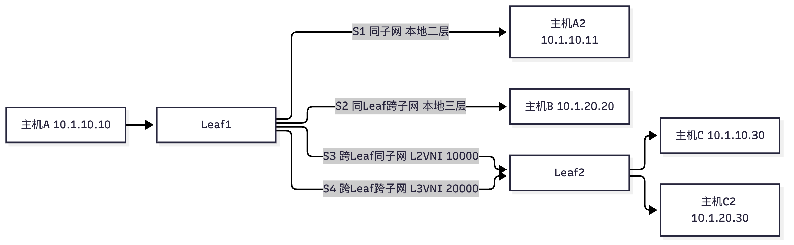


```mermaid
flowchart LR
    A["主机A 10.1.10.10"] -->|"同网段 ARP 后直接发帧"| SW["Leaf1 BD10 内查 MAC 表"]
    SW -->|"命中本地接入端口"| A2["主机A2 10.1.10.11"]
    SW -.->|"无 VXLAN 封装 不出设备"| SW
```

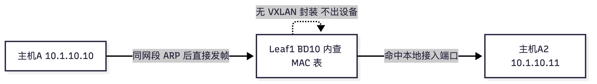


```mermaid
flowchart LR
    A["主机A 10.1.10.10"] -->|"目的MAC=主机C"| L1["Leaf1 BD10 命中隧道下一跳"]
    L1 -->|"加 50B 外层 VNI10000 内层帧不变"| U["Underlay ECMP"]
    U --> L2["Leaf2 按 VNI10000 找 BD10"]
    L2 -->|"剥外层 原样转发"| C["主机C 10.1.10.30"]
```

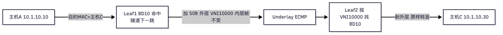


```mermaid
flowchart TD
    A["主机A 发帧 目的MAC=网关MAC"] --> M["Leaf1 BD10 命中网关MAC"]
    M --> R["VPNA 路由表查 10.1.20.0/24"]
    R -->|"下一跳 Leaf2"| W["改写目的MAC为C2 源MAC为网关"]
    W --> E["L3 VNI 20000 封装"]
    E --> U["Underlay 隧道"]
    U --> L2["Leaf2 按VNI20000 识别三层"]
    L2 --> L3["VPN路由表命中直连 BD20"]
    L3 --> C2["交付主机C2"]
```

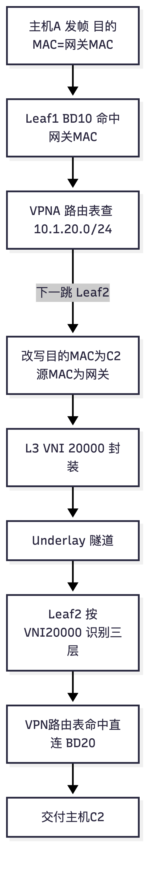


```mermaid
flowchart LR
    A["主机A 8.8.8.8"] --> L1["Leaf1 三层改写"]
    L1 -->|"L3 VNI 20000"| BL["Border Leaf"]
    BL -->|"剥封装 普通三层转发"| FW["USG6000E 防火墙"]
    FW --> EXT["外部网络"]
    EXT --> FW2["回程"] --> BL2["Border Leaf 按Type2/Type5 回封"] --> L12["Leaf1 BD10"] --> A
```

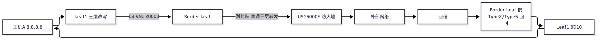


### 真题精练

**Q1.【真题·简答】** 在 EVPN 分布式网关中，主机 A（Leaf1，10.1.10.10）访问主机 C2（Leaf2，10.1.20.30）。请写出完整转发过程，并说明使用的是 L2 VNI 还是 L3 VNI，以及内层帧的 MAC 在哪一跳被改写。

> **答案要点**：
> ① A 判断目的不同网段，ARP 请求网关 10.1.10.1，Vbdif10 用统一网关 MAC 应答。
> ② A 发帧，**内层目的 MAC = 网关 MAC**。
> ③ Leaf1 在 BD 10 内查 MAC 表命中本机 Vbdif10 → 上交三层。
> ④ Leaf1 在 VPNA 路由表查 10.1.20.0/24，命中 EVPN 学来的路由（Type2 主机路由或 Type5 网段路由），下一跳 Leaf2 VTEP。
> ⑤ **在 Leaf1 完成内层 MAC 改写**：目的 MAC 由网关 MAC 改为 C2 的 MAC（来自 EVPN 学到的 ARP 表项），源 MAC 改为网关 MAC，TTL 减 1。
> ⑥ **使用 L3 VNI（如 20000）封装**：外层源/目 IP 为两个 VTEP，VNI = L3 VNI。这就是**对称 IRB**。
> ⑦ Leaf2 按 L3 VNI 识别三层流量，在 VPNA 路由表命中直连 BD 20，二层转发给 C2（**不再做三层查表**）。
> ⑧ 回答要点：MAC 改写发生在 **源 Leaf（Leaf1）**；使用 **L3 VNI**；与非对称 IRB 的区别在于非对称 IRB 用 L2 VNI 封装、需目的 Leaf 再做一次三层转发。

**Q2.【真题·多选】** 关于分布式网关的五个转发场景，下列说法正确的有？
A. 同 Leaf 同子网流量不经过 VBDIF，也不做 VXLAN 封装
B. 同 Leaf 跨子网流量在本地完成三层转发，不使用隧道
C. 跨 Leaf 同子网使用 L2 VNI 封装，且不改变内层帧的以太头
D. 访问外部网络时，Border Leaf 保留 VXLAN 封装直接把报文送到 Internet

> **答案：ABC**
> **解析**：D 错——**Border Leaf 是 overlay 与传统网络的边界**：收到 VXLAN 报文后必须**剥离外层与 VXLAN 头**，还原成普通以太/三层报文再转发给防火墙或外部路由器；回程再按 EVPN 路由重新封装。A、B、C 分别对应 S1、S2、S3 场景的正确描述，其中"内层帧不变"是二层转发的本质特征。

**Q3.【真题·排错】** 分布式网关部署后，同 Leaf 内跨子网互通正常、同子网跨 Leaf 也正常，但跨 Leaf 跨子网不通。请给出最可能的原因与定位命令。

> **答案要点**：
> ① 最可能原因：**缺少 L3 VNI 或 Type2 未携带 Label2（L3 Label）**，导致三层流量无法跨 Leaf 转发。也可能是 **VPN 实例路由未导入**（RT 不匹配）或主机路由/网段路由缺失。
> ② 定位：`display bgp evpn all routing-table mac-route` 检查对端 Type2 是否携带 **L3 Label（MPLS Label2）** 且值与本端 L3 VNI 一致；`display vxlan vni` 确认 L3 VNI 状态 up；`display ip routing-table vpn-instance VPNA` 确认存在远端子网/主机路由；`display ip vpn-instance verbose` 核对 RT。
> ③ 另一类原因：**非对称 IRB 与对称 IRB 混用**——一端用 L2 VNI 封装、另一端期望 L3 VNI，导致目的 Leaf 无法正确识别。整改为两端统一使用**对称 IRB**（配置 L3 VNI 与 VPN 实例）。
> ④ 加分：检查是否遗漏 `arp direct-route enable`（缺主机路由会导致无匹配路由而丢包），以及 MTU（大包不通）。

### 易错点与排错

1. **把"跨 Leaf 跨子网"写成"两段 L2 VNI 隧道"**：那是**集中式网关**的路径；分布式网关是**一跳 L3 VNI**。
2. **忘记 L3 VNI 也要在 NVE 上使能**：只配了 BD/VNI 与 VPN 实例，但 `interface nve1` 下没有 `vni 20000`，跨 Leaf 三层不通。
3. **内层 MAC 改写位置搞错**：对称 IRB 下**在源 Leaf 就改写成目的主机 MAC**，不要在目的 Leaf 再改一次。
4. **同 Leaf 跨子网仍去查隧道**：说明路由表把直连子网路由指向了隧道（错误引入），应检查是否误把本地直连网段通过 EVPN 通告后又本机收到导致下一跳异常。
5. **Border Leaf 未做路由双向引入**：外部网络访问不通、回程丢失；`display ip routing-table vpn-instance VPNA` 与外部设备路由表需同时核对。

---

## 2.3 对称 IRB 与非对称 IRB、L2 VNI 与 L3 VNI

### 考点定位

本考点是**概念区分题与简答题的必考项**（4~6 分）：典型问法"对称 IRB 与非对称 IRB 的区别"、"为什么 L3 VNI 让对称 IRB 成为主流"、"L2 VNI 与 L3 VNI 各有什么作用"、"VLAN 与 VNI 如何映射"。上机题中"跨 Leaf 跨子网不通"经常是 IRB 模式混用所致。

### 原理精讲

**IRB（Integrated Routing and Bridging，集成路由与桥接）**指的是"同一台设备既能做二层桥接又能做三层路由"，在 EVPN 语境下，关键问题变成：**一次跨子网转发，三层处理（查路由表 + 改写 MAC）由几台设备完成？**

**非对称 IRB（Asymmetric IRB）**：源 Leaf 完成三层处理后，**用 L2 VNI 封装**把报文送到目的 Leaf；目的 Leaf 收到后再**做一次三层查表与 MAC 改写**，最后在目的 BD 内二层转发。所谓"非对称"指的是**两端处理不同**：源端做"三层 + 二层"，目的端也做"三层 + 二层"，两端都必须有该 BD 的 VBDIF 与完整的 VLAN/VNI 映射。它需要 **每个参与互通的 Leaf 都配置所有相关子网的 BD、VNI、VBDIF**——在一个租户有几十个子网、Fabric 有上百台 Leaf 时，配置与表项规模都会爆炸。早期 EVPN 实现多采用此模式，**现在已基本被对称 IRB 取代**。

**对称 IRB（Symmetric IRB）**：源 Leaf 完成三层处理后，**用 L3 VNI 封装**（外层 VNI 不再是 BD 的二层 VNI，而是代表整个 VPN 实例的三层 VNI）；目的 Leaf 收到后**只按 L3 VNI 识别"这是三层流量"**，在 VPN 实例路由表中查到直连子网后在本地 BD 内二层转发，**不再做三层改写**。两端处理**完全对称**（都是"查路由表 → 转发"），因此得名。它的关键要件是：**Type2 路由必须携带 MPLS Label2（L3 VNI）**，让远端知道自己能通过哪个 L3 VNI 把三层流量送回来；同时每台 Leaf 只需配置 **一个 L3 VNI + 一个 VPN 实例**，而不需要配置"所有子网的 VBDIF"。这就是 **L3 VNI 让对称 IRB 成为主流**的根本原因：**它把"子网数量 × Leaf 数量"的配置复杂度，降为"每租户一个 L3 VNI"的常数级配置**——新增子网只需在承载该子网的 Leaf 上加 BD/VBDIF，其他 Leaf 无需任何改动。

**L2 VNI 与 L3 VNI 的区分（考试高频）**：

| 维度 | L2 VNI（二层 VNI） | L3 VNI（三层 VNI） |
|---|---|---|
| 绑定对象 | **BD**（`bridge-domain` 下 `vxlan vni`） | **VPN 实例**（通过承载 BD 与 VPN 实例绑定） |
| 数量 | 每个子网/BD 一个 | **每个租户（VPN 实例）一个** |
| 承载流量 | 同子网二层流量、BUM | 跨子网三层流量 |
| 在 Type2 中的位置 | **MPLS Label1** | **MPLS Label2** |
| 是否承载主机 | 是 | 否（仅作三层转发的封装标识） |
| 抓包判据 | 外层 VNI = BD 对应值 | 外层 VNI = 租户 L3 VNI 值 |

**VLAN 与 VNI 的映射（实务要点）**：接入侧 VLAN 只在本 Leaf 有意义，通过与 BD 绑定进入 overlay。**规范做法是"VLAN → BD → VNI"三级映射**（见 1.6 节）：`bridge-domain 10` 下 `l2 binding vlan 10` + `vxlan vni 10000`。跨 Leaf 时**只有 VNI 必须一致，VLAN 可以不同**（这正是 VXLAN 解耦"二层域与物理位置"的价值）；但如果运维希望"同一业务在各 Leaf 用相同 VLAN 便于排错"，可以统一规划 VLAN 编号。**常见错误**：不同 Leaf 上同一业务映射到不同 VNI → 完全不互通；或同一 Leaf 上两个 VLAN 绑定到同一 BD（业务合并）→ 广播域扩大、ARP 表项增多，需评估。

**对称 IRB 下的主机路由与网段路由**：为让跨 Leaf 三层转发精确，Leaf 通常同时维护两类路由：① **Type2 主机路由（/32）**——来自 EVPN 主机通告（`arp direct-route enable` 生成 32 位主机路由后由 EVPN 承载），转发最精确，但表项数量与主机数成正比；② **Type5 网段路由**——由某台 Leaf（通常是网关或 Border）汇总通告整个网段，表项少。实践上常采用"**同子网/同 Leaf 精确、跨 Fabric 用网段**"的混合策略，兼顾精确性与规模。

### 关键概念对照表

| 对比项 | 非对称 IRB | **对称 IRB** |
|---|---|---|
| 源 Leaf 封装 VNI | **L2 VNI** | **L3 VNI** |
| 目的 Leaf 是否做三层 | **是**（再查路由表 + 改 MAC） | 否（只按 VPN 实例查一次） |
| 两端处理是否一致 | 不一致 | **对称一致** |
| 每台 Leaf 需配的子网级配置 | 所有相关 BD/VBDIF | **只需自身承载的子网 BD/VBDIF** |
| 配置复杂度 | O(子网数 × Leaf 数) | **O(租户数)** |
| Type2 是否必须带 Label2 | 不必须 | **必须** |
| 表项规模 | 大 | 可控（可配 Type5 汇总） |
| 主流程度 | 早期/小规模 | **当前主流** |

| 是否需要某配置 | 非对称 IRB | 对称 IRB |
|---|---|---|
| L3 VNI | 不需要 | **需要** |
| 每 Leaf 所有子网 VBDIF | **需要** | 不需要 |
| VPN 实例（L3 转发） | 需要 | 需要 |
| Type2 携带 Label2 | 否 | **是** |

### 华为设备配置

```bash
# ===== 对称 IRB 关键配置（CE6865-Leaf1）=====
system-view
ip vpn-instance VPNA
 ipv4-family
  route-distinguisher 1.1.1.1:100
  vpn-target 100:1 export-extcommunity evpn
  vpn-target 100:1 import-extcommunity evpn
  quit
 quit
bridge-domain 1000                                      // L3 VNI 的载体 BD（对称 IRB 的标志性配置）
 vxlan vni 20000                                        // 该 VNI 即为 L3 VNI，与租户 VPNA 对应
 quit
interface Vbdif1000
 ip binding vpn-instance VPNA                            // 与 L3 VNI 关联到同一 VPN 实例
 quit
interface nve1
 source 1.1.1.1
 vni 10000                                               // L2 VNI（BD10）
 vni 20000                                               // L3 VNI（必须有）
 quit
# ===== 使 Type2 携带 L3 Label（对称 IRB 的前提）=====
bgp 100
 l2vpn-family evpn
  peer 10.1.1.254 enable
  peer 10.1.1.254 reflect-client
  quit
 quit
# ===== 验证 IRB 模式是否生效 =====
display bgp evpn all routing-table mac-route            // 检查 Type2 是否携带 L3 Label（第二个 Label 值应为 20000）
display vxlan vni                                        // L2 VNI 与 L3 VNI 均应 up
display ip routing-table vpn-instance VPNA               // 查看主机路由/32 与网段路由
display ip vpn-instance verbose                          // 核对 RD/RT 与实例绑定关系
```

### 示意图

```mermaid
flowchart TB
    subgraph ASY["非对称 IRB"]
        A1["Leaf1 三层改写"] -->|"L2 VNI 封装"| A2["Leaf2 再做一次三层改写"]
        A2 --> A3["目的 BD 二层转发"]
    end
    subgraph SYM["对称 IRB"]
        B1["Leaf1 三层改写"] -->|"L3 VNI 封装"| B2["Leaf2 仅查 VPN 实例路由"]
        B2 --> B3["目的 BD 二层转发"]
    end
```

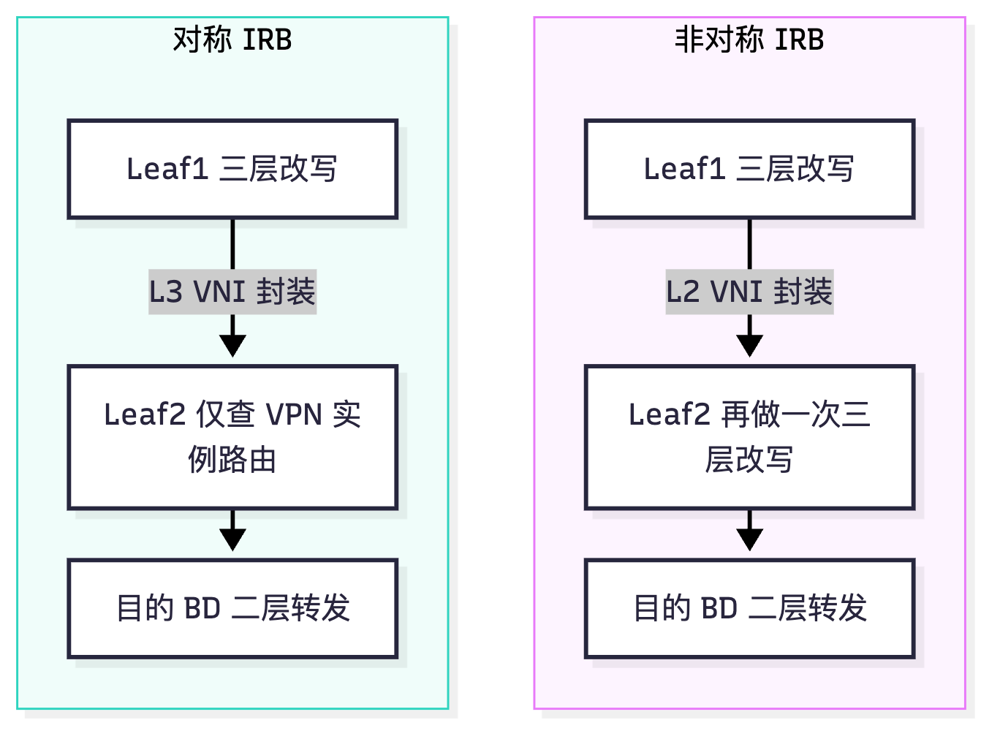


```mermaid
flowchart LR
    BD["每个子网 BD"] --> L2["L2 VNI 承载二层流量"]
    VRF["租户 VPN 实例"] --> L3["L3 VNI 承载三层流量"]
    L2 --> T2["Type2 的 Label1"]
    L3 --> T2B["Type2 的 Label2"]
    T2B --> SYM["对称 IRB 得以成立"]
```


### 真题精练

**Q1.【真题·简答】** 请比较对称 IRB 与非对称 IRB 的区别，并说明为什么 L3 VNI 使对称 IRB 成为主流方案。

> **答案要点**：
> ① 区别：**非对称 IRB** 源 Leaf 三层处理后用 **L2 VNI** 封装，目的 Leaf 需**再做一次三层查表与 MAC 改写**；**对称 IRB** 源 Leaf 三层处理后用 **L3 VNI** 封装，目的 Leaf **只按 L3 VNI/VPN 实例转一次**，两端处理对称。
> ② 配置影响：非对称 IRB 要求**每台 Leaf 都配置所有相关子网的 BD/VNI/VBDIF**，复杂度为 O(子网数 × Leaf 数)；对称 IRB 只需每租户一个 **L3 VNI + VPN 实例**，复杂度降为 O(租户数)，新增子网只影响承载它的 Leaf。
> ③ 表项与扩展性：对称 IRB 更具扩展性，且天然支持通过 **Type5 网段路由**做汇总，缓解主机路由数量增长。
> ④ 关键要件：对称 IRB 要求 **Type2 路由携带 MPLS Label2（L3 VNI）**，否则远端无法用 L3 VNI 封装三层流量。
> ⑤ 结论：正因为 L3 VNI 把"三层转发所需的上下文"从"每个子网一份"压缩为"每个租户一份"，对称 IRB 才成为大型 Fabric 的主流。

**Q2.【真题·多选】** 关于 L2 VNI 与 L3 VNI，下列说法正确的有？
A. L2 VNI 绑定 BD，L3 VNI 与 VPN 实例关联
B. 一个租户通常只需要一个 L3 VNI，但可能有多个 L2 VNI
C. Type2 路由中的 MPLS Label1 是 L2 VNI，Label2 是 L3 VNI
D. L3 VNI 主要用于传输同子网的二层流量

> **答案：ABC**
> **解析**：D 错——L3 VNI 承载的是**跨子网三层流量**（已由源 Leaf 完成三层改写后的报文）；同子网二层流量用 **L2 VNI**。B 正确：L3 VNI 是"租户级"的，一个 VPN 实例一个；L2 VNI 是"子网/BD 级"的，一个租户有多个子网就有多个 L2 VNI。C 是 Type2 路由字段的必背结论。

**Q3.【真题·排错】** 某 Fabric 中 Leaf1 与 Leaf2 的分布式网关跨 Leaf 跨子网不通。检查发现 `display bgp evpn all routing-table mac-route` 中收到的 Type2 只有 **一个 Label**。请分析原因与整改方法。

> **答案要点**：
> ① 原因：Type2 只带一个 Label（MPLS Label1 = L2 VNI），**缺少 Label2（L3 VNI）**，说明该 Leaf 没有配置 L3 VNI / 未建立承载 L3 VNI 的 BD / 未把 L3 VNI 与 VPN 实例关联。于是远端 Leaf 只能做二层转发，**三层流量无法用 L3 VNI 封装**，跨 Leaf 跨子网不通（同子网、同 Leaf 跨子网仍正常，与现象吻合）。
> ② 整改：在每台 Leaf 上配置 L3 VNI 的载体 BD（如 BD 1000 / VNI 20000）、在 `interface nve1` 下使能该 VNI、把对应 VBDIF 绑定到同一 VPN 实例 VPNA；确认 RD/RT 正确。
> ③ 验证：`display bgp evpn all routing-table mac-route` 应看到两个 Label，且 Label2 的值与本地 L3 VNI 一致；`display vxlan vni` 中 L3 VNI 状态 up；跨 Leaf 跨子网 ping 通。
> ④ 加分：同时确认两端**没有混用非对称 IRB**（一端 L2 VNI 封装、一端期望 L3 VNI），统一为对称 IRB。

### 易错点与排错

1. **"对称"的含义答错**：对称指的是**两端处理方式对称（都只做一次路由转发）**，不是"两个 VNI 数量对称"。
2. **忘记 L3 VNI 需要载体 BD 与 VBDIF 绑定 VPN 实例**：不同版本命令细节略有差异，配置时应用 `?` 补全确认；核心是"L3 VNI 必须与 VPN 实例关联并在 NVE 上使能"。
3. **混用 IRB 模式**：一半 Leaf 对称、一半非对称，表现为"部分组合能通、部分不能"，排错时先把模式统一。
4. **Type5 与 Type2 冲突**：同时存在 /32 主机路由与网段路由时，按最长匹配选 /32（正常）；若发现流量走网段路由而绕行，检查主机路由是否被策略过滤。
5. **排错命令**：`display bgp evpn all routing-table mac-route`（看两个 Label）、`display vxlan vni`、`display ip routing-table vpn-instance VPNA`、两端对比。

---

## 2.4 分布式网关关键配置全流程

### 考点定位

本考点直接对应**实验卷的配置与验证环节**（15~20 分）：要求在一台 CE6865 上完成"VPN 实例 → BD/VNI → VBDIF → NVE → BGP EVPN"的全套配置并验证；也常在理论卷以**多选/排序题**出现（"配置顺序是什么"、"哪些配置缺一不可"）。失分点集中在：`evpn vpn-instance` 与 `ip vpn-instance` 的混用、L3 VNI 忘记在 NVE 使能、RD/RT 漏配或两端不一致、VBDIF 编号与 BD 不符。

### 原理精讲

分布式网关的配置有一条**严谨的依赖链**，顺序错会导致中间态报错或功能不生效。理解依赖链比背命令更重要：

**第 1 层：Underlay 就绪**（前置条件）。Leaf/Spine 三层互联、IGP（推荐 IS-IS）通告互联网段与 LoopBack0、MTU 抬到 1600、ECMP 生效。**这一层不通，后面全部白配**。

**第 2 层：租户隔离容器——VPN 实例（VRF）**。`ip vpn-instance VPNA` 定义租户；`ipv4-family` 下配 **RD**（唯一化，按设备唯一）与 **RT**（导入导出，按租户统一）。这是三层转发（跨子网、跨 Fabric）的基础，因为**分布式网关的三层路由表是 per-VPN 实例的**（`display ip routing-table vpn-instance VPNA`）。

**第 3 层：二层域——BD 与 L2 VNI**。每个子网一个 BD，`bridge-domain 10` 下 `vxlan vni 10000` 完成"BD ↔ VNI"1:1 绑定，`l2 binding vlan 10` 完成"VLAN → BD"映射。**接入侧 VLAN 只在本 Leaf 有意义，跨 Leaf 只看 VNI**。

**第 4 层：三层网关——VBDIF**。`interface Vbdif10` 必须是 **BD 号 + Vbdif** 的形式；配置 `ip address`（该子网网关）、`ip binding vpn-instance VPNA`（决定进哪个路由表）、`mac-address 0000-5e00-0101`（**分布式网关必须全网统一**），以及 `mac-address update arp`、`arp broadcast-suppress enable`、`arp direct-route enable` 三个"分布式网关功能开关"。**这一层是"集中式"与"分布式"的分水岭**：VBDIF 配在每台 Leaf 上就是分布式，只配在 Spine 上就是集中式。

**第 5 层：L3 VNI**。两层含义：① 承载三层流量的**封装标识**（对称 IRB 用它封装）；② 与 **VPN 实例**关联，使两端能识别"这是该租户的三层流量"。有两种配置风格：**a.** 用 `ip vpn-instance` + 专用载体 BD/VBDIF（本文主推，兼容性好）；**b.** 用 **`evpn vpn-instance <名称> bd-mode`** 视图，在其中配置 `route-distinguisher` 与 `vpn-target`，并把 BD 与 EVPN 实例绑定——这是较新版本推荐的 **BD 模式（BD-mode）EVPN 实例**写法。两种写法效果等价，考试中**建议按题目给出的版本选择，并说明两者等价**。

**第 6 层：隧道承载——NVE 接口**。`interface nve1` 下 `source <LoopBack0>` 并逐个 `vni`（**L2 VNI 与 L3 VNI 都要写**）。遗漏 L3 VNI 是最常见错误。

**第 7 层：控制平面——BGP EVPN**。`bgp 100` 建 IBGP 邻居（指向 RR），在 **`l2vpn-family evpn`** 地址族下 `peer x enable`；RR 侧加 `reflect-client`。**注意**：EVPN 地址族下**不需要**为每个租户单独 enable，路由会按 RT 自动分发到各 VPN 实例。

**配置验证清单（7 条，实验题必查）**：① `display vxlan vni`：所有 VNI（含 L3）状态 up、BD 与 VNI 一一对应；② `display vxlan tunnel`：隧道数量 = 预期对端数、类型为 evpn；③ `display bgp evpn peer`：会话 Established、PrefRcv 增长；④ `display bgp evpn all routing-table`：Type2/Type3（多归时含 Type1/Type4，外部互联时含 Type5）齐全；⑤ `display bgp evpn all routing-table mac-route`：Type2 携带**两个 Label**（L2 VNI 与 L3 VNI）；⑥ `display ip routing-table vpn-instance VPNA`：有直连网段、远端主机路由与网段路由；⑦ `display vni mac-address` / `display arp interface Vbdif10`：远端主机以 evpn 类型出现。

**VNI 与 VLAN 的映射实务建议**：① 规划表先行——把"租户 / 子网 / VLAN / BD / VNI / 网关 IP / VPN 实例 / RD / RT"列成一张表，全网统一，避免"某台 Leaf 抄错一位"；② VLAN 可与 VNI 同号（便于对照）但**不建议依赖**（受 4094 限制）；③ L2 VNI 与 L3 VNI 分段规划（例如 L2 VNI 用 10000~19999、L3 VNI 用 20000~29999），便于抓包时一眼识别是二层还是三层封装；④ 网关 IP 与 MAC 全网统一，写入规划表并在验收时逐台核对。

### 关键概念对照表

| 配置项 | 作用 | 缺失后果 | 关键要求 |
|---|---|---|---|
| `ip vpn-instance` | 租户隔离容器 | 无租户路由表，三层不通 | 每租户一个，绑定到 VBDIF |
| `route-distinguisher` | 唯一化路由 | 多 Leaf 表项冲突/抖动 | **按设备唯一** |
| `vpn-target ... import/export` | 路由导入导出 | 路由收不到或串网 | **按租户统一**，两端一致 |
| `bridge-domain` + `vxlan vni` | BD↔VNI 1:1 | 无二层域，业务不通 | 两端 VNI 必须一致 |
| `l2 binding vlan` | VLAN→BD | 服务器流量进不了 BD | 与接入 VLAN 对应 |
| `interface Vbdif` | 三层网关 | 跨子网不通 | 编号 = BD 号，绑定 VPN 实例 |
| `mac-address 0000-5e00-0101` | 统一网关 MAC | 迁移/双活瞬断 | **全网 Leaf 一致** |
| `mac-address update arp` | MAC→ARP 联动 | ARP 抑制失效、无主机路由 | 分布式网关建议必配 |
| `arp broadcast-suppress enable` | ARP 抑制 | ARP 泛洪 | 建议必配 |
| `arp direct-route enable` | 生成 /32 主机路由 | 三层转发不精确 | 建议必配 |
| L3 VNI（载体 BD + NVE 使能） | 三层流量封装 | **跨 Leaf 跨子网不通** | Type2 携带 Label2 |
| `interface nve1 source` + `vni` | 隧道与 VNI 使能 | 无隧道/部分 VNI 不通 | L2 与 L3 VNI 都要写 |
| `l2vpn-family evpn` + `peer enable` | EVPN 控制平面 | 学不到任何 EVPN 路由 | RR 上加 `reflect-client` |

| 两种 L3 VNI 配置风格 | 命令要点 | 适用 |
|---|---|---|
| VPN 实例 + 载体 BD/VBDIF | `ip vpn-instance` → `bridge-domain 1000`+`vxlan vni 20000` → `interface Vbdif1000 ip binding vpn-instance` | 兼容性好，各版本通用 |
| `evpn vpn-instance ... bd-mode` | `evpn vpn-instance evpna bd-mode` → `route-distinguisher` / `vpn-target` → BD 绑定 | 新版本推荐，与 BD 绑定更直观 |

### 华为设备配置

```bash
# ===== 分布式网关完整配置（CE6865-Leaf1，按依赖顺序）=====
system-view
# ---- 1. Underlay 前置（IS-IS 通告 LoopBack 与互联网段）----
interface LoopBack0
 ip address 1.1.1.1 255.255.255.255                     // VTEP 源地址
 quit
isis 1
 is-level level-2
 network-entity 49.0001.0000.0000.0001.00                // NET 地址，Fabric 常用 L2 扁平域
 quit
interface GE1/0/1
 undo portswitch
 ip address 10.1.1.1 255.255.255.0
 mtu 1600                                                 // 为 VXLAN 封装留出 50B 余量
 isis enable 1
 quit
# ---- 2. VPN 实例（RD 唯一、RT 统一）----
ip vpn-instance VPNA
 ipv4-family
  route-distinguisher 1.1.1.1:100                         // RD 按设备唯一，避免多 Leaf 冲突
  vpn-target 100:1 export-extcommunity evpn               // 导出 RT（按租户统一）
  vpn-target 100:1 import-extcommunity evpn               // 导入 RT
  quit
 quit
# ---- 3. 二层 BD 与 L2 VNI（VLAN 到 BD 映射）----
vlan batch 10 20
bridge-domain 10
 vxlan vni 10000                                           // BD10 ↔ L2 VNI 10000
 l2 binding vlan 10                                        // VLAN10 映射到 BD10
 quit
bridge-domain 20
 vxlan vni 10001
 l2 binding vlan 20
 quit
# ---- 4. 三层网关 VBDIF（编号必须等于 BD 号）----
interface Vbdif10
 ip binding vpn-instance VPNA                              // 进入租户 VPNA 的路由表
 ip address 10.1.10.1 255.255.255.0                        // 网关地址（每台 Leaf 相同）
 mac-address 0000-5e00-0101                                // 统一网关 MAC
 mac-address update arp                                    // MAC 表项联动生成 ARP
 arp broadcast-suppress enable                             // ARP 广播抑制
 arp direct-route enable                                   // 生成 32 位主机路由
 undo shutdown
 quit
interface Vbdif20
 ip binding vpn-instance VPNA
 ip address 10.1.20.1 255.255.255.0
 mac-address 0000-5e00-0101
 quit
# ---- 5. L3 VNI（载体 BD + VBDIF 关联 VPN 实例）----
bridge-domain 1000
 vxlan vni 20000                                            // L3 VNI，承载租户三层流量
 quit
interface Vbdif1000
 ip binding vpn-instance VPNA                               // L3 VNI 与租户路由表关联
 quit
# ---- 5'. 等价写法：EVPN BD 模式实例（新版本推荐）----
evpn vpn-instance evpna bd-mode
 route-distinguisher 1.1.1.1:100                            // 与 ip vpn-instance 下的 RD 等价
 vpn-target 100:1 export-extcommunity
 vpn-target 100:1 import-extcommunity
 quit
# ---- 6. NVE 接口（L2 与 L3 VNI 都要使能）----
interface nve1
 source 1.1.1.1
 vni 10000
 vni 10001
 vni 20000                                                  // 漏配此项 → 跨 Leaf 跨子网不通
 quit
# ---- 7. BGP EVPN 控制平面 ----
bgp 100
 router-id 1.1.1.1
 peer 10.1.1.254 as-number 100                               // 指向 Spine/RR1
 peer 10.1.1.254 connect-interface LoopBack0
 peer 10.1.1.253 as-number 100                               // 指向 RR2（冗余）
 peer 10.1.1.253 connect-interface LoopBack0
 l2vpn-family evpn
  peer 10.1.1.254 enable
  peer 10.1.1.253 enable
  quit
 quit
# ---- 保存 ----
save
```

### 示意图

```mermaid
flowchart TD
    A["Underlay 三层可达"] --> B["ip vpn-instance 租户容器 RD/RT"]
    B --> C["bridge-domain 与 L2 VNI"]
    C --> D["interface Vbdif 网关 IP 与统一 MAC"]
    D --> E["L3 VNI 载体 BD 关联 VPN 实例"]
    E --> F["interface nve1 source 与 vni 列表"]
    F --> G["BGP EVPN l2vpn-family 邻居"]
    G --> H["七项验证清单"]
```


```mermaid
flowchart LR
    V10["VLAN 10"] --> BD10["BD 10"]
    V20["VLAN 20"] --> BD20["BD 20"]
    BD10 --> L2A["L2 VNI 10000"]
    BD20 --> L2B["L2 VNI 10001"]
    BD10 --> VB["Vbdif10 网关"]
    BD20 --> VB2["Vbdif20 网关"]
    BD1000["BD 1000"] --> L3V["L3 VNI 20000"]
    L3V --> VRF["VPN 实例 VPNA"]
    VB --> VRF
    VB2 --> VRF
```


### 真题精练

**Q1.【真题·实验】** 请在 CE6865 上写出分布式网关的关键配置（VPN 实例、BD/VNI、VBDIF、L3 VNI、NVE、BGP EVPN），并列出验证命令。

> **答案要点（按 7 层依赖给分）**：
> ① `ip vpn-instance VPNA` + `ipv4-family` 下 `route-distinguisher 1.1.1.1:100`（按设备唯一）与 `vpn-target 100:1 import/export-extcommunity evpn`（按租户统一）。
> ② `bridge-domain 10` → `vxlan vni 10000` → `l2 binding vlan 10`（每个子网一份）。
> ③ `interface Vbdif10` → `ip binding vpn-instance VPNA` → `ip address 10.1.10.1 24` → `mac-address 0000-5e00-0101`（**全网统一**）→ `mac-address update arp` / `arp broadcast-suppress enable` / `arp direct-route enable`。
> ④ L3 VNI：`bridge-domain 1000` + `vxlan vni 20000`（或 `evpn vpn-instance ... bd-mode` 写法），并由对应 VBDIF 绑定同一 VPN 实例。
> ⑤ `interface nve1` → `source 1.1.1.1` → `vni 10000`、`vni 20000`（**L2 与 L3 VNI 都要写**）。
> ⑥ `bgp 100` → `peer <RR> as-number 100` + `connect-interface LoopBack0` → `l2vpn-family evpn` → `peer x enable`（RR 侧 `reflect-client`）。
> ⑦ 验证：`display vxlan vni`、`display vxlan tunnel`、`display bgp evpn peer`、`display bgp evpn all routing-table mac-route`（应有**两个 Label**）、`display ip routing-table vpn-instance VPNA`、`display vni mac-address`、跨 Leaf 跨子网 ping 测试。

**Q2.【真题·多选】** 下列关于分布式网关配置的说法，正确的有？
A. VBDIF 的编号必须与所服务 BD 的编号一致
B. L3 VNI 也必须在 NVE 接口下使能，否则跨 Leaf 三层不通
C. 所有 Leaf 的网关 MAC 应配置为相同值
D. RD 应在全网所有 Leaf 上配置为相同值以便互通

> **答案：ABC**
> **解析**：D 错——**RD 必须按设备（实例）唯一**，全网相同会导致 EVPN 路由在 BGP 表中互相覆盖、MAC 表项抖动；互通性靠 **RT 一致**实现，而不是 RD 一致。A 是华为 VBDIF 的命名规则；B 是最常见的漏配点（只 `vni 10000` 而漏 `vni 20000`）；C 是分布式网关实现网关无感切换的前提。

**Q3.【真题·排错】** 配置完成后，`display vxlan vni` 显示 BD 10 对应的 VNI 10000 状态为 **down**。请列出至少三条排查方向。

> **答案要点**：
> ① **NVE 源地址不可用**：`interface nve1` 下 `source` 的地址未配置、接口未 up 或不是本机地址；定位 `display interface LoopBack0`、`display nve` 相关输出。
> ② **NVE 接口未使能该 VNI**：漏配 `vni 10000`，此时 BD 与 VNI 已绑定但 VXLAN 未生效，状态常显示 down。
> ③ **BD 与 VNI 绑定不完整或冲突**：VNI 已被其他 BD 占用（BD↔VNI 必须 1:1），或 `bridge-domain` 下未正确执行 `vxlan vni`。
> ④ 其他：Underlay 到对端不可达使动态隧道无法建立（部分版本隧道不通会影响到 VNI 状态显示）；BGP EVPN 邻居未建立导致无 Type3。
> ⑤ 处置：补齐 `vni` 配置、修正源地址、核对 1:1 绑定，随后 `display vxlan vni` 应转为 up、`display vxlan tunnel` 出现 evpn 类型隧道。

### 易错点与排错

1. **配置顺序混乱**：先配 NVE 再配 BD 时，`vni` 命令可能报"VNI 未绑定"之类的错误。规范顺序：**VPN 实例 → BD/VNI → VBDIF → L3 VNI → NVE → BGP EVPN**。
2. **漏配 L3 VNI 在 NVE 下使能**：本 Leaf 内的转发全部正常，只有跨 Leaf 跨子网不通，是"局部全好、全局半坏"的典型。
3. **RD 抄成同一个值**：实验网中极常见，规模小的时候可能"看起来能用"，但一旦多 Leaf 出现同 MAC 通告就会抖动。
4. **`evpn vpn-instance` 与 `ip vpn-instance` 双配冲突**：两种风格选一种，混用可能导致 RT 重复或实例关系混乱；若题目要求 BD 模式就统一用 `evpn vpn-instance ... bd-mode`。
5. **忘记 `l2 binding vlan`**：BD 与 VNI 都正确但服务器流量进不来，`display bridge-domain 10` 可查绑定关系。
6. **验收清单化**：每次配置完成后按"VNI 状态 → 隧道数量 → EVPN 邻居 → 五类路由 → 两个 Label → 租户路由表 → MAC/ARP 表"七步验证，可覆盖 95% 的问题。

---

## 2.5 分布式网关的网关 MAC 与 ARP 处理

### 考点定位

本考点是**原理与规模设计题**（4~6 分）：常问"为什么所有 Leaf 用同一网关 MAC"、"统一网关 MAC 带来什么问题（ARP 抑制与 MAC 表项规模）"。上机题的落点是"ARP 抑制失效"与"MAC 表项溢出导致的丢包"。这是"统一网关 MAC"这一设计的**收益与代价双向分析**，能答出"代价"的选手才拿高分。

### 原理精讲

**统一网关 MAC 的收益（必须背）**：① **网关无感跟随**——主机只要 ARP 到网关 MAC，无论它在哪台 Leaf 上、迁移到哪台 Leaf，都能被正确接住；② **VM 热迁移零改配置**——主机 ARP 缓存不需要刷新，迁移后流量立即生效（配合 EVPN 的 Type2 重新通告）；③ **取消 VRRP**——无需虚拟路由协议选举主备，省去协议开销与切换时间（VRRP 切换通常 1~3 秒，统一网关 MAC 方案是"零切换"）；④ **多活网关**——多台 Leaf 可同时承担同一网关的转发，天然负载分担；⑤ **简化主机配置**——所有 Leaf 下的主机网关配置完全相同。

**统一网关 MAC 的代价（本节的加分核心）**：
1. **MAC 表项规模问题**。在二层 VNI 场景下，每台 Leaf 的 MAC 表需要记录**本 Leaf 主机的 MAC（本地表项）+ 其他 Leaf 主机的 MAC（远端表项，指向隧道）**，规模随**全网主机数**增长。更麻烦的是**统一网关 MAC 本身**：所有 Leaf 的 VBDIF 都使用同一个 MAC，若某台 Leaf 收到目的 MAC 为该网关 MAC 的帧（例如主机发往网关的帧被泛洪到其他 Leaf），无法通过 MAC 区分"该由哪台 Leaf 处理"——因此必须依赖"**帧总是发往源主机所在的 Leaf**"这一前提（由 EVPN 的精确主机路由/表项保证）。当 Fabric 规模达到数万主机时，MAC 表与 ARP 表的规模压力显著，需要通过 **Type5 网段路由替代 Type2 主机路由**、合理设置**老化时间**、控制**广播域大小**来缓解。
2. **ARP 抑制的复杂性与失效场景**。ARP 抑制依赖"本地 ARP 表里有远端表项"。在统一网关 MAC 下，代答时**回应哪个 MAC**是个设计选择：回应本 Leaf 的网关 MAC（即统一网关 MAC）可以保证主机缓存始终有效；但这要求所有 Leaf 都能正确转发"目的 MAC = 统一网关 MAC"的帧——在正常情况下主机流量会先经过**自己所在 Leaf** 的三层转发，因此没有问题；但在**发生 MAC 表项不完整或表项丢失**（老化、抑制误配、EVPN 未收敛）时，可能出现"帧被泛洪到多台 Leaf，多台 Leaf 都认为自己该处理"的低效现象，极端情况下造成重复转发与环路风险（因此离不开水平分割与 DF 机制）。
3. **多归场景下的 BUM 重复**。若不做 DF 选举，两台 Leaf 都会向同一台多归主机转发 BUM 流量，造成重复；统一网关 MAC 并不能解决这个问题，必须依靠 **Type1/Type4 + DF 选举**（见 2.6 节）。
4. **ARP 抑制仍然不能消除所有泛洪**。边界条件与 1.10 节相同：静默主机、免费 ARP、未知单播、组播、DHCP 广播等仍会泛洪；**统一网关 MAC 让"ARP 抑制"变得更可行（代答 MAC 全网一致），但并没有消除 BUM 的存在**。
5. **故障定位更难**。由于 MAC/IP 在每台 Leaf 上看起来相同（同一网关 IP、同一网关 MAC），排错时必须**明确"在哪台 Leaf 上查表"**，否则容易被"为什么我在 Leaf2 上看到 Leaf1 的网关 MAC"这类现象误导——这是正常且必须的。

**规模优化手段（简答题的"怎么办"部分）**：① **用 Type5 网段路由替代 Type2 主机路由**：跨 Leaf 只需知道"某网段在 Leaf X 后面"，表项从"每主机一条"降到"每网段一条"；② **控制 BD 粒度**：不要为了省 VNI 把太多业务 VLAN 塞进同一 BD（广播域越大，ARP/MAC 表越大）；③ **合理老化时间**：ARP 老化过长会占表项，过短会导致反复泛洪，需结合业务特征设置；④ **开启 ARP 抑制与 `mac-address update arp`**，把"被动泛洪学习"变成"控制平面预知"；⑤ **主机侧限制广播**：关闭不必要的服务发现协议（如某些二层发现协议），减少 BUM 源；⑥ **分布式网关 + Border Leaf 收敛南北向流量**，避免安全设备成为新的集中瓶颈。

### 关键概念对照表

| 设计选择 | 收益 | 代价/风险 | 应对措施 |
|---|---|---|---|
| 全网统一网关 MAC | 无感迁移、取消 VRRP、多活 | MAC/ARP 表规模、依赖表项完整性 | Type5 汇总、控制 BD 粒度、老化调优 |
| 每 Leaf 独立网关 MAC | 表项定位简单 | **迁移后网关 MAC 失效，长时间中断** | **不可取** |
| 使用 VRRP 提供网关冗余 | 协议成熟 | 切换 1~3 秒、额外协议开销 | 已被统一网关 MAC 方案取代 |
| ARP 抑制 + mac-address update arp | 减少 ARP 泛洪 | 依赖 Type2 携带 IP | 确认对端配置与 RT 匹配 |
| Type5 网段路由 | 表项规模小 | 转发精度低于主机路由 | 与 Type2 混合使用 |
| DF 选举（多归） | 避免 BUM 重复 | 配置复杂、需 ESI 一致 | 见 2.6 节 |

| 表项类型 | 内容 | 规模增长因素 | 优化手段 |
|---|---|---|---|
| 本地 MAC 表项 | 本 Leaf 主机的 MAC | 本地主机数 | 正常，无需特殊优化 |
| 远端 MAC 表项 | 远端主机 MAC → 隧道 | **全网主机数** | Type5 汇总、BD 粒度控制 |
| 本地 ARP 表项 | 本 Leaf 主机 IP↔MAC | 本地主机数 | 老化时间调优 |
| 远端 ARP 表项 | 远端主机 IP↔MAC（EVPN 学来） | **全网主机数** | 同上；ARP 抑制提升效率 |
| 主机路由（/32） | 远端主机 IP → VTEP | **全网主机数** | 用 Type5 网段路由替代 |
| 网段路由（Type5） | 网段 → VTEP | 网段数 | 汇总，表项最省 |

### 华为设备配置

```bash
# ===== CE6865-Leaf1：统一网关 MAC 与 ARP 处理相关配置 =====
system-view
interface Vbdif10
 ip binding vpn-instance VPNA
 ip address 10.1.10.1 255.255.255.0
 mac-address 0000-5e00-0101                     // 统一网关 MAC：所有 Leaf 必须一致
 mac-address update arp                          // MAC 表项变化时同步生成/更新 ARP 表项
 arp broadcast-suppress enable                   // 命中本地 ARP 表则代答，不泛洪
 arp direct-route enable                         // 依据 ARP 生成 32 位主机路由，供三层精确转发
 arp expire-time 1200                            // ARP 老化时间（秒）：过长占表项、过短频繁泛洪，按业务调优
 quit
# ===== 限制 MAC 表规模的相关手段（示例）=====
system-view
mac-address aging-time 300                        // MAC 老化时间（秒），控制远端表项驻留时长
# 如需限制某 BD 学习 MAC 数量，可用 MAC 数量限制：
# mac-limit maximum 2000 alarm enable             // 关键字随版本不同，配置前用 ? 确认
# ===== 通过 Type5 网段路由替代大量主机路由（在网关/Border 侧引入）=====
ip vpn-instance VPNA
 ipv4-family
  import-route direct                              // 把直连网段引入 VPN 实例路由表，再由 EVPN 以 Type5 通告
  quit
 quit
# ===== 验证网关 MAC 与 ARP 表 =====
display interface Vbdif10                          // 确认 MAC 为 0000-5e00-0101（全网应一致）
display arp interface Vbdif10                      // 查看本地与远端 ARP 表项（远端表项由 EVPN 生成）
display vni mac-address                            // 查看 BD 内 MAC 表：远端 MAC 应指向隧道
display mac-address statistics                     // 统计 MAC 表项数量，评估规模
```

### 示意图

```mermaid
flowchart TB
    H["主机 ARP 缓存 网关10.1.10.1 对应 MAC 0000-5e00-0101"] --> L1["Leaf1 Vbdif10 同 MAC"]
    H --> L2["Leaf2 Vbdif10 同 MAC"]
    L1 --> R["收益 无感迁移 取消 VRRP 多活"]
    L2 --> R
    R --> C["代价 表项规模增大"]
    C --> O1["Type5 网段路由汇总"]
    C --> O2["控制 BD 粒度"]
    C --> O3["老化时间调优"]
```


```mermaid
flowchart LR
    A["主机请求同子网远端 IP"] --> B["查本地 ARP 表"]
    B -->|命中| C["以统一网关 MAC 代答"]
    B -->|未命中| D["BUM 泛洪"]
    D --> E["远端应答后学到表项"]
    E --> F["后续请求可抑制"]
```


### 真题精练

**Q1.【真题·简答】** 分布式网关为什么要求全网使用同一个网关 MAC？这样做会带来哪些问题？如何缓解？

> **答案要点**：
> ① 原因：主机 ARP 缓存中保存"网关 IP → 网关 MAC"；若各 Leaf MAC 不同，VM 迁移后主机缓存的网关 MAC 在新 Leaf 上不存在，会导致长时间中断，且无法实现多活与无感切换。统一网关 MAC 使任何一台 Leaf 都能接住发往该 MAC 的帧。
> ② 收益：网关无感跟随、VM 迁移零配置、取消 VRRP（无切换时延）、多活负载分担、主机配置统一。
> ③ 带来的问题：**a. MAC/ARP 表项规模随全网主机数增长**（远端表项 + /32 主机路由）；**b. ARP 抑制依赖表项完整性**，表项缺失或 Type2 未携带 IP 时抑制失效；**c. 多归场景下 BUM 可能重复**（需 DF 选举）；**d. 排错时"同一 IP/MAC 出现在多台设备"容易引起误判**。
> ④ 缓解：用 **Type5 网段路由**替代大量 Type2 主机路由；控制 BD 粒度（避免超大广播域）；合理设置 MAC/ARP 老化时间；开启 `mac-address update arp` 与 ARP 抑制；多归场景配置 ESI 并依赖 DF 选举；必要时做 MAC 数量限制保护。

**Q2.【真题·多选】** 统一网关 MAC 方案相比 VRRP 网关冗余方案的优势包括？
A. 无需 VRRP 选举与切换时间，网关切换接近"零中断"
B. 多台 Leaf 可同时承担同一网关的转发，实现多活
C. 主机侧无需修改任何配置即可获得网关冗余
D. 可以完全消除 VXLAN 网络中的所有 BUM 泛洪

> **答案：ABC**
> **解析**：D 错——统一网关 MAC 解决的是"网关冗余与迁移"问题，**与 BUM 泛洪无关**。ARP 抑制只能减少"同子网已知主机的 ARP 请求"，未知单播、组播、DHCP、免费 ARP 仍需泛洪；多归场景的 BUM 还要靠 DF 选举控制。A、B、C 是统一网关 MAC 的核心价值。

**Q3.【真题·排错】** 某 Fabric 中 5 万台 VM，运行一段时间后出现部分新 VM 上线后长时间无法通信，`display mac-address statistics` 显示 MAC 表项接近规格上限。请给出分析与优化方案。

> **答案要点**：
> ① 分析：分布式网关下每台 Leaf 需要保存**本地与远端主机 MAC 表项**，并可能为每台远端主机维护 /32 主机路由与远端 ARP 表项，规模随全网主机数线性增长，达到规格上限后**新表项无法学习**，新 VM 上线即不通。
> ② 优化：**a.** 用 **Type5 网段路由**替代 Type2 主机路由，把"每主机一条路由"降为"每网段一条"；**b.** 控制 **BD 粒度**，避免把过多业务 VLAN 合并到同一 BD 导致单 BD 表项过大；**c.** 合理设置 **MAC/ARP 老化时间**，缩短无流量主机的表项驻留；**d.** 必要时做 **MAC 数量限制**与告警，防止单点爆表影响整机；**e.** 评估是否需要"按需分布式网关"（仅对确实需要跨子网直通的主机下发主机路由）。
> ③ 验证：`display mac-address statistics`、`display vni mac-address`、`display ip routing-table vpn-instance VPNA` 观察表项数量变化。

### 易错点与排错

1. **误答"统一网关 MAC 是为了防环"**：防环靠水平分割/DF 选举，与网关 MAC 无关。
2. **只讲收益不讲代价**：简答题若只写"无感迁移、取消 VRRP"，最多得一半分；必须补充表项规模与抑制边界。
3. **ARP 老化时间随意设置**：过短会造成频繁泛洪与瞬时不可达，过长会挤占表项；建议结合业务会话特征设置并在文档中记录。
4. **误以为网关 MAC 相同会导致 MAC 冲突**：MAC 冲突指"同一 MAC 出现在同一广播域的两个端口"，而这里各 Leaf 的 VBDIF 处于不同设备、同一 BD/VNI 逻辑域中的**网关身份**，是设计使然；真正的冲突表现为 MAC 漂移告警。
5. **排错命令**：`display interface Vbdif10`（核对全网 MAC 是否一致）、`display vni mac-address`、`display arp interface Vbdif10`、`display mac-address statistics`、`display ip routing-table vpn-instance VPNA`。

---

## 2.6 EVPN 多归属与 ESI（DF 选举、水平分割、单活与多活）

### 考点定位

本考点是**国赛高频压轴题之一**（6~10 分）：既能出**简答**（"DF 选举算法是什么"、"Split-Horizon 解决什么问题"、"单活与多活的区别"），也能出**实验**（"配置 M-LAG + ESI 实现服务器双活接入"），还能出**排错**（"双归服务器收到重复报文"）。五类路由中 **Type1 与 Type4 的存在意义**全部由本节解释，是"为什么需要五种路由类型"的关键答案。

### 原理精讲

**多归属（Multi-homing）要解决的问题**：服务器或下层交换机需要**同时连接两台 Leaf 以获得链路与设备冗余**（双上行）。传统做法是服务器做 bond 接两台交换机、交换机之间跑 STP——STP 会阻塞一条链路（带宽浪费）且收敛慢。**EVPN 多归属的核心思想是：让两台（或多台）PE 对 CE 表现为"一个逻辑设备（ES）"**，即 **ESI（Ethernet Segment Identifier）** 相同，从而可以在**多活（All-Active）**模式下让两条链路同时转发，且无需 STP。

**ES 与 ESI**：**ES（Ethernet Segment）**指"CE 通过一组链路接入的多台 PE 的集合"；**ESI**是 10 字节标识，**同一 ES 上所有 PE 必须配置完全相同的 ESI**，它是识别"我们在同一个多归组里"的唯一凭据。ESI 通常由运维手工规划（也可自动生成），常见写法为 `0000.0001.0001.0001.0001`。

**DF 选举（Designated Forwarder）**：多归场景下，**BUM 流量（广播/未知单播/组播）如果每台 PE 都向 CE 转发一次，CE 会收到多份重复报文**。解决方式是**选举唯一一台 DF**，只由它向 CE 方向转发 BUM。选举的输入来自 **Type4 路由（Ethernet Segment Route）**：同一 ES 上所有 PE 交换 Type4 后，各自都能看到"本 ES 上有哪些 PE 及其 VTEP IP"，然后运行 **DF 选举算法**：缺省按 **VTEP IP 从小到大排序，最小的那台当选（优先级相同时）**；也可通过配置优先级影响结果。选举在 **每个 BD/VLAN 上独立进行**（不同 BD 上可以有不同的 DF，实现负载分担），且当 PE 或链路故障时重新选举（Type4 撤销触发）。**考点提示**：DF 选举只影响 **BUM 流量**，不影响单播（单播可按 **Aliasing** 从多台 PE 分担转发）。

**Aliasing（别名）与单播多路径**：当 PE1 上有一条发往"某 ES"的路由（例如远端 CE 下主机），而该 ES 实际由 PE2、PE3 双归接入时，PE1 认为"这个 ES 存在多个下一跳"，于是把单播流量**同时或按哈希分散发往 PE2 与 PE3**，从而提升带宽利用率。Aliasing 的判断依赖 **Type1 路由（Ethernet Auto-Discovery）** 中对 ESI 与 ES 的共享信息。这也是 Type1 的核心价值之一。

**Split-Horizon（水平分割）**：多活场景下存在一个潜在环路路径：PE1 从 CE 收到广播帧 → PE1 通过 VXLAN 隧道发给 PE2（同一 ES 的伙伴）→ PE2 又把它转发给 CE。为**防止帧在 ES 内部绕回**，规则是：**PE 收到来自某个 ES 的 BUM 帧后，不再向同一 ES 的其他 PE 转发（或对从隧道收到且属于本 ES 的帧不再转发给 CE）**。这个判断也依赖 **Type1 中的 ESI 信息**。所以：**Type1 = 快速收敛 + Aliasing + 水平分割；Type4 = DF 选举**——两者不能互相替代。

**单活（Single-Active）与多活（All-Active）对比**：

| 维度 | 单活（Single-Active） | **多活（All-Active）** |
|---|---|---|
| 链路使用 | 只有一条活动（其余备用） | **多条同时转发** |
| CE 侧配置 | 常为普通双上行（无需 LACP） | **需要 LACP（跨设备聚合）**，PE 侧 M-LAG |
| 带宽利用 | 低（备用链路闲置） | **高（带宽叠加）** |
| DF 数量 | 每个 ES 仅一个 PE 转发（含单播） | 单播可多 PE 分担，BUM 仍由 DF 转发 |
| 故障切换 | 需重新选举与协议收敛 | 毫秒级（LACP + M-LAG 快速切换） |
| 配置复杂度 | 低 | 高（需 M-LAG、ESI、LACP 一致） |
| 适用场景 | CE 不支持跨设备聚合 | **服务器双网卡 bond、主流方案** |

**与 M-LAG 的关系（考试关键结合点）**：华为的 **M-LAG（Multi-Chassis Link Aggregation）** 是"两台交换机对下表现为一台逻辑设备"的技术，由 **DFS Group（含 peer-link 与心跳）** 协调主备；把它与 **EVPN ESI** 结合后，两台 Leaf 既能对服务器表现为一条 LACP 聚合链路（服务器侧多活），又能在 Fabric 内通过 Type1/Type4 实现 DF 选举、Aliasing 与水平分割。**配置要点**：两端 `dfs-group` 的 `source ip` 需可达、`peer-link` 必须独立且带宽充足、服务器侧聚合口的 `esi` 必须两端一致、`m-lag id` 两端一致、LACP 模式一致（`mode lacp-static`）。

**必须掌握的两个判据**：① `display bgp evpn all routing-table ethernet-segment-route` 为空 → **DF 选举没有输入**，会退化为"两台都发 BUM"，现象是 CE 收到重复报文；② `display bgp evpn all routing-table auto-discovery-route` 为空 → **Aliasing 与水平分割失效**，现象是单播不能分担、或在多活场景下出现短暂环路/重复。

### 关键概念对照表

| 概念 | 依赖路由类型 | 解决的问题 | 失效后果 |
|---|---|---|---|
| ESI（以太网段标识） | ——（配置项） | 标识多归组 | 多归无法识别 |
| DF 选举 | **Type4** | BUM 只由一台 PE 转发 | CE 收到重复 BUM |
| Aliasing | **Type1** | 单播可从多台 PE 分担 | 带宽利用率下降 |
| Split-Horizon | **Type1** | 防止 ES 内环路 | 重复帧/环路风险 |
| 快速收敛/批量撤销 | **Type1** | PE 故障时快速撤销该 ES 的全部路由 | 收敛慢、黑洞时间长 |

| M-LAG 检查项 | 正确状态 | 命令 |
|---|---|---|
| DFS Group 与心跳 | 建立成功、主备明确 | `display dfs-group 1` |
| peer-link | up，独立链路 | `display interface Eth-Trunk0` |
| M-LAG 成员口 | up，两端 id 一致 | `display dfs-group 1 m-lag brief` |
| ESI 一致性 | 两端完全相同 | `display current-configuration interface Eth-Trunk10` |
| Type4 是否交换 | 有 Type4 路由 | `display bgp evpn all routing-table ethernet-segment-route` |

### 华为设备配置

```bash
# ===== CE6865-Leaf1：M-LAG + EVPN 多活接入（Leaf2 对称配置，ESI 必须相同）=====
system-view
dfs-group 1
 source ip 10.1.1.1                                     // M-LAG 心跳源地址（Leaf2 用 10.1.1.2）
 priority 150                                            // 优先级高者为主（Leaf2 可配 120）
 quit
interface Eth-Trunk0                                     // peer-link：两台 Leaf 之间的直连聚合
 mode lacp-static
 peer-link 1                                             // 标识为 DFS peer-link
 dfs-group 1
 quit
interface Eth-Trunk10                                    // 面向服务器/下层交换机的双归口
 mode lacp-static
 dfs-group 1 m-lag 1                                     // 加入 M-LAG，两端 m-lag id 必须一致
 esi 0000.0001.0001.0001.0001                            // ESI：同一 ES 上所有 PE 必须完全相同
 quit
# ===== 服务器侧（示意，Linux 为例，非 VRP 命令）=====
# ip link add bond0 type bond mode 802.3ad
# ip link set eth0 master bond0 ; ip link set eth1 master bond0
# 服务器做 LACP bond 时，交换机侧必须 mode lacp-static，否则只有一条链路转发
# ===== 验证多归与 DF 选举 =====
display dfs-group 1                                     // 查看 DFS 状态与主备
display dfs-group 1 m-lag brief                         // 查看 M-LAG 成员与状态
display bgp evpn all routing-table ethernet-segment-route   // Type4：DF 选举的输入
display bgp evpn all routing-table auto-discovery-route     // Type1：Aliasing 与水平分割
display bgp evpn all routing-table mac-route                // Type2：多归主机 MAC 应带 ESI 非 0
```

### 示意图

```mermaid
flowchart TB
    CE["服务器 或 下层交换机 LACP bond"] --> E["ES 以太网段 ESI 0001"]
    E --> A["Leaf1 多活成员"]
    E --> B["Leaf2 多活成员"]
    A ---|"peer-link"| B
    A --> T4["Type4 交换 → DF 选举"]
    B --> T4
    T4 --> DF["VTEP IP 小者当选 DF 只转发 BUM"]
    A --> T1["Type1 → Aliasing 与水平分割"]
    B --> T1
```


```mermaid
sequenceDiagram
    participant CE as 双归服务器
    participant L1 as Leaf1
    participant L2 as Leaf2
    CE->>L1: 广播帧 经LACP哈希到Leaf1
    L1->>L2: VXLAN 隧道转发给同ES的Leaf2
    L2->>L2: 识别来自同ESI 执行水平分割
    Note over L2: 不再向CE转发 防止绕回
    L1->>L2: Type1 与 Type4 交换
    L2->>CE: 若本端为DF 才转发BUM
```


### 真题精练

**Q1.【真题·简答】** 请说明 EVPN 多归场景中 Type1 与 Type4 路由的分工，并解释 DF 选举的作用与缺省算法。

> **答案要点**：
> ① **Type4（Ethernet Segment Route）**：同一 ES 上的所有 PE 互相交换，携带 ESI 与 PE 的 VTEP IP，是 **DF 选举的输入**。
> ② **DF 选举**：多归场景下若每台 PE 都向 CE 转发 BUM，CE 会收到重复报文；选举唯一 DF 后，**只有 DF 向 CE 方向转发 BUM**（单播不受限，可多 PE 分担）。
> ③ 缺省算法：按 **VTEP IP 从小到大排序，最小者当选**（每个 BD/VLAN 独立选举，可通过优先级影响结果）；PE 或链路故障导致 Type4 撤销时重新选举。
> ④ **Type1（Ethernet Auto-Discovery Route）**的作用是 **Aliasing（单播多路径分担）、Split-Horizon（防止 ES 内环路）与快速收敛（批量撤销）**，不参与 DF 选举。
> ⑤ 加分：两者都依赖 ESI，缺任一都会造成"多活了但出现重复报文或带宽不叠加"。

**Q2.【真题·多选】** 关于 EVPN 多活的 Split-Horizon（水平分割），下列说法正确的有？
A. 目的是防止从某个 ES 收到的流量经隧道又转发回同一 ES 造成环路
B. 判断依赖 Type1 路由中的 ESI 信息
C. 水平分割会阻止同一 ES 内所有 PE 之间的任何流量
D. 缺少水平分割时，双归服务器可能收到重复的广播报文

> **答案：ABD**
> **解析**：C 错——水平分割只针对"**从某 ES 收到、又要转发回同一 ES**"的特定流量（尤其是 BUM），并不阻断 PE 之间的正常隧道流量（例如其他 ES 或非多归主机的流量）。A、B、D 描述了其目的、实现依赖与失效后果。

**Q3.【真题·实验】** 请描述使用两台 CE6865（Leaf1/Leaf2）实现服务器双活多归接入的关键配置与验证点。

> **答案要点**：
> ① **M-LAG 基础**：两端配 `dfs-group 1`（`source ip` 为各自可达的心跳地址、`priority` 一高一低）、独立 `peer-link`（`interface Eth-Trunk0` + `peer-link 1` + `dfs-group 1`）。
> ② **多归接口**：面向服务器的 `interface Eth-Trunk10` 上配 `mode lacp-static`（与服务器 bond 模式一致）、`dfs-group 1 m-lag 1`（两端 m-lag id 一致）、**`esi 0000.0001.0001.0001.0001`（两端必须完全相同）**。
> ③ **EVPN 侧**：两台 Leaf 均与 RR 建立 `l2vpn-family evpn` 邻居并 enable；确认 Type1/Type2/Type3/Type4 均能交换。
> ④ **服务器侧**：双网卡做 LACP（802.3ad）bond，与交换机侧 `lacp-static` 匹配。
> ⑤ **验证**：`display dfs-group 1 m-lag brief`（成员 up、主备明确）；`display bgp evpn all routing-table ethernet-segment-route`（有 Type4 → DF 有输入）；`display bgp evpn all routing-table auto-discovery-route`（有 Type1 → Aliasing/水平分割可用）；`display bgp evpn all routing-table mac-route`（该主机 Type2 的 ESI 字段非 0）；断掉一条上行链路验证业务不中断、无重复报文。
> ⑥ 加分：说明 DF 选举按 VTEP IP 排序（每 BD 独立），单播可按 Aliasing 分担，BUM 只由 DF 转发。

### 易错点与排错

1. **ESI 两端不一致**：Type1/Type4 无法对应，DF 选举失败，现象是"多活不生效或 CE 收到重复报文"。定位：两端 `display current-configuration interface Eth-Trunk10` 逐字对比。
2. **忘记 `mode lacp-static`**：服务器做 LACP bond 而交换机侧配成手工模式，导致只有一条链路转发（bandwidth 不叠加）或聚合不成功。
3. **peer-link 带宽不足或与其他业务共用**：M-LAG 同步流量与故障切换时的流量会挤占业务，导致丢包；应使用独立高速链路（建议 ≥ 业务口总带宽）。
4. **只配 M-LAG 不配 ESI**：对服务器而言是多活了，但对 Fabric 而言仍是"两个独立单归设备"，**不会产生 Type1/Type4**，于是 BUM 重复、单播不能分担。这是"配了 M-LAG 但没有 EVPN 多归语义"的典型错误。
5. **DF 选举导致"单向不通"的误判**：DF 只控制 BUM 方向，若出现单播不通，应查 Type2 与隧道，不要归咎于 DF。
6. **排错命令**：`display dfs-group 1 m-lag brief`、`display bgp evpn all routing-table ethernet-segment-route`、`display bgp evpn all routing-table auto-discovery-route`、`display vxlan tunnel`、抓包对比 CE 是否收到重复帧。

---

## 2.7 跨 Fabric / DCI 互联

### 考点定位

本考点是**国赛 DCN 方向的"压轴设计题"**（8~15 分）：典型题目给出"两个数据中心需要二层/三层互通，请给出方案并说明优劣"或"跨 DCI 后 ARP 抑制为什么失效"。要求掌握**三种主流方案（VXLAN 多 Fabric 直连、EVPN over MPLS、EVPN 双栈/多协议）**的对比、**DCI 中网关位置的选择**、**路由泄露（Route Leak）问题**与**跨 DCI 的优化手段**。这是区分"会配单 Fabric"与"能做架构设计"的关键题。

### 原理精讲

**先明确 DCI（Data Center Interconnect，数据中心互联）的需求**：① **二层扩展**——同一子网/同一 VNI 跨两个 DC 互通（例如集群跨 DC、VM 迁移）；② **三层互通**——不同子网的业务跨 DC 互访；③ **隔离与安全**——租户在跨 DC 后仍需保持隔离，且不能串网；④ **可靠与低时延**——DCI 链路通常是昂贵的专线，需要高利用与快速收敛；⑤ **可扩展**——DC 数量与租户数量都会增长。

**方案一：VXLAN 多 Fabric 直连（VXLAN over DCI，含 VXLAN 双栈/多 Fabric）**。两个 Fabric 各自独立部署（独立 Underlay、独立 Spine/RR），在 **Border Leaf（或 DCI Gateway）之间通过三层 IP 链路互联**，并把 VXLAN 隧道**延伸到对端 Fabric**：本端 Border Leaf 作为"隧道中转/双栈 VTEP"，把 VNI 流量重新封装后送往对端 Border Leaf。**关键设计点**：① **VTEP 地址规划**——两端 Fabric 的 LoopBack 必须唯一，通常用不同网段（如 DC1 用 1.1.x.x、DC2 用 2.2.x.x）；② **隧道建立方式**——可手工静态 peer（跨 DC 的对端 Border Leaf 数量少，静态可行），也可用 **EVPN 跨 Fabric 邻居**（Border Leaf 之间建 EBGP EVPN 或通过 RR 分层互联）；③ **VNI 一致性**——跨 DC 的二层扩展要求两端 VNI 与 BD 映射一致（否则报文到对端找不到 BD）；④ **网关位置**——**推荐"分布式网关留在各自 Fabric 内、Border Leaf 做三层出口"**，即跨 DC 流量在源 Fabric 已由源 Leaf 完成三层转发（对称 IRB），到 Border Leaf 后按 IP 转发到对端 Border Leaf，再由对端 Fabric 的 Leaf 交付；**这避免了网关跨 DC 部署带来的表项与故障域扩大**；⑤ **MTU**——DCI 链路 MTU 是头号陷阱，叠加 VXLAN 封装后极易出现"小包通、大包不通"（见 1.3 节）。

**方案二：EVPN over MPLS（EVPN-MPLS）**。DC 内部仍用 VXLAN，**DCI 段改用 MPLS**（LDP/SR 或 RSVP-TE 承载），由 **DCI 网关（如 NE40E/NE8000）完成"VXLAN ↔ MPLS"的双向映射**：从 VXLAN 域收到报文后，用 MPLS 标签封装在 DCI 骨干上传输，到对端再还原为 VXLAN。**优势**：① MPLS 是运营商与大型企业骨干的成熟技术，可复用既有 WAN/骨干；② 支持 **L3VPN 与 L2VPN（VPLS/EVPN-MPLS）**，天然承载多租户；③ 提供 **TE（流量工程）与快速重路由（FRR）**，可做路径优化与 50 ms 级保护；④ 通过 **Option B/C（RFC 4364 跨域）** 可实现不同 AS 之间的 EVPN 互通。**劣势**：① 需要 DCI 网关支持双栈（VXLAN + MPLS），配置与运维复杂；② DC 内运维团队通常更熟悉 IP/VXLAN，MPLS 技能栈要求高；③ 端到端排错跨越两种封装，难度大。**适用**：已有 MPLS 骨干的大型企业/运营商、对流量工程与保护有强需求的场景。

**方案三：EVPN 双栈/多协议（EVPN Multi-Protocol，即同一 EVPN 控制平面承载多种数据平面）**。这是华为在 CloudFabric 中主推的方向，核心思路是**控制平面统一用 BGP EVPN**，数据平面则根据链路能力灵活选择：DC 内用 **VXLAN**，DCI 用 **VXLAN 或 MPLS 或 SRv6**，由 **DCI 网关做协议转换（Interworking）**；两端通过 **EVPN 的 RT/RD 与路由类型（Type2/Type5）** 统一分发可达性，从而形成"**一张 EVPN 控制平面、多种转发封装**"的架构。**优势**：① 控制平面统一，运维模型一致（都是 BGP EVPN 与 RT 策略）；② 数据平面按需选择，兼容既有网络；③ 支持 **EVPN 网关（GW）互联与 Option A/B/C 等多种互通模式**；④ 天然支持 SRv6 等新技术演进。**劣势**：① DCI 网关需支持多协议转换，对设备能力要求高（建议 NE8000/CE16800 级别）；② 设计与排错需要同时理解两种数据平面。**适用**：多 DC、多代际网络共存、长期演进的新建大型云网。

**DCI 中的网关位置与路由泄露（Route Leak）**：这是设计题的高阶考点。
- **网关位置三种选择**：① **网关在各 Fabric 内部（推荐）**——每个 DC 的 Leaf 都是本地网关，Border Leaf 只做三层出口，跨 DC 三层流量按普通 IP 转发；优点是无跨 DC 的网关依赖、故障域小。② **网关集中在某一 DC**——另一个 DC 的主机网关全部指向对端，跨 DC 的 ARP/ND 与路由都要跨 DCI，**故障域极大**，仅适合"主备 DC"形态。③ **网关在 DCI 网关上（集中式跨 DC 网关）**——两个 DC 的主机都以此为网关，问题同 ②。**结论：推荐 ①**。
- **路由泄露问题**：指路由从"不该通告的方向"被通告出去，造成**次优路径、路由环路或安全问题**。DCI 场景的典型泄露包括：① **DCI 链路两侧互相引入默认路由**，导致流量绕行（DC1 的流量经 DC2 再出 Internet）；② **Type5 网段路由在两个 Fabric 间无条件互相引入**，使"本应本地出口"的流量被吸引到对端；③ **同一 VNI 在两个 Fabric 被通告为不同 RD 的 Type2**，导致跨 DC 的 MAC 表项冲突。**防护手段**：① 使用 **Route-Policy / AS_Path 过滤 / Community 标记**精确控制双向引入，只允许必要的网段；② 对默认路由**不互相引入**，各自保留本地 Internet 出口；③ 用**不同的 RT 规划**区分"本 DC 内互通"与"跨 DC 互通"（例如跨 DC 用专属 RT，仅在 Border Leaf 上 import/export）；④ 严格的 **TTL/AS 路径长度控制**与 **uRPF** 防环防伪。
- **跨 DCI 的 ARP 抑制失效与优化**：跨 DCI 后，两端的 EVPN 控制平面可能被隔离（不同 Fabric 不同 RR），此时**远端 DC 的主机不会以 Type2 形式出现在本地 ARP 表中**，于是本地 ARP 请求只能以 BUM 形式跨 DCI 泛洪，**ARP 抑制在跨 DC 方向上失效**。**优化手段**：① **把 EVPN 控制平面跨 DC 打通**（Border Leaf 之间交换 Type2/Type5），让跨 DC 主机也能被本地 ARP 表感知；② 用 **Type5 网段路由 + 代理 ARP** 在 Border Leaf 上做"跨 DC 代理应答"；③ 在 Border Leaf 上配置 **ARP 代理（proxy-ARP）** 与广播抑制，限制 DCI 链路上的广播量；④ 严格控制二层扩展范围——**能不跨 DC 的二层就不跨**（二层扩展会放大广播域与故障域，这是 DCI 设计的首要原则）；⑤ 对确需二层互通的 VNI，考虑 **VXLAN 网关双活 + 本地优先**策略。

**DCI 设计的五条经验原则（答题可直接引用）**：① **优先三层互通、慎用二层扩展**；② **网关本地化**，避免跨 DC 网关依赖；③ **MTU 全路径核算**（DCI 链路常为 1500 甚至更小）；④ **控制平面跨 DC 打通**以获得 ARP 抑制与路由收敛能力，或用代理 ARP 兜底；⑤ **路由严格过滤**，防止泄露与绕行。

### 关键概念对照表

| 维度 | VXLAN 多 Fabric 直连 | EVPN over MPLS | EVPN 双栈/多协议 |
|---|---|---|---|
| DC 内封装 | VXLAN | VXLAN | VXLAN |
| DCI 段封装 | **VXLAN（隧道延伸）** | **MPLS（LDP/SR/RSVP）** | 可选 VXLAN / MPLS / SRv6 |
| 控制平面 | EVPN（可跨 Fabric 打通） | EVPN-MPLS（+ 可选跨域 Option B/C） | **统一 BGP EVPN** |
| 网关位置 | 各 Fabric 内（推荐） | 各 Fabric 内 + DCI 网关转换 | 各 Fabric 内 + DCI 网关互通 |
| 关键设备 | Border Leaf（CE8850/CE16800） | DCI 网关（NE40E/NE8000） | NE8000/CE16800 等高端设备 |
| 流量工程/FRR | 依赖 IP/ECMP | **强（TE + FRR 50ms）** | 视数据平面而定 |
| 运维复杂度 | 低（单协议栈） | 高（双协议栈） | 中（控制平面统一） |
| 端到端排错 | 较简单 | 复杂（两种封装） | 中等 |
| 适用场景 | 同厂商、同代际 DC 互联 | 已有 MPLS 骨干、强保护需求 | 多 DC 多代际、长期演进 |
| 主要风险 | **MTU、二层扩展范围** | 技能栈、跨域配置复杂 | 设备能力、设计复杂度 |

| DCI 网关位置 | 跨 DC 路径 | 故障域 | 推荐度 |
|---|---|---|---|
| 各 Fabric 内部（Leaf 为网关） | 源 Leaf → Border Leaf → 对端 Border Leaf → 目的 Leaf | 小 | **推荐** |
| 集中在主 DC | 备 DC 主机网关指向主 DC，跨 DCI 送 ARP | 极大 | 仅主备形态 |
| 集中在 DCI 网关上 | 两端都送 DCI 网关 | 大 | 不推荐 |

| ARP 抑制跨 DC 失效原因 | 优化手段 |
|---|---|
| 两端 Fabric 控制平面隔离，远端主机不进本地 ARP 表 | 打通 Border Leaf 之间的 EVPN 邻居（交换 Type2/Type5） |
| 广播域跨 DC 扩大 | 尽量不跨 DC 二层；必须跨时限制 VNI 范围 |
| Border Leaf 未做代理应答 | 配置代理 ARP + 广播抑制 |
| 主机路由未跨 DC 通告 | 用 Type5 网段路由跨 DC 通告，减少明细 |

### 华为设备配置

```bash
# ===== DC1 Border Leaf（CE8850）：与 DC2 Border Leaf 建立跨 Fabric EVPN 互联 =====
system-view
interface GE1/0/49
 undo portswitch
 ip address 172.16.1.1 255.255.255.252                 // DCI 三层互联地址
 mtu 1600                                               // 与运营商/对端确认，避免 VXLAN 封装后分片
 quit
interface LoopBack0
 ip address 3.3.3.1 255.255.255.255                     // DC1 Border Leaf 的 VTEP 地址（两 DC 地址段必须不同）
 quit
ip vpn-instance DCI-VPNA
 ipv4-family
  route-distinguisher 3.3.3.1:100                       // RD 本设备唯一
  vpn-target 100:1 export-extcommunity evpn             // 本 DC 内使用的 RT
  vpn-target 100:1 import-extcommunity evpn
  vpn-target 900:1 export-extcommunity evpn              // 跨 DC 专属 RT，仅 Border Leaf 使用
  vpn-target 900:1 import-extcommunity evpn
  quit
 quit
bgp 100
 peer 172.16.1.2 as-number 200                           // 与 DC2 Border Leaf 建 EBGP（跨 DC 互联）
 peer 172.16.1.2 description To-DC2-BorderLeaf
 peer 172.16.1.2 ebgp-max-hop 2                          // 若使用 LoopBack 建邻居需放宽跳数
 l2vpn-family evpn
  peer 172.16.1.2 enable                                 // 交换 EVPN 路由（Type2/Type5）
  peer 172.16.1.2 route-policy DCI-OUT export            // 出方向策略过滤，防止路由泄露
  quit
 quit
route-policy DCI-OUT permit node 10
 if-match community-filter DCI-ONLY                      // 只允许带跨 DC 团体属性的路由
 apply community 200:1 additive                          // 追加团体属性，便于对端识别来源
 quit
route-policy DCI-OUT deny node 100                        // 其余一律拒绝，杜绝泄露
 quit
# ===== 跨 DC 二层扩展（仅在必要时配置）=====
bridge-domain 10
 vxlan vni 10000                                          // VNI 必须与对端 DC 的同一业务 BD 一致
 l2 binding vlan 10
 quit
interface nve1
 source 3.3.3.1
 vni 10000                                                // 需要二层扩展的 VNI 才在两 DC 的 Border Leaf 上使能
 quit
# ===== 验证 =====
display bgp evpn peer                                     // 跨 DC EVPN 邻居是否 Established
display bgp evpn all routing-table ip-prefix-route         // 跨 DC Type5 是否收到且数量受控
display vxlan tunnel                                       // 跨 DC 隧道是否 up（类型 static 或 evpn）
display ip routing-table vpn-instance DCI-VPNA             // 跨 DC 路由是否按预期存在（无绕行）
display interface GE1/0/49 | include MTU                   // DCI 链路 MTU 核对
```

### 示意图

```mermaid
flowchart LR
    subgraph DC1["数据中心 DC1"]
        L1["Leaf1"] --> RR1["Spine RR1"]
        BL1["Border Leaf 3.3.3.1"] --> RR1
    end
    subgraph DC2["数据中心 DC2"]
        L2["Leaf2"] --> RR2["Spine RR2"]
        BL2["Border Leaf 3.3.3.2"] --> RR2
    end
    BL1 -->|"DCI 三层链路 MTU1600"| BL2
    BL1 -.->|"EVPN EBGP 交换 Type2/Type5"| BL2
```


```mermaid
flowchart TB
    A["跨 DC 需求"] --> B{"是否需要二层扩展"}
    B -->|"否 推荐"| C["三层互通 Border Leaf 路由对接"]
    B -->|"是"| D["VXLAN 隧道延伸 VNI 一致"]
    C --> E{"DCI 承载技术"}
    D --> E
    E -->|"纯 IP"| F["VXLAN 多 Fabric 直连"]
    E -->|"MPLS 骨干"| G["EVPN over MPLS DCI 网关转换"]
    E -->|"多代际演进"| H["EVPN 双栈 多协议统一控制平面"]
```


### 真题精练

**Q1.【真题·简答】** 请比较跨数据中心互联的三种主流方案（VXLAN 多 Fabric 直连、EVPN over MPLS、EVPN 双栈/多协议），并说明各自的适用场景。

> **答案要点**：
> ① **VXLAN 多 Fabric 直连**：DC 内与 DCI 段均用 VXLAN，Border Leaf 做隧道延伸与三层对接。优点：单协议栈、运维简单、与 DC 内技术一致；缺点：缺乏流量工程、对 DCI 链路的利用依赖 IP/ECMP、二层扩展易放大故障域。适用：同厂商同代际 DC、以三层互通为主。
> ② **EVPN over MPLS**：DCI 段用 MPLS（LDP/SR/RSVP-TE），由 DCI 网关完成 VXLAN↔MPLS 转换，支持 L2VPN/L3VPN 与跨域 Option A/B/C。优点：可复用 MPLS 骨干、支持 TE 与 FRR 快速保护、多租户成熟；缺点：双协议栈、技能要求高、排错复杂。适用：已有 MPLS 骨干、对保护与流量工程有强需求。
> ③ **EVPN 双栈/多协议**：控制平面统一 BGP EVPN，数据平面按链路能力选 VXLAN/MPLS/SRv6，DCI 网关做协议互通。优点：控制平面统一、兼容既有网络、易于演进；缺点：对 DCI 网关能力要求高、设计复杂。适用：多 DC 多代际共存、长期演进的新建云网。
> ④ 共同要点：**网关本地化、MTU 全路径核算、路由严格过滤、慎重二层扩展**。

**Q2.【真题·多选】** 关于跨 DCI 的 ARP 抑制，下列说法正确的有？
A. 若两个 Fabric 的 EVPN 控制平面互不打通，跨 DC 方向的 ARP 抑制会失效
B. 打通 Border Leaf 之间的 EVPN 邻居可让远端主机进入本地 ARP 表，恢复抑制能力
C. 在 Border Leaf 上配置代理 ARP 与广播抑制可缓解跨 DC 广播
D. 跨 DC 二层扩展越大，ARP 抑制效果越好

> **答案：ABC**
> **解析**：D 错——**二层扩展范围越大，广播域越大、ARP/MAC 表项越多、故障域越大**，抑制效果与网络稳定性都会变差；DCI 设计的首要原则是"能三层不二层"。A、B、C 分别描述了失效原因、根本解决手段与缓解手段。

**Q3.【真题·排错】** 两个 DC 通过 Border Leaf 三层对接，配置完成后发现 DC1 访问 Internet 的流量绕行到 DC2 出口，且 DC1 内部分业务时延明显升高。请分析原因与整改措施。

> **答案要点**：
> ① 原因：**路由泄露（Route Leak）**。常见情形是 **DC1 的 Border Leaf 从 DC2 引入了默认路由（0.0.0.0/0）或引入了本应只在本 DC 使用的网段**，并且该路由的优先级/度量优于本地默认路由，导致 DC1 的 Internet 流量被牵引到 DC2 出口；也可能在 DCI 方向互相 `import-route` 时未做过滤。
> ② 定位：`display ip routing-table vpn-instance <租户>` 查看默认路由的下一跳与来源协议；`display bgp evpn all routing-table ip-prefix-route` 查看跨 DC 收到的 Type5 前缀；`display bgp routing-table vpn-instance` 看路由来源与 AS_Path；`tracert` 确认实际绕行路径。
> ③ 整改：**a.** 禁止双向引入默认路由，各 DC 保留本地 Internet 出口；**b.** 在 Border Leaf 上用 **route-policy + community-filter** 只允许必要的跨 DC 网段，其余 `deny`；**c.** 使用跨 DC 专属 RT，仅在 Border Leaf 上 import/export，避免影响 Fabric 内部；**d.** 必要时调整 Local_Preference/MED 使本地出口优先。
> ④ 加分：建立"跨 DC 路由白名单"并在变更时评审，可从根本上避免泄露。

### 易错点与排错

1. **两端 VNI 不一致就做二层扩展**：报文到对端找不到 BD 被丢弃。核对 `display vxlan vni` 两端一致。
2. **忽视 DCI 链路 MTU**：运营商链路常为 1500，叠加 VXLAN 封装后必须分片或丢弃，表现为大包不通。**必须在设计阶段核算并写入文档**。
3. **RD 冲突**：两个 DC 若使用相同 RD，跨 DC 的 Type2 会互相覆盖，MAC 表项抖动。**RD 按设备唯一**。
4. **无条件互相引入路由**：造成绕行、次优路径甚至环路；必须做严格过滤。
5. **把网关部署在对端 DC**：故障域极大且时延增加，除主备形态外不推荐。
6. **排错命令**：`display bgp evpn peer`、`display vxlan tunnel`、`display ip routing-table vpn-instance`、`tracert`、`display interface | include MTU`。

---

## 2.8 多 POD 设计与 Fabric 边界

### 考点定位

本考点在国赛中常以**拓扑设计题 + 角色说明题**出现（6~10 分）：要求画出"多 POD Fabric 拓扑"并说明 **Border Leaf / Edge Leaf / Spine / Leaf** 的角色分工、路由汇总策略、与园区/广域网/防火墙的对接方式。也常考"为什么需要 Border Leaf 而不是把出口挂在普通 Leaf 上"、"POD 之间如何互通"。

### 原理精讲

**为什么需要"多 POD"？** 当数据中心规模超过单个 Fabric 的合理范围（受 **故障域、表项规模、收敛时间、机柜与布线距离** 限制）时，就把网络划分为多个 **POD（Point of Delivery，交付单元）**：每个 POD 是一个独立的 Spine-Leaf 单元（通常 1~4 台 Spine + 数十台 Leaf），POD 内 Leaf 全互联本 POD 的 Spine。POD 之间通过 **Border Leaf / Edge Leaf** 互联。**多 POD 的核心收益**：① **故障域隔离**——一个 POD 的控制平面或 Underlay 故障不会影响其他 POD；② **规模弹性**——按 POD 扩展，单 POD 内表项与收敛可控；③ **灵活的政策边界**——POD 可对应不同业务区（生产/测试/存储）、不同安全等级或不同租户组。

**四类角色分工**：

| 角色 | 典型产品 | 职责 | 上联/下联 |
|---|---|---|---|
| **Spine** | CE16800 | POD 内高速转发核心，常兼作 **RR**；不接服务器 | 下联所有 Leaf，上联 Border Leaf（可选） |
| **Leaf** | CE6865/CE6863 | 接入服务器，**分布式网关所在地**（VBDIF 在此） | 上联本 POD 全部 Spine |
| **Border Leaf** | CE8850/CE16800 | **Fabric 边界**：连接其他 POD、园区网、WAN、防火墙、负载均衡；承载 Type5 与外部的路由互通 | 上联 Spine/其他 POD，下联外部设备 |
| **Edge Leaf**（也称 Service Leaf / DCI Leaf） | CE8850 | 专门连接**外部服务节点**（防火墙、LB、DCI 网关、存储网关），常与 Border Leaf 合设或独立 | 面向服务设备 |

**Border Leaf 的关键设计点**：① **不要在普通 Leaf 上开出口**——出口流量会被牵引到该 Leaf，形成带宽瓶颈与单点故障，且安全策略难以集中；② **Border Leaf 至少 2 台**并用 VRRP/双活或 M-LAG 提供冗余，外部设备双归接入；③ **路由设计**：POD 内各 Leaf 通过 EVPN 通告租户网段（Type5 或 Type2），Border Leaf 汇总后向外部通告（**路由汇总**可大幅减少对端表项）；④ **路由引入方向严格**：外部路由引入到 Fabric 时用 Route-Policy 过滤，仅允许必要网段；Fabric 对外通告时做**汇总 + 打 Community**便于对端策略；⑤ **安全引流**：需要经过防火墙的东西向/南北向流量，通过 Border Leaf（或专门的 Service Leaf）把流量引导至 USG6000E/USG12000 再送回，形成"服务链"。

**POD 间互通两种模型**：① **Border Leaf 全互联（推荐）**：每个 POD 的 Border Leaf 与所有其他 POD 的 Border Leaf 建立三层互联（通常用 EBGP 或 IBGP + EVPN 打通），可实现跨 POD 的 VXLAN 二层扩展与三层互通（VXLAN 隧道在 Border Leaf 之间建立）；② **核心层汇聚（DCI/Core）**：POD 的 Border Leaf 上行到一对核心设备（如 CE12800），由核心承载 POD 间互通，扩展性更好、路由层次更清晰（推荐用于 4 个以上 POD）。

**与园区网/广域网/防火墙的对接拓扑**：① **对接园区网**：Border Leaf 与园区核心（CE12700/S12700）三层互联，通过 BGP 或 OSPF 交换路由；**园区侧通常不做 VXLAN**，因此需在 Border Leaf 上完成 overlay 到传统网络的转换（VXLAN 解封装 + 路由），并对园区网段做汇总；② **对接广域网**：Border Leaf 上行 NE40E/NE8000 出口路由器，运行 BGP 与 ISP 交换路由，做 NAT 与策略；③ **对接防火墙**：防火墙 **USG6000E/USG12000** 通常部署在 Border Leaf 下联（或作为 Service Leaf 的挂载点），采用"**旁挂 + 引流**"或"**串接（透传）**"两种方式；分布式网关场景常用**旁挂 + 策略路由/VRF 引流**，把需要安全检查的流量引到防火墙再送回 Border Leaf。

**Fabric 边界的路由汇总设计**：这是把"分布式网关主机路由爆炸"传递到外部的问题——若把每台主机的 /32 路由都通告给外部路由器，外部设备表项会被打爆。规范做法是**在 Border Leaf 上做汇总**：把整个 POD 的租户网段汇总成一条或少数几条前缀对外通告（`aggregate` 或 Route-Policy 汇总），内部仍保留精确主机路由；必要时通过 **Community 标记 + 对端过滤**确保只通告允许的网段。

### 关键概念对照表

| 角色 | 是否接服务器 | 是否作网关 | 是否连外部 | 是否作 RR | 典型冗余方式 |
|---|---|---|---|---|---|
| Spine | 否 | 否 | 否 | **常兼作** | 多台（2~4） |
| Leaf | **是** | **是（分布式）** | 否 | 否 | 双上联所有 Spine |
| Border Leaf | 否 | 可选 | **是** | 否 | 双机 + M-LAG/VRRP |
| Edge Leaf | 否（接服务设备） | 可选 | **是** | 否 | 双机 + 双归 |

| POD 间互通模型 | 互联方式 | 扩展性 | 路由层次 | 适用规模 |
|---|---|---|---|---|
| Border Leaf 全互联 | 各 POD Border Leaf 两两互联（+EVPN） | 中 | 扁平 | 2~4 个 POD |
| 核心层汇聚（DCI/Core） | Border Leaf 上行核心对 | **好** | 分层清晰 | ≥4 个 POD |

| 对接对象 | 对接设备 | 协议建议 | 关键设计 |
|---|---|---|---|
| 园区网 | CE12700/S12700 | BGP 或 OSPF | Border Leaf 做 overlay 转换 + 网段汇总 |
| 广域网/Internet | NE40E/NE8000 | BGP | NAT、路由策略、只通告必要网段 |
| 防火墙 | USG6000E/USG12000 | 静态/OSPF | 旁挂引流或串接，加安全策略 |
| 负载均衡 | 服务设备 | 静态/OSPF | Service Leaf 挂载，避免普通 Leaf 开口 |
| 存储网络 | 存储网关 | 独立或融合 | 大 MTU（9000+）、独立 VNI/VLAN |

### 华为设备配置

```bash
# ===== DC1-BorderLeaf（CE8850）：POD 边界与外部对接 =====
system-view
# ---- 内部：与 POD 内 Spine 建立 EVPN 邻居（作为客户端）----
bgp 100
 peer 10.1.1.254 as-number 100
 peer 10.1.1.254 connect-interface LoopBack0
 l2vpn-family evpn
  peer 10.1.1.254 enable
  quit
 quit
# ---- 外部：与园区核心建立 EBGP，并做路由汇总 ----
 ipv4-family unicast
  peer 192.168.1.2 as-number 65001                       // 园区核心设备（EBGP）
  peer 192.168.1.2 route-policy TO-CAMPUS export          // 出方向策略：只通告汇总网段
  peer 192.168.1.2 route-policy FROM-CAMPUS import        // 入方向策略：只接收允许网段
  quit
 quit
route-policy TO-CAMPUS permit node 10
 if-match ip-prefix POD-SUMMARY                            // 只匹配汇总后的网段
 apply community 100:200 additive                          // 打团体属性便于对端策略
 quit
route-policy TO-CAMPUS deny node 100                       // 其余（含主机 /32 路由）一律不通告，防止表项爆炸
 quit
ip ip-prefix POD-SUMMARY index 10 permit 10.1.0.0 16        // 汇总前缀：整个 POD 的租户网段
route-policy FROM-CAMPUS permit node 10
 if-match ip-prefix CAMPUS-ALLOW                           // 只允许必要的园区网段进入 VPN 实例
 quit
route-policy FROM-CAMPUS deny node 100
 quit
# ---- 与防火墙（USG6000E）对接：旁挂引流 ----
interface GE1/0/48
 undo portswitch
 ip binding vpn-instance VPNA
 ip address 192.168.100.1 255.255.255.0                     // 指向防火墙接口
 quit
ip route-static vpn-instance VPNA 0.0.0.0 0.0.0.0 192.168.100.2   // 租户默认路由指向防火墙
# ===== 验证 =====
display bgp evpn peer                                      // 内部 EVPN 邻居
display bgp peer                                           // 与园区/出口的 EBGP 邻居
display ip routing-table vpn-instance VPNA                 // 租户路由（内部精确 + 外部汇总）
display bgp routing-table vpn-instance VPNA                // 对外通告的路由是否符合汇总策略
```

### 示意图

```mermaid
flowchart TB
    subgraph P1["POD1"]
        S1["Spine1 RR"] --- L1["Leaf1 网关"]
        S2["Spine2 RR"] --- L2["Leaf2 网关"]
        S1 --- L1
    end
    subgraph P2["POD2"]
        S3["Spine3 RR"] --- L3["Leaf3 网关"]
    end
    BL1["Border Leaf 1"] --- S1
    BL1 --- S2
    BL2["Border Leaf 2"] --- S3
    BL1 --- BL2
    BL1 --> EX["园区核心 S12700"]
    BL2 --> FW["防火墙 USG6000E"]
```


```mermaid
flowchart LR
    A["Fabric 内部主机路由 /32"] --> B["Border Leaf 汇总"]
    B --> C["对外通告汇总网段 10.1.0.0/16"]
    B --> D["外部设备表项大幅减少"]
    E["外部路由"] --> F["Route-Policy 过滤"] --> G["只引入允许网段"]
```


### 真题精练

**Q1.【真题·简答】** 在多 POD 的 Fabric 中，Border Leaf 承担哪些职责？为什么出口不直接部署在普通 Leaf 上？

> **答案要点**：
> ① 职责：**a.** POD 边界互联（与其他 POD 的 Border Leaf 或核心层对接，打通跨 POD 二层/三层）；**b.** 与园区网、广域网、Internet 对接（EBGP/OSPF，NAT 与策略）；**c.** 与防火墙/LB 等服务设备对接（旁挂引流或串接）；**d.** **路由汇总与过滤**，把 Fabric 内部主机路由汇总为网段前缀对外通告，防止外部表项爆炸；**e.** overlay 与传统网络的转换（VXLAN 解封装）。
> ② 不在普通 Leaf 开出口的原因：**a.** 出口流量会全部牵引到该 Leaf，形成带宽瓶颈（普通 Leaf 上行带宽远小于 Border Leaf）；**b.** 该 Leaf 成为单点，故障即全网出口中断；**c.** 安全策略、NAT、路由策略无法集中管理；**d.** 破坏了"Leaf 只做接入与网关"的清晰分层，排错与扩容复杂度上升。
> ③ 加分：Border Leaf 应至少 2 台并双归外部设备（M-LAG/VRRP），对外路由必须做 Route-Policy 过滤与汇总。

**Q2.【真题·多选】** 关于多 POD Fabric 的路由设计，下列说法正确的有？
A. Border Leaf 对外通告前应做路由汇总，避免把主机 /32 路由传到外部
B. 外部路由引入 Fabric 时必须用 Route-Policy 过滤，仅允许必要网段
C. POD 之间必须依赖 STP 防止环路
D. 可以采用核心层汇聚模型提升 POD 数量扩展性

> **答案：ABD**
> **解析**：C 错——Fabric 内部与 POD 之间都是**三层路由网络**，靠路由协议与 ECMP 工作，不使用 STP；STP 会造成等价路径阻塞并破坏 ECMP。A、B 是"防表项爆炸 + 防路由泄露"的两条基本要求；D 正确，POD 数量较多（≥4）时推荐 Border Leaf 上行走核心层，路由层次更清晰、扩展性更好。

**Q3.【真题·排错】** 某 Fabric 新增一个 POD 后，原有 POD 的 Leaf 上出现大量来自新 POD 的主机路由，导致部分 Leaf 的 FIB 表项接近上限。请分析原因并给出优化方案。

> **答案要点**：
> ① 原因：跨 POD 打通 EVPN 后，**新 POD 的主机 Type2 主机路由（/32）被逐条通告到所有 Leaf**，表项规模随主机数线性增长；若未在 POD 边界做汇总或过滤，就会冲击 Leaf 的 FIB 与 MAC/ARP 表项上限。
> ② 优化：**a.** 在 Border Leaf 上把跨 POD 的三层可达性改为 **Type5 网段路由**通告（用 `import-route direct` 或汇总前缀），替代逐主机 /32；**b.** 对跨 POD 通告**做 Route-Policy 过滤与聚合**；**c.** 评估是否需要"跨 POD 精确主机路由"——同 POD 内保留精确、跨 POD 用网段路由；**d.** 适当调整老化时间与 MAC 数量限制并配置告警；**e.** 长远的架构手段是用核心层汇聚模型减少 POD 间全互联的路由量。
> ③ 验证：`display ip routing-table vpn-instance VPNA | count`、`display mac-address statistics`、`display bgp evpn all routing-table ip-prefix-route`。

### 易错点与排错

1. **把出口挂在普通 Leaf**：设计性缺陷，出口带宽瓶颈与单点问题，考试中属"扣分设计"。
2. **对外不做汇总**：主机 /32 路由泄露到园区/广域网，导致对端表项爆炸与频繁震荡。
3. **对外引入不过滤**：外部默认路由或全表被引入租户实例，造成绕行与安全问题（与 2.7 节路由泄露呼应）。
4. **POD 之间依赖 STP**：错误设计，Fabric 是三层网络。
5. **Border Leaf 单台部署**：出口单点，且 M-LAG/双活配置缺失导致外部设备双归失效。
6. **排错命令**：`display bgp peer`（外部邻居）、`display ip routing-table vpn-instance`（路由与汇总是否正确）、`display bgp routing-table vpn-instance`（向外通告的路由）、`display ip routing-table statistics`（表项规模评估）。

---

## 2.9 VXLAN 与云平台对接思路

### 考点定位

本考点在国赛中属于**方案理解题**（4~6 分）：常问"云平台如何与 VXLAN Fabric 对接"、"控制器在其中的作用"、"OpenStack 与华为云 Stack 的差异"。不需要写出全部命令，但必须讲清**对接接口（北向/南向）、租户与 VNI 的映射关系、自动化下发流程**。这是 DCN 与云计算交叉的送分题。

### 原理精讲

**核心矛盾**：云平台（如 OpenStack、华为云 Stack）管理的是**虚拟资源**（租户、虚拟网络、虚拟机、子网、路由），而 Fabric 管理的是**物理网络**（VLAN、BD、VNI、VBDIF、隧道）。对接的本质是**把"虚拟网络意图"翻译成"物理网络配置"**，并把物理侧的状态回馈给云平台。中间的翻译器就是**网络控制器**（华为是 **iMaster NCE-Fabric**）。

**对接架构（三层）**：
1. **北向接口（NCE-Fabric ← 云平台）**：云平台通过 **REST API** 把租户网络创建请求发给控制器，典型信息包括：租户标识、虚拟网络 ID、子网网段、DHCP、路由、安全组等。常见北向形态：① **Neutron ML2 Driver / 插件方式**——OpenStack 的 Neutron 通过 NCE-Fabric 提供的 plugin/driver 把网络操作转发给控制器；② **API 直调方式**——云管平台（ManageOne 等）直接调用控制器 REST API。
2. **控制器内部映射**：控制器维护"**虚拟网络 ↔ BD/VNI**"、"**租户 ↔ VPN 实例/RD/RT**"、"**子网 ↔ VBDIF/网关**"的映射表，并生成配置。映射规则需要在设计阶段统一规划（例如 VNI 段按租户划分）。
3. **南向接口（NCE-Fabric → 网络设备）**：控制器通过 **NETCONF/YANG**（或 SNMP/OpenFlow 等）把配置下发到 Leaf/Border Leaf，并通过 **Telemetry/gRPC** 采集设备状态与告警，实现闭环。华为的具体形态是 **VXLAN Fabric 自动化部署**：控制器负责 Underlay 自动编排（IS-IS/BGP 配置下发）、Overlay 自动下发（BD/VNI/VBDIF/EVPN）、以及设备上线自动纳管（ZTP/DHCP 开局）。

**对接的关键技术点（答题要点）**：
- **租户与 VNI 的映射**：虚拟网络 ID（如 Neutron network ID）与 VNI 必须建立**稳定、唯一、可扩展**的映射（通常由控制器分配 VNI 段），避免冲突；跨 DC/跨 Fabric 时映射关系必须一致。
- **网关位置与虚拟路由器**：OpenStack 的虚拟路由器（Neutron Router）在物理侧对应 **VPN 实例 + L3 VNI**；分布式网关模式下，每个 Leaf 都是网关，控制器负责把子网网关地址与统一网关 MAC 下发到各 Leaf。
- **虚拟机生命周期联动**：VM 创建/迁移/删除时，控制器同步增删相应的 MAC/ARP/EVPN 表项与端口配置；VM 迁移时配合 **MAC Mobility** 与免费 ARP，避免表项残留。
- **裸金属与容器**：裸金属服务器（BMS）通过 **ToR Leaf 的 VLAN/BD 接入**；容器网络（Kubernetes）可通过 CNI 插件与控制器对接，把 Pod 网络映射到 VNI。
- **OpenStack 与华为云 Stack 的差异**：**OpenStack** 为开源框架，需自行部署 Neutron + ML2 驱动 + 控制器，灵活但集成工作量大；**华为云 Stack** 是华为的商业化云平台（基于 OpenStack 增强），与 **iMaster NCE-Fabric**、ManageOne 深度集成，支持"网络资源池化 + 一键发放"，并可与 **FusionCompute** 的虚拟交换机联动，交付更完整但生态绑定更强。**考试中要点是"两者都能通过 NCE-Fabric 北向 REST API/Neutron 插件对接，区别在集成深度与运维一体化程度"**。
- **运维与可观测**：控制器提供全网拓扑、租户视图、VNI/隧道状态、告警与**路径探测**；配合 **Telemetry** 做秒级性能采集（时延、丢包、队列），这是"云网一体运维"的关键能力。

### 关键概念对照表

| 层次 | 对象 | 云平台侧概念 | 物理网络侧概念 | 对接要素 |
|---|---|---|---|---|
| 租户 | 隔离单元 | Project / Tenant | VPN 实例（VRF）+ RD/RT | 一一对应，RD 唯一、RT 统一 |
| 虚拟网络 | 二层域 | Network | **BD + L2 VNI** | VNI 由控制器分配，跨 Fabric 一致 |
| 子网 | 三层网段 | Subnet | **VBDIF + 网关 IP/MAC** | 分布式网关统一下发 |
| 虚拟路由器 | 三层互通 | Router | **L3 VNI + VPN 实例** | 对称 IRB |
| 端口 | 接入点 | Port | VLAN/BD 接入端口 | 随 VM 生命周期增删 |
| 安全 | 访问控制 | Security Group | ACL / 安全策略 | 可选联动防火墙服务链 |

| 对接方式 | 北向接口 | 南向接口 | 优点 | 缺点 |
|---|---|---|---|---|
| OpenStack Neutron 插件 | REST API / ML2 Driver | NETCONF/YANG | 灵活、开源生态 | 集成与维护成本高 |
| 华为云 Stack + NCE-Fabric | REST API（ManageOne 编排） | NETCONF/YANG + Telemetry | 一体化交付、自动化程度高 | 生态绑定 |
| 纯人工配置 | 无 | CLI | 简单直观 | 无法弹性、易错 |

| 南向协议 | 用途 | 特点 |
|---|---|---|
| NETCONF/YANG | 配置下发 | 标准、模型化、可事务 |
| SNMP | 传统监控 | 简单但能力弱 |
| Telemetry（gRPC） | 秒级性能采集 | 高频、推送式，适合可视化 |
| ZTP/DHCP | 设备零配置开局 | 自动化部署基础 |

### 华为设备配置

```bash
# ===== CE6865-Leaf1：为控制器纳管准备的基础配置（NETCONF 与 Telemetry）=====
system-view
# ---- 1. 使能 NETCONF，供 NCE-Fabric 下发配置 ----
netconf
 quit
snetconf server enable                                   // 使能 SSH 承载的 NETCONF 服务
ssh server enable                                        // 控制器通过 SSH 连接设备
aaa
 local-user netconf password irreversible-cipher Huawei@123   // 控制器使用的账号（生产环境用高强度口令）
 local-user netconf service-type ssh
 local-user netconf user-group manage-ug                  // 赋予管理权限组
 quit
# ---- 2. 使能 Telemetry 静态订阅，推送性能数据 ----
telemetry
 sensor-group 1
  sensor-path huawei-vxlan:vxlan/vxlan-tunnels/vxlan-tunnel   // 采集 VXLAN 隧道状态
  quit
 destination-group 1
  ipv4-address 10.1.1.100 port 50000 protocol grpc          // 采集器地址（NCE-Fabric 或分析平台）
  quit
 subscription 1
  sensor-group 1
  destination-group 1
  local-source-address 10.1.1.1
  sample-interval 10000                                     // 采样周期 10s（毫秒）
  quit
 quit
# ---- 3. 控制器纳管后由控制器下发的内容（示意，无需手工配置）----
# bridge-domain / vxlan vni / interface Vbdif / evpn vpn-instance / BGP EVPN 邻居
# 均由 iMaster NCE-Fabric 依据云平台请求自动编排下发
# ===== 验证 =====
display netconf status                                    // 确认 NETCONF 服务已使能
display telemetry subscription                            // 确认订阅生效
display current-configuration | include vxlan             // 查看控制器下发的 VXLAN 相关配置
```

### 示意图

```mermaid
flowchart TB
    A["云平台 OpenStack 或 华为云 Stack"] -->|"北向 REST API 或 Neutron 插件"| B["iMaster NCE-Fabric 控制器"]
    B -->|"映射 虚拟网络→VNI 租户→VRF 子网→VBDIF"| C["配置编排引擎"]
    C -->|"南向 NETCONF 与 YANG"| D["Leaf1 CE6865"]
    C -->|"南向 NETCONF 与 YANG"| E["Leaf2 CE6865"]
    D -->|"Telemetry gRPC 状态回传"| B
    E -->|"Telemetry gRPC 状态回传"| B
```


```mermaid
flowchart LR
    N["Neutron Network"] --> V["L2 VNI 与 BD"]
    S["Neutron Subnet"] --> G["VBDIF 网关 IP 与统一 MAC"]
    R["Neutron Router"] --> L["L3 VNI 与 VPN 实例"]
    P["Neutron Port"] --> A["VLAN 或 BD 接入端口"]
    SEC["Security Group"] --> ACL["ACL 与安全策略"]
```


### 真题精练

**Q1.【真题·简答】** 请描述云平台（如 OpenStack）与 VXLAN Fabric 对接的总体架构，并说明控制器在其中承担的角色。

> **答案要点**：
> ① 架构分三层：**云平台（业务意图层）→ 控制器（翻译与编排层）→ 物理网络设备（执行层）**。
> ② 北向：云平台通过 **REST API / Neutron ML2 插件**把"创建租户网络、子网、路由器、端口"等请求发给控制器。
> ③ 控制器角色：维护**虚拟网络 ↔ BD/VNI、租户 ↔ VPN 实例/RD/RT、子网 ↔ VBDIF/网关**的映射，完成 VNI 分配、Underlay 与 Overlay 配置生成，并通过 **NETCONF/YANG** 下发到 Leaf/Border Leaf；同时用 **Telemetry** 采集状态，形成配置与监控闭环。
> ④ 南向：设备侧需使能 NETCONF/SSH 与 Telemetry 订阅，并由控制器纳管（ZTP 开局）。
> ⑤ 关键点：VNI 规划的**唯一性与可扩展性**、网关统一下发（分布式网关）、VM 生命周期联动（MAC/ARP/EVPN 表项同步）、跨 Fabric 映射一致。

**Q2.【真题·多选】** 关于 VXLAN Fabric 与云平台对接，下列说法正确的有？
A. OpenStack 可通过 Neutron ML2 插件或 REST API 与 iMaster NCE-Fabric 对接
B. 控制器的南向通常使用 NETCONF/YANG 下发配置
C. Telemetry 用于秒级性能与状态采集，支撑可视化运维
D. 对接后 VNI 必须与 VLAN ID 数值完全相同，否则不通

> **答案：ABC**
> **解析**：D 错——VNI 与 VLAN 是**两个独立编号空间**，VXLAN 的价值恰恰是把二者解耦：VLAN 只在本 Leaf 的接入侧有意义，VNI 才是跨设备的标识。二者可以同号（便于对照）也可以完全不同，只要两端同一业务映射到**相同 VNI** 即可互通。

**Q3.【真题·排错】** 控制器纳管 Fabric 后，新增一个虚拟网络，但对应 Leaf 上未生成 BD/VNI 配置，业务不通。请给出排查思路。

> **答案要点**：
> ① **北向链路**：确认云平台请求是否成功发出（云平台侧任务是否报错）、控制器是否收到并创建了对应网络对象；检查 REST API 认证与权限。
> ② **映射与资源**：控制器是否成功分配 VNI（VNI 池是否耗尽或冲突）、租户 VPN 实例是否创建、RT/RD 是否按规划生成。
> ③ **南向链路**：Leaf 是否仍被控制器纳管（`display netconf status`、SSH 可达、账号有效）；NETCONF 下发是否报错（控制器任务日志）；设备是否有配置回滚（部分失败会整体回滚）。
> ④ **设备侧**：`display current-configuration | include vxlan`、`display vxlan vni` 确认配置是否存在与状态是否 up；检查 Underlay 与 EVPN 邻居是否正常。
> ⑤ 处置：修复认证/可达性/资源池问题后重新下发；必要时手工补齐配置并与控制器**同步状态**（避免控制器与设备配置不一致导致后续覆盖）。

### 易错点与排错

1. **把 VNI 与 VLAN 混为一谈**：两者的编号空间独立，对接时只需保证"同一业务全网 VNI 一致"。
2. **以为对接只改云平台**：设备侧必须使能 NETCONF/SSH 与 Telemetry，并提供纳管账号，否则控制器无法下发。
3. **忽略配置回滚**：NETCONF 事务性下发失败会整体回滚，现象是"控制器显示成功但设备无配置"（或反之），必须查控制器日志与设备配置时间戳。
4. **VNI 规划无预留**：上线后新增租户无 VNI 可用，或远端手工配置与控制器分配冲突。设计阶段需预留 VNI 段并纳入规划表。
5. **排错命令**：`display netconf status`、`display telemetry subscription`、`display current-configuration | include vxlan`、`display vxlan vni`、`display bgp evpn peer`。

---

## 2.10 Fabric 典型故障与排错实战

### 考点定位

本考点是**实验卷与综合排错题的最终得分点**（10~20 分）。国赛的排错题通常给出"拓扑 + 部分配置 + 故障现象"，要求写出**现象判断、原因分析、定位命令、解决方案**四步。以下五个案例覆盖了分布式网关 Fabric 中 90% 的故障类型，每一个都应练到"看到现象就知道先敲哪条命令"。**答题时务必写出具体的 display 命令与判据**，只写"检查配置"不得分。

### 原理精讲

**排错的通用方法论：三条主线、六步收敛**。

**三条主线**（任何 VXLAN/EVPN 故障都逃不出这三条）：
1. **Underlay 主线**：VTEP 源地址是否双向可达、路由是否等价、MTU 是否足够。
2. **控制平面主线**：EVPN 邻居是否 Established、五类路由是否按场景齐全、RT 是否匹配、Type2 是否携带 IP 与 Label2。
3. **数据平面主线**：隧道是否 up 且齐全、BD/VNI 映射是否两端一致、MAC/ARP 表项是否指向正确隧道、网关接口是否 up。

**六步收敛法**（现场按此顺序，可避免"乱敲命令"）：
- **第 1 步：定位故障范围**。同一 Leaf 内通不通？同一子网跨 Leaf 通不通？跨子网通不通？访问外部通不通？——**范围直接指向层次**（同 Leaf 不通 → 接入/BD/VBDIF；跨 Leaf 不通 → 隧道/VNI；跨子网不通 → L3 VNI/VPN 实例；外部不通 → Border Leaf/路由）。
- **第 2 步：查 Underlay**。`ping -a <本端VTEP> <对端VTEP>`；不通则查 IGP 通告与路由表。
- **第 3 步：查控制平面**。`display bgp evpn peer`（会话与 PrefRcv）→ `display bgp evpn all routing-table`（路由类型是否齐）。
- **第 4 步：查映射关系**。`display vxlan vni`（BD↔VNI、状态、源地址）→ 两端对比。
- **第 5 步：查数据平面表项**。`display vxlan tunnel`、`display vni mac-address`、`display arp interface Vbdif`。
- **第 6 步：抓包定位**。在 VTEP 之间抓包看封装、在接入口抓包看内层帧 MAC 是否符合预期；对 MTU 类问题用 `ping -s <len> -f` 逐级探测。

**答题模板（四段式，务必写全）**：① **现象**（题干给的现象 + 你补充的判据）；② **原因**（可能的根因排序，通常给 2~3 个）；③ **定位命令**（每条命令 + 预期输出与异常判据）；④ **解决方案**（配置修改 + 验证方法）。

### 关键概念对照表

| 故障现象 | 最可能层次 | 首选命令 | 判据 |
|---|---|---|---|
| 隧道为空/状态 down | Underlay / NVE 配置 | `ping -a`、`display vxlan vni` | ping 不通或 VNI 非 up |
| 隧道 up 但业务全不通 | 映射关系 | `display vxlan vni`（两端） | BD/VNI 两端不一致 |
| 邻居 up 但学不到路由 | RT / 地址族 / 反射 | `display bgp evpn peer`（PrefRcv） | PrefRcv = 0 |
| 学得到 MAC 但 ping 不通 | 网关 / 路由 / 抑制 | `display interface Vbdif`、`display ip routing-table vpn-instance` | VBDIF down 或无路由 |
| 同子网通、跨子网不通 | L3 VNI | `display bgp evpn all routing-table mac-route` | 只有一个 Label |
| 跨 Leaf 通、外部不通 | Border Leaf / 路由引入 | `display bgp peer`、`display ip routing-table vpn-instance` | 无回程路由/无默认路由 |
| 小包通大包不通 | MTU | `ping -s 1472 -f` | 大包丢弃、ICMP 需分片 |
| 双归主机收到重复报文 | 多归 DF | `display bgp evpn all routing-table ethernet-segment-route` | Type4 缺失或 ESI 不一致 |
| 迁移后长时间不通 | MAC Mobility / 抑制 | `display vni mac-address`（flapping） | 表项仍在旧位置 |

### 华为设备配置

```bash
# ===== 排错时的信息采集与关键保护配置 =====
system-view
# ---- 1. 采集诊断信息（一次性抓全，建议现场第一步执行）----
display diagnostic-information                             // 收集全量诊断信息到文件，便于分析
# ---- 2. 关键计数与日志，便于判断"是否收到/是否发出"----
display bgp evpn peer verbose                              // 邻居详情：消息计数、能力协商、路由数量
display vxlan vni verbose                                  // VNI 详情：泛洪方式、隧道列表
display vxlan tunnel verbose                               // 隧道详情：源/目、状态、关联 VNI 与 BD
# ---- 3. 快速探测（MTU 与连通性）----
ping -a 1.1.1.1 2.2.2.2                                    // 以 VTEP 源地址为源探测对端（Underlay 验证）
ping -s 1472 -f 10.1.20.30                                 // 探测大包（禁止分片），用于 MTU 定位
# ---- 4. 常用保护配置（避免故障扩大）----
interface Vbdif10
 arp broadcast-suppress enable                              // 抑制广播，缓解故障时的泛洪放大
 mac-address update arp
 quit
# 必要时对单板/端口做 MAC 数量限制与告警，防止单点爆表影响整机
# ===== 验证恢复 =====
display vxlan vni                                           // 状态 up
display vxlan tunnel                                        // 隧道数量与状态符合预期
display bgp evpn all routing-table                          // 路由类型齐全
display vni mac-address                                     // 远端 MAC 指向隧道
```

### 示意图

```mermaid
flowchart TD
    A["故障现象"] --> B{"定位范围"}
    B -->|"同 Leaf 内不通"| C["接入 VLAN 与 BD 绑定"]
    B -->|"同子网跨 Leaf 不通"| D["L2 VNI 与隧道"]
    B -->|"跨子网不通"| E["L3 VNI 与 VPN 实例"]
    B -->|"访问外部不通"| F["Border Leaf 与路由引入"]
    C --> G["六步收敛法"]
    D --> G
    E --> G
    F --> G
    G --> H["Underlay 控制平面 映射 表项 抓包"]
```


```mermaid
flowchart LR
    F1["F1 隧道起不来"] --> C1["ping VTEP 与 IGP 通告"]
    F2["F2 Type2 不通告"] --> C2["RT 与 EVPN 地址族"]
    F3["F3 分布式网关不通"] --> C3["VBDIF 编号与绑定"]
    F4["F4 跨 Leaf 不通"] --> C4["VNI 一致性与 L3 VNI"]
    F5["F5 M-LAG 异常"] --> C5["ESI 与 DF 选举"]
```


### 真题精练

**Q1.【真题·排错】（案例一：VXLAN 隧道起不来）** 拓扑为两台 CE6865-Leaf 上联两台 CE16800-Spine（Spine 兼作 RR），Leaf1 的 LoopBack0 为 1.1.1.1/32、Leaf2 为 2.2.2.2/32，Underlay 运行 OSPF。现象：Leaf1 上 `display vxlan tunnel` 为空，`display bgp evpn peer` 显示会话 Established（与 RR 建立），`display vxlan vni` 显示 BD10 对应 VNI 10000 状态为 down。请给出原因分析与定位、解决步骤。

> **答案要点**：
> ① **现象判据**：BGP EVPN 会话正常 → 说明 Underlay 到 RR 可达、控制平面基本正常；但 **VNI 状态 down 且无隧道** → 问题在**本端 NVE/BD 侧**或**Underlay 到 Leaf2 的可达性**。
> ② **定位步骤**：
> - `display vxlan vni`：看 VNI 状态与 Source 字段是否为本端 LoopBack；若 Source 为空或异常 → NVE 源地址配置问题。
> - `display interface LoopBack0` 与 `display this`（在 `interface nve1` 下）：确认 `source 1.1.1.1` 已配。
> - `display current-configuration interface Nve1`：**确认是否漏配 `vni 10000`**（BD 与 VNI 已绑定但 NVE 未使能该 VNI 是"VNI down"的第一大原因）。
> - `ping -a 1.1.1.1 2.2.2.2`：若不通 → Underlay 未双向可达（常见为 **Leaf2 未通告其 LoopBack0**，或 OSPF 只通告了互联网段）。用 `display ip routing-table 2.2.2.2` 验证。
> - 若 ping 通但仍无隧道：`display bgp evpn all routing-table inclusive-multicast-route` 检查是否收到 **Leaf2 的 Type3**；没有则查 Leaf2 是否配了 BD/VNI/NVE 并使能，以及 RR 上是否对两个 Leaf 都配了 `reflect-client`。
> ③ **解决方案**：补齐 `interface nve1` 下的 `vni 10000`；或在 Leaf1/Leaf2 的 OSPF 中补 `network <LoopBack> 0.0.0.0` 使 VTEP 地址互通；修正 RR 的反射客户端配置。
> ④ **验证**：`display vxlan vni`（VNI 状态 up）、`display vxlan tunnel`（出现类型为 evpn 的隧道）、`display bgp evpn all routing-table inclusive-multicast-route`（两端互见 Type3）、业务 ping 通。

**Q2.【真题·排错】（案例二：Type2 路由不通告）** 现象：Leaf1 与 Leaf2 之间隧道已 up，Leaf1 下主机 A 能 ping 通 Leaf2 下主机 B（同子网），但 Leaf2 上 `display vni mac-address` 看不到 A 的 MAC（或看到但一直老化），且 Leaf1 上 `display bgp evpn all routing-table mac-route` 没有本地产生的 Type2。请给出原因与处置。

> **答案要点**：
> ① **现象判据**："隧道 up 且二层能通"说明泛洪与转发路径正常，但 **MAC 表项不稳定/无 Type2** 说明**控制平面未把主机信息同步出去**，问题在 Leaf1 的 EVPN 通告侧。
> ② **定位**：
> - `display vni mac-address`（Leaf1）：确认 A 的 MAC 是否已被本地学到（类型应为 dynamic）。若学不到 → 检查接入端口 VLAN 与 `l2 binding vlan`（`display bridge-domain 10`）。
> - `display current-configuration configuration bgp`：确认 **`l2vpn-family evpn` 下 `peer <RR> enable`** 是否配置；漏配则只有 IPv4 单播地址族在跑，EVPN 路由根本不会发出。
> - `display bgp evpn all routing-table mac-route`：看是否已有 Local 标识的 Type2；若为 0 → 结合上一步确认 EVPN 地址族与 BD 是否被 EVPN 承载（BD 必须与 VNI 绑定且在 NVE 使能）。
> - `display ip vpn-instance verbose`（两端）：核对 **RT 是否匹配**（export 与对端 import 必须对应）；RT 不匹配会出现"对端收到路由但被丢弃"。
> - RR 侧：`display bgp evpn peer` 与配置中 `peer x reflect-client` 是否对两个 Leaf 都配置。
> ③ **处置**：补 EVPN 地址族与 peer enable、修正 RT、在 RR 上补 reflect-client；确认 `mac-address update arp` 已在 VBDIF 上配置（使 Type2 携带 IP，支撑 ARP 抑制）。
> ④ **验证**：Leaf1 出现 Local 的 Type2；Leaf2 的 `display vni mac-address` 出现**类型为 evpn** 的远端 MAC 表项且不再抖动；`display arp interface Vbdif10` 出现远端主机 ARP；ARP 抑制生效（`display arp statistics` 请求数增长放缓）。

**Q3.【真题·排错】（案例三：分布式网关 ping 不通）** 现象：分布式网关部署后，主机 A 无法 ping 通网关 10.1.10.1，但同子网内与其他主机互通正常；`display vxlan vni` 显示 VNI up、隧道正常。请给出原因与处置。

> **答案要点**：
> ① **现象判据**："同子网互通正常、网关不通"是**非常典型的 VBDIF 侧故障**（二层转发不依赖 VBDIF，三层网关才依赖）。
> ② **定位**：
> - `display interface Vbdif10`：确认接口是否 **up**、IP 是否为 10.1.10.1、MAC 是否为统一网关 MAC（`0000-5e00-0101`）。
> - **核对 VBDIF 编号与 BD 编号是否一致**：BD 10 必须对应 `interface Vbdif10`；若误配 `Vbdif11`，网关完全不生效。
> - `display vxlan vni`：确认 BD 10 与 VNI 10000 的绑定关系正确、状态 up（VBDIF 依赖 BD/VNI 生效）。
> - `display ip vpn-instance`：确认 VBDIF 绑定的 VPN 实例存在且正确（`ip binding vpn-instance VPNA`）；未绑定或绑定错误会导致三层不生效。
> - `display current-configuration interface Vbdif10`：确认是否有 `undo shutdown`（缺省可能为 down）。
> - 终端侧：确认主机网关配置、掩码是否正确（掩码错误会导致主机认为网关不在同网段而无法 ARP）。
> ③ **处置**：创建/修正 `interface Vbdif<BD号>`、配置正确的网关 IP 与统一网关 MAC、绑定正确 VPN 实例并 `undo shutdown`。
> ④ **验证**：`ping 10.1.10.1` 通；随后验证跨子网（同 Leaf 跨 BD）与跨 Leaf 跨子网（L3 VNI）业务，`display arp interface Vbdif10` 出现主机表项。

**Q4.【真题·排错】（案例四：跨 Leaf 不通）** 现象：同一 Leaf 内同子网与跨子网均正常；跨 Leaf 的同子网通信正常，但跨 Leaf 跨子网不通；`display vxlan tunnel` 显示隧道齐全。请给出原因分析与处置。

> **答案要点**：
> ① **现象判据**："跨 Leaf 同子网通（L2 VNI 正常）"排除 Underlay、隧道、BD/VNI 映射问题；"跨 Leaf 跨子网不通"直接指向 **L3 VNI / VPN 实例 / 三层路由**。
> ② **定位**：
> - `display bgp evpn all routing-table mac-route`（本端）：检查对端 Type2 是否携带 **两个 Label**（Label1 = L2 VNI，Label2 = **L3 VNI**）。若只有一个 → 对端未配置 L3 VNI（无载体 BD、未在 NVE 使能、未与 VPN 实例关联），是头号原因。
> - `display vxlan vni`：确认本端 **L3 VNI（如 20000）状态是否 up**；并确认 `interface nve1` 下是否有 `vni 20000`（漏配极常见）。
> - `display ip routing-table vpn-instance VPNA`：确认是否有到对端子网的 **Type5 网段路由或 Type2 主机路由**；无路由则三层无法转发（检查 RT、`import-route direct` 策略、`arp direct-route enable`）。
> - `display ip vpn-instance verbose`（两端）：RD/RT 是否匹配（RT 是导入判据）。
> - 若两端都存在但仍有问题：检查是否**混用非对称 IRB 与对称 IRB**（一端 L2 VNI 封装、一端期望 L3 VNI）。
> ③ **处置**：两端统一部署 **对称 IRB**（配置 L3 VNI 的载体 BD/VBDIF 并关联 VPN 实例、在 NVE 使能 L3 VNI、确保 Type2 携带 Label2）；修正 RT 使路由正确导入。
> ④ **验证**：Type2 显示两个 Label；`display vxlan vni` 中 L3 VNI up；跨 Leaf 跨子网 ping 通；`display vxlan tunnel` 中对应 L3 VNI 的隧道 up。

**Q5.【真题·排错】（案例五：M-LAG 与 EVPN 联动异常）** 现象：两台 CE6865-Leaf 用 M-LAG 双活接入一台双网卡服务器（LACP bond），服务器能通信但**经常收到重复的广播报文**，且带宽未叠加（只有一个网卡在转发）。请给出原因与处置。

> **答案要点**：
> ① **现象判据**：**"重复广播"= BUM 由多台 PE 同时向 CE 转发（DF 未生效）**；**"带宽不叠加" = LACP 跨设备聚合未真正生效或哈希不平衡**。
> ② **定位**：
> - `display bgp evpn all routing-table ethernet-segment-route`：**若为空 → DF 选举没有输入**（Type4 缺失）。常见原因：M-LAG 接口上漏配 `esi`，或两端 ESI 值不一致，或 EVPN 邻居/地址族未使能导致 Type1/Type4 无法交换。
> - `display bgp evpn all routing-table auto-discovery-route`：若为空 → **Aliasing 与水平分割失效**（Type1 缺失），单播无法分担、存在重复与环路风险。
> - `display dfs-group 1 m-lag brief`：确认 M-LAG 成员是否 up、两端 `m-lag id` 是否一致、peer-link 是否 up。
> - `display current-configuration interface Eth-Trunk10`（两端）：**逐字对比 `esi` 值**与 `mode lacp-static`。
> - 服务器侧：确认 bond 模式为 802.3ad（LACP）且与交换机侧一致；`cat /proc/net/bonding/bond0` 查看两个网卡是否都为 active。
> ③ **处置**：在两台 Leaf 的多归口上配置**完全相同**的 `esi`，`mode lacp-static`，`dfs-group 1 m-lag 1`（两端 id 一致）；确保 `dfs-group` 与 peer-link 正常；确认 EVPN 地址族对 RR 邻居已 enable 并能交换 Type1/Type2/Type3/Type4。
> ④ **验证**：`display bgp evpn all routing-table ethernet-segment-route` 有 Type4、`auto-discovery-route` 有 Type1；DF 状态明确；服务器抓包不再收到重复广播；两个网卡均转发流量（带宽叠加）；断开一条上行验证业务不中断。

### 易错点与排错

1. **不写具体命令只写"检查配置"**：排错题按点给分，必须写出命令与判据（如 `PrefRcv = 0`、"只有一个 Label"、"Type4 为空"）。
2. **只看一端**：单向故障在 VXLAN/EVPN 中极常见（隧道按需、通告有方向、RT 有方向），必须两端同时取证。
3. **把 L2 VNI 与 L3 VNI 的故障现象混淆**：同子网不通 → L2 VNI/BD；跨子网不通 → L3 VNI/VPN 实例；范围判断是第一步。
4. **忽略 ESI 一致性**："M-LAG 配了但 EVPN 多归语义没生效"的根因几乎都是 ESI 不一致或未配。
5. **MTU 类故障最后才想起**：凡"小包通、大包不通"应立即用 `ping -s 1472 -f` 验证，不要先怀疑路由。
6. **不采集诊断信息**：现场排错第一步执行 `display diagnostic-information`，可避免反复复现问题。

---

## 2.11 跨节综合真题精练（分布式网关与跨 Fabric）

### 考点定位

本节把第 1、2 章的知识点以**综合题**形式交叉考查，对标国赛压轴题的命题方式：一道题同时涉及报文、EVPN 路由类型、转发路径、跨 Fabric 设计。**这是检验"知识是否成体系"的最终环节**，建议限时 15 分钟完成一题。

### 原理精讲

综合题的解题方法论是**"先定场景、再定层次、后定证据"**三步：

**第一步：定场景**——把题目描述归入 S1~S5（同 Leaf 同子网 / 同 Leaf 跨子网 / 跨 Leaf 同子网 / 跨 Leaf 跨子网 / 访问外部）中的哪一类，或归入 DCI 场景。场景决定**应该用 L2 VNI 还是 L3 VNI**、**是否应改内层 MAC**、**涉及哪些设备**。

**第二步：定层次**——沿"Underlay → 控制平面 → 数据平面"三层展开，并明确每层应"看到什么"：Underlay 应看到 VTEP 源地址可达与 ECMP；控制平面应看到 Type3（隧道）、Type2（主机，携带 IP 与两个 Label）、必要时 Type1/Type4（多归）、Type5（网段/外部）；数据平面应看到隧道 up、MAC/ARP 表项指向隧道、VBDIF up。

**第三步：定证据**——每条结论都配一条 `display` 命令与一个可判定的输出特征。**只写结论不写证据是最常见的失分方式**。例如"跨 DC ARP 抑制失效"必须配 `display arp interface Vbdif10` 看不到远端 DC 主机表项；"L3 VNI 缺失"必须配 `display bgp evpn all routing-table mac-route` 只有一个 Label。

**综合题常见"陷阱组合"**：① 现象说"隧道 up"但实际问题是**两台 RR 只有一台配了 reflect-client**；② 现象说"ARP 抑制已配置"但**对端未配 `mac-address update arp`**，Type2 不带 IP；③ 现象说"能 ping 通小包"但 **DCI 链路 MTU 1500**，大包不通；④ 现象说"MAC 表项时有时无"但根因是 **RD 全网相同**；⑤ 现象说"M-LAG 正常"但 **ESI 未配**，导致 BUM 重复。看到这些组合应立即联想到对应根因。

### 关键概念对照表

| 场景 | 应看到的 EVPN 路由 | 应看到的 VNI 类型 | 应看到的表项 |
|---|---|---|---|
| 同 Leaf 同子网 | Type2、Type3 | L2 VNI | 本地 MAC 表项 |
| 同 Leaf 跨子网 | Type2、Type3 | L2 VNI + L3 VNI | 网关 ARP + VPN 路由表 |
| 跨 Leaf 同子网 | Type2（带 IP）、Type3 | L2 VNI | 远端 MAC 指向隧道 |
| 跨 Leaf 跨子网 | Type2（**带 IP 与两个 Label**）、Type3、Type5 | L2 VNI + L3 VNI | 远端 MAC + 主机/网段路由 |
| 访问外部网络 | Type5（引入外部前缀）、Type2 | L3 VNI | Border Leaf 路由与外部邻居 |
| 多归接入 | **Type1、Type4** + Type2 + Type3 | L2 VNI | ESI 非 0、DF 状态、Type1/4 |
| 跨 DCI | Type5（跨域过滤后） | L3 VNI（必要时 L2 VNI） | 跨 DC 路由受控、MTU 一致 |

| 现象关键词 | 立即联想到的根因 | 验证命令 |
|---|---|---|
| 隧道 up 但学不到 MAC | RT 不匹配 / EVPN 地址族未 enable / RR 未反射 | `display bgp evpn peer`（PrefRcv） |
| MAC 表项时有时无 | RD 全网相同 / MAC Mobility 异常 | `display bgp evpn all routing-table mac-route` |
| 小包通大包不通 | MTU（含 DCI 链路） | `ping -s 1472 -f` |
| 双归收到重复报文 | ESI 不一致 / Type4 缺失 | `display bgp evpn all routing-table ethernet-segment-route` |
| 跨子网不通 | L3 VNI 缺失 / 只有一个 Label | `display bgp evpn all routing-table mac-route` |
| 出得去回不来 | Border Leaf 未通告租户网段 / 外部未回程 | `display ip routing-table vpn-instance` |
| 迁移后长时间不通 | 网关 MAC 不统一 / 迁移抑制过严 | `display interface Vbdif`、`display vni mac-address` |

### 华为设备配置

```bash
# ===== 综合验证清单（一页化，实验结束前逐项执行）=====
# 1. Underlay
display ip routing-table 2.2.2.2 verbose                   // 到对端 VTEP 的路由与等价下一跳
display interface GE1/0/1 | include MTU                     // 接口 MTU 是否为 1600
# 2. 控制平面
display bgp evpn peer                                       // 邻居状态与 PrefRcv
display bgp evpn all routing-table                           // 五类路由总览
display bgp evpn all routing-table mac-route                 // Type2 是否带 IP 与两个 Label
display bgp evpn all routing-table inclusive-multicast-route // Type3 与 PMSI
display bgp evpn all routing-table ethernet-segment-route    // 多归场景的 Type4
display bgp evpn all routing-table ip-prefix-route           // 网段与跨 Fabric 的 Type5
# 3. 数据平面
display vxlan vni                                            // BD 与 VNI 映射、状态、源地址
display vxlan tunnel                                         // 隧道数量、类型、状态
display vni mac-address                                      // 远端 MAC 是否指向隧道
display arp interface Vbdif10                                // 网关 ARP 表（含 EVPN 学到的远端表项）
display ip routing-table vpn-instance VPNA                   // 租户路由：直连 + 主机 + 网段
# 4. 多归与可靠性
display dfs-group 1 m-lag brief                              // M-LAG 与 peer-link 状态
display bgp peer                                             // 外部/跨 Fabric 邻居
```

### 示意图

```mermaid
flowchart TD
    A["综合题"] --> B["第一步 定场景 S1 至 S5 或 DCI"]
    B --> C["第二步 定层次 Underlay 控制平面 数据平面"]
    C --> D["第三步 定证据 每条结论配 display 命令"]
    D --> E["输出 现象 原因 命令 解决 四段式"]
```


```mermaid
flowchart LR
    S["场景"] --> R1["跨 Leaf 同子网 用 L2 VNI"]
    S --> R2["跨 Leaf 跨子网 用 L3 VNI"]
    S --> R3["多归 用 Type1 与 Type4"]
    S --> R4["跨 Fabric 用 Type5 与路由过滤"]
```


### 真题精练

**Q1.【真题·多选】** 某 Fabric 采用分布式网关（对称 IRB），租户 A 有两个子网。下列描述正确的有？
A. 跨 Leaf 同子网流量外层封装使用 L2 VNI，内层帧的以太头不变
B. 跨 Leaf 跨子网流量外层封装使用 L3 VNI，内层目的 MAC 在源 Leaf 已被改写为目的主机 MAC
C. 同 Leaf 跨子网流量不进入 VXLAN 隧道
D. 跨 Leaf 跨子网必须依赖目的 Leaf 再做一次三层查表

> **答案：ABC**
> **解析**：D 错——**对称 IRB 的目的 Leaf 只按 L3 VNI 识别三层流量并在 VPN 实例路由表中命中直连后二层转发**，不再做"改写 MAC"的三层处理；需要目的 Leaf 再做三层查表的是**非对称 IRB**。A、B、C 分别对应 S3、S4、S2 三个场景的正确描述。

**Q2.【真题·简答】** 某跨 DC 场景中，DC1 主机与 DC2 主机互通正常，但 DC1 内 ARP 广播量在业务高峰明显上升；同时发现部分大包丢失。请给出分析与优化建议。

> **答案要点**：
> ① **ARP 广播上升的可能原因**：**a.** 两个 DC 的 **EVPN 控制平面未打通**，DC2 主机不以 Type2 形式进入 DC1 的 ARP 表，导致对 DC2 地址的 ARP 请求只能以 BUM 形式跨 DCI 泛洪；**b.** 二层扩展范围过大（跨 DC 的 BD 过多），广播域扩大；**c.** 对端 Leaf 未配 `mac-address update arp`，Type2 不带 IP，ARP 抑制无法命中；**d.** Border Leaf 未做代理 ARP/广播抑制。
> ② **优化**：**a.** 在 Border Leaf 之间打通 EVPN（交换 Type2/Type5），让远端主机进入本地 ARP 表；**b.** 用 **Type5 网段路由**替代跨 DC 的逐主机路由，并配合 **代理 ARP** 在 Border Leaf 代答；**c.** 收敛二层扩展范围，能不跨 DC 就不跨；**d.** 在 Border Leaf 上配置广播抑制与 ARP 代理。
> ③ **大包丢失**：核算 **DCI 链路 MTU**（常见 1500），VXLAN 封装需 50 B（外层带 Tag 为 54 B），应抬高 Underlay/DCI 接口 MTU（如 1600）或在主机/VBDIF 侧降到 1450 并配 `tcp adjust-mss`；用 `ping -s 1472 -f` 逐级探测确认。
> ④ 验证：`display arp interface Vbdif10`（远端 DC 主机表项是否出现）、`display bgp evpn all routing-table ip-prefix-route`（跨 DC 前缀数量是否受控）、`display interface | include MTU`。

**Q3.【真题·实验】** 请设计一个"双 POD + 分布式网关 + 跨 POD 三层互通 + Border Leaf 对接园区与防火墙"的 Fabric 方案，说明设备选型、角色分工、关键配置与验证要点。

> **答案要点**：
> ① **设备选型与角色**：每 POD 内 **CE16800 作 Spine（兼 RR）**、**CE6865 作 Leaf（分布式网关）**；**CE8850 作 Border Leaf**（每 POD 2 台，双归外部设备）；园区侧 **CE12700/S12700**，出口 **NE40E/NE8000**，安全 **USG6000E/USG12000**。
> ② **Underlay**：POD 内 Spine-Leaf 全互联，IS-IS（L2 扁平域）通告互联网段与 LoopBack0（VTEP 源地址），接口 MTU 1600，启用 ECMP；POD 之间由 Border Leaf 三层互联（EBGP 或 IBGP+EVPN）。
> ③ **Overlay/网关**：每台 Leaf 配置 VPN 实例（RD 按设备唯一、RT 按租户统一）、BD 与 L2 VNI（`l2 binding vlan`）、VBDIF（网关 IP + 统一网关 MAC + `mac-address update arp` + `arp broadcast-suppress enable` + `arp direct-route enable`）、L3 VNI（载体 BD + VPN 实例关联 + NVE 使能）、`interface nve1 source`，以及 `l2vpn-family evpn` 邻居。
> ④ **多 POD 与外部**：Border Leaf 上做 **EVPN 与外部协议的边界**；对外通告 **汇总网段（Route-Policy + Community）**，从外部只引入允许网段（防路由泄露）；防火墙**旁挂引流**或串接，需要安全检查的流量经 Service/Border Leaf 引导。
> ⑤ **验证要点**：`display vxlan vni`（含 L3 VNI 全 up）、`display vxlan tunnel`（POD 内 N−1 条 + 跨 POD 隧道）、`display bgp evpn all routing-table`（Type2/3/5 齐全，多归加 Type1/4）、`display bgp evpn all routing-table mac-route`（两个 Label）、`display ip routing-table vpn-instance`（内部精确 + 外部汇总）、跨 POD 与访问外部 ping/tracert、MTU 大包测试、断开单链路验证无中断。
> ⑥ 加分：说明"网关本地化、对外汇总、严格过滤、慎用二层扩展、MTU 全路径一致"五条设计原则。

### 易错点与排错

1. **综合题只答现象不答证据**：每条结论必须配 `display` 命令与判据。
2. **场景判断错误导致整题偏航**：先判断"跨 Leaf 同子网"还是"跨 Leaf 跨子网"，再决定答 L2 VNI 还是 L3 VNI。
3. **忘记多归场景的 Type1/Type4**：一看到"双归/多活"就必须答 ESI、DF 选举、Split-Horizon 与 Aliasing。
4. **跨 Fabric 只答连通不答 MTU 与路由过滤**：跨 DC 题必须同时涉及 MTU 与路由泄露防护，否则难以拿高分。
5. **设计题缺少角色与冗余说明**：必须说明 Border Leaf 数量、Spine 兼 RR 的冗余方式、外部设备双归。

---

## 本分册核心速记（考前最后一遍）

| 序号 | 必须默写的内容 | 关键点 |
|---|---|---|
| 1 | VXLAN 报文结构 | 外层以太 14B + IPv4 20B + UDP 8B + VXLAN 8B = **50B**（带 Tag 54B）；头 = Flags 8 / Reserved 24 / **VNI 24** / Reserved 8；UDP dst **4789** |
| 2 | 隧道建立前提 | Underlay 三层可达（LoopBack0 被通告）+ 源地址有效且唯一 |
| 3 | 三种泛洪机制 | 组播（Underlay 组播）/ 头端复制（O(N²)）/ **EVPN Ingress Replication（Type3 + PMSI，Tunnel Type=6）** |
| 4 | 映射模型 | VLAN → BD（可多对一）→ **VNI（1:1）**；VBDIF 编号 = BD 号 |
| 5 | EVPN 五种路由 | Type1 ESI 收敛/Aliasing/水平分割；Type2 MAC/IP（**L2 VNI=Label1、L3 VNI=Label2**）；Type3 隧道+PMSI；Type4 **DF 选举**；Type5 IP 前缀/外部互联 |
| 6 | RD 与 RT | RD 8B 唯一化（不可过滤，Type0/1/2）；RT 8B 扩展团体（导入导出过滤，AS:NN / IP:NN） |
| 7 | ARP 抑制边界 | 命中本地 ARP 表则代答；静默主机、Type2 无 IP、免费 ARP、未知单播/组播/DHCP 仍泛洪 |
| 8 | 分布式网关五场景 | S1 本地二层 / S2 本地三层 / S3 **L2 VNI** / S4 **L3 VNI（源 Leaf 改 MAC）** / S5 Border Leaf 解封装 |
| 9 | 对称 vs 非对称 IRB | 对称：**L3 VNI 封装、目的 Leaf 不做三层**、复杂度 O(租户数)；非对称：L2 VNI、两端都做三层、O(子网×Leaf) |
| 10 | 统一网关 MAC | `0000-5e00-0101`，实现迁移无感与多活；代价是表项规模与抑制边界 |
| 11 | 多归与 DF | ESI 两端一致；Type4 选举 DF（VTEP IP 小者，每 BD 独立）；Type1 负责 Aliasing 与水平分割 |
| 12 | 跨 Fabric 三方案 | VXLAN 多 Fabric 直连 / EVPN over MPLS / EVPN 双栈多协议；网关本地化、MTU 全路径核算、严格路由过滤 |
| 13 | 排错主线 | Underlay → 控制平面（peer/routing-table）→ 映射（vxlan vni）→ 表项（tunnel/mac/arp）；**两端同时取证** |
