# B8-安全HCIE上-防火墙高可用与密码学PKI

> **所属**：华为 ICT 大赛网络赛道 · 国赛 · 安全 方向 · HCIE 层
> **内容**：防火墙高级特性与高可靠性（HRP / VSYS / 带宽管理）、密码学与 PKI 架构深入
> **真题说明**：本册真题依据华为 ICT 大赛历年公开赛题方向、华为认证考试真题回忆与官方教材例题整理改写，用于自测训练；正式参赛请以大赛官方考试大纲与题库为准。

---

# 安全-HCIE-章节1-防火墙高级特性与高可靠性

## 1.1 防火墙双机热备的三种模式与组网形态

### 考点定位

本考点在理论卷中以单选/多选/判断出现，占 **3~6 分**，但它是全部双机热备题的"地基"：模式选错，后面 HRP、VGMP、VRRP 全错。高频陷阱有三个：① 把"负载分担"与"双活"混为一谈；② 认为"负载分担模式下两台设备都在转发，所以不需要会话同步"；③ 认为"任何 USG 型号、任何版本都支持双机热备"（低端型号早期版本不支持）。

### 原理精讲

单台防火墙串接在园区出口，就是一个**网关单点**：它的电源、主控、接口、软件进程任何一处故障，都会让全网业务中断。双机热备（Hot Standby）要达成的目标只有一句话——**故障发生时业务不中断、用户无感知**。把这句话拆开，就能推出双机热备必须具备的三种能力，而三种模式的差别，恰恰就是这三种能力实现方式的不同。

**能力一：必须有一台"能顶上"的冗余设备。** 两台同型号、同 VRP 版本、接口编号一致的防火墙组成备份组。为什么要求"同型号同版本、接口编号一致"？因为备机要接管的不是"一部分功能"，而是**主机的全部状态与业务**：如果两台的接口编号不同，主机同步过来的接口相关配置在备机上无处落地；如果版本不同，命令集与表项格式可能不兼容，同步会失败或产生难以排查的隐性不一致。这是国赛实验题评分点之一。

**能力二：接管之后不能重建连接，所以必须做状态同步。** 如果只做"设备冗余"而不做"状态同步"，备机接管时它手里没有会话表、没有 Server-map、没有 NAT 与 ASPF 的动态表项，那么所有已建立的 TCP 连接都会被防火墙（默认拒绝）丢掉，用户看到的是"网页卡死、需要重新刷新"。因此华为用 **HRP（Huawei Redundancy Protocol，华为冗余协议）** 把主机的**配置**与**状态信息**实时/批量备份到备机。同步内容的边界，正是 1.3 节的考点。

**能力三：流量必须被"引导"到新主机上。** 备机即使状态齐全，如果上下行设备仍把报文送给已经故障的主机，业务照样不通。引导方式有两种：上下行是**二层/三层交换机**时，用 **VRRP（Virtual Router Redundancy Protocol，虚拟路由冗余协议）** 提供虚拟网关，主备切换后由新主设备发免费 ARP 刷新 MAC 表；上下行是**路由器**（路由器之间跑动态路由、不参与 VRRP）时，改用**动态路由 + 度量调整**：备机对外发布 OSPF 外部路由时把 COST 增加 65500（`hrp adjust ospf-cost enable`），BGP 的 MED 增加 100（`hrp adjust bgp-cost enable`），依靠路由收敛把流量引到新的主设备上。

在这三种能力之上，华为定义了三种工作模式：

**① 主备模式（Active/Standby）**：同一时刻只有 Active 转发业务，Standby 只接收同步、不转发。优点是**转发路径唯一**，不存在来回路径不一致，排错最简单，是国赛与现网最推荐的默认形态。缺点是设备利用率只有 50%，系统带宽上限 = 单台性能。

**② 负载分担模式（Active/Active，华为文档亦称"负载均衡"）**：两台设备**同时**转发业务，各自既是部分流量的主用设备，又是另一部分流量的备用设备。实现方式有两类：一是**规划多个 VRRP 组**，让 vrid 1 在 FW1 上 active、vrid 2 在 FW2 上 active，用不同虚拟网关把不同网段/VLAN 的流量分流到两台设备；二是使用 `hrp load balance device`（该命令主要供 Web 向导使用）。负载分担的收益是性能翻倍，代价是**配置复杂度与一致性风险显著上升**：必须保证"某条流量的来回两个方向走同一台设备"，否则会出现会话表不对称而丢包；在上下行设备不支持 VRRP 的场景，还要靠 `hrp mirror session enable` 打开会话快速备份来兜底。

**③ 双活（跨数据中心 Active/Active）**：这是在**业务层面**同时由两个数据中心对外提供服务（通常配合 DNS/GSLB、Anycast 或动态路由优选），两台防火墙之间仍然是主备或负载分担关系。双活的关键难点不在防火墙本身，而在**心跳链路**：跨 DC 的心跳要经过长距离链路，延迟与抖动大，一旦心跳中断，两地设备各自认为自己是 Active，就会形成**双主**（详见 1.5 节）。

**组网形态**有四种：① 心跳**直连**（最稳，推荐）；② 心跳**经二层交换机互联**（同网段，可用不带 `remote` 的组播）；③ 心跳**经三层设备/路由器互联**（跨网段，必须用 `hrp interface ... remote ...` 走 UDP 单播，且要放行 local 区域与心跳区域的流量）；④ **跨数据中心**（三层互联 + 多条心跳 + 严格的双主防范）。

**心跳链路的设计要求（实验评分点）**：心跳接口必须是三层接口（GigabitEthernet、Eth-Trunk、VLANIF），**MGMT 管理口不能作为心跳接口**，配置了 `vrrp virtual-mac enable` 的接口也不能作为心跳接口；最多支持 **16 个心跳接口**，建议用 Eth-Trunk 或多条独立物理路径（走不同板卡、不同交换机）提升可靠性；心跳链路带宽占用建议**不超过业务接口带宽的 30%**，备份压力大时可用 `heartbeat-only` 让某条链路只传控制报文；二层接口不能直接做心跳口，要先加入 VLAN、在 VLANIF 上配置。

**透明（二层）模式下的模式限制**：防火墙工作在透明模式时，转发决策依赖 VLAN 与二层表项，因此组网形态与支持的模式强相关——上下行都是二层设备时通常只能用主备（两台同时转发会形成二层环路），上下行都是三层设备时通常只能用负载分担，且二层模式下 `hrp preempt` 抢占功能不生效。这一点在判断题里出现频率很高。

### 关键概念对照表

| 维度 | 主备 Active/Standby | 负载分担 Active/Active | 双活（跨 DC） |
|---|---|---|---|
| 同时转发的设备数 | 1 台 | 2 台 | 2 台（业务层面双活） |
| 设备利用率 | 约 50% | 约 100% | 约 100% |
| 转发路径 | 唯一，无来回路径问题 | 需靠 VRRP 组/策略规划保证同流同设备 | 依赖 DNS/GSLB 或路由优选 |
| 会话同步要求 | 常规实时同步即可 | 建议开启会话快速备份 `hrp mirror session enable` | 同负载分担，且受链路时延影响 |
| 配置复杂度 | 低 | 高 | 很高 |
| 主要风险 | 资源浪费 | 往返路径不一致、会话不对称丢包 | 心跳中断导致双主、数据一致性 |
| 华为配置要点 | `hrp standby-device`（显式指定备机） | `hrp load balance device` + 多 VRRP 组规划 | 多条独立心跳 + 严格双主防范 |
| 适用场景 | 出口网关、对稳定性要求最高的场景 | 单台性能不足的中大型园区 | 两地三中心、容灾双活 |

| 组网形态 | 心跳封装 | 关键配置 | 注意事项 |
|---|---|---|---|
| 心跳直连 | 组播（可不带 `remote`） | `hrp interface GE1/0/0` | 最推荐，链路最短最稳 |
| 经二层交换机互联 | 组播（同网段） | `hrp interface GE1/0/0` | 交换机侧注意 VLAN 放通与 STP |
| 经三层设备互联 | UDP 单播（端口 18514） | `hrp interface GE1/0/0 remote 10.1.1.2` | **必须放行 local 与心跳区域之间的流量**，否则心跳不通 |
| 跨数据中心 | UDP 单播 + 多条链路 | 多条心跳 + `hrp configuration auto-check enable` | 必须防范双主，心跳带宽与时延要评估 |

| 防火墙模式 | 上下行设备 | 支持的方式 | 故障监控手段 | 流量引导手段 |
|---|---|---|---|---|
| 路由模式 | 三层（路由器/三层交换机） | 主备、负载分担 | 接口、IP-Link、BFD | 调整 OSPF COST（备机 +65500）、BGP MED（+100） |
| 路由模式 | 二层（交换机） | 主备、负载分担 | VLAN 接口 | VRRP 切换，切换时 VLAN 接口 down/up 刷新 MAC |
| 透明模式 | 三层 | 仅负载分担 | 接口、IP-Link、BFD | 调整 OSPF COST |
| 透明模式 | 二层 | 仅主备 | VLAN 接口（`hrp track vlan`） | VRRP/阻塞 VLAN，防止二层环路 |

### 华为设备配置

```bash
# ===== 双机热备基础（FW1，主用设备；USG6000E V600R007）=====
system-view
hrp enable                                              // 使能双机热备；提示符由 [FW1] 变为 HRP_S[FW1]（协商后为 HRP_M[FW1]）
hrp interface GigabitEthernet1/0/0 remote 10.1.1.2      // 指定 GE1/0/0 为心跳接口，对端心跳地址 10.1.1.2（三层互联必须带 remote，走 UDP 18514）
hrp interface Eth-Trunk1 remote 10.1.1.2                // 心跳链路使用 Eth-Trunk，提升可靠性（一台设备最多 16 个心跳接口）
hrp interface GigabitEthernet1/0/3 remote 10.1.2.2 heartbeat-only
                                                        // 第二条心跳只传 VGMP/HRP 心跳等控制报文，不传备份数据，避免挤占带宽
hrp timer hello 1000                                    // 心跳报文周期，缺省 1000ms，取值 500~60000ms（两台设备必须一致）
hrp preempt delay 60                                    // 开启 VGMP 抢占并设置延迟 60s（缺省抢占关闭、延迟 60s，取值 0~1800s）
hrp standby-device                                      // 显式指定本机为备用设备（只有一台设备配置即可；同时配了 VRRP 时以 VRRP 状态为准）
quit

# ===== 心跳接口加入安全区域（两端必须加入同一区域）=====
system-view
firewall zone dmz                                       // 进入 DMZ 区域视图
 add interface GigabitEthernet1/0/0                     // 心跳接口 GE1/0/0 加入 dmz
 add interface GigabitEthernet1/0/3                     // 第二条心跳接口也加入 dmz
quit

# ===== 放行心跳相关流量（使用 remote 单播时必配）=====
security-policy                                         // 进入安全策略视图
 rule name hrp_local_to_dmz                             // 规则名
  source-zone local                                     // 源区域 local（设备自身发起的 HRP 报文）
  destination-zone dmz                                  // 目的区域 dmz（心跳口所在区域）
  action permit                                         // 允许
 rule name hrp_dmz_to_local                             // 反向规则
  source-zone dmz                                       // 源区域 dmz
  destination-zone local                                // 目的区域 local
  action permit                                         // 允许
quit

# ===== 查看与保存 =====
display hrp state                                       // 查看主备角色（Role/peer）、运行优先级、备份通道使用率、稳定时间
display hrp interface                                   // 查看心跳接口及其状态（running 为当前使用，ready 为备用）
display hrp state verbose                               // 查看 hello 间隔、抢占、镜像模式、自动备份等开关的详细取值
save                                                    // 保存配置
```

### 示意图

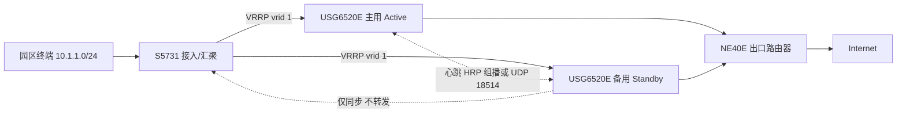

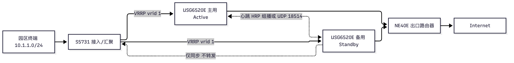


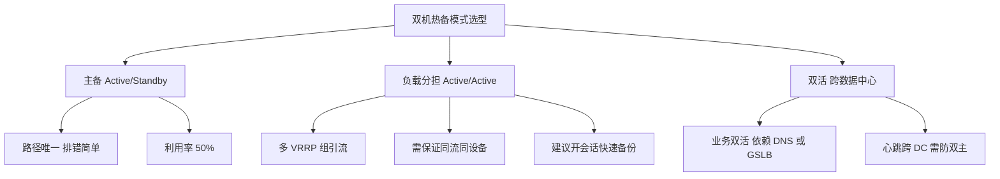

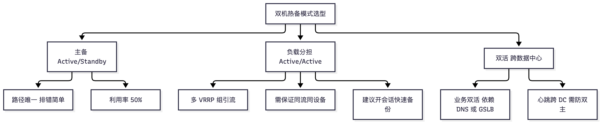


### 真题精练

**Q1.【真题·多选】** 关于华为防火墙双机热备的三种模式，下列说法正确的有？
A. 主备模式下同一时刻只有 Active 设备转发业务流量，Standby 设备只同步状态
B. 负载分担模式下两台设备同时转发，需要保证同一条流量的往返方向经过同一台设备
C. 负载分担模式的设备利用率高于主备模式，因此配置复杂度更低
D. 双活通常指跨数据中心的 Active/Active 部署，防火墙之间仍需主备或负载分担关系
E. 主备模式下备机不转发业务，因此不需要同步会话表

> **答案：ABD**
> **解析**：A 正确，主备模式的本质特征是"单点转发 + 状态同步"。B 正确，负载分担必须规划 VRRP 组或策略，否则往返路径不一致会导致会话不对称丢包。C 错误，负载分担因要保证"同流同设备"，配置与排错复杂度**更高**而不是更低。D 正确，双活是业务层面的双活，防火墙之间依然靠 HRP 同步。E 错误，备机**必须**同步会话表与 Server-map，否则接管后已建立的连接全部被丢弃（防火墙默认拒绝），这正是 HRP 存在的意义。

**Q2.【真题·单选】** 某园区出口采用两台 USG6520E 做双机热备，上下行均为三层交换机（跑 OSPF，不部署 VRRP）。此时应如何引导流量在主备切换后到达新主设备？
A. 依赖 VRRP 虚拟网关自动切换
B. 让备机对外发布 OSPF 外部路由时 COST 增加 65500，依靠路由收敛引流
C. 在备机上配置静态路由指向自身
D. 关闭主机的 OSPF，只让备机发布路由

> **答案：B**
> **解析**：上下行设备如果是三层设备且不参与 VRRP，VRRP 无法完成引流（VRRP 靠组播在同一广播域内选举），必须改用**动态路由 + 度量调整**。华为的实现是 `hrp adjust ospf-cost enable`：备机发布 OSPF 外部路由时 COST 默认增加 **65500**（可用 `hrp adjust ospf-cost enable slave-cost` 修改）；BGP 场景用 `hrp adjust bgp-cost enable`，MED 默认增加 **100**。A 错在前提不成立；C、D 都会造成路径不可控甚至流量黑洞。

**Q3.【真题·判断】** 只要是华为 USG 系列防火墙，任何型号、任何版本都可以部署双机热备。

> **答案：错误**
> **解析**：双机热备对型号与版本有明确要求。以 USG6000E 为例，**USG6110E、USG6307E/6311E/6311E-POE/6331E、USG6510E/6510E-POE/6510E-DK/6530E 在 V600R007C20SPC601 之前的版本不支持双机热备**；两台设备还应使用**相同型号、相同 VRP 版本**，并保持互联接口编号一致。部署前必须用 `display version` 与产品特性手册确认，这是实验/方案题最常见的扣分点。

**Q4.【真题·简答】** 双机热备的心跳链路有哪些设计约束？请至少写出四条，并说明为什么。

> **答案要点**：
> ① 心跳接口必须是三层接口（GigabitEthernet、Eth-Trunk、VLANIF），因为心跳报文要携带 IP 地址并支持 `remote` 单播；二层接口必须加入 VLAN 后在 VLANIF 上配置。
> ② **MGMT 管理口（MEth0/0/0）不能作为心跳接口**；配置了 `vrrp virtual-mac enable` 的接口也不能作为心跳接口，否则接口职责冲突、报文被虚拟 MAC 逻辑截走。
> ③ 一台设备**最多支持 16 个心跳接口**，建议用 Eth-Trunk 或多条独立物理路径（不同板卡、不同交换机），避免单点故障。
> ④ 心跳链路带宽占用建议**不超过业务接口带宽的 30%**；备份流量大时用 `heartbeat-only` 指定某条链路只传控制报文。
> ⑤ 两台设备的心跳接口必须**加入相同的安全区域**；使用 `remote` 单播时默认被拦截，必须在 local 区域与心跳区域之间配置放行策略。
> ⑥ 两台设备的 `hrp timer hello` 必须一致，否则会出现状态不稳定与误切换。

### 易错点与排错

1. **心跳直连却配了组播、跨三层却忘了 `remote`**：跨三层必须带 `remote`（UDP 18514 单播），否则组播报文无法穿过路由器，表现为 `display hrp state` 里 `peer: unknown`。
2. **心跳接口没加入安全区域 / 没放行 local 流量**：使用 `remote` 时 HRP 报文源区域为 local、目的为心跳口所在区域，**默认被安全策略拦截**，症状是心跳显示 up 但 HRP 状态始终无法协商成功。
3. **两台设备 `hrp timer hello` 不一致**：会造成状态抖动与误切换，缺省 1000ms，修改必须两端一致，非必要不要调小（会增加 CPU 负担并可能丢报文）。
4. **心跳接口用了配置了 `vrrp virtual-mac enable` 的接口**：命令会直接报错或被拒绝，必须换接口。
5. **排错命令**：`display hrp state`（角色/优先级/备份通道使用率）、`display hrp state verbose`（hello 间隔、抢占、镜像模式、自动备份开关）、`display hrp interface`（心跳接口 running/ready）、`display hrp statistic`（HRP 报文收发统计，判断是否丢包）、`display ip routing-table 10.1.1.2`（确认远端心跳地址路由可达）、`ping -a <本端心跳地址> <对端心跳地址>`（验证心跳链路可达性）。

---

## 1.2 HRP 协议原理、报文类型与主备选举（国赛必考核心）

### 考点定位

这是本册**分值最高、最容易出综合题**的考点，理论卷占 **6~12 分**，形式可以是单选（报文/端口/默认值）、多选（报文类型与作用）、简答（主备选举与状态迁移）、排错（心跳正常但主备异常）。必须记死：**VGMP 与 HRP 的分工、五类报文、UDP 18514、VRRP 报文的华为扩展字段、VGMP 组初始优先级 45000、故障时优先级按"2 × 故障数"递减、hello 1s 与 3 周期判定、抢占缺省关闭且延迟 60s**。

### 原理精讲

**先厘清分工，这是全部 HRP 题的答题骨架。** 华为防火墙的双机热备由两个协议协同完成：

- **VGMP（VRRP Group Management Protocol，VRRP 组管理协议）**：华为私有协议，负责**主备状态协商与统一切换**。它把设备上所有 VRRP 备份组"收编"到一个 VGMP 组里统一管理，使设备在各个备份组中的状态**永远一致**（要么全是 active，要么全是 standby），从根本上消除"上行流量走主、下行流量走备"的往返路径不一致。因此，启用双机热备后，**VRRP 自己不再选举**，VRRP 的状态标识从 vrrp 的 Master/Backup 变成 **active/standby**，由 VGMP 组的优先级比较直接决定。
- **HRP（Huawei Redundancy Protocol，华为冗余协议）**：负责**心跳探测与配置/状态备份**，即"备机怎么知道主机还活着"和"备机怎么拿到主机的会话与配置"。HRP 报文封装在 VGMP 报文之内（见报文封装）。

**五类报文（必背）。** 双机热备设备之间只交换五种报文，全部经心跳链路传输：

| 报文 | 作用 | 关键参数 |
|---|---|---|
| VGMP 报文（VGMP Hello） | 两台设备间协商 VGMP 组的 active/standby 状态，携带本端优先级 | 发送周期由 `hrp timer hello` 控制，缺省 1000ms |
| HRP 心跳报文（HRP Hello） | 探测对端是否处于工作状态；备机 3 个周期未收到即判定主机故障 | 缺省 1s，3 个周期即约 3s 完成整机故障判定 |
| HRP 链路探测报文 | 检测心跳链路本身是否可用（对端心跳口能否正常收发本端报文） | 与心跳同周期发送 |
| HRP 数据报文 | 备份主机的**配置命令**与**状态信息**（会话表、Server-map 等） | 备份通道使用率可在 `display hrp state` 查看 |
| 一致性检查报文 | `hrp configuration check` 执行时用来比对两端配置是否一致 | 触发告警 HRPI/4/COCHK |

**VRRP 报文的华为扩展（HCIE 细节题）。** VGMP 报文是"根植于 VRRP 报文"的：标准 VRRP 只有一种报文（Type = 1），华为把 **Type = 2** 定义为扩展报文，并做了三处修改——① `Virtual Rtr ID` 字段固定填 **0**；② 去掉标准 VRRP 的 `IP Address` 字段；③ 把 `Priority` 字段位置改造成 `Type2` 字段。Type2 的取值继续区分报文种类：**Type2 = 1 → 心跳链路探测报文；Type2 = 5 → 一致性检查报文；Type2 = 2 → 后面再封装 VGMP 报文头**，由 VGMP 头中的 `vType` 进一步分为 VGMP Hello 报文、HRP 心跳报文、HRP 数据报文三种。完整封装为：

```text
+----------+-------------+--------------+--------+
| UDP Header | VRRP Header | VGMP Header |  DATA  |
+----------+-------------+--------------+--------+
   端口 18514    扩展 Type=2    vType 区分三类   配置/会话
```

**为什么直连用组播、跨三层用 UDP？** 心跳直连或经二层交换机互联时，两台设备在同一广播域，用组播即可（报文不携带 UDP 头）；心跳要穿过三层设备时，组播无法跨越路由器，必须用 `hrp interface x remote y` 增加 UDP 头、按单播发送，端口 **18514**，并对端地址必须路由可达。这也解释了为什么"远程心跳必须放行 local 区域流量"——单播报文要过安全策略，而华为防火墙默认**放行组播、拦截单播**。

**主备选举（必考）。** VGMP 组的优先级叫**运行优先级（Running priority）**，缺省两台设备都是 **45000**，两台设备在初始优先级上完全对等。选举规则与调整机制如下：

1. 比较 VGMP 组的运行优先级，**高者为 active**，低者为 standby。
2. 本端监控的接口/链路出现故障时，**在初始优先级基础上减去一个降低值**，降低值遵循统一规律——**2 × 故障个数**：VGMP 监控的接口故障，降低值 = 2 × 故障接口个数；监控的 OSPF/BGP 邻居故障，降低值 = 2 × 故障邻居个数；`hrp track ip-link` 关联链路故障，降低值 = 2 × 故障链路数；`hrp track bfd-session` 关联会话故障，降低值 = 2 × 故障会话数。
3. 因此**优先级高低不是静态配置出来的，而是"健康度"的动态反映**：谁监控的链路全通、谁就是 active。这也是为什么不建议把优先级写死，而要用 `hrp track` 把真实业务链路纳入监控。
4. 两台设备都健康时优先级相同，角色由**启动次序与 `hrp standby-device` 的显式指定**决定：先用 `hrp standby-device` 把一台钉死为备机，是工程上的标准做法。
5. **抢占**：`hrp preempt [delay interval]`，**缺省抢占功能关闭**，抢占延迟缺省 **60s**（取值 0~1800s）。主备模式下主机故障恢复后想"切回来"，必须在主机上开启抢占；负载分担模式下两台都要开启抢占。延迟不能设为过小的值，若上下行一端跑 VRRP、另一端跑 OSPF，抢占延迟必须大于动态路由协议的收敛时间，否则会在路由未收敛时抢回主用，造成业务中断。**二层（透明）模式下抢占功能不生效。**

**状态机（必画）。** VGMP 组的状态迁移是排错题的理论依据：

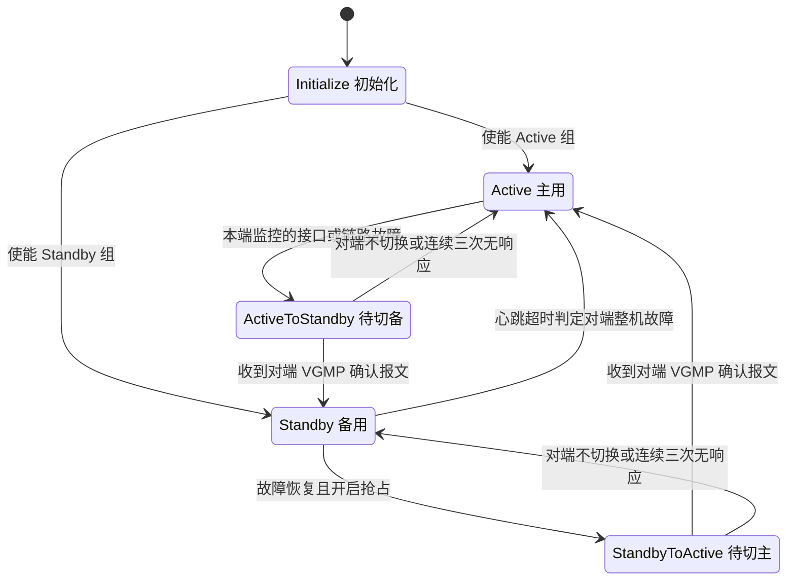

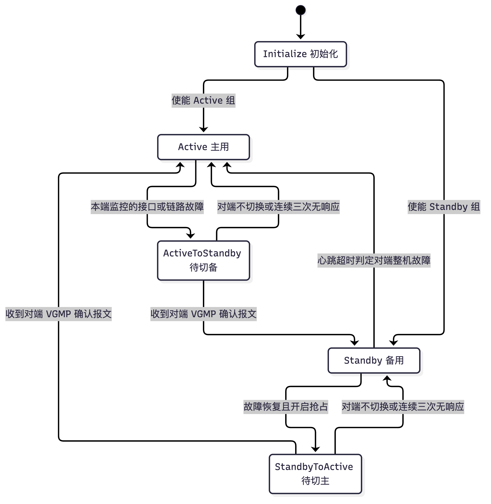


**切换速度的两个量级（易考）**：① **接口/链路类故障**——主机立即通过 VGMP 报文把状态与优先级告知备机，备机比较优先级后**立即切换，瞬时完成**；② **整机故障或心跳链路故障**——主机无法发出通知，备机**只能等心跳超时**，即 **3 个心跳周期**（缺省 1000ms × 3 ≈ 3s）才发现并切换。把这两个量级与"接口故障瞬切、整机/心跳故障约 3s"背下来，排错题的时间分析就能直接写。

**心跳探测与备份通道**：`display hrp state` 会显示 **Backup channel usage**（当前心跳接口的带宽使用率），若长期偏高（接近或超过 30%），说明备份数据挤占心跳链路，应改用 Eth-Trunk 扩容或用 `heartbeat-only` 把控制报文与备份数据分离到不同链路。

### 关键概念对照表

| 项目 | 数值/取值 | 说明 |
|---|---|---|
| VGMP 组初始优先级 | **45000**（两台设备缺省相同） | 显示为 `Running priority` |
| 优先级降低值 | **2 × 故障个数** | 接口/OSPF 邻居/BGP 邻居/ip-link/BFD 会话故障均按此规律递减 |
| 心跳报文周期 | 缺省 **1000ms**，范围 500~60000ms | `hrp timer hello`，两端必须一致 |
| 整机故障判定 | **3 个心跳周期**（缺省约 3s） | 备机检测不到 VGMP/HRP 心跳报文即判故障 |
| 接口故障切换 | **瞬时完成** | 主机主动通过 VGMP 报文通告，备机比较优先级后立即切换 |
| 抢占 | 缺省**关闭**；延迟缺省 **60s**（0~1800s） | `hrp preempt [delay interval]`；二层模式不生效 |
| 心跳接口数量 | 最多 **16** 个 | 支持 GigabitEthernet、Eth-Trunk、VLANIF |
| HRP 单播端口 | **UDP 18514** | 带 `remote` 参数时使用；不含 `remote` 时用组播 |
| 心跳带宽占用建议 | ≤ 业务接口带宽的 **30%** | 超限应扩容或使用 `heartbeat-only` |
| 备机发布路由的度量 | OSPF 外部 COST **+65500**；BGP MED **+100** | `hrp adjust ospf-cost enable` / `hrp adjust bgp-cost enable` |

| Type / Type2 / vType 取值 | 报文种类 | 用途 |
|---|---|---|
| VRRP Type = 1 | 标准 VRRP 报文 | 标准协议，双机热备下不再用于选举 |
| VRRP Type = 2，Type2 = 1 | 心跳链路探测报文 | 检测心跳链路可用性 |
| VRRP Type = 2，Type2 = 5 | 一致性检查报文 | 配置一致性比对 |
| VRRP Type = 2，Type2 = 2 | 再封装 VGMP 报文头 | 由 vType 区分下面三类 |
| vType = VGMP Hello | VGMP 报文 | 协商 active/standby |
| vType = HRP Hello | HRP 心跳报文 | 探测对端是否工作 |
| vType = HRP 数据 | HRP 数据报文 | 备份配置与状态信息 |

### 华为设备配置

```bash
# ===== HRP 心跳与选举相关（FW1，USG6520E V600R007）=====
system-view
hrp enable                                                   // 使能双机热备，启动 VGMP 状态机（Initialize → Active/Standby）
hrp interface GigabitEthernet1/0/0 remote 10.1.1.2           // 心跳接口：带 remote 走 UDP 18514 单播；不带 remote 则发组播
hrp timer hello 1000                                         // 心跳周期 1000ms；两端必须一致，缺省即为 1000ms
hrp track interface GigabitEthernet1/0/1                     // 监控上行接口，该接口 down 时 VGMP 优先级降低 2，实现"链路故障即切换"
hrp track interface GigabitEthernet1/0/2                     // 监控下行接口，同样降低 2
hrp track trunk-member enable                                // 监控 Eth-Trunk 成员接口状态（成员全 down 才算故障时按需开启）
hrp track vlan 20                                            // 二层/透明模式：监控 VLAN 20，主备切换时阻塞该 VLAN 防止环路
hrp track ospf first-check-delay 60                          // 监控 OSPF 邻居，延迟 60s 后再判故障，避免双机切换时误判
hrp track bgp first-check-delay 60                           // 监控 BGP 邻居，同样延迟判定
hrp preempt delay 60                                         // 开启抢占并设延迟 60s（缺省抢占关闭）；延迟须大于动态路由收敛时间
quit

# ===== 链路探测（IP-Link）与 BFD，被 hrp track 引用 =====
system-view
ip-link check enable                                         // 使能 IP-Link 链路检测功能
ip-link name to_isp                                          // 创建名为 to_isp 的检测实例
 destination 202.100.1.1 interface GigabitEthernet1/0/1 mode icmp
                                                             // 检测目的地址与出接口，使用 ICMP 探测
quit
hrp track ip-link to_isp                                     // 关联 IP-Link，探测失败时降低 VGMP 优先级 2，触发切换
quit

# ===== 查看与验证 =====
display hrp state                                            // Role: active, peer: standby / Running priority / Backup channel usage
display hrp state verbose                                    // 查看 hello interval、preempt、track trunk member、auto-sync 等开关
display hrp statistic                                        // HRP 报文收发统计，用于判断心跳是否丢包
display ip-link                                              // 查看 IP-Link 探测状态（up/down 与丢包率）
display bfd session all                                      // 若使用 BFD 监控，查看会话状态
save                                                         // 保存配置
```

### 示意图

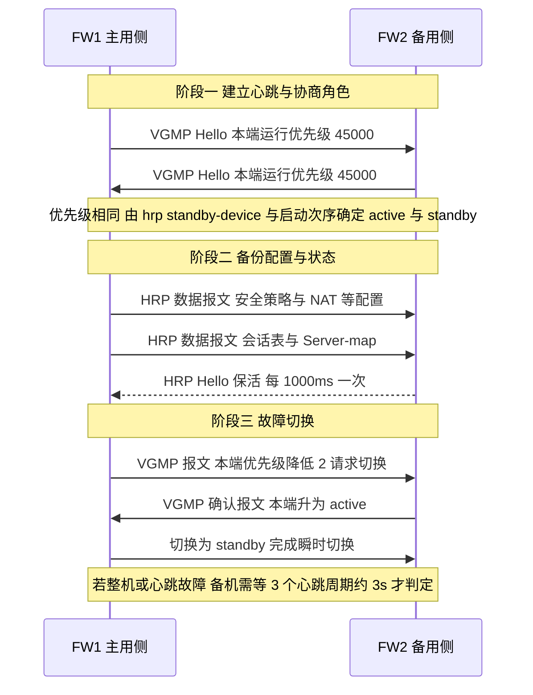

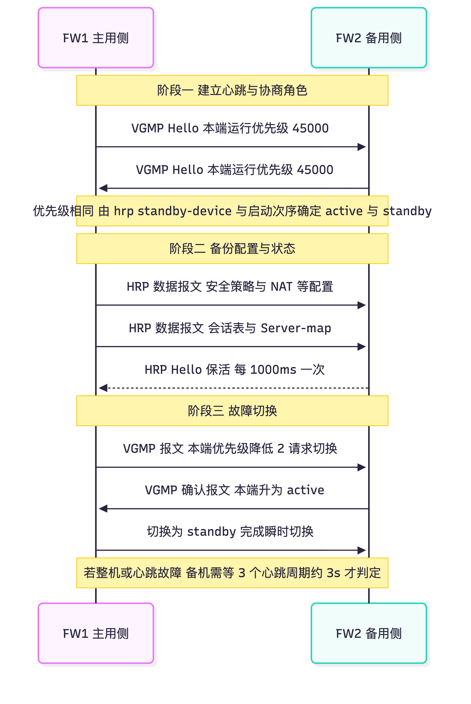


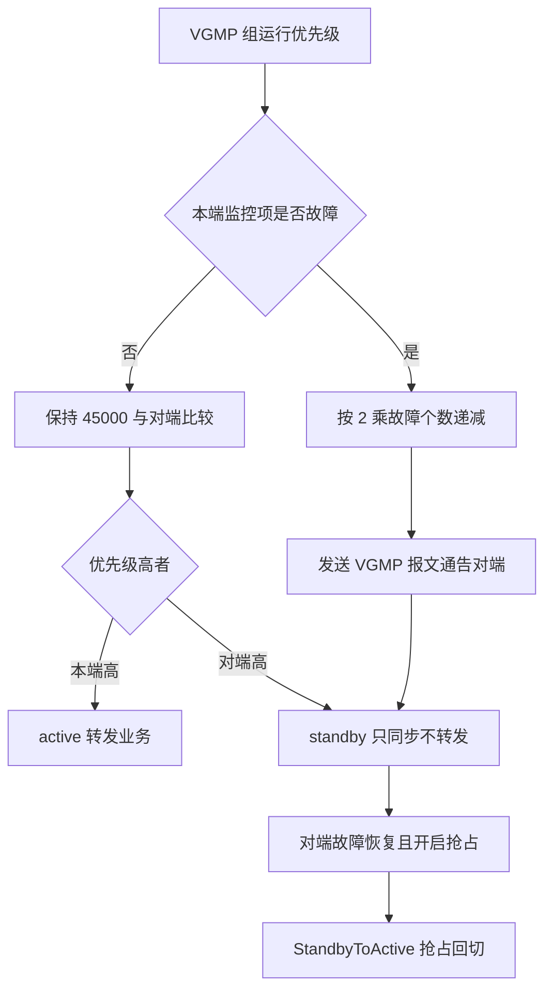

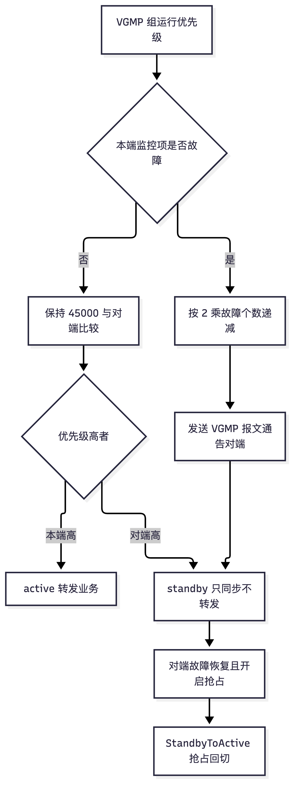


### 真题精练

**Q1.【真题·单选】** 华为双机热备中，VGMP 组在没有任何故障时的初始运行优先级是？
A. 100　B. 1000　C. 45000　D. 65001

> **答案：C**
> **解析**：`display hrp state` 回显 `Running priority: 45000, peer: 45000`，**VGMP 组初始优先级为 45000**，两台设备缺省相同。100 是 **VRRP 的接口默认优先级**（取值 0~255，255 保留给 IP 地址拥有者），不要与 VGMP 优先级混淆；65001/65000 是早期版本资料中出现的 Active/Standby 组优先级表述，不是 V600R007 的 VGMP 运行优先级。故障时优先级按"**2 × 故障个数**"递减。

**Q2.【真题·多选】** 关于 HRP 与 VGMP 的分工，下列说法正确的有？
A. VGMP 负责统一管理 VRRP 备份组，保证各备份组状态一致
B. HRP 负责心跳探测与配置、状态信息的备份
C. 启用双机热备后，VRRP 备份组的状态由 VRRP 报文自行选举决定
D. VGMP 报文根植于 VRRP 报文，华为把 VRRP 报文的 Type 扩展为 2
E. HRP 心跳报文与 HRP 数据报文是同一种报文，只是长度不同

> **答案：ABD**
> **解析**：C 错误——启用双机热备后 VGMP 统一管理，**VRRP 不再自行选举**，状态标识由 Master/Backup 变为 **active/standby**，由 VGMP 组优先级决定。E 错误——两者是**不同种类**的报文：HRP 心跳报文用于探测对端是否工作，HRP 数据报文用于备份配置与状态，二者的 `vType` 取值不同，不能混为一谈。A、B、D 均为正确描述，D 还包含三处细节改动：`Virtual Rtr ID` 固定为 0、去掉 `IP Address` 字段、`Priority` 字段位置改为 `Type2`。

**Q3.【真题·填空】** 双机热备心跳穿越三层设备时，`hrp interface ... remote ...` 使用 UDP 端口 ______；心跳报文缺省周期为 ______ ms；备机判定主机整机故障需要等待 ______ 个心跳周期。

> **答案：18514；1000；3**
> **解析**：`remote` 参数使心跳报文在 VRRP 头之前增加 UDP 头，端口 **18514**。心跳周期由 `hrp timer hello` 控制，缺省 **1000ms**（范围 500~60000ms）。备机在 **3 个心跳周期**（约 3s）内没有收到任何 VGMP/HRP 心跳报文即判定主机故障。注意区分：**接口/链路故障是瞬时切换**（主机主动通告），只有整机或心跳链路故障才需要等超时。

**Q4.【真题·排错】** 某双机热备组网中，两台防火墙 `display hrp state` 都显示 `Role: active, peer: active`，业务时通时断。请给出至少三种可能原因与排查方法。

> **答案要点**：`Role: active, peer: active` 在主备模式下即为**双主**（负载分担模式下正常，须先确认组网模式）。
> ① **心跳链路全部中断**：`display hrp interface` 查看心跳接口状态，`display hrp statistic` 看是否丢包，`ping -a 本端心跳地址 对端心跳地址` 验证可达性；检查中间交换机 VLAN 放通、MTU、光模块。
> ② **心跳用了 `remote` 单播但未放行 local 流量**：华为防火墙默认放行组播、拦截单播，必须在 local 与心跳区域之间配置双向 permit，否则心跳不通。
> ③ **一端未执行 `hrp enable`** 或两端心跳区域不同、`hrp timer hello` 不一致。
> ④ **心跳接口误用了 MGMT 口或配置了 `vrrp virtual-mac enable` 的接口**。
> ⑤ **备份通道拥塞**：`display hrp state` 中 Backup channel usage 过高，备份数据挤占心跳，应扩容心跳或使用 `heartbeat-only`。
> ⑥ **配置不一致导致协商失败**：`hrp configuration check all` 比对，必要时 `hrp sync config` 强制同步。

### 易错点与排错

1. **把 VRRP 优先级与 VGMP 优先级搞混**：VRRP 接口优先级缺省 100（0~255），VGMP 组运行优先级缺省 **45000**，两者不是一个层面。
2. **认为"心跳断了备机立刻接管"**：整机/心跳故障需要 **3 个心跳周期**（约 3s）判定；只有主机能主动通告的接口/链路故障才是瞬切。
3. **抢占缺省是关闭的**：主机修复后不会自动切回，表现为"业务长期跑在备机上"，需要 `hrp preempt delay <秒>` 开启。
4. **抢占延迟设得太小**：若另一端依赖 OSPF 收敛，延迟小于收敛时间会造成业务中断，经验值应大于动态路由收敛时间。
5. **混淆 `hrp track interface` 与 `hrp track ip-link`**：前者只监控本端接口的物理/协议状态，无法发现"接口 up 但对端/上游已不可达"；后者通过 ICMP 探测远端地址，能发现链路质量与上游故障，二者应配合使用。
6. **排错命令**：`display hrp state [verbose]`、`display hrp interface`、`display hrp statistic`、`display hrp configuration check`、`display ip-link`、`display vrrp`（查看 VRRP 组状态与虚拟 IP）、`terminal monitor` + `terminal debugging` + `debugging hrp all`（现网慎用）。

---

## 1.3 HRP 的备份内容与"先 HRP 后业务"开局流程

### 考点定位

本考点在理论卷中以多选/判断/简答出现，占 **4~8 分**，国赛实验与方案题几乎必考"配置一致性"。核心考点三个：① **能同步什么、不能同步什么**（尤其"自动备份只备份建立 HRP 之后的配置"）；② **为什么必须遵循"先 HRP 后业务"**；③ 一致性校验命令 `hrp configuration check`、`hrp sync config`、`hrp configuration auto-check enable` 的用途区别。陷阱集中在"以为所有配置都会自动同步"和"以为静态路由会自动同步"。

### 原理精讲

HRP 备份的本质是**把主机的"业务资产"复制到备机**，让备机在任何时刻都能无条件接管。那么"业务资产"包含什么？答案是两类：**配置（配置信息）**与**状态（连接状态信息）**。华为用一条命令统一控制这两类备份——`hrp auto-sync [ config | connection-status ]`：`config` 表示配置信息的自动备份，`connection-status` 表示连接状态信息的自动备份。**缺省情况下这两个自动备份功能都是开启的**，因此主机上一条带 `(+B)` 标记的命令敲下去，备机会同步执行。

**为什么命令后面会出现 `(+B)`？** 因为并非所有命令都允许被备份。华为在 CLI 上对**支持备份的命令**给出 `(+B)` 提示，这是实验题最直观的判断依据：出现 `(+B)` 说明该命令会同步到对端；没有该标记的命令（典型如设备系统参数、接口视图下的 `shutdown/undo shutdown/restart`）只在本机生效，**必须两端分别配置**。

**能同步与不能同步的分界（必背）。** 官方 `hrp configuration check` 支持的比对项，就是"应该保持一致"的配置范围，包括：`acl`、`acl6`、`address-set`、`audit-policy`、`auth-policy`、`bgp`、`hrp`、`hash`、`interface`、`license`、`nat-policy`、`ospf`、`security-policy`、`service-set`、`static-route`、`traffic-policy`、`zone`。据此可以整理出下表的分界。特别记住三条反直觉的规则：

1. **静态路由与策略路由缺省不自动备份**！必须显式执行 `hrp auto-sync config static-route` 与 `hrp auto-sync config policy-based-route`；且静态路由的自动备份**只支持 IPv4，不支持 IPv6**。原因很现实：两台设备的接口地址、上游下一跳可能不同，若盲目同步静态路由，会出现"备机的路由指向主机的下一跳"导致业务异常，因此缺省关闭、由管理员评估后开启。
2. **会话表的备份是有条件的实时备份**：只有被超扫描到、且属于"需要备份"的会话才会同步到对端。以下三类会话**不备份**：① 由防火墙自身发起的会话；② 未完成三次握手的 TCP 半连接会话；③ 只被封装为 UDP 报文、报文并未真正运行的 UDP 报文（如 BT 协议）。这解释了两个经典现象：**切换后 Ping（ICMP）会话与某些未完成握手的连接会断**；以及为什么"会话同步数量总比主机会话数少"。
3. **自动备份无法覆盖 HRP 建立之前的历史配置**：如果两台设备在建立 HRP **之前**就各自配置过内容，这些内容不会被备份，两端的差异会一直保留下来。要消除差异必须用 `hrp sync config` **强制同步一次**（该命令是一次性操作，不会保存在配置文件中），这也是标准开局流程的第 6 步。

**镜像模式（`hrp mirror config enable`）是另一种思路**：缺省关闭。开启后两台设备形成镜像模式双机热备，**绝大部分配置只需在主机上配置并自动同步，备机不能被配置**。镜像模式下有以下命令**不支持备份**：监控接口下的配置、设备系统参数、接口视图下的 `shutdown`/`undo shutdown`/`restart`、BFD 功能的配置命令。镜像模式**只支持主备、不支持负载分担**，备机上不能配置 VRRP，且**抢占功能不生效**。考试中若题干强调"备机不允许登录配置"，基本就是镜像模式。

**配置一致性校验的三件套（易混，必分清）**：

| 命令 | 性质 | 何时使用 |
|---|---|---|
| `hrp configuration check { all \| security-policy \| nat-policy \| ... }` | **手动触发**的一致性比对，可加 `verbose` | 开局验收、变更后核对、排错时定位差异 |
| `hrp configuration auto-check enable` + `hrp configuration auto-check interval` | **周期自动**比对，不一致时上报告警 | 现网长期运行，及时发现人为单边修改 |
| `hrp sync config` | **强制同步**（一次性，不写入配置文件） | 自动备份无法触发、需要立即全同步时 |

执行一致性检查后若不一致，设备会产生告警 **HRPI_1.3.6.1.4.1.2011.6.122.51.2.2.4 hwHrpCochk** 与日志 **HRPI/4/COCHK**，可用 `display hrp configuration check` 查看差异明细。注意两个细节：**一致性检查报文通过心跳接口发送**，因此心跳不通时检查无效；为不影响设备性能，**每次检查对差异较多的模块（策略、地址集、服务集、ACL、接口、安全区域、OSPF 等）只比对前 20 条差异**，修完再查、逐轮收敛。

**为什么必须"先 HRP 后业务"（国赛简答高频）。** 把开局顺序固化下来，理由可以归纳成四条因果链：

1. **同步是"事件驱动"的，不是"全量快照"**。自动备份只处理 **HRP 建立之后**在主机上发生的配置新增/修改/删除。若先配业务再建 HRP，这些业务配置永远不会被同步，两端出现静默差异。
2. **差异会在切换瞬间变成故障**。防火墙默认拒绝未匹配策略的流量，备机上缺失安全策略、NAT 策略、Server-map 时，切换后业务不是"性能下降"而是"直接不通"。
3. **同步过程的自身依赖必须先就绪**。心跳接口、心跳区域、local 区域放行策略、`hrp enable` 构成了同步的"通道"；通道未通就配业务，业务配置只能在单机落地，等到通道打通时又需要 `hrp sync config` 补救，把一次简单开局变成一次排错。
4. **镜像模式下备机不可配置**。若先配了业务，备机上会残留"主机不知道、备机自己配的"配置，绑定与切换时冲突，且一致性检查会持续告警。

**标准开局流程（按此顺序，实验题按步给分）**：

① 两台设备同型号、同 VRP 版本上电，确认型号/版本支持双机热备（`display version`）；② 两端**分别**配置接口物理参数、接口 IP、加入安全区域（接口地址是"各机独立"的配置，不应对称同步）；③ 两端配置心跳接口、`hrp interface ... remote ...`、心跳接口入区域，并放行 local ↔ 心跳区域的双向流量；④ **两端分别执行 `hrp enable`** 建立 HRP，确认 `display hrp state` 中一台为 active、另一台为 standby；⑤ 在一台设备上用 `hrp standby-device` 钉死备机角色（推荐）；⑥ 在**主机**上配置业务：安全策略、NAT 策略、带宽策略、动态路由等（注意观察 `(+B)` 标记）；⑦ 按需开启 `hrp auto-sync config static-route` 等补充备份项；⑧ 用 `hrp configuration check all` 验收，`hrp sync config` 消除历史差异；⑨ 配置 VRRP/动态路由完成流量引导；⑩ 手工切换验证（`hrp switch` 或 shutdown 接口），并检查会话表是否同步。

### 关键概念对照表

| 类别 | 内容 | 是否自动同步 | 说明 |
|---|---|---|---|
| 业务配置 | 安全策略、NAT 策略、带宽策略、认证策略、审计策略、区域、地址集/服务集、ACL | 是（带 `(+B)`） | 缺省开启（`hrp auto-sync config`） |
| 路由配置 | OSPF、BGP 相关配置 | 是 | 属于一致性检查项 |
| 路由配置 | **静态路由、策略路由** | **否（缺省关闭）** | 需 `hrp auto-sync config static-route` / `policy-based-route`；静态路由仅支持 IPv4 |
| 状态信息 | 会话表、Server-map 表项 | 是（`hrp auto-sync connection-status`） | 实时备份，且有条件（见下） |
| 状态信息 | 防火墙自身发起的会话、未完成三次握手的 TCP 半连接、未真正运行的 UDP 报文 | 否 | 会话表同步的三大例外 |
| 设备级配置 | 系统名称、时间时区、NTP、Syslog、SNMP、管理用户 | 否 | 两端分别配置 |
| 接口状态类 | 接口 `shutdown`/`undo shutdown`/`restart`、BFD 功能配置 | 否（镜像模式下明确不备份） | 只在本机生效 |
| 证书密钥 | 本地私钥、本地证书 | 否 | 需各自导入（License 也要各自申请，但有一致性检查项） |

| 校验手段 | 触发方式 | 输出/影响 | 典型用途 |
|---|---|---|---|
| `hrp configuration check all` | 手动 | 差异列表；不一致时告警 hwHrpCochk、日志 HRPI/4/COCHK | 变更后核对 |
| `hrp configuration check <模块> verbose` | 手动 | 指定模块的详细差异 | 精确定位差异项 |
| `display hrp configuration check` | 查看 | 显示比对结果与差异模块 | 排错 |
| `hrp configuration auto-check enable` | 自动周期 | 不一致自动告警 | 长期运维 |
| `hrp sync config` | 手动强制 | 一次性全量同步（不存配置） | 历史差异、备机重启后 |

### 华为设备配置

```bash
# ===== 备份内容控制（主机 HRP_M 上配置）=====
system-view
hrp auto-sync                                               // 同时开启"配置"与"连接状态"自动备份（缺省已开启，此命令用于确认或恢复）
hrp auto-sync config                                        // 只开配置信息自动备份
hrp auto-sync connection-status                             // 只开连接状态（会话表、Server-map）自动备份
hrp auto-sync config static-route                           // 额外开启静态路由自动备份（缺省关闭，仅支持 IPv4）
hrp auto-sync config policy-based-route                     // 额外开启策略路由自动备份（缺省关闭）
hrp mirror session enable                                   // 开启会话快速备份（负载分担或往返路径可能不一致时必开，会加大备份频率）
hrp mirror config enable                                    // 开启镜像模式：备机不可配置，仅支持主备、抢占不生效（现网少用）
quit

# ===== 一致性校验三件套 =====
hrp configuration check all                                 // 手动全量比对两端配置一致性（差 20 条后会分批提示）
hrp configuration check security-policy verbose             // 只比对安全策略并输出详细差异
hrp configuration check nat-policy                          // 只比对 NAT 策略
display hrp configuration check                             // 查看一致性检查结果
hrp configuration auto-check enable                         // 开启周期性自动一致性检查
hrp configuration auto-check interval 1440                  // 自动检查周期设为 1440 分钟（1 天）
hrp configuration auto-check warning enable                 // 不一致时产生告警与日志（HRPI/4/COCHK）
hrp sync config                                             // 强制手工批量同步一次配置（一次性操作，不写入配置文件）

# ===== 开局验收与切换验证 =====
display hrp state verbose                                   // 确认 auto-sync configuration / connection-status 均为 on
display firewall session table verbose | include 10.1.1.100 // 主机上查看某终端会话
display firewall session table verbose | include 10.1.1.100 // 备机上应能查到同一条会话（证明状态已同步）
hrp switch active                                           // 在备机上手工抢占为 active，验证切换是否平滑（业务无损）
display hrp history-information                             // 查看 HRP 状态切换历史，定位异常切换时间点
save                                                        // 保存配置
```

### 示意图

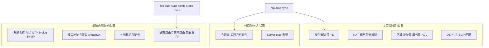

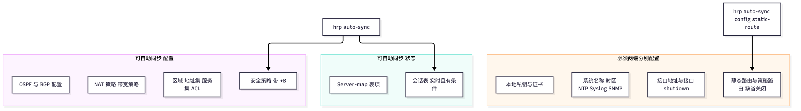


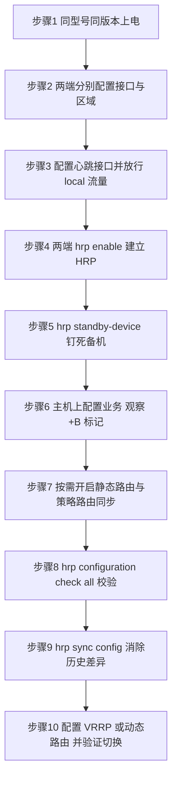

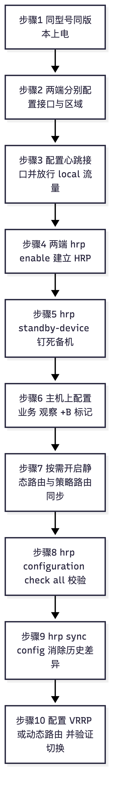


### 真题精练

**Q1.【真题·多选】** 关于 HRP 的备份内容，下列说法正确的有？
A. 安全策略、NAT 策略等业务配置缺省会自动同步到备机
B. 静态路由与策略路由缺省不自动备份，需显式开启
C. 防火墙自身发起的会话会实时同步到备机
D. 未完成三次握手的 TCP 半连接不会同步到备机
E. License 不需要两端各自申请，会自动同步

> **答案：ABD**
> **解析**：A 正确，`hrp auto-sync` 缺省开启 config 与 connection-status。B 正确，静态路由/策略路由缺省关闭，需 `hrp auto-sync config static-route` / `policy-based-route`，且静态路由只支持 IPv4。C 错误，**由防火墙自身发起的会话不备份**。D 正确，未完成三次握手的 TCP 半连接与未真正运行的 UDP 报文都不备份——这正是"切换后 Ping 会话会断"的原因。E 错误，License 需两台设备各自申请，但可作为一致性检查项（`hrp configuration check license`）核对状态与资源授权是否一致。

**Q2.【真题·简答】** 请说明双机热备开局为什么必须遵循"先建立 HRP，再配置业务"，并写出正确顺序。

> **答案要点**：
> ① **自动备份是事件驱动的增量同步**，只同步 HRP 建立之后在主机上发生的配置变更；建立 HRP 之前已存在的配置不会被备份，两端会残留静默差异。
> ② 差异在切换瞬间会转化为故障：防火墙默认拒绝未匹配策略的流量，备机缺少安全策略/NAT 策略/Server-map 时切换后业务直接不通。
> ③ 同步依赖心跳通道（心跳接口、心跳区域、local 放行、`hrp enable`），通道未就绪时业务配置只能落在单机，后续仍需 `hrp sync config` 补救。
> ④ 镜像模式下备机不可配置，先配业务会留下冲突配置并持续产生一致性告警。
> 正确顺序：同型号同版本 → 两端分别配置接口与区域 → 配置心跳并放行 local → 两端 `hrp enable` → `hrp standby-device` 钉备机 → 主机配业务 → 按需开启静态/策略路由同步 → `hrp configuration check all` → `hrp sync config` → 配置 VRRP/动态路由 → 切换验证。

**Q3.【真题·判断】** `hrp sync config` 执行后会写入配置文件，重启后仍然有效。

> **答案：错误**
> **解析**：`hrp sync config` 是**一次性手工强制同步**命令，用于自动备份无法触发（如备机重启、新设备入网）或需要立即全量一致的场合，**不会保存在配置文件中**，重启后不会自动再同步。若需要长期自动保持一致，应确保 `hrp auto-sync config` 处于开启状态，并用 `hrp configuration auto-check enable` 周期检查。

**Q4.【真题·排错】** 双机热备运行一段时间后，`display hrp configuration check all` 报出安全策略不一致告警，但两台设备的配置看起来一样。请给出排查与处理思路。

> **答案要点**：
> ① 先确认心跳是否正常：**一致性检查报文经心跳接口发送**，心跳不通时检查结果不可信（`display hrp interface`、`display hrp statistic`）。
> ② 大概率是"某次变更只在单边生效"：临时关闭过 `hrp auto-sync config`、或变更期间心跳中断导致同步失败、或该命令本身不支持备份（无 `(+B)` 标记）。
> ③ 用 `hrp configuration check security-policy verbose` 定位差异条目；注意引擎为保护性能**每轮只报前 20 条差异**，需修复后再查、逐轮收敛。
> ④ 处理方式：在不一致的一侧补齐，或在主机上执行 `hrp sync config` 强制同步后复查。
> ⑤ 长期防范：开启 `hrp configuration auto-check enable` 与 `warning enable`，并禁止在备机上单边修改业务配置。

### 易错点与排错

1. **以为"所有配置都会同步"**：设备级参数（sysname、时区、NTP、Syslog、SNMP、管理用户）与接口 `shutdown` 等只在单机生效，必须两端分别配。
2. **以为静态路由会自动同步**：缺省关闭，且只支持 IPv4；盲目开启前要评估两端下一跳是否一致。
3. **用错工具**：把 `hrp sync config`（强制同步）当成检查命令，或把 `hrp configuration check`（检查）当成修复命令。检查只报差异，不修差异。
4. **会话同步数量的困惑**：备机会话数少于主机属正常（自发起会话、TCP 半连接、未运行 UDP 报文不备份），不要误判为同步故障。
5. **备机上单边修改配置**：这是现网一致性告警的头号原因，镜像模式下更是直接不被允许。
6. **排错命令**：`display hrp configuration check`、`display hrp state verbose`（看 auto-sync 开关）、`display firewall session table`（两端会话对照）、`display hrp history-information`（切换历史）、`display logbuffer | include COCHK`（一致性告警日志）。

---

## 1.4 上下行链路配合：VRRP/VGMP 与 HRP 一致性（国赛必考核心）

### 考点定位

这是双机热备**排错题与设计题的主战场**，理论卷占 **6~12 分**。必须能回答三件事：① 为什么上下行 VRRP 的 active/standby 必须与 HRP 的 active/standby 一致；② 不一致时到底会发生什么（现象 + 机理）；③ 上下行是路由器时怎么替代 VRRP 完成引流。此外 VGMP 的"统一切换"思想、VRRP 虚拟 MAC、免费 ARP 刷新都是高频小题。

### 原理精讲

**先看问题是怎么产生的。** 防火墙作为网关串接在出口，上行接 ISP 侧设备、下行接内网。为了网关不成为单点，通常在上行接口和下行接口**各起一个 VRRP 备份组**：vrid 1 对应上行网关（如 202.100.1.1/24），vrid 2 对应下行内网网关（如 10.1.1.254/24）。VRRP 是**按备份组独立选举**的协议——vrid 1 选举出的 Master 和 vrid 2 选举出的 Master 可以不是同一台设备。这就是根因：**两个备份组各自为政**。

设想 FW1 的下行接口（GigabitEthernet1/0/2）故障而上行接口正常：vrid 2（下行）检测到接口 down，把 FW2 选为 Master；而 vrid 1（上行）没有任何变化，FW1 仍是 Master。结果是：**内网发往外网的报文由 FW2 转发，外网回来的报文由 FW1 转发**。FW1 的上行接口虽然 up，但它的下行接口已 down，报文无法送回内网——业务中断。更糟的是，即使物理路径都通，两台设备分别处理同一条会话的两个方向，会话表与 NAT 状态也不对称，同样会丢包。

**VGMP 的解法：把"多个备份组"变成"一个组"。** VGMP（VRRP Group Management Protocol，VRRP 组管理协议）把设备上**所有** VRRP 备份组加入同一个 VGMP 组统一管理，规则只有三条：

1. **VGMP 组的状态决定组内所有 VRRP 备份组的状态**：设备在 VRRP 层面不再自行选举，直接把各备份组置为 active 或 standby（因此 VRRP 的状态标识从 Master/Backup 变为 **active/standby**）。
2. **VGMP 组状态由优先级比较决定**：优先级高者为 active 组，低者为 standby 组。
3. **一旦检测到组内任何一个备份组状态异常（如接口进入 Initialize 状态），VGMP 组优先级自动减 2**，重新协商后由新的 active 组**统一切换所有备份组**。

于是上面的场景变成：FW1 下行接口故障 → VGMP 组优先级 45000 → 44998 → 重新协商 → FW2 的 VGMP 组升为 active → **FW2 上的 vrid 1 与 vrid 2 同时变成 active**，上下行流量一起切到 FW2，路径重新一致。这就是"**统一切换**"的价值：它把"两个独立的单点切换"合并成"一次原子切换"。

**为什么必须一致：三条必背后果。** 如果因为人为配置错误（例如只在一台设备上配置了某个 VRRP 组、或用 `hrp standby-device` 与 VRRP 状态互相矛盾），导致上下行 VRRP 主备与 HRP 主备不一致，会出现：

1. **会话不对称丢包**：状态检测防火墙只有在**同一台设备上**看到一条流的两个方向，才能建立完整会话。往返被两台设备分别处理时，每台设备只看到单向报文，会话无法建立或只有半条，报文被默认策略丢弃，表现为"时通时断、网页打不开、下载中断"。
2. **NAT/Server-map 失效**：源 NAT 的公网地址转换表、Server-map 的动态放行表项都保存在主机上，备机即使同步了也可能因会话不完整而匹配不上，导致回程无法还原或外部主动访问不可达。
3. **ASPF/ALG 关联失败**：FTP、SIP、RTSP 等多通道协议依赖 ALG 动态创建 Server-map；两个方向分离后，数据通道的放行表项创建不出来，控制通道通、数据通道不通。

**上下行设备的类型决定引导手段（关键分支）。**

- **上下行为二层/三层交换机**：交换机支持 VRRP，直接使用 VRRP 虚拟网关 + VGMP 统一切换。切换后由新主设备发送**免费 ARP（gratuitous ARP）**刷新交换机与终端的 MAC 表，使流量立刻指向新主设备。华为提供 `vrrp gratuitous-arp timeout` 控制免费 ARP 的发送时长，可用 `vrrp gratuitous-arp timeout disable` 关闭（一般不建议关闭）。
- **上下行为路由器**：路由器之间通常跑的是动态路由，不参与 VRRP（VRRP 依赖同一广播域内的组播选举，跨三层无法工作）。此时改用**"接口监控 + 路由度量调整"**：用 `hrp track interface` 把接口直接纳入 VGMP 监控，接口故障时 VGMP 优先级降低、状态切换；同时启用 `hrp adjust ospf-cost enable`，**备机对外发布 OSPF 外部路由时 COST 自动增加 65500**（可用 `hrp adjust ospf-cost enable <slave-cost>` 修改；OSPFv3 用 `hrp adjust ospfv3-cost enable`），BGP 场景用 `hrp adjust bgp-cost enable`，**MED 自动增加 100**。路由器据此重新选路，把流量引到新的主设备。

**VRRP 细节（小题高发区）**：VRRP 报文只有一种（Advertisement），目的组播地址 **224.0.0.18**，缺省通告间隔 **1s**，Master_Down_Interval ≈ 3 × 通告间隔 + Skew（约 3s）；接口优先级缺省 **100**，取值 **0~255**，其中 0 为系统保留，**255 保留给 IP 地址拥有者**（虚拟 IP 与接口真实 IP 相同时优先级为 255，可直切 Master）；优先级相同时比较**接口 IP 地址，数值大者为 Master**；虚拟 MAC 由 vrid 生成，固定为 **00-00-5E-00-01-{VRID}**；配置了 `vrrp virtual-mac enable` 的接口**不能作为 HRP 心跳接口**。

**防火墙侧的三个"一致性"硬约束（考试常作判断/多选）**：

1. 两台防火墙**心跳接口的编号必须一致**（如都是 GigabitEthernet1/0/0），互联到同一台上下行设备时**使用的接口编号也应一致**，否则同步来的接口相关配置无法落地。
2. 同一 VRRP 组的**虚拟 IP 与 vrid 必须两端相同**，而接口真实 IP 必须两端不同；`vrrp vrid x virtual-ip y active` 与 `standby` 的角色关键字要与 `hrp standby-device` 的意图一致。
3. 若一台设备同时配置了 `hrp standby-device` 和 VRRP 备份组，**设备状态以 VRRP 备份组的配置为准，`hrp standby-device` 不生效**。也就是说：VRRP 的角色配置才是"最终裁决者"，这也是"VRRP 与 HRP 必须一致"的配置层含义。

### 关键概念对照表

| 对比项 | 只用 VRRP（普通双机） | VRRP + VGMP（华为防火墙双机热备） |
|---|---|---|
| 选举单位 | 每个 VRRP 备份组独立选举 | 所有备份组纳入一个 VGMP 组统一切换 |
| 状态标识 | Master / Backup | active / standby |
| 多备份组一致性 | 无法保证，可能出现路径断裂 | VGMP 强制一致 |
| 故障触发 | 各备份组自行感知 | 组内任一备份组异常即优先级 -2 并统一切换 |
| 是否依赖 HRP | 否 | 是（HRP 提供心跳与状态备份） |
| 典型故障 | 上行主用、下行备用的往返路径不一致 | 若人为配错仍可能不一致，需一致性检查兜底 |

| 引导手段 | 适用上下行设备 | 关键配置 | 收敛/切换时间 |
|---|---|---|---|
| VRRP 虚拟网关 | 交换机（二层/三层） | `vrrp vrid 1 virtual-ip x active/standby` | 免费 ARP 刷新，秒级以内 |
| 动态路由度量调整 | 路由器（不参与 VRRP） | `hrp adjust ospf-cost enable`（+65500）/ `hrp adjust bgp-cost enable`（+100） | 取决于路由协议收敛时间 |
| 会话快速备份兜底 | 负载分担或路径可能不一致的场景 | `hrp mirror session enable` | 提升会话同步频率，代价是性能 |

| VRRP 参数 | 取值 | 备注 |
|---|---|---|
| 报文类型 | 只有 Advertisement 一种 | 组播目的地址 224.0.0.18 |
| 接口优先级 | 缺省 100，范围 0~255 | 255 保留给 IP 地址拥有者；0 为系统保留 |
| 通告间隔 | 缺省 1s | `vrrp vrid 1 timer advertise 1` |
| Master_Down_Interval | ≈ 3 × 通告间隔 + Skew（约 3s） | 决定 Backup 升级为 Master 的时间 |
| 虚拟 MAC | 00-00-5E-00-01-{VRID} | 由 vrid 生成 |
| 优先级相同时 | 比较接口 IP，数值大者为 Master | 与 VGMP 的"健康度递减"机制不同 |

### 华为设备配置

```bash
# ===== FW1（主机）：上行接 ISP 交换机，下行接内网交换机 =====
system-view
interface GigabitEthernet1/0/1                                   // 上行接口
 ip address 202.100.1.2 255.255.255.0                            // 接口真实地址两台不同，虚拟地址两端相同
 vrrp vrid 1 virtual-ip 202.100.1.1 active                       // vrid 1 上行备份组，主机为 active
 vrrp vrid 1 timer advertise 1                                   // 通告间隔 1s（缺省值，显式配置便于排错）
 vrrp vrid 1 preempt-mode timer delay 20                         // VRRP 抢占延迟 20s，避免路由未收敛就抢回
quit
interface GigabitEthernet1/0/2                                   // 下行接口
 ip address 10.1.1.254 255.255.255.0
 vrrp vrid 2 virtual-ip 10.1.1.253 active                        // vrid 2 下行备份组，主机为 active
quit
hrp track interface GigabitEthernet1/0/1                         // 把上行接口纳入 VGMP 监控（故障时优先级 -2）
hrp track interface GigabitEthernet1/0/2                         // 把下行接口纳入 VGMP 监控
hrp adjust ospf-cost enable 65500                                // 备机发布 OSPF 外部路由时 COST 加 65500（上下行为路由器时使用）
hrp adjust bgp-cost enable 100                                   // 备机发布 BGP 路由时 MED 加 100
quit

# ===== 上下行为路由器：不用 VRRP，改用接口监控 + 路由引流 =====
system-view
hrp track interface GigabitEthernet1/0/1                         // 接口 down 立即触发 VGMP 切换
hrp track ip-link to_isp                                         // 结合 IP-Link 探测上游可达性，防止"接口 up 上游已断"
ospf 1 router-id 1.1.1.1                                         // 运行 OSPF 与上下行路由器交换路由
 import-route static                                              // 引入静态路由，便于备机调整外部路由 COST
 area 0.0.0.0
  network 10.1.1.0 0.0.0.255
 quit
quit
quit

# ===== FW2（备机）：接口地址不同、VRRP 角色为 standby =====
system-view
interface GigabitEthernet1/0/1
 ip address 202.100.1.3 255.255.255.0                            // 与主机同网段但地址不同
 vrrp vrid 1 virtual-ip 202.100.1.1 standby                      // 同一 vrid、同一虚拟 IP，角色为 standby
quit
interface GigabitEthernet1/0/2
 ip address 10.1.1.252 255.255.255.0
 vrrp vrid 2 virtual-ip 10.1.1.253 standby
quit
hrp standby-device                                               // 显式声明本机为备机（与 VRRP 角色保持一致）
quit

# ===== 验证一致性（必做）=====
display vrrp                                                     // 查看各 vrid 的 State（应为 Master/Backup 与 HRP 角色对应）
display vrrp state-change interface GigabitEthernet1/0/1 vrid 1   // 查看该 VRRP 组状态切换历史
display hrp state verbose                                        // Detail information 中会列出每个 VRRP 组的 active/standby 状态
hrp configuration check interface verbose                        // 比对两端接口与 VRRP 配置是否一致
display vrrp statistics                                          // 查看 VRRP 报文收发统计
save
```

### 示意图

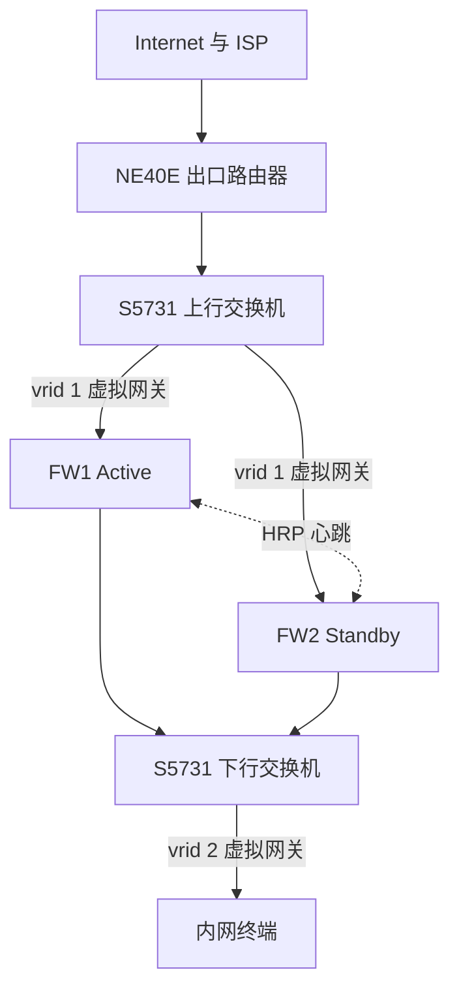

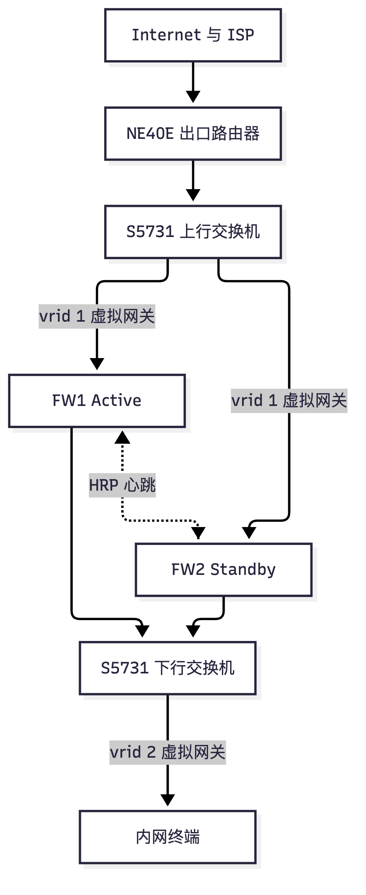


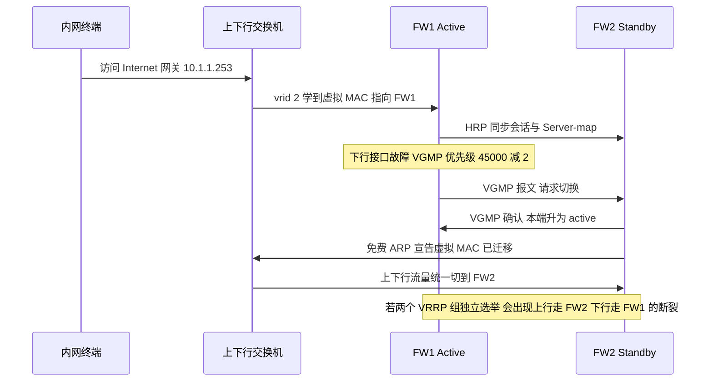

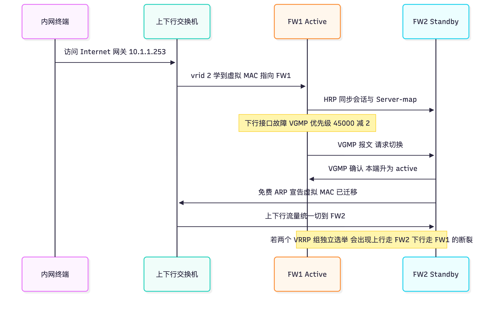


### 真题精练

**Q1.【真题·多选】** 关于 VGMP 的作用与机制，下列说法正确的有？
A. VGMP 把设备上所有 VRRP 备份组纳入一个 VGMP 组统一管理
B. VGMP 组优先级高的设备，其组内所有 VRRP 备份组都成为 active
C. 组内任一备份组状态变为 Initialize 时，VGMP 组优先级自动减 2
D. 启用 VGMP 后，VRRP 备份组的状态仍由 VRRP 报文选举决定
E. VGMP 的主要目的是解决往返路径不一致的问题

> **答案：ABCE**
> **解析**：D 错误——这正是 VGMP 存在的意义：启用双机热备后 **VRRP 不再自行选举**，状态由 VGMP 组统一决定，标识从 Master/Backup 变为 active/standby。A、B、C、E 均正确。补充记忆：VGMP 组初始优先级 45000，故障递减规律为"2 × 故障个数"（接口、OSPF/BGP 邻居、ip-link、BFD 会话均适用）。

**Q2.【真题·排错】** 某局点双机热备中，FW1 为 HRP active，但下行 VRRP 的 Master 却是 FW2。用户反映"上网时通时断，下载经常断流"。请分析原因、给出机理并写出修复步骤。

> **答案要点**：
> ① **原因**：上下行 VRRP 主备与 HRP 主备不一致（下行 vrid 的 active 落在了 FW2，而上行仍在 FW1），往返路径被两台设备分别处理。
> ② **机理**：状态检测防火墙要求同一条流的两个方向经过同一台设备才能形成完整会话；路径分裂后每台设备只看到单向报文，会话无法建立或只建立半条，报文被默认策略丢弃；同时 NAT 转换表、Server-map（ALG 动态放行）都在主机上，备机匹配不到，进一步导致回程还原失败或数据通道不通。因此现象是"时通时断、长连接断流"。
> ③ **排查**：`display hrp state verbose`（看 Detail information 中每个 VRRP 组的 active/standby 是否与 HRP 角色一致）、`display vrrp`、`display vrrp state-change interface GigabitEthernet x vrid y`（切换历史）、`hrp configuration check interface verbose`（两端接口与 VRRP 配置一致性）。
> ④ **修复**：保证同一 vrid、同一虚拟 IP、两端角色关键字互为 active/standby；用 `hrp standby-device` 显式钉死备机；确认 `hrp track interface` 已把上下行接口纳入 VGMP 监控；最后 `hrp sync config` 同步并用 `hrp switch` 验证切换后再切回。

**Q3.【真题·单选】** 当上下行设备都是路由器（不参与 VRRP）时，华为防火墙双机热备依靠什么把流量引到新的主设备？
A. VRRP 虚拟 MAC 切换
B. 免费 ARP 刷新交换机 MAC 表
C. 备机对外发布动态路由时增大度量值（OSPF 外部 COST +65500 / BGP MED +100），依靠路由收敛引流
D. 由管理员手工修改上下行路由器的静态路由

> **答案：C**
> **解析**：VRRP 依赖同一广播域内的组播选举，无法跨三层，因此上下行为路由器时不能靠 VRRP。华为的做法是把接口纳入 VGMP 监控，并通过 `hrp adjust ospf-cost enable` 让备机发布 OSPF 外部路由时 COST 增加 **65500**（可用参数自定义），`hrp adjust bgp-cost enable` 让 BGP MED 增加 **100**，路由器基于度量重新选路。A、B 属于交换机（VRRP）场景的手段；D 不可运维。

**Q4.【真题·判断】** 一台设备同时配置了 `hrp standby-device` 和 VRRP 备份组时，设备状态以 `hrp standby-device` 为准。

> **答案：错误**
> **解析**：官方结论是——若一台设备同时配置 `hrp standby-device` 与 VRRP 备份组，**设备状态以 VRRP 备份组的配置为准**，`hrp standby-device` 对该设备不生效。因此配置时必须让两者意图一致，否则会出现"以为钉死了备机、实际 VRRP 让它成了 active"的双主/路径不一致故障。

### 易错点与排错

1. **只在单边配置 VRRP 组**：vrid 或虚拟 IP 两端不一致会导致虚拟网关行为异常，用 `hrp configuration check interface verbose` 必查。
2. **接口真实 IP 配成相同**：接口地址必须两端不同（同网段不同地址），虚拟 IP 必须两端相同，配反了会直接冲突。
3. **忘记把上下行接口纳入 `hrp track`**：接口故障不触发 VGMP 切换，流量引导失效。
4. **上下行为路由器却还在配 VRRP**：跨三层 VRRP 无法工作，应改用 `hrp adjust ospf-cost/bgp-cost`。
5. **抢占延迟与动态路由收敛时间不匹配**：延迟过小会在路由未收敛时抢回主用，造成二次中断；经验做法是抢占延迟 > 路由收敛时间。
6. **排错命令**：`display hrp state verbose`（Detail information 逐个 VRRP 组状态）、`display vrrp` / `display vrrp state-change interface ... vrid ...`、`hrp configuration check interface verbose`、`display vrrp statistics`、`display ip routing-table`。

---

## 1.5 故障切换、切换时间与双主（dual-active）防范

### 考点定位

本考点以排错题和简答题为主，占 **5~10 分**。国赛最爱考"双主"：**给出双主现象，要求写成因与防范**。必须能区分四类故障的检测方式与切换时间，并记住 `display hrp state` 中判断双主的回显特征 `Role: active, peer: active` 与异常提示 `(should be "active-standby")`。陷阱：以为"心跳断了备机会立刻接管"、以为"双主只是显示问题、不影响业务"。

### 原理精讲

**四类故障，检测方式与切换时间完全不同（必背）。**

**① 接口/链路类故障——瞬时切换。** 主机通过 `hrp track interface`、`hrp track ip-link`、`hrp track bfd-session`、`hrp track vlan`、`hrp track ospf/bgp` 监控业务链路。一旦监控项故障，主机的 VGMP 组优先级按"**2 × 故障个数**"下降，并**主动通过 VGMP 报文把状态与优先级通知备机**；备机比较优先级后立即切换，整个过程**瞬时完成**（毫秒级）。这是双机热备切换最快的一类。

**② 动态路由邻居故障——延迟判定后切换。** `hrp track ospf` / `hrp track bgp` 监控邻居状态。由于双机切换本身会引起邻居震荡，为避免"自己切换把自己判成故障"的循环误判，这两个特性支持 `hrp track ospf first-check-delay` / `hrp track bgp first-check-delay`：在设定时间内把邻居状态识别为 **Unknown**（不降优先级），超时后仍非 Full/Established 才判定为 Non-full / Non-established 并降优先级。这是"为什么要有 first-check-delay"的标准答案。

**③ 整机故障或断电——心跳超时后切换。** 主机整机故障时无法发出任何通知，备机只能等心跳超时。备机在 **3 个心跳周期**（缺省 1000ms × 3 ≈ **3s**）内没有收到任何 VGMP/HRP 心跳报文，即判定主机故障并升为 active。

**④ 心跳链路故障——最危险的一类。** 心跳断掉时，两台设备都收不到对方的心跳：备机认为主机已死，升为 active；主机并没有死，仍认为自己是 active。结果就是**双主**：两台设备同时以 active 身份转发同一条业务流的报文。

**双主（dual-active）的后果（答简答题要写全）。**

1. **会话表冲突**：两台设备各自为同一条流建立会话，状态各自演化，切换/回切时互相覆盖，表现为连接随机中断。
2. **ARP/虚拟 MAC 冲突**：两台设备都响应同一个虚拟网关的 ARP，形成"MAC 地址漂移"，交换机的 MAC 表在两台设备间反复跳动。
3. **NAT 资源冲突**：源 NAT 的公网端口分配在两台设备上独立进行，可能把同一个公网端口分配给两条不同的内网连接（`hrp nat resource` 的 primary/secondary 分段机制就是为解决此类冲突而设计）。
4. **往返路径不一致**：即使两台都"活着"，同一条流的两个方向被分别处理，回到第 1.4 节的会话不对称丢包问题上。
5. **配置与状态互相污染**：两端都尝试把各自的配置/会话同步给对方，形成反复覆盖。

**双主的成因（至少背 7 条，覆盖排错题的所有分支）。**

1. **心跳链路物理中断**：光纤/网线断、中间交换机故障、VLAN 被误删、光模块故障。
2. **心跳经过三层设备但使用 UDP 单播时未放行 local 流量**：华为防火墙默认**放行组播、拦截单播**，`remote` 心跳源区域 local、目的为心跳区域，未配策略则被静默丢弃，表现是"心跳接口 up，但 HRP 协商不上"。
3. **心跳接口未加入安全区域**，或两端加入的区域不一致。
4. **两端 `hrp enable` 状态不一致**：一端未启用双机热备，`display hrp state` 中会看到 `peer: unknown`。
5. **两端 `hrp timer hello` 不一致**：心跳周期不同会导致状态抖动、误判。
6. **心跳接口选错**：用了 MGMT 管理口或配置了 `vrrp virtual-mac enable` 的接口。
7. **备份通道拥塞**：会话表/配置备份量把心跳链路占满（`display hrp state` 的 Backup channel usage 过高），HRP 心跳报文被丢，触发误判。应扩容为 Eth-Trunk 或用 `heartbeat-only` 分离控制报文与备份数据。
8. **中间网络 MTU/分片问题**：HRP 数据报文较大，路径 MTU 不足且 ICMP 被过滤时大包被丢，控制报文正常而备份失败，最终协商异常。
9. **人为配置冲突**：两端都配了 `active` 关键字或都没配 `hrp standby-device`，且 VRRP 组状态与 HRP 角色互相矛盾。

**双主防范（"工程做法 + 命令"成对写才得分）。**

1. **心跳链路的物理冗余**：至少两条独立物理路径（不同板卡、不同交换机、不同光纤路由），推荐用 **Eth-Trunk** 承载心跳；`hrp interface` 最多支持 16 个心跳接口。
2. **分离控制与备份流量**：对备份压力大的链路使用 `hrp interface ... heartbeat-only`，让 VGMP/HRP 心跳等控制报文独占一条链路，备份数据走另一条。
3. **严格放行与区域一致**：心跳接口两端加入同一安全区域，并在 local 与心跳区域之间配双向 permit 策略。
4. **周期性一致性检查**：`hrp configuration auto-check enable` + `hrp configuration auto-check warning enable`，不一致立刻告警，避免"配置单边修改"恶化成切换故障。
5. **角色显式化**：在备机上配置 `hrp standby-device`，并保证 VRRP 的角色与之匹配（记住 VRRP 优先）。
6. **抢占延迟合理化**：`hrp preempt delay` 取大于动态路由收敛时间的值，避免脑裂期间互相抢占；二层模式抢占不生效，需另用 `hrp track vlan` 阻塞 VLAN 防环。
7. **监控手段固定化**：把 `display hrp state`（看 `Role`/`peer`/`Backup channel usage`/`Stable time`）、`display hrp interface`、`display hrp statistic`、`display hrp history-information` 纳入日常巡检。

**切换对业务的实际影响（答"切换时间"类题的加分点）**：已完成三次握手且已同步的 **TCP 会话切换后不中断**（这是 HRP 的核心价值）；**ICMP 会话、未完成三次握手的 TCP 半连接、防火墙自身发起的会话不会同步**，切换后需要重建；长连接（数据库、SSH）依赖会话老化设置，必要时延长老化时间；切换后新主机发送免费 ARP 刷新上下行设备的 MAC 表，若上下行是路由器则等动态路由收敛。

### 关键概念对照表

| 故障类型 | 检测手段 | 切换时间 | 说明 |
|---|---|---|---|
| 业务接口/链路故障 | `hrp track interface` / `ip-link` / `bfd-session` | **瞬时**（毫秒级） | 主机主动发 VGMP 报文通告，优先级 -2 |
| VLAN/二层故障 | `hrp track vlan` / `hrp track trunk-member enable` | 瞬时 | 透明模式防环的关键 |
| OSPF/BGP 邻居故障 | `hrp track ospf` / `hrp track bgp` | first-check-delay 之后 | 避免切换引起邻居震荡导致误判 |
| 整机故障/断电 | HRP 心跳超时 | **3 个心跳周期**（缺省约 3s） | 备机只能被动等待超时 |
| 心跳链路故障 | 心跳超时 | 约 3s，并产生**双主** | 最危险，必须用冗余心跳防范 |
| VRRP 网关接管 | Master_Down_Interval | ≈ 3 × 通告间隔 + Skew（约 3s） | 与 VGMP 统一切换配合 |

| 双主成因 | 现象特征 | 处理手段 |
|---|---|---|
| 心跳链路断 | `Role: active, peer: active`（主备模式） | 抢修链路，恢复后重新协商 |
| 单播心跳未放行 | `peer: unknown` 或角色异常 | 配置 local ↔ 心跳区域双向 permit |
| `hrp timer hello` 不一致 | 状态抖动、Stable time 很短 | 两端统一为缺省 1000ms |
| 备份通道拥塞 | Backup channel usage 高 | Eth-Trunk 扩容或 `heartbeat-only` |
| 心跳接口不可用（MGMT/虚拟 MAC） | 心跳接口恒 down | 更换心跳接口 |
| 角色配置冲突 | VRRP 与 HRP 角色不符 | `hrp standby-device` + VRRP 角色对齐 |

### 华为设备配置

```bash
# ===== 心跳冗余与双主防范（两台设备分别配置）=====
system-view
hrp enable                                                      // 两端都必须使能，否则 peer 显示 unknown
hrp interface Eth-Trunk1 remote 10.1.1.2                        // 主心跳：Eth-Trunk 聚合，成员走不同板卡与交换机
hrp interface GigabitEthernet1/0/3 remote 10.1.2.2              // 备心跳：独立物理路径，避免共因故障
hrp interface GigabitEthernet1/0/3 remote 10.1.2.2 heartbeat-only
                                                                // 备心跳只承载 VGMP/HRP 控制报文，备份数据走主心跳
hrp timer hello 1000                                            // 心跳周期两端必须一致（缺省 1000ms）
hrp track interface GigabitEthernet1/0/1                        // 监控上行接口，故障瞬切
hrp track interface GigabitEthernet1/0/2                        // 监控下行接口
hrp track bfd-session 1                                         // 用 BFD 会话监控链路质量，比接口状态更灵敏
hrp preempt delay 120                                           // 抢占延迟 120s，必须大于动态路由收敛时间
hrp configuration auto-check enable                             // 周期自动一致性检查，提前发现人为单边修改
hrp configuration auto-check interval 720                       // 每 720 分钟（12 小时）检查一次
hrp configuration auto-check warning enable                     // 不一致时产生告警与日志
hrp nat resource primary-start 1 primary-end 63 secondary-start 64 secondary-end 126
                                                                // NAT 公网端口分段使用：主机用前半段、备机用后半段，防止双主时端口冲突
quit

# ===== 双主发生后的排查与恢复 =====
display hrp state                                               // 期望：一台 Role: active, peer: standby；另一台相反
display hrp state verbose                                       // 异常时会提示 should be active-standby
display hrp interface                                           // 检查心跳接口是否为 running，是否有 down
display hrp statistic                                           // 查看 HRP 报文收发计数，判断心跳丢包
display hrp history-information                                 // 查看状态切换历史，定位双主发生时刻
display interface Eth-Trunk1                                    // 检查心跳聚合链路与成员状态
ping -a 10.1.1.1 10.1.1.2                                       // 用本端心跳地址 ping 对端心跳地址，验证通道
hrp switch standby                                              // 确认业务已由另一台承载后，在误判为 active 的一侧手工降为 standby
undo hrp enable                                                 // 极端情况下先关闭 HRP 再重新开启，强制重新协商（业务会短暂中断，慎用）
hrp enable
hrp sync config                                                 // 重新建立后强制同步一次配置，消除双主期间产生的差异
```

### 示意图

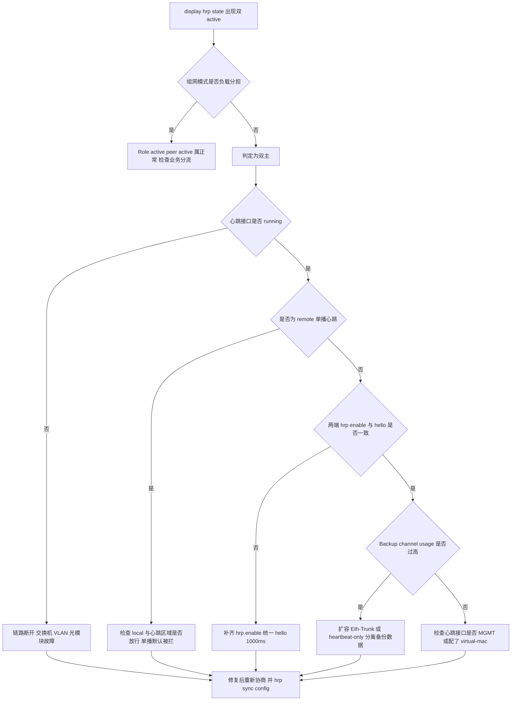

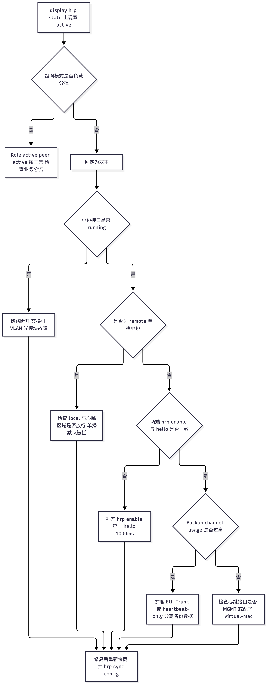


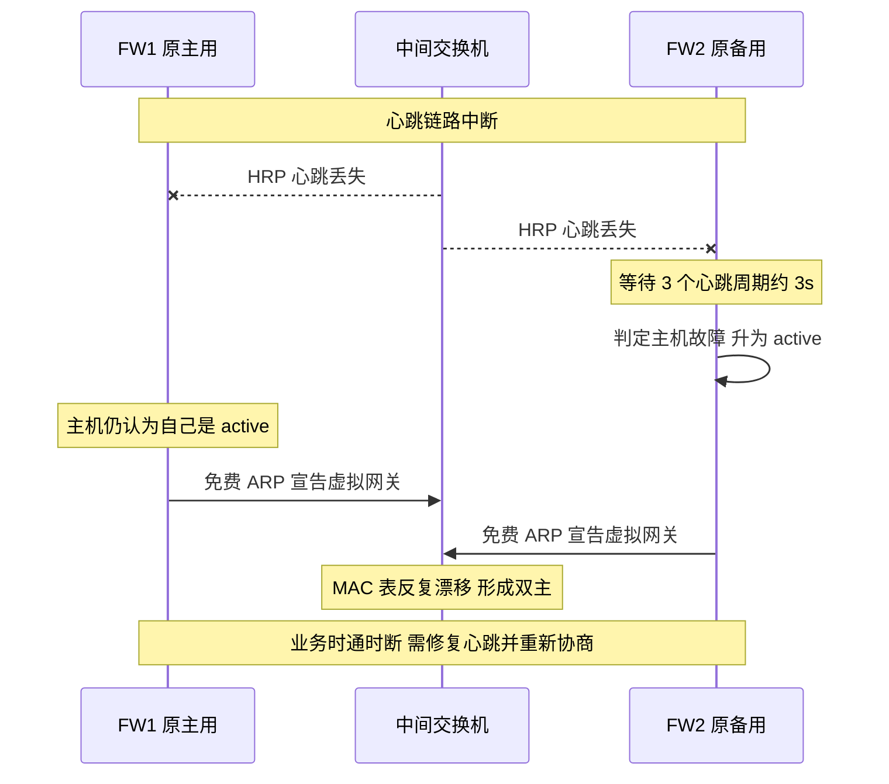

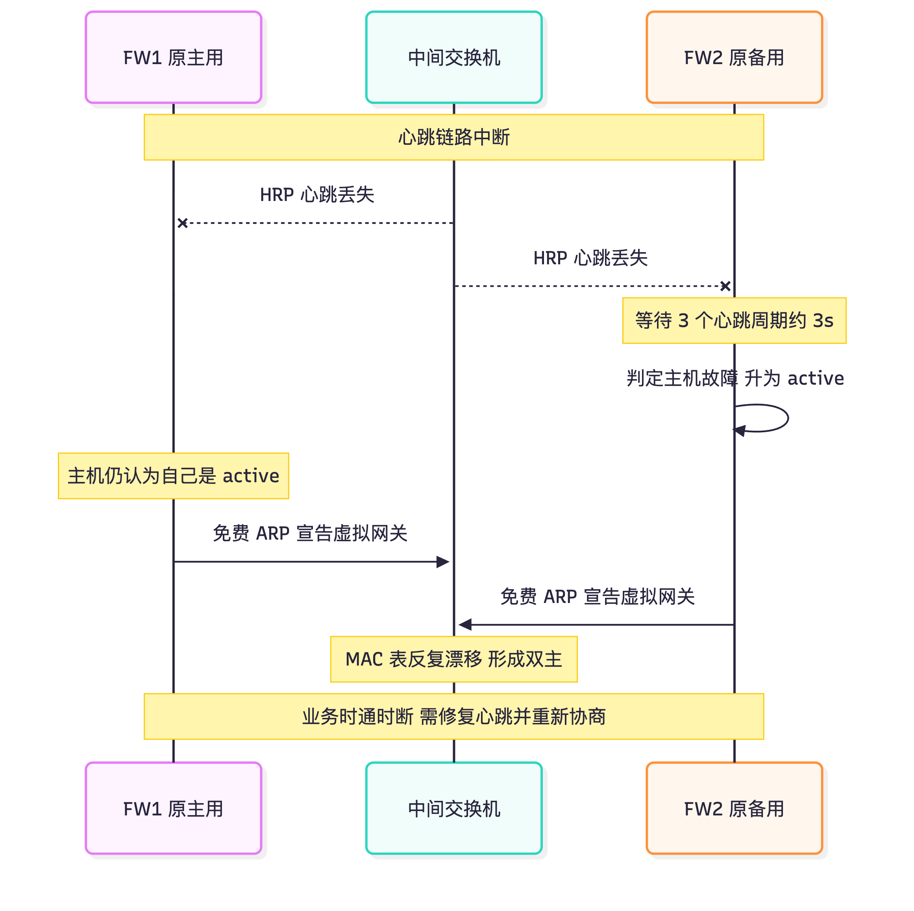


### 真题精练

**Q1.【真题·多选】** 下列哪些原因可能导致双机热备出现"双主"（两台设备均为 active）？
A. 心跳链路全部中断
B. 心跳使用 `remote` 单播但未在 local 与心跳区域之间放行策略
C. 两端 `hrp timer hello` 取值不一致
D. 心跳接口使用了 MGMT 管理口
E. 备机配置了 `hrp standby-device`

> **答案：ABCD**
> **解析**：A、B、C、D 都是双主的常见成因。B 尤其隐蔽：华为防火墙默认放行组播、拦截单播，使用 `hrp interface ... remote ...` 后若不配置策略，心跳被静默丢弃。E 错误，`hrp standby-device` 恰恰是**防范**双主的手段（显式钉死备机角色），不会导致双主。补充：备份通道拥塞导致心跳报文被丢、中间网络 MTU 不足导致大包被丢，也会造成双主。

**Q2.【真题·简答】** 请说明双机热备中"接口故障切换"与"整机故障切换"在检测方式与切换时间上的差别，并解释原因。

> **答案要点**：
> ① **接口/链路故障是瞬时切换**：主机通过 `hrp track` 监控业务接口，故障时 VGMP 组优先级按"2 × 故障个数"下降，并**主动通过 VGMP 报文**把状态与优先级通知备机；备机比较优先级后立即切换，毫秒级完成。
> ② **整机故障需等心跳超时**：主机断电或整机故障时无法发出任何报文，备机只能依赖 HRP 心跳超时判定，需等待 **3 个心跳周期**（缺省 1000ms × 3 ≈ 3s）。
> ③ 原因在于"能否主动通告"：接口故障时主机仍在运行，可以把自身状态变化告知对端，所以是"协商式"快速切换；整机故障时通信能力全部丧失，只能由对端"被动超时"发现，因此受心跳周期制约。
> ④ 工程含义：调小 `hrp timer hello` 可缩短整机故障切换时间，但会增加 CPU 与心跳带宽负担并可能丢包，官方建议使用缺省 1000ms。

**Q3.【真题·排错】** 某双机热备局点业务偶发中断，日志中有 HRPI/4/COCHK 记录，`display hrp state` 显示 `Role: active, peer: standby`、`Stable time` 只有几分钟。请给出排查方向。

> **答案要点**：
> ① `HRPI/4/COCHK` = **配置一致性检查告警**，说明两端配置存在差异；差异本身可能不致命，但往往伴随心跳异常或单边变更。
> ② `Stable time` 很短说明**状态频繁变化**：优先查心跳链路质量（`display hrp statistic` 看丢包、`display hrp interface` 看 running/ready、`Backup channel usage` 是否过高）。
> ③ 检查抢占配置：若 `hrp preempt delay` 过小、而另一端依赖 OSPF 收敛，会出现"抢回 → 未收敛 → 再切走"的反复抖动（`display hrp history-information` 能看到切换时间序列）。
> ④ 检查 `hrp track` 监控项：把不稳定链路（如抖动大的 IP-Link 探测目标）纳入监控会造成优先级反复变化；必要时调整探测周期或改用 BFD 并设置合理参数。
> ⑤ 处理：`display hrp configuration check` 定位差异并 `hrp sync config` 同步；心跳扩容/分离；抢占延迟调到大于路由收敛时间；必要时临时 `undo hrp preempt` 观察稳定性。

### 易错点与排错

1. **把"双主"当成显示问题**：双主会导致 MAC 漂移、NAT 端口冲突与会话随机中断，必须按故障处理。
2. **忘记"单播心跳要放行"**：这是排错题出现率最高的隐形原因，症状是接口 up 但 HRP 协商失败。
3. **`hrp timer hello` 两端不一致**：会造成状态抖动与误切换，务必统一（建议缺省 1000ms）。
4. **抢占延迟小于路由收敛时间**：会引发反复切换；二层模式抢占不生效，不要在此处找问题。
5. **只看接口状态不看链路质量**：接口 up 但上游已断时，只有 `ip-link`/BFD 能发现，务必配合使用。
6. **排错命令**：`display hrp state [verbose]`、`display hrp interface`、`display hrp statistic`、`display hrp history-information`、`display hrp configuration check`、`display logbuffer | include COCHK`、`display interface brief`。

---

## 1.6 虚拟系统 VSYS（虚拟化与多租户隔离）

### 考点定位

本考点在理论卷中以单选/多选/简答出现，占 **5~10 分**；在设计题中常作为"多租户/多业务平面隔离"的标准方案。必须掌握：① 根系统与虚拟系统的关系；② **虚拟系统与物理接口的映射关系**（国赛要求会画）；③ 资源分配的三种方式（定额分配、手工分配/资源类、共享抢占）；④ 虚拟系统间流量交互的几种方式；⑤ 底层隔离靠 **VPN 实例（RD）**、资源/配置/业务隔离靠 **VSYS ID**。

### 原理精讲

**概念与价值。** 虚拟系统（VSYS，Virtual System）是把一台物理防火墙从逻辑上切分成多台互相独立的"虚拟防火墙"的技术。每个虚拟系统拥有**独立的接口、独立的安全区域、独立的路由表、独立的安全策略与 NAT 策略、独立的管理员**，彼此不可见对方的配置与流量。它的价值体现在三类场景：① **多租户**——IDC/云出口为一租户一个虚拟系统，实现真正的管理隔离；② **多业务平面**——把生产、办公、DMZ、测试等不同安全等级的网络放在不同虚拟系统内，避免"一套策略打天下"；③ **设备利旧与降本**——用一台高端防火墙替代多台低端设备，同时保持策略与路由的隔离。

**根系统（public）与虚拟系统的关系。** **根系统是设备上缺省存在的一个特殊虚拟系统**，它的职责是"管理其他虚拟系统"：为虚拟系统分配资源、为虚拟系统之间的通信提供服务。即使没有开启虚拟系统功能，根系统也依然存在，此时管理员对设备的配置等同于对根系统配置；**启用虚拟系统功能后，根系统会继承此前设备上的全部配置**。三者的差别可以归纳为：

| 对比项 | 根系统 public | 虚拟系统 vsys |
|---|---|---|
| 配置管理权限 | 可管理所有虚拟系统的业务配置 | 仅能管理本系统内部的业务配置 |
| 资源管理能力 | 管理整机资源分配，可为虚拟系统分配资源 | 仅能使用分配到的资源 |
| 业务功能支持 | 支持设备全部特性与功能 | 仅支持部分特性的虚拟化与配置 |
| 接口与区域 | 未分配的物理接口与全部区域 | 仅被 `assign` 的接口与独立区域（含 4 个缺省区域） |
| 管理员 | 超级管理员，可进入任意虚拟系统 | 专属管理员，只能管理本系统 |

**底层隔离是怎么实现的？（HCIE 细节题）** 虚拟系统的隔离由两层拼起来：**路由隔离的底层转发依赖 VPN 实例（RD 值）**，而**资源、配置、业务的隔离依赖 VSYS ID**。具体表现：创建虚拟系统时，设备会自动生成一个**与虚拟系统同名的 VPN 实例**，其**实例 ID 与 VSYS ID 一致**，该实例与虚拟系统绑定、不能单独删除；根系统下有一个默认公网实例 `public`，实例 ID 为 0。被分配到虚拟系统的接口会自动执行 `ip binding vpn-instance <vsys名>`，从而把该接口的转发域限定在虚拟系统内。此外还可以手工创建 VPN 实例（`ip vpn-instance`）用于纯路由隔离，其实例 ID 从"整机虚拟系统最大规格数 + 1"开始编号，且命名不能与已有虚拟系统同名、不能叫 `public` 或 `root`。

**虚拟系统与物理接口的映射（必画、必懂）。** 映射规则只有三条，但决定了所有配置思路：

1. **`assign interface` 是"划走"而不是"共享"**：一个物理接口被分配给某个虚拟系统后，它在根系统中**不再可见、也不能再被根系统使用**；在虚拟系统内，该接口会自动绑定同名 VPN 实例。因此"根系统里 `display interface` 看不到 GE1/0/1"是完全正常的现象，不是故障。
2. **一个物理接口只能属于一个虚拟系统**；若要在同一物理链路上承载多个虚拟系统，必须使用**二层接口 + VLAN 子接口**，按 VLAN 把不同子接口分配给不同虚拟系统（这也是"一个接口可以属于多个虚拟防火墙"的唯一方式）。
3. **每个虚拟系统内部都有一个虚拟接口 `Virtual-if<VSYS ID>`**，它是虚拟系统与根系统之间的"内部对接口"，用于虚拟系统与根系统互访以及引流；虚拟系统还拥有**独立的 4 个缺省安全区域（trust/untrust/dmz/local）**，其区域规格与根系统完全一致且相互独立，**这 4 个缺省区域不能删除或修改**。区域优先级为 local 100 > trust 85 > dmz 50 > untrust 5。

**资源分配：三种方式（必背分类与归属）。**

1. **定额分配**：设备按系统规格在**创建虚拟系统时自动分配**的资源，典型代表是**安全区域**（每个虚拟系统都自动获得 4 个缺省区域，规格与根系统一致）。
2. **手工分配**：管理员显式分配，有两种做法——在创建虚拟系统时直接分配，或通过**配置资源类（`resource-class`）并绑定**的方式分配。资源类中可以为每个资源项指定**保证值（reserved-number）**与**最大值（maximum）**：保证值是为虚拟系统预分配的、**一旦分配即被该虚拟系统独占**的最小资源量；最大值是允许虚拟系统使用的上限，能否达到还取决于整机剩余资源与其他虚拟系统的占用。**资源类只有在绑定到虚拟系统后才生效**——只在资源类里配了保证值却没绑定，这部分资源不会从整机剩余资源中扣除（这句话几乎每年都有一道小题）。代表性资源项包括 CPU 与内存权重、会话数（session）、策略数（policy）、带宽（bandwidth/带宽通道）等。
3. **共享抢占**：不支持为虚拟系统独立分配的资源项，所有虚拟系统与根系统**共同抢占整机资源**。典型清单：地址与地址组、自定义服务与自定义服务组、NAT 地址池、证书、时间段、带宽通道、上网用户数、安全组数、静态路由条目、在线上网用户数，以及各类表项（Server-map、IP-MAC 绑定表、ARP 表、MAC 地址表）。考试中"哪些资源不能在虚拟系统里独立配额"就按这份清单回答。

**虚拟系统间流量交互的方式（设计题常考）。** 虚拟系统之间默认完全隔离，互访必须显式打通，常见做法有四类：

1. **通过根系统转发（最常用）**：VSYS-A 的流量先送到根系统（经 `Virtual-ifA` 或互联接口），根系统查自己的路由表后转发给 VSYS-B（经 `Virtual-ifB`）。此时**根系统相当于一台中间路由器**，需要在根系统与两个虚拟系统上分别配置路由与安全策略。
2. **通过引流互访**：把流量引导到根系统或指定虚拟系统，再用根系统的策略统一处理，适合集中审计或统一出口的场景。
3. **两个虚拟系统直接互访**：通过共享接口/外部三层设备绕行，或用地址转换把两个系统"对接"起来；配置最简单但隔离性弱、可扩展性差。
4. **跨根系统/跨虚拟系统中转**：多级中转，用于大型多租户场景，路径长、排错复杂。

无论哪种方式，都要牢记一条排错铁律：**策略、路由、NAT 必须在流量经过的每一个虚拟系统内分别配置**——根系统有路由不等于虚拟系统有策略，反之亦然。

**配置与运维要点。** ① `vsys enable` 使能虚拟系统功能后，部分版本需要重启设备才完全生效；② 创建虚拟系统并分配接口、资源类；③ 用 `switch vsys <名称>` 在根系统与各虚拟系统之间切换命令视图（提示符会变为 `<sysname-vsys-名称>` 形式）；④ 每个虚拟系统可配置独立管理员（通过 AAA 的用户与角色绑定），实现"我的系统我做主"；⑤ 日常运维依靠 `display vsys`、虚拟系统内的 `display current-configuration`、以及根系统中的 `display resource-class` 类命令核查配额；⑥ 虚拟系统**可以与双机热备共存**：HRP 在根系统层面同步，虚拟系统内的配置随根系统一起同步，但**虚拟系统的资源类配置只在根系统下配置**。

**USG6000E 与 USG12000 在虚拟化上的差异（了解即可，别写具体规格）**：USG6000E 面向企业园区与中小型数据中心，支持虚拟系统与资源类，虚拟系统数量与资源项规格随型号不同；USG12000 面向大型数据中心与运营商出口，采用更高性能的硬件架构（多业务板/更高吞吐）并提供更大的虚拟系统数量、更高的会话与策略规格，常用于大规模多租户出口。考试中如需引用具体规格，必须查对应型号的产品文档，**不要凭记忆写数字**。

### 关键概念对照表

| 资源分配方式 | 代表资源项 | 配置要点 |
|---|---|---|
| 定额分配 | 安全区域（每个虚拟系统 4 个缺省区域） | 创建虚拟系统时自动分配，不可删除或修改 |
| 手工分配 | CPU/内存权重、会话数、策略数、带宽等 | 创建时分配或通过 `resource-class` + `assign resource-class` 绑定 |
| 共享抢占 | 地址/地址组、自定义服务/服务组、NAT 地址池、证书、时间段、带宽通道、在线用户数、静态路由条目、Server-map/ARP/MAC 表项 | 无法为虚拟系统独立配额，与根系统及其他虚拟系统共同抢占 |

| 资源类概念 | 含义 | 注意 |
|---|---|---|
| 保证值 reserved-number | 为虚拟系统预分配的最小资源量 | 一旦分配即被该虚拟系统**独占**，从整机剩余资源中扣除 |
| 最大值 maximum | 虚拟系统可使用该资源项的上限 | 能否达到还取决于整机剩余量与其他虚拟系统占用 |
| 绑定 `assign resource-class` | 资源类生效的前提 | **未绑定的资源类不生效**，保证值也不会扣除 |
| 未限定的资源项 | 虚拟系统与根系统共同抢占 | 等于"共享抢占" |

| 虚拟系统间互访方式 | 原理 | 适用与代价 |
|---|---|---|
| 通过根系统路由表互访 | 根系统作为中转路由器，经 Virtual-if 转发 | 最常用、可控性好；需在根系统与两个 vsys 分别配路由与策略 |
| 通过引流互访 | 把流量引到根系统或指定 vsys 统一处理 | 适合集中审计/统一出口；配置较复杂 |
| 两个虚拟系统直接互访 | 共享接口或外部设备绕行、地址转换对接 | 简单、隔离性弱、扩展性差 |
| 跨根系统/跨虚拟系统中转 | 多级中转 | 大规模多租户；路径长、排错难 |

### 华为设备配置

```bash
# ===== 根系统：使能与资源分配 =====
system-view
vsys enable                                                     // 使能虚拟系统功能（继承设备原有配置，部分版本需重启生效）
resource-class rc_a                                             // 创建资源类 rc_a
 resource-item-limit session reserved-number 2000 maximum 20000 // 会话表：保证 2000 条（独占预留），上限 20000 条
 resource-item-limit policy reserved-number 500 maximum 2000    // 安全策略：保证 500 条，上限 2000 条
                                                                // 其他资源项（CPU/内存权重、带宽等）按同一语法逐项指定
quit
vsys name vsys_a 1                                              // 创建虚拟系统 vsys_a，VSYS ID 为 1（自动生成同名 VPN 实例）
 assign interface GigabitEthernet1/0/1                          // 把物理接口 GE1/0/1 划给该虚拟系统（根系统中不再可见）
 assign interface GigabitEthernet1/0/3                          // 再划一个接口（例如上行口）
 assign resource-class rc_a                                     // 绑定资源类，绑定后资源类才生效
quit
vsys name vsys_b 2                                              // 创建第二个虚拟系统 vsys_b，VSYS ID 为 2
 assign interface GigabitEthernet1/0/2
 assign interface GigabitEthernet1/0/4
 assign resource-class rc_a
quit
display vsys                                                    // 查看虚拟系统列表、VSYS ID 与状态
display resource-class rc_a                                     // 查看资源类的资源项与已分配情况（按版本命令略有差异）

# ===== 进入虚拟系统进行业务配置 =====
switch vsys vsys_a                                              // 从根系统切换到虚拟系统 vsys_a
system-view
interface GigabitEthernet1/0/1                                  // 该接口已自动绑定 ip binding vpn-instance vsys_a
 ip address 10.3.0.254 255.255.255.0                            // 虚拟系统内的接口地址
 service-manage all permit                                      // 放行 HTTPS/SSH 等管理流量（实验便利配置，现网按需收紧）
quit
firewall zone trust                                             // 虚拟系统拥有独立的 4 个缺省区域
 add interface GigabitEthernet1/0/1                             // 接口加入本虚拟系统的 trust 区域
quit
security-policy                                                 // 虚拟系统内独立的安全策略（与根系统互不影响）
 rule name t2u
  source-zone trust
  destination-zone untrust
  action permit
quit
ip route-static 0.0.0.0 0.0.0.0 GigabitEthernet1/0/3 100.1.1.254 // 虚拟系统独立的路由表
quit
switch vsys public                                              // 切回根系统（public 即根系统）
display current-configuration                                   // 在根系统中查看全局配置

# ===== 虚拟系统与根系统互访（打通 Virtual-if 与路由）=====
switch vsys vsys_a
system-view
display interface Virtual-if1                                   // 查看虚拟系统与根系统之间的内部虚拟接口
firewall zone trust
 add interface Virtual-if1                                     // 按设计把内部虚拟接口加入相应区域
quit
ip route-static 192.168.100.0 255.255.255.0 Virtual-if1         // 去往其他虚拟系统/根系统网段的路由
quit
switch vsys public
display current-configuration                                   // 根系统中同样需要回程路由与安全策略
save
```

### 示意图

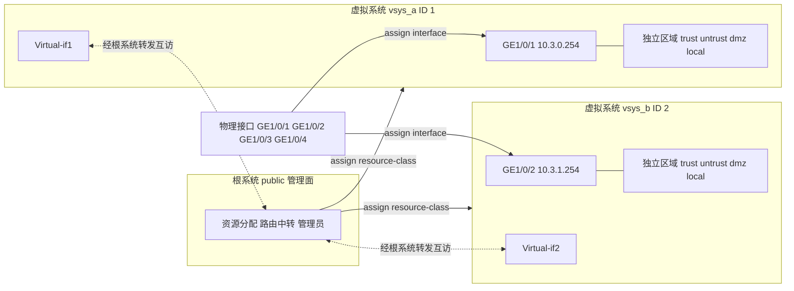

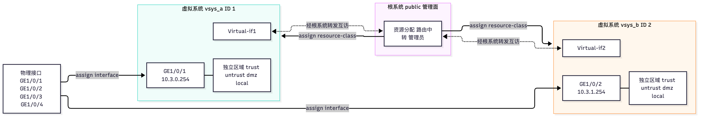


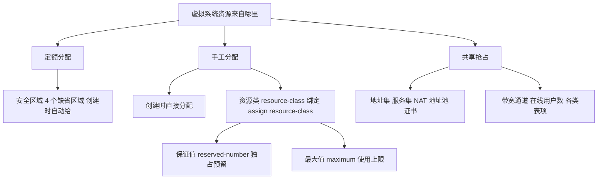

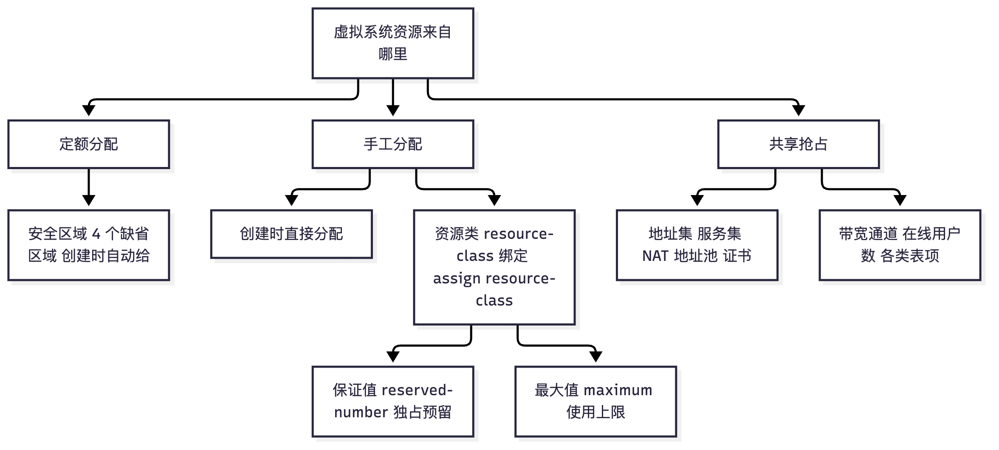


### 真题精练

**Q1.【真题·多选】** 关于华为防火墙虚拟系统，下列说法正确的有？
A. 根系统（public）即使未启用虚拟系统功能也依然存在，此时对设备的配置等同于对根系统配置
B. 启用虚拟系统功能后，根系统会继承此前设备上的配置
C. 一个物理接口可以通过 `assign interface` 同时分配给多个虚拟系统
D. 虚拟系统拥有独立的 4 个缺省安全区域，且这 4 个区域不能被删除或修改
E. 虚拟系统之间的路由隔离在底层依赖 VPN 实例实现

> **答案：ABDE**
> **解析**：C 错误——**一个物理接口只能属于一个虚拟系统**；若要在同一条物理链路上承载多个虚拟系统，必须使用二层接口配合 VLAN 子接口，按 VLAN 分别 `assign`。A、B 正确，根系统是缺省存在且会继承原有配置的特殊虚拟系统。D 正确，四个缺省区域规格与根系统一致且相互独立。E 正确，隔离由两层组成：路由隔离的底层转发依赖 **VPN 实例（RD）**，资源/配置/业务隔离依赖 **VSYS ID**；创建虚拟系统时会自动生成同名 VPN 实例，实例 ID 与 VSYS ID 一致。

**Q2.【真题·单选】** 在资源类中为虚拟系统配置了会话数保证值，但虚拟系统未绑定该资源类，结果是？
A. 保证值仍然生效，虚拟系统独占该部分会话资源
B. 保证值不生效，这部分资源不会从整机剩余资源中扣除
C. 虚拟系统无法创建，必须先绑定资源类
D. 该虚拟系统会独占整机会话资源

> **答案：B**
> **解析**：**资源类只有在绑定到虚拟系统后才生效**。如果仅在资源类中指定了资源保证值而未将其绑定到虚拟系统，这部分资源**不会从整机剩余资源中扣除**，也就等于没有为该虚拟系统预留。这是资源分配题最常设的陷阱，配置顺序必须记牢：创建资源类 → 配置资源项 → 创建虚拟系统 → `assign interface` → `assign resource-class`。

**Q3.【真题·简答】** 请说明虚拟系统之间实现互访的常用方式，并指出配置时的关键注意点。

> **答案要点**：
> ① **通过根系统转发（最常用）**：VSYS-A 的报文经其内部虚拟接口 `Virtual-if<ID>` 送到根系统，根系统查自己的路由表后转发给 VSYS-B。此时根系统相当于一台中间路由器。
> ② **通过引流互访**：将流量引到根系统或指定虚拟系统后统一处理，便于集中审计与统一出口。
> ③ **两个虚拟系统直接互访**：通过共享接口或外部三层设备绕行，或使用地址转换对接；配置简单但隔离性与扩展性较差。
> ④ **跨根系统/跨虚拟系统中转**：多级中转，适用于大规模多租户，路径长、排错难。
> 关键注意点：**路由、安全策略、NAT 必须在流量经过的每一个虚拟系统（含根系统）内分别配置**；虚拟系统的接口地址与其所属 VPN 实例要匹配；利用 `display interface Virtual-if1` 核实内部虚拟接口状态；用 `switch vsys` 切换视图时注意提示符，避免"以为在根系统配、实际配在虚拟系统"。

**Q4.【真题·判断】** 虚拟系统内的安全策略会与根系统的安全策略叠加生效，先匹配根系统策略再匹配虚拟系统策略。

> **答案：错误**
> **解析**：虚拟系统是**逻辑上独立的安全设备**，拥有独立的安全策略、独立的路由表与独立的区域；虚拟系统的策略与根系统策略**不叠加、不互相继承**。报文在哪个虚拟系统内转发，就只匹配该虚拟系统的策略。根系统只在"资源分配"和"虚拟系统间通信中转"这两个方面参与，不参与虚拟系统内部的策略匹配。

### 易错点与排错

1. **在根系统里找不到已分配的接口**：`assign interface` 是"划走"，属正常现象，用 `display vsys` 与 `switch vsys` 进入虚拟系统查看。
2. **以为资源类配了就生效**：必须 `assign resource-class` 绑定，否则保证值不扣除、上限不生效。
3. **一个接口想分给两个虚拟系统**：只能通过二层接口 + VLAN 子接口按 VLAN 分配。
4. **虚拟系统间互访只配了单边**：两端与根系统都要有路由与策略，漏一边就不通。
5. **混淆巡检命令所在视图**：`display vsys` 在根系统执行；虚拟系统内的 `display current-configuration` 只显示该系统配置，不要据此判断整机配置。
6. **排错命令**：`display vsys`（虚拟系统列表与 ID）、`display resource-class`（配额与占用）、`display interface Virtual-if1`（内部虚拟接口）、`display ip vpn-instance`（确认自动生成的同名 VPN 实例）、`switch vsys <name>` 后 `display current-configuration`、`display firewall session table`（在对应虚拟系统内查看会话，验证流量落在哪个系统）。

---

## 1.7 带宽管理：带宽通道、带宽策略与连接数限制

### 考点定位

本考点以单选/多选/设计题出现，占 **3~6 分**。核心是三个概念的分工与差异：**带宽通道（定义带宽本身）与带宽策略（定义匹配条件）是两个对象**、**整体限速与每 IP 限速的差别**、**带宽限制与连接数限制解决的是不同问题**。陷阱：把"保证带宽"与"最大带宽"混为一谈；以为限制带宽就能防住会话表耗尽（带宽限不住小包攻击，必须靠连接数限制）；以为带宽策略与安全策略是同一个策略（它们是并列的两套策略，各管各的）。

### 原理精讲

**为什么需要带宽管理？** 出口带宽是**共享的稀缺资源**。没有带宽管理时，少数几个终端的 P2P 下载或视频流量就能把出口占满，导致视频会议、ERP、VoIP 等关键业务出现丢包与抖动；更严重的是，某些畸形流量（大量小包、海量短连接）既不吃带宽却能瞬间耗光**会话表**，让设备无法为正常用户建立连接。因此华为防火墙的带宽管理解决两个层面的问题：**带宽的分配与限制**（带宽通道/带宽策略）与**并发连接数的限制**（连接数限制）。

**两个对象：带宽通道与带宽策略。** 这是理解全部带宽管理题的关键——

- **带宽通道（bandwidth channel）**：描述"允许多少带宽"，即一组带宽参数（整体最大带宽、整体保证带宽、每 IP 最大带宽等）。它是一个**可被复用的资源对象**，本身不关心流量是谁的。
- **带宽策略（bandwidth policy）**：描述"对谁的流量生效"，即匹配条件（源/目的安全区域、源/目的地址、用户/用户组、应用/应用组、时间段等），匹配后**引用一个带宽通道**。

为什么要把两者分开？因为**同一组带宽参数往往要套用到多种匹配条件上**：例如"办公网每个 IP 上行不超过 2Mbps"这条参数，可能同时用于"研发部→互联网""财务部→互联网"两条匹配条件。把带宽参数抽成通道后，只需改一处就能全局调整；这也是**虚拟系统中"带宽通道"被列为共享抢占资源**的原因（它属于全局对象，不能在虚拟系统内独立配额）。

**整体限速与每 IP 限速（必考差异）。**

- **整体限速（total）**：限制**一条策略所匹配的全部流量之和**。例如"办公网→互联网整体最大 20Mbps"，无论下面有多少终端，总出口不超过 20Mbps。它保证的是**总量的可控性**。
- **每 IP 限速（per-IP）**：为**每一个源 IP 单独分配**带宽上限。例如"每 IP 最大 2Mbps"，则 100 个终端各有 2Mbps 的上限，理论上总量可达 200Mbps（受整体限速或物理带宽约束会先被卡住）。它保证的是**公平性**，防止单个终端霸占出口。

工程上的标准组合是**两者同时配置**：整体限速防止总出口被冲垮，每 IP 限速防止个别用户饥饿其他用户。**保证带宽（guarantee）与最大带宽（maximum）** 则是另一对概念：最大带宽是"不允许超过"的上限；保证带宽是"拥塞时优先保障"的下限，两者配合才能实现"关键业务优先、非关键业务让路"。当流量超过保证带宽而链路拥塞时，超出部分可能被丢弃或降级；未超时则按正常转发。

**连接数限制要解决的是另一类问题。** 会话表是防火墙最宝贵的资源，条目数有硬上限（不同型号规格不同）。攻击者或失控客户端可以用**海量短连接**（如每秒数万次 SYN、大量 UDP 小包）在极短时间内耗尽会话表，此时设备对新用户完全无法建流，表现为"网络全断但带宽空载"。**带宽限制对此无能为力**（这些流量占用带宽极小）。因此必须按对象设置并发连接数上限：**每 IP 最大并发连接数**（最常用，防止单终端失控）、**每用户/用户组最大并发连接数**（配合认证，按人限制）、**每策略最大并发连接数**（限制某类业务的总体规模）。配置时应结合 NAT 场景注意"会话数 = 内网连接数 × 转换后表项数"的关系，避免误伤经过 NAT 的正常业务。

**带宽管理的典型应用场景**：① **办公网出口**——整体限速 + 每 IP 限速，保证人人可用；② **P2P/视频压制**——按应用匹配，限制娱乐类流量；③ **关键业务保障**——为 ERP、视频会议、VoIP 配置保证带宽；④ **防会话耗尽**——每 IP 连接数限制，配合入侵防御（IPS）与 AntiDDoS 形成完整防护；⑤ **多租户/多虚拟系统配额**——在虚拟系统内按租户限速，并利用共享抢占的"带宽通道"实现整机口径的总量控制。

**排错要点**：带宽策略与安全策略是**两套并行策略**，安全策略的放行是流量通过的前提，带宽策略只在其后生效；"限速不生效"最常见的原因不是带宽策略写错，而是**安全策略没过、流量根本没进设备**，或者匹配条件（区域/地址/应用/时间段）与实际流量不一致。验证顺序永远是：先看会话表是否有这条会话（`display firewall session table verbose`），再看带宽策略命中计数，最后看带宽通道的实际限制值。

### 关键概念对照表

| 概念 | 含义 | 典型配置对象 | 解决的问题 |
|---|---|---|---|
| 带宽通道 | 一组带宽参数（整体最大/保证、每 IP 最大） | 可被多条带宽策略复用 | 带宽的分配与上限 |
| 带宽策略 | 匹配条件（区域/地址/用户/应用/时间段）+ 引用带宽通道 | 多条规则按优先级匹配 | 对"谁"的流量生效 |
| 整体限速 total | 一条策略匹配流量的总带宽上限/保证值 | 带宽通道或规则内 | 总量可控 |
| 每 IP 限速 per-IP | 每个源 IP 单独享有的带宽上限 | 带宽通道或规则内 | 公平性、防单点霸占 |
| 保证带宽 guarantee | 拥塞时优先保障的下限 | 带宽通道 | 关键业务保障 |
| 最大带宽 maximum | 不允许超过的上限 | 带宽通道 | 限制与整形 |
| 连接数限制 | 并发会话数上限（每 IP/每用户/每策略） | 带宽策略或会话限制配置 | 防会话表耗尽、防短连接攻击 |

| 对比项 | 带宽限制 | 连接数限制 |
|---|---|---|
| 作用对象 | 比特/秒（吞吐） | 并发会话条目数 |
| 典型威胁 | 大流量占满出口 | 海量短连接耗尽会话表 |
| 失效场景 | 小包攻击几乎不耗带宽 | 大流量单连接不耗会话表 |
| 观测手段 | 接口流量、带宽通道统计 | `display firewall session statistics` |
| 组合建议 | 整体 + 每 IP 同时配置 | 按 IP/用户配置，并配合 IPS/AntiDDoS |

### 华为设备配置

```bash
# ===== 带宽管理：带宽策略 + 带宽通道（USG6000E V600R007）=====
# 视图层级与配置思路固定为：带宽策略视图 → 规则（匹配条件）→ 引用带宽参数 / 带宽通道。
# 具体资源项名称与取值范围随版本略有差异，实验时用 ? 补全确认即可。
system-view
bandwidth-policy                                              // 进入带宽策略视图（与 security-policy、nat-policy 并列的独立策略体系）
 rule name bwp_office                                         // 办公网上网带宽策略规则
  description "office upload limit"                           // 描述，便于 display 时识别规则用途
  source-zone trust                                           // 匹配源安全区域
  destination-zone untrust                                    // 匹配目的安全区域
  source-address 10.1.1.0 24                                  // 匹配办公网网段
  bandwidth total maximum 20000                               // 整体限速：该规则匹配流量总带宽上限 20000 kbit/s
  bandwidth total guarantee 5000                              // 整体保证带宽：拥塞时优先保障 5000 kbit/s
  bandwidth per-ip maximum 2000                               // 每 IP 限速：每个源 IP 最大 2000 kbit/s，防止单终端占满出口
  link-limit per-ip 1000                                      // 连接数限制：每个源 IP 最大并发连接数 1000，防会话表耗尽
 quit
 rule name bwp_p2p                                            // 娱乐类应用压制规则
  source-zone trust
  destination-zone untrust
  application P2P                                             // 匹配应用（依赖应用识别特征库）
  bandwidth total maximum 2000                                // P2P 类整体限速 2000 kbit/s
  link-limit total 20000                                      // P2P 类总并发连接数上限 20000
 quit
quit

# ===== 验证带宽与连接数限制 =====
display bandwidth-policy                                      // 查看带宽策略、规则的命中计数与实际限制值
display firewall session statistics                           // 查看当前会话总数、新建速率，验证连接数限制是否生效
display firewall session table verbose | include 10.1.1.100   // 查看指定终端会话及其 TTL/Left，判断会话是否被限流
display interface GigabitEthernet1/0/1                        // 查看接口实际收发速率，与限速值对照
display firewall statistic system discard                     // 查看丢包统计，确认是否为限速丢弃
save
```

### 示意图

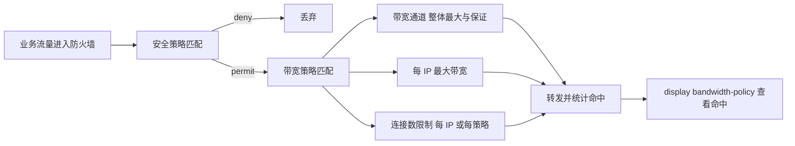

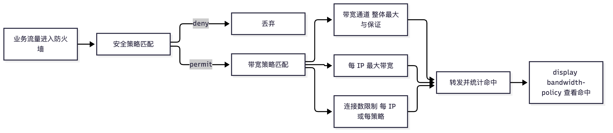


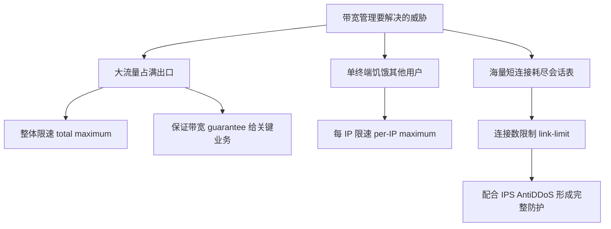

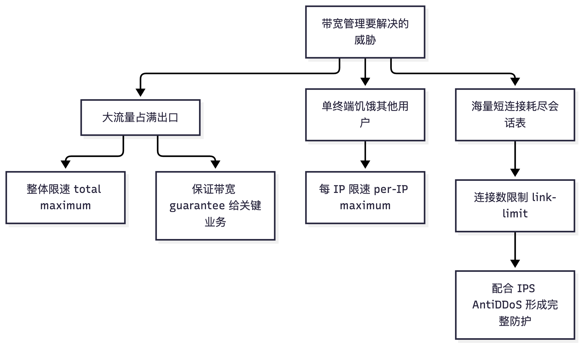


### 真题精练

**Q1.【真题·多选】** 关于华为防火墙带宽管理，下列说法正确的有？
A. 带宽通道描述"允许多少带宽"，带宽策略描述"对谁的流量生效"
B. 整体限速限制一条策略匹配流量的总带宽，每 IP 限速为每个源 IP 单独分配带宽
C. 保证带宽是拥塞时优先保障的下限，最大带宽是不允许超过的上限
D. 只要限制了带宽，就能防止海量短连接耗尽会话表
E. 带宽策略与安全策略是并列的两套策略，安全策略放行是带宽策略生效的前提

> **答案：ABCE**
> **解析**：D 错误——短连接攻击的流量很小甚至几乎不占带宽，带宽限制对它无效，必须用**连接数限制**（每 IP/每用户/每策略的并发会话数上限），并配合 IPS 与 AntiDDoS。A、B、C、E 均为正确描述。补充：带宽通道是可被多条带宽策略复用的**全局对象**，这也是它在虚拟系统中被归为"共享抢占"资源的原因。

**Q2.【真题·单选】** 某企业要求"办公网整体出口不超过 100Mbps，且每个终端不超过 4Mbps"，正确的做法是？
A. 只配置整体限速 100Mbps
B. 只配置每 IP 限速 4Mbps
C. 同时配置整体限速 100Mbps 与每 IP 限速 4Mbps
D. 在安全策略中限制带宽

> **答案：C**
> **解析**：整体限速保证**总量**不冲垮出口，每 IP 限速保证**公平性**、防止个别终端霸占带宽，两者解决不同问题，工程上必须**同时配置**。只配 A 时单个终端仍可能吃掉全部 100Mbps；只配 B 时 100 个终端理论上可达 400Mbps，出口仍会被冲垮；D 错误——安全策略只做 permit/deny 与内容安全动作，带宽限制属于带宽策略的职责。

**Q3.【真题·判断】** 带宽策略在安全策略之前生效，因此即使安全策略拒绝，带宽策略仍会对流量进行限速统计。

> **答案：错误**
> **解析**：处理顺序上，流量必须先通过**安全策略**（以及 NAT 策略等）才会进入带宽管理的处理环节；被安全策略拒绝的流量根本不会建立会话，也就不会被带宽策略限速或统计。这也解释了最常见的"限速不生效"原因：不是带宽策略写错，而是安全策略没放行、流量没进设备，或带宽策略的匹配条件（区域/地址/应用/时间段）与实际流量不一致。

**Q4.【真题·简答】** 请说明连接数限制的必要性，以及它与带宽限制的分工。

> **答案要点**：
> ① 会话表是防火墙的硬资源，条目数有上限。攻击者或失控终端可用海量短连接（大量 SYN、UDP 小包）在极短时间内耗尽会话表，导致设备无法为新用户建流，表现为"网络全断但带宽几乎空载"。
> ② 这类威胁**几乎不消耗带宽**，因此带宽限制无法防御，必须用并发连接数限制：**每 IP** 最大连接数（防单终端失控，最常用）、**每用户/用户组**（配合认证按人限制）、**每策略**（限制某类业务总体规模）。
> ③ 分工总结：带宽限制管"每秒能搬多少比特"，连接数限制管"同时能开多少条会话"；两者必须组合，并与 IPS、AntiDDoS 共同构成完整防护。
> ④ 配置注意：在 NAT 场景下，一条内网连接可能对应多条会话表项，设置阈值时要留出余量，避免误伤正常业务；验证用 `display firewall session statistics` 长期观察会话总数与新建速率。

### 易错点与排错

1. **把带宽通道与带宽策略当成一个东西**：通道是"带宽参数对象"（可复用），策略是"匹配条件 + 引用通道"。
2. **只配一种限速**：整体与每 IP 必须配合，缺一就会出现"总量失控"或"单点霸占"。
3. **用带宽限制防会话耗尽**：必然失效，必须使用连接数限制。
4. **匹配条件与实际流量不符**：注意源/目的区域的方向性、NAT 前后地址差异（带宽策略匹配的是策略执行阶段的地址）、应用识别依赖特征库版本。
5. **忘了安全策略是前提**：排错顺序为"会话表 → 带宽策略命中 → 带宽通道限制值"。
6. **排错命令**：`display bandwidth-policy`、`display firewall session statistics`、`display firewall session table verbose`（含 TTL/Left）、`display firewall statistic system discard`、`display interface GigabitEthernet1/0/1`（实际速率对照）。

---

## 1.8 其他高级特性与双机热备/虚拟系统综合排错

### 考点定位

本考点是"零散分值的集合"，理论卷占 **4~8 分**，常以多选与简答出现：**ASPF 与 Server-map 的关系、会话老化与长连接优化、GRE/SSL 流量的处理方式、防火墙虚拟化与云化防火墙的区别、USG6000E 与 USG12000 的定位差异**。最后必须能把双机热备与虚拟系统的排错命令组织成一套**决策流程**，这是国赛排错大题的得分骨架。

### 原理精讲

**ASPF 深入（Application Specific Packet Filter，应用层状态包过滤）**。传统包过滤只看五元组，无法处理"控制通道协商出数据通道"的协议。以 FTP 主动模式为例：客户端用 21 端口连接服务器，服务器随后**主动**从 20 端口连接客户端的随机高端口——这个数据连接在传统包过滤看来是"外部主动发起的连接"，会被拒绝。ASPF 的做法是：在转发控制通道报文时，**解析应用层载荷**，提取出协商出来的地址与端口，动态生成 **Server-map 表项**（正向表项用于放行后续数据连接、反向表项用于放行回程），并把数据通道的报文纳入同一条会话。因此三个结论必记：① **ASPF 的作用是动态放开多通道协议的数据通道**；② **ASPF 的产物是 Server-map 表项**，双机热备时必须同步（`hrp auto-sync connection-status`）；③ 报文中携带 IP/端口的协议（FTP、SIP、H.323、RTSP、SQLNET 等）才需要 ALG/ASPF，纯单通道协议（HTTP、SSH）不需要。**验证与排错**用 `display firewall server-map`（查看动态表项）与 `display firewall session table verbose`（查看会话与 TTL）。

**长连接与会话老化优化。** 会话表是有寿命的：会话在"老化时间"内没有报文就会被删除。不同协议的老化时间不同（TCP 已建立连接远长于 UDP/ICMP），设备会随报文类型动态调整。这一机制带来两类问题：① **长连接被误删**——数据库连接、SSH 登录、心跳类长连接长时间静默（无数据报文）后表项被老化，下一次使用时连接已断，表现为"夜间无操作、早上第一次访问超时"；② **短连接残留**——异常终止的连接长期占表位。优化手段：按协议调整老化时间（对确需长时间保持的业务延长老化）、开启长连接保持/探测机制、用 `display firewall session table verbose` 观察表项的 `TTL` 与 `Left` 判断老化是否合理，再决定调整值。**双机热备场景下还有一条额外要求：必须确保 `hrp auto-sync connection-status` 处于开启状态**，否则长连接会话不会备份，切换后长连接必然重建。

**GRE 与 SSL 流量的处理。** **GRE（Generic Routing Encapsulation，通用路由封装）** 使用 **IP 协议号 47**（不是 TCP/UDP），因此它不受端口类策略与端口 NAT 的影响：安全策略要用**服务（protocol 47）**而不是端口来匹配；GRE 需要会话化处理才能被状态检测与备份，`GRE over IPSec` 与 `IPSec over GRE` 两种封装顺序对 MTU 与策略匹配的影响不同（前者先封装 GRE 再保护，隧道内可承载组播/路由协议；后者先保护再封装，GRE 隧道对中间网络不可见）。**SSL/TLS 流量**默认是加密的，防火墙**不解密时只能看到五元组、SNI（Server Name Indication）与服务器证书信息**，无法识别 URL 与内容；如需内容安全检测必须启用 **SSL 解密**（代理中间人方式，需要向终端下发企业根证书，同时要注意合规与性能开销）；**SSL VPN** 场景下，防火墙同时是 SSL 服务器与安全网关，其证书、加密套件与 TLS 版本配置直接影响兼容性与安全性（详见第 2 章与应用映射）。

**防火墙虚拟化 vs 云化防火墙（概念对比，设计题常考）。**

| 对比项 | 虚拟化（VSYS，一台物理变多台逻辑） | 云化防火墙（vFW/云原生防火墙） |
|---|---|---|
| 形态 | 物理设备内的逻辑分区 | 软件形态（NFV/虚拟化平台上的虚拟机或云服务） |
| 资源来源 | 共享同一台设备的硬件资源（CPU/内存/会话表） | 独占分配的虚拟资源（vCPU/vMemory），可弹性扩缩 |
| 隔离强度 | 逻辑隔离（VSYS ID + VPN 实例），共享硬件故障域 | 虚拟机级隔离，硬件故障域可分散到不同宿主机 |
| 性能上限 | 受单台物理设备规格限制 | 受虚拟化平台与分配资源限制，可横向扩展 |
| 弹性能力 | 固定规格，无法秒级扩容 | 可按需弹性伸缩、快速部署与复制 |
| 管理方式 | 设备本地 CLI/Web，根系统统管 | 云管理平台统一编排（如 iMaster NCE、云防火墙控制台） |
| 典型场景 | 企业出口多租户/多业务平面 | 云上 VPC 边界、弹性业务、NFV 资源池 |

**USG6000E 与 USG12000 在高端场景的差异（了解定位，不写死数字）。** **HiSecEngine USG6000E**（如 USG6510E/USG6520E）定位企业园区与中小型数据中心边界，形态为盒式设备，支持双机热备、虚拟系统、内容安全（IPS/AV/URL 过滤需相应授权），适合分支与园区出口；**USG12000** 定位大型数据中心与运营商级出口，采用更高的硬件规格（多业务板/更高吞吐与并发），提供更大的会话、策略与虚拟系统规格，常用于大规模多租户出口与核心安全池。答题时的正确表述是"**定位与规格不同、选型需按吞吐/并发/虚拟系统数量/接口密度评估**"，**不要凭记忆编造具体吞吐或规格数字**——这类数字必须以对应型号的产品文档为准。

**双机热备与虚拟系统综合排错决策流程（国赛排错题骨架）**：

1. **先定现象**：全网不通 / 时通时断 / 单业务不通 / 切换后不通 / 虚拟系统之间不通。
2. **先看状态再看配置**：`display hrp state [verbose]` 判断是否双主或角色异常；`display vrrp` 判断上下行网关是否与 HRP 角色一致；`display vsys` 判断虚拟系统与接口分配是否符合设计。
3. **分方向定位**：`display firewall session table verbose` 看会话是否建立、在哪个虚拟系统建立、两个方向是否都在同一台设备上；`display firewall server-map` 看多通道协议是否生成了动态表项。
4. **查同步**：`display hrp configuration check`（配置一致性）、备机会话表与主机对比（状态是否同步）、`display hrp statistic`（心跳是否丢包）。
5. **查引导**：`display ip routing-table` 与上下行的 `display vrrp`/路由表，确认流量被引到哪台设备；上下行为路由器时确认 `hrp adjust ospf-cost/bgp-cost` 是否生效。
6. **查策略**：确认流量经过的**每一个虚拟系统（含根系统）**都有对应的安全策略与路由；确认带宽策略未误限速。
7. **验证闭环**：用 `hrp switch` 手工切换复现，或 shutdown 接口模拟故障，观察业务是否无损。

### 关键概念对照表

| 特性 | 作用 | 关键表项/命令 | 注意事项 |
|---|---|---|---|
| ASPF/ALG | 动态放开多通道协议的数据通道 | `display firewall server-map` | 表项需随双机热备同步，否则切换后数据通道不通 |
| 会话老化 | 决定会话表项寿命 | `display firewall session table verbose`（TTL/Left） | 长连接应用需评估并调整老化 |
| 长连接保持 | 防止静默长连接被老化删除 | 配合老化时间与探测机制 | 双机热备下必须开启状态同步 |
| GRE 处理 | 协议号 47，非 TCP/UDP | 安全策略按协议匹配 | 与 IPSec 的封装顺序影响 MTU 与策略 |
| SSL 解密 | 对加密流量做内容检测 | 需启用 SSL 解密并下发企业根证书 | 有合规与性能代价 |
| 虚拟系统 vs 云防火墙 | 逻辑分区 vs 软件形态 | `display vsys` vs 云平台编排 | 隔离强度、弹性、故障域完全不同 |

| 排错目标 | 首选命令 | 判读要点 |
|---|---|---|
| 判断主备是否正常 | `display hrp state [verbose]` | `Role: active, peer: standby` 为正常；`active, peer: active` 在主备模式下为双主 |
| 判断 VRRP 与 HRP 是否一致 | `display hrp state verbose` + `display vrrp` | Detail information 中每个 vrid 的 active/standby 应与 HRP 角色一致 |
| 判断心跳质量 | `display hrp interface`、`display hrp statistic` | 是否 running、是否丢包、Backup channel usage 是否过高 |
| 判断配置一致性 | `hrp configuration check all`、`display hrp configuration check` | 差异项与差异数量（每轮只报前 20 条） |
| 判断会话是否同步 | 两端 `display firewall session table verbose` | 备机应能查到同一条会话（自发起/半连接除外） |
| 判断虚拟系统分配 | `display vsys`、`display interface Virtual-if1`、`display ip vpn-instance` | 接口归属、VSYS ID、自动生成的同名 VPN 实例 |
| 判断引流是否成功 | `display ip routing-table`、上下行设备路由/VRRP | 上下行是否都指向同一台 active 设备 |

### 华为设备配置

```bash
# ===== 1. 多通道协议与 Server-map 验证（ASPF/ALG 相关）=====
system-view
firewall aspf ftp                                                // 进入/创建 FTP 的 ASPF 视图（版本间视图层级略有差异，用 ? 确认）
 detect ftp                                                       // 使能对 FTP 应用层的检测，解析 PORT/PASV 协商结果
quit
display firewall server-map                                       // 查看 ASPF/ALG 与 NAT Server 生成的动态 Server-map 表项
display firewall server-map verbose                               // 查看表项详情（协议、源/目的、老化时间、引用计数）
reset firewall server-map                                         // 清空动态表项（排错时用于观察表项能否重新学习）

# ===== 2. 会话老化与长连接观察 =====
display firewall session table verbose                            // 查看会话 TTL 与 Left，判断老化时间是否合理
display firewall session statistics                               // 查看会话总数与新建速率，排查会话表耗尽
reset firewall session table                                      // 清空会话表（会中断业务，仅实验环境使用）

# ===== 3. 双机热备 + 虚拟系统综合排查（按决策流程执行）=====
display version                                                   // 确认型号与版本支持双机热备（低端型号早期版本不支持）
display hrp state verbose                                         // 角色、优先级、镜像模式、auto-sync 开关、各 VRRP 组状态
display vrrp                                                      // 各 vrid 的 State 是否与 HRP 角色一致
display hrp interface                                             // 心跳接口 running/ready
display hrp statistic                                             // HRP 报文计数，判断心跳丢包
hrp configuration check all                                       // 配置一致性检查（先修完差异再复查）
display hrp history-information                                   // HRP 状态切换历史，定位异常切换时刻
display vsys                                                      // 虚拟系统列表、VSYS ID 与状态
switch vsys vsys_a                                                // 进入虚拟系统内排查（策略、路由、会话都在本系统内）
display current-configuration                                     // 查看本虚拟系统配置
display firewall session table verbose | include 10.3.0.100        // 在本系统内查会话，确认流量落在哪个虚拟系统
quit
switch vsys public                                                // 回到根系统继续排查根系统侧的路由与策略
display ip routing-table                                          // 根系统路由表，确认虚拟系统间互访的中转路径
display current-configuration | include "Virtual-if"              // 核查内部虚拟接口与区域配置
save
```

### 示意图

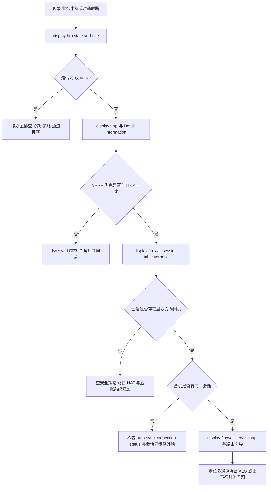

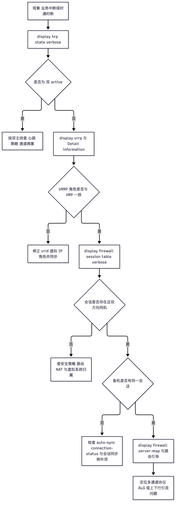


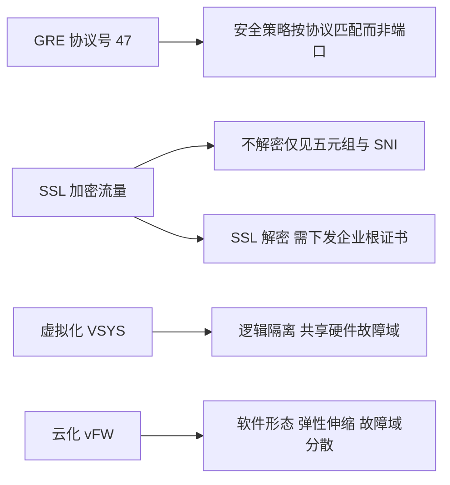

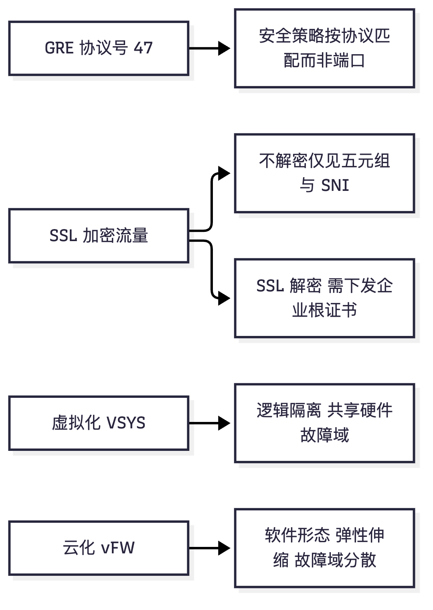


### 真题精练

**Q1.【真题·多选】** 关于 ASPF 与 Server-map，下列说法正确的有？
A. ASPF 通过解析应用层载荷，动态放开多通道协议的数据通道
B. ASPF 的动态放行结果以 Server-map 表项的形式存在
C. 双机热备时 Server-map 表项不需要同步，切换后会重新学习
D. FTP、SIP、RTSP 等协议需要 ASPF/ALG 处理，HTTP、SSH 不需要
E. 可用 `display firewall server-map` 查看动态表项

> **答案：ABDE**
> **解析**：C 错误——Server-map 属于**状态信息**，被 `hrp auto-sync connection-status` 一并同步；若不开启状态同步或开启后仍不同步，切换后多通道协议的数据通道会因缺少动态表项而被拒绝，表现为"控制通道通、数据传输不通"。A、B、D、E 正确：ASPF 的本质就是"应用层感知 + 动态开洞"，产物是 Server-map，实施对象是"控制通道与数据通道分离"的协议。

**Q2.【真题·单选】** 华为防火墙要处理 GRE 隧道流量，安全策略中应如何匹配？
A. 匹配 TCP 47 端口　B. 匹配 UDP 47 端口　C. 按 IP 协议号 47 配置服务匹配　D. GRE 无法通过防火墙

> **答案：C**
> **解析**：GRE 封装在 IP 之上，**IP 协议号 47**，既不是 TCP 也不是 UDP，因此不存在"TCP/UDP 47 端口"的说法。安全策略要用**协议（protocol 47）**构造服务来匹配。补充：GRE 需要会话化处理才能被状态检测与双机热备同步；`GRE over IPSec` 与 `IPSec over GRE` 的封装顺序不同，对 MTU、策略匹配与能否承载组播/路由协议有直接影响。

**Q3.【真题·简答】** 某用户反映"每天早上第一次访问数据库都超时，之后正常"。请分析可能原因并给出优化方向。

> **答案要点**：
> ① 典型症状指向**长连接被会话老化删除**：数据库连接在夜间长时间无数据报文，会话表项因超过老化时间被删除，第二天首次访问需要重新建链，若应用层未做重连则表现为超时。
> ② 排查：在防火墙上用 `display firewall session table verbose` 查看该业务会话的 `TTL` 与 `Left`，观察静默期是否被老化；`display firewall session statistics` 看会话总数与新建速率；确认是否存在异常终端占用表项。
> ③ 优化方向：对确需长时间保持的业务**延长相应协议的会话老化时间**；开启长连接保持/探测机制，用周期性探测报文维持表项；让数据库客户端配置连接保活（keepalive）与自动重连。
> ④ 双机热备场景额外检查：`hrp auto-sync connection-status` 必须为 on（`display hrp state verbose` 可确认），否则长连接会话不会备份到备机，切换后必然重建。

**Q4.【真题·排错】** 某局点在防火墙上划分了两个虚拟系统 vsys_a（生产）与 vsys_b（办公），要求两者通过根系统互访。现生产区无法访问办公区，请写出排查步骤。

> **答案要点**：
> ① **确认归属与状态**：`display vsys` 确认两个虚拟系统的 VSYS ID 与接口分配；`display ip vpn-instance` 确认自动生成的同名 VPN 实例存在；`display interface Virtual-if1`、`Virtual-if2` 确认内部虚拟接口状态 up。
> ② **确认路由**：在 vsys_a、vsys_b 与根系统三处分别 `display ip routing-table`，互访路径上每一跳都要有路由（vsys_a 需要经 Virtual-if1 送到根系统、根系统需要到 vsys_b 的路由、vsys_b 需要回程路由），缺任何一段都不通。
> ③ **确认策略**：安全策略与根系统策略**不叠加**但**路径上每个系统都要放行**：vsys_a 内需要 Virtual-if1 所在区域相关的 permit 策略，根系统需要中转放行，vsys_b 同理；用 `display security-policy rule all` 逐段核对。
> ④ **确认会话落点**：在三个系统内分别 `display firewall session table verbose` 观察流量走到哪一段消失，快速定位断点。
> ⑤ **确认无 NAT 干扰**：若任一侧配置了源 NAT，互访源地址会被转换，导致对端策略或回程路由不匹配。

### 易错点与排错

1. **忘记 Server-map 也属于需要同步的状态信息**：切换后"控制通、数据不通"多半是它没同步。
2. **用端口匹配 GRE/ESP/AH 等非 TCP/UDP 协议**：ESP 协议号 50、AH 协议号 51、GRE 协议号 47，必须按协议匹配。
3. **把 SSL 解密当成默认能力**：不解密时只能看到五元组与 SNI，内容检测必须显式启用 SSL 解密并处理证书信任。
4. **虚拟系统互访只配单边**：路由、策略、NAT 必须在路径上每个系统内分别配置。
5. **编造高端型号规格数字**：USG6000E 与 USG12000 的差异回答"定位与规格不同、按产品文档选型"即可，写具体数字极易出错。
6. **排错命令总表**：`display hrp state verbose`、`display hrp interface`、`display hrp statistic`、`display hrp history-information`、`hrp configuration check all`、`display vrrp` / `display vrrp state-change interface x vrid y`、`display vsys`、`display firewall session table verbose`、`display firewall server-map`、`display firewall session statistics`、`display ip routing-table`、`display interface brief`。

---

# 安全-HCIE-章节2-密码学与PKI架构深入

## 2.1 对称加密深入：算法对比与分组密码工作模式

### 考点定位

本考点在理论卷中以单选/多选/判断出现，占 **5~10 分**，是全部密码学题的入口。必须记死：**DES 分组 64 位、密钥 56 位；3DES 密钥 168 位；AES 分组 128 位、密钥 128/192/256 位、轮数 10/12/14；SM4 分组 128 位、密钥 128 位**；以及 **ECB/CBC/CFB/OFB/CTR 的 IV 要求、并行能力、错误传播**。最高频陷阱：认为"ECB 只是慢一点"（ECB 会泄露明文模式，绝不能用于生产）、认为"IV 需要保密"（IV 不必保密，但必须不可预测/唯一）。

### 原理精讲

**对称加密的根本特征与代价。** 对称加密（Symmetric Encryption）用**同一把密钥**完成加密与解密。它的优势是**极快**——现代 CPU 上 AES 硬件加速可达数 GB/s，比 RSA 快三到四个数量级；因此现实中的所有"数据加密"最终都是对称密钥在干活。它的根本难题是**密钥分发**：n 个用户两两通信需要 n(n−1)/2 把密钥，且如何把密钥安全地送到对方手里本身就是个"需要安全通道才能解决的问题"（先有鸡还是先有蛋）。这个难题正是非对称加密（第 2.2 节）与 PKI（第 2.5 节）存在的理由。

**算法与参数（必背表）。** 对称分组密码由三个参数刻画：**分组长度（block size）**、**密钥长度（key size）**、**结构（Feistel 还是 SPN）**。

- **DES（Data Encryption Standard）**：分组 **64 位**，密钥 **56 位**（密钥表面是 64 位，其中 8 位是奇偶校验位，实际有效 56 位），16 轮 **Feistel** 结构。56 位密钥空间仅 2^56 ≈ 7.2 × 10^16，1998 年已被专用机器在数十小时内穷举破解，**今天绝对不可使用**。
- **3DES（Triple DES）**：用两把或三把 DES 密钥做"加密—解密—加密"（**EDE**）三次运算。三密钥时有效密钥 **168 位**（3 × 56），分组仍为 **64 位**。它安全性够用但**性能极差**（比 DES 慢三倍，且 64 位分组在数据量大时存在生日攻击风险），属于"兼容遗留系统的过渡算法"，新系统不应选用。
- **AES（Advanced Encryption Standard）**：分组固定 **128 位**，密钥可为 **128/192/256 位**，对应轮数 **10/12/14**，采用 **SPN（代换—置换网络）** 结构。它是当今事实标准，且有 CPU 指令集硬件加速。三档密钥的强度差异：AES-128 已足够（无实用攻击），AES-256 用于更高安全等级与抗量子储备。
- **SM4**：中国商用密码分组算法，分组 **128 位**、密钥 **128 位**、**32 轮**非平衡 Feistel 结构，用于替代 DES/3DES/AES（详见 2.7 节）。
- **RC4**：**流密码**（逐字节异或密钥流），不属于分组密码；因密钥流偏差问题已被淘汰（TLS 中已禁用）。

**分组密码工作模式（Mode of Operation，本节核心）。** 分组密码一次只能处理固定长度的分组，模式解决的是"**如何用同一把密钥加密任意长度的消息**"。模式的差别集中在三点：**是否需要 IV、能否并行、错误如何传播**。

**① ECB（Electronic Codebook，电子密码本）——绝对不能用于生产。** 每个分组**独立**用同一密钥加密，**不需要 IV**。致命缺陷是**确定性**：相同的明文分组永远产生相同的密文分组。攻击者不需要密钥就能看出明文的结构——经典的演示图是"用 ECB 加密一张位图，图像轮廓依然清晰可见"；在真实场景中，它还会泄露"两个用户口令相同""两个报文的某字段相同"这类信息，并可被**分组重排/替换**攻击。**ECB 唯一可接受的用途是加密长度不超过一个分组的随机数或密钥封装**，绝不能用来加密业务数据。ECB 的优点只有"可并行、无错误传播"，这不足以弥补其安全性缺陷。

**② CBC（Cipher Block Chaining，密码分组链接）——最常用，但对 IV 要求严格。** 加密前先把当前明文分组与前一个密文分组**异或**，再送进分组密码。第一个分组需要一个 **IV（Initialization Vector，初始化向量）**。CBC 的要点：**IV 必须随机且不可预测**（推荐用密码学安全随机数生成器产生，长度等于分组长度），**IV 不需要保密，但同一密钥下绝不能重复使用同一 IV**；IV 可预测（如递增计数器）会遭受 **BEAST** 类选择明文攻击。此外 CBC 需要 **填充（padding）**（PKCS#7），填充错误信息泄露会导致 **Padding Oracle** 攻击（这也是 TLS 中"Lucky13"等攻击的根源）。性能特征：**加密串行**（每个分组依赖前一个密文）、**解密可并行**；**一位密文错误会影响两个明文分组**（当前分组全坏、下一分组对应位错误），不会无限传播，这一点优于 CFB。

**③ CFB（Cipher Feedback，密码反馈）——把分组密码变成流密码（自同步）。** 用前一段密文作为加密器的输入产生密钥流，再与明文异或。需要一个 **IV**（作为初始反馈值），**不需填充**（可以按位/字节处理任意长度），**解密可并行但加密串行**。错误传播限制在"当前分组 + 后续若干分组的部分位"，具有**自同步**能力（收到足够正确的密文后能自动恢复同步）。

**④ OFB（Output Feedback，输出反馈）——纯流密码。** 用加密器的**输出**不断反馈产生密钥流，与明文异或。要求 **IV（此处更准确的叫法是 nonce）唯一**，**不需填充**，**没有错误传播**（一位密文错只影响对应明文位），但**必须保证同一密钥下 nonce 绝不重复**——否则在同一条密钥流上重复使用会造成"两次密文异或 = 两次明文异或"的严重泄露。OFB 的优点是**密钥流可预计算**（对高延迟链路有利），缺点是**不能并行**（加密解密都串行）。

**⑤ CTR（Counter，计数器模式）——现代首选模式之一。** 用一个**计数器**（通常 = 随机 nonce + 递增计数值）作为加密器输入产生密钥流。不需要填充，**加解密都可并行**，支持**随机访问**（可以直接解密第 n 个分组），错误**不传播**。唯一硬要求是**同一密钥下计数器值绝不能重复**（nonce 必须唯一，且计数空间不能回绕）。CTR 的安全性依赖分组密码本身，且**本身不提供完整性**。

**⑥ GCM（Galois/Counter Mode）——AEAD 模式。** GCM = **CTR 加密 + GHASH 认证**，在一条密钥下同时提供机密性与完整性/认证（**AEAD**，Authenticated Encryption with Associated Data），还支持对"不加密但要认证"的附加数据（AAD，如报文头）。它已成为 TLS 1.3、IPSec、QUIC 的主流选择。要点：**GCM 的 nonce 绝对不能重复**（同一密钥下 nonce 重复会直接泄露认证密钥，后果比 CTR 更严重）；GCM 不抗 nonce 误用，因此现代协议（如 TLS 1.3）强制要求 nonce 构造与密钥更新机制。

**一句话总结五种模式的"能不能用"**：**ECB 不能用**（确定性泄露模式）；**CBC 能用但要随机不可预测的 IV，并注意 Padding Oracle 与串行加密**；**CFB/OFB 是流式处理，适合不能填充的场景，OFB 无错误传播但必须保证 nonce 唯一**；**CTR 并行快、可随机访问，但同样怕 nonce 重复**；**GCM 是"加密 + 认证"的现代标准，代价是对 nonce 唯一性的要求更严**。

### 关键概念对照表

| 算法 | 类型 | 分组长度 | 密钥长度 | 轮数/结构 | 安全性现状 |
|---|---|---|---|---|---|
| DES | 分组（Feistel） | 64 位 | **56 位**（64 位含 8 位校验） | 16 轮 | 已破解，禁用 |
| 3DES（3-key EDE） | 分组（Feistel） | 64 位 | **168 位**（有效） | 48 轮等效 | 仅兼容遗留系统，不推荐新用 |
| AES-128/192/256 | 分组（SPN） | **128 位** | 128/192/256 位 | 10/12/14 轮 | 安全，事实标准 |
| SM4 | 分组（非平衡 Feistel） | **128 位** | **128 位** | 32 轮 | 安全，国密标准 |
| RC4 | **流密码** | 不适用 | 40~2048 位 | 不适用 | 已淘汰，TLS 禁用 |

| 模式 | 需要 IV/nonce | 填充 | 加密并行 | 解密并行 | 错误传播 | 安全性评价 |
|---|---|---|---|---|---|---|
| ECB | 不需要 | 需要 | 可并行 | 可并行 | 无 | **不可用于生产**（泄露明文模式） |
| CBC | 需要，**随机不可预测** | 需要 | 串行 | 可并行 | 两位（当前全坏、下组对应位错） | 可用，注意 Padding Oracle |
| CFB | 需要（IV） | 不需要 | 串行 | 可并行 | 有限，具自同步能力 | 可用（流式场景） |
| OFB | 需要（nonce **唯一**） | 不需要 | 串行 | 串行 | **无** | 可用，密钥流可预计算 |
| CTR | 需要（nonce+计数器，**不可重复**） | 不需要 | 可并行 | 可并行 | 无 | 推荐，支持随机访问 |
| GCM | 需要（nonce **绝不可重复**） | 不需要 | 可并行 | 可并行 | 无 | **AEAD 首选**，提供机密性 + 完整性 |

| 常见参数取值 | 数值 | 说明 |
|---|---|---|
| IV 长度 | 等于分组长度（AES 为 128 位/16 字节） | CBC/CFB/OFB 均如此 |
| IV 是否需要保密 | **不需要** | 但必须随机不可预测（CBC）或唯一（OFB/CTR/GCM） |
| GCM nonce 推荐长度 | 96 位 | 同一密钥下禁止重复 |
| 填充方案 | PKCS#7 | CBC/ECB 需要；CTR/OFB/CFB 不需要 |

### 华为设备配置

```bash
# ===== IPSec 中指定对称加密算法与密钥长度（USG6000E V600R007）=====
system-view
ipsec proposal prop_aes256                                       // 创建 IPSec 提议，定义数据面（ESP）算法组合
 transform esp                                                    // 使用 ESP 封装（协议号 50），同时提供加密与认证
 esp encryption-algorithm aes-256                                 // 对称加密算法：AES-256（AES 分组固定 128 位，密钥 256 位）
 esp authentication-algorithm sha2-256                            // 完整性算法：HMAC-SHA2-256（替代已弃用的 md5/sha1）
 quit
ipsec proposal prop_sm                                            // 国密提议（需要设备与 License 支持国密）
 transform esp
 esp encryption-algorithm sm4                                     // 对称加密使用 SM4（分组 128 位、密钥 128 位）
 esp authentication-algorithm sm3                                 // 完整性使用 SM3（摘要 256 位）
 quit

# ===== IKE 提议中指定加密算法与 DH 组 =====
ike proposal 10                                                   // 创建 IKE 提议（用于协商密钥）
 encryption-algorithm aes-256                                     // IKE 阶段一的加密算法，避免使用 des/3des
 authentication-algorithm sha2-256                                // IKE 认证（完整性）算法
 dh group14                                                       // DH 组 14 = 2048 位模幂群；group19/20/21 为 ECDH 曲线组
 authentication-method pre-share                                  // 预共享密钥认证（也可用 rsa-signature 证书认证）
 quit
ike proposal 20
 encryption-algorithm sm1                                         // 国密 IPSec 场景下 IKE 加密使用 SM1（SM1 算法不公开，硬件实现）
 authentication-algorithm sm3
 dh group14
 authentication-method rsa-signature                             // 国密典型组合：SM1/SM2/SM3/SM4 全套
 quit

# ===== 查看协商结果，确认最终使用的算法 =====
display ipsec proposal                                            // 查看提议中配置的加密与认证算法
display ike proposal                                              // 查看 IKE 提议参数
display ipsec sa                                                  // 查看已建立的 IPSec SA，其中含实际协商出的算法与密钥
display ike sa                                                    // 查看 IKE SA 状态与阶段一参数
```

### 示意图

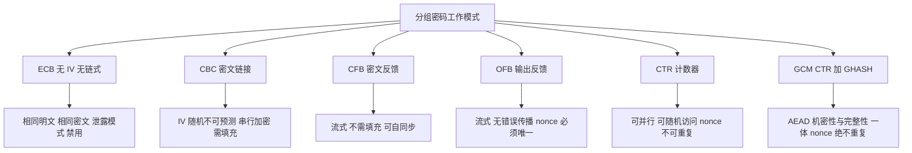

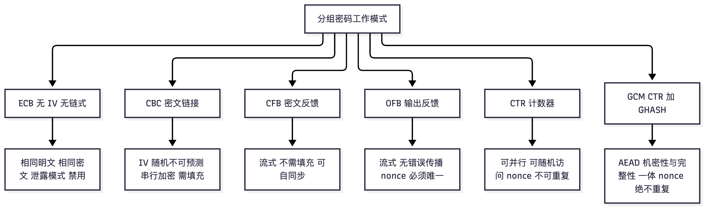


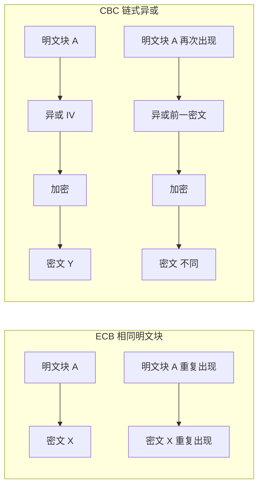

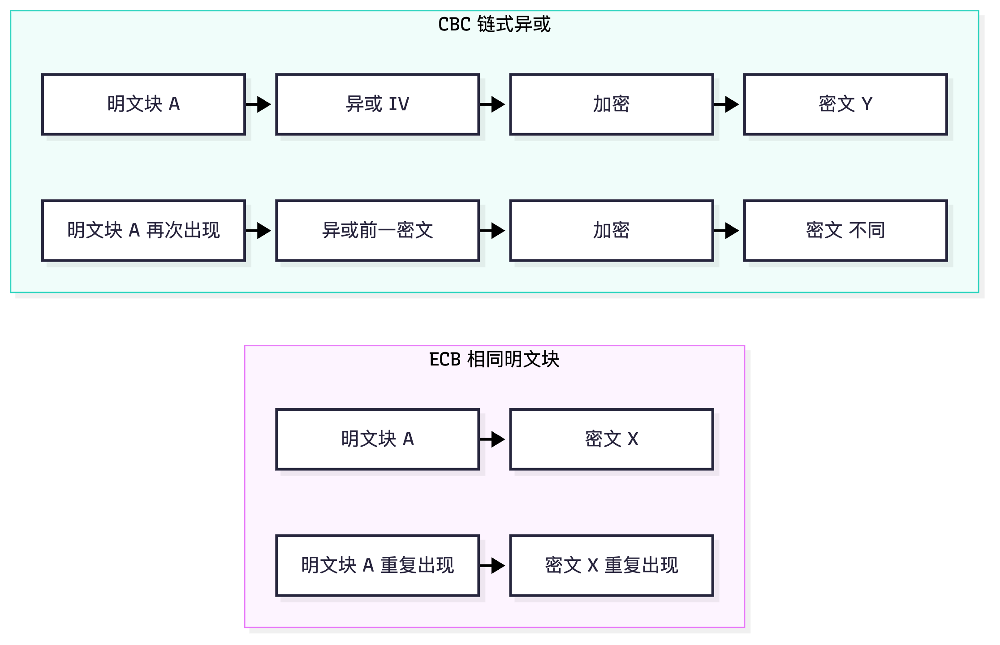


### 真题精练

**Q1.【真题·多选】** 关于 DES、3DES 与 AES 的参数，下列说法正确的有？
A. DES 分组长度 64 位、有效密钥长度 56 位
B. 3DES 采用 EDE 结构，三密钥时有效密钥长度 168 位，分组长度仍为 64 位
C. AES 分组长度固定 128 位，密钥长度支持 128/192/256 位，对应 10/12/14 轮
D. AES 的分组长度随密钥长度增大而增大
E. DES 因密钥太短已被破解，不应在新系统中使用

> **答案：ABCE**
> **解析**：D 错误——**AES 的分组长度恒为 128 位**，只有密钥长度与轮数变化（128→10 轮、192→12 轮、256→14 轮）。A、B、C、E 正确。补充：3DES 因 64 位分组与三倍运算开销，属于兼容性算法；DES 的 56 位密钥空间可被穷举，早已不可用。

**Q2.【真题·单选】** 关于分组密码工作模式，下列说法正确的是？
A. ECB 模式需要随机 IV，安全性最好
B. CBC 模式中 IV 必须保密，否则会被破解
C. CTR 模式中同一密钥下计数器值绝不能重复，否则密钥流会重复使用
D. OFB 模式具有错误传播特性，一位密文错误会导致后续所有明文错误

> **答案：C**
> **解析**：A 错误——ECB 不需要 IV，且因相同明文块产生相同密文块而**绝不能用于生产**。B 错误——CBC 的 IV **不需要保密**，但必须**随机且不可预测**，同一密钥下不得重复使用。C 正确——CTR 等价于流密码，密钥流重复会造成"两段密文异或 = 两段明文异或"的严重泄露。D 错误——OFB **没有错误传播**（一位密文错只影响对应明文位），这也是它与 CBC/CFB 的重要差别。

**Q3.【真题·判断】** GCM 模式同时提供机密性与完整性，因此在同一密钥下重复使用 nonce 也不会影响安全。

> **答案：错误**
> **解析**：GCM 是 **AEAD** 模式（CTR 加密 + GHASH 认证），确实同时提供机密性与完整性，但它对 **nonce 唯一性**的要求比 CTR **更严格**：同一密钥下 nonce 重复不仅会造成密钥流复用，还会**泄露认证密钥（H）**，使攻击者可以伪造任意消息的认证标签。因此 TLS 1.3 等现代协议强制要求 nonce 构造规则与密钥更新机制。

**Q4.【真题·简答】** 为什么 ECB 模式不能用于加密业务数据？请给出两种攻击或泄露方式。

> **答案要点**：
> ① **确定性泄露明文模式**：ECB 对每个分组独立加密，相同明文块必然产生相同密文块。加密位图时轮廓仍清晰可辨；加密结构化数据时会暴露"两行记录某字段相同""两个用户口令相同"等规律。
> ② **分组重排与替换攻击**：攻击者无需密钥即可对密文分组进行**重排、删除、复制**，接收方解密后得到被篡改但"看起来合法"的明文；在协议报文中可实现篡改关键字段。
> ③ 本质原因是 ECB **没有链式结构、没有 IV**，丢失了"分组位置与上下文"信息。
> ④ 正确做法：优先使用 **AEAD 模式（GCM）**；若必须用传统模式，选 **CBC（随机不可预测 IV + 完整性校验防 Padding Oracle）** 或 **CTR（唯一 nonce）**，并**始终配合 HMAC 或 AEAD 提供完整性**——加密本身不保证完整性。

### 易错点与排错

1. **把"加密"与"完整性"混为一谈**：对称加密只保证机密性；ECB/CBC/CTR 都可能被篡改，必须加 HMAC 或使用 AEAD（GCM）。
2. **ECB 用于生产**：任何"用 ECB 加密业务数据"的答案都是错的。
3. **IV 需要保密吗？** 不需要保密，但 CBC 要求**随机不可预测**、CTR/OFB/GCM 要求**唯一**，两者经常被混淆。
4. **分组长度与密钥长度写反**：DES 分组 64 位/密钥 56 位；AES 分组恒 128 位；SM4 分组与密钥都是 128 位。
5. **认为 3DES 只是"DES 做三次所以更慢"**：更关键的是它仍是 **64 位分组**，大流量下受生日界限制，且已被 NIST 建议退役。
6. **验证命令**：`display ipsec proposal`（算法配置）、`display ike proposal`、`display ipsec sa`（实际协商算法与 SPI）、`display ike sa`。

---

## 2.2 非对称加密：RSA、ECC/SM2 与 DH 密钥交换

### 考点定位

本考点占 **5~10 分**，是"概念辨析题"的集中地：**加解密与签名的区别、公钥私钥谁加密谁解密、DH 为什么会被中间人攻击、ECC/SM2 凭什么能用更短的密钥达到同样强度**。判断题最爱考"用私钥加密就是签名吗""DH 能防中间人吗""ECC 比 RSA 更安全是因为算法更复杂吗"。

### 原理精讲

**对称加密的死结与非对称的破局。** 对称加密的密钥分发问题（见 2.1 节）无法用对称手段自身解决，非对称加密（Asymmetric Encryption，又称公钥密码）用"**一对数学上关联、但由其中一个推导不出另一个的密钥**"破局：**公钥可以公开**（甚至可以贴在公告栏上），**私钥必须自己保管**。这带来两个关键能力：**① 任何人都能用你的公钥加密，只有你能解密**（机密性）；**② 只有你能用私钥生成某个"只有对应公钥能验证"的数据**（认证与不可否认）。非对称加密的安全性建立在**公认困难的数学问题**之上——注意是"公认困难"，而不是"绝对不会被破解"。

**RSA 的数学原理（概述，考试只要求说明"基于什么难题"）。** RSA 的构造过程是：① 选两个大素数 p、q，计算 n = p × q；② 计算欧拉函数 φ(n) = (p−1)(q−1)；③ 选一个整数 e，使 e 与 φ(n) 互素；④ 求 d，满足 e × d ≡ 1 (mod φ(n))。于是**公钥是 (n, e)，私钥是 (n, d)**；加密 c = m^e mod n，解密 m = c^d mod n。安全性来自**大整数分解难题**：已知 n 求 p、q 在计算上不可行，从而无法由 e 推出 d。这里的关键结论是：**RSA 的"密钥长度"指的是模数 n 的位数**（如 2048 位），而不是某个"对称密钥"的长度。

**密钥长度与安全强度（必背对应关系）。**

| RSA 模数长度 | 大致等价对称强度 | 现状评价 |
|---|---|---|
| 1024 位 | ≈ 80 位 | **不安全**，早已不建议使用 |
| 2048 位 | ≈ 112 位 | 目前的最低可用门槛，主流选择 |
| 3072 位 | ≈ 128 位 | 与 AES-128 同级，长期使用推荐 |
| 4096 位 | ≈ 140 位以上 | 更高强度，但运算开销显著增加 |

必须理解一个反直觉的事实：**RSA 越长越慢，而不是越安全越好用**。RSA 的模幂运算比 AES 慢约**三个数量级**（千倍量级），因此现实中的做法是**混合加密**：用 RSA（或 ECDH）协商/加密一把临时的对称密钥，再用 AES 加密真正的数据——这就是"**数字信封**"思想（见 2.4 节），也是 IPSec、TLS、S/MIME 的共同骨架。

**加解密与签名的区别（最高频辨析题）。**

| 对比项 | 公钥加密 / 私钥解密 | 私钥签名 / 公钥验签 |
|---|---|---|
| 目的 | **机密性**（防窃听） | **完整性 + 身份认证 + 不可否认** |
| 谁能发起 | 任何拿到公钥的人都能加密 | 只有私钥持有者能签名 |
| 谁能完成 | 只有私钥持有者能解密 | 任何拿到公钥的人都能验签 |
| 处理对象 | 消息本身（或对称密钥） | 消息的**摘要**（哈希值） |
| 性能特征 | 慢，只用于短数据/密钥 | 慢，只用于固定长度摘要 |
| 典型应用 | 数字信封中加密会话密钥 | 证书签名、代码签名、IKE 证书认证 |

**必须纠正一个表述**："用私钥加密、用公钥解密"是早期教材对 RSA 签名的通俗类比，**严格来说是错误的**：RSA 签名不是"加密"，而是对**摘要**做带填充的签名运算（PKCS#1 v1.5 或 PSS 编码）；且签名**不提供机密性**——任何人都能用公钥验证，内容并不被保护。答题时写"私钥签名、公钥验签"比"私钥加密"更准确。

**ECC 与 SM2：用更短的密钥达到同样的强度。** **ECC（Elliptic Curve Cryptography，椭圆曲线密码）** 基于**椭圆曲线离散对数问题（ECDLP）**。与 RSA 依赖"分解大整数"不同，ECDLP 目前已知的最优攻击算法复杂度更高，因此**同样的安全强度，ECC 需要的密钥短得多**：**256 位 ECC ≈ 3072 位 RSA ≈ 128 位对称强度**。由此带来四个工程优势：① **密钥与证书小**（握手报文小、带宽与存储省）；② **运算快、能耗低**（移动端与 IoT 友好）；③ 易于**前向保密**（ECDHE 广泛用于 TLS 1.3）；④ 证书链更短、验证更快。常用曲线有 NIST P-256/P-384、secp256k1、Curve25519 等，**注意不同曲线之间互不兼容**。

**SM2** 是中国商用密码的椭圆曲线公钥算法，使用 **256 位素数域椭圆曲线**，规定内容包括 **SM2 加密、SM2 数字签名、SM2 密钥交换**三部分。它与 ECC 的关系是"**同一数学难题、不同标准实现**"：数学基础同为 ECDLP，但**曲线参数、密钥派生、签名与加密流程均为国密标准自定义**，因此 **SM2 与 NIST/其他 ECC 曲线不互通**。强度上 SM2-256 与 ECC-256 处于同一量级（≈128 位对称强度）。

| 算法 | 数学基础 | 典型密钥长度 | 等价对称强度 | 特点 |
|---|---|---|---|---|
| RSA | 大整数分解 | 2048/3072/4096 位 | 112/128/140+ 位 | 兼容性最好、实现简单；密钥大、运算慢 |
| ECC（P-256） | 椭圆曲线离散对数 | **256 位** | ≈128 位 | 密钥短、快、省带宽；曲线族需统一 |
| SM2 | 椭圆曲线离散对数（国密） | **256 位** | ≈128 位 | 与 ECC 同难题、不同标准；与 SM2/SM3/SM4 配套成体系 |
| DH（模幂） | 有限域离散对数 | 2048/3072 位 | 112/128 位 | 只做密钥交换，**不认证** |
| ECDH | 椭圆曲线离散对数 | 256 位 | ≈128 位 | 交换密钥更快，常配 ECDHE 提供前向保密 |

**DH 密钥交换原理。** **DH（Diffie-Hellman）** 让双方在不安全信道上协商出一把共享密钥，双方**都不需要传输这把密钥本身**。过程：公开参数（大素数 p、生成元 g）；A 选私密随机数 a，把 **g^a mod p** 发给 B；B 选私密随机数 b，把 **g^b mod p** 发给 A；A 计算 (g^b)^a = **g^(ab) mod p**，B 计算 (g^a)^b = **g^(ab) mod p**，双方得到同一个共享值。窃听者只能拿到 g^a、g^b，想求 g^(ab) 就是**计算性 DH 问题（CDH）**，目前认为在足够大的参数下不可行。

**但 DH 有一个致命缺陷：它不认证对端身份。** 攻击者 M 可以在中间各与双方建立独立的 DH 交换：对 A 冒充 B、对 B 冒充 A，于是**A 与 M 共享一把密钥、B 与 M 共享另一把密钥**，M 解密后再加密转发，双方毫无察觉——这就是经典的**中间人攻击（MITM，Man-in-the-Middle）**。**解决思路只有一条：给 DH 交换的报文加上"身份认证"**，常见做法是——① 用**证书与数字签名**对 DH 参数签名（TLS 中的 RSA/ECDSA 签名认证，IKE 中的 `authentication-method rsa-signature`）；② 用**预共享密钥**做认证（IKE 中的 `authentication-method pre-share`）；③ 使用 STS 类协议绑定身份。**"DH 提供前向保密但本身不提供认证，必须与认证机制配合"是必背结论。**

**前向保密（PFS，Perfect Forward Secrecy）。** 静态 DH（每次会话用同一对长期密钥）一旦长期私钥泄露，**历史抓包都能被解密**。**临时 DH（DHE/ECDHE）** 每次会话生成一次性密钥对、用完即弃，即使长期私钥泄露也**推不出已结束会话的会话密钥**，这叫前向保密。IPSec 中对应配置为 **PFS**（`pfs dh-group14` 等），TLS 1.3 更是**强制**使用 (EC)DHE，因此默认具备 PFS。

### 关键概念对照表

| 对比维度 | 对称加密 | 非对称加密 |
|---|---|---|
| 密钥 | 加解密同一把 | 公钥 / 私钥成对 |
| 速度 | 极快（硬件加速可达 GB/s） | 慢约三个数量级 |
| 密钥分发 | 困难（核心难题） | 公钥可公开分发 |
| 密钥长度量级 | 128~256 位 | 2048~4096 位（RSA）/ 256 位（ECC/SM2） |
| 主要用途 | 数据加密 | 密钥协商/加密短数据、数字签名 |
| 能否提供不可否认 | 不能（双方共享密钥） | 能（私钥唯一持有） |
| 典型算法 | DES/3DES/AES/SM4/RC4 | RSA/ECC/SM2/DH/ECDH |

| 判断题说法 | 正误 | 解析要点 |
|---|---|---|
| "加解密用同一对密钥" | 视语境 | 对称如此；非对称加密用公钥、解密用私钥 |
| "私钥加密、公钥解密就是数字签名" | 不严谨 | 签名是对摘要做带填充的签名运算，且签名不提供机密性 |
| "DH 可以防止中间人攻击" | 错误 | 原始 DH 不认证对端，必须配合证书/PSK 认证 |
| "ECC 比 RSA 安全是因为算法更复杂" | 错误 | 因为 ECDLP 比整数分解更难攻，同样强度下密钥更短 |
| "SM2 可以用 NIST P-256 的证书" | 错误 | 曲线参数与流程为国密自定义，与 NIST 曲线不互通 |

### 华为设备配置

```bash
# ===== 证书认证（RSA 签名）的 IKE 提议与 IPSec 提议 =====
system-view
ike proposal 10                                                   // IKE 提议 10：用于阶段一协商
 authentication-method rsa-signature                              // 用数字证书（RSA 签名）认证，避免 PSK 的弱密钥与泄露风险
 encryption-algorithm aes-256                                     // 阶段一加密算法
 authentication-algorithm sha2-256                                // 阶段一完整性算法
 dh group14                                                       // 2048 位模幂群；也可用 group19/20/21 等 ECDH 组
 sa duration 86400                                                // IKE SA 生存期（秒），到期重协商以限制密钥暴露时间
 quit
ike proposal 20                                                   // 国密场景：SM2 签名 + SM3 + SM1 加密
 authentication-method rsa-signature
 encryption-algorithm sm1
 authentication-algorithm sm3
 dh group14
 quit
ipsec proposal prop1                                              // IPSec 提议：数据面算法
 transform esp
 esp encryption-algorithm aes-256
 esp authentication-algorithm sha2-256
 quit

# ===== IPSec 策略中启用 PFS（前向保密），并为每条 SA 生成独立密钥 =====
ipsec policy map1 10 isakmp                                       // 创建 IPSec 策略，采用 IKE 自动协商
 security acl 3000                                                // 引用 ACL 定义需要保护的兴趣流
 ike-peer peer1                                                   // 引用 IKE 对等体
 proposal prop1                                                   // 引用 IPSec 提议
 pfs dh-group14                                                   // 启用 PFS：每次快速模式协商重新做 DH，历史流量不可回溯解密
 sa duration time-based 3600                                      // IPSec SA 生存期，定期更新密钥
 quit
display ike sa                                                    // 查看 IKE SA（阶段一）状态与算法
display ipsec sa                                                  // 查看 IPSec SA（阶段二）状态、SPI、算法与 PFS 信息
display pki certificate local realm ent_ca                         // 证书认证场景：确认本端证书有效（见 2.5 节 PKI 配置）
```

### 示意图

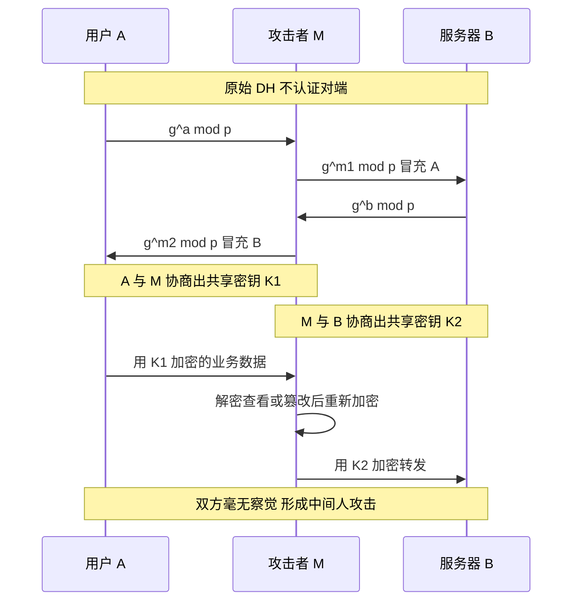

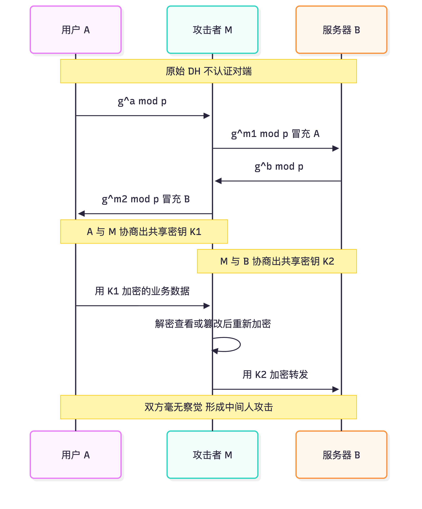


```mermaid
flowchart LR
    A["RSA 2048 位"] --> S1["等价对称强度约 112 位"]
    B["RSA 3072 位"] --> S2["约 128 位"]
    C["ECC 256 位"] --> S3["约 128 位 密钥短 运算快"]
    D["SM2 256 位"] --> S4["约 128 位 国密体系 与 ECC 曲线不互通"]
    E["对称 AES-128"] --> S5["128 位"]
    S2 --> F["混合加密 用非对称保护对称密钥"]
    S3 --> F
    S4 --> F
    S5 --> F
```

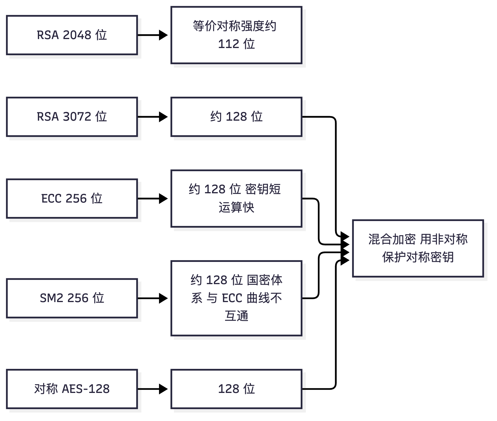


### 真题精练

**Q1.【真题·多选】** 关于 RSA 与 ECC/SM2，下列说法正确的有？
A. RSA 的安全性建立在"大整数分解困难"之上
B. 256 位 ECC 与 3072 位 RSA 的安全强度大致相当
C. ECC 的优势是密钥更短、运算更快、证书更小
D. SM2 使用 256 位素数域椭圆曲线，与 NIST P-256 证书可互相替换使用
E. RSA 比 AES 慢约三个数量级，因此现实中采用混合加密

> **答案：ABCE**
> **解析**：D 错误——SM2 虽同为椭圆曲线离散对数问题，但**曲线参数、密钥派生与签名/加密流程均为国密标准自定义**，与 NIST 曲线**不互通**，证书不能互换。A、B、C、E 均正确。补充：RSA 的"密钥长度"指模数 n 的位数；ECC/SM2 的 256 位对应约 128 位对称强度。

**Q2.【真题·单选】** 关于 DH 密钥交换，下列说法正确的是？
A. 双方需要在不安全信道上传输共享密钥本身
B. DH 基于大整数分解难题
C. DH 本身不认证对端身份，因此存在中间人攻击风险，需与证书或 PSK 认证配合
D. 使用静态 DH 可以获得前向保密

> **答案：C**
> **解析**：A 错误——正是 DH 的价值所在：**双方只交换 g^a mod p 与 g^b mod p，从不传输共享密钥本身**。B 错误——DH 基于**有限域离散对数问题**（CDH），不是大整数分解（那是 RSA）。C 正确。D 错误——**静态 DH 不提供前向保密**，长期私钥泄露会导致历史流量可解；**DHE/ECDHE（临时 DH）** 才提供前向保密，IPSec 中用 `pfs dh-group14` 等启用。

**Q3.【真题·判断】** 数字签名使用私钥进行签名，因此它同时提供了机密性。

> **答案：错误**
> **解析**：数字签名使用**私钥对消息摘要做签名运算**，其价值在于**完整性、身份认证与不可否认性**；**它不提供机密性**——验签只需要公钥，而公钥是公开的，任何获得签名与原文的人都能验证并读取原文。若既要保密又要认证，必须"先签名/后加密"或采用带加密的信封结构（如数字信封、S/MIME），这也是 IPSec 需要 ESP 加密与认证算法**同时**配置的原因。

**Q4.【真题·简答】** 请说明为什么"用私钥加密、用公钥解密"这一表述用于描述数字签名并不严谨。

> **答案要点**：
> ① **实际运算不同**：RSA 签名并非对原文加密，而是先对消息求**哈希摘要**，再对摘要做带填充编码（PKCS#1 v1.5 或 PSS）后的签名运算；直接用私钥"加密"原文既慢又不安全。
> ② **安全属性不同**：签名的目标是**完整性、身份认证与不可否认性**，不提供机密性；"加密"的目标是机密性，二者的威胁模型完全不同。
> ③ **可验证性方向不同**：签名是"只有私钥持有者能生成、任何人都能验证"；加密是"任何人都能加密、只有私钥持有者能解密"。方向相反，混用表述容易在考试中失分。
> ④ 规范表述：**私钥签名、公钥验签**；若需要保密则再配合公钥加密或对称加密（数字信封）。

### 易错点与排错

1. **把 RSA 的密钥长度当成"对称密钥长度"**：RSA 2048 位 ≠ 2048 位对称强度，只相当于约 112 位对称强度。
2. **认为 DH 能防中间人**：原始 DH 无认证，必须叠加证书/PSK；这是设计题与判断题的高频点。
3. **混淆静态 DH 与 DHE**：只有 DHE/ECDHE 提供前向保密；IPSec 中通过 `pfs dh-group*` 启用。
4. **认为 ECC 更安全是因为"算法复杂"**：正确说法是"ECDLP 比整数分解更难攻，因此同样强度下密钥更短"。
5. **SM2 与 ECC 混用**：曲线参数与流程不互通，证书不能互换；国密需整套（SM1/SM2/SM3/SM4）配合。
6. **验证命令**：`display ike sa`（阶段一算法与认证方式）、`display ipsec sa`（阶段二 SPI/算法/PFS）、`display ike proposal`、`display ipsec policy`。

---

## 2.3 哈希、消息认证与 HMAC

### 考点定位

本考点占 **4~8 分**，以单选/判断/简答为主。必考内容：**各哈希算法的摘要长度、MD5/SHA-1 的碰撞现状、生日攻击的复杂度、HMAC 的构造与"为什么不直接用哈希"**。陷阱：把"哈希"说成"加密"（哈希不可逆，没有密钥）；认为"加盐就足够安全"（口令存储需要慢哈希）；认为"MD5 加个盐还能用"。

### 原理精讲

**哈希（Hash，散列）函数是什么。** 哈希把**任意长度的输入**映射成**固定长度的输出**（摘要/指纹），并且必须具备四个性质：① **单向性（抗原像）**：由摘要反推原文在计算上不可行；② **抗第二原像**：给定原文，找不到另一条消息产生相同摘要；③ **抗碰撞**：找不到任意两条不同消息产生相同摘要；④ **雪崩效应**：输入改变 1 个比特，输出约有一半比特发生变化。注意第一个性质就决定了结论：**哈希不是加密，不能"解密还原"**——它不存在"密钥"也没有逆向运算。任何"用哈希加密数据然后解出来"的说法都是错的，正确说法是"用哈希做完整性校验/摘要"。

**摘要长度与碰撞现状（必背）。** 哈希的安全性由**摘要长度**决定，因为碰撞攻击的复杂度由**生日悖论**给出：对于 n 位摘要，找到任意碰撞约需 **2^(n/2)** 次运算，而不是 2^n 次。因此：

| 算法 | 摘要长度 | 生日界（找碰撞的理论复杂度） | 安全性现状 |
|---|---|---|---|
| MD5 | **128 位** | 2^64 | **已被实际碰撞破解**（2004 年王小云给出碰撞方法，现可在秒级构造碰撞），禁用 |
| SHA-1 | **160 位** | 2^80 | **已被实际碰撞**（2017 年 SHAttered 公开相同 SHA-1 不同内容的两个 PDF），已弃用 |
| SHA-224 | 224 位 | 2^112 | 可用，但与 256 相比无优势 |
| SHA-256 | **256 位** | 2^128 | 安全，当前主流 |
| SHA-384 / SHA-512 | 384/512 位 | 2^192 / 2^256 | 安全，高安全等级场景 |
| SHA-3（Keccak） | 224~512 位 | 同上 | 安全，采用海绵结构，与 SHA-2 结构不同（算法多样性备份） |
| SM3 | **256 位** | 2^128 | 安全，国密标准，结构类似 SHA-256 |

**哈希的用途（考点清单）**：① **完整性校验**（文件哈希、软件下载校验、证书指纹）；② **数字签名**（先哈希再签名，解决"非对称算法只能处理短数据"的问题）；③ **口令存储**（必须加盐 + 使用慢哈希，见下）；④ **HMAC 的构件**（消息认证）；⑤ 区块链的工作量证明与地址推导；⑥ 数据去重与索引。

**口令存储的三个层次（易被忽略的加分点）**：① 明文存口令——绝对禁止；② `MD5(口令)`——可被彩虹表与 GPU 暴力破解；③ `MD5(盐 + 口令)`——能防彩虹表，但 MD5/SHA 系列**运算太快**，GPU 每秒可尝试数十亿次，仍然不够；④ 正确做法是使用**故意设计得慢的算法**（**PBKDF2、bcrypt、scrypt、Argon2**）并配足够长的随机盐与合适的迭代次数。一句话：**"哈希加盐"只能防彩虹表，不能防离线暴力破解；口令存储要用慢哈希。**

**为什么需要 HMAC，而不只是一个哈希？（本节最高频简答题）** 哈希能校验"数据有没有被意外改动"，但**不能认证"数据是谁发的"**，原因是：

1. **无密钥的哈希任何人都能计算**：攻击者可以修改消息并**重新计算摘要**一起发出去，接收方校验通过。哈希只对"信道噪声"有效，对"主动攻击者"无效。
2. **简单拼接密钥也不安全**：常见的错误做法是 `H(K || M)`（把密钥直接拼在消息前面）。对 MD5/SHA-1/SHA-2 这类**Merkle–Damgård 结构**的哈希，存在**长度扩展攻击（Length Extension Attack）**：攻击者在只知道 `H(K || M)` 与 `len(K || M)` 的情况下，不需要知道 K 就能计算出 `H(K || M || 填充 || M')`，从而伪造出合法的"带认证"消息。SHA-3 与 SM3 的抗长度扩展性质不同，但工程上仍应统一使用 HMAC。

**HMAC 的构造与价值。** HMAC（Keyed-Hash Message Authentication Code，带密钥的哈希消息认证码）的标准构造是：

```text
HMAC(K, M) = H( (K ⊕ opad) || H( (K ⊕ ipad) || M ) )
其中 ipad = 0x36 重复至分组长度，opad = 0x5C 重复至分组长度，K 先补零/哈希到分组长度
```

它的价值在于：① **引入密钥**，使没有密钥的攻击者无法伪造摘要 → 提供**消息认证（数据来源认证）+ 完整性**；② **双重哈希结构**使长度扩展攻击失效（攻击者拿到的是内层哈希的输出被外层再哈希，无法继续扩展）；③ **不依赖具体哈希算法的抗碰撞性**（HMAC 的安全性主要依赖哈希的**压缩函数**性质，因此 HMAC-MD5 在 MD5 碰撞已被攻破的情况下仍有一定强度，但工程上不应再选用）。**HMAC 不提供机密性**——它不隐藏消息内容，只保证"没被改、且来自持钥方"。密钥长度建议**不小于摘要长度**（如 HMAC-SHA256 建议 ≥32 字节随机密钥），且密钥要定期更换。

**哈希、加密、HMAC 三者的分工（一张表记牢）**：

| 机制 | 是否需要密钥 | 提供机密性 | 提供完整性 | 提供身份认证 | 典型用途 |
|---|---|---|---|---|---|
| 哈希（如 SHA-256） | 否 | 否 | 仅抗意外损坏 | 否 | 文件校验、证书指纹、签名前的摘要 |
| 对称加密（如 AES-CBC） | 是 | **是** | 否（可被篡改） | 否 | 数据保密 |
| HMAC（如 HMAC-SHA2-256） | 是（共享密钥） | 否 | **是** | **是**（对持钥方） | 报文完整性认证、IPSec ESP 认证、API 签名 |
| AEAD（如 AES-GCM） | 是 | **是** | **是** | 间接 | 现代协议的一体化加密与认证 |
| 数字签名 | 私钥签名/公钥验签 | 否 | **是** | **是** + 不可否认 | 证书、代码签名、IKE 证书认证 |

### 关键概念对照表

| 属性 | 说明 | 考试要点 |
|---|---|---|
| 单向性 | 无法由摘要反推原文 | "哈希能还原吗"→**不能** |
| 抗碰撞 | 找不到两条不同消息同摘要 | 碰撞复杂度约 2^(n/2)（生日攻击） |
| 雪崩效应 | 输入 1 比特变化导致输出约半数比特变化 | 用于判断实现是否规范 |
| 摘要长度 | MD5 128、SHA-1 160、SHA-2 224~512、SM3 256 | 数值必背 |
| 盐（Salt） | 每条口令独立随机值，与口令一起哈希 | 防彩虹表；不防 GPU 暴力破解 |
| 慢哈希 | PBKDF2/bcrypt/scrypt/Argon2 | 口令存储的正确选择 |
| HMAC 密钥 | 共享密钥，长度 ≥ 摘要长度 | 必须保密且可轮换 |

| 攻击 | 目标 | 复杂度/条件 | 防御 |
|---|---|---|---|
| 穷举原像 | 求原文 | 2^n | 增大摘要长度 |
| 生日攻击/碰撞 | 找两条同摘要消息 | 2^(n/2) | 摘要 ≥ 256 位；弃用 MD5/SHA-1 |
| 彩虹表 | 反查口令哈希 | 预计算表命中 | 加盐 + 慢哈希 |
| 长度扩展攻击 | 伪造 `H(K‖M‖…‖M')` | 仅需知道摘要与长度 | 使用 HMAC，不用 `H(K‖M)` |
| 重放攻击 | 重放合法报文 | 不改变报文 | HMAC + 随机数/时间戳/序列号 |

### 华为设备配置

```bash
# ===== 指定完整性/认证算法（哈希与 HMAC 在 IPSec 中的落点）=====
system-view
ipsec proposal prop1                                             // IPSec 提议：数据面算法组合
 transform esp                                                   // ESP 封装（协议号 50）
 esp encryption-algorithm aes-256                                 // 机密性：AES-256
 esp authentication-algorithm sha2-256                            // 完整性：ESP 认证字段使用 HMAC-SHA2-256
 quit
ipsec proposal prop_sm
 transform esp
 esp encryption-algorithm sm4
 esp authentication-algorithm sm3                                 // 国密组合：HMAC-SM3 提供完整性
 quit
ike proposal 10                                                  // IKE 阶段一：控制面算法
 encryption-algorithm aes-256
 authentication-algorithm sha2-256                                // IKE 报文的完整性保护（HMAC 类算法）
 authentication-method pre-share
 dh group14
 quit
quit

# ===== 设备本地口令与密钥的安全存储（口令不落地明文）=====
system-view
aaa                                                              // 进入 AAA 视图管理本地用户
 manager-user admin                                               // 管理员账号
  password cipher Huawei@123                                      // 口令以密文形式存储；切勿使用明文或弱口令
  service-type terminal http                                     // 允许的接入方式
 quit
quit

# ===== 校验与查看 =====
display ipsec sa                                                 // 查看 SA 中实际协商的完整性算法
display ike sa                                                   // 查看 IKE SA 状态与算法
display current-configuration | include cipher                    // 确认口令以密文形式保存
display pki certificate ca realm ent_ca                           // 证书指纹采用 SHA-256 计算（见 2.5 节）
```

### 示意图

```mermaid
flowchart TD
    K["共享密钥 K"] --> A["K 与 ipad 0x36 异或"]
    M["消息 M"] --> B["与 K 异或 ipad 的结果拼接"]
    A --> B
    B --> H1["哈希运算 得到内层摘要"]
    K --> C["K 与 opad 0x5C 异或"]
    H1 --> D["与 K 异或 opad 的结果拼接"]
    C --> D
    D --> H2["哈希运算 得到 HMAC 值"]
    H2 --> E["随消息一起发送 接收方用同样密钥重算并比对"]
```

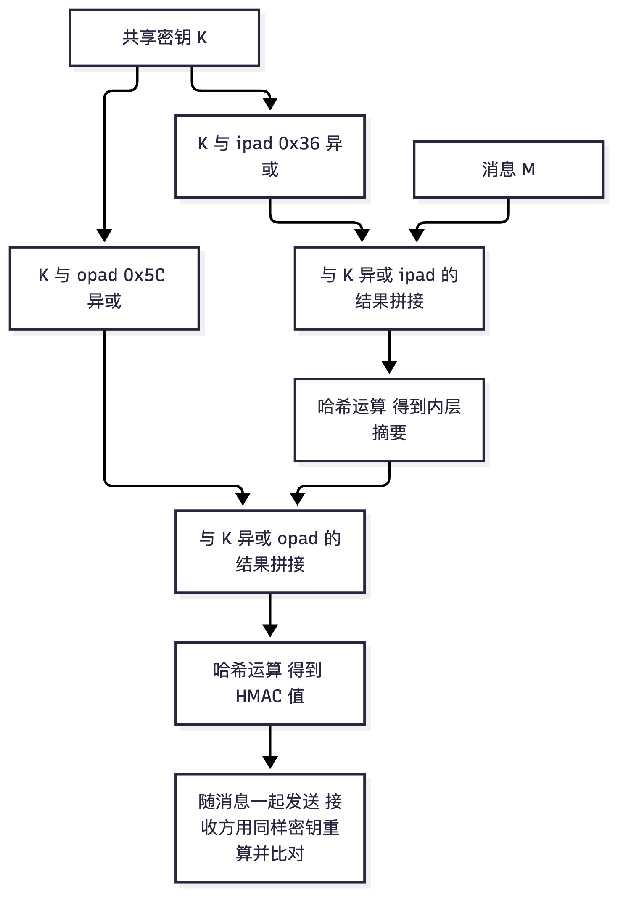


```mermaid
flowchart LR
    A["完整性需求"] --> B["无密钥场景 用哈希"]
    A --> C["有共享密钥 用 HMAC"]
    A --> D["需不可否认 用数字签名"]
    B --> B1["只能抗意外损坏"]
    C --> C1["抗主动篡改 提供来源认证"]
    D --> D1["可向第三方证明"]
    B1 --> E["哈希不能替代 HMAC"]
    C1 --> F["H 与 K 拼接不安全 存在长度扩展攻击"]
```

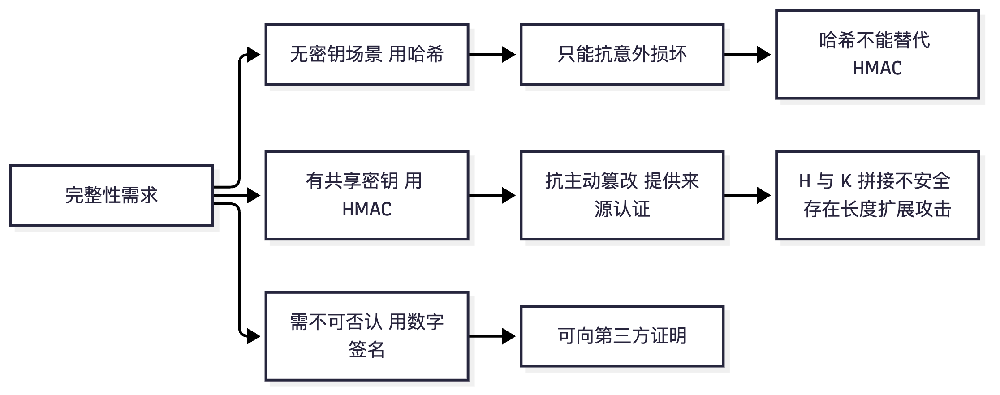


### 真题精练

**Q1.【真题·多选】** 关于哈希算法，下列说法正确的有？
A. MD5 摘要长度 128 位，已可实际构造碰撞，不应再用于安全场景
B. SHA-1 摘要长度 160 位，已被公开演示实际碰撞
C. SM3 摘要长度 256 位，属于国密哈希算法
D. 生日攻击表明，n 位摘要找碰撞约需 2^n 次运算
E. 哈希可以还原原文，因此可用于加密数据

> **答案：ABC**
> **解析**：D 错误——生日悖论下找**任意碰撞**约需 **2^(n/2)** 次运算（如 MD5 约 2^64、SHA-1 约 2^80），这也是 SHA-1 能被实际攻破的原因。E 错误——哈希是**单向**的，不能还原原文，也**不是加密**（没有密钥、没有解密运算）。A、B、C 正确，摘要长度必背：MD5 128、SHA-1 160、SHA-256 256、SM3 256。

**Q2.【真题·单选】** 为什么不能直接用 `H(K || M)`（把密钥拼在消息前面再哈希）来做消息认证？
A. 因为哈希运算太慢
B. 因为 Merkle–Damgård 结构的哈希存在长度扩展攻击，攻击者不需要密钥即可伪造后续消息的摘要
C. 因为密钥会泄露给接收方
D. 因为它不能校验完整性

> **答案：B**
> **解析**：MD5/SHA-1/SHA-2 采用 Merkle–Damgård 迭代结构，攻击者在已知 `H(K‖M)` 与 `len(K‖M)` 时，可在**不知道 K** 的情况下计算 `H(K‖M‖填充‖M')`，从而把伪造的消息 M' 拼在后面并通过校验——这就是**长度扩展攻击**。正确做法是使用 **HMAC**：`H((K⊕opad) || H((K⊕ipad) || M))`，其双重哈希结构使扩展失效。A、C、D 都不是真正的理由。

**Q3.【真题·判断】** 只要给口令加上随机盐再做一次 MD5，口令存储就是安全的。

> **答案：错误**
> **解析**：加盐只能**防彩虹表**（同样的口令因盐不同得到不同摘要），但 **MD5 运算极快**，攻击者用 GPU 每秒可尝试数十亿次，弱口令仍会被离线暴力破解。安全的口令存储应使用**故意设计得慢**的算法（**PBKDF2、bcrypt、scrypt、Argon2**），并配置足够长的随机盐与足够的迭代次数/内存代价，同时对登录做速率限制与锁定策略。

**Q4.【真题·简答】** 请说明 HMAC 的作用，以及它相比"哈希"和"对称加密"分别多了什么能力。

> **答案要点**：
> ① HMAC 的作用：使用**共享密钥**对消息计算认证码，为消息提供**完整性**与**消息来源认证**，并可配合随机数/时间戳抵抗**重放攻击**。
> ② 相比哈希：哈希无密钥，任何人都能重算摘要，攻击者可篡改消息后重算摘要，因此**只能抗意外损坏，不能抗主动篡改**；HMAC 引入密钥，无密钥者无法伪造。
> ③ 相比对称加密：加密提供**机密性**但不保证完整性（密文可被篡改），而 HMAC **不隐藏内容**、只保证"未被篡改且来自持钥方"；两者目标不同，工程上常组合使用（先加密再 HMAC，或直接使用 AEAD 如 AES-GCM）。
> ④ 与签名的区别：HMAC 使用**双方共享密钥**，任何一方都能生成，因此**无法提供不可否认性**；需要向第三方证明时必须使用数字签名。

### 易错点与排错

1. **把"哈希"说成"加密"**：哈希无密钥、不可逆，不存在"解密"。
2. **认为"加盐 = 安全"**：口令存储必须用慢哈希（PBKDF2/bcrypt/scrypt/Argon2）。
3. **用 `H(K‖M)` 做认证**：存在长度扩展攻击，必须使用 HMAC。
4. **混淆 MAC 与签名**：MAC（含 HMAC）用共享密钥，**不具备不可否认性**；签名才可以。
5. **认为 AES-CBC 已经"安全到不用完整性校验"**：加密不提供完整性，必须叠加 HMAC 或使用 AEAD（GCM）。
6. **验证命令**：`display ipsec sa`（实际完整性算法）、`display ike sa`、`display current-configuration | include cipher`（口令密文存储）、`display pki certificate ca realm <名称>`（查看证书签名算法与指纹）。

---

## 2.4 数字签名与数字信封

### 考点定位

本考点占 **4~8 分**，是"流程图题"的标准素材：**必须能画出签名与验签的完整流程**，并说清三个安全属性（完整性、身份认证、不可否认性）与一个"不提供"（机密性）。易错点：把签名与加密混为一谈；认为"先加密再签名"与"先签名再加密"等价（安全语义不同）；不清楚为什么必须**先哈希再签名**。

### 原理精讲

**数字签名的目标。** 手工签名解决三件事：**确认是你签的**（身份认证）、**内容没被改**（完整性）、**你事后不能抵赖**（不可否认性）。数字签名要在数字世界里同时达成这三件事。它的实现思路非常巧妙：**用只有你能做的运算（私钥运算）作用在"消息的指纹（摘要）"上**，任何人用你的公钥就能验证这个运算结果，但无法伪造。

**完整流程（必须能画、能写）**：

1. **发送方**：对消息 M 计算摘要 **H = Hash(M)**（如 SHA-256）。
2. **发送方**：用**自己的私钥**对摘要做签名运算（含填充编码，如 RSA 的 PKCS#1 v1.5 / PSS，或 SM2 的签名流程）得到签名值 **S = Sign(私钥, H)**。
3. **发送方**：把 **(M, S)** 一起发出；若需要验证者确定签名者身份，则**同时附上自己的证书**（或由验证者提前获取）。
4. **接收方**：用发送方的**公钥**（从证书中取得，证书由 CA 签名保证归属）对 S 做验签运算，**还原出摘要 H1**；同时自己对收到的 M 计算摘要 **H2 = Hash(M)**。
5. **接收方**：比较 **H1 与 H2**，相同则签名有效；不同则消息被篡改或签名不匹配。

**为什么必须先哈希、再签名？（高分点）** 三个理由：① **效率**：RSA 只能处理小于模长的数据（2048 位 ≈ 256 字节），直接对任意长度报文签名需要先分块，代价极高；摘要固定长度，一次签名运算即可。② **安全性**：对原始消息直接做 RSA 运算会遭受"可乘性"等代数攻击（RSA 具有乘法同态性质，`Sign(m1)·Sign(m2) = Sign(m1·m2)`），而**带填充的摘要签名**破坏了这种结构（这也是 PKCS#1 v1.5 与 PSS 填充存在的原因；PSS 是可证明安全的填充方案）。③ **一致性**：摘要把"任意长度消息"统一成"固定长度输入"，使签名与哈希算法的升级解耦。

**三个属性与一个"不提供"。** ① **完整性**：消息改动必然导致摘要变化，验签失败；② **身份认证（数据来源认证）**：只有私钥持有者能生成有效签名（前提是私钥未泄露）；③ **不可否认性**：由于私钥唯一持有，签名者事后无法声称"不是我签的"——**这正是 MAC/HMAC 做不到的**（MAC 双方共享密钥，任一方都能生成）；④ **不提供机密性**：签名与原文一起发送，**任何人都能读取原文**，只是不能篡改。因此"签名能加密吗"的标准答案是**不能**；需要保密必须另外加密。

**数字信封（Digital Envelope）——把对称与非对称拼起来。** 非对称加密慢、只能处理短数据；对称加密快，但难分发密钥。数字信封把两者的优点结合：**① 随机生成一把一次性对称密钥（会话密钥）；② 用会话密钥（如 AES）加密真正的数据；③ 用接收方的公钥加密这把会话密钥；④ 把"加密后的数据 + 加密后的会话密钥"一起发送。** 接收方先用自己的私钥解出会话密钥，再用它解密数据。这就是 IPSec IKE、TLS、S/MIME、PGP 的共同骨架；**IKE 阶段一协商出的密钥材料就是"会话密钥"，阶段二用它对数据面加密**，正是数字信封思想在设备上的落地。

**签名与验签的工程实现要点。** ① **算法与填充要匹配**：`RSA + SHA-256 + PSS`、`ECDSA + SHA-256`、`SM2 + SM3` 是常见组合；同一套体系内算法必须一致，否则验签失败。② **证书有效性与吊销状态必须先查**（见 2.5/2.6 节）——**验签通过不等于对方可信**：若签名者的私钥已泄露、证书已吊销，签名在密码学上"有效"但身份不可信。③ **签名不防重放**：需要在协议层加时间戳、随机数（nonce）或序列号。④ **签名不能替代加密**：需要同时满足机密性与不可否认时，常见做法是"先签名后加密"（保留不可否认）或"先加密后签名"（隐藏签名者身份），**两者安全语义不同，不能随意调换**。

| 需求 | 正确手段 | 说明 |
|---|---|---|
| 只保密 | 对称加密（AES）或加密+MAC | 加密不提供完整性，建议 AEAD |
| 只保证完整性与来源（内部系统） | HMAC | 共享密钥，高效；无不可否认性 |
| 需不可否认（对外/法律效力） | 数字签名 | 私钥唯一持有，可用公钥验证 |
| 既要保密又要认证 | 数字信封 / AEAD / 先签名后加密 | IPSec ESP、TLS 就是组合方案 |

### 关键概念对照表

| 步骤 | 输入 | 使用的密钥 | 输出 | 作用 |
|---|---|---|---|---|
| 摘要计算 | 消息 M | 无 | H = Hash(M) | 压缩为定长指纹 |
| 签名 | H | **发送方私钥** | 签名 S | 只有私钥持有者能生成 |
| 传输 | M + S（+ 证书） | — | — | 明文或被另行加密 |
| 验签 | S | **发送方公钥** | 还原的 H1 | 任何人都能验证 |
| 摘要比对 | H1 与 H2 = Hash(M) | 无 | 有效/无效 | 判定完整性与身份 |

| 机制 | 密钥性质 | 完整性 | 身份认证 | 不可否认 | 机密性 |
|---|---|---|---|---|---|
| 哈希 | 无 | 仅抗意外 | 否 | 否 | 否 |
| HMAC | 共享密钥 | 是 | 是（对持钥方） | **否** | 否 |
| 数字签名 | 私钥签名/公钥验签 | 是 | 是 | **是** | 否 |
| 对称加密 | 共享密钥 | 否 | 否 | 否 | **是** |
| 数字信封 | 对称 + 非对称 | 是（配合签名/MAC） | 是（配合证书） | 是（配合签名） | **是** |

| 常见签名算法组合 | 摘要 | 签名 | 应用 |
|---|---|---|---|
| RSA-PKCS#1 v1.5 | SHA-256 | RSA | 兼容性最好的传统组合 |
| RSA-PSS | SHA-256 | RSA | 可证明安全，推荐新用 |
| ECDSA | SHA-256 | ECC P-256 | TLS 1.3、代码签名，证书小 |
| SM2 | SM3 | SM2 | 国密体系（证书、IPSec、SSL VPN） |

### 华为设备配置

```bash
# ===== 1. 以证书 + RSA 签名方式完成 IKE 身份认证（签名验签在设备上的落地）=====
system-view
pki realm ent_ca                                                 // 引用 PKI 域（证书与密钥的管理域，见 2.5 节）
 ca id 1
  fingerprint sha256 3B0A1F42C5D9E8763B0A1F42C5D9E8763B0A1F42C5D9E8763B0A1F42C5D9E876
                                                                  // 校验 CA 根证书指纹（SHA-256），防止导入被替换的假 CA
 quit
 enrollment self-signed                                           // 自签名方式生成密钥对（实验/私有 CA 场景）
quit
ike peer peer1 v2                                                // 创建 IKE 对等体，使用 IKEv2
 authentication-method rsa-signature                              // 身份认证方式：数字证书（RSA 签名），替代预共享密钥
 exchange-mode main                                               // 主模式协商（IKEv1 场景），保护身份信息
 local-id type ip 202.100.1.1                                     // 本端身份（证书主题或 IP，需与对端配置对应）
 remote-id type ip 202.100.2.1                                    // 对端身份
 ike-proposal 10                                                  // 引用 IKE 提议
 pki realm ent_ca                                                 // 引用 PKI 域，从中取本端证书与私钥做签名
 quit

# ===== 2. 查看签名认证与 SA 状态 =====
display ike sa                                                   // 阶段一是否成功建立，认证方式与算法
display ipsec sa                                                 // 阶段二 SA 的 SPI、算法与 PFS
display pki certificate local realm ent_ca                        // 本端证书：Subject/Issuer/有效期/签名算法
display pki certificate ca realm ent_ca                           // CA 证书：用于验证对端证书链
display pki realm ent_ca                                          // PKI 域状态与关联的密钥对标签
```

### 示意图

```mermaid
sequenceDiagram
    participant S as 发送方 持有私钥
    participant R as 接收方 持有公钥与证书
    S->>S: 计算摘要 H 等于 Hash 消息 M
    S->>S: 用私钥对 H 做签名运算 得到签名 S
    S->>R: 发送 消息 M 加 签名 S 加 发送方证书
    R->>R: 用证书中的公钥验签 得到 H1
    R->>R: 自己对 M 计算摘要 得到 H2
    R->>R: 比较 H1 与 H2
    Note over R: 相同则完整性 身份认证 均成立
    Note over R: 不同则消息被篡改或签名不匹配
    R->>R: 查证书有效期与吊销状态 确认身份可信
```

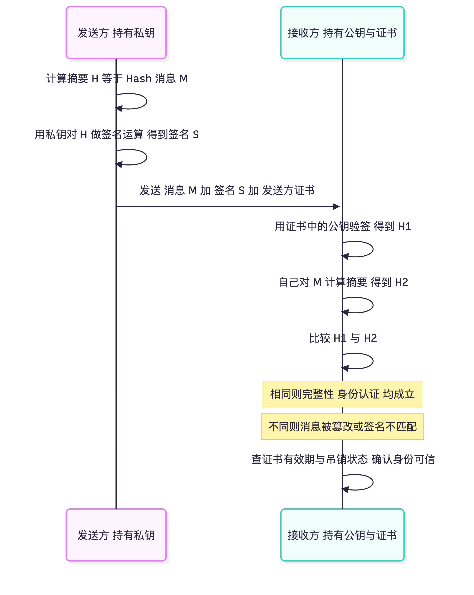


```mermaid
flowchart LR
    A["数字信封"] --> B["随机生成一次性对称密钥 K"]
    B --> C["用 K 加密数据 如 AES-256"]
    B --> D["用接收方公钥加密 K"]
    C --> E["组合发送 密文 加 加密后的 K"]
    D --> E
    E --> F["接收方用私钥解出 K"]
    F --> G["用 K 解密数据"]
    G --> H["按需验证发送方签名 实现不可否认"]
```

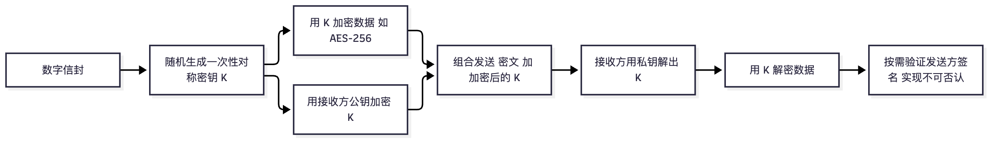


### 真题精练

**Q1.【真题·多选】** 关于数字签名，下列说法正确的有？
A. 签名使用发送方私钥，验签使用发送方公钥
B. 数字签名提供完整性、身份认证与不可否认性
C. 数字签名同时提供机密性，因此不需要再加密
D. 通常先对消息计算哈希摘要，再对摘要签名
E. 验签通过即可确认对方身份绝对可信，无需检查证书吊销状态

> **答案：ABD**
> **解析**：C 错误——签名**不提供机密性**，消息与签名一起传输，任何人都能读取原文；需要保密必须另行加密（数字信封或"先签名后加密"）。E 错误——验签通过只说明"签名与该证书公钥匹配"，若**私钥泄露或证书已被吊销**，身份仍不可信，必须检查证书有效期与吊销状态（CRL/OCSP）。A、B、D 正确；先哈希再签名的原因包括效率、抗代数攻击与输入定长。

**Q2.【真题·单选】** 为什么签名前必须先对消息做哈希？
A. 因为哈希可以加密消息，提高安全性
B. 因为非对称算法只能处理短数据/定长输入，且对原始数据直接运算易受代数攻击，哈希可同时解决效率与安全问题
C. 因为哈希可以压缩带宽，减少传输量
D. 因为接收方只能验证哈希，不能验证原文

> **答案：B**
> **解析**：RSA 模数有限（如 2048 位），不能直接对任意长度消息做运算；同时 RSA 的乘法同态性质会使"直接签名原始消息"遭受可乘性攻击，而**带填充的定长摘要**能破坏这种结构（PKCS#1 v1.5、PSS）。A 错误——哈希不是加密；C 不是主要原因；D 表述错误——接收方需要原文来重算摘要并比对。

**Q3.【真题·判断】** HMAC 与数字签名都能提供不可否认性，二者可以互相替代。

> **答案：错误**
> **解析**：**HMAC 使用双方共享的对称密钥**，通信双方都能生成同一个认证码，因此任何一方都可以声称"码是对方生成的"，**不具备不可否认性**；而**数字签名使用私钥**，只有私钥持有者能生成，可向第三方证明，提供不可否认性。二者适用场景不同：内部系统、性能敏感场景用 HMAC；需要法律效力、对外证明的场景用数字签名。

**Q4.【真题·简答】** 请描述数字信封的构成与工作过程，并说明它解决了什么问题。

> **答案要点**：
> ① 构成：**加密后的数据 + 用接收方公钥加密的会话密钥**（可选再加签名）。
> ② 过程：发送方随机生成一次性对称密钥 K → 用 K（如 AES-256）加密数据 → 用**接收方公钥**加密 K → 一起发送；接收方用**自己的私钥**解出 K → 用 K 解密数据。
> ③ 解决的问题：**同时获得对称加密的高性能与非对称加密的密钥分发能力**——非对称只用于保护短小的会话密钥，大数据量由对称算法处理，从而避免"用 RSA 加密大文件"的低效。
> ④ 与设备的对应：IPSec 的 IKE 阶段一协商密钥材料、阶段二用其保护数据面，就是数字信封思想；TLS、S/MIME、PGP 同理。
> ⑤ 补充：若还需不可否认，可在数据上附加发送方签名；注意"先签名后加密"与"先加密后签名"的安全语义不同（前者保留不可否认且便于第三方验证，后者隐藏签名者身份）。

### 易错点与排错

1. **认为签名能加密**：签名不提供机密性，这是最高频的判断陷阱。
2. **混淆密钥方向**：加密用**对方公钥**、解密用**自己私钥**；签名用**自己私钥**、验签用**对方公钥**。
3. **忘记检查证书状态**：验签通过还需校验证书有效期与吊销状态，否则"签名有效但身份不可信"。
4. **认为先签名后加密与先加密后签名等价**：安全语义不同（不可否认性、签名者隐私），协议设计不能随意调换。
5. **签名可防重放？** 不能，必须在协议层加时间戳/nonce/序列号。
6. **排错命令**：`display ike sa`（阶段一是否建立、认证方式）、`display ipsec sa`（阶段二 SA 与算法）、`display pki certificate local realm <域>`（本端证书）、`display pki certificate ca realm <域>`（CA 证书链）、`display pki realm <域>`（域状态与密钥对）。

---

## 2.5 PKI 体系与 X.509 证书结构（国赛必考核心）

### 考点定位

本考点占 **6~12 分**，是所有"证书"相关题目的总纲。必考：**CA/RA/证书库/CRL/OCSP 各自的职责与区别**、**X.509 v3 字段逐项含义**（尤其 issuer/subject/validity/KeyUsage/SAN/BasicConstraints）、**CA 不参与业务加密、RA 不签发证书**这两个易错分工。陷阱：把 RA 当成签发机构；把"证书里的公钥"和"证书签名"混为一谈；认为自签名证书不能被信任却不理解"信任锚"的来源。

### 原理精讲

**PKI 要解决的问题。** 2.2 节告诉我们：公钥可以公开。但"公开"带来一个新问题——**你怎么知道这把公钥真的是张三的，而不是攻击者李四冒充的？** 如果攻击者把自己的公钥冒充成"银行服务器公钥"发给用户，用户就会把敏感数据加密给攻击者。**PKI（Public Key Infrastructure，公钥基础设施）** 就是解决"**公钥归属**"这一件事的完整体系：用一个**可信第三方（CA）**给"公钥 + 身份信息"签发一份数字化证明——**数字证书**，从而把"我信任 CA"转化为"我信任由该 CA 签发的所有证书中的公钥归属"。

**PKI 的组成与职责（必背分工）。**

| 组件 | 全称/职责 | 关键点（考试易错） |
|---|---|---|
| 终端实体（EE） | 证书的申请者与使用者（用户、服务器、防火墙、路由器） | 持有私钥，**私钥永不外传** |
| **CA**（Certification Authority，认证机构） | **签发、更新、吊销证书**，发布 CRL；用自己的私钥对证书签名 | 唯一有权**签发**证书的实体；分**根 CA** 与**从属/中间 CA** |
| **RA**（Registration Authority，注册机构） | **受理申请、审核申请者身份**，把审核通过的请求转交 CA | **RA 不签发证书**，只做"面签/审核"；可由 CA 兼任 |
| 证书库（Repository） | 存储并发布证书与 CRL，供查询下载（常见 LDAP/HTTP） | 证书是公开信息，不需要保密 |
| CRL 发布点 | 发布吊销列表的位置（写在证书的 CRLDistributionPoints 中） | 见 2.6 节的 CRL/OCSP 对比 |
| OCSP 响应器 | 提供单证书状态的在线实时查询 | 回应是**被签名的**，防止伪造 |
| 密钥/证书恢复、时间戳服务 | 密钥托管恢复、可信时间戳（TSA） | 时间戳用于长期签名与不可否认 |

分工记忆口诀：**"CA 签，RA 审，库里存，CRL 撤，OCSP 查"**。再补一句：**CA 不参与业务数据的加密解密**——数据的机密性由终端之间的对称/非对称加密完成，CA 只解决"公钥属于谁"。

**X.509 证书结构逐项讲解（本节的"极细"部分）。** X.509 v3 证书本质上是一段被 CA 签名过的结构化数据，顶层由三部分组成：**tbsCertificate（待签名部分，To-Be-Signed）**、**signatureAlgorithm（签名算法标识）**、**signatureValue（CA 的签名值）**。逐字段拆解如下：

| 字段 | 含义 | 考试/排错要点 |
|---|---|---|
| **version** | 版本号，v3 值为 2（编码 0=v1, 1=v2, 2=v3） | v3 才能带扩展字段（SAN、KeyUsage 等） |
| **serialNumber** | CA 为该证书分配的唯一序列号 | **同一 CA 下唯一**；吊销时按"颁发者 + 序列号"定位 |
| **signature**（tbs 内的算法标识） | 本证书使用的签名算法 | 必须与顶层 signatureAlgorithm 一致 |
| **issuer** | **签发者**的可分辨名称（DN） | 与**上一级证书的 subject** 必须一致，这是构建证书链的依据 |
| **validity** | 有效期：notBefore / notAfter | 过期即不可信；**时钟不同步是"证书莫名失效"的头号原因** |
| **subject** | **持有者**的可分辨名称（DN） | 自签名证书中 issuer == subject |
| **subjectPublicKeyInfo** | 公钥算法标识 + **公钥本身** | RSA/ECC/SM2 公钥在此；私钥**绝不在证书中** |
| issuerUniqueID / subjectUniqueID | v2 起支持，极少使用 | v3 实践中基本不用 |
| **extensions**（v3） | 扩展字段集合（见下） | 决定证书的"用途与约束" |
| **signatureAlgorithm**（顶层） | CA 实际使用的签名算法 | 如 sha256WithRSAEncryption、SM3WithSM2 |
| **signatureValue** | CA 用**自己的私钥**对 tbsCertificate 的签名 | 用 CA 公钥验签可证明"未被篡改" |

**v3 扩展字段（必须能说出用途）**：

| 扩展 | 作用 | 关键取值/陷阱 |
|---|---|---|
| **BasicConstraints** | 标识该证书是否为 CA 证书 | `CA:TRUE` + `pathLenConstraint`（限制下级 CA 层数）；**终端证书若被错签为 CA:TRUE 是严重安全问题** |
| **KeyUsage** | 限定**这把公钥**允许的用途 | `digitalSignature`（签名）、`keyEncipherment`（加密密钥/密钥传输）、`keyCertSign`（签发证书，**CA 必须要有**）、`cRLSign`（签发 CRL）；用途不符则验签/加密直接失败 |
| **ExtendedKeyUsage** | 更细的用途限定 | `serverAuth`（TLS 服务器）、`clientAuth`（客户端认证）、`codeSigning`、`emailProtection`、`OCSPSigning`（OCSP 响应器必须） |
| **SubjectAltName（SAN）** | 证书绑定的**其他身份标识**：DNS 名、IP、邮箱、URI | **现代浏览器/客户端已忽略 CN，只认 SAN**；"证书与实际访问域名不匹配"多数是 SAN 缺项 |
| **SubjectKeyIdentifier（SKI）** | 本证书公钥的哈希标识 | 用于快速匹配密钥 |
| **AuthorityKeyIdentifier（AKI）** | 上级 CA 公钥的标识 | **构建证书链的关键索引**（指明"我的签发者是谁的公钥"） |
| **CRLDistributionPoints（CDP）** | 从何处下载 CRL | 吊销检查找不到该地址即无法查 CRL |
| **AuthorityInfoAccess（AIA）** | 提供 OCSP 响应器地址、签发者证书下载地址 | **链不完整时，客户端常靠 AIA 自动补下载中间证书** |
| CertificatePolicies / NameConstraints | 策略标识 / 名称空间约束 | 企业私有 CA 可用 NameConstraints 限制可签发的域名 |

**DN（Distinguished Name，可分辨名称）与主题字段**：DN 由多个 RDN 组成，常见有 **C（国家）、ST（省/州）、L（城市）、O（组织）、OU（部门）、CN（通用名）**。举例：`C=CN, O=Huawei, OU=IT, CN=fw1.example.com`。**CN 曾经是"证书绑定域名"的字段，但现代实现以 SAN 为准**，这是必考细节。

**证书指纹（Fingerprint）**：对**整张证书**做哈希（如 SHA-256）得到的一串十六进制值，用于人工核对证书是否被替换。**它与"签名"不同**：指纹是"整张证书的哈希"，任何人都能算；签名是"CA 私钥对 tbsCertificate 的运算"，只有 CA 能生成。设备上导入 CA 证书时要求核对指纹（`fingerprint sha256 ...`），正是为了防止"导入了一把伪造的根证书"。

**自签名证书与私有 CA 实践。** 自签名证书的 **issuer == subject**，签名者就是自己，因此它**不能凭自身获得信任**——必须**预先被安装到信任库**才能被信任（这正是"信任锚"的含义）。实践中有两条路：

1. **设备自签名（enrollment self-signed）**：在防火墙上直接生成密钥对并自签证书，配置最简单，适合**实验、内网设备管理页面**；缺点是**无法自动被客户端信任**（每个客户端都要手动导入），且不能吊销。
2. **企业私有 CA（推荐）**：用 **OpenSSL（或华为设备/第三方 CA 系统）** 搭建两级结构——**根 CA（离线保存，只签下级 CA）** + **中间 CA（在线签发终端证书）**。流程为：生成根密钥与自签根证书 → 生成中间 CA 密钥与 CSR、由根 CA 签发 → 为防火墙生成密钥与 CSR（PKCS#10）→ 中间 CA 签发 → 把证书与私钥（PKCS#12 或 PEM）导入设备。**只有根 CA 证书需要下发到所有客户端作为信任锚**，中间 CA 证书随服务器证书链一起下发即可。这样既保证安全（根私钥离线），又便于批量签发与吊销。

**PKI 在设备上的落地要点**：证书与私钥必须**匹配**（同一密钥对）；**私钥不能同步到双机热备备机**（属于设备级配置，需分别导入）；**证书有效期与设备时钟强相关**（务必配 NTP）；**CA 指纹必须核对**（防中间人替换根证书）；导入的证书链要完整（本端证书 + 中间 CA + 根 CA）。

### 关键概念对照表

| 实体 | 是否签发证书 | 是否审核身份 | 是否持有私钥 | 是否参与业务加密 |
|---|---|---|---|---|
| 终端实体（防火墙/服务器/用户） | 否 | 否 | **是（自己的私钥）** | **是** |
| RA | **否** | **是** | 否 | 否 |
| CA | **是** | 可兼任 | 是（CA 自己的私钥） | 否 |
| 证书库 | 否 | 否 | 否 | 否 |
| OCSP 响应器 | 否（但签名响应） | 否 | 是（响应签名密钥） | 否 |

| 要素 | 含义 | 备注 |
|---|---|---|
| issuer | 签发者 DN | 与上级证书 subject 相同 |
| subject | 持有者 DN | 自签名证书时与 issuer 相同 |
| validity | notBefore / notAfter | 依赖准确时钟 |
| subjectPublicKeyInfo | 公钥及算法 | 私钥不在证书内 |
| signatureValue | CA 私钥对 tbsCertificate 的签名 | 用 CA 公钥验签 |
| fingerprint | 整张证书的哈希值 | 用于人工核对，非签名 |
| BasicConstraints | 是否 CA、可签几级 | `CA:TRUE`、pathLenConstraint |
| KeyUsage | 公钥可用途 | keyCertSign 是 CA 的必备位 |
| SAN | 绑定的 DNS/IP/邮箱/URI | 现代实现只看 SAN，不看 CN |

### 华为设备配置

```bash
# ===== 1. 创建 PKI 域并核对 CA 指纹（防止导入伪造根证书）=====
system-view
pki realm ent_ca                                                 // 创建 PKI 域 ent_ca，统一管理本域的证书与密钥对
 rsa-key-label fw_key                                            // 指定本域使用的 RSA 密钥对标签（密钥落盘时以此命名）
 ca id 1                                                         // 指定 CA 编号（一个域可配置多个 CA）
  fingerprint sha256 3B0A1F42C5D9E8763B0A1F42C5D9E8763B0A1F42C5D9E8763B0A1F42C5D9E876
                                                                  // 核对 CA 根证书的 SHA-256 指纹：指纹不符则导入失败，防假 CA
 quit
 enrollment self-signed                                           // 采用自签名方式申请本端证书（实验/私有场景）
quit

# ===== 2. 导入 CA 证书、本端证书与私钥（企业私有 CA 场景）=====
pki import-certificate ca realm ent_ca filename flash:/root_ca.cer      // 导入根 CA 证书（信任锚）
pki import-certificate ca realm ent_ca filename flash:/sub_ca.cer       // 导入中间 CA 证书（链的中间环节）
pki import-certificate local realm ent_ca filename flash:/fw1.cer       // 导入本端（防火墙）证书
pki import rsa-key-pair fw_key pem flash:/fw1.key                       // 导入与本端证书匹配的私钥（PEM 格式）
pki import-certificate local realm ent_ca filename flash:/fw1.p12 password Huawei@123
                                                                  // 也可用 PKCS#12 一次性导入证书 + 私钥 + 链

# ===== 3. 查看证书内容（逐字段核对）=====
display pki realm ent_ca                                          // 查看域状态、密钥对标签、关联的 CA
display pki certificate ca realm ent_ca                           // 查看 CA 证书：Subject/Issuer/Validity/签名算法
display pki certificate local realm ent_ca                        // 查看本端证书：Subject、Issuer、有效期、KeyUsage
display pki certificate local realm ent_ca verbose                // 查看扩展字段（SAN、KeyUsage、CDP、AIA 等）
display clock                                                     // 确认设备时钟准确（证书有效期校验依赖时钟，建议配 NTP）

# ===== 4. 证书校验与文件操作 =====
pki validate-certificate local realm ent_ca                       // 校验本端证书与私钥是否匹配、证书链是否可用
pki delete-certificate local realm ent_ca                         // 删除本端证书（重新申请前先删除旧证书）
dir flash:/                                                       // 查看证书与密钥文件是否已上传到设备
save
```

### 示意图

```mermaid
flowchart TB
    subgraph PKI["PKI 组成与数据流"]
        EE["终端实体 持有私钥"] -->|"1 提交申请 CSR"| RA["RA 注册机构 审核身份"]
        RA -->|"2 转交已审核请求"| CA["CA 认证机构 签发证书"]
        CA -->|"3 签发并发布"| REPO["证书库 LDAP 或 HTTP"]
        CA -->|"4 发布吊销信息"| CRL["CRL 发布点"]
        CA -->|"5 提供状态查询"| OCSP["OCSP 响应器"]
        EE -->|"6 下载证书与证书链"| REPO
        VER["验证方 浏览器或对端设备"] -->|"7 下载证书与 CRL"| REPO
        VER -->|"8 在线查询状态"| OCSP
    end
```

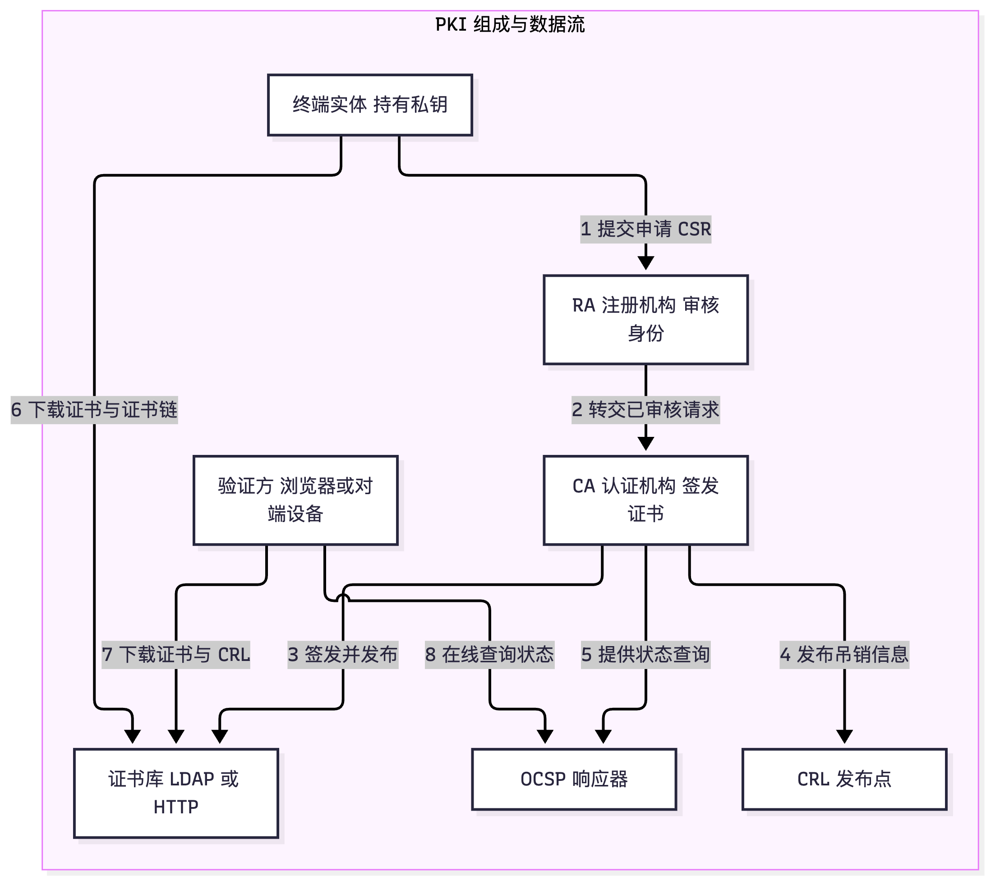


```mermaid
flowchart LR
    C["X.509 v3 证书"] --> T["tbsCertificate 待签名部分"]
    C --> A["signatureAlgorithm 签名算法标识"]
    C --> V["signatureValue CA 用私钥生成的签名"]
    T --> F1["version 版本"]
    T --> F2["serialNumber 序列号"]
    T --> F3["issuer 签发者 DN"]
    T --> F4["validity 起止时间"]
    T --> F5["subject 持有者 DN"]
    T --> F6["subjectPublicKeyInfo 公钥与算法"]
    T --> F7["extensions 扩展"]
    F7 --> E1["BasicConstraints 是否 CA"]
    F7 --> E2["KeyUsage 与 ExtendedKeyUsage 用途"]
    F7 --> E3["SubjectAltName 别名 现代实现只看它"]
    F7 --> E4["CDP 与 AIA 吊销与在线查询地址"]
```

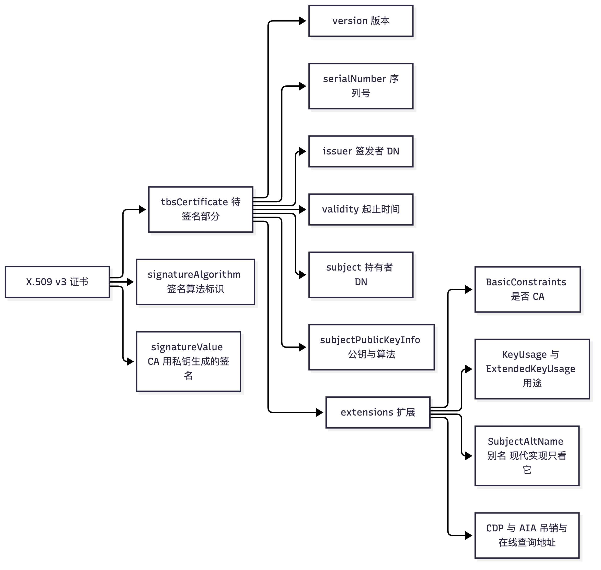


### 真题精练

**Q1.【真题·多选】** 关于 PKI 各组件的职责，下列说法正确的有？
A. CA 负责签发、更新和吊销证书，并发布 CRL
B. RA 负责审核申请者身份，但不签发证书
C. 证书库用于存储和发布证书，证书属于公开信息
D. CA 参与业务数据的加密与解密，因此需要保存用户私钥
E. 终端实体的私钥必须自己保管，不能上传到 CA

> **答案：ABCE**
> **解析**：D 错误——**CA 不参与业务数据的加密解密**，它只解决"公钥属于谁"的问题；用户的私钥**不应上传到 CA**（除非采用专门的密钥托管方案，且那属于例外而非默认）。A、B、C、E 正确。记忆口诀："CA 签，RA 审，库里存，CRL 撤，OCSP 查"。

**Q2.【真题·单选】** 某服务器更换域名后，客户端提示"证书与访问的域名不匹配"，但证书本身有效。最可能的原因是？
A. 证书已过期
B. 证书的 SubjectAltName（SAN）未包含新域名（现代客户端已不再以 CN 作为域名匹配依据）
C. 证书的 KeyUsage 缺少 digitalSignature
D. CA 根证书未导入

> **答案：B**
> **解析**：现代浏览器与客户端**只依据 SAN 扩展匹配域名**，CN 早已不作为域名校验依据；换域名后证书未重新签发（或未加入新域名的 SAN 条目）即会报"不匹配"。A 会报"证书过期"；C 会导致签名用途受限（多用于双向认证/客户端证书场景）；D 会报"证书链不可信/不受信任的颁发者"，与域名不匹配是不同的错误。

**Q3.【真题·判断】** 自签名证书是可以被自动信任的，因为它由设备自己签发生成。

> **答案：错误**
> **解析**：自签名证书的 **issuer == subject**，签名者就是自己，因此**不能凭自身获得信任**——它必须**预先被安装进验证方的信任库（信任锚）**才会被信任。企业实践推荐搭建**私有 CA**：根 CA 离线保存密钥、中间 CA 在线签发终端证书，只需把**根 CA 证书**下发到各客户端作为信任锚即可，兼顾安全性与可运维性。

**Q4.【真题·简答】** 请写出 X.509 v3 证书中至少六个关键字段并说明其作用；并解释"证书指纹"与"证书签名"的区别。

> **答案要点**：
> 关键字段（任答六项）：
> ① **serialNumber**：CA 分配的证书唯一序列号，吊销时按"颁发者 + 序列号"定位；
> ② **issuer**：签发者 DN，必须与其上级证书的 subject 一致，是构建证书链的依据；
> ③ **validity（notBefore/notAfter）**：有效期，过期即不可信，依赖准确时钟；
> ④ **subject**：持有者 DN，自签名证书中与 issuer 相同；
> ⑤ **subjectPublicKeyInfo**：公钥及算法（RSA/ECC/SM2），**私钥绝不在证书中**；
> ⑥ **extensions**：BasicConstraints（是否 CA 与可签层级）、KeyUsage/ExtendedKeyUsage（用途）、SubjectAltName（现代实现唯一认可的域名绑定字段）、CDP/AIA（CRL 与 OCSP 地址）；
> ⑦ **signatureAlgorithm + signatureValue**：CA 使用的签名算法与其对 tbsCertificate 的签名。
> 区别：**指纹**是对**整张证书**做哈希得到的值，任何人都能计算，用于人工核对证书是否被替换；**签名**是 **CA 用自己私钥**对 tbsCertificate 的运算结果，只有 CA 能生成，用 CA 公钥验签可证明证书内容未被篡改。

### 易错点与排错

1. **把 RA 当成签发机构**：RA 只审核身份，**签发权在 CA**。
2. **以为证书里含私钥**：证书只有公钥；私钥必须单独导入并严格保护，**双机热备也不会同步私钥**。
3. **只看 CN 不看 SAN**：现代实现只认 SAN，"证书域名不匹配"多因 SAN 缺项。
4. **不核对 CA 指纹**：导入伪造的根证书会带来系统性中间人风险，务必用 `fingerprint` 核对。
5. **忽略时钟**：设备时间不准会导致证书"未生效"或"已过期"，排错第一步看 `display clock` 并配置 NTP。
6. **排错命令**：`display pki realm <域>`、`display pki certificate local realm <域> [verbose]`、`display pki certificate ca realm <域>`、`pki validate-certificate local realm <域>`、`display clock`、`dir flash:/`。

---

## 2.6 证书链、证书生命周期与 CRL/OCSP 对比（国赛必考核心）

### 考点定位

本考点占 **5~10 分**，常以排错题与对比题出现：**证书链如何验证、链不完整会出现什么现象、CRL 与 OCSP 的差异与适用场景**。必须能画证书链并说清"信任锚"从哪来；必须能答出"服务器忘记下发中间证书"这一经典故障。陷阱：以为客户端会"自动知道"中间 CA；把 OCSP 说成"比 CRL 更安全"（它更快更实时，但有隐私与可用性问题）。

### 原理精讲

**证书链（Certificate Chain）的结构与验证逻辑。** 现实中不会让根 CA 直接签发所有终端证书——因为根私钥一旦泄露或被离线保护，签发能力受限且风险集中。因此采用**分级结构**：

```text
根 CA 证书（自签名，issuer == subject）      ← 信任锚（预置在客户端信任库）
        │ 用根 CA 私钥签名
        ▼
中间/从属 CA 证书（issuer = 根 CA，subject = 中间 CA）   ← 随服务器证书一起下发
        │ 用中间 CA 私钥签名
        ▼
终端实体证书（issuer = 中间 CA，subject = 服务器/设备）  ← 服务器在 TLS 握手中出示
```

**验证过程是"自下而上逐级验签、最后落到信任锚"**：客户端拿到服务器证书后，① 用**中间 CA 的公钥**验证服务器证书的 signatureValue；② 用**根 CA 的公钥**验证中间 CA 证书的签名；③ 检查根 CA 证书是否在**本地信任库**中（即是否为本机信任的信任锚，且其自签名校验通过）；④ 逐级检查**有效期**、**KeyUsage**（中间 CA 必须有 `keyCertSign`）、**BasicConstraints（CA:TRUE）**、**SAN 与访问目标的匹配**；⑤ 最后（可选但推荐）检查**吊销状态**（CRL/OCSP）。全部通过才判定"证书可信"。

**信任锚（Trust Anchor）从哪里来？** 它**不是从网络上学来的**，而是**预先安装在验证方本地的根证书**：操作系统/浏览器内置的公共根证书列表、企业通过组策略下发的企业根证书、网络设备上通过 `pki import-certificate ca` 导入的根证书。这一点解释了三个高频现象：① 自签名证书必须**手动导入**才能被信任；② 企业私有 CA 只要把**根证书**下发到所有客户端即可；③ 攻击者要实施中间人，必须让受害者装上自己的根证书（否则浏览器会报"不受信任的颁发者"）。

**"链不完整"是证书类排错题第一名。** 服务器在 TLS 握手中应下发**自己的证书 + 所有中间 CA 证书**（根证书可不下发，因为客户端本地一般已有）。如果管理员只配置了服务器证书、漏掉中间 CA，那么**浏览器可能因为缓存或 AIA 自动补下载而正常**，但**网络设备、Java 客户端、手机 App、部分嵌入式系统往往不会自动补链**，于是报错"证书链不完整 / unable to get local issuer certificate / 不受信任的颁发者"。这就是"同一张证书在浏览器上正常、在设备上却失败"的根因。排查方法：用 `openssl s_client -connect host:443 -showcerts` 查看服务器实际下发的链，或在设备上 `display pki certificate ca realm <域>` 确认中间 CA 是否已导入。**AIA（AuthorityInfoAccess）扩展**提供的签发者证书下载地址，是部分客户端能"自动补链"的原因。

**证书全生命周期（必须能按顺序写出）。**

1. **密钥生成**：在**申请方本地**生成密钥对（**私钥永不离开本地**是基本原则），生成 **CSR（Certificate Signing Request，证书签名请求，PKCS#10 格式）**，其中包含公钥与主体信息（CN/SAN 等），并用私钥自签名以保证完整性。
2. **提交申请与身份审核**：CSR 提交给 RA；RA 按证书等级审核身份（域名所有权验证、企业资质验证、面签等）。**DV/OV/EV 的差别就在审核强度**。
3. **签发**：CA 生成证书（填入 serialNumber、issuer、validity，加入扩展字段），用 **CA 私钥签名**，并通过证书库发布。
4. **部署**：把证书（含中间 CA 链）与私钥安装到服务器/设备；**配置时注意证书与私钥匹配、链完整、SAN 覆盖所有访问入口（域名 + IP）**。
5. **使用与轮换**：在有效期内使用；到期前**提前 30 天以上**续期并制定轮换计划；**缩短有效期已成行业趋势**（有效期越短，泄露窗口越小，但运维压力越大，因此推动自动化 ACME 类续期）。
6. **吊销（Revocation）**：当私钥泄露、信息变更、设备下线或发生误签时，CA **无法收回已发出的证书**（证书是自包含的、可被无限复制的），只能**把序列号加入吊销列表并对外发布**。**是否被吊销只能靠"主动查询"得知**——这正是 CRL/OCSP 存在的原因。吊销常见原因码：`keyCompromise`（私钥泄露）、`cACompromise`、`affiliationChanged`、`superseded`（被新证书取代）、`cessationOfOperation`（停止使用）。
7. **归档与审计**：保留历史证书与签发记录，用于追溯与合规。

**CRL 与 OCSP 的对比（必背表 + 各自的坑）。**

**CRL（Certificate Revocation List，证书吊销列表）**：CA **周期性发布**的一份**被吊销证书序列号清单**（含吊销时间与原因），由 CA 签名。客户端下载后本地比对。特点：**全量列表**（因此文件会越来越大）、**有更新窗口期**（在两次发布之间吊销的证书仍会被判为有效，这是"吊销延迟"风险）、可离线使用；`nextUpdate` 字段说明下次发布时间；实践中还会用**增量 CRL（Delta CRL）**只发布变化部分以减小体积；证书中的 **CRLDistributionPoints（CDP）** 指明下载地址。

**OCSP（Online Certificate Status Protocol，在线证书状态协议）**：客户端把**单个证书的序列号**发给 OCSP 响应器，实时得到 **good / revoked / unknown** 之一。特点：**实时性好、响应小、无需下载全量列表**；但代价是：① **隐私问题**——CA/响应器能获知"谁在访问哪个站点"；② **可用性依赖**——响应器不可用会导致验证失败（工程上常配置 soft-fail，带来安全折衷）；③ **响应必须被签名**，否则可被伪造为 good，客户端还应使用 **nonce** 防重放。**OCSP Stapling（装订）** 是重要的优化：由**服务器自己**定期向 OCSP 查询并缓存签名响应，在 TLS 握手中一并"装订"发给客户端——既**减少了客户端与 CA 之间的往返延迟**，又**避免了客户端向 CA 暴露访问行为**，是目前推荐部署方式。

| 对比 | CRL | OCSP |
|---|---|---|
| 查询方式 | 下载**全量**列表，本地比对 | **按单个序列号**在线查询 |
| 实时性 | 差（受发布周期与 nextUpdate 限制） | 好（实时） |
| 传输体积 | 大（随吊销量增长） | 小 |
| 隐私 | 较好（不暴露查询行为） | 差（CA 可知谁查了什么）；OCSP Stapling 可缓解 |
| 可用性 | 可离线缓存，弱网友好 | 依赖响应器在线 |
| 响应完整性 | CA 签名 | 响应器签名（+ 建议 nonce 防重放） |
| 推荐部署 | 中小规模、离线环境、与 OCSP 配合 | 大规模、需实时性；配合 Stapling |
| 华为设备相关 | 导入/更新 CRL 供设备校验对端证书 | 设备作为客户端查询 OCSP（依版本与特性支持） |

**吊销检查失败时怎么办（策略选择）**：`soft-fail`（查不到就当有效）可用性高但存在"吊销绕过"风险；`hard-fail`（查不到就拒绝）安全性高但可能造成大面积业务中断。工程上通常**面向互联网的服务倾向 soft-fail + 短有效期**，**内网关键系统倾向 hard-fail + 高可用 OCSP**。答题时给出这种"按场景权衡"的表述最得分。

**一个必须澄清的时序问题**：**证书吊销 ≠ 立即全网生效**。因为吊销信息只存在于 CRL/OCSP 中，而**已经建立的 TLS 连接不会被追溯关闭**；短有效期（如 90 天甚至更短）与 OCSP Stapling 是缓解这一窗口的主要手段。

### 关键概念对照表

| 概念 | 含义 | 关键点 |
|---|---|---|
| 证书链 | 终端证书 → 中间 CA → 根 CA 的签名关系 | 逐级验签，最终落到信任锚 |
| 信任锚 | 预先安装在验证方本地的根证书 | 不从网络学习；自签名证书必须手动导入 |
| 链不完整 | 服务器未下发中间 CA 证书 | 浏览器常自动补链，设备/Java/App 常失败 |
| AIA | 提供签发者证书下载与 OCSP 地址 | 部分客户端据此自动补链 |
| CDP | CRL 下载地址 | 与吊销检查可用性直接相关 |
| CSR（PKCS#10） | 证书签名请求，含公钥与主体信息 | 私钥始终留在本地 |
| 吊销延迟 | 两次 CRL 发布之间的窗口 | 用短有效期 + OCSP/Stapling 缓解 |
| OCSP Stapling | 服务器代取并装订 OCSP 响应 | 降延迟、保护隐私，推荐部署 |

| 生命周期阶段 | 关键动作 | 常见故障 |
|---|---|---|
| 生成 | 本地生成密钥对 + CSR | 私钥外泄、密钥强度不足（RSA<2048） |
| 申请/审核 | RA 验证身份与域名 | 审核不严导致冒名签发 |
| 签发 | CA 填字段并签名 | SAN 缺项、KeyUsage 与用途不符 |
| 部署 | 装证书 + 私钥 + 完整链 | 链不完整、证书与私钥不匹配 |
| 使用/轮换 | 到期前续期、定期更换密钥 | 忘记续期导致业务中断；时钟不准导致误判 |
| 吊销 | CA 发布 CRL / 提供 OCSP | 吊销延迟窗口；响应器不可用 |
| 归档 | 保留记录备查 | 合规与追溯缺失 |

### 华为设备配置

```bash
# ===== 1. 导入完整的证书链（根 CA + 中间 CA + 本端证书 + 私钥）=====
system-view
pki realm ent_ca                                                 // 进入 PKI 域
 ca id 1
  fingerprint sha256 3B0A1F42C5D9E8763B0A1F42C5D9E8763B0A1F42C5D9E8763B0A1F42C5D9E876
 quit
quit
pki import-certificate ca realm ent_ca filename flash:/root_ca.cer    // 根 CA（信任锚，必须导入）
pki import-certificate ca realm ent_ca filename flash:/sub_ca.cer     // 中间 CA（链的中间环节，常被漏掉导致校验失败）
pki import-certificate local realm ent_ca filename flash:/fw1.cer     // 本端证书
pki import rsa-key-pair fw_key pem flash:/fw1.key                     // 与本端证书匹配的私钥

# ===== 2. 申请与更新证书（SCEP/在线申请，依版本与 CA 能力支持）=====
pki realm ent_ca
 enrollment self-signed                                           // 自签名方式：设备本地生成并自签（实验最简）
 enrollment-url http://ca.example.com/certsrv/mscep/mscep.dll     // SCEP 在线申请地址（生产常用，需 CA 支持）
 quit
pki request-certificate realm ent_ca                              // 触发在线申请/续期（依版本支持情况）
pki delete-certificate local realm ent_ca                         // 续期前删除旧本端证书

# ===== 3. 证书链与有效期校验 =====
display pki certificate ca realm ent_ca                           // 逐张确认 CA 证书的 Subject 与 Issuer 是否首尾相接
display pki certificate local realm ent_ca verbose                // 确认本端证书的 SAN、KeyUsage、CDP、AIA
pki validate-certificate local realm ent_ca                       // 校验证书与私钥匹配、链是否可用
display clock                                                     // 证书有效期校验依赖系统时钟，务必配 NTP
ntp-service unicast-server 10.1.1.10                              // 配置 NTP 服务器保证时钟准确

# ===== 4. 双机热备场景的证书处理（重要）=====
# 说明：本地私钥与本地证书属于设备级配置，HRP 不会同步，两端必须分别导入并保持算法一致。
display hrp configuration check all                               // 一致性检查（证书与密钥不在同步范围，需人工保证一致）
hrp configuration check hrp                                       // 仅比对 HRP 相关配置的一致性

# ===== 5. 排错常用（两端互信失败时按序执行）=====
display ike sa                                                    // 阶段一是否因证书问题失败
display ike sa verbose                                            // 查看失败原因（如证书校验失败、链不完整）
debugging pki all                                                 // 打开 PKI 调试（现网慎用，实验排错用）
terminal monitor                                                  // 在终端上显示调试信息
undo debugging all                                                // 排错结束关闭全部调试
```

### 示意图

```mermaid
flowchart TD
    T["信任锚 根 CA 证书 预置在验证方本地"] -->|"用根 CA 公钥验签"| M["中间 CA 证书 issuer 等于根 CA 的 subject"]
    M -->|"用中间 CA 公钥验签"| L["终端证书 issuer 等于中间 CA 的 subject"]
    L --> S["服务器或防火墙出示"]
    S --> C1["检查有效期 notBefore 与 notAfter"]
    C1 --> C2["检查 BasicConstraints 与 KeyUsage 是否允许签发"]
    C2 --> C3["检查 SAN 是否与访问目标匹配"]
    C3 --> C4["检查吊销状态 CRL 或 OCSP"]
    C4 --> R["全部通过 判定证书可信"]
    T --> B["若客户端未预置该根证书 则报不受信任的颁发者"]
    L --> B2["若服务器漏发中间 CA 则链无法构建 设备端校验失败"]
```

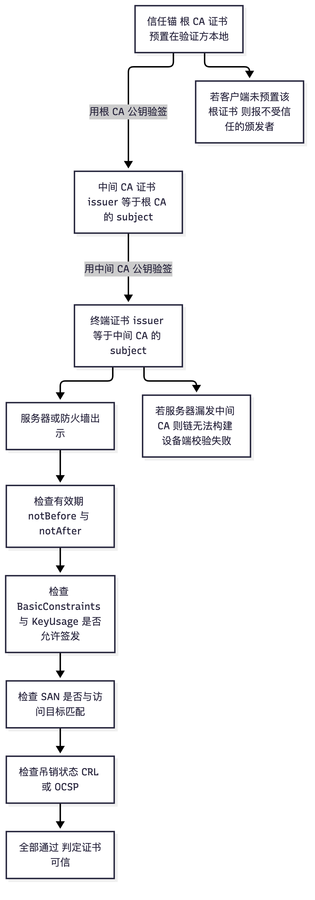


```mermaid
flowchart LR
    A["证书生命周期"] --> B["本地生成密钥对与 CSR"]
    B --> C["RA 审核身份与域名"]
    C --> D["CA 签发并发布到证书库"]
    D --> E["部署证书 私钥 完整链"]
    E --> F["有效期内使用 到期前轮换"]
    F --> G["吊销并发布 CRL 或提供 OCSP"]
    G --> H["归档审计"]
    F --> I["私钥泄露 或 信息变更 或 停用"]
    I --> G
```


### 真题精练

**Q1.【真题·多选】** 关于证书链与信任锚，下列说法正确的有？
A. 证书链的验证是自下而上逐级验签，最终落到本地信任库中的根 CA 证书
B. 信任锚是预先安装在验证方本地的根证书，不会从网络自动学习
C. 服务器只需下发自己的证书即可，中间 CA 证书客户端会自动获取且一定能成功
D. 客户端预置的信任库里没有该根 CA 时，会报"不受信任的颁发者"
E. 中间 CA 证书的 KeyUsage 必须包含 keyCertSign，否则不能用它验证下级证书

> **答案：ABDE**
> **解析**：C 错误——部分客户端（浏览器）可能通过缓存或 **AIA** 自动补下载中间证书，但**网络设备、Java 客户端、手机 App 等通常不会自动补链**，会报"证书链不完整"。因此规范做法是服务器**下发本端证书 + 全部中间 CA 证书**。A、B、D、E 均正确，E 还涉及 BasicConstraints 必须为 `CA:TRUE`。

**Q2.【真题·单选】** 某证书的私钥不慎泄露，CA 的正确处置方式是？
A. 从证书库中删除该证书，客户端就查不到了
B. 把证书序列号加入吊销列表并通过 CRL/OCSP 发布，因为已签发的证书无法收回
C. 直接撤销 CA 自己的根证书
D. 通知所有客户端手工删除本地缓存

> **答案：B**
> **解析**：证书是**自包含且可被无限复制**的数据，CA **无法收回已发出的证书**，唯一可做的是**吊销**：把"颁发者 + 序列号"加入 CRL 并对外发布，同时通过 OCSP 提供实时状态查询。A 错误——从库中删除不会让已下载的证书失效。C 过于激进（只有根 CA 泄露才需要这样处置）。D 不可运维且无法覆盖所有客户端。另外要理解**吊销存在延迟窗口**（CRL 发布周期、已建立的连接不会被追溯关闭），所以应配合**短有效期**与 **OCSP Stapling**。

**Q3.【真题·判断】** OCSP 比 CRL 更安全，因为它能实时查询，所以部署 OCSP 后就不再需要 CRL 了。

> **答案：错误**
> **解析**：OCSP 的优势是**实时性与响应体积**，但它的"安全性"并非全面占优：其响应可被劫持或重放（必须依赖响应签名与 nonce 防护），响应器不可用会导致验证失败（soft-fail 会带来吊销绕过风险），并且**存在隐私问题**——CA 能获知"谁在查询哪个站点"。CRL 在离线与弱网场景更可靠。工程上二者**常常并存**：证书中同时提供 CDP 与 AIA 地址，客户端优先 OCSP、失败时回退 CRL；同时推荐部署 **OCSP Stapling** 降低延迟并保护隐私。

**Q4.【真题·排错】** 同一台服务器的证书，在浏览器访问时正常，但某个 Java 客户端/网络设备做证书校验时报"不受信任的颁发者 / unable to get local issuer certificate"。请给出最可能的原因与排查方法。

> **答案要点**：
> ① 最可能原因：**服务器下发的证书链不完整**——只下发了服务器证书，**遗漏了中间 CA 证书**；浏览器可能通过缓存或 **AIA** 自动补链，而 Java 客户端与网络设备通常不自动补链，因此报错。
> ② 次要原因：客户端**信任库中没有该根 CA**（私有 CA 未下发根证书）；或客户端**时钟不准**导致有效期校验失败（此时通常报"过期/尚未生效"，可一并排除）。
> ③ 排查：用 `openssl s_client -connect <主机>:443 -showcerts` 查看服务器实际下发的完整链；在设备上 `display pki certificate ca realm <域>` 确认根 CA 与中间 CA 是否都已导入；`display pki certificate local realm <域> verbose` 查看 CDP/AIA 与 SAN。
> ④ 处理：在服务器上补齐中间 CA 证书（按"服务器证书 → 中间 CA"顺序下发）；把根 CA 证书导入客户端的信任库；确保所有涉及设备的时钟同步（NTP）；随后用 `pki validate-certificate local realm <域>` 与业务拨测双向验证。

### 易错点与排错

1. **以为中间 CA 会自动到位**：设备/Java/App 常不自动补链，必须显式下发中间 CA。
2. **吊销当"立即失效"**：吊销信息只存在于 CRL/OCSP，已建立连接不会追溯断开，应配合短有效期与 Stapling。
3. **OCSP 一定更安全？** 它有隐私与可用性问题，需配合响应签名、nonce 与 Stapling。
4. **忽略时钟**：证书校验依赖设备时间，排错必看 `display clock` 并检查 NTP。
5. **双机热备忘了两端分别导证书**：私钥与本地证书**不在 HRP 同步范围**，必须两端一致导入（算法与证书需匹配）。
6. **排错命令**：`display pki certificate ca realm <域>`、`display pki certificate local realm <域> verbose`、`pki validate-certificate local realm <域>`、`display ike sa verbose`（VPN 场景定位证书失败原因）、`display clock`、`openssl s_client -showcerts`（外部验证链完整性）。

---

## 2.7 国密算法体系与密码学在安全协议中的应用映射

### 考点定位

本考点占 **4~8 分**，命题方式以对照表（SM1/SM2/SM3/SM4/SM9 各干什么）与判断题（"加密能保证完整性吗""签名能加密吗""哈希能还原吗""HMAC 能防抵赖吗"）为主。国密部分必须记死**算法用途与参数**，并知道**华为安全产品对国密的支持需要设备版本与授权配合**；应用映射部分要求能把"IPSec/SSL VPN/HTTPS/802.1X 各环节用哪些密码学机制"一一对上。

### 原理精讲

**国密算法体系（商用密码）一览。** 国密算法由国家密码管理局发布，命名以 SM（ShangMi）开头。它们不是孤立算法，而是**可拼成一套完整密码体系**（对称 + 非对称 + 哈希 + 标识密码），这正是"国密改造"能整体替换 RSA/AES/SHA 体系的原因。

| 算法 | 类型 | 关键参数 | 用途 | 是否公开 |
|---|---|---|---|---|
| **SM1** | 对称分组密码 | 分组 128 位、密钥 128 位 | 数据加密（IPSec、链路加密等） | **不公开**，须以硬件（密码卡/芯片）实现，需授权 |
| **SM2** | 非对称（椭圆曲线） | 256 位素数域椭圆曲线 | 数字签名、公钥加密、密钥交换 | 公开（GB/T 32918 系列） |
| **SM3** | 哈希/摘要 | 摘要 **256 位** | 完整性、签名摘要、HMAC-SM3、口令派生 | 公开 |
| **SM4** | 对称分组密码 | 分组 **128 位**、密钥 **128 位**，32 轮 | 数据加密（IPSec、TLS/SSL VPN、WLAN 等） | 公开 |
| **SM9** | **标识密码（IBC）** | 基于双线性对，以**身份标识**（邮箱/手机号/域名）作为公钥 | 签名与密钥交换/加密，免证书体系 | 公开 |
| SM7 | 对称分组密码 | 分组 128 位、密钥 128 位 | 非接触 IC 卡、门票等 | 部分公开 |
| SM9/ZUC | 序列密码（ZUC 祖冲之） | — | 4G/5G 空口加密与完整性 | 公开 |

**"免证书"的 SM9 值得单独理解**：传统 PKI 需要 CA 签发证书来绑定公钥与身份（第 2.5 节），而 **SM9 属于标识密码（Identity-Based Cryptography）**——直接用"用户的身份标识"当公钥，由**密钥生成中心（KGC）**用主密钥为用户派生私钥。优点是**不需要证书与证书链，管理极大简化**；缺点是**密钥托管问题**（KGC 知道所有用户私钥）与**撤销困难**（身份即公钥，无法像证书那样吊销序列号）。这是理解"为什么 SM9 不能完全替代 PKI"的关键。

**华为安全产品对国密的支持（要点，不编造具体型号能力）**：华为 **HiSecEngine USG6000E / USG12000** 等安全产品在**相应版本、具备国密 License 或专用密码硬件（密码卡）**的前提下，支持国密算法套件。设备上的落点主要有三处：① **IPSec/IKE**——提议中加密算法可选 **SM1/SM4**、完整性算法可选 **SM3**，证书认证可用 **SM2** 证书、DH 可用国密椭圆曲线；② **SSL VPN/HTTPS**——加密套件可选用国密套件（SM2 证书 + SM4 加密 + SM3 完整性）；③ **WLAN/链路与终端接入**——SM4 用于空口数据加密。**注意两点**：一是 SM1 属**不公开算法**，必须依赖硬件与授权，不能像 SM4 那样纯软件配置；二是"设备支持国密"必须逐型号、逐版本核对产品文档与 License，**考试中不要凭记忆断言某型号一定支持**。

**密码学在各安全协议中的应用映射（本节的高分表格）。** 把前六节的知识落到具体协议上，就能应对"某某协议用了哪些密码学机制"的综合题。核心记忆法是**四件套**：**密钥交换/协商（怎么安全地得到密钥）+ 身份认证（对方是不是真的）+ 数据加密（机密性）+ 完整性（有没有被改）**。

| 协议/场景 | 密钥交换/协商 | 身份认证 | 数据加密 | 完整性 | 证书与算法 |
|---|---|---|---|---|---|
| **IPSec IKEv1/IKEv2（阶段一）** | DH（group1/2/5/14/15/16 或 ECDH 19/20/21） | 预共享密钥（PSK）或 **RSA/SM2 证书签名** | 协商出的密钥材料；IKE 报文用 AES/SM1/SM4 加密 | IKE 报文用 HMAC-SHA2/SM3 保护 | 证书认证需 PKI；PSK 不需要 |
| **IPSec ESP（阶段二/数据面）** | 由 IKE 派生；启用 **PFS** 时每次重新做 DH | 由 IKE 的认证结果继承 | **AES-128/192/256、SM1、SM4、3DES** | **HMAC-SHA2-256、HMAC-SM3** | 加密与认证算法在 `ipsec proposal` 中指定 |
| **SSL VPN / HTTPS（TLS 1.2/1.3）** | (EC)DHE（提供前向保密）/ TLS1.3 强制 ECDHE | 服务器证书（RSA/ECC/SM2），可选客户端证书双向认证 | AES-GCM/ChaCha20-Poly1305/SM4 | AEAD 内置（GCM）；或 HMAC-SHA256/SM3 | 证书链 + SAN 校验；TLS 1.3 只保留 AEAD 套件 |
| **802.1X + EAP（WLAN/有线接入）** | EAP 方法内协商（EAP-TLS 用 TLS 握手；PEAP 用 TLS 隧道） | **服务器证书**（EAP-TLS 还需**客户端证书**）；PEAP 内层用 MSCHAPv2 | EAP-TLS/PEAP 隧道内的会话密钥加密空口（WPA2/WPA3 用 CCMP/GCMP） | MIC/AEAD 校验 | RADIUS 与 NAS 之间共享密钥保护（如 HMAC-MD5） |
| 数字证书本身 | — | CA 签名 | — | 哈希（SHA-256/SM3）+ 签名（RSA/ECDSA/SM2） | X.509 v3 |
| 设备管理（HTTPS/SSH） | (EC)DHE / 密钥交换 | 服务器证书或口令/公钥 | AES/3DES/SM4 | HMAC/AEAD | 需导入证书并校验 |

**四种 EAP 方法的差异（802.1X 常考）**：**EAP-MD5** —— 只有口令摘要，**不提供服务器认证、不派生会话密钥**，易受字典与伪造服务器攻击，已被淘汰；**EAP-TLS** —— 双向证书认证，安全性最高，但需要为每个终端签发客户端证书（运维成本高）；**PEAP** —— 服务器证书 + TLS 隧道，隧道内用 MSCHAPv2 验证用户名口令，**只需服务器证书**，是实际部署中最常见的方案；**EAP-TTLS** —— 与 PEAP 类似但隧道内方法更灵活。记忆要点：**只要看到"不需要服务器证书"，基本就是 EAP-MD5（不安全）；PEAP 需要服务器证书但不需要客户端证书；EAP-TLS 两者都要。**

**密码学常见考点与陷阱（判断题速查，答案全部给出）。**

| 说法 | 正误 | 一句话解析 |
|---|---|---|
| 加密可以保证完整性 | **错误** | 对称加密只保证机密性，密文可被篡改；必须加 HMAC 或使用 AEAD |
| 数字签名可以加密数据 | **错误** | 签名提供完整性/认证/不可否认，不提供机密性 |
| 哈希可以还原出原文 | **错误** | 哈希单向不可逆，且无密钥，不是加密 |
| HMAC 可以提供不可否认性 | **错误** | HMAC 用共享密钥，双方都能生成；不可否认必须用数字签名 |
| 用公钥加密的数据只有对应私钥能解 | **正确** | 这是非对称加密提供机密性的基础 |
| 用私钥"加密"就是数字签名 | **不严谨** | 签名是对摘要做带填充的签名运算，不提供机密性 |
| DH 可以防止中间人攻击 | **错误** | 原始 DH 不认证对端，须配合证书或 PSK |
| IV 必须保密 | **错误** | IV 不需保密，但 CBC 要求随机不可预测，CTR/OFB/GCM 要求唯一 |
| ECB 可以用于加密业务数据 | **错误** | 相同明文块产生相同密文块，泄露模式并可被重排 |
| MD5 加盐后可以安全存储口令 | **错误** | 加盐只防彩虹表，口令存储要用慢哈希（bcrypt/Argon2 等） |
| 证书被吊销后已建立的连接会立即断开 | **错误** | 吊销只体现在 CRL/OCSP，已建连接不会追溯关闭 |
| 中间 CA 证书不需要下发 | **错误** | 设备/Java/App 常不自动补链，必须下发完整链 |
| 双机热备会同步本地私钥 | **错误** | 私钥与本地证书属设备级配置，须两端分别导入 |
| 只要支持国密就能用 SM1 | **错误** | SM1 不公开，必须依赖硬件密码模块与授权 |

### 关键概念对照表

| 需求（安全目标） | 密码学手段 | 对应国密算法 | 对应华为配置落点 |
|---|---|---|---|
| 机密性（数据不被读） | 对称加密 / 非对称加密短数据 / AEAD | SM1、SM4（对称）；SM2（非对称） | `esp encryption-algorithm sm4` |
| 完整性（数据不被改） | 哈希 + MAC / AEAD | SM3（HMAC-SM3） | `esp authentication-algorithm sm3` |
| 身份认证（对方是谁） | 证书 + 签名 / PSK | SM2 证书签名 | `ike peer` + `authentication-method rsa-signature` + PKI 域 |
| 不可否认（不能抵赖） | 数字签名 + 时间戳 | SM2 签名 | 证书签名体系 |
| 密钥分发/协商 | DH/ECDH、数字信封、PKI | SM2 密钥交换、SM9 | `dh group14`、`pfs dh-group14`、PKI 域 |
| 前向保密 | (EC)DHE 临时密钥 | SM2 密钥交换（每次会话临时） | `pfs dh-group*` |

| EAP 方法 | 服务器证书 | 客户端证书 | 隧道内认证 | 评价 |
|---|---|---|---|---|
| EAP-MD5 | 不需要 | 不需要 | 口令摘要 | **不安全**，不派生密钥，已淘汰 |
| EAP-TLS | 需要 | **需要** | 双向证书 | 最安全，运维成本最高 |
| PEAP | 需要 | 不需要 | MSCHAPv2（隧道内） | 部署最广，推荐 |
| EAP-TTLS | 需要 | 不需要 | 灵活（PAP/MSCHAP 等） | 与 PEAP 类似 |

### 华为设备配置

```bash
# ===== 1. 国密 IPSec 提议与 IKE 提议（需设备与授权支持国密）=====
system-view
ipsec proposal prop_gm                                            // 国密数据面提议
 transform esp                                                    // ESP 封装（协议号 50）
 esp encryption-algorithm sm4                                      // 机密性：SM4（分组 128 位、密钥 128 位、32 轮）
 esp authentication-algorithm sm3                                  // 完整性：HMAC-SM3（摘要 256 位）
quit
ipsec proposal prop_gm_sm1                                        // 使用 SM1 的提议（SM1 不公开算法，依赖硬件密码模块与授权）
 transform esp
 esp encryption-algorithm sm1                                      // 机密性：SM1（128 位分组与密钥，须硬件实现）
 esp authentication-algorithm sm3
quit
ike proposal 20                                                   // 国密 IKE 提议
 encryption-algorithm sm1                                          // 阶段一加密使用 SM1
 authentication-algorithm sm3                                      // 阶段一完整性使用 SM3
 authentication-method rsa-signature                              // 身份认证使用 SM2 证书签名（配合 PKI 域）
 dh group14                                                        // DH 组；国密场景可选用对应国密曲线
quit
ike peer peer_gm v2
 authentication-method rsa-signature
 pki realm ent_ca                                                  // 引用 PKI 域获取 SM2 证书与私钥
 ike-proposal 20
quit

# ===== 2. SSL VPN / HTTPS 国密套件（SSL 策略侧）=====
ssl policy policy_gm                                              // 创建 SSL 策略，供 HTTPS/SSL VPN 引用
 version tls1.2                                                    // 版本控制：禁用 SSLv3/TLS1.0/1.1，仅保留安全版本
 ciphersuite ecdhe_sm2_sm4_sm3                                     // 国密套件：SM2 密钥交换与认证 + SM4 加密 + SM3 完整性
 ciphersuite ecdhe_rsa_aes_256_gcm_sha384                          // 国际套件：ECDHE 前向保密 + AES-GCM + SHA-384
 quit
http secure-server ssl-policy policy_gm                           // 让 HTTPS 管理/业务使用该 SSL 策略
display ssl policy                                                // 查看 SSL 策略中实际启用的版本与套件

# ===== 3. 查看协商结果与证书配置 =====
display ipsec proposal                                            // 确认提议中的加密与认证算法
display ipsec sa                                                  // 查看实际协商出的算法（排查"协商不一致"的关键）
display ike sa                                                    // 阶段一认证方式与算法
display pki certificate local realm ent_ca verbose                // 确认 SM2 证书的签名算法、SAN 与有效期
save
```

### 示意图

```mermaid
flowchart LR
    A["国密体系四件套"] --> B["SM2 非对称 签名 加密 密钥交换"]
    A --> C["SM3 哈希 摘要 256 位"]
    A --> D["SM4 对称分组 128 位密钥"]
    A --> E["SM1 对称分组 不公开 硬件实现"]
    A --> F["SM9 标识密码 身份即公钥 免证书"]
    B --> G["配合 SM3 做签名 配合 SM4 做加密"]
    C --> G
    D --> H["IPSec TLS 空口数据加密"]
    E --> H
    F --> I["简化密钥管理 但存在密钥托管与撤销难题"]
```

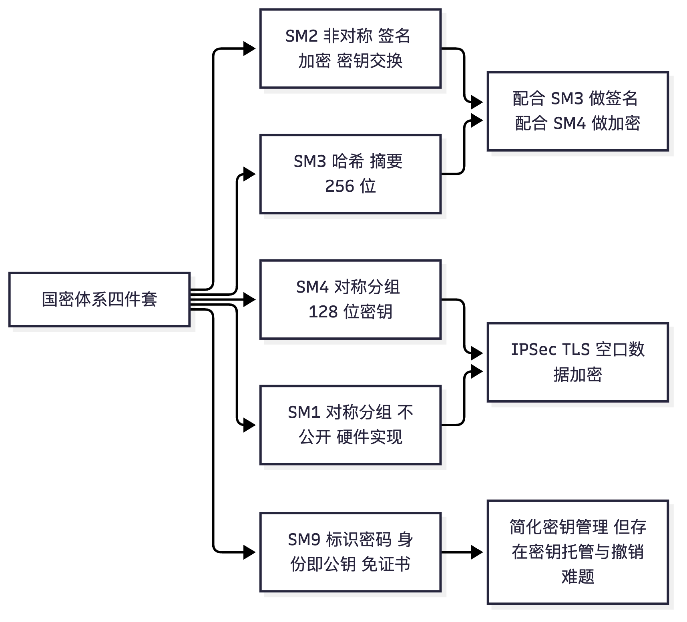


```mermaid
flowchart TB
    Q["协议需要哪四件事"] --> K["密钥协商"]
    Q --> A["身份认证"]
    Q --> E["数据加密"]
    Q --> I["完整性"]
    K --> K1["IPSec 用 DH 与 PFS"]
    K --> K2["TLS 用 ECDHE 提供前向保密"]
    A --> A1["IPSec 用 PSK 或证书签名"]
    A --> A2["TLS 与 802.1X 用服务器证书 可选客户端证书"]
    E --> E1["AES 或 SM4 或 SM1"]
    I --> I1["HMAC-SHA2 或 HMAC-SM3 或 AEAD"]
    E1 --> R["ESP 与 TLS 记录层"]
    I1 --> R
```

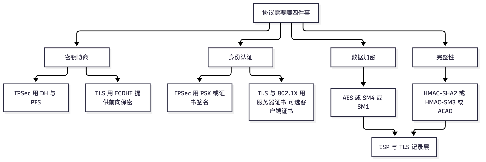


### 真题精练

**Q1.【真题·多选】** 关于国密算法，下列说法正确的有？
A. SM2 是椭圆曲线非对称算法，可用于签名、公钥加密与密钥交换
B. SM3 是哈希算法，摘要长度 256 位，可用于完整性校验与签名摘要
C. SM4 是分组密码，分组长度与密钥长度均为 128 位
D. SM1 是公开算法，可以像 SM4 一样纯软件配置使用
E. SM9 是标识密码，以身份标识作为公钥，不需要证书体系

> **答案：ABCE**
> **解析**：D 错误——**SM1 算法不公开**，必须通过硬件密码模块（密码卡/芯片）实现并取得授权，不能像 SM4 那样纯软件配置。A、B、C、E 正确。补充：SM9 属标识密码（IBC），省去证书与证书链，但存在**密钥托管**（KGC 掌握用户私钥）与**撤销困难**的问题，因此不能完全替代 PKI。

**Q2.【真题·单选】** 某 WLAN 采用 802.1X 认证，要求"只需服务器证书、终端使用用户名口令即可完成认证"，应选择哪种 EAP 方法？
A. EAP-MD5　B. EAP-TLS　C. PEAP　D. 无需 EAP，直接用 WEP

> **答案：C**
> **解析**：**PEAP** 用服务器证书建立 TLS 隧道，隧道内用 MSCHAPv2 校验用户名口令，**只需要服务器证书**，是部署最广的方案。A 不安全（无服务器认证、不派生会话密钥，已淘汰）；B 需要为每个终端签发客户端证书，运维成本高；D 完全不符合要求（WEP 早已被破解且不配合 802.1X 实现企业级认证）。

**Q3.【真题·判断】** 华为防火墙只要支持 IPsec，就一定支持 SM1 国密加密算法。

> **答案：错误**
> **解析**：是否支持国密需**逐型号、逐版本**核对产品文档，并通常需要**国密 License 或专用密码硬件**；其中 **SM1 属于不公开算法，必须依托硬件密码模块实现**，不是"支持 IPsec 就自然具备"的能力。配置前应确认设备是否提供 `sm1`/`sm4`/`sm3` 算法选项（可用 `?` 补全查看），并确保**两端设备与对端的算法集合有交集**，否则 IKE 协商会因"找不到匹配提议"而失败。

**Q4.【真题·简答】** 请用"四件套"框架说明 IPSec 与 HTTPS 分别用到了哪些密码学机制。

> **答案要点**：
> ① **四件套**=密钥协商 + 身份认证 + 数据加密 + 完整性。
> ② **IPSec**：密钥协商用 **DH/ECDH**（`ike proposal` 中的 `dh group*`），启用 **PFS** 后每次快速模式重新协商；身份认证用**预共享密钥或数字证书签名**（`authentication-method pre-share / rsa-signature`）；数据加密用 **ESP 的 AES/SM4/SM1**（协议号 50）；完整性用 **HMAC-SHA2-256/HMAC-SM3**（ESP 认证字段）。IPSec 的密钥管理由 IKE 完成，密码学分工体现在 `ike proposal`（控制面）与 `ipsec proposal`（数据面）两张表中。
> ③ **HTTPS（TLS 1.2/1.3）**：密钥协商用 **(EC)DHE**，TLS 1.3 强制 ECDHE，因此默认具备**前向保密**；身份认证依赖**服务器证书**（RSA/ECC/SM2，需校验证书链、SAN、有效期与吊销状态），可选**客户端证书**实现双向认证；数据加密与完整性由 **AEAD 套件（AES-GCM/ChaCha20-Poly1305）** 一体完成，TLS 1.3 已废除"加密 + 独立 MAC"的传统组合，也废除了 RSA 密钥传输方式。
> ④ 共同点：**非对称只用于协商与认证，真正加密数据的都是对称算法**——这正是数字信封思想的体现。

### 易错点与排错

1. **国密算法用途错配**：SM2 非对称（签名/加密/密钥交换）、SM3 哈希、SM4 对称（128/128）、SM1 对称（不公开、须硬件）、SM9 标识密码。
2. **以为"支持国密"是设备默认能力**：必须核对版本、License 与硬件，且**两端算法集合要有交集**。
3. **TLS 1.3 仍以为存在"RSA 密钥交换"**：TLS 1.3 已废除 RSA 密钥传输，只保留 (EC)DHE + AEAD。
4. **IPSec 协商失败只查一边**：IKE 提议（阶段一）与 IPSec 提议（阶段二）都必须匹配，用 `display ike sa` 与 `display ipsec sa` 双向核对。
5. **证书类配置忘了时钟与链**：证书校验依赖 NTP 与完整证书链，双机热备两端还要各自导入。
6. **排错命令**：`display ipsec proposal`、`display ike proposal`、`display ike sa [verbose]`、`display ipsec sa`、`display ssl policy`、`display pki certificate local realm <域> verbose`、`display clock`、`display current-configuration | include sm`（确认国密算法配置是否落地）。
